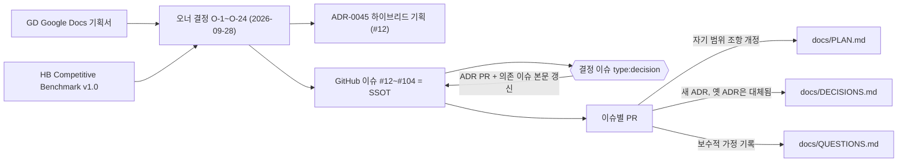
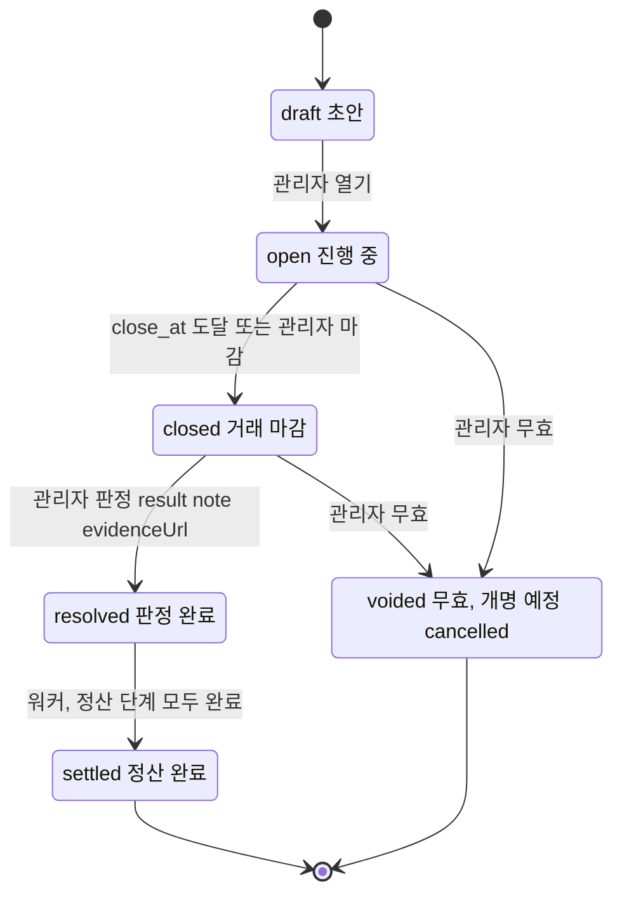

# 결정 기록 (ADR)

형식: 맥락 / 결정 / 결과. 최신 항목이 아래에 온다. 번호는 재사용하지 않는다.

---

## ADR-0001 — git 저장소 초기화와 브랜치 전략

- 날짜: 2026-09-02
- 상태: 채택, 일부 대체됨(ADR-0045: `m{N}-*` 브랜치 규칙)

### 맥락

작업 시작 시점에 `buddha/` 디렉터리는 git 저장소가 아니었다(`docs/PLAN.md`만 존재). PLAN §0.1-5는 마일스톤별 브랜치(`m0-scaffold`, `m1-auth` …)와 Conventional Commits를 요구한다.

### 결정

- 로컬에서 `git init -b main` 후 문서만 담은 첫 커밋을 `main`에 만들고, `m0-scaffold` 브랜치에서 M0 작업을 진행한다.
- 줄바꿈은 저장소 전체에서 LF로 고정한다(`.gitattributes: * text=auto eol=lf`, 저장소 로컬 `core.autocrlf=false`). Windows에서 작업하더라도 Docker/CI(Linux)와 셸 스크립트, SQL 초기화 파일이 CRLF로 깨지지 않게 하기 위함이다.
- 원격 저장소(GitHub 등)는 아직 연결하지 않는다. 사용자가 원격 URL을 제공하면 `origin`으로 추가한다.

### 결과

- 이후 모든 마일스톤은 `main`에서 분기한 `m{N}-*` 브랜치에서 진행하고, 완료 후 `main`에 머지한다.
- 원격 미연결 상태이므로 GitHub Actions 워크플로는 작성만 하고 실제 실행은 원격 연결 뒤 확인한다.

---

## ADR-0002 — TypeScript 6.0.3 고정 (7.x 미사용)

- 날짜: 2026-09-02
- 상태: 채택

### 맥락

npm `latest`는 TypeScript 7.0.2다. 7.0은 Go로 재작성된 네이티브 컴파일러이며 7.1까지 JS 컴파일러 API가 없다. `@nestjs/cli` 12는 `typescript ~6.0.2`에 의존하고 `nest build`가 컴파일러 API를 호출한다. `typescript-eslint` 8.69의 peer 범위는 `>=4.8.4 <6.1.0`이다. Expo SDK 57 템플릿과 RN 0.87 템플릿은 `~6.0.3`을 고정한다.

### 결정

- 카탈로그에 `typescript: 6.0.3`을 캐럿 없이 고정한다(6.1도 typescript-eslint 범위 밖).
- TS 6.0의 새 기본값에 맞춰 `packages/config-ts`를 작성한다: `types: []` 기본값이므로 Node 프로젝트는 `types: ["node"]`를 명시, `rootDir`을 `src`로 명시, `baseUrl` 미사용, `esModuleInterop: true`.
- 모든 tsconfig는 TS 7.0.2에서도 경고 없이 통과하도록 작성했으므로 생태계가 따라오면 한 줄 변경으로 전환한다.

### 결과

- `pnpm install`이 `typescript 6.0.3 (7.0.2 is available)`를 출력하는 것은 의도된 상태다.
- TS 7을 같은 패키지에 별칭으로 병행 설치하지 않는다(`bin/tsc` 충돌).

---

## ADR-0003 — 전부 ESM, 공유 패키지는 컴파일 후 `exports`로 노출

- 날짜: 2026-09-02
- 상태: 채택

### 맥락

NestJS 12 패키지 자체가 `"type": "module"`로 배포되고 `nest new` 기본값이 ESM 템플릿이다. better-auth 1.7과 `@thallesp/nestjs-better-auth` 2.7은 ESM 전용이다. PLAN §4.1은 공유 패키지를 `tsc -b`로 컴파일해 `dist/`를 `exports`로 노출하라고 요구한다.

### 결정

- `apps/api`, `apps/worker`, `packages/*` 모두 `"type": "module"`, `module/moduleResolution: nodenext`, 상대 import는 `.js` 확장자 사용.
- 공유 패키지 `exports`는 `{ ".": { "types": "./dist/index.d.ts", "default": "./dist/index.js" } }`만 둔다(`main`/`module`/`require` 분기 없음). Node 24의 `require(esm)`로 CJS 소비자도 로드 가능하다.
- 각 패키지는 `tsconfig.json`(noEmit, 테스트와 패키지 루트의 `*.config.ts`까지 포함, typecheck·ESLint용)과 `tsconfig.build.json`(composite, 테스트 제외, emit용) 한 쌍을 가진다. `tsc -b` 패키지의 `.tsbuildinfo`는 `dist/` 안에 두어 Turbo 캐시와 함께 움직인다. Nest 앱은 `nest build`가 `deleteOutDir`로 매번 새로 내보내므로 `incremental`을 쓰지 않는다(리뷰 반영: 패키지 루트에 남던 300KB tsbuildinfo 제거).
- `apps/web`은 Next 규칙(`module: esnext`, `moduleResolution: bundler`, `jsx: react-jsx`)을 따르고 `"type": "module"`을 두지 않는다(standalone `server.js`가 CJS).
- `apps/mobile`은 `expo/tsconfig.base`를 확장하고 `@buddha/config-ts/react-native.json`으로 엄격성만 덧씌운다.

### 결과

- NestJS는 레거시 데코레이터(`experimentalDecorators` + `emitDecoratorMetadata`)를 유지한다. `verbatimModuleSyntax`와 함께 쓰므로 DI에 쓰는 클래스는 값 import, 인터페이스는 `import type`이어야 한다.
- 순수 패키지(`node.json`)는 `erasableSyntaxOnly: true`라 enum·namespace·생성자 파라미터 프로퍼티를 쓸 수 없다(`as const` 객체와 유니온으로 대체). Nest 앱은 이 옵션을 끈다.

---

## ADR-0004 — pnpm 11 설정 위치, 빌드 스크립트 승인, 릴리스 연령 정책

- 날짜: 2026-09-02
- 상태: 채택

### 맥락

pnpm 11은 `.npmrc`에서 인증/레지스트리 설정만 읽는다. PLAN §4.2의 `.npmrc: strict-peer-dependencies=false`는 무시된다(기본값도 false). 의존성 설치 스크립트는 기본적으로 차단되고(`strictDepBuilds`), 발행 24시간 미만 버전은 `minimumReleaseAge`(기본 1440분, 비엄격) 정책의 대상이다.

### 결정

- 모든 pnpm 설정은 `pnpm-workspace.yaml`에 둔다. `.npmrc`는 주석만 남긴다.
- `allowBuilds`에 `esbuild: true`(tsx/vitest/drizzle-kit), `msgpackr-extract: true`(bullmq 선택 네이티브), `fsevents: false`(macOS 전용 선택 의존성, 프리빌트 바이너리 동봉이라 node-gyp 불필요), `@scarf/scarf: false`(텔레메트리)를 명시한다. 새 네이티브 패키지가 들어오면 `pnpm approve-builds <pkg>`로 추가한다. 이 목록은 Windows/Linux에서는 설치되지 않는 플랫폼 전용 선택 의존성(darwin)까지 덮어야 한다. 그렇지 않으면 macOS의 첫 `pnpm install`이 `ERR_PNPM_IGNORED_BUILDS`로 실패한다(리뷰 반영).
- `minimumReleaseAge`는 기본값(24h, 비엄격)을 유지한다. pnpm이 설치 중 자동으로 덧붙이는 `minimumReleaseAgeExclude` 목록은 그대로 커밋한다(CI의 `--frozen-lockfile`이 이 목록 없이는 실패). 공급망 보호 기본값을 끄지 않기 위한 보수적 선택이다.
- 카탈로그에는 현재 마일스톤이 실제로 사용하는 패키지만 넣는다. 이후 마일스톤은 그 시점의 최신 안정 버전을 추가한다(PLAN §0.1-4).
- `packageManager`는 설치된 `pnpm@11.10.0`으로 고정한다(`pmOnFail: download` 기본값이라 버전이 달라도 자동 사용).

### 결과

- `pnpm-workspace.yaml`은 pnpm이 설치 중 재작성할 수 있어 `.prettierignore`에 넣는다.
- `.npmrc`가 사실상 빈 파일인 점은 PLAN §4.2와 다르다(QUESTIONS.md에 기록).

---

## ADR-0005 — Postgres 드라이버는 `pg`(node-postgres), API는 M0부터 `@buddha/db` 사용

- 날짜: 2026-09-02
- 상태: 채택

### 맥락

PLAN은 드라이버를 지정하지 않는다. 후보는 `postgres`(postgres.js)와 `pg`. drizzle-kit 0.31은 `pg`를 먼저 탐색하고, Drizzle 문서의 기본 예제도 node-postgres다. `pg`는 명시적 Pool 제어(`pool.on('error')`, `idle_in_transaction_session_timeout`)를 제공해 `pg_advisory_xact_lock`을 잡는 트랜잭션에 유리하며 암묵적 prepared statement가 없다. better-auth의 Drizzle 어댑터는 드라이버 무관이다.

### 결정

- `packages/db`는 `pg` + `drizzle-orm/node-postgres`로 `createDb(url, opts)`를 제공한다. 풀 기본값: max 10, `idle_in_transaction_session_timeout` 30초, `application_name` 지정, `casing: 'snake_case'`.
- `apps/api`는 별도 Postgres 클라이언트를 두지 않고 `@buddha/db`의 `createDb`로 DB 프로바이더(`DB` 토큰)를 만들며, 헬스체크도 `db.execute(sql\`select 1\`)`로 수행한다. 한 프로세스에 드라이버 두 개를 두지 않기 위함이다.
- Redis는 `ioredis` 6을 직접 쓴다(`REDIS` 토큰).

### 결과

- `bigint({ mode: 'bigint' })`가 2^53+1을 정확히 왕복하는 것을 스크래치 실험에서 확인했다(PLAN §0.2 정수 불변식과 호환).
- `drizzle.config.ts`와 `createDb`의 `casing` 값은 반드시 같아야 한다.

---

## ADR-0006 — `db:migrate`는 `tsx src/migrate.ts`(재사용 가능한 `runMigrations`)

- 날짜: 2026-09-02
- 상태: 채택

### 맥락

PLAN §15는 `db:migrate: drizzle-kit migrate`를 예시로 든다. 통합 테스트(PLAN §14)는 테스트 DB에 같은 마이그레이션을 프로그램적으로 적용해야 한다.

### 결정

- `packages/db/src/migrator.ts`의 `runMigrations(url)`이 `drizzle-orm/node-postgres/migrator`를 호출하고, `db:migrate` 스크립트는 이를 실행하는 `tsx src/migrate.ts`다. 북키핑 테이블(`drizzle.__drizzle_migrations`)은 `drizzle-kit migrate`와 동일하므로 둘은 호환된다.
- DDL은 항상 `DATABASE_MIGRATE_URL`(buddha_migrate)로, 앱은 `DATABASE_URL`(buddha_app)로 접속한다.
- 빈 `drizzle/meta/_journal.json`을 커밋해 스키마가 비어 있는 M0에서도 `pnpm db:migrate`가 동작하게 한다.

### 결과

- 실행 확인: `drizzle` 스키마와 `__drizzle_migrations` 테이블이 buddha_migrate 소유로 생성됨, buddha_app은 `CREATE TABLE` 거부됨.
- PLAN §6.4의 append-only 테이블 권한 제한은 M2에서 `drizzle-kit generate --custom`으로 만든 `REVOKE` 마이그레이션으로 적용한다.

---

## ADR-0007 — 루트 단일 `.env`, 각 프로세스가 직접 로드

- 날짜: 2026-09-02
- 상태: 채택

### 맥락

PLAN §15는 api/worker/web이 공유하는 하나의 `.env.example`을 요구한다. Turborepo 2.x는 `.env`를 로드하지 않으며(strict env mode 기본), Next.js는 `apps/web/.env*`만 읽는다.

### 결정

- 저장소 루트의 `.env` 하나만 쓴다. 로드 방식은 프로세스별로 검증된 방법을 쓴다.
  - `apps/api`: `config/env.ts`가 모듈 위치 기준 절대경로(`apps/api/.env` → 루트 `.env`)를 계산해 `main.ts`(dotenv, Fastify 옵션용)와 `@nestjs/config`(`envFilePath` + zod `validationSchema`, DI용)가 같은 파일을 읽는다. cwd 상대경로를 쓰면 다른 디렉터리에서 실행할 때 엉뚱한 `.env`를 읽으므로(리뷰 반영) 금지.
  - `apps/worker`: Node 24 `process.loadEnvFile` (앱 로컬 `.env` → 루트 `.env`, 기존 값 우선) + zod.
  - `packages/db`: `dotenv` (drizzle.config.ts, migrate/seed 진입점).
  - `apps/web`: `next.config.ts` 상단에서 `dotenv`로 루트 `.env`를 읽어 `NEXT_PUBLIC_API_URL`을 rewrite 대상에 반영. 미설정 시 `http://localhost:4000`.
- 루트 `.env`를 빌드 산출물에 굽는 것은 `apps/web`뿐이므로 `apps/web/turbo.json`(패키지 설정)의 `build.inputs`에만 `$TURBO_ROOT$/.env*`를 넣는다. 루트 `turbo.json`에 넣으면 `.env` 한 줄 수정이 25개 태스크 캐시를 전부 무효화한다(리뷰 반영). `pnpm dev`는 `--env-mode=loose`로 실행한다.
- Turbo는 strict env 모드라 `turbo.json`의 `env`/`passThroughEnv`에 선언되지 않은 변수는 태스크에 전달되지 않는다. CI 워크플로의 job env도 예외가 아니므로, 테스트가 읽을 변수는 먼저 `test.env`에 선언한다.

### 결과

- `.env`는 커밋하지 않는다. `.env.example`에 PLAN §15 항목 + test 프로필용 `TEST_*` 키를 둔다.
- Turbo 문서는 앱별 `.env`를 권장하지만 PLAN을 따른다.

---

## ADR-0008 — ESLint 10 flat config: 팩토리 함수 패키지, `eslint-config-next`/`eslint-config-expo` 미사용

- 날짜: 2026-09-02
- 상태: 채택

### 맥락

Next 16은 `next lint`를 제거했다. `eslint-config-next` 16과 `eslint-config-expo` 57은 `eslint-plugin-import`/`eslint-plugin-react`/`jsx-a11y`에 의존하는데 이들의 peer는 ESLint ^9까지다. typescript-eslint의 `tsconfigRootDir` 자동 추론은 `eslint.config.*` 파일 안에서만 동작해 공유 패키지에서 쓸 수 없다.

### 결정

- `@buddha/config-eslint`는 `base/react/next({ tsconfigRootDir })` 팩토리 함수를 export한다. 각 패키지의 `eslint.config.mjs`는 `import.meta.dirname`을 넘긴다.
- `base`: `@eslint/js` recommended + `typescript-eslint` recommendedTypeChecked(`projectService`) + Prettier 호환. 패키지 루트의 `*.config.ts`도 각 패키지 `tsconfig.json`의 `include`에 들어 있으므로 타입 인식 린트를 받는다. `@buddha/config-eslint` 자신도 `eslint .`로 린트한다.
- `react`: `eslint-plugin-react-hooks` 7 `configs.flat.recommended`(React Compiler 규칙 포함). `next`: `@next/eslint-plugin-next` `core-web-vitals`를 직접 사용.
- 설정 파일은 ESLint 10이 `.ts` 설정을 기본 지원하지 않으므로 `.mjs`로 통일한다.
- Prettier는 ESLint에 연결하지 않고(`eslint-plugin-prettier` 미사용) `pnpm format:check`를 CI의 별도 단계로 둔다. 옵션: `singleQuote`, `printWidth: 100`, `trailingComma: all`.

### 결과

- 타입 인식 린트는 공유 패키지의 `dist/*.d.ts`가 필요하므로 `turbo.json`의 `lint`/`typecheck`는 `^build`에 의존한다.

---

## ADR-0009 — Chakra UI v3 + Turbopack: Emotion 레지스트리로 hydration 불일치 해결

- 날짜: 2026-09-02
- 상태: 채택

### 맥락

Next 16은 dev/build 모두 Turbopack이 기본이다. Chakra v3(Emotion)를 그대로 쓰면 SSR 시 Emotion의 인라인 `<style data-emotion>`이 `<body>`에 남아 매 로드마다 React #418 hydration 오류가 난다(스크래치 실험에서 재현). Chakra 문서는 `--webpack` 사용을 권한다.

### 결정

- Turbopack을 유지하고, `@emotion/cache` + `CacheProvider` + `useServerInsertedHTML`로 구성한 `EmotionRegistry`로 트리를 감싼다(`src/components/ui/emotion-registry.tsx`). 캐시 키는 Chakra 기본값 `css`.
- 색상 모드는 `next-themes`(`attribute="class"`)로, `<html suppressHydrationWarning>`.
- 폰트는 npm `pretendard` 패키지의 dynamic-subset variable CSS를 루트 레이아웃에서 import한다(CDN 미사용). 숫자는 `tabular-nums`.
- `next.config.ts`: `output: 'standalone'`, `outputFileTracingRoot`를 모노레포 루트로, `typedRoutes: true`, `agentRules: false`(Next가 `AGENTS.md`/`CLAUDE.md`를 생성하지 않도록).

### 결과

- 브라우저 확인: 콘솔 오류 0, Emotion 스타일 7개 모두 `<head>`, `<body>`에는 0개. 라이트/다크 토글 정상.
- Next rewrite는 WebSocket을 프록시하지 않으므로 M4의 Socket.IO 연결 방식은 별도 결정이 필요하다(QUESTIONS.md).

---

## ADR-0010 — 모바일: 이름 있는 카탈로그 `expo`, `expo-doctor` 바이너리, 에셋 없는 CNG 스캐폴드

- 날짜: 2026-09-02
- 상태: 채택

### 맥락

Expo SDK 57은 `react 19.2.3` / `react-native 0.86.3`을 정확히 요구한다(웹은 react 19.2.8). npm latest인 RN 0.87.1은 SDK 58용이라 doctor가 실패한다. `@expo/cli` 57의 `expo doctor` 서브커맨드는 "not supported in the local CLI"로 종료된다.

### 결정

- `pnpm-workspace.yaml`의 `catalogs.expo`에 react/react-native를 두고 `apps/mobile`만 `catalog:expo`를 쓴다. pnpm 격리 설치(`nodeLinker: isolated`) 그대로 사용, `metro.config.js`/`babel.config.js` 없음.
- `expo-doctor` 1.20.4를 devDependency로 고정하고 `doctor` 스크립트로 실행한다. PLAN M0 AC의 `pnpm --filter mobile exec expo doctor`는 `pnpm --filter mobile run doctor`로 대체한다.
- `app.json`에 아이콘/스플래시를 두지 않고(`newArchEnabled`도 두지 않음 — SDK 55에서 제거), `scheme`과 placeholder 번들 ID(`app.buddha.mobile`)만 둔다. `expo-dev-client`는 plugins 항목 없이 자동 적용된다.
- `build`/`dev`/`test` 스크립트를 두지 않아 Turbo가 모바일을 해당 태스크에서 건너뛴다. `typecheck`/`lint`에는 참여한다.

### 결과

- `expo-doctor` 21/21 통과. `pnpm install`의 `unmet peer react ^19.2.8 (react-dom)` 경고는 무해하다.
- 번들 ID는 사용자 결정(2026-09-03, Q-M0-3)에 따라 iOS `bundleIdentifier`와 Android `package` 모두 `dev.sboh.buddha`로 확정했다.

---

## ADR-0011 — 테스트: Vitest 4, Nest 데코레이터는 SWC 플러그인 없이, 파일명 `*.test.ts`

- 날짜: 2026-09-02
- 상태: 채택

### 맥락

Vitest 4(Vite 8, oxc)는 tsconfig의 `experimentalDecorators`/`emitDecoratorMetadata`를 읽어 Nest DI 메타데이터를 생성한다(검증됨). Nest 템플릿은 `*.spec.ts`, 다른 영역은 `*.test.ts`를 쓴다.

### 결정

- 모든 패키지가 자체 `vitest.config.ts`를 갖고 Turbo `test` 태스크로 실행한다(루트 `projects` 설정은 캐시를 무력화하므로 사용하지 않음). `unplugin-swc`는 쓰지 않는다.
- 테스트 파일은 `*.test.ts`로 통일하고 `tsconfig.build.json`에서 제외한다. 테스트가 없는 패키지는 `passWithNoTests: true`.
- `packages/shared`만 `vitest run --coverage`로 90% 임계값을 강제하고(PLAN §14), 커버리지 출력은 `packages/shared/turbo.json`(패키지 설정)에서만 `outputs`로 선언한다.
- `@vitest/coverage-v8`은 미리 설치한다(없으면 Vitest가 대화형 설치 프롬프트로 CI를 멈춘다).

### 결과

- M0 테스트: shared 5(fast-check 속성 테스트 포함, 커버리지 100%), api 5(DI + Fastify inject), worker 7, web 3.

---

## ADR-0012 — `@types/node`는 24.x (런타임 메이저 추종)

- 날짜: 2026-09-02
- 상태: 채택

### 맥락

npm latest는 `@types/node` 26.4.1이지만 런타임은 Node 24 LTS다. 26.x는 Node 24에 없는 API를 타입으로 노출한다.

### 결정

`@types/node: 24.13.3`(24.x 최신)을 카탈로그에 고정하고, Node 메이저를 올릴 때 함께 올린다.

---

## ADR-0013 — 패키지 이름: 앱은 무접두, 라이브러리는 `@buddha/*`

- 날짜: 2026-09-02
- 상태: 채택

### 맥락

PLAN M0 AC가 `pnpm --filter mobile`을 쓴다. pnpm `--filter`는 정확한 패키지 이름을 요구한다.

### 결정

`apps/*`는 `web`, `api`, `worker`, `mobile`, `packages/*`는 `@buddha/shared`, `@buddha/db`, `@buddha/api-client`, `@buddha/config-ts`, `@buddha/config-eslint`.

---

## ADR-0014 — 로컬 인프라: 루트 `compose.yaml`이 `docker/docker-compose.yml`을 include

- 날짜: 2026-09-02
- 상태: 채택

### 맥락

PLAN §4는 컴포즈 파일을 `docker/docker-compose.yml`에 두라 하고, M0 AC는 루트에서 `docker compose up -d`를 실행한다.

### 결정

- 루트 `compose.yaml`은 `include: [docker/docker-compose.yml]`만 담는다(프로젝트 이름 `buddha` 공유). `pnpm infra:up|down|logs` 스크립트도 둔다.
- 이미지: `postgres:16.15-alpine`(롤 초기화 SQL을 `docker-entrypoint-initdb.d`로 마운트, `pg_isready -h localhost` 헬스체크), `redis:7.4.11-alpine`(`--maxmemory-policy noeviction --appendonly yes`; BullMQ 요구사항), `axllent/mailpit:v1.31.0`.
- 모든 포트는 `127.0.0.1`에만 게시한다. 개발용 자격 증명(postgres/postgres, buddha/buddha, 인증 없는 Redis, 아무 로그인이나 받는 Mailpit)이 LAN에 노출되지 않게 하기 위함이다(리뷰 반영). 컨테이너 안에서 접근해야 하는 경우가 생기면 그때 명시적으로 연다.
- CI(GitHub Actions)는 compose를 쓰지 않지만 같은 `01-roles.sql`을 `psql`로 적용한 뒤 로컬과 동일한 `buddha_app`/`buddha_migrate` 롤로 접속한다. 슈퍼유저로 테스트하면 PLAN §6.4의 권한 분리가 검증되지 않기 때문이다(리뷰 반영).
- `test` 프로필로 `postgres-test`(5433, tmpfs, fsync off)와 `redis-test`(6380)를 제공한다(PLAN §14). 기본 `up`에는 포함되지 않는다.
- 롤 설계: `buddha_migrate`가 DB 소유자(=`public` 스키마 소유자, PG15+), `buddha_app`은 CONNECT/USAGE + `ALTER DEFAULT PRIVILEGES FOR ROLE buddha_migrate`로 테이블 DML·시퀀스·함수·타입 권한을 받는다.

### 결과

- `docker compose up -d --wait`로 3개 컨테이너 healthy 확인. 초기화 SQL은 빈 볼륨에서만 실행되므로 롤 변경은 `down -v` 후 재기동이 필요하다.
- 로컬 Docker 최소 버전: `include`는 Compose 2.20.0(docker/compose v2.20.0 릴리스 노트), `docker/docker-compose.yml`의 헬스체크 `start_interval`은 스키마상 Compose 2.20.2를 요구한다(둘 다 Docker Desktop 4.22.0에 포함). `start_interval`은 Docker Engine 25(API 1.44, Desktop 4.27) 이상에서만 적용된다. Compose 2.24.0~5.0.2는 Engine 25 미만에서 하드 에러를 냈고 5.1.0에서 그 검사가 제거됐으며, 2.36.0부터는 `start_interval`에 `start_period` 동반을 요구한다(이 파일은 모든 헬스체크에 설정). Docker Desktop은 Compose 2.24 이상을 싣는 4.27부터 Engine도 25이므로 Desktop 사용자는 해당 없고, Linux에서 새 compose 플러그인을 구형 Engine과 조합한 경우만 걸린다. README 요구 사항에 "Docker Desktop 4.22 이상(Compose 2.20.2 이상)"으로 명시했다(리뷰 반영). `docker compose -f docker/docker-compose.yml`로 직접 실행해도 같은 바닥이 적용되므로 구버전 우회 수단이 아니다.

---

## ADR-0015 — API 라우팅: 글로벌 prefix `api` + URI 버저닝, `/api/health`는 버전 중립

- 날짜: 2026-09-02
- 상태: 채택

### 맥락

PLAN §7은 Base `/api/v1`, M0 AC는 `GET /api/health`를 요구한다. better-auth는 `/api/auth/*`를 쓴다.

### 결정

- `setGlobalPrefix('api')` + `enableVersioning({ type: URI, defaultVersion: '1' })`. 일반 컨트롤러는 `/api/v1/<resource>`, 헬스는 `@Controller({ path: 'health', version: VERSION_NEUTRAL })`로 `/api/health`.
- 헬스 응답 `{ status: 'ok'|'degraded', db, redis }`. 각 프로브는 2초 타임아웃, 실패 시 HTTP 503(본문 동일 형태).
- Fastify 어댑터는 `bodyParser: false`로 생성한다(M1 better-auth 요구). 이 옵션은 `@fastify/formbody` 등록만 생략하며 JSON 파싱은 유지된다.
- `trustProxy`는 환경변수 `TRUST_PROXY`(기본 `false`; `true` 또는 프록시 주소/CIDR 목록)로만 켠다. Next.js rewrite는 `X-Forwarded-For`를 붙이지 않으므로 무조건 신뢰하면 클라이언트가 자기 IP를 위조할 수 있고, PLAN §7.5의 IP별 레이트 리밋이 무력화된다(리뷰 반영). 바인드 주소는 `API_HOST`(기본 `localhost` = IPv4+IPv6 루프백, 컨테이너는 `0.0.0.0`). 웹 dev 서버(`next dev --hostname localhost`)와 로컬 standalone 실행(`scripts/start-standalone.mjs`가 `WEB_HOST`, 기본 `localhost`를 `HOSTNAME`으로 넘김)도 루프백에 바인드한다. Next 기본값은 모든 인터페이스(`::`)라 `/api/*` rewrite를 통해 이 결정이 REST에 대해 무력화됐기 때문이다(리뷰 반영). Next는 Fastify와 달리 주소 하나에만 `listen`하므로 Node 24에서는 `::1`만 열리지만 `http://localhost:3000`은 브라우저·curl·Node fetch 모두에서 동작한다. `127.0.0.1`을 쓰면 Next가 `request.url`과 리다이렉트 오리진을 `http://127.0.0.1:3000`으로 만들어 ADR-0017의 `localhost:3000` 오리진과 어긋나므로 쓰지 않는다. 다른 기기에서 웹을 열 때는 `-H 0.0.0.0`과 `allowedDevOrigins`로 명시적으로 연다.
- DB 풀과 Redis 클라이언트는 `onApplicationShutdown`에서 닫는다. Nest 12의 `close()` 순서는 `onModuleDestroy → beforeApplicationShutdown → HTTP 서버 close → onApplicationShutdown`이므로 `onModuleDestroy`에서 닫으면 처리 중인 요청이 끝난 풀을 만난다(리뷰 반영).
- `packages/db`의 풀은 `connectionTimeoutMillis`(5초)와 `query_timeout`/`statement_timeout`(30초)을 기본으로 둔다. 헬스체크의 2초 `Promise.race`는 응답 시간만 제한할 뿐 연결 시도를 취소하지 않아, 타임아웃 없이는 DB 장애 시 프로브가 풀 슬롯을 하나씩 잠식했다(리뷰에서 재현).
- `nest build`는 tsc 빌더를 쓴다(`--builder swc`는 이 ESM 프로젝트에서 CJS를 내보내 실행 불가).

### 결과

- 확인: `/api/health` 200, `/api/v1/health` 404, web rewrite 경유 200.

---

## ADR-0016 — Turbo 캐시에서 `.next/standalone` 제외 (Windows)

- 날짜: 2026-09-02
- 상태: 채택

### 맥락

첫 `pnpm build`에서 Turbo가 `apps/web/.next/standalone/node_modules/.pnpm/next@16.3.4_...` 심링크를 캐시 tar에 넣지 못했다(`provided value is too long when setting link name`). 그대로 두면 캐시 복원 시 standalone 출력이 조용히 깨진다.

### 결정

`build.outputs`에 `!.next/standalone/**`를 추가한다. standalone은 배포 아티팩트이며 CI/Docker에서 새로 빌드된다.

### 결과

- 캐시 히트 후에는 `.next/static`/`BUILD_ID`만 복원되고 standalone은 이전 빌드가 남을 수 있다. `pnpm --filter web start`(`scripts/start-standalone.mjs`)는 두 `BUILD_ID`를 비교해 불일치 시 `turbo run build --filter=web --force` 안내와 함께 종료한다(리뷰 반영).
- Windows에서 만든 standalone 출력은 pnpm 정션이 절대경로 심링크로 복사되어 빌드한 머신에서만 실행된다. 배포 아티팩트는 Linux(CI 또는 Docker 빌드 단계)에서 `next build`로 만든다.
- `web#typecheck`(`next typegen`)와 `web#build`(`next build`, `.next/types` 삭제 후 재생성)가 동시에 `.next`를 쓰면 드물게 경합하므로 `apps/web/turbo.json`에서 `typecheck`가 `build`에 의존하게 했다(리뷰 반영). 추기(2026-09-11): `web#lint`도 같은 경합에 노출되어 있었다 — typed ESLint 규칙(`no-unnecessary-type-assertion`)이 `.next/types/link.d.ts`의 `redirect`·`router.push` 증강을 읽는데, `next build`가 그 디렉터리를 지운 순간 lint가 돌면 `Route`가 맨 `string & {}`가 되어 `redirect(x as Route)` 세 곳이 "불필요한 단언"으로 실패한다(PR #11 CI). 웹 파일이 바뀌지 않은 PR에서는 lint가 캐시 히트라 드러나지 않았다. `lint`도 `build`에 의존하게 했다.
- 두 번째 `pnpm build`는 `>>> FULL TURBO`(6/6 캐시)로 완료된다.
- `scripts/start-standalone.mjs`는 `server.js`에 `HOSTNAME=${WEB_HOST:-localhost}`를 넘겨 로컬 실행을 루프백에 묶는다(standalone `server.js` 기본값은 `0.0.0.0`; 근거는 ADR-0015). 셸이 내보낸 `HOSTNAME`(RHEL 계열은 머신 이름, Docker는 컨테이너 ID)은 바인드 주소로 쓸 값이 아니므로 무시하고 `WEB_HOST`만 존중한다. 배포 이미지(아직 없음)는 이 스크립트를 거치지 않고 `HOSTNAME=0.0.0.0`으로 `server.js`를 직접 실행해야 한다(리뷰 반영).
- 같은 스크립트는 SIGINT/SIGTERM을 받으면 Unix에서는 `server.js`에 신호를 전달하고, 플랫폼과 무관하게 10초 뒤에도 자식이 남아 있으면 강제 종료한다(SIGKILL, Windows는 TerminateProcess). wrapper에만 신호를 보내는 프로세스 관리자에서 `server.js`가 고아로 남아 포트를 점유하던 문제를 막기 위해서다(Linux 컨테이너에서 같은 신호 계약을 가진 stub 서버로 재현; 리뷰 반영). Windows는 콘솔 Ctrl+C가 콘솔의 모든 프로세스에 전달되고 libuv job object가 wrapper와 자식을 함께 끝내므로 전달 없이 자식 종료를 기다린다(Ctrl+C 1회에 1초 내 종료를 확인, 10초 강제 종료는 동일).

---

## ADR-0017 — 실시간(Socket.IO) 연결 경로: API 오리진 직접 연결 + CORS

- 날짜: 2026-09-03
- 상태: 채택 (사용자 결정, QUESTIONS Q-M0-2)

### 맥락

PLAN §8/§10.1은 브라우저가 같은 출처의 `/api/*`만 쓴다고 가정하지만, Next.js rewrite는 WebSocket 업그레이드를 프록시하지 않는다(ADR-0009 결과). 선택지는 (a) 클라이언트가 API 오리진에 직접 연결 + CORS, (b) 로컬/운영 모두 리버스 프록시였다.

### 결정

- REST는 기존대로 Next rewrite(`/api/*` → API)를 경유한다(같은 출처, 쿠키·CORS 문제 없음).
- Socket.IO 클라이언트는 `NEXT_PUBLIC_API_URL`의 API 오리진에 직접 연결하며 `withCredentials: true`를 쓴다.
- API는 Socket.IO 핸드셰이크(`/ws` 네임스페이스, polling 폴백 포함)에 대해서만 CORS를 허용한다: origin은 웹 오리진(`WEB_ORIGIN` env, 로컬 `http://localhost:3000`), credentials true. REST 라우트는 rewrite로만 접근하므로 CORS를 열지 않는다.
- 세션 쿠키(SameSite=Lax)가 핸드셰이크에 실리려면 웹과 API가 같은 사이트여야 한다. 로컬은 `localhost:3000`/`localhost:4000`으로 충족되고, 운영은 `app.<도메인>`/`api.<도메인>` 형태를 전제한다. 게이트웨이 인증(PLAN §8)은 핸드셰이크 쿠키로 better-auth 세션을 조회한다.
- (2026-09-08 추기, M4 PR 리뷰) **같은 사이트는 필요조건일 뿐 충분조건이 아니었다.** 위 문장은 SameSite만 따졌는데, 쿠키가 실제로 API 호스트로 돌아가려면 `Domain`이 있어야 한다: `Domain` 없이 발급된 쿠키는 자신을 발급한 호스트에만 돌아간다(RFC 6265 §5.1.3의 host-only). 그리고 로그인 쿠키는 **웹 호스트**에서 발급된다 — Next rewrite가 `/api/auth/*`를 서버 사이드로 대신 보내므로 브라우저는 `app.<도메인>`의 응답으로 그것을 받는다. 반면 소켓은 rewrite를 우회해 `api.<도메인>`로 직접 붙는다. 그래서 `app.`/`api.` 분리 배포에서는 로그인한 사용자도 **익명 핸드셰이크**가 되어 `user:<id>` 방에 들어가지 못하고, 잔고 칩과 내 포지션이 아무 오류 없이 조용히 멎는다. 로컬에서는 `localhost:3000`과 `localhost:4000`이 **같은 호스트**이므로(포트는 쿠키의 신원이 아니다) 이 결함이 드러나지 않는다.
- 그래서 `AUTH_COOKIE_DOMAIN`(옵트인, 기본 미설정)을 둔다. 값이 있으면 better-auth의 `advanced.crossSubDomainCookies`로 그 도메인을 쿠키에 실어 두 호스트가 같은 쿠키를 공유한다(`SameSite=Lax`는 그대로, `__Secure-` 접두사는 `Domain`을 허용한다 — `__Host-`였다면 불가능했다). 값은 반드시 명시한다: better-auth의 기본값은 `BETTER_AUTH_URL`의 호스트, 즉 웹 호스트라서 API 호스트에는 여전히 닿지 않는다. 대가는 **그 도메인의 모든 서브도메인이 이 쿠키를 받는다**는 것이므로, 서브도메인 전부가 우리 것인 도메인만 적어야 한다. 대안(핸드셰이크용 단기 토큰을 REST로 발급)은 엔드포인트·수명·폐기를 새로 설계해야 해서 채택하지 않았다.

### 결과

- M4에서 `apps/web`은 `NEXT_PUBLIC_API_URL`을 클라이언트 번들에서도 사용한다(현재는 `next.config.ts`에서만 사용). 그 시점에 `.env.example` 설명을 갱신한다.
- `TRUST_PROXY`는 계속 false(QUESTIONS A-M0-13). 리버스 프록시가 없으므로 API는 직접 연결(WS)의 클라이언트 IP는 정확히 보지만, rewrite를 거친 REST 요청의 IP는 Next 서버로 보인다. PLAN §7.5의 IP별 레이트 리밋은 M6에서 Next `proxy.ts`가 `X-Forwarded-For`를 붙이고 API가 Next 서버 주소만 신뢰하는 방식을 검토한다.
- 모바일(Expo)은 처음부터 API 오리진에 직접 연결하므로 이 결정과 자연스럽게 맞는다.

---

## ADR-0018 — better-auth 1.7을 `@thallesp/nestjs-better-auth`로 NestJS 12에 마운트

- 날짜: 2026-09-03
- 상태: 채택 (QUESTIONS Q-M0-4: 실패 시 §10.6 대안 허용)

### 맥락

PLAN §10.1은 `@thallesp/nestjs-better-auth`를 지정하지만 2.7.0의 peer 범위는 `@nestjs/common|core ^11.1.6`이고 저장소는 Nest 12.0.1이다. 대안은 PLAN §10.6(Fastify 라우트에 `auth.handler` 직접 마운트)이었다.

### 결정

- 라이브러리를 그대로 쓴다. 스크래치 검증에서 Nest 12의 안정 API(`ApplicationConfig`, `@nestjs/core/middleware/utils`의 `mapToExcludeRoute`, `HttpAdapterHost`, middie)만 사용하며 sign-up/sign-in/get-session/list-accounts/unlink/reset 흐름이 모두 동작했다. Fastify에서는 `toNodeHandler(auth)`가 middie 미들웨어로 라우팅·prefix·버저닝·본문 파싱보다 먼저 실행되므로 `setGlobalPrefix('api')` + URI 버저닝을 바꿀 필요가 없다(`/api/auth/*` 동작, `/api/v1/auth/*`는 404).
- `disableGlobalAuthGuard: true`(PLAN §7.1의 공개 라우트) + 자체 `SessionGuard`(`auth.api.getSession`, 실패 시 `AppError('UNAUTHENTICATED')` → PLAN §7 봉투). `disableTrustedOriginsCors: true`(REST는 rewrite로 같은 출처, ADR-0017).
- `main.ts`의 `bodyParser: false`는 유지한다. 라이브러리가 자체 JSON/urlencoded 파서를 재등록하는데 잘못된 JSON에 순수 `SyntaxError`를 던지므로 `ApiExceptionFilter`가 이를 400 `VALIDATION_ERROR`로 매핑한다(`disableBodyParser`는 폐기된 옵션으로, 켜면 본문이 아예 파싱되지 않는다). (2026-09-05 추기, PR #3 리뷰 9차) urlencoded 파서는 `bodyParser.urlencoded.enabled: false`로 끈다 — JSON만 받는 API에 폼 본문은 CSRF의 모양이고, `SessionGuard`의 `Origin` 검사와 함께 두 겹이다(ADR-0025 추기, A-M2-13).
- `advanced.disableOriginCheck: false`를 명시한다. better-auth는 `NODE_ENV=test`에서 Origin/CSRF 검사를 조용히 건너뛰므로 통합 테스트가 운영 동작(다른 Origin → 403 `INVALID_ORIGIN`)을 검증하도록 강제한다.
- 내장 레이트 리미터(프로세스 메모리, PLAN §16 위반)는 끈다. M6에서 `@nestjs/throttler` + Redis로 `/api/auth/*`까지 덮는다. (2026-09-10 추기, M6) **`@nestjs/throttler`로는 덮지 못했다.** better-auth는 middie 미들웨어라 Nest 라우팅보다 먼저 서비스되므로 전역 가드가 그 요청을 영원히 보지 못한다. 실제로 덮은 것은 better-auth 자신의 훅과 middie 앞에 등록한 Fastify 훅이고, 공유되는 것은 Redis 스토리지·`rl:` 네임스페이스·고정창이다(ADR-0034).
- 쿠키: `advanced.cookiePrefix: 'buddha'` → `buddha.session_token`, http 개발 환경에서는 `Secure`/`__Secure-` 없이 발급되어 Next rewrite를 통과한다(https에서는 자동 전환). `trustedOrigins`는 `WEB_ORIGIN`(`webOrigins(env)`).
- 소셜: Google/Kakao/Naver는 better-auth 내장 프로바이더이며 두 키가 모두 있을 때만 켜진다. Kakao/Naver가 이메일을 주지 않으면 `mapProfileToUser`가 `{provider}_{id}@noemail.buddha.local`(`emailVerified=false`)로 대체한다(PLAN §10.3). 계정 연결은 설정 화면에서 명시적으로만(`disableImplicitLinking: true`, `trustedProviders` 3종, `allowDifferentEmails`), 마지막 로그인 수단 해제는 거부(`allowUnlinkingAll: false`). `unlinkAccount`는 1.7에서 `{ accountId }`(account 행 id)만 받는다.

### 결과

- peer 경고는 `strictPeerDependencies: false`로 무해하지만, 라이브러리 업그레이드 시 Nest 11 전용 내부 API 사용 여부를 다시 확인해야 한다(정확한 버전 고정).
- 이메일 링크(`/api/auth/verify-email`, `/api/auth/reset-password/<token>`)는 `BETTER_AUTH_URL`(웹 오리진) 기준으로 만들어져 rewrite를 거쳐 API에 닿는다.

---

## ADR-0019 — 프로필·잔고 자동 생성은 Postgres 트리거 (PLAN §10.4의 databaseHooks 대신)

- 날짜: 2026-09-03
- 상태: 채택 (PLAN §10.4 문구와 다름, QUESTIONS A-M1-1), 일부 대체됨(ADR-0052: 자동 닉네임 접두어 `예측가_` — 새 가입의 자동 닉네임은 `user_XXXX`이고, 트리거 함수의 마지막 본문은 마이그레이션 0019에 있다. 같은 트랜잭션의 트리거, 네 글자 접미사와 재시도, 닉네임 규칙은 유효), 일부 대체됨(ADR-0071: 2026-09-05 추기의 '같은 트리거가 가입 보너스 10,000P와 `BONUS` 원장도 함께 쓴다' — 마이그레이션 0031부터 트리거는 프로필과 잔고 0의 행만 만들고 원장을 쓰지 않는다. 트리거 함수의 마지막 본문은 0031에 있다. 같은 트랜잭션의 트리거와 나머지 결정은 유효), 일부 대체됨(ADR-0072: 트리거 함수의 마지막 본문은 0032에 있다 — 자동 닉네임의 후보마다 닉네임 잠금(`lock_nickname`)을 잡고 30일 보류 중인 후보(`nickname_held`)를 건너뛰며, 겹침은 대소문자를 무시한다. 같은 트랜잭션의 트리거와 나머지 결정은 유효)

### 맥락

PLAN §10.4는 better-auth `databaseHooks.user.create.after`에서 `profiles`/`balances`를 "같은 트랜잭션"으로 만들라고 한다. better-auth 1.7은 after 훅을 `queueAfterTransactionHook`으로 커밋 이후에 실행하고, Drizzle 어댑터의 `transaction` 옵션도 기본 false라 훅으로는 같은 트랜잭션을 보장할 수 없다.

### 결정

- 마이그레이션 `0002_user_profile_trigger`가 `"user"` 테이블에 `AFTER INSERT` 트리거(`create_profile_for_user`, plpgsql, SECURITY INVOKER)를 만든다. 닉네임 `예측가_XXXX`(혼동 문자를 뺀 32자 알파벳 4자리, 충돌 시 10회 재시도)와 잔고 0을 사용자 행과 같은 트랜잭션에 삽입한다. 트리거가 실패하면 사용자 삽입이 롤백되고 better-auth는 422 `FAILED_TO_CREATE_USER`를 반환한다.
- 시드(`db:seed`)와 테스트 팩토리는 트리거가 만든 행을 UPDATE 한다(직접 INSERT 하지 않는다).
- 닉네임 정책(PLAN §17 Q4 기본값)은 자동 닉네임의 `_` 때문에 `[A-Za-z0-9가-힣_]{2,20}`으로 확정하고 `@buddha/shared`의 `nicknameSchema` 하나로 API·웹이 공유한다.

### 결과

- `profiles`/`balances`에 대한 권한이 나중에 바뀌면 가입이 조용히 깨질 수 있으므로 통합 테스트가 "가입 → 프로필·잔고 생성"을 항상 검증한다.
- (2026-09-05 추기) migration 0004(ADR-0026)부터 같은 트리거가 가입 보너스 10,000P와 `BONUS` 원장도 함께 쓴다. 시드 관리자도 `user` 행이므로 예외가 아니다(QUESTIONS A-M1-3).

---

## ADR-0020 — API 규약: Nest 12 Standard Schema + zod DTO, 봉투/오류 필터, P 금액은 십진 문자열

- 날짜: 2026-09-03
- 상태: 채택, 일부 대체됨(ADR-0050: 와이어 타입 `PAmount`(OpenAPI 컴포넌트 `PAmount`)와 웹의 `formatP(parsePAmount(s))`는 이름이 `CoinAmount`(컴포넌트 `CoinAmount`)와 `formatCoin(parseCoinAmount(s))`로 바뀌었다 — 금액을 십진 정수 문자열로 싣는 규약과 나머지 결정은 유효), 일부 대체됨(ADR-0072: 예시 '닉네임 중복 23505 → `VALIDATION_ERROR`' — 닉네임 중복은 대소문자만 다른 것까지(`lower(nickname)`의 UNIQUE) `NicknameService`가 `NICKNAME_NOT_ALLOWED`의 `details.reason: 'taken'`으로 알린다. `findPgError`를 거치는 SQLSTATE 매핑과 나머지 결정은 유효)

### 맥락

PLAN §7은 zod 스키마(`packages/shared`)를 요청/응답 DTO로 쓰고 `@nestjs/swagger`에 반영하며 class-validator를 쓰지 않는다. Nest 12는 `@Body({ schema })`/`@Query({ schema })`와 `StandardSchemaValidationPipe`를 내장했고, `@nestjs/swagger` 12는 Standard JSON Schema(zod 4의 `~standard.jsonSchema`)를 직접 OpenAPI로 변환한다. `nestjs-zod` 5.5는 Nest 12를 peer로 지원하지 않는다.

### 결정

- 검증: Nest 내장 파이프(`transform: true`, 실패 시 `AppError('VALIDATION_ERROR', { details: ValidationIssue[] })`). DTO는 `packages/shared`에 두고 `.meta({ id })`로 OpenAPI 컴포넌트 이름을 준다.
- 봉투: 전역 인터셉터가 `{ data }`/`{ data, meta: { nextCursor } }`(`ApiPage`)로 감싸고, `@RawResponse()`(헬스체크)만 예외. 전역 `ApiExceptionFilter`가 `AppError`·`HttpException`·Fastify 오류·`SyntaxError`를 PLAN §7.4 코드 봉투로 변환하고 5xx는 스택을 로그로 남기되 본문에는 노출하지 않는다. 이 셋은 `CommonModule`의 `APP_*` 프로바이더라 테스트 앱에도 동일하게 적용된다.
- P 금액은 와이어에서 십진 정수 문자열(`PAmount`)이다. JSON 숫자는 double이라 bigint를 정확히 싣지 못하고, 필드별 안전정수 검사는 계약을 잔고 크기에 종속시키기 때문이다. 웹은 `formatP(parsePAmount(s))`.
- OpenAPI: `openapi:export`는 반드시 `nest build` 산출물(`node dist/openapi-export.js`)로 실행한다(tsx/esbuild는 `design:paramtypes`를 내보내지 않아 파라미터가 빈 문서가 된다). `preview: true`로 프로바이더 없이 부팅하며 `apps/api/openapi.json`과 `packages/api-client/src/generated/schema.ts`를 커밋하고 CI가 `git diff --exit-code`로 계약을 검사한다. 문서 경로는 글로벌 prefix를 포함한 `/api/v1/...`이므로 웹 클라이언트의 baseUrl은 빈 문자열(같은 출처)이다.
- 오류 `message`는 영어 개발자 문구이고, 한국어 안내는 웹이 `code`로 매핑한다(PLAN 부록 A).

### 결과

- `@nestjs/swagger`의 peer(class-validator 등)는 `createDocument`에 필요 없고 설치되더라도 import하지 않는다.
- `drizzle-orm` 0.45는 드라이버 오류를 `DrizzleQueryError.cause`로 감싸므로 SQLSTATE 매핑은 `findPgError`를 거친다(닉네임 중복 23505 → `VALIDATION_ERROR`).

---

## ADR-0021 — better-auth 스키마는 `auth` CLI로 생성, timestamptz, relations는 한 곳에

- 날짜: 2026-09-03
- 상태: 채택

### 맥락

PLAN §6.1은 `npx @better-auth/cli generate`를 언급하지만 그 패키지는 1.4.21에서 멈췄고 1.7의 CLI는 npm 패키지 `auth`다. 생성물은 `timestamp`(시간대 없음)를 쓰고 `relations()` 블록을 덧붙이며, 1.7의 `account`에는 `issuer` 컬럼과 `(issuer, account_id)` 유니크가 추가됐다.

### 결정

- `packages/db/better-auth.config.ts` + `pnpm --filter @buddha/db run db:auth-schema`(`auth generate`)로 생성하고, 저장소 규약대로 모든 timestamp를 `timestamptz`로 바꾸며 relations 블록은 제거한다(중복 `relations(user, …)`는 런타임에는 병합되지만 `db.query` 타입은 하나만 본다). 재생성 시 같은 후처리를 반복한다.
- 시드는 `better-auth/crypto`의 `hashPassword`(scrypt, `salt:hash`)로 자격증명 계정(`providerId 'credential'`, `issuer 'local:credential'`, `accountId = user.id`)을 직접 만든다. `packages/db`는 그래서 `better-auth`를 런타임 의존성으로 가진다.

### 결과

- `session`/`account`의 `updated_at`에는 DB 기본값이 없어 raw INSERT는 값을 넣어야 한다.
- 마이그레이션 순서: `0000_init`(18 테이블) → `0001_restrict_app_role`(REVOKE) → `0002_user_profile_trigger`.

---

## ADR-0022 — 통합 테스트 인프라: TEST_* 전용 DB, 공유 하네스, 메모리 메일러

- 날짜: 2026-09-03
- 상태: 채택

### 맥락

PLAN §14는 실제 Postgres/Redis로 통합 테스트를 요구한다. Turbo는 패키지별 `test` 태스크를 병렬로 돌리고 strict env 모드라 환경변수를 선언해야 전달된다.

### 결정

- 테스트는 `TEST_DATABASE_URL`/`TEST_DATABASE_MIGRATE_URL`/`TEST_REDIS_URL`만 읽고 `DATABASE_URL`로 폴백하지 않는다(개발 DB 보호). 로컬은 compose `test` 프로필(5433/6380), CI는 서비스 컨테이너. 건너뛰기는 **키가 비어 있을 때만** 일어난다(값이 있는데 컨테이너가 없으면 globalSetup이 안내 메시지와 함께 실패). `CI=true`면 세 값 모두 필수: DB 두 값은 `migrateTestDb`, `TEST_REDIS_URL`은 apps/api의 globalSetup이 검사한다.
- `@buddha/db/test` 하네스: `migrateTestDb`(globalSetup, `pg_advisory_lock`으로 패키지 간 동시 마이그레이션 직렬화), `connectTestDb`(파일 단위 세션 락, 소유자 롤 `TRUNCATE … RESTART IDENTITY CASCADE`), 팩토리(`createUser`/`createCategory`/`createMarket`). apps/api는 `createTestApp()`으로 `AppModule` 전체를 띄우고 `MAILER`만 메모리 구현으로 교체하며, 세션 쿠키는 `auth.api.signUpEmail({ returnHeaders: true })`로 얻는다.
- `turbo.json` `test.env`에 TEST__, BETTER_AUTH__, WEB_ORIGIN, SMTP_*, CI를 선언한다. CI는 롤 SQL 적용 → `pnpm db:migrate` → 테스트 순서다. `db:migrate`/`db:seed`/`db:generate`는 `dependsOn: ["^build"]`다: M1부터 스키마 enum과 시드가 `@buddha/shared`(dist만 export)를 import하므로 빌드 없이 실행하면 `ERR_MODULE_NOT_FOUND`가 난다. `globalDependencies`에 `.env`와 `docker/postgres/init/**`를 넣어 로컬 `.env` 변경과 롤 SQL 변경이 테스트 캐시를 무효화하게 한다(env 값은 태스크 안에서 dotenv로 읽히므로 Turbo의 `env` 해시에 잡히지 않는다).
- Playwright e2e(375px/1280px)는 `apps/web/e2e`에 골격만 두고 M4에서 CI에 연결한다(PLAN §14). M1의 브라우저 검증은 실제 스택에서 수동으로 수행했다.

### 결과

- 테스트 파일이 `close()`를 빠뜨리면 다음 파일이 락을 기다리며 멈춘다(`afterAll`에서 반드시 닫는다).
- 통합 테스트 수(M1 리뷰 반영 후): db 15, api 56(auth 18 · me 7 · admin guard 2 · templates 5 · health 5 · exception filter 5 · env 14), shared 19, web 17, worker 7.
- 리뷰 반영(M1): `safeNextPath`는 제어 문자·백슬래시를 거부하고 더미 오리진으로 해석해 같은 오리진인지 확인한다(탭/개행을 URL 파서가 제거해 `/%09/evil.com`이 외부로 빠지는 오픈 리디렉트 차단). 웹의 better-auth 오류는 `authErrorMessage()`로 코드→한국어 문구만 노출하고 영어 `message`는 쓰지 않는다(가입 중복 코드는 1.7.2의 `USER_ALREADY_EXISTS_USE_ANOTHER_EMAIL`). 닉네임 폼은 프로필이 로드된 뒤 마운트되어 초기값을 동기적으로 채운다. 소셜 연결 실패는 `/settings?error=<code>`로 돌아오므로 설정 화면이 이를 읽어 안내한다. Kakao `emailVerified`는 내장 프로바이더처럼 `is_email_valid && is_email_verified`다. OpenAPI의 `/me` 두 작업에 세션 쿠키 보안 요구와 404를 명시했다.
- (2026-10-27 추기, CI 분리) **CI를 job 하나에서 검사마다 job 하나로 나눴다.** 러너 하나가 `turbo run lint typecheck test build`(9.0분)와 그 뒤의 Playwright(8.8분)를 차례로 돌려 main 한 번에 21분이 걸렸다(run 40510213893). 그중 통합 시험은 위의 파일 단위 세션 락 때문에 api·db·worker의 파일이 패키지를 가리지 않고 한 줄로 섰다 — `market-finalize.test.ts` 133초 중 약 128초, `markets.controller.test.ts` 115초 중 약 106초가 `beforeAll`에서 다른 파일의 락을 기다린 시간이고, 그동안 락을 쥔 것은 `seed.test.ts`(234초, 거의 전부 시드 CLI를 31번 띄우는 자기 시험 시간이 lint·타입 검사·빌드와 CPU를 나눠 쓰며 늘어난 것)였다. 그래서 나눈 뒤에도 db 통합 job의 시간은 이 파일이 정한다. 이제 `.github/workflows/ci.yml`은 Prettier · ESLint · 타입 검사 · 빌드와 OpenAPI 계약 검사 · 단위 시험(api·db·worker를 뺀 모든 패키지) · 통합 시험(api, db, worker를 matrix로, 저마다 Postgres·Redis 서비스 컨테이너) · e2e(Playwright `--shard` 셋, 저마다 빌드·DB·Mailpit·세 서버)를 각각의 job으로 돌리고, 공용 준비 단계는 `.github/workflows/setup`(pnpm · Node 24 · 설치, job마다 이름이 다른 Turborepo 캐시)에 둔다. 하네스의 두 락은 그대로다: 로컬 `pnpm test`는 여전히 test 프로필 DB 하나를 나눠 쓴다. e2e는 시험이 돌지 않은 새 DB에 시드하므로 `db:wipe` 단계가 없어졌다. main 규칙(ruleset)이 요구하는 상태 검사 `format / lint / typecheck / test / build`는 위 job을 모두 `needs`로 받는 마지막 job이 같은 이름으로 이어받아, 하나라도 성공이 아니면(실패·취소·건너뜀) 실패한다.

## ADR-0023 — 이메일 인증 필수, 인증을 거친 이메일 변경, SES SMTP (오너 결정 2026-09-03)

- 상태: 채택, 일부 대체됨(ADR-0054: 설정 화면의 주소 `/settings` — 설정에서 보낸 인증 메일·이메일 변경 메일의 `callbackURL`과 `?error=` 안내가 돌아오는 곳은 MY의 설정 탭 `/my/settings`이고 옛 주소는 없다. 인증·변경 흐름, 가입·재발송의 `/login`, `authNoticeFor()`는 유효)

### 맥락

PLAN §17 Q1/Q3/Q4/Q5에 대한 오너 답변(2026-09-03): 이메일 인증은 회원가입 시점에 강제, 운영 메일은 AWS SES, 암묵적 계정 연결은 비활성 유지, 카카오·네이버 이메일은 기록하고 추후 인증을 거쳐 변경 허용. better-auth 1.7.2의 실제 동작을 소스에서 확인해 반영했다.

### 결정

- `emailAndPassword.requireEmailVerification: true`, `emailVerification.sendOnSignUp: true`, `autoSignInAfterVerification: true`. 가입 응답은 `{ token: null }`(세션 없음)이고, 이미 가입된 이메일도 같은 응답을 받는다(better-auth의 열거 방지). 미인증 로그인은 403 `EMAIL_NOT_VERIFIED`. 링크 클릭 시 인증·자동 로그인 후 `callbackURL`로 이동(가입·재발송은 `/login`, 설정은 `/settings`).
- `sendOnSignIn`은 쓰지 않는다(리뷰 반영). 그 메일의 `callbackURL`은 로그인 요청 본문에서 오는데, 웹이 그것을 지정하면 로그인 성공 시 better-auth 클라이언트가 전체 페이지 이동을 하고, 지정하지 않으면 링크가 `/`로 떨어져 만료 안내를 띄울 곳이 없다. 대신 웹이 403을 받으면 `POST /send-verification-email`을 직접 호출한다(착지 위치를 정하고, 발송 실패도 그 응답으로 알 수 있다).
- **가입 선점(pre-hijacking) 방어**: `onExistingUserSignUp`에서 대상이 **미인증**이면 이번 가입 시도의 비밀번호로 `account.password`를 다시 묶고 인증 링크를 새로 보낸다. 그렇지 않으면 먼저 주소를 등록한 사람이 비밀번호를 유지하므로, 공격자가 남의 주소로 미리 가입해 두면 메일을 받은 진짜 주인이 인증하는 순간 공격자가 그 계정에 로그인할 수 있다. 인증된 계정은 건드리지 않는다.
- 대체 주소 도메인은 서버 소유다: `hooks.before`가 `/sign-up/email`·`/sign-in/email`·`/change-email`·`/send-verification-email`·`/request-password-reset`에서 `@noemail.buddha.local` 주소를 400 `INVALID_EMAIL`로 막는다(선점·인증 불가 계정 생성 차단).
- 메일 발송 실패는 **항상 우리 로거에 남기고 다시 던진다**. 다만 better-auth 1.7.2는 `/send-verification-email`을 제외한 모든 호출부(`sign-up`, `change-email`, 확인→새 주소 메일 등)를 `runInBackgroundOrAwait`로 감싸 예외를 삼키므로, 실제로 클라이언트가 실패를 아는 경로는 재발송 엔드포인트뿐이다(리뷰 반영: 초안의 "다른 경로는 오류로 전달"은 사실이 아니었다). 가입은 사용자 행이 이미 만들어졌으므로 삼키는 것이 맞고, 복구 경로는 재발송이다.
- `user.changeEmail.updateEmailWithoutVerification: false`: 주소는 인증된 뒤에만 바뀐다. 인증된 사용자는 현재 주소로 확인 메일 → 새 주소로 인증 메일(2단계), 미인증 사용자는 새 주소로 인증 메일(1단계). 이미 다른 사용자의 주소면 메일 없이 200(열거 방지).
- 카카오·네이버 이메일 미제공 계정의 대체 주소(`@noemail.buddha.local`, `@buddha/shared`의 `NO_EMAIL_DOMAIN`/`isNoEmailAddress`)로는 어떤 메일도 보내지 않는다. 웹은 "이메일 없음"으로 표시하고 등록을 안내한다.
- 웹: 가입 폼은 성공 시 "받은 편지함을 확인해 주세요" 패널(재발송 버튼)로 바뀌고, 로그인 폼은 `EMAIL_NOT_VERIFIED`를 받으면 재발송을 호출한 뒤 성공·실패에 맞는 문구를 보여 준다. 설정의 "계정" 섹션(주소·인증 상태·재발송·이메일 변경)이 이메일 표시를 전담하고 프로필 섹션은 주소를 더 이상 출력하지 않는다(대체 주소가 그대로 노출되던 문제). `/login?error=`·`/settings?error=` 안내는 `authNoticeFor()` 하나로 처리하며, 링크 만료 코드 네 개(`TOKEN_EXPIRED`·`INVALID_TOKEN`·`USER_NOT_FOUND`·`INVALID_USER`)만 정확히 일치시킨다. 부분 문자열로 판단하면 OAuth 실패 코드(`unable_to_get_user_info` 등)가 "링크 만료"로 잘못 안내된다.
- 메일러: `SMTP_USER/SMTP_PASS`(둘 다 또는 둘 다 없음)와 `SMTP_SECURE`. 자격증명이 있으면 STARTTLS를 요구한다(`requireTLS`). SES 발신 도메인 검증·샌드박스 해제는 배포 시 처리한다.

### 결과

- 통합 테스트 `signUpTestUser`는 메모리 메일러의 링크를 `auth.api.verifyEmail`로 따라가 세션 쿠키를 얻는다. auth 테스트는 가입(세션 없음)·중복 가입(동일 응답 + 비밀번호 재바인딩)·미인증 로그인(403, 메일 없음)·재발송(`callbackURL` 반영)·링크 인증(자동 로그인)·이메일 변경 2단계·대체 주소 400·메일 실패(가입은 통과, 재발송은 오류)를 검증한다.
- Playwright 골격은 Mailpit API(`MAILPIT_URL`, 기본 http://127.0.0.1:8025)에서 링크를 꺼내 따라간다.
- 소셜 가입 계정은 인증 없이도 이용 가능하다(M2 전 확정, Q-M1-6).
- 잔여 위험(Q-M1-7): 재바인딩은 "가장 최근 가입 시도가 비밀번호를 갖는다"는 규칙이라, 피해자가 가입한 뒤 **인증 전 1시간 안에** 공격자가 같은 주소로 가입하면 공격자의 비밀번호가 남는다. 완전한 차단은 인증 이후에 비밀번호를 설정하게 하는 흐름이 필요하므로 M2(충전·거래) 전에 오너 확인을 받는다.

## ADR-0024 — 비밀번호는 이메일 인증 이후에 설정, 소셜 이메일은 인증된 것으로 처리 (오너 결정 2026-09-03)

### 맥락

ADR-0023 이후 남은 두 가지를 오너가 결정했다(PLAN §17 Q6/Q7). ① 소셜 가입 계정의 이메일 인증 처리, ② 가입 선점(pre-hijacking)의 잔여 위험. 재바인딩(A-M1-15)은 "가장 최근 가입 시도가 비밀번호를 갖는다"였으므로, 피해자 가입 후 인증 전 1시간 안에 공격자가 같은 주소로 가입하면 공격자의 비밀번호가 남는 창이 있었다.

### 결정

- **가입은 이메일만 받는다.** `POST /api/v1/auth/register`(공개, PLAN §7.1)가 사용자 행을 만들고 인증 메일을 보낸다. better-auth에는 비밀번호 없는 가입이 없으므로 내부적으로 임시 난수 비밀번호로 `signUpEmail`을 호출한 뒤 `credential` account 행을 즉시 삭제한다. 응답은 신규·기존을 구분하지 않는 `{ status: 'sent' }`다.
- **비밀번호는 인증 이후에 설정한다.** 인증 링크의 `callbackURL`은 `/set-password`이고, 링크를 누르면 인증·자동 로그인 후 그 화면에서 첫 비밀번호를 정한다. 서버는 `POST /api/v1/me/password`(SessionGuard) → better-auth `setPassword`(server-only 엔드포인트라 우리 라우트로 감싼다). 이미 비밀번호가 있으면 400 `VALIDATION_ERROR`이며 변경은 현재 비밀번호가 필요한 `/api/auth/change-password`를 쓴다.
- 인증 전에는 비밀번호가 존재하지 않으므로 **가입 선점이 성립하지 않는다**. `onExistingUserSignUp`은 인증 링크 재발송만 한다(재바인딩 제거).
- 인증 전 로그인 시도는 401 `INVALID_EMAIL_OR_PASSWORD`다(자격증명이 없으므로 better-auth가 403 EMAIL_NOT_VERIFIED에 도달하지 못한다). 로그인 화면은 실패 안내 아래에 "같은 주소로 다시 가입해 인증 메일 받기"를 링크한다. 세션이 끊긴 채 비밀번호를 정하지 못한 사용자는 비밀번호 재설정으로 복구한다(재설정은 자격증명 계정을 새로 만든다).
- **소셜 계정이 준 이메일은 인증된 것으로 처리한다**(Q-M1-6): 카카오·네이버는 주소가 있으면 `emailVerified=true`, 구글은 프로바이더 값을 그대로 쓴다. 이메일을 주지 않은 계정은 대체 주소 그대로 미인증이며 설정 > 계정에서 실제 주소를 등록·인증한다.
- 설정의 비밀번호 섹션은 자격증명이 없으면 "설정", 있으면 "변경" 폼을 보여 준다(소셜 전용 사용자도 비밀번호를 만들 수 있다).

### 결과

- 웹 가입 폼에는 비밀번호 입력이 없다. e2e와 `signUpTestUser`는 등록 → 메일 링크 → 비밀번호 설정 순서를 따른다.
- `packages/shared/src/auth.ts`가 `registerBody`/`setPasswordBody`/`password` 스키마와 길이 상수를 갖고, 웹은 `lib/password.ts`에서 같은 값을 쓴다.
- OpenAPI 경로는 `/api/v1/auth/register`, `/api/v1/me`, `/api/v1/me/password` 셋이다.
- 통합 테스트: 등록(비밀번호 없음)·재등록(재발송만)·인증 전 로그인 401·링크 인증(→ /set-password)·비밀번호 설정과 재설정 거부·대체 주소 400·메일 실패까지 auth 15건.
- 위험 수용(Q-M1-6): 카카오·네이버가 소유를 검증하지 않은 주소도 인증된 것으로 저장되므로, 그 주소의 실제 주인이 비밀번호 재설정으로 계정을 가져갈 수 있다. 오너가 수용했고 운영 중 문제가 되면 프로바이더별로 되돌린다.
- 리뷰 반영(M1): **`disabledPaths: ['/sign-up/email']`로 better-auth의 공개 가입 경로를 닫았다.** ADR-0024의 "인증 전에는 비밀번호가 존재하지 않는다"는 전제는 `POST /api/v1/auth/register`가 **유일한** 가입 경로일 때만 성립하는데, better-auth의 `/api/auth/sign-up/email`이 그대로 열려 있어 공격자가 남의 주소로 자신의 비밀번호를 심을 수 있었다(피해자가 우리 인증 메일을 누르는 순간 그 비밀번호가 살아나고, 피해자의 `/set-password`는 `PASSWORD_ALREADY_SET`으로 막힌다). 쿠키·`Sec-Fetch-*`·`Origin`이 모두 없는 요청은 better-auth가 CSRF 검사를 건너뛰므로 브라우저가 아닌 호출자는 아무 제약도 받지 않았다. `disabledPaths`는 HTTP 라우터의 `onRequest`에서만 검사되어 404를 돌려주므로, `RegistrationService`가 쓰는 서버 내부 호출 `auth.api.signUpEmail`은 영향을 받지 않는다. ADR-0023의 `hooks.before` 목록에 있는 `/sign-up/email`은 이제 그 내부 호출만 지킨다.
- 리뷰 반영(M1): 인증을 마쳤지만 비밀번호를 정하기 전에 세션이 끊긴 사용자를 위한 **안내**를 추가했다. 서버 동작은 그대로다(`onExistingUserSignUp`의 `if (user.emailVerified) return;`은 옳다). 다만 재가입도 재발송도 이미 인증된 주소에는 메일을 보내지 않는데(열거 방지) API와 UI는 "보냈다"고 답하므로, 로그인 실패 안내(`loginSetPasswordHint`)와 "받은 편지함을 확인해 주세요" 패널이 비밀번호 재설정을 가리키도록 했다(패널에 `/reset-password` 링크 추가). 리뷰가 제안한 "verified·credential 없음이면 재설정 메일 발송"은 채택하지 않았다: 소셜 전용 계정도 정확히 그 상태(`emailVerified=true`, credential 없음)이므로, 공개 가입 폼이 아무 구글·카카오·네이버 사용자에게나 비밀번호 설정 링크를 보내는 수단이 된다. 복구 경로는 이미 있는 `/api/auth/request-password-reset`이고, 통합 테스트가 그 경로를 고정한다.
- 리뷰 반영(M1): `@ApiCookieAuth()`의 인자는 쿠키명이 아니라 `components.securitySchemes`의 **키**다. `me.controller.ts`가 쿠키명 `buddha.session_token`을 넘겨 존재하지 않는 scheme을 요구하는 문서가 나갔다(스키마는 `session` 하나만 등록). `SESSION_SECURITY_SCHEME = 'session'` 상수를 만들어 둘을 구분하고 `openapi.json`을 다시 내보냈다. 쿠키명은 scheme의 `name` 필드(=`addCookieAuth`의 첫 인자)로 계속 전달된다.
- 리뷰 반영(M1): **만료·변조된 가입 인증 링크의 오류를 더 이상 삼키지 않는다.** ADR-0024가 가입 메일의 `callbackURL`을 `/set-password`로 바꾸면서, better-auth의 `verify-email`이 실패 시 붙이는 `?error=`(`redirectOnError` → `TOKEN_EXPIRED`·`INVALID_TOKEN`·`USER_NOT_FOUND`)가 그 페이지로 오게 됐는데 페이지가 `searchParams`를 아예 받지 않아 `/login?next=/set-password`로 넘기며 코드를 버렸다. 깨진 링크는 세션을 만들지 않으므로 사용자는 아무 설명 없는 평범한 로그인 화면만 봤다. 이제 세션이 없으면 코드를 로그인 화면으로 **함께 넘기고**(거기서 `authNoticeFor`가 "링크 만료" 안내로 바꾸며, 같은 오류 블록에 재가입·비밀번호 재설정 안내가 이미 있다), 세션이 있으면(이전에 인증을 마친 브라우저에서 오래된 링크를 다시 누른 경우) 화면이 그대로 동작하므로 "링크는 오래됐지만 인증은 끝났다"는 안내만 띄운다. 이 분기에 `verifyLinkInvalid`("다시 요청해 주세요")를 쓰지 않은 이유: 그 사용자는 이미 verified라 재가입해도 메일이 나가지 않는다(`onExistingUserSignUp`). 인식하지 못한 코드에는 아무 안내도 띄우지 않도록 `verifyLinkErrorCode()`를 새로 두어 `authNoticeFor`의 fallback이 정상 동작하는 화면에 경고를 그리지 않게 했다.
- 리뷰 반영(M1): **로그아웃 실패를 성공처럼 처리하지 않는다.** better-auth 클라이언트는 HTTP 실패를 `{ error }`로 돌려주고 요청이 아예 닿지 않을 때만 reject하는데, `AuthButtons.handleSignOut`이 결과를 보지 않고 캐시를 지운 뒤 홈으로 이동했다. 세션 atom을 비우는 시그널은 `onSuccess`에서만 발화되므로(`client/proxy.mjs`) 내비게이션은 로그인 상태로 남지만, 사용자에게는 아무 오류도 보이지 않은 채 화면만 바뀌었다. 이제 두 경로 모두 확인해 실패 시 `copy.logoutFailed` 토스트를 띄우고 이동하지 않는다. 문구는 "아직 로그인되어 있다"고 단정하지 않는다: 응답만 유실된 경우 서버에서는 로그아웃이 끝났을 수 있고, 재시도는 어느 쪽이든 안전하다(`/sign-out`은 세션 쿠키가 없어도 200).
- 리뷰 반영(M1, PR #2 자동 리뷰 4건): ① **`safeNextPath`가 배열을 거부한다.** `?next=/a&next=/b`처럼 파라미터가 반복되면 Next는 페이지에 `string[]`을 넘기는데 `next.startsWith(...)`가 터져 공개 페이지가 500을 냈다(오픈 리디렉트는 아니다 — 통과가 아니라 예외였다). 리디렉트 목적지는 보안 결정이므로 첫 값을 고르지 않고 문자열이 아니면 거부한다(안내 문구를 만드는 `errorCodes()`가 배열을 평탄화하는 것과 의도적으로 다르다). 같은 이유로 `/reset-password`의 `token`·`error`도 배열을 처리한다: 배열 `token`은 better-auth의 zod 본문 검증에 걸려 "링크 만료" 대신 일반 오류가 나왔고, `error === 'INVALID_TOKEN'` 엄격 비교는 배열에서 배너를 조용히 없앴다. ② **시드가 이미 존재하는 미인증 사용자를 인증 처리한다.** ADR-0024 이후 누구나 주소만 등록해 둘 수 있으므로 `SEED_ADMIN_EMAIL`이 그런 상태면 시드가 자격증명을 붙여도 403 `EMAIL_NOT_VERIFIED`로 로그인할 수 없었다(로그 줄도 "verified"를 알린다). 기존 비밀번호는 여전히 덮어쓰지 않는다. ③ **`listAccounts` 실패를 오류 상태로 렌더한다.** 실패 시 `hasCredential`이 `undefined`가 되어 비밀번호가 있는 사용자에게 "설정" 폼을 보여 주고 제출은 실패했다. 쿼리를 `useLinkedAccounts()` 훅으로 합쳤다: 두 설정 섹션이 같은 키를 관찰하므로 queryFn이 두 벌이면 렌더 순서에 따라 오류 문구가 달라지고, better-fetch는 전송 실패 시 `{ error }`가 아니라 **reject**하므로 그 경로를 잡지 않으면 브라우저의 영어 "Failed to fetch"가 화면에 나온다. 오류일 때 제목은 어느 쪽도 단정하지 않는 `비밀번호`다. ④ **`SMTP_FROM`을 부팅 시 메일박스로 검증한다.** `min(3)`은 `foo`를 통과시켰고 nodemailer는 조용히 From 없는 메일을 만들어 모든 인증·재설정 메일이 실패했다(가입은 better-auth가 삼켜 성공으로 보인다). 표시 이름은 따옴표·한글이어도 되므로 주소 부분만 `z.email()`로 본다.
- 리뷰 반영(M1, PR #2 자동 리뷰 2차 4건): ① **전송 실패를 `authClient` 한 곳에서 정규화한다.** better-fetch는 자기 `fetch` 호출을 감싸지 않아 요청이 아예 닿지 못하면(오프라인·DNS·연결 리셋) `{ error }`가 아니라 **reject**한다. 앱의 모든 호출부는 `const { error } = await ...` 형태고 react-hook-form 제출은 `void onSubmit(e)`로 불리므로 그 reject는 삼켜졌다: 로그인은 아무 안내 없이 조용히 실패하며 **이미 떠 있던 오류 문구까지 지웠고**, 가입 재발송·소셜 버튼은 스피너가 영원히 돌았으며, react-query `onError`를 쓰는 곳은 브라우저의 영어 "Failed to fetch"를 한국어 토스트에 실었다(PLAN 0.1 rule 6 위반). `createAuthClient`에 `customFetchImpl`로 `fetchOrNetworkError`를 넣어 503 `{ code: 'NETWORK_ERROR' }`로 바꾸면 11개 호출부가 한 번에 평소의 `if (error)` 경로로 돌아온다. 두 가지를 함께 처리한다: 본문을 같은 try 안에서 읽어(better-fetch가 `response.text()`를 이 함수 바깥에서 부르므로) 연결이 본문 도중 끊기는 경우도 덮고, `AbortError`는 다시 던진다(취소는 네트워크 실패가 아니며 better-auth의 세션 atom이 둘을 구분한다). ② **가입의 임시 자격증명을 아예 만들지 않는다.** `signUpEmail` 커밋 후 `DELETE` 사이에서 프로세스가 죽으면 사용자에게 아무도 모르는 비밀번호가 남고, 재시도해도 better-auth가 기존 주소에 합성 id를 주므로 삭제가 아무것도 지우지 못해 `/set-password`가 영구히 `PASSWORD_ALREADY_SET`이 된다(탈취 위험은 없고 비밀번호 재설정으로는 복구된다). `databaseHooks.account.create.before`가 `/sign-up/email`의 credential insert를 취소하므로 행 자체가 쓰이지 않는다. `DELETE`는 백스톱으로 남겼다: 훅이 경로 문자열에 묶여 있어 better-auth 업그레이드가 경로를 바꾸면 조용히 멈출 수 있는데, 그때 삭제가 실제로 행을 지우면 에러 로그를 남긴다. ③ **`/set-password`가 프로필 로드 실패를 렌더한다.** `GET /me`가 재시도를 다 쓰고 실패하면 `isPending`은 false인데 `me`는 undefined라 스켈레톤이 영원히 남아, 첫 비밀번호를 정할 유일한 화면이 막혔다. `isError`가 아니라 "정착했는데 프로필이 없다"로 분기해 쿼리가 비활성인 경우까지 덮는다.
- 리뷰 반영(M1, PR #2 자동 리뷰 3차 4건): ① **설정 화면이 프로필 로드 실패를 렌더한다.** `GET /me`가 재시도를 다 쓰고 실패해도 세션은 살아 있으므로 `isPending`은 false인데 `me`는 undefined라, 프로필·계정 카드가 설명도 재시도도 없는 스켈레톤으로 굳었다(같은 화면의 연결 수단·비밀번호·테마는 정상 동작). `ProfileUnavailable` 하나를 두 카드가 함께 쓴다. 오류로 넘어가는 조건은 `isError`가 아니라 "정착했는데 프로필이 없다"에 더해 **`isFetching`이 아니고 로그인 상태일 때**로 잡았다: 로그아웃은 세션 atom이 옛 세션을 든 채 `['me']` 캐시를 지우므로 그 두 가드가 없으면 정상 로그아웃마다 두 카드가 거짓 오류를 깜빡였고(검증 에이전트가 3/3 재현), 세션이 아예 없는 클라이언트에는 아무것도 못 불러오는 재시도 버튼이 남았다. `role="alert"`은 일부러 뺐다 — 두 카드가 동시에 뜨므로 같은 문장을 두세 번 읽어 준다. ② **OpenAPI가 HTTPS 쿠키 이름을 함께 알린다.** better-auth는 `useSecureCookies`가 비어 있고 baseURL이 https면 `__Secure-` 접두사를 붙이므로 실제 배포의 쿠키는 `__Secure-buddha.session_token`인데 문서는 평문 이름만 광고했다. 다만 **유도하지 않고 설명에 적었다**: 커밋된 `openapi.json`은 개발용 `BETTER_AUTH_URL`로 내보내므로, 값을 env에서 유도하면 아티팩트가 내보낸 기계의 환경에 의존해 CI 계약 검사가 깨진다. 실사용 영향은 문서뿐이다(Swagger UI 미제공, 생성 클라이언트는 security를 방출하지 않음, 서버 가드는 쿠키 이름을 보지 않음). ③ **비밀번호 표시 토글을 탭 순서에 되돌렸다.** `tabIndex={-1}`이 키보드 사용자에게 이 버튼을 도달 불가로 만들었고 대체 단축키도 없었다(WCAG 2.1.1 Keyboard, level A). 비밀번호 입력·제출 자체는 원래 키보드로 가능하므로 P3다.
- M1 리뷰 3차에서 **채택하지 않은 지적**: `auth.test.ts`가 실행 순서에 의존한다는 P3 지적은 사실이지만(파일 아래쪽 케이스를 `-t`로 단독 실행하면 상태가 없어 실패한다), 제안된 재구성은 **측정 결과 더 나빴다**. 게으른 사전조건 헬퍼는 쿠키 프리픽스 회귀를 흉내냈을 때 실패가 7건→9건으로 늘고 모든 실패 메시지가 헬퍼 자신의 동일한 `TypeError`로 뭉개졌으며, 셔플 순서에서도 5건→7건이 됐다. 케이스별 setup은 세 가지 서로 다른 중간 상태(미인증 / 인증됐고 비밀번호 없음 / 완전 설정)를 하나로 만들 수 없어 애초에 성립하지 않는다. 대신 `describe` 위에 순서 계약을 명시해 두고, 이후 추가되는 케이스는 각자 새 주소로 상태를 만들도록 못 박았다.

## ADR-0025 — 지갑: 충전·원장·관리자 조정과 원장 감사 (M2)

- 상태: 채택, 일부 대체됨(ADR-0049: mock 충전 `POST /payments/charge`는 유료 충전이 닫힌 동안 무엇을 하기 전에 404이고 `/wallet`은 충전 카드를 그리지 않는다 — 코드는 남고 `PAID_COIN_SALES_ENABLED`로 다시 연다. 원장·관리자 조정·원장 감사는 유효), 일부 대체됨(ADR-0050: 잔고·원장 열 `available_p`·`locked_p`·`amount_p`·`balance_after_p`는 `available_coin`·`locked_coin`·`amount_coin`·`balance_after_coin`이다 — 조건부 UPDATE, RETURNING 스냅샷, 원장 감사 규칙은 유효), 일부 대체됨(ADR-0054: 지갑 화면의 주소 `/wallet` — 지금은 MY의 지갑 탭 `/my/wallet`이고 옛 주소는 없다. 지갑 화면의 구성과 관리자 화면은 유효)

### 맥락

PLAN §5.1/5.6과 M2는 P의 유입(mock 충전, 관리자 조정)과 원장 불변식을 요구한다. 스키마(`payments`, `ledger_entries`, `balances`, `admin_actions`, `audit_failures`)는 M1에서 이미 만들었으므로 M2는 그 위의 트랜잭션·API·화면·감사 잡이다.

### 결정

- **`PaymentProvider` 인터페이스 + `MockPaymentProvider`**(`apps/api/src/payments`). 프로바이더 호출은 트랜잭션 밖에서 하고, 성공했을 때만 `payments`(succeeded) INSERT → `balances` UPDATE → `ledger_entries`(DEPOSIT) INSERT를 한 트랜잭션으로 처리한다. 실패는 `payments`를 `failed`로 남기고 400을 돌려준다. 토큰 바인딩만 바꾸면 실제 PG로 교체된다(PLAN §16).
- **잔고 이동은 조건부 UPDATE**다: 충전은 `available_p + amount`, 관리자 조정은 `available_p + amount >= 0` 조건을 붙여 0행이면 `INSUFFICIENT_BALANCE`. 읽고-쓰기를 하지 않으므로 동시 요청이 합산된다(M2 AC 2, 통합 테스트로 검증).
- **`ledger_entries.balance_after_p`는 UPDATE의 RETURNING 값**을 그대로 쓴다. 같은 트랜잭션 안이라 스냅샷이 실제 잔고와 어긋날 수 없다.
- **관리자 조정은 `admin_actions` → `balances` → `ledger_entries` 순서의 한 트랜잭션**이고, 거부되면 감사 행까지 함께 롤백된다. 사유(memo)는 필수이며 원장 memo에도 남는다.
- **API**: `POST /api/v1/payments/charge`, `GET /api/v1/me/ledger`, `GET /api/v1/me/payments`, `GET /api/v1/admin/users`, `POST /api/v1/admin/users/:id/balance-adjust`, `GET /api/v1/admin/payments`, `GET /api/v1/admin/audit-failures`. 목록은 `(created_at DESC, id DESC)` 키셋 커서(`@buddha/shared`의 `encodeKeyset`/`decodeKeyset`)를 쓴다.
- **워커 `ledger.audit`**: `balances.available_p + locked_p = SUM(ledger_entries.amount_p)`를 계정별로 한 번의 그룹 쿼리로 검증하고, 불일치는 `audit_failures`에 **기록만** 한다(원장이 진실이므로 잔고를 자동으로 고치지 않는다). 매일 04:00 KST 반복 잡 + `pnpm --filter worker run job:ledger-audit` 수동 실행. 워커가 Postgres를 직접 쓰기 시작했으므로 `@buddha/db` 의존성과 종료 시 풀 정리를 추가했다.
- **웹**: `/wallet`(고정 고지 → 잔고 → 충전 → 원장), `/admin/users`(검색 + 조정). 관리자 레이아웃은 서버에서 `GET /me`의 role로 접근을 막고, 실제 권한은 API의 AdminGuard가 강제한다.

### 결과

- 통합 테스트: 지갑 8건(10,000P 충전, 동시 20건, 범위 거부, 커서 페이지), 관리자 7건(−3,000P 조정, 음수 거부, 사유 필수, 404, 권한, 검색, 목록), 워커 감사 3건. 총 테스트 144건.
- 브라우저 확인(2026-09-03): 충전 → 잔고·칩·원장 동시 갱신, 관리자 −3,000P → 7,000P + "관리자 조정" 원장 행, 과다 차감 → 한국어 거부 안내, 수동 감사 `{"checked":5,"mismatches":0}` → 잔고를 직접 +1,500 조작 후 재실행 시 `audit_failures` 1건.
- `payments.provider_ref`는 mock이 `mock_<uuid>`를 채운다. 실제 PG의 승인번호가 들어갈 자리다.
- 레이트 리밋(PLAN §7.5)은 아직 없다. 실제 PG 연동 전 필수(A-M2-6).
- (2026-09-05 추기, PR #3 리뷰 6차) `POST /payments/charge`는 `Idempotency-Key` 헤더가 필수다(QUESTIONS A-M2-11, migration 0008). 키를 프로바이더 호출 **전에** `payments` 행(`pending`)으로 예약하므로 위의 "성공했을 때만 `payments`(succeeded) INSERT" 순서는 "예약 → 프로바이더 → 같은 행을 `succeeded`/`failed`로 갱신"으로 바뀌었다. 잔고·원장은 여전히 `succeeded` 갱신과 한 트랜잭션이다. (9차 정정) 잔고 행은 예약 전에 확인하므로 없는 계정은 아무것도 예약하지 않고 404로 끝난다; 확인 뒤 사라진 행은 500이고 그때만 예약 행이 `pending`으로 남는다(프로바이더가 승인한 유일한 기록).
- (2026-09-05 추기, PR #3 리뷰 6차) 웹의 `SessionCacheGuard`(`components/auth`)가 세션의 사용자 id가 바뀌는 것을 보면 QueryClient를 `resetQueries`로 비운다. 1차 리뷰의 `queryClient.clear()`는 로그아웃·로그인이 일어난 탭만 비웠고, 다른 탭은 better-auth가 전파하는 로그아웃(localStorage 브로드캐스트)과 `visibilitychange` 재조회로 계정이 바뀐 뒤에도 이전 계정의 `['me']`·원장·결제 캐시를 그대로 그렸다. `clear()`가 아닌 `resetQueries()`인 이유: clear는 마운트된 옵저버에 분리된 데이터를 남기고 다시 그리지 않는다.
- (2026-09-05 추기, PR #3 리뷰 6차) `ledger.audit`의 `audit_failures` INSERT는 1,000행씩 나눠 한 트랜잭션에 쓴다. 한 문장으로 쓰면 32,768행(행당 바인드 파라미터 2개, int16 한계)에서 실패해 광범위한 손상일수록 기록이 남지 않았다. 한 트랜잭션이라 한 실행의 행은 여전히 같은 `created_at`을 갖는다.
- (2026-09-05 추기, PR #3 리뷰 7차) 감사 잡은 문장 타임아웃 10분의 전용 풀(max 1, `buddha-worker-audit-job`)을 쓴다(A-M2-4). 진행 중인 멱등키에 대한 409는 `details`로 헤더를 지목해 웹이 키를 유지하도록 했다(A-M2-11). `audit_failures`·`coupons`의 목록 인덱스는 2·4차와 같은 이유로 M6 인덱스 점검(전역 키셋 목록 넷 + 행 비교 술어)에 남겼다.
- (2026-09-05 추기, PR #3 리뷰 9차) `SessionGuard`가 쿠키 인증 라우트의 CSRF 검사를 맡는다: GET·HEAD·OPTIONS 외의 요청에서 `Origin`이 있고 `webOrigins`에 없으면 403(A-M2-13). 함께 better-auth Nest 모듈의 urlencoded 파서를 껐다(`bodyParser.urlencoded.enabled: false`) — 이 API는 JSON만 받고, 폼 본문은 CSRF가 보내는 바로 그 모양이다. 그전까지는 `qs` 피어 의존성이 없어 폼 본문이 500으로 막혀 있었을 뿐이다. 충전의 잔고 행 확인은 예약·프로바이더 호출보다 앞으로 옮겼고, 웹의 멱등키는 `sessionStorage`에 두어 새로 고침 뒤에도 같은 키를 보낸다(A-M2-11). 쿠폰 사용은 DUPLICATE_REQUEST·사용 불가 응답에서도 잔고·원장을 다시 읽는다 — 응답을 잃은 성공의 메아리일 수 있다.
- (2026-09-05 추기, PR #3 리뷰 12차) `POST /coupons/redeem` 본문에도 `expectedAccountId`를 더했다(A-M2-9; 두 라우트가 `assertExpectedAccount`를 공유). `webOrigins`는 각 항목을 `new URL().origin`으로 정규화하고 절대 URL이 아니면 기동 시 실패한다(A-M2-13). `db:seed`는 `admin_actions`에 `charge_package` 흔적이 있으면 비어 있는 카탈로그도 건드리지 않는다(A-M2-8).
- (2026-09-05 추기, PR #3 리뷰 11차) `POST /payments/charge` 본문에 `expectedAccountId`를 더했다(A-M2-11). 쿠키가 결제 주체를 정하고 본문은 화면이 보이는 계정을 말하며, 둘이 다르면 403이다 — 다른 탭에서 로그인이 바뀐 뒤 재조회 전인 탭이 보고 있지 않은 계정에 적립하거나 멱등키를 다른 이름 공간에 남기지 않게. PLAN §5.3의 PRICE_MOVED와 같은 모양의 가드다.
- (2026-09-05 추기, PR #3 리뷰 10차) 웹 멱등키의 sessionStorage 항목은 계정 id로 이름 공간을 나눈다(A-M2-11). 9차는 같은 사용자의 새로 고침·탭 내 이동을 견디는 목적은 이뤘지만, 같은 탭을 다른 계정이 쓰면서 같은 상품을 살 때 이전 계정의 복구 키를 소모하는 경로를 문서화한 채 받아들였고, 이번에 그 경로를 닫았다. 세션의 사용자 id를 알기 전에는 충전 버튼을 비활성화한다.
- (2026-09-05 추기, PR #3 리뷰 8차) `ChargeResult`에서 `package`를 뺐다. 결제 행이 구매의 불변 기록(지급 P·결제 금액·상품 id)이고 상품 행은 관리자가 고치거나 지울 수 있으므로, 상품 행을 되돌려 주면 새 응답에서는 중복이고 같은 멱등키의 재구성 응답에서는 첫 결과와 어긋난다(A-M2-11).

## ADR-0026 — 충전 상품(할인), 쿠폰, 가입 보너스 (오너 결정 2026-09-04)

- 상태: 채택, 일부 대체됨(ADR-0049: 공개 `GET /charge-packages`와 쿠폰 사용 `POST /coupons/redeem`은 유료 충전이 닫힌 동안 404이고, 지갑의 충전 상품·쿠폰 카드와 관리자 메뉴의 충전 상품·쿠폰은 그리지 않는다 — 테이블, 관리자 상품·쿠폰 API와 그 화면(주소로 연다), 가입 보너스는 유효), 일부 대체됨(ADR-0050: `charge_packages.amount_p`와 CHECK `price_krw <= amount_p`의 열은 `amount_coin`, `SIGNUP_BONUS_P`는 `SIGNUP_BONUS_COIN`이고, 가입 트리거 함수의 마지막 본문은 마이그레이션 0018에 있다 — 트리거 리터럴과 상수를 함께 바꾸는 규칙과 나머지 결정은 유효), 일부 대체됨(ADR-0051: 결과의 '1P = 1원은 액면가로 유지된다' — 화면·README는 Coin과 원화의 교환 비율을 적지 않는다. 보존한 충전 상품의 CHECK `price_krw <= amount_coin`과 할인 계산은 그대로다), 일부 대체됨(ADR-0052: 가입 트리거 함수의 마지막 본문은 마이그레이션 0019에 있다 — 바뀐 것은 자동 닉네임 접두어뿐이고 보너스 리터럴과 `BONUS` 원장은 그대로다), 일부 대체됨(ADR-0071: 가입 보너스 10,000P(`user` 트리거, 미인증 계정 포함, `SIGNUP_BONUS_COIN`) — 계정을 만들 때는 아무것도 주지 않는다(마이그레이션 0031, 상수 삭제). 시작 Coin은 본인확인한 휴대전화 번호마다 한 번 전용 원장 유형 `START_GRANT`('시작 지급')로 주고 금액은 출시 설정 `grant.start_coin`이다. `BONUS`는 쿠폰 사용과 #70 전에 만든 계정의 옛 가입 지급에만 남는다. 충전 상품·쿠폰의 결정은 유효)

### 맥락

M2를 마친 뒤 오너가 세 가지를 정했다(PLAN §17 Q2/Q3): ① 충전은 원화 가격이 붙은 상품 단위로 하고 금액이 클수록 할인율을 높인다(4,900원 → 5,000P 시작), 상품은 관리자가 변경·추가·삭제하며 사용자는 상품 금액만 충전할 수 있다. ② 가입 보너스 10,000P와, 관리자가 유동적으로 P를 지급할 수 있는 쿠폰 시스템. ③ 환불 문구는 추후 검토.

### 결정

- **`charge_packages`** 테이블: `amount_p`(지급 P), `price_krw`(결제 금액), `sort_order`, `is_active`. 할인율은 저장하지 않고 `1 - price/amount`로 유도하며, `price_krw <= amount_p` CHECK가 액면가 초과 판매를 막는다. 시드는 2%→10% 사다리를 넣고, 이미 상품이 있으면 건드리지 않는다. (2026-09-05 추기, PR #3 리뷰 12차) 관리자가 상품을 모두 지워 비운 카탈로그도 건드리지 않는다 — `admin_actions`의 `charge_package` 흔적이 그 판단 근거다(A-M2-8).
- **`POST /payments/charge`의 본문이 `{ packageId }`로 바뀌었다.** 지급 P와 결제 금액은 상품 행에서 오고 `payments`에 `price_krw`/`package_id`로 스냅샷된다. 상품을 삭제하면 `package_id`만 NULL이 되고 과거 결제 내역은 그대로다. 공개 `GET /charge-packages`는 판매 중인 상품만 보여 준다.
- **관리자 CRUD**: `GET/POST /admin/charge-packages`, `PATCH|DELETE /admin/charge-packages/:id`. PATCH는 한쪽만 바꿔도 저장된 다른 쪽과 함께 액면가 조건을 다시 확인해 400을 돌려준다(CHECK 위반으로 500이 나지 않게).
- **가입 보너스 10,000P**는 `user` AFTER INSERT 트리거(migration 0004)가 잔고와 `BONUS` 원장에 같은 트랜잭션으로 쓴다. ADR-0019와 같은 이유다: 모든 가입 경로(이메일·구글·카카오·네이버)가 이 INSERT를 지나고, PLAN 5.6 불변식이 계정 생성 첫 순간부터 성립한다. 금액은 트리거 리터럴과 `SIGNUP_BONUS_P` 상수 두 곳에 있으므로 변경에는 마이그레이션이 필요하다.
- **쿠폰**: `coupons`(코드 UNIQUE·금액·사용 상한·만료·활성·메모·발급자) + `coupon_redemptions`(coupon_id, user_id UNIQUE). 사용은 한 트랜잭션에서 쿠폰 행을 `FOR UPDATE`로 잠그고 한도를 다시 확인한 뒤 사용 기록·카운트·잔고·`BONUS` 원장(ref_type `coupon`)을 쓴다. 계정당 1회는 UNIQUE 제약이 보장하고, 사용할 수 없는 코드는 존재 여부와 무관하게 같은 오류를 돌려준다.
- 웹: 지갑의 충전 카드는 상품 목록(P·가격·할인 배지)이고 직접 입력 칸은 없다. 쿠폰 등록 카드가 그 아래에 붙는다. 관리자에 `/admin/charge-packages`, `/admin/coupons`를 추가했다.

### 결과

- 통합 테스트 171건(shared 45 · db 15 · api 84 · web 17 · worker 10). 신규: 상품 CRUD 6건, 쿠폰 6건, 지갑은 상품 기반으로 재작성.
- 브라우저 확인(2026-09-04): 지갑에 2~10% 할인 상품 5개, 10,000P 구매 → 잔고·칩·원장 갱신, 쿠폰 발급 → 사용(+5,000P, "쿠폰 LAUNCH-2026" 원장) → 재사용 거부, 관리자에서 300,000P/255,000원(15%) 추가 후 삭제, 신규 가입 계정에 10,000P + "가입 보너스" 원장, 감사 잡 불일치 0.
- 1P = 1원은 **액면가**로 유지된다(PLAN 5.1). 구매 가격만 할인되며, 지급·정산·환불은 모두 액면가 기준이다.
- 가입 보너스는 미인증 계정에도 즉시 들어간다(가입 트랜잭션이므로). 인증 전에는 로그인할 수 없어 사용할 수는 없지만, 다중 계정 어뷰징은 M6 레이트 리밋과 함께 다뤄야 한다(A-M2-10).

## ADR-0027 — 시장 · LMSR · 거래 · 관리자 시장 CRUD (M3)

- 날짜: 2026-09-06
- 상태: 채택, 일부 대체됨(ADR-0048: 직접 AMM 체결 `POST /quotes`·`POST /trades`와 슬리피지 가드, `MarketMechanism`, 시장의 LMSR 상태 열과 준비금 `maxLossP`, 관리자 무효와 원가 환불 `MARKET_VOID_REFUND`, 개장 'open' 틱과 LMSR 확률 `pYesBp`, 시드가 검수 없이 연 시장, 결과의 `lmsr.test.ts` 다섯 불변식 — 관리자 시장 생성·수정·열기·마감, 공개 읽기, `GET /me/positions`·`GET /me/orders`, 포지션 회계는 유효), 일부 대체됨(ADR-0050: `realized_pnl_p`와 `volume` 정렬 키 `(volume_p, id)`는 `realized_pnl_coin`·`(volume_coin, id)`이다 — 정렬과 포지션 회계는 유효), 일부 대체됨(ADR-0059: LMSR 엔진의 상태 `{ qYes, qNo, b }`·`cost`·개장 확률 p0로 시작하는 `initState`·틱의 `probabilityBp` — 곡선은 N01 §6 꼴의 `lmsrCost`·`probabilityYes(d, b)`·`referencePriceCoin`·`yesUnitCostCoin`이고 개장 기준은 모든 시장 50%다), 일부 대체됨(ADR-0065: 공개 목록 정렬의 `newest` = (created_at, id) desc와 `volume` = (volume_p, id) desc, 그리고 거래량 기본 정렬 — 정렬은 `recommended`(최근 24시간 거래량 → 실제 개장 시각, 기본)·`newest`(실제 개장 시각 `open_at`, 없으면 끝)·`closing`이고, 거래량 순은 #132가 다시 넣는다. `closing`의 키셋, 정렬별 키셋이라는 결정, 초안 404와 나머지 공개 읽기는 유효)

### 맥락

PLAN §13 M3는 LMSR 엔진(§5.3)과 포지션 회계(§5.4)를 `@buddha/shared`에, 시장 CRUD·상태 전이·`market_events`, `POST /quotes`, `POST /trades`(§5.4 트랜잭션·멱등키·슬리피지 가드), `GET /markets*`, `GET /me/positions`, `GET /me/orders`, Redis 발행 경로(§8), 시드 시장 12개를 요구한다. 구현 전에 설계안을 여섯 관점(수치·트랜잭션·PLAN 대조·보안·DB·구현 가능성)에서 검토하고 지적 40건을 반론 검증했더니(98회), PLAN §5.3의 준비금 공식과 부동소수점 경계, 멱등 응답 캐시, 정렬별 커서, 상태 전이 오류 코드에서 PLAN 문구 그대로는 성립하지 않거나 500을 내는 지점이 나왔다. 아래는 그 결과다.

### 결정

**LMSR 엔진(`packages/shared/src/lmsr.ts`)**

- 상태는 double `{ qYes, qNo, b }`, DB의 `numeric(24,10)`은 `serializeQuantity`(`toFixed(10)`)/`parseQuantity`로만 오간다. 비용 증분은 `C(q+Δe) − C(q)`를 두 큰 값의 차로 계산하지 않는다 — |q| ≈ 1e14에서 ulp가 이미 1.6P다. 대신 `C(q) = q_other + b·softplus((q_o − q_other)/b)`로 두고 스프레드만으로 증분을 구한다(`softplus(t) = max(t,0) + log1p(e^{−|t|})`, y ≥ 0이면 `x + softplus(−y−x) − softplus(−y)` 형태로 큰 항의 상쇄를 피한다). 매도 증분은 매도 후 상태에서 같은 함수를 평가하므로 매수→매도 왕복은 구조적으로 이익이 없다.
- **정수 경계 클램프**: 매수 `amountP = clamp(ceil(100·ΔC), 1, 100·Δ)`, 매도 `clamp(floor(100·ΔC), 0, 100·Δ)`. C는 좌표별 1-Lipschitz라 수학적으로 `0 ≤ ΔC ≤ Δ`인데, double 반올림은 `100·Δ+1`(fills의 `price_avg_bp ≤ 10000` CHECK 위반 → 500)과 `0`(PLAN 불변식 2 위반, 0P 원장 행)을 모두 만들었다(검토에서 재현: b=3, qYes≈8.26e8에서 1계약 101P; |qY−qN| ≳ 30·b에서 0P). 클램프가 정확성의 보장이고 수식은 정밀도의 문제다.
- 표시가 `priceOf = clamp(round(pYes·100), 1, 99)`, 틱은 `probabilityBp = round(pYes·10000)`. |qY−qN|/b ≳ 37이면 double에서 확률이 정확히 1로 포화하므로, 속성 테스트의 "매수 후 확률이 엄격히 오른다"는 양쪽 확률이 (1e-9, 1−1e-9) 안일 때만 주장하고 표시가는 단조(≥/≤)만 주장한다.
- `sharesForSpend`는 정수 이분탐색(`cost(Δ) ≤ spend < cost(Δ+1)`), 상한 `ORDER_QTY_MAX = 1,000,000`(주문당 최대 1억P; int4·int8 한계에서 멀리 둔다). 포지션은 `POSITION_QTY_MAX = 2^31−1` 가드.
- **준비금은 `maxLossP(p0, b) = ceil(100·b·−ln(min(p0, 1−p0)))`.** PLAN §5.3의 `100·b·ln2`는 p0 = 0.5에서만 맞다: PLAN의 초기화(qY = b·ln(p0/(1−p0)), qN = 0)에서 YES 승리 시 손실은 `100·[(qY_f − qY_0) − (C(q_f) − C(q_0))] ≤ 100·[C(q_0) − qY_0] = −100·b·ln p0`이고 NO 쪽은 `−100·b·ln(1−p0)`다(무차별 매수 시뮬레이션으로 확인: p0 = 0.1, b = 1000에서 230,259P vs 69,315P). 반올림은 항상 운영자에게 유리하므로 추가 항은 없다. PLAN §5.3의 도움말 값(b=1000 → 69,315P)은 50%에서만 유효하고, 관리자 폼은 입력한 확률·b로 계산한 값을 보여 준다. 무효 환불은 원가를 돌려주므로 이 상한에 묶이지 않는다(부분 매도로 실현한 이익은 그대로 남는다) — 수용.
- PLAN §16의 `MarketMechanism` 인터페이스(`mechanism.ts`)를 두고 `mechanismFor(markets.mechanism)`으로 고른다. `clob`은 throw(관리자 생성이 `lmsr`만 만든다).

**회계(`accounting.ts`)** — PLAN §5.4 그대로. `released = round_half_up(cost_basis·Δ/qty)`는 bigint `(cb·Δ + qty/2)/qty`. `settle`(M5용)과 `voidRefund`(원가 환불, `realized_pnl_p` 불변)를 API와 워커가 공유한다.

**DTO(`market.ts`, `realtime.ts`)** — zod 4 규칙: 필드 맵을 한 번 선언하고 `.refine`은 마지막, `.meta({ id })`는 그 뒤, refine된 객체에 `.pick/.partial/.omit` 금지. **쿼리 DTO에는 `.meta`를 붙이지 않는다** — 컴포넌트 id가 있는 쿼리 객체는 swagger 12가 파라미터를 하나도 내보내지 않아 생성 클라이언트가 `query?: never`가 되고, id가 없으면 swagger가 필드마다 파라미터(기본값·enum·길이 포함)를 스스로 펼친다. `@ApiQuery`는 컴포넌트 id를 가진 `cursorQuerySchema`를 그대로 쓰는 라우트(원장·결제·쿠폰·주문 목록)에만 `CURSOR_QUERY_PARAMS`로 선언하고, 둘을 겹쳐 쓰면 같은 `(name, in)` 파라미터가 두 번 나와 OpenAPI 3.0 위반이므로 `openapi-export.ts`가 그 경우 실패한다. 견적 응답은 PLAN 7.1의 `priceAvg/priceAfter` 대신 `priceAvgBp/priceBeforeBp/priceAfterBp`(정수 bp, 와이어에 float 없음). `spend` 모드 견적은 매수에만 있다("최대 N P에 팔기"는 답이 없다). `tradeBody`는 매수에 `maxCostP`, 매도에 `minProceedsP`를 필수로 요구하고 반대쪽 필드를 거부한다(PLAN §5.3 "반드시 포함"). `expectedAccountId`는 충전·쿠폰(A-M2-11/12)과 같은 이유로 거래 본문에도 실린다. 실시간 이벤트는 PLAN §8의 다섯 가지를 `type`으로 구분하는 discriminated union이고 **모두 `ts`를 갖는다**(커밋 순서와 발행 순서가 어긋날 수 있어 클라이언트가 최신을 고른다).

**거래(`POST /trades`, `apps/api/src/trades`)** — PLAN §5.4 순서를 지키되:

- 멱등성은 **DB만으로** 판정한다. `orders.idempotency_key`는 계정별 UNIQUE(migration 0009; 클라이언트가 만드는 키가 계정 사이에서 충돌하면 안 된다 — payments 0008과 같다). 같은 키의 재요청은 저장된 주문의 조건(시장·결과·방향·수량·가드)을 와이어 문자열로 비교해 다르면 `DUPLICATE_REQUEST`(409), 같으면 주문·체결·원장 행(불변 절반)과 현재 잔고·포지션·시장 통계(가변 절반)로 재구성한다 — 충전 재구성(A-M2-11)과 같은 분할. PLAN §5.4의 Redis 24h 응답 캐시는 두지 않는다: 행이 답을 전부 담고 만료가 없으며, 두 재구성 경로가 어긋날 여지와 Redis 장애 시 매 거래가 몇 초씩 멈추는 경로(ioredis 재시도 백오프)를 함께 없앤다. 오너가 PLAN대로 캐시를 원하면 되돌릴 수 있는 결정이다(Q-M3-2).
- 트랜잭션: `lockMarket`(advisory xact lock) → 락 안에서 키 재확인(쌍둥이 요청) → `markets FOR UPDATE`(없음·draft → 404, open 아님 → `MARKET_NOT_OPEN`) → `balances FOR UPDATE`(행 없음 → 404) → `positions FOR UPDATE` → **`clock_timestamp()`를 마지막 락 뒤에 한 번 읽어** 주문·체결·원장 `created_at`, 틱 `ts`, 이벤트 `ts`로 쓴다(`now()`는 트랜잭션 시작 시각이라 락을 기다린 거래끼리 시각이 뒤집혀 차트와 "최근 체결"이 실행 순서와 어긋난다. 시장 락 직후에 읽으면 같은 계정이 두 시장에서 동시에 거래할 때 잔고 행에서 기다린 쪽이 더 오래된 시각으로 나중 잔고를 커밋해 `/me/ledger`의 `balance_after_p` 사슬이 끊기고 최신 `ts`만 남기는 클라이언트가 옛 잔고를 유지한다 — 2026-09-06 M3 PR 리뷰 1차, `apps/api/src/infra/db/clock.ts`) → `close_at` 경과 → `MARKET_CLOSED`(PLAN §5.4 3단계의 검증이 5단계 잠금 뒤로 간다: 잔고 락을 기다리는 사이 마감을 넘긴 거래도 거절) → 견적·슬리피지 가드(`PRICE_MOVED`) → 매수는 조건부 UPDATE(0행 → `INSUFFICIENT_BALANCE`), 매도는 보유 확인(부족 → `INSUFFICIENT_POSITION`) 뒤 balances += → orders → fills → ledger → positions(`applyBuy/applySell`) → `trader_count` → markets → price_ticks → COMMIT → Redis 발행(best effort, 실패는 로그만). 거부된 거래는 아무 행도 남기지 않으므로 같은 키로 충전 뒤 다시 시도할 수 있다.
- `trader_count`는 같은 트랜잭션에서 정확히 유지한다(새 포지션 행이고 그 시장에 다른 행이 없을 때 +1). PLAN §9의 `market.trader_count` 디바운스 잡은 필요 없어졌다(Q-M3-3).

**관리자(`apps/api/src/markets`)** — 생성은 draft, `reserve_p = maxLossP`, slug는 주어지지 않으면 `slugify(제목)-<태그>`(NFC, `[a-z0-9가-힣-]`, 비면 `market-<태그>`), **uuid 모양의 slug는 거부**(`/markets/:idOrSlug`가 uuid를 먼저 시도하므로 도달 불가). PATCH는 draft에서 전부, open에서는 제목·설명·rules·출처·이미지·마감·카테고리만(`liquidityB`·`initialProbBp`·slug는 필드를 지목해 400), 그 밖의 상태는 `status`를 지목해 400; draft에서 확률·b를 바꾸면 `initState`를 다시 돌린다; rules가 바뀌면 `market_events(rules_edited)`. open/close/void는 모두 advisory lock 안에서 `FOR UPDATE` 뒤에 상태를 확인한다(M5 finalize와 끼어들 수 없게). close는 open이 아니면 `MARKET_NOT_OPEN`(409), open은 draft가 아니면 400(`status`), rules 공백이면 `RULES_REQUIRED`(422). **무효는 한 트랜잭션**: 미정산 포지션을 `(user_id, outcome)` 순으로 잠가(다른 시장의 동시 무효·정산과 교착하지 않게) 원가를 환불하고(`MARKET_VOID_REFUND`, balances += , positions qty 0·settled), `market_events(voided)`를 남기며 커밋 뒤 `market:status`와 계정별 `user:balance/position`을 발행한다. 시각은 거래와 같은 규칙이다: 무효 자체(`voided_at`, 포지션 `updated_at`, `user:position`의 `ts`)는 시장 락 뒤의 `clock_timestamp()`, 환불은 계정마다 `balances FOR UPDATE` 뒤에 다시 읽어 원장 `created_at`·`balances.updated_at`·`user:balance`의 `ts`로 쓴다(열 기본값 `now()`는 트랜잭션 시작 시각이라, 시장 락을 기다리는 동안 커밋된 그 계정의 거래를 환불이 이미 담고 있는데도 원장에서 그 앞에 놓였다 — 2026-09-06 M3 PR 리뷰 1차). 모든 관리자 쓰기는 같은 트랜잭션에 `admin_actions` 행을 남기고, jsonb payload의 P는 문자열이다(drizzle이 `JSON.stringify`로 직렬화해 bigint는 throw).

**공개 읽기** — draft는 목록·상세·체결·틱·견적·거래 어디서도 404(존재 자체를 드러내지 않는다). 목록 정렬은 정렬별 키셋: `newest` = (created_at, id) desc, `closing` = (close_at, id) asc, `volume` = (volume_p, id) desc(`encodeSortCursor`). 틱은 SQL 창 함수로 500점으로 다운샘플한다(첫·끝점 유지; Node가 전 행을 들지 않는다). 체결은 익명 최근 20건. 공개 상세에는 `liquidity_b`·q·준비금·작성자가 없다(PLAN 7.1).

**시드** — 12개 시장(경제 3·날씨 3·테크 2·엔터 2·문화 2)은 slug가 멱등키이고 시장마다 한 트랜잭션(`buddha:seed` 락)으로 시장·open 틱·created/opened 이벤트를 넣는다. `close_at`은 시드 시각 기준이 아니라 **rules가 정한 절대 시각(KST)**이다 — 늦게 돌린 시드가 결과가 이미 공개된 시장을 열면 안 된다.

**웹(관리자만, 사용자 화면은 M4)** — `/admin/markets`(상태 필터·마감 임박·정산 대기 배지·생성 폼), `/admin/markets/[id]`(수정·열기·마감·무효·LMSR 상태·이벤트·체결), `/admin/payments`, `/admin/audit-failures`. PLAN §12의 카드·상세 미리보기는 M4의 `MarketCard`/`RulesSection`이 생긴 뒤에 붙인다.

### 결과

- 테스트 445건(shared 127 · db 27 · api 177 · web 101 · worker 13; M2 종료 시 194건). `packages/shared` 커버리지 98%(구문·줄), 100%(분기·함수). 설계 검토(6관점 40건 → 검증 98회)와 구현 검증(shared 3관점×2회, db 3관점×2회, api 4관점×2회 + 마무리, web 3관점×2회 + 마무리)에서 나온 지적은 P3까지 전부 반영하거나 이 ADR·QUESTIONS에 근거를 남겼다.
- PLAN §13 M3 수용 기준: AC 1 `lmsr.test.ts`의 다섯 불변식(각 1,000회, 포화 영역 별도) — 통과. AC 2 `initState(0.5, 1000)` → 50, YES 100계약 매수 5,125P 뒤 52, NO 표시가 = 100 − YES(±1) — 통과. AC 3~9는 `apps/api/src/trades/trades.controller.test.ts`·`markets/*.test.ts`가 고정한다: 잔고 부족 시 잔고·원장·시장 상태 불변, 같은 키 2회 → 동일 주문·체결(+ 동시 20건 → 주문 1건, 다른 조건 → 409), `maxCostP` 미달 → `PRICE_MOVED`에 아무 행도 없음, 10계정×5건 병렬 → 전부 200 또는 `INSUFFICIENT_BALANCE`이고 `q_yes` = 공유 엔진 재계산과 문자열까지 일치·잔고 = 원장 합(+ advisory lock을 직접 잡고 거래가 기다리는지 확인하는 테스트), closed → `MARKET_NOT_OPEN`·`close_at` 경과 → `MARKET_CLOSED`·draft → 404, rules 공백 open → 422 `RULES_REQUIRED`, 보유 10 중 15 매도 → `INSUFFICIENT_POSITION`·10 매도 뒤 qty 0과 `realized_pnl_p` = 수취 − 원가.
- 브라우저 확인(2026-09-06, 개발 스택): 관리자 로그인 → `/admin/markets`에 시드 12개(KST 마감) → 폼으로 시장 생성(초안, 한글 slug 자동 생성, b=500 → 준비금 34,658P) → 열기(마감 임박 배지, open 틱, 열림 이벤트) → curl로 거래: 견적 5,250P(= ⌈100·500·[0.2 + ln(1+e^{−0.2}) − ln 2]⌉), 매수 100 → 잔고 16,750P, 같은 키 재전송 → 같은 주문·체결 id, 다른 조건 → `DUPLICATE_REQUEST`, 매도 40 → 2,159P(원가 3,150P, 실현 59P), 60 보유에 100 매도 → `INSUFFICIENT_POSITION`, 다른 계정 명의 → 403 → 상세의 LMSR 패널(q(예) 60, 순 수취 3,091P, 미결제 60, 거래 2, 거래량 7,409P)과 익명 체결 2건 → 열린 시장 제목 수정(확인 대화상자) → 마감(정산 대기 배지, 수정 폼 잠김) → 무효(사유 필수, 환불 1계정 3,150P, 포지션 settled, 무효 시장 거래 → `MARKET_NOT_OPEN`) → 잔고 22,059P = 22,000 − 5,250 + 2,159 + 3,150 → `/admin/payments`·`/admin/audit-failures` 목록 → `pnpm --filter worker run job:ledger-audit` 불일치 0.
- 인덱스는 M6로: 공개 목록의 `volume`/`newest` 정렬, 관리자 목록, `/me/orders`의 fills 조인(A-M3-10). 남은 열린 결정은 Q-M3-1~6.
- OpenAPI는 30경로·36 operation. 생성 클라이언트의 쿼리 파라미터는 swagger가 id 없는 쿼리 DTO를 펼친 것이고, `openapi-export.ts`가 같은 파라미터가 두 번 나오면 실패한다.
- (2026-09-06 추기, M3 PR 리뷰 1차) 실행 시각은 **잔고 잠금 뒤에** 확정한다. 거래는 `balances`·`positions FOR UPDATE` 뒤에, 무효 환불은 계정별 잔고 잠금 뒤에 `clock_timestamp()`를 읽어(`apps/api/src/infra/db/clock.ts`, 두 서비스가 공유) 원장 `created_at`·`balances.updated_at`·이벤트 `ts`로 쓴다. 그전에는 같은 계정이 두 시장에서 동시에 거래하거나 무효가 시장 락을 기다리는 동안 그 계정의 거래가 커밋되면, 나중 잔고를 담은 원장 행이 먼저 커밋된 행보다 앞에 놓였다(`/me/ledger`의 `balance_after_p` 사슬이 끊기고, 최신 `ts`만 남기는 클라이언트는 옛 `user:balance`를 유지). 두 경우 모두 테스트가 재현한다(시장 행 잠금으로 거래 A를 세워 두고 같은 계정의 거래 B를 다른 시장에서 커밋; advisory lock으로 무효를 세워 두고 보유자의 매수를 커밋). 유일한 오류 우선순위 변화: 잔고 행이 없는 계정(깨진 계정)의 404가 `MARKET_CLOSED`·`PRICE_MOVED`보다 앞선다. 거절될 거래(`MARKET_CLOSED`·`PRICE_MOVED`·잔고·보유 부족)도 롤백까지 그 계정의 잔고·포지션 행을 잠그지만, 같은 계정의 거래·충전·환불이 동시에 있을 때만 그만큼 기다리고 시장 상태는 advisory lock 아래라 견적은 같다. 무효의 `user:position` `ts`는 무효 자체의 시각(시장 락 뒤)을 유지한다: 그 시장의 포지션 행은 시장 락 아래에서만 쓰이므로 계정별 시각이 필요한 것은 잔고뿐이다. 같은 리뷰의 "재구성 응답에 최초 잔고·포지션·시장 통계를 보존하라"는 이 ADR이 의도적으로 택한 분할(위 멱등성 항목)에 대한 이견이므로 Q-M3-2에 덧붙여 오너 결정에 맡긴다. 충전·쿠폰 원장(M2)은 9차 리뷰에서 같은 규칙으로 옮겼다(A-M3-27). 가입 보너스 원장은 트리거가 `user` 행과 같은 트랜잭션에서 쓰는 그 계정의 첫 행이라 뒤집힐 상대가 없어 열 기본값을 그대로 둔다.
- (2026-09-06 추기, M3 PR 리뷰 2차) **요청이 보내는 uuid는 경계에서 소문자로 정규화한다**(본문 `marketId`·`packageId`, 경로 파라미터; `packages/shared/src/api/uuid.ts`, A-M3-17). `z.uuid()`는 대소문자를 모두 받고 Postgres는 소문자로 돌려주므로, 대문자 id로 성공한 거래를 같은 키·같은 본문으로 재시도하면 저장된 주문의 소문자 id와 어긋나 `DUPLICATE_REQUEST`(409)였고, 문자열 그대로 쓰던 시장 락 키(`hashtext`)와 Redis 채널명도 다른 시장처럼 갈라졌다(충전의 `packageId` 비교도 같다). zod 4 overwrite라 타입과 JSON Schema는 `z.uuid()`와 같고 OpenAPI·생성 클라이언트는 바뀌지 않는다(overwrite는 format 검사 뒤에 돌아 검증을 완화하지 않는다; 본문 uuid의 오류 메시지는 zod 기본 "Invalid UUID"에서 경로 파라미터와 같은 "must be a uuid"로 통일). 경계 밖의 방어도 함께: `lockMarket`은 `hashtext((id)::uuid::text)`로 키를 잡아 표기가 달라도 한 락이고 uuid가 아니면 22P02로 실패하며, 거래 이벤트는 요청의 id가 아니라 행의 id로 발행하고, `GET /markets/:idOrSlug`의 id 분기와 관리자 전이의 `admin_actions.target_id`·환불 원장의 `ref_id`(둘 다 text 열)도 잠근 행의 id를 쓴다. M4의 Socket.IO 구독 페이로드가 세 번째 요청 경계다(A-M3-17). **관리자 시장 상세의 수정 폼은 `updatedAt`이 아니라 `status`로 key를 잡는다**: `updatedAt`은 거래마다 바뀌어 30초 staleTime 뒤 창 포커스 재조회가 폼을 다시 마운트해 입력 중인 내용을 지웠다. 배경 재조회는 편집하지 않은 필드만 서버 값으로 갱신하고(react-hook-form `values` + `keepDirtyValues`), 저장 성공은 응답 행으로 명시적으로 초기화하며, 상태 전이(관리자 자신의 행위이고 편집 가능한 필드가 달라진다)에서만 다시 마운트한다.
- (2026-09-06 추기, M3 PR 리뷰 3차) **Redis 명령에 응답 제한 시간을 둔다**(`commandTimeout` 2초, `redis.provider.ts`의 `createRedisClient`). 연결은 살아 있는데 PUBLISH 응답이 오지 않는 Redis는 `connectTimeout`(TCP 연결)도 `maxRetriesPerRequest`(재연결)도 막지 못해, 커밋을 마친 거래·전이의 HTTP 응답이 발행 대기에 걸려 끝나지 않았다(모의 서버로 재현: 준비된 연결과 오프라인 큐 모두). 발행자는 제한 시간 거부를 다른 실패처럼 로그만 남기고, 거래·무효는 이벤트를 연달아 보내고 한꺼번에 기다린다(ioredis는 한 연결에 호출 순서대로 쓰므로 틱 → 체결 → 잔고 → 포지션 순서는 그대로, 멈춘 Redis의 비용은 요청당 한 번의 제한 시간). 역할 캐시는 이미 Redis 오류 시 Postgres로 가고 이제 읽기가 실패하면 쓰기도 건너뛰어 요청당 한 번만 기다리며, 헬스 프로브는 자체 시간 제한으로 대응한다. 제한 시간은 호출자만 풀어 주고 연결과 응답 큐 정렬은 유지한다(늦게 온 응답은 이미 만료된 항목에 붙는다); 멈춘 연결을 끊고 다시 잇는 `socketTimeout`은 `autoResendUnfulfilledCommands: false`와 짝지어야 중복 발행이 없어 오너 결정으로 남겼다(Q-M3-7). 테스트는 두 경로를 모의 TCP 서버로 고정한다: 핸드셰이크조차 답하지 않는 서버(오프라인 큐)와 핸드셰이크는 마치고 PUBLISH부터 침묵하는 서버(준비된 연결, 상태 `ready` 유지, 묶음 발행은 한 번의 제한 시간·호출 순서 유지). **관리자 시장 상세는 첫 조회 실패와 재조회 실패를 가른다**: react-query는 재조회가 실패해도 `data`를 유지하므로(`isRefetchError`), 오류 화면으로 바꿔 수정 폼(과 입력)을 언마운트하는 대신 캐시된 행을 그대로 그리고 위에 "최신 정보를 불러오지 못했습니다" 알림을 얹는다; 카테고리 조회도 같다(`isLoadingError`에만 오류 표시).
- (2026-09-06 추기, M3 PR 리뷰 4차) **정수 문자열은 파싱 전에 길이를 제한한다**(A-M3-18): 요청의 P 금액은 17자(부호 + 10^15의 16자리), 견적 `value`는 16자를 넘으면 스키마에서 거절하고 그 뒤에만 `BigInt()`가 돈다 — 공개 견적 라우트에 본문 크기만큼의 숫자를 보내면 파싱만으로 요청 스레드가 막혔다(100만 자리 ≈ 70ms). **`GET /markets/:idOrSlug`는 NFC 정규화 뒤에 길이를 잰다**: 한글 slug의 NFD 표기는 음절당 2~3코드 유닛이라 80자 제한을 먼저 재면 저장된 slug가 닿지 않았고, Fastify `maxParamLength`(기본 100, 디코딩 뒤 길이)도 같은 이유로 `MARKET_SLUG_MAX × 3`으로 올렸다(그 사이 길이의 잘못된 id는 Fastify의 414 대신 스키마의 400으로 답한다; OpenAPI의 `maxLength: 80`은 NFC 기준이며 파라미터 설명에 적었다). PATCH 라우트의 OpenAPI 오류 목록에 422 `RULES_REQUIRED`를 더했다.
- (2026-09-06 추기, M3 PR 리뷰 5차) **실시간 이벤트는 밀리초 `ts` 대신 순서 키로 정렬한다**(A-M3-19): `user:balance.ledgerEntryId`(그 변경의 원장 행 — 잔고 락 아래 채번이라 계정별 커밋 순서로 단조), `user:position.version`(`positions.version`, migration 0010 — 삽입 1, ORM UPDATE마다 `$onUpdate`로 +1, 시장 락 아래에서만 쓰이므로 행별 커밋 순서), `market:trade.fillId`, `market:tick.tradeCount`. 잔고 락으로 직렬화된 두 쓰기도 같은 밀리초에 시각을 읽을 수 있어(라운드트립 ~0.6ms인 이 환경에서는 열 문장 이상이 사이에 있어 실제로는 재현되지 않지만) "최신 `ts`"만으로는 전순서가 아니었고, 두 인스턴스의 커밋 뒤 발행은 순서가 어긋날 수 있다. 비교는 `supersedes()`(정수 비교, 같으면 중복·작으면 지각으로 버림), `ts`는 표시용, `market:status`는 상태 기계가 단조라 `ts`를 유지한다. `user:position`에 `settled`도 실어 무효·정산과 전량 매도(둘 다 qty 0)를 가른다. REST `Position`에도 `version`이 있고, 잔고 스냅샷의 키(`Balance.ledgerEntryId`)와 틱 응답의 잘림 표시는 Q-M3-8. **`GET /markets/:id/ticks`의 창 함수는 범위의 최신 `TICKS_SCAN_MAX`(10,000)틱만 본다**(A-M3-20): 익명 라우트에서 틱 100만 개 시장은 요청마다 100만 행 정렬(측정 900ms, temp 13MB)이었다. 인덱스를 `(market_id, ts, id)`로 바꿔(migration 0010) `ORDER BY ts DESC, id DESC LIMIT 10,000`을 정렬 노드 없이 거꾸로 읽고 그 집합만 순위를 매긴다(측정 ~10ms, 틱 수와 무관). 범위에 1만 틱이 넘으면 오래된 틱은 raw로 서빙하지 않고 첫 점은 상한 집합의 첫 틱이다 — 라우트 설명에 적었고 `to`가 뒤로 가는 커서 역할을 한다. 기본 시간 창은 두지 않았다(시간을 묶어도 바쁜 시장은 O(N)이고 M4 '전체' 보기의 뜻을 바꾼다). **열린 시장의 PATCH는 빈 rules를 거절한다**(`RULES_REQUIRED`, `rules` 지목): open()이 요구한 불변식은 시장이 열려 있는 동안 유지되어야 하고, 초안은 여전히 빈 rules로 저장할 수 있다. 웹 수정 폼도 열린 시장에서는 rules를 필수로 검증하고 API의 거절을 필드 아래에 표시한다.
- (2026-09-06 추기, M3 PR 리뷰 6차) **시장 도메인의 모든 시각은 락 뒤에 읽은 DB 시계다**(A-M3-21, A-M3-16의 시장 절반을 닫는다). 관리자 전이 다섯 경로(create·update·open·close·void)는 트랜잭션 안에서 `clockTimestamp(tx)`를 한 번 읽어 시장 행·`price_ticks.ts`·`market_events.created_at`·`admin_actions.created_at`·`closeAt` 검증·발행 `ts`에 함께 쓰고, 공개 `POST /quotes`는 시장 행과 같은 문장에서 `clock_timestamp()`를 읽어(`requirePublicAt`) 거래와 같은 시계로 마감을 판정한다 — 마감 판정 함수는 `assertTradable` 하나로 합쳐 거래도 그것을 쓴다. 그전에는 두 가지 잘못된 시계가 섞여 있었다: 행 값은 API 호스트의 `new Date()`(open 틱이 거래 틱과 다른 시계라 차트 첫 점이 뒤집힐 수 있었다), 감사 행은 열 기본값 `now()`(트랜잭션 시작 — 시장 락을 기다린 전이가 그 사이 커밋된 rules 수정보다 앞 시각을 달았다). 관리자 이벤트 로그는 `market_events.id`로 정렬한다(모든 삽입이 시장 행 잠금 아래이므로 id가 삽입 순서이고, `created_at`은 뒤집힘을 되돌릴 수 없다). `create()`는 커밋 뒤 풀에서 다시 읽지 않고 트랜잭션 안에서 상세를 만든다.
- (2026-09-06 추기, M3 PR 리뷰 6차) **int4 열과 비교되는 요청 정수는 경계에서 `INT4_MAX`로 묶는다**(A-M3-18 확장): `categoryId`가 2^31 이상이면 드라이버가 int4 파라미터로 보내 Postgres가 22003을 던졌고, 인식하는 핸들러가 없어 404/400 대신 500이 나갔다. `POSITION_QTY_MAX`도 같은 상수를 쓴다. 22003을 전역으로 400에 매핑하는 백스톱은 두지 않는다(내부 계산 버그를 사용자 입력 오류로 감춘다).
- (2026-09-06 추기, M3 PR 리뷰 6차) **`market:status`는 순서 키가 없고 상태 순위로 정렬한다**(A-M3-19 보강). 나머지 네 이벤트와 달리 스냅샷에 견줄 키가 없어 `MARKET_STATUSES` 순위가 높은 쪽을 남기며, 이는 상태가 반복되지 않는 M3에서만 전순서다. M5의 `result_changed`는 `resolving`을 반복하므로 첫 발행 전에 전이의 `market_events.id`와 그것을 실을 스냅샷 필드를 함께 더해야 한다(Q-M3-8). 같은 리뷰에서 무효가 `resolved_result`·`dispute_until`을 남기는 문제는 M5 resolve PR의 전제로 넘겼다(A-M3-23).
- (2026-09-06 추기, M3 PR 리뷰 6차) **`/admin` 하위 경로는 로그인 뒤에도 목적지를 잃지 않는다**(A-M3-24): Next 16의 `apps/web/src/proxy.ts`가 `/admin/:path*`에 `x-pathname`을 `set`하고 관리자 레이아웃이 그 값으로 `?next=`를 만든다. 경로 헬퍼는 better-auth 클라이언트를 끌고 오지 않도록 `lib/next-path.ts`로 옮겼고, `/admin/` 경로가 아니거나 스푸핑된 값은 `/admin/users`로 떨어진다.
- (2026-09-07 추기, M3 PR 리뷰 7차) **틱 표본 격자는 가장 최신 틱에 고정한다**(A-M3-25): 가장 오래된 행에 고정한 격자는 최대 500점이고 거기에 라우트가 항상 유지하는 최신 틱이 격자 밖이라 한 점 더 붙어 PLAN §7.1의 `최대 500포인트`를 넘겼다(입력 크기 10,000개 중 190개, 틱 1,000개부터). 이제 최신 틱에서 `stride`씩 거슬러 최대 `TICKS_MAX_POINTS − 1`개를 고르고 가장 오래된 행을 더한다 — 상한이 정확해지고 첫·끝점은 그대로 유지되며, 균등하지 않은 간격만 차트의 왼쪽 끝으로 옮겨 간다. 라우트 요약도 `about 500` 대신 `at most 500`으로 바뀌었다.
- (2026-09-07 추기, M3 PR 리뷰 8차) **쓰기가 돌려준 행으로 캐시를 채운 뒤 무효화한다**(A-M3-26): 관리자 시장 전이·수정은 커밋된 행을 응답으로 받는데 그것을 버리고 무효화만 하면, 재조회 실패 시 캐시된 값을 유지하는 이 화면(3차 추기)은 성공 토스트 아래에 전이 이전 상태와 살아 있는 전이 버튼을 그대로 보여 준다. `applyMarket`(`use-admin-markets.ts`)이 상세 키에 응답을 넣고 같은 동기 블록에서 무효화한다 — 사이에 `await`가 들어가면 먼저 떠 있던 GET이 씨앗 위에 내려앉는다. 키는 화면이 쓰는 URL의 id이고(A-M3-17), 응답이 담지 않는 체결·목록 캐시는 채우지 않는다. `useUpdateNickname`이 이미 쓰던 방식이다.
- (2026-09-07 추기, M3 PR 리뷰 9차) **지갑의 원장 기록도 잔고 잠금 뒤의 DB 시계를 쓴다**(A-M3-27, A-M3-16을 닫는다): 충전·쿠폰·관리자 조정은 잔고 UPDATE가 스스로 행 잠금을 잡는 구조라 원장 행이 트랜잭션 시작 시각으로 찍혔고, 대기 중 커밋된 거래를 `balance_after_p`에 담고도 그보다 앞 시각을 달았다. 세 경로 모두 기존 UPDATE 바로 앞에 `balances ... FOR UPDATE`를 두고 `clockTimestamp(tx)`를 한 번 읽어 쓴다(잠금 순서 불변, 오류 분기 불변). 한 문장으로 줄이는 형태(`SET ts = clock_timestamp()`, `SELECT clock_timestamp() ... FOR UPDATE`)는 잠금 대기 전에 계산돼 쓸 수 없음을 측정으로 확인했다. 가입 보너스 트리거는 계정의 첫 행이라 예외다.
- (2026-09-07 추기, M3 PR 리뷰 9차) **Redis 클라이언트에 `socketTimeout: 4000`과 `autoResendUnfulfilledCommands: false`를 함께 켠다**(A-M3-28, Q-M3-7의 답): `commandTimeout`은 호출자만 풀어 주고 큐 항목은 남기므로, 핸드셰이크까지 답한 뒤 조용해진 연결에서는 발행마다 직렬화된 이벤트가 쌓였다. 두 옵션은 하나의 결정이다 — 소켓만 끊으면 기본값이 제한 시간에 걸린 PUBLISH를 재전송해 중복 이벤트가 된다. 대기 중인 명령이 있을 때만 걸리므로 idle·구독 연결은 영향이 없고, `socketTimeout`은 명령을 거절하지 않으므로 `commandTimeout`은 모든 클라이언트에 남는다.
- (2026-09-07 추기, M3 PR 리뷰 10차) **관리자 시장 상세의 캐시 키는 정규화한 id다**(A-M3-29): 화면이 URL 세그먼트를 그대로 키로 쓰고 자식들은 API가 돌려준 소문자 id로 캐시를 채워, 대문자 uuid로 연 주소에서는 8차의 씨앗·무효화가 화면이 읽지 않는 키에 떨어졌다. `marketIdParam`이 정규화 값을 돌려주고 `adminMarketQueryOptions`가 그 값으로 키를 만든다 — `market.id`가 곧 그 키가 되므로 자식은 손대지 않는다. 두 `useApplyMarket` 호출에만 라우트 id를 넘기는 형태는 체결 무효화를 깨뜨린다. 결정은 컴포넌트가 아니라 훅 모듈에 두어 노드 테스트가 실행할 수 있게 했다(웹에는 DOM 러너가 없다).
- (2026-09-07 추기, M3 PR 리뷰 11차) **시드의 시장 시각도 락 뒤의 DB 시계다**(A-M3-30): `markets.open_at`과 'open' 틱만 러너의 `new Date()`여서 같은 행의 `created_at`(열 기본값)과 시계가 갈렸고, 러너가 앞선 만큼 open 틱이 거래 틱보다 뒤로 밀려 차트가 초기 확률을 중간 리셋으로 그릴 수 있었다 — 6차에서 관리자 open 경로를 고칠 때 적은 그 증상 그대로다. `packages/db`는 API 헬퍼를 import할 수 없어 `dbNow`를 시드에 복제했고, slug 확인 뒤에 읽는다. `seedAdmin`의 시각은 better-auth가 앱에서 만드는 열이라 그대로 둔다. 테스트는 자식 프로세스의 `Date`만 한 시간 앞으로 옮겨(`src/test/fake-clock.mjs`) 시드가 어느 시계를 쓰는지 결정적으로 가른다 — 같은 기계에서는 두 시계가 같아 그것 없이는 무엇도 실패하지 않는다.
- (2026-09-07 추기, M3 PR 리뷰 12차) **마감이 지난 시드 시장은 열어 두되 실행마다 보고한다**(A-M3-31): 시드가 넣는 내용은 바꾸지 않는다 — 건너뛰면 2027년부터 시장을 0개 넣고, `closed`로 넣으면 기본 목록에서 사라지며 문안 수정 경로가 막힌다. 대신 경고를 삽입한 실행에만 걸어 두던 조건을 풀어 모든 실행에서 띄우고(이미 시드된 환경이 그 날짜를 넘기는 쪽이 더 크다), 파일의 리터럴이 아니라 행의 `close_at`과 비교하며, 없는 M5 스캔을 약속하는 대신 관리자 마감 버튼을 가리킨다. 마감이 지난 열린 시장이 목록에 남는다는 것과 관리자 마감이 그런 시장에도 듣는다는 것을 테스트로 고정했다.

## ADR-0028 — 실시간 게이트웨이

- 날짜: 2026-09-07
- 상태: 채택

### 맥락

PLAN §8은 두 경로를 함께 적는다: 거래·전이가 커밋 뒤 Redis에 발행하고(M3의 `MarketPublisher`), 게이트웨이는 `@socket.io/redis-adapter`를 붙인다. 문자 그대로 구현하면 인스턴스마다 자기 구독에서 한 번 내보내고 어댑터가 그것을 다시 퍼뜨려, N 인스턴스에서 클라이언트마다 N부가 도착하고 발행마다 N² 어댑터 메시지가 돈다 — `market:trade`에는 클라이언트가 중복을 걸러 낼 키가 없다(A-M3-19). 연결 경로는 Q-M0-2에서 이미 CORS로 정해졌고(ADR-0017), Q-M3-7은 `autoResendUnfulfilledCommands: false`가 날려 버린 구독을 M4 게이트웨이가 스스로 다시 걸어야 한다는 항목을 남겨 두었다.

### 결정

- **`RealtimeModule` 안의 `@WebSocketGateway({ namespace: '/ws' })`**. 첫 인자가 정수가 아니면 `PORT_METADATA`가 0이라 두 번째 포트를 열지 않고 기존 Fastify raw 서버에 붙는다.
- **불변식 하나로 PLAN §8의 두 경로를 함께 유지한다: 도메인 Redis 구독이 몰고 온 emit은 언제나 `.local`이고, 요청·수명주기 문맥의 emit만 어댑터를 지난다.** 인스턴스마다 같은 두 패턴을 들고 있어 이미 모든 이벤트를 받으므로 어댑터로 다시 보내는 것은 전부 중복이다. 컴파일러가 강제할 수 없는 규칙이고 단일 인스턴스 개발에서는 증상이 없어 운영에서만 드러나므로, 원시 ioredis로 `psubscribe('socket.io#*')`를 걸어 어댑터 트래픽이 0인지 보는 테스트가 이것을 직접 고정한다 — 지워서는 안 되는 테스트다.
- **고정 패턴 두 개**(`psubscribe 'market:*','user:*'`)이고 방마다 SUBSCRIBE하지 않는다. 방 참가가 동기 in-process 연산으로 남아 구독 요청이 `commandTimeout`에 걸릴 수 있는 Redis 왕복을 기다리지 않고, 재연결 재무장이 구독 집합 재구축이 아니라 멱등한 명령 두 개다. 대가(모든 인스턴스가 모든 시장의 이벤트를 받는다)는 `JSON.parse` **앞의** `adapter.rooms.has(channel)` 한 번의 Map 조회가 갚는다 — 아무도 보지 않는 시장의 메시지는 파싱조차 하지 않는다. 인스턴스 수 × 초당 이벤트가 이 비용을 정당화하지 못하게 되면 동적 구독으로 옮긴다.
- **`ready`마다 재무장, 무장 중복 가드, 1초 유계 재시도**(Q-M3-7의 답). ioredis는 _확인된_ 구독만 재발행하므로 비행 중이던 `psubscribe`는 버려지고, `commandTimeout`은 살아 있지만 조용한 Redis에서 `psubscribe`를 거절하면서 이후 `ready`를 주지 않는다 — 그러면 게이트웨이는 프로세스 수명 내내 귀머거리다. 첫 무장은 연결 중에 큐로 들어가고 ioredis는 큐를 흘린 **뒤** `ready`를 내므로 가드가 없으면 부팅마다 두 번 무장하고 두 번째 완료가 있지도 않은 공백을 알린다. 첫 무장이 아닌 모든 재무장은 `realtime:resync`를 `.local`로 내보내 클라이언트가 REST 스냅샷을 다시 읽게 한다. 구독 연결은 idle이라 `socketTimeout`이 걸리지 않으므로(A-M3-28) 30초마다 unref된 PING을 보내 반쯤 열린 연결이 조용히 배달을 멈추지 않게 한다.
- **인증은 네임스페이스 미들웨어**이고 세션 조회가 실패하면 익명으로 강등된다(PLAN §8은 익명 소켓을 인정한다). `handleConnection`을 async로 두면 첫 `await`에서 돌아가므로 같은 틱에 `subscribe`를 보낸 클라이언트가 `userId` 없이 처리된다. `user:<id>` 방은 핸드셰이크 세션에서 서버가 넣고 페이로드로는 요청할 수 없다 — 클라이언트 프로토콜이 `marketIds`만 싣기 때문에 계정 방에는 인가 표면 자체가 없다.
- **Origin 게이트는 `allowRequest`**다. `cors` 옵션은 폴링만 지킨다: engine.io가 업그레이드에서도 cors 미들웨어를 돌리지만 `cors` 패키지는 OPTIONS가 아닌 요청에 `next()`를 부르고(헤더를 빼먹을 뿐 중단하지 않는다) 브라우저는 WebSocket 업그레이드에 CORS를 강제하지 않으므로, `cors`만으로는 쿠키를 실은 교차 출처 소켓을 막지 못한다. `allowRequest`는 소켓도 세션 조회도 생기기 전에 engine.io 수준에서 FORBIDDEN으로 답한다. Origin이 없는 요청은 통과한다 — `SessionGuard.refuseForeignOrigin`과 같은 규칙(브라우저가 보낸 것이 아니면 위조가 될 수 없다). `app.enableCors()`는 쓰지 않는다(ADR-0017: REST는 같은 출처 rewrite 뒤에 남는다).
- **ack가 없다.** `@SubscribeMessage` 핸들러는 `void`를 돌려주고 거절만 `exception` 이벤트에 PLAN §7.4 봉투(`{ error: { code, message, details } }`)로 답한다. 그래서 A-M3-19가 적은 "구독 → REST 스냅샷" 순서는 서버가 보장하는 것이 아니라 **클라이언트의 최선 노력**이 됐다: 방 참가가 동기이므로 emit과 참가 사이의 공백은 이벤트 루프 한 틱이고, 그 사이에 발행된 이벤트는 잃는다. 손실은 순서 키가 자가 치유한다(`market:tick`·`user:balance`·`user:position`은 다음 이벤트가 덮고, `market:trade`는 상태가 아니라 피드다). ack를 두면 그 답이 지나는 파이프라인(전역 인터셉터·파이프)과 `emitWithAck`의 타임아웃까지 프로토콜에 들어오는데, 그것으로 사는 것은 한 틱의 공백뿐이다.
- **예외 필터는 게이트웨이 스코프**(`@UseFilters(RealtimeExceptionFilter)`)다. `@nestjs/websockets`의 `ExceptionFiltersContext.getGlobalMetadata()`가 `[]`를 돌려주므로 전역 `APP_FILTER`는 `@SubscribeMessage` 핸들러에 닿지 않고, 기본 `BaseWsExceptionFilter`는 `AppError`를 일반 메시지로 뭉개 PLAN §7.4 `code`를 잃는다. 필터가 반드시 잡아야 하는 throw는 전역 `ApiValidationPipe`의 것이다 — 파이프는 `@MessageBody()`에 스키마가 붙어 있든 없든(붙어 있으면 파싱 실패, 없으면 NUL 스윕) 핸들러보다 먼저 돌기 때문에 핸들러 안의 어떤 검사도 그것을 선점할 수 없다.
- **구독 페이로드는 세 번째 uuid 요청 경계**다(A-M3-17): `subscribeBodySchema`가 소문자로 정규화하지 않으면 대문자 id가 어떤 발행자도 쓰지 않는 방에 들어가 소켓이 실패하지 않고 조용해진다. 한계는 메시지당 시장 100개, 소켓당 방 200개, 프레임 16KB이고 넘으면 `VALIDATION_ERROR`다 — `RATE_LIMITED`는 PLAN §7.5/M6 몫이다. 방 상한은 `socket.rooms`가 아니라 전용 `socket.data.marketRooms` Set으로 센다(전자는 소켓 자신의 id 방과 계정 방을 함께 담고, 같은 id를 두 번 보내면 두 칸을 먹는다).
- **`REDIS_ADAPTER_SUBSCRIBER`는 `duplicate()`가 아닌 별도 연결**이다. `createRedisClient`로 만들어야 `commandTimeout`·`socketTimeout`·`autoResendUnfulfilledCommands: false`(A-M3-28)를 그대로 물려받고, 어댑터의 notepack 프레임이 게이트웨이의 JSON `pmessage` 리스너에 섞이지 않는다. `market:tick`만 `.volatile`로 내보낸다 — `tradeCount` 순서의 스냅샷이라 다음 것이 덮는다.
- **`RealtimeIoAdapter`를 `main.ts`와 `test/app.ts` 양쪽에 설치한다.** 데코레이터 메타데이터가 실을 수 없는 것(핸드셰이크 CORS, `allowRequest`, `maxHttpBufferSize`, Redis 어댑터)을 여기서 넣는다. `test/app.ts`를 빼먹으면 테스트가 Nest 기본 IoAdapter를 돌려 전부 통과하면서 운영만 다르게 동작한다. `connectionStateRecovery`는 켜지 않는다(세션 인식 어댑터로 갈아 끼우는데, 이 프로토콜은 재연결 시 REST로 다시 스냅샷을 읽는다).

### 결과

- 게이트웨이 통합 테스트 20건이 이 결정들을 고정한다: 익명 구독·배달, **어댑터 트래픽 0**, 구독하지 않은 소켓의 무수신, 계정 방 격리, 패밀리 분리(시장 채널에 실린 `user:balance`는 아무에게도 가지 않는다), 대문자 uuid, 한계 세 가지, `unsubscribe`, `allowRequest` 거절과 Origin 없는 접속, 모의 RESP 서버로 재현한 Q-M3-7 재무장 + `realtime:resync`, 유계 재시도, 클라이언트를 붙인 채의 종료(두 구독 연결 모두 `end`), 그리고 리뷰가 더한 셋 — 스키마가 전역 파이프보다 먼저 페이로드를 좁힌다, 실패한 **첫** 무장 뒤의 재무장도 `realtime:resync`를 보낸다, 성공한 재무장과 종료가 각각 대기 중인 재시도를 없앤다.
- `WEB_ORIGIN`이 이제 `/ws` 핸드셰이크 CORS와 엔진 수준 Origin 검사까지 결정하고, `NEXT_PUBLIC_API_URL`은 브라우저가 직접 다이얼하는 값이 됐다(ADR-0017 결과가 M4로 넘긴 항목, `.env.example`에 반영). 새 환경 변수는 없다.
- Redis 어댑터는 M4에서 **구조적으로 휴면**이다: 연결 하나와 네임스페이스당 구독 넷, 그리고 위 불변식을 비용으로 내고 얻는 것은 교차 노드 연산(`disconnectSockets`·`fetchSockets`·`serverSideEmit`)이 생길 때뿐이다. 지우는 것도 `adapter:` 한 줄과 프로바이더 하나이므로 Q-M4-8로 남긴다.
- `@nestjs/websockets` 12.0.1을 설치하면서 `@thallesp/nestjs-better-auth`의 선택적 peer 범위(`^11.1.6`)와 어긋나 경고가 한 줄 늘었다 — Q-M0-4가 기록한 Nest 11/12 peer 경고와 같은 부류이고 런타임에는 영향이 없다(A-M4-9).
- (2026-09-08 추기, M4 리뷰 반영) **`subscribe`/`unsubscribe`의 스키마는 파라미터에 붙인다**(`@MessageBody({ schema: subscribeBodySchema })`, `marketIdsOf`는 사라졌다). 스키마 없는 `@MessageBody()`도 전역 파이프를 지나는데, 스키마가 없으면 `super.transform`이 값을 그대로 통과시키고 NUL 스윕이 **검증되지 않은** 공격자 모양의 구조를 걷는다 — 앱에서 유일한 경로다(REST 본문은 모두 스키마를 지난 뒤에 스윕된다). 스윕은 레벨마다 경로 배열을 복사해 깊이에 대해 제곱이라, 깊이 2,000의 4KB 배열 하나가 이 기계에서 이벤트 루프를 33ms 막았고(정상 최대 본문인 uuid 100개는 0.018ms — 같은 바이트 수에 약 1,800배) 조금 더 깊으면 RangeError가 메시지마다 INTERNAL 봉투와 스택 로그를 남겼다. 핸드셰이크는 익명 소켓을 인정하고 Origin 없는 요청은 통과하므로 쿠키도 브라우저도 필요 없는 공격이다. 이제 파이프가 먼저 파싱해 스윕이 볼 수 있는 것을 uuid 100개로 묶는다. 거절 모양은 그대로다 — `createValidationPipe`의 `exceptionFactory`가 핸들러가 직접 짓던 것과 같은 `VALIDATION_ERROR` `AppError`를 만든다. 소켓당 연결·메시지 빈도 제한은 여전히 M6다.
- (2026-09-08 추기, M4 리뷰 반영) **무장 재시도 타이머는 종료할 때와 무장이 성공할 때 모두 취소한다.** 재시도는 catch에서 무조건 예약되는데 취소하는 곳이 `onApplicationShutdown`뿐이었고, 그 훅은 **이미 걸려 있는** 타이머만 지운다. 종료 시점에 비행 중이던 무장이 그 뒤에 거절되면(commandTimeout, 또는 RedisModule이 클라이언트를 끊으며 흘리는 큐) 새 재시도가 잡히고, 그 무장은 status가 `end`인 연결에 `psubscribe`를 걸어 ioredis가 동기적으로 거절하며 또 재시도를 잡는다 — 프로세스 수명 내내 초당 한 번의 경고 루프이고, 이 파일의 재시도 테스트가 실제로 워커마다 하나씩 남기고 있었다. 반대쪽 증상도 있다: 실패가 예약한 재시도가 그 사이 성공한 재무장 뒤에 발화하면 `armed`가 이미 참이라 있지도 않은 공백을 알려 모든 브라우저가 동시에 두 번째 재조회 폭풍을 돈다. `stopped` 플래그(무장과 catch가 함께 본다)와 `.then`의 `clearRetry()`가 둘을 같이 닫는다.
- (2026-09-08 추기, M4 리뷰 반영) **재무장이 공백을 알리는 기준은 "무장에 성공한 적이 있다"가 아니라 "지난 성공 이후 실패가 있었다"다.** `afterInit`은 `app.init()` 안에서 돌고 `app.listen()`이 곧바로 뒤를 잇는다 — 첫 무장이 실패해 재시도 창이 도는 동안에도 API는 소켓을 받는다. 그 창에서 접속해 REST 스냅샷을 읽은 클라이언트가 정확히 이벤트를 놓친 클라이언트인데, 재시도가 성공하는 순간 `armed`가 아직 거짓이라 `realtime:resync`가 하필 그들에게만 억제됐다. 발행은 다른 연결에서(PLAN 16의 멀티 인스턴스에서는 다른 프로세스에서) 나오므로 "구독이 죽었다"가 "발행이 없다"를 뜻하지 않는다. 이제 catch가 `gap`을 세우고 `.then`이 `armed || gap`일 때 보낸 뒤 `gap`을 내린다 — 첫 무장이 실패했다 성공한 경우도 포함이다.

## ADR-0029 — 틱 시리즈(PriceSeries·버킷)

- 날짜: 2026-09-07
- 상태: 채택

### 맥락

PLAN §7.1은 `resolution=raw|1m|1h`를 적었지만 M3는 `1m`/`1h`를 받아들이기만 하고 raw와 같게 서빙했다(A-M3-8). A-M3-20은 그 라우트의 창을 최신 `TICKS_SCAN_MAX`(10,000)틱으로 묶으면서 "M4의 버킷 해상도는 사전 집계가 필요하다"고 예고했고, Q-M3-8 (1)은 응답이 그 상한에 걸렸는지 클라이언트가 알 수 없다는 빈자리를 남겼다.

### 결정

- **경계 격자 + lateral 표본.** `generate_series`가 `[from, to]`의 절대 격자 경계를 만들고 `cross join lateral (… order by p.ts desc, p.id desc limit 1)`이 각 경계 이하의 마지막 틱을 읽는다. 값은 그 시점에 실제로 유효했던 LMSR 확률이므로 **"경계의 마지막 값"은 근사가 아니라 정확**하고, 단일 작성자 AMM 아래에서 OHLC는 아무 정보도 싣지 않는다(시가·고가·저가·종가가 모두 같은 계단의 값이다). 빈 버킷은 공짜로 앞 값을 잇고 연속 중복은 SQL(`where previous_bp is distinct from p_yes_bp or rn = cnt`)에서 지운다 — 조용한 시장이 500점 대신 두 점이다. `from` 경계가 구조적으로 `from` 이전을 돌아보므로 차트 왼쪽 끝이 비지 않는다: 앵커 행도, 재기록도, 추가 질의도 필요 없다.
- 격자는 `date_bin(stride, start, timestamptz '1970-01-01 00:00:00+00')`에서 출발하는 **절대 격자**다. `date_trunc`도, 달력 `interval`도 아니다 — 둘 다 세션 TimeZone GUC를 타는데 `createDb`는 그것을 설정하지 않는다.
- stride는 `sql.raw` 화이트리스트가 아니라 **바인딩 파라미터** `make_interval(secs => $n::double precision)`로 SQL에 닿는다(`date_bin`과 `generate_series` 양쪽에서 동작을 확인했다). 마지막 원시 SQL 조각과 그 화이트리스트가 함께 사라졌다.
- **요청한 해상도는 굵게 바뀔 뿐(coarsen) 줄무늬로 솎이지 않는다**: `1m`은 1일 창에서 5분, 1주 창에서 1시간이 되고 `1h`는 2년 창에서 1주가 된다(`TICK_BUCKET_SECONDS` 사다리, 예산은 `TICKS_MAX_POINTS - 2` — 응답이 창의 양 끝을 항상 고정하기 때문이다). 솎으면 40분 간격의 점에 "1m"이라는 이름이 붙고 빈 구간에서는 간격이 들쭉날쭉해진다. 실제로 서빙한 stride는 `bucketSeconds`로 알린다. **서버가 요청 파라미터를 덮는 것은 PLAN §7.1의 일탈**이므로 Q-M4-1로 남겼다(PLAN §0.1-2).
- 비용은 출력 점당 인덱스 하강 한 번(≤500)이라 시장의 틱 수와 무관하다 — `TICKS_SCAN_MAX` 행 상한보다 엄격히 낫고, 따라서 **버킷 읽기는 결코 잘리지 않는다**. raw 경로는 A-M3-25(최신 틱 고정 격자)와 A-M3-20(스캔 상한)을 그대로 두고 `truncated`만 정확해졌다: 싼 플래그(`cnt >= TICKS_SCAN_MAX`)를 예비 필터로 쓰고 그때만 `(market_id, ts, id)` 위의 행 비교 한 번으로 실제로 더 오래된 틱이 있는지 확인한다.
- **응답 `data`가 배열이 아니라 `PriceSeries` 객체**다: `resolution`·`bucketSeconds`·`from`·`to`·`truncated`·`points`. **이것이 Q-M3-8 (1)의 답이다.** 봉투에 두 번째 `meta` 모양을 더하려면 `ApiPage`의 형제 클래스, `ResponseEnvelopeInterceptor`의 분기, 세 번째 응답 데코레이터가 boolean 하나 때문에 생긴다. 시리즈가 스스로를 설명하면 그 셋이 모두 없어지고, 클라이언트는 격자를 추측하는 대신 읽는다.

### 결과

- A-M3-20이 예고한 사전 집계 테이블(`price_tick_buckets`)은 **필요 없다**. 마이그레이션·거래 트랜잭션 안의 두 번째 작성자·백필·두 번째 진실 원천을 들이지 않고, `EXPLAIN`에서 중첩 루프가 지배하기 시작하면 그때 탈출구로 쓴다 — 그때도 DTO는 바뀌지 않는다.
- 배열 → 객체는 깨는 변경이라 `pnpm api:openapi` 재생성을 강제했고 `components.schemas`에 `PriceSeries`가 들어왔다. 웹의 모든 소비자(`api.server.ts`·`lib/ticks.ts`·`useMarketTicks`·`ProbabilityChart`)가 `series.points`를 읽는다.
- 테스트가 고정하는 것: 절대 격자(모든 내부 점이 `Date.parse(ts) % (bucketSeconds*1000) === 0`, `date_trunc`·원점 누락·달력 interval에서 전부 깨진다), 이월 + 중복 제거, 왼쪽 끝(틱 하나뿐인 시장을 10시간 뒤부터 읽어도 두 점), 사다리 상승(`1m`을 24시간에 → 300, 7일에 → 3600), 하루 20,000틱을 `1m`으로 → ≤500점·`truncated: false`, raw의 정확한 `truncated` 경계(`TICKS_SCAN_MAX` 정확히 → false, +50 → true).
- 라우트 요약에서 "`resolution` is accepted but served as raw until M4" 문장이 사라졌다. 틱이 없는 시장은 `points: []`, `truncated: false`로 답한다.
- (2026-09-08 추기, M4 리뷰 반영) **창은 `to`를 먼저 닫고 `from`을 그 아래로 내려 맞춘다.** `ticksQuerySchema`의 `from <= to`는 두 값이 다 있을 때만 돌아서 기본값이 채운 경계는 창을 뒤집을 수 있는데, 그때 `to`를 위로 올려 맞추면 요청보다 **더 새로운** 창을 답한다: 개장보다 오래된 `to`로 역방향 페이지를 넘기던 클라이언트가 격자가 `from` 경계에 고정한 개장 시각의 점 하나를 — 요청한 상한보다 나중의 점을 — 돌려받았고, 같은 요청의 `raw`는 손대지 않은 `query.to`로 걸러 빈 배열을 돌려줘 두 해상도가 한 요청에서 서로를 부정했다. 이제 `to`(요청값, 없으면 DB 시계)를 먼저 정하고 `from`을 `min(요청한 from, to)`로 내린다. 시계가 하루 이상 빠른 브라우저가 보내는 미래의 `from`도 같은 줄이 잡는다.
- (2026-09-08 추기, M4 리뷰 반영) **버킷 경로의 `truncated`는 언제나 `false`다** — 위의 "버킷 읽기는 결코 잘리지 않는다"를 코드가 지키지 않고 있었다. 사다리가 바닥나는 창(`?? 604800`, 약 9.5년 이상)에서만 `to - from > maxSpanMs`가 참인데, 그때 오래된 쪽을 잘라 내면서 그 구간에 틱이 실제로 있는지 확인하지 않고 플래그를 세웠다. raw 경로가 싼 예비 필터 뒤에 행 비교를 한 번 더 두는 이유가 바로 그 거짓 양성이다. 잘라 낸 사실은 응답이 이미 좁혀진 `from`으로 정직하게 말하므로 플래그는 raw의 검증된 뜻("서빙한 창 **안에** 더 오래된 점이 있는데 뺐다")만 갖는다. 웹은 모든 범위를 `1m`/`1h`로 보내 raw를 아예 요청하지 않으므로, 차트의 `chartTruncated` 캡션이 뜰 수 있는 유일한 경로가 이 거짓 양성이었다.

## ADR-0030 — 목록 스파크라인(MarketListItem)

- 날짜: 2026-09-07
- 상태: 채택, 대체됨(ADR-0062: 카드의 가격 추이 선을 없앴다(ADR-0061 결정 1의 4). `MarketListItem`·`sparkline`·`SPARKLINE_*`, 페이지의 표본 쿼리, `market:tick`과 캐시 합치기의 마지막 표본 교체, 선의 대비 시험이 없고 `GET /markets`의 항목은 `MarketSummary`다)

### 맥락

PLAN §11.4의 카드는 스파크라인을 요구한다. 카드마다 `/ticks`를 부르면 한 화면이 스무 번 왕복하고, 별도 배치 엔드포인트는 목록과 두 왕복이 되며 카드가 목록보다 늦게 채워진다.

### 결정

- **`GET /markets`의 항목 타입을 목록 전용 DTO `MarketListItem`**(= `MarketSummary` + `sparkline: number[]`)으로 바꾼다. `marketSummarySchema`·`marketSchema`·`adminMarketSchema`는 바이트 그대로다. `marketSchema`가 `...marketSummaryFields`로 만들어지고 `GET /admin/markets`가 같은 컴포넌트를 쓰므로, 공유 스키마를 넓히면 관리자 목록과 공개 상세까지 따라 넓어지고 `toMarketSummary`/`toMarket` 빌더를 갈라야 한다(응답은 zod로 파싱하지 않으므로 누수는 조용하다).
- 표본은 "최신 N틱"이 아니라 **24시간 고정 1시간 as-of 격자 25점**이다(`SPARKLINE_WINDOW_HOURS`·`SPARKLINE_BUCKET_HOURS`·`SPARKLINE_MAX_POINTS`). 최신 N틱은 스파크라인의 시간 폭을 거래량의 함수로 만든다 — 바쁜 카드가 5분을, 조용한 카드가 24시간을 같은 격자에 나란히 그려 놓고 둘 다 24h라고 말한다. as-of 읽기(`ts <= bucket`, 하한 없음)라 하루 동안 거래가 없던 시장도 마지막 확률의 평평한 선을 그린다.
- 페이지 SELECT에 lateral을 매달지 않고 **id로 한정한 별도의 문장**이다. Postgres는 LIMIT를 조인 위에 적용하므로 lateral은 페이지 밖 행까지 돌린다. 시장당 `SPARKLINE_MAX_POINTS`번의 상관 seek이라 비용은 틱 볼륨과 무관하다.
- **앞쪽 미상 구간은 0으로 채우지 않고 잘라낸다**(`array_remove(…, null::int)`). 격자가 고정이고 미상 구간이 엄격한 접두이므로 **배열 길이가 시작 버킷을 뜻한다** — 클라이언트가 `SPARKLINE_MAX_POINTS - length`만큼 오른쪽으로 정렬해 그린다. 세 시간 된 시장은 카드 폭에 늘려 놓은 네 점 선이 아니라 오른쪽 끝의 짧은 선이고, 나란한 두 카드가 하나의 시간 축을 공유한다.
- **`market:tick`은 마지막 표본을 교체한다.** 밀어 넣고 잘라 내면 바쁜 카드의 선이 틱마다 한 칸씩 왼쪽으로 기어가는데, PLAN §11.1-5는 실시간을 조용하게 두라고 한다. 시간 격자는 다음 refetch에서만 미끄러진다.
- 카드 컴포넌트는 `{ market: MarketSummary; sparkline?: number[] }`로 타입을 잡는다. 그래서 관리자 미리보기(Q-M3-6)가 `MarketListItem`을 지어낼 필요가 없다.

### 결과

- 목록 응답 한 번으로 카드가 완성된다. 계약 테스트가 `GET /admin/markets` 항목과 `GET /markets/:idOrSlug`에는 `sparkline` 키가 아예 없고 `GET /markets` 항목에는 있다는 것을 고정한다.
- 사전 집계 테이블은 만들지 않는다(ADR-0029와 같은 판단). 카드가 `1m` 격자를 요구하거나 하루 1만 틱을 넘는 시장이 흔해지면 A-M3-20과 함께 다시 본다.
- 관리자 전이의 `open`과 시드는 모두 `open` 가격 틱을 남기므로(A-M3-30) 그 경로로 열린 시장의 카드는 빈 상자가 아니라 평평한 선이다. 다만 "공개 목록의 모든 시장에 틱이 있다"는 불변식은 아니다 — 테스트 팩토리는 틱 없는 `open` 시장을 만들고, 그 경우 `sparkline`은 `[]`이며 카드는 선을 그리지 않는다(높이는 그대로 유지한다).
- 표본이 한 점뿐이면 선을 그리지 않는다. 상승·하락 색은 칠하지 않았다 — 색만으로 뜻을 전하지 않으려면 델타 텍스트를 함께 놓아야 하고(PLAN §11.2) 그것은 카드 레이아웃의 결정이라 Q-M4-11로 남겼다.
- (2026-09-08 추기, M4 리뷰 반영) **스파크라인은 접근성 트리에서 조용할 뿐 장식이 아니다** — 그러므로 stroke도 내용을 싣는 그래픽으로 재고, `fg.subtle`(라이트 gray.400)에서 `fg.muted`로 올렸다. 옆의 확률 배지가 말로 옮기는 것은 **현재** 확률뿐이고 24시간 궤적은 카드 어디에도 다시 나오지 않으므로, 그 선은 WCAG 1.4.11의 3:1을 지는 그래픽 객체다. 그런데 `fg.subtle`은 카드 배경에서 2.56:1이고 호버 배경(`bg.subtle`)에서 2.46:1로 오히려 더 떨어져, 대비가 낮은 화면에서는 추세가 아예 보이지 않으면서 대체 텍스트도 없었다. `fg.muted`는 라이트 7.73/7.41, 다크 7.76/7.37이고 카드의 거래량·마감 줄과 같은 중립색이라 "색만으로 뜻을 전하지 않는다"는 위 결정을 그대로 지킨다.

## ADR-0031 — 웹 SSR·실시간 캐시

- 날짜: 2026-09-07
- 상태: 채택, 일부 대체됨(ADR-0054: 서버에서 세션만 확인해 리다이렉트한 뒤 클라이언트가 읽는 개인 화면 `/portfolio` — 지금은 MY의 세션 게이트(`requireMySession`, `lib/my.server.ts`)가 MY 레이아웃과 `/my` · 그 아래 모든 탭의 페이지에서 그렇게 한다. 개인 데이터를 SSR하지 않는 결정은 유효)

### 맥락

M4 AC 2는 상세 화면 첫 페인트에 질문·확률·rules가 SSR로 들어 있을 것을(view-source 확인) 요구하고 AC 1은 다른 브라우저의 매수가 1초 안에 반영될 것을 요구한다. 두 요구는 서로 밀어낸다 — 서버가 그린 값과 소켓·재조회가 가져오는 값이 한 캐시 위에서 만나기 때문이다.

### 결정

- **SSR 스냅샷은 `dehydrate()` / `<HydrationBoundary>`로 옮긴다. `initialData`가 아니다.** `initialData`는 `dataUpdatedAt`을 갖지 않아 첫 마운트에서 곧바로 재조회를 부르고, 그러면 SSR로 그린 화면이 스스로 한 번 더 왕복한다.
- **캐시 키는 언제나 정규화한 소문자 uuid**이고 slug가 아니다(A-M3-17, A-M3-29). 서버 컴포넌트가 slug → 행을 한 번 풀고 `marketKey(market.id)`에 씨앗을 놓는다. `/ticks`·`/fills`가 uuid 전용이라 어차피 `market.id`가 필요하고, slug로 건 항목은 하나도 만들지 않는다. 키 팩토리는 지시어가 없는 `lib/market-keys.ts`가 단독으로 소유한다 — `'use client'` 모듈의 export는 모두 클라이언트 참조가 되어 서버 컴포넌트가 부를 수 없다.
- **`/`와 `/markets/[slug]`에 `export const dynamic = 'force-dynamic'`을 둔다.** Next 16은 `cache: 'no-store'`를 **fetch의 두 번째 인자에서 읽을 때만** 라우트를 동적으로 표시하는데(`init && typeof init === 'object'` 가드), openapi-fetch는 `fetch(request, requestInitExt)`를 `requestInitExt` 없이 부르므로 우리가 건 `no-store`는 Request 객체에 실려 그 분기에 닿지 않는다. 없으면 API가 떠 있지 않은 `pnpm check`·CI의 `next build`가 홈을 프리렌더하려 하고, 빌드에 성공한 상세는 Full Route Cache에서 빌드 시점 확률을 서빙해 AC 2를 정면으로 깬다.
- **단조 join을 `['market']`·`['markets']` 접두의 `structuralSharing`으로 등록한다.** 순서 키를 소켓 핸들러 안에서만 비교하는 것은 부족하다: `refetchOnWindowFocus`/`refetchOnReconnect`가 켜져 있어 거래 전에 출발해 거래 후에 도착한 재조회가 소켓과 무관하게 확률을 되돌린다. `structuralSharing`은 `Query.setData` → `replaceData`를 지나는 **모든** 쓰기에 걸리고 기본값은 키 접두로 매칭되므로, 소켓·재조회·SSR 씨앗·거래 응답이 하나의 규칙 아래로 들어온다. `replaceEqualDeep`로 감싸 손대지 않은 페이지의 참조 동일성을 되살린다. 이벤트 리듀서(`apply*`)는 늦거나 중복인 이벤트에 `undefined`를 돌려주고 `setQueryData`는 그 경우 아무것도 쓰지 않는다 — `dataUpdatedAt`도 `staleTime`도 건드리지 않는다.
- **개인 데이터는 SSR하지 않는다.** `['me']`·`['positions']`·`['orders']`·`['ledger']`는 `shouldDehydrateQuery`가 걸러 내고(두 번째 자물쇠), `/portfolio`는 서버에서 세션만 확인해 리다이렉트한 뒤 클라이언트가 읽는다. 캐시가 계정을 넘어 새지 않는 것은 `SessionCacheGuard`가 이미 하던 일이다.
- **탭당 소켓 하나, 방은 참조 카운트.** 홈과 상세가 같은 시장을 보아도 두 번 구독하지 않고 서로의 구독을 끊지도 않는다. 세션 신원이 바뀌면 소켓을 **새로 만든다** — 게이트웨이는 쿠키를 핸드셰이크에서 한 번만 읽으므로, better-auth가 답하기 전에 열린 익명 소켓은 그 연결의 수명 내내 `user:<id>` 방에 들어가지 못하고 잔고 칩이 조용해진다.
- ack가 없으므로(ADR-0028) 복구는 세 가지다: `connect`마다 보유한 방을 다시 구독하고, **두 번째** `connect`부터 활성 관측자만 재조회하며(첫 `connect`는 SSR 페이로드가 곧 스냅샷이라 무효화하지 않는다), `realtime:resync`에 같은 무효화를 돌리고, `exception`은 개발자 경고로 남긴다. 재조회와 이벤트가 겹쳐도 위의 단조 join이 순서를 지킨다.
- 브라우저는 `NEXT_PUBLIC_API_URL` + `/ws`에 **직접** 붙는다(withCredentials, websocket 우선·polling 폴백). Next rewrite는 WebSocket 업그레이드를 프록시하지 않는다(Q-M0-2, ADR-0017).

### 결과

- `next build`가 `/`·`/markets/[slug]`·`/portfolio`를 동적 라우트로 낸다. 세 화면 모두 API가 없으면 빌드가 아니라 요청 시점에 실패한다.
- 웹 테스트 343건은 전부 node 러너의 순수 함수다(`apps/web`에는 DOM 러너가 없다). 그래서 씨앗·조인·키·리듀서를 컴포넌트가 아니라 `lib/`에 두었고, 컴포넌트의 행동은 Playwright가 본다.
- 남은 구멍: (1) **첫 페이지 로드의 스냅샷-구독 공백**, (2) 잔고 스냅샷에 순서 키가 없다는 것(Q-M3-8 (2)). (1)은 이 줄이 오래 "emit과 방 참가 사이 한 틱"이라고 적어 온 것보다 **넓다**(2026-09-08 리뷰 13차): A-M3-19의 순서는 "구독 → REST 스냅샷"인데 첫 로드는 구조상 그 반대로 돌아간다 — 서버가 스냅샷을 뜨고, 방은 HTML이 스트리밍되고 하이드레이션이 끝나고 세션 왕복을 기다린 뒤 핸드셰이크가 끝나야 참가된다. 그 사이에 발행된 것은 이 탭의 어떤 소켓에도 닿지 않으며 폭은 한 틱이 아니라 수백 ms~수 초다. 그대로 수용한다: `market:tick`·`market:status`는 **절댓값**을 실으므로 그 시장의 다음 이벤트가 요청 없이 판독을 온전히 복구하고, 남는 것은 공백 안에서 한 번 거래된 뒤 조용해진 시장뿐이다. 첫 connect에서 재조회하면 방문자마다 매 페이지 로드에 관측자 수만큼 요청이 든다(로그아웃 상세에서 3회 측정) — `dehydrate()`가 없애려고 있는 그 요청이다. (2)는 첫 `user:balance`를 무조건 받아들이고 그 다음부터 `ledgerEntryId`로 단조 비교하는 것으로 지금은 넘긴다. **소켓마다 초기화하던 것은 리뷰 13차에서 없앴다**: `ledger_entries.id`는 계정의 잔고 행을 잠근 뒤 뽑히므로 계정의 커밋 순서이지 연결의 것이 아니고, 지우는 것은 아직 참인 경계를 버리는 일이었다 — 순서 없는 창이 연결마다에서 탭·신원마다 한 번으로 줄었다. 제대로 닫으려면 `Balance`에 필드를 더해야 하는데 `balances` 테이블에 원장 컬럼이 없어 마이그레이션까지 간다(Q-M4-7).
- (2026-09-08 추기, M4 리뷰 반영) **구독 메시지는 `REALTIME_SUBSCRIBE_MAX`로 잘라 보낸다.** 두 상한은 일부러 다르다(메시지당 100, 소켓당 200)는데 그 사이를 아무도 자르지 않았고, `RoomRegistry.emit`은 보유한 방 전체를 한 프레임에 실었다. 게이트웨이는 페이로드를 먼저 검증하므로 101개짜리 메시지는 **아무 방에도** 들어가지 못하고, 홈 그리드가 더 보기 다섯 번으로 100을 넘거나 포지션이 101개인 포트폴리오는 그 순간 실시간을 통째로 잃었다 — 게다가 `resubscribe()`가 재연결마다 같은 프레임을 다시 보내 복구 경로도 없었고(400개를 넘으면 16KB 프레임 상한에 걸려 engine.io가 연결을 끊어 재연결 루프가 된다), 거절된 `unsubscribe`는 레지스트리가 이미 놓은 방을 소켓에 남겨 200 상한 쪽으로 밀어 올렸다. `chunkIds`로 100개씩 나눠 `join`·`leave`·`resubscribe`가 모두 메시지 상한 안에 든다.
- (2026-09-08 추기, M4 리뷰 반영) **소켓은 계정이 실제로 바뀔 때만 다시 만들고, "두 번째 `connect`부터 재조회"는 소켓이 아니라 탭 기준이다.** better-auth 1.7.2는 세션 재조회마다 `isPending`을 `data === null`로 다시 계산하는데 로그아웃 방문자는 그것이 **항상 참**이라, 포커스·`visibilitychange`·재연결·다른 탭의 브로드캐스트마다 신원이 `undefined`로 깜빡이며 소켓을 끊었다 다시 만들었다. 그 사이(`GET /get-session` 한 왕복) 발행된 이벤트는 아무 방에도 닿지 않는데, 재스냅샷 플래그가 effect 안의 `let`이라 새 소켓의 첫 `connect`에서 거짓으로 초기화돼 무효화도 돌지 않았다 — 확률·상태 배지가 새로고침 전까지 영구히 어긋난다. 이제 마지막으로 **답이 온** 신원을 렌더 중에 유지해 `isPending`이 핸드셰이크를 부르지 않고, 재스냅샷 플래그는 컴포넌트의 `ref`라 소켓이 바뀌어도 탭의 두 번째 연결부터 재조회한다.
- (2026-09-08 추기, M4 리뷰 반영) **`tryAllTransports: true`가 없으면 polling 폴백은 죽은 코드다.** engine.io-client는 `if (this.opts.tryAllTransports && …)` 안에서만 다음 transport로 넘어가고 기본값은 false다 — 업그레이드를 막는 프록시 뒤의 클라이언트는 websocket으로만 재시도하고 Manager가 매번 `transports[0]`부터 다시 시작해 영영 붙지 못한다. 서버가 바로 그 클라이언트를 위해 polling을 켜 둔 것이(`RealtimeIoAdapter`) 아무 소용이 없었다.
- (2026-09-08 추기, M4 리뷰 반영) **소켓 틱의 버킷 판정은 서버와 같은 절대 격자로 한다.** 마지막 점과의 *간격*이 `bucketSeconds` 안인지 보면, 교체한 점이 이벤트 자신의 시각을 싣기 때문에(의도된 동작이다 — 오른쪽 끝은 살아 있는 값이다) 원점이 틱마다 앞으로 밀린다. 그래서 `bucketSeconds`보다 자주 거래되는 시장은 두 번째 틱부터 계속 마지막 점을 덮어써 점을 하나도 얻지 못하고 그 사이의 움직임이 모두 지워졌다 — 1D 기본 범위의 서버 stride가 300초이므로 5분에 한 번 거래되는 시장이면 차트가 영영 자라지 않는다. `Math.floor(ts / bucketMs)` 비교로 바꾸면 교체한 점의 시각과 무관하고, `bucketMs > 0`이 raw의 "항상 덧붙인다"를 그대로 지킨다(A-M4-25).
- (2026-09-08 추기, M4 리뷰 반영) **체결 목록 스로틀에 트레일링 엣지를 붙였다.** `Throttle.take`는 리딩 엣지뿐이라 창 안의 이벤트를 **버렸는데**, `['market-fills', id]`에는 남의 거래를 써 주는 다른 작성자가 없다(자기 체결은 `applyTradeResult`가 쓰고, `useMarketFills`에는 `refetchInterval`이 없다). 그래서 400ms 간격의 두 체결 중 두 번째는 상태 전이·재연결·30초 뒤 포커스 재조회 같은 무관한 사건이 올 때까지 화면에 나타나지 않았다. 이제 거절은 남은 창만큼 타이머를 걸어 한 번의 늦은 재조회로 합쳐지고, 타이머는 소켓 정리에서 함께 지운다.
- (2026-09-08 추기, M4 리뷰 반영) **홈의 카테고리는 캐시가 아니라 prop으로 내려간다.** 루트 레이아웃이 `{children}`보다 **먼저** `Nav`를 그리고 `CategoryLinks`가 `useCategories()`를 부르므로, 페이지의 `<HydrationBoundary>`가 돌 때 `['categories']`는 이미 캐시에 있는 항목이다 — react-query 5.102.8의 HydrationBoundary는 그런 항목을 `hydrationQueue`로 밀어 **effect에서만** 채우고, effect는 SSR에서 돌지 않는다. 그래서 서버가 읽어 dehydrate한 카테고리가 첫 HTML에 들어가지 못하고 스켈레톤이 나갔으며, 브라우저에서는 `Nav`의 구독이 하이드레이션보다 먼저 두 번째 `GET /categories`를 쏘고 그 응답이 페이로드를 덮었다. 서버 컴포넌트가 읽은 값을 `MarketFilters`에 직접 넘기면 첫 페인트에 탭이 들어가고, `useCategories()`는 그 위에서 갱신만 맡는다.
- (2026-09-08 추기, M4 리뷰 반영) **상세의 틱 서버 읽기는 실패해도 라우트를 죽이지 않는다.** `fetchTicksServer`만 오류 처리가 없어 `/ticks`의 500 하나가 상세 라우트 전체를 500으로 만들었다 — 그 시점에 페이지는 이미 AC 2가 재는 질문·`rules`·`pYesBp`를 손에 쥐고 있었고, `ProbabilityChart`에는 이미 완성된 오류 단계(다시 시도)가 있는데 그 경로가 첫 로드에서는 닿을 수 없었다. `apps/web`에는 `app/error.tsx`도 없어 방문자는 Next의 영어 오류 화면을 봤다. 이제 실패는 `null`이고 그때는 `ticksKey` 씨앗을 놓지 않아 차트가 클라이언트에서 읽고 스스로 실패를 보고한다 — 홈의 프리페치가 이미 하던 것과 같은 저하 방식이다.
- (2026-09-08 추기, M4 리뷰 반영) **홈 검색 입력은 URL의 `q`로 키를 잡은 비제어 필드다.** 검색어만 바뀌는 이동은 `MarketFilters`를 다시 마운트하지 않으므로 마운트 때만 씨앗을 읽는 `useState`는 자기가 설명하던 필터보다 오래 살아남았다 — 뒤로 가기로 검색을 빠져나와도 상자에는 검색어가 남아 `검색`을 다시 누르면 방금 취소한 필터가 되살아나고, 헤더의 `/?q=…` 폼으로 검색하면 목록은 걸러진 채 페이지의 상자만 비어 그 빈 상자를 제출하면 검색이 조용히 버려졌다. `key={filters.q ?? ''}`는 URL의 검색어가 바뀔 때만 필드를 새로 마운트하므로 이동 사이의 타이핑은 건드리지 않고 effect도 필요 없다.
- (2026-09-09 추기, M4 리뷰 반영) **열린 시장의 설명 필드 수정은 상태가 그대로인 `market:status`로 배달한다.** `market:tick`·`market:status`는 절대 숫자만 싣고 클라이언트는 `title`·`rules`·`category`·`closeAt`을 REST 응답에서만 받는다(`joinMarket`). 그래서 `MarketAdminService.update`가 아무것도 발행하지 않던 동안 떠 있는 탭의 `closeAt`은 갱신될 길이 없었다. 마감을 **당기는** 절반은 이미 스스로 낫는다 — 견적도 거래도 DB 시계의 `assertTradable`이 거절하고(A-M3-16) 웹은 `MARKET_CLOSED`에서 시장 키를 무효화한다. **늘리는** 절반이 남은 결함이었다: 마감을 그린 패널은 견적을 묻지 않아 스스로를 고칠 왕복이 없는데 남의 거래가 보낸 틱은 같은 행의 가격만 계속 갱신해, 차트는 살아 있고 패널만 마감인 화면이 포커스·재연결·재마운트까지 남는다. 새 이벤트 타입 대신 **기존 이벤트를 상태 그대로 다시 발행**한다: 핸들러가 모든 `market:status`에 `['market', id]`를 재시작하고 `applyStatus`는 오르지 않는 순위를 버리므로 리듀서에는 무해하고 스냅샷만 강제된다. `closeAt`을 실은 새 `market:edit`은 반려했다 — shared·게이트웨이·클라이언트 비용에 더해 시장 DTO에 개정 키가 없어(Q-M3-8) 이미 날아오던 REST 응답에 되돌려지고 패널이 마감/열림을 오간다. 대가 둘: 구독자당 요청이 최대 둘 더 는다(핸들러가 행과 틱 시리즈를 함께 재시작하는데 수정은 틱을 쓰지 않는다 — **마운트된** 관측자에 한한다). 그리고 `market:status`가 더는 "전이"만 뜻하지 않는다(M5 `result_changed`가 `market_events.id`를 더할 때 수정 발행이 실을 키를 함께 정한다). 열린 시장이고 감사 스냅샷이 실제로 **움직였을 때만** 발행하므로 초안 수정과 같은 값 재저장은 아무 요청도 만들지 않는다.
- (2026-09-09 추기, M4 리뷰 반영) **관리자 미리보기 카드는 링크를 아예 그리지 않는다.** 예전에는 진짜 `MarketCard`를 그린 뒤 감싼 `Stack`의 캡처 단계에서 클릭을 취소했는데, 취소된 앵커도 탭 순서에 남고 스크린 리더의 링크 목록에 시장 이름으로 announce된다 — 눌러도 아무 일이 없는 링크다(WCAG 4.1.2). `click`은 `auxclick`이 아니므로 가운데 클릭은 그대로 새 탭에서 열리기까지 했다. `MarketCard`에 `interactive`(기본 `true`)를 더해 미리보기에서만 `LinkOverlay`/`NextLink` 없이 제목을 평문으로 그린다 — 미리보기가 진짜 카드를 그린다는 Q-M3-6의 전제(똑같이 생긴 사본을 만들지 않는다)를 지키면서 링크 의미만 없앤다. `aria-disabled`+`tabIndex={-1}`은 `role=link`와 살아 있는 href를 남기므로 반려했다.

## ADR-0032 — 매수/매도 패널·무의존 차트

- 날짜: 2026-09-07
- 상태: 채택, 일부 대체됨(ADR-0048: 매수/매도 패널 — 견적·슬리피지·확인 모달 없음·`Idempotency-Key` 인텐트·비로그인 계산기, 375px 고정 예/아니오 바(AC 5), AC 3·4·7의 매수 흐름 e2e — 무의존 차트·롤링 숫자·대비 결정은 유효), 일부 대체됨(ADR-0062: 차트 색 결정의 스파크라인 — 카드에 가격 추이 선이 없다. 차트 stroke·area의 `colorPalette.fg`와 무의존 차트·롤링 숫자·대비 결정은 유효)

### 맥락

PLAN §5.3은 거래 본문에 슬리피지 가드를 필수로 요구하고, PLAN §11.1-3은 패널을 버튼 둘과 금액 하나로 유지하라고 한다. 그리고 PLAN §11.4는 차트와 숫자 애니메이션의 라이브러리를 이름으로 적는다(`@number-flow/react` 또는 framer-motion) — 쓰지 않는다면 근거를 남겨야 한다(PLAN §0.1-4).

### 결정

**패널**

- 슬리피지는 **고정 1%에 최소 1P 헤드룸을 양쪽에 대칭으로** 적용하고(`TRADE_SLIPPAGE_BP = 100`, `TRADE_SLIPPAGE_MIN_P = 1n`), spend 모드에서는 사용자가 입력한 예산이 상한이다. 바닥 나눗셈만 쓰면 40P 견적의 매도 헤드룸이 0이라 1P만 움직여도 `PRICE_MOVED`다. **슬라이더를 두는 대신 요약에 절대액으로 노출한다**(`최대 지불 …P` / `최소 수령 …P`) — 감춘 것이 없으면서 패널은 여전히 버튼 둘과 금액 하나다. 허용치를 사용자에게 열지는 Q-M4-3.
- **견적 경합은 TanStack Query 키로 구조적으로 배제한다.** 의도 전체(`marketId, side, outcome, mode, value`)가 키이고 `keepPreviousData`로 이전 값을 그리며 `isPlaceholderData`를 패널이 읽는 `quote`에 접어 넣는다 — 늦게 온 응답은 자기 캐시 항목에 쓰이고 읽히지 않는다. 디바운스 300ms는 `value`에만 걸고 방향·결과·모드는 즉시 재견적한다.
- **확인 모달이 없다**: 요약 + 금액이 적힌 버튼 한 번이고, 서버가 `PRICE_MOVED`를 답할 때만 명시적인 재확인 단계로 들어간다. 오류는 캐시를 고치고 화면이 다시 유도한다 — 충전하기를 그리는 경로도, 마감을 그리는 경로도 하나씩뿐이다.
- **`Idempotency-Key` 인텐트는 시장 id**이고 조건 해시가 아니다. 응답을 잃은 사용자가 금액을 고쳐 다시 누르면 같은 키·다른 조건이라 `DUPLICATE_REQUEST`(409)를 받고 한 번 더 눌러야 하지만, 조건 해시는 새 키를 발급해 이미 체결됐을 수 있는 주문 위에 두 번째 주문을 얹는다 — 멱등성이 존재하는 바로 그 상황에서 조용히 두 번 거래한다. 키는 답이 온 모든 상태(2xx·4xx)에서 소모하고, 전송 실패·5xx와 `expectedAccountId`를 지목한 403에서는 유지한다(서버가 판단한 것은 키가 아니라 쿠키다). 거래 본문의 `expectedAccountId`는 세션의 계정 id다(Q-M3-5).
- 비로그인 방문자에게 계산기 전체를 연다(`POST /quotes`는 공개 라우트다). 마지막 CTA만 로그인 링크가 되고, 왕복에서 입력값은 보존하지 않는다.

**차트·롤링 숫자**

- **새 의존성 0.** PLAN §11.4가 이름으로 적은 라이브러리를 쓰지 않는 일탈이므로 네 가지 근거를 남긴다. ① `apps/web`의 vitest는 `environment: 'node'`이고 jsdom도 testing-library도 없다 — 라이브러리 차트는 테스트 가능한 표면을 0으로 만드는 반면 path 문자열 빌더는 전부 테스트된다. ② Chakra의 `_dark`는 클래스 기반이고 `next-themes`도 클래스라 `stroke="currentColor"`가 JS 없이 페인트 시점에 테마를 푼다; JS 차트 라이브러리는 리터럴 색 문자열을 받으므로 `useColorModeValue` → `<ClientOnly>` → 테마 깜빡임이 되고 SSR을 잃는다. ③ AC 2는 view-source 단언인데 `ResponsiveContainer` 계열은 DOM을 재고 서버에서 아무것도 그리지 않으며 uPlot은 canvas라 볼 마크업이 없다. ④ ADR-0004의 카탈로그 규약상 핀 하나가 lockfile·workspace·`minimumReleaseAge` 비용인데, 필요한 것은 `d3-shape.line()` 열다섯 줄이다.
- 기하는 고정 1000×300 user space + `preserveAspectRatio="none"` + `vector-effect="non-scaling-stroke"`이고 DOM을 재지 않는다. **모든 시각은 파라미터다** — 이 모듈에는 `Date.now()`도 `new Date()`도 `Intl`도 없다. 서버와 브라우저가 같은 `d` 문자열을 내야 AC 2가 재는 바로 그 페이지에서 하이드레이션 불일치로 인한 재페인트가 없기 때문이고, 같은 이유로 좌표는 전부 반올림한다. `NaN`/`Infinity`는 경로에 닿지 못하게 막는다 — SVG는 그런 경로를 통째로 버려 차트가 오류 없이 빈다.
- y 도메인은 고정 0~100%도 자유 자동 맞춤도 아닌 **최소 스팬(`CHART_MIN_SPAN_BP` = 10%p) 자동 맞춤**이고 축에는 텍스트 레이블이 필수다: 61%→66% 시장이 화면 한가운데의 평평한 선이 되어도, 0.2%p 잔물결이 화면을 채워 폭락처럼 보여도 안 된다. 보간은 step-after — 값은 다음 거래까지 그대로 유효했다.
- 롤링 숫자는 **현재 값의 순수 함수**다: 열 자리 열을 CSS `transition`으로 옮기는 클립 창이라 상태·ref·effect·`requestAnimationFrame`이 없고, 서버와 브라우저가 같은 마크업을 내므로 페이지를 열 때마다 모든 숫자가 0에서 굴러 오르지 않는다. 셀 키는 문자열 **끝에서** 센다(자릿수가 늘 때 왼쪽이 아니라 오른쪽이 고정된다). 카드에는 쓰지 않는다 — 그리드 전체가 동시에 구르면 PLAN §11.1-5를 어긴다. `_motionReduce`에서 전환을 끈다.
- **차트 stroke·area·스파크라인은 `colorPalette.fg`를 쓰고 `colorPalette.solid`를 쓰지 않는다.** 설치된 팔레트에서 측정한 대비(라이트/다크): `yes.fg` 7.73/14.20, `no.fg` 8.37/11.06, `brand.fg` 7.90/10.53인 반면 당시의 `yes.solid`(라이트 teal.600)는 흰 배경에서 **3.74**로 WCAG 1.4.11(비텍스트 3:1)을 겨우 넘고 그 색을 툴팁 텍스트에 재사용하는 순간 4.5:1에서 떨어졌다. `solid` 자체는 아래 추기에서 다시 재어 옮겼지만 "차트는 `fg`를 쓴다"는 결정은 그대로다 — `solid`는 채움색이고 언제나 그 위의 라벨(`contrast`)과 짝으로 재야 하는 값이다. 같은 AC 6 작업으로 커스텀 `brand`/`yes`/`no` 팔레트에 `border` 시맨틱 토큰(600/400 쌍)을 더했다 — 그것이 없어 `variant="outline"`이 조용히 `muted` 테두리로 떨어지고 있었다.

### 결과

- M4 종료 시 테스트 775건(shared 162 · db 31 · api 226 · web 343 · worker 13). API 226건에는 게이트웨이 통합 20건이 들어 있다. `pnpm check` 통과. 집계는 `it`/`test` 선언 수에 `it.each`의 전개(`apps/api`에서 13건)를 더한 값이고, `packages/db`의 31건은 `describe.skipIf(!hasTestDb())` 안이라 테스트 프로파일이 떠 있으면 모두 돈다 — ADR-0027이 적고 이 줄이 그대로 이어받았던 `db 27`은 세어 본 적 없는 숫자였다(같은 이유로 그 ADR의 "M3 종료 시 445건"도 리뷰 12차까지 늘어난 테스트를 담고 있지 않으므로 여기서는 인용하지 않는다).
- 수용 기준: AC 1(다른 브라우저 1초 내 갱신)·AC 2(SSR view-source)·AC 3(견적·토스트·잔고 칩·포지션)·AC 4(잔고 부족 → 충전하기)·AC 5(375px 무스크롤)·AC 7(가입 → 충전 → 매수 → 포트폴리오)은 `apps/web/e2e`의 market·trade 스펙이 고정한다. AC 2는 `d="M`이 응답 HTML에 있는지까지 본다 — 이것이 무의존 인라인 SVG 결정을 직접 고정하는 단언이다(라이브러리 차트는 서버에서 이 문자열을 내지 못한다). AC 6은 자동 검사가 없다: 위 대비표와 역할·이름 단언이 근거이고 Lighthouse 실측은 수동으로 남긴다(A-M4-28).
- 재검토 방아쇠 — 브러시·줌 선택기, 캔들/OHLC, 범례가 필요한 3개 이상의 시리즈, 로그·time-nice 눈금, 뷰당 5,000점 초과. 그중 하나가 M5/M6에서 나타나면 이음매는 `chartGeometry`이고 `LineChart`의 props와 `RollingNumber`는 손대지 않는다.
- 브랜드 색은 여전히 PLAN §17 Q7의 인디고 placeholder다(A-M0-9). 팔레트가 정해지면 `theme/system.ts`의 세 팔레트와 위 대비표를 함께 다시 잰다.
- (2026-09-08 추기, M4 리뷰 반영) **머지 전 적대적 코드 리뷰에서 확인된 결함 28건을 모두 고쳤다.** 게이트웨이 3건(ADR-0028 추기), 틱 시리즈 2건(ADR-0029), 카드 스파크라인 1건(ADR-0030), 웹 SSR·실시간 캐시 9건(ADR-0031 — 목록 구독을 자르지 않는 결함은 두 건이 같은 곳을 가리켰다), 이 ADR의 패널·차트·접근성 10건, 문서 3건(위 테스트 집계, QUESTIONS의 A-M1-10, `packages/shared/src/realtime.ts`의 고정 패턴 근거 — 없어진 ack를 근거로 들고 스무 줄 뒤에서 스스로를 부정하고 있었다). 열 중 여섯은 **한 번도 실행되지 않는 코드 경로**가 아니라 **조용히 틀린 답을 내는 경로**였다는 것이 이번 리뷰의 요지다 — `apps/web`에 DOM 러너가 없어(ADR-0031 결과) 컴포넌트의 상태 기계는 Playwright의 행복 경로 밖에서 검증되지 않고, 대비는 `pnpm check`도 Playwright도 볼 수 없다.
- (2026-09-08 추기, M4 리뷰 반영) **패널이 그리는 값과 견적이 답한 값이 다르면 `quoting`이다.** 상태 기계에 디바운스된 `settledValue`로 만든 견적과 **입력 그대로의** `inputs`를 함께 넘기고 있어서, 키 입력 뒤 300ms 동안 패널이 `ready`에 머물며 이전 값의 견적으로 거래를 보냈다. shares 모드에서는 예산이 없으므로 슬리피지 가드가 옛 견적의 `amountP` 기준으로 계산돼 **필드에 100이 적힌 채 1,000계약이 체결**되고(확인 모달이 없다는 위 결정과 겹쳐 그 사이에 아무 확인 단계가 없다), spend 모드에서는 새 예산이 옛 `amountP` 아래로 `maxCostP`를 눌러 서버가 움직인 적 없는 가격에 `PRICE_MOVED`를 답하고 패널이 "이전 9,987P → 998P" 같은 없던 폭락을 그렸다. 이제 `tradePanelView`가 `quotedValue !== inputs.value`를 `quoting`으로 접어 디바운스 창 내내 버튼이 잠기고, 요약·가드·전송 본문이 언제나 한 의도를 가리킨다. "늦게 온 응답은 읽히지 않는다"는 위 결정이 실제로 성립하게 된 지점이다.
- (2026-09-08 추기, M4 리뷰 반영) **`no_position`은 금액 필드를 잠그지 않는다.** 그 단계는 값이 비어 있으면 `empty`(3단계)가 먼저 잡으므로 **필드에 숫자가 들어온 순간에만** 도달한다 — 즉 입력을 막은 적은 한 번도 없고 방금 친 숫자를 가두기만 했다. 매도 탭에서 보유가 0이면 금액 칩도(spend 전용) 최대 버튼도(`maxValueFor`가 undefined) 없고 제출도 잠겨 있어, 매수 탭을 눌렀다 돌아오기 전에는 그 숫자를 지울 방법이 없었다. 거절은 `Field.ErrorText`와 잠긴 버튼이 이미 말한다.
- (2026-09-08 추기, M4 리뷰 반영) **스로틀이 물린 재견적은 버리지 않고 예약한다.** 재견적 effect의 의존성은 시장 캐시가 움직일 때만 다시 도는데, 스로틀 창에 걸린 실행은 아무것도 예약하지 않고 돌아갔다 — 그래서 버스트의 **마지막** 틱(가장 중요한 틱)은 다음 거래가 올 때까지 반영되지 않고, 시장이 조용해지면 영영 오지 않는다. 패널은 흐려진 채로 지난 가격을 그리고 그 가격에서 뽑은 가드로 제출까지 받아 불필요한 `PRICE_MOVED`를 벌었다. 이제 남은 창만큼 타이머를 걸고 정리에서 취소하므로, 이어지는 틱은 같은 마감 시각으로 합쳐진다.
- (2026-09-08 추기, M4 리뷰 반영) **패널의 마감 시계는 실제로 흐른다.** 게이트가 읽던 `dataUpdatedAt`은 `['market', id]` 캐시에 **쓰기**가 있어야 움직이는데 M4에는 마감 잡이 없으므로(M5), 아무도 거래하지 않는 시장에서는 로드 시각에 고정됐다 — 헤더의 `CountdownBadge`는 자기 1초 인터벌로 마감됨을 띄우는데 그 아래 패널은 계속 예/아니오를 열어 두고 견적까지 냈고, 사용자는 매수를 눌러 서버의 `MARKET_CLOSED`를 받고서야 알았다. 이제 패널도 같은 1초 인터벌을 돌리되 첫 렌더는 `dataUpdatedAt`만 답해 SSR·하이드레이션이 바이트로 일치하고, 서버 시각을 **하한**으로 유지해 뒤처진 브라우저 시계가 이미 마감된 시장을 되열 수 없다. 이것으로 `market-detail.tsx`의 "패널이 같은 말을 한다"는 주석과 A-M4-23이 실제로 성립한다.
- (2026-09-08 추기, M4 리뷰 반영) **내 포지션은 시장 상태가 가리키는 목록을 읽는다**(`positionListStatusFor`). `usePositions('open')`만 읽고 있었는데 `GET /me/positions?status=open`은 `positions.settled = false`로 거르고, 무효 처리는 보유자 행 전부에 `settled: true`를 쓴다(M3에서 이미 도달 가능한 경로다). 그래서 환불까지 받은 계정에게 상세 화면이 "아직 이 시장에 참여하지 않았습니다"라고 답했고, 같은 순간 `/portfolio`는 같은 행을 정산 이력에 세워 두 화면이 서로를 부정했다. 종료된 시장은 이제 PLAN §11.3이 요구한 결과·실현 손익을 정산 이력 행과 같은 필드로 보여 준다. `closed`·`resolving`은 일부러 종료가 아니다 — 거래만 멈췄을 뿐 지급이 없었으므로 여전히 평가손익으로 읽는 보유다. M5의 정산도 같은 플래그를 쓰므로 이 구멍은 그대로 이어졌을 것이다.
- (2026-09-08 추기, M4 리뷰 반영) **`solid`는 언제나 `contrast`와 짝으로 재고, 위 대비표의 빈칸이 그것이었다.** 표는 `fg` 값들과 흰 배경 위의 `solid`만 쟀을 뿐 **버튼 라벨이 앉는 (`solid`,`contrast`) 짝**을 한 번도 재지 않았다. 커스텀 세 팔레트는 두 모드 모두 `contrast`를 흰색으로 고정하고 다크에서는 `solid`를 500 단계로 낮춰 두었는데(Chakra 내장은 같은 이유로 다크에서 600을 유지한다), 실측은 흰색 라벨 기준 라이트 `yes` 3.74, 다크 `yes` 2.49 · `no` 3.76 · `brand` 4.47 — 전부 16px/14px 본문 텍스트라 4.5:1을 져야 하는 값이다. 대상은 정확히 AC 5가 재는 컨트롤들(모바일 고정 예/아니오 바, 선택된 결과 버튼, 매수/매도 CTA, 활성 카테고리 칩)이었다. 라이트는 `solid`를 700 단계로 내려 흰 라벨을 유지하고(호버 `solid/90`까지 통과), 다크는 700이 배경에서 2.57:1이라 컨트롤로 읽히지 않으므로 반대로 `solid`를 400으로 올리고 라벨을 검정으로 바꿨다 — Chakra 내장 orange가 쓰는 모양이다. 같은 빈칸이 내장 `orange`에도 있었다: 마감 임박 배지가 `variant="solid"`라 흰색 on orange.600 = **3.56:1**인데 카드에서 10px, 상세 헤더에서 12px로 그려졌다. 팔레트를 통째로 덮지 않고 `solid`/`contrast` 두 토큰만 병합해 라이트를 700(7.88:1)으로 올렸다.
- (2026-09-08 추기, M4 리뷰 반영) **요약의 흐림은 값에만 건다.** `DataList.Root` 전체에 `opacity: 0.6`을 걸어 라벨까지 흐려졌는데, Chakra의 data-list는 라벨을 `fg.muted`로 칠하고 `size="sm"`은 12px이라 합성 결과가 라이트 2.90:1 · 다크 3.36:1이다. 그리고 이 흐림은 잠깐이 아니다 — `dim`은 `quoting`이거나 `stale`인 동안 유지되므로 키 입력마다 디바운스 + 왕복 내내, 틱이 견적을 앞지르는 시장에서는 사실상 계속이다. 흐려져야 하는 것은 어느 값이 어느 항목인지를 말하는 여섯 단어가 아니라 숫자 쪽이고, 값의 거의 검정은 60%에서도 4.5:1을 넘는다.
- (2026-09-08 추기, M4 리뷰 반영) **차트 읽기값의 라이브 리전은 키보드 이동만 알린다.** `role="status"` + `aria-live="polite"`인 문단의 텍스트를 스로틀 없는 `onPointerMove`가 픽셀당 한 번꼴로 바꾸고 있었다(375px에서 플롯 폭은 약 343 CSS px인데 1D 시리즈는 그보다 많은 점을 실을 수 있다). polite 리전은 합치지 않고 **쌓으므로**, 포인터를 한 번 훑는 0.5초가 스크린 리더에 30초가 넘는 낭독 백로그를 남겼다. 읽어 줘야 하는 것은 키를 누를 때마다 한 번 움직이는 키보드 경로이고, 포인터 경로는 같은 문단을 조용히 갱신한다.
- (2026-09-08 추기, M4 리뷰 반영) **한 카드 위에 쌓인 두 선택지짜리 컨트롤 세 개에 모두 이름을 붙였다.** zag의 radio-group은 언제나 `role="radiogroup"`과 `SegmentGroup.Label`이 달았을 id를 가리키는 `aria-labelledby`를 내는데 Chakra에는 그 파트가 없어, 금액/계약 수 토글은 이름이 **아예 없는** 그룹이었다. 같은 이유로 `Tabs.List`(매수/매도)와 예/아니오 버튼 쌍에도 이름을 주었다 — 차트의 기간 토글이 이미 `chartRangeLabel`로 하고 있던 것이고, 세 컨트롤이 같은 모양이라 이름 없이는 서로 구별되지 않는다.

## ADR-0033 — 마감 · 정산 · 이의 (M5)

- 날짜: 2026-09-09
- 상태: 채택, 일부 대체됨(ADR-0046: 판정·이의·확정 — `statusEventId` 순서 키, 공유 트랜잭션 헬퍼, `market.close`는 유효)

### 맥락

PLAN §13 M5는 워커의 `market.close`·`market.finalize`(지연 잡 + 매 분 스캔), 관리자 정산 제안·결과 변경(이의 기간 리셋)·무효 화면, 사용자 이의 제기와 관리자 처리, 정산 뒤 포트폴리오·원장 표시, WS `market:status`를 요구한다. M3·M4가 M5 앞에 남겨 둔 전제가 셋 있었다: `market:status`는 순서 키가 없어 상태 순위로만 정렬되며 `result_changed`가 같은 상태를 반복하는 순간 그 순서가 깨진다(A-M3-19, Q-M3-8 (3), `market-live.test.ts`의 "그날 빨개지는" 전이 표), 무효가 제안된 결과를 어떻게 다룰지는 M5가 정한다(A-M3-23), 그리고 API와 워커는 서로를 import할 수 없는데(PLAN §4.1) 같은 락·같은 시계 규칙으로 시장을 써야 한다(ADR-0027).

### 결정

**상태 순서 키(`statusEventId`)**

- `markets.status_event_id`(migration 0011, bigint, FK 없음)를 두고 **모든 전이**(create·open·close·resolve·result change·finalize·void — 워커 경로 포함)가 `market_events` 행을 먼저 넣고 그 id를 같은 트랜잭션에서 시장 행에 쓴다. 이벤트 id는 시장 행을 `FOR UPDATE`로 잡은 채 채번되므로 시장별 커밋 순서다. 기존 행은 최신 전이 이벤트(`rules_edited` 제외)로 백필했다.
- `MarketSummary`(따라서 목록·상세·관리자 DTO)와 `market:status`가 `statusEventId`(십진 문자열, nullable)를 싣는다. 비교는 `statusSupersedes`(`@buddha/shared`): 양쪽에 키가 있으면 `supersedes`(정수 비교), 아니면 상태 순위. 웹의 `applyStatus`·`joinMarket`이 이것을 쓰고, 순위는 포지션 행처럼 키가 없는 자리에만 남는다. 열린 시장의 설명 수정 재발행(A-M4-36)은 바뀌지 않은 키를 실으므로 클라이언트가 버리고 재조회만 한다 — A-M4-36이 M5에 넘긴 "수정 발행이 실을 키"의 답이다.

**공유 트랜잭션 헬퍼** — `lockMarket`과 `clockTimestamp`를 `@buddha/db`(`tx-helpers.ts`)로 옮겼다. API의 `clock.ts`는 `AppError('INTERNAL')`로 감싸는 껍데기이고 `market-lock.ts`는 재수출이며, 시드의 `dbNow` 복사본도 같은 함수를 부른다. 워커가 M3의 무효와 같은 규칙(시장 락 → 행 잠금 → 마지막 락 뒤의 DB 시계)으로 정산을 쓰기 위한 전제다.

**정산 제안·결과 변경(`POST /admin/markets/:id/resolve`)** — `closed`에서만 제안한다(`resolving`으로, `dispute_until = 제안 시각 + TEST_DISPUTE_WINDOW_SECONDS`, 기본 86,400; `resolve_proposed` 이벤트에 result·note·evidenceUrl·disputeUntil, `admin_actions(market_resolve)`). `resolving`에서 **다른** 결과로 부르면 `result_changed` 이벤트와 함께 결과가 바뀌고 이의 기간이 처음부터 다시 시작된다; 같은 결과는 `VALIDATION_ERROR`(`result`), 이의 기간이 이미 지난 뒤(확정 대기)는 `VALIDATION_ERROR`(`status`) — 그때는 무효만 된다(Q-M5-5). `open`·`draft`·종료 상태는 `status`를 지목해 거절. 메모·근거는 열이 아니라 이벤트 payload에 남는다(Q-M5-3). `price_ticks(trigger='resolve')`는 쓰지 않는다(Q-M5-4).

**무효(A-M3-23의 답)** — `resolving`에서 무효하면 `resolved_result`·`resolved_at`·`dispute_until`을 비우고 `voided` payload에 `discardedResult`·`discardedDisputeUntil`을 남기며 예약된 finalize 잡을 지운다. 열린 이의는 그대로 둔다(Q-M5-6).

**지연 잡(API 생산자)** — `apps/api/src/jobs`의 `MarketJobs`가 전용 ioredis 연결(`REDIS_QUEUE`, `createRedisClient`로 만들어 같은 타임아웃을 물려받는다) 위의 BullMQ `Queue('markets')`로 `market.close`(open 시, 마감 수정 시 재예약, 관리자 마감·무효 시 취소)와 `market.finalize`(제안·변경 시, 변경·무효 시 이전 잡 취소)를 등록한다. 잡 id는 `market.close.<id>.<ms>`처럼 **시각을 포함**한다(A-M5-3): 재예약이 활성 잡과 충돌하지 않고, 완료 즉시 삭제하므로 같은 id가 재등록을 막지 않는다. 등록·취소는 COMMIT 뒤 best effort이고 로그만 남긴다 — 매 분 스캔이 PLAN §5.5의 안전망이다. 호출마다 `REDIS_COMMAND_TIMEOUT_MS`(2초)로 전체를 경주시킨다: BullMQ의 `add`/`remove`는 스크립트를 보내기 전에 연결의 `ready`를 기다리는데 죽은 Redis에서는 그 대기에 상한이 없어 `commandTimeout`만으로는 커밋을 마친 전이의 HTTP 응답이 멈출 수 있었다(늦게 성공한 `add`는 그대로 유효하고, 늦은 실패는 이미 로그됐다). `bullmq`가 API 의존성에 들어왔다; 큐·잡 이름과 잡 id 헬퍼는 `@buddha/shared`(`jobs.ts`)가 소유해 API와 워커가 갈라질 수 없다. `admin_actions(market_resolve)` payload는 `changed`·`result`·`previousResult`·`note`·`evidenceUrl`·`disputeUntil`과 before/after 스냅샷을 싣는다.

**워커(`apps/worker`)** — `market.close`·`market.finalize` 핸들러는 `marketId`가 있으면 그 시장, 없으면 스캔(`close_at <= now()` / `dispute_until <= now()`, 최대 500건)이다. 시장마다 한 트랜잭션: `lockMarket` → 행 `FOR UPDATE` → 락 뒤 DB 시계 → 상태·시각 재검증(아니면 `skipped`) → close는 이벤트·상태만, finalize는 미정산 포지션을 `(user_id, outcome)` 순으로 잠가 `settle()`로 닫고 이긴 행마다 잔고 잠금 → 시계 → 잔고 += payout → `SETTLEMENT_PAYOUT`(ref market, memo `정산 지급: <제목>`) → 포지션 qty 0·settled → `finalized` 이벤트(payload `result`·`settledAccounts`·`paidAccounts`·`paidP`·`positions`) → `settled`·`settled_at`·`status_event_id`. COMMIT 뒤 `market:status`, 계정별 마지막 `user:balance`, 행별 `user:position`을 Redis에 발행한다(best effort). 없는 시장 id나 결과 없는 `resolving` 행, 이긴 보유자의 잔고 행 부재는 skip이 아니라 throw다 — 삭제되지 않는 시장의 모르는 id는 생산자의 버그이고, 일부만 지급하는 정산 상태는 아무도 이해하지 못하므로 잡을 실패 집합에 남기는 쪽을 택했다. 재실행은 `settled=false` 필터와 상태 확인으로 멱등이다(PLAN M5 AC 3 "중복 지급 없음"). 스케줄러 두 개(`market-close-scan`·`market-finalize-scan`, `* * * * *`)를 부팅 시 upsert한다. `GET /health`(`WORKER_HOST`:`WORKER_HEALTH_PORT`, 기본 4100, 0이면 끔; 준비 전 503 `{status:'starting'}`, 준비 뒤 200 `{status:'ok'}`, 그 밖의 경로 404)가 Redis·DB를 열기 전에 먼저 바인드되어 Playwright·CI가 워커를 기다린다(Q-M5-7). `node:http` 한 라우트이고 종료 절차의 첫 단계에서 닫힌다.

**이의(`apps/api/src/disputes`)** — `POST /markets/:id/disputes`는 로그인 사용자 누구나(Q-M5-1) `resolving`이고 `dispute_until` 전일 때만; 종료 상태·기간 경과는 `DISPUTE_WINDOW_CLOSED`, 결과가 없는 `open`/`closed`는 `VALIDATION_ERROR`(`status`), 같은 계정의 두 번째는 UNIQUE 위반을 `DUPLICATE_REQUEST`로(A-M5-5). `GET /me/disputes?marketId=`, `GET /admin/disputes?status=&marketId=`, `PATCH /admin/disputes/:id {status, adminNote}`(재검토 허용, `admin_actions(dispute_review)`). 접수 알림은 API 로그 한 줄과 `AdminMarket.disputeCounts`다(Q-M5-8). 이의 인덱스 세 개(migration 0011).

**웹** — `market-live.ts`가 `statusEventId`로 순서를 정한다. 상세의 `resolving` 안내 아래에 이의 섹션(로그인 유도 · 이의 제기 대화상자 · 접수됨/처리 상태 · 기간 종료), 관리자 시장 상세에 정산 제안·결과 변경 대화상자(결과 라디오·메모·근거 URL, "이의 기간 후 자동 확정" 확인 문구)와 이의 건수, `/admin/disputes`(상태·시장 필터, 시장별 그룹, 수용/기각 + 메모). 정산 이력·원장의 `SETTLEMENT_PAYOUT`은 M4 화면이 그대로 그린다.

### 결과

- M5 종료 시 테스트 1,072건(shared 173 · db 31 · api 277 · worker 49 · web 542; M4 종료 시 775건). `pnpm check` 26/26 통과, OpenAPI 재생성은 멱등(35경로·41 operation). Playwright 22/22(mobile-375 · desktop-1280; M4의 18건에 정산 스펙 2건 × 2 프로젝트가 더해졌다) — API를 `TEST_DISPUTE_WINDOW_SECONDS=8`로 띄운 스택에서.
- PLAN §13 M5 수용 기준: AC 1(마감 도달 → 1분 내 closed)은 `apps/worker/src/jobs/market-close.test.ts`가 close_at을 과거로 둔 시장을 스캔으로 닫고 미도달·다른 상태는 건너뛰는 것을 고정한다. AC 2(제안 → resolving, dispute_until = +창; e2e는 8초)는 `admin-markets-resolve.controller.test.ts`가 앱의 ConfigService 값으로 `disputeUntil − resolvedAt`을 확인한다. AC 3(YES 10계약 → +1,000P, 원장 1건, NO 지급 0, 양쪽 settled, 재실행 중복 없음)은 `market-finalize.test.ts`(원장 사슬·`ledger.audit` 불일치 0 포함). AC 4(무효 환불)는 M3의 테스트 그대로에 resolving에서의 무효가 제안을 지우는 케이스가 더해졌다. AC 5(이의: resolving에서만, 같은 사용자 2회 거부, settled 뒤 `DISPUTE_WINDOW_CLOSED`)는 `disputes.controller.test.ts` 22건. AC 6(결과 변경 → 새 +창, 기존 finalize 잡 취소)은 resolve 스위트가 테스트 Redis의 큐에서 이전 잡 id의 부재와 새 잡의 지연을 직접 확인한다. AC 7(매수 → 관리자 정산 → 자동 확정 → 포트폴리오 실현 손익 → 원장 정산 지급)은 `apps/web/e2e/settlement.spec.ts`가 관리자 UI 대화상자로 제안하고 워커의 확정을 소켓으로 받는다(새로고침 없음).
- 순서 키 전환의 회귀 테스트: `market-live.test.ts`의 "그날 빨개지는" 전이 표는 `statusEventId` 의미로 바뀌었다(같은 상태·더 큰 id는 적용, 같거나 작은 id는 순위가 높아도 버림, 키 없는 쪽은 순위로). 개발 DB의 시장 146개가 마이그레이션 0011로 모두 백필됐다(null 0).
- 남은 열린 결정은 Q-M5-1~9. 정산·이의 화면의 Lighthouse 실측은 M4와 같이 수동으로 남긴다.
- (2026-09-09 추기, 머지 전 자체 리뷰 반영) 적대적 리뷰(7관점 → 지적 11건 → 지적마다 반박자 3명 → 확정 9건, 반박 2건)를 반영했다. **P2 둘.** (가) 워커의 매 분 스캔(`closeDueMarkets`·`finalizeDueMarkets`)이 시장 하나의 throw로 통째로 죽었다 — 후보는 마감 순이라 던지는 시장(이긴 보유자의 잔고 행이 없는 시장, 결과 없는 `resolving` 행)이 매 분 맨 앞에 서고 그 뒤의 모든 시장이 안전망에 닿지 못했는데, 설계와 주석은 "시장마다 자기 트랜잭션"이라 격리된다고 적고 있었다. 이제 `runScan`이 시장마다 거절을 잡아 `{ closed/settled, skipped, failed, failures }`로 보고하고 핸들러가 실패마다 error 로그를 남기며 잡은 throw하지 않는다(A-M5-15); 독이 든 시장을 앞에 두고 뒤 시장이 정산되는 스캔 테스트, 이긴 보유자의 잔고 행이 없을 때 전체가 롤백되는 테스트, `createProcessor`의 핸들러 계층 테스트(`jobs/index.test.ts`: 스캔/단건 분기, 잘못된 payload → `UnrecoverableError`, 결과의 JSON 안전성)가 더해졌다. (나) API의 BullMQ `Queue`는 초기화를 한 번만 하고(`ready` 대기 뒤 INFO로 서버 버전 확인) 거절된 초기화를 영구히 캐시하는데, `REDIS_QUEUE` 클라이언트의 `commandTimeout`(2초) 아래에서 부팅 중 INFO 한 번이 늦으면 그 프로세스의 생산자가 죽은 채 모든 전이가 스캔으로 조용히 강등됐다 — `skipVersionCheck: true`로 INFO를 없앴다(버전 하한은 compose와 워커 부팅이 이미 보장한다). **P3.** 관리자 이의·시장 목록의 상태 필터 select에 접근 가능한 이름이 없었다(`Field.Root`/`Field.Label`로 연결); Playwright 설정이 루트 `.env`를 읽지 않아 `.env`의 `WORKER_HEALTH_PORT`가 4100이 아니면 프로브가 틀린 포트를 보고 스위트 전체가 멈췄다(이제 dotenv로 읽고 내보낸 값이 우선하며, `0`이면 워커 항목을 빼고 정산 스펙만 건너뛴다); 수용 대화상자가 메모가 제기자에게 보인다는 것을 말하지 않았다(문구·라벨); QUESTIONS의 A-M3-23·Q-M3-8 (3)·Q-M4-2 행에 M5의 결정을 되돌려 적었다(A-M3-23은 해결); CI·Playwright 주석의 "서버 둘". **반박된 둘**은 "API 호스트 시계가 DB보다 뒤면 지연 잡이 일찍 발화해 `not_due`로 완료·삭제된다"는 주장이었다: `delay`는 DB 시계 둘의 차(지속 시간)이고 BullMQ는 그 지속 시간을 생산자·소비자의 같은 시계 위에 얹으므로 상수 오프셋은 상쇄된다 — 발화 순간의 DB 시계는 정확히 `closeAt`·`disputeUntil`이다.
- (2026-09-09 추기, PR 리뷰 2건 반영) **P2 둘, 둘 다 확정**(지적마다 재현·반박·선례 세 관점으로 검증했고 셋 다 실재로 답했다). (가) **이의 접수 응답이 누른 계정을 확인하지 않았다.** A의 `POST /markets/:id/disputes`가 떠 있는 동안 탭이 B로 넘어가면 — 아무것도 in-flight POST를 취소하지 않는다 — `onSuccess`가 `SessionCacheGuard`가 방금 B를 위해 비운 캐시에 A의 사유와 근거 URL을 시드하고 "이의를 접수했습니다" 토스트까지 띄웠다. 이의는 공개 절반이 없어 전부가 남의 비공개 글이고, `applyDisputeFiled`가 자기 키를 무효화에서 제외하므로 재조회로 낫지도 않아 B는 이의 제기 버튼까지 잃었다. `useTrade`가 `tradeAnswerScope`로 이미 세운 선례를 그대로 옮겼다: 누를 때의 `cacheOwnerAccount()`를 `onMutate`로 붙잡아 응답 시각의 소유자와 비교하고(`disputeAnswerScope`), 어긋나면 토스트도 시드도 없이 `['disputes']`만 재조회한다. 거래와 다른 점 둘을 주석과 테스트가 들고 있다 — 본문에 `expectedAccountId`가 없어 이 판단은 증명이 아니라 믿음이므로(반대 방향으로 틀리면 그 행이 B 자신의 것이다) 버리는 대신 재조회하고, 가드가 아직 말하지 않은 `undefined`는 그대로 쓴다(A-M5-16). (나) **워커의 Redis 발행에 제한 시간이 없었다.** BullMQ가 요구하는 `maxRetriesPerRequest: null` 아래에서 ioredis는 오프라인 큐에 쌓인 명령을 영원히 거절하지 않고(`event_handler.js`는 그 값이 숫자일 때만 비운다) `commandTimeout`도 없어, 커밋을 마친 `closeMarket`·`finalizeMarket`의 `await publish(...)`가 영영 끝나지 않을 수 있었다 — `runScan`은 순차이고 `markets` 큐는 `concurrency: 1`이라 PostgreSQL이 멀쩡해도 그 뒤의 모든 시장과 이후의 close·finalize 잡이 함께 멈췄고, `/health`는 부팅 때 세운 플래그만 읽어 계속 ready였다. `catch`는 죽은 코드였다(거절이 없으니 걸릴 것도 없다). 같은 연결에 `commandTimeout`을 더할 수는 없다 — ioredis는 블로킹 명령에도 그 타이머를 걸어 BRPOPLPUSH를 매 2초 거절한다 — 그래서 API가 `REDIS_QUEUE`를 나눈 것과 같이 발행 전용 연결을 둔다: `createPublisherRedis`(realtime.ts)가 `createRedisClient`와 같은 값(2초/4초 · `autoResendUnfulfilledCommands: false`)으로 만들고 종료 절차가 닫는다(A-M5-17). 늦게 도착할 이벤트는 재전송 대신 버려지는데, 이는 A-M3-28이 이미 고른 쪽이고 `market:trade`에는 클라이언트가 중복을 버릴 순서 키가 없다. **주석 셋이 없는 상한을 주장하고 있었다**(realtime.ts의 "공유 연결이면 충분하다", main.ts의 같은 문장, `market-finalize.ts`의 "멈춘 Redis는 보유자마다가 아니라 한 번의 command timeout") — 셋 다 이번에 참이 되었다. 테스트: 인프라 없이 도는 `apps/worker/src/realtime.test.ts` 7건(`node:net` 모의 Redis — 오프라인 큐 상한, 묶음당 한 번의 상한과 호출 순서, 소켓 종료와 재전송 없음, 유휴 연결 유지, 거부된 연결의 삼킴, 생산 옵션 고정)이 새로 생겼고 — `market-close.test.ts`·`market-finalize.test.ts`는 docker `test` 프로파일 없이는 통째로 건너뛰므로 이 상한을 잡아 줄 수 없었다 —, `market-close.test.ts`의 발행 실패 케이스는 손으로 만든 클라이언트(`maxRetriesPerRequest: 0`, 즉 배포된 연결에는 없는 옵션이라 무엇을 배선하든 통과했다) 대신 생산 팩토리를 쓰도록 고쳤고, `market-finalize.test.ts`에 돈 경로의 쌍둥이 케이스(모든 발행이 실패해도 지급·정산은 그대로, 경고 3줄)가, `queues.test.ts`에 공유 연결이 상한을 갖지 않아야 한다는 케이스가 더해졌다. BullMQ 연결 옵션은 `queues.ts`의 `BULLMQ_REDIS_OPTIONS`로 나와 main.ts의 인라인이 아니라 노드 테스트가 읽는 값이 되었다. 테스트는 worker 71건(리뷰 전 62건) · web 544건(리뷰 전 542건).
- (2026-09-09 추기, PR #6 리뷰 4건 중 2건 반영) 자동 리뷰의 P2 넷을 지적마다 재현·반박·선례 세 관점으로 검증해 **둘을 고치고 둘을 반려했다.** **(가) `user:balance`가 원장을 다시 읽지 않았다**(P3으로 재평가). 이벤트는 원장 행의 id만 싣고 그 행을 그릴 열은 하나도 싣지 않으므로, /wallet에 떠 있는 탭은 잔고 칩만 움직이고 정산 지급 행은 없는 채로 남았다 — 목록의 첫 행이 지급 전 `잔고 후`를 주장하고 있어 늦은 것이 아니라 자기모순이었다. `useCharge`·쿠폰·관리자 조정이 모두 `['me']`와 `['ledger']`를 함께 갱신하는데 소켓만 예외였다(A-M5-19). 수락 게이트가 계정의 커밋 순서라 남발이 아니고, `PRIVATE_SNAPSHOT_KEYS`에도 더했다. 정산 e2e가 이제 /wallet에 **미리 띄워 둔 탭**에서 이동 없이 행이 도착하는 것을 확인한다 — 고치기 전에는 이 단언이 실패한다. **(나) 관리자 이의 목록의 그룹 머리글이 첫 페이지의 스냅숏에 고정돼 있었다**(P3). 평평해진 목록에는 한 시장의 스냅숏이 셋까지 섞이는데(나중 페이지 · 시드된 리뷰 응답 · 첫 페이지) 순서를 정하는 규칙이 배열 위치뿐이었고, 코드·주석·테스트가 서로 다른 세 규칙을 주장했으며 테스트 픽스처는 실제로 불가능한 페이지 순서였다. `AdminDispute`에만 `statusEventId`를 실어 `statusSupersedes`로 고른다(A-M5-20; `markets.status_event_id`는 마이그레이션 0011이 이미 넣어 두었으므로 스키마 변경도 새 마이그레이션도 없다). 리뷰가 제안한 "나중 페이지가 이긴다"는 **반려했다** — 시드된 리뷰 응답이 가장 신선한데 보통 첫 행에 앉으므로 오래된 페이지가 그것을 덮는다 — 그리고 `marketTitle`·`marketSlug`를 화해시키라는 부분도 반려했다: `MarketAdminService.update`가 `open` 이후 상태를 모두 거절하므로 이의가 있는 시장은 제목이 바뀔 수 없다. **반려한 둘.** (다) "리뷰된 행을 상태 필터가 다른 목록에서 빼라": 이 저장소가 명시적으로 고른 규칙의 반대다 — `realtime-provider.tsx`가 "목록 MEMBERSHIP이 이미 따르는 같은 규칙: 마감된 시장은 다음 답이 올 때까지 `status=open` 목록에 남는다"라고 적었고 공개 목록이 그렇게 동작하며, `use-admin-disputes.test.ts`가 시드의 효과를 고정하고 있다. 재조회가 실패한 창에서 배지는 참이고 목록 소속만 낡은 것이며, 그 위에 새로고침 실패 경고가 떠 있다. 제안대로 행을 지우면 그 창 동안 방금 쓴 메모를 읽을 방법도, 판정을 뒤집을 경로도 사라진다. (라) "finalize 스캔에 `(status, dispute_until)` 인덱스를 더하라": 전제부터 틀렸다 — `markets_status_close_at_idx`는 `status`가 선행 열이라 플래너가 `status='resolving'`에 쓴다(개발 DB에서 실제 계획을 확인했다). 그리고 인덱스는 A-M3-10이 M6 점검으로 미룬 항목이고, 2·4·7차 리뷰가 같은 이유로 같은 종류의 지적을 반려했다(한 번은 넣었다가 선례를 확인하고 되돌렸고, 한 번은 제안한 인덱스가 오히려 느리다는 것을 측정했다). 테스트는 shared 173 · api 277 · web 551(리뷰 전 547).
- (2026-09-09 추기, PR #6 리뷰 2차 3건 중 1건 반영) 자동 리뷰의 지적 셋을 같은 세 관점으로 검증해 **하나를 고치고 둘을 반려했다.** **반영: 확정된 시장의 공개 상세가 만료된 이의 마감을 미래의 정산 예정으로 그렸다**(P3). `dispute_until`은 확정 뒤에도 남는데 — 확정은 제안을 버리는 것이 아니라 완성하므로 결과·결과 확정 시각과 함께 창도 남고 관리자 상세가 감사 행으로 읽는다 — 상태 안내와 정산 기준이 그것을 상태와 무관하게 그렸다. **열을 비우는 대신 화면을 잠갔다**(A-M5-21): `disputeDeadlineShown` 하나를 두 곳이 부른다. 열을 비우는 길은 반려했다 — `finalized` payload에 창이 없어 감사 기록이 사라지고(무효의 `discardedDisputeUntil`이 그 값이다), 워커·wire·파서·`market:status`·관리자 화면까지 번지며, 정작 서버 쪽 독자는 모두 상태로 먼저 걸러 correctness를 사지 못한다. PLAN 11.3이 행을 상태로 배정하고(`settled`면 결과·내 손익) PLAN 17 Q8이 정산 일정을 약속하지 않기로 한 것이 근거다. 정산 e2e가 확정 뒤 상태 안내에 결과만 남고 이의 마감·정산 예정이 없음을 확인한다 — 게이트를 빼면 "결과 예 이의 마감 <지난 시각>"이 그대로 찍히는 것을 확인했다. 부작용으로 공개 상세에 정산 시점을 말하는 값이 없어졌다(Q-M5-10으로 남겼다). **반려 둘.** (가) "관리자 상세가 워커의 전이를 못 본다": 제안한 고침이 무동작이다 — 관리자 화면은 어떤 시장 방에도 참여하지 않아 `market:status`가 도착하지 않고, 핸들러도 공개 키만 쓴다. 게다가 낡은 버튼은 안전하게 실패하며 문구가 고칠 방법을 말한다("화면을 새로 고쳐 주세요"), `market-admin.ts`의 주석이 "워커가 이미 확정한 시장을 `resolving`으로 보여 주는 화면"을 **이미 예상해 평범한 새로고침 경우로 배정해 두었다**. 포커스·재연결·재마운트(staleTime 30초) 셋이 복구를 예약한다. (나) "실패한 정산이 스캔 배치 500칸을 독점한다": 산술은 맞지만 전제가 도달 불가다 — 잔고 행은 가입 트리거가 만들고 시장은 삭제되지 않으므로 영구 실패 후보를 500개 만들 경로가 없고, `market-close.ts`가 그 절충(오래된 마감 순, 배치 상한, 실패한 시장은 매 분 맨 앞에서 다시 보고)을 이미 문구 그대로 적어 A-M5-15로 결정해 두었다. 테스트 web 551 → 553.
- (2026-09-10 추기, PR #6 리뷰 3차 3건 중 1건 반영) **반영: 관리자 시장 쓰기가 이의 목록을 다시 묻지 않았다**(P3으로 재평가). `AdminDispute` 행이 `marketStatus`·`resolvedResult`·`statusEventId`를 함께 싣는데 `invalidateMarket`이 상세·체결·목록만 무효화해, 결과 변경이나 무효 뒤 이의 목록으로 돌아오면 30초 staleTime 동안 방금 바꾼 이전 결과가 머리글에 그대로 남았다. 수용 대화상자가 결과 변경을 시장 상세로 안내하고 상세가 다시 이의 목록으로 링크하므로 이 왕복은 설계된 동선이다. `applyReviewedDispute`가 반대 방향을 이미 하고 있었고 돌아오는 방향만 빠져 있었다(A-M5-22). 지적이 결과 변경만 들었지만 **무효가 더 나쁘다** — 상태 배지까지 낡아 이미 무효가 된 시장의 이의를 수용·기각할 수 있다 — 그래서 결과 대화상자가 아니라 공유 헬퍼에 넣었다. 요청은 0건이다(`refetchType` 기본 `'active'`, 관리자 상세에는 이의 목록이 없다). 키는 훅끼리의 런타임 순환을 피해 `lib/admin-disputes.ts`로 내리고 재수출했다. **반려 둘.** (가) "지연 잡의 delay에서 준비 작업 시간을 빼라": 산술은 맞고 이전 라운드의 시계 오프셋 반박이 덮지 않는 별개의 오차지만 — 크기가 밀리초이고(클럭 읽기와 `queue.add` 사이에는 한 시장짜리 인덱스 질의 몇 개와 COMMIT뿐이다) 마감은 보통 몇 시간 뒤이며, **늦는 방향은 안전한 방향**이다: 일찍 발화하면 `not_due`로 완료·삭제돼 스캔만 남지만, 늦게 발화하면 잠금 아래에서 시각을 다시 확인하고 그냥 닫는다. 제안한 고침(커밋 뒤 DB 시계 재조회)은 왕복을 하나 더 쓴다. (나) "필터 없는 이의 목록에 `(created_at DESC, id DESC)` 인덱스를 더하라": 전제는 이번엔 참이다(실제로 Seq Scan + top-N Sort). 그러나 A-M3-10이 M6 인덱스 점검으로 미룬 항목이고, `payments`·`ledger_entries`·`audit_failures`·`coupons`·`profiles`·`markets`의 전역 키셋 목록이 모두 같은 모양인데 `disputes`는 그중 인덱스가 가장 많은 축이다. 측정도 반대다 — 개발 DB에서 0.5ms, 합성 50만 행에서 316ms이고 30초에 닿으려면 천만 행 단위가 필요한데 `UNIQUE (market_id, user_id)`가 시장×사용자로 상한을 준다. 게다가 **제안한 인덱스만으로는 지적이 든 키셋 페이지가 빨라지지 않는다**: 커서 술어가 OR 분리형이라 Index Cond가 아니라 Filter로 붙는다 — DECISIONS의 M6 항목이 "전역 키셋 목록 넷 + 행 비교 술어"를 한 묶음으로 둔 이유다. 테스트 web 553 → 554.
- (2026-09-10 추기, PR #6 리뷰 4차 1건 **반려** — 주석만 고쳤다) "이의 접수를 시장 전이와 직렬화하라"는 P2를 재현·반박·선례 세 관점으로 검증했고 **셋 다 반려로 답했다.** 경합 자체는 실재한다: READ COMMITTED에서 접수의 상태 읽기와 INSERT 사이에 `finalize`·`void`가 커밋할 수 있고 접수자는 201을 받는다. 그러나 그 끝 상태는 PLAN 5.5(이의가 있어도 확정은 진행)와 Q-M5-6(무효는 열린 이의를 남긴다)이 경합 없이도 만드는 상태와 열 단위로 같고, `lockMarket`을 잡아도 없어지지 않는다 — 락을 이긴 접수 뒤에 같은 확정이 오기 때문이다. 락의 대가만 실재한다: 무효·확정은 포지션 전체를 한 트랜잭션에서 닫으며 시장 락을 쥐므로(A-M5-4) 접수자는 그 시간을 기다린 뒤 409를 받고, 30초 `statement_timeout`을 넘기면 `AppError`가 아닌 500이 된다. 리뷰가 든 근거("종료된 시장의 이의를 수용해도 지급이 안 바뀐다")도 마감까지 검토되지 않은 **모든** 이의에 똑같이 해당하므로 이 경합의 성질이 아니다. **대신 근거 주석이 틀렸다**(A-M5-17과 같은 부류): (가) "락은 거래 뒤에 줄 세울 뿐" — 접수는 `resolving`, 거래는 `assertTradable`로 `open`에서만 되니 겹칠 수 없다, (나) "이의는 시장 쓰기가 읽는 것을 쓰지 않는다" — `resolve`·`void`가 자기 트랜잭션에서 `toAdminMarket`의 `disputeCounts`를 센다, (다) "확정된 시장"이 더 도달하기 쉬운 무효를 빠뜨렸다, (라) "잃는 것이 없다"가 절대적 주장으로 읽혔다. 넷을 고쳐 쓰고 201이 보장하는 것(접수 자신의 `clock_timestamp()`가 창 안이었다는 것뿐, 커밋 시점 상태가 아니다)을 명시했다(A-M5-23, A-M5-5의 같은 괄호도 함께). 동작·스키마·DTO 변경은 없다 — 그래서 **이 변경 없이 실패하는 테스트는 없다.** 대신 결정 자체를 고정하는 케이스 둘을 더했다: 종료된(확정·무효) 시장의 열린 이의가 검토되고, 검토가 시장을 건드리지 않으며, 관리자 목록이 시장 상태와 함께 계속 보여 준다 — 누군가 `review()`에 시장 상태 게이트를 넣거나 확정 시 이의를 자동 기각하면 이 케이스가 빨개진다. api 277 → 279.
- (2026-09-10 추기, PR #6 리뷰 5차 1건 반영) **워커가 Postgres를 한 번도 확인하지 않고 ready를 세웠다.** `createDb`는 풀을 만들 뿐이라(node-postgres는 첫 체크아웃에서 연결한다) 부팅 경로가 증명한 것은 Redis뿐이었고, Redis는 살고 Postgres는 죽은 워커가 `/health`에 200을 답하면서 모든 마감·정산 트랜잭션은 실패했다. 직접 확인했다: 닫힌 포트를 가리킨 `DATABASE_URL`로 띄우면 고치기 전에는 200 `{status:'ok'}`, 고친 뒤에는 503 `{status:'starting'}`이다. **다만 지적이 든 피해(CI·배포 프로브가 속는다)는 이 저장소에서 도달 불가다** — CI의 대기 루프는 `/api/health`를 먼저 폴링하고 API의 프로브는 db를 보므로 거기서 먼저 멈추며, Playwright의 webServer도 api·web·worker 순차 기동이고, 배포 대상 자체가 없다. 그래서 P2가 아니라, env.ts가 "API를 기다리는 방식으로"라고 적어 둔 보증을 코드가 지키지 못하던 A-M5-17 부류로 다뤘다 — 다만 이번에는 보증을 철회하는 대신 **참으로 만드는 쪽이 더 쌌다**(왕복 한 번). **리뷰가 제안한 일회성 `select 1`은 반려했다**: 거절이 `main().catch` → `process.exit(1)`로 이어져 먼저 바인드해 둔 헬스 포트가 사라지는데, 그것이 바로 main.ts가 리스너를 먼저 여는 이유(refused connection 방지)이고 워커를 되살릴 감독자도 없으며, 게으른 풀 덕에 얻던 자가 복구(다음 분 스캔이 연결되면 밀린 것을 쓸어 담는다)도 잃는다. 대신 `waitForDb`(db-ready.ts)가 연결될 때까지 재시도하며 절대 거절하지 않는다 — Redis 쪽이 이미 고른 정책 그대로다(A-M5-24). `Promise.race`로 묶지 않는다(경주는 connect를 취소하지 않아 풀 슬롯을 잠식한다). 소비는 막지 않는다: Worker는 이미 돌고 있고 대기 중 도는 스캔은 전과 같이 실패·재시도한다(A-M5-15). 닫은 것은 **부팅 순간뿐**이고, 부팅 뒤에 죽은 Postgres는 여전히 200이다 — Q-M5-11로 남겼다. 새 테스트 4건은 인프라 없이 계약을 고정한다(거절하지 않음·시도마다 warn 한 줄·성공 즉시 반환·상한 5초). worker 71 → 75.
- (2026-09-09 추기, PR 리뷰 2차 1건 반영) **P3, 확정**(재현·반박·선례 세 관점 모두 실재로 답했다). **이의 접수 응답의 시드가 같은 키의 진행 중인 GET을 취소하지 않았다.** 커밋 전에 "이의 없음"을 읽은 조회가 시드 뒤에 도착하면 `null`이 접수된 행을 덮고, 섹션은 "이의를 접수했습니다" 토스트 아래에서 이의 접수됨에서 이의 제기 버튼으로 되돌아간다 — 대화상자가 `unmountOnExit`이라 적어 둔 사유도 함께 사라진다. 실제 QueryClient로 재현했다. 도달 경로는 하나뿐이다: **이미 `null`을 들고 있는 항목의 배경 재조회**다. 첫 조회 중에는 `disputeSectionView`가 `pending`(스켈레톤)이라 누를 버튼 자체가 없기 때문이고, 그래서 `cancelFirstFetch`의 `data === undefined` 조건은 유일하게 도달 가능한 형태에 대해 무동작이 된다. `staleTime` 30초에 `refetchOnWindowFocus`·`refetchOnReconnect`가 query-core 기본값 `true`이고 대화상자의 두 번째 필드가 근거 URL이므로, 링크를 복사하러 탭을 떠났다 돌아와 제출을 누르는 순서가 이 폼이 부르는 평범한 흐름이다. 이 앱에서 취소도 재조회도 받지 못하는 유일한 시드라는 것이 P3이면서도 고칠 값어치가 있는 이유다(A-M5-16이 짚은 "스스로 낫지도 않았다"는 성질의 다른 얼굴이며, 예정된 복구가 없을 뿐 다음 탭 전환이나 두 번째 누름의 `DUPLICATE_REQUEST`로는 낫는다). 시드 바로 앞 같은 동기 블록에서 조건 없는 `cancelQueries({ queryKey: seeded, exact: true })`를 부른다(A-M5-18) — 되돌린 자리는 재요청이 아니라 시드가 채우므로 요청은 늘지 않고, PLAN 11.5가 이 키에 대해 거부하는 것이 바로 그 재요청이라 무효화의 제외 조건과 `isInvalidated === false` 단언은 그대로다. **반려한 대안 셋**: 제외 조건을 없애 `restartQueries(DISPUTES_KEY)`로 가는 길(동작은 하지만 접수마다 GET 하나를 쓴다 — 남발), `cancelFirstFetch` 재사용(무동작), query-client.ts에 세 번째 헬퍼(두 헬퍼는 취소-그리고-요청 쌍인데 여기는 취소-그리고-쓰기이고 호출자도 하나다; `realtime-provider.tsx`의 `user:balance`가 인라인 취소의 선례다). `cancelFirstFetch`의 주석에 "시드 앞에서는 이 조건이 틀리다"를 적어 다음 사람이 잘못된 헬퍼를 집지 않게 했다. 남은 창(재조회의 retryer가 이미 resolve된 뒤의 마이크로태스크) 은 `Dispute`에 순서 키가 없어 `joinMarket` 식 `structuralSharing`으로 닫을 수 없으므로 주석에 적고 남겼다. 테스트 3건: 커밋 전에 떠난 재조회가 시드를 덮지 못한다(취소를 빼면 실패한다), 아무것도 날지 않을 때 요청을 쓰지 않는다(재조회로 "고치는" 것을 막는다), 아무도 보지 않는 형제 항목은 제 답을 그대로 받는다(`exact`를 고정한다). web 544 → 547.

---

## ADR-0034 — 레이트 리밋: Redis 고정창, 계정·주소·수신자별 버킷 (PLAN 7.5, M6)

- 날짜: 2026-09-10
- 상태: 채택, 일부 대체됨(ADR-0048: 계정 버킷 `trade`(`/trades` 20회/분)와 그 버킷을 세던 M6 수용 기준 시험 — 나머지 버킷과 구조는 유효), 일부 대체됨(ADR-0073: 결정의 '`ip` — 기본 100req/분. **API 전체에 한 버킷**'과 추기의 '주소 버킷은 … 훅 하나가 API 전체에서 센다' — 이미지 읽기 `GET /api/v1/media/:mediaId`(304 포함)는 `default`가 아니라 자기 주소 버킷 `mediaRead`(분당 600)에만 든다(오너 결정 2026-10-19). 나머지 모든 요청이 주소마다 한 버킷이고 같은 훅이 파싱 앞에서 세는 것은 유효)

### 맥락

PLAN §7.5는 `@nestjs/throttler` + Redis 스토리지로 **기본 100req/분/IP, `/trades` 20req/분/사용자, `/payments/charge` 10req/분/사용자**를 요구한다. M2·M3·M4·M5는 이 항목을 통째로 M6에 미뤘고(A-M2-6, A-M2-10, A-M3-24, A-M4-5, Q-M5-1), `RATE_LIMITED`는 코드·상태(429)·필터 매핑까지 준비된 채 **어디에서도 발생하지 않는 코드**였다.

착수해 보니 세 가지가 PLAN의 문장대로는 성립하지 않았다.

**(가) 이 배포에서 클라이언트 주소는 알 수 없다.** 브라우저의 REST는 전부 Next rewrite를 거치는 서버 사이드 프록시이므로 Fastify가 보는 주소는 웹 서버의 것이다. `TRUST_PROXY`를 켜서 `X-Forwarded-For`를 믿는 것도 답이 아니다 — Next 16의 `base-server.js`는 그 헤더를 `req.headers['x-forwarded-for'] ??= socket.remoteAddress`로 채운다. **`??=`이므로 클라이언트가 보낸 값이 이긴다.** 게다가 SSR은 rewrite를 아예 지나지 않는다(`api.server.ts`는 API 오리진에 직접 건다). 즉 100req/분/IP를 글자 그대로 구현하면 전 사용자와 모든 서버 렌더가 한 버킷을 나눠 쓰고, 학대자가 아니라 제품을 제한한다.

**(나) `/api/auth/*`에는 Nest 가드가 닿지 않는다.** `auth.ts:305`의 `TODO(M6)`는 "throttler가 `/api/auth/*`까지 덮는다"고 적었지만, better-auth는 `@fastify/middie` 미들웨어로 **Nest 라우팅보다 먼저** 서비스된다(ADR-0018). 전역 `APP_GUARD`는 그 요청을 영원히 보지 못한다.

**(다) PLAN이 스스로와 충돌한다.** PLAN §7.5는 `/payments/charge`를 10req/분/사용자로 묶는데, PLAN M2 AC 2는 같은 라우트를 **한 계정의 동시 충전 20건**으로 증명하라고 한다. 둘 다 만족시키려면 한쪽을 시험 가능한 형태로 열어 두어야 한다.

### 결정

- **throttler는 둘(당시; 지금은 `route` 하나 — 주소 버킷은 훅으로 옮겼다, 아래 추기), 버킷은 여럿.** `@nestjs/throttler`는 설정된 모든 throttler를 모든 라우트에 적용하므로 버킷마다 throttler를 두면 `/trades`가 세 번 세어지고 `X-RateLimit-*`가 세 벌 나간다. 그래서 throttler는 **주소용 하나(`default`)와 라우트용 하나(`route`)** 뿐이고, 라우트는 `@RateLimit('<bucket>')`로 후자가 쓸 PLAN §7.5 표의 행을 고른다. **지목한 버킷은 주소 상한을 대체하지 않고 더한다** — 먼저 닿는 쪽이 거절한다. 대체하던 첫 판본이 무엇을 부쉈는지는 「결과」에 적었다.
- **표는 `packages/shared/src/rate-limit.ts`에 둔다**(`RATE_LIMIT_BUCKETS`). 한도는 클라이언트가 상대하는 계약이고(웹이 429의 재시도 여부를 이 숫자로 판단한다), M6 AC가 20이라는 값을 직접 세기 때문이다.
- **버킷의 키(scope)는 셋이다.**
  - `ip` — 기본 100req/분. **API 전체에 한 버킷**이지 라우트별이 아니다. 라우트마다 초기화되면 한 호출자가 마흔 번 나눠 쓴다.
  - `user` — `/trades` 20, `/payments/charge` 10(PLAN §7.5), `/coupons/redeem` 10, `/markets/:id/disputes` 10(Q-M5-1).
  - `email` — **요청 본문이 지목한 주소**별 5. `POST /auth/register`와 better-auth의 비밀번호 재설정·인증메일·이메일 변경 경로. A-M2-10이 요구한 것은 "가입 속도 제한"이고, 남의 사서함을 채우는 남용은 **보낸 쪽이 아니라 받는 쪽**으로 묶어야 막힌다. 이 경로들은 **시도 자체**를 센다 — 시도가 곧 피해(메일 한 통)이기 때문이다.
  - `signIn` — `/sign-in/email`의 시도별 10. **모든 시도를 핸들러 전에 세고(`consume` → INCR), 비밀번호가 맞은 로그인이 버킷을 지운다(`reset` → DEL).** 맞은 비밀번호가 흔적을 남기면 안 된다는 것은 **e2e가 잡아냈다**: 처음에는 세기만 하고 지우지 않았고, 그 결과 시드 관리자로 로그인하는 스펙 13개가 429로 죽었다. 공유 계정(이 저장소의 시드 관리자, 데모 로그인, 팀 사서함)이 **쓰이는 것만으로 스스로 잠기는** 설계였다는 뜻이다. 지우는 쪽을 고른 이유는 「결과」에 있다 — 세지 않는 쪽은 원자적일 수 없다. 성공과 실패는 `hooks.after`에서 `ctx.context.returned`가 `APIError`인지로 가른다(better-auth가 던져진 `APIError`를 잡아 그 자리에 넣으므로 틀린 비밀번호는 거절이 아니라 값으로 도착한다).
- **(가)의 답: 클라이언트를 지목할 수 없는 주소는 세지 않는다.** `isCountableAddress`가 루프백 피어(개발자 자신의 스택이거나 같은 호스트의 rewrite)를 `ip` 버킷에서 제외한다. 진짜 리버스 프록시를 앞에 두는 배포는 `TRUST_PROXY`에 그 CIDR을 넣으면 `request.ip`가 실제 클라이언트가 되고 다른 변경 없이 한도가 살아난다. API 오리진에 직접 REST를 거는 클라이언트(Expo 앱 — ADR-0017)는 언제나 실주소를 제시하므로 언제나 세어진다. **소켓 핸드셰이크는 이 버킷에 들어가지 않는다**: engine.io가 `attach`에서 HTTP 서버의 `request` 리스너를 걷어내고 자기 경로를 직접 처리하므로 그 요청은 Fastify에도 전역 가드에도 닿지 않는다. 소켓에 있는 상한은 연결당 메시지 빈도뿐이다(아래 A-M4-5). **계정·수신자 버킷은 이 문제와 무관하게 rewrite 뒤에서도 그대로 동작하고, 실제로 지키는 것은 그쪽이다.**
- **(나)의 답은 둘이다. 하나는 better-auth의 `hooks.before`.** 이미 존재하고, 이미 그 경로들에서만 돌며, 무엇보다 **파싱된 본문**을 가진다 — Fastify 훅에는 없는 것이고 주소별 키를 만들 수 있는 유일한 자리다. 같은 Redis, 같은 `rl:` 네임스페이스, 같은 고정창. better-auth 내장 리미터는 계속 끈다(프로세스 메모리 = PLAN §16 위반이고, IP로 세므로 (가)에 걸린다).
- **서버 사이드 `auth.api.*` 호출은 세지 않는다**(`ctx.request === undefined`). better-auth의 훅은 HTTP 요청과 우리 코드가 직접 부른 호출을 구분하지 않는다: `POST /api/v1/auth/register`는 자기 `@RateLimit('email')`을 지나고 나서 `auth.api.signUpEmail`을 부르고, 미인증 계정이 이미 있으면 `onExistingUserSignUp`이 `auth.api.sendVerificationEmail`까지 부른다 — 그대로 두면 가입 한 번이 버킷 셋을 쓰고, 출하되는 한도는 그중 먼저 차는 것이 된다. 네트워크에서 오지 않은 호출은 이미 자기 입구에서 제한받았다.
- **다른 하나는 raw Fastify `onRequest` 훅**(당시 `auth-address-limit.ts`, 지금은 API 전체를 세는 `address-limit.ts` — 아래 추기)이다. 본문의 주소로 묶는 것만으로는 **호출자**가 묶이지 않는다 — 주소를 바꿔 가며 부르면 매번 새 버킷이고, `/sign-in/email`은 존재하지 않는 주소에도 scrypt를 돌리므로(better-auth가 응답 시간을 같게 하려고 일부러 그렇게 한다) 묶이지 않은 호출자는 묶이지 않은 CPU다. `/api/v1/*`는 이미 주소 버킷을 가지므로, 나머지 절반에도 같은 것을 준다. **같은 버킷을 쓴다**: PLAN §7.5의 기본값은 "API 전체에 주소당 100req/분"이지 표면당이 아니다. 훅은 `app.init()` 전에 등록되어 middie보다 먼저 돈다(Nest는 `httpAdapter.use()`를 모아 두었다가 init에서 흘려보내고, Fastify는 같은 단계의 훅을 등록 순서로 돈다).
- **(다)의 답: `RATE_LIMITS` 프로바이더.** 숫자는 DI로 들어오고 `createTestApp({ rateLimits })`가 그것만 덮는다. 지갑 스위트는 charge 한도를 올려 M2 AC 2의 동시성 불변식을 그대로 증명하고, `rate-limit.controller.test.ts`는 **덮지 않은 기본값**으로 M6 AC 1(21번째 `/trades` → `RATE_LIMITED`)을 잰다. 운영에서 한도를 코드 배포 없이 조정할 수 있는 이음매이기도 하다.
- **스토리지는 직접 쓴다**(`RedisThrottlerStorage`, 약 40줄). `@nest-lab/throttler-storage-redis`는 넘겨받은 값이 `instanceof Redis`인지로 판단하고, 빗나가면 **조용히 자기 연결을 만든다** — `createRedisClient`가 부과하는 모든 상한(`commandTimeout`·`socketTimeout`·`autoResendUnfulfilledCommands: false`·에러 로거)을 잃고 `RedisModule.onApplicationShutdown`이 닫지도 않는 연결이다. 알고리즘은 `INCR` + `PEXPIRE … NX` + `PTTL`을 한 MULTI로 묶은 같은 고정창이다. `NX`가 창을 고정으로 만든다(매 히트마다 `PEXPIRE`면 창이 트래픽을 따라 미끄러져 초당 1회 호출자가 영원히 거절된다).
- **저장소가 죽으면 통과시킨다(fail open).** Redis가 없는 동안 거절하는 리미터는 Redis를 전혀 쓰지 않는 조회·견적·거래까지 죽인다 — 막으려던 홍수보다 나쁜 장애다. `AdminGuard`의 역할 캐시가 이미 같은 자세다.
- **키는 해시한다.** `rl:<throttler>:<route|any>:<sha256(tracker) 32자>`. 계정 id는 개인을 지목하고 주소는 개인정보이며, 카운터에는 그것을 `KEYS rl:*`로 읽히는 곳에 둘 이유가 없다.
- **소켓의 메시지 빈도(A-M4-5)는 소켓 자신이 센다**(`REALTIME_MESSAGES_PER_WINDOW = 120`). Redis가 아닌 이유: 연결은 정확히 한 프로세스에 살아 있으므로 자기 메시지 속도는 공유 상태가 아니고, PLAN §16이 말하는 것이 아니다. **socket.io 패킷 미들웨어**로 달았다 — 핸들러 안이었다면 전역 파이프가 먼저 도는 탓에 **잘 만들어진 메시지만** 세고, 이 상한이 존재하는 이유인 잘못된 페이로드(A-M4-5의 제곱 NUL 스윕)는 하나도 세지 못한다. 거절된 패킷은 버리고 기존 `exception` 채널로 답한다 — `next(error)`는 소켓을 끊고, 말이 빨랐을 뿐인 클라이언트가 조용히 받고 있던 공개 틱까지 잃는다.
- **`/api/health`는 면제다**(당시 `@SkipRateLimit()`, 지금은 `address-limit.ts`의 `UNCOUNTED_ROUTES` — 아래 추기). 스스로를 방어하는 인스턴스가 헬스체크에 429를 답하면 오케스트레이터는 그것을 재시작 신호로 읽는다.

### 결과

- **e2e가 설계 결함을 하나 잡았다.** 모든 시도를 세던 첫 판본은 `pnpm --filter web test:e2e`에서 13개 스펙을 429로 죽였다 — 시드 관리자로 로그인하는 픽스처가 테스트마다 도는데, 성공한 로그인까지 예산을 쓰고 있었다. 단위 테스트로는 보이지 않았을 종류의 결함이고(각 스위트는 자기 계정을 새로 만든다), 이 마일스톤에서 실행이 추론을 이긴 유일한 자리다.
- `RATE_LIMITED`가 처음으로 실제 발생한다. 거절 본문은 `{ error: { code: 'RATE_LIMITED', message, details: { retryAfterSeconds } } }`이고 그 숫자는 `Retry-After` 헤더와 같다. `/api/auth/*`의 거절만 better-auth 자신의 `{ code, message }` 모양이다 — middie가 예외 필터보다 먼저이므로 그 경로의 다른 모든 오류와 같은 성질이다(ADR-0018).
- **계수된** 응답에 주소 버킷의 `X-RateLimit-Limit`/`-Remaining`/`-Reset`이 접미사 없이 붙고, 버킷을 지목한 라우트는 `-route`가 붙은 세 개를 더 받는다(라이브러리가 `default` 외의 이름에 접미사를 단다). 세지 않은 요청 — 클라이언트를 지목할 수 없는 주소 — 에는 하나도 붙지 않는다. `Retry-After`만은 어느 버킷이 거절했든 접미사 없이 쓴다.
- `@ApiErrors('RATE_LIMITED')`를 `/trades`·`/payments/charge`·`/coupons/redeem`·`/markets/:id/disputes`·`/auth/register`에 더했다. OpenAPI 문서가 바뀌므로 CI의 계약 검사와 함께 커밋한다.
- **버킷을 지목한 라우트는 두 번 세어진다.** 주소 100req/분은 그대로 걸리고 그 위에 그 버킷의 한도가 더해진다. 이름 붙은 버킷은 모두 기본값보다 엄격하므로, 한 호출자가 한 계정으로 그 라우트만 두드리는 동안은 대개 그쪽이 먼저 닿는다.
- `SessionGuard`가 `request.auth`를 재사용한다: `user` 버킷은 리미터가 세션을 먼저 읽으므로, 그러지 않으면 PLAN §7.5가 지목한 바로 그 두 라우트에서 세션 조회가 두 번이 된다. 공개 라우트는 `user` 버킷이 아니므로 한 번도 읽지 않는다.
- **자체 검토가 이 ADR의 첫 판본에서 결함 둘을 찾았고, 둘 다 고쳤다.** (가) 실패한 로그인을 세는 첫 구현이 `hooks.before`에서 버킷을 읽고 `hooks.after`에서 더하는 **읽고-쓰기**였다. 그 사이에 scrypt 한 번이 통째로 들어가므로 동시에 들어온 N개의 추측이 모두 같은 값을 읽고 모두 통과했다 — 문서상 10회인 한도가 실제로는 "공격자의 동시 연결 수"였다. 이제 시도를 **먼저** 세고(INCR), 성공이 버킷을 지운다. (나) `@RateLimit`이 기본 throttler를 **덮어써서**, 버킷을 지목한 라우트에서 100req/분의 주소 상한이 사라졌다 — 하필 `POST /auth/register`의 버킷은 수신자의 사서함이라, 한 호출자가 주소를 바꿔 가며 무한히 메일을 보낼 수 있었다. 이제 throttler 두 개가 나란히 돈다(당시; 아래 추기에서 주소 쪽은 훅이 됐다).
- 남은 것: **운영에서 `TRUST_PROXY`를 실제 프록시 CIDR로 세우기 전까지 주소별 한도는 직접 연결에만 유효하다.** A-M0-13이 "운영 값은 배포 시 정한다"고 남긴 항목이고, 여기서 그 조건이 무엇인지가 확정됐다 — 앞단 프록시가 `X-Forwarded-For`를 **덮어써야** 한다(추가가 아니라). `apps/web/src/proxy.ts`의 matcher를 `/api/*`로 넓히는 안은 **기각한다**: Next의 `??=`가 이미 클라이언트 값을 통과시킨 뒤라 프록시가 진짜 주소를 알 방법이 없고, SSR은 rewrite를 지나지도 않는다. A-M3-24와 `proxy.ts`의 주석이 이 검토를 "ADR-0022"로 지목한 것은 **오기**다(ADR-0022는 통합 테스트 인프라). 이 ADR이 그 자리를 대신한다.
- (2026-09-10 추기, PR #8 리뷰) **`/change-email`은 `newEmail`에 더해 요청한 계정에도 `email` 크기의 버킷을 하나 더 센다**(`auth/change-email/account:<hash(user id)>`). 위의 "요청 본문이 지목한 주소"는 이 경로에서 수신자가 아니었다: better-auth 1.7.2는 **인증된** 계정의 확인 메일을 `newEmail`이 아니라 계정이 이미 가진 주소로 보내고(`sendChangeEmailConfirmation`), `newEmail`은 그 링크를 누른 뒤에야 메일을 받는다. 그래서 `newEmail`을 바꿔 가며 부르면 매번 새 버킷이었고, 같은 사서함에 무한히 보낼 수 있었다 — rewrite 뒤에서는 주소 버킷도 루프백이라 비어 있다. 키는 현재 주소가 아니라 **계정 id**이고 경로도 따로다: 현재 주소를 `/change-email` 경로 아래 세면 남이 그 주소를 자기 `newEmail`로 지목해(이미 있는 주소는 메일 없이 200) 다섯 번 만에 그 사용자의 이메일 변경을 잠글 수 있다. 본문에서 닿을 수 없는 경로가 그것을 막는다. 계정 id를 키로 삼는 데는 이유가 하나 더 있다: 합성 주소를 거절하는 검사는 **본문**의 주소만 보므로 계정 자신의 현재 주소는 그 검사에 들어갈 일이 없다 — 현재 주소를 키로 삼는 변형이었다면 미인증 Kakao/Naver 계정이 실제 주소를 등록하는 바로 그 경로가 400이 됐을 것이다(`auth.test.ts`가 고정). 세션은 before-hook에서 `getSessionFromCtx(ctx, { disableRefresh: true })`로 직접 읽고(훅 시점에 `ctx.context.session`은 null; 갱신을 끄지 않으면 레이트 리밋 검사가 세션을 갱신하고 그 `Set-Cookie`는 응답에 실리지도 않는다), 주소 버킷을 먼저 소진한 **뒤에** 읽는다 — DB 조회이므로 거절될 요청이 그 비용을 내지 않게. 남는 것이었던 확인 링크의 재생(Q-M6-8)은 바로 아래 추기에서 닫았다.
- (2026-09-10 추기, Q-M6-8) **`GET /verify-email`도 `email` 버킷에 들어간다 — 링크가 메일을 보내는 종류이면, 그 수신 주소로.** better-auth의 인증 링크는 1시간짜리 무상태 JWT라 누른다고 소모되지 않는다. 가입 링크는 그래도 무해하다(주소를 검증하고 아무에게도 보내지 않는다). 이메일 변경의 **확인** 링크는 다르다: 누를 때마다 검증 토큰을 새로 찍어 새 주소에 다시 보내고, 세션도 필요 없다(불일치하는 세션만 거절). 그래서 자기 사서함에 온 확인 메일 한 통이 남의 사서함으로 가는 한 시간짜리 메일이었다 — 다른 다섯 경로가 지는 수신자별 한도를 비켜 가는 유일한 길. 훅이 `/verify-email`에서 토큰을 읽어 `updateTo`를 `auth/verify-email:<hash>`로 센다. **디코드가 아니라 검증이다**(`better-auth/crypto`의 `verifyJWT`, 엔드포인트와 같은 secret): 아무나 위조할 수 있는 페이로드는 아무나 — 계정도 요청도 메일도 없이 — 소진시킬 수 있는 버킷이고, 위조 토큰 다섯 개로 그 주소의 진짜 확인 클릭을 1분씩 막을 수 있었을 것이다. 남는 것은 수신자별 한도라면 어디나 있는 뒷면이다: X로 가는 **정품** 링크를 가진 사람은 그것을 재생해 X의 버킷을 소진시킬 수 있다 — 자기 이름으로 X에 메일을 보내는 값을 치르고(`/change-email`의 `newEmail` 버킷에서 그 값은 메일이 아니라 자기 계정의 버킷이다: 로그인한 채로, 1분에 다섯 주소까지 — 아래 추기). 검증에 실패하는 토큰은 엔드포인트에서도 실패하며(INVALID_TOKEN / TOKEN_EXPIRED) 아무에게도 보내지 않으므로 세지 않는다. **검증** 링크(`change-email-verification`)도 세지 않는다 — 변경을 적용할 뿐 메일을 보내지 않고, 세면 남이 확인 링크를 재생하는 것만으로 정당한 변경의 마지막 클릭이 거절된다. 단회용 토큰은 택하지 않았다: 메일 스캐너(Outlook Safe Links, Gmail 프록시)가 링크를 미리 가져오므로 첫 GET이 소모하는 링크는 진짜 클릭이 이미 쓰인 것으로 만나는 링크다. 다른 메일 경로와 같은 수신자별 5/분이 계약이 약속한 것이고 재생을 거절하는 데 필요한 전부다. `rate-limit.controller.test.ts`가 여섯 번째 재생의 429, 그 뒤에도 통과하는 검증 링크, 아무것도 소진시키지 않는 위조 토큰을 고정한다.
- (2026-09-10 추기, PR #8 리뷰) **429는 OpenAPI 문서의 모든 오퍼레이션에 있다**(`openapi/document.ts`의 `addGlobalResponse`). 위의 다섯 라우트에만 `@ApiErrors('RATE_LIMITED')`를 더한 것은 절반이었다: 주소 throttler는 전역 가드라(당시; 지금은 훅) `GET /markets`도 `POST /trades`와 똑같이 거절될 수 있는데, 42개 중 37개의 계약에 그 응답이 없었다. 다섯 개의 명시적 항목은 그대로 둔다 — 같은 상태의 메서드 수준 응답이 전역 응답을 같은 모양으로 대체하므로 문서는 동일하고, 핸들러 위에서 `@RateLimit` 옆에 읽힌다. `components.schemas`의 순서가 바뀐 것(`ErrorEnvelope`·`ErrorCode`가 맨 앞)은 전역 응답이 메서드보다 먼저 변환되기 때문이지 의미 변화가 아니다.
- (2026-09-10 추기, PR #8 리뷰 2차) **`/change-email`은 세션이 없으면 아무것도 세지 않고, 세션이 있으면 계정 버킷을 먼저 센다.** 위 추기의 "주소 버킷을 먼저 소진한 뒤에 읽는다 — 거절될 요청이 그 비용을 내지 않게"는 **철회한다**: 그 순서는 세션 검사보다 먼저 `newEmail` 버킷을 소진시켰고, 엔드포인트가 401로 거절할 요청 — 아무에게도 메일이 가지 않는 요청 — 이 X를 다섯 번 지목하면 X로의 정당한 변경이 1분간 429였다. 계정도 쿠키도 없이, 공짜로(Q-M6-8이 위조 토큰에서 막은 것과 같은 모양의 잠금). 이제 이 경로만은 훅이 세션을 **먼저** 읽고(`getSessionFromCtx`; 쿠키가 없거나 위조면 HMAC 검사에서 끝나 DB에 닿지 않고, 유효한 쿠키면 엔드포인트의 `sensitiveSessionMiddleware`가 어차피 다시 읽는 `findSession` 한 번), 없으면 세지 않는다. 있으면 **계정 버킷 → `newEmail` 버킷** 순서다 — 리뷰의 제안(세션 → `newEmail` → 계정)으로는 계정 버킷이 고갈된 호출자가 여전히 지목하는 모든 주소의 수신자 키를 먼저 소진시키고 나서야 거절됐다. 계정을 먼저 세면 한 계정은 1분에 다섯 주소까지만 지목할 수 있고, 그것이 수신자 키를 공짜 잠금이 아니라 비용으로 만든다. 나머지 다섯 경로는 그대로 시도를 먼저 센다 — 인증 없는 경로이고 시도가 곧 메일(또는 scrypt)이다. `rate-limit.controller.test.ts`가 세션 없는 여섯 요청이 401이고 키를 하나도 만들지 않는 것, 그리고 여섯 번째 거절이 수신자 키를 늘리지 않는 것을 고정한다.
- (2026-09-10 추기, PR #8 리뷰 2차) **주소 버킷은 가드가 아니라 Fastify `onRequest` 훅 하나가 API 전체에서 센다**(`address-limit.ts`). 가드는 라우트 핸들러 **안에서** 돌고, 핸들러는 Fastify 수명주기의 마지막 단계다: 파싱할 수 없는 본문(400), `bodyLimit` 초과(413), 라우트 없는 경로(404)는 핸들러 전에 답하므로 `default` throttler는 그것들을 하나도 세지 못했다 — "모든 HTTP 라우트"라고 적은 계약의 절반에서. 다른 절반(`/api/auth/*`)은 같은 이유로 처음부터 훅이었다. 그래서 훅을 `/api/*` 전체로 넓히고 가드의 `default` throttler를 뺐다(이중 계수 없음). 리뷰가 든 "파싱 비용" 논거는 과장이다 — 세어지던 요청도 파싱 뒤에야 가드가 돌았으므로 리미터가 파싱 비용을 막은 적은 없었다 — 그러나 계약의 불일치와 두 표면의 비대칭은 실재했고, 훅으로 옮기고 나면 고갈된 피어의 본문은 파싱되기 전에 429다. 세부: 면제는 `request.url`이 아니라 Fastify가 매칭한 라우트(`routeOptions.url`)로 판정한다 — URL 문자열은 쿼리와 호출자의 인코딩(`/api/he%61lth`)을 싣는다; 훅은 핸들러 메타데이터를 읽을 수 없으므로 `@SkipRateLimit()`은 죽은 코드가 되어 없앴고 두 헬스 경로는 훅의 `UNCOUNTED_ROUTES`에 있다; 계수된 응답의 `X-RateLimit-*` 셋과 거절의 `Retry-After`는 라이브러리가 쓰던 이름 그대로 `reply.raw.setHeader`로 쓴다 — better-auth는 raw 응답에 직접 쓰고 Fastify의 reply 헤더를 흘려보내지 않아 `reply.header`로는 `/api/auth/*`에 닿지 않았다(helmet과 같은 방법); 거절은 `/api/auth/*`에서는 better-auth 모양으로 직접 보내고(ADR-0018) 나머지는 가드와 같은 `AppError`를 **던져** `ApiExceptionFilter`가 PLAN 7 봉투와 `request refused` 로그를 맡는다(훅의 예외는 Nest가 설치한 오류 핸들러로 간다 — 잘못된 JSON의 400이 이미 그 길로 온다). `rate-limit.controller.test.ts`가 잘못된 JSON·404가 세어지는 것, 고갈된 피어의 잘못된 본문이 400이 아니라 429인 것, `/api/health?x=1`·`/api/he%61lth`가 면제인 것, 양쪽 표면의 헤더를 고정한다.
- (2026-09-10 추기, PR #8 리뷰 2차) **루프백 규칙은 "클라이언트를 지목할 수 없는 피어" 규칙의 특수 사례였고, 일반형에는 이름이 필요했다: `RATE_LIMIT_UNCOUNTED_PEERS`.** (가)의 답은 같은 호스트의 rewrite만 알았다. 웹과 API를 다른 호스트·컨테이너에 두는 배포(ADR-0017이 지원하는 형태)에서는 rewrite를 거친 모든 요청과 모든 SSR이 웹 호스트의 **라우팅 가능한** 주소로 도착하므로 `isCountableAddress`가 전원을 한 클라이언트로 보고, 사이트 전체가 100req/분 한 통을 나눠 쓰다가 429를 냈다. 이 변수는 신뢰하지 않는 프록시(`TRUST_PROXY`에 넣을 수 없는 — Next는 클라이언트가 보낸 `X-Forwarded-For`를 그대로 통과시킨다)이면서 API 앞에 있는 피어의 주소·CIDR 목록이고, `node:net`의 `BlockList`로 판정한다(family를 매번 명시한다 — `BlockList`는 IPv6 주소를 IPv4로 검사하면 오류 없이 `false`를 답한다). 잘못된 항목은 `[RATE_LIMIT_UNCOUNTED_PEERS]` 이름으로 기동을 거부한다. 사설 대역 전체를 무조건 빼는 안은 기각했다 — LAN의 직접 클라이언트와 내부 배포의 방문자를 말없이 제외한다. **방문자별 한도를 되살리는 조건도 정정한다**: "앞단 프록시의 CIDR을 `TRUST_PROXY`에" 만으로는 안 된다. 웹 호스트를 신뢰하면 Next가 통과시킨 클라이언트 값이 읽히고, 프록시를 신뢰해도 rewrite를 거친 요청의 소켓 피어는 웹 호스트라 proxy-addr이 거기서 멈춘다. 되살리는 것은 웹 서버 **앞**에서 `/api/*`를 API로 바로 넘기며 방문자를 `X-Forwarded-For`에 덧붙이는 프록시와 그 CIDR을 담은 `TRUST_PROXY`다(위 「결과」의 "덮어써야 한다(추가가 아니라)"도 정정한다: `TRUST_PROXY`가 CIDR인 한 proxy-addr는 오른쪽부터 첫 비신뢰 홉에서 멈추므로 덧붙이는 것으로 충분하다). 웹 호스트를 `TRUST_PROXY`에 넣는 것이 답이 아닌 이유도 정확히는 이렇다 — 웹 서버가 그런 프록시를 **통해서만** 닿을 수 있는 경우가 아니면 Next가 통과시킨 클라이언트 값이 읽힌다. 그리고 프록시가 있어도 분리 배포는 웹 호스트를 이 변수에 적는다 — SSR과 서버 컴포넌트의 세션 호출은 여전히 웹 호스트 주소로, 헤더 없이 도착한다(A-M0-13, Q-M6-2, A-M6-1 추기).

---

## ADR-0035 — 관측: pino 요청 로깅, 5xx 본문 봉인, 레디니스와 라이브니스 (M6)

- 날짜: 2026-09-10
- 상태: 채택

### 맥락

PLAN M6은 "요청 로깅(pino), 에러 핸들링 통일, 헬스체크 상세"를 한 줄에 묶는다. 착수 시점의 상태는 이랬다.

- **apps/api에 로그가 없다.** 워커는 pino를 쓰지만(`apps/worker/src/logger.ts`), API는 Nest의 `ConsoleLogger` 22개 호출부가 전부였고 요청 한 건도 기록되지 않았다. M6 AC 2("홈 API p95 < 200ms")를 재려 해도 지연 시간이 남는 곳이 없었다.
- **`AppError('INTERNAL', { message })`가 개발자용 문장을 그대로 클라이언트에 돌려준다.** 저장소는 이 모양을 서른여섯 곳에서 던진다 — `'Ledger insert failed'`, `'Order vanished after its key was taken'`, `'Balance row vanished after the provider accepted'`. ADR-0020은 "5xx는 스택을 로그로 남기되 본문에는 노출하지 않는다"고 적었고 필터의 docstring도 그렇게 주장했지만, 실제로 가려지는 것은 **예상 밖의 `Error`뿐**이었다. `HttpException(…, 502)`도 마찬가지로 자기 메시지를 실어 나갔다.
- **REST 필터와 소켓 필터가 봉투를 각자 손으로 짓는다.** `details`가 없을 때의 모양이 서로 달랐고(한쪽은 키를 빼고 한쪽은 `undefined`를 넣었다), 소켓 쪽에는 상태→코드 매핑이 아예 없어 공유 가드/파이프가 던진 `HttpException`이 401·403의 뜻을 잃고 맨 `INTERNAL`로 도착했다. 소켓 필터의 로그는 스택뿐이라 **누구의 소켓인지 적히지 않았다.**
- **`/health`의 실패 이유가 아무 데도 남지 않는다.** `probe()`의 `catch { return 'error' }`가 원인을 삼켰다. 그리고 한 엔드포인트가 레디니스와 라이브니스를 겸했다.

### 결정

- **pino 인스턴스 하나가 프로세스 전체를 쓴다.** `loggerInstance`로 Fastify에 주고, `NestFactory.create`의 `logger` 옵션으로 Nest의 `Logger`도 같은 스트림에 태운다. `app.useLogger`가 아니라 **생성 시점에** 주는 이유: 컨테이너를 세우는 동안 Nest가 하는 말(라우트 지도, 해결되지 않은 프로바이더)은 `create` 중에 나오므로, 나중에 설치하면 매 부팅의 첫 스무 줄이 다른 형식으로 찍힌다.
- **형식은 워커와 같게 둔다** — 같은 레벨 기본값(development `debug` / production `info` / test `silent`), 같은 `LOG_LEVEL` 덮어쓰기, 개발에서만 `pino-pretty`. 나란히 읽히는 두 서비스가 두 개의 사고 모형을 요구할 이유가 없다.
- **요청 한 건에 한 줄.** Fastify는 기본적으로 도착과 완료를 각각 `info`로 찍는데, 상태와 `responseTime`은 완료 줄에만 있다. `logController`(Fastify 5가 `disableRequestLogging` 대신 도입한 것)를 상속해 도착 줄을 `debug`로 내리고 — 끝나지 않는 요청에서는 그 줄이 유일한 증거이므로 지우지는 않는다 — 완료 줄에 요청을 함께 싣는다. 라우트를 못 붙이면 "상태와 시간만 있고 어느 경로인지 모르는" 스트림이 된다.
- **로그의 URL에서 쿼리 문자열을 뗀다.** `GET /api/v1/admin/users?q=someone@example.com`은 이 API가 실제로 서비스하는 요청이고, 그 쿼리는 관리자가 검색한 주소다. 매칭된 라우트 패턴을 함께 실어 10,000개의 시장 id가 한 줄로 묶이게 한다. `redact`로 쿠키·인증 헤더도 방어적으로 막는다.
- **5xx 본문은 무엇이 던졌든 자기 메시지를 싣지 않는다.** `AppError('INTERNAL')`도, 5xx `HttpException`도 `'Internal server error'`로 봉인하고 `details`도 함께 버린다(같은 throw가 쓴 것이라 컬럼·제약·행 id를 똑같이 자유롭게 지목한다). 원문은 사라지지 않고 그 요청의 로그 줄에 `hidden`으로 남는다.
- **필터는 `request.log`를 쓴다.** `reqId`가 묶인 자식 로거이므로 실패와 그 뒤의 `request completed`가 한 이야기로 읽힌다. 4xx는 `debug`로 남긴다 — 거절은 정상 트래픽이라 `info`를 채우면 안 되지만, "이 주소의 모든 요청이 401이다"는 코드를 고치지 않고 볼 수 있어야 한다.
- **봉투는 `@buddha/shared`의 `errorEnvelope` 하나로 짓는다**, REST와 소켓이 같은 것을 쓴다. 소켓 필터에 REST와 같은 상태→코드 매핑을 주고, 로그에 소켓 id와 계정을 붙인다.
- **헬스체크를 둘로 나눈다.** `GET /api/health`는 **레디니스**(의존성 프로브, 200/503), `GET /api/health/live`는 **라이브니스**(아무것도 묻지 않으므로 200 외의 답이 없다). 레디니스에 연결된 오케스트레이터는 Redis가 깜빡였다고 컨테이너를 재시작하는데, 그것은 아무것도 고치지 못하면서 그 인스턴스가 들고 있던 소켓을 전부 끊는다.
- **본문에 상세를 더하되 기존 필드는 그대로 둔다.** `status`·`db`·`redis`는 M0이 출하한 계약(ADR-0015)이고 어떤 프로브가 읽고 있을지 모른다. 여기에 `uptimeSeconds`와 `checks.{db,redis}.{status,latencyMs}`를 더한다. **실패 이유는 로그로만 간다** — 이 엔드포인트는 비인증이고, 드라이버의 오류 문구는 호스트·포트·롤·데이터베이스 이름을 지목한다.
- **워커의 `/health`도 `uptimeSeconds`와 `queues`를 답하되 200/503의 의미는 건드리지 않는다.** API처럼 매 요청 프로브로 바꾸는 것(Q-M5-11)은 스캔 사이 연결이 0개인 것이 정상인 큐 소비자에게 다른 의미를 부여하는 일이고, 이 마일스톤은 그 결정을 **기록하되 대신 내리지 않는다.**

### 결과

- 한 줄에 `reqId`·메서드·경로·라우트·상태·`responseTime`이 있으므로 M6 AC 2의 p95는 로그에서 바로 나온다. 측정값은 이 브랜치에서 `GET /api/v1/markets`(시드 12개, 로컬, 워밍업 후 200회) p50 13.4ms · **p95 15.5ms** · max 36.6ms로, 200ms 예산의 8%다.
- `api-exception.filter.test.ts`에 두 케이스를 더했다: `AppError('INTERNAL')`이 `'Ledger insert failed …'`도 `details`도 흘리지 않는다는 것, 502 `HttpException`이 `'bad gateway'`를 흘리지 않는다는 것. 둘 다 고치기 전에는 실패한다.
- `LOG_LEVEL`이 apps/api의 `envSchema`·`AUTH_ENV_KEYS`·`turbo.json`의 test env에 더해졌다.
- 남은 것: Q-M5-7(워커 헬스 포트를 기본으로 열어 둘지)과 Q-M5-11(워커 프로브를 매 요청으로 바꿀지)은 **여전히 열려 있다.** 둘 다 "컨테이너 헬스체크로 쓰기 시작할 때 함께 본다"였는데, 저장소에는 아직 Dockerfile도 앱 컨테이너도 없다 — 붙일 컨테이너가 없는 결정이다.

---

## ADR-0036 — 보안 헤더: API는 @fastify/helmet, 웹은 nonce 없는 CSP (M6)

- 날짜: 2026-09-10
- 상태: 채택

### 맥락

PLAN M6은 "보안: 헤더(helmet 상당), CSRF(better-auth 기본), 관리자 라우트 감사 로그 완전성 확인"을 요구한다. 저장소 전체를 훑은 결과 **보안 헤더를 세우는 곳이 한 군데도 없었다** — API에도, 웹에도. `next.config.ts`에는 `headers()` 키 자체가 없었고 `poweredByHeader`도 끄지 않아 `X-Powered-By: Next.js`가 나가고 있었다.

CSRF는 이미 되어 있다. `SessionGuard.refuseForeignOrigin`이 쿠키 인증 라우트의 상태 변경 요청에서 `Origin`을 검사하고(A-M2-13), better-auth는 자기 경로에서 자기 검사를 한다(`disableOriginCheck: false`) — PLAN의 "CSRF(better-auth 기본)"이 그 범위에만 맞다는 사실도 이미 기록되어 있다. M6에서 새로 한 것은 없고, 이 ADR은 그 상태가 검토되었음을 기록한다.

관리자 감사 로그는 **완전했다**: 상태를 바꾸는 관리자 라우트 13개가 전부 효과와 같은 트랜잭션에서 `admin_actions` 한 행을 쓰고, `ADMIN_ACTION_TYPES` 13개 값과 정확히 일대일이다.

### 결정

- **API에는 `@fastify/helmet` 13.1.1**을, JSON만 답하는 서버에 맞게 줄여서 건다.
  - CSP는 `default-src 'none'; frame-ancestors 'none'`뿐(`useDefaults: false`). 페이지가 아니므로 나머지 지시어는 존재하지 않는 문서를 위한 것이고, `frame-ancestors`는 어떤 응답에도 적용되므로 **오류 본문이 프레임되어 읽히는 것**을 막는다.
  - `crossOriginResourcePolicy: 'same-site'`. helmet 기본값 `same-origin`은 ADR-0017이 일부러 설계한 구조(브라우저가 소켓 때문에 API 오리진에 직접 붙고, 앱은 전부 직접 붙는다)를 위반하는 규칙이다.
  - `crossOriginEmbedderPolicy: false`. 문서가 무엇을 임베드할 수 있는지에 대한 규칙이고, 이 서버는 문서를 내지 않는다.
  - HSTS는 켠 채로 둔다. 브라우저는 HTTPS로 오지 않은 응답의 이 헤더를 **무시하므로**(RFC 6797 §7.2) 개발 스택은 영향이 없고, TLS 배포는 운영 전용 설정 경로 없이 보호된다. `preload`는 넣지 않는다 — 브라우저 벤더의 목록에 제출하는 일이고 헤더가 조용히 내릴 결정이 아니다.
- **등록은 `registerSecurityHeaders(app)` 한 함수로, `main.ts`와 `test/app.ts` 양쪽에서 부른다.** 운영에서만 나가는 헤더는 어떤 테스트도 증명하지 못하는 헤더다 — 바로 옆의 `useWebSocketAdapter`가 같은 이유로 같은 경고 주석을 달고 있다. Socket.IO 핸드셰이크는 그대로 남는다: engine.io는 자기 경로에서 raw HTTP 서버에 붙고 Fastify의 요청 수명주기에 들어오지 않는다.
- **웹의 CSP는 Next와 Chakra가 실제로 필요로 하는 것을 정직하게 적는다.**
  - `script-src 'self' 'unsafe-inline'`. App Router는 flight 페이로드와 부트스트랩 스크립트를 HTML에 인라인하고, 그것을 멈추는 `next.config` 옵션은 없다. **더 잘하려면 요청마다 nonce가 필요하고**, 그러려면 proxy가 발급하고 모든 인라인 `<script>`/`<style>`이 그것을 실어야 한다 — 실제 회귀 표면이 있는 실제 변경이므로 절반만 해 두지 않고 **열린 항목으로 남긴다.** 남는 것만으로도 "이 오리진 외의 스크립트 로드 금지"는 유효하고, 그것이 이 정책이 실제로 막을 수 있는 주입이다.
  - `'unsafe-eval'`은 **개발에서만**. React Refresh가 교체하는 모듈을 평가한다. 운영에 실으면 주입된 문자열에 코드가 되는 길을 준다.
  - `style-src 'unsafe-inline'`은 Emotion이다(ADR-0009의 레지스트리). 없으면 스타일이 없는 페이지가 그려진다.
  - `img-src https:`는 시장 이미지가 관리자가 입력하는 URL이기 때문이다(PLAN §17 Q5). (2026-09-10 추기, PR #8 리뷰) 검증기는 `http:`도 받으므로(`z.url({ protocol: /^https?$/ })`) **API 오리진이 평문 http일 때만 `http:`를 함께 적는다.** 문서는 자기 API에 닿을 수 있는 스킴으로 서빙된다 — TLS 페이지는 평문 http 오리진에 fetch도 소켓도 열 수 없으므로(혼합 콘텐츠; `localhost`만 예외이고 거기서는 추가 스킴이 무해하다), 평문 `NEXT_PUBLIC_API_URL`은 곧 평문 문서(개발, CI, 로컬 standalone)이고 거기가 http 이미지가 실제로 로드되는 곳이다. `https:`만 적었던 첫 판은 그 환경에서 저장에 성공한 시장을 말없이 회색 폴백으로 그렸다. TLS 뒤에서는 브라우저가 CSP를 보기 전에 http 이미지를 업그레이드하거나 거부하므로 거기 적힌 `http:`는 아무것도 허용하지 않으면서 스캐너에게는 "안전하지 않은 로드를 허용하는 정책"으로 읽힌다. 남는 것: TLS 배포에서 관리자가 http 이미지 URL을 넣으면 브라우저가 https로 올려 받을 수 있을 때만 그려지고 그러지 못하면 폴백이다 — CSP가 아니라 혼합 콘텐츠 규칙이고, 검증에서 http를 거절하면 개발 환경이 막히므로 그대로 둔다.
  - `connect-src`는 API 오리진을 http와 ws 양쪽으로 명시한다 — M4부터 브라우저가 `NEXT_PUBLIC_API_URL`에 직접 붙는다(ADR-0017).
  - `frame-ancestors 'none'`(+ 구형 브라우저용 `X-Frame-Options: DENY`), `object-src 'none'`, `base-uri 'self'`, `form-action 'self'`.
- **웹 헤더는 `/api/*`를 제외한다**(`source: '/((?!api/).*)'`). 프록시된 API 응답은 이미 API 자신의 헤더를 달고 있고, 한 응답에 CSP가 둘이면 브라우저는 **교집합**을 강제한다 — 두 파일에서 우연히 조립된 규칙이다.
- **관리자 감사 로그의 완전성은 테스트로 고정한다**(`admin-audit.test.ts`). 개별 스위트는 각 쓰기가 _올바른_ 행을 남기는 것을 이미 증명하지만, 존재하는 라우트에 대해서만 말하므로 **내일 추가될 관리자 쓰기**는 아무것도 깨뜨리지 않는다. 이 테스트는 모듈 그래프에서 관리자 라우트를 스스로 발견해, 상태를 바꾸는 것마다 `ADMIN_ACTION_TYPES` 값을 지목하라고 요구한다. 읽기 전용 GET은 의도적으로 비워 둔다 — PLAN §6.2/§12가 정한 것은 **행위 로그이지 접근 로그가 아니다.**

### 결과

- API의 모든 응답(오류 포함)이 CSP·nosniff·referrer-policy·HSTS·CORP를 단다. `security-headers.test.ts`가 404 응답에서도 그것을 확인한다 — 라우트별 규칙이 가장 놓치기 쉬운 응답이다.
- 웹의 모든 문서 응답이 여섯 헤더를 달고, `X-Powered-By`는 사라진다. `apps/web/src/lib/security-headers.test.ts`가 정책의 내용과 `'unsafe-eval'`의 환경별 유무를 고정한다. (2026-09-10 추기, PR #8 리뷰) `img-src`의 `http:`(API 오리진의 스킴)도 같은 테스트가 양방향으로 고정한다.
- 남은 것: **nonce 기반 `script-src`**. `'unsafe-inline'`이 남아 있는 한 스크립트 CSP는 주입된 인라인 스크립트를 막지 못한다. QUESTIONS의 새 항목으로 남긴다.
- 감사 로그에 대한 판정: **빈틈 없음.** 쓰기 라우트 13개 ↔ 액션 타입 13개가 전단사이고, 모든 삽입이 효과와 같은 트랜잭션 안에 있다. 다만 `charge_package_*`·`coupon_*`의 다섯 삽입만 `createdAt`을 명시하지 않아 트랜잭션 시작 시각을 쓴다(나머지 여덟은 잠금 뒤 `clockTimestamp`). 지금은 무해하지만 `admin_actions`를 `(created_at, id)` 키셋으로 페이지네이션하는 날 물린다 — 그날의 항목으로 남긴다.

---

## ADR-0037 — `docs/API.md`는 openapi.json에서 생성한다 (M6)

- 날짜: 2026-09-10
- 상태: 채택

### 맥락

PLAN §4의 저장소 구조는 `docs/API.md`("생성된 OpenAPI 요약")를 M3 이후의 산출물로 적어 두었지만 파일은 존재한 적이 없다. 그 자리를 대신하고 있던 것은 **README의 다섯 문단**이다 — 라우트, DTO 모양, 실시간 이벤트, 정산·이의 흐름이 각각 1,000~1,800자짜리 한 불릿에 들어 있었고, 로컬 기동 절차 사이에 끼어 있었다. M6 AC 3("README만 보고 15분 내 기동")과 정면으로 부딪힌다.

한편 계약 자체는 이미 기계가 안다: 41개 오퍼레이션 전부가 `@ApiOperation`의 `summary`와 명시적 `operationId`를 달고 있고, `apps/api/openapi.json`은 커밋되며 CI가 코드와의 일치를 `git diff --exit-code`로 강제한다.

### 결정

- **`docs/API.md`는 손으로 쓰지 않고 `scripts/generate-api-doc.mjs`가 `apps/api/openapi.json`에서 만든다.** 의존성 없는 Node ESM 스크립트이고, `pnpm api:openapi` 체인의 마지막 단계다(`openapi:export` → api-client `generate` → 이 스크립트).
- **CI의 계약 검사가 이 파일도 본다.** `git diff --exit-code`의 경로 목록에 `docs/API.md`를 더했다. 생성물이 검사받지 않으면 그것은 문서가 아니라 한때 문서였던 파일이다.
- **결정론적으로 만든다.** 시각도 난수도 없고, 정렬하는 것은 스키마 이름 목록뿐이다. 같은 입력이면 바이트까지 같은 출력이어야 CI의 diff 검사가 성립한다.
- **문서가 알 수 없는 것은 생성기의 템플릿 상수로 박아 넣는다** — 파일 맨 위 한 블록에 모아 두어 손댈 자리가 분명하다: `GET /api/health`(`@ApiExcludeController()`라 문서에 없다), `/api/auth/*`(middie가 Nest보다 먼저 서비스하므로 문서에도 없고 오류 모양도 다르다), 레이트 리밋 표, 실시간 프로토콜.
- **드리프트 가드를 넣는다.** 오류 코드·HTTP 상태·레이트 리밋 버킷·실시간 이벤트 상수는 하드코딩하지 않고 `errors.ts`·`app-error.ts`·`rate-limit.ts`·`realtime.ts`에서 **파싱**한다. 새 오류 코드에 상태나 한국어 설명이 없으면, 새 버킷이나 이벤트에 설명이 없으면 생성이 실패한다.
- **`docs/API.md`는 `.prettierignore`에 넣는다.** prettier는 Markdown 표를 자기 문자열 폭 규칙으로 다시 채우는데(이모지 1, 한글 2), 그것을 생성기가 바이트까지 흉내 내는 것은 깨지기 쉽다. 저장소는 다른 생성 산출물도 이미 그 목록에 두고 있다.
- **README는 실행과 길찾기만 남긴다.** 계약 서술은 전부 `docs/API.md`로 옮겼다.

### 결과

- `pnpm api:openapi` 한 번이 `openapi.json` · `packages/api-client/src/generated` · `docs/API.md` 셋을 함께 갱신한다. 컨트롤러 데코레이터를 고치고 이 명령을 잊으면 CI가 잡는다.
- 문서에 손을 대고 싶으면 고칠 자리는 둘뿐이다: 오퍼레이션의 설명은 컨트롤러의 `@ApiOperation`, 그 밖의 산문은 생성기의 템플릿 상수. (2026-09-10 추기, PR #8 리뷰) 예외 하나 — 모든 오퍼레이션에 공통인 `RATE_LIMITED`(429)는 컨트롤러가 아니라 `openapi/document.ts`의 `addGlobalResponse`가 붙인다(ADR-0034 추기).
- `/api/health`·`/api/health/live`와 `/api/auth/*`는 **사람이 쓴 문단**으로 문서에 들어간다. OpenAPI가 그것들을 모르는 이유가 각각 명시되어 있으므로, 나중에 문서에 넣기로 하면 그 문단이 먼저 지워져야 한다.

---

## ADR-0038 — 글로벌 리더보드: 매 조회 집계, 닉네임만, 고정 20행 (PLAN M6 선택)

- 날짜: 2026-09-10
- 상태: 채택, 일부 대체됨(ADR-0050: 집계 열 `realized_pnl_p`와 `pAmountSchema`·`parsePAmount`+`formatP`는 `realized_pnl_coin`과 `coinAmountSchema`·`parseCoinAmount`+`formatCoin`이다 — 집계·노출 결정은 유효), 대체됨(ADR-0053)

### 맥락

PLAN M6의 선택 항목은 "글로벌 리더보드(실현 손익 상위 20) — 그룹 기능의 전신. 시간이 남을 때만"이다. PLAN §6.3은 이미 그 준비를 지시해 두었다: "랭킹은 `positions.realized_pnl_p`, `fills`, `ledger_entries`에서 사용자별로 집계 가능하도록 인덱스를 둔다. **별도 집계 테이블은 그룹 마일스톤에서**." 즉 테이블을 만들지 않는 것이 이미 정해진 결정이다.

### 결정

- **`GET /api/v1/leaderboard`, 공개.** PLAN §7.1의 "정보 조회 (공개)" 라우트가 익명 방문자를 위한 것이고, 닉네임의 순위에는 세션이 있어야만 볼 수 있는 것이 없다. 공개이므로 홈 화면처럼 SSR에서 프리페치되어 첫 페인트에 표가 들어간다.
- **커서 없음, 고정 20행.** PLAN §7의 커서 페이지네이션은 이어지는 목록을 위한 것이고 스무 명의 순위는 이어지지 않는다. 게다가 `SORT_VALUE_SHAPES.int`는 숫자만 받는데 **실현 손익은 부호가 있어** 손실을 실은 정렬 커서를 만들 수 없다. `FILLS_RECENT_LIMIT`과 같은 모양(고정 공개 슬라이스)을 따른다.
- **매 조회 집계.** `positions`를 계정별로 묶어 `sum(realized_pnl_p)`. MVP 규모에서 이 그룹핑은 `/me/positions`가 이미 사용자당 읽는 행을 사용자 필터 없이 읽는 것이다. 집계 테이블은 PLAN §6.3이 그룹 마일스톤에 배정했다.
- **계정 id를 싣지 않는다.** 공개 화면에 id를 실으면 순위가 한 사람의 포지션을 상관시키는 손잡이가 된다 — PLAN §7.1이 `fills`를 익명으로 두는 것과 같은 이유다. 닉네임은 PLAN §6.3이 랭킹과 이의를 위해 처음부터 필수로 만든 값이다.
- **아무것도 확정하지 않은 계정은 목록에서 뺀다**(`having sum(...) <> 0`). 포지션 행은 첫 매수부터 존재하므로, 0을 순위에 넣으면 갓 배포된 환경의 리더보드는 **불투명한 id 순서로 정렬된 0 P 스무 개**가 된다 — 아무것도 순위 매기지 않는 순위표다. 손실은 남긴다: "상위 20"은 금액 기준이고, 손실을 감추면 그 표는 계정이 아니라 제품에 대한 주장이 된다.
- **동점은 `user_id`로 깬다.** 없으면 두 번의 조회가 서로 다른 순서를 답하고, 서버가 그린 HTML과 클라이언트의 재조회가 어긋난다 — `market-keys.ts`와 SSR 하이드레이션 규칙이 존재하는 바로 그 부류의 버그다.
- **금액은 끝까지 문자열이다.** 서비스에서 `sql<string>`, 전선에서 `pAmountSchema`, 화면에서 `parsePAmount`+`formatP`. bigint의 합에 `Number()`를 쓰는 것이 PLAN §0.2가 금지하는 유일한 일이고, `use-portfolio.test.ts`가 그 대가를 이미 보여 준다.
- **진입점은 포트폴리오 화면의 링크 하나.** 실현 손익은 포트폴리오의 수치이고 독자가 방금 자기 것을 본 자리다. 모바일 하단 탭은 PLAN §11.4가 정한 네 개 그대로 둔다.

### 결과

- 새 라우트 하나, 새 테이블 없음, 새 마이그레이션 없음. 정산 중인 시장의 행을 읽을 수는 있으므로 순위는 초 단위로 최종적이지 않다 — 잠금 없는 순수 `SELECT`이고, 그 정도의 지연은 순위표가 감당한다.
- `leaderboard.controller.test.ts`가 공개 접근·손실 포함·bigint 합·0 제외·상한·동점 안정성·id 미노출을 고정한다.
- 그룹 마일스톤이 이것을 물려받는다: 같은 집계에 `group_id` 필터를 더하는 것이 그룹 랭킹이고, 그때 비로소 집계 테이블이 필요한지 판단한다.

---

## ADR-0039 — 인덱스 점검, 키셋 행 비교, `price_ticks` 파티셔닝 미채택 (M6)

- 날짜: 2026-09-10
- 상태: 채택, 일부 대체됨(ADR-0050: 인덱스 `markets (status, volume_p DESC, id DESC)`의 열과 이름은 `volume_coin`·`markets_status_volume_coin_id_idx`다 — 인덱스와 키셋 결정은 유효), 일부 대체됨(ADR-0062: 결정 6·7이 든 카드 스파크라인 읽기 — 홈 API는 `price_ticks`를 읽지 않는다. 남은 세 읽기 가운데 둘(격자 표본·절단 프로브)이 같은 모양이라 파티셔닝을 하지 않는 결정과 재검토 방아쇠, N+1 점검은 유효), 일부 대체됨(ADR-0065: 결정 2의 `markets (status, volume_p DESC, id DESC)`(지금 이름 `markets_status_volume_coin_id_idx`) — 거래량 순과 함께 지웠다(마이그레이션 0024). 결정 3의 '`markets_created_at_id_idx`가 `?sort=newest`를 처리한다' — 신규는 실제 개장 시각이고 `markets_status_open_at_id_idx`(`coalesce(open_at, '-infinity')`)가 받친다. 행 비교 술어(결정 1)와 나머지 인덱스·결정은 유효)

### 맥락

PLAN M6은 "`price_ticks` 월 파티셔닝 여부 검토(DECISIONS.md), 인덱스 점검, N+1 제거"를 요구한다. 인덱스 쪽에는 이미 두 마일스톤 치의 기록이 쌓여 있었다.

M2와 M3의 PR 리뷰가 **네 번** "이 목록에 인덱스를 더하라"는 지적을 받고 **네 번 반려**했다. 반려의 근거는 매번 같았다 — 그리고 그 근거가 이번 결정의 전제다.

> 제안된 인덱스만으로는 리뷰가 기대한 것을 주지도 못합니다. 키셋 술어가 OR 형태라 Postgres가 Index Cond가 아닌 Filter로 붙이므로, 인덱스가 있어도 깊은 페이지는 여전히 커서 깊이에 비례합니다. 진짜 seek이 되려면 `(created_at, id) < ($1, $2)` 행 비교로 바꿔야 합니다. (PR #3 리뷰 2차)

그래서 A-M3-10이 **"전역 키셋 목록 넷 + 행 비교 술어"**를 한 묶음으로 M6에 넘겼다. 한쪽만 넣으면 회귀한다는 것이 반려문에 이미 적혀 있었다.

M6은 그것을 실제로 쟀다. 커밋된 마이그레이션 12개를 그대로 적용한 별도 데이터베이스에 **1만 · 20만 · 200만 행**을 채우고(타임스탬프 1%가 서로 충돌하도록, `volume_p`에 39만 행짜리 동점 블록을 두고), 커서 깊이 셋(첫 페이지 · 1,000번째 · 90%)마다 네 변형을 `EXPLAIN (ANALYZE, BUFFERS)`로 비교했다 — (A) OR 술어 + 인덱스 없음, (B) OR 술어 + 인덱스, (C) 행 비교 + 인덱스 없음, (D) 행 비교 + 인덱스. `max_parallel_workers_per_gather = 0`, JIT 끔, 첫 실행 버리고 3회 중앙값.

### 결정

**1. 키셋 커서 술어를 전부 행 비교로 바꾼다**(`apps/api/src/common/keyset.ts`). 커서를 쓰는 목록 라우트 11개, 술어 13개(`GET /markets` 하나가 정렬 셋을 가진다). 두 반쪽은 바인드 파라미터이고 캐스트 키워드만 렌더링된다.

**2. 인덱스 일곱 개를 더한다**(마이그레이션 0012). 200만 행 기준 근거를 함께 적는다.

| 인덱스                                      | 첫 페이지            | 깊은 페이지                              |
| ------------------------------------------- | -------------------- | ---------------------------------------- |
| `profiles (created_at DESC, user_id DESC)`  | 4,193ms → **0.22ms** | 1,810ms → **0.19ms** (78,098 → 215 버퍼) |
| `payments (created_at DESC, id DESC)`       | 3,169ms → **0.34ms** | 1,069ms → **0.37ms**                     |
| `audit_failures (created_at DESC, id DESC)` | 358ms → **0.16ms**   | 172ms → **0.07ms** (버퍼 4개)            |
| `coupons (created_at DESC, id DESC)`        | 397ms → **0.06ms**   | 198ms → **0.13ms**                       |
| `disputes (created_at DESC, id DESC)`       | 5,614ms → **3.81ms** | 2,424ms → **3.74ms**                     |
| `markets (status, volume_p DESC, id DESC)`  | 758ms → **0.23ms**   | 355ms → **0.13ms**                       |
| `markets (created_at DESC, id DESC)`        | 1,626ms → **0.10ms** | —                                        |

**3. `markets (status, created_at DESC, id DESC)`는 재지 않고 넘기지 않았다 — 재고 넣지 않았다.** `markets_created_at_id_idx`가 있으면 플래너가 `?sort=newest`(상태 필터 있음)를 **그쪽에서** 같은 0.11ms에 처리한다. 전용 인덱스는 95MB를 더 쓰고 아무것도 더 주지 않는다. 단, 측정은 `open` 비율 40%에서 했다 — 열린 시장이 극소수인 배포는 다시 재야 한다.

**4. `/admin/disputes`의 반려를 뒤집는다.** PR #6 3차 리뷰가 이 인덱스를 거절했고 그 근거는 옳았다: "제안한 인덱스만으로는 지적이 든 키셋 페이지가 빨라지지 않는다 — 커서 술어가 OR 분리형이라 Filter로 붙는다." 200만 행에서 그대로 재현된다(변형 B, 깊은 페이지 **1,281ms · 1.75M 버퍼**). 그러나 같은 리뷰가 이 가족 전체를 M6으로 넘긴 이유가 **술어와 인덱스를 함께 넣기 위해서**였고, 함께 넣으면 같은 페이지가 Index Cond로 **3.74ms · 206 버퍼**다. 반려의 다른 근거였던 "합성 50만 행에서 316ms"도 곡선이 이어진다 — 200만 행에서 **5.6초**이고, 그것은 "천만 행 단위가 필요하다"던 예상보다 한 자릿수 이르다. `UNIQUE (market_id, user_id)`가 테이블 크기를 묶는다는 나머지 근거는 성능이 아니라 제품 판단이라 측정으로 답할 수 없다.

**5. `/admin/users`의 희귀 검색어 회귀는 실재하고, 인덱스를 막을 이유는 아니다.** M2 리뷰가 경고한 그대로 재현됐다 — 200만 행에서 `%rareold%`(10건 매치) 첫 페이지가 **3.6초 → 10.0초**, 버퍼는 181배다. 플래너가 `LIMIT 21`을 정렬된 인덱스로 금방 채울 것이라 오판하고 200만 항목을 걷는다. 세 가지가 분명하다: (가) **행 비교는 이것을 고치지 못하고 고칠 수도 없다** — 실패하는 질의는 커서가 아예 없는 첫 페이지이고, 원인은 `ILIKE` 필터와 정렬된 `LIMIT`의 만남이다. (나) `enable_seqscan=off`로 강제해도 같은 계획·같은 비용이라 통계로 되돌릴 여지가 없다. (다) **1만·20만 행에서는 회귀가 전혀 없다** — 20만에서 인덱스 없이 303ms, 있으면 294ms다. 그리고 그 분기는 인덱스가 없어도 200만 행에서 이미 3.6초로 못 쓴다. 인덱스는 망가진 질의를 더 망가뜨리는 것이지 멀쩡한 질의를 망가뜨리는 것이 아니고, **같은 인덱스가 흔한 검색어를 4,535ms → 1.06ms로, 기본 목록을 4,193ms → 0.22ms로** 만든다. 고치려면 trigram 인덱스가 필요하다 — 별도 항목(Q-M6-7)으로 남긴다.

**6. `price_ticks` 월 파티셔닝은 하지 않는다.** PLAN §6.2의 주석("월 단위 파티셔닝은 M6에서 검토")에 대한 답이다. 네 가지가 반대한다.

- **읽기 모양이 프루닝과 맞지 않는다.** 네 가지 읽기 중 셋이 `ts <= 경계 ORDER BY ts DESC LIMIT 1`(카드 스파크라인, 격자 표본, 절단 프로브)이고 아래쪽 경계가 없다. 파티션 프루닝은 그런 술어의 **오래된 쪽을 잘라 내지 못하므로**, 실행기는 행이 나올 때까지 최신 파티션부터 차례로 뒤진다. 지금은 인덱스 하강 한 번인 것이 파티션 N개면 최대 N번이다 — 그리고 그것이 M6 AC 2가 재는 바로 그 홈 API다(카드당 25회 하강 × 페이지 크기).
- **기본 키를 잃는다.** 파티션된 테이블의 UNIQUE/PK는 파티션 키를 포함해야 하므로 `id bigserial PRIMARY KEY`가 그대로 살아남지 못한다. `hasOlderTick`이 `(ts, id)`를 비교하고 `rawSeries`가 `(ts DESC, id DESC)`로 정렬하는데, 그 결정성을 주는 것이 시장 안에서의 id 유일성이다.
- **보관 요구가 없다.** 파티셔닝의 고전적 이득인 `DROP PARTITION`을 쓸 곳이 없다 — 저장소 어디에도 `price_ticks`를 지우는 코드가 없고, 어떤 라우트도 시장의 `open_at`보다 오래된 데이터를 내주지 않는다. A-M4-14가 사전 집계 테이블을 거절한 근거도 같다.
- **주인이 없다.** 이미지에 `pg_partman`이 없으므로 파티션 생성은 매달 마이그레이션을 늘리거나 새 워커 크론이 되어야 하고, drizzle-kit은 선언적 파티셔닝을 표현하지 못해(0.31.10에서 확인) 커스텀 마이그레이션과 영원히 다른 스냅샷을 남긴다.

**재검토 방아쇠**를 대신 적어 둔다: (가) 보관 정책이 생겨 오래된 틱을 실제로 지워야 할 때, (나) 한 시장의 틱이 수천만 행에 이르러 `price_ticks_market_id_ts_id_idx`가 버퍼 풀에 들어가지 않을 때, (다) 읽기 모양이 바뀌어 아래쪽 경계가 있는 범위 조회가 주가 될 때. 그중 하나라도 오면 이 결정을 다시 연다.

**7. N+1은 읽기 경로에 없다.** 목록을 답하는 서비스 여덟 개를 전부 읽었다 — `market.service`·`market-admin.service`·`me.service`·`wallet.service`·`dispute.service`·`admin.service`·`trade.service`·`coupon.service` — 그리고 반복 안의 질의는 하나도 없다. 카드 스파크라인은 페이지당 문장 하나이고(일부러 lateral이 아니다), 관리자 시장 상세의 여섯 질의는 행 수와 무관한 고정 팬아웃이다. 남은 두 루프는 **쓰기** 경로다: 무효 환불(`market-admin.service`)과 정산 지급(워커 `market-finalize`)이 보유자마다 잠금·시계·잔고·원장·포지션을 돈다. **고치지 않는다** — 계정별 `clock_timestamp()`가 `/me/ledger`의 `balance_after_p` 사슬과 `user:balance` 이벤트의 순서 키를 만들고, 묶어서 쓰면 그 순서가 사라진다. 성능 문제가 아니라 회계 순서의 문제다.

### 결과

- 마이그레이션 0012가 인덱스 일곱 개를 만든다. 200만 행 기준 합계 593MB이고, 가장 큰 것은 `profiles`의 128MB다(`user_id`가 33자 text).
- 커서 술어 13개가 전부 `(a, b) < ($1, $2)`다. `/admin/users`의 타이브레이크는 `user.id`에서 `profiles.user_id`로 옮겼다 — 값은 같고(FK), 교차 테이블 행 비교는 **어떤 볼륨에서도 Index Cond가 되지 못한다**(200만 행에서 7.36초 · 860만 버퍼, 같은 테이블 판의 38,300배).
- `price_ticks`는 그대로 한 테이블이다. PLAN §6.2의 주석과 `packages/db/src/schema/price-ticks.ts`의 "Monthly partitioning: M6"이 이 결정을 가리키도록 고쳤다.
- 새 열린 항목: **Q-M6-7** — `/admin/users`의 희귀 검색어. 200만 행에서 10초이고 인덱스 없이도 3.6초다.
- 측정에서 한 번 설명되지 않은 계획 흔들림이 있었다: 20만 행 · 깊은 페이지 · `?sort=volume`에서 변형 D가 정렬된 중첩 루프 대신 해시 조인 + 정렬을 골랐다(8.8ms). 커서가 39만 행짜리 동점 블록 안이라 커서 이후 행 수 추정이 컸기 때문으로 보이고, 200만 행에서는 재현되지 않았다(0.13ms). 기록만 남긴다.

---

## ADR-0040 — AWS 최소 비용 배포: EC2 t4g.small + Docker Compose + Caddy + Terraform(tf-buddha) (배포)

- 날짜: 2026-09-11
- 상태: 채택

### 맥락

PLAN §13(docs/PLAN.md:801)은 "이후(MVP 외)"로 CDK + Fargate 3서비스 + RDS + ElastiCache Valkey + ALB를 스케치해 두었다. 그 구성은 월 $100을 넘고, 지금 필요한 것은 **내부 팀원 3명의 시험 사용**이다. 같은 계정(`210146911118`, `ap-northeast-2`)에는 이미 Terraform으로 올린 `tf-inno-frame-prod-*`가 있고 그 리포의 관례(`tf-` 접두사, `default_tags`, 관심사별 파일, `aws_iam_policy_document`, 분리형 SG rule, 영문 HCL 주석 + 한국어 README/AGENTS.md, 로컬 tfstate)가 검증되어 있다.

배포 마일스톤으로 넘어와 있던 미결이 셋이다. **Q-M6-2** — 운영의 `TRUST_PROXY`와 앞단 프록시: 주소별 레이트 리밋은 프록시가 `/api/*`를 API로 **바로** 넘기며 `X-Forwarded-For`에 방문자를 덧붙일 때만 산다(ADR-0034 추기). **Q-M1-3** — SES 발신 도메인 검증과 샌드박스. **Q-M5-7 · Q-M5-11** — 워커 헬스 포트를 컨테이너 헬스체크에 붙일 것인가, 그런데 붙일 컨테이너가 없었다. 저장소에는 Dockerfile·운영 compose·리버스 프록시 설정·CD 워크플로가 하나도 없었다.

사용자 결정(확정): 도메인 `buddha.sboh.dev`(존은 Cloudflare, 레코드는 수동 등록) · EC2 `t4g.small` 1대 + docker compose · GitHub Actions(OIDC) → ECR → SSM 배포 · Terraform 자격증명은 `terraform-iam`(root 금지) · 리소스 접두사는 리터럴 **`tf-buddha-`**.

### 결정

- **단일 오리진 `https://buddha.sboh.dev`.** Caddy(`deploy/Caddyfile`)가 `/api/*`와 `/socket.io/*`를 api:4000으로, 나머지를 web:3000으로 넘긴다. Socket.IO의 `/ws`는 **네임스페이스이지 URL 경로가 아니다** — engine.io의 HTTP 경로는 기본값 `/socket.io/*`다(`realtime-io.adapter.ts`에 path 옵션이 없다). 별도 API 호스트가 없으므로 ADR-0017의 `AUTH_COOKIE_DOMAIN`은 미설정이고 쿠키는 host-only다. Caddy는 들어온 `X-Forwarded-For`를 버리고 직접 클라이언트로 바꾸므로 ADR-0034가 요구한 "덮어쓰는 프록시"다.
- **web의 SSR은 `extra_hosts`로 Caddy에 헤어핀한다.** `NEXT_PUBLIC_API_URL`은 빌드 시 베이킹되고 `session.server.ts`·`api.server.ts`가 같은 공개 URL을 부른다. web 컨테이너에 `buddha.sboh.dev → 172.28.0.10`(Caddy의 고정 IPAM 주소)을 넣어 그 호출이 호스트 밖으로 나가지 않으면서 실제 Let's Encrypt 인증서로 TLS를 검증하게 했다. 그 요청의 `X-Forwarded-For`는 web의 고정 주소 `172.28.0.20`이다.
- **`TRUST_PROXY=172.28.0.10/32`, `RATE_LIMIT_UNCOUNTED_PEERS=172.28.0.20/32`.** Q-M6-2의 답이다. 프록시는 Caddy 하나이고 CIDR은 그 컨테이너의 고정 주소다(`true`가 아니다). 웹 호스트는 ADR-0034 추기대로 세지 않는 피어 목록에 남는다 — SSR과 서버 컴포넌트의 세션 호출은 여전히 거기서 온다. 브라우저의 REST는 Next rewrite를 거치지 않고 Caddy가 API로 바로 넘기므로 주소별 한도가 방문자별로 산다.
- **데이터는 별도 EBS(`/data`, gp3 10 GiB, `prevent_destroy`) + DLM 일일 스냅샷 7개.** (2026-10-02까지 실제로는 0개였다 — 아래 추기.) 인스턴스는 소모품이다 — `ignore_changes = [ami, user_data]`로 월간 AMI 갱신이 호스트를 재생성하지 못하게 하고, 교체는 `-replace`로만 한다. compose에 named volume은 없다. 전부 `/data` bind mount라 스냅샷 하나가 postgres·redis AOF·Caddy 인증서·배포 디렉터리를 함께 담는다. docker.service에 `RequiresMountsFor=/data`를 걸어 마운트 전에 dockerd가 떠서 루트 FS에 빈 초기화를 돌리는 사고를 막는다.
- **시크릿은 SSM SecureString 하나 `/tf-buddha/env`(운영 `.env` 전체).** `random_password` 넷(`better_auth_secret` 48자, DB 롤 셋 32자, 전부 `special = false`)과 SES SMTP 자격증명, 사용자가 준 OAuth 키·seed 관리자를 Terraform이 `templates/env.tftpl`로 렌더한다. Standard 티어라 무료이고 4 KB 안이다. git·user-data에는 시크릿이 없다. `deploy.sh`가 배포마다 이 값을 `/data/buddha/.env`(0600)로 내려받는다.
- **배포 번들은 api 이미지 안에 있다.** `deploy/`(compose.yaml · Caddyfile · deploy.sh · host-setup.sh · postgres-init/02-passwords.sh)와 `docker/postgres/init/01-roles.sql`을 api 이미지에 `COPY`하고, SSM 배포 명령이 `docker cp`로 `/data/buddha`에 푼다. S3 버킷 없이 compose 파일과 이미지가 같은 커밋에서 온다. `.dockerignore`는 그래서 `deploy/`를 제외하지 않는다.
- **GitHub Actions `ubuntu-24.04-arm` + OIDC → ECR → SSM Run Command.** arm64 네이티브 빌드(QEMU 없음). 신뢰 정책의 subject는 이 저장소의 **immutable 형식** `repo:sboh1214@30364442/sw04-buddha@1354856480:ref:refs/heads/main`이다(`gh api .../actions/oidc/customization/sub`로 확인) — inno-frame의 `repo:<owner>/<repo>:ref:...`를 복사하면 영원히 매치되지 않는다. `aws_iam_openid_connect_provider`는 inno-frame state가 소유하므로 data source로 참조한다(당시; 2026-10-02부터는 이 root가 소유한다 — 아래 추기). 배포 역할은 ECR push·`ec2:DescribeInstances`·인스턴스 ARN에 고정된 `ssm:SendCommand`만 갖는다. `:latest`는 밀지 않고 롤백은 `workflow_dispatch`의 `image_tag=<sha>`다.
- **SES identity `buddha.sboh.dev` + MAIL FROM `mail.buddha.sboh.dev` + SMTP 전용 IAM user.** Q-M1-3의 나머지 절반. 계정은 이미 이 리전에서 production 모드라 샌드박스 해제 요청은 없다. `dkim_signing_attributes`는 지정하지 않는다(inno-frame 규칙 — 명시하는 순간 새 토큰). API는 SMTP 587 STARTTLS로 보낸다(`SMTP_SECURE=false` + 자격증명 → STARTTLS 강제).
- **TLS는 Caddy의 기본 발급자 사슬(Let's Encrypt → ZeroSSL 폴백)로 받는다.** 처음 안은 `acme_ca`로 Let's Encrypt를 명시하고 스테이징 리허설용 `ACME_CA` 환경변수를 두는 것이었으나, 첫 배포(2026-09-11)에서 Let's Encrypt의 원격 검증 지점 장애(`During secondary validation: … networking error looking up A`, 우리 DNS는 정상)로 발급이 몇 시간 막혔고, 명시적 `acme_ca`는 Caddy의 ZeroSSL 폴백을 꺼 버린다. ZeroSSL로 넘기자 30초 만에 발급됐다. 그래서 `acme_ca`를 지우고 `email`만 둔다 — ZeroSSL EAB는 Caddy가 그 이메일로 자동 발급받는다. 발급 실패 시 Caddy를 반복 재시작하면 LE의 "failed authorizations 5회/시간" 한도를 소모하므로 금지(`terraform/AGENTS.md`).
- **DNS는 Terraform 밖에서, 사용자가 Cloudflare에 손으로 넣는다.** 처음 안은 cloudflare provider(v5)로 레코드 7개를 코드에 두는 것이었으나 사용자가 "AWS만 Terraform, Cloudflare는 수동"으로 정했다(2026-09-11). 그래서 `outputs.tf`의 `dns_records`가 apply 뒤에 등록할 값을 그대로 찍는다: A(EIP, **DNS-only** — Caddy가 HTTP-01을 호스트에서 푼다), DKIM CNAME ×3(identity 속성에서), MAIL FROM MX/SPF, DMARC. 대가는 둘이다: EIP를 재생성하면 A 레코드를 손으로 고쳐야 하고, DNS drift는 plan에 안 뜬다(둘 다 `terraform/README.md` drift 절에 있다). 얻는 것은 Cloudflare API 토큰이 tfvars·plan 파일 어디에도 없다는 점이다.
- **`01-roles.sql`은 그대로 두고 `02-passwords.sh`가 비밀번호를 바꾼다.** 원본은 로컬·CI와 공유하는 파일이고 `'buddha'`가 하드코딩되어 있다. initdb의 임시 서버는 unix socket만 듣고, 두 번째 스크립트가 `psql -v` 바인딩으로 `ALTER ROLE`을 돈다. 중간 비밀번호는 네트워크에 노출되지 않는다.
- **매 배포 `migrate && seed`.** 원샷 `migrate` 서비스(`profiles: [tools]`)가 api/worker/web을 교체하기 **전에** 돈다 — 실패하면 이전 릴리스가 그대로 서비스하고 워크플로가 실패한다. seed는 멱등(advisory lock)이고 카테고리·충전 상품·첫 관리자는 seed로만 생긴다. `packages/db/drizzle`를 api 이미지에 넣어 tsx 없이 `dist/migrate.js`로 실행한다.
- **`kms:Decrypt`는 `kms:ViaService = ssm.ap-northeast-2.amazonaws.com` 조건으로 `*`에.** `alias/aws/ssm` 키는 첫 SecureString에서 lazy 생성되어 apply 시점에 ARN이 없다. ViaService 조건이 SSM을 거치지 않는 복호화를 막는다.
- **tfstate는 로컬(inno-frame 관례).** 시크릿이 전부 들어가므로 `gpg -c`로 오프머신 백업하고, 팀이 늘면 S3 backend(`use_lockfile = true`)로 옮기는 경로를 `terraform/README.md`에 적었다.
- **앱 코드 변경은 한 줄.** `apps/api/src/common/pipes/validation.pipe.ts`의 `import { type StandardSchemaV1 }`를 `import type { StandardSchemaV1 }`로 바꿨다. `verbatimModuleSyntax`에서 전자는 `import {} from '@standard-schema/spec'`이라는 부수효과 import로 남는데, 그 패키지는 devDependency라 `--prod` 이미지에서 첫 부팅이 `ERR_MODULE_NOT_FOUND`로 죽었다(로컬 arm64 이미지 부팅 검증에서 발견). 후자는 타입 전용이라 완전히 지워진다. 그 외에는 런타임 이미지 ENV(`NODE_ENV=production`, `API_HOST=0.0.0.0`, `HOSTNAME=0.0.0.0`, `WORKER_HOST=127.0.0.1`)와 env 값만으로 기존 코드가 그대로 돈다. 컨테이너 헬스체크는 api `/api/health`(레디니스), web `/login`(쿠키 없으면 API 호출 없이 200), worker `:4100/health`다 — 워커 헬스 포트는 컨테이너 안에서만 열리므로(`WORKER_HOST=127.0.0.1`) Q-M5-7의 "기본으로 열어 두는 것"은 호스트 밖에 아무것도 노출하지 않고, `/health`가 부팅 사실만 답하는 것(Q-M5-11)은 `restart: unless-stopped` + `depends_on` 순서 용도로 충분하다.

### 결과

- 월 **≈ $22**(EC2 15.18 + EBS 2.37 + 스냅샷 0.15 + EIP 3.65 + ECR 0.30 + SES 0.05; 인스턴스 중지 시 ≈ 6.5). NAT·ALB·RDS·ElastiCache 없음. 2 GiB 메모리에 mem_limit 합 ≈ 1.8 GiB + swap 2 GiB이고, 부족하면 `instance_type = "t4g.medium"` 한 줄이다.
- 새 파일: `terraform/*`(단일 root, `tf-buddha-` 39개 리소스 — 당시; 지금은 OIDC provider를 더해 40개, 아래 추기), `Dockerfile` + `.dockerignore`(multi-target `api|worker|web`), `deploy/*`, `.github/workflows/deploy.yml`. 앱 코드 변경은 위의 타입 전용 import 한 줄뿐이다.
- 이행된 ADR: **ADR-0016**(standalone은 Linux에서 `next build`로 만들고 `HOSTNAME=0.0.0.0`으로 실행), **ADR-0017**(Socket.IO는 공개 오리진에 직접 — 이제 그 오리진이 web과 같다), **ADR-0034**(`TRUST_PROXY`는 프록시 CIDR, 웹 호스트는 `RATE_LIMIT_UNCOUNTED_PEERS`), **ADR-0035**(레디니스는 `depends_on` 순서에만 쓰고 재시작에 물리지 않는다; 요청 로그는 json-file 10 MB × 3 회전).
- 닫힌 항목: Q-M6-2(답), Q-M1-3(발신 도메인·DKIM·MAIL FROM·production 모드), Q-M5-7 · Q-M5-11(컨테이너 헬스체크에 붙었고 의미는 그대로), A-M0-13의 운영 값. PLAN §13의 CDK/Fargate 스케치는 이 ADR로 대체된다.
- 알려진 한계: 단일 AZ·단일 인스턴스라 가용성이 없다(인스턴스 교체 ≈ 5분 다운타임). `AmazonSSMManagedInstanceCore`가 `ssm:GetParameter *`를 주므로 인스턴스 역할의 파라미터 한정은 문서일 뿐이다. `@msgpackr-extract`의 linux-arm64는 musl 바이너리만 배포해 glibc 이미지에서 node-gyp 경고가 나고 순수 JS 폴백을 쓴다 — 무해하다. `terraform-iam`은 AdministratorAccess다.
- **재검토 방아쇠**: (가) 외부 공개 — 트래픽과 공격 표면이 바뀌면 WAF·ALB가 필요하다; (나) 가용성 요구 — 인스턴스 교체 5분을 감당할 수 없으면 ECS + ALB로; (다) 데이터 보존 요구 — 스냅샷 7일과 수동 pg_dump로 부족하면 RDS(PITR)로. 셋 중 하나라도 오면 PLAN §13의 스케치를 이 Terraform root 위에 얹는다(VPC·ECR·SES·OIDC 역할은 재사용). 팀이 늘어 두 머신에서 apply하게 되면 S3 backend로 이관한다.
- (2026-10-02 추기, 배포 장애) **GitHub OIDC provider는 이제 이 root가 소유한다.** PR #105 머지의 배포(run 36879826645)가 `Configure AWS credentials (OIDC)`에서 `The web identity token provided could not be validated`로 실패했다. 계정에 `token.actions.githubusercontent.com` provider가 없었다 — 2026-09-22 00:36(KST) inno-frame의 `terraform destroy`가 그 state가 소유한 provider를 지웠고(CloudTrail `DeleteOpenIDConnectProvider`, `terraform-iam`), 그 뒤 첫 `main` 배포에서야 드러났다(PR의 배포 워크플로는 AWS에 닿지 않는 빌드 확인뿐이다). 같은 삭제가 sai-web(`infra/production`, ARN으로 읽는 data source)의 `sai-production-github-deploy`도 끊었다 — 그쪽의 배포와 `terraform plan`(data source 조회)도 그날부터 실패할 상태였고, provider를 다시 만들면 함께 돌아온다. `tf-buddha-github-deploy`의 신뢰 정책은 provider를 ARN 문자열로 가리키므로 같은 URL로 다시 만들면 그대로 맞는다. 그래서 `github-oidc.tf`의 data source를 `resource`로 바꾸고(`client_id_list = ["sts.amazonaws.com"]`, `thumbprint_list` 없음 — AWS가 GitHub 토큰을 자체 신뢰 CA로 검증하고 thumbprint는 IAM이 만들 때 채운다) `lifecycle { prevent_destroy = true }`를 걸었다. 태그는 `Project = shared`, `TerraformRoot = sw04-buddha/terraform`이다 — buddha 리소스를 정리하는 손이 공용 provider를 쓸어 가지 않게. 소유의 규칙은 셋이다. (가) 계정의 다른 프로젝트는 이 provider를 **data source로만** 읽는다 — import하면 두 state가 소유해 그쪽의 destroy가 같은 사고를 되풀이한다. inno-frame을 다시 올리면 그 `github-oidc.tf`를 data source로 바꾼다. (나) provider가 이미 있는 계정에 이 root를 올릴 때만 `terraform import aws_iam_openid_connect_provider.github …`을 먼저 한다(새 계정이면 apply가 만든다). 그 provider를 다른 state가 `resource`로 들고 있으면 그 root가 먼저 `terraform state rm`을 하고 data source로 바꾼다. (다) 이 root를 내릴 때는 `terraform state rm aws_iam_openid_connect_provider.github` 뒤에 destroy한다 — provider는 다른 역할을 위해 남는다. provider 자체를 지우는 것은 그것을 신뢰하는 역할이 더 없을 때 `/data` 볼륨처럼 손으로 하는 일이다(`terraform/README.md` "GitHub Actions 연결"). root의 리소스는 40개가 된다. 이 수정의 머지는 배포를 돌리지 않는다(`deploy.yml`의 `paths-ignore`가 `terraform/**`·`docs/**`·`**.md`를 뺀다). 운영은 마지막 성공 배포 4d4d6dc(2026-09-11)에 머물러 있고, 재배포는 4d4d6dc..68004be의 커밋 28개와 마이그레이션 0014·0015를 싣는다. 그래서 apply 뒤 순서는 `/data` 수동 스냅샷(DLM은 스냅샷을 하나도 만들지 않았다 — 다음 추기) → IAM 전파 30초쯤 대기 → `gh run rerun 36879826645 --failed`(또는 `gh workflow run deploy.yml --ref main`)다(README "스냅샷 확인"의 수동 스냅샷).
- (2026-10-02 추기, 같은 조사) **DLM 스냅샷 정책은 첫 실행부터 `ERROR`였고 스냅샷을 하나도 만들지 않았다.** 상태 메시지는 `Duplicate tag key 'Name' specified.` — `copy_tags = true`가 볼륨의 `Name`(`tf-buddha-data`)을 복사하는데 `tags_to_add`에도 `Name`이 있었다. 2026-09-11 18:36 UTC 첫 실행부터 2026-10-02까지 `/data`의 스냅샷은 0개였다(위 "스냅샷 7개"와 결과의 "스냅샷 0.15"는 그동안 사실이 아니었다). `copy_tags = false`로 두고 `tags_to_add`에 공통 태그와 `Name = tf-buddha-data-snapshot`을 직접 넣었다 — README의 복구 절차가 그 `Name`으로 스냅샷을 찾는다. `copy_tags` 변경은 교체라서 apply가 옛 정책(`policy-007c81416c0fae563`, `ERROR`)을 지우고 새 정책을 `ENABLED`로 만든다(새 policy id). 옛 정책이 만든 스냅샷이 없으므로 잃는 것은 없다. DLM은 태그 같은 정책 내용을 apply 때가 아니라 실행 때 검증하고, 실패해도 알리지 않는다 — 3주 동안 아무도 몰랐던 이유다. 그동안의 어떤 `terraform plan`이든 이 정책을 `state = "ERROR" -> "ENABLED"`로 보여 줬을 것이다. 그래서 README에 「스냅샷 확인」(정책 상태·`StatusMessage`·스냅샷 수, apply 다음 날과 매달)과 drift 항목을 더했다. apply 다음 날 03:00 KST 실행 뒤 그 확인으로 스냅샷 1개와 `ENABLED`를 본다. 알림(CloudWatch 경보·EventBridge)은 두지 않았다 — 이 stack에는 받을 곳(SNS·메일)이 없어, 대상 없는 경보는 지금의 침묵과 같다.

## ADR-0041 — 홈을 Kalshi 형으로: 2단 헤더, 2단계 카테고리, Kalshi 타일 카드 (UI)

- 날짜: 2026-09-11
- 상태: 채택, 일부 대체됨(ADR-0048: 카드 알약의 `?outcome=` 링크와 그 결과로 여는 상세의 거래 패널·시트, 체결 전 카드 두 줄의 막대·배수·알약 퍼센트(두 줄은 남고 알약에 '—', 옆에 '체결 없음') — 카드 구조·두 단계 카테고리·2단 헤더·테마는 유효), 일부 대체됨(ADR-0052: 카드 두 줄의 이름 '예'·'아니오' — 'YES'·'NO'이고 알약의 이름은 'YES 63%'·'NO 37%'다. 두 줄의 구조·색·배수·알약은 유효), 일부 대체됨(ADR-0054: 헤더 1단 구성 '시장·랭킹·커뮤니티'(지금은 시장 탐색·커뮤니티·MY, MY는 로그인 뒤에만), 헤더의 프로필 메뉴, 모든 경로의 2단 카테고리 줄(지금은 시장 탐색에서만) — 2단 헤더의 치수·카테고리 줄의 모양·헤더 검색은 유효), 일부 대체됨(ADR-0062: 카드 두 줄의 `100/가격` 배수와 그 스크린 리더 설명, % 알약의 테두리 모양(오너 결정 2026-10-16: 값은 테두리 없는 글자다), 바닥줄의 거래량과 스파크라인, 결과에 적은 `lib/market-card.ts`의 배수 — 바닥줄은 '참여자 N'(0도 보인다) 한 줄이다. 카드 구조(헤더·제목 한 줄·마감·YES/NO 두 줄의 막대와 % 값·28px 바닥줄)·두 단계 카테고리·2단 헤더·테마는 유효), 일부 대체됨(ADR-0065: 홈 머리 오른쪽의 '정렬·상태 알약' — 상태 알약은 없고(홈은 거래 중 시장만) 오른쪽은 관심 시장 토글(`?watchlist=1`, 카테고리와 겹친다)과 정렬 선택(추천·신규·마감 임박, 관심 시장을 켜면 최근 관심 등록 순을 맨 뒤에 더한다)이다. 그리고 헤더 카테고리 링크의 새 `?category=`는 관심 시장 보기 밖에서만이다 — 보기에서는 보기와 정렬을 싣고 카테고리만 바꾼다(오너 결정 2026-10-16). 사이드바·그리드·제목, 보기 밖의 헤더 카테고리 링크와 헤더 검색은 유효), 일부 대체됨(ADR-0066: 홈 안의 검색 — 헤더 검색이 `/?q=`로 홈 목록을 거르던 것과 헤더 검색창의 URL 동기화가 `/`에서만인 것. 검색은 별도 결과 화면 `/search`이고 홈은 `q`를 읽지 않으며, 검색창은 `/search`에서 그 화면의 검색어를 보인다. 검색이 카테고리를 버리는 규칙(ADR-0047이 #15에 넘긴 행)은 헤더 검색창에만 남는다 — 헤더는 어디서든 필터 없는 새 `/search?q=`로 간다. 카테고리 안의 검색은 검색 화면의 카테고리 필터와 그 화면의 검색창이 한다(ADR-0066 결정 6). 헤더 1단의 검색창 자체·2단 헤더·사이드바·그리드·제목은 유효), 일부 대체됨(ADR-0068: 그리드의 `repeat(auto-fill, minmax(360px, 1fr))` — 칸이 격자보다 넓어지지 않는 `minmax(min(360px, 100%), 1fr)`이다. 타일 하나가 들어가는 폭에서는 칸이 그대로 360px이고, 홈의 그리드와 나머지 결정은 유효)

### 맥락

PLAN §11.1은 "Polymarket의 카드 기반 탐색 + Kalshi의 정산 기준 노출 + Robinhood의 롤링"을 섞어 두었고, M4의 홈은 그 절충이었다 — 헤더 한 줄(로고·검색·카테고리 링크 한 줄·잔고·프로필), 페이지 안에 검색 폼과 카테고리 칩 한 줄, 카드는 이미지·태그·질문·확률 배지·스파크라인·거래량·마감을 한 덩어리에 넣은 것. 카테고리는 한 단계(경제·문화·엔터테인먼트·테크·날씨)였다.

사용자 결정(2026-09-11): **홈 화면 전체를 kalshi.com처럼.** 구체적으로 (가) 최상단 내비를 Kalshi처럼 2단으로 — 1단은 시장·랭킹·커뮤니티, 2단은 시장의 하위 메뉴(전체·경제·문화·엔터테인먼트·테크·날씨); (나) 시장 분류를 2단계로 — "경제" 아래 주택·일자리·환율 같은 세부 분류; (다) 카드를 Kalshi와 똑같이.

기준은 2026-09-11의 kalshi.com을 브라우저로 직접 재서 잡았다(DOM의 computed style과 CSS 변수). 헤더 107px = 40px 행(위아래 12px) + 30px 카테고리 행(아래 8px), 콘텐츠 폭 1320px, 좌우 24px. 타일은 16px 라운드·1px 8% 스트로크·2% 틴트 위에 "아이콘 28px + 대문자 오버라인(세부 분류) / 제목 15px 600 한 줄 / 마감 12px / 결과 행 2개(라벨 + 2px 진행 막대 + 배수 + 36px 알약 %) / 거래량 12px". 결과 행은 **이진 시장도 두 줄**이다 — 49ers 52% / Rams 48%처럼 첫 줄 초록(`--green-x10`), 둘째 줄 파랑(`--blue-x10`). 색 변수는 라이트 `#0ac285/#265cff/#d91616`, 다크 `#28cc95/#408fff/#ff4d6a`, 다크 표면 `#0a0c0f`, 스트로크는 알파(6·10·20%).

### 결정

- **카테고리는 두 단계, 테이블 하나.** `categories.parent_id`(자기 참조 FK, `ON DELETE RESTRICT`, 마이그레이션 0013). 최상위는 NULL, 잎은 부모 id. 깊이 제한은 시드와 API가 지키는 관례이지 DB 제약이 아니다 — 30행짜리 테이블에 트리거를 두는 것보다 규칙 한 줄이 싸다. 슬러그는 **트리 전체에서 유일**하다: `?category=<slug>`가 단계를 말하지 않고 행 하나를 가리켜야 하기 때문이다. 시드 트리는 `packages/shared/src/enums.ts`의 `SUBCATEGORY_SLUGS`에 있고(경제 5 · 문화 4 · 엔터 4 · 테크 4 · 날씨 4 = 21), 이름은 `seed.ts`의 `SUBCATEGORY_NAMES`가 `satisfies`로 빠짐없이 붙인다. 스포츠·선거는 여전히 없다(PLAN 0.2).
- **`GET /categories`는 평평하게, `parentId`를 붙여서.** 중첩 응답 대신 `Category`에 필드 하나를 더했다 — 관리자 셀렉트·카드 라벨처럼 잎만 필요한 쪽은 트리를 걸을 필요가 없고, 트리는 웹의 `groupCategories` 한 곳에서만 만든다. 순서는 부모 먼저(`parent_id NULLS FIRST`), 잎은 부모별 `sort_order`. 은퇴한 부모의 잎은 빠진다(고아를 줄 곳이 없다).
- **`GET /markets?category=`는 어느 단계의 슬러그든 받고, 최상위면 하위 전체를 잡는다.** `markets.category_id IN (슬러그 자신 ∪ 그 부모를 가진 잎)` 서브쿼리다. 조인에 부모 별칭을 하나 더 붙이는 대신 술어를 `category_id`에 두어 M3 키셋 테스트가 고정한 카드 쿼리 모양과 `markets_category_id_status_idx`를 그대로 쓴다. `MarketSummary.category`는 `{slug, nameKo}` 그대로다 — 카드는 잎 이름과 잎으로 가는 링크만 필요하고, 부모는 시드 트리(`parentCategorySlug`)에서 정적으로 안다. 스무 곳의 픽스처를 흔들지 않은 이유이기도 하다.
- **시장은 잎에 둔다.** 시드 12개를 잎으로 옮기고(경제 3 → 금리·물가·환율, 날씨 3 → 강수 2·기온, 테크 2 → 기기·통신, 엔터 2 → 영화·음악, 문화 2 → 전시·출판) 사용자가 예로 든 주택·일자리에 시장을 하나씩 더해 14개. 관리자 폼은 잎이 있는 부모를 고를 수 없게 한다(Kalshi도 시리즈는 세부 분류 아래에 있다). API는 어느 단계든 활성 카테고리면 받는다 — 잎이 하나도 없는 부모에 시장을 두는 길을 막을 이유는 없다.
- **헤더 2단.** 1단: 로고 · 시장(`/`) · 랭킹(`/leaderboard`) · 커뮤니티(`/community`) · 검색 알약 · 테마 · 로그인/가입하기(알약). 2단: 전체 + 최상위 카테고리, `emphasis 15px/500`, 비활성 불투명도 0.6 — Kalshi는 0.5인데 라이트 페이지에서 15px 글자가 3.74:1이라 AA(4.5:1)에 못 미쳐 한 눈금 올렸다(0.6 = 5.32:1, `contrast.test.ts`가 고정). 2단 아래 여백은 Kalshi의 8px에 4px를 더해 헤더 전체를 재어 둔 107px(`HEADER_HEIGHT_PX`)에 맞췄다 — 홈 사이드바와 상세의 거래 패널이 그 아래에 붙는다. 2단의 현재 항목은 `?category=`를 읽어야 하는데 루트 레이아웃의 `useSearchParams`는 정적 페이지의 prerender를 깨므로, 그 행만 `<Suspense>`로 감싸고 **폴백을 현재 표시가 없는 같은 행**으로 둔다 — `/login` 같은 정적 HTML에도 행은 통째로 들어가고, 하이드레이션 뒤 `aria-current`만 붙는다. 잎이 선택되면 그 부모가 현재다. 커뮤니티는 화면만 있고 기능은 없다(PLAN §2 비목표) — 헤더가 가리키는 자리를 비워 둘 수 없어서다.
- **홈 = Kalshi의 카테고리 페이지.** 상위 카테고리(또는 잎)가 선택되면 왼쪽 180px 사이드바에 "전체 시장 + 잎들"(Kalshi의 "All markets / Econ Daily / Fed …"), 오른쪽에 제목(30px)과 정렬·상태 알약, 그 아래 `repeat(auto-fill, minmax(360px, 1fr))` 그리드. 전체(카테고리 없음)면 사이드바 없이 그리드만. 페이지 안의 검색 폼과 카테고리 칩 행은 없앴다 — 헤더가 둘 다 갖는다. 검색이 카테고리를 버리고 `/?q=`로 가는 것은 M4 그대로이고(Kalshi도 카테고리 안 검색이 없다), 옛 폼이 하던 URL 동기화(`key`=현재 `q`, `defaultValue`)도 헤더 상자가 이어받는다 — `/`에서만, 2단 행과 같은 Suspense 경계 안에서 읽는다. URL이 유일한 진실이라는 M4의 설계(`filtersFromSearchParams` → 캐시 키 → prop)는 한 글자도 바꾸지 않았다.
- **카드는 Kalshi 타일 구조 그대로, 두 줄은 예/아니오.** 헤더(아이콘 타일 + 잎 이름 오버라인, 상태 배지) / 제목 한 줄 truncate(접근 가능한 이름은 질문 전체, `title` 속성으로 전문) / 마감 텍스트 / 예·아니오 두 줄(2px 막대, `100/가격` 배수, 36px 알약 `63%`) / 거래량 + 스파크라인. 알약은 상세로 가되 `?outcome=YES|NO`를 실어 거래 패널이 그 결과로 열린다 — Kalshi의 알약이 그 결과의 거래를 여는 것과 같고, 카드 전체(오버레이)와 같은 URL로 가는 세 번째 탭 정지가 되지 않게 한다. md 미만에서는 인라인 패널이 숨겨져 있으므로 그 결과의 거래 시트가 바로 열린다(뷰포트 판정은 `fallback: 'md'`라 첫 렌더는 어디서도 열지 않고, AC 5가 재는 바에는 손대지 않는다). 막대 색은 `yes`/`no` 팔레트가 아니라 Kalshi의 초록·파랑(`row.first`/`row.second`)이다 — 줄마다 예·아니오가 글자로 있어 색이 뜻을 혼자 지지 않는다(PLAN 11.2). 라이트의 초록 `#0ac285`는 흰 바탕에서 2.32:1이지만 막대 길이는 옆 알약의 숫자를 되풀이하는 것이라 1.4.11의 "텍스트와 중복" 예외에 든다; 알약 **테두리**는 컴포넌트 경계라 `brand.border`(라이트 600 `#08a370` 3.24:1, 다크는 Kalshi 그대로 `#28cc95`)다. Kalshi가 "27 markets"를 두는 자리에는 스파크라인이 간다(PLAN 11.4가 요구하고, 우리는 이벤트당 시장이 하나다). 아이콘은 Kalshi의 시리즈 이미지 자리인데 우리에게 이미지가 없으므로 최상위 5개의 손그림 글리프를 잎이 물려받고, 관리자가 이미지 URL을 넣은 시장은 그것을 쓴다. `interactive={false}`(관리자 미리보기)에서는 링크가 하나도 없다는 M4 규칙 그대로다.
- **테마.** 브랜드는 인디고 플레이스홀더(Q7)에서 Kalshi 초록 계열로: 라이트 solid는 Kalshi의 라이트 `green-x50` `#067450`(흰 라벨 5.80:1, 호버 4.74:1), 다크 solid는 `#28cc95` 위 검정 라벨(10.16:1) — 곧 Kalshi의 Sign up 버튼이다. 다크 페이지는 `#0a0c0f`, 층은 `#13161a`/`#1b2029`. 테두리는 회색 단계 대신 알파 스트로크(6/10/20%)라 어느 표면 위에서도 같게 보인다. Kalshi의 타입 사다리(11·12·13·15·18·30px)를 `textStyles`로, 라운드(6·8·16·100px)를 `radii`로 두었다. 폰트는 Pretendard 그대로(한글). `contrast.test.ts`가 hex 리터럴도 풀도록 한 줄 바꿨다.

### 결과

- 마이그레이션 0013, `Category.parentId`(OpenAPI·api-client·docs/API.md 재생성), 시드 카테고리 26행·시장 14개. 기존 DB의 시장은 옮기지 않는다(시드는 있는 시장을 덮지 않는다) — 로컬은 `UPDATE`로 한 번 옮기고, 운영은 아직 시드 시장뿐이라 배포 시 새 DB이거나 그대로 두어도 상위 카테고리에서 보인다.
- 새 파일: `lib/category-tree.ts`(그룹·위치·정적 부모), `lib/market-card.ts`(배수·행), `lib/home-view.ts`(제목·사이드바 행), `lib/nav.ts`, `lib/category-label.ts`, `components/market/category-icon.tsx`, `app/subcategory-sidebar.tsx`, `app/community/page.tsx`. 각 순수 함수에 테스트.
- 지워진 것: 홈의 페이지 내 검색 폼(`market-search`), 카테고리 칩 행(`market-category-tabs`), 헤더의 md 전용 `CategoryLinks`. e2e가 쓰는 test id(`market-card-<id>`, `market-card-probability`, `nav-search*`, `balance-chip`)는 유지.
- PLAN 드리프트: §11.3 홈 행("카테고리 탭 · 정렬 · 마켓 카드 그리드 · 검색"), §11.4 MarketCard·레이아웃 줄, §6.2 `categories`, §17 Q7(브랜드 색)이 이 ADR과 다르다. QUESTIONS.md「정리 — PLAN 드리프트」에 적었다.
- 알려진 한계: 카테고리에 관리자 UI가 없으므로 트리는 시드로만 바뀐다(전과 같다). 세부 분류 아이콘은 부모 것을 물려받는다 — Kalshi처럼 시리즈마다 이미지를 두려면 `categories.image_url` 같은 컬럼이 필요하고, 그건 관리자 카테고리 UI와 함께 온다. 커뮤니티는 자리만 있다.

---

## ADR-0042 — 스마트로페이(SmartroPay) 일반연동: 결제창·콜백 셋·망취소·관리자 환불 (오너 결정 2026-09-28)

- 날짜: 2026-09-28
- 상태: 채택 (오너 결정 2026-09-28, PLAN §0.2의 청약철회 예외 포함), 일부 대체됨(ADR-0049: 스마트로페이 연동 — `PAYMENT_PROVIDER=smartro`·`SMARTRO_*`, 결제창 준비·콜백 셋·망취소, 관리자 수동 정리와 「확인 필요」, 웹의 SDK·결제창·결과 안내·CSP 호스트, terraform 변수 — 을 지웠고, 공개 `GET /payments/provider`와 관리자 환불은 유료 충전이 닫힌 동안 404다. 프로바이더 레지스트리(mock 하나), `payments`의 상태와 열, `payment_events`, 환불 정책과 그 코드는 유효), 일부 대체됨(ADR-0050: 환불 트랜잭션의 `available_p`·`amount_p`·`balance_after_p`는 `*_coin`이고, 잔고 부족 거절의 `details`는 `amountCoin`/`Coin already used`다 — 환불 정책과 순서는 유효)

### 맥락

PLAN은 결제를 끝까지 mock으로 두었다 — §1.2(:42) "충전 버튼 → 즉시 성공", §2(:65) 비목표 "실제 PG 연동, 환불 처리", §13(:797) "이후: 토스페이먼츠/포트원". 오너가 스마트로페이에 PG 가입을 신청했고, **PG 심사는 사이트에 실제로 연동된 결제창을 요구한다**(함께 요구하는 사업자 정보·약관·판매 상품 화면은 ADR-0044). 아직 테스트 MID·상점키가 발급되지 않았으므로 모든 것을 가짜 PG로 증명하고 STG 검증은 나중에 한다.

기존 구조는 그대로 맞지 않았다. `PaymentProvider.charge()`는 한 번 불러 `succeeded|failed`를 받는 즉시 결제였고(ADR-0025), 리디렉션 PG는 "준비 → 브라우저 결제창 → ReturnUrl → 서버 승인 → (선택) 재통보"로 흐른다. HTTP 층에는 막는 것이 셋 있었다: API는 JSON만 받고 urlencoded 파서가 꺼져 있다(A-M2-13), `SessionGuard`는 다른 출처의 `Origin`을 403으로 막는다, 세션 쿠키는 SameSite=Lax라 모바일 결제창이 다른 사이트에서 보내는 POST에 실리지 않는다. 웹 CSP는 SDK 스크립트·iframe·폼 제출을 전부 막고(ADR-0036), 컨테이너는 UTC인데 SmartroPay의 `EdiDate`는 한국 시각이다. 마지막으로 PLAN §0.2(:25)는 "P → 원화 방향의 코드, 화면, API, DB 컬럼을 어떤 형태로도 추가하지 않는다"고 못 박았는데, 청약철회(카드 결제 취소)는 원화를 돌려주는 일이다.

오너 결정(2026-09-28): ① 일반연동(PC 레이어 팝업 + Callback, 모바일 전체 페이지 리디렉션) ② `PayMethod=CARD`만, 결제창의 간편결제는 보이는 채로 ③ 과세, 상품 가격은 부가세 포함, `TaxAmt`/`VatAmt`/`TaxFreeAmt`를 보낸다(MID 기본값 "부가세 직접계산") ④ mock을 남기고 env로 고른다(CI·e2e는 mock) ⑤ 적립할 수 없는 승인의 자동 망취소 + **관리자 환불**(아래) ⑥ 실명·휴대전화 수집(ADR-0043) ⑦~⑨ 사업자 정보·약관·공개 충전 안내(ADR-0044).

### 결정

**흐름과 요청 값**

- **일반연동, 인증과 승인을 나눈다.** PC: SDK가 iframe 레이어(`smartropay-window`)를 열고, 닫힌 뒤 `Callback({ Tid, TrAuthKey })`를 부르면 우리 페이지가 숨은 `approvalForm`을 우리 ReturnUrl로 제출한다(같은 출처의 최상위 POST). 모바일: SDK가 페이지 전체를 tmpay/mpay로 제출하고, 스마트로페이가 결과를 ReturnUrl(취소면 StopUrl)로 **다른 사이트에서, 쿠키 없이, 폼으로** POST한다. SDK는 자기 모드를 `<script src>`의 호스트로 판단하므로, 웹은 SDK와 같은 정규식(`/iPhone|iPad|iPod|Android/i`)으로 PC 빌드와 모바일 빌드 중 하나를 싣는다. URL에는 `?version=<서울 날짜 yyyyMMdd>`를 붙여 하루 안에 새 SDK를 받는다.
- **요청 값.** `PayMethod=CARD`, `GoodsCnt=1`, `GoodsName`은 `포인트 10,000P`(40자, PLAN 부록 A의 금지어 없음), `Moid`는 결제 uuid에서 하이픈을 뺀 소문자 16진수 32자(특수문자 금지 규칙; `paymentIdToMoid`/`moidToPaymentId`는 유효한 uuid만 통과), `MallUserId`는 `sha256(userId)`의 앞 16진수 20자(계정마다 같고 되돌릴 수 없다), `BuyerName`/`BuyerTel`은 `user_contacts`(ADR-0043), `BuyerEmail`은 계정 이메일이되 소셜 로그인의 대체 주소(`…@noemail.buddha.local`)이거나 60자를 넘으면 빈 문자열이다.
- **`EdiDate`는 서울 시각.** 컨테이너는 UTC로 돈다. 한국에는 일광 절약 시간이 없으므로 고정 +9시간으로 `yyyyMMddHHmmss`를 만든다. `EncryptData = base64(sha256(EdiDate + Mid + Amt + MerchantKey))`.
- **부가세는 정수 `floor(Amt / 11)`.** 매뉴얼의 공식은 `floor(Amt - Amt / 1.1)`이고 부동소수점이다 — PLAN §0.2는 금액에 부동소수점을 금한다. `Amt - Amt/1.1 = Amt/11`이므로 정수 나눗셈 한 번이 **수학적으로 같은 값**이고, 부동소수점 공식이 경계(예: `Amt/11`이 정수인 금액)에서 1원 틀릴 여지도 없다. `TaxAmt = Amt - VatAmt`, `TaxFreeAmt = 0`(`vatSplit`, `@buddha/shared`; 5,000원 → 4,546/454로 매뉴얼의 예와 같다). 취소도 같은 분할을 `CancelTaxAmt`·`CancelVatAmt`·`CancelTaxFreeAmt`로 보낸다 — 부가세 직접계산 MID는 그것이 없으면 취소를 거절한다.

**프로바이더 레지스트리와 env 전환**

- **`PAYMENT_PROVIDER=mock|smartro`(기본 `mock`).** `PaymentProviderRegistry`가 이름별로 프로바이더를 들고 있다: mock은 언제나, 스마트로페이는 `SMARTRO_MID`·`SMARTRO_MERCHANT_KEY`·`SMARTRO_CANCEL_PASSWORD` 셋이 있을 때. **설정된 프로바이더는 어느 충전 흐름이 열리는지만 정한다** — smartro면 `POST /payments/charge`가 404, mock이면 `/payments/smartro/prepare`가 404다. 이미 있는 결제에 대한 일(환불, 망취소)은 **결제 행의 `provider`** 로 찾는다. 그래서 스마트로페이로 바꾼 뒤에도 mock 결제는 환불되고, mock으로 되돌려도 키가 남아 있으면 진행 중인 스마트로페이 결제의 콜백·환불이 계속 동작한다(재통보는 키가 없으면 404). 인터페이스에서 `charge`는 선택(한 번에 끝나는 프로바이더만), `cancel`은 필수가 됐다(mock의 취소는 언제나 성공).
- **env.** `SMARTRO_MODE`(`STG`|`REAL`, 기본 STG), `SMARTRO_MID`(10자 이하), `SMARTRO_MERCHANT_KEY`(32자 이상 — 앞 32자가 취소 AES 키라 ASCII여야 한다), `SMARTRO_CANCEL_PASSWORD`. 셋은 OAuth 쌍처럼 프로바이더와 상관없이 함께 두거나 모두 비우고(같은 `superRefine` — 일부만 있으면 기동을 거절한다, 아래 2026-10-01 추기) smartro면 셋 다 필수다. 빈 문자열은 미설정이다. `SMARTRO_APPROVAL_BASE_URL`은 로컬 가짜 PG 전용 승인·취소 호스트이고 `NODE_ENV=production`이면 거부된다. 스마트로페이 키가 있는데 ReturnUrl·StopUrl이 100자를 넘을 오리진이면 **기동이 실패한다** — 요청 시점에 알면 모든 충전이 예약 행을 남기고 500이 된다.
- **SmartroPay HTTP는 주입 토큰 `SMARTRO_CLIENT`(approve·inquire·cancel) 뒤에.** 실구현은 전역 `fetch`에 호출당 25초 상한 하나(`AbortSignal.timeout`)다 — 연결 5초를 따로 두려면 undici `Agent`가 필요하고 그것은 의존성이 아니다. 응답은 느슨하게 읽는다(매뉴얼: 필드가 예고 없이 늘 수 있다). 테스트는 이 토큰을 언제나 가짜 PG로 바꾼다 — 개발자 `.env`에 키가 있어도 실제 PG에 닿지 않는다.

**라우트**

| 라우트                                            | 인증                                   | 답                                               |
| ------------------------------------------------- | -------------------------------------- | ------------------------------------------------ |
| `GET /api/v1/payments/provider`                   | 공개                                   | `PaymentProviderInfo`(mock, 또는 모드와 SDK URL) |
| `POST /api/v1/payments/smartro/prepare`           | 세션, `charge` 버킷, `Idempotency-Key` | `SmartroPrepareResult`(결제 id와 서명된 폼)      |
| `POST /api/v1/payments/smartro/return?m=<moid>`   | **공개**, OpenAPI 밖                   | 303 → `/wallet?payment=<id>&result=<r>`          |
| `GET·POST /api/v1/payments/smartro/stop?m=<moid>` | **공개**, OpenAPI 밖                   | 303 → `result=stopped`                           |
| `POST /api/v1/payments/smartro/notify`            | **공개**, OpenAPI 밖, 발신 IP 제한     | `200 text/plain` `OK`                            |
| `GET /api/v1/me/payments/:id`                     | 세션                                   | 자기 결제만(아니면 404)                          |
| `POST /api/v1/admin/payments/:id/refund`          | 관리자                                 | `AdminPayment`                                   |
| `POST /api/v1/admin/payments/:id/settle`          | 관리자                                 | `AdminPayment`(수동 정리 — 아래 추기)            |

- **콜백 셋이 공개이고 폼을 `rawBody`로 읽는 이유.** 모바일 ReturnUrl POST는 스마트로페이 사이트에서 오고(다른 `Origin`, SameSite=Lax 쿠키 없음) 재통보는 서버 간 호출이다. 그래서 `SessionGuard`를 걸지 않고, 세션이 아니라 Moid(우리가 URL에 넣어 둔 쿼리 `m`, 또는 폼의 `Moid`)로만 결제를 찾는다. 전역 urlencoded 파서는 **계속 꺼 둔다**(A-M2-13 — 폼 본문은 CSRF가 보내는 바로 그 모양이고, 다른 라우트가 폼을 400으로 거절하는 것을 `admin.controller.test.ts`가 고정한다). 대신 better-auth 모듈의 `bodyParser.rawBody: true`로 원문 바이트를 남기고, 이 세 핸들러만 `URLSearchParams`로 디코딩한다(UTF-8, 필드 100개 상한, NUL 제거, 키를 호출자가 정하므로 객체가 아니라 `Map`). Nest 자체의 `rawBody` 옵션은 `bodyParser: false`에서 아무 일도 하지 않는다 — 파서가 라이브러리의 것이다. 답은 `@RawResponse()`의 303이고 `@ApiExcludeController()`로 OpenAPI에서 빠지며, `docs/API.md`에는 생성기의 손으로 쓴 문단으로 들어간다(ADR-0037). 리디렉션 목적지와 ReturnUrl·StopUrl의 기준은 새 변수 없이 `BETTER_AUTH_URL`의 오리진이다 — 그 오리진의 `/api/*`는 개발에서는 Next rewrite, 운영에서는 Caddy가 API로 넘긴다. return·stop에서 예상 밖의 오류가 나도 브라우저는 오류 화면 대신 `result=pending`의 지갑으로 간다. GET stop의 `HEAD`(링크 검사기)는 아무것도 바꾸지 않는다.
- **prepare**는 즉시 충전과 같은 순서로 검사한다: `expectedAccountId` → 같은 키의 재요청 → 상품·`PRICE_MOVED` → **카드 최소 1,000원**(`CARD_MIN_PRICE_KRW`, 아니면 `packageId`를 지목한 `VALIDATION_ERROR` — PG는 결제자가 카드를 다 입력한 뒤에야 3041로 거절한다) → 실명·휴대전화(`CONTACT_REQUIRED` 409, ADR-0043) → 잔고 행 → `pending` 예약(`provider='smartro'`). 같은 키로 다시 오면 아직 `pending`이고 아무도 잡지 않은 결제에 **새로 서명한 폼**(새 `EdiDate`)을 돌려주고, 조건이 다르거나 이미 잡혔거나 끝난 결제면 `DUPLICATE_REQUEST`(키 소모)다. 레이트 리밋은 즉시 충전의 `charge` 버킷을 같이 쓴다.

**ReturnUrl — 승인은 한 번만, 경쟁에 안전하게**

1. Moid를 알아볼 수 없거나 스마트로페이 결제가 아니면 `/wallet?result=failed`(결제 id 없음). `pending`이 아니면 지금 상태로 답한다(뒤로 가기·이중 제출 — 매뉴얼 FAQ의 "Tid 중복"). `refunding`·`refunded`는 `succeeded`로 답한다 — 결제 자체는 성공했고 환불은 그 뒤의 별개 사건이다. `pending`인데 `provider_ref`가 이미 있으면 다른 요청이 승인 중이므로 `pending`.
2. `TrAuthKey`가 없으면 승인할 것이 없다: `failed`(스마트로페이의 `ResultMsg`를 `result_message`로).
3. **잡기(claim)**: `UPDATE payments SET provider_ref = <Tid> WHERE id = ? AND status = 'pending' AND provider_ref IS NULL` + `return` 이벤트를 한 트랜잭션에. 0행이면 진 요청이라 지금 상태로 답한다. 그 Tid를 **다른** 결제가 이미 들고 있으면(부분 UNIQUE `(provider, provider_ref)`) 한 PG 거래를 두 번 적립할 수 있으므로 이 결제를 `failed`로 닫는다.
4. 승인(`urlCallApproval`) — 응답이 없으면(네트워크·타임아웃·읽을 수 없는 본문) 결과 조회(`approvalInquiry`, 승인 후 1시간 안)를 **한 번** 한다. 그래도 모르면 잡힌 `pending`으로 두고 재통보나 관리자가 정리한다(조회는 성공 코드일 때만 답으로 치고, 관리자는 수동 정리로 정리한다 — 아래 추기).
5. 성공 코드가 아니면 `failed` + `result_message`(결제자에게 보인다). (그 코드가 거절이 아니라 PG 쪽 오류면 관리자 목록이 확인 필요로 표시한다 — 아래 추기.)
6. 성공이면 `SignValue`(상수 시간 비교)·`Mid`·`Moid`·`Amt == price_krw`를 검증한다. 하나라도 어긋나면 망취소.
7. **적립**은 `WalletService.charge`에서 뽑아낸 `creditPayment` 하나를 mock과 함께 쓴다: 잔고 행 잠금 → DB 시계 → 결제 UPDATE(`status IN (from)` 가드 — 두 번 적립은 불가능하다) → `provider_ref`(승인이 돌려준 Tid — 인증 Tid와 다를 수 있다), `method`(PayMethod), `approved_at`(잠금 뒤의 시계), `result_message` → 잔고 UPDATE → `DEPOSIT` 원장. 커밋 뒤 `user:balance`를 발행한다. **잠금 순서는 어디서나 잔고 → 결제**(적립, 환불의 회수, 거절 복원)이고, 콜백의 한 문장짜리 결제 UPDATE는 결제 행만 잡으므로 교착이 생기지 않는다.
8. 적립이 예외를 던지면 먼저 결제를 **다시 읽는다**. 이미 `pending`이 아니면(응답만 잃은 커밋, 또는 그사이 재통보가 적립) 취소하지 않고 지금 상태로 답한다 — 적립된 결제의 카드를 취소하면 P를 공짜로 주게 된다. 여전히 `pending`일 때만 망취소한다.

**성공 코드 표** — 승인: `3001` CARD, `4000` BANK, `A000` CELLPHONE, `KP00` KAKAO, `NP00` NAVER, `PP00` PAYCO, `LP00` LPAY, `PI00` PINPAY, `0000` 그 밖(SAMSUNGPAY·TOSS·TMONEYPAY·SMILEPAY…). 우리는 CARD만 요청하지만 결제자가 결제창에서 간편결제로 옮겨 갈 수 있으므로 PayMethod와 무관하게 이 표로 판정한다. `4100`/`4110`(가상계좌 채번·입금)은 카드 결제의 완료가 아니므로 **일부러 뺐다**. 취소: `2001` 취소됨, `2013` 이미 취소됨(응답을 잃은 취소의 재시도) — 둘 다 성공이고, 그 밖의 코드는 거절, ResultCode 없는 답이나 무응답은 "모름"이다(당시; 지금은 결제 수단별 세 갈래 분류다 — 아래 추기).

**망취소(net cancel)**

- 승인됐지만 적립하지 않을 결제는 곧바로 카드를 취소한다 — 금액은 `price_krw`가 아니라 **PG가 실제로 승인한 `Amt`**, CancelMsg는 "가맹점 승인 처리 실패로 인한 자동 취소".
- **먼저 예약한다**: `UPDATE … SET status = 'cancelled', provider_ref = <Tid> WHERE status = 'pending'` 뒤에 PG에 묻는다. 거절·무응답·예외면 `pending`으로 되돌리고 오류 로그를 남긴다(돈이 빠져나갔을 수 있다 — 재통보가 여전히 적립할 수 있고, 아니면 운영자가 가맹점 관리자에서 취소한다). (당시; 지금은 거절만 `pending`으로 되돌리고 무응답·예외는 `cancelled`에 남는다 — 아래 추기.) 예약과 PG의 답 사이에 온 승인 재통보(`cancelled`인데 `net_cancel` 이벤트가 아직 없음)에는 5xx로 답해 다시 보내게 한다 — 결과를 모르는 채로 `OK`를 주면 그 적립 기회가 사라진다.
- **우리의 다른 결제의 승인은 절대 취소하지 않는다.** 승인의 Moid가 다른 결제를 가리키거나 그 Tid를 다른 결제가 이미 들고 있으면(결제자가 예전 결제의 Tid·TrAuthKey를 새 결제의 ReturnUrl에 재생하고 조회가 그 승인을 돌려주는 경우) 이 결제만 `failed`로 닫고 오류 로그를 남긴다 — 그 승인은 그 결제의 흐름이 맡는다. (당시; 지금은 그 결제가 그 Tid를 `provider_ref`로 들고 있을 때만 그 결제의 흐름이 맡는다. Moid로만 가리키면 이 결제를 관리자 목록이 표시하고(가리킨 결제가 잡히지 않았으면 그 승인을 가질 흐름이 없다), 가리킨 결제가 이 결제와 같은 계정의 잡히지 않은 `pending`이면 `failed`로 닫는다 — 아래 2026-10-01 추기.)

**재통보(notify, 신통보 파라미터)**

- **발신 IP를 제한한다.** 그 모드의 스마트로페이 서버에서 온 것만 받는다(`SMARTRO_NOTIFY_IPS`: STG `211.193.35.11`, REAL 재통보 서버 `211.193.35.216`·`211.193.35.217`와 결제 서버 `211.193.35.20` — 매뉴얼의 SERVER IP 표). 주소는 `request.ip`이고, `TRUST_PROXY=172.28.0.10/32`(Caddy만)라 Caddy가 적은 `X-Forwarded-For`다 — Caddy는 클라이언트가 보낸 그 헤더를 버리므로 위조할 수 없다(ADR-0040). 아니면 `403 FORBIDDEN` + 오류 로그. 검사를 끄는 길은 `SMARTRO_APPROVAL_BASE_URL`(로컬 가짜 PG)뿐이고 운영은 그 변수를 거부한다. 목록은 코드에 박혀 있으므로 스마트로페이 서버가 바뀌면 배포가 필요하다.
- `SignValue`가 맞지 않으면 `400`, 우리 쪽 처리가 실패하면 5xx — 셋 다 본문에 `OK`가 없으므로 스마트로페이가 다시 보낸다. 처리했거나 무시해도 되는 통보는 `200 text/plain` `OK`. 구통보 이름(`TID`·`OID`·`MID`)도 받는다.
- **`SignValue`는 Tid와 ResultCode만 덮는다** — `Moid`·`Amt`·`StateCd`는 서명 밖이다. 그래서 IP 제한에 더해 **잡힌 결제만 적립한다**: 승인 통보(`StateCd=0` + 성공 코드)는 `pending`이나 우리가 `failed`로 적은 결제를 적립하되(PG의 승인이 우리 쪽 실패 기록보다 우선한다), **우리 ReturnUrl이 잡은 결제**(`provider_ref`가 있는 결제)만이다. 인증/승인 분리에서 PG는 우리가 `urlCallApproval`을 불러야만 승인하고, 그 호출은 언제나 잡기가 커밋된 뒤에 나간다 — 잡히지 않은 결제의 승인 통보는 진짜일 수 없으므로 기록만 하고 `OK`다(당시; 그 결제의 결제창 인증을 **다른** 결제의 ReturnUrl로 보냈으면 그 요청의 승인 호출로 진짜일 수 있다 — 그래도 적립하지 않고, 그 요청의 결제를 관리자 목록이 표시한다. 또 잡힌 `failed`라도 그 잡기의 승인 호출이 다른 결제의 결제창을 승인했으면 자기 Moid의 승인 통보를 적립하지 않는다. 아래 2026-10-01 추기). **처음 설계("`pending`·`failed`면 적립")에서 의도적으로 좁힌 것**이다 — 구현 리뷰(2차)가 서명 밖의 필드로 위조 통보가 적립되는 경로를 짚었다. `Mid`·`Amt`가 맞지 않거나 그 Tid가 이미 다른 결제의 것이면 적립하지 않고 오류 로그와 함께 `OK`(다시 보내도 바뀔 것이 없다).
- **취소 통보(`StateCd=1|2`)는 기록만 한다.** 우리 쪽이 `succeeded`인 결제의 취소 통보는 가맹점 관리자에서 한 외부 취소다 — P를 자동으로 회수하지 않고 오류 로그만 남긴다(오너 질문 Q-PG-4). (당시; 지금은 전체 취소 통보가 환불을 끝내고, 망취소를 확인하고, 잡힌 `pending`·`failed`를 닫는다 — `succeeded`는 그대로 오류 로그뿐이다. 아래 추기.)

**`payment_events` — PG와의 교환 기록(append-only)**

- 결제마다 교환 한 번이 한 행: `return`·`approval`·`approval_inquiry`·`stop`·`notify`·`net_cancel`·`refund_cancel`. `buddha_app`은 INSERT/SELECT만 갖는다(마이그레이션 0015의 REVOKE, `schema.test.ts`가 고정). 로그에는 PG 페이로드를 남기지 않으므로 결과를 재구성하는 자리는 이 테이블이다.
- 페이로드는 정화해서 남긴다: MerchantKey·CancelPwd·HashData·EncData·EncryptData는 **절대** 남기지 않고, 구매자 개인정보(`Buyer*`·`Receiver*`·`Delivery*`·`Parent*`)도 뺀다 — 이 테이블은 계정보다 오래 살고(`user_contacts`는 계정과 함께 지워진다) 아무도 지울 수 없다. 키 64개 × 값 500자 상한, NUL 제거. `TrAuthKey`는 남긴다(1시간 결과 조회에 필요).
- 공개 ReturnUrl·StopUrl은 **결제를 실제로 바꿀 때만**(잡기·닫기, 같은 트랜잭션) 행을 쓰고, 알려진 SmartroPay 필드만 적는다. 처음 안은 요청마다 받은 필드를 통째로 적었는데, Moid를 아는 누구나 끝난 결제에 같은 폼을 무한히 다시 보내 지울 수 없는 행을 쌓을 수 있었다(구현 리뷰의 유일한 major).
- 로그에는 실명·전화번호·MerchantKey·CancelPwd·TrAuthKey·PG 페이로드가 없다 — 결과 코드와 결제 id뿐이다. 드라이버 오류는 SQLSTATE로 줄인다(drizzle은 바인드 값을 오류 메시지에 넣는다).

**CSP(웹, `next.config.ts`)**

- `script-src`에 SDK 호스트 넷(`tpay`·`tmpay`·`pay`·`mpay` `.smartropay.co.kr`), `frame-src`에 PC 레이어의 `tpay`·`pay`, `form-action 'self'`에 같은 호스트 넷을 더한다. 그 밖에는 아무것도 풀지 않는다. CSP는 `next build`에 구워지므로 STG와 REAL 호스트를 **둘 다** 적는다 — 모드 전환에 웹 재빌드가 필요 없다. `frame-ancestors 'none'`은 그대로라 PC는 반드시 Callback 함수 모드다(그렇지 않으면 스마트로페이가 우리 ReturnUrl을 자기 iframe 안에 여는데 그것은 막혀 있다). `connect-src`는 그대로다 — SDK의 XHR(`modeLog`)은 모드가 어긋날 때만 나간다.
- 웹의 나머지: `GET /payments/provider`로 흐름을 고른다. mock은 지금의 한 번 클릭 충전 그대로(e2e가 그것에 기댄다), smartro는 클릭마다 새 멱등키로 prepare → 결제창 컴포넌트가 숨은 `tranMgr`(id와 name 모두)·`approvalForm`을 그리고 `smartropay.init({ mode })` → `smartropay.payment({ FormId: 'tranMgr', Callback })`. `/wallet`은 `payment`·`result`·`package` 쿼리로 결과 안내(실패면 `GET /me/payments/:id`의 `resultMessage`)와 상품 강조를 하고 결제 내역을 보여 준다. `/admin/payments`는 여섯 상태의 라벨, 결제 수단, 승인 시각, 환불 버튼(사유 필수 대화상자)과 새 오류 코드의 한국어 문구를 갖는다. 원장 라벨은 `PAYMENT_CANCEL` "결제 취소(환불)", `PAYMENT_CANCEL_REVERSAL` "결제 취소 복원".

**관리자 환불 — 오너 결정이 PLAN §0.2를 넘는다**

- **PLAN §0.2(:25)의 예외는 청약철회 하나다.** 오너가 2026-09-28에 정했고 다시 다투지 않는다: 승인 후 **7일**(`PAYMENT_REFUND_WINDOW_DAYS`, 승인 시각부터 7×24시간) 안이고 **사용하지 않은** 결제 — 계정의 `available_p`가 그 결제의 `amount_p` 이상 — 만, **실제로 결제한 원화 전액**(`price_krw`, 할인된 가격)을 카드 취소로 돌려주고 그 결제의 **P 전부**를 회수한다. 그 밖은 거절한다. 부분 환불·결제 없이 받은 P(가입 보너스·쿠폰·정산 지급·관리자 조정)의 환불·카드 취소 외의 수단은 없다. §0.2의 나머지(P의 환전·출금, 그 밖의 P → 원화 경로)는 그대로 금지다. 환불은 관리자만 할 수 있고 회원용 환불 API는 없다(회원은 고객센터로 요청 — 환불정책, ADR-0044).
- **순서: 회수 먼저 → PG 취소 → 거절이면 보상.** 카드를 취소하는 동안 P를 쓸 수 없게 하려면 P를 먼저 빼야 하고, 원장은 고치지 않고 덧붙이는 것이라 거절은 반대 방향의 행으로 되돌린다.
  1. `refunding`이면 재시도로 3단계부터. 그 밖에는 `succeeded`여야 하고(`REFUND_NOT_ALLOWED` `status`), 취소할 수 있는 프로바이더와 `provider_ref`가 있어야 하며(`provider`), 잠금 아래 DB 시계로 `approved_at`(없으면 `created_at`)부터 7×24시간 안이어야 한다(`window_closed`).
  2. tx1: 잔고 → 결제 순으로 잠그고, `available_p = available_p - amount_p WHERE available_p >= amount_p`(0행이면 `INSUFFICIENT_BALANCE`, details `amountP`/`P already used`), `PAYMENT_CANCEL` 원장(−amount_p, `balance_after_p`는 RETURNING, 시각은 잠금 뒤 시계; memo는 비운다 — 원장 memo는 사용자에게 보인다), 결제 `refunding`, `admin_actions`(`payment_refund`, 사유는 payload의 memo). 커밋 뒤 `user:balance`.
  3. `provider.cancel()` — `CancelAmt = price_krw`, 같은 부가세 분할, CancelMsg = 사유(100자).
  4. 취소됨(2001/2013) → tx2: `refunded` + `refunded_at` + `refund_cancel` 이벤트. 거절 → tx2: `PAYMENT_CANCEL_REVERSAL`(+amount_p)로 잔고 복원, 결제는 다시 `succeeded`, 이벤트, `PAYMENT_GATEWAY_REFUSED`(409, details `<ResultCode> <ResultMsg>`). (당시; 지금 복원은 첫 시도만, 취소 통보가 없고 그 시도의 도장이 그대로일 때만 한다 — 아래 추기.) 무응답 → `refunding`으로 두고 이벤트, `PAYMENT_GATEWAY_ERROR`(502) — 관리자가 다시 누르면 3단계부터 하고, 첫 취소가 실제로 됐다면 2013이 마무리한다.
- **한 번에 한 시도.** 시도는 결제의 `updated_at`을 찍으며 시작하고(회수, 또는 재시도의 임대) `refund_cancel` 이벤트로 끝난다. 마지막 시도가 60초 안이고 아직 답이 없으면 재시도는 `DUPLICATE_REQUEST`(details `payment`/`in progress`)다 — 한 카드에 대한 두 취소가 나란히 가면 한쪽의 취소와 다른 쪽의 거절 복원이 겹쳐 "카드는 취소됐는데 P도 돌아온" 상태가 된다. 재시도도 `admin_actions`에 `retry: true`로 남는다(누가 다시 눌렀는지, PG에 간 사유).
- 모든 잔고 이동은 같은 트랜잭션의 원장 행과 함께이고(불변식 `available + locked = SUM(ledger)`, 테스트는 `expectLedgerChain`), 시각은 잔고 잠금 뒤의 `clockTimestamp`다(A-M3-27). 관리자 감사 테스트(`admin-audit.test.ts`)가 새 쓰기 라우트를 `payment_refund`에 묶는다.
- mock 결제도 같은 라우트로 환불된다(mock의 취소는 언제나 성공). 마이그레이션 0015가 기존 `succeeded` mock 결제의 `approved_at`을 `updated_at`으로 채웠으므로 창 계산이 된다.

**상태·원장 타입·오류 코드**

- `PAYMENT_STATUSES` += `cancelled`(PG가 승인했지만 P를 주기 전에 우리가 망취소), `refunding`(P는 회수했고 PG 취소는 아직), `refunded`. `LEDGER_ENTRY_TYPES` += `PAYMENT_CANCEL`(−), `PAYMENT_CANCEL_REVERSAL`(+, PG가 거절한 환불의 복원에만). `ADMIN_ACTION_TYPES` += `payment_refund`(추기로 `payment_settle`). `PAYMENT_EVENT_TYPES` 7종.
- 마이그레이션 0014는 enum 값 추가만 담는다 — drizzle은 밀린 마이그레이션을 한 트랜잭션으로 돌리므로 같은 배치에서 새 값을 쓰면 55P04다. 0015: `payments.method`·`approved_at`·`refunded_at`·`result_message`, `approved_at` 백필, 부분 UNIQUE `(provider, provider_ref) WHERE provider_ref IS NOT NULL`, `payment_events`(+ REVOKE), `user_contacts`(ADR-0043).
- 오류 코드: `CONTACT_REQUIRED`(409), `REFUND_NOT_ALLOWED`(409, details `window_closed`|`status`|`provider`; 추기로 수동 정리의 `in_progress`|`approval_mismatch`|`partial_cancel`), `PAYMENT_GATEWAY_REFUSED`(409; 추기로 details[1] `settle_required`), `PAYMENT_GATEWAY_ERROR`(502, 다른 5xx처럼 본문 봉인). 이미 쓴 P는 기존 `INSUFFICIENT_BALANCE`.
- 운영 배포는 키가 전부 선택 사항이라 순서 위험이 없다: SSM의 `.env`에 키가 없거나 비어 있으면 mock으로 뜬다. 켜는 절차는 README와 `terraform/README.md`(tfvars → apply → 재배포).

### 결과

- 새 파일(API): `apps/api/src/payments/`의 `payments.module.ts`·`payments-config.ts`·`payment-provider.registry.ts`·`payment-events.ts`, `payments/smartro/`의 `smartro-protocol.ts`(순수 함수: 서명·AES·EdiDate·코드 표·IP 목록)·`smartro-client.ts`·`smartro-payment.provider.ts`·`smartro-pay.service.ts`·`smartro-callback.controller.ts`·`callback-form.ts`, `admin/payment-refund.service.ts`, 테스트 도우미 `test/smartro.ts`(가짜 PG, 매뉴얼 공식으로 따로 계산한 서명). 공유: `packages/shared/src/payment-gateway.ts`. DB: `schema/payment-events.ts`, 마이그레이션 0014·0015. `wallet.service.ts`의 충전은 `quote`·`reservePayment`·`creditPayment`로 나뉘어 두 흐름이 같이 쓴다(그래서 mock 충전도 이제 `user:balance`를 발행한다).
- 테스트: `smartro-protocol.test.ts` 15(고정 벡터 — 기대값은 openssl CLI로 따로 계산), `smartro-client.test.ts` 4, `payments-support.test.ts` 10(설정·레지스트리·IP 목록·100자 경계), `smartro-pay.controller.test.ts` 33(통합: prepare의 정상·재요청·연락처·가격 변동·카드 최소·404, return의 동시 이중 제출에도 한 번만 적립·거절 코드·서명/Mid/Moid/금액 불일치 → 망취소·적립 실패·조회·모름·TrAuthKey 없음·다른 결제의 승인, stop, notify의 IP·서명·적립·멱등·잡히지 않은 결제·외부 취소·처리 실패 5xx, 이벤트 화이트리스트), `payment-refund.controller.test.ts` 10(성공 smartro·mock, 이미 쓴 P, 창, 상태·프로바이더, 거절 → 복원과 원장 사슬, 무응답 → 재시도 2013, 경쟁, 진행 중 임대, 환불 뒤 mock 재요청의 DEPOSIT), `wallet.controller.test.ts`(새 필드·`/me/payments/:id`·제공자 정보), `env.test.ts`·`schema.test.ts`의 새 사례, 공유 `payment-gateway.test.ts` 12. 통합 시점 전체: api 33파일 435, shared 196(커버리지 게이트 90% 유지), db 37, worker 75.
- 웹(같은 브랜치) — 새 파일 `app/wallet/smartro-checkout.tsx`·`payment-result-notice.tsx`·`payment-history.tsx`, `lib/smartro-sdk.ts`·`lib/smartro-checkout.ts`·`lib/smartro-payments.ts`(순수 함수), `hooks/use-admin-payments.ts`. 바뀐 것: `next.config.ts`(CSP), `hooks/use-wallet.ts`(`usePaymentProvider`·`useMyPayment`·`useSmartroPrepare`), `app/wallet/charge-form.tsx`·`page.tsx`, `app/admin/payments/admin-payments.tsx`.
  - **결제창.** SDK는 지갑과 함께 싣지 않고 **결제창을 여는 순간에만** `next/script`로 싣는다(URL마다 페이지에 한 번). 결제마다 새 컴포넌트 인스턴스(결제 id가 key)이므로 예전 결제창의 늦은 Callback이 새 결제의 ReturnUrl로 갈 수 없다. `approvalForm`은 그 결제의 `approvalUrl`에서 **같은 오리진의 경로**(경로 + 쿼리, `approvalAction`)만 떼어 POST한다 — 절대 URL이면 페이지를 연 오리진이 API가 아는 오리진과 다를 때(예: `127.0.0.1`로 연 로컬) `form-action 'self'`가 제출을 소리 없이 막는다. `Tid`·`TrAuthKey`에 더해 `ResultCode`·`ResultMsg`도 싣는다(없으면 빈 값 — API는 빈 값을 없음으로 읽는다): 인증 없이 돌아온 결제창은 PG의 사유와 함께 `failed`로 닫히고 지갑이 그 사유를 보인다.
  - **PC 레이어가 닫힌 것의 감지.** SDK는 닫힐 때마다 `#smartropay-wrapper`를 지우고, 승인이면 **지운 뒤 약 500ms에** Callback을 부른다 — 지워짐만으로는 닫기와 승인을 가를 수 없으므로 1.5초 유예(`SMARTRO_CALLBACK_GRACE_MS`) 안에 Callback이 없을 때만 닫힌 것으로 보고 버튼을 돌려준다. Callback 뒤의 제출은 최상위 이동이라 보통 페이지가 함께 떠난다. 60초(`SMARTRO_APPROVAL_TIMEOUT_MS` — ReturnUrl은 답하기 전에 PG를 두 번 잇달아 부를 수 있다: 응답 없는 승인에 API의 호출 상한 25초, 그다음 결과 조회에 또 25초. 시계는 둘을 덮는다) 뒤에도 페이지가 그대로면(브라우저가 이동을 막았거나 결제자가 이동을 멈춘 경우) 버튼을 돌려준다 — 그 뒤에 승인 응답이 와도 지갑으로 가는 것은 같고, 버튼이 일찍 돌아왔을 뿐이다. SDK가 자기 폼 검증에서 거절하면(`alert`) 곧바로, bfcache에서 돌아온 페이지(`pageshow`, 모바일의 뒤로 가기)도 버튼을 돌려주고, 스크립트를 싣지 못하면 오류 토스트다. 이 판정들은 순수 함수 `checkoutStep`(`lib/smartro-checkout.ts`)이고, 컴포넌트는 SDK·레이어·브라우저의 신호를 넣고 답(유예 시계 시작, 승인 POST)을 실행할 뿐이다. 새 구매가 대신한 결제창의 보고는 결제 id로 걸러 버린다(`withCheckoutPhase`).
  - **충전 폼.** `GET /payments/provider`를 알기 전에는 버튼이 기다린다. mock은 test id·토스트·멱등키 처리까지 그대로다. 스마트로페이 모드에서는 **1,000원 미만 상품의 버튼을 끄고** 안내를 붙인다. 멱등키는 클릭마다 새것(`smartro:<packageId>`)이고 답을 받으면 정산한다 — 그래서 닫고 다시 누를 때마다 잡히지 않은 `pending`이 하나씩 남는다(A-PG-2). `CONTACT_REQUIRED`는 문구만 보이고 `/onboarding`은 게이트가 맡는다(ADR-0043). 흐름이 없다는 404(필드 없음)를 받으면 제공자 정보를 다시 읽는다 — 탭을 연 채 모드가 바뀌어도 한 번의 거절로 끝난다.
  - **지갑.** `payment`·`result`·`package` 쿼리는 모양이 맞을 때만 읽고, 로그인하지 않은 방문자는 그 셋을 `next`에 실어 로그인으로 보낸다. 결과 안내(`payment-result-notice`, `data-outcome`)는 URL의 `result`보다 **결제의 지금 상태**(`GET /me/payments/:id`)를 따른다 — `pending`이면 5초마다 **최대 2분** 다시 읽어 재통보가 정리한 결과로 바뀌고, URL만 아는 "사용자가 멈춤"(`stopped`)만 `failed` 위에 남는다. 실패·망취소면 PG의 `resultMessage`를 사유로 보인다. 도착할 때와 결과가 바뀔 때 잔고·원장·결제 내역을 새로 읽는다. `?package=`는 그 상품을 강조하고 한 번 스크롤한다. 새 **결제 내역** 카드는 상태 배지(잡히지 않은 `pending`은 "미완료")·결제 수단·승인/환불 시각·실패 사유를 보인다.
  - **관리자 `/admin/payments`.** 여섯 상태의 라벨, 결제 수단, 승인·환불 시각, 환불 기한, 실패 사유. 환불 버튼은 기한 안의 `succeeded`(환불)와 `refunding`(환불 재시도)에만 있고, 사유(1~500자)를 받는 대화상자를 거친다. 오류는 코드마다(`REFUND_NOT_ALLOWED`는 detail마다) 한국어 문구다: `INSUFFICIENT_BALANCE` "이미 사용한 P가 있어 환불할 수 없습니다", `window_closed`·`status`·`provider`, `PAYMENT_GATEWAY_REFUSED`(PG의 답을 그대로 덧붙인다), `PAYMENT_GATEWAY_ERROR`, 진행 중(`DUPLICATE_REQUEST`), `NOT_FOUND`. 환불 뒤에는 `admin` 캐시 전체를 새로 읽는다(회원 잔고가 바뀐다).
  - **CSP의 남은 위험.** 호스트는 위 결정대로 정확한 이름뿐이고 와일드카드는 없다(`security-headers.test.ts`가 고정한다). 그래서 **레이어 iframe 안의 이동** — 카드사 인증·ISP/안심클릭·간편결제 화면이 iframe을 다른 호스트로 옮기거나 첫 POST가 다른 호스트로 리디렉션되는 경우 — 은 `frame-src`·`form-action`에 막힐 수 있고, 그러면 레이어가 닫기 버튼 없이 멈춘다. STG 확인 목록(Q-PG-9)이 이것을 본다. 필요한 호스트는 정확한 이름으로만 더하고 테스트를 함께 고친다.
  - 테스트: `smartro-sdk.test.ts` 11(빌드 선택·폼 필드·`approvalAction`·콜백 정규화), `smartro-checkout.test.ts` 18(열기·유예 안의 닫기와 승인·늦은 Callback·한 번만 승인·승인 시계·bfcache·다른 결제의 보고), `smartro-payments.test.ts` 33(URL 파싱·로그인 `next`·안내의 판정·폴링·라벨·환불 버튼과 오류 문구), `security-headers.test.ts` +2, `use-wallet.test.ts` +2. e2e `payment.spec.ts`(mock): 결제창에서 돌아온 지갑의 안내(성공·`pending` → 지금 상태·`stopped`·안내 없음), 관리자 환불(사유 필수·환불됨·원장의 "결제 취소(환불)"·잔고·두 번째 환불의 409). 컴포넌트 자체(DOM·`next/script`)는 단위 테스트 밖이고(vitest는 node 환경) e2e는 mock만 돌므로, SDK와 브라우저가 실제로 그 신호를 그 순서로 주는지는 STG에서 확인한다(Q-PG-9).
- 영향받은 기존 기록: ADR-0025의 "`provider_ref`는 실제 PG의 승인번호가 들어갈 자리"는 정확히는 **거래 id(Tid)** 다(승인번호 `AuthCode`는 이벤트에만 있다). A-M2-2의 "실제 PG가 들어오면 `PaymentProvider` 구현만 추가한다"는 리디렉션 PG에서는 성립하지 않았다 — 준비·콜백 셋이 따로 생겼고 공유된 것은 적립 트랜잭션이다. A-M2-11의 멱등키 계약은 prepare로 확장됐다. ADR-0036의 CSP에 SDK 호스트가 더해졌다.
- 알려진 한계: **STG에서 한 번도 돌려 보지 않았다**(MID·키 없음) — 모든 것이 매뉴얼과 SDK 소스로 만든 가짜 PG에 대한 증명이다. PC `Callback`이 실제로 어떤 필드를 주는지, 브라우저를 거치는 인증 결과에 성공 코드의 `SignValue`가 실리는지는 STG에서 확인한다(재통보의 IP 제한과 "잡힌 결제만"이 그 경우의 방어다). 한 번도 잡히지 않은 `pending`(결제창을 닫고 떠난 경우)은 영원히 `pending`이다 — 정리 잡이 없다(A-PG-2). 결과를 모르는 채 잡힌 `pending`에 재통보도 오지 않으면 관리자 화면에 정리 도구가 없다 — 가맹점 관리자에서 확인·취소하고, 적립이 맞으면 잔고 조정으로 한다(A-PG-3). (당시; 지금은 관리자 목록의 「확인 필요」와 수동 정리 `POST /admin/payments/:id/settle`이다 — 아래 추기.) 외부 취소의 P 회수는 오너 질문이다(Q-PG-4). 환불 창은 요청이 아니라 **처리 시점**으로 판단한다(Q-PG-1). 부분 취소·현금영수증·가상계좌는 없다(카드만).
- **재검토 방아쇠**: (가) STG 첫 결제 — 콜백 필드, 성공 코드, 부가세 분할, 망취소, 레이어 안의 CSP가 매뉴얼·예상대로인지(확인 목록 Q-PG-9); (나) REAL 전환 — 재통보 URL 등록(신통보)과 서버 IP 목록; (다) 결제 수단을 카드 밖으로 넓힐 때(가상계좌는 `4100/4110`과 입금 통보가 새로 필요하다).
- PLAN 드리프트(:25, :42, :53, :65, :182-184, :276-285, :330-337, :482, :515, :520-534, :797, :823-853, :860)는 QUESTIONS.md「정리 — PLAN 드리프트」에 적었다.
- (2026-09-29 추기, 최종 리뷰) **취소의 답은 결제 수단별로 세 갈래다 — 취소됨·거절·모름**(`classifyCancel(ResultCode, method)`, `smartro-protocol.ts`; `method`는 `payments.method`, 없으면 답의 `PayMethod`, 대문자로). 위 성공 코드 표의 "2001/2013만 성공, 나머지는 거절"은 두 가지를 놓쳤다. 결제창의 간편결제는 자기 하위 PG의 코드를 그대로 돌려주고(매뉴얼의 통합코드 표) 같은 숫자가 수단마다 뜻이 다르다 — `2015`는 카드에게는 "해당거래 취소실패"(평범한 거절)이고 스마일페이에게만 "기취소 거래"다. 그리고 첫 취소의 답을 잃은 뒤의 재시도가 우리가 모르는 "이미 취소됨" 코드를 받으면 거절로 읽혀, 환불된 카드에 P를 되돌려 줄 수 있었다(리뷰의 PAY-1). 이제 **취소됨**은 어느 수단이든 `2001`·`2013`·`NP17`(네이버페이)·`LP17`(엘페이)·`PI15`(핀페이), 그 수단에서만 `2015`(SMILEPAY)·`3402`(TMONEYPAY)다. **모름**은 ResultCode가 없거나 빈 답, `NP19`·`NP24`·`LP19`·`LP24`(앞선 취소가 끝나지 않음 — 재시도 필요), `2045`(취소 차수 불일치 — 끝난 취소 뒤의 CancelSeq=1 재전송), `NP98`·`NP99`·`LP99`·`9999`(미지정·연결 오류), 그리고 SMILEPAY의 `1101`(응답 지연)·`9998`(연결 실패)이다. 나머지는 **거절**이다. 모름은 카드가 취소됐을 수도 아닐 수도 있다는 뜻이라 P를 되돌리지도, 결제를 다시 열지도 않는다. 환불은 결제의 수단으로, 망취소는 승인 답의 `PayMethod`로 판정한다(`CancelRequest.method`). 표는 매뉴얼에서 옮긴 것이고 STG에서 확인한다(A-PG-20).
- (2026-09-29 추기, 최종 리뷰) **환불: 거절된 재시도는 P를 되돌리지 않고, 전체 취소 통보는 첫 시도도 끝낸다.** 재시도(`refunding`에서 시작한 시도)는 첫 시도가 카드를 이미 취소하고 답만 잃었을 수 있어, 그 거절은 "두 번은 안 된다"는 뜻일 수 있다. 그래서 거절된 재시도는 `refund_cancel`을 남기고 `refunding`에 머물며, `PAYMENT_GATEWAY_REFUSED`로 답하되 details[1]이 `{path:['payment'], message:'settle_required'}`다(details[0]은 그대로 PG의 코드와 메시지). P는 회수된 채이고, 관리자가 가맹점 관리자에서 카드를 확인해 수동 정리(`refunded` 또는 `restore`)한다. 취소의 답이 무엇이든(첫 시도의 거절·모름 포함), 그 결제의 **전체 취소 통보**가 기록돼 있으면 환불은 `refunded`로 끝난다 — PG 자신의 말이고, P를 되돌리면 결제자가 둘 다 갖는다. 가맹점 관리자에서 먼저 취소된 `succeeded` 결제의 환불이 이 길이다. 첫 시도의 복원은 잔고 → 결제 잠금 아래에서, 거절된 재시도와 모름(첫 시도든 재시도든)은 답을 기록하는 결제 잠금 아래에서 한 번 더 본다: 그사이 전체 취소 통보가 기록됐으면 끝내고, 그사이 `refunded`가 됐으면(통보나 다른 시도가 끝냈으면) 오류 없이 답한다. 부분 취소 통보가 있으면 `refunding`에 두고 `settle_required`로 답한다(아래 부분 취소). 재시도가 임대를 넘겨받아 결제의 `updated_at`(그 시도의 도장)이 바뀌었으면 아무것도 되돌리지 않고 `settle_required`다. 60초 임대는 PG 25초에 잠금 대기가 붙으면 넘을 수 있었고, 그러면 한 카드에 대한 두 취소가 "카드는 취소됐는데 P도 돌아온" 상태를 만들었다(동시성 리뷰가 재현했다). 정리하면 `settle_required`는 세 곳에서 온다: 거절된 재시도, 재시도가 넘겨받은 첫 시도, 부분 취소가 기록된 결제의 첫 시도. 거절되거나 답이 없는 환불이 200 `refunded`로 답할 수도 있다 — 그사이 전체 취소 통보나 다른 시도가 환불을 끝낸 경우다. 이미 `refunded`인 결제를 만난 `finish()`는 오류가 아니라 info 로그를 남긴다.
- (2026-09-29 추기, 최종 리뷰) **취소 통보(`StateCd=1|2`)는 취소 계열 코드의 전체 취소일 때만 카드가 취소됐다는 PG의 말이다**(`cancelNoticeKind`·`cancelsApprovalOf`·`recordedCancelNotices`, `payment-transitions.ts`). 조건은 둘이다. 하나, `classifyCancel`이 그 결제의 수단으로 `cancelled`라 읽는 ResultCode여야 한다 — 취소 실패의 통보(카드의 `2015` 포함)는 기록만 한다. 둘, 모양이 전체 취소여야 한다: `Otid`(구통보 `OTID`)가 없거나 자기 `Tid`와 같고, `Amt`가 없거나 취소된 승인의 금액과 같다. 승인 금액은 적립된 결제(`succeeded`·`refunding`·`refunded`)라면 결제 금액이다. 적립되지 않은 결제(`pending`·`failed`·`cancelled`)라면 차례로 망취소가 요청한 금액(`net_cancel` 이벤트의 `cancelAmt` — 다른 금액의 승인이라 망취소했을 수 있다), 그 금액이 아직 기록되지 않은 `cancelled`면 `provider_ref`의 기록된 성공 승인 응답의 금액, 마지막으로 결제 금액이다. 전체 취소는 결제의 잠금 아래에서 상태에 따라 처리한다. (가) `refunding` → `refunded`. 원장은 움직이지 않는다 — P는 회수할 때 이미 뺐다. (나) 확인되지 않은 망취소의 `cancelled` → `net_cancel {outcome:'cancelled', notice:true}`로 확인한다. 그 결제의 승인 통보는 계속 no-op이고 목록 표시가 꺼진다. (다) **잡힌 `pending`·`failed` → `cancelled`**(사유 "결제대행사 취소 통보에 따른 취소", 같은 확인 이벤트). 승인 응답을 잃은 사이 운영자가 가맹점 관리자에서 취소한 카드에, 뒤늦게 다시 온 승인 통보가 P를 주지 못하게 한다. (라) `succeeded` → 그대로 두고 오류 로그만 남긴다(외부 취소, Q-PG-4). 그 결제의 관리자 환불은 PG가 무엇이라 답하든 이 통보로 끝난다. (마) 잡히지 않은 결제 → 기록만 한다.
- (2026-09-29 추기, 최종 리뷰) **취소 통보의 짝짓기.** `refunding`·`cancelled`·`succeeded`는 통보의 `Tid`가 `provider_ref`일 때만 그 결제의 것으로 본다. 적립·망취소·수동 정리가 모두 승인 Tid를 저장하고, 전체 취소는 원거래 Tid를 싣기 때문이다. `succeeded`·`refunding`인데 다른 Tid를 가리키면 오류 로그다(수동 정리에 잘못된 `tid`를 준 흔적). 잡힌 `pending`·`failed`는 **Moid만으로** 짝짓는다: 그 `provider_ref`는 인증 Tid이고, 매뉴얼(STEP 4)은 승인 Tid가 그와 다를 수 있다고 한다. 잡기 가드가 결제당 승인 호출을 하나로 묶으므로 한 Moid의 승인은 많아야 하나다(A-PG-22). (지금은 잡힌 `failed`라도 그 하나의 승인 호출이 다른 결제의 결제창을 승인했으면 짝짓지 않고 기록만 한다 — 2026-10-01 추기 (라).) `Otid`는 더 이상 짝짓기에 쓰지 않는다 — 1차 수정이 `Otid`로도 짝지었는데, 매뉴얼로는 그것이 부분 취소의 모양이었다(다음 항목).
- (2026-09-29 추기, 최종 리뷰) **부분 취소 통보는 기록하고 오류 로그를 남길 뿐 절대 적용하지 않는다.** 매뉴얼은 부분 취소에 자기 Tid를 주고(cancelModule `PTid`: 전체취소 = 원거래 Tid, 부분취소 = 부분취소 Tid), `Otid`에는 "부분취소의 경우" 원거래 Tid를 넣는다(retryModule). 그래서 `Otid`가 자기 Tid와 다르거나 `Amt`가 승인 금액과 다른 취소 계열 통보는 부분 취소다. 이 서비스는 전체 취소만 하므로(오너 결정 ⑤) 부분 취소는 가맹점 관리자에서 손으로 한 것이고, 카드의 일부만 청구된 결제를 나타낼 상태는 없다. 결제의 Moid로 들어온 부분 취소 통보는 모두 센다(부분 취소는 자기 Tid를 싣고, 결제의 승인은 하나다). 효과는 넷이다. (가) 오류 로그가 상태에 맞는 정리 방법을 적는다: `pending`·`failed`는 `cancelled`로 수동 정리한 뒤 잔고 조정, `cancelled`는 목록이 표시하면 `cancelled`로 정리한 뒤 잔고 조정(확인된 망취소면 잔고 조정만), `refunding`은 `refunded`로 정리한 뒤 잔고 조정, `succeeded`·`refunded`는 잔고 조정(`POST /admin/users/:id/balance-adjust`)만이다. 잡히지 않은 결제는 손으로 확인한다. (나) 수동 정리의 `credit`·`restore`는 `partial_cancel`로 거절된다. P 전부를 빚진 것이 아니고, 얼마를 빚졌는지 말하는 결과가 없다. (다) 환불의 첫 시도도 P를 되돌리지 않는다(`settle_required`). (라) 그 결제의 승인도 적립하지 않는다 — 승인 통보든, 승인을 기다리는 사이 통보가 온 ReturnUrl의 승인 응답이든(아래, 2026-09-30 추기). 앱 안에서 부분 취소는 지원하지 않는다(Q-PG-12). 전체·부분 통보의 모양은 매뉴얼에서 읽은 것이라 스마트로페이에 확인한다(A-PG-23).
- (2026-09-29 추기, 최종 리뷰) **망취소는 결과를 셋으로 기록하고, 결과마다 결제와 승인 재통보가 다르게 움직인다**(리뷰의 PAY-3·PAY-4). `net_cancel` 이벤트의 payload는 `{ outcome, cancelAmt, …정화한 PG의 답 }`이다. 앞의 두 키는 우리 것이라 PG의 답이 덮지 못한다. 예약(`cancelled`)이 사유 "가맹점 승인 처리 실패로 인한 자동 취소"를 함께 적는다. 결과별로: (가) `cancelled` → 그대로 `cancelled`. (나) `refused`(분명한 "아니오" — 승인이 살아 있고 카드가 청구됐다) → 결제 행을 잠그고, **한 트랜잭션에서 되돌림이 먼저** 간다: 결제를 `pending`으로(사유는 비운다), 그다음 이벤트. 다만 PG가 답하는 사이 전체 취소 통보가 망취소를 확인해 두었으면 되돌리지 않는다. 같은 잠금이 둘을 줄 세우고 확인이 이긴다 — 되돌리면 다음 승인 통보가 PG 스스로 취소됐다고 한 카드에 P를 준다. (다) `unknown`(무응답·예외·ResultCode 없음·모름 코드) → **`cancelled`에 남는다**(되돌리지 않는다). 카드가 이미 취소됐을 수 있으니 늦은 승인 통보가 적립하면 안 되고, 목록이 표시해 관리자가 정리한다.
- (2026-09-29 추기, 최종 리뷰) **망취소된 결제의 승인 재통보는 망취소의 결과가 정한다.** `cancelled` 결제에 온 승인 통보(`StateCd=0` + 성공 코드)는 확인된 망취소가 하나라도 있으면 `cancelled`로 보고, 아니면 최신 결과를 본다. 아직 결과가 없으면 5xx다(취소가 진행 중이거나 그 프로세스가 죽었다 — PG가 다시 보내고, 끝내 그대로면 관리자가 정리한다). `cancelled`면 `OK`(no-op), `unknown`이면 `OK`에 적립 없이 오류 로그, `refused`인데 결제가 여전히 `cancelled`면 5xx(새 취소가 진행 중)다. 승인 통보의 적립이 망취소의 예약에 져서 `cancelled`를 만나면 지금 상태에 같은 규칙을 적용한다.
- (2026-09-29 추기, 최종 리뷰) **답이 없는 승인은 결과 조회가 "성공"이라 할 때만 그 답으로 정한다.** 매뉴얼은 조회의 답이 승인과 같다고 **승인된 거래**에 대해서만 약속한다. 조회의 다른 코드에는 조회 자신의 실패가 있다(`6017` 승인이력 없음, `6021` 거래조회 오류, `W036`, `9999`). 느린 승인이 아직 오는 중에 물으면, 곧 청구될 카드를 두고 "없다"고 답한다. 1차 구현은 그 답으로 결제를 `failed`로 닫았고, 그 행은 목록이 표시하지도, 수동 정리가 받지도 않았다(리뷰가 확인한 major). 이제 조회의 성공이 아닌 답은 "답 없음"이다. 결제는 잡힌 `pending`으로 남아 2분 뒤 표시되고, 재통보나 수동 정리가 정한다(위 「ReturnUrl」 4단계의 "그래도 모르면 잡힌 `pending`으로 둔다"). 승인 **자신의** 답이 성공이 아니면 여전히 `failed`다(같은 5단계). 다만 그 코드가 거절이 아니라 PG 쪽 오류(`APPROVAL_UNKNOWN_CODES`: `9999`·`W999`·`W027`~`W030`·`W051`·`W038`·`W299`·`NP98`·`NP99`·`LP99`·`PI19`·`PI51`·티머니 `6001`·스마일페이 `1032`·`1101`·`9998`)면 카드가 청구됐을 수 있으므로, 오류 로그를 남기고 목록이 표시한다. `3002`(VAN실패 응답)·`3095`(카드사 실패 응답)는 카드 쪽이 답한 거절이라 넣지 않았다. 코드마다의 매뉴얼 줄은 `smartro-protocol.ts`의 주석에 있다(`code.do_level_` 기준: W051 L1647–1648, W038 L1621–1622, 3002 L571–572, 3095 L625–626). 이런 결제를 `failed` 대신 `pending`에 둘지는 오너 질문이다(Q-PG-10).
- (2026-09-29 추기, 최종 리뷰) **승인 통보는 그 카드의 취소 통보가 기록돼 있으면 적립하지 않는다.** 잡힌 `pending`·`failed`의 적립(`WalletService.creditWithin`의 `holdBack`)은 잔고 → 결제 잠금 아래에서 기록된 취소 통보를 먼저 본다(ReturnUrl의 적립도 같다 — 2026-09-30 추기). 부분 취소면 적립하지 않고 오류 로그를 남긴다(수동 정리 `cancelled` + 잔고 조정). 전체 취소면 적립하지 않고 경고를 남긴다 — 보통은 그 통보 자신의 처리가 곧 결제를 닫는다. 그 처리가 이미 돌았는데 닫지 못했다면(예: 망취소가 다른 Tid로 예약해 둔 동안 온 통보) 결제는 잡힌 `pending`·`failed`로 남고, 목록이 표시한다. 적립된 결제(`succeeded`·`refunding`)의 승인 통보가 `provider_ref`와 다른 Tid를 대면 오류 로그다. 적립은 모두 승인 Tid를 저장하므로, 그것은 수동 정리에 잘못된 `tid`가 들어갔다는 표시다 — 환불은 그 잘못된 Tid를 취소한다.
- (2026-09-29 추기, 최종 리뷰) **관리자 수동 정리: `POST /api/v1/admin/payments/:id/settle`**(`payment-settle.service.ts`, 리뷰의 PAY-2). 승인의 답도 재통보도 오지 않았거나, 망취소·환불 취소의 답이 분명하지 않아 API가 스스로 결론을 내지 못한 스마트로페이 결제가 대상이다. 관리자가 가맹점 관리자(스마일비즈)에서 카드를 확인한 뒤 정리한다. 본문은 `SettlePaymentBody { outcome: 'credit'|'cancelled'|'failed'|'refunded'|'restore', reason: 1~500자(trim), tid? }`이고, `tid`는 승인 Tid로 trim한 출력 가능 ASCII 1~64자이며 `credit`에서만 읽는다. 답은 갱신된 `AdminPayment`다. 전이(`transitionOf`)는 이렇다. (가) `pending`: 잡혔으면 `credit`·`cancelled`·`failed`, 안 잡혔으면 `failed`만. (나) `failed`: 잡혔으면 `credit`·`cancelled`·`failed`(`failed`는 확인했다는 뜻으로 닫고 표시를 지운다), 안 잡혔으면 거절. (다) `cancelled`: 망취소가 없거나 `unknown`이면 `credit`·`cancelled`. (라) `refunding`: `refunded`·`restore`. 그 밖은 `REFUND_NOT_ALLOWED` `status`다. 검사 순서는 프로바이더 → 전이 → 나이다. `smartro` 행만 받고(아니면 `provider` — mock 환불은 그냥 다시 시도한다), DB 시계로 2분(`SETTLE_MIN_AGE_MS`) 안에 바뀐 행은 `in_progress`다. 2분은 결제의 마지막 `updated_at` 도장 뒤에 아직 돌 수 있는 요청의 **현실적인** 시간을 덮는다: PG 호출 한두 번(25초씩, `SMARTRO_TIMEOUT_MS` — ReturnUrl의 승인과 조회, 환불 시도의 취소)에 짧은 풀·잠금 대기다. 모든 대기가 한도까지 가는 이론상의 최악은 덮지 못한다. 풀 대기는 5초(`connectionTimeoutMillis`), 행 잠금 대기는 30초(`statement_timeout`)까지이고, 양쪽을 같은 방식으로 세면 ReturnUrl은 승인과 조회(25초씩), 두 이벤트 기록의 풀 대기(5초씩), 적립의 풀 대기(5초)와 잠금 대기 두 번(`creditWithin`이 잔고를 잠근 뒤 결제 행을 갱신한다 — 30초씩)으로 약 125초다. 적립이 실패해 망취소로 가는 길은 그 뒤에 상태 재조회, 다른 결제 조회, 예약의 풀·잠금 대기가 더해져 더 길다(약 140초에서 170초 — 망취소는 예약이 새 도장을 찍은 뒤에 간다). 이벤트 INSERT도 `payment_events.payment_id` 외래 키 때문에 결제 행에 KEY SHARE를 잡으므로, 동시의 FOR UPDATE에 막히면 풀 대기만이 아니라 잠금 대기도 된다. 환불 시도는 도장부터 Redis(2초)와 PG 취소(25초), 풀 대기 두 번(5초씩), 복원의 잠금 대기 두 번(잔고, 그다음 결제 — 30초씩)으로 약 97초다. 그래서 수동 정리와 늦은 요청이 **둘 다 적용되지 않게 하는 것은 나이가 아니라 결제 행 잠금 아래의 상태 조건**이다. 적립은 `status IN (from)`, 망취소의 예약은 `status = 'pending'`, 환불의 완료·복원은 `refunding`일 때만(복원은 자기 도장일 때만) 결제를 움직이므로, 둘째로 온 쪽은 이미 움직인 결제를 보고 다시 움직이지 않는다. 나이는 아직 돌고 있을 요청을 두고 관리자가 판단하거나 목록이 표시하는 일을 현실적인 시간 동안 막을 뿐이다. 모든 판단은 잔고 → 결제 잠금 아래에서 하고, 감사 행 `payment_settle`(payload `outcome`·`from`·`amountP`·`priceKrw`·`provider`, credit이면 `tid`, 사유는 `memo`)이 변경과 같은 트랜잭션에 커밋된다.
- (2026-09-29 추기, 최종 리뷰) **수동 정리의 효과.** `credit`은 적립한다(`DEPOSIT`, `user:balance` 발행). 그 `result_message`는 언제나 "관리자 수동 정리"다 — 전의 사유(망취소의 것, PG의 거절)를 덮지만, 성공한 결제의 사유는 아무에게도 보이지 않아 손으로 적립했다는 표시일 뿐이다. `cancelled`는 결제를 `cancelled`로 두고 `net_cancel {outcome:'cancelled', manual:true}`를 남긴다. `failed`는 결제를 `failed`로 둔다(이벤트는 없다). 결제자가 읽는 사유는 이렇게 정한다. 지금 상태를 확인하는 정리(`cancelled` → `cancelled`, `failed` → `failed`)는 상태와 사유를 그대로 둔다 — 망취소의 "가맹점 승인 처리 실패로 인한 자동 취소"나 PG의 거절 문구가 여전히 까닭이다. 남는 것은 `updated_at`과 감사 행이고, `cancelled`면 위의 `manual` 이벤트가 더해진다. `failed` → `failed`는 `payment_events`에 아무 행도 남기지 않는다 — 감사 행과 `updated_at`이 그 정리의 기록이다. 상태를 바꾸는 정리는 정리 자신의 사유(`SETTLE_REASON`)를 적는다: `cancelled`로 가면(`pending`·`failed`에서) "관리자 확인 후 결제 취소", `pending`에서 `failed`로 가면 "관리자 확인 결과 미승인"이다. 기록된 사유는 떠나는 상태의 까닭이었지 이 정리의 까닭이 아니다 — `9999`로 실패한 승인의 "시스템에러 - 잠시 후 재거래"를 취소의 사유로 남기면 결제자에게 재시도를 권하고, 관리자 목록에서는 PG가 제 오류로 취소한 것처럼 보인다. 내부용 "관리자 수동 정리"도 결제자에게 보일 문구가 아니다. 두 문구는 결제자와 관리자 목록 모두에 손으로 닫았다는 것을 보인다. 손으로 정리한 행을 찾는 기록은 감사 행(`payment_settle`, 관리자의 `memo`와 함께)과 `manual: true` 이벤트다 — 감사 행의 payload에는 "관리자 수동 정리"라는 문구가 없다. `refunded`는 `markRefunded`와 `refund_cancel {outcome:'cancelled', manual:true}`, `restore`는 `PAYMENT_CANCEL_REVERSAL`과 `refund_cancel {outcome:'refused', manual:true}`다. `credit`·`cancelled`·`refunded`·`restore`로 정리한 결제에 늦게 온 승인 통보는 no-op다. `failed`로 정리한 잡힌 결제는 다르다: Mid·금액이 맞는 승인 통보가 오면 여전히 적립된다 — PG의 승인이 우선이다(A-PG-5; 그 카드의 취소 통보가 기록돼 있으면 위처럼 적립하지 않는다). 그사이 기록된 취소 통보는 `credit`·`restore`를 거절한다: 전체면 `status`(카드는 이미 취소됐다), 부분이면 `partial_cancel`이다.
- (2026-09-29 추기, 최종 리뷰) **수동 정리의 `credit`은 승인 Tid를 저장한다.** 환불은 `provider_ref`를 취소하는데, 잡기가 적은 인증 Tid는 승인 Tid와 다를 수 있다(리뷰가 "환불할 수 없는 적립"으로 확인한 major). 그래서 기록된 성공 승인(승인·조회의 답, `StateCd=0` 통보) 가운데 결제의 Mid·금액·Moid와 맞는 것의 Tid와 PayMethod를 쓴다. 순서는 우리 호출의 답 중 SignValue가 맞는 것, 그다음 통보이고, 각각 최신부터다. SignValue가 맞지 않는 우리 답은 검증된 기록이 Tid·Mid·Amt·Moid로 반박하지 않을 때만 쓴다(필드가 없는 것은 반박이 아니다). `approval_mismatch`는 기록은 있는데 맞는 것이 없을 때, 준 `tid`가 기록된 것과 다를 때, 그 Tid가 이미 다른 결제의 것일 때(부분 UNIQUE)다 — 그러면 가맹점 관리자에서 카드를 취소하고 `cancelled`로 정리한다. 성공한 승인이 하나도 기록돼 있지 않으면(답이 없었거나 PG 오류였으면) 관리자가 가맹점 관리자에 보이는 승인 Tid를 `tid`로 준다. 없으면 `VALIDATION_ERROR`(details path `['tid']`)다.
- (2026-09-29 추기, 최종 리뷰) **`AdminPayment.needsReview`와 목록의 「확인 필요」.** 목록·상세 쿼리가 DB에서 계산하고, 스마트로페이 행만 대상이다. 다음 넷 중 하나면 참이다. (가) 잡힌 `pending`이 2분 넘게 그대로다. (나) `cancelled`인데 확인된 망취소(`net_cancel`의 outcome `cancelled`)가 없다 — 나이를 보지 않으므로 곧바로 표시된다(수동 정리는 마지막 변경 2분 뒤부터). (다) `refunding`이 2분 넘게 그대로다. (라) 2분 넘은 잡힌 `failed`에 카드가 청구됐을 수 있다는 흔적이 있다. 흔적은 셋이다: 승인이 답을 못 받았거나(ResultCode 없는 `approval` 이벤트), PG 오류 코드로 답했거나(`APPROVAL_UNKNOWN_CODES`), 적립되지 않은 승인 통보(`StateCd=0` + 성공 코드 — Mid·금액이 맞지 않았거나 취소 통보가 막았다)가 있다(지금은 넷 — 다른 결제의 결제창을 승인한 성공 답. 또 셋째는 다른 결제의 승인 호출이 만든 승인의 통보를 세지 않는다. 아래 2026-10-01 추기). 그 흔적 뒤에 `payment_settle` 감사 행이 기록되면 표시가 꺼진다. 웹(`/admin/payments`)은 이런 행에 「확인 필요」 배지와 「수동 정리」 대화상자를 보이고, 새 거절 detail마다 한국어 문구가 있다. 환불의 `settle_required`에는 "회수한 P는 돌려주지 않았고 「환불 처리 중」으로 남았다 — 2분쯤 뒤 수동 정리" 안내가 붙는다. 흔적 서브쿼리는 `admin_actions`를 `(target_type, target_id)`로 찾는데 그 테이블에는 기본 키(`id`) 말고는 인덱스가 없다. 감사 로그가 커지면 필요하다(Q-PG-11, 마이그레이션이 필요해 미뤘다).
- (2026-09-29 추기, 최종 리뷰) **테스트.** (가) 재통보의 발신 IP 검사를 운영 구성 그대로 확인하는 파일 `smartro-notify-proxy.test.ts`(4). `createTestApp({ trustProxy: '172.28.0.10/32' })`로 띄운다 — 다른 스위트는 아무 프록시도 믿지 않으므로 파일을 나눴다. Caddy(`172.28.0.10`)가 `X-Forwarded-For: 211.193.35.11`을 달면 200으로 적립한다. 다른 피어가 같은 헤더를 달면 403, Caddy 뒤의 위조 사슬(`211.193.35.11, 203.0.113.7`)도 403, 헤더 없는 Caddy도 403이다. `env.test.ts`에는 `parseTrustProxy`가 더해졌다. (나) `smartro-payment.provider.test.ts`(새, 6): 취소 분류(숫자·문자열 코드, 코드 없음, 수단별 코드), 닿지 않는 PG는 모름. (다) `payment-settle.controller.test.ts`(새, 24): 전이마다, `in_progress`, mock 행의 `provider`, 승인 Tid 저장·`approval_mismatch`·`tid` 필수, `partial_cancel`, 승인 기록의 순위, 원장 사슬, 지금 상태를 확인하는 정리가 사유를 지키고 상태를 바꾸는 정리가 제 사유를 적는 것. (라) `payment-refund.controller.test.ts` 31(10에서): 재시도, 통보, 부분 취소, 도장, 창 경계. `smartro-pay.controller.test.ts` 48(33에서): 망취소의 세 결과, 취소 통보, 적립 보류, 조회는 성공만, 확인되지 않은 취소의 리다이렉트는 `pending`. `smartro-protocol.test.ts` 16, `payments-support.test.ts` 16. 리뷰가 새 분기를 하나씩 되돌려 그 테스트가 실패하는 것을 확인했다. 전체: api 36파일 514(통합 시점 33파일 435), shared 22파일 199(196). 웹에는 결제창 해제(`smartro-checkout.test.ts`), 결제 내역 갱신(`use-wallet.test.ts`), `/charge`(`charge-guide.test.ts`)의 사례가 더해졌다.
- (2026-09-29 추기, 최종 리뷰) **웹.** (가) 결제창 레이어가 열린 채 `SmartroCheckout`이 사라지면(클라이언트 탐색) 레이어를 닫는다 — 버려진 콜백으로 승인이 끝날 수 없게 한다. `#smartropay-wrapper`가 있을 때만 SDK `end()`를 부르고, 없거나 던지면 래퍼를 지운다. 개발 StrictMode의 재마운트가 방금 연 레이어를 닫지 않게 한 틱 미룬다. 사라진 뒤에 온 스크립트 로드·오류는 아무것도 하지 않는다(`unmounted`가 `loading`을 `closed`로 옮긴다). (나) 실시간 `user:balance`가 원장과 함께 결제 내역(`['payments']`)도 다시 읽어, 늦은 재통보 적립을 따라간다. 환불에서 P를 움직이는 것은 회수(와 거절의 복원)라 이벤트는 「환불 처리 중」까지만 알린다. 그래서 목록은 행 하나라도 `refunding`이거나 잡힌 `pending`(또는 아래 (라)의 확인되지 않은 `cancelled`)이면 5초마다 최대 24번(2분) 다시 읽는다(`paymentsPoll` — 그 행들의 묶음이 바뀔 때마다 새로 센다). 환불 자신의 완료(`finish`), 성공한 재시도, PG의 취소 재통보는 그 2분 안에 오면 「환불됨」으로 보인다. 수동 정리 `refunded`는 그렇지 않다: 마지막 도장 2분 뒤에야 할 수 있는데, 목록의 폴링은 회수의 `user:balance`로 그 도장 무렵 시작해 2분이면 멈춘다(거래의 다시 읽기는 기다리는 행이 그대로라 새로 세지 않는다). 그래서 그것과 2분 뒤의 다른 변화는 다음 조회(창 포커스, 지갑 재방문)를 기다린다. 수동 정리의 `credit`·`restore`는 P를 움직이므로 `user:balance`를 발행하고, P를 움직이지 않는 결과(`cancelled`·`failed`·`refunded`)만 아무것도 발행하지 않는다. (다) 위 "PC 레이어가 닫힌 것의 감지"에서 승인 시계를 30초로 적었었다. 코드(`SMARTRO_APPROVAL_TIMEOUT_MS`)는 처음부터 60초였고, 본문을 고쳤다. (라) **확인되지 않은 취소는 결제자에게 아직 끝나지 않았다.** 답을 모르는 망취소로 `cancelled`에 남은 결제는 카드가 청구된 채일 수 있고, 관리자가 `credit`으로 정리할 수도 있다. ReturnUrl은 `result=pending`으로 보내고, 그 뒤의 리다이렉트도 그렇다 — 같은 폼의 재제출(뒤로 가기, 두 번 누르기)과 늦은 StopUrl이 지금 상태로 답할 때, 확인되지 않은 `cancelled`는 `pending`이다(`resultOf`). 그래서 URL의 `cancelled`는 확인된 취소만 뜻하고, 결제를 읽기 전(SSR, 조회 실패)의 안내도 취소를 단정하지 않는다. 회원의 `Payment`에 `cancelConfirmed`를 더했다: `cancelled`면 확인된 망취소(`net_cancel`의 outcome `cancelled` — PG의 답, 취소 통보, 수동 정리)가 있는지, 그 밖의 상태면 `null`이다(`AdminPayment`도 같은 필드를 갖고, 「확인 필요」의 (나)와 같은 조건이다). 웹은 `false`인 결제를 `pending`처럼 보인다: 결과 안내는 「결제 결과를 확인하고 있습니다」, 결제 내역은 「처리 중」 배지에 사유 줄 없이, 두 폴링도 그 결제를 기다린다. 확인된 취소의 안내는 누가 취소했는지 말하지 않는다(망취소·취소 통보·수동 정리) — 까닭은 사유 줄이 말하고, 그래서 셋은 저마다의 사유를 적는다(수동 정리가 상태를 바꿀 때 제 사유를 적는 것도 그래서다, 위 「수동 정리의 효과」). 실패의 안내는 "청구된 금액은 없습니다"라고 단정하지 않고, 카드나 결제 수단의 승인·이용 내역에 이 결제가 보이면 고객센터로 알려 달라고 한다 — PG 오류 코드로 답한 승인은 카드가 청구됐을 수 있고(위 조회 항목), 결제창은 카드 말고도 간편결제·계좌이체·휴대폰을 보이며, 몇 주 뒤의 명세서보다 곧바로 오는 승인 알림이 먼저다.
- (2026-09-29 추기, 최종 리뷰) **새 가정·질문과 닫힌 한계.** 가정: 취소 코드 분류(A-PG-20), 통보에 기댄 확인(A-PG-21), 잡힌 `pending`·`failed`의 Moid만 짝짓기(A-PG-22), 전체·부분 통보의 모양(A-PG-23 — 스마트로페이에 확인). 오너 질문: Q-PG-10(PG 오류 코드로 답한 승인을 `failed`로 둘지), Q-PG-11(`admin_actions` 인덱스), Q-PG-12(가맹점 관리자의 부분 취소). A-PG-3·A-PG-5·A-PG-6·A-PG-8·A-PG-15를 고쳤고, STG 확인 목록(Q-PG-9)에 매뉴얼의 테스트 주의와 STG → REAL 전환 절차를 더했다. 알려진 한계 "관리자 화면에 정리 도구가 없다"는 수동 정리로 닫혔고, "부분 취소는 앱 안에서 지원하지 않는다"가 한계로 더해졌다.
- (2026-09-30 추기, PR 리뷰) **ReturnUrl의 적립도 그 카드의 취소 통보가 기록돼 있으면 적립하지 않는다.** 위 「승인 통보는 …」 규칙이 재통보의 적립에만 걸려 있었다. 인증/승인 분리에서 PG는 우리 호출에 승인하고, 그 답(답이 없으면 결과 조회의 답)이 돌아오기까지 보통 1초, 길면 호출 둘의 상한(25초씩)이 걸린다. 그사이 가맹점 관리자에서 부분 취소하면 그 통보는 기록만 하고 결제를 잡힌 `pending`으로 두므로, 뒤이어 온 승인 응답의 적립(`from: ['pending']`)이 P 전부를 적립했다 — 그 뒤 오류 로그가 권한 수동 정리는 `succeeded`라 거절된다. 이제 `settleApproval`의 적립도 같은 `holdBack`을 넘긴다(`cancelNoticeHold`, `smartro-pay.service.ts` — 두 적립이 한 규칙을 쓴다). 잔고 → 결제 잠금 아래에서 기록된 취소 통보를 보고, 부분 취소면 적립하지 않고 오류 로그(수동 정리 `cancelled` — `credit`은 `partial_cancel`로 거절된다 — 뒤 잔고 조정)를 남긴다. 결제는 잡힌 `pending`으로 남아 목록이 2분 뒤 표시하고, 브라우저는 `pending`으로 간다. 전체 취소면(통보가 기록됐지만 그 처리가 아직 잠금을 얻지 못한 사이) 적립하지 않고 경고를 남긴다 — 그 처리가 결제를 `cancelled`로 닫는다. 어느 쪽이든 **망취소하지 않는다**: 카드는 이미 (일부) 취소됐고 이 서비스는 전체 취소만 한다. 브라우저의 답은 지금 상태다(열려 있으면 `pending`, 통보가 닫았으면 `cancelled`). 통보가 적립보다 늦게 오면 전과 같다(`succeeded` + 부분 취소 → 잔고 조정만). 테스트: `smartro-pay.controller.test.ts` 49(48에서) — 승인이 답하기 전에 온 부분 취소 통보 둘(자기 Tid + `Otid`, 일부 금액), 기록만 된 전체 취소 통보, 처리까지 끝난 전체 취소 통보(`cancelled`로 답한다), 실패한 취소 통보(적립된다). 훅을 빼면 그 테스트가 실패함을 확인했다.
- (2026-09-30 추기, PR 리뷰) **결제창은 연 계정의 것이다 — 탭이 다른 계정이 되면 열지 않고, 닫고, 버린다**(A-PG-25). 결제창 준비는 `expectedAccountId`로 그 순간의 쿠키만 확인하고, 창의 승인은 ReturnUrl이 Moid로 결제를 찾아 **그 결제의 계정**에 적립한다(쿠키를 보지 않는다 — 모바일의 교차 사이트 POST에는 쿠키가 없다). 그래서 A의 준비 요청이 도는 사이 다른 탭이 B로 로그인하면 늦게 온 응답이 B의 지갑에 A의 결제창을 열었고, 거기서 한 결제는 A에게 적립됐다(이미 열려 있던 창도 같다). 이제 웹이 창을 연 계정에 묶는다(`lib/smartro-checkout.ts`, `app/wallet/charge-form.tsx`). 그 계정은 준비가 보낸 `expectedAccountId`다(`useSmartroPrepare`가 `SmartroReservation { prepared, account }`로 돌려준다 — 2xx가 증명한다). (가) 준비의 응답은 도착한 **뒤에** 탭의 계정을 읽어(`reservationToOpen`에 `cacheOwnerAccount`를 넘긴다 — 클릭한 렌더의 세션은 클릭한 계정에 고정돼 있다) 다르면 창을 열지 않고 `copy.sessionChanged`를 알린다. 예약은 미완료로 남고 청구는 없다. (나) 화면의 창은 탭의 세션(`useSession()`)이 다른 계정이나 로그아웃을 말하는 렌더에서 비운다(`checkoutOnAccount`). `loading`·`open`이면 `stop`: 언마운트가 로드를 끝내고 레이어를 닫으며, 이미 오고 있는 콜백은 `approvalForm`이 없어 승인을 보내지 않는다 — `copy.chargeWindowAccountChanged`(「…이전 계정의 결제 창을 닫았습니다. 청구된 금액은 없습니다.」). `approving`(승인 POST가 나갔다)·`leaving`(휴대폰이 tmpay로 가는 중)이면 `depart`: 조용히 비우되 그 페이지 이동이 끝나거나 `SMARTRO_APPROVAL_TIMEOUT_MS`(60초)가 지날 때까지 구매 버튼을 막는다. 곧바로 돌려주면 B가 예약해 연 창을 뒤이어 도착한 A의 이동이 걷어 낸다(B의 결제는 미완료, 청구 없음). `closed`·`failed`면 `drop`: 조용히 비운다. 어느 것도 숨기지 않고 비운다 — 숨기면 A로 돌아왔을 때 같은 결제의 창이 옛 키로 다시 마운트되어 저절로 열린다. 세션이 아직 답하지 않았으면(`undefined`) 막지 않는다(`tradeAnswerScope`의 대체와 같다). (다) **한계: "알아챈다"는 better-auth 세션 아톰이 바뀌는 것이다.** 그전까지 탭은 창을 연 계정으로 읽히고 창은 남으며, 그 창에서 한 승인은 화면이 아직 보이는 그 계정(A)에 적립된다 — 화면에 보이지 않는 계정으로 돈이 가지는 않고, 돌아온 `/wallet`만 B의 쿠키로 그려진다. 아톰이 늦는 곳은 셋이다. 나란히 둔 창은 `visibilitychange`가 없어 다음 세션 재조회까지 기다린다. 마지막 포커스 재조회 뒤 5초 안에 돌아온 탭은 better-auth가 재조회를 건너뛰므로(`FOCUS_REFETCH_RATE_LIMIT_SECONDS`) 빠른 로그인과 빠른 복귀는 그다음 재조회까지 보이지 않는다. 이 탭이 새 쿠키로 보낸 요청(준비 응답이 시작하는 결제 내역 재조회 등)은 쿼리 캐시에만 닿고 아톰을 바꾸지 않아, 그사이 결제 내역에 B의 행이 A의 잔고 옆에 보일 수 있다. tmpay로 이미 간 휴대폰에는 닫을 페이지가 없다. 이 틈까지 막으려면 승인 POST 직전의 세션 재확인(웹 — 모든 PC 승인 앞에 요청 하나와 그 시간 제한·실패 처리가 붙는다)이나 ReturnUrl에서 쿠키가 있으면 결제의 계정과 비교하는 것(서버 — PC만, 결제 상태 전이가 바뀐다)이 필요하다. 둘 다 승인 경로를 바꾸면서 e2e(mock 프로바이더)로 확인할 수 없어 이 PR에서는 하지 않았다. `SessionCacheGuard`의 설명도 이 5초 한계와 세 번째 읽는 곳(`openWindow`)을 적는다. 테스트: `smartro-checkout.test.ts` 32(21에서 — `checkoutBelongsTo` 2, `checkoutOnAccount` 5(`depart` 포함), `reservationToOpen` 4: 응답 뒤에 읽는지, 그사이 바뀐 계정, 로그아웃과 모름, 실패한 준비는 묻지 않음). 컴포넌트의 배선(렌더 중 비우기, `cacheOwnerAccount`를 넘기는 것)은 노드 전용 러너가 닿지 않는다 — 결정만 `lib/`에 둔다(저장소 관례).
- (2026-10-01 추기, PR 리뷰) **스마트로페이 키 셋은 프로바이더와 상관없이 함께 두거나 모두 비운다.** `superRefine`이 셋을 `PAYMENT_PROVIDER=smartro`일 때만 요구해서 `mock`에서는 일부만 있는 조합(되돌리기에서 mock이 쓰지 않는 듯한 취소 비밀번호만 비운 것, SSM `/tf-buddha/env`에서 빠진 한 줄)이 기동을 통과했다. `paymentsConfigFromEnv`는 셋이 다 있을 때만 스마트로페이를 만들므로 그렇게 뜬 api의 레지스트리에는 스마트로페이가 없다 — 재통보는 404(PG가 계속 다시 보낸다), ReturnUrl은 승인하지 않고 `result=failed`로 보내며, 스마트로페이 결제의 환불은 `REFUND_NOT_ALLOWED`(`provider`)인데 health check는 통과한다. 이제 `mock`에서도 셋 중 일부만 있으면 빠진 키마다 이슈 하나(`… must be set together (or all empty)`)로 기동을 거절한다. `smartro`의 `required when PAYMENT_PROVIDER=smartro`는 그대로이고, 형식 검사는 있는 키에만 걸리므로 한 키에 이슈가 둘 붙지 않는다. `terraform/variables.tf`도 `payment_provider`의 두 번째 교차 변수 validation으로 `mock`의 일부 조합을 plan에서 거절한다(`smartro`의 일부 조합은 기존 규칙 하나만 말한다). 모두 빈 값(`.env.example`, compose의 `${SMARTRO_*:-}`, terraform 기본값)은 그대로 "설정 안 됨"이고, 테스트·CI·e2e는 이 키를 env로 넣지 않는다(SmartroPay 스위트는 `createTestApp({ smartro })`로 주입한다). 테스트: `env.test.ts` 48(45에서) — 일부 조합 여섯 × 두 프로바이더 × 미설정·빈 값·공백, 모두 빈 값(mock 통과, smartro는 셋 다 지적), mock에서 셋이 다 있으면 `paymentsConfigFromEnv`가 스마트로페이를 만든다, 형식 오류와 빠진 짝은 각자 한 번. 옛 규칙으로 되돌리면 그 테스트가 실패함을 확인했다.
- (2026-10-01 추기, PR 리뷰) **다른 결제의 결제창을 승인한 답은 그 요청의 결제에 표시한다 — 승인이 가리킨 결제가 그 Tid를 들고 있지 않으면.** 「망취소」의 "우리의 다른 결제의 승인은 절대 취소하지 않는다 — 그 승인은 그 결제의 흐름이 맡는다"는 그 결제의 흐름이 승인을 가질 수 있을 때만 참이다. 결제 A의 결제창이 받은 인증(`Tid`·`TrAuthKey`)을 결제 B의 ReturnUrl로 보내면 — 공개 경로라 결제자가 손으로 만든 POST로 된다(웹은 결제창마다 그 결제의 ReturnUrl로만 보낸다) — B가 그 Tid를 잡고, 인증/승인 분리의 승인 호출은 `Tid`·`TrAuthKey`만 실으므로 PG는 A의 결제창을 승인한다(A의 금액, Moid A). B의 검증은 Moid에서 어긋나고 승인이 A를 가리키므로 B만 `failed`로 닫혔다. 그런데 A의 흐름은 그 승인을 영영 가질 수 없다: A의 ReturnUrl은 같은 Tid가 B의 잡기(그 `provider_ref`는 `failed`에서도 남는다)와 부딪혀 `foreign-tid`로 `failed`, A의 승인 재통보는 잡히지 않은 결제라 기록만, 수동 정리는 잡히지 않은 결제를 받지 않는다. 관리자 목록도 둘 다 표시하지 않았다(A는 잡히지 않았고, B의 흔적은 성공 승인뿐이다) — 카드는 청구됐는데 P도 취소도 표시도 없이 오류 로그 하나만 남았다(A-PG-12가 "틈"으로 적어 둔 바로 그 경우). 이제 망취소의 그 갈래(`netCancel`, `otherPaymentOf`)는 둘로 나뉜다. (가) 그 Tid를 다른 스마트로페이 결제가 `provider_ref`로 들고 있으면(예전 결제의 인증을 재생해 승인이나 조회가 그 결제의 승인을 다시 돌려준 경우) 전과 같다 — 그 결제의 흐름이 승인을 가졌고 갚을 것이 없다. 아래 넷째 흔적도 서지 않는다(조회까지 간 경우는 승인이 답을 못 받았으므로 첫째 흔적이 전처럼 표시하고, 확인 뒤 `failed` 정리로 꺼진다). (나) Moid로만 가리키면 B는 여전히 잡힌 채 `failed`이고 취소하지 않지만, `needsReview`의 넷째 흔적이 2분 뒤 B를 표시한다: **성공 코드의 `approval` 이벤트(승인의 답)가 있고 그 `Tid`를 다른 스마트로페이 결제가 들고 있지 않다**. 조회의 답(`approval_inquiry`)은 넣지 않았다 — 조회는 승인이 답을 못 받았을 때만 하므로 그 결제는 이미 첫째 흔적(ResultCode 없는 `approval`)으로 표시된다. 보통의 흐름은 성공 답을 받은 결제를 `failed`로 두지 않으므로(적립·망취소·`pending`) 이 흔적은 이 갈래에서만 선다(관리자가 정리한 결제는 감사 행이 끈다). 관리자는 가맹점 관리자에서 그 Tid를 취소하고 B를 `cancelled`로 정리하거나, 인정하면 그 계정의 잔고를 조정하고 B를 `failed`로 정리한다(인정은 A가 B와 같은 계정일 때만 — 아래) — B의 `credit`은 기록된 승인이 Moid A라 `approval_mismatch`로 거절된다(B의 가격·계정이 A의 것이라는 보장이 없다). **그 승인은 가맹점 관리자에 Moid A로 올라 있다** — 수동 정리 대화상자가 보여 주는 주문번호는 B의 것이라 그것으로는 찾을 수 없고, 다른 Tid 갈래에서는 B의 행이 보여 주는 `provider_ref`도 인증 Tid다. 그래서 B는 사유(`result_message`)로 `다른 주문번호(<Moid A>)의 결제창이 이 결제로 승인됨 — 승인 금액 <승인 Amt>, 승인 거래번호(TID) <승인 Tid>, 이 결제로는 충전하지 않음(관리자 확인)`을 남긴다(`crossPostReason` — 답에 `Amt`가 없으면 금액은 빠진다). 금액은 청구된 금액이고(A의 금액, B의 결제창에 Moid A를 넣었으면 B의 금액) 인정할 때 줄 P의 기준이다 — 로그도 "그 금액이 사는 P"라고 적는다. 인정한 뒤에도 그 문장은 참이다: P는 잔고 조정으로 가지 이 결제로 가지 않는다. 관리자 목록의 사유 줄과 수동 정리 대화상자에 보이고(대화상자에 사유 줄을 더했고, 본문은 사유에 다른 주문번호나 TID가 있으면 그것으로 찾고, 카드를 취소하기 전에 그 주문번호의 결제부터 확인하라고 — 처리 중이거나 바뀐 지 2분이 안 됐으면 기다리고 「확인 필요」면 먼저 정리하라고 — 한다. 처음에는 오류 로그만 하던 말이라 화면에서 일하는 관리자는 볼 수 없었다), 결제자의 결제 내역에도 보인다. `failed`로 정리해도 사유는 남는다(상태를 바꾸지 않는 정리는 사유를 지키므로). 오류 로그는 Moid A와 함께, A의 상태(닫지 못했으면 다시 읽은 상태)에 따라 할 일을 적는다(`crossPostAdvice`). A가 다른 프로바이더의 결제이거나 잡히지 않은 채 끝났으면(잡기는 `pending`에서만 된다), 또는 A 자신의 잡기가 또 다른 결제의 결제창 승인에 쓰였으면(아래 (라) — 그 Moid의 통보는 A를 적립하지도 닫지도 않는다) 그 승인을 가질 흐름도, 그 취소 통보로 바뀔 결제도 없으니 취소하거나 인정한다. 망취소가 확인되지 않은 `cancelled` A는 수동 정리가 아직 받으니 A를 먼저 정리한 뒤 취소하거나 인정한다(그 정리의 `credit`은 A 자신의 승인만 받는다 — (라)). 그 밖의 A는 아직 그 승인을 가질 수 있다: `pending`이거나 잡힌 `failed`인 A는 그 Tid의 승인 재통보로 적립될 수 있고(그러면 B의 표시가 꺼진다), 잡힌 A에는 그 Tid의 취소 통보가 Moid만으로 짝지어져(A-PG-22 — A가 잡히기 전에 A에 기록된 통보도 `recordedCancelNotices`가 읽는다) A 자신의 승인과 상관없이 A의 적립을 막거나 A를 `cancelled`로 닫는다. 그래서 그런 A에 대해 로그는 B가 표시된 동안에만(어느 결제도 그 Tid를 들지 않은 동안), 그때의 A를 보고 하라고 적는다: `pending`이면 기다린다. 잡힌 `failed`이면 목록이 A를 표시하든 아니든 A 자신의 승인을 가맹점 관리자에서 확인해 A를 먼저 정리하고(목록은 A의 마지막 변경 2분 뒤에야 A를 표시한다 — A 자신의 승인이 9999·W999 같은 PG 쪽 실패로 끝난 지 2분이 안 됐으면 표시가 없어도 청구됐을 수 있고, 그때 먼저 그 Tid를 취소하면 그 취소 통보가 Moid만으로 A를 확인된 `cancelled`로 닫아 A의 표시가 꺼지고 A 자신의 청구는 P도 표시도 없이 남는다), 그다음 그 Tid를 취소하고 B를 `cancelled`로 정리한다 — 손으로 인정하지 않는다(재통보가 A를 또 적립할 수 있다). 망취소가 확인되지 않은 `cancelled`이면 A를 먼저 정리하고 취소하거나 인정한다. 잡히지 않은 `failed`이거나 끝난(`succeeded`·`refunding`·`refunded`, 망취소가 확인된 `cancelled`) A이면 취소하거나 인정한다(그 Tid를 들지 않은 그런 A에서 그 취소 통보는 무엇을 로그에 적든 아무것도 바꾸지 않는다). 처음 고친 로그는 망취소가 확인되지 않은 `cancelled` A에도 인정을 권했는데, 그 A를 뒤에 `credit`으로 정리하면 A 자신의 승인 답이 어긋났던 경우(그래서 망취소했다) 기록 중 A에 맞는 첫 것이 그 Tid의 재통보(Moid A, A의 금액)여서 A가 인정된 그 Tid로 또 적립됐다 — 이제 그 정리는 그 재통보를 받지 않는다((라)). 또 잡힌 `failed` A는 "목록이 표시하면 먼저 정리"라고만 해 2분이 안 된 A를 놓쳤다. 처음 고친 로그는 잡히지 않은 A에는 언제나 취소를 권했는데, A가 아직 `pending`이면(닫기가 던진 경우) 그 취소 통보가 A에 기록돼 A 자신의 결제창이 A를 잡을 때 그 적립을 막는다 — 그래서 `pending`이면 잡혔든 아니든 기다린다. 또 잡힌 A에게 "취소하지 말고 인정하라"고 했는데, 그 Tid의 승인 재통보가 뒤에 A를 적립하면 두 번 갚는다. (다) 가리킨 A가 B와 같은 계정의 잡히지 않은 `pending`이면 같은 요청이 A를 `failed`로 닫는다(사유도 이벤트도 남기지 않는다 — 사유가 없는 것은 `foreign-tid`의 닫기와 같지만 그 닫기는 `return` 이벤트를 남긴다. A에서 B로 가는 연결은 오류 로그뿐이다). 그래서 A의 키로 결제창에 다시 서명하는 길과 A 자신의 ReturnUrl로 다시 승인하는 길이 막힌다(A-PG-22). 막는 것은 그것뿐이다: 이미 인증을 마친 A의 다른 결제창을 같은 방법으로 또 다른 결제 C의 ReturnUrl로 보내면 Moid A의 승인이 하나 더 생기지만, 그것도 C에 표시될 뿐 적립되지 않는다. 이미 `failed`이거나 잡힌(자기 다른 결제창이 승인 중인) A, 끝난 A, 다른 프로바이더의 결제는 건드리지 않는다. **다른 계정의 결제도 닫지 않는다**: EncryptData가 Moid를 덮지 않으므로 결제자는 자기 결제창에 아무 결제의 Moid나 넣을 수 있고(Moid를 알아야 한다), 닫으면 그 주인의 열린 결제창이 `failed`로 끝나고 그 키는 `DUPLICATE_REQUEST`가 된다(고치기 전의 코드는 다른 결제를 닫지 않았다). 그때 카드는 B의 결제창을 연 결제자의 것이므로 로그는 A 계정에 인정하라고 하지 않고 취소만 권한다 — A가 `pending`인 동안은 기다린다(위). 잠금은 결제 행 하나씩이고(B의 닫기, A의 닫기 — 따로 커밋), 잔고를 잡지 않는다. (라) **B의 잡기는 그 승인에 쓰였다 — B 자신의 Moid는 그 뒤로 B의 표시를 끄지 못한다.** 결제의 승인 호출은 잡기 하나에 한 번뿐이고 B의 것은 A의 결제창을 승인했으니, Moid B의 승인 가운데 B의 ReturnUrl로 생긴 것은 없다 — B의 결제창 인증을 또 다른 결제 C의 ReturnUrl로 보냈거나(그 승인은 C에 표시된다) 결제자가 승인 API를 스스로 부른 것이다(A-PG-22). 처음 고친 코드는 Moid B로 오는 통보를 여느 잡힌 `failed`처럼 다뤘다: 그 승인 재통보가 B를 적립하거나(`['pending','failed']`에서 적립), 그 취소 통보가 Moid만으로 B를 확인된 `cancelled`로 닫았다(A-PG-22) — 어느 쪽이든 B가 `failed`가 아니게 되어 넷째 흔적이 꺼지고 사유도 덮였으며, C의 표시도 B가 그 Tid를 들면 꺼져(적립의 경우) A의 청구는 P도 취소도 표시도 없이 남았다(C의 표시를 보고 그 Tid를 먼저 취소해도 같다). 이제 잡힌 `failed` 결제에 **자기 Moid가 아닌 우리 결제의 Moid를 가리키는 성공 응답**(승인이나 조회)이 있고 그 Tid를 다른 스마트로페이 결제가 들고 있지 않으면(`crossPostedApprovalOf` — 넷째 흔적과 같은 조건, 조회의 답을 더했다) 그 결제는 (ㄱ) 승인 재통보로 적립하지 않는다(읽은 결제로 한 번, 적립의 잠금 아래에서 다시 — 그사이 B가 `failed`가 되는 경합), (ㄴ) 취소 통보로 닫지 않는다(부분 취소도 — 판정 `cross-post`, 기록만), (ㄷ) 수동 정리의 `credit`도 `approval_mismatch`로 거절한다(그 Moid의 승인 재통보가 기록돼 있으면 그것을 골랐을 것이다). 셋 다 오류 로그가 그 승인을 만든 결제(`madeThrough`: 그 Tid를 잡기로 든 스마트로페이 결제, 없으면 성공 응답에 그 Tid를 기록한 결제)를 적고 거기서 정리하라고 한다. B는 넷째 흔적으로 계속 표시되고, C는 C대로 표시된다 — 각자 만든 곳에서 정리한다. **셋째 흔적(적립되지 않은 승인 통보)은 다른 결제의 승인 호출이 만든 승인의 통보를 세지 않는다**(`approvalsMadeElsewhere`와 같은 조건: 다른 결제의 성공 응답에 그 Tid가 있고 그 결제 말고는 그 Tid를 든 스마트로페이 결제가 없다) — 그 승인은 만든 결제가 넷째 흔적으로 표시되고 거기서 정리된다. 처음 고친 코드는 그것도 셌다: B를 `failed`로 정리한 뒤(T를 인정) 뒤늦게 온 C의 승인 재통보(Moid B)가 셋째 흔적으로 B를 다시 표시했는데, 정리는 `failed`인 B의 사유를 지키고 화면에는 정리 이력이 없으니 처음 표시와 똑같아 보였다 — 관리자가 T를 또 인정하면(인정은 T를 취소하지 않으므로 가맹점 관리자에는 여전히 승인으로 보인다) 결제자는 T의 P를 두 번 받는다 — 그 통보의 승인은 C에서 따로 인정되거나 취소되는데도. 이제 셋째 흔적은 결제자가 승인 API를 스스로 부른 승인(A-PG-22)처럼 다른 무엇도 표시하지 않는 통보에만 선다. 그래서 정리한 B가 다시 표시되면 그 표시는 사유의 T가 아니라 그 뒤 Moid B로 온 통보의 Tid 때문이다: 오류 로그(`logSpentClaimNotice`)가 그 통보마다 B를 표시하는지와 그 Tid를 적고 사유의 T를 두 번 정리하지 말라고 하며, 수동 정리 대화상자 본문도 사유에 다른 주문번호가 적힌 결제를 정리했는데 다시 표시되면 오류 로그의 TID로 찾고 사유의 거래는 다시 인정하지 말라고 한다. 그 거름은 모든 잡힌 `failed`에 같다 — 수동 정리의 `credit`도 그런 통보를 이 결제의 승인으로 받지 않는다(`approvalsOnRecord`). 재생(그 Tid를 가리킨 결제가 들고 있다)과 자기 Moid를 가리킨 응답(망취소가 거절돼 `pending`이 된 뒤 관리자가 `failed`로 정리한 결제)은 해당하지 않고 전처럼 적립된다. C의 로그는 가리킨 B가 그런 결제이면 "우리 흐름은 적립하지 않는다 — 취소하거나 인정"이다. 또 수동 정리의 `credit`이 고르는 기록(`approvalsOnRecord`)은 **다른 결제의 승인 호출이 만든 승인의 재통보**를 받지 않는다(`approvalsMadeElsewhere`: 다른 결제의 성공 응답에 그 Tid가 있고, 그 결제 말고는 그 Tid를 든 스마트로페이 결제가 없다 — 이 결제가 그 Tid를 들고 있는 재생은 해당하지 않는다). 그 승인은 그 결제에서 취소되거나 인정되므로, 받으면 인정된 것을 또 적립하거나 취소된 카드로 적립한다. 그 밖의 오류 로그도 그 승인을 만든 결제를 적는다: 잡히지 않은 결제의 승인 재통보(같은 Tid 갈래에서 승인과 조회가 모두 답하지 않아 B가 잡힌 `pending`이면 B를 — "B를 `cancelled`로 정리하고, `credit`도 `failed`만도 하지 말 것"), 적립된 결제의 "Tid on record differs"(그 결제가 있으면 두 번째 청구로, 없으면 정리의 tid 오류와 다른 결제의 ReturnUrl이 만든 두 번째 승인이라는 두 읽기를 다 적는다), unique 위반(그 Tid를 든 결제의 응답이 이 Moid를 가리키면 "그 결제를 정리하고 이 결제는 그 자신의 승인을 따로 확인" — 처음 로그는 이 결제를 `cancelled`나 `failed`로 정리하라고 해 A 자신의 청구를 닫게 했다). B의 승인 호출이 진행 중일 때 Moid B의 승인 재통보가 B를 먼저 적립하면(B의 결제창이 C에서 먼저 승인된 경우) B는 `failed`가 될 수 없다 — 그 로그는 "아무것도 그 Tid를 표시하지 않는다"고 적는다(남은 틈, 아래). **망취소하지 않은 이유**: 자동으로 돌려주는 쪽이 결제자에게는 낫지만, "우리의 다른 결제의 승인은 취소하지 않는다"를 뒤집는 오너 판단이고, 그 취소 통보(Moid A)는 A에 떨어져 A-PG-22의 Moid만 짝짓기로 A의 다른 승인을 막을 수 있다. A로 옮겨 적립하는 것은 잡기를 두 결제 사이에서 옮기는 새 전이다(A의 잡기를 B에서 풀고, 응답 이벤트를 옮기고, 두 행을 정한 순서로 잠근다). 둘 다 결제자 자신이 손으로 만든 요청에서만 생기는 경우에 비해 크다 — 표시가 가장 작고 돈을 자동으로 움직이지 않는다. 남은 틈: 승인과 조회가 모두 답하지 않으면 B는 잡힌 `pending`으로 남아 2분 뒤 표시되지만 승인 재통보는 Moid로 A에 간다 — B를 `credit`으로 정리하며 관리자가 `tid`를 주면 A의 청구가 B에 적립될 수 있으니 가맹점 관리자의 Moid를 확인한다. 더 흔한 길은 표시를 잃는다: B에는 사유가 없어(답이 없었다) 대화상자는 B의 주문번호로 찾으라고만 하고 가맹점 관리자에는 그것으로 아무것도 없으니, 관리자가 B를 `failed`로 정리하면(잡힌 `pending`에 허용된다) 표시가 꺼지고 그 청구(Moid A)는 P도 취소도 표시도 없이 남는다. 같은 Tid 갈래에서는 A의 승인 재통보 로그가 B를 적고 `failed`로만 닫지 말라고 한다(B의 `provider_ref`가 그 Tid다). 다른 Tid 갈래에서는 B와 그 승인을 잇는 기록이 없어(B는 인증 Tid만 들고 답은 없다) 로그도 B를 적지 못한다 — 손으로 만든 요청에 두 PG 호출의 무응답까지 겹친 경우다. 또 B의 승인 호출이 진행 중일 때 Moid B의 승인 재통보가 B를 먼저 적립하면 B는 그 Tid를 든 `succeeded`라 표시되지 않는다(위 (라) — 오류 로그뿐). A가 자기 다른 결제창으로 잡혀 있으면(B의 요청이 A를 읽은 뒤 A 자신의 잡기가 닫기보다 먼저 커밋된 경우도) 한 Moid에 승인이 둘이 되고, B 쪽 승인을 가맹점 관리자에서 취소한 통보는 Moid만으로 A의 것으로 읽힌다(A-PG-22 — 그래서 오류 로그가 취소를 말린다). 그 경우 B 쪽 승인의 Tid가 B가 잡은 인증 Tid와 다르면(매뉴얼 STEP 4) 그 승인 재통보(Moid A)가 잡힌 A를 그 Tid로 적립할 수 있다 — A 자신의 승인보다 먼저 오면 A가 그 Tid를 들게 되어 **B의 표시가 꺼지고**, 뒤이은 A 자신의 승인은 이미 `succeeded`인 A에 적립되지 않는다. 둘 다 청구됐다면 카드 두 번에 P 한 번이고 목록에는 표시가 없다 — 결제자가 자기 두 결제창 중 하나의 인증을 손으로 다른 결제에 보낸 경우에만 생긴다. 남는 것은 두 Tid를 적는 오류 로그다: A 자신의 승인이 ReturnUrl로 왔으면 적립을 거절당한 그 요청이(`creditedUnderAnotherTid` — 재통보가 읽은 뒤 적립하기 전에 ReturnUrl이 적립한 경합도 같다), 재통보로 왔으면 "Tid on record differs"가. 목록 표시는 더하지 않았다: 수동 정리가 `succeeded`를 받지 않아(`status`) 그 표시를 끌 길이 없다. 또 B 쪽 승인의 Tid가 B의 인증 Tid와 다르면 결제자가 그 승인 Tid를 또 다른 결제 C의 ReturnUrl에 `Tid`로 보내 C가 그것을 잡을 수 있다 — 표시는 "다른 스마트로페이 결제가 그 Tid를 들고 있는가"만 보므로 **B의 표시가 꺼진다**(C는 자기 승인의 답에 따라 표시되거나 아니다). 이것도 손으로 만든 요청이고 결제자 자신만 손해다. 다른 계정의 `pending` A는 열린 채이므로 A가 끝날 때까지 로그는 기다리라고 한다 — 끝나지 않는 A면 그 카드(Moid를 바꿔 넣은 결제자 자신의 것)는 그동안 P 없이 청구된 채 B에 표시된다. 테스트: `smartro-pay.controller.test.ts` 55(49에서) — 같은 Tid, 승인의 다른 Tid, 다른 금액(Moid만 바꾼 B의 결제창) 셋에서 B는 `failed`(인증 Tid를 든 채, 사유는 Moid A·승인 금액·승인 Tid)이고 취소가 없으며 A는 잡히지 않은 `failed`, 로그는 Moid A와 취소·인정을 적고 기다리라고 하지 않는다, 뒤이은 A의 ReturnUrl·StopUrl은 승인 호출 없이 `failed`, A의 키는 `DUPLICATE_REQUEST`, A의 승인 재통보는 적립 없이 `OK`; 멈춘 A, 잡힌 A, 다른 계정의 `pending` A는 그대로이고(다른 계정의 키는 같은 결제에 다시 서명한다) 로그는 각각 취소·인정을, 기다림을, 기다림과 "인정하지 않음"을 말한다; A를 읽은 뒤 A 자신의 잡기가 먼저 커밋되거나, 닫기가 던지거나, 다시 읽기가 던져도 B는 `failed`이고 로그는 A를 다시 읽은 대로(또는 읽지 못한 대로) 적으며 셋 다 기다리라고 한다; 재통보가 A를 다른 Tid로 먼저 적립하면 A 자신의 승인(ReturnUrl)과, 재통보가 읽은 뒤 ReturnUrl이 먼저 적립한 재통보가 두 Tid를 적는 오류 로그를 남기고(그 Tid를 읽지 못해도 `succeeded`로 답하고 읽지 못했다고 적는다), 같은 Tid면 남기지 않는다; 재생으로 실패한 결제는 사유가 없다; 승인과 조회가 답하지 않은 B를 A의 승인 재통보 로그가 적고, 잡힌 A의 재통보가 B의 잡기에 부딪히면 B를 정리하라고, 적립된 A에 B가 기록한 다른 Tid가 오면 B의 두 번째 청구라고 적는다; B가 `pending`일 때 읽은 재통보도 적립의 잠금 아래에서 B의 잡기가 쓰인 것을 보고 적립하지 않으며, B의 승인 호출 중에 B가 먼저 적립되면 로그가 "아무것도 표시하지 않는다"고 적는다. `payment-settle.controller.test.ts` 33(24에서) — B는 2분 뒤 표시되고 목록의 사유가 Moid A·승인 금액·승인 Tid를 적으며 A는 표시되지 않고, B의 `credit`은 `approval_mismatch`(`tid`를 줘도), `cancelled`로 정리하면 꺼지고 A는 정리할 수 없다(`status`); 조회까지 간 경우는 첫째 흔적으로 표시되고 `failed` 정리로 꺼지되 사유는 남는다; 그 Tid를 A가 들고 있는 재생은 표시하지 않는다; Moid가 잡히지 않은 A를 가리켜도 그 Tid를 다른 스마트로페이 결제 H가 들고 있으면 H의 것으로 보아 A를 닫지 않고 B를 표시하지 않는다; 다른 프로바이더의 결제는 가리켜져도 닫지 않고(로그는 취소·인정을 적는다), 같은 참조를 들고 있어도 Tid의 주인으로 보지 않는다(B를 표시한다); A→B, B→C로 두 번 보낸 뒤 Moid B의 승인 재통보(C가 만든 것, 결제자가 만든 것, 다른 금액의 것)는 B를 적립하지 않고 취소 통보는 B를 닫지 않으며 B의 `credit`(그 재통보의 Tid를 줘도)은 `approval_mismatch`, B는 사유를 지킨 채 C와 함께 표시되고 각자 `cancelled`로 정리된다(C의 로그는 B의 잡기가 쓰였으니 취소·인정); 망취소가 확인되지 않은 `cancelled` A의 다른 결제창이 B에서 승인되면 로그는 A를 먼저 정리하라고 하고, A의 `credit`은 기록된 그 재통보가 아니라 A 자신의 승인 Tid를 받는다; 재생으로 실패한 B는 자기 Moid의 승인 재통보로 전처럼 적립되고, 망취소가 거절된 뒤 `failed`로 정리된 결제도 자기 승인 재통보로 적립되며, 다른 결제의 응답이 같은 Tid를 적었어도 이 결제가 그 Tid를 들고 있으면 그 재통보를 `credit`이 받고, 그 재통보가 적립되지 않았으면(다른 금액) 셋째 흔적으로 표시된다(그 응답을 기록한 결제는 아니다); A→B, B→C 뒤 B를 `failed`로 정리하면(T 인정) C가 만든 승인의 재통보(Moid B)는 B를 다시 표시하지 않고(C가 든 Tid, 승인의 다른 Tid 둘 다 — 로그는 B를 표시하지 않는다고 적는다) C는 표시된 채이며, 결제자가 스스로 부른 승인의 재통보는 B를 같은 사유로 다시 표시하고 로그가 그 표시는 그 Tid의 것이지 사유의 T가 아니라고 적는다. 사유를 빼거나, 다른 계정의 A를 닫거나, 잡히지 않은 `pending` A에 취소를 권하거나, 다시 읽기의 catch를 빼거나, 다른 프로바이더를 "막힌 A"로 보거나, 다른 계정에 인정을 권하거나, 적립된 뒤의 로그를 빼면 각각 새 테스트가 실패함을 확인했다. 재검토에서 더한 것 — 읽을 때의 확인, 잠금 아래의 보류, 취소 통보의 `cross-post` 판정, 수동 정리의 거절, `approvalsOnRecord`의 거름, 가리킨 결제의 "잡기가 쓰였다" 읽기, 망취소가 확인되지 않은 A의 갈래, 승인을 만든 결제 찾기, "그사이 정리됨" 로그, 세 제외 조건(다른 결제가 든 Tid, 자기 Moid, 이 결제가 든 Tid), 셋째 흔적의 거름과 그 안의 두 조건(만든 결제 말고 그 Tid를 든 결제, 그 결제 자신의 제외) — 도 하나씩 빼면 각각 테스트가 실패한다(앞선 확인 — 옛 서비스, 흔적의 "들고 있지 않다" 조건, "Tid를 든 결제 먼저", 프로바이더 가드, 닫기의 try/catch — 도 그대로다).

---

## ADR-0043 — 실명·휴대전화 수집과 온보딩 게이트 (오너 결정 2026-09-28)

- 날짜: 2026-09-28
- 상태: 채택 (오너 결정 2026-09-28), 일부 대체됨(ADR-0049: 실명·휴대전화를 결제창의 BuyerName·BuyerTel로 보내는 일과 결제창 준비의 연락처 강제(`CONTACT_REQUIRED`)는 스마트로페이와 함께 없어졌고, `/charge`는 유료 충전이 열린 동안만 온보딩 예외다 — 수집·`user_contacts`·웹 게이트는 유효(D8), 수집 목적 안내의 결제 문구는 #58), 일부 대체됨(ADR-0054: 실명·연락처를 보고 고치는 설정 화면의 주소 `/settings` — 지금은 MY의 설정 탭 `/my/settings`다. 웹 게이트와 그 예외 목록은 유효하고, MY의 주소도 예외가 아니다), 일부 대체됨(ADR-0070: 확인하지 않은 실명·휴대전화의 수집 — `user_contacts`(마이그레이션 0028이 행째 지웠다)·`PUT /me/contact`·`/set-password` 단계의 두 칸·설정의 실명·연락처 카드·`Me.contact` — 지금은 `/onboarding`의 본인확인(그 번호로 보낸 SMS 인증번호를 확인한 번호, 번호마다 한 계정, `phone_verifications`)이 번호를 받는 하나뿐인 곳이고, 실명은 그 단계에서 함께 받아 MY 설정에서 고치며 번호는 본인이 바꾸지 못한다. 게이트는 `me.verification`으로 판정하고, 예외 목록과 `next` 검증·로그아웃은 유효하다. 알려진 한계 가운데 '본인인증이 없다'와 '번호가 UNIQUE가 아니다'는 풀렸고, '게이트는 웹에만 있다'는 #58이 서버의 확인을 붙일 때까지 유효하다), 일부 대체됨(ADR-0072: 웹에만 있던 게이트와 그 판정 `me.verification` — 게이트는 `me.onboarding.nextStep`으로 약관 동의·본인확인·닉네임 설정(재동의 포함)의 남은 단계로 보내고(관심 카테고리를 답하지 않은 계정은 보내지 않는다, 2차 답 5·결정 7-10), 온보딩(약관 동의·본인확인·닉네임)을 마치지 않은 계정의 쓰기는 서버가 막는다(`OnboardedGuard`). 알려진 한계 '게이트는 웹에만 있다'는 풀렸다. 예외 목록·`next` 검증·로그아웃은 유효하다), 일부 대체됨(ADR-0072: 2026-09-30 추기의 '쿠키만 보는 채로 둔 쓰기: `PATCH /me`(닉네임)' — `PATCH /me`는 필수 `expectedAccountId`를 받아 다른 계정을 지목한 본문을 시간대 쓰기처럼 403 FORBIDDEN으로 거절하고 아무것도 쓰지 않는다. 이의는 쿠키만 보는 채이고, 연락처·첫 비밀번호의 `expectedAccountId`는 유효), 일부 대체됨(ADR-0073: 결정의 '`/onboarding`으로 보내 제출하기 전에는 다른 화면을 쓰지 못하게'와 그 예외 목록 — 게이트는 온보딩을 한 번 마친 뒤 재동의만 남은 계정을 로그인만으로 하는 동작의 페이지(`ONBOARDING_EXEMPT_PAGES`, 그 페이지 하나만)에서도 보내지 않는다. 지금 근거 글 화면 `/community/posts/[id]`(재동의만 남은 작성자의 자기 글 삭제, 오너 결정 2026-10-20 — 마치지 않은 계정은 그 화면에서도 그 화면을 `next`로 보낸다)이고 그 화면의 쓰기·수정 진입은 남은 단계로 보낸다. 인증·약관 화면의 예외 목록과 `next` 검증·로그아웃은 유효), 일부 대체됨(ADR-0078: ADR-0073이 더한 그 예외 페이지(`ONBOARDING_EXEMPT_PAGES`)에 MY 설정 `/my/settings`도 있다(ADR-0078 결정 7-24) — 재동의만 남은 계정이 그 화면에 머물러 공개 프로필의 소개를 비우고 관심 카테고리를 빼며(오너 결정 2026-10-21 답 2) 계정 관리 카드(이메일·비밀번호·로그인 연결·실명·시간대·테마)를 그대로 쓰고, 새 소개·카테고리 더하기·닉네임 바꾸기·마케팅 정보 수신은 남은 단계로 보낸다(오너 결정 2026-10-22 답 1). 재동의 단계 화면에는 MY 설정으로 가는 링크가 있다(답 2). MY의 다른 탭은 그대로 보낸다. 나머지는 유효), 일부 대체됨(ADR-0086: 웹 게이트의 예외 목록 — 탈퇴 화면 `/my/settings/closure`도 예외다(ADR-0086의 오너 결정 2026-10-23 (2차) 답 3: 온보딩을 마치지 않았거나 재동의가 남은 계정도 탈퇴한다 — API의 탈퇴는 처음부터 로그인만이다). MY의 나머지 주소는 예외가 아니고, 나머지 결정은 유효)

### 맥락

스마트로페이 결제창은 구매자 이름(`BuyerName`, 30자)과 전화번호(`BuyerTel`, 숫자)를 요청 값으로 받는다(ADR-0042). 이 서비스는 그것을 한 번도 가진 적이 없다 — 계정은 이메일·닉네임·역할뿐이고(PLAN §6.2 `profiles`), 카카오·네이버 계정은 이메일조차 대체 주소(`…@noemail.buddha.local`, Q-M1-5)일 수 있다. 환불 요청(ADR-0044의 환불정책)을 받을 때 회원을 확인할 수단도 없었다.

오너 결정(2026-09-28): **실명과 휴대전화 번호를 받는다.** 이메일 가입은 가입 과정에서 받고, 소셜 로그인 계정과 이미 있는 계정은 **로그인 직후 `/onboarding`으로 보내 제출하기 전에는 다른 화면을 쓰지 못하게** 한다. 본인인증은 나중이고 지금은 하지 않는다. 값은 BuyerName/BuyerTel로 쓴다.

### 결정

- **저장은 별도 테이블 `user_contacts`**(마이그레이션 0015): `user_id` PK → `user.id` ON DELETE CASCADE(`profiles`와 같다), `real_name varchar(30)`, `phone varchar(11)`(숫자만), `created_at`, `updated_at`. `profiles`에 컬럼을 더하지 않은 이유: `profiles`는 순위표·관리자 목록·이의 등 여러 읽기 경로가 조인하는 공개에 가까운 행이고, 개인정보가 그 경로에 딸려 다니면 안 된다. 계정당 0..1행이므로 **행이 없음 = 아직 받지 않음**이 게이트의 신호가 된다. 다른 어떤 테이블도 이 행을 참조하지 않으므로 계정이 지워지면 함께 지워진다.
- **모양만 검사한다**(`packages/shared/src/contact.ts`). 이름: 앞뒤 공백 제거, NFC 정규화, 2~30자, 문자(한글·라틴 등 모든 문자 체계)·결합 부호·공백·`·`만, 처음과 끝은 문자. 전화: 숫자에 공백·`-`를 섞어 받고(20자 이하) 숫자만 저장, `^01[016789]\d{7,8}$`. 본인인증이 아니므로 남의 이름이나 번호를 적어도 막지 못한다 — 약관 제5조가 회원에게 정확한 입력 의무를 지운다.
- **API.** `PUT /api/v1/me/contact`(세션, `Origin` 검사, 본문 `ContactBody`) → `Contact`. `INSERT … ON CONFLICT (user_id) DO UPDATE` 한 문장이라 첫 저장이 동시에 와도 안전하고, 갱신의 `updated_at`은 DB 시계(`now()`)다. `GET /me`가 `contact: Contact | null`을 싣는다(왼쪽 조인) — 따로 `GET /me/contact`를 두지 않았다. 이름 붙은 레이트 리밋 버킷은 없다: 닉네임 변경(`PATCH /me`)과 같이 주소별 기본 한도만 걸린다. DB 오류는 SQLSTATE만 남긴 500으로 바꾼다(`contactWriteFailure`) — drizzle이 바인드 값(이름·번호)을 오류 메시지에 넣고 그것이 5xx 로그로 가기 때문이다.
- **API가 강제하는 곳은 한 군데, 결제창 준비뿐이다.** `POST /payments/smartro/prepare`는 연락처가 없으면 `CONTACT_REQUIRED`(409)다. 거래·쿠폰·mock 충전·이의 등 나머지 API는 연락처를 요구하지 않는다. 연락처를 실제로 소비하는 것은 PG뿐이고, 모든 쓰기 라우트에 걸면 이 결정과 무관한 계약(e2e, 테스트, 앞으로의 API 클라이언트)을 깨면서 데이터 무결성으로 얻는 것이 없다. "다른 화면을 쓰지 못한다"는 오너 결정은 **웹의 게이트**가 구현한다.
- **웹 게이트.** 로그인했고 `me.contact`가 `null`인 사용자는 어느 화면에서든 `/onboarding?next=<경로>`로 보낸다. 예외: `/onboarding`·`/login`·`/signup`·`/set-password`·`/reset-password`·`/terms`·`/privacy`·`/refund`·`/charge`와 인증 API 경로 — 가입·로그인·비밀번호 흐름과, 무엇에 동의하는지 읽을 문서와, 로그인 없이 보는 충전 안내다. `next`는 같은 오리진의 경로만 받는다(열린 리디렉션 방지). 판정은 `src/lib`의 순수 함수이고 단위 테스트가 고정한다. `/onboarding`은 실명·전화 폼 → `PUT /me/contact` → `next`(없으면 `/`).
- **이메일 가입은 `/set-password` 단계에서 받는다.** 메일함이 증명된 첫 단계다 — 가입 폼(주소만 받는다)에서 받으면 인증하지 않은 주소의 개인정보를 저장하게 된다. 그 단계에서 둘 다 저장하고 지금처럼 진행한다. 소셜·기존 계정은 게이트를 만난다. `/settings`에서 보고 고칠 수 있다.
- **개인정보.** 개인정보처리방침이 수집 항목(실명·휴대전화, 회원이 직접 입력), 목적(결제의 구매자 정보, 문의·환불의 본인 확인), 위탁(스마트로(주)에 BuyerName·BuyerTel·BuyerEmail — ADR-0044)을 적는다. 이 값은 로그에 남지 않고, 정화 규칙이 구매자 필드를 빼므로 `payment_events`(append-only, 계정보다 오래 산다)에도 없다. PG에 가는 회원 식별 값 `MallUserId`는 되돌릴 수 없는 해시다(ADR-0042). 관리자 화면은 연락처를 보여 주지 않는다.

### 결과

- API: `apps/api/src/me/me.controller.ts`·`me.service.ts`(`updateContact`, `contactWriteFailure`), 통합 테스트 7건(생성·갱신의 `created_at` 유지와 DB 시계·정규화·잘못된 입력 12가지·401/403·계정 간 분리·`GET /me`의 `contact`)과 단위 테스트 2건(오류 메시지에 이름·번호가 남지 않음). 공유 `contact.ts`(+ 테스트), DB `schema/user-contacts.ts`.
- 웹(같은 브랜치) — 새 파일 `lib/onboarding.ts`(판정, 테스트 14), `lib/contact-form.ts`(폼 스키마와 번호 표시, 테스트 10), `hooks/use-contact.ts`(+ 테스트 8), `components/auth/onboarding-gate.tsx`·`contact-inputs.tsx`, `app/onboarding/`, `app/settings/contact-section.tsx`. 바뀐 것: `app/layout.tsx`, `app/set-password/set-password-form.tsx`, `app/settings/page.tsx`.
  - **게이트는 루트 레이아웃의 클라이언트 컴포넌트다**(`<main>` 안에서 모든 화면을 감싼다). `proxy.ts`는 쓰지 않았다 — 연락처가 있는지는 `GET /me`로만 알 수 있어서, 프록시에 두면 **탐색마다 `/me` 요청이 하나씩 더** 붙는다(게다가 `proxy.ts`의 matcher는 `/admin/:path*`뿐이고 A-M6-2가 넓히지 않기로 했다). 웹은 잔고 칩 때문에 `['me']`를 이미 들고 있다.
  - 세션이나 `/me`가 아직이거나 실패했으면 보내지 않는다(연락처가 있는 회원이 로딩 중에 튕기지 않게). "없음"이 확인되면 같은 렌더에서 화면을 자리표시자로 바꾸고 `router.replace`로 보낸다(뒤로 가기가 다시 튕길 화면으로 돌아가지 않게). 그래서 **하드 로드에서는 세션과 `/me` 왕복 동안 게이트 뒤의 화면이 보인다** — 클라이언트 탐색에서는 보이지 않는다. 모든 회원에게 모든 화면을 그만큼 가리는 것보다 이것이 싸다고 봤다. 쿼리 문자열은 `useSearchParams` 대신 `window.location`에서 읽는다(루트 레이아웃에서 쓰면 모든 화면에 Suspense 경계가 필요하다).
  - 예외 목록은 위 결정의 경로에 **`/api` 전체**를 더했다 — "인증 API 경로"보다 넓다. 레이아웃은 API 경로에 그려지지 않지만, 판정을 나중에 `proxy.ts`로 옮겨도 API 호출에 HTML 리디렉션을 답하지 않게 목록을 완전하게 두었다. 항목마다 자기와 하위 경로(`/terms/…`)를 덮고 비슷한 접두사(`/termsx`)는 덮지 않는다. **`/admin`은 예외가 아니다** — 관리자 계정도 계정이다.
  - `/onboarding`은 `?next=`를 서버에서 한 번 검증한다: 기존 `safeNextPath`(같은 오리진의 경로만, 배열 거부)를 지나야 하고, 어떤 표기로든(인코딩·점 세그먼트·끝 슬래시) `/onboarding` 자신을 가리키면 `/`다 — 게이트와 이 화면 사이의 고리가 생기지 않는다. 세션이 없으면 `/login?next=<이 화면과 그 next>`로 보내 로그인 뒤 같은 왕복을 잇는다.
  - **이메일 가입은 `/set-password`에서 연락처도 받는다**(`me.contact === null`일 때만 두 칸이 나오고, 기존 test id·분기·`/`로의 이동은 그대로). 한 뮤테이션(`useSetPasswordAndContact`)이 **비밀번호 먼저, 그다음 `PUT /me/contact`**, 끝에 `['me']`를 한 번 새로 읽는다 — 기존 `useSetPassword`는 비밀번호 직후 `['me']`를 새로 읽어 폼을 "비밀번호 설정됨"으로 바꿔 버린다. 비밀번호는 저장됐는데 연락처가 실패하면(`ContactStepError`) 그 화면에서는 다시 시도할 수 없으므로 안내 토스트와 함께 `/onboarding`으로 보낸다.
  - `/settings`의 "실명·연락처" 카드는 저장된 이름과 `010-1234-5678` 꼴 번호를 보이고, 바뀐 것이 있을 때만 저장한다. 세 폼이 공유 `realNameSchema`·`phoneSchema`를 그대로 쓴다(속성 테스트가 폼과 API 본문 스키마가 같은 것을 받고 같은 값으로 정규화함을 확인한다). 저장한 연락처는 `['me']`에 바로 써 넣되 진행 중인 `/me` 요청을 먼저 취소한다 — 늦게 도착한 `contact: null`이 덮으면 게이트가 회원을 곧바로 되돌려 보낸다. `use-contact.test.ts`가 실제 QueryClient로 이 캐시 쓰기와 `/set-password` 단계의 순서(비밀번호 → 연락처 → 한 번의 새로 읽기, 비밀번호가 거절되면 연락처 요청 없음, 그 뒤의 실패만 `ContactStepError`)를 고정한다.
  - e2e: `helpers.ts`의 `signUp`이 두 칸을 채우고(앞 절반은 `openSetPassword`로 나눴다), `admin` 픽스처가 시드 관리자에게 연락처를 `PUT`한다(아래 한계). `onboarding.spec.ts`: `/set-password`의 필수·형식 오류(유선 번호 거절), 설정 카드의 보기·수정·재정렬·새로고침 뒤 유지, 게이트(`/terms`는 예외, `/wallet` → `/onboarding?next=%2Fwallet` → 저장 → `/wallet`), `next` 검증(`https://evil.example/`·`//evil.example` → `/`), 로그아웃 상태의 `/onboarding` → 로그인. `auth.spec.ts`의 닉네임 저장 버튼은 연락처 카드의 같은 이름 버튼과 겹치지 않게 카드 안으로 범위를 좁혔다.
- 알려진 한계: **본인인증이 없다** — PG로 가는 이름·번호는 회원이 적은 그대로다(오너 질문 Q-PG-6). 번호는 UNIQUE가 아니라 여러 계정이 같은 번호를 쓸 수 있다. 만 14세 이상이라는 가입 조건(약관)을 확인하는 수단도 없다(Q-PG-5). 게이트는 웹에만 있으므로 API를 직접 부르는 클라이언트는 연락처 없이 결제 외의 모든 것을 한다. 기존 계정은 배포 뒤 첫 화면에서 게이트를 만난다. **시드 관리자도 그렇다** — `pnpm db:seed`는 `user_contacts` 행을 만들지 않고 `/admin`은 예외가 아니므로, 로컬에서도 운영에서도 관리자는 첫 로그인에서 `/onboarding`을 만나 실명·휴대전화를 한 번 입력한다. e2e는 `admin` 픽스처가 로그인 직후 연락처를 넣어 이것을 피한다.
- PLAN 드리프트: §6.2 사용자 정보(:306-310)와 §11.3 화면 목록(`/onboarding`)이 이 ADR과 다르다. QUESTIONS.md「정리 — PLAN 드리프트」.
- (2026-09-30 추기, PR 리뷰) **연락처와 첫 비밀번호의 쓰기는 화면이 보는 계정만 대신한다**(A-PG-24). `PUT /api/v1/me/contact`의 `ContactBody`와 `POST /api/v1/me/password`의 `SetPasswordBody`에 필수 `expectedAccountId`(1~255자 문자열, 충전·쿠폰·거래 본문과 같은 모양)가 붙었고, `MeController`가 무엇을 쓰기 전에 `assertExpectedAccount`로 쿠키의 계정과 비교한다 — 다르면 403 FORBIDDEN, `details[0]`이 `{ path: ['expectedAccountId'], message: 'session belongs to another account' }`다(CSRF의 403은 필드를 지목하지 않는다). 비밀번호는 better-auth를 부르기 전에, 연락처는 upsert 전에 거절되고, `MeService.updateContact`에는 `realName`·`phone`만 간다(공유 `contactFieldsSchema` — 폼이 쓰는 두 칸의 스키마 — 를 `ContactBody`가 넓힌다). 리뷰가 확인한 경로: `/set-password` 단계는 비밀번호 응답 직후 연락처를 자동으로 보내므로, 그 사이 다른 탭이 B로 로그인하면 A의 화면에서 친 실명·번호가 B의 행을 덮는다(upsert는 이력이 없고, 관리자 화면은 연락처를 보여 주지 않으며, B의 다음 결제창이 그 값을 `BuyerName`·`BuyerTel`로 보낸다). 로그인은 방송되지 않고 나란히 둔 창은 `visibilitychange`가 없어, 오래된 화면이면 비밀번호 요청부터 B의 쿠키로 나간다 — 소셜 전용 B라면 A의 화면에서 친 비밀번호가 B의 첫 비밀번호가 된다. 그래서 두 라우트 모두에 건다: 첫 요청이 거절되면 아무것도 바뀌지 않는다. 필수로 둔 까닭은 다른 본문과 같다 — 선택이면 빠뜨린 호출이 검사를 조용히 건너뛴다. 호출자는 모두 저장소 안에 있다(웹의 `/set-password` 단계·`/onboarding`·설정의 연락처 카드와 비밀번호 폼, e2e의 관리자 픽스처). 쿠키만 보는 채로 둔 쓰기: `PATCH /me`(닉네임)와 이의. 테스트: `me.controller.test.ts`의 `PUT /me/contact` 7건(6에서 — 새 1건: 다른 계정을 지목한 본문은 403이고 두 계정의 행이 그대로다; 기존 잘못된 입력 표에 두 경우: 필드가 없거나 빈 본문은 `expectedAccountId`를 지목한 400. 위 「결과」의 통합 테스트 7건은 `GET /me`의 `contact` 1건을 더한 수라 이제 8건이다), `auth.test.ts` +1(B의 쿠키 + A의 id → 403, 필드 없음 → 400, 두 계정 모두 비밀번호 없음; 자기 id → 설정), 공유 `contact.test.ts` +2·`auth.test.ts`(새, 2). **웹.** (가) 연락처·비밀번호를 보내는 네 폼(`/onboarding`, `/set-password` 단계, 설정의 연락처 카드와 비밀번호 폼)은 세션이 알려지기 전(훅의 `ready`가 false)에는 제출을 막고, 본문에 세션의 사용자 id를 싣는다. `/set-password`는 제출할 때 한 번 읽어 두 요청에 같은 값을 싣는다(`PasswordStepVariables.accountId` — 사이에 다시 읽으면 그때 쿠키의 계정만 나온다). (나) `expectedAccountId`를 지목한 403은 필드 오류가 아니라 `copy.sessionChanged`(「로그인한 계정이 바뀌었습니다…」)로 알리고(`contactSaveFailureMessage`), 훅이 세션을 다시 읽어 SessionCacheGuard가 실제로 로그인한 계정을 화면에 올린다. (다) `['me']`에 대한 쓰기(연락처 패치, 그 앞의 진행 중 `GET /me` 취소, 새로고침)는 그 항목이 요청이 보낸 계정의 프로필이거나 비었을 때만 한다(`meBelongsTo` — 항목의 `Me.id`와 보낸 `expectedAccountId`를 비교한다; `Contact` 자체는 주인을 말하지 않는다). 응답이 전환 뒤에 와 다른 계정의 프로필이 들어 있으면 아무것도 하지 않는다 — 그 항목은 이제 가드의 것이다. 패치는 취소를 기다린 뒤 한 번 더 확인한다. 빈 항목은 확인을 지나므로 가드의 리셋 직후라면 B의 첫 `GET /me`가 취소될 수 있는데, 항목은 다시 비고 쿠키로 다시 물을 뿐이다(요청 하나가 늘 뿐 잘못된 쓰기는 없다). (라) `/set-password`에서 비밀번호는 저장됐는데 연락처가 다른 계정으로 거절되면(`passwordStepFailure`의 `contact-session-changed`) `/onboarding`이 아니라 `/`로 보내고 `setPasswordContactSessionChanged`를 보인다. 보통의 반쯤 끝난 경우(`contact-failed`)는 `/onboarding`으로 보내지만, 여기서 그곳은 지금 쿠키의 계정(B)의 것이라 A의 실패 안내 아래 B를 온보딩으로 이끌게 된다. 비밀번호를 설정한 계정(A)은 다음 로그인에서 온보딩 게이트를 만난다. 비밀번호 자체가 거절되면(`session-changed`) 아무것도 쓰이지 않았으므로 화면에 머문다. 폼은 계정으로 키를 둬(`key={me.id}`) 전환된 화면이 이전 계정의 스키마와 입력값을 이어 쓰지 않는다. 테스트: `use-contact.test.ts` 20(8에서 — 두 요청이 같은 계정을 싣는지, 각 거절의 세션 재조회, 전환 뒤의 응답이 다른 계정의 `['me']`를 건드리지 않는지: 본문이 지목한 계정으로만 패치, 취소 뒤의 재확인, 반쯤 끝난 경우의 새로고침), `contact-form.test.ts` +2(`contactSaveFailureMessage`).

- (2026-10-18 추기, #183) 위 알려진 한계의 '본인인증이 없다'와 '번호는 UNIQUE가 아니라 여러 계정이 같은 번호를 쓸 수 있다'는 ADR-0070이 풀었다. 번호는 그 번호로 보낸 SMS 인증번호를 확인해야 기록되고(`phone_verifications`), 번호 하나에는 계정 하나다(UNIQUE, ADR-0069 결정 1 #57-1). 확인하지 않은 `user_contacts`는 행째 지웠다(D4, 마이그레이션 0028). 만 14세 이상의 확인은 본인확인이 알려 주지 않으며 가입의 필수 확인 항목으로 받는다(ADR-0069 결정 1 #57-4, #58). 게이트가 웹에만 있다는 한계는 #58이 온보딩을 마치지 않은 계정의 쓰기를 서버에서 막을 때까지 남는다(ADR-0069 결정 1 #57-8).

---

## ADR-0044 — 사업자 정보 푸터 · 약관 3종 · 공개 충전 안내 `/charge` (오너 결정 2026-09-28)

- 날짜: 2026-09-28
- 상태: 채택 (오너 결정 2026-09-28; 문서 본문은 법률 검토 전 — Q-M2-3, Q-PG-1), 일부 대체됨(ADR-0049: 공개 `/charge`는 유료 충전이 닫힌 동안 없는 페이지(404)이고 푸터의 '충전 안내' 링크도 없다. `/charge`의 카드 최소 금액 처리(2026-09-29 추기)는 지웠다 — `/wallet?package=` 연결과 미리 고르기는 판매가 열린 동안만 돌고, 사업자 정보 푸터와 약관 3종은 유효, 본문은 #137), 일부 대체됨(ADR-0050: `BUSINESS_INFO.pointExpiry`와 약관의 `{{pointExpiry}}`는 키 이름이 `coinExpiry`다 — 약관 본문은 그대로), 일부 대체됨(ADR-0054: 충전 안내 카드가 가는 `/wallet?package=<id>`와 로그인하지 않은 방문자를 로그인으로 보내는 지갑 — 지금은 `/my/wallet?package=<id>`(`walletPackageHref`)이고, MY의 세션 게이트가 같은 상품을 `next`에 실어 로그인으로 보낸다(`requireMySession` · `myLoginPath`). 미리 고르기와 그것이 판매가 열린 동안만 도는 것은 유효), 일부 대체됨(ADR-0072: 알려진 한계 '가입 화면에는 약관 동의 절차가 없다' — 약관 동의는 온보딩의 첫 단계에서 항목마다(필수 이용약관·개인정보 수집·이용·만 14세 이상, 선택 마케팅 정보 수신) 받고 항목·판·시각·IP·브라우저를 `consent_records`에 기록한다. 약관 3종의 본문과 푸터는 유효하고 본문의 개정은 #137)

### 맥락

PG 심사는 결제창(ADR-0042)만 보지 않는다. 사이트에 **사업자 정보**(「전자상거래 등에서의 소비자보호에 관한 법률」이 사이버몰에 표시하라는 상호·대표자·주소·전화·이메일·사업자등록번호·통신판매업 신고번호·호스팅 제공자·약관), **이용약관·개인정보처리방침·환불정책**, 그리고 **바로 판매할 수 있는 상품과 그 이미지**가 있어야 한다. PLAN §11.3(:646)은 `/about`에 약관·개인정보를 플레이스홀더로 두었지만(§17 Q6) 그 화면은 만들어진 적이 없고, 법률 검토는 Q-M2-3로 열려 있다. 사업자 정보의 실제 값은 아직 없다.

오너 결정(2026-09-28): ⑦ 모든 화면에 사업자 정보 푸터 — 값은 **설정 한 곳**에 두고 `{{key}}` 자리표시자로 본문에 끼워 넣으며, 모르는 값은 지금 `미정`. ⑧ 로그인 없이 보는 `/charge` — 판매 중인 충전 상품을 가격과 이미지(코드로 그린 SVG)와 함께. ⑨ 이용약관·개인정보처리방침·환불정책은 **Claude가 쓴다** — 국내 플랫폼의 흔한 관행을 본뜨되 문장은 새로 쓰고(다른 회사의 문서를 베끼지 않는다), 사업 사실은 자리표시자로.

### 결정

- **사업자 정보는 `apps/web/src/legal/business-info.ts`의 `BUSINESS_INFO` 하나.** 오너가 줄 값 12개는 전부 `미정`이다: `companyName`·`ceoName`·`businessNumber`·`mailOrderNumber`·`address`·`phone`·`email`·`privacyOfficer`·`privacyOfficerEmail`·`pointExpiry`(P 유효기간 문구)·`refundProcessingTime`(환불 처리 기한 문구)·`effectiveDate`(시행일). 이미 정해진 사실도 같은 객체에 둔다: `serviceName`은 `copy.appName`, 결제대행사 `스마트로(주)`·`스마트로페이(SmartroPay)`, 호스팅 `Amazon Web Services, Inc.`·`아시아 태평양(서울) 리전`(terraform의 `ap-northeast-2`, SES도 같은 리전), 가입 최소 연령 `14`, 청약철회 기간은 API의 환불 검사와 같은 상수 `PAYMENT_REFUND_WINDOW_DAYS` — 문서와 코드가 어긋날 수 없다. 실제 상호를 넣는 일은 이 파일 한 줄이고, 푸터와 세 문서에 한 번에 반영된다.
- **`fillTemplate(text, values)`는 `{{key}}`를 한 번에 바꾸고 모르는 키면 던진다**(`UnknownTemplateKeyError`; 상속된 키도 — `Object.hasOwn`이라 `__proto__`도 던진다). 테스트가 세 문서의 모든 문자열(표 칸·하위 항목·제목 포함)을 걸으며 실제 설정으로 완전히 풀리는지(`{{`가 남지 않는지), 아는 키만 쓰는지, PLAN 부록 A의 금지어가 없는지를 확인한다. **자리표시자 바로 뒤에 받침에 따라 모양이 바뀌는 조사(이/가, 은/는, 을/를, 과/와, (으)로)를 두지 않는다** — `미정`과 실제 상호가 다른 조사를 요구하기 때문이다. 그래서 `회사(상호: {{companyName}}, 이하 "회사")가`처럼 조사는 `회사`에 붙인다. 이 규칙도 테스트가 강제한다.
- **문서는 마크업이 아니라 구조화된 데이터**(`LegalDocument`: 문단, 가/나 하위 항목이 있는 목록, 표)이고 렌더러 하나(`legal-document-view.tsx`)가 세 화면의 타이포그래피를 맞춘다 — 이용약관·개인정보처리방침은 `제N조(제목)`, 환불정책은 `N. 제목`. `/terms`·`/privacy`·`/refund`는 정적·공개다.
- **내용.** 이용약관 18개 조(목적·정의·게시와 개정·서비스 내용·이용계약(만 14세 이상, 실명과 휴대전화의 정확한 입력 의무)·계정 관리·P 충전(스마트로페이, 카드와 결제창의 간편결제, 부가세 포함)·P의 성격(현금 가치 없음, 양도 금지, 유효기간 `{{pointExpiry}}`, 탈퇴 시 소멸)·예측과 정산·결제 정보(카드 번호 전체는 받지 않는다)·청약철회와 환불·회사의 의무·금지 행위·이용 제한·서비스 변경과 중단·책임의 제한·개인정보의 보호·분쟁과 관할). 개인정보처리방침 13개 조 — 수집 항목은 **코드가 실제로 저장하는 것**(better-auth의 이메일·비밀번호 해시·소셜 제공자가 주는 이름·사진·IP·브라우저, 닉네임, 실명·휴대전화(ADR-0043), PG의 결과 정보와 가려진 카드 번호)이고, 보유는 전자상거래법 5년/5년/3년이다. 접속 기록(IP 주소·접속 일시)은 보안 유지와 부정 이용 방지를 위해 수집하고, 고정 기간 없이 그 목적에 필요한 기간(법령이 요구하면 그 기간) 동안 보관한다고 적는다(처음 판의 "통신비밀보호법 3개월"은 2026-09-29 최종 리뷰에서 뺐다 — 아래 추기). 위탁은 스마트로(주)(결제)와 AWS(호스팅·SES 메일), 제3자 제공 없음, 쿠키는 로그인 세션뿐(광고·행태 분석 없음). 환불정책은 ADR-0042의 오너 정책을 **그대로** 적는다 — 승인 시각부터 7일, 사용 가능 잔고가 그 결제의 P 이상, 할인된 결제 금액 전액을 카드 취소로, P 전부 회수, 부분 환불 없음, 결제 없이 받은 P는 환불 대상이 아님, P는 현금화 불가(지갑 고지 문구 그대로). 더해서: **두 조건 모두 회원이 요청한 때가 아니라 회사가 처리하는 때 판단한다**(API가 관리자가 처리하는 순간의 DB 시계로 판단하므로 문서가 그렇게 말하고, 여유를 두고 요청하라고 안내한다), 요청은 `{{email}}`·`{{phone}}`, 처리 기한 `{{refundProcessingTime}}`, 결제 오류는 "원칙적으로 자동 취소", 탈퇴 시 P 소멸, 미성년자의 법정대리인 동의 없는 결제는 민법 제5조로 취소 가능, 법령이 회원에게 더 유리하면 법령. 오너 정책 밖의 이 조항들은 전부 법률 검토 목록(Q-PG-1)에 있다.
- **푸터는 루트 레이아웃이 모든 화면에 그린다**(서버 컴포넌트 — 세션·URL·API를 읽지 않으므로 정적 페이지에 비용이 없다). 링크 넷: 이용약관 · **개인정보처리방침**(국내 관행대로 굵게) · 환불정책 · 충전 안내. 그 아래 사업자 정보 아홉 줄과 저작권 줄. Chakra 의미 토큰(`fg.muted` on `bg.subtle`, 라이트 7.2:1·다크 7.1:1). md 미만에서는 하단 고정 바(탭 바, 시장 상세의 거래 바) 높이만큼 아래 여백을 푸터가 갖는다 — `<main>`의 `pb`를 푸터로 옮겼다.
- **공개 `/charge`.** 서버 컴포넌트(`force-dynamic` — 카탈로그는 관리자가 고치는 목록이고 빌드 시점에는 API가 없다)가 공개 `GET /charge-packages`를 서버에서 읽어 **첫 HTML에 상품이 들어 있게** 한다(심사자의 크롤러). 상품마다 카드: 인라인 SVG 그림, 지급 P, 가격, 할인 배지. 그림은 동전 더미 넷 중 하나이고 계층은 **판매 중인 서로 다른 P 금액 사이의 순위**로 정한다(`chargeTiers` — 관리자가 카탈로그를 바꿔도 가장 작은 상품이 동전 하나, 가장 큰 상품이 세 더미). 색은 전부 `currentColor`(`brand` 토큰)의 불투명도라 두 테마에서 한 그림이 맞고, 외부 이미지가 없으므로 CSP에 더할 것도 없다(`aria-hidden` — 뜻은 옆의 숫자가 진다). 버튼은 `/wallet?package=<id>`로 간다 — 결제는 지갑에서만 시작하고, 로그인하지 않은 방문자는 지갑이 로그인으로 보낸다. 아래에 지갑 고지·환불정책 요약·`/refund` 링크. 빈 카탈로그는 EmptyState, 읽기 실패는 500 대신 이 화면의 안내(다시 시도 링크).
- **`/about`은 만들지 않는다.** PLAN §11.3의 그 화면이 하려던 일(환전 불가 고지, 약관·개인정보)은 지갑 고지·푸터·세 문서가 나눠 한다.
- 화면 문구는 `copy.ts`(`legal*`·`footer*`·`chargeGuide*` 24개), 문서 본문은 `src/legal/`의 모듈에 있다.

### 결과

- 새 파일: `apps/web/src/legal/`(`template.ts`·`business-info.ts`·`document.ts`·`terms.ts`·`privacy.ts`·`refund.ts`·`legal-document-view.tsx`·`legal.test.ts`), `app/terms`·`app/privacy`·`app/refund`·`app/charge`(+ `package-illustration.tsx`), `components/layout/footer.tsx`, `lib/charge-guide.ts`(+ 테스트). `lib/api.server.ts`에 `fetchChargePackagesServer`. 테스트: `legal.test.ts` 38, `charge-guide.test.ts` 6; 웹 전체 37파일 658. 문서 렌더는 테스트 안에서 HTML로 그려 라이트·다크 스크린숏으로 봤다 — 375px 실제 브라우저 확인은 아직이다.
- 푸터와 세 문서는 지금 **오너가 줄 값 열둘을 전부 `미정`으로 공개한다.** 심사 전에 오너가 값을 줘야 한다(Q-PG-2). P 유효기간은 문구 이전에 정책 결정이다 — 코드에는 P 소멸이 없다(Q-PG-3).
- 알려진 한계: 세 문서는 **법률 검토 전**이다(Q-M2-3를 열어 둔 채 Q-PG-1이 검토할 지점을 모았다). 이용약관 제11조는 환불정책을 글자로만 가리킨다 — 문서 모델에 인라인 링크가 없고, 푸터 링크가 그 자리를 메운다. 가입 화면에는 약관 동의 절차가 없다. 지갑은 로그인하지 않은 방문자를 로그인으로 보낼 때 `?package=`를 `next`에 실어 보낸다(ADR-0042 결과).
- 닫힌·바뀐 항목: PLAN §17 Q6의 "플레이스홀더"는 원문으로 바뀌었고 검토만 남았다(Q-M2-3 추기). PLAN 드리프트(§11.3 화면 목록, :646 `/about`, :874 §17 Q6)는 QUESTIONS.md「정리 — PLAN 드리프트」.
- (2026-09-29 추기, 최종 리뷰) **개인정보처리방침은 배포가 지키지 않는 접속 기록 보관 기간을 약속하지 않는다.** 처음 판은 보유 기간 표에 "서비스 접속 기록 — 3개월 — 통신비밀보호법"을 적고, 기술적 조치에 "접속 기록을 보관합니다"를 적었다. 그런데 배포에는 보관하는 접속 로그가 없다. Caddy는 접근 로그를 쓰지 않고, api의 요청 로그(pino, `remoteAddress` 포함)는 컨테이너 json-file 로그(10 MB × 3)에서 돌다가 배포로 컨테이너를 다시 만들면 사라진다. 그래서 그 행과 문장을 빼고, 표 아래 문단으로 바꿨다: 접속 기록(IP 주소, 접속 일시)은 서비스의 보안 유지와 부정 이용 방지를 위해 수집하고, 그 목적에 필요한 기간 동안만 보관하며, 관계 법령이 보관을 요구하면 그 법령이 정한 기간 동안 보관한다(`apps/web/src/legal/privacy.ts`; `legal.test.ts`가 새 문장과, 옛 두 문구가 없는 것을 고정한다). 남은 문제 — 통신비밀보호법의 3개월 의무가 이 서비스에 적용되는지, 그리고 만료된 better-auth `session` 행을 지우는 잡이 없어 버려진 세션(로그아웃하지 않았고 만료된 쿠키도 다시 오지 않은 것)의 `ip_address`가 계정이 있는 동안 남는다는 것 — 는 Q-PG-13이다.
- (2026-09-29 추기, 최종 리뷰) **`/charge`는 스마트로페이 배포에서 1,000원 미만 상품을 권하지 않는다.** 서버에서 공개 `GET /api/v1/payments/provider`를 상품 목록과 함께 읽고(`fetchPaymentProviderServer`), 프로바이더가 `smartro`면 `CARD_MIN_PRICE_KRW` 미만 상품의 충전하기 버튼을 끈다. 꺼진 버튼은 지갑으로 가는 링크가 없고, 지갑과 같은 안내 문구(`copy.chargeBelowCardMinimum`)가 붙는다. 판정은 순수 함수 `chargeGuideOffers(provider, priceKrw)`다. mock이거나 프로바이더를 읽지 못하면 화면은 전과 같다 — 모든 상품을 권하고, 지갑이 다시 판단한다.

---

## ADR-0045 — 하이브리드 기획(Trade + Forecast) 도입, GitHub 이슈를 기획 SSOT로 (오너 결정 2026-09-28)

- 날짜: 2026-10-06
- 상태: 대체됨(ADR-0047)

이슈 번호 표기: 이 ADR의 `#N`은 `https://github.com/sboh1214/sw04-buddha/issues/N`이다(저장소 파일 뷰에서는 `#N`이 링크로 바뀌지 않을 수 있다). PR #105는 `https://github.com/sboh1214/sw04-buddha/pull/105`. 마일스톤 목록은 `https://github.com/sboh1214/sw04-buddha/milestones`. 이 ADR은 #12가 기록한다.

### 맥락

**출발점.** PLAN v0.1(P 예측시장 MVP) 기준으로 M0~M6과 배포(ADR-0040), Kalshi형 홈(ADR-0041), 스마트로페이 PG 연동(ADR-0042·0043·0044, PR #105)까지 main에 들어왔다. PLAN은 이 ADR 전까지 첫 커밋(45a9217) 이후 개정되지 않았고, 구현과 달라진 PLAN 줄이 `docs/QUESTIONS.md`「정리 (M6) — PLAN 드리프트」에 45행 쌓여 있다.

**기획 문서 두 개.** M0~M6 구현 뒤에 들어온 두 기획 문서는 서비스를 거래(Trade)와 예측(Forecast)이 같은 질문에 붙는 하이브리드로 다시 정의한다 — 서비스는 Prediction Market, Forecasting Platform, Prediction Reputation Network 세 경험의 결합이고(GD Master §2), Coin과 Forecast Score는 분리된다(GD Master §6, §19 "Coin for Play, Score for Reputation", HB 표지 "Trade + Forecast — 두 가지 참여, 분리된 성과").

| 약칭 | 문서                                                   | 구성·상태                                                                                                                                                                                                                                                                                                                                                                                                                           | 위치                                                                                 |
| ---- | ------------------------------------------------------ | ----------------------------------------------------------------------------------------------------------------------------------------------------------------------------------------------------------------------------------------------------------------------------------------------------------------------------------------------------------------------------------------------------------------------------------- | ------------------------------------------------------------------------------------ |
| GD   | Google Docs「buddha project」                          | 00 Product Master Plan(Document Level L0, v0.3, Status Draft, Reference Kalshi / Metaculus) · 01 Core System PRD 6종(01-01 Market System, 01-02 Trading System, 01-03 Forecasting & Scoring System, 01-04 Coin Economy, 01-05 Reputation System, 01-06 Social & Engagement System) · 02 Feature PRD Master Guide(02-00 Service IA ~ 02-08 Account / Onboarding의 화면별 요지). 03 Policy·04 Design / Development Spec은 "이후 작성" | https://docs.google.com/document/d/1KlWs9KeDHfJhZU7FjiPejcnZcqlRxUdb14wh8Xq9x48/edit |
| HB   | HTML「Buddha · Competitive Benchmark」v1.0(2026-09-17) | 00 Competitive Benchmark 통합본 완성(Kalshi·Polymarket·Metaculus와 13개 페이지·기능 비교, Hybrid 원칙, MVP 제안, 미결정 질문 E-01\~E-04·F-01\~F-03·R-01·M-01·S-01). 01 Economy System ~ 05 Social & Challenge는 목차만 있고 "To be designed"                                                                                                                                                                                        | 저장소 밖 단일 HTML 파일(링크 없음). 필요한 내용은 각 이슈 본문에 옮겨 적었다        |

출처 표기 규약: 이슈·ADR·PR은 기획 근거를 `(GD 01-03 §7)`, `(HB 06 Resolution)`처럼 문서 약칭 + 절 번호로 적는다.

**문서 간 충돌과 결정.** 이 기획은 PLAN의 여러 조항(§0.2 스포츠·선거 금지, §2 비목표의 랭킹·소셜·알림, §5.2·§5.5 상태 머신과 24시간 이의 단계, 부록 A의 'P' 표기와 '예측하기')과 ADR-0033·0038·0041에 부딪히고, 두 문서끼리도 여러 곳에서 다르다. HB는 스스로 "Buddha 열의 MVP·후속 항목은 제안이며 출시 확정 사양이 아니다"(HB 00 읽는 법)라고 밝히고, GD Master §20은 거래 메커니즘·채점·Coin 경제·리더보드·소셜 범위를 하위 기획에서 정한다고 미뤄 둔다. 그래서 2026-09-28 오너가 충돌을 항목별로 결정했다. 한 문서만 말하는 항목은 그 문서를 따르고, 두 문서 모두 미정인 정책은 결정 이슈(`type:decision`)로 분리했다. 대표 사례:

| 주제                   | GD                                                                                                                          | HB                                                                                                            | 결정                                   |
| ---------------------- | --------------------------------------------------------------------------------------------------------------------------- | ------------------------------------------------------------------------------------------------------------- | -------------------------------------- |
| 가격 메커니즘          | 01-02: AMM이 거래 상대방, LMSR을 우선 후보로                                                                                | 04·E-01: Pool / AMM / CLOB 미정, 중도 매도 정책 미정                                                          | O-1: 현행 LMSR, 부분·전부 매도 유지    |
| 기본 점수              | 01-03 §10: Time-Weighted Brier Score                                                                                        | 07·F-01: Brier vs Log 미정                                                                                    | O-2: TWBS                              |
| 거래와 예측의 관계     | 01-01 §3.3 "Position First, Forecast Optional"                                                                              | §4: "예측 입력 없이 거래하는 경로도 후보로 둔다"                                                              | O-3: 거래가 주, 예측은 선택            |
| 예측 참여 보상         | 01-03 §17 "Forecast를 잘한다고 Coin을 지급하지 않는다"                                                                      | §4: Coin 지급은 "검토할 수 있지만"                                                                            | O-4: 지급하지 않는다                   |
| 시장 상태              | 01-01 §8 Draft → Scheduled → Open → Closed → Resolved → Settled, 분기 Cancelled / Invalid                                   | 후속 문서 03 Market & Resolution 목차: "Draft → 검수 → Open → Closed → 판정 대기 → Resolved / Cancelled 후보" | O-5: GD 상태                           |
| 사용자 시장 제안       | 01-01 §16: 향후                                                                                                             | 13: "MVP: 운영 개설 + 사용자 제안"                                                                            | O-9: 후속                              |
| 커뮤니티               | 02-05: 게시글형(Feed·Post·Comment/Reply·Reaction·Related Market·Author Reputation)                                          | 10: "MVP: 질문별 근거 댓글·답글", 반응은 후속, 신고·삭제 기준·운영 기록은 MVP                                 | O-10: GD 게시글형 + 신고·운영 기록 MVP |
| 알림                   | Master §8: "`#3,214 → #2,892`" 같은 순위 변화 알림                                                                          | 12: "순위 변동이나 일일 보상은 후속"                                                                          | O-11: 순위 변화까지 MVP                |
| MY 구성                | 02-07: My Reputation·Positions·Forecasts·Trading History·Forecast History·My Posts·Wallet·Notification·Settings를 MY에 통합 | 05: "MY 아래 Positions / Predictions 두 탭"                                                                   | O-18: GD IA                            |
| Tournament / Challenge | 없음                                                                                                                        | 11                                                                                                            | O-13: 등록하지 않음                    |

HB 번호 읽는 법: 두 자리 01\~13은 HB「3. 페이지·주요 기능 비교」의 페이지 항목(04 Trading, 07 Scoring, 10 Community 등), §4는「4. Buddha의 Hybrid 구조」, E-/F-/R-/M-/S-로 시작하는 번호는「6. 미결정 질문과 후속 문서」의 질문, 'HB 문서 01\~05'(표에서는 '후속 문서 03')는 목차만 있는 후속 문서 01 Economy System ~ 05 Social & Challenge다.

기획과 현재 코드·PLAN의 충돌(P 표기, '예측'이라는 단어, 스포츠·선거 금지, 리더보드 기준, 내비게이션, 이의 단계, 2단 카테고리, 카드 배수)은 아래 결정 표의 O-7·O-8·O-14~O-21이 다룬다.

이 ADR이 없으면 저장소만 읽는 사람(README → PLAN → DECISIONS)은 PLAN §0 "이 문서는 구현의 단일 진실 원천(SSOT)이다"를 믿고 옛 규칙(스포츠 금지, 이의 24시간, P 표기)을 지키려 하고, 오너 결정과 그것을 구현하는 이슈를 찾을 길이 없다.

### 결정

**1. 문서 체계(O-22).**

- 2026-09-28부터 하이브리드 기획(Trade + Forecast)의 SSOT는 GitHub 이슈(마일스톤 M7~M12, 후속)다. 이슈 본문이 기획 의도의 원본이다.
- PLAN.md는 일괄 개정하지 않는다. 이슈가 PLAN 조항과 부딪히면 그 이슈의 PR이 조항을 직접 고치거나 새 ADR로 대체하고, 옛 ADR의 상태를 '대체됨(ADR-00xx)'으로 바꾼다. PLAN 머리말에 이 사실과 "§0의 SSOT 문장과 §0.1-1은 M0~M6에만 적용된다"를 적는다. `docs/QUESTIONS.md`「정리 (M6) — PLAN 드리프트」의 행도 한 번에 갱신하지 않고, 해당 조항을 맡은 이슈의 PR이 고치며 지운다. 머리말 단락은 불릿과 `---` 사이의 빈 줄 자리에 넣어 PLAN의 줄 번호를 바꾸지 않는다 — 드리프트 표와 ADR·이슈 본문이 PLAN을 줄 번호로 가리킨다.
- 기획에 없는 세부는 가장 보수적인 쪽으로 진행하고 `docs/QUESTIONS.md`에 "가정: …"으로 남긴다. 제품 판단이 필요한 것은 멈추고 오너에게 묻는다.
- 결정 이슈(`type:decision`)는 선택지를 비교한 ADR PR로 닫고(라벨 설명과 같다), 결정 결과를 의존 이슈 본문(「착수 전 확인할 것」)에 반영한다. 이슈가 SSOT이므로 본문이 결정과 어긋난 채로 남지 않게 한다.
- 작업 규약은 이슈 본문 끝의 「공통 작업 규약」을 따르고 PLAN §0.1-5·6과 ADR-0001 결과의 `m{N}-*` 브랜치 문장을 대체한다(ADR-0001의 상태 줄에 '일부 대체됨'을 이어 썼다): 브랜치는 마일스톤별(`m0-scaffold` …)이 아니라 `main`에서 딴 `feat/<slug>`·`fix/<slug>`, 커밋 제목은 영어가 아니라 `type(scope): 한국어 요약 - 이유`다. 코드·주석은 영어, UI 문자열·문서는 한국어 그대로다.
- 새 작업의 질문·가정 ID는 이슈 번호 기반 `Q-#N-k`·`A-#N-k`다(예: `Q-#19-1`, `A-#19-1`). `docs/QUESTIONS.md`에는 이슈별 절 `## #N — 이슈 제목`을 두고, 그 아래에 기존 절과 같은 「질문 (사용자 확인 필요)」·「가정 (보수적 기본값으로 진행)」 하위 절을 둔다. 기존 ID(`Q-M*`·`A-M*`, `Q-PG-*`·`A-PG-*`, `A-UI-*`)는 그대로 둔다.
- 기획 원문은 저장소에 넣지 않는다. GD는 위 링크만 두고, HB에서 필요한 내용은 각 이슈 본문에 옮겨 적었다.

**2. 오너 결정 O-1~O-24와 담당 이슈.**

| #    | 주제                                | 결정                                                                                                                                                                                                                                                     | 구현·후속 이슈                                                                                                                                                                                                      |
| ---- | ----------------------------------- | -------------------------------------------------------------------------------------------------------------------------------------------------------------------------------------------------------------------------------------------------------- | ------------------------------------------------------------------------------------------------------------------------------------------------------------------------------------------------------------------- |
| O-1  | 가격 메커니즘·중도 매도             | 현행 LMSR AMM과 부분·전부 매도를 유지한다(GD 01-02). 메커니즘 재검토는 없다. 표준 유동성 등 세부만 손본다.                                                                                                                                               | #71(결정), #72                                                                                                                                                                                                      |
| O-2  | Forecast 채점                       | Time-Weighted Brier Score(TWBS)로 확정한다(GD 01-03 §10). 사용자에게 보일 점수 변환·통합 방식은 미정 → 결정 이슈.                                                                                                                                        | #27, #29, #35(결정) · 후속 #84, #101                                                                                                                                                                                |
| O-3  | 거래와 Forecast의 관계              | 거래(포지션)가 주 행동, Forecast는 선택이다(GD 01-01 §3.3). 거래 전에 예측을 요구하지 않는다. 포지션 없이도 예측할 수 있다(GD 01-03 §6). 시장 상세에서 거래가 주, 예측은 별도 영역이다.                                                                  | #25(결정), #28, #31                                                                                                                                                                                                 |
| O-4  | Forecast Coin 보상                  | 지급하지 않는다(GD 01-03 §17). Forecast와 Coin 사이에 보상·벌칙 경로가 없다.                                                                                                                                                                             | 별도 구현 없음. #28·#29가 Coin·원장과 무관하게 만든다                                                                                                                                                               |
| O-5  | 시장 상태                           | GD 상태로 개편한다: `draft → scheduled → open → closed → resolved → settled`, 종료 분기 `cancelled`. DB enum·API·화면 모두 기획 이름을 쓴다. `voided`는 `cancelled`로 개명한다.                                                                          | #19(resolved), #20(cancelled), #21(scheduled), 관련 #22                                                                                                                                                             |
| O-6  | settled의 의미                      | Coin 정산과 Forecast 채점이 모두 끝나야 `settled`다(GD 01-01 §8). 그 사이가 `resolved`다. 단계별 완료 시각은 따로 기록해도 된다.                                                                                                                         | #19(자리 마련), #29                                                                                                                                                                                                 |
| O-7  | 이의 단계(현행 `resolving`, 24시간) | 제거한다. 관리자가 판정하면 곧바로 `resolved`다.                                                                                                                                                                                                         | #19                                                                                                                                                                                                                 |
| O-8  | 기존 이의 기능 데이터               | `disputes` 테이블까지 삭제한다(사용자 이의 API·화면, `/admin/disputes`, 관련 오류 코드·레이트 리밋·env 포함).                                                                                                                                            | #19                                                                                                                                                                                                                 |
| O-9  | 사용자 시장 제안                    | 후속(GD 01-01 §16).                                                                                                                                                                                                                                      | 후속 #77, #78                                                                                                                                                                                                       |
| O-10 | 커뮤니티 형태                       | 게시글형(GD 02-05): Community Feed, Post, Post Detail, Post 작성, Comment/Reply, Reaction, Related Market, 작성자 평판을 MVP로 한다. 시장 상세의 Discussion은 그 시장이 연결된 게시글이다. 신고·삭제·운영 기록은 HB가 MVP로 두고 GD는 언급이 없어 MVP다. | #45(결정), #46~#51                                                                                                                                                                                                  |
| O-11 | 알림 MVP 범위                       | 순위 변화까지 MVP(GD): 정산·취소·점수 반영, 참여 시장의 확률 급변, 마감 임박, 순위·평판 변화. 채널·임계치·빈도는 미정 → 결정 이슈.                                                                                                                       | #52(결정), #53~#56, #97 · 후속 #103                                                                                                                                                                                 |
| O-12 | Follow·독립 Feed                    | 후속. Follow, 팔로우 활동 피드, Forecast 변경 Activity 모두.                                                                                                                                                                                             | 후속 #87, #88                                                                                                                                                                                                       |
| O-13 | Tournament / Challenge              | 등록하지 않는다(HB에만 있음).                                                                                                                                                                                                                            | 없음                                                                                                                                                                                                                |
| O-14 | 재화 이름                           | 화면만 'Coin'. 표기 `12,345 Coin`(숫자 + 공백 + Coin), 음수 `−1,200 Coin`, '맞히면 100 Coin'. DB·API·코드 식별자(`amount_p`, `PAmount`, `formatP`, `SIGNUP_BONUS_P` 등)는 유지한다. 1 Coin = 1원 충전 비율 등 경제 수치는 그대로다.                      | #13                                                                                                                                                                                                                 |
| O-15 | '예측'이라는 단어                   | 예측 = Forecast, 거래 = Trade. Forecast는 '내 예측', Community Forecast는 '커뮤니티 예측'. 거래 CTA는 '거래하기', '매수/매도', '포지션'. 도박 어휘 금지(베팅·배당·배당률·승률·판돈·당첨)는 계속 지킨다.                                                  | #14                                                                                                                                                                                                                 |
| O-16 | 스포츠·정치·선거 카테고리           | 전면 허용한다. PLAN §0.2 절대 불변식 '스포츠·선거 카테고리를 만들지 않는다'와 부록 B의 금지, 그것을 고정하는 테스트를 해제한다.                                                                                                                          | #18 · 법률·규제 검토 #76(#18을 막지 않음)                                                                                                                                                                           |
| O-17 | 기존 '실현 손익 상위 20' 랭킹       | 랭킹 기본 탭은 Forecast, Trading 탭은 Return(수익률) 기준으로 바꾼다. 정확한 Return 공식은 결정 이슈.                                                                                                                                                    | #40, #42, #38(결정) · 후속 #102                                                                                                                                                                                     |
| O-18 | 최상위 IA                           | 5개 탭(시장·랭킹·커뮤니티·검색·MY) + `/my/*` 이전. 헤더와 모바일 하단 탭 모두. `/my` 허브와 `/my/positions`, `/my/forecasts`, `/my/wallet`, `/my/settings` 등. 기존 `/portfolio`, `/wallet`, `/settings`는 영구 리디렉트. 검색은 `/search` 전용 화면.    | #16, #15                                                                                                                                                                                                            |
| O-19 | 카테고리 구조                       | 1단 + 태그. ADR-0041의 2단 트리(최상위 5 + 세부 21)를 평탄화하고 세부 분류는 태그로 옮긴다. 사이드바는 태그 필터로.                                                                                                                                      | #17                                                                                                                                                                                                                 |
| O-20 | 최상위 카테고리 목록                | 경제·문화·엔터테인먼트·테크·날씨·스포츠·정치·AI(8개). AI는 테크 아래 세부에서 최상위로 승격. 최상위가 카테고리 랭킹·평판의 단위다.                                                                                                                       | #17(AI 포함 6개), #18(스포츠·정치 추가로 8개), #39                                                                                                                                                                  |
| O-21 | 카드의 배수('1.59x')                | 제거하고 그 자리에 24시간 확률 변화(▲/▼ %p)를 둔다. 배수·수익 정보는 거래 패널에서만.                                                                                                                                                                    | #61                                                                                                                                                                                                                 |
| O-22 | 문서 체계                           | 이슈가 SSOT다. PLAN.md를 일괄 개정하지 않는다. 각 이슈의 PR이 자기 범위의 PLAN 조항을 직접 고치거나 ADR로 대체(supersede)한다. 이슈 본문 자체가 기획 의도의 원본이다.                                                                                    | #12(이 ADR), 모든 이슈                                                                                                                                                                                              |
| O-23 | 현금 충전                           | 현행 유지(GD 01-04): 원화 충전 상품으로 Coin을 사고, 환전·출금은 영구 불가. 실제 PG(스마트로페이) 연동은 오너가 별도로 진행했고 이 이슈들의 범위 밖이다. PR #105로 main에 머지되었다(ADR-0042~0044, 마이그레이션 0014·0015).                             | 없음. 결제·지갑·원장·충전 화면을 건드리는 #13, #16(`/wallet` 경로 이전), #68, #69, #70, #74, #75, #94, #99, #100은 ADR-0042~0044의 결제·환불·온보딩 흐름과 함께 본다. 새 마이그레이션은 0016부터다(main은 0015까지) |
| O-24 | 이슈 운영                           | 범위는 MVP + 후속(`scope:mvp` / `scope:later`). 영역 라벨(`area:*`) + `type:decision` + GitHub 마일스톤. 미정 정책은 결정 이슈로 분리한다.                                                                                                               | 전체                                                                                                                                                                                                                |

**3. 유지되는 제품 원칙.** 환전·출금·상품 교환·사용자 간 이전 금지(환전·출금은 PLAN §0.2, 타인 이전은 §5.1) · 금액 부동소수점 금지 · 원장 없는 잔고 변경 금지 · 시장당 advisory lock 하나로만 쓰기 · 판정 기준(rules) 없이 open 금지 · 도박 어휘 금지 · Wealth ≠ Skill: Coin 잔고·구매 규모는 Forecast Score·평판에 영향을 주지 않는다(GD Master §6, §19).

**4. 범위 밖.** 모바일 앱(`apps/mobile`, Expo 스캐폴드)은 이번 범위 밖이다. 이슈는 웹(`apps/web`)·API·워커·공유 패키지를 대상으로 한다. 이슈의 "모바일 하단 탭"·"375px"는 웹의 좁은 화면을 뜻한다. 실제 PG 연동(O-23), Tournament / Challenge(O-13)도 범위 밖이다.

**5. 이슈 운영(O-24).**

- 라벨: 범위 `scope:mvp`(66개) / `scope:later`(27개). 영역 `area:market`·`area:trading`·`area:forecast`·`area:coin`·`area:discovery`·`area:reputation`·`area:community`·`area:notification`·`area:account`·`area:social`·`area:analytics`·`area:ui`. 종류 `type:decision`(17개)과 기존 `enhancement`·`documentation`·`maintenance`.
- 마일스톤 7개: M7 기반 정비(14) · M8 Forecast·채점(11) · M9 평판·랭킹·프로필(9) · M10 커뮤니티(7) · M11 알림·온보딩(9) · M12 발견·거래·Coin(16) · 후속(27), 모두 93개. PLAN §13의 M0~M6을 잇는 번호다.
- 결정 이슈 17개: MVP #25, #26, #35, #36, #37, #38, #45, #52, #57, #60, #71, #73, #76 / 후속 #79, #81, #83, #95.
- 2026-09-29 정리: 처음 85개(#12~#96)에서 한 이슈 = 한 PR을 지키려고 #56 → #56(알림 설정) + #97(이메일 알림 채널), #92 → #92(포지션 한도) + #98(어뷰징 탐지 리포트), #94 → #94(기간 충전 한도) + #99(구매 Coin 환불 규칙 변경) + #100(Coin 유효기간·소멸)으로 나눴고, GD에 근거가 있는데 맡은 이슈가 없던 것을 후속 #101 Calibration 지표(GD Master §7), #102 Trading 자산 추이(GD 01-05 §10), #103 재방문 알림 확장(GD Master §9), #104 데이터 기반 관련 시장 추천(GD 01-01 §14)으로 더했다. 기획 밖 공백과 HB 목차뿐인 항목은 이슈로 만들지 않고 결과 5에 모았다.
- 모든 이슈 본문 끝에 같은 「공통 작업 규약」 접힌 블록이 있다(문서 체계·환경·브랜치·커밋·DB·API·Web·Worker·환경 변수·검증·절대 불변식).
- `type:decision` 라벨 설명은 "결정 이슈: 선택지 비교 → ADR PR, 구현 이슈가 의존"이다(GitHub 라벨에 이미 적혀 있다).

### 결과

**1. 마일스톤별 이슈와 의존 관계.** 아래 표(93행)와 그림은 2026-09-29 정리(결정 5)까지 반영한 스냅숏이다. 이후 제목·의존이 바뀌면 GitHub 이슈가 원본이고(O-22), 이 ADR을 매번 고치지 않는다. 마일스톤 번호는 착수 순서가 아니라 주제 묶음이다: #21(M7)은 #60(M12)의 결정을, #32(M8)는 #61(M12)을, #42(M9)는 #68(M12)을 기다린다. 착수 순서는 의존 관계를 따른다.

문서 체계:

93개 이슈 표 — 마일스톤 · 번호 · 제목 · 필수 선행 · 권장 선행

| 마일스톤            | #    | 제목                                                                                                   | 선행(필수)              | 선행(권장)         |
| ------------------- | ---- | ------------------------------------------------------------------------------------------------------ | ----------------------- | ------------------ |
| M7 기반 정비        | #12  | [문서] 하이브리드 기획 도입과 2026-09-28 오너 결정 기록 (ADR)                                          | —                       | —                  |
| M7 기반 정비        | #13  | [UI] 재화 표기를 P에서 Coin으로 — 화면 문구와 포맷터 (식별자는 유지)                                   | —                       | —                  |
| M7 기반 정비        | #14  | [UI] 용어 재배정 — '예측'은 Forecast 전용, 거래는 '거래·매수·매도', '정산 기준'은 '판정 기준'          | —                       | —                  |
| M7 기반 정비        | #15  | [발견] 검색 전용 화면 /search — 시장 검색 결과·빈 결과·최근 검색                                       | —                       | #17                |
| M7 기반 정비        | #16  | [UI] 최상위 IA 5개 영역(시장·랭킹·커뮤니티·검색·MY)과 /my 허브, 기존 경로 이전                         | #15                     | —                  |
| M7 기반 정비        | #17  | [발견] 카테고리 1단 평탄화와 태그 도입 — AI 최상위 승격, 세부 분류 21개 → 태그                         | —                       | —                  |
| M7 기반 정비        | #18  | [시장] 스포츠·정치 카테고리 허용 — PLAN §0.2 불변식 해제                                               | #17                     | —                  |
| M7 기반 정비        | #19  | [시장] 판정 흐름 개편 — 이의 단계(resolving)와 disputes 삭제, resolved 상태 도입                       | —                       | —                  |
| M7 기반 정비        | #20  | [시장] 무효(voided)를 취소(cancelled)로 개명 — enum·API·화면                                           | #19                     | —                  |
| M7 기반 정비        | #21  | [시장] scheduled 상태와 예약 오픈(Open Time)                                                           | #19, #60                | #23                |
| M7 기반 정비        | #22  | [시장] 시장 시간 구조 — 판정 예정 시각·실제 거래 마감 시각 추가와 상세 '일정' 패널                     | —                       | #19                |
| M7 기반 정비        | #23  | [시장] Open 전 판정 출처 필수화와 시장 설명(Short Description) 공개 노출                               | —                       | —                  |
| M7 기반 정비        | #24  | [시장] 공개 판정 기록 — 판정 결과·근거·판정 시각을 시장 상세에 표시                                    | #19, #20                | —                  |
| M7 기반 정비        | #76  | [결정·정책] 법률·규제 검토 — 현금 구매 Coin·환불·소멸, 미성년자, 충전 한도, 스포츠·정치 카테고리, 명칭 | —                       | —                  |
| M8 Forecast·채점    | #25  | [결정·Forecast] Forecast 입력·집계·공개 규칙                                                           | —                       | —                  |
| M8 Forecast·채점    | #26  | [결정·시장] 판정 예외 정책 — 취소 시장의 Forecast·Coin 처리, 확정 후 결과 정정, 조기 결과·판정 지연    | —                       | —                  |
| M8 Forecast·채점    | #27  | [Forecast] TWBS(Time-Weighted Brier Score) 계산 엔진 — packages/shared 순수 함수와 속성 테스트         | —                       | —                  |
| M8 Forecast·채점    | #28  | [Forecast] Forecast 이력 스키마와 제출·조회 API                                                        | #25                     | #22                |
| M8 Forecast·채점    | #29  | [Forecast] 채점 파이프라인 — resolved 시장의 Forecast 채점과 settled 전이                              | #19, #22, #26, #27, #28 | —                  |
| M8 Forecast·채점    | #30  | [Forecast] 커뮤니티 예측 집계 — 서버 계산·DTO·실시간 이벤트                                            | #25, #28                | —                  |
| M8 Forecast·채점    | #31  | [Forecast] 시장 상세의 '내 예측' 입력·수정·이력 UI                                                     | #28, #14                | —                  |
| M8 Forecast·채점    | #32  | [Forecast] 시장 확률·커뮤니티 예측·내 예측 3신호 표시 — 상세와 카드                                    | #25, #30, #31, #61      | —                  |
| M8 Forecast·채점    | #33  | [Forecast] MY '예측' 탭 — 진행 중·결과 확정 예측과 변경 이력                                           | #16, #28, #29, #35      | #26                |
| M8 Forecast·채점    | #34  | [Forecast] 판정 후 결과 복기 카드 — 내 포지션·Coin 결과와 내 예측·점수, 커뮤니티 최종값                | #29, #30, #35           | #32, #65           |
| M8 Forecast·채점    | #35  | [결정·평판] 사용자에게 보여 줄 Forecast Score·Rating 산정 규칙                                         | —                       | #27                |
| M9 평판·랭킹·프로필 | #36  | [결정·평판] 리더보드 규칙 — 기간 기준·참가 자격·동률·제외 대상                                         | —                       | #35                |
| M9 평판·랭킹·프로필 | #37  | [결정·프로필] 공개 범위 — 프로필 식별자·닉네임 변경·Forecast·포지션·잔액·활동 공개                     | —                       | —                  |
| M9 평판·랭킹·프로필 | #38  | [결정·거래] Trading 성과(Return) 정의 — MY Trading P/L·프로필 Trading 기록·Trading 랭킹                | —                       | —                  |
| M9 평판·랭킹·프로필 | #39  | [평판] 평판 집계 — 사용자별 전체·카테고리 점수, 순위·백분위·표본 수·잠정 여부                          | #29, #35, #36           | —                  |
| M9 평판·랭킹·프로필 | #40  | [평판] 랭킹 Forecast 탭 — 전체·카테고리·기간 리더보드                                                  | #39, #36                | #41                |
| M9 평판·랭킹·프로필 | #41  | [평판] 공개 사용자 프로필과 MY 평판 카드                                                               | #39, #37, #16           | #38                |
| M9 평판·랭킹·프로필 | #42  | [거래] 랭킹 Trading 탭 — 실현 손익 순위를 수익률(Return) 기준으로 전환                                 | #38, #68                | #40                |
| M9 평판·랭킹·프로필 | #43  | [평판] 맥락형 평판 라벨 — '닉네임 · AI Top 2%' 공용 컴포넌트와 사용자 요약 DTO                         | #39, #41                | —                  |
| M9 평판·랭킹·프로필 | #44  | [Forecast] 시장 상세 '예측자' 섹션 — 평판 높은 예측자의 판단·최근 예측 변화·가장 정확했던 예측자       | #43, #37, #30, #29      | —                  |
| M10 커뮤니티        | #45  | [결정·커뮤니티] 커뮤니티 운영 규칙 — 게시글 구조·반응·신고·모더레이션                                  | —                       | —                  |
| M10 커뮤니티        | #46  | [커뮤니티] 게시글 v1 — 피드·상세·작성과 관련 시장 연결                                                 | #45, #16                | #43                |
| M10 커뮤니티        | #47  | [커뮤니티] 시장 상세 '토론' 섹션 — 이 시장의 게시글과 글쓰기 진입                                      | #46                     | —                  |
| M10 커뮤니티        | #48  | [커뮤니티] 댓글·답글                                                                                   | #46, #45                | —                  |
| M10 커뮤니티        | #49  | [커뮤니티] 반응(Reaction)                                                                              | #46, #45                | #48                |
| M10 커뮤니티        | #50  | [커뮤니티] 신고·숨김·작성 제한과 관리자 처리 화면                                                      | #46, #48, #45           | —                  |
| M10 커뮤니티        | #51  | [커뮤니티] MY '내 글'과 프로필 커뮤니티 탭                                                             | #46, #41, #16           | —                  |
| M11 알림·온보딩     | #52  | [결정·알림] 알림 정책 — 채널·이벤트별 기준·빈도 상한·기본 설정                                         | —                       | —                  |
| M11 알림·온보딩     | #53  | [알림] 알림 인프라와 첫 알림 — 정산 완료(Coin 결과·점수 반영)와 시장 취소 환불                         | #52, #16, #19, #20      | #29                |
| M11 알림·온보딩     | #54  | [알림] 시장 변화 알림 — 참여 시장의 확률 급변·마감 임박                                                | #53, #52                | #28                |
| M11 알림·온보딩     | #55  | [알림] 순위·평판 변화 알림                                                                             | #53, #39, #52           | —                  |
| M11 알림·온보딩     | #56  | [알림] 알림 설정 — 유형별·채널별 수신 설정 화면과 적용                                                 | #53, #52                | —                  |
| M11 알림·온보딩     | #57  | [결정·계정] 온보딩 정책 — 필수 여부·관심 카테고리 사용처·상황별 안내 범위                              | —                       | —                  |
| M11 알림·온보딩     | #58  | [계정] 가입 직후 온보딩 — 관심 카테고리 선택과 초기 Coin 안내                                          | #57, #17, #18           | —                  |
| M11 알림·온보딩     | #59  | [계정] 상황별 안내(Contextual Onboarding) — 첫 거래·첫 예측 순간                                       | #57, #31                | #66                |
| M11 알림·온보딩     | #97  | [알림] 이메일 알림 채널 — 발송 경로·템플릿·수신 거부 (#52가 이메일을 채택할 때)                        | #56, #52                | —                  |
| M12 발견·거래·Coin  | #60  | [결정·발견] 발견 지표와 홈 구성 — 인기·급변 정의, 홈 섹션, 예정 시장·관련 시장 노출, 저유동성 안내     | —                       | —                  |
| M12 발견·거래·Coin  | #61  | [발견] 시장 카드 — 배수 표시 제거, 24시간 확률 변화(▲/▼ %p)와 거래자 수 표시                           | —                       | —                  |
| M12 발견·거래·Coin  | #62  | [발견] 인기·급변 정렬과 24시간 지표 집계                                                               | #60, #61                | —                  |
| M12 발견·거래·Coin  | #63  | [발견] 홈 발견 섹션 — 인기·급변·마감 임박·신규                                                         | #60, #62                | —                  |
| M12 발견·거래·Coin  | #64  | [발견] 시장 상세 확률 표시와 그래프 — '시장 확률' 정의·기간 변화량·1개월 범위·시간축                   | —                       | #60                |
| M12 발견·거래·Coin  | #65  | [발견] 관련 시장(Related Markets) — 운영자 연결과 상세 섹션                                            | #60                     | —                  |
| M12 발견·거래·Coin  | #66  | [거래] 거래 패널 정보 위계 — 핵심 정보와 상세 정보, 확률 기준 표시, 거래 전→후 확률                    | —                       | #13, #14           |
| M12 발견·거래·Coin  | #67  | [거래] 포지션 화면 자산 요약 — 사용 가능 Coin·포지션 가치·총 자산과 포지션별 투입 Coin                 | —                       | #16, #13           |
| M12 발견·거래·Coin  | #68  | [거래] 포지션 누적 회계 보존 — 정산·취소 후에도 투입·회수 Coin 이력 유지                               | —                       | —                  |
| M12 발견·거래·Coin  | #69  | [Coin] 이용 내역에 관련 시장 연결과 거래 유형 라벨                                                     | —                       | #70, #14           |
| M12 발견·거래·Coin  | #70  | [Coin] Coin 유입 출처 구분(Initial·Promotional·Purchased)과 Initial Coin 설정값화                      | —                       | —                  |
| M12 발견·거래·Coin  | #71  | [결정·Coin] LMSR·경제 파라미터 — 표준 유동성(b)·초기 확률 방식·Initial Coin (시뮬레이션 포함)          | —                       | —                  |
| M12 발견·거래·Coin  | #72  | [시장] 표준 유동성 적용 — 관리자 시장 생성의 b 직접 입력을 표준값(티어)으로                            | #71                     | —                  |
| M12 발견·거래·Coin  | #73  | [결정·Coin] Coin 경제 운영 정책 — 무료 재충전·출처 추적 수준·수수료·AMM 손익 회계·포지션 한도          | —                       | —                  |
| M12 발견·거래·Coin  | #74  | [Coin] 무료 재충전(Recovery Coin) 지급                                                                 | #73, #70                | —                  |
| M12 발견·거래·Coin  | #75  | [Coin] 운영용 Economy 모니터링 대시보드                                                                | #70, #68                | —                  |
| 후속                | #77  | [시장] 사용자 시장 제안과 운영 검수 → 초안 생성                                                        | #78                     | —                  |
| 후속                | #78  | [시장] 개설 전 검수 체크리스트와 중복 시장 경고                                                        | —                       | —                  |
| 후속                | #79  | [결정·시장] 시장 규칙 작성·변경 정책 — 판정 기준 구조화, 공개 후 수정 범위, 버전                       | —                       | —                  |
| 후속                | #80  | [시장] 판정 기준 버전 관리와 공개 변경 이력                                                            | #79                     | —                  |
| 후속                | #81  | [결정·시장] Event 묶음 설계 — 하나의 현실 사건에서 여러 시장                                           | —                       | —                  |
| 후속                | #82  | [발견] 그래프 사건 마커와 '관련 소식' — Market Information Layer 1차                                   | —                       | #64                |
| 후속                | #83  | [결정·시장] 다중 결과·수치 시장 설계                                                                   | —                       | —                  |
| 후속                | #84  | [Forecast] 시장 대비 성과(Market-relative Performance) 보조 지표                                       | #29                     | —                  |
| 후속                | #85  | [Forecast] 커뮤니티 예측 시계열과 확률 그래프 겹쳐 보기                                                | #30                     | #64                |
| 후속                | #86  | [평판] 카테고리 전문성 배지(Expertise)                                                                 | #39, #43                | —                  |
| 후속                | #87  | [소셜] Forecaster 팔로우                                                                               | #41                     | #37                |
| 후속                | #88  | [소셜] 팔로우 활동 피드와 예측 변경 활동                                                               | #87                     | #37                |
| 후속                | #89  | [알림] 관심 시장 구독(Watchlist)                                                                       | #53                     | #16, #52, #54, #56 |
| 후속                | #90  | [발견] 관심 카테고리 기반 홈 개인화                                                                    | #58, #63                | —                  |
| 후속                | #91  | [Coin] 거래 수수료(Trading Fee) 활성화                                                                 | #73                     | —                  |
| 후속                | #92  | [Coin] 포지션 한도 — 시장당 계정별 한도 검증과 남은 한도 표시                                          | #73                     | —                  |
| 후속                | #93  | [Coin] AMM(시스템) 측 회계와 Coin 총량 감사                                                            | #73, #68                | —                  |
| 후속                | #94  | [Coin] 기간 충전 한도 — 서버 강제와 지갑 안내 (#76 결정 반영)                                          | #76                     | #70                |
| 후속                | #95  | [결정·분석] 제품 성공 지표 — North Star·Active Predictor 정의와 이벤트 수집 방식                       | —                       | —                  |
| 후속                | #96  | [분석] 전환 퍼널 지표 수집과 운영 대시보드                                                             | #95                     | #75                |
| 후속                | #98  | [Coin] 어뷰징 탐지 리포트 — Whale·다계정·자전거래 (관리자 조회 전용)                                   | #73                     | —                  |
| 후속                | #99  | [Coin] 구매 Coin 환불 규칙 변경 — #76이 7일 청약철회 예외를 바꿀 때                                    | #76                     | #70                |
| 후속                | #100 | [Coin] Coin 유효기간과 소멸 (#76 결정 반영)                                                            | #76                     | #70, #73           |
| 후속                | #101 | [Forecast] Calibration(보정도) 지표 — 확률 구간별 실제 적중 비율                                       | #29, #35                | #39                |
| 후속                | #102 | [거래] Trading 기록의 자산 추이 — 포트폴리오 가치 변화                                                 | #38                     | #41, #68           |
| 후속                | #103 | [알림] 재방문 알림 확장 — 포지션 가치 급변·새 관련 시장·관련 소식                                      | #53, #52, #65, #82      | #54                |
| 후속                | #104 | [발견] 데이터 기반 관련 시장 추천                                                                      | #65                     | #60, #90           |

의존 관계 — 실선 = 필수 선행, 점선 = 권장 순서, 육각형 = 결정 이슈. 화살표는 선행 이슈에서 그것을 기다리는 이슈로 향한다.

```mermaid
flowchart TB
  subgraph M7["M7 기반 정비"]
    n12["#12 하이브리드 기획 ADR"]
    n13["#13 P → Coin 표기"]
    n14["#14 용어 재배정"]
    n15["#15 검색 화면 /search"]
    n16["#16 5개 탭 IA와 /my"]
    n17["#17 카테고리 1단 + 태그"]
    n18["#18 스포츠·정치 허용"]
    n19["#19 판정 흐름 개편, disputes 삭제"]
    n20["#20 voided → cancelled"]
    n21["#21 scheduled와 예약 오픈"]
    n22["#22 시장 시간 구조"]
    n23["#23 판정 출처 필수, 설명 노출"]
    n24["#24 공개 판정 기록"]
    n76{{"#76 결정 · 법률·규제 검토"}}
  end
  subgraph M8["M8 Forecast·채점"]
    n25{{"#25 결정 · Forecast 입력·집계·공개"}}
    n26{{"#26 결정 · 판정 예외 정책"}}
    n27["#27 TWBS 엔진"]
    n28["#28 Forecast 스키마·API"]
    n29["#29 채점 파이프라인과 settled"]
    n30["#30 커뮤니티 예측 집계"]
    n31["#31 내 예측 UI"]
    n32["#32 3신호 표시"]
    n33["#33 MY 예측 탭"]
    n34["#34 결과 복기 카드"]
    n35{{"#35 결정 · Score·Rating 표시"}}
  end
  subgraph M9["M9 평판·랭킹·프로필"]
    n36{{"#36 결정 · 리더보드 규칙"}}
    n37{{"#37 결정 · 공개 범위"}}
    n38{{"#38 결정 · Trading Return"}}
    n39["#39 평판 집계"]
    n40["#40 랭킹 Forecast 탭"]
    n41["#41 공개 프로필과 MY 평판"]
    n42["#42 랭킹 Trading 탭"]
    n43["#43 맥락형 평판 라벨"]
    n44["#44 상세 예측자 섹션"]
  end
  subgraph M10["M10 커뮤니티"]
    n45{{"#45 결정 · 커뮤니티 운영"}}
    n46["#46 게시글 v1"]
    n47["#47 상세 토론 섹션"]
    n48["#48 댓글·답글"]
    n49["#49 반응"]
    n50["#50 신고·모더레이션"]
    n51["#51 MY 내 글, 프로필 탭"]
  end
  subgraph M11["M11 알림·온보딩"]
    n52{{"#52 결정 · 알림 정책"}}
    n53["#53 알림 인프라, 정산 알림"]
    n54["#54 확률 급변·마감 임박 알림"]
    n55["#55 순위·평판 알림"]
    n56["#56 알림 설정"]
    n57{{"#57 결정 · 온보딩"}}
    n58["#58 가입 직후 온보딩"]
    n59["#59 상황별 안내"]
    n97["#97 이메일 알림 채널"]
  end
  subgraph M12["M12 발견·거래·Coin"]
    n60{{"#60 결정 · 발견 지표와 홈"}}
    n61["#61 카드 24시간 변화"]
    n62["#62 인기·급변 정렬"]
    n63["#63 홈 발견 섹션"]
    n64["#64 상세 확률·그래프"]
    n65["#65 관련 시장"]
    n66["#66 거래 패널 위계"]
    n67["#67 포지션 자산 요약"]
    n68["#68 포지션 누적 회계"]
    n69["#69 이용 내역 시장 연결"]
    n70["#70 Coin 출처 구분"]
    n71{{"#71 결정 · LMSR·경제 파라미터"}}
    n72["#72 표준 유동성"]
    n73{{"#73 결정 · Coin 경제 운영"}}
    n74["#74 Recovery Coin"]
    n75["#75 Economy 대시보드"]
  end
  subgraph LATER["후속"]
    n77["#77 사용자 시장 제안"]
    n78["#78 개설 검수·중복 경고"]
    n79{{"#79 결정 · 규칙 변경 정책"}}
    n80["#80 판정 기준 버전"]
    n81{{"#81 결정 · Event 묶음"}}
    n82["#82 그래프 사건 마커"]
    n83{{"#83 결정 · 다중 결과 시장"}}
    n84["#84 시장 대비 성과"]
    n85["#85 커뮤니티 예측 시계열"]
    n86["#86 전문성 배지"]
    n87["#87 팔로우"]
    n88["#88 팔로우 활동 피드"]
    n89["#89 관심 시장 구독"]
    n90["#90 홈 개인화"]
    n91["#91 거래 수수료"]
    n92["#92 포지션 한도"]
    n93["#93 AMM 회계·총량 감사"]
    n94["#94 기간 충전 한도"]
    n95{{"#95 결정 · 성공 지표"}}
    n96["#96 퍼널 지표"]
    n98["#98 어뷰징 탐지 리포트"]
    n99["#99 구매 Coin 환불 규칙"]
    n100["#100 Coin 유효기간·소멸"]
    n101["#101 Calibration 지표"]
    n102["#102 Trading 자산 추이"]
    n103["#103 재방문 알림 확장"]
    n104["#104 데이터 기반 관련 시장 추천"]
  end
  n15 --> n16
  n17 --> n18
  n19 --> n20
  n19 --> n21
  n60 --> n21
  n19 --> n24
  n20 --> n24
  n25 --> n28
  n19 --> n29
  n22 --> n29
  n26 --> n29
  n27 --> n29
  n28 --> n29
  n25 --> n30
  n28 --> n30
  n28 --> n31
  n14 --> n31
  n25 --> n32
  n30 --> n32
  n31 --> n32
  n61 --> n32
  n16 --> n33
  n28 --> n33
  n29 --> n33
  n35 --> n33
  n29 --> n34
  n30 --> n34
  n35 --> n34
  n29 --> n39
  n35 --> n39
  n36 --> n39
  n39 --> n40
  n36 --> n40
  n39 --> n41
  n37 --> n41
  n16 --> n41
  n38 --> n42
  n68 --> n42
  n39 --> n43
  n41 --> n43
  n43 --> n44
  n37 --> n44
  n30 --> n44
  n29 --> n44
  n45 --> n46
  n16 --> n46
  n46 --> n47
  n46 --> n48
  n45 --> n48
  n46 --> n49
  n45 --> n49
  n46 --> n50
  n48 --> n50
  n45 --> n50
  n46 --> n51
  n41 --> n51
  n16 --> n51
  n52 --> n53
  n16 --> n53
  n19 --> n53
  n20 --> n53
  n53 --> n54
  n52 --> n54
  n53 --> n55
  n39 --> n55
  n52 --> n55
  n53 --> n56
  n52 --> n56
  n57 --> n58
  n17 --> n58
  n18 --> n58
  n57 --> n59
  n31 --> n59
  n60 --> n62
  n61 --> n62
  n60 --> n63
  n62 --> n63
  n60 --> n65
  n71 --> n72
  n73 --> n74
  n70 --> n74
  n70 --> n75
  n68 --> n75
  n78 --> n77
  n79 --> n80
  n29 --> n84
  n30 --> n85
  n39 --> n86
  n43 --> n86
  n41 --> n87
  n87 --> n88
  n53 --> n89
  n58 --> n90
  n63 --> n90
  n73 --> n91
  n73 --> n92
  n73 --> n93
  n68 --> n93
  n76 --> n94
  n95 --> n96
  n56 --> n97
  n52 --> n97
  n73 --> n98
  n76 --> n99
  n76 --> n100
  n29 --> n101
  n35 --> n101
  n38 --> n102
  n53 --> n103
  n52 --> n103
  n65 --> n103
  n82 --> n103
  n65 --> n104
  n17 -.-> n15
  n23 -.-> n21
  n19 -.-> n22
  n22 -.-> n28
  n26 -.-> n33
  n32 -.-> n34
  n65 -.-> n34
  n27 -.-> n35
  n35 -.-> n36
  n41 -.-> n40
  n38 -.-> n41
  n40 -.-> n42
  n43 -.-> n46
  n48 -.-> n49
  n29 -.-> n53
  n28 -.-> n54
  n66 -.-> n59
  n60 -.-> n64
  n13 -.-> n66
  n14 -.-> n66
  n16 -.-> n67
  n13 -.-> n67
  n70 -.-> n69
  n14 -.-> n69
  n64 -.-> n82
  n64 -.-> n85
  n37 -.-> n87
  n37 -.-> n88
  n16 -.-> n89
  n52 -.-> n89
  n54 -.-> n89
  n56 -.-> n89
  n70 -.-> n94
  n75 -.-> n96
  n70 -.-> n99
  n70 -.-> n100
  n73 -.-> n100
  n39 -.-> n101
  n41 -.-> n102
  n68 -.-> n102
  n54 -.-> n103
  n60 -.-> n104
  n90 -.-> n104
```

mermaid flowchart — 93개 이슈, 필수 113개 · 권장 43개

**2. 대체될 ADR과 담당 이슈.** 이 ADR이 상태를 바꾼 기존 ADR은 ADR-0001(브랜치 규칙, 결정 1) 하나다. 나머지는 아래 담당 이슈의 PR이 대체 ADR을 쓰고 상태를 바꾼다.

| 기존 ADR                                      | 대체되는 부분                                                                                                | 담당                               |
| --------------------------------------------- | ------------------------------------------------------------------------------------------------------------ | ---------------------------------- |
| ADR-0001 git 저장소 초기화와 브랜치 전략      | 결과의 "`main`에서 분기한 `m{N}-*` 브랜치"                                                                   | #12(이 ADR, 결정 1)                |
| ADR-0026 충전 상품·쿠폰·가입 보너스           | 가입 보너스 금액 관리(트리거 리터럴·상수 → 설정값). 충전 상품·쿠폰은 유효                                    | #70(금액 자체를 바꾸면 #71도 표기) |
| ADR-0027 시장·LMSR·거래·관리자 시장 CRUD (M3) | 무효(void) 명칭                                                                                              | #20                                |
| ADR-0027                                      | 관리자 폼의 b 입력                                                                                           | #72                                |
| ADR-0027                                      | 열린 시장 PATCH 정책                                                                                         | 후속 #80(#79는 포인터만)           |
| ADR-0032 매수/매도 패널·무의존 차트           | 슬리피지 가드 자리·확인 단계(#66 착수 전 확인 1·5에서 바꾸기로 할 때만)                                      | #66                                |
| ADR-0033 마감·정산·이의 (M5)                  | `resolving`·24시간 이의 기간·`disputes`                                                                      | #19                                |
| ADR-0038 글로벌 리더보드                      | "진입점은 포트폴리오 화면의 링크 하나", "모바일 하단 탭은 PLAN §11.4가 정한 네 개 그대로"                    | #16                                |
| ADR-0038                                      | 매 조회 집계(집계 테이블 없음)                                                                               | #39                                |
| ADR-0038                                      | 랭킹 기본 기준(실현 손익 → Forecast 기본 탭)과 화면 구조(탭별 경로, URL 필터, 공개 목록과 세션 내 순위 분리) | #40                                |
| ADR-0038                                      | 실현 손익 금액 지표와 '합계 0 제외' 자격                                                                     | #42                                |
| ADR-0041 홈을 Kalshi 형으로                   | '헤더 2단' 결정의 1단 구성 문장                                                                              | #16                                |
| ADR-0041                                      | 검색이 카테고리를 버리고 `/?q=`로 가는 규칙                                                                  | #15                                |
| ADR-0041                                      | 2단계 카테고리(`categories.parent_id`, 최상위 5 + 세부 21)·세부 분류 사이드바                                | #17                                |
| ADR-0041                                      | "커뮤니티는 화면만 있고 기능은 없다"(추기로 표시)                                                            | #46                                |
| ADR-0041                                      | 카드의 `100/가격` 배수                                                                                       | #61                                |
| ADR-0041                                      | 홈 = Kalshi의 카테고리 페이지 중 "전체(카테고리 없음)면 사이드바 없이 그리드만"                              | #63                                |
| ADR-0041                                      | "우리는 이벤트당 시장이 하나다"(보류를 고르지 않을 때)                                                       | 후속 #81                           |

한 ADR을 여러 이슈가 나눠 대체하므로 상태 줄은 덮어쓰지 않고 이어 쓴다('일부 대체됨(ADR-00NN: …)').

**3. PLAN 조항과 담당 이슈.** 각 이슈가 개정 대상으로 명시한 대표 조항이다. 기존 규칙을 바꾸는 조항만 싣고, 행·라우트·컴포넌트를 더하기만 하는 개정은 싣지 않는다. 같은 규칙이 다른 줄(§1.3 요약 표, §6·§7 표 등)에도 있으면 그 이슈의 PR이 함께 고치고, 세부 줄 목록은 각 이슈 본문에 있다. 표에 없는 조항과 부딪히면 그 이슈의 PR이 같은 방식(직접 개정 또는 ADR 대체)으로 처리한다.

| PLAN 조항                                                                                                                             | 담당                                                                                                                                                                                                                    |
| ------------------------------------------------------------------------------------------------------------------------------------- | ----------------------------------------------------------------------------------------------------------------------------------------------------------------------------------------------------------------------- |
| 머리말(SSOT 안내)                                                                                                                     | #12(이 ADR)                                                                                                                                                                                                             |
| §0.2 "스포츠·선거 카테고리를 만들지 않는다", 부록 B 제목의 "스포츠·선거 금지"(§1.3 표 '카테고리' 행의 "스포츠·선거 제외"도 같은 금지) | #18                                                                                                                                                                                                                     |
| §0.2 "정산 기준(rules) 없이 시장을 열 수 없다" → rules와 판정 출처                                                                    | #23(같은 문장의 '판정 기준' 표기는 #14, 예약 전이는 #21)                                                                                                                                                                |
| §0.2 첫 불변식 "환전·출금 기능을 만들지 않는다", §2 비목표의 '환불 처리', §11.3 `/about` 행, §17 Q6                                   | #76(§2·`/about`은 검토 결론에 맞춰. 구매 Coin 환불 규칙이 §0.2 첫 줄의 예외를 바꾸면 #99)                                                                                                                               |
| §1.1·§1.3·§11.1-6·부록 A의 P 표기                                                                                                     | #13                                                                                                                                                                                                                     |
| 부록 A·§11.1-7 문구 원칙('예측하기', '정산 기준' 등)                                                                                  | #14                                                                                                                                                                                                                     |
| §2 비목표 "소셜 기능(댓글·공유)"                                                                                                      | #46                                                                                                                                                                                                                     |
| §2 비목표 "푸시/이메일 알림"                                                                                                          | #53                                                                                                                                                                                                                     |
| §2 비목표 "랭킹/리더보드", §13 M6 선택 항목 "글로벌 리더보드(실현 손익 상위 20)"의 대체 표기                                          | #40(#42가 먼저 머지되면 #42)                                                                                                                                                                                            |
| §5.2 상태 머신·§5.5 마감·정산·이의, §1.3 표 '시장 생성/정산' 행의 "이의 기간 24시간"과 그 밖의 이의 관련 줄                           | #19(같은 상태 머신에 #20 `cancelled`, #21 `scheduled`도 닿는다)                                                                                                                                                         |
| §5.3 `liquidity_b` 가이드(b=500/1000/3000)와 §12 폼의 "유동성 b"                                                                      | #72(최대 손실 줄·불변식 4는 #71)                                                                                                                                                                                        |
| §6.3 "별도 집계 테이블은 그룹 마일스톤에서"                                                                                           | #39(같은 불릿의 실현 손익 랭킹 문장은 #42)                                                                                                                                                                              |
| §7.3 PATCH 행 "open 상태에서는 … 경고 후 허용"                                                                                        | 후속 #80(#79는 포인터만)                                                                                                                                                                                                |
| §11.1 원칙 1(카드 "63%", 상세 "63% · 63P")                                                                                            | #32(3신호)·#64(상세의 시장 확률). 단위는 #13                                                                                                                                                                            |
| §11.1 원칙 2(매수 패널 요약 구성)                                                                                                     | #66(단위는 #13)                                                                                                                                                                                                         |
| §11.3 화면 목록(경로), §11.4 핵심 컴포넌트의 레이아웃 줄 "모바일 하단 탭(홈/포트폴리오/지갑/설정)"                                    | #16(§11.3 홈 행의 '검색'·`/search` 행과 레이아웃 줄의 검색 상자는 #15. §11.3의 `/disputes/[marketId]` 행과 `/markets/[slug]` 행의 `resolving`·이의 요소, §11.4의 `DisputeForm`과 `RulesSection` 줄의 '정산 예정'은 #19) |
| §16 '다중 결과 시장' 줄                                                                                                               | 후속 #83(§2·§5.2의 '이진만'은 다결과 구현 이슈)                                                                                                                                                                         |

**4. 이 ADR이 하지 않는 것.** 코드·스키마 변경 없음. PLAN 본문 개정 없음. 결정 이슈가 맡은 정책(예: Forecast 입력 단위, 커뮤니티 예측 집계 방식, 점수 표시, 리더보드 자격, 알림 채널, Return 공식, LMSR 표준 유동성)을 정하지 않는다.

**5. 담당 이슈가 없는 항목 (2026-09-29, 오너 판단 대기).** 시리즈 검수에서 맡은 이슈가 없다고 확인한 일이다. 이슈로 만들지 않았고, 오너가 기존 이슈 확장·새 이슈·계획 안 함 중에서 정한다. 정해지면 GitHub 이슈가 원본이며 이 표를 고치지 않는다.

| 구분           | 항목                           | 현재 상태·근거                                                                                                                                                                                                                                          | 관련 이슈                                                                                                      |
| -------------- | ------------------------------ | ------------------------------------------------------------------------------------------------------------------------------------------------------------------------------------------------------------------------------------------------------- | -------------------------------------------------------------------------------------------------------------- |
| 기획 밖        | E1 최근 체결 평균가 표기       | `apps/web/src/components/market/recent-fills.tsx`가 `formatPricePerContract`(`63.00P`)를 쓴다. 확률 %로 바꿀지 정한 이슈가 없다                                                                                                                         | #13 착수 전 확인 2. #66은 제외, #67 범위 밖                                                                    |
| 기획 밖        | E2 가입 흐름이 `next`를 버림   | 로그인 폼은 `next`로 돌아가지만 가입은 `apps/web/src/app/set-password/set-password-form.tsx`가 비밀번호 설정 뒤 `router.push('/')`로 보낸다. 같은 화면의 연락처 저장이 실패하면 `next` 없이 `/onboarding`으로 보낸다                                    | #47 범위 밖. PR #105가 같은 파일에 연락처 단계를, main에 `/onboarding` 게이트(ADR-0043)를 더했으므로 함께 본다 |
| 기획 밖        | E3 관리자 내비 반응형·사이드바 | `apps/web/src/app/admin/layout.tsx`의 `NAV`는 줄바꿈 없는 `HStack` 한 줄이다. PLAN §12는 "별도 레이아웃(사이드바)"                                                                                                                                      | #50·#70·#75·#77·#98이 항목을 더한다(#96은 #75가 없을 때). #75는 `flexWrap` 대비만 한다                         |
| 기획 밖        | E4 제재 도구                   | 계정 정지·거래 차단·잔고 회수, #36 5-나 A를 고를 때의 '순위 제외' 표시. main에는 정지·제재 개념이 없다                                                                                                                                                  | #98은 조회 전용(착수 전 확인 6), #92 제외, #36 5-나                                                            |
| 기획 밖        | E5 감사 실패 외부 알림         | 원장 감사 잡 `ledger.audit`(와 #93이 더할 Coin 총량 감사)의 실패는 워커 로그와 `/admin/audit-failures`에만 남는다                                                                                                                                       | #93 착수 전 확인 6                                                                                             |
| 기획 밖        | E6 이메일 운영                 | SES 반송·스팸 신고 자동 처리(configuration set·SNS, `terraform/ses.tf`)와 관리자용 발송 현황 화면(#97 착수 전 확인 9). 요약 메일(#52 항목 7-나가 고를 때, #97 착수 전 확인 5). 가입 화면의 알림 수신 동의(#52 항목 9-나가 고를 때, #97 착수 전 확인 10) | #97(#52가 이메일을 채택할 때)                                                                                  |
| 기획 밖        | E7 분석 이벤트의 관리자 화면   | 다른 이슈가 #95 항목 8로 넘긴 이벤트를 볼 화면. #96은 카탈로그·호출 지점만 더한다                                                                                                                                                                       | #96 착수 전 확인 6                                                                                             |
| HB 목차뿐      | 조건부 질문                    | HB 03 '질문 유형' 행, HB §5 "MVP 이후"의 "객관식·수치·조건부 질문"                                                                                                                                                                                      | #83은 다결과·수치만(착수 전 확인 2)                                                                            |
| HB 목차뿐      | 질문 수정 제안                 | HB 문서 05 목차 01                                                                                                                                                                                                                                      | #45·#77 범위 밖                                                                                                |
| HB 목차뿐      | 경제 성공 지표                 | HB 문서 01 목차 01 '성공 지표'                                                                                                                                                                                                                          | #75는 GD 01-04 §11 관찰값, #95는 제품 지표만                                                                   |
| HB 목차뿐      | 자산 누적·리셋 정책            | HB 문서 01 목차 01 "부의 축적·리셋 정책"(예: 시즌별 잔고 초기화). GD에 없다                                                                                                                                                                             | #73 착수 전 확인. #76 항목 4는 근거로만 인용                                                                   |
| 결정 주인 없음 | 관리자 계정의 거래 허용        | `apps/api/src/trades/trades.controller.ts`는 `SessionGuard`만 걸어 관리자도 거래할 수 있다. #25 6-나·#36 5-가는 예측·리더보드만 다룬다                                                                                                                  | #73 착수 전 확인. #92가 답을 쓴다(한도 적용 / 면제 / 거래 금지)                                                |

결정 이슈의 선택지 중 새 구현이 필요한데 담당 이슈가 없는 것은 이 표에 싣지 않는다. 그 결정 이슈의 ADR PR이 기존 이슈에 배정하거나 새 이슈로 만든다: #36 5-나 A(관리자 '순위 제외'), #37 항목 2·9·10(닉네임 정책·공개 설정 화면·소급 안내), #45 6-가 B·9-가·11-라·11-가 B·3-다(인기순·프로필 신고·재심·운영자 역할·보존 정리 잡), #52 항목 1 C·D·7-나(웹 푸시·요약 알림), #57 4-D·8-가 M3~M6, #60 3-라·3-마(신규·마감 창 API)·항목 4(`scheduled` 공개)·6-다(저유동성 카드 표시), #71 4-D·5-나 B/C·1-나 B, #73 1-마·5-다 C(가입 지급 시점 변경. #70은 가입 즉시 지급을 유지한다), #79 1-가 B/C·2-나 C/D·6-가 B.

---

## ADR-0046 — 판정 즉시 확정·정산 단계·이의 폐지 (#19)

- 날짜: 2026-10-06
- 상태: 채택, 일부 대체됨(ADR-0047: 판정 즉시 확정·이의 폐지·`resolved` 무효 불허와 `ADMIN_ADJUST` 보상·`settled`의 뜻·`voided` 분기·`coin` 단계 지급 — 정산 단계 테이블 `market_settlement_steps`와 실패 기록은 유효), 일부 대체됨(ADR-0050: `finalized` 이벤트 payload의 `paidP`는 새로 쓰는 행부터 `paidCoin`이다 — 정산 단계와 이벤트 구조는 유효), 일부 대체됨(ADR-0065: D4의 홈 상태 필터 — 홈에는 상태 필터가 없고 거래 중 시장만 보인다(ADR-0061 결정 1의 13). `resolved`를 '판정 완료' 한 항목으로 두는 `PUBLIC_MARKET_STATUSES`는 API의 `status`와 상태 배지에서 유효하고, 다른 상태는 검색(#15)의 상태 필터가 고른다)

이슈 번호 표기는 ADR-0045와 같다(`#N` = `https://github.com/sboh1214/sw04-buddha/issues/N`). 이 ADR은 #19가 기록하고, ADR-0033의 판정·이의·확정 부분을 대체한다.

### 맥락

**기획의 생애주기에는 이의 단계가 없다.** GD 01-01 §8은 시장 생애주기를 `Draft → Scheduled → Open → Closed → Resolved → Settled`(분기 `Cancelled`)로 정의한다. 거래가 끝나도 결과는 아직 없을 수 있어 시장은 Closed에서 결과를 기다리고("Closed ≠ Resolved"), 사전에 정한 판정 기준과 판정 출처로 결과가 정해지면 Resolved, 그 결과로 Coin 정산과 Forecast 처리가 끝나면 Settled다. 최종 결과는 사용자 의견이나 시장 확률이 아니라 판정 기준과 출처가 정한다(GD 01-01 §3.5).

**판정과 정산은 다른 일이다.** HB 06 Resolution의 Buddha 적용은 "판정(무슨 일이 일어났는가)과 정산(얼마를 지급하는가)을 구분하고, 정산과 점수 계산의 완료 상태를 각각 추적"하는 것이고, HB §5는 "하나의 판정 → 두 정산 경로"(Coin 정산, Forecast 채점)를 Buddha 고유 필수로 둔다. HB 06 표의 이의 제기 행은 증거 제출·검토 주체·기한 설계를 과제로만 남겼고 미결정 질문 M-01(판정 권한·이의 기한·취소·재판정 규칙)도 답이 없다.

**지금 코드(ADR-0033).** 관리자가 결과를 "제안"하면 시장은 `resolving`이 되고 24시간(`TEST_DISPUTE_WINDOW_SECONDS`) 동안 이의를 받으며, 관리자는 그 사이 결과를 바꿀 수 있다(기간 재시작). `dispute_until`이 지나면 워커의 `finalizeMarket`이 결과 확정과 Coin 지급을 한 트랜잭션에서 끝낸다 — 두 정산 경로를 나눌 자리가 없다. 이의는 `disputes` 테이블, 사용자·관리자 API 넷, 상세의 이의 섹션과 `/admin/disputes`, 오류 코드 `DISPUTE_WINDOW_CLOSED`, 레이트 리밋 버킷 `dispute`로 이루어져 있다.

**오너 결정(2026-09-28, ADR-0045).** O-5: 상태는 GD 이름으로 바꾼다 — 이 ADR은 `resolving` 제거와 `resolved` 도입만 맡는다(`voided → cancelled`는 #20, `scheduled`는 #21). O-6: Coin 정산과 Forecast 채점이 **모두** 끝나야 `settled`이고 그 사이가 `resolved`이며, 단계별 완료 시각은 따로 기록해도 된다. O-7: 이의 단계를 없애고 관리자가 판정하면 곧바로 `resolved`다. O-8: 기존 이의 기능은 테이블까지 지운다. Forecast 채점은 아직 없다(#29). 판정 뒤 결과 정정과 취소 시장의 Forecast 처리는 #26이 정한다.

**착수 전 확인(2026-10-06).** #19 본문 「착수 전 확인할 것」의 네 질문에 오너가 아래 D1-D8로 답했다.

### 결정

**1. 오너 결정 D1-D8 (2026-10-06).**

| #   | 주제                  | 결정                                                                                                                                                                                                                              |
| --- | --------------------- | --------------------------------------------------------------------------------------------------------------------------------------------------------------------------------------------------------------------------------- |
| D1  | 정산 단계 완료 기록   | 이슈가 제안한 `markets.coin_settled_at` 열이 아니라 **테이블** `market_settlement_steps`(착수 전 확인 1의 (b)). 시도 횟수와 실패 이유를 함께 남기고, #29는 열이 아니라 값(`score`) 하나를 더한다.                                 |
| D2  | `resolved`에서의 무효 | 불허한다(`VALIDATION_ERROR`, `details.path ['status']`). #26이 정하기 전까지 잘못된 판정은 계정별 관리자 잔고 조정(`ADMIN_ADJUST`)으로 보상한다. 이를 위한 새 코드는 없고 문서에만 적는다.                                        |
| D3  | 배포 방식             | 한 번에 배포한다. 마이그레이션과 컨테이너 교체 사이 이전 코드가 새 스키마를 만나는 수십 초의 장애를 받아들인다(착수 전 확인 3의 (a)).                                                                                             |
| D4  | 홈 상태 필터          | `resolved`를 '판정 완료' 한 항목으로 둔다(착수 전 확인 4의 (a)). `PUBLIC_MARKET_STATUSES`가 이미 그렇다.                                                                                                                          |
| D5  | 단계 행 생성          | API가 판정 트랜잭션 안에서 `SETTLEMENT_STEPS`마다 `pending` 행 하나를 넣는다.                                                                                                                                                     |
| D6  | 단계 실패             | 워커의 정산 트랜잭션은 되돌아가고, 워커가 **별도 트랜잭션**에서 시도를 기록하고(`attempts + 1`, `status = 'failed'`, `last_error` = 메시지 앞 `SETTLEMENT_STEP_ERROR_MAX`자) 오류를 다시 던진다. 재시도는 무제한이다(매 분 스캔). |
| D7  | 관리자 노출           | `AdminMarket.settlementSteps`(관리자 DTO만, 공개 `Market`에는 없다)를 관리자 시장 상세에 읽기 전용으로 보여 준다.                                                                                                                 |
| D8  | 이의 데이터           | 운영 데이터 확인과 백업 없이 `disputes`를 DROP한다(오너: 내부 시험 데이터).                                                                                                                                                       |

**2. 상태 머신.** `draft → open → closed → resolved → settled`, 분기 `voided`(`open`·`closed`에서만, #20이 `cancelled`로 개명). `resolving`은 코드·DB·API·화면·문서에서 사라진다(과거 기록 제외, 결과 참고).

- **resolved**: 결과가 확정되었고 정산 단계가 진행 중이다. 거래 불가(`assertTradable`이 `open` 외를 `MARKET_NOT_OPEN`으로 거절), 수정 불가, 무효 불가(D2).
- **settled**: `SETTLEMENT_STEPS`가 모두 `done`이다. 불변. 이 ADR의 단계는 `coin` 하나다.
- Postgres enum은 `RENAME VALUE 'resolving' TO 'resolved'`로 바꿔 순서(closed와 settled 사이)가 `MARKET_STATUSES`와 계속 같다.

**3. 판정 `POST /api/v1/admin/markets/:id/resolve`** (요청 `{result, note?, evidenceUrl?}`는 그대로). 한 트랜잭션: `lockMarket` → 행 `FOR UPDATE` → `status`가 `closed`가 아니면 `VALIDATION_ERROR`(`['status']`; 같은 결과로 다시 부르든 다른 결과든, `open`·`draft`·`resolved`·`settled`·`voided` 모두) → DB 시계 `now` → `market_events(type='resolved', actor_id=관리자, payload {result, note, evidenceUrl})`를 먼저 넣고 그 id를 `status_event_id`로 → `UPDATE markets SET status='resolved', resolved_result, resolved_at=now, status_event_id, updated_at=now` → 단계 행(D5, `pending`, attempts 0) → `admin_actions(market_resolve, payload {result, note, evidenceUrl, before, after})`(`changed`·`previousResult`·`disputeUntil`은 없앴다). COMMIT 뒤 best effort로 `market:status`(`resolved`)를 발행하고 `MarketJobs.scheduleFinalize(marketId, resolvedAt, now)`로 지연 0의 `market.finalize` 잡을 넣는다 — 잡 id `market.finalize.<시장 id>.<판정 ms>`(`marketFinalizeJobId(marketId, resolvedAt)`). 등록이 실패해도 매 분 스캔이 1분 안에 줍는다. 응답은 `200 AdminMarket`(`status: 'resolved'`, `settlementSteps`에 `coin` 행 `pending`). 결과 변경 경로와 `MarketJobs.cancelFinalize`, `resolve()`의 `TEST_DISPUTE_WINDOW_SECONDS` 의존은 지웠다. 잡 id에 시각을 남긴 것은 ADR-0033의 규칙(시각을 바꾼 재등록은 새 id — `removeOnFail`로 남은 실패 잡이 같은 id를 막는다)을 지키기 위해서이고, #26이 재판정을 허용해도 id가 겹치지 않는다.

**4. 무효 `POST /api/v1/admin/markets/:id/void`.** `VOIDABLE_STATUSES = {open, closed}`. `resolving` 분기(`discardedResult`·`discardedDisputeUntil`, finalize 잡 취소)를 지웠다. 과거 `voided` payload의 `discardedResult`는 웹이 계속 읽는다.

**5. 정산 단계 `market_settlement_steps`(D1).** PK `(market_id, step)`, `market_id` → `markets.id`(ON DELETE RESTRICT), `step varchar(20)`(`SETTLEMENT_STEPS = ['coin']`), `status varchar(20) default 'pending'`(`SETTLEMENT_STEP_STATUSES = ['pending','done','failed']`), `attempts int default 0 CHECK (>= 0)`, `completed_at timestamptz(3) NULL`, `last_error text NULL`, `created_at`·`updated_at`, CHECK `(status = 'done') = (completed_at IS NOT NULL)`. 단계·상태는 Postgres enum이 아니라 varchar + zod(`market_events.type`의 관례)라 #29가 단계를 더할 때 enum 마이그레이션(55P04 제약 포함)이 없다. append-only가 아니다(워커가 갱신한다): `buddha_app`에 SELECT/INSERT/UPDATE/DELETE. 판정 전 시장과 무효 시장(정산이 아니라 환불)에는 행이 없다. 인덱스는 PK뿐이다 — 스캔은 `markets.status='resolved'`로 거르고 단계 행은 시장 하나씩 읽는다.

열 대신 테이블을 고른 이유(D1): 이슈의 제안(단계마다 `markets`의 완료 시각 열)은 조회가 단순하지만 "왜 아직 `resolved`인가"를 워커 로그 없이 답할 수 없고, 단계가 늘 때마다 `markets`에 열이 붙는다. 테이블은 HB 06의 "완료 상태를 각각 추적"을 시도 횟수와 마지막 오류까지 담고, #29의 일을 `SETTLEMENT_STEPS`에 값 하나를 더하는 것으로 줄인다.

**6. 워커 `finalizeMarket(db, marketId, publish, logger)`.** (`finalizeDueMarkets(db, publish, logger)`도 같은 pino 로거를 받는다 — 실패 기록이 실패하면 남길 곳.)

1. 한 트랜잭션: `lockMarket`, 시장 행 `FOR UPDATE`. `status !== 'resolved'`면 `{outcome: 'skipped', reason: 'not_resolved'}`(건너뛰는 이유는 이것 하나다, `not_due`는 없앴다). `resolved`인데 `resolved_result`가 NULL이면 throw(API가 한 UPDATE에서 둘을 쓰는 불변식).
2. 시장의 단계 행을 `FOR UPDATE`로 읽고, `SETTLEMENT_STEPS` 순서로 `done`이 아닌 단계를 실행한 뒤 `done`·`completed_at = now`·`attempts + 1`로 표시한다(`last_error`는 그대로). **행이 없는 단계는 `pending`으로 본다**(방어적. 완료 행은 upsert로 쓴다, A-#19-5).
3. `coin` 단계의 본문은 ADR-0033의 지급 코드 **그대로**다: 포지션 `(user_id, outcome)` 순 잠금, 계정별 잔고 잠금 뒤 DB 시계, `SETTLEMENT_PAYOUT`(memo `정산 지급: <제목>`), `settle()`. 원장 불변식과 `ledger.audit` 결과는 이 ADR 전후가 같다.
4. 모든 단계가 `done`이면 `market_events(type='finalized', payload {result, settledAccounts, paidAccounts, paidP, positions})`, `status='settled'`, `settled_at = now`, `status_event_id`. 아니면 `resolved`에 머문다 — 단계가 하나인 지금은 일어나지 않지만 "모든 단계가 끝나야 `settled`"라는 조건은 이 한 곳에 둔다(O-6).
5. COMMIT 뒤 `market:status`(`settled`), `user:balance`, `user:position`을 지금처럼 발행한다.
6. 트랜잭션이 throw하면 새 트랜잭션에서(`lockMarket` 먼저) 시장을 다시 읽어 **아직 `resolved`일 때만**(모르는 id이거나 그 사이 다른 실행이 정산했으면 아무것도 쓰지 않는다) 실행 중이던 단계(아직 단계를 시작하기 전이면 첫 미완료 단계)에 `status='failed'`, `attempts + 1`, `last_error`(오류 메시지의 앞 `SETTLEMENT_STEP_ERROR_MAX`자 — drizzle이 감싼 DB 오류는 드라이버의 SQLSTATE와 메시지를 앞에 둔다, 예: `40P01 deadlock detected — Failed query: …`), `updated_at`을 쓴다(`status <> 'done'` 조건). 기록은 best effort이고(실패하면 로그), 원래 오류를 다시 던져 BullMQ 잡이 실패하고 스캔이 그것을 센다(D6).

멱등성은 상태 확인(`settled`면 건너뜀), `done` 단계 건너뛰기, `positions.settled = false` 필터의 세 겹이다. `finalizeDueMarkets`는 `status='resolved'`를 `resolved_at, id` 순으로 최대 `MARKET_SCAN_BATCH_MAX`(500)건 처리하고 시장별 격리(`runScan`, A-M5-15)를 유지한다. 잡 이름 `market.finalize`와 스케줄러 id `market-finalize-scan`은 **바꾸지 않았다** — Redis에 영속된 스케줄러와 배포 시점의 지연 잡이 핸들러 없는 이름이 되어 매 분 `UnrecoverableError`로 실패하기 때문이다. 이 ADR에서는 모든 단계가 시장 락 아래 한 트랜잭션에서 돈다. 단계별 트랜잭션 분리는 #29가 정한다.

**7. 실시간·DTO.** `market:status`는 `{type, marketId, status, resolvedResult, statusEventId, ts}`다(`disputeUntil` 삭제). API가 `resolved`를, 워커가 `settled`를 발행하고 둘 다 `statusEventId`로 순서가 정해져 도착 순서가 바뀌어도 웹은 `settled`를 남긴다(ADR-0033의 순서 키는 유효). 공개 `Market.disputeUntil`, `AdminMarket.disputeCounts`를 지우고 `AdminMarket.settlementSteps: AdminSettlementStep[]`(`{step, status, attempts, completedAt, lastError, updatedAt}`, `SETTLEMENT_STEPS` 순서, 판정 전·무효 시장은 빈 배열)를 더했다(D7). `PUBLIC_MARKET_STATUSES`는 `open, closed, resolved, settled, voided`(D4). `MARKET_EVENT_TYPES`에 `resolved`를 더하고 `resolve_proposed`·`result_changed`는 과거 행을 읽기 위한 legacy로 남겼다.

**8. 화면.** 상태 라벨 `closed` '마감' → '거래 마감'(O-5 용어. 카운트다운의 '마감'은 다른 키다), `resolved` '판정 완료'(팔레트 orange), `settled` '정산 완료'. 공개 상세의 `resolved` 안내는 '결과가 판정되었습니다. 정산을 진행하고 있습니다.'와 결과 행이고, 이의 섹션·'이의 마감'·'정산 예정' 행은 없다(`RulesSection`의 `settlementAt` prop 삭제 — 일정 표시는 #22). 관리자 목록·상세는 `closed`에 '판정 대기', `resolved`에 '정산 대기' 배지를 단다(`resolved`가 오래 남으면 정산 실패의 신호다). 판정 대화상자는 '결과를 판정합니다'와 "판정은 즉시 확정되고 바로 정산이 시작됩니다. 판정한 뒤에는 결과를 바꾸거나 무효로 할 수 없습니다."이고 결과 변경 버튼은 없다. 관리자 시장 상세의 '정산 단계' 표(D7)는 단계(`coin` → '포지션 정산')·상태(대기/완료/실패)·시도·완료 시각·마지막 오류를 읽기 전용으로 보인다. 관리자 상세는 실시간 방에 들어가지 않고 실패한 시도는 아무것도 발행하지 않으므로, 시장이 `resolved`인 동안 상세를 5초마다 다시 읽는다(`settlementPollInterval`; 탭이 가려지면 멈추고 `settled`가 되면 그친다). 공개 이용약관(ADR-0044)의 '정산과 이의 제기'와 「예측과 정산」의 이의 기간 문장은 '결과 판정과 정산', '회사는 그 시장의 정산 기준과 출처에 따라 결과를 판정합니다. 판정한 결과는 바로 확정되고 정산이 시작됩니다.'로 바꿨다(법률 검토 Q-PG-1 아). 화면의 재화 단위 'P'(#13)와 확인 버튼 '정산' → '판정'(#14)은 이 ADR 밖이다.

**9. PLAN 개정(O-22).** §1.3 표 '시장 생성/정산' 행, §5.2 상태 머신, §5.5(제목 "마감 · 판정 · 정산"), §6.2(`markets.status`, `dispute_until` 삭제, `market_settlement_steps` 추가, `disputes` 삭제, `market_events.type`·`admin_actions.type`), §6.3, §7.2·§7.3 라우트 표, §7.4, §8 `market:status`, §9 `market.finalize` 행과 실패 기록, §11.3, §11.4, §12, §15 env 예시, 부록 A를 고쳤다. §13 M5는 과거 기록이라 본문을 두고 한 줄만 덧붙였다. PLAN이 11줄 짧아져 `docs/QUESTIONS.md`「정리 (M6) — PLAN 드리프트」의 줄 번호를 다시 매기고 이의 기간 행을 지웠다.

### 결과

**1. 지운 것(O-8).** DB: `disputes` 테이블과 `dispute_status` 타입, `markets.dispute_until`(팩토리 `createDispute`·`disputeUntil` 옵션 포함). shared: `dispute.ts`(+test), `DISPUTE_STATUSES`, `DISPUTE_WINDOW_SECONDS_DEFAULT`·`DISPUTE_REASON_MAX`·`DISPUTE_EVIDENCE_URL_MAX`·`DISPUTE_ADMIN_NOTE_MAX`, 오류 코드 `DISPUTE_WINDOW_CLOSED`, 레이트 리밋 버킷 `dispute`, admin action 타입 `dispute_review`. API: `apps/api/src/disputes/` 전체와 라우트 넷(`POST /api/v1/markets/:id/disputes`, `GET /api/v1/me/disputes`, `GET /api/v1/admin/disputes`, `PATCH /api/v1/admin/disputes/:id` — 이제 404), `DISPUTE_WINDOW_CLOSED → 409` 매핑, `toAdminMarket()`의 이의 집계, `MarketJobs.cancelFinalize`, env `TEST_DISPUTE_WINDOW_SECONDS`(`.env.example`·`env.ts`·`auth.module.ts`·`turbo.json`·CI). 운영 `.env`에 남은 값은 `envSchema`가 모르는 키로 버린다. 웹: 상세의 이의 섹션, `/admin/disputes`와 내비 항목, `lib/dispute.ts`·`lib/admin-disputes.ts`, `hooks/use-disputes.ts`·`hooks/use-admin-disputes.ts`, `DISPUTES_KEY`와 `PRIVATE_QUERY_ROOTS`의 `'disputes'`, 이의 문구. e2e는 이의 기간을 기다리지 않는다(워커 프로브가 없을 때의 건너뜀만 남는다). OpenAPI·api-client·`docs/API.md`는 `pnpm api:openapi`로 다시 만들었다.

**2. 마이그레이션 0016과 운영 데이터.** `0016_resolved_status_settlement_steps.sql`은 `drizzle-kit generate` 뒤 손으로 고쳤다(0008의 선례). drizzle-kit은 enum 값 삭제를 "열을 text로 → 타입 재생성 → 캐스트"로 만들어 `resolving` 행에서 캐스트 오류가 나고 테이블과 상태 인덱스를 다시 쓴다. 대신 `RENAME VALUE`는 메타데이터만 바꾸고 행을 그 자리에서 `resolved`로 만든다. 값 **추가**가 아니므로 같은 트랜잭션의 백필에서 그 값을 써도 된다(55P04 대상이 아니다). 순서는 `RENAME VALUE` → `DROP COLUMN dispute_until` → `CREATE TABLE market_settlement_steps` → 백필(`settled` 시장은 `coin` `done`, `completed_at = COALESCE(settled_at, updated_at)`, attempts 1; `resolved`(옛 `resolving`) 시장은 `coin` `pending`; `voided`는 없음) → `DROP TABLE disputes` → `DROP TYPE dispute_status`이고 마이그레이터가 한 트랜잭션에서 돌린다.

- `disputes` 행은 보관 없이 사라진다(D8). 이의 마감 시각은 과거 `resolve_proposed`·`result_changed` 이벤트 payload(`disputeUntil`)에 남는다. append-only 기록(`market_events`의 두 legacy 타입, `admin_actions`의 `dispute_review` 행)은 건드리지 않았다.
- 배포 시점에 `resolving`이던 시장은 `resolved`가 되고 **배포 뒤 첫 스캔(1분 안)에 정산된다** — 남아 있던 이의 기간은 그 자리에서 끝난다(O-7). 이전 코드가 걸어 둔 지연 잡 `market.finalize.<id>.<ms>`는 새 핸들러가 받고 이미 `settled`면 건너뛴다.
- 배포 창(D3): `deploy/deploy.sh`가 `migrate`를 먼저 돌리고 컨테이너를 바꾸는 수십 초 동안 이전 API·워커가 `markets`를 읽는 모든 경로(drizzle의 `select()`는 열을 이름으로 나열한다)가 없는 열 `dispute_until` 때문에 500·잡 실패가 된다. 쓰기는 트랜잭션 안에서 실패해 데이터는 상하지 않고 새 컨테이너가 뜨면 풀린다. 그때 열려 있던 이전 번들의 탭은 모르는 상태 `resolved`의 이벤트를 `safeParse`에서 버리고 이어지는 `settled`는 받는다(새로고침하면 정상).

**3. 잠정 규칙과 QUESTIONS.** 채점이 없는 동안 `settled` = Coin 정산 완료(A-#19-1, O-6 잠정). `resolved`는 무효할 수 없고 잘못된 판정은 #26 전까지 `ADMIN_ADJUST`로 보상한다(A-#19-2). 정산 실패 기록·관리자 노출·빈 단계 행·배포·홈 필터·과거 기록은 A-#19-3\~8. 이의 폐지로 무의미해진 Q-M5-1·2·5·6·8·9를 해결(폐지)로 닫고, A-M5-2·5·6·7·10·11·13·14·16·18·20·21·22·23을 대체됨(#19)으로, A-M5-3은 finalize 부분만 일부 대체로 표시했다. Q-M5-3(#24)·Q-M5-10(#22)·Q-M4-5(#22, #26 항목 6)는 열어 두었다.

**4. #29 인계(채점 단계).** #29는 `SETTLEMENT_STEPS`에 `'score'`를 덧붙인다. 판정이 `SETTLEMENT_STEPS`를 순회해 행을 만들고(D5) 워커가 같은 목록을 순서대로 돌므로 그것만으로 새 판정에는 두 행이 생기고, "모든 단계가 `done`이어야 `settled`"라는 판정은 `finalizeMarket` 한 곳(결정 6의 4)에 이미 있다. 그 순간 `resolved`인 시장은 행이 없는 `score`를 `pending`으로 보고 실행한다(A-#19-5). 채점 단계의 실행 방식(같은 잡 안인지 별도 잡인지, 별도 트랜잭션인지)과 `coin`과의 순서, `forecast_scores` 스키마는 #29가 정한다. #29 본문의 제안(채점을 먼저 별도 트랜잭션으로, Coin 정산과 `settled` 전이를 뒤에 한 트랜잭션으로)이면 포지션 `settled=true`와 시장 `settled`가 함께 커밋되어 `positionListStatusFor`(웹)의 전제가 유지된다. 반대로 `coin`을 먼저 끝내 "Coin은 끝났는데 `resolved`"인 구간이 생기면 `positionListStatusFor`, 포트폴리오의 정산 이력, 시장 상세 안내를 다시 봐야 한다.

**5. 다른 이슈에 넘긴 것.** #20(`voided → cancelled`, `/void → /cancel`)과 #21(`scheduled`)은 같은 enum과 상태 머신을 이어서 고친다. #22의 일정 패널이 지운 '정산 예정' 자리를 대신한다. #24는 새 `resolved` 이벤트 payload `{result, note, evidenceUrl}`와 legacy `resolve_proposed`·`result_changed`를 함께 읽어 판정 기록을 공개한다(Q-M5-3). #26은 판정 뒤 정정(재판정)·취소 시장 처리·판정 지연 안내를 정한다 — 그때 D2의 무효 불허와 `ADMIN_ADJUST` 보상을 다시 본다. #53은 `settled` 전이를 알림의 계기로 쓴다.

**6. ADR-0033.** 상태 줄에 '일부 대체됨(ADR-0046)'을 이어 썼다(덮어쓰지 않는다, ADR-0045 결과 2). `statusEventId` 순서 키, 공유 트랜잭션 헬퍼(`lockMarket`·`clockTimestamp`), `market.close`(지연 잡 + 매 분 스캔), 워커의 발행 연결과 `/health`, 스캔 격리는 그대로 유효하다. 판정(제안·결과 변경), 이의, 무효의 `resolving` 분기, 이의 마감 기준의 확정은 이 ADR이 대체한다. ADR-0033 본문은 고치지 않았다.

---

## ADR-0047 — 기획서 v0.2(거래 중심)를 SSOT로, ADR-0045 대체·O-1\~O-24 재판정·이슈 재정렬 (오너 결정 2026-10-11\~12)

- 날짜: 2026-10-12
- 상태: 채택, 일부 대체됨(ADR-0049: D9와 결정 2 O-23 행의 스마트로페이 코드 보존 — 스마트로페이 연동은 지우고 mock 충전·충전 상품·쿠폰·결제 공통 구조는 보존·차단), 일부 대체됨(ADR-0056: 결정 5 표 5행과 D26이 #171에서 다시 묻기로 한 2인 통제 — 같은 사람의 요청·승인 금지를 모든 환경에서 예외 없이 강제하고, 로컬·자동 시험·내부 배포도 서로 다른 두 관리자를 쓰며 시드가 둘째 관리자를 만든다. 판정·상태 작업의 승인(#173 2항), 운영 인원의 최소 수와 출시 점검 포함 여부(#133 10항), 개설 검수의 강제 범위(#172 5항), 문구 보충 승인(#172 15항)은 여전히 그 이슈가 묻는다)

이슈 번호 표기는 ADR-0045와 같다(`#N` = `https://github.com/sboh1214/sw04-buddha/issues/N`). 이 ADR은 #109가 기록한다. 기획 인용은 NR(`docs/plan/README.md`)과 N00\~N06(`docs/plan/`의 00\~06 파일)에 절 번호를 붙여 적는다. N00 §3-NN은 N00 §3 「페이지·주요 기능 비교」의 항목 NN(01 Home / Market Discovery \~ 13 Market / Question Creation)이다. 이 ADR의 D1\~D26은 2026-10-11\~12 오너 결정이고 ADR-0046의 D1\~D8과 다르다.

### 맥락

**옛 기준.** ADR-0045(2026-10-06)는 Google Docs 기획서(GD)와 HTML 벤치마크(HB)의 하이브리드 기획(Trade + Forecast)을 들이고, GitHub 이슈를 기획 SSOT로 두고, 충돌을 오너 결정 O-1\~O-24로 정했다. ADR-0046(#19)은 그중 O-5\~O-8을 구현해 판정을 즉시 확정하고 이의 단계와 `disputes`를 지웠다.

**새 기획.** Notion 기획서가 2026-10-04 거래 중심 설계안 v0.2로 개정되었다. 별도 Forecast 없이 계약 거래 한 가지로 참여하고, 직접 AMM 대신 CLOB와 운영 마켓메이커를 쓰고, 순위·점수는 미정으로, 유료 Coin 판매는 별도 문서로 돌렸다(NR 이번 개정에서 바뀐 점). NR 원본과 이력은 "충돌하는 기존 Forecast·직접 AMM·유료 충전 초기 도입 설명보다 이 Notion 개정안을 현재 설계 기준으로 읽는다"고 쓰고, N00 §4는 과거 Hybrid 방향이 대체되었다고 쓴다. 그래서 ADR-0045의 O 결정 다수와 '이슈 본문이 기획 원본'이라는 전제가 기준과 어긋나고, ADR-0046의 즉시 확정·이의 폐지는 N03 §3·§5·§7과 어긋난다.

**기획의 지위.** NR 설계 상태는 v0.2가 "구현·운영 승인·시뮬레이션 완료를 뜻하지 않는다"고 하고 100 Coin 지급 단위·VOID 50/50·24시간 이의 기간을 설계 제안으로 구분한다. N00 읽는 법은 Buddha 열의 MVP·후속 항목을 제안이라고 한다.

**재정렬.** 2026-10-08 오너가 옛 재정렬의 전역 질문 일곱 가지를 정했지만(옛 #109 본문의 '결정 8') 저장소에 기록되지 않았다. 2026-10-11\~12 재정렬 세션에서 오너가 D1\~D18을 정했고, 이슈를 에픽 #153\~#169와 마일스톤 M7\~M14·후속·별도 검토로 다시 짰다. #109의 '오너 결정 필요'에는 D19\~D26으로 답했다.

### 결정

**1. 기준.**

- 제품·정책·화면 설계의 기준(SSOT)은 `docs/plan/`에 보관한 기획서 v0.2 원문이다(D12). Notion에서 내보낸 8개 파일(`README.md`, `00-competitive-benchmark.md`, `01-economy-system.md`, `02-trading-product-ux.md`, `03-market-resolution.md`, `04-profile-activity.md`, `05-social-challenge.md`, `06-paid-coin-sales.md`)을 고치지 않고 둔다.
- 원본 링크(https://app.notion.com/p/Buddha-3ee2ead2a3178178bf09f74b3045aec6)와 내보낸 날짜(2026-10-06)는 `docs/plan/README.md` 머리에 있다.
- Notion을 고치면 다시 내보내 같은 위치를 갱신한다(D12). Notion 원본은 오너가 고친다.
- GD·HB는 기준이 아니다. NR 원본과 이력은 GD를 참고 자료로만 썼다고 적는다.
- GitHub 이슈는 작업 명세다(D1). 본문에는 기획 근거(§ 인용)·목표·범위(포함/제외)·수용 기준·의존 관계만 두고 코드 경로·줄 번호·테이블 설계·'기본안'은 넣지 않는다. 기획에 없는 결정은 채우지 않고 '오너 결정 필요'로 나열한다. 구현 설계는 PR에서 한다.
- 오너가 답한 결정은 ADR로 기록한다(결정 11).
- `docs/PLAN.md`는 M0\~M6 기록이고 새 기준에 맞춰 고치지 않는다(D12).

**2. ADR-0045 대체와 O-1\~O-24 재판정.** ADR-0045 전체를 이 ADR이 대체한다. 판정은 유지·부분 대체·대체·폐기 넷이다. 기획이 다루면 기획 절을, 다루지 않으면 오너 결정(D#)을 근거로 적는다. 기획에도 오너 결정에도 근거가 없는 부분은 판정하지 않고 다시 묻는 결정 이슈를 적는다.

| #    | 주제                              | 판정      | 근거                                                                   | 지금 기준                                                                                                                                                                                                                                                                                                                                                                                                                                 | 이어받는 이슈                                               |
| ---- | --------------------------------- | --------- | ---------------------------------------------------------------------- | ----------------------------------------------------------------------------------------------------------------------------------------------------------------------------------------------------------------------------------------------------------------------------------------------------------------------------------------------------------------------------------------------------------------------------------------- | ----------------------------------------------------------- |
| O-1  | 가격 메커니즘·중도 매도           | 부분 대체 | NR(이번 개정에서 바뀐 점), N00 §3-04, N01 §1·§4·§6·§8, N02 §6, D13·D17 | 보유 계약의 일부·전량 매도는 남는다(N00 §3-04). 매도는 매도 주문(가격 보호 IOC·지정가 GTC)으로 한다. 직접 LMSR AMM은 CLOB(가격·시간 우선)와 LMSR 곡선으로 호가를 내는 운영 마켓메이커로 대체된다. 직접 AMM 경로는 #125가 M7에서 지운다(D13). 반대 결과 매수의 쌍 발행 매칭도 초기 체결 경로에 든다(D17).                                                                                                                                  | #125, #117, #119, #127, #67                                 |
| O-2  | Forecast 채점                     | 대체      | N04 §4, N01 §1, N02 §1, N00 §3-07·§5, NR                               | 별도 확률 입력·Forecast가 없어 TWBS를 적용하지 않는다. 스코어링은 미정인 별도 검토 과제이고 거래·정산의 선행 조건이 아니다(N01 §1).                                                                                                                                                                                                                                                                                                       | #110(별도 검토), #113                                       |
| O-3  | 거래와 Forecast의 관계            | 대체      | N02 §1·§10, N01 §1, N00 §4·§5, NR                                      | 거래만으로 참여한다. 확률 입력·My Forecast·Community Forecast는 제품 범위에서 빠지고(N00 §5 제외), YES/NO는 거래할 계약의 선택이다.                                                                                                                                                                                                                                                                                                       | #14, #113                                                   |
| O-4  | Forecast Coin 보상                | 폐기      | N02 §1, N01 §2, N05 §2·§7                                              | Forecast가 없어 결정의 대상이 사라졌다. 출석·거래량·주문 횟수 보상과 행동량 Coin 보상을 초기에 두지 않는다는 것은 기획이 정한다(N01 §2, N05 §2).                                                                                                                                                                                                                                                                                          | #113(활동 보상 잔재 가드)                                   |
| O-5  | 시장 상태                         | 대체      | N03 §3·§6                                                              | DRAFT → REVIEW → SCHEDULED → OPEN(↔ PAUSED) → CLOSED → PROVISIONAL → RESOLVED → SETTLING → SETTLED. 거래가 전혀 없던 시장은 CANCELLED로 끝낼 수 있다. 결과 YES/NO/VOID는 상태와 따로 저장하므로 `voided`를 `cancelled`로 바꾸는 옛 개명은 기획과 맞지 않는다.                                                                                                                                                                             | #174, #173(결정), #21, #78, #114, #120, #152, #126, #20     |
| O-6  | settled의 뜻                      | 부분 대체 | N03 §3·§7·§9, N00 §3-06                                                | 정산이 모두 끝나야 SETTLED라는 점은 남는다(모든 지급과 계약 소멸을 대사한 뒤, N03 §7). Forecast 채점은 조건이 아니고(N03 §9), RESOLVED와 SETTLED 사이에 SETTLING을 둔다(N03 §3).                                                                                                                                                                                                                                                          | #126, #174                                                  |
| O-7  | 이의 단계(옛 `resolving`, 24시간) | 대체      | N03 §3·§5·§7, N00 §5                                                   | 판정자가 출처·증거·수집 시각·제안 결과를 등록하고 별도 검토자가 승인한다(N03 §5). 잠정 결과(PROVISIONAL)를 공개한 뒤 이의 기간(설계 제안 24시간)을 두고 RESOLVED로 확정한다(N03 §3·§5). 이의가 있으면 검토가 끝날 때까지 지급을 보류하고, 최종 지급 전 오류는 잠정 결과를 정정하고 이의 기한을 다시 준다(N03 §5·§7). 닫힌 #19의 즉시 확정은 대체된다. 승인과 PROVISIONAL 전이의 선후, PROVISIONAL → RESOLVED의 계기는 #173(1항)이 정한다. | #152, #175, #176, #173(결정·24시간 승인), #24, #188         |
| O-8  | 기존 이의 기능 데이터             | 대체      | N03 §5·§8, N00 §5, D4                                                  | ADR-0046이 지운 `disputes` 데이터는 되살리지 않는다(D4). 이의 접수·검토·기각/수용 사유 기록과 운영 화면의 이의 접수 목록은 새로 만든다(N03 §5·§8).                                                                                                                                                                                                                                                                                        | #175, #173(결정)                                            |
| O-9  | 사용자 시장 제안                  | 대체      | N05 §6, N03 §2, D5                                                     | 초기 출시에 넣는다(D5). 사용자는 질문을 제안하되 직접 상장하지 않는다(N03 §2). 운영자가 검토해 접수/검토/채택/반려 상태와 사유를 주고, 채택이 Coin 지급이나 즉시 개설을 보장하지 않는다(N05 §6).                                                                                                                                                                                                                                          | #77                                                         |
| O-10 | 커뮤니티 형태                     | 부분 대체 | N05 §2·§5, N04 §4, N00 §3-10, D5                                       | 신고·삭제·운영 기록을 MVP로 두는 부분은 남는다. MVP는 시장별 근거 글·답글·신고와 이를 모은 커뮤니티 목록이다(N05 §2). 반응은 표시 전용 글 좋아요(D5)이고 작성자 평판은 없다(N04 §4). 자유 게시판·실시간 채팅·Follow·좋아요 외 반응은 후속이다.                                                                                                                                                                                            | #45(결정), #46\~#51, #138, #185\~#187 · 후속 #87, #148      |
| O-11 | 알림 MVP 범위                     | 대체      | N05 §4, N04 §7, D6                                                     | 초기 채널은 앱 내 알림함이다. 거래(체결·취소 완료·만료), 시장(마감·전체 거래 중단·중요한 규칙 보충·판정 지연·잠정 결과와 이의 기한·최종 정산), 커뮤니티(답글·운영 처리 결과) 알림을 둔다. 점수·순위·Forecast 수정·유료 구매 유도 알림은 없다. 관심 시장 가격 변동 알림(D6)과 이메일·푸시는 후속이다.                                                                                                                                      | #52(결정), #53, #54, #56, #134, #135, #188 · 후속 #146, #97 |
| O-12 | Follow·독립 Feed                  | 부분 대체 | N05 §2, N00 §5, N02 §1                                                 | 사용자 Follow를 후속으로 두는 부분은 남는다. Forecast 변경 Activity는 Forecast가 없어 대상이 사라졌다. 팔로우 활동 피드 등 Follow로 보일 것은 기획에 없고 #87이 묻는다(N05 §2는 사용자 Follow를 후속으로 둘 뿐 피드를 말하지 않는다).                                                                                                                                                                                                     | 후속 #87                                                    |
| O-13 | Tournament / Challenge            | 대체      | N05 §7, N00 §3-11·§5, D5                                               | 주제별 시장 묶음과 운영 소개 페이지를 초기에 둔다(D5). 순위·우승자·참가비·상금·Coin 보상·실력 배지는 없다. 팀·기관·비공개 대회는 후속이고 대회 평가는 스코어링 결정 뒤에 다룬다.                                                                                                                                                                                                                                                          | #81 · 후속 #150 · 별도 검토 #110                            |
| O-14 | 재화 이름                         | 부분 대체 | D20, N01 §1·§3, N06, D9, NR(설계 상태)                                 | 화면의 'Coin' 이름과 '숫자 + 공백 + Coin' 표기는 남는다. '내부 식별자 유지'는 폐기하고 저장 데이터·API 필드·코드 이름도 Coin 기준으로 바꾼다(D20). 이 일은 #192가 한다. 유료 판매가 초기 제외라 '1 Coin = 1원' 비율 문장은 #13이 지운다(N06, D9). 계약당 지급 100 Coin은 설계 제안이다.                                                                                                                                                   | #13(화면 표기) · #192(내부 식별자, D20)                     |
| O-15 | '예측'이라는 단어                 | 부분 대체 | D21, D22, N02 §1, N01 §1                                               | 도박 어휘(베팅·배당·배당률·승률·판돈·당첨) 금지는 남는다(D21). '예측'은 '예측 시장' 같은 장르명에만 쓰고 사용자의 행동·입력·사용자를 '예측'으로 부르지 않는다(D22). Forecast가 없어 '내 예측'·'커뮤니티 예측' 대응은 사라졌다. 참여는 '거래·매수·매도'다.                                                                                                                                                                                 | #14, #113                                                   |
| O-16 | 스포츠·정치·선거 카테고리         | 유지      | D10, D11                                                               | 스포츠·정치 카테고리를 허용한다. 옛 PLAN §0.2의 금지와 그것을 고정하는 규칙·검사는 #17이 없앤다. 카테고리 목록은 운영자가 정한다(D10). 외부 법률 검토 #76은 닫는다(D11).                                                                                                                                                                                                                                                                  | #17                                                         |
| O-17 | 기존 '실현 손익 상위 20' 랭킹     | 대체      | N02 §2, N04 §2·§4, N00 §3-08·§5                                        | 스코어링 결정 전에는 랭킹을 노출하지 않으므로 손익 순위 화면·공개 API·진입점을 없앤다. Forecast·Return 탭은 없다. 손익은 본인 전용이다(N04 §2).                                                                                                                                                                                                                                                                                           | #42 · 별도 검토 #110                                        |
| O-18 | 최상위 IA                         | 대체      | N02 §2·§8, D23                                                         | 최상위는 시장 탐색·커뮤니티·MY 세 영역이다. 랭킹 메뉴는 없고 검색은 시장만 대상으로 한다. 개인 화면은 MY 아래에 모은다(탭 목록은 #16이 묻는다). 기존 화면 주소는 없애고 리디렉트하지 않는다(D23).                                                                                                                                                                                                                                         | #16, #15                                                    |
| O-19 | 카테고리 구조                     | 부분 대체 | N03 §1, N02 §3, D10                                                    | 시장마다 주 분류 하나와 태그 여러 개를 두는 구조는 남는다(N03 §1). 목록은 운영자가 정한다(D10). 한 단계 평탄화와 사이드바 태그 필터는 기획에도 D1\~D26에도 근거가 없어 이 ADR이 판정하지 않고, 분류 계층과 태그 규칙은 #172(1·2항)가 다시 묻는다. ADR-0045 전체 대체에 따라 옛 결정은 효력이 없다.                                                                                                                                        | #17, #172(결정)                                             |
| O-20 | 최상위 카테고리 목록              | 대체      | N03 §1, D10, N04 §4                                                    | 정해 둔 8개 목록 대신 운영자가 목록을 정하고 스포츠·정치도 허용한다(D10). 카테고리 등급·평판은 미정이라(N04 §4) 최상위를 그 단위로 삼는 규정은 없어진다. 계층은 #172가 묻는다.                                                                                                                                                                                                                                                            | #17, #172(결정)                                             |
| O-21 | 카드의 배수('1.59x')              | 부분 대체 | N02 §3·§5·§6                                                           | 카드에서 배수를 없애는 부분은 남는다. 카드 항목은 N02 §3의 일곱 가지이고 24시간 변화는 그 안에 없다. 변화량을 보일지와 기간은 #60이 정하고 표기는 %p다(N02 §5). 정답 시 총지급·순이익은 주문 확인 화면에서 보인다(N02 §6).                                                                                                                                                                                                                | #61, #60(결정), #66                                         |
| O-22 | 문서 체계                         | 대체      | D12, D1, NR(원본과 이력)                                               | `docs/plan/`의 기획서 v0.2가 SSOT이고 GitHub 이슈는 작업 명세다(결정 1). PLAN은 M0\~M6 기록이고 고치지 않는다. Notion을 고치면 다시 내보낸다(D12).                                                                                                                                                                                                                                                                                        | #109                                                        |
| O-23 | 현금 충전                         | 대체      | N06, N01 §2, N00 §5, D9                                                | 유료 충전·결제(스마트로페이)·쿠폰 코드는 보존하고 초기에는 화면·API에서 비노출·차단한다(D9). 유료 판매는 별도 검토 과제다(N06). 현금 환전·출금은 제공하지 않는 방향이다(N01 §2, N06).                                                                                                                                                                                                                                                     | #112 · 별도 검토 #111                                       |
| O-24 | 이슈 운영                         | 부분 대체 | D1, D2, D3, D16, D19, N00 §5                                           | 마일스톤과 결정 이슈 분리는 남는다. 이슈는 에픽과 PR 크기 하위 이슈이고 순서는 마일스톤과 blocked-by로 나타낸다(D3). 범위는 초기·후속·별도 검토·제외로 나눈다(N00 §5, D19). 세부는 결정 11.                                                                                                                                                                                                                                               | #153\~#169(에픽)                                            |

**3. ADR-0045 표 밖 결정의 처리.**

ADR-0045 결정 1(문서 체계). 불릿 일곱 개가 모두 대체되거나 폐기된다.

| ADR-0045의 규정                                                                                                                                                                                   | 판정         | 지금                                                                                                                                                                                                                                   |
| ------------------------------------------------------------------------------------------------------------------------------------------------------------------------------------------------- | ------------ | -------------------------------------------------------------------------------------------------------------------------------------------------------------------------------------------------------------------------------------- |
| SSOT는 GitHub 이슈이고 이슈 본문이 기획 의도의 원본이다                                                                                                                                           | 대체(D12·D1) | 이 ADR의 결정 1. 이슈는 작업 명세다. 마일스톤은 이 ADR의 결정 11.                                                                                                                                                                      |
| PLAN을 일괄 개정하지 않고 이슈의 PR이 조항을 고치거나 ADR로 대체한다. PLAN 머리말에 적는다. 「정리 (M6) — PLAN 드리프트」 행은 해당 PR이 지운다                                                   | 대체(D12)    | PLAN은 M0\~M6 기록이고 고치지 않는다. ADR-0045의 머리말 단락은 그 표시로 바꾼다. 이슈 PR의 PLAN 조항 개정과 드리프트 표 행 삭제 규칙은 더 적용하지 않는다. 기획과 어긋나는 기존 ADR의 상태 줄은 이 ADR 결과 1의 담당 이슈 PR이 고친다. |
| 기획에 없는 세부는 가장 보수적인 쪽으로 진행하고 `docs/QUESTIONS.md`에 '가정'으로 남긴다. 제품 판단이 필요하면 멈추고 묻는다                                                                      | 폐기(D24)    | 기획에 없는 결정은 채우지 않고 해당 이슈의 '오너 결정 필요'에 나열한다(D1). 이 규칙을 대신할 새 작업 규약은 정하지 않았다(D24).                                                                                                        |
| 결정 이슈는 ADR PR로 닫고 결과를 의존 이슈의 「착수 전 확인할 것」에 반영한다                                                                                                                     | 대체(D1·D3)  | 새 이슈 본문에는 「착수 전 확인할 것」이 없다. 결정 이슈의 처리는 이 ADR의 결정 11. 의존은 GitHub blocked-by로 나타낸다(D3).                                                                                                           |
| 「공통 작업 규약」: 브랜치 `feat/<slug>`·`fix/<slug>`, 커밋 제목 `type(scope): 한국어 요약 - 이유`, 코드·주석은 영어·UI 문자열·문서는 한국어. PLAN §0.1-5·6과 ADR-0001의 `m{N}-*` 문장을 대체했다 | 폐기(D24)    | 새 작업 규약은 정하지 않았다. ADR-0001의 `m{N}-*` 규칙이 다시 적용되는지도 정하지 않았다(D24). 새 이슈 본문에는 「공통 작업 규약」 블록이 없다(D1). ADR-0001 상태 줄은 이 ADR의 결과 1.                                                |
| 질문·가정 ID `Q-#N-k`·`A-#N-k`와 `docs/QUESTIONS.md`의 이슈별 절(`## #N — 이슈 제목`)                                                                                                             | 폐기(D24)    | 이슈별 절을 더 만들지 않는다. 새 오너 질문은 각 이슈의 '오너 결정 필요'와 결정 이슈에 둔다(D1). QUESTIONS는 머리 안내만 고치고, 기존 절과 ID(`Q-M*`·`A-M*`, `Q-PG-*`·`A-PG-*`, `A-UI-*`, `## #19`)는 기록으로 둔다.                    |
| 기획 원문을 저장소에 넣지 않는다(GD는 링크만, HB 내용은 이슈 본문에 옮김)                                                                                                                         | 대체(D12)    | 이 ADR의 결정 1. GD·HB의 하이브리드 설명은 현재안에서 대체되었다(N00 §4, NR 원본과 이력).                                                                                                                                              |

ADR-0045 결정 3(유지되는 제품 원칙). 기획에 근거가 있는 원칙만 남기고 근거를 기획 절로 바꾼다(D25). ADR-0045가 근거로 든 PLAN §0.2·§5.1과 GD Master는 기준이 아니다(D12). 도박 어휘 금지만 오너 결정(D21)을 근거로 한다.

| ADR-0045의 원칙                                                                | 판정          | 지금 문장(근거)                                                                                                                                                                                                |
| ------------------------------------------------------------------------------ | ------------- | -------------------------------------------------------------------------------------------------------------------------------------------------------------------------------------------------------------- |
| 환전·출금 금지                                                                 | 유지          | 현금 환전·출금은 제공하지 않는 방향이다(N01 §2, N06 초기 제품과의 경계, N00 §5 제외의 '현금 출금'). '영구 불가'라고 쓰지 않는다.                                                                               |
| 사용자 간 이전 금지                                                            | 유지          | 사용자 직접 송금은 초기 제외한다(N01 §2). '영구 금지'로 쓰지 않는다.                                                                                                                                           |
| 원장 없는 잔고 변경 금지                                                       | 유지          | 발행·지원·담보·거래·수수료·정산·보상은 변경 불가능한 이벤트로 원장에 기록하고 잔액 직접 덮어쓰기는 금지한다(N01 §9).                                                                                           |
| 판정 기준(rules) 없이 open 금지                                                | 유지          | YES·NO 조건, 1차·대체 출처 우선순위, 기준 시간대, 개장·거래 마감·예정 판정 시각, 지연·취소·무효 처리 등 필수 항목을 갖추지 않은 시장은 개설·개장하지 않고, 개장 전에 규칙 버전을 고정한다(N03 §2·§3, #23·#80). |
| Wealth ≠ Skill(Coin 잔고·구매 규모는 Forecast Score·평판에 영향을 주지 않는다) | 유지          | 거래 수익·Coin 잔액을 사용자의 실력으로 단정하지 않는다(N04 §1). Forecast 입력은 제외되었고(N00 §5) 점수·평판은 별도 검토다(N04 §4, #110).                                                                     |
| 도박 어휘 금지                                                                 | 유지(D21)     | 베팅·배당·배당률·승률·판돈·당첨을 화면·문서·알림에 쓰지 않는다.                                                                                                                                                |
| 상품 교환 금지                                                                 | 원칙에서 뺀다 | 기획에 없다.                                                                                                                                                                                                   |
| 금액 부동소수점 금지                                                           | 원칙에서 뺀다 | 기획에 없다.                                                                                                                                                                                                   |
| 시장당 advisory lock 하나로만 쓰기                                             | 원칙에서 뺀다 | 기획에 없는 구현 방식이다. 기획은 결과를 요구한다: 같은 지갑의 여러 시장 주문도 자산을 이중 사용하지 못하고(N01 §9), 체결과 마감은 순서화한다(N03 §3).                                                         |

뺀 항목은 이 저장소가 기록하는 제품 원칙이 아닐 뿐이고 구현이 그 방식을 택하는 것을 막지 않는다. 구현 설계는 PR에서 정한다(D1).

ADR-0045 결정 4(범위 밖).

| ADR-0045의 규정                                       | 판정      | 지금                                                                                                                                                                                     |
| ----------------------------------------------------- | --------- | ---------------------------------------------------------------------------------------------------------------------------------------------------------------------------------------- |
| 모바일 앱(`apps/mobile`, Expo 스캐폴드)은 범위 밖이다 | 유지(D25) | 이슈는 웹(`apps/web`)·API·워커·공유 패키지를 대상으로 한다. 기획의 '모바일'(N02 §4 등)과 이슈의 '모바일'은 웹의 좁은 화면이다.                                                           |
| 실제 PG 연동(O-23)은 범위 밖이다                      | 대체(D9)  | 유료 충전·결제(스마트로페이)·쿠폰 코드는 보존하고 초기에는 화면·API만 비노출·차단한다(#112, N06 초기 제품과의 경계). 유료 Coin 판매 도입과 쿠폰 재개 여부는 별도 검토 #111이 묻는다.     |
| Tournament / Challenge(O-13)는 범위 밖이다            | 대체(D5)  | 주제별 시장 묶음과 운영 소개 페이지는 초기에 포함한다(N05 §7, #81). 순위·우승자·참가비·상금·Coin 보상·실력 배지는 없다. 대회 평가는 별도 검토 #110, 팀·기관·비공개 대회는 후속 #150이다. |

ADR-0045 결정 5(이슈 운영, O-24)의 세부는 대체한다(D2·D3·D16). 남는 부분(마일스톤과 결정 이슈 분리)은 결정 2의 O-24 행이고, 지금의 운영은 이 ADR의 결정 11이다. ADR-0045의 라벨별 이슈 수, 마일스톤 7개(M7\~M12·후속, 93개), 결정 이슈 17개 목록, 2026-09-29의 분할·추가는 그 시점의 이력이다. ADR-0045 결과 1\~3·5의 표(마일스톤별 이슈와 의존, 대체될 ADR과 담당, PLAN 조항과 담당, 담당 없는 항목)도 2026-09-29 기록이고 지금의 담당을 나타내지 않는다. 지금의 담당은 이 ADR의 결과 1과 GitHub 이슈가 나타낸다.

**4. ADR-0046 일부 대체.** ADR-0046이 구현한 판정 흐름 가운데 아래 부분이 기획과 어긋난다(N03 §3·§5·§7, N00 §5 초기 범위의 '판정·이의·정산').

| ADR-0046의 부분                                                                                                                       | 기획                                                                                                                                                          | 구현 이슈                                                                           |
| ------------------------------------------------------------------------------------------------------------------------------------- | ------------------------------------------------------------------------------------------------------------------------------------------------------------- | ----------------------------------------------------------------------------------- |
| 결정 2·3: `closed → resolved` 즉시 확정, 관리자 1인 판정, PROVISIONAL과 검토자 승인 없음                                              | N03 §3 CLOSED → PROVISIONAL → RESOLVED. N03 §5 판정자 등록과 별도 검토자 승인, 잠정 결과 공개 뒤 이의 기간(설계 제안 24시간)                                  | #152, #174                                                                          |
| 이의 폐지(ADR-0045 O-7·O-8, ADR-0046 결과 1·결정 8·D8): `disputes` DROP, 상세 이의 섹션·`/admin/disputes` 삭제, 약관의 이의 문장 삭제 | N03 §5 이의 접수·검토, 검토 완료까지 지급 보류. N03 §8 이의 기한과 접수 링크 표시. N00 §5 초기 범위의 '판정·이의·정산'                                        | #175(이의), #24(이의 기한·링크 표시), #137(약관). 지운 데이터는 되살리지 않는다(D4) |
| ADR-0046 D2·A-#19-2: `resolved`에서 무효 불허, 잘못된 판정은 `ADMIN_ADJUST`로 보상                                                    | N03 §7 최종 지급 전 오류는 잠정 결과를 정정하고 이의 기한을 다시 준다. 최종 지급 뒤에는 사건 검토·정정 기록·별도 승인된 보상                                  | #176(지급 전 정정), #144(지급 뒤 보상)                                              |
| O-6 잠정 규칙과 결과 3·4: `resolved` = 정산 진행 중, `settled` = Coin 단계 완료, 채점 단계 `score`를 #29에 넘김                       | N03 §3 RESOLVED → SETTLING → SETTLED. N03 §7 지급과 계약 소멸을 대사한 뒤 SETTLED. N03 §9 스코어 계산은 정산 완료 조건이 아니다. N00 §4 Forecast는 대체되었다 | #174(SETTLING, `score` 예약 제거), #126(대사 뒤 SETTLED)                            |
| 결정 2·4: `open`·`closed`에서의 `voided` 분기, 무효는 ADR-0027의 원가 환불                                                            | N03 §3 결과 YES/NO/VOID는 상태와 따로 두고 CANCELLED는 거래 없는 시장에 쓴다. N03 §6 VOID는 계약별 50 Coin(설계 제안)이고 원금 환불이 아니다                  | #174, #20, #126. 원가 환불 제거는 #125                                              |
| 결정 6-3: `coin` 단계 본문은 ADR-0033의 `settle()`·`SETTLEMENT_PAYOUT`                                                                | N01 §3 완전 담보 계좌에서 계약당 지급(100 Coin은 설계 제안). N03 §7 market_id·resolution_version·position_id로 지급을 식별하고 부분 실패는 미완료 건부터 복구 | #126                                                                                |

ADR-0046의 상태 줄에 '일부 대체됨(ADR-0047: …)'을 이어 쓴다. 표에 없는 부분(정산 단계 테이블과 실패 기록 등)은 대체하지 않는다.

**5. 옛 재정렬(2026-10-08) 결정의 처리.** 옛 #109 본문이 '결정 8'로 기록하려던 2026-10-08 오너 결정 일곱 항목이다. 각 항목을 대체(D#)·일부 대체·일치·폐기 후 재질문(D26) 중 하나 또는 그 조합으로 처리하고, 근거가 오너 결정이 아니면 그 성격을 밝힌다. 옛 본문 「착수 전 확인할 것」 4·5·6·8의 2026-10-08 결정은 아래 7-3(O-16)·6·7-6(수치 승인)·4와 내용이 같아 처리도 같다.

| #   | 옛 결정(요지)                                                                                                                                                                                                                                             | 처리                                                 | 지금                                                                                                                                                                                                                                                                                                                                                                                                                                                                                                                          |
| --- | --------------------------------------------------------------------------------------------------------------------------------------------------------------------------------------------------------------------------------------------------------- | ---------------------------------------------------- | ----------------------------------------------------------------------------------------------------------------------------------------------------------------------------------------------------------------------------------------------------------------------------------------------------------------------------------------------------------------------------------------------------------------------------------------------------------------------------------------------------------------------------- |
| 1   | 판정 흐름과 약관: #152의 PR이 약관의 잠정 결과·이의 기간·지급 보류 문장을 고치고 조항 전체는 #137이 정리한다. 개정 공지 기간이 지급 보류에 걸린다고 보고 지급 보류가 든 판정 흐름의 운영 배포를 공지 기간 뒤로 잡는다                                     | 대체(D4·D11·D1)                                      | 배포 환경은 내부 테스터용이다(D4). #76은 닫는다(D11). 약관·개인정보처리방침·환불정책 개정은 판정·이의·VOID 조항까지 #137이 맡고, 개정판의 공지 기간과 시행일은 #137의 '오너 결정 필요'가 묻는다. 운영 배포를 공지 기간 뒤로 잡는다는 결정과 #152에 약관 파일의 특정 줄 수정을 맡긴 지시는 기록하지 않는다(D1). 판정·이의 조항을 #137보다 먼저 고칠지는 #175가 묻는다.                                                                                                                                                         |
| 2   | 운영 중인 직접 AMM(lmsr) 시장과 mock 결제 Coin: 기존 lmsr 시장은 기존 규칙(VOID 원가 환불 포함)으로 판정·정산까지 운영하고, 마지막 lmsr 시장이 SETTLED된 뒤 #125가 직접 AMM 경로와 원가 환불을 지운다. mock Coin 처리는 #73이 정하고 #149의 선행 조건이다 | 대체(D4·D13)                                         | 이 ADR의 결정 10. 직접 AMM 경로와 원가 환불을 M7에서 먼저 지우고 운영 DB를 초기화한다(#125). 이전·환불·레거시 정산 이슈는 만들지 않는다.                                                                                                                                                                                                                                                                                                                                                                                      |
| 3   | 스마트로페이·쿠폰: 지우지 않고 숨긴다. 신규 결제와 쿠폰 사용을 막고 코드·테이블·원장 유형과 기존 결제의 환불·재통보 경로는 남긴다. #112를 #109 다음에 가장 먼저 머지한다. 쿠폰 재개는 #73이 정한다                                                        | 일치(D9)·일부 대체(D4·D1·D3)                         | 코드 보존과 초기 화면·API 비노출·차단은 D9와 같다(#112). 쿠폰 재개 여부는 별도 검토 #111이 묻는다. 이미 만들어진 결제의 처리 경로를 열어 둘지는 #112의 '오너 결정 필요'가 묻는다(D4). 차단 방식은 PR에서 정하고(D1) 머지 순서는 마일스톤과 blocked-by로 나타낸다(D3).                                                                                                                                                                                                                                                         |
| 4   | ADR-0043 실명·휴대전화 게이트: #112 배포 때 게이트를 해제하고 신규 수집을 멈추며, 받은 `user_contacts`는 보존한 뒤 파기한다                                                                                                                               | 대체(D8)                                             | 실명 입력(ADR-0043)을 유지한다. 기획의 '인증'(N01 §2, N02 §9)으로 휴대폰 SMS 6자리 OTP 본인확인을 새로 들인다(#183). 지급 1회의 기준 키·SMS 사업자·번호 변경 시 재인증 등은 #57이 묻는다.                                                                                                                                                                                                                                                                                                                                     |
| 5   | 관리자 2인 승인: 개설 검수·판정 승인은 운영 환경에서 우회 없이 다른 관리자의 승인을 강제하고 #133이 '운영 관리자 2인 이상'을 출시 조건으로 적는다. 로컬·시드·e2e에는 둘째 관리자를 둔다. 개장 후 문구 보충의 다른 관리자 승인은 #133 설정값(기본 꺼짐)    | 폐기 후 재질문(D26)                                  | 같은 사람의 요청·승인을 막는 규칙과 로컬·자동 시험·내부 배포 환경의 2인 통제는 #171, 판정·상태 작업의 승인은 #173 2항, 운영 인원의 최소 수와 출시 점검 항목 포함 여부는 #133 10항, 개설 검수의 강제 범위는 #172 5항, 문구 보충 승인은 #172 15항이 묻는다. 기본값을 채우지 않는다(D1).                                                                                                                                                                                                                                         |
| 6   | #77(사용자 시장 제안)·#81(주제별 시장 묶음)을 M10 `scope:mvp`에 두고 M10의 마지막 순서로 한다                                                                                                                                                             | 일치(D5, 범위)·대체(D3, 위치)                        | 둘 다 초기 출시에 포함한다(N05 §6·§7). 두 이슈는 M12 계정·커뮤니티·프로필의 에픽 #165 아래에 있고 순서는 마일스톤과 blocked-by로 나타낸다.                                                                                                                                                                                                                                                                                                                                                                                    |
| 7-1 | SCHEDULED 시장은 기본 비공개이고 #21이 한 곳에서 정의한다                                                                                                                                                                                                 | 폐기 후 재질문(D26)                                  | SCHEDULED 시장의 상세를 개장 전에 공개하는지는 #173 12항, 목록·검색에 보일 상태는 #60이 묻는다.                                                                                                                                                                                                                                                                                                                                                                                                                               |
| 7-2 | 시작 Coin: 이메일 인증 또는 소셜 로그인·약관 동의·닉네임 확인 뒤 1회 지급하고 본인인증은 하지 않는다. #58 전까지 #70이 임시로 지급한다. 기존 가입 보너스는 회수하지 않는다                                                                                | 대체(D8·D18·D4)                                      | 휴대폰 SMS 본인확인·약관 동의·닉네임 설정을 모두 마친 계정에 지급한다(N02 §9, #70·#58·#183). 세 단계 사이의 순서는 #58, 지급액을 바꿀 때 '동일한 시작 코인'을 지키는 방법은 #57이 묻는다. 기존 데이터는 초기화하므로(D4, #125) 기존 가입 보너스의 처리는 다루지 않는다.                                                                                                                                                                                                                                                       |
| 7-3 | #91(수수료 활성화)은 후속, #102는 닫힌 채 둔다. O-16을 유지해 첫 스포츠·정치 시장을 #76 결론 뒤로 미루지 않는다                                                                                                                                           | 일치(D14·D2·D10)                                     | #76은 닫는다(D11). 카테고리 목록은 운영자가 정한다(D10, #17).                                                                                                                                                                                                                                                                                                                                                                                                                                                                 |
| 7-4 | 관측 지표: #95(정의)·#96(DB 파생 네 항목)은 M11, 방문 기반 두 항목 #151은 후속                                                                                                                                                                            | 대체(D5)                                             | 관측 지표 집계(N05 §8)를 초기 출시에 포함한다. #95·#96·#151은 모두 M13 알림·운영에 있다.                                                                                                                                                                                                                                                                                                                                                                                                                                      |
| 7-5 | 관심 시장 가격 변동 알림: M11 #146, 토글 기본값 꺼짐, 임계값·재알림 간격은 #52의 보수적 기본값, #89의 가격 토글은 #146과 함께                                                                                                                             | 대체(D6·D24)                                         | 이 알림은 후속(#146)이다. #89는 가격 변동 알림을 #146에 넘긴다. '보수적 기본값' 규칙은 폐기했다(D24).                                                                                                                                                                                                                                                                                                                                                                                                                         |
| 7-6 | 수치 승인: 시뮬레이션 대상 수치는 #71, 설계 제안 값(100 Coin 지급 단위·VOID 50·24시간)은 #133이 승인해 출시 설정·규칙 버전 값으로 둔다. 70/90(설계 제안)은 #71(착수 전 확인 6)                                                                            | 일부 대체(승인 담당은 재정렬한 이슈 구조, 작업 명세) | 승인한 설계 제안 값과 확정한 출시 값을 #133이 기록하는 것은 그대로다. 승인 담당만 옮겼다. 이의 기간 24시간(설계 제안)은 #173 5항, VOID 50/50(설계 제안)은 #173 9항, 지급 단위 100 Coin(설계 제안)은 #177이 승인한다. 70/90%(설계 제안)는 단계 구조와 지위를 #180 12항이 정하고 후보는 #71이 낸다. 시뮬레이션 대상 수치는 후보를 #71, 출시 값을 #133이 정한다. 이 담당 이동은 오너 결정이 아니라 재정렬한 이슈 구조(작업 명세)가 정했다. 옛 결정에 없던 폐쇄 테스트 수수료 0(설계 제안)의 확정은 D14대로 #73이 맡는다. 결정 8. |

**6. 오너 결정 D1\~D26 (2026-10-11\~12, 이번 이슈 재정렬 세션) 원문.** #109 코멘트에 실린 목록과는 D11·D12·D14·D15의 표기('Not planned'로, 이 이슈, #73, #130)만 다르다.

- D1 이슈 본문: 간결한 명세. 기획 근거(§ 인용)·목표·범위(포함/제외)·수용 기준·의존 관계만. 코드 경로·줄 번호·테이블 설계·'기본안'은 넣지 않는다. 기획에 없는 결정은 채우지 않고 "오너 결정 필요"로 나열한다. 구현 설계는 PR에서.
- D2 기존 열린 이슈 번호: 새 항목과 범위가 거의 같으면 재사용(제목·본문 덮어쓰기), 아니면 'Not planned'로 닫고 새로 만든다. 영구 삭제는 하지 않는다. 닫힌 이슈는 건드리지 않는다.
- D3 구조: 에픽 이슈 + PR 크기 하위 이슈(GitHub sub-issue). 순서는 마일스톤과 GitHub blocked-by 관계로 나타낸다.
- D4 배포 환경(buddha.sboh.dev)은 내부 테스터용이며 실사용자·실결제 데이터가 없다. 기존 데이터는 초기화·재시드해도 된다. 이전(migration)·환불·레거시 정산 이슈는 만들지 않는다.
- D5 초기 출시에 포함: 공개 프로필(N04 §2), 사용자 시장 제안(N05 §6), 주제별 시장 묶음·운영 소개 페이지(N05 §7, 순위·상금·참가비·배지 없음), 관측 지표 집계(N05 §8), 글 좋아요(표시 전용, 점수·실력·Coin 환산 없음, N05 §2).
- D6 후속: 관심 시장 가격 변동 알림(N05 §4), 뉴스·관련 소식 표시(N05 §3 / N00 §5 뉴스 타임라인).
- D7 N04 §7 '차단' = 운영 제재(작성 제한·계정 제한). 사용자 간 차단 기능은 만들지 않는다.
- D8 '인증'(N01 §2 인증된 참여자, N02 §9 가입 순서의 인증) = 휴대폰 SMS 6자리 OTP 본인확인을 새로 도입한다. 실명 입력(ADR-0043)은 유지한다. (지급 1회의 기준 키·SMS 사업자·번호 변경 시 재인증 등 세부는 오너 결정 필요로 남긴다.)
- D9 유료 충전·결제(스마트로페이)·쿠폰 코드는 모두 보존하고 초기에는 화면·API만 비노출·차단한다(N06 초기 제품과의 경계).
- D10 스포츠·정치 카테고리 허용(옛 PLAN §0.2 금지 해제). 카테고리 목록은 운영자가 정한다.
- D11 약관·개인정보처리방침·환불정책 개정 이슈만 둔다. 외부 법률 검토 이슈(#76)는 닫는다. 개인정보 보존기간 등은 출시 운영 설정에서 정한다(NR).
- D12 기획서 원문(내보낸 8개 파일)을 docs/plan/에 보관한다. 첫 SSOT ADR 이슈에서 넣고, PLAN.md는 M0\~M6 기록으로 표시한다. Notion을 고치면 다시 내보낸다.
- D13 직접 AMM(LMSR) 거래 경로와 원가 환불은 M7에서 먼저 제거하고 운영 DB를 초기화한다. CLOB 엔진(M9)이 끝날 때까지 내부 배포 환경에서 거래할 수 없는 공백을 받아들인다.
- D14 0이 아닌 거래 수수료 도입은 후속(결정 이슈). 초기 수수료 0의 확정은 Coin 정책 결정 이슈가 맡는다.
- D15 마켓메이커 확장(사용자 호가가 충분할 때 봇 비중 축소, 시장가격 추종 전략 검증)은 별도 검토. 예산 증액 기준(독립 사용자·양방향 거래 확인)은 초기 봇 통제 이슈가 맡는다.
- D16(구조) 후속·별도 검토 이슈도 각각 '후속 과제'·'별도 검토 과제' 에픽 아래에 둔다. 닫는 이슈는 모두 'Not planned'로 닫고 이어받는 이슈 링크를 코멘트로 남긴다.
- D17 반대 결과 매수 매칭(예: NO 매수 40 대기 + YES 매수 한도 65 → YES 60/NO 40 한 쌍 발행, 초과 한도 반환)은 초기 MVP 체결 경로에 포함한다(N01 §4). 환산 호가를 화면에 어떻게 노출할지와 쌍 발행에도 자기 체결 방지를 적용할지만 오너 질문으로 남긴다.
- D18 시작 Coin은 본인확인·약관 동의·닉네임 설정을 모두 마친 계정에 지급한다(N02 §9의 순서). 세 단계 사이의 순서와 지급액을 바꿀 때 '동일한 시작 코인'을 지키는 방법은 오너 질문으로 남긴다.
- D19 (#109) 초기 출시 범위는 N00 §5의 초기·후속·별도 검토·제외 목록에 D5·D6·D14·D15를 반영한 목록이며, 이를 확정 출시 범위로 기록한다.
- D20 (#109) 옛 O-14 가운데 '화면만 Coin, DB·API·코드 식별자는 유지'는 폐기한다. 내부 식별자(저장 데이터·API 필드·코드 이름)도 Coin 기준으로 바꾼다. 이 일은 별도 이슈가 맡는다.
- D21 (#109) 도박 어휘 금지(베팅·배당·배당률·승률·판돈·당첨)는 유지한다. 화면·문서·알림에 쓰지 않는다.
- D22 (#109) '예측'이라는 낱말은 장르명('예측 시장' 같은 장르·서비스 설명)에만 쓰고, 사용자의 행동·입력·사용자를 '예측'으로 부르지 않는다.
- D23 (#109) 옛 O-18 가운데 기존 화면 주소의 영구 이동(리디렉트)은 폐기한다. 옛 주소는 없애고 이동 처리를 하지 않는다.
- D24 (#109) ADR-0045의 작업 규약(브랜치·커밋 형식, Q-#N-k·A-#N-k 기록, '기획에 없는 세부는 가장 보수적인 쪽으로 진행하고 가정으로 남긴다')은 모두 폐기한다. 새 작업 규약은 아직 정하지 않았다.
- D25 (#109) ADR-0045의 '유지되는 제품 원칙'은 기획에 근거가 있는 것만 유지한다. 모바일 앱(apps/mobile)은 범위 밖이고 기획의 '모바일'은 웹의 좁은 화면이라는 규정은 유지한다.
- D26 (#109) 옛 재정렬(2026-10-08)의 결정 가운데 'SCHEDULED 시장 기본 비공개'와 '운영 환경에서 개설 검수·판정 승인의 다른 관리자 승인 강제, 운영 관리자 2인 이상을 출시 조건으로'는 폐기하고, 해당 결정 이슈(#173·#171·#133)에서 다시 묻는다.

**7. 초기 출시 범위(D19, 확정).** N00 §5의 목록에 D5·D6·D14·D15를 반영한 아래 목록을 확정 출시 범위로 기록한다. N00 읽는 법은 Buddha 열의 MVP·후속 항목을 '제안'이라고 하지만 범위의 지위는 D19를 따른다. 확정한 것은 무엇을 만드는가이고, 설계 제안 값과 출시 수치는 확정하지 않았다(결정 8).

| 구분              | 항목                                                                                                                                                                                                 | 이슈                                               |
| ----------------- | ---------------------------------------------------------------------------------------------------------------------------------------------------------------------------------------------------- | -------------------------------------------------- |
| 초기(N00 §5)      | Binary 시장, 탐색·검색·카테고리, 차트·호가·최근 체결, 지정가·가격 보호 즉시 거래, 부분 체결·취소, MY·지갑, 운영 마켓메이커, 판정·이의·정산, 댓글·신고·관심 시장·앱 내 알림                           | 마일스톤 M7\~M14(에픽 #153\~#167)                  |
| 초기(D5)          | 공개 프로필(N04 §2), 사용자 시장 제안(N05 §6), 주제별 시장 묶음·운영 소개 페이지(N05 §7, 순위·상금·참가비·배지 없음), 관측 지표 집계(N05 §8), 글 좋아요(표시 전용, 점수·실력·Coin 환산 없음, N05 §2) | #41, #77, #81, #95·#96·#151, #49                   |
| 후속(N00 §5)      | 개인화, Follow, 뉴스 타임라인, 고급 주문, 다중 선택, 팀·기관 대회                                                                                                                                    | #90, #87, #82, #147, #83, #150                     |
| 후속(D6·D14)      | 관심 시장 가격 변동 알림(N05 §4), 뉴스·관련 소식 표시(N05 §3, 위 뉴스 타임라인), 0이 아닌 거래 수수료 도입(결정 이슈)                                                                                | #146, #82, #91                                     |
| 별도 검토(N00 §5) | 스코어링·순위·실력 배지, 유료 코인 판매                                                                                                                                                              | #110, #111                                         |
| 별도 검토(D15)    | 마켓메이커 확장: 사용자 호가가 충분할 때 봇 비중 축소, 시장가격 추종 전략 검증                                                                                                                       | #191                                               |
| 제외(N00 §5)      | 독립 확률 입력·Community Forecast 집계, 현금 출금, 무담보 공매도·레버리지, 가상 사용자로 거래량 연출                                                                                                 | 만들지 않는다. 확률 입력·Forecast 잔재 가드는 #113 |

- 후속은 마일스톤 '후속'(에픽 #168), 별도 검토는 마일스톤 '별도 검토'(에픽 #169)에 있다. 기획의 다른 절이 후속으로 둔 자유 게시판·실시간 채팅(N05 §2, #148), 이메일·푸시 알림(N05 §4, #97), 통합 사용자 검색(N02 §3, #190), 수치형·조건부 시장(N03 §1, #83)도 후속 에픽 아래에 있다.
- 함께 적용하는 오너 결정: 반대 결과 매수 매칭(쌍 발행, 초과 한도 반환)은 초기 체결 경로에 든다(D17, #117). 환산 호가 노출과 쌍 발행의 자기 체결 방지는 #177이 묻는다. 초기 수수료 0(설계 제안)의 확정은 #73(D14), 봇 예산 증액 기준은 #130(D15)이 맡는다. 본인확인은 휴대폰 SMS 6자리 OTP로 새로 들인다(D8, #183). 유료 충전·결제·쿠폰 코드는 보존하고 초기 화면·API에서 막는다(D9, #112). N04 §7의 '차단'은 운영 제재이고 사용자 간 차단은 만들지 않는다(D7).

**8. 설계 제안 값과 승인 담당.** 아래는 설계 제안 값·정의와 시뮬레이션으로 정할 수치이며 어느 것도 확정값이 아니다(NR 설계 상태). 승인 전에는 확정값이나 검증된 값으로 적지 않는다. 기획도 특정 수치를 검증 완료라고 주장하지 않는다(N01 §10).

| 항목                                                                                                                                            | 기획                                          | 승인 담당                       |
| ----------------------------------------------------------------------------------------------------------------------------------------------- | --------------------------------------------- | ------------------------------- |
| 이의 기간 24시간(설계 제안)                                                                                                                     | N03 §5, NR                                    | #173                            |
| VOID 계약별 50 Coin(VOID 50/50, 설계 제안)                                                                                                      | N03 §6, NR                                    | #173                            |
| 정수 1계약, 계약당 지급 100 Coin, 가격 단위 1 Coin, 가격 범위 1–99 Coin(설계 제안)                                                              | N01 §3, NR                                    | #177                            |
| 손실 한도 사용률 70%/90% 단계(설계 제안)                                                                                                        | N01 §7('검증 전 실험값'), NR('테스트용 제안') | #180                            |
| 폐쇄 테스트 거래 수수료 0(설계 제안)                                                                                                            | N01 §2                                        | #73(D14)                        |
| 대표 시장가격 = 마지막 유효 체결의 YES 기준 값(설계 제안인 정의)                                                                                | N02 §5('제안한다')                            | #60                             |
| 시뮬레이션으로 정할 수치(제안 값 없음): 초기 지급액, 재지급 주기·조건, 봇 예산 A, 최대 손실 L, b, 호가 단계, 기본 물량, 안전 간격, 가격 보호 폭 | N01 §10, NR                                   | 후보는 #71, 출시 값 확정은 #133 |

승인된 설계 제안 값과 확정한 출시 값은 #133이 기록한다. 출시 설정값을 한곳에서 관리하고 변경을 기록하는 일은 #170이 맡는다. 구현 방식은 PR에서 정한다(D1).

**9. 직접 AMM 시절 검증은 새 호가 엔진의 검증이 아니다.** 기획이 든 이전 직접 AMM 예시와 2,000회 수학 검증, 저장소의 직접 AMM 불변식 시험(ADR-0027 결과의 `lmsr.test.ts` 다섯 불변식과 준비금을 손실 상한으로 본 근거)은 CLOB와 LMSR 곡선 호가봇의 검증 결과가 아니다(N01 §10). 표준 직접 LMSR의 100×b×ln(2) 손실 상한은 참고값이고 호가봇의 보장이 아니다(N01 §6, N00 §7). 문서 작성 완료와 실제 구현·성능 검증 완료는 구분한다(N00 §7). 새 엔진의 불변식·시나리오 시험(N01 §10의 필수 검증과 시나리오)은 #131이 한다. 직접 AMM 시험을 지우거나 고치는 일은 #125가 한다.

**10. 기존 데이터는 초기화하고 백필하거나 옮기지 않는다.** 배포 환경(buddha.sboh.dev)은 내부 테스터용이고 실사용자·실결제 데이터가 없다(D4). 직접 AMM 거래 경로와 원가 환불을 M7에서 먼저 지우고 운영 DB를 초기화한다(D13, #125). 직접 AMM 시절의 시장·주문·체결·원장과 mock 결제로 생긴 Coin은 백필하거나 옮기거나 환불하지 않고, 이전(migration)·환불·레거시 정산 이슈를 만들지 않는다(D4). CLOB 엔진(M9)이 끝날 때까지 내부 배포 환경에서 거래할 수 없는 공백을 받아들인다(D13). 계정까지 지울지는 #125, 첫 시장 개장 전 재초기화 범위는 #133 14항이 묻고 #149가 확인한다.

**11. 이슈 운영.**

- 구조: 에픽 이슈 아래에 PR 크기의 하위 이슈(GitHub sub-issue)를 둔다. 순서는 마일스톤과 GitHub blocked-by 관계로 나타낸다(D3). 에픽은 #153\~#169다. 후속·별도 검토 이슈도 '후속 과제'(#168)·'별도 검토 과제'(#169) 에픽 아래에 둔다(D16).
- 번호: 기존 열린 이슈가 새 항목과 범위가 거의 같으면 번호를 재사용해 제목·본문을 덮어쓰고, 아니면 'Not planned'로 닫고 새로 만든다. 영구 삭제는 하지 않고 닫힌 이슈는 건드리지 않는다(D2). 닫는 이슈는 모두 'Not planned'로 닫고 이어받는 이슈 링크를 코멘트로 남긴다(D16).
- 마일스톤: M7 기반 정비 · M8 시장·판정 · M9 거래 엔진 · M10 운영 마켓메이커 · M11 거래 화면 · M12 계정·커뮤니티·프로필 · M13 알림·운영 · M14 출시 준비 · 후속 · 별도 검토.
- 라벨: 종류 `type:epic`·`type:decision`, 범위 `scope:mvp`(초기)·`scope:later`(후속)·`scope:review`(별도 검토), 영역 `area:*`. 범위 라벨의 구분은 결정 7과 같다.
- 이슈 본문: D1의 간결한 명세이고 「공통 작업 규약」 블록은 두지 않는다(D1·D24). 기획에 없는 결정은 각 이슈의 '오너 결정 필요'에 나열하고, 따로 묻는 정책은 결정 이슈(`type:decision`)가 맡는다.
- 결정 이슈: 본문의 '결정 방법'대로 오너가 항목별로 답하면 ADR(`docs/DECISIONS.md`)로 기록하고, 그 결정을 기다리는 이슈의 '오너 결정 필요' 항목과 수용 기준을 갱신한다.
- 이 ADR은 2026-10-12의 이슈 운영을 기록한다. 이후 이슈의 제목·본문·의존이 바뀌어도 GitHub 이슈를 따르고 이 ADR을 매번 고치지 않는다.

### 결과

**1. 기획과 어긋나는 기존 ADR과 바꿀 이슈.** ADR-0045·0046 밖의 ADR이다. 이 ADR은 이들의 상태 줄을 바꾸지 않는다. 담당 이슈의 PR이 대체한 부분을 상태 줄에 '일부 대체됨(ADR-00NN: …)'으로 이어 쓴다(덮어쓰지 않는다). ADR-0025·0026처럼 상태 줄이 없는 ADR은 담당 PR이 상태 줄을 새로 두고 적는다. 그때까지 main 코드는 각 ADR대로 동작한다.

| ADR      | 어긋나는 부분                                                                                                                            | 근거                                                                                                              | 바꿀 이슈                                                                                            |
| -------- | ---------------------------------------------------------------------------------------------------------------------------------------- | ----------------------------------------------------------------------------------------------------------------- | ---------------------------------------------------------------------------------------------------- |
| ADR-0001 | 상태 줄 '일부 대체됨(ADR-0045: `m{N}-*` 브랜치 규칙)'이 폐기된 ADR-0045 작업 규약을 가리킨다                                             | D24(새 작업 규약은 정하지 않았고, ADR-0001의 `m{N}-*` 규칙이 다시 적용되는지도 정하지 않았다)                     | 없음. 새 작업 규약을 정할 때 고친다                                                                  |
| ADR-0019 | 트리거가 만드는 자동 닉네임 `예측가_XXXX`                                                                                                | D22, N02 §9(닉네임 설정 단계)                                                                                     | #14(접두어). 자동 닉네임 유지와 닉네임 규칙은 #57, 적용은 #58                                        |
| ADR-0019 | 추기(2026-09-05): 같은 트리거가 가입 보너스 10,000P와 `BONUS` 원장을 쓴다                                                                | N01 §2, N02 §9, D18                                                                                               | #70                                                                                                  |
| ADR-0020 | P 금액 와이어 `PAmount`와 웹의 `formatP(parsePAmount(s))`(ADR-0025\~0027의 `*_p` 열 이름과 공유 상수 `SIGNUP_BONUS_P`도 같은 부류)       | D20                                                                                                               | #192(D20). 화면 표기는 #13                                                                           |
| ADR-0025 | mock 충전 `POST /payments/charge`와 `/wallet`의 충전 카드                                                                                | N06, D9                                                                                                           | #112                                                                                                 |
| ADR-0025 | 워커 `ledger.audit`가 불일치를 `audit_failures`에 기록만 한다                                                                            | N01 §9(불일치 시 해당 거래 중단과 대사 후 복구), N01 §10(담보 = 미정산 쌍 × 100, 100은 설계 제안인 지급 단위)     | #93                                                                                                  |
| ADR-0025 | 계정 잔고(`available_p`·`locked_p`)만 두는 원장 모델과 관리자 1인의 `balance-adjust`                                                     | N01 §2·§9(원장 유형별 기록, 담보 계정), N03 §7(보상은 별도 승인)                                                  | #116. 관리자 조정을 없앨지 승인 절차로 바꿀지는 #73                                                  |
| ADR-0026 | 원화 가격 충전 상품과 '1P = 1원은 액면가로 유지된다'                                                                                     | N06, N01 §2                                                                                                       | #13('1P = 1원' 부분)                                                                                 |
| ADR-0026 | 충전 상품 CRUD, 공개 `GET /charge-packages`, 쿠폰(`coupons`·`coupon_redemptions`)과 지갑의 쿠폰 등록                                     | D9, N06                                                                                                           | #112. 재개 여부는 #111                                                                               |
| ADR-0026 | 가입 보너스 10,000P를 `user` AFTER INSERT 트리거로 지급(미인증 계정 포함)                                                                | N01 §2, D18                                                                                                       | #70. 금액 후보는 #71, 확정은 #133                                                                    |
| ADR-0027 | 직접 AMM 체결(`POST /quotes`·`POST /trades`), 준비금 `maxLossP`, 무효 원가 환불(`voidRefund`·`MARKET_VOID_REFUND`)                       | N01 §1, N03 §6, D13                                                                                               | #125. 봇 호가 곡선은 #127, 봇 손실 한도는 #128                                                       |
| ADR-0027 | 결과: PLAN M3 AC 1 `lmsr.test.ts` 다섯 불변식(각 1,000회) 통과 기록과 준비금을 손실 상한으로 본 근거                                     | N01 §6·§10                                                                                                        | #125. 새 엔진 검증은 #131                                                                            |
| ADR-0027 | draft에서 바로 open, 상태 draft/open/closed/voided, 시드가 검수 없이 열린 시장을 넣는다                                                  | N03 §2·§3                                                                                                         | #174(상태·결과 유형), #78(검수), #21(SCHEDULED), #20(CANCELLED), 운영 시드는 #125                    |
| ADR-0027 | open 시장의 제목·설명·rules·출처·마감·카테고리를 고치는 PATCH와 `rules_edited`(ADR-0031 추기의 재발행 포함)                              | N03 §3·§4(개장 전 규칙 버전 고정, 개장 후에는 의미를 바꾸지 않는 보충만)                                          | #80. 개장 후 수정 범위는 #172, 거래 중단은 #114                                                      |
| ADR-0027 | `priceOf`·`probabilityBp`(LMSR 확률)를 시장가격과 틱으로 쓰고 개장 때 'open' 틱을 남긴다. `trader_count`는 포지션 행 기준                | N02 §5(마지막 유효 체결 기준, 첫 체결 전 '체결 없음'), N01 §5(봇은 참여자 수에서 제외)                            | #125(직접 AMM 확률·개장 틱 제거), #121                                                               |
| ADR-0027 | 공개 목록 정렬 `newest`·`closing`·`volume`(ADR-0041 홈도 같다)                                                                           | N02 §3(운영 추천·신규·마감 임박, 거래량 순은 비정상 거래 제외 기준)                                               | #63                                                                                                  |
| ADR-0029 | 버킷 값은 그 시점의 LMSR 확률이고 빈 버킷은 앞 값을 이어 받는다                                                                          | N02 §5(유효 체결만 기록, 무거래 구간을 드러냄)                                                                    | #64, #121                                                                                            |
| ADR-0030 | 카드 스파크라인(24시간 LMSR 확률), 거래가 없던 시장도 평평한 선                                                                          | N02 §3(카드 항목), N02 §5                                                                                         | #61. 추이 선은 #60 결정대로                                                                          |
| ADR-0032 | 금액/계약 수 두 모드, 고정 1% 슬리피지, 확인 모달 없음, 로그인을 다녀오면 입력값을 보존하지 않음                                         | N02 §6(계약 → 매수/매도 → 즉시/지정가, 가격 보호 폭, 주문 확인 화면), N02 §2(로그인 뒤 입력 복원, 자동 제출 없음) | #125(직접 AMM 패널 제거), #66. 가격 보호는 #119(기준은 #177)                                         |
| ADR-0032 | 잔고가 부족하면 패널이 '충전하기'를 그린다                                                                                               | N06(결제 유도 제외), D9                                                                                           | #112                                                                                                 |
| ADR-0032 | 차트 step-after 보간                                                                                                                     | N02 §5(무거래 구간을 드러냄)                                                                                      | #64                                                                                                  |
| ADR-0033 | ADR-0046 뒤에도 유효로 남은 `market.close`가 이벤트·상태만 바꾼다                                                                        | N03 §3·§7(마감 때 새 주문과 잔여 대기 주문 체결 차단, 미체결 예약 해제, 보유 확정)                                | #120                                                                                                 |
| ADR-0034 | user 버킷 `/trades` 20, `/payments/charge` 10, `/coupons/redeem` 10                                                                      | D13, D9, N01 §8(사용자별 주문 속도 제한)                                                                          | #119(주문 속도 제한). 경로 제거·차단은 #125·#112                                                     |
| ADR-0038 | ADR 전체: 공개 실현 손익 상위 20 리더보드, `GET /leaderboard`, 포트폴리오의 진입점                                                       | N02 §2, N04 §2·§4                                                                                                 | #42                                                                                                  |
| ADR-0041 | 카테고리 2단계 트리(시장은 잎), '스포츠·선거는 여전히 없다', 트리는 시드로만 바뀐다                                                      | N03 §1, D10                                                                                                       | #17. 계층 유지 여부는 #172                                                                           |
| ADR-0041 | 헤더 1단 구성 '시장·랭킹·커뮤니티'                                                                                                       | N02 §2                                                                                                            | #16. 랭킹 진입점 제거는 #42                                                                          |
| ADR-0041 | 카드: 예·아니오 두 줄, `100/가격` 배수, % 알약, 거래량과 스파크라인                                                                      | N02 §3                                                                                                            | #61. % 또는 Coin 표기와 거래량 노출은 #60                                                            |
| ADR-0041 | 검색이 카테고리를 버리고 `/?q=`로 간다                                                                                                   | N02 §3(제목·태그 검색, 상태·카테고리 필터)                                                                        | #15                                                                                                  |
| ADR-0042 | ADR 전체: 스마트로페이 결제창·콜백·망취소·관리자 환불                                                                                    | N06, D9                                                                                                           | #112(차단과 되돌리는 방법). 재개는 #111                                                              |
| ADR-0043 | 온보딩 게이트의 위치와 결제를 목적으로 내건 휴대전화 수집 안내. 실명 입력은 유지한다(D8)                                                 | D8(휴대폰 SMS 6자리 OTP 본인확인을 새로 들인다), N02 §9(가입 순서), N06·D9(결제 비노출)                           | 휴대전화 수집의 목적 안내(결제)는 #112, 온보딩 안 게이트 위치는 #58, OTP 본인확인은 #183, 세부는 #57 |
| ADR-0044 | 공개 충전 안내 `/charge`와 푸터의 '충전 안내' 링크                                                                                       | N06, D9. 사업자 정보와 약관 링크는 대상이 아니다                                                                  | #112                                                                                                 |
| ADR-0044 | 약관 3종 본문(P 충전·청약철회, '예측과 정산' 조항, 환불정책), 상태 줄의 '법률 검토 전 — Q-M2-3, Q-PG-1', 가입 화면에 약관 동의 절차 없음 | N06·D9, D22, N03 §5, D11, N02 §9                                                                                  | #137. 동의 기록은 #58                                                                                |

**2. 문서 변경.**

- `docs/plan/`: 기획서 8개 파일을 원문 그대로 더한다. `.prettierignore`에 넣어 내보낸 내용을 바꾸지 않는다.
- `docs/DECISIONS.md`: 이 ADR을 더한다. ADR-0045 상태를 '대체됨(ADR-0047)'으로, ADR-0046 상태를 '채택, 일부 대체됨(ADR-0047: …)'으로 바꾼다. 두 ADR의 본문은 고치지 않는다.
- `docs/PLAN.md`: 6행 머리말 단락만 'M0\~M6 기록, 지금 기준은 `docs/plan/`'으로 바꾼다. 한 줄을 바꿀 뿐이라 줄 번호는 그대로다. 본문은 고치지 않는다.
- `README.md`: 문서 표에 `docs/plan/` 행을 더하고 이슈·PLAN·DECISIONS·QUESTIONS 행을 새 기준으로 고친다. `## 구조` 코드 블록의 `docs/` 줄에 `plan/`(기획서 v0.2 원문)을 더한다. 3행의 재화 설명은 #13이 고친다. 같은 문장의 '예측·거래하는'(D22)은 #14가 고친다.
- `docs/QUESTIONS.md`: 3행을 고치고 그 뒤에 안내 단락 하나를 더한다. 기존 절과 ID, 「정리 (M6)」의 두 목록은 기록으로 둔다. 머리 목록의 마지막 항목(「정리 (M6) — 오너 확인 요청 목록」부터 읽으라는 안내)과 「정리 (M6) — PLAN 드리프트」 머리의 '이 표의 행은 해당 조항을 맡은 이슈의 PR이 고치며 지운다'는 문장도 기록으로 두고 고치지 않는다. 새 안내 단락이 두 문장을 가리켜 지금 기준이 아니라고 적는다.

**3. 상태 줄과 코드.** ADR-0046의 상태 줄은 기준이 바뀐 것을 나타낸다. 결정 4 표의 구현 이슈(#125·#152·#174·#175·#176·#126·#20·#24·#137·#144)가 각각 머지될 때까지 main 코드의 해당 부분은 ADR-0046대로 동작한다.

**4. 이 ADR이 하지 않는 것.** 코드·시험·데이터 변경이 없다(`docs/API.md`·OpenAPI 재생성도 없다). ADR-0045·0046 밖 ADR의 상태 줄을 바꾸지 않는다(결과 1의 담당 이슈). 설계 제안 값·정의의 승인(#173·#73·#177·#180·#60)과 출시 수치(#71·#133), 결정 이슈가 맡은 정책 세부를 정하지 않는다. GitHub 이슈·마일스톤·라벨 작업은 이 ADR의 일이 아니고 결과만 기록한다. Notion 원본은 고치지 않는다(오너). 약관·방침(#137), 서비스 안내(#136), 용어 대응표(#14)는 각 이슈가 맡는다.

---

## ADR-0048 — 직접 AMM 거래·무효 원가 환불 제거와 운영 DB 초기화 (#125, 오너 결정 2026-10-13)

- 날짜: 2026-10-13
- 상태: 채택, 일부 대체됨(ADR-0050: 남는 `AdminMarket.netCollectedP`는 `netCollectedCoin`이다), 일부 대체됨(ADR-0052: 시드 시장 설명의 '…을 예측합니다'와 규칙 문장의 '예'·'아니오', 판정을 뜻한 '정산'(지연 문장 `SEED_RULE_NO_DELAY_NO` 포함) — 설명은 '…을 묻는 시장입니다', 규칙은 'YES로 판정합니다'·'NO입니다'·'NO로 판정합니다'·'늦어진 것만으로 NO로 판정하지 않습니다.'다. 규칙의 뜻, 지연 문장을 모든 규칙에 두는 결정과 NO 조건은 유효), 일부 대체됨(ADR-0056: 결정 6의 '관리자 생성은 그대로' — 시드는 관리자가 한 명도 없을 때만 `SEED_ADMIN_*`와 둘째 `SEED_SECOND_ADMIN_*`로 두 관리자를 만들고 각자의 부여 기록을 남기며, 관리자가 있으면 아무도 만들거나 올리지 않고 회수된 계정을 다시 올리지 않는다. 카테고리·충전 상품·초안 시장의 시드와 초기화는 유효), 일부 대체됨(ADR-0059: 결정 2에서 `lmsr.ts`에 남긴 `initState`·`cost`·`probabilityYes`·`probabilityBp` — 지금은 `lmsrCost`·`probabilityYes(d, b)`·`referencePriceCoin`·`yesUnitCostCoin`이다), 일부 대체됨(ADR-0062: 결정 3의 '막 연 시장은 … 스파크라인 `[]`'와 카드 스파크라인 끝점 처리, 결정 3의 DTO 목록에 있는 `MarketListItem` — 목록 항목은 `MarketSummary`이고 스파크라인이 없다. `Market`·`MarketSummary`에서 `pYesBp`를 지우고 `lastPrice`가 `number | null`인 것, 체결 전 카드의 두 줄·알약의 '—'·'체결 없음'과 그 밖의 결정은 유효), 일부 대체됨(ADR-0067: 결정 5의 '고정 거래 바가 없어져 모바일 하단 탭이 상세에서도 보인다'와 md 아래에서도 주문 영역이 상세 안의 블록인 것 — md 아래의 주문 영역은 열린 시장의 'YES 매수'·'NO 매수' 바(가격 없음)와 그것이 여는 시트(안은 회원에게 '거래 준비 중', 비로그인에게 로그인 안내)이고, 바는 하단 탭 위에 붙어 하단 탭도 그대로 보인다. 주문 영역이 열린 시장에만 있고 '거래 준비 중' 한 줄인 것, 시장이 닫히면 사라지는 것과 나머지 결정은 유효)

이슈 번호와 기획 인용 표기는 ADR-0047과 같다(`#N`, NR·N00\~N06). 이 ADR은 #125가 기록하고, ADR-0027의 직접 AMM 체결·LMSR 상태·준비금·무효 원가 환불·개장 틱·시드 부분, ADR-0032의 매수·매도 패널 부분, ADR-0034의 `trade` 버킷, ADR-0041의 카드 알약 링크와 체결 전 카드 두 줄의 값을 대체한다. D1\~D26은 ADR-0047의 오너 결정이다. 이 ADR의 오너 결정은 결정 1 표의 번호로 '결정 1-5'처럼 적는다.

### 맥락

**기획.** 사용자는 직접 AMM이 아니라 CLOB에서 체결하고, 운영 마켓메이커가 호가를 낸다. LMSR는 봇의 호가를 계산하는 곡선으로만 쓴다(NR 이번 개정에서 바뀐 점, N01 §1). 표준 직접 LMSR의 100×b×ln(2) 손실 상한은 참고값이고 호가봇의 보장이 아니며(N01 §6), 이전 직접 AMM 예시와 검증은 새 엔진의 검증이 아니다(N01 §10). VOID 지급은 계약별 지급이고 원금 환불이 아니다(N03 §6). 첫 체결 전에는 '체결 없음'으로 표시하고 봇의 50% 초기 설정을 실제 체결 차트에 넣지 않는다(N02 §5). 시장은 운영자가 만들고 다른 검수자가 규칙을 확인한다(N03 §2). 예정보다 늦었다는 이유만으로 NO를 선언하지 않는다(N03 §4).

**옛 코드(ADR-0027·0032).** 사용자가 `POST /quotes`로 견적을 받고 `POST /trades`로 LMSR AMM과 직접 체결했다. 거래에는 슬리피지 가드(`maxCostP`·`minProceedsP`)와 계정 버킷 `trade`가 붙었다. 시장 행은 LMSR 상태(`mechanism`·`liquidity_b`·`q_yes`·`q_no`·`initial_prob_bp`)와 준비금 `reserve_p = maxLossP`를 들었고, 관리자가 초기 확률과 b를 정했다. 개장은 초기 확률로 'open' 가격 틱을 남겼고, 공개 시장의 `pYesBp`는 LMSR 상태에서 계산한 확률이었다. 관리자 무효는 미정산 포지션의 매수 원가를 돌려줬다(`voidRefund`, `MARKET_VOID_REFUND`). 시드는 14개 시장을 검수 없이 열고 open 틱을 남겼고, 몇 규칙은 출처의 발표가 없으면 '아니오'라고 적었다. 시장 상세에는 매수/매도 패널과 모바일 고정 예/아니오 바가 있었다.

**ADR-0047.** D13은 직접 AMM 거래 경로와 원가 환불을 M7에서 먼저 지우고 운영 DB를 초기화하며, CLOB 엔진(M9)까지 거래 공백을 받아들인다. D4는 배포 환경에 실사용자·실결제 데이터가 없어 초기화·재시드해도 되고 이전·환불 이슈를 만들지 않는다. D9는 결제·쿠폰 코드를 보존한다. ADR-0047 결정 9·10과 결과 1의 표가 위 부분을 #125에 넘겼다. #125 본문의 '오너 결정 필요'에 오너가 2026-10-13 답했다(결정 1).

### 결정

**1. 오너 결정 (2026-10-13).**

| #   | 주제                              | 결정                                                                                                                                                                           |
| --- | --------------------------------- | ------------------------------------------------------------------------------------------------------------------------------------------------------------------------------ |
| 1   | 시드 구분                         | 개발용 데모 시드와 운영 시드를 나누지 않고 하나로 둔다((b)).                                                                                                                   |
| 2   | 운영 시드의 시장                  | 검수 전 초안(`draft`) 상태로만 넣는다((b)). 규칙 문구에 '발표가 늦어진 것만으로 NO' 문장을 넣지 않고(N03 §4), 기한까지 사건이 일어나지 않았을 때의 NO 조건은 허용한다(N03 §2). |
| 3   | 운영 시드의 충전 상품             | 비노출 상태로 넣는다((b)).                                                                                                                                                     |
| 4   | 초기화 범위                       | 계정까지 모두 지운다. 테스터가 다시 가입한다((a)).                                                                                                                             |
| 5   | 무효 처리 동작                    | 동작도 지운다(관리자 무효 기능 삭제, (b)).                                                                                                                                     |
| 6   | 거래 공백 기간의 시장 상세        | 주문 영역 자리에 '거래 준비 중'을 안내한다((a)).                                                                                                                               |
| 7   | 거래 공백 기간의 관리자 시장 열기 | 둔다. 관리자는 열 수 있고 거래는 할 수 없다((a)).                                                                                                                              |
| 8   | 초기화 방식                       | #125의 마이그레이션이 한 번 모든 데이터(계정 포함)를 비우고 스키마를 바꾼 뒤 시드가 다시 채운다(배포 때 자동, 한 번만). #149용 재초기화는 별도 스크립트·문서로 둔다.           |

본문의 '사건 기한이 지난 것과 출처 발표가 늦은 것의 경계와 NO 조건의 기한' 항목은 본문이 #172로 넘긴 것이라 답하지 않았다(결정 6). 구현 중에 물은 것에는 오너가 같은 날 답했다(결과 6).

**2. 지운 거래 경로.**

- API: `POST /api/v1/quotes`·`POST /api/v1/trades`(`QuotesController`·`QuoteService`, `TradesController`·`TradeService.execute`)와 `assertTradable`. 포트폴리오가 읽는 `GET /api/v1/me/positions`·`GET /api/v1/me/orders`는 남고, OpenAPI 태그 `trades`(거래·포지션)와 클래스 이름(`TradesModule`·`MeTradesController`·`TradeService`)도 그대로다. `GET /markets/:id/fills`·`/ticks`도 남는다.
- shared: 직접 체결용 `quoteBuy`·`quoteSell`·`sharesForSpend`·`maxLossP`·`priceOf`·`serializeQuantity`·`parseQuantity`, `mechanism.ts`(`MarketMechanism`), `slippage.ts`, 견적·거래 DTO(`quoteBodySchema`·`QuoteResult`·`tradeBodySchema`·`TradeResult`·`TradeTerms`·`MarketStats`), 상수 `INITIAL_PROB_BP_*`·`DEFAULT_LIQUIDITY_B`·`LIQUIDITY_B_*`·`TRADE_MIN_SHARES`·`ORDER_QTY_MAX`. 오류 코드 `MARKET_CLOSED`·`INSUFFICIENT_POSITION`을 지웠고 `PRICE_MOVED`는 충전 상품에 남는다. 계정 버킷 `trade`를 지웠다. 주문 속도 제한은 #119가 새로 둔다(N01 §8).
- `lmsr.ts`에는 곡선 계산(`initState`·`cost`·`probabilityYes`·`probabilityBp`)만 남는다. 봇 호가(#127)가 쓸 곡선이고, 머리 주석이 직접 체결도 손실 상한 보장도 아니라고 적는다(N01 §6·§10). `lmsr.test.ts`는 곡선 수학의 정확성만 시험하고, ADR-0027 결과의 다섯 불변식(손실 상한 포함)과 M3 AC 2를 지웠다(ADR-0047 결정 9). `accounting.ts`의 `applyBuy`·`applySell`·`settle`은 일반 포지션 회계라 남는다.
- 웹: 매수/매도 패널(`TradePanel`·`use-trade`·`lib/trade-panel`·견적 쿼리 키), 모바일 고정 예/아니오 바, 카드 알약의 `?outcome=` 링크, 거래 문구(`trade*`·`errTrade*` 등). 웹의 멱등 키 이름공간은 `charge-key` 하나만 남는다.

**3. 직접 AMM 시장 상태와 가격.**

- DB(마이그레이션 0017): `markets`에서 `mechanism`(과 `market_mechanism` 타입)·`liquidity_b`·`q_yes`·`q_no`·`initial_prob_bp`·`reserve_p`와 그 CHECK를, `orders`에서 `max_cost_p`·`min_proceeds_p`를 지웠다. 주문·체결·포지션·틱 테이블은 남고 재설계는 #119가 한다. `markets.last_price`는 NULL을 허용한다(체결 전 NULL, 1\~99 CHECK는 그대로).
- enum 값: `ledger_entry_type`의 `MARKET_VOID_REFUND`, `price_tick_trigger`의 `open`, `counterparty_type`의 `amm`(fills CHECK는 상대 주문 id를 요구한다)을 지웠다. 관리자 작업 유형 `market_void`는 zod 튜플에서 지웠다. 테이블을 비운 뒤라 drizzle-kit의 타입 재생성(열을 text로 → DROP TYPE → CREATE TYPE → 캐스트)이 실패할 행이 없다. shared 튜플과 pgEnum의 동치 시험은 그대로다.
- DTO: `Market`·`MarketSummary`·`MarketListItem`에서 `pYesBp`를 지웠고 `lastPrice`는 `number | null`이다(null = 체결 없음). `Position.marketLastPrice`도 null을 허용한다. `AdminMarket`에서 `liquidityB`·`qYes`·`qNo`·`initialProbBp`·`reserveP`를 지웠고, 체결·포지션 기준인 `netCollectedP`·`openInterest`와 `settlementSteps`·`events`는 남는다. 생성·수정 본문에서 `initialProbBp`·`liquidityB`를 지웠다. 모르는 키는 zod가 버리고, 그 둘만 보낸 PATCH는 빈 본문이라 400이다. `market:tick`에서 `pYesBp`를 지웠고 `lastPrice`는 null을 허용한다. `market:tick`·`market:trade` 스키마는 일반 체결용이라 남고 지금은 발행자가 없다(#119).
- 개장(결정 1-7): 관리자 열기는 그대로 되고 가격 틱을 쓰지 않는다. 막 연 시장은 `lastPrice` null, `tradeCount` 0, 틱 `points: []`, 스파크라인 `[]`이다. 카드 스파크라인의 끝점을 LMSR 확률로 맞추던 처리도 지웠다. 틱은 체결에서만 온다.
- 화면: `lastPrice`가 null이면 카드·상세 가격·차트 빈 상태·관리자 목록·관리자 '거래 현황'·포트폴리오·내 포지션·관리자 미리보기가 '체결 없음'(`copy.noFills`)을 보인다(N02 §5). 카드는 예/아니오 두 줄을 그대로 두고 막대·배수 없이 알약에 '—'를, 두 줄 옆에 '체결 없음'을 한 번 보인다(결과 6). 관리자 시장 폼에서 초기 확률·유동성 b·최대 손실 안내를 지웠고 시장 만들기는 그대로 된다. 관리자 상세의 LMSR 패널은 '거래 현황'(현재가·순 수취 P·미결제 예/아니오)이 되었다.

**4. 무효 처리(결정 1-5).** `POST /api/v1/admin/markets/:id/void`와 `MarketAdminService.void()`, `voidMarketBodySchema`·`MARKET_VOID_REASON_MAX`, `voidRefund`, 원장 유형 `MARKET_VOID_REFUND`, 관리자 작업 유형 `market_void`, 관리자 상세의 무효 버튼·대화상자, 원장 목록의 무효 환불 라벨을 지웠다. 이제 어떤 경로도 시장을 `voided`로 만들지 않는다. `voided` 상태 값과 `voided_at`, 상세의 무효 상태 안내는 #174가 상태와 생애주기를 다시 정할 때까지 남고, 안내 문구 `marketVoidedNotice`는 환불 약속 없이 '무효 처리된 시장입니다.'다. ADR-0046 결정 4의 무효 라우트도 이것으로 없어졌다. ADR-0046의 상태 줄이 이미 `voided` 분기를 ADR-0047이 대체했다고 적고 있어 그 줄은 고치지 않는다. VOID 판정 등록은 #152, VOID 계약별 지급은 #126, 거래 없는 시장의 취소는 #20이 한다.

**5. 거래 공백 기간 화면(결정 1-6·1-7).** 시장 상세의 주문 영역(`order-area`)은 열린(`open`) 시장에만 있고, '거래 준비 중'(`copy.tradePreparing`) 한 줄을 보인다. 마감·판정·정산·무효 시장에는 주문 영역이 없고 상태 안내가 그 상태를 설명한다(결과 6). `market:status`로 시장이 닫히면 주문 영역도 그 자리에서 사라진다. 마감 시각이 지났어도 마감 잡(매 분 스캔)이 아직 돌지 않은 시장은 상태가 `open`이라 같은 안내다. 고정 거래 바가 없어져 모바일 하단 탭이 상세에서도 보인다. 관리자는 시장을 열 수 있고, 주문 경로가 없으므로 사용자는 거래할 수 없다. 이 자리는 CLOB 주문·체결(#119)과 새 주문 패널(#66)이 채운다.

**6. 시드(결정 1-1\~1-3).** 개발·CI·배포가 같은 `packages/db/src/seed.ts`를 돈다. 카테고리 upsert와 관리자 생성(#171이 바꾼다)은 그대로다.

- 충전 상품 5개(4,900원→5,000P \~ 90,000원→100,000P)를 `is_active = false`(관리자 화면의 '판매 중지')로 넣는다. 관리자가 상품을 다룬 적이 없는 빈 테이블에만 넣는 규칙은 그대로다. 결제·쿠폰 차단은 #112다.
- 시장 14개(문안은 `packages/db/src/seed-markets.ts`)를 `draft`로만 넣는다. 시장마다 시장 행과 `created` 이벤트를 한 트랜잭션에 넣고, `opened` 이벤트·`open_at`·가격·틱은 없다. 이미 있는 slug는 고치지 않는다.
- 규칙 문구를 다시 썼다. 출처의 발표가 없으면 '아니오'라던 문장을 지웠고, 모든 규칙이 "…가 늦어지면 …를 기다려 판정하며, …가 늦어진 것만으로 '아니오'로 정산하지 않습니다."를 담는다(`SEED_RULE_NO_DELAY_NO`). 기한까지 사건이 일어나지 않았을 때의 NO는 사건을 기준으로 적었다(N03 §2). 발표가 없으면 '아니오'라는 문장 말고는 NO 조건이 없던 두 시장(`melon-last-week-2026-domestic-no1`·`national-museum-2026-visitors-above-4m`)에는 '예' 기준의 반대('국내 소속사 아티스트가 아니면', '400만 명 이하')를 '아니오'로 더했다. 이제 모든 규칙이 NO 조건을 적는다(N03 §2). `seed-markets.test.ts`가 지연 문장이 있고 옛 표현이 없으며 그 밖의 '아니오' 문장이 있음을 고정한다. 두 경우의 일반적인 경계와 NO 조건의 기한은 #172가 정하고, 초안은 다른 검수자가 규칙을 확인한 뒤 연다(N03 §2, #78).
- 마감 시각은 여전히 규칙이 정한 절대 시각(KST)이다. 마감이 지난 초안의 열기는 `closeAt`을 지목한 400으로 거절되므로 관리자가 마감 시각을 고친 뒤 연다. 시드는 실행마다 그런 초안과 14일 안에 마감되는 초안을 경고한다.

**7. 초기화(결정 1-4·1-8).**

- 문장은 `packages/db/src/wipe.ts`의 `WIPE_PUBLIC_TABLES_SQL` 하나다. `public` 스키마의 테이블 목록을 실행할 때 `pg_tables`에서 읽어 `TRUNCATE … RESTART IDENTITY CASCADE`한다. 테이블 이름을 적지 않으므로 뒤에 생기는 테이블도 빠지지 않는다. 마이그레이션 기록 `drizzle.__drizzle_migrations`는 다른 스키마라 남는다. TRUNCATE는 테이블 소유자의 권한이라 `buddha_migrate`로 돈다.
- 한 번: 마이그레이션 `0017_remove_direct_amm.sql`의 첫 문장이 이 문장 그대로이고, 그 뒤에 결정 3의 열과 enum 값을 바꾼다. 배포마다 도는 `migrate`(마이그레이션 → 시드)가 0017을 한 번 적용하고 같은 실행의 시드가 다시 채운다. 0017은 Redis를 건드리지 않는다.
- 다시: 같은 문장을 `packages/db/src/wipe-cli.ts`(api 이미지의 `packages/db/dist/wipe-cli.js --yes`, 로컬은 `pnpm --filter @buddha/db run db:wipe --yes`)로 다시 돌린다. 운영 호스트에서는 `deploy/reset-db.sh`가 pg_dump → api·worker 정지 → 비우기 → Redis `FLUSHALL` → `migrate`(마이그레이션 + 시드) → 재기동 → 덤프 삭제를 한다. 비우는 범위는 결정 1-4의 것(계정까지 모두)이다. 덤프는 끝까지 성공했을 때만 지우고, 실패·중단하면 남겨 그 경로를 알린다(결과 6). 절차·확인·실패 처리는 새 문서 `docs/RESET.md`에 두고 `terraform/README.md`의 운영 절차와 `README.md`가 그것을 가리킨다.
- #149의 출시 전 재초기화는 이 절차를 쓴다(#125 본문). 결정 1-4는 #125의 한 번에 대한 답이고, 출시 전에 다시 초기화할지와 무엇을 남길지는 #133 14항이 정한다(ADR-0047 결정 10). #133이 운영자 계정이나 사용자 계정처럼 무엇이든 남기기로 하면 #149 전에 이 절차를 그 범위로 좁혀야 하고, 다시 초기화하지 않기로 하면 #149는 이 절차를 돌리지 않는다.
- `wipe.test.ts`가 0017의 첫 문장과 상수가 같은지, 재초기화 스크립트가 그 CLI를 부르는지 고정한다. `reset-db.test.ts`는 스크립트를 가짜 `docker`로 실제로 돌려 단계 순서와 덤프 처리를 고정한다. 시험 하네스의 `reset()`도 같은 문장으로 매 DB 시험 전에 비운다.

**8. 시험.** 직접 AMM 거래와 무효 환불을 전제로 한 시험을 지우거나 고쳤다.

- 지웠다: `lmsr.test.ts`의 손실 상한·직접 AMM 불변식·M3 AC 2, `mechanism.test.ts`·`slippage.test.ts`, `quotes.controller.test.ts`, `POST /trades`와 관리자 무효·환불 시험, 웹 `trade-panel.test.ts`, e2e `trade.spec.ts`.
- 고쳤다: 체결 가격이 필요한 시험은 팩토리 `createMarket`에 `lastPrice`를 넘겨 행을 직접 만든다. M6 계정 버킷 시험은 `POST /payments/charge`(분당 10회)를 센다. e2e의 AC 1 실시간 갱신은 매수 대신 관리자 마감으로 일으키고, 정산 스펙은 보유자 없이 판정 → 정산 완료를 본다.
- 체결이 생길 때까지 빠진 것: ADR-0032 결과의 AC 3·4·7 매수 흐름, 차트 선과 키보드 읽기값, 첫 응답 HTML의 `d="M` 단언(ADR-0032의 무의존 차트를 고정하던 단언), AC 7의 포트폴리오·리더보드·원장 정산 지급 확인. 화면 인수 시험(#189)과 새 엔진 시험(#131)이 다시 둔다.

### 결과

**1. 상태 줄.** ADR-0027·0032·0034·0041의 상태 줄에 '일부 대체됨(ADR-0048: …)'을 이어 썼다(덮어쓰지 않는다, ADR-0047 결과 1). 본문은 고치지 않았다. ADR-0034는 ADR-0047 결과 1의 표가 경로 제거를 #125에 넘긴 `trade` 버킷이다. ADR-0041은 카드 알약이 `?outcome=`로 상세의 거래 패널·시트를 그 결과로 연다고 정했고, 이제 알약은 링크가 아니며, 체결 전 카드는 두 줄을 두되 알약이 '—'이고 옆에 '체결 없음'이다(결정 3). ADR-0029·0030·0031의 본문과 추기 가운데 LMSR 확률·open 틱·패널을 전제한 문장(예: 개장·시드의 open 틱 덕에 카드가 평평한 선을 그린다는 ADR-0030 결과)은 기록으로 두고, 그 ADR들은 ADR-0047 결과 1의 표대로 #61·#64·#121이 다룬다.

**2. 배포와 데이터.**

- #125를 머지하면 배포의 `migrate`가 0017로 운영 DB를 한 번 비운다. 계정·세션·카테고리·결제 행까지 모두 지운다. 같은 실행의 시드가 카테고리, 판매 중지 충전 상품 5개, 관리자, 초안 시장 14개를 다시 넣는다.
- 모든 세션이 사라져 전원 로그아웃되고, 테스터는 다시 가입한다. 가입 지급은 지금처럼 트리거가 준다(바꾸는 일은 #70·#58, D18). 시드 관리자는 첫 로그인에서 `/onboarding`을 다시 만난다(ADR-0043).
- drizzle은 남은 마이그레이션을 한 트랜잭션에서 적용하므로 0017이 실패하면 아무것도 지워지지 않고 이전 릴리스가 계속 돈다. 배포 창은 ADR-0046 D3과 같다. `migrate`가 도는 동안 이전 api·워커가 지운 열을 읽어 500·잡 실패를 내고, 새 컨테이너가 뜨면 풀린다. 그때 열려 있던 이전 번들의 탭은 견적·거래 요청이 404가 되고, 새로고침하면 새 화면과 로그인 화면을 만난다.
- Redis에 남은, 지운 시장의 지연 잡(`market.close`·`market.finalize`)은 워커에서 'not found'로 세 번 실패하고 버려진다. 데이터에는 영향이 없다. 로그까지 정리하려면 배포 직후 `deploy/reset-db.sh`를 한 번 돌린다(선택, `docs/RESET.md`).
- 로컬 개발 DB도 0017을 적용하는 다음 `pnpm db:migrate`에서 한 번 비워진다.

**3. 남는 것.** 결제·쿠폰 코드·테이블·원장 유형(D9, 비노출·차단은 #112). 주문·체결·포지션·틱 테이블과 공개 체결·틱 라우트, `GET /me/positions`·`/me/orders`. 판정과 워커 정산(ADR-0046). `voided` 상태 값. 지금은 체결을 만드는 경로가 없어 포지션이 생기지 않으므로 판정은 되고 지급할 보유는 없다.

**4. 고치지 않은 문서.** `docs/PLAN.md`의 `POST /quotes`·`POST /trades`·`TradePanel`과 `docs/QUESTIONS.md` A-M1-10의 `trade.spec.ts`는 기록이라 고치지 않는다(ADR-0047 결과 2). 약관 본문 `apps/web/src/legal/terms.ts`의 무효 조항은 아직 '보유한 계약을 사는 데 쓴 P를 돌려줍니다'라고 적는다. 약관은 #137이 고친다(ADR-0047 결과 1의 ADR-0044 행). 그때까지 약관과 동작이 어긋나지만, 무효 처리 경로가 없어 무효가 되는 시장은 없다. `README.md`의 시드·무효·마감 거절·배포 설명은 이 PR이 고쳤다.

**5. 다른 이슈에 넘긴 것.** #119(CLOB 주문·체결, 주문 속도 제한, `market:tick`·`market:trade` 발행, 주문 테이블 재설계), #66(새 주문 패널), #121·#64(체결 기반 통계·대표 가격·차트), #127(봇 호가 곡선, `lmsr.ts`), #128(봇 손실 한도), #131(새 엔진의 불변식·시나리오 시험), #189(화면 인수 시험, 결정 8의 빠진 e2e), #174·#152·#126·#20(상태·VOID·취소), #172(사건 기한 NO와 발표 지연의 경계, NO 조건의 기한), #78(검수), #149(출시 전 재초기화 실행), #133(그 재초기화를 할지와 남길 데이터, 14항), #14(시드 설명의 '…를 예측합니다'와 규칙의 '예'/'아니오' 같은 용어), #112(충전·결제·쿠폰 차단), #70(시작 지급).

**6. 구현 중 오너 결정 (2026-10-13).** PR을 만드는 중에 물은 것에 오너가 답했다.

- 주문 영역(결정 5): 열린 시장에만 '거래 준비 중'을 보인다. 열린 시장이 아닌(마감·판정·정산·무효) 시장에서는 주문 영역을 숨기고, 상태 안내가 그 상태를 설명한다. 그 자리에서 쓰던 `copy.errMarketNotOpen`은 관리자 시장 전환 오류에만 남는다.
- '거래 준비 중' 안내는 한 줄이다. 이유나 시점을 덧붙이지 않는다.
- 체결 전 카드(결정 3): 예/아니오 두 줄을 유지하고 값 자리(알약)에 '—', 옆에 '체결 없음'을 둔다. 막대와 배수는 그리지 않고, 알약은 링크가 아니다(결정 2). 두 줄의 '예'/'아니오'라는 이름은 #14가 바꾼다.
- 재초기화 스크립트의 pg_dump(결정 7): 초기화가 끝까지 성공하면 스크립트가 덤프를 지운다. 어느 단계든 실패하거나 중단되면 덤프를 남겨 복구에 쓰고 그 경로를 알린다. 덤프 자체가 끝나지 못하면 아무것도 바꾸기 전이라 그 파일을 지우고 멈춘다. 다시 돈 실행이 성공해도 지우는 것은 그 실행의 덤프뿐이고, 실패한 실행의 덤프는 이름만 알린다(`docs/RESET.md`).
- 체결가가 없는 보유의 표시(지금은 체결이 없어 보유가 생기지 않는다): 이 PR의 동작(현재가 '체결 없음', 평가 금액·평가손익 '—', 총 평가 합계에서 뺌)을 두고, 평가 방법은 보유 계약(#67)과 대표 시장가격(#121·#64)에서 정한다.

이 PR이 정하지 않고 넘긴 것은 하나다.

- 시드 초안의 규칙 세부. 이 PR은 정하지 않는다. #125 본문이 사건 기한과 발표 지연의 경계, NO 조건의 기한을 #172로 넘겼고(결정 1), 초안은 다른 검수자가 규칙을 확인한 뒤 연다(N03 §2, #78). 검수에서 볼 점: 회사 자신의 발표를 사건으로 본 두 시장(`korea-telco-6g-trial-2026`·`samsung-trifold-korea-launch-2026`), 늦은 출처의 장기 지연·대체 출처·VOID 기준이 없음(N03 §4), 마감이 이미 지났거나 14일 안인 두 시장(`cpi-september-2026-above-2pct`·`bok-october-rate-cut-2026`), 멜론 시장(`melon-last-week-2026-domestic-no1`)의 '국내 소속사' 문구.

---

## ADR-0049 — 유료 충전·결제·쿠폰 차단과 스마트로페이 연동 삭제 (#112, 오너 결정 2026-10-13)

- 날짜: 2026-10-13
- 상태: 채택, 일부 대체됨(ADR-0054: 지갑의 주소 `/wallet`(`app/wallet/page.tsx`)과 로그인 `next=/wallet`, 그대로 `/wallet`로 간다고 한 헤더 잔액 칩과 하단 탭의 지갑, 되돌리면 돌아오는 `/charge` → `/wallet?package=` — 지금은 `/my/wallet`(`app/my/wallet/page.tsx`)이고, 로그인으로 보내는 일은 MY의 세션 게이트(`requireMySession` · `myLoginPath`)가 하며 판매가 열린 동안만 `?package=`를 싣는다. 잔액 칩은 `/my/wallet`로 가고 하단 탭에는 지갑이 없다. 닫힌 지갑이 그리는 것, 차단 방식과 되돌리는 방법은 유효), 일부 대체됨(ADR-0070: 보내는 API 없이 남긴 오류 코드 `CONTACT_REQUIRED` — 지금은 `VERIFICATION_REQUIRED`(409)로 이름을 바꿨고 본인확인을 마치지 않은 계정의 실명 수정(`PUT /me/real-name`)이 쓴다)

이슈 번호와 기획 인용 표기는 ADR-0047과 같다(`#N`, NR·N00\~N06). 이 ADR은 #112가 기록하고, ADR-0042의 스마트로페이 연동, ADR-0025·0026의 충전·충전 상품 공개·쿠폰 사용과 그 화면, ADR-0043의 결제창 연락처 강제와 `/charge` 예외, ADR-0044의 공개 충전 안내를 대체한다. D1\~D26은 ADR-0047의 오너 결정이다. 이 ADR의 오너 결정은 결정 1 표의 번호로 '결정 1-3'처럼 적는다.

### 맥락

**기획.** 초기 제품은 결제·유료 충전을 제공하지 않고, 유료 구매 버튼·가격표·구매 보너스·결제 유도 알림을 초기 화면에서 뺀다(N06). 현금 구매는 향후 계획이고 현금 환전·출금은 제공하지 않는 방향이며(N01 §2), Coin은 무료 시작 코인과 제한적 재지급으로 들어온다(N06). 유료 코인 판매는 별도 검토이고(N00 §5) 초기 거래 출시의 필수 의존성이 아니다(NR 설계 상태).

**옛 코드.**

- ADR-0025: mock 즉시 충전 `POST /payments/charge`와 `/wallet`의 충전 카드.
- ADR-0026: 원화 가격 충전 상품(공개 `GET /charge-packages`, 관리자 CRUD), 쿠폰 사용 `POST /coupons/redeem`과 지갑의 쿠폰 카드.
- ADR-0042: 스마트로페이 일반연동. `PAYMENT_PROVIDER=mock|smartro`와 `SMARTRO_*`, 결제창 준비 `POST /payments/smartro/prepare`, 공개 콜백 return·stop·notify, 망취소, 관리자 환불과 수동 정리(「확인 필요」), 공개 `GET /payments/provider`, 웹의 SDK·결제창·결과 안내와 CSP 호스트, 운영 terraform 변수.
- ADR-0043: 결제창 준비만 연락처를 강제했고(`CONTACT_REQUIRED`), `/charge`는 온보딩 예외였다.
- ADR-0044: 로그인 없이 보는 `/charge`(PG 심사용)와 푸터의 '충전 안내' 링크.
- ADR-0032의 잔고 부족 '충전하기'는 #125가 매수/매도 패널과 함께 지웠다(ADR-0048).

**ADR-0047.** D9는 유료 충전·결제·쿠폰 코드를 보존하고 초기에는 화면·API만 비노출·차단한다고 정했고(O-23 행은 보존할 코드에 스마트로페이를 넣는다), 다시 열지는 #111이 묻는다. D4는 배포 환경에 실결제 데이터가 없다고, D8은 실명 입력(ADR-0043)을 유지한다고 정했다. 결과 1의 표가 위 부분을 #112에 넘겼다. #112 본문의 '오너 결정 필요'에 오너가 2026-10-13 답했다(결정 1).

### 결정

**1. 오너 결정 (2026-10-13).**

| #   | 주제                                                          | 결정                                                                                                                                                                                                                  |
| --- | ------------------------------------------------------------- | --------------------------------------------------------------------------------------------------------------------------------------------------------------------------------------------------------------------- |
| 1   | 스마트로페이 연동 코드                                        | 다른 PG사를 쓸 예정이므로 스마트로페이 연동 코드는 삭제한다. mock 충전·충전 상품·쿠폰·결제 공통 구조는 보존하고 화면·API에서 차단한다. #112 본문의 질문 밖에서 오너가 새로 정했고, D9의 스마트로페이 보존을 대체한다. |
| 2   | 차단 시점                                                     | PG 심사와 상관없이 지금, 이 이슈에서 막는다((a)).                                                                                                                                                                     |
| 3   | 이미 만들어진 결제의 처리 경로(결제 결과 통보·환불·수동 정리) | 신규 결제와 함께 막는다((b)). 통보와 수동 정리는 결정 1-1로 코드째 없어지고, 환불은 결정 3이 막는다.                                                                                                                  |
| 4   | 관리자 충전 상품·쿠폰 관리                                    | 메뉴만 숨기고 서버 기능은 둔다((a)).                                                                                                                                                                                  |
| 5   | 차단된 요청과 오래 열어 둔 화면의 안내                        | 기능 이름 없이 '이용할 수 없다'만 알린다((a)).                                                                                                                                                                        |
| 6   | 실명·휴대전화 수집 목적(결제) 안내                            | 그대로 두고 #58의 온보딩 개편 때 고친다((b)).                                                                                                                                                                         |

**2. 스마트로페이 삭제(결정 1-1).**

- API: `apps/api/src/payments/smartro/`(프로토콜·클라이언트·프로바이더·서비스 — 결제창 준비 `POST /payments/smartro/prepare`, OpenAPI 밖의 공개 콜백 return·stop·notify와 재통보 발신 IP 검사, 망취소), 관리자 수동 정리 `POST /admin/payments/:id/settle`(`PaymentSettleService`)와 「확인 필요」(`AdminPayment.needsReview`), 관리자 작업 유형 `payment_settle`, 환불 거절 사유 `in_progress`·`approval_mismatch`·`partial_cancel`과 `PAYMENT_GATEWAY_REFUSED`의 `settle_required`, 시험 하네스의 가짜 PG(`src/test/smartro.ts`)와 스마트로페이·수동 정리 시험을 지웠다. 세 경로가 함께 쓰던 `payment-transitions.ts`는 지우고 환불이 쓰는 전이(`markRefunded`·`restoreClawBack`)만 환불 서비스로 옮겼다. better-auth 본문 파서의 `rawBody`(콜백 폼 본문용)는 스마트로페이 전처럼 껐다.
- env: `PAYMENT_PROVIDER`는 `mock`만 받고 `smartro`면 기동을 거절한다. `SMARTRO_MODE`·`SMARTRO_MID`·`SMARTRO_MERCHANT_KEY`·`SMARTRO_CANCEL_PASSWORD`·`SMARTRO_APPROVAL_BASE_URL`은 읽지 않으므로 이 ADR 전에 렌더된 `.env`에 남은 값은 무시된다.
- shared: `PAYMENT_PROVIDERS`의 `smartro`, `SMARTRO_MODES`, 결제창 폼·준비 결과·복귀 결과·수동 정리의 스키마와 상수, `CARD_MIN_PRICE_KRW`, `vatSplit`, `paymentIdToMoid`·`moidToPaymentId`를 지웠다. `PaymentProviderInfo`는 `{ provider: 'mock' }`이다.
- 웹: SDK 로더와 결제창(`lib/smartro-sdk`·`lib/smartro-checkout`·`wallet/smartro-checkout.tsx`), 결제창 복귀 안내(`/wallet?payment=&result=`, `payment-result-notice.tsx`), `/charge`의 카드 최소 금액 처리(`chargeGuideOffers`), 관리자 수동 정리 대화상자와 「확인 필요」 표시, CSP의 스마트로페이 호스트(`script-src`·`form-action`은 `'self'`만, `frame-src` 없음), 결제창만 읽던 세션 캐시 소유자 확인(`cacheOwnerAccount` 등)을 지웠다. `lib/smartro-payments.ts`는 결제 내역·관리자 환불 판단과 차단 응답 판정만 남은 `lib/payments.ts`가 됐다. `/charge` → `/wallet?package=` 연결과 지갑의 미리 고르기(ADR-0044)는 mock 충전에도 쓰이는 흐름이라 남기고, 지갑 URL에서 `package`만 읽는 판단을 `lib/charge-guide.ts`로 옮겼다.
- 운영: `deploy/compose.yaml`은 api에 `PAYMENT_PROVIDER: mock`을 글자 그대로 주고 `SMARTRO_*`를 넘기지 않는다. terraform의 `payment_provider`·`smartro_*` 변수와 `ssm.tf`의 전달, `templates/env.tftpl`의 줄, `terraform.tfvars.example`의 절, `README.md`·`terraform/README.md`의 스마트로페이 절을 지웠다.
- 남는 결제 공통 구조: `PaymentProvider` 인터페이스(`charge?`·`cancel`)와 `PaymentProviderRegistry`(지금은 mock 하나), `PAYMENT_PROVIDER` env, `payments`의 열과 상태(`refunding`·`refunded` 포함), `payment_events`와 그 유형, 원장 유형 `DEPOSIT`·`PAYMENT_CANCEL`·`PAYMENT_CANCEL_REVERSAL`, 관리자 환불(`PaymentRefundService`)과 그 정책(ADR-0042: 승인 후 7일·미사용·전액), `GET /me/payments`·`/me/payments/:id`, `user_contacts`(D8). DB 변경과 마이그레이션은 없다. `payments.provider`·`admin_actions.type`은 varchar라 지운 값이 스키마에 없고, 마이그레이션 0015는 이름에 smartro가 있지만 그 열·`payment_events`·`user_contacts`·`(provider, provider_ref)` 유일 인덱스는 PG에 매이지 않은 구조다.

**3. 차단 방식(결정 1-2·1-3·1-4·1-5).**

- **스위치 하나.** `packages/shared/src/constants.ts`의 `PAID_COIN_SALES_ENABLED`(값 `false`)다. 컴파일 시점 상수라 API와 웹이 같은 빌드에서 같은 값을 읽고, 운영 env나 DB 값 하나로 판매가 열리는 경로가 없다. 명시적 `true`가 아니면 닫힌다. 타입을 `boolean`으로 둬 닫힌 동안에도 양쪽의 보존 코드가 타입 검사에서 도달할 수 없는 코드로 좁혀지지 않는다.
- **API.** `PaidCoinSalesGuard`(`apps/api/src/payments/paid-coin-sales.guard.ts`)가 주입 토큰 `PAID_COIN_SALES`(`payments.module.ts`가 상수로 채운다)를 읽고, 꺼져 있으면 핸들러가 무엇을 읽거나 쓰기 전에 `404 NOT_FOUND`, 메시지 `Not available`, `details` 없음으로 답한다. 404는 없는 흐름에 답해 오던 코드이고 기능 이름을 말하지 않는다(결정 1-5). 막는 라우트는 아래 다섯이다.

| 라우트                                   | 인증   | 막힌 답                                                                                              |
| ---------------------------------------- | ------ | ---------------------------------------------------------------------------------------------------- |
| `GET /api/v1/charge-packages`            | 공개   | 누구에게나 404                                                                                       |
| `GET /api/v1/payments/provider`          | 공개   | 누구에게나 404                                                                                       |
| `POST /api/v1/payments/charge`           | 세션   | 가드가 `SessionGuard`보다 앞이라 로그인 여부와 상관없이 404                                          |
| `POST /api/v1/coupons/redeem`            | 세션   | 같다                                                                                                 |
| `POST /api/v1/admin/payments/:id/refund` | 관리자 | 메서드 단위라 관리자 확인 뒤에 돈다. 비로그인 401, 회원 403, 관리자는 결제를 읽기 전에 404(결정 1-3) |

- **API에서 열어 둔 것.** 관리자 충전 상품 CRUD와 쿠폰 목록·생성·수정(결정 1-4), 관리자 결제 목록, 본인 결제 내역 `GET /me/payments`·`/me/payments/:id`(본인의 읽기). 막힌 라우트는 OpenAPI·api-client·`docs/API.md`에 남고, 요약이 'Closed while paid Coin is off: 404 (ADR-0049)'라고 적는다. 보존한 웹 코드의 타입이 그 경로에 기댄다.
- **레이트 리밋.** 전역 레이트 리밋 가드는 모든 컨트롤러 가드보다 먼저 돌므로, 막힌 충전·쿠폰 요청도 계정 버킷(`charge`·`coupon`, 세션을 읽는다)과 주소별 한도를 쓴 뒤 404를 받는다. 잔고·결제 작업은 없다. ADR-0034의 두 버킷은 라우트와 함께 남는다.
- **웹.** 같은 상수로 진입점을 그리지 않는다. 그리지 않는 컴포넌트와 페이지 파일은 남는다.
  - `/wallet`(`app/wallet/page.tsx`)은 고지·잔고·원장만 그리고 `ChargeForm`·`CouponForm`·`PaymentHistory`를 그리지 않는다. `?package=`도 읽지 않아, 로그인하지 않은 방문자는 그 값 없이 `/login?next=/wallet`로 간다.
  - `/charge`(`app/charge/page.tsx`)는 무엇을 읽기 전에 `notFound()`다. 404 화면은 숨긴 것의 이름을 말하지 않는다.
  - 푸터(`components/layout/footer.tsx`)는 '충전 안내' 링크만 뺀다. 약관 세 링크와 사업자 정보는 그대로다.
  - 관리자 메뉴(`app/admin/layout.tsx`)에서 충전 상품·쿠폰·결제를 뺀다. 세 페이지는 주소로 열리고(결정 1-4), `/admin/payments`는 환불 버튼을 그리지 않는다(결정 1-3).
  - 온보딩 예외(`lib/onboarding.ts`)에서 `/charge`를 뺀다.
  - 헤더 잔액 칩과 하단 탭의 지갑은 그대로 `/wallet`로 가고, 그 화면에는 충전이 없다.
- **문구(결정 1-5).** 막힌 응답을 만난 보존 화면은 '이용할 수 없습니다.'(`copy.unavailable`)만 보인다. `lib/payments.ts`의 `isUnavailable()`이 필드를 지목하지 않은 404를 그렇게 읽는다. 지갑 고지는 충전을 말하지 않는 'P의 현금 환전·출금은 제공하지 않습니다.'다(N01 §2의 표현, 단위는 #13). 이용약관·환불정책 본문은 옛 고지 문장을 끼워 쓰므로 #137까지 그 문장을 `LEGAL_CASH_NOTICE`(`apps/web/src/legal/cash-notice.ts`)로 고정하고, `legal.test.ts`가 확인한다.
- **수집 목적 안내(결정 1-6).** `/onboarding`·`/set-password`·설정의 실명·휴대전화 안내(`onboardingSubtitle`·`setPasswordContactHeading`·`settingsContactHint`)가 결제를 목적으로 적는 문구는 그대로 둔다. #58이 고친다.

**4. 되돌리는 방법.** 다시 열지는 #111이 정한다.

1. `packages/shared/src/constants.ts`의 `PAID_COIN_SALES_ENABLED`를 `true`로 바꾼다.
2. 닫힌 상태를 고정한 시험을 고친다: `packages/shared/src/constants.test.ts`, `apps/api/src/payments/paid-coin-sales.test.ts`(첫 시험 'ships closed'. 나머지는 기본 앱으로 닫힌 상태를 보므로 `createTestApp({ paidCoinSales: false })`로 바꾸면 가드 시험으로 남는다), e2e `apps/web/e2e/payment.spec.ts`(출시 상태의 닫힘을 끝까지 본다). 웹 단위 시험(`onboarding.test.ts`)은 상수를 읽으므로 그대로다.
3. main에 머지한다(자동 배포). API와 웹이 같은 커밋으로 함께 바뀐다. env·terraform·DB는 바꿀 것이 없다.

그러면 API의 다섯 라우트가 열리고 지갑의 충전·쿠폰·결제 내역, `/charge`와 푸터 링크, 관리자 메뉴의 세 항목과 환불 버튼, `/charge`의 온보딩 예외, `/charge` → `/wallet?package=`의 미리 고르기(로그인 `next` 포함)가 돌아온다. 되살릴 웹 코드는 없다. 결정 2가 지운 것(결제창, 결제창 복귀 안내, 카드 최소 금액 처리)은 돌아오지 않는다. 그대로 열면 충전은 **mock**이다 — 돈이 움직이지 않고 바로 적립된다. 실제 판매에는 다음 PG의 연동(프로바이더·env·CSP·결제창)이 먼저이고, 스마트로페이 코드는 #112가 머지되기 전 main의 이력에 있다.

**5. 시험.**

- 보존 코드의 시험(mock 충전·충전 상품·쿠폰·환불, 관리자 잔고 조정과 M6 계정 버킷의 충전)은 `createTestApp({ paidCoinSales: true })`로 판매를 켠 앱에서 계속 돈다. 옵션이 없으면 하네스는 출시 값(상수)을 쓴다.
- `apps/api/src/payments/paid-coin-sales.test.ts`(새, DB): 출시 상태의 앱이 다섯 라우트를 위 표대로 거절하고(비로그인·로그인 모두), 잔고·원장·결제·쿠폰 사용 행이 바뀌지 않으며, 열어 둔 관리자·본인 읽기 라우트가 열려 있음을 고정한다.
- e2e `payment.spec.ts`는 닫힌 상태를 본다: 푸터·지갑에 진입점이 없고 `/charge`는 로그인 전후 모두 404다. 관리자 메뉴에 세 항목이 없고 `/admin/payments`는 환불 버튼 없이 열린다. 판매 중인 상품과 살아 있는 쿠폰이 있어도 API가 거절하고 잔고가 그대로다. `helpers.ts`의 `chargeOnce`·`ensureChargePackage`는 지웠다.
- 스마트로페이·수동 정리 시험은 코드와 함께 지웠다. `env.test.ts`가 `PAYMENT_PROVIDER=smartro`의 기동 거절과 남은 `SMARTRO_*`의 무시를, `security-headers.test.ts`가 CSP에 스마트로페이 호스트가 없음을 고정한다.

### 결과

**1. 상태 줄.** ADR-0025·0026(상태 줄이 없어 새로 두었다, ADR-0047 결과 1)·0042·0043·0044의 상태 줄에 '일부 대체됨(ADR-0049: …)'을 이어 썼다. 본문은 고치지 않았다. ADR-0032의 '충전하기'는 #125가 패널과 함께 지웠고 ADR-0048이 그 상태 줄에 적었으므로 고치지 않았다. ADR-0034의 `charge`·`coupon` 버킷은 라우트와 함께 남는다(결정 3). 결정 1-1이 D9와 ADR-0047 O-23 행의 스마트로페이 보존을 대체하므로 ADR-0047의 상태 줄에도 '일부 대체됨(ADR-0049: …)'을 이어 썼다. ADR-0047의 본문은 고치지 않았다.

**2. 배포.**

- 스키마 변경과 마이그레이션이 없다. #125의 0017이 결제 행까지 비웠고(ADR-0048), 배포 환경에는 실결제가 없다(D4).
- API는 `PAYMENT_PROVIDER=smartro`로는 기동하지 않는다. `deploy/compose.yaml`이 api에 `mock`을 글자 그대로 주므로, SSM `/tf-buddha/env`에 `PAYMENT_PROVIDER`·`SMARTRO_*` 줄이 남아 있어도 배포는 그 값을 읽지 않는다. terraform apply와 배포의 순서는 상관없다.
- 오너가 할 일(terraform은 손으로 apply한다): `terraform/terraform.tfvars`에서 `payment_provider`·`smartro_mode`·`smartro_mid`·`smartro_merchant_key`·`smartro_cancel_password`를 지운다. 남기면 plan이 선언되지 않은 변수라고 경고한다. 그다음 `terraform apply`가 `/tf-buddha/env`에서 그 줄을 지우고, 다음 배포가 그 `.env`를 렌더한다. tfstate와 그 오프머신 백업에는 넣었던 값이 남는다. 스마트로페이 가맹점 관리자에 재통보 URL을 등록했다면 지운다. 그 경로는 이제 없다.
- 배포 때 열려 있던 이전 번들의 탭은 충전·쿠폰·결제창 요청이 404가 되고, 새로고침하면 닫힌 화면을 만난다.

**3. 남는 것.** 결정 2의 결제 공통 구조, 충전 상품·쿠폰 테이블과 관리자 기능, 시드의 판매 중지 충전 상품 5개(ADR-0048 결정 1-3), 원장 유형 `DEPOSIT`·`BONUS`(쿠폰)·`PAYMENT_CANCEL`·`PAYMENT_CANCEL_REVERSAL`과 그 원장 라벨. 보존한 구매·쿠폰 원장 유형의 자리는 #73이 정하고 #116이 반영한다.

**4. 고치지 않은 것과 다른 이슈.**

- 약관·개인정보처리방침·환불정책 본문(#137): 충전·청약철회 조항, 결제대행사 스마트로(주)·스마트로페이(`BUSINESS_INFO.pgName`·`pgServiceName`)와 그 위탁, 지갑 고지의 옛 문장(`LEGAL_CASH_NOTICE`). `privacy.ts` 주석의 스마트로페이 카드 번호 마스킹 언급도 같은 범위다.
- 수집 목적 안내의 결제 문구(#58, 결정 1-6).
- 재화 표기 P → Coin과 `README.md` 3행의 재화 설명(#13), 보존한 결제·쿠폰 코드의 내부 이름(#192), 지갑을 MY로 옮기는 일(#16)과 MY 지갑 탭(#69), 새 주문 패널의 잔고 부족 안내(#66), 결제 유도 알림 금지(#53), 구매 유도 표현의 회귀 검사(#113), 다시 열지(#111).
- `docs/PLAN.md`와 `docs/QUESTIONS.md`의 PG 절(`Q-PG-*`·`A-PG-*`)은 스마트로페이 기록으로 두고 고치지 않는다(ADR-0047 결과 2).

**5. 구현에서 정한 것.** 보존한 결제 코드의 구현 세부라 오너 결정이 아니라 이 PR이 정했다(D1). 결제·쿠폰을 다시 열 때(#111) 다시 본다.

- `CONTACT_REQUIRED`는 보내는 API가 없지만 오류 코드·`ERROR_NOTES`·409 대응을 남겼다. 연락처 수집(D8)이 남고 다음 PG가 쓸 수 있어서다. 웹 문구(`chargeContactRequired`)는 그것을 읽던 결제창과 함께 지웠다.
- `payment_events` 유형 가운데 결제창 흐름의 `return`·`approval`·`approval_inquiry`·`stop`·`notify`·`net_cancel`과 그것을 읽는 `Payment.cancelConfirmed`는 쓰는 곳이 없지만 공통 구조로 남겼다. 지금 쓰이는 것은 `refund_cancel`뿐이다.
- 관리자 환불의 차단은 관리자 확인 뒤에 돌아 비관리자는 404가 아니라 401·403을 받는다(결정 3). 회원 라우트는 누구에게나 404다.
- 막힌 충전·쿠폰 요청도 레이트 리밋을 쓴다(결정 3).
- 닫힌 동안 열리지 않는 `/charge`의 결제 안내 문구(`chargeGuideDelivery`)는 여전히 `{{pgName}}`의 결제창을 말한다.
- `paymentMethodLabel`은 스마트로페이의 PayMethod 코드(CARD·KAKAO 등)를 한국어로 옮기는 표를 일반 라벨로 남겼다. 모르는 코드는 그대로 보인다.
- 관리자 환불의 404는 차단과 없는 결제를 구별하지 않고, 둘 다 '이용할 수 없습니다.'다.
- 원장 라벨 '충전'·'결제 취소(환불)'는 남겼다. 닫힌 동안 그런 행이 생기지 않는다(#73·#116).

---

## ADR-0050 — 내부 식별자 P → Coin: 열·와이어·코드 이름과 이름 변경 마이그레이션 0018 (#192, 오너 결정 2026-10-13)

- 날짜: 2026-10-13
- 상태: 채택, 일부 대체됨(ADR-0065: 결정 2의 인덱스 `markets_status_volume_coin_id_idx` — 거래량 순과 함께 지웠고(마이그레이션 0024) 결정 3의 `schema.test.ts` Coin 이름 목록에서도 뺐다. #132가 거래량 순을 다시 넣을 때 인덱스를 다시 정한다. 나머지 이름과 규칙은 유효), 일부 대체됨(ADR-0071: 결정 2의 상수 `SIGNUP_BONUS_COIN`과 결정 3의 'ADR-0026의 규칙(트리거 리터럴과 공유 상수를 함께 바꾼다)은 그대로' — 상수를 지웠고 가입 트리거는 Coin을 주지 않는다(마이그레이션 0031). 트리거 함수의 마지막 본문은 0031에 있다. 나머지 이름과 규칙은 유효)

이슈 번호와 기획 인용 표기는 ADR-0047과 같다(`#N`, NR·N00\~N06). 이 ADR은 #192가 기록하고, ADR-0020의 와이어 이름(`PAmount`·`formatP(parsePAmount(s))`)과 ADR-0025·0026·0027·0038·0039·0042·0044·0046·0048의 결정에 적힌 P 기준 이름(열·제약·인덱스·필드·저장 키·상수·키)을 대체한다. 그 ADR들이 정한 동작은 바꾸지 않고 이름만 바꾼다. 화면 문구와 숫자 표기는 #13이 바꾼다. D1\~D26은 ADR-0047의 오너 결정이다. 이 ADR의 오너 결정은 결정 1 표의 번호로 '결정 1-2'처럼 적는다.

### 맥락

**기획.** 재화의 이름은 가상 Coin이다(NR 요약, N01 §1).

**옛 코드.** M0부터 재화를 P(포인트)라 불렀고 내부 이름도 그것을 따랐다.

- DB 열은 `<이름>_p`(drizzle 필드 `<이름>P`)였고, CHECK 제약 `*_p_check`와 인덱스 `markets_status_volume_p_id_idx`도 그 이름을 땄다.
- 금액은 와이어에서 `PAmount`였고(ADR-0020), 웹은 `formatP(parsePAmount(s))`로 그렸다.
- 공유 상수는 `*_P`(`SIGNUP_BONUS_P`·`PAYOUT_PER_CONTRACT_P` 등)였고, REST·실시간 필드는 `*P`(`amountP`·`availableP`·`volumeP` 등)였다.
- `admin_actions`·`market_events`·`audit_failures`의 JSONB payload도 `amountP`·`paidP`·`volumeP`·`availableP` 같은 키로 썼다.
- 가입 트리거 함수 `create_profile_for_user()`의 마지막 본문은 마이그레이션 0004에 있었고, plpgsql 본문에 `available_p`·`amount_p`·`balance_after_p`를 적었다.

**ADR-0047.**

- 옛 O-14는 화면만 Coin으로 바꾸고 DB·API·코드 식별자는 유지한다고 했다. D20은 그 '내부 식별자 유지'를 폐기하고, 저장 데이터·API 필드·코드 이름도 Coin 기준으로 바꾼다고 정했다.
- 결과 1의 표가 ADR-0020을 #192에 넘겼다. 같은 부류로 ADR-0025\~0027의 `*_p` 열 이름과 `SIGNUP_BONUS_P`도 넘겼다.
- D4는 기존 데이터를 초기화·재시드해도 되고 이전 이슈를 만들지 않는다고 정했다.
- D9는 결제·쿠폰 코드를 보존한다고 정했다. 스마트로페이 연동은 ADR-0049가 지웠다.

#192 본문의 '오너 결정 필요' 두 항목에 오너가 2026-10-13 답했다(결정 1).

### 결정

**1. 오너 결정 (2026-10-13).**

| #   | 주제                             | 결정                                                                                                                                                                                                                                                                                                                                 |
| --- | -------------------------------- | ------------------------------------------------------------------------------------------------------------------------------------------------------------------------------------------------------------------------------------------------------------------------------------------------------------------------------------ |
| 1   | 보존한 결제·쿠폰 코드(D9)의 이름 | 함께 바꾼다((a)). 결제·충전 상품·쿠폰의 열·필드·상수·저장 키도 결정 2의 규칙을 따르고, 유료 판매를 다시 검토할 때(#111)로 미루지 않는다.                                                                                                                                                                                             |
| 2   | #125와의 순서                    | #125와 같은 초기화 안에서 한다((b)). PR은 차례로 하나씩 main에 머지하고 머지마다 배포된다. 그래서 운영 DB를 비우는 일은 #125 배포 때(0017, ADR-0048 결정 7) 한 번뿐이고, #125 배포부터 #192 배포 전까지 생긴 데이터는 이름 변경 마이그레이션(0018, 결정 3)이 그대로 안고 간다. 데이터를 옮기거나 옛 이름과 호환하는 처리는 없다(D4). |

**2. 이름 규칙.** 재화를 뜻하는 P는 Coin이 된다. snake_case는 `_coin`, camelCase는 `Coin`, 상수는 `_COIN`이고, 붙는 자리는 그대로다(`available_p` → `available_coin`, `amountP` → `amountCoin`, `SIGNUP_BONUS_P` → `SIGNUP_BONUS_COIN`).

- **DB.** 9개 테이블의 13개 열이다.
  - 열: `balances.available_coin`·`locked_coin`, `ledger_entries.amount_coin`·`balance_after_coin`, `fills.amount_coin`·`fee_coin`, `markets.volume_coin`, `positions.cost_basis_coin`·`realized_pnl_coin`, 그리고 `payments`·`charge_packages`·`coupons`·`coupon_redemptions`의 `amount_coin`.
  - 제약과 인덱스: CHECK 제약 9개는 `*_coin_check`, 인덱스는 `markets_status_volume_coin_id_idx`다.
  - drizzle 필드는 `availableCoin`처럼 camelCase다(`casing: 'snake_case'`).
- **와이어(`packages/shared`).** 금액을 십진 정수 문자열로 싣는 규약(ADR-0020)은 그대로이고 이름만 바뀐다.
  - `PAmount` → `CoinAmount`이고, OpenAPI 컴포넌트 id도 `CoinAmount`다.
  - `pAmountSchema` → `coinAmountSchema`, `serializePAmount`·`parsePAmount` → `serializeCoinAmount`·`parseCoinAmount`, `pAmountInputSchema` → `coinAmountInputSchema`.
  - `P_AMOUNT_INPUT_MAX_LENGTH` → `COIN_AMOUNT_INPUT_MAX_LENGTH`, `MAX_P_AMOUNT` → `MAX_COIN_AMOUNT`.
  - 파일 `api/p-amount.ts` → `api/coin-amount.ts`.
- **함수·상수.**
  - `formatP` → `formatCoin`. 출력은 아직 `12,345P`다(#13).
  - 상수는 `PAYOUT_PER_CONTRACT_COIN`·`SIGNUP_BONUS_COIN`·`ADJUST_MAX_ABS_COIN`·`COUPON_MIN_COIN`·`COUPON_MAX_COIN`·`CHARGE_PACKAGE_MIN_COIN`·`CHARGE_PACKAGE_MAX_COIN`이다.
  - `accounting.ts`의 포지션 상태는 `costBasisCoin`·`realizedPnlCoin`이고, `settle()`은 `payoutCoin`을 돌려준다.
- **REST·실시간 필드.**
  - 필드는 `amountCoin`·`availableCoin`·`lockedCoin`·`balanceAfterCoin`·`costBasisCoin`·`realizedPnlCoin`·`volumeCoin`·`netCollectedCoin`·`expectedAmountCoin`이다. 실시간 이벤트에서는 `market:tick`·`user:balance`·`user:position`에 들어간다.
  - 요청 본문도 같다. 관리자 잔고 조정·충전 상품·쿠폰은 `amountCoin`, 충전은 `expectedAmountCoin`이고, 오류 `details`의 경로는 `['amountCoin']`이다.
  - 영어 오류 메시지와 OpenAPI 요약·설명의 재화 P도 Coin이다(예: 환불 거절의 `Coin already used`).
- **JSONB 저장 키(새로 쓰는 행).**
  - `admin_actions.payload`: `amountCoin`(잔고 조정, 결제 환불, 충전 상품·쿠폰 스냅샷), `volumeCoin`(시장 생성·수정·열기·마감·판정의 before/after 스냅샷).
  - `market_events.payload`: `paidCoin`(`finalized`).
  - `audit_failures.payload`: `availableCoin`·`lockedCoin`·`ledgerSumCoin`·`differenceCoin`.
  - 워커 정산 잡의 결과(`paidCoin`)와 원장 감사 CLI 로그도 같다.
- **웹 전용 이름.**
  - `use-portfolio`의 `markPriceCoin`·`positionValueCoin`·`unrealizedPnlCoin`·`averageCostCoin`.
  - copy 키 `errRefundCoinUsed`.
  - 사업자 정보·약관 자리표시자 키 `pointExpiry` → `coinExpiry`(`BUSINESS_INFO.coinExpiry`, `terms.ts`의 `{{coinExpiry}}`). 키 이름만 바꾸고 약관 본문은 그대로다(#137).
- **그대로 둔 것.**
  - 재화가 아닌 P: `price_ticks.p_yes_bp`(확률), `deltaLabel()`의 `%p`, `Pnl`(P&L), PLAN, PG.
  - 원장 유형, enum 값, `admin_actions.type`, Redis 키, BullMQ 큐와 잡 이름에는 P 기준 이름이 없어 바꿀 것이 없다.
- **환경 변수: P·포인트 기준 이름이 없다.**
  - 확인한 곳: `.env.example`, `compose.yaml`·`docker/docker-compose.yml`, `deploy/compose.yaml`·`deploy/deploy.sh`, `terraform/templates/env.tftpl`·`terraform/*.tf`, api·워커의 env 스키마, CI 워크플로.
  - 이름에 `_P`가 든 것은 `SMTP_PORT`·`SMTP_PASS`뿐이고 재화가 아니다.
  - 그래서 #192 본문의 두 항목은 할 일 없이 성립한다: '환경 변수 이름을 바꾸면 예시 설정과 배포 설정도 함께 바꾼다'와 '옛 이름이 없어도 서비스가 뜬다'. SSM `/tf-buddha/env`와 `terraform.tfvars`도 그대로다.

**3. 마이그레이션 0018(`packages/db/drizzle/0018_coin_identifiers.sql`).**

- **손으로 쓴 커스텀 마이그레이션이다**(`drizzle-kit generate --custom --name coin_identifiers`).
  - `drizzle-kit generate`는 사라진 열이 이름이 바뀐 것인지 대화형으로 묻고, 이름이 바뀐 CHECK·인덱스에는 DROP과 CREATE로 답한다. 그래서 문장은 손으로 쓴다.
  - `meta/0018_snapshot.json`은 `drizzle-kit generate`가 TS 스키마를 직렬화한 그대로 둔다. `db:check`가 통과하고, 다시 `generate`하면 바꿀 것이 없다고 답한다.
- **이름만 바꾼다.**
  - 문장은 `ALTER TABLE … RENAME COLUMN` 13개, `RENAME CONSTRAINT` 9개, `ALTER INDEX … RENAME` 1개다.
  - RENAME은 행을 그대로 둔다. Postgres는 CHECK·인덱스 식을 열 이름이 아니라 열 자체로 저장하므로 다시 만들지 않는다.
  - `charge_packages_price_within_face_value_check`(`price_krw <= amount_coin`)는 이름에 P가 없어 그대로다.
- **가입 트리거 함수를 다시 만든다.**
  - RENAME COLUMN은 plpgsql 본문을 고치지 않는다. 0004의 본문을 그대로 두면 모든 가입 경로(이메일·구글·카카오·네이버)가 트리거에서 실패한다.
  - 그래서 `create_profile_for_user()`를 새 열 이름으로 `CREATE OR REPLACE`한다. 열 이름과 지역 상수 이름(`bonus_coin`) 말고는 바꾸지 않았다.
  - 닉네임 접두어 `예측가_`는 #14가, 보너스 10,000은 #70이 바꾼다.
  - ADR-0026의 규칙(트리거 리터럴과 공유 상수를 함께 바꾼다)은 그대로이고, 상수는 이제 `SIGNUP_BONUS_COIN`이다. 함수의 마지막 본문은 0018에 있다.
- **타입 검사가 잡지 못하는 raw SQL도 새 이름을 쓴다.** 워커 원장 감사(`apps/worker/src/jobs/ledger-audit.ts`)의 잔고·원장 합 질의와 api 시험의 직접 질의다.
- **시험.** `packages/db/src/schema.test.ts`가 두 가지를 고정한다. 하나는 P 기준 이름의 열·제약·인덱스가 없다는 것이고, 다른 하나는 `*_coin` 이름이 위 목록과 같다는 것이다. 가입 시험은 트리거가 새 열에 보너스를 쓰는지 본다.

**4. 저장 데이터와 호환(결정 1-2, D4).**

- **데이터를 옮기지 않는다.** 열 RENAME은 행을 그대로 두므로 #125 배포 뒤에 생긴 계정·잔고·원장·시장·결제 행은 새 이름 아래 그대로 남는다. 다시 비우지 않는다.
- **JSONB 키는 앞으로 쓰는 행만 바뀐다.**
  - 이미 쓴 `admin_actions`·`market_events`·`audit_failures` 행은 옛 키(`amountP`·`volumeP`·`paidP`·`availableP` 등)를 그대로 갖고, 백필하지 않는다.
  - 옛 키를 읽는 코드도 없다. 웹 관리자의 정산 이벤트 파서는 `paidCoin`만 읽으므로, #192 배포 전에 쓰인 `finalized` 행은 지급 합계 없이 보인다.
  - 옛 키가 보이는 관리자 화면은 payload를 그대로 보여 주는 감사 실패뿐이다. 시장 이벤트 화면이 그대로 보여 주는 payload(`created` 등)에는 P 기준 키가 없었고, `admin_actions`의 `amountP`·`volumeP`를 보여 주는 화면은 없다.
- **API는 옛 필드 이름을 받지 않는다.** zod는 모르는 키를 버리므로, 옛 이름만 보낸 본문은 새 필드가 없어 400(`VALIDATION_ERROR`)이다. 응답과 실시간 이벤트도 새 이름만 싣는다.

**5. 생성물과 시험.**

- `apps/api/openapi.json`, `packages/api-client/src/generated/schema.ts`, `docs/API.md`를 `pnpm api:openapi`로 다시 만들었다. CI가 `git diff --exit-code`로 검사한다.
- `scripts/generate-api-doc.mjs`의 손으로 쓴 문장은 식별자(`MAX_COIN_AMOUNT`·`expectedAmountCoin`·`coin-amount.ts`)만 바꿨다. 'P 금액' 같은 사람이 읽는 단위 문장은 #13이 바꾼다.
- 시험과 팩토리를 새 이름에 맞췄다(`createUser({ balanceCoin })`, `createMarket({ volumeCoin })`, `createPosition({ costBasisCoin, realizedPnlCoin })`). 시험 제목과 주석의 재화 P도 Coin으로 적었다. formatter 출력(`12,345P`)을 단언하는 시험은 #13까지 그대로다.

### 결과

**1. 상태 줄.** 결정이 P 기준 이름을 정하거나 적었고 그 부분이 아직 유효한 ADR의 상태 줄에 '일부 대체됨(ADR-0050: …)'을 이어 썼다(덮어쓰지 않는다, ADR-0047 결과 1). 본문은 고치지 않았다. 대상은 ADR-0020(`PAmount`·`formatP(parsePAmount(s))`), ADR-0025(잔고·원장 열), ADR-0026(충전 상품 열과 CHECK, `SIGNUP_BONUS_P`, 트리거 본문의 위치), ADR-0027(`realized_pnl_p`, `volume` 정렬 키), ADR-0038(리더보드 집계 열, 와이어·formatter 이름), ADR-0039(`volume_p` 인덱스), ADR-0042(환불의 열과 `details`), ADR-0044(`pointExpiry`), ADR-0046(`finalized` payload의 `paidP`), ADR-0048(`netCollectedP`)이다. 옛 이름이 이미 지운 부분에만 있는 곳(ADR-0027의 직접 AMM·준비금, ADR-0032의 `TRADE_SLIPPAGE_MIN_P`, ADR-0042의 수동 정리), 정산 단계가 ADR-0046으로 넘어간 ADR-0033의 `finalized` payload, ADR-0047의 O-14 행과 결과 1의 표는 기록으로 두고 상태 줄에 적지 않았다.

**2. 배포.**

- **0018은 한 번 적용되고 데이터를 지우지 않는다.** #192를 머지하면 배포의 `migrate`가 0018을 적용한다. drizzle은 남은 마이그레이션을 한 트랜잭션에서 적용하므로, 0018이 실패하면 옛 이름이 남고 이전 릴리스가 계속 돈다.
- **배포 창은 ADR-0048 결과 2와 같다.** `deploy/deploy.sh`가 `migrate`를 먼저 돌리므로, 새 컨테이너가 뜰 때까지 이전 api·워커가 옛 열 이름으로 질의해 500·잡 실패를 낸다. 새 컨테이너가 뜨면 풀린다.
- **이전 번들의 탭은 새로고침해야 한다.** 그때 열려 있던 이전 웹 번들의 탭은 새 필드 이름을 모른다.
- **롤백.** 0018이 적용된 뒤에는 이전 이미지가 옛 열 이름을 찾으므로 `deploy.yml`의 `image_tag` 재배포만으로는 되돌아갈 수 없다. 되돌리려면 먼저 0018의 RENAME을 거꾸로 하는 SQL(열·제약·인덱스 이름과 `create_profile_for_user()`를 0017 때로)을 `buddha_migrate`로 돌리고 `drizzle.__drizzle_migrations`에서 0018 행을 지운 뒤 이전 이미지를 배포하거나, 0018 전 스냅샷으로 복구한다. 이름 변경은 데이터를 바꾸지 않으므로 거꾸로 하는 RENAME으로 충분하다. 옛 이름을 함께 두는 확장·축소(expand/contract) 마이그레이션이나 응답의 옛 필드 별칭은 두지 않는다(#192 수용 기준, D4, 결정 1-2).
- **설정은 바꿀 것이 없다.** env·terraform·SSM에 바꿀 것이 없어(결정 2) 오너가 손으로 할 일이 없다.
- **로컬 개발 DB.** 다음 `pnpm db:migrate`에서 0018을 적용하고 데이터는 그대로다.

**3. 남긴 이름.**

- **화면에 보이는 문구와 숫자 표기(#13).**
  - `formatCoin`의 출력 'P'와 그것을 단언하는 시험.
  - copy 값의 P·포인트(키 `errRefundCoinUsed`의 값 포함).
  - `formatPricePerContract`의 'P'와 충전 상품 그림의 'P' 글자.
  - `README.md`의 '10,000P' 같은 단위 문장(같은 줄의 상수 이름은 `SIGNUP_BONUS_COIN`으로 고쳤다)과 `docs/API.md`의 'P 금액' 문장(`scripts/generate-api-doc.mjs`가 쓴다).
- **약관·개인정보처리방침·환불정책 본문(#137).** 'P의 유효기간: `{{coinExpiry}}`'처럼 키만 바뀌었다.
- **마이그레이션 기록.** 0018 전 마이그레이션 SQL과 스냅샷이 옛 이름을 갖는다. `schema.test.ts`의 #125 블록도 0017이 지운 열(`reserve_p`·`max_cost_p`·`min_proceeds_p`)을 적는다.
- **PLAN 인용.** `apps/api/src/leaderboard/leaderboard.service.ts` 머리 주석의 PLAN §6.3 인용(`positions.realized_pnl_p`)은 원문 인용이라 그대로다. 리더보드는 #42가 지운다.
- **문서 기록.** 기록이라 고치지 않는다(ADR-0047 결과 2).
  - `docs/PLAN.md`의 스키마·API·실시간 표(`*_p`·`*P`, `formatP`).
  - `docs/QUESTIONS.md`(A-M0-15·A-M1-9의 `formatP`, A-M2-1·A-PG-10의 열 이름, Q-PG-3의 `{{pointExpiry}}` 등).
  - 이 ADR 전 ADR의 본문.

**4. 다른 이슈에 넘긴 것.** #13(재화 표기와 문구, formatter 출력, `README.md` 3행의 재화 설명, '1P = 1원' 문장), #137(약관 본문), #14(닉네임 접두어 같은 용어), #70(가입 지급과 그 금액), #42(리더보드), #116(원장 계정·유형 — 이 이슈는 이름만 바꿨다), #111(유료 판매 재개).

---

## ADR-0051 — 재화 표기 P → Coin: 숫자 뒤 'Coin', 라벨의 '코인', 교환 비율 문장 삭제, 옛 단위 회귀 시험 (#13, 오너 결정 2026-10-13)

- 날짜: 2026-10-13
- 상태: 채택, 일부 대체됨(ADR-0054: 375px e2e가 겹치지 않는지 재는 헤더 첫 줄의 프로필 버튼 — 프로필 메뉴가 없어 로고·검색 아이콘·잔고 칩을 잰다. 결정 3의 '헤더 첫 줄의 여유' 측정값은 프로필 버튼이 있던 헤더의 것이다. 표기·줄바꿈 결정과 나머지 측정 대상은 유효), 일부 대체됨(ADR-0062: 결정 3의 375px 확인 대상과 `nowrap` 자리 가운데 시장 카드의 거래량, 그 거래량이 스파크라인과 겹치지 않는지 — 카드에 거래량과 스파크라인이 없어 e2e는 같은 방법으로 상세 헤더의 거래량을 잰다. 상세의 거래량과 나머지 표기·줄바꿈 결정은 유효), 일부 대체됨(ADR-0071: 결정 5의 README 가입 안내 '시작 Coin이 자동 지급되고 … `SIGNUP_BONUS_COIN`과 가입 트리거' — 가입만으로는 Coin을 주지 않고, 시작 Coin은 본인확인한 휴대전화 번호마다 한 번이며 금액은 출시 설정 `grant.start_coin`이다. 교환 비율 문장 삭제와 나머지 표기 결정은 유효)

이슈 번호와 기획 인용 표기는 ADR-0047과 같다(`#N`, NR·N00\~N06). 이 ADR은 #13이 기록하고, ADR-0026 결과의 '1P = 1원은 **액면가**로 유지된다'를 대체한다. 사람이 보는 표기만 다룬다. 내부 이름은 ADR-0050(#192)이 이미 Coin 기준으로 바꿨다. D1\~D26은 ADR-0047의 오너 결정이다. 이 ADR의 오너 결정은 결정 1 표의 번호로 '결정 1-2'처럼 적는다.

### 맥락

**기획.**

- 재화는 가상 Coin이다(NR 요약, N00 §1, N01 §1). 정상 결과의 지급액 100 Coin과 가격 단위 1 Coin은 설계 제안이다(N01 §3, 승인은 #177).
- 라벨은 'Coin'(NR, N01 §3)과 '시작 코인'(N01 §2)·'가용 코인'(N02 §8)을 섞어 쓴다.
- 현금 환전·출금은 제공하지 않는 방향이다(N01 §2). 결제·유료 충전은 제공하지 않고 판매 가격은 확정하지 않는다(N06). 초기 지급액은 시뮬레이션 뒤 출시 설정으로 확정한다(N01 §10).
- 변화량은 %p로 적는다(N02 §5).

**옛 코드.**

- `formatCoin`(ADR-0050 전 `formatP`)이 `12,345P`·`−1,200P`를 썼다. 손으로 쓴 단위가 둘 더 있었다. 계약당 가격 `formatPricePerContract`의 `63.00P`와 충전 상품 그림(`app/charge/package-illustration.tsx`)의 동전 위 'P' 글자다.
- copy 값 18개가 단위 'P'나 '포인트'를 썼다. 일반 문구가 6개(`appDescription`·`payoutIfCorrect`·`walletNotice`·`errAdjustRange`·`tradeStatsNetCollected`·`marketSettledPayout`)이고, 비노출 충전·결제·쿠폰 문구가 12개다(ADR-0049).
- `README.md` 3행은 '원화로 충전한 포인트(P)'로 재화를 설명했고, 가입 안내는 '가입하면 10,000P가 자동 지급된다'고 적었다. `docs/API.md`의 'P 금액' 문장은 `scripts/generate-api-doc.mjs`가 쓴다.
- ADR-0047의 O-14는 표기를 `12,345 Coin`(숫자 + 공백 + Coin)과 음수 `−1,200 Coin`으로 정했다. 결과 1의 표는 ADR-0026의 '1P = 1원' 부분을 #13에 넘겼다.

#13 본문의 '오너 결정 필요' 세 항목에 오너가 2026-10-13 답했다(결정 1).

### 결정

**1. 오너 결정 (2026-10-13).**

| #   | 주제                                                             | 결정                                                                                                                                                                             |
| --- | ---------------------------------------------------------------- | -------------------------------------------------------------------------------------------------------------------------------------------------------------------------------- |
| 1   | 화면 라벨의 한글 '코인'                                          | 숫자 뒤 단위는 'Coin'이고, 라벨에는 '코인'도 쓴다((b)). 예: '가용 코인 1,000 Coin'.                                                                                              |
| 2   | 지갑 안내의 환전·출금 문장                                       | 기획 표현 '제공하지 않는다'로 쓴다((b)).                                                                                                                                         |
| 3   | 비노출 충전·결제·쿠폰 문구, 관리자 결제 화면, 결제 상품명의 단위 | 단위만 함께 바꾸고 문장은 그대로 둔다((a)). 유료 판매 재개는 #111이다. 결제 사업자에 보내던 상품명('포인트 10,000P')은 스마트로페이 연동과 함께 지워져(ADR-0049) 바꿀 것이 없다. |

**2. 숫자 표기.**

- **`formatCoin`(`packages/shared/src/format.ts`).** 숫자, 일반 공백(U+0020) 하나, `Coin` 순이다. `12,345 Coin`, `0 Coin`, 음수는 U+2212로 `−1,200 Coin`이다. 단위 글자는 `COIN_UNIT`으로 내보낸다.
- **정수가 아닌 금액.** 계약당 가격 `formatPricePerContract`는 `formatCoin`이 쓸 수 없는 소수 둘째 자리라서 같은 규칙을 손으로 따른다(`63.00 Coin`). 자릿수와 % 표기 여부는 바꾸지 않았다(#60).
- **원장 금액**은 부호를 붙인 `+10,000 Coin`·`−1,200 Coin`이다.
- **충전 상품 그림**의 동전 위 글자는 `COIN_UNIT`이다(결정 1-3). 네 글자가 안쪽 테두리에 들어가도록 글자 크기를 반지름의 0.5배로 줄였다.

**3. 줄바꿈과 좁은 화면.**

- **공백은 일반 공백이다.** no-break space(U+00A0)를 쓰면 copy·시험·검색의 문자열 비교가 보이지 않는 글자에 기댄다. 그래서 숫자와 단위를 떼지 않는 일은 금액을 그리는 자리의 CSS가 맡는다.
- **`white-space: nowrap`을 둔 자리.**
  - 헤더 잔고 칩: Chakra `Badge` 레시피가 이미 `nowrap`이다.
  - 시장 카드와 상세의 거래량: '거래량 0 Coin' 한 덩어리.
  - 지갑과 포트폴리오: 잔고·잠금 금액, 원장 금액과 거래 후 잔고, 포트폴리오·내 포지션의 평단·현재가·평가 금액·손익·주문 금액.
  - 금액만 감싸는 컴포넌트는 `CoinText`(`apps/web/src/components/ui/coin-text.tsx`)다. 값 열의 날짜 같은 다른 값은 그대로 줄을 바꿀 수 있다.
- **375px 확인.** e2e `apps/web/e2e/coin.spec.ts`가 375px에서 새 계정의 잔고를 1,000,000 Coin(관리자 조정 한 번의 상한 `ADJUST_MAX_ABS_COIN`)으로 올린 뒤 잰다.
  - 대상은 헤더 잔고 칩, 시장 카드의 거래량, 지갑 잔고다. 글자가 한 줄인지, 화면 안에 있는지, 페이지가 옆으로 넘치지 않는지 본다.
  - 카드의 거래량이 스파크라인과 겹치지 않는지, 스파크라인이 카드 안에 있는지, 헤더 첫 줄(로고·검색 아이콘·칩·프로필 버튼)이 서로 겹치지 않는지도 본다.
  - 카드의 거래량은 잔고처럼 올릴 수 없다. 새 시장에는 체결이 없고 API에 주문 경로가 없으며, 홈은 카드를 서버에서 그려 `page.route`로도 값을 바꿀 수 없다. 그래서 그려진 그대로('거래량 0 Coin') 한 번 재고, 같은 요소에 아홉 자리('거래량 123,456,789 Coin')를 써 넣어 카드의 스타일 그대로 한 번 더 잰다.
- **헤더 첫 줄의 여유(375px, 측정).** '잔고 10,000 Coin'이면 검색 버튼과 로고 사이가 21px다. 일곱 자리('1,000,000 Coin')에서는 검색 버튼의 빈 여백이 로고에 닿고 아이콘과 로고 글자 사이는 10px다. 여덟 자리('10,000,000 Coin')에서 그 사이가 1px로 줄고, 한 자리가 늘 때마다 약 9px씩 줄어 아홉 자리부터는 아이콘이 로고에 겹친다. 이 이슈는 배치를 바꾸지 않았다. 헤더는 #16이 다시 짠다(헤더 잔액은 가용 Coin만).

**4. 문구(`apps/web/src/copy.ts`).**

- **단위 'P'는 'Coin'이고 조사를 받침 있는 말에 맞춘다**(Coin은·을·이·의).
  - 금액: '1 Coin 이상 1,000,000 Coin 이하', '1,000,000 Coin 이내', '맞힌 계약은 100 Coin씩 지급되었고'.
  - 지갑 안내: 'Coin의 현금 환전·출금은 제공하지 않습니다.'(결정 1-2).
  - 비노출 문구(결정 1-3): '결제가 승인되면 Coin이 바로 지갑에 충전됩니다.' 등.
- **라벨의 P는 '코인'이다(결정 1-1).** '코인 충전', '코인 금액'(충전 상품, `errPackagePrice`도 이 라벨을 가리킨다), '지급 코인', '순 수취 코인'이다.
- **'포인트'는 없앤다.**
  - 사이트 설명 '포인트 예측 시장'은 기획의 재화 이름을 따라 '가상 Coin 예측 시장'이다. 설명 문장 자체는 #14가 다시 쓴다.
  - 비노출 충전 안내의 'P는 … 서비스 전용 포인트입니다'는 결정 1-3대로 단위만 바꿔 'Coin은 … 서비스 전용 Coin입니다'다. 문장은 다시 열 때(#111) 고쳐 쓴다.
- **쓰이지 않던 `payoutIfCorrect`('맞히면 100P')는 지웠다.** 계약당 지급액은 정산 완료 안내에 단위만 바뀌어 남는다. 그 값을 확정값으로 설명하는 새 문장은 없다(#177).
- **단위가 없는 라벨은 그대로다.** '잔고'·'사용 가능 잔고'·'주문 예약'·'거래량'이 그렇다. '가용 코인' 같은 이름과 지갑·MY 화면 구성은 #69·#16이 정한다.

**5. 교환 비율과 시작 지급액.**

- **화면·README에 Coin과 원화의 교환 비율 문장이 없다.** ADR-0026 상태 줄에 이 ADR의 대체를 적었다(ADR-0047 결과 1).
- **보존한 결제 코드는 바꾸지 않았다(D9, 결정 1-3).** 충전 상품의 CHECK `price_krw <= amount_coin`과 할인율 `1 − price/amount`는 액면가를 전제로 그대로 남는다. 유료 판매를 다시 열 때 #111이 다룬다.
- **`README.md`.**
  - 3행은 '가상 Coin으로 … **Coin의 현금 환전·출금은 제공하지 않는다.**'다. 충전을 전제로 한 설명은 지웠다.
  - 가입 안내는 시작 Coin이 자동 지급되고 금액은 시뮬레이션 뒤 출시 설정으로 확정한다고만 적는다(N01 §10). 지금 값이 있는 자리(`SIGNUP_BONUS_COIN`과 가입 트리거)만 가리킨다.
- **개발자 문서.** `scripts/generate-api-doc.mjs`의 'P 금액'·'이미 쓴 P'·'회수했던 P'는 Coin이다. `docs/API.md`를 `pnpm api:openapi`로 다시 만들었다. `openapi.json`과 api-client는 바뀌지 않았다(OpenAPI 문구는 ADR-0050이 이미 Coin으로 바꿨다).

**6. 옛 단위 회귀 시험(`apps/web/src/coin-unit.test.ts`).**

- **보는 범위.** copy 값 전부, 그리고 `apps/web/src` 아래 `.ts`·`.tsx`의 문자열 리터럴·템플릿 리터럴·JSX 텍스트다. TypeScript 파서로 읽으므로 주석은 보지 않는다. 템플릿과 JSX의 끼워 넣은 값은 숫자 `0`으로 읽는다.
- **옛 단위로 보는 것.**
  - 숫자 뒤의 P: `100P`, `1 P`, `` `${amount}P` ``, `{amount}P`.
  - 한글 옆에 낱말로 쓴 P: 'P 충전', '지급 P', 'P는'.
  - 괄호 속 라벨 단위 P: '금액(P)', '금액 (P)'.
  - P 하나뿐인 문자열·템플릿 리터럴과 JSX 텍스트: 옛 동전 글자, 옛 주문 패널이 입력란 뒤에 그리던 단위(`const unit = … ? 'P' : …`).
  - '포인트'. '엔드포인트'는 아니다.
- **옛 단위로 보지 않는 것.** `%p`(N02 §5), `P&L`, `PG`, `PLAN`, `L.PAY`, `22P02` 같은 SQLSTATE다. P 뒤에 ASCII 글자·숫자·`&`가 오면 걸리지 않는다. 한글 조사는 걸린다('100P씩').
- **빼는 곳.** 법률 문서 본문 네 파일과 시험 파일이다. 본문은 `legal/`의 `terms.ts`·`privacy.ts`·`refund.ts`와 그중 둘이 인용하는 `cash-notice.ts`이고, #137까지 그대로다. `legal/`의 나머지(푸터가 그리는 사업자 정보 `business-info.ts`, 문서 화면 `legal-document-view.tsx`와 그 도우미)는 다른 화면 코드처럼 읽는다.
- 시험 자체도 걸러야 할 예와 걸러서는 안 될 예를 고정하고, 심어 둔 `` `${x}P` ``·`<text>P</text>`·`unit = 'P'`·`label="금액 (P)"`를 찾아내는지 확인한다.

### 결과

**1. 상태 줄.** ADR-0026 상태 줄에 '일부 대체됨(ADR-0051: …)'을 이어 썼다(덮어쓰지 않는다, ADR-0047 결과 1). 본문은 고치지 않았다. 다른 ADR의 본문이 적은 화면 문구('순 수취 P', 지갑 고지 'P의 …', 충전 안내의 '지급 P' 등)는 기록으로 둔다(ADR-0047 결과 2). ADR-0049는 지갑 고지의 단위를 #13에 넘겼으므로 상태 줄에 적지 않았다.

**2. 바뀐 시험.** shared `format.test.ts`(출력과 일반 공백), web `copy.test.ts`·`market-admin.test.ts`(`63.00 Coin`, 지급 합계 `20,000 Coin`)·`roll.test.ts`(오른쪽에서 센 칸: 'n'·공백·일의 자리)·`use-portfolio.test.ts`, e2e `auth.spec.ts`(가입 뒤 칩 '10,000 Coin')다.

**3. 남긴 것.**

- 약관·개인정보처리방침·환불정책 본문과 그것이 인용하는 `LEGAL_CASH_NOTICE`('충전한 P는 …')는 그대로다(#137).
- 실명·휴대전화 수집 목적(결제) 안내는 그대로다(#58).
- 기록은 고치지 않는다. 마이그레이션 0003 주석의 '(1P = 1원)', PLAN 본문, QUESTIONS, 이 ADR 전 ADR의 본문이 그렇다.
- 보존한 충전 상품 API 시험의 제목 'Coin is never sold above 1 Coin = 1원'은 화면이 아니라 CHECK를 설명하는 시험이라 그대로다.
- 같은 문구 속의 '예측'·'맞힌'·'정산 기준' 같은 용어는 #14가 바꾼다.

**4. 다른 이슈에 넘긴 것.** #14(사이트 설명과 용어), #137(약관 본문), #111(비노출 충전 문구의 문장과 액면가 전제), #60(가격 표기 단위), #177(계약당 지급액 100 Coin 승인), #71·#133(시작 지급액), #69·#16(지갑·MY 라벨과 구성), #136(Coin 무환전 안내 페이지), #113(이 시험을 회귀 가드로 등록하는 규칙).

---

## ADR-0052 — 화면 용어: 거래·시장가격·판정·규칙, YES/NO, 자동 닉네임 `user_`, 용어 대응표 (#14, 오너 결정 2026-10-13)

- 날짜: 2026-10-13
- 상태: 채택, 일부 대체됨(ADR-0062: 결정 1-5를 적용한 카드 배수 앞의 스크린 리더 설명 '정답 시 투입 대비'(`copy.payoutMultiple`) — 카드에 배수가 없어 그 문구도 없다. 결정 1-5와 정산 완료 안내 '정답인 계약은 …'은 유효), 일부 대체됨(ADR-0071: 결정 4의 '가입 보너스 10,000과 `BONUS` 원장 … 은 그대로다' — 마이그레이션 0031이 `create_profile_for_user()`를 0019의 본문에서 그 둘만 빼고 다시 만들었고, 트리거 함수의 마지막 본문은 0031에 있다. 자동 닉네임 `user_XXXX`와 10회 재시도는 유효), 일부 대체됨(ADR-0072: 자동 닉네임 `user_XXXX`는 온보딩의 닉네임 단계에 미리 채워 그대로 확정할 수 있고, 직접 입력하는 닉네임은 `user_`로 시작하거나 운영자를 사칭하는 낱말을 담을 수 없다. 닉네임은 대소문자를 구분하지 않고 유일하며(`lower(nickname)`의 UNIQUE), 가입 트리거는 30일 보류 중인 닉네임을 건너뛴다 — 트리거 함수의 마지막 본문은 0032에 있다. 접두어 `user_`와 네 글자 접미사·10회 재시도는 유효)

이슈 번호와 기획 인용 표기는 ADR-0047과 같다(`#N`, NR·N00\~N06). 이 ADR은 #14가 기록한다. ADR-0019의 자동 닉네임 `예측가_XXXX`, ADR-0041의 카드 두 줄 이름 '예'·'아니오', ADR-0048의 시드 설명·규칙 문장의 용어를 대체한다. 사람이 읽는 문구와 기본값만 다룬다. 저장 데이터·API 필드·원장 유형의 이름은 그대로다. D1\~D26은 ADR-0047의 오너 결정이고, 이 ADR의 오너 결정은 결정 1 표의 번호로 '결정 1-2'처럼 적는다.

### 맥락

**기획.**

- 참여는 YES/NO 계약의 매수·매도다. 별도 YES/NO 투표나 확률 입력은 없고, YES/NO 선택은 거래 계약 선택이다(NR 제품의 기본 방향, N02 §1). 서비스는 '호가창 기반 예측시장'이다(N01 §1).
- 거래 가격은 개인의 명시적 신념 확률이 아니다(N00 §4). 시장가격은 실제 발생 확률의 보장이 아니고, 카드와 상세의 대표 값은 '대표 시장가격'이다(N02 §3·§5).
- 결과를 정하는 일은 '판정', Coin 지급은 '정산'이다(N03 §5·§7). 시장 상세는 '규칙'·'출처'를 보인다(N02 §4, N03 §8).
- 매수 확인 화면은 '정답 시' 총지급액과 순이익을 구분한다(N02 §6).
- 도박 어휘(베팅·배당·배당률·승률·판돈·당첨)는 쓰지 않고(D21), '예측'은 장르명에만 쓴다(D22).

**옛 화면.** 문구는 `apps/web/src/copy.ts`에 모여 있다(법률 문서 본문 밖).

- 거래 행동·입력·사용자를 '예측'으로 불렀다. 포트폴리오의 빈 보유 안내 버튼 '예측하기', 로그인 안내 '예측을 시작하려면 로그인하세요.', 검색 자리표시자 '무엇이든 예측해 보세요', 마감 안내와 관리자 마감 확인의 '더 이상 예측할 수 없습니다', 관리자 수정 확인 '이미 예측이 진행 중인 시장입니다', 이용 내역 '예측 매수'·'예측 매도', 커뮤니티 안내 '예측을 두고', 사이트 설명 '예/아니오로 미래를 예측하는 가상 Coin 예측 시장'이 그렇다. 가입 트리거(마이그레이션 0018)의 자동 닉네임은 `예측가_XXXX`였다.
- 시장가격을 '확률'로 불렀다. 차트 이름 '확률 추이', 스크린 리더 표의 '시각별 확률'·'확률', 변화 배지 '확률 변화'다.
- 판정을 '정산'으로 불렀다. 관리자 판정 버튼과 확인 버튼 '정산'(ADR-0046이 #14에 넘겼다), 규칙 영역 '정산 기준'(공개 상세의 섹션, 관리자 폼과 상세의 라벨), 이벤트 로그 '정산 기준 수정', 오류 두 개, 시드 규칙 "'예'로 정산합니다"가 그렇다.
- YES/NO는 `copy.yes`·`copy.no`의 '예'·'아니오'였고, 카드 알약 이름 '예 63%', 결과 행, '미결제 예'가 그것을 조합했다.
- 거래를 맞히기로 설명했다. 카드 배수 앞의 스크린 리더 설명 '맞히면 투입 대비', 정산 완료 안내 '맞힌 계약은 100 Coin씩 지급되었고'다.
- 시드 시장 설명은 모두 '…을 예측합니다'였다.
- '투표'·'내 예측'·'예측 제출'·'확률 입력'과 도박 어휘는 화면 문구에 없었다.

#14 본문의 '오너 결정 필요' 항목에 오너가 2026-10-13 답했다(결정 1). 시장 상태 라벨은 #173이 정한다.

### 결정

**1. 오너 결정 (2026-10-13).**

| #   | 주제                                         | 결정                                                                                     |
| --- | -------------------------------------------- | ---------------------------------------------------------------------------------------- |
| 1   | 장르 표기                                    | 기획의 '예측시장'(N01 §1, 붙여 씀)((a)).                                                 |
| 2   | 시장 규칙 영역의 이름                        | 기획 표기 '규칙'·'출처'(N02 §4, N03 §8)((a)).                                            |
| 3   | YES/NO의 화면 표기                           | 'YES'·'NO'((a)).                                                                         |
| 4   | 자동 닉네임 접두어                           | `user_`(`user_XXXX`). 자동 닉네임을 그대로 쓸 수 있는지와 닉네임 규칙은 #57, 적용은 #58. |
| 5   | 거래를 맞히기로 설명하는 문구('맞히면 …' 등) | 기획의 '정답 시'(N02 §6)로 바꾼다.                                                       |

**2. 용어 대응표(`docs/TERMS.md`).**

- 쓰지 않는 표현 → 그 자리의 기획 용어, 근거(기획 절·오너 결정), 찾는 법, 설명의 표다. 오른쪽 칸에는 기획에 있는 용어와 결정 1의 이름만 둔다. 다른 말을 두지 않는 행('투표'·'확률 입력'과 D21의 도박 어휘)은 '—'다. 규칙 문서는 `docs/`의 주제별 파일에 두고 ADR은 결정을 남긴다는 작업 방식(W3)을 따른다.
- **찾는 법.** '글자' 행은 그 글자가 화면 문구 어디에도 없어 문자열 검색이 그대로 맞다. '뜻' 행은 같은 글자가 다른 뜻으로 남는다('정산'은 Coin 지급, '예측'은 '예측시장', 한 글자 '예'는 다른 낱말 안). 경제 용어 '상승률'(시드 시장 제목)은 '승률'이 아니라고 표에 적었다.
- **같은 목록이 상수다.** `packages/shared/src/terms.ts`의 `REPLACED_TERMS`(`ReplacedTerm`: `unused`·`use`·`basis`·`match`·`note`)가 표와 행마다 같고, `terms.test.ts`가 문서의 표를 읽어 상수와 비교한다. 문서는 패키지 밖에 있어 `packages/shared/turbo.json`이 `test`의 입력으로 적는다(표만 고쳐도 캐시된 통과를 다시 쓰지 않는다). 쓰지 않는 표현의 자동 검사(#113)는 이 상수를 가져다 쓴다. 이 ADR은 그 검사를 만들지 않는다(#14 범위 밖).
- 표에는 아직 옛 표현이 남은 곳(결과 2)도 적어 검사가 그곳을 빼거나 따로 다루게 한다.

**3. 화면 문구(`apps/web/src/copy.ts`).**

- **거래.** '거래하기'(키 `predict` → `tradeCta`), '거래를 시작하려면 로그인하세요.', 검색 안내 '시장을 찾아보세요'(결과 4), '마감된 시장입니다. 더 이상 거래할 수 없습니다.', 관리자 마감 확인 '마감하면 더 이상 거래할 수 없습니다.', 관리자 수정 확인 '이미 거래가 진행 중인 시장입니다. 규칙이나 마감 시각을 바꾸면 …', 이용 내역 `TRADE_BUY`·`TRADE_SELL` '매수'·'매도'.
- **장르.** 사이트 설명(루트 메타데이터)은 NR 요약을 따른 '가상 Coin으로 YES/NO 계약을 호가창에서 거래하는 예측시장'이다(결과 4). 홈 제목과 페이지 제목은 '예측시장'(결정 1-1)이다.
- **시장가격.** 차트 이름 '시장가격 추이', 스크린 리더 표의 캡션 '시각별 시장가격'과 열 '시장가격', 변화 배지 '시장가격 변화'다. 숫자 표기('63%', '+2%p')는 그대로다(#60).
- **판정과 규칙.** 관리자 판정 버튼과 확인 버튼은 '판정'이다. 규칙 영역(공개 상세의 섹션 제목, 관리자 폼과 상세의 라벨)은 '규칙'이고 그 안의 '출처'는 그대로다(결정 1-2). 이벤트 로그 '규칙 수정', 오류 '규칙을 채워야 시장을 열 수 있습니다.'·'열린 시장의 규칙은 비울 수 없습니다.'다. '정산'은 Coin 지급(정산 지급·정산 완료·정산 대기·정산 단계·포지션 정산·정산 이력·정산 시각)에만 남는다.
- **YES/NO(결정 1-3).** `copy.yes`·`copy.no`가 'YES'·'NO'라 그것을 조합한 카드 두 줄과 알약 이름('YES 63%'·'NO 37%'), 상세의 큰 가격, 결과 행, 관리자의 결과 선택·체결·목록이 따라 바뀐다. 관리자 거래 현황은 '미결제 YES'·'미결제 NO'다.
- **정답(결정 1-5).** 카드 배수 앞의 스크린 리더 설명은 '정답 시 투입 대비'다. 정산 완료 안내는 이미 지급한 뒤의 과거형 문장이라 '정답 시'를 그대로 넣지 않고 '정답인 계약은 100 Coin씩 지급되었고, 내 손익은 아래 내 포지션에서 볼 수 있습니다.'로 풀었다. 배수 표시 자체는 #61이 없앤다.
- **커뮤니티 안내.** '예측을 두고'만 '시장을 두고'로 바꿨다. 같은 문장의 랭킹 안내는 #42가 고친다.
- **쓰이지 않던 키 다섯을 지웠다.** `probability`('확률'), `expectedProfit`, `settlementRules`('정산 기준'), `settled`, `marketSparkline`('24시간 확률 추이')다. `MarketSparkline`의 `label` prop은 남는다.
- copy.ts 머리 주석은 PLAN 부록 A(옛 문구 원칙) 대신 `docs/TERMS.md`를 가리킨다. 화면 문구를 인용하던 웹 주석과 시험 제목도 새 문구로 고쳤다.

**4. 자동 닉네임(결정 1-4).**

- 새 마이그레이션 `0019_auto_nickname_prefix.sql`(drizzle-kit `--custom`)이 `create_profile_for_user()`를 0018 본문 그대로 `CREATE OR REPLACE`하고 접두어만 `'user_'`로 바꾼다. #192의 열 이름, 가입 보너스 10,000과 `BONUS` 원장, 충돌 시 10회 재시도는 그대로다. 테이블 변경이 없어 `meta/0019_snapshot.json`의 스키마는 0018과 같다.
- `user_` + 네 글자는 9자라 공유 `nicknameSchema`(`[A-Za-z0-9가-힣_]`, 2\~20자) 안에 든다. `schema.test.ts`가 트리거의 닉네임이 그 규칙을 통과하는지 본다. 사용자가 같은 모양의 닉네임을 이미 골랐다면 재시도가 다른 접미사를 뽑는다(32^4).
- 이미 만들어진 프로필의 닉네임은 바꾸지 않는다. 새 가입부터 새 접두어다.

**5. 시드(`packages/db/src/seed-markets.ts`).**

- 설명 '…을 예측합니다'는 '…을 묻는 시장입니다'다. 시장은 판정 가능한 질문이다(N03 §1).
- 규칙의 "'예'로 정산합니다"·"'아니오'입니다"·"'아니오'로 정산합니다"는 'YES로 판정합니다'·'NO입니다'·'NO로 판정합니다'이고, 지연 문장 `SEED_RULE_NO_DELAY_NO`는 '늦어진 것만으로 NO로 판정하지 않습니다.'다. 규칙의 뜻(ADR-0048 결정 6)은 바꾸지 않았다.
- `seed-markets.test.ts`의 지연 문장·옛 표현 금지·NO 조건 시험이 새 표기를 본다(옛 '아니오' 표현도 계속 잡는다). 시드 문구에 쓰지 않는 표현이 없는지는 따로 검사하지 않는다. 그 검사는 #113이 만든다(결정 2).

**6. 문서.** `README.md` 3행은 '가상 Coin으로 미래 사건의 YES/NO 계약을 매수·매도하는 예측시장 웹 서비스 MVP.'다(ADR-0047 결과 2). 경로 표의 '예/아니오 두 줄'·'확률 차트·정산 기준'은 'YES/NO 두 줄'·'시장가격 차트·규칙'이다. 문서 표와 `## 구조`에 `docs/TERMS.md`를 더했다.

**7. 바뀐 시험.**

- DB: `packages/db`의 `schema.test.ts`(트리거 닉네임 `/^user_/`와 `nicknameSchema`), `seed-markets.test.ts`, 팩토리의 기본 닉네임 `user_<태그>`와 기본 규칙 '테스트용 규칙. 기한까지 사건이 일어나지 않으면 NO로 판정한다.', `apps/api`의 `auth.test.ts`·`me.controller.test.ts`(트리거 닉네임, 예시 닉네임 '거래왕_kim1')와 관리자 시장 시험의 규칙 예시.
- 단위: shared `terms.test.ts`(새 시험)·`me.test.ts`·`wallet.test.ts`(예시 닉네임), web `roll.test.ts`('YES 63%'의 칸), 그 밖에 주석과 시험 제목.
- e2e: `auth.spec.ts`(닉네임 `/^user_/`), `market.spec.ts`(규칙 영역은 짧은 낱말이라 `<h2>` 요소로 찾는다), `helpers.ts`(시험 시장 제목 'E2E 시장').

### 결과

**1. 상태 줄.** ADR-0019(자동 닉네임 접두어), ADR-0026(가입 트리거 함수의 마지막 본문이 0019), ADR-0041(카드 두 줄의 이름), ADR-0048(시드 설명·규칙의 용어) 상태 줄에 '일부 대체됨(ADR-0052: …)'을 이어 썼다(ADR-0047 결과 1). 본문은 고치지 않았다. ADR-0046(판정 버튼의 이름)·ADR-0048(체결 전 카드 두 줄의 이름)·ADR-0051(같은 문구 속의 용어)은 그 일을 #14에 넘겼을 뿐 정하지 않았으므로 그 부분은 상태 줄에 적지 않았다. ADR-0047 D22의 '예측 시장'은 장르 표기를 정한 것이 아니라 예시라 그대로 둔다.

**2. 남긴 것.**

- 이용약관·개인정보처리방침·환불정책 본문의 '예측'·'확률'·'정산 기준'·'예 또는 아니오'(#137).
- 기록: PLAN 부록 A, QUESTIONS A-M1-2, 이 ADR 전 ADR의 본문, 마이그레이션 0002·0004·0018의 본문과 주석(0019의 주석은 바뀐 것을 설명하려고 옛 접두어를 적는다).
- 웹 내부 식별자(`ProbabilityChart`·`probability-display`·테스트 id `probability-chart`, copy 키 `probabilityChange`·`chartLabel` 등)와 영어 주석의 'probability', 저장 이름 `p_yes_bp`·`pYesBp`와 그것을 설명하는 OpenAPI 요약.
- 시장 상태 라벨(#173), 주문 상태 라벨(#177·#123), 가격 표기 단위(#60), 랭킹 문구(#42), 카드 배수(#61).
- 이미 DB에 있는 값. `예측가_XXXX`를 받은 계정과, 시드가 이미 넣은 시장 행(시드는 있는 slug를 고치지 않는다)은 그대로다(결과 4).

**3. 다른 이슈에 넘긴 것.** #113(`REPLACED_TERMS`로 쓰지 않는 표현을 검사하는 회귀 가드), #57·#58(자동 닉네임의 쓰임과 닉네임 규칙), #61(카드 배수), #121·#64(대표 시장가격과 차트), #136(서비스 안내), #137(약관 본문), #111(충전 문구), #173(상태 라벨), #42(랭킹), #16(IA와 화면 이름).

**4. 구현 중 오너 결정 (2026-10-13).** PR을 만드는 중에 물은 것에 오너가 답했다.

- 이미 배포된 데이터: #125 배포 때 시드가 넣은 초안 시장의 옛 설명·규칙과, 그 사이 가입한 계정의 `예측가_XXXX` 닉네임은 그대로 둔다. 출시 전 재초기화(#149)나 관리자 수정으로 정리된다.
- 유료 충전이 닫힌 동안 그리지 않는 충전 안내(`chargeGuideIntro`)는 #13이 단위만 바꾼 것처럼 용어만 바꾼다('예측시장'·'YES·NO').
- 헤더 검색 안내는 '시장을 찾아보세요'다.
- 사이트 설명은 기획 요약(NR)을 따른 '가상 Coin으로 YES/NO 계약을 호가창에서 거래하는 예측시장'이다.

---

## ADR-0053 — 실현 손익 순위 화면·공개 API·진입점 제거 (#42, 오너 결정 2026-10-13)

- 날짜: 2026-10-13
- 상태: 채택

이슈 번호와 기획 인용 표기는 ADR-0047과 같다(`#N`, NR·N00\~N06). 이 ADR은 #42가 기록한다. ADR-0038(글로벌 리더보드)을 통째로 대체한다(ADR-0047 결과 1 표의 ADR-0038 행, O-17). 다른 사용자의 손익을 줄 세워 보이던 화면과 그 데이터를 내주던 공개 API, 그리로 가던 메뉴·링크·안내 문구를 없앤다. 사용자 본인의 손익은 그대로다.

### 맥락

**기획.**

- N02 §2 "랭킹 메뉴는 점수 정책 결정 전 노출하지 않는다."
- N04 §4 "현재 화면에는 임의의 점수·순위를 만들어 넣지 않고 관련 메뉴를 숨긴다." 같은 절 "본 문서는 평가 방식을 선택하지 않는다."
- N00 §3-08 "순위·실력 등급은 평가 정책 결정 전 숨긴다." N00 §2 "P&L을 예측 실력으로 단정하지 않는다."
- N04 §2 "초기에는 잔액·주문·미정산 보유 수량·개별 체결·손익은 본인 전용이다." N04 §3 "손익은 거래 회계 정보이며 스코어가 아니다."
- N00 §5는 스코어링·순위·실력 배지를 별도 검토로 둔다(#110). ADR-0047의 O-17은 '대체'로 판정했다: 손익 순위 화면·공개 API·진입점을 없애고, 손익은 본인 전용이다.

**옛 코드(ADR-0038).**

- 공개 `GET /api/v1/leaderboard`(`apps/api/src/leaderboard/`)가 모든 계정의 `positions.realized_pnl_coin` 합계를 닉네임과 함께 상위 20명(`LEADERBOARD_LIMIT`)까지 내줬다. 합계 0은 빼고 손실은 남겼다. 와이어 형식은 공유 `leaderboardEntrySchema`·`LeaderboardEntry`(`packages/shared/src/leaderboard.ts`)였다.
- 웹 `/leaderboard`가 그 표를 서버에서 미리 읽어(`LEADERBOARD_KEY`, `fetchLeaderboardServer`) 그리고, 클라이언트는 `hooks/use-leaderboard.ts`로 다시 읽었다.
- 진입점은 셋이었다. 헤더 1단의 '랭킹'(ADR-0041), 포트폴리오 잔고 요약 아래의 '전체 순위 보기'(ADR-0038), 커뮤니티 준비 중 문구의 '그때까지는 시장과 랭킹을 둘러봐 주세요.'다.
- 순위 전용 테이블·인덱스·마이그레이션은 없었다. 매 조회 집계였다.

이 화면은 본인 전용인 다른 사용자의 손익을 공개했고(N04 §2), 손익을 실력처럼 줄 세웠다(N00 §2). #42 본문의 '오너 결정 필요' 항목에 오너가 2026-10-13 답했다(결정 1).

### 결정

**1. 오너 결정 (2026-10-13).**

| #   | 주제                                              | 결정                                                           |
| --- | ------------------------------------------------- | -------------------------------------------------------------- |
| 1   | 없앤 순위 화면 주소(`/leaderboard`)로 들어온 요청 | 없는 페이지(404)로 응답한다((a)). 시장 탐색으로 보내지 않는다. |
| 2   | 개인정보처리방침의 '순위 화면의 닉네임 표시' 구절 | #137의 개정 때까지 둔다((a)).                                  |
| —   | 관리자 전용 사용자별 손익 순위를 둘지             | 이 ADR은 정하지 않는다(#110).                                  |

**2. API.** `apps/api/src/leaderboard/`(컨트롤러·서비스·모듈·통합 시험)를 지우고 `AppModule`에서 뺐다. `GET /api/v1/leaderboard`는 등록되지 않은 다른 경로처럼 404다. 공유 `LEADERBOARD_LIMIT`·`leaderboardEntrySchema`·`LeaderboardEntry`와 `index.ts`의 재수출을 지웠다. `pnpm api:openapi`로 `apps/api/openapi.json`(경로, 태그 `leaderboard`, 스키마 `LeaderboardEntry`), `packages/api-client`의 생성 타입, `docs/API.md`(오퍼레이션 39 → 38, 스키마 57 → 56)를 다시 만들었다. `scripts/generate-api-doc.mjs`에는 리더보드 항목이 없어 그대로다. 손익 필드를 싣는 응답은 이제 세션 계정 자신의 `GET /me/positions`뿐이고, 공개 오퍼레이션(시장·체결·틱·카테고리 등)에는 손익이 없다.

**3. 웹.**

- `app/leaderboard/`(페이지와 표)를 지웠다. `app/not-found.tsx`가 없어 `/leaderboard`는 Next의 기본 404를 루트 레이아웃 안에 그린다(결정 1-1). 리디렉트는 두지 않는다(D23과 같은 방향).
- `hooks/use-leaderboard.ts`, `lib/api.ts`의 `LeaderboardEntry`, `lib/api.server.ts`의 `fetchLeaderboardServer`, `lib/market-keys.ts`의 `LEADERBOARD_KEY`를 지웠다.
- 진입점: 헤더 1단의 '랭킹'(`nav.tsx`의 `PRIMARY` 항목, `lib/nav.ts`의 `PrimaryNavKey`·`isPrimaryCurrent`의 `ranking`)과 포트폴리오의 '전체 순위 보기' 링크를 지웠다. 커뮤니티 준비 중 문구는 랭킹 안내만 빼 '…그때까지는 시장을 둘러봐 주세요.'다. 헤더 1단은 이제 '시장 · 커뮤니티'이고, 세 영역(시장 탐색·커뮤니티·MY)으로의 재구성은 #16이다.
- copy의 순위 전용 키 `navRanking`, `leaderboardTitle`·`leaderboardIntro`·`leaderboardRank`·`leaderboardNickname`·`leaderboardRealizedPnl`·`leaderboardEmpty`·`errLeaderboardLoad`·`leaderboardLink`를 지웠다.

**4. 본인 손익은 남긴다.** `positions.realized_pnl_coin`, `GET /me/positions`의 손익 필드, 포트폴리오 잔고 요약의 총 평가 금액·총 평가손익·총 실현 손익, 보유·정산 이력의 손익, 시장 상세의 내 포지션 손익은 그대로다(N04 §2·§3). MY에서의 표시는 #67·#124가 맡는다.

**5. 시험.** `leaderboard.controller.test.ts`를 지웠다. `nav.test.ts`는 `ranking` 키의 시험을 빼고 `/leaderboard` 예시를 `/community`로 바꿨다. `onboarding.test.ts`의 '게이트 예외가 아닌 화면' 목록에서 `/leaderboard`를 뺐다. e2e의 리더보드 단계는 #125가 이미 지웠고(ADR-0048 결과), `settlement.spec.ts` 머리 주석에서 #189가 다시 둘 확인 목록의 리더보드를 뺐다.

**6. 문서.** `README.md` 경로 표에서 `/leaderboard` 행을 지우고 홈 행의 헤더 설명을 '시장·커뮤니티 / 전체·카테고리'로 고쳤다. `docs/TERMS.md`는 순위를 다루지 않아 그대로다.

### 결과

**1. 상태 줄.** ADR-0038 상태 줄에 '대체됨(ADR-0053)'을 이어 썼다(ADR 전체, ADR-0047 결과 1). 본문은 고치지 않았다. 그 줄의 '일부 대체됨(ADR-0050: …)'은 이름 변경의 기록으로 남는다. ADR-0041의 헤더 1단 '시장·랭킹·커뮤니티'는 #16이 헤더 구성과 함께 상태 줄에 적는다(ADR-0047 결과 1의 ADR-0041 행). 랭킹 항목은 이 ADR로 이미 없다. ADR-0048 결과의 'AC 7의 포트폴리오·리더보드·원장 정산 지급 확인'을 #189가 다시 둔다는 문장과 ADR-0050 결과의 '리더보드는 #42가 지운다'는 일을 넘긴 것이라 상태 줄에 적지 않는다. 리더보드 확인은 돌아오지 않는다.

**2. 남긴 것.**

- 개인정보처리방침(`apps/web/src/legal/privacy.ts`)의 '순위 화면의 닉네임 표시' 구절(결정 1-2, #137).
- 기록: `docs/PLAN.md`(v0.1)와 `docs/QUESTIONS.md`의 랭킹 언급, 이 ADR 전 ADR의 본문.
- `profiles.nickname`과 닉네임 규칙(다른 화면이 쓴다).

**3. 다른 이슈에 넘긴 것.** #110(스코어링·순위·실력 배지를 다시 들일지, 관리자 전용 사용자별 손익 순위), #113(점수·순위 낱말과 경로가 되돌아오는지의 자동 검사), #53(점수·순위 알림 제외), #137(개인정보처리방침 개정), #16(헤더·MY 재구성), #67·#124(MY의 본인 손익 표시).

---

## ADR-0054 — 최상위 IA: 시장 탐색·커뮤니티·MY, MY 요약과 여덟 탭, 옛 개인 화면 주소 삭제 (#16, 오너 결정 2026-10-13)

- 날짜: 2026-10-13
- 상태: 채택, 일부 대체됨(ADR-0064: 결정 2의 관심 시장 탭과 요약 미리보기의 '준비 중' — 관심 시장 탭은 시장 카드의 목록이고, 요약은 다른 탭처럼 앞 3장과 '전체 보기'다. 결정 1-7과 내 글·알림의 '준비 중', 나머지 결정은 유효), 일부 대체됨(ADR-0066: 결과의 '검색 입력은 헤더에 그대로 있고 `/?q=`로 시장만 찾는다'의 `/?q=` — 헤더 검색은 별도 결과 화면 `/search?q=`로 간다. 결정 1-3(검색은 헤더에 두고 시장만 찾는다)과 결정 1-11(2단 헤더는 시장 탐색 `/`·`/markets/[slug]`에서만, `/search`에는 없다), 나머지 결정은 유효), 일부 대체됨(ADR-0073: 결과 3의 '커뮤니티 영역의 내용(#46)'이 들어왔다 — `/community`는 '준비 중' 자리가 아니라 모든 시장의 근거 글 목록이고, 결정 3의 '`/community` 같은 정적 화면은 정적으로 남는다'는 더 맞지 않는다(요청마다 그린다). 커뮤니티가 최상위 영역이고 2단 헤더가 시장 탐색에서만 보이는 것과 나머지 결정은 유효), 일부 대체됨(ADR-0080: 결정 2의 내 글 탭과 요약 미리보기의 '준비 중' — 내 글 탭(`/my/posts`)은 본인이 쓴 글과 댓글(대댓글 포함)의 두 탭이고(최신순, 필터 없음, 숨긴 것은 '숨김'과 함께 본인에게, 지운 것은 없다, ADR-0069 결정 4 #51·결정 2 #45-5), 요약은 그 두 목록의 앞 3줄씩과 '전체 보기'다. 결정 1-7('담당 이슈가 끝나기 전 내용이 없는 탭은 준비 중')과 알림의 '준비 중', 나머지 결정은 유효), 일부 대체됨(ADR-0086: 결과의 'MY의 주소도 게이트 예외가 아니다' — 탈퇴 화면 `/my/settings/closure`는 온보딩 게이트의 예외다(ADR-0086의 오너 결정 2026-10-23 (2차) 답 3). MY의 나머지 주소와 나머지 결정은 유효)

이슈 번호와 기획 인용 표기는 ADR-0047과 같다(`#N`, NR·N00\~N06). 이 ADR은 #16이 기록한다. ADR-0047 결정 2의 O-18('대체', D23)을 구현하고, ADR-0041의 헤더 1단 구성 문장(ADR-0047 결과 1 표의 ADR-0041 행)을 대체한다. 옛 개인 화면 주소와 옛 헤더를 적은 ADR-0023·0025·0031·0043·0044·0049·0051의 그 부분도 대체한다(결과 1). 최상위 메뉴를 기획의 세 영역으로 바꾸고, 흩어져 있던 개인 화면을 MY 아래로 모으며, 옛 개인 화면 주소를 이동 처리 없이 없앤다.

### 맥락

**기획.**

- N02 §2 "최상위는 시장 탐색, 커뮤니티, MY로 구성한다. 검색은 시장을 대상으로 하고 랭킹 메뉴는 점수 정책 결정 전 노출하지 않는다." 같은 절의 사용자 흐름 "체결/대기 → MY에서 관리 → 중도 매도 또는 결과 정산."
- N02 §3 "개인화와 통합 사용자 검색은 후속이다."
- N02 §8 "MY 탭: 보유 계약, 대기 주문, 거래·정산 이력, 지갑, 내 글, 알림·설정. 공개 프로필과 개인 자산 화면은 구분한다."
- N04 §3 "MY에서 보유 계약, 주문·체결·정산 이력, 지갑, 내 글, 관심 시장을 확인한다." N05 §3 "시장 관심 등록·해제를 지원하며 MY에서 모아본다."
- N04 §2 "초기에는 잔액·주문·미정산 보유 수량·개별 체결·손익은 본인 전용이다."
- D23(ADR-0047): 옛 O-18의 영구 이동(리디렉트)은 폐기한다. 옛 주소는 없애고 이동 처리를 하지 않는다.

**옛 코드.**

- 헤더(ADR-0041, #42 뒤): 1단은 로고 · 시장(`/`) · 커뮤니티(`/community`) · 검색 · 테마 · 잔고 칩(→ `/wallet`) · 프로필 메뉴(관리자 · 설정 · 로그아웃), 2단(전체 + 최상위 카테고리)은 모든 경로에 있었다. 데스크톱에는 포트폴리오로 가는 메뉴가 없었다.
- 모바일 하단 탭: 홈 · 포트폴리오 · 지갑 · 설정. 모바일에서 커뮤니티로 가는 길이 없었다.
- 개인 화면은 따로 선 세 경로였다. `/portfolio`(잔고 요약 · 보유 포지션 · 정산 이력 · 주문 이력을 한 화면에), `/wallet`, `/settings`. 각자 서버에서 세션을 보고 자기 주소로 `/login?next=`를 만들었다.

#16 본문의 '오너 결정 필요' 항목에 오너가 2026-10-13 답했다(결정 1). 구현 중에 물은 것에는 오너가 같은 날 답했다(결과 4).

### 결정

**1. 오너 결정 (2026-10-13).**

| #   | 주제                                  | 결정                                                                                                                                                           |
| --- | ------------------------------------- | -------------------------------------------------------------------------------------------------------------------------------------------------------------- |
| 1   | MY 탭 목록                            | N02 §8에 관심 시장 탭을 더한다((a)). 알림·설정은 두 탭으로 나눈다. 보유 계약 · 대기 주문 · 거래·정산 이력 · 지갑 · 내 글 · 관심 시장 · 알림 · 설정의 여덟이다. |
| 2   | 첫 영역의 이름                        | 기획 표기 '시장 탐색'((a)). 주소는 `/` 그대로다.                                                                                                               |
| 3   | 검색 진입점의 위치                    | 헤더에 둔다((a)). 시장만 찾는다.                                                                                                                               |
| 4   | MY에 들어왔을 때 처음 보일 화면       | 요약 화면((b)): 잔고 요약 카드(가용 · 잠금 · 총 평가 금액 · 총 평가손익 · 총 실현 손익)와 탭별 미리보기.                                                       |
| 5   | 비로그인 사용자에게 MY 메뉴           | 로그인 뒤에만 보인다((b)).                                                                                                                                     |
| 6   | 헤더의 잔액 표시                      | 가용 Coin만((a)).                                                                                                                                              |
| 7   | 담당 이슈가 끝나기 전 내용이 없는 탭  | 준비 중으로 보인다((b)).                                                                                                                                       |
| 8   | MY 주소                               | `/my`(요약), `/my/positions`, `/my/orders`, `/my/history`, `/my/wallet`, `/my/posts`, `/my/watchlist`, `/my/notifications`, `/my/settings`.                    |
| 9   | 옛 '주문 이력'                        | 대기 · 부분 체결은 대기 주문 탭, 나머지는 거래·정산 이력 탭.                                                                                                   |
| 10  | 프로필 드롭다운                       | 없앤다. 관리자 진입 · 로그아웃은 MY 안으로 옮긴다.                                                                                                             |
| 11  | 헤더 2단(전체 + 카테고리 띠)          | 시장 탐색에서만 보인다.                                                                                                                                        |
| 12  | 보존한 결제 코드의 결제 복귀 주소(D9) | 스마트로페이 연동을 지워(ADR-0049) 해당이 없다.                                                                                                                |
| —   | 전역 알림 표시, 내 제안 상태의 위치   | 이 ADR은 정하지 않는다(#52, #77).                                                                                                                              |

**2. MY (`app/my/`).**

- 공통 레이아웃(`app/my/layout.tsx`)이 제목 · 관리자 진입과 로그아웃(`AccountActions`, test id `my-admin` · `my-logout`) · 탭 내비(`MyTabs`, `my-tabs` · `my-tab-<key>`)를 한 번에 갖는다. 온보딩 게이트에 묶인 계정을 위한 로그아웃은 `/onboarding` · `/set-password`에도 있다(결과 4).
- 세션 게이트는 `requireMySession`(`lib/my.server.ts`)이고 MY 레이아웃과 MY의 모든 페이지가 부른다. 레이아웃은 하드 로드나 MY 밖에서 들어올 때만 서버에서 다시 그려지므로, 탭 사이 이동마다 게이트가 돌려면 페이지가 불러야 한다. 옛 `/portfolio` · `/wallet` · `/settings`도 페이지마다 확인했다. React `cache`로 한 요청에서 세션 확인은 한 번이다. 세션이 없으면 서버가 로그인으로 보내고, `next`는 요청한 MY 주소다(`myLoginPath`, `lib/my.ts`). 그 주소는 `proxy.ts`가 `/my/*`에도 찍는 `x-pathname`·`x-search` 헤더에서 읽고, MY 밖이거나 안전하지 않은 경로면 `/my`로 둔다. 쿼리는 버리되, 유료 충전이 열린 동안의 `/my/wallet?package=<id>`만 파싱한 id로 다시 싣는다(ADR-0044·0049). MY 화면을 연 채 세션이 끝나면 다음 이동까지는 화면마다의 상태다(목록 · 잔고는 `useSessionEnded` · `profileView`의 다시 로그인 안내, 설정의 카드는 스켈레톤, 옮기기 전과 같다).
- 탭 목록 · 주소 · 현재 탭 판정은 `lib/my.ts`의 `MY_TABS` · `isMyTabCurrent`다(단위 시험). 요약은 탭의 현재 표시가 없다.
- 요약(`/my`, `summary.tsx`): 옛 포트폴리오의 잔고 요약 카드, 보유 계약 · 대기 주문 · 거래·정산 이력 · 지갑(잔고와 최근 원장, 결과 4)의 미리보기(탭마다 앞 3줄, `MY_PREVIEW_ROWS`)와 '전체 보기', 내 글 · 관심 시장 · 알림은 '준비 중'(결정 1-7). 설정은 미리볼 줄이 없어 카드가 없다. 줄 수와 설정 카드를 두지 않은 것은 구현의 선택이다(결과 5).
- 옛 화면은 다시 그리지 않고 옮겼다(`portfolio.tsx`). 보유 포지션 → 보유 계약(`/my/positions`), 주문 이력 중 `open`·`partially_filled` → 대기 주문(`/my/orders`, `isPendingOrder`), 나머지 주문 이력과 정산 이력 → 거래·정산 이력(`/my/history`; 빈 목록 문구는 두 쪽이 제 쪽만 말한다 — 대기 주문은 '대기 중인 주문이 없습니다.', 거래·정산 이력의 주문 이력은 결과 4의 상황별 두 문구), 지갑 → `/my/wallet`(유료 충전 차단과 `?package=` 처리 그대로), 설정 → `/my/settings`(`?error=` 처리 그대로). 내 글 · 관심 시장 · 알림 탭은 '준비 중' 빈 상태다.
- 옛 주소 `/portfolio` · `/wallet` · `/settings`는 지웠고 리디렉트하지 않는다(D23). `app/not-found.tsx`가 없어 Next의 기본 404를 루트 레이아웃 안에 그린다.
- 서비스가 만드는 링크는 새 주소다. 설정 화면의 인증 메일 · 이메일 변경 메일 `callbackURL`, 소셜 연결 `callbackURL` · `errorCallbackURL`(`MY_SETTINGS_PATH`), 로그인 `next`, 잔고 칩, `/charge`의 상품 링크(`walletPackageHref` → `/my/wallet?package=`), 세션이 끝난 화면의 다시 로그인 링크. 로그아웃 동작은 `hooks/use-sign-out.ts` 하나로, 버튼은 `components/auth/sign-out-button.tsx`의 `SignOutButton` 하나로 모았다(MY · `/onboarding` · `/set-password`).

**3. 최상위 메뉴.**

- 세 영역의 목록은 `lib/nav.ts`의 `primaryNavItems(signedIn)` 하나다: 시장 탐색(`/`) · 커뮤니티(`/community`) · MY(`/my`, 로그인했을 때만). 데스크톱 헤더 1단(`nav.tsx`의 `PrimaryLinks`, md 이상, `nav-primary-<key>`)과 모바일 하단 탭(`bottom-tabs.tsx`, md 미만, `bottom-tab-<key>`)이 같은 목록을 그려 두 폭이 어긋날 수 없다. 현재 영역도 둘 다 `isPrimaryCurrent`로 판정한다. 시장 탐색은 홈과 `/markets/<slug>`, 커뮤니티와 MY는 자기 경로와 그 아래(`/my/*` 전부)다. 하단 탭의 옛 `isCurrentTab`은 지웠다.
- MY 항목은 세션을 보고 붙는다(결정 1-5). `useSession`이 하이드레이션까지 `isPending`이므로 서버 HTML과 하이드레이션 렌더에는 두 영역이 있고, 로그인한 사람에게는 그 뒤 MY가 끝에 붙는다. 비로그인 사용자도 하단 탭을 보며 두 공개 영역에 갈 수 있다. 하단 탭은 시장 상세에서도 보인다(#125).
- 프로필 메뉴(아바타 · 닉네임 버튼과 관리자 · 설정 · 로그아웃)를 지웠다(결정 1-10). 헤더 오른쪽은 검색 · 테마 · 잔고 칩(로그인 전에는 로그인 · 가입하기)이다.
- 잔고 칩은 가용 Coin만 보이고 `/my/wallet`로 간다(결정 1-6). 라벨은 '잔고' 그대로다(결과 4).
- 검색 입력은 헤더에 그대로 있고 `/?q=`로 시장만 찾는다(결정 1-3). 사용자 검색은 없다(N02 §3).
- 헤더 2단은 시장 탐색(`/`와 `/markets/[slug]`)에서만 그린다(`showsCategoryRow`, 결정 1-11). 헤더 아래에 붙는 요소(홈 사이드바, 상세의 주문 영역)는 모두 그 경로에 있으므로 `HEADER_HEIGHT_PX`(107)는 그대로이고, 2단이 없는 경로의 헤더는 1단과 아래 선(65px)이다. 두 경로는 모두 `force-dynamic`이라 2단의 현재 표시는 서버 HTML에 들어간다. `/community` 같은 정적 화면은 정적으로 남는다.
- copy: `navExplore`('시장 탐색') · `navMy`('MY')를 더하고, `navMarkets`('시장') · `navHome` · `navPortfolio` · `navWallet` · `navSettings` · `profileMenu`를 지웠다.

**4. 시험.** 단위: `nav.test.ts`(세 영역 목록과 MY의 로그인 조건, MY 현재 판정, 2단 표시 경로), `my.test.ts`(탭 목록 · 현재 탭 · `myLoginPath` · 대기 주문 · 주문 이력의 빈 목록 판정 `orderHistoryEmpty`와 오너의 두 문구), `onboarding.test.ts`(게이트에 묶인 계정이 로그아웃이 있는 두 화면에 가고, 로그아웃 뒤의 홈은 게이트에 걸리지 않는다) · `charge-guide.test.ts` 등의 표본 경로. e2e: `my.spec.ts`(비로그인 MY 주소 전부가 로그인으로, MY를 연 채 세션이 끝나면 다음 탭 이동이 로그인으로, 옛 주소 셋은 404, 요약과 여덟 탭, 주문이 한 번도 없는 계정의 '아직 주문 내역이 없습니다.'(요약과 탭), MY 안 로그아웃 · 관리자 진입), `onboarding.spec.ts`(게이트에 묶인 계정이 `/set-password` · `/onboarding`에서 로그아웃해 `/`에 닿고 세션이 끝난다, `GET /me`가 실패한 `/onboarding`에도 로그아웃이 있다), `nav.spec.ts`(두 폭이 같은 영역 목록, 비로그인 두 영역 · 로그인 세 영역, MY 탭에서 MY 현재 표시, 잔고 칩의 '잔고'와 가용 Coin, 잔고 칩 → 지갑, 2단은 시장 탐색에서만), `helpers.ts`의 `logOut`(MY의 로그아웃, `auth.spec.ts` · `nav.spec.ts`가 쓴다), `coin.spec.ts`의 헤더 1단 측정에서 프로필 버튼을 뺐고, `auth` · `onboarding` · `coin` · `payment` spec의 주소를 새 주소로 바꿨다.

**5. 문서.** `README.md`의 최상위 영역 · 헤더 · 하단 탭 설명과 경로 표(`/my/*` 행을 탭 순서로, 옛 `/portfolio` · `/wallet` · `/settings` 행 삭제). `docs/TERMS.md`의 화면 예시에서 '거래하기' 버튼의 자리(포트폴리오 → MY 보유 계약).

### 결과

**1. 상태 줄.** 아래 ADR의 상태 줄에 '일부 대체됨(ADR-0054: …)'을 이어 썼다(덮어쓰지 않는다, ADR-0047 결과 1). 본문은 고치지 않았다.

- ADR-0041: 헤더 1단 구성 '시장 · 랭킹 · 커뮤니티'(지금은 시장 탐색 · 커뮤니티 · MY), 헤더의 프로필 메뉴, 모든 경로에 있던 2단 카테고리 줄. 2단 헤더의 치수 · 카테고리 줄의 모양 · 헤더 검색은 유효하다. 랭킹 항목은 ADR-0053이 이미 지웠다.
- 결정이 옛 개인 화면 주소나 옛 헤더를 적었고 나머지는 유효한 ADR. ADR-0023(설정에서 보낸 메일의 `callbackURL`과 `?error=` 안내가 돌아오는 `/settings`. 상태 줄이 없어 새로 두었다), ADR-0025(지갑 `/wallet`), ADR-0031(세션만 확인하고 리다이렉트하는 `/portfolio`), ADR-0043(실명·연락처를 고치는 `/settings`), ADR-0044(충전 안내 카드의 `/wallet?package=`와 지갑이 하던 로그인 이동), ADR-0049(`/wallet`과 로그인 `next=/wallet`, `/wallet`로 간다고 한 잔액 칩과 하단 탭의 지갑, 되돌리면 돌아오는 `/charge` → `/wallet?package=`), ADR-0051(375px e2e가 재던 헤더 첫 줄의 프로필 버튼과 그 헤더에서 잰 여유).
- ADR-0043의 온보딩 게이트는 바꾸지 않았다. 예외 목록과 `/onboarding?next=<경로>`는 그대로이고, MY의 주소도 게이트 예외가 아니다(`onboarding.test.ts`의 표본 경로만 바꿨다).
- 적지 않은 것. ADR-0038의 '진입점은 포트폴리오 화면의 링크 하나' · '모바일 하단 탭은 네 개 그대로'(ADR-0045 결과 2 표가 #16에 넘겼다)는 ADR-0038 전체가 이미 대체되었다(ADR-0053). ADR-0042의 결제창 복귀 주소 `/wallet?payment=&result=`, ADR-0032의 잔고 부족 '충전하기'와 AC 7의 포트폴리오는 그 기능과 함께 이미 지워졌다(ADR-0049 · 0048). ADR-0045의 O-18은 ADR-0045 전체가 대체되었고, ADR-0047의 O-18 행과 D23은 이 ADR이 구현한 것이다. 결과에만 옛 주소나 옛 헤더가 있는 곳(ADR-0022의 `/settings?error=`, ADR-0024의 `AuthButtons.handleSignOut`(지금은 `useSignOut`), ADR-0031 · 0043의 `/portfolio` · `/wallet` · `/settings`)과 '포트폴리오'를 화면 이름으로 적은 곳(ADR-0033 · 0052의 맥락, ADR-0051 · 0053 — 그 잔고 요약 카드는 MY 요약에 그대로 있다)은 기록으로 둔다.

**2. 남긴 것.**

- 기록: 옛 주소 `/portfolio` · `/wallet` · `/settings`를 적은 이 ADR 전 ADR의 본문(상태 줄은 결과 1), `docs/PLAN.md`(v0.1)와 `docs/QUESTIONS.md`.
- API 시험(`auth.test.ts`, `rate-limit.controller.test.ts`)이 `callbackURL` 표본으로 쓰는 `'/settings'`. 받은 값을 되돌려 주는지만 보므로 웹 주소와 무관하다.
- 배포 전에 보낸 메일 · 소셜 연결이 싣고 있는 `/settings`는 404다(결과 5).

**3. 다른 이슈에 넘긴 것.** MY 탭의 내용: 보유 계약(#67), 대기 주문(#123), 거래·정산 이력(#124), 지갑(#69), 내 글(#51), 관심 시장(#89), 알림함(#53), 알림 수신 설정(#56). 커뮤니티 영역의 내용(#46), 시장 탐색 홈의 분류 · 정렬(#63), 검색 화면과 결과(#15), 공개 프로필(#41), 전역 알림 표시(#52), 내 제안 상태의 위치(#77).

**4. 구현 중 오너 결정 (2026-10-13).** PR을 만드는 중에 물은 것에 오너가 답했다.

- 온보딩 게이트에 묶인 계정의 로그아웃: `/onboarding`과 `/set-password` 화면에 '로그아웃' 버튼을 둔다. 헤더는 그대로다(프로필 메뉴 없음, 결정 1-10). MY의 로그아웃은 게이트 뒤에 있어(MY의 주소는 게이트 예외가 아니다, 결과 1) 실명·휴대전화를 입력하지 않은 계정에게는 로그아웃할 길이 없었다. 두 화면은 MY와 같은 `SignOutButton`(`useSignOut`)을 써서 MY의 로그아웃과 같은 곳(`/`)에 닿는다(test id `onboarding-logout` · `set-password-logout`). `/onboarding`은 묶인 계정이 있을 수 있는 모든 단계(불러오는 중 · 프로필을 불러오지 못함 · 입력 폼)에, `/set-password`는 모든 상태(불러오는 중 · 프로필을 불러오지 못함 · 이미 설정됨 · 입력 폼)에 둔다. `/onboarding`의 로그아웃된 단계(다시 로그인 안내)와 연락처가 있어 `next`로 넘어가는 중에는 두지 않는다. 앞은 끝낼 세션이 없고, 뒤는 묶인 계정이 아니다.
- 헤더 잔고 칩의 라벨: '잔고' 그대로다. 가용 Coin만 보인다(결정 1-6).
- MY 요약의 지갑 미리보기: 지금처럼 잔고(사용 가능 · 잠금)와 최근 이용 내역(원장 줄)을 둘 다 보인다.
- 거래·정산 이력 › 주문 이력이 비었을 때: 상황별 두 문구다. 주문이 아예 없으면 '아직 주문 내역이 없습니다.'(`portfolioOrdersEmpty`), 대기 주문만 있으면 '끝난 주문이 없습니다. 대기 중인 주문은 대기 주문에서 볼 수 있습니다.'이고 '대기 주문'은 대기 주문 탭(`/my/orders`)으로 가는 링크다. 어느 쪽인지는 `lib/my.ts`의 `orderHistoryEmpty`가 계정의 모든 주문을 보고 정한다. 그래서 목록에 다음 페이지가 없을 때만 문구를 보이고, 그 전에는 지금처럼 '더 보기'만 있다. 요약의 미리보기도 같은 목록 본문(`OrdersBody`)이라 같다. 대기 주문 쪽의 '대기 중인 주문이 없습니다.'는 그대로다.
- MY 요약의 설정 미리보기: 두지 않는다. 설정에는 미리볼 줄이 없고, 요약은 내용이 있는 탭과 '준비 중' 탭을 미리 보인다.

**5. 구현에서 정한 것 (오너 결정이 아니다).** 이슈 · 오너 결정 · 기획이 정하지 않아 이 PR이 고른 것이다. 담당 이슈나 오너가 바꿀 수 있다.

- 요약의 미리보기 길이: 탭마다 앞 3줄(`MY_PREVIEW_ROWS`).
- 보유 계약 · 대기 주문의 카드 제목은 탭 이름('보유 계약' · '대기 주문')이다. 빈 목록 문구('아직 보유한 포지션이 없습니다.' · '대기 중인 주문이 없습니다.')와 목록 구성은 두 탭의 담당 이슈(#67 · #123)가 정한다.
- 배포 전에 설정 화면에서 보낸 메일(인증 · 이메일 변경)의 링크와 진행 중이던 소셜 연결은 `callbackURL=/settings`(오류는 `/settings?error=`)를 싣고 있어, 이 PR의 배포 뒤에는 없는 페이지(404)에 닿는다. D23이 옛 주소의 이동 처리를 금하므로 예외를 두지 않고 받아들인다. #125의 배포가 계정까지 모두 지웠으므로(ADR-0048 결정 7) 그 전에 보낸 링크의 계정은 이미 없다.

---

## ADR-0055 — 출시 설정: 코드 레지스트리와 DB의 값·상태, 사유 필수 변경과 기록, 관리자 화면 `/admin/settings` (#170, 오너 결정 2026-10-13\~14)

- 날짜: 2026-10-14
- 상태: 채택, 일부 대체됨(ADR-0070: 결과 3의 '그 밖에 결정 이슈가 정한 값(#183, #187)' 가운데 #183 — 본인확인 인증번호의 자릿수·유효시간·재발송 간격·실패 허용·하루 발송 한도는 출시 설정 항목이 아니라 오너가 정한 코드의 고정값(`@buddha/shared`의 `PHONE_VERIFICATION_LIMITS`, ADR-0069 결정 1 #57-3)이고 #183은 항목을 등록하지 않는다. #187과 나머지 결정은 유효), 일부 대체됨(ADR-0086: 변경 기록의 작업자 닉네임(`ReleaseSettingActor`)은 권한을 회수받고 탈퇴한 옛 관리자면 null이고 화면은 '탈퇴한 사용자'다(#140). 나머지 결정은 유효)

이슈 번호와 기획 인용 표기는 ADR-0047과 같다(`#N`, NR·N00\~N06). 이 ADR은 #170이 기록한다. ADR-0047 결정 8의 "출시 설정값을 한곳에서 관리하고 변경을 기록하는 일은 #170이 맡는다. 구현 방식은 PR에서 정한다(D1)."를 구현한다. 새 항목의 등록 규칙은 [docs/SETTINGS.md](SETTINGS.md)에 두고(작업 방식 W3), 이 ADR은 결정과 설계를 적는다. 장치만 만들고 실제 항목은 등록하지 않는다.

### 맥락

**기획.**

- N01 §10: 초기 지급액·재지급 주기·A·L·b·호가 단계·기본 물량·안전 간격·가격 보호 폭은 "시뮬레이션 후 출시 설정으로 확정한다." 같은 절은 특정 수치를 검증 완료라고 주장하지 않는다.
- NR 설계 상태: 개인정보 보존기간·운영 담당·출시 설정은 배포 전 명시한다. 100 Coin 지급 단위, VOID 50/50, 24시간 이의 기간도 설계 제안으로 구분한다.
- N01 §9 "예산 추가, 중단·재개, 설정 변경은 사유·작업자·전후 값과 함께 기록한다." N04 §6 "신고·감사 보존 데이터는 접근 권한을 제한한다." 보존기간·탈퇴 처리 일정은 출시 운영 설정에서 명시한다(N04 §6, D11).
- N01 §6 "b와 개장 기준은 시장 도중 임의 변경하지 않는다." N03 §3 "개장 전에 규칙 버전과 유동성 설정을 고정한다."

**옛 코드.** 설정 표도, 운영 중 바꿀 수 있는 제품 값도 없었다. 제품 값은 컴파일 때 정해지는 상수였고(`SIGNUP_BONUS_COIN` 등, `packages/shared/src/constants.ts`), 시작 지급액은 가입 트리거 `create_profile_for_user()`의 상수(마이그레이션 0019의 `bonus_coin`)에도 따로 있었다. 관리자 작업 기록 `admin_actions`는 앱 계정에 추가 전용이었고(0001) 기본 키 밖의 색인이 없었다. 관리자 감사 시험(`admin-audit.test.ts`, ADR-0036)은 상태를 바꾸는 관리자 라우트마다 작업 유형 하나를 요구한다.

#170 본문의 '오너 결정 필요' 네 항목 가운데 셋에 오너가 2026-10-13 답했고(결정 1), 값 변경의 다른 관리자 승인은 #133으로 넘어갔다. 구현 중에 물은 것에는 오너가 2026-10-13\~14에 답했다(결과 4).

### 결정

**1. 오너 결정 (2026-10-13).**

| #   | 주제                                    | 결정                                                                                                                |
| --- | --------------------------------------- | ------------------------------------------------------------------------------------------------------------------- |
| 1   | 출시 뒤 운영 중의 값 변경               | 관리자 화면에서 바꾸고 변경마다 기록한다((a)). 값은 DB에 둔다.                                                      |
| 2   | 출시 값이 정해지기 전(#133) 내부 시험값 | 시험용 값을 두고 출시 값과 구분해 표시한다((a)).                                                                    |
| 3   | 이미 진행 중인 일에 새 값을 적용할지    | 바꾼 뒤 시작하는 일에만 적용한다((a)).                                                                              |
| —   | 값 변경에 다른 관리자의 승인이 필요한지 | #133(출시 뒤 값 변경의 승인)이 정한다. 그 전까지는 관리자 한 명이 사유를 남기고 바꾼다(기획은 기록만 요구, N01 §9). |

**2. 항목 정의는 코드, 값과 상태는 DB.**

- 정의: `packages/shared/src/release-settings.ts`(`@buddha/shared`). 항목마다 `key`·`label`(이름)·`unit`(단위, 없으면 null)·`description`(뜻)·`schema`(값의 zod 스키마)를 `defineReleaseSetting`으로 두고 `RELEASE_SETTINGS`에 넣는다. `defineReleaseSettings`가 빈 이름·뜻·단위, 키 형식(소문자 낱말을 `_`·`.`로 이음, 64자 이하), 중복 키를 거절한다. 출시 레지스트리는 비어 있다. 항목은 그 값을 쓰는 이슈가 등록한다(docs/SETTINGS.md의 예상 항목).
- 상태: 미정(`undecided`, 값 없음)·설계 제안(`proposal`)·시험값(`test`, 결정 1-2)·승인됨(`approved`). 이름은 `RELEASE_SETTING_STATUS_LABELS` 하나다. 설계 제안과 시험값은 승인된 값으로 표시하지 않는다(NR 설계 상태, N01 §10).
- 저장(마이그레이션 0020): `release_settings`(키 기본 키, 값 jsonb, 상태 enum `release_setting_status`, 변경 시각, 변경자 → `user` restrict). 미정이면 값이 없고 나머지는 값이 있다(CHECK, JSON null 금지). 행이 없는 등록 항목은 미정이다. 값은 관리자 화면으로만 넣고 마이그레이션과 시드는 값을 쓰지 않는다(오너 결정, 결과 4). 그래서 개발 환경을 만들거나 재초기화한 뒤에는 모든 항목이 미정이다.
- 기록: 변경마다 같은 트랜잭션에서 `admin_actions`에 새 작업 유형 `release_setting_change`(대상 `release_setting`/키, payload `{ key, before: { status, value }, after: { status, value }, reason }`)를 남긴다. 지연 제약 트리거가 커밋 때 같은 시각·작업자·키(대상과 payload `key` 모두)·새 상태와 값(payload `after`)·바뀌기 전 상태(payload `before`: 고치기는 이전 행의 상태와 값, 행이 없던 키의 첫 쓰기는 값 없는 미정)·API의 사유 규칙에 맞는 사유(payload `reason`: 앞뒤 공백을 뺀 길이가 1\~500자인 문자열, 공백은 JavaScript의 `trim`이 지우는 문자, 길이는 zod처럼 코드 포인트)의 기록이 없는 `release_settings` 쓰기와, 키를 바꾸는 고치기(UPDATE)와, 변경 시각을 앞으로 옮기지 않는 고치기를 거절한다. 그래서 변경 기록 목록이 보이는 키(payload `key`, JSON 문자열이어야 한다)와 바뀌기 전 상태(payload `before`)가 그 기록으로 쓴 행의 것과 다를 수 없고, 쓰기에 쓰인 기록은 모두 변경 기록 목록이 읽는 `releaseSettingChangePayloadSchema`로 읽히며(읽을 수 없는 기록이 있으면 그 페이지가 실패한다), 키를 바꿔 원래 키를 미정으로 돌리거나 기록을 가를 수 없으며(DELETE 회수와 같은 뜻), 앞선 변경의 기록을 다시 대어 옛 상태로 되돌려 쓸 수 없다. 앱 계정은 `release_settings`의 DELETE 권한이 없다. 미정으로 되돌리는 것도 기록이 남는 변경이다. 변경 기록 목록을 위해 `admin_actions (type, created_at desc, id desc)` 색인을 더했다.

**3. 읽기와 적용 시점(결정 1-3).** 서버 코드는 `ReleaseSettingsService.get(정의, tx?)`로만 읽는다. 레지스트리에 등록한 그 정의 객체만 받고, `{ status, value }`를 돌려준다(미정이면 값 없음, 나머지는 스키마로 다시 검사한 값). 저장된 값이 정의에 맞지 않으면 쓰지 않고 오류를 낸다. 바꾼 값이 바꾼 뒤 시작하는 일에만 적용되도록 소비자는 일을 시작할 때 값을 한 번 읽고 그 일에 고정한다. 한 요청보다 오래 가는 일은 읽은 값이나 그 결과를 일의 행에 저장한다. 소비자 구현은 항목을 등록하는 이슈의 몫이다. 워커는 `getReleaseSetting(tx, RELEASE_SETTINGS, 정의)`(`@buddha/db`)로 읽는다. `get()`도 같은 함수를 쓰고, 등록 검사는 그 안의 `readReleaseSetting`(`@buddha/shared`)이 한다. `get()`은 설계 제안·시험값도 상태와 함께 돌려준다. 출시 환경에서도 같다. 서버는 상태만 알려 주고 배포 등급 설정은 두지 않으며, 승인되지 않은 항목은 #149 출시 점검이 모두 확인한다(오너 결정, 결과 4). 미정(값 없음)일 때 그 일을 어떻게 할지는 항목을 등록하는 이슈가 정한다.

**4. 관리자 API.** `SessionGuard` + `AdminGuard`(N04 §6, 기록 포함). 주소는 사용자 설정(`/my/settings`)과 구분해 `release-settings`다.

- `GET /api/v1/admin/release-settings`: 등록된 항목 전부를 레지스트리 순서로(페이지 없음). `?status=undecided`는 미정 항목만(다른 상태 하나도 같은 방식).
- `PATCH /api/v1/admin/release-settings/:key`: `{ status, value?, reason }`. 사유는 1\~500자 필수다. 미정은 값을 받지 않고 나머지 상태는 정의의 스키마에 맞는 값이 있어야 한다(`VALIDATION_ERROR`, 경로 `['reason']`·`['value', …]`). 사유와 스키마를 거친 값(문자열과 객체 키)에 jsonb가 담지 못하는 글자(U+0000, 짝이 없는 서러게이트)가 있으면 쓰기 전에 같은 `VALIDATION_ERROR`로 거절한다(`JSONB_NUL_MESSAGE`·`JSONB_LONE_SURROGATE_MESSAGE`, 키는 앞에 `key `). 그대로 쓰면 jsonb 쓰기가 500으로 실패했다(Codex 리뷰 #201). 등록되지 않은 키는 404다. 키마다 트랜잭션 범위 권고 잠금을 잡고 전 상태를 읽은 뒤 기록과 행을 한 시각으로 쓴다. 상태와 값이 지금과 같은 변경은 그 잠금 안에서 거절하고 아무것도 쓰지도 기록하지도 않는다(오너 결정, 결과 4. `VALIDATION_ERROR`, `details` `[{ path: [], message: RELEASE_SETTING_UNCHANGED_MESSAGE }]`). 값은 JSON 값으로 비교하고(`isReleaseSettingUnchanged`, 객체 멤버 순서 무시), 행이 없는 항목은 미정·값 없음으로 본다. 잠금 안이라 같은 변경이 동시에 오면 뒤의 것이 거절된다. 시각은 `clockTimestamp`이되 그 키의 앞선 변경 시각보다 늦어야 해서, 시계가 같은 밀리초를 읽으면 앞선 시각의 1ms 뒤다. 그래서 한 키의 기록은 만든 순서대로 놓인다.
- `GET /api/v1/admin/release-settings/changes`: 변경 기록, 최신 순 키셋 페이지(`?key=`로 한 항목만). 작업자 닉네임과 지금의 항목 이름(등록에서 빠진 키는 null)이 붙는다.
- jsonb 문자열 값은 `::text`로 읽어 한 번만 `JSON.parse`한다(`@buddha/db`의 `storedReleaseSettingValue`). drizzle의 jsonb 읽기가 문자열을 한 번 더 파싱해 `"24"` 같은 값을 숫자로 바꾸기 때문이다.

**5. 관리자 화면 `/admin/settings`.** 관리자 메뉴에 '출시 설정'을 더했다(감사 앞). 메뉴 줄은 좁은 폭에서 옆으로 넘치지 않고 줄을 바꾼다.

- 항목마다 이름·키·상태 배지·뜻·값·단위(값과 단위는 따로 적는다)·마지막 변경(시각·작업자).
- 상태 배지: 승인됨만 브랜드 색이고, 설계 제안(보라)·시험값(파랑)은 각자의 색, 미정은 주황 채움 배지다. 라벨이 늘 배지 안에 있다(PLAN 11.2). 위의 범례가 네 상태의 뜻을 적는다(설계 제안은 '승인된 값이 아닙니다', 시험값은 '출시 값이 아닙니다'). 이름·색·범례 문구는 구현이 정한 것이다(결과 5).
- '미정만 보기' 스위치와 '전체 N개 · 미정 M개'. 스위치는 받아 둔 전체 목록을 걸러 보인다. 그래서 레지스트리가 비면 어느 보기에서나 '등록된 항목이 없습니다.'이고, 항목이 있는데 미정이 없으면 '미정인 항목이 없습니다.'다.
- 변경 대화상자: 상태(라디오), 값(항목 값이 문자열이면 입력한 글자 그대로(빈 칸도 빈 문자열로 보내고 받을지는 스키마가 정한다), 아니면 JSON. 입력 형식으로 정의의 JSON Schema를 보인다. 미정을 고르면 값 칸을 숨기고 '미정으로 두면 값을 지웁니다.'), 변경 사유(필수, 1\~500자), 적용 시점 안내('바꾼 값은 바꾼 뒤 시작하는 일에만 적용됩니다. …'). 상태와 값이 지금과 같은 동안은 저장 버튼이 꺼지고 그 옆에 '바뀐 내용이 없습니다.'가 보인다(`releaseSettingFormUnchanged`). 요청 중에는 닫히지 않는다. 사유나 값이 거절되면 그 칸 아래에 적고 대화상자를 둔다. 서버가 바뀐 것이 없다고 거절하면(다른 관리자가 먼저 같은 변경을 했거나 스키마가 값을 다듬은 결과가 같을 때) '바뀐 내용이 없습니다.'를 안내 알림으로 띄우고 닫는다. 다른 답(404·403·401 등)은 오류 알림을 띄우고 닫는다. 답을 받으면 목록을 다시 읽는다. 답이 오지 않은 요청은 대화상자를 둔다.
- 변경 기록: 항목(이름·키, 등록에서 빠진 키는 '등록되지 않은 항목')·시각(KST)·전 → 후(상태와 값)·사유·작업자, 20개씩 '더 보기'.
- 문구는 `copy.ts`의 `adminReleaseSetting*`·`errReleaseSetting*`, 순수 함수는 `lib/release-settings.ts`, 질의는 `hooks/use-admin-release-settings.ts`다.

**6. 시험.**

- shared `release-settings.test.ts`: 출시 레지스트리가 비어 있음, 상태 라벨, 등록 순서와 중복·형식 거절, 상태·값 규칙, 값 검사 경로, jsonb가 담지 못하는 값(문자열·객체 키·중첩 경로의 NUL과 짝 없는 서러게이트, 키와 그 값을 각각 보고, 스키마가 버린 키는 보지 않음, 짝 있는 서러게이트와 다른 제어 문자는 통과)과 사유(앞뒤 공백 안의 NUL 포함)의 거절, 바뀐 것이 없는 변경의 판정(행 없음은 미정, 상태나 값 하나만 달라도 변경, 객체 멤버 순서 무시), 저장 값 읽기와 등록된 정의로만 읽기, 사유, 변경 기록 키, JSON Schema.
- db `seed.test.ts`: 시드는 `release_settings`와 그 변경 기록을 쓰지 않는다.
- db `schema.test.ts`(0020): enum, 기록과 함께인 쓰기, 기록이 없거나 다른 쓰기(값·상태·작업자·시각, 대상은 맞고 payload `key`만 다른 기록)의 커밋 거절, 바뀌기 전 상태가 틀린 기록(첫 쓰기에서 값 없는 미정이 아니거나 고치기에서 이전 행의 상태·값과 다르거나 없는 `before`)의 커밋 거절, API가 받지 않을 사유(없음·문자열 아님·빈 문자열과 JavaScript가 지우는 공백뿐·앞뒤 공백을 빼고 501자, 501개의 U+FFFF 너머 문자)의 첫 쓰기와 고치기의 커밋 거절과 받을 사유(500자, 앞뒤 공백, U+FFFF 너머 문자 500개)의 통과(모든 기록이 `releaseSettingChangePayloadSchema`로 읽힘), JSON 리터럴로 읽히는 키(`true`)의 payload `key`가 문자열이 아닌 기록의 커밋 거절, 새 키의 기록이 있어도 키를 바꾸는 고치기의 거절, 시각을 앞으로 옮기지 않는 고치기(앞선 기록의 재사용)의 거절, 상태·값 CHECK, DELETE 불가.
- api `release-settings.controller.test.ts`(시험 항목 주입 `createTestApp({ releaseSettings })`): 등록 순서 목록과 미정, 사유와 함께 변경(행·기록·답 일치), 등록된 정의로만 타입 있는 읽기, JSON처럼 읽히는 문자열 값, jsonb가 담지 못하는 사유·값(NUL과 짝 없는 서러게이트, 문자열 값과 객체 키)의 400과 무기록(짝 있는 서러게이트와 다른 제어 문자는 그대로 저장), 사유 없는 변경 거절, 상태·값 규칙과 스키마 거절, 지금 상태·값과 같은 변경의 거절(행 없는 항목의 미정, 같은 값, 멤버 순서만 다른 객체, 같은 문자열. 행도 기록도 그대로)과 같은 변경 둘이 동시에 오면 하나만 성공, 404·400, 미정·상태 필터, 기록의 최신 순 페이지·작업자·키 필터, 같은 키의 동시 변경(뒤 변경의 시각이 더 늦음), 시계보다 앞선 저장 시각 뒤의 변경은 그 1ms 뒤, 변경과 기록의 원자성, 읽기와 쓰기 모두 회원은 403·로그인하지 않은 호출은 401. 출시 레지스트리로는 DB에 닿지 않고 빈 목록. `admin-audit.test.ts`에 `PATCH /admin/release-settings/:key` → `release_setting_change`.
- web `release-settings.test.ts`: 상태 라벨·배지(승인됨만 브랜드, 네 색이 다름, 미정 채움)·범례, 값 표시, 값 입력의 종류와 왕복, JSON 항목의 빈 값·JSON null·읽을 수 없는 JSON 거절, 문자열 항목은 빈 칸·공백도 그대로 보내고 저장된 빈 문자열을 지킬 수 있음, 사유 규칙과 문구의 500, 미정이 아닌 상태의 값 필수(사유 거절과 함께 보고), 요청 본문, 지금과 같은 상태·값의 판정(보낼 값으로 읽어 비교, 읽을 수 없는 값은 변경으로 봄), 거절 처리(바뀐 것이 없다는 거절은 '바뀐 내용이 없습니다.' 안내와 닫기), 미정만 보기와 빈 상태 두 문구, 목록 캐시 교체.
- e2e `release-settings.spec.ts`: 출시 빌드 그대로. 관리자 메뉴로 열면 '등록된 항목이 없습니다.'와 '전체 0개 · 미정 0개', 범례, 미정만 보기를 켜도 같은 문구, 변경 버튼 없음, 변경 기록 영역. 관리자 API는 빈 목록이고 등록되지 않은 키의 변경은 404다. 로그인하지 않으면 로그인(`next=/admin/settings`)으로, 회원은 `/`로 가고, 회원의 목록·미정 목록·기록·변경 요청은 403이다. 항목을 등록하려면 코드가 필요해 화면의 변경·기록 흐름은 API 시험이 고정한다.

### 결과

**1. 상태 줄.** 다른 ADR의 상태 줄은 고치지 않았다. 관리자 감사 시험(ADR-0036)의 규칙은 그대로이고, 쓰기 라우트와 작업 유형은 `release_setting_change`를 더해 13개 ↔ 13개다.

**2. 남긴 것.** 기존 제품 상수(`SIGNUP_BONUS_COIN`과 가입 트리거의 상수, `PAYOUT_PER_CONTRACT_COIN` 등)는 그대로다. 항목으로 옮기고 옛 상수를 지우는 일은 그 값을 등록하는 이슈가 한다(docs/SETTINGS.md).

**3. 다른 이슈에 넘긴 것.**

- #133: 값 변경에 다른 관리자의 승인이 필요한지, 출시 값의 확정과 운영 담당, 출시 설정 기록 표에 둘 값의 범위, 출시 전 재초기화(`deploy/reset-db.sh`)에서 값과 기록을 남길지(오너 결정, 결과 4. 지금은 모든 표와 함께 비운다).
- 항목 등록과 소비, 미정·설계 제안·시험값일 때의 동작: #70(시작 지급액), #74(재지급), #152·#175(이의 기간, 전역인지 시장 규칙인지는 #173), #119(주문 속도 제한, 가격 보호 폭 — 시장별 저장·적용, 기준점·단위는 #177), #140·#184(보존기간·탈퇴 처리 일정, 출시 설정으로 둘지는 #57), 그 밖에 결정 이슈가 정한 값(#183, #187).
- 설계 제안 값의 승인: #173·#177·#180. 시뮬레이션 후보: #71. 초기 수수료 0: #73(D14).
- #149: 출시 점검에서 미정 항목 목록(`/admin/settings`의 미정만 보기, `?status=undecided`)과 승인되지 않은 값(`?status=proposal`·`?status=test`)을 모두 확인한다. 출시 환경에서 그 값을 막는 장치가 없으므로 이 점검이 유일한 확인이다(결과 4).
- #171: 관리자 권한의 부여·회수(값을 바꾸고 기록을 보는 사람).

**4. 구현 중 오너 결정 (2026-10-13\~14).** PR을 만드는 중에 물은 것에 오너가 답했다.

- 지금 값·상태와 똑같은 변경: 거절한다('바뀐 내용이 없습니다'). API는 `VALIDATION_ERROR`로 거절하고 행도 기록도 쓰지 않는다. 관리자 화면은 그런 변경을 보내지 않게 저장 버튼을 끄고, 서버의 거절은 같은 문구로 알린다(결정 4·5).
- 출시 설정 값은 관리자 화면으로만 넣는다. 마이그레이션·시드는 값을 쓰지 않는다. 개발 환경을 만들거나 재초기화한 뒤에는 모든 항목이 미정에서 시작한다(마이그레이션 0020의 주석, `seed.test.ts`).
- 시험값·설계 제안 값을 출시 환경에서 쓰는 것: 서버는 상태만 알려 주고, #149 출시 점검이 승인되지 않은 항목을 모두 확인한다. 배포 등급(내부·출시) 설정은 두지 않는다(결정 3).
- 출시 전 재초기화 때 출시 설정 값과 변경 기록을 남길지: #133(재초기화 범위)이 정한다. 지금은 다른 모든 데이터와 함께 지운다([docs/RESET.md](RESET.md)).

**5. 구현에서 정한 것 (오너 결정이 아니다).** 이슈·오너 결정·기획이 정하지 않아 이 PR이 고른 것이다. 담당 이슈나 오너가 바꿀 수 있다.

- 상태 이름 '미정'·'설계 제안'·'시험값'·'승인됨'(`RELEASE_SETTING_STATUS_LABELS`)과 범례 문구('값이 아직 정해지지 않았습니다.', '기획의 설계 제안 값입니다. 승인된 값이 아닙니다.', '출시 값이 정해지기 전 내부 시험에 쓰는 값입니다. 출시 값이 아닙니다.', '출시 값으로 승인된 값입니다.').
- 배지 색: 승인됨 브랜드(옅은 배지), 설계 제안 보라·시험값 파랑(옅은 배지), 미정 주황(채운 배지). 오너 결정은 시험값을 출시 값과 구분해 표시하라는 것까지다(결정 1-2).
- 바뀐 것이 없는 변경의 화면 처리: 저장 버튼을 끄고 옆에 문구를 두는 것, 서버의 거절을 안내 알림으로 띄우고 대화상자를 닫는 것. 거절 자체와 문구는 오너 결정이다(결과 4).

---

## ADR-0056 — 운영자 계정: 관리자 권한 하나와 같은 사람 금지, 화면의 사유 필수 부여·회수와 기록, 모든 환경의 2인 통제 공용 규칙, 시드의 부트스트랩 관리자 둘 (#171, 오너 결정 2026-10-13)

- 날짜: 2026-10-14
- 상태: 채택, 일부 대체됨(ADR-0070: 결정 1-11의 부여 조건 '실명·휴대전화 입력(ADR-0043)', 결정 2의 거절 `contact_required`(`user_contacts`가 없음)와 결정 3의 `ADMIN_GRANT_REFUSALS` 값 `contact_required` — 지금은 휴대전화 본인확인을 마친 계정(`isPhoneVerified`, `phone_verifications`)이고 거절 사유는 `phone_not_verified`다. 결정 6의 '시드 관리자는 첫 로그인에서 실명·휴대전화를 입력한다'와 e2e 픽스처의 입력, 결정 7의 머리말 규칙·부여 대화상자의 안내·거절 문구가 말하는 '실명·휴대전화' — 지금은 '이메일 인증과 휴대전화 본인확인'이고, 시드 관리자도 첫 로그인에서 `/onboarding`의 SMS 인증번호로 본인확인하며 `admin`·`secondAdmin` 픽스처는 API와 Mailpit으로 본인확인한다. 이메일 인증 조건과 나머지 결정은 유효), 일부 대체됨(ADR-0072: 결정 6의 '새 계정은 … 닉네임은 '관리자'·'관리자2'다' — 시드는 새 관리자의 자동 닉네임을 그대로 두고 better-auth `user.name`을 비운다. 관리자는 첫 온보딩의 닉네임 단계에서 규칙(#57-6)대로 닉네임을 정한다(오너 결정 2026-10-19 (2차) 2). 나머지 결정 6은 유효), 일부 대체됨(ADR-0081: 결정 1-2의 '모든 관리자'와 결정 2의 '관리자라면 누구나 기록을 본다' — 신고 처리 기록(#50) 가운데 읽는 관리자 자신에 관한 것(그 관리자의 글·댓글·프로필에 들어온 신고와 그 관리자가 받은 조치)에서는 그 관리자에게 신고자·신고의 설명·처리하거나 조치·취소한 운영자를 싣지 않는다(오너 결정 2026-10-21 답 14 — #45-10·#45-13이 그 기록에서 앞선다, ADR-0081 7-19). 그 기록의 사유·시각·조치 내용과 그 밖의 기록은 모든 관리자가 보고, 나머지 결정은 유효), 결정 1-7 구현, 일부 대체됨(ADR-0085: 계정 제한의 걸기·감경·조기 해제·취소가 2인 통제의 요청 — `kind` `account_restriction`·`account_restriction_shorten`·`account_restriction_lift`·`account_restriction_cancel` — 이고 요청하지 않은 다른 관리자의 승인과 같은 트랜잭션에서 그 일을 한다. 결정 5가 소비 이슈에 맡긴 요청의 생애주기(만료 없음, 결정 전에는 요청한 관리자가 철회할 수 있음, 결정할 관리자 — 요청자도 대상 회원도 아닌 관리자 — 가 없으면 요청 때 거절, 운영자에 관한 요청은 요청하지 않았고 그 운영자도 아닌 셋째 관리자만 승인하거나 거절함, 요청자가 권한을 잃어도 다른 관리자가 결정 가능 — 오너 결정 2026-10-23)는 ADR-0085 7-3·7-15. 결정 4의 저장의 상태 enum `approval_status`(`pending`·`approved`·`rejected`)와 CHECK의 '`pending`이면 결정 열이 모두 비고, 아니면 모두 있다' — 넷째 값 `retracted`(요청한 계정이 결정 전에 철회한 것 — 아무도 결정하지 않았다)와 그 시각 `retracted_at`이 더해졌고(마이그레이션 0040), CHECK는 '`pending`·`retracted`면 결정 열이 모두 비고 아니면 모두 있으며, `retracted_at`은 `retracted`일 때만 있다'이다. 철회는 `ApprovalService.retract` — 요청한 계정만, 대기 중인 것만, 그때 관리자여야 하고(결정처럼 역할 잠금 아래), 철회된 요청의 결정은 `APPROVAL_NOT_ALLOWED` `retracted`, 남의 철회는 `not_requester`다. 마이그레이션 0021의 트리거가 철회된 행도 결정된 행처럼 바뀌지 않게 지킨다. 나머지 결정은 유효), 일부 대체됨(ADR-0086: 결정 4의 2인 통제 저장의 결정 열 CHECK('`pending`이 아니면 결정 열이 모두 있다') — 탈퇴(#140)가 닫는 계정 제한 요청의 거절은 결정한 관리자(`decided_by`)가 없다(마이그레이션 0043의 CHECK와 트리거 `approval_requests_closure_rejection`, `ApprovalService.rejectByClosure` — 그 회원이 탈퇴했고 사유가 '탈퇴'일 때만, 승인은 늘 관리자). 작업 기록의 계정(`AdminAccountActor`)의 닉네임은 권한을 회수받고 탈퇴한 옛 관리자면 null이다. 관리자 권한 부여는 탈퇴한 계정에 409 `ACCOUNT_CLOSED`다(부여의 거절 사유보다 먼저, ADR-0086 7-19). 부여 화면의 계정 검색은 열린 계정만 찾는다(`GET /admin/users?status=open` — 탈퇴한 계정은 나오지 않는다, ADR-0086의 오너 결정 2026-10-23 (2차) 답 5). 나머지 결정은 유효)

이슈 번호와 기획 인용 표기는 ADR-0047과 같다(`#N`, NR·N00\~N06). 이 ADR은 #171이 기록한다. ADR-0047 결정 5 표의 5행과 D26이 #171에 다시 묻기로 한 2인 통제에 답하고, ADR-0048 결정 6의 '관리자 생성은 그대로'(시드)를 대체한다. D1\~D26은 ADR-0047의 오너 결정이다. 이 ADR의 오너 결정은 결정 1 표의 번호로 '결정 1-3'처럼 적는다.

### 맥락

**기획.**

- N03 §2: 운영자가 개설하고 "다른 검수자가 규칙을 확인하는 방식"이 기본이다. N03 §5 "운영 판정자가 출처·증거·수집시각·제안 결과를 등록하고 별도 검토자가 승인한다." N03 §6 VOID는 "운영 승인 후 사용한다." N03 §7 보상은 "별도 승인된 보상으로 처리"한다. 기획은 개설자·검수자·판정자·검토자를 말하지만 별도 권한인지는 정하지 않는다.
- N01 §9 "예산 추가, 중단·재개, 설정 변경은 사유·작업자·전후 값과 함께 기록한다." N03 §8 "수정·중단·판정·지급 작업의 담당자·시각·사유를 보존한다." N05 §5: 신고 처리와 계정 제한은 "사유·운영자·시각을 기록한다."
- N04 §6 "신고·감사 보존 데이터는 접근 권한을 제한한다." NR 설계 상태: 운영 담당은 배포 전 명시한다.

**옛 코드.** 관리자인지는 `profiles.role`(`user`·`admin`) 하나로 정했다. 관리자가 되는 길은 시드뿐이었고, `seedAdmin()`이 시드(배포마다 돈다)를 돌 때마다 `SEED_ADMIN_EMAIL` 계정을 기록 없이 관리자로 되돌렸다(QUESTIONS A-M1-3). 부여·회수 경로는 없었다. `AdminGuard`는 역할을 Redis에 60초 캐시했고, 운영 코드에는 캐시를 지우는 곳이 없었다. 요청·승인 흐름은 어디에도 없었고 시장 열기·마감·판정은 관리자 한 명이 했다. 옛 재정렬(2026-10-08)의 '운영 환경에서 다른 관리자의 승인 강제, 운영 관리자 2인 이상' 결정은 D26으로 폐기되어 이 이슈가 다시 물었다(ADR-0047 결정 5).

이슈 본문의 '오너 결정 필요' 여섯 항목(마지막 항목은 #130·#139 두 작업)에 오너가 2026-10-13 답했다(결정 1의 1\~7). 이슈 본문 밖에서 물은 시드·회수 하한·회수와 세션·부여 조건에도 같은 날 답했다(결정 1의 8\~11).

### 결정

**1. 오너 결정 (2026-10-13).**

| #   | 주제                                        | 결정                                                                                                      |
| --- | ------------------------------------------- | --------------------------------------------------------------------------------------------------------- |
| 1   | 관리자 역할을 나눌지                        | 나누지 않는다. 관리자 권한 하나에 '같은 사람 금지' 규칙을 둔다((a)). 봇 통제 권한(#130)도 이 답을 따른다. |
| 2   | 신고·감사 보존 데이터에 접근할 사람(N04 §6) | 모든 관리자((a)). 신고 처리 기록(#50), 운영 목록·작업 이력(#145)이 여기에 든다.                           |
| 3   | 관리자 권한을 누가 부여·회수하는지          | 기존 관리자가 화면에서 사유를 남기고 한다((a)). 다른 관리자의 승인은 필요 없다.                           |
| 4   | 운영 환경에서 2인 통제를 우회 없이 강제할지 | 예외 없이 강제한다((a)).                                                                                  |
| 5   | 로컬 개발·자동 시험·내부 배포의 2인 통제    | 항상 서로 다른 두 계정이 필요하다. 시드와 시험에 둘째 관리자를 둔다((a)).                                 |
| 6   | 봇 정지·재개·설정 변경(#130)                | 다른 관리자의 승인이 필요하다((a)).                                                                       |
| 7   | 계정 제한·해제(#139)                        | 다른 관리자의 승인이 필요하다((a)).                                                                       |
| 8   | 시드 관리자                                 | 관리자가 한 명도 없을 때만 시드가 만들고 부여 기록을 남긴다. 회수된 계정을 되돌리지 않는다.               |
| 9   | 회수의 하한                                 | 회수로 관리자가 2명 미만이 되면 거절한다. 자기 회수도 같은 조건이다.                                      |
| 10  | 회수와 세션                                 | 그 계정의 모든 세션을 끝낸다. 회수는 다음 요청부터 바로 적용한다.                                         |
| 11  | 부여 조건                                   | 이메일 인증과 실명·휴대전화 입력(ADR-0043)을 마친 계정에만 부여한다.                                      |

이슈 본문이 다른 결정 이슈로 보낸 작업(판정·상태 작업과 VOID 운영 승인 → #173, 금고 배정·추가 지원분 사용과 관리자 잔액 조정 → #73, 보상 승인의 주체 → #144, 출시 설정 변경 → #133, 개장 후 문구 보충 → #172)은 그 이슈의 답을 따른다(결정 5).

**2. 관리자 권한과 기록(결정 1-1·1-2·1-3·1-9\~1-11).**

- 권한은 지금처럼 `profiles.role = 'admin'` 하나다. enum `role`과 OpenAPI의 `UserRole`은 그대로다.
- 부여·회수마다 같은 트랜잭션에서 `admin_actions`에 새 작업 유형 `admin_grant`·`admin_revoke`를 남긴다. 대상은 `user`/계정 id, payload는 `{ reason }`, 작업자는 `admin_id`, 시각은 `created_at`이다. 기록의 시각은 앞선 부여·회수 기록보다 늘 늦다(DB 시계가 그 시각을 아직 넘지 않았으면 1ms 뒤). 그래서 이력은 만든 차례대로 놓인다. 사유는 1\~500자 필수다(`ADMIN_ROLE_REASON_MAX_LENGTH`). 앱 계정에 `admin_actions`는 추가 전용이라(0001) 기록은 고칠 수도 지울 수도 없다. 권한 변경 이력을 위해 두 유형만 담는 부분 색인 `admin_actions_role_change_created_at_id_idx`(`created_at desc, id desc`)를 더했다(마이그레이션 0021). 관리자 감사 시험(`admin-audit.test.ts`)의 쓰기 라우트와 작업 유형은 15개 ↔ 15개다.
- 부여·회수와 시드는 관리자 역할 잠금(`lockAdminRoles`, `@buddha/db`. 트랜잭션 범위 권고 잠금 `buddha:admin_roles`)을 배타로 잡는다. 그 안에서 작업자가 지금도 관리자인지 다시 본다. `AdminGuard`는 잠금 전에 역할을 읽었고, 그사이 다른 관리자가 이 작업자를 회수했을 수 있다(그러면 `FORBIDDEN`). 2인 통제의 결정은 같은 잠금을 공유로 잡는다(결정 4).
- 부여: 대상이 이미 관리자이거나(`already_admin`) 이메일 인증을 마치지 않았거나(`email_not_verified`) 실명·휴대전화(`user_contacts`)가 없으면(`contact_required`) 거절한다(결정 1-11). 다른 관리자의 승인은 받지 않는다(결정 1-3).
- 회수: 관리자가 아니면 거절하고(`not_admin`), 회수 뒤 관리자가 `MIN_ADMINS`(2)보다 적어지면 자기 회수까지 거절한다(`min_admins`, 결정 1-9). 잠금 안에서 세므로 동시에 온 두 회수도 하한을 넘지 못한다. 같은 트랜잭션에서 그 계정의 `session` 행을 모두 지운다(결정 1-10). better-auth는 쿠키 캐시 없이 요청마다 Postgres에서 세션을 읽으므로 모든 기기에서 바로 로그아웃된다. 끝나는 세션은 '회수가 커밋될 때 있는 세션' 모두다. 회수는 대상을 읽을 때 그 계정의 `user` 행을 `FOR UPDATE`로 잠그고, 세션 삽입은 외래 키를 확인하며 그 행에 `FOR KEY SHARE`를 잡으므로 둘이 부딪친다. 그래서 진행 중인 로그인은 잠금 전에 세션을 커밋해 뒤의 삭제(새 스냅샷을 잡는 다음 문장)에 지워지거나, 회수가 커밋될 때까지 기다렸다가 회원의 세션으로 만들어진다. 잠금이 없으면 삭제가 스냅샷을 잡은 뒤 커밋 전에 만들어진 세션이 회수 뒤에도 남았다(Codex 리뷰).
- 역할 캐시는 거절만 답한다(fail closed). `AdminGuard`는 캐시의 `user`는 그대로 답하지만 `admin`은 답으로 쓰지 않고 그 요청에서 Postgres를 읽는다. 그래서 캐시에 무엇이 남아 있든 회수된 계정은 다음 요청부터 관리자 라우트를 쓰지 못한다(결정 1-10). 회수가 캐시에 남긴 `admin`이 60초 남아 있어도, 그 계정이 회수 뒤 다시 로그인해도 그렇다. 비용은 관리자 요청마다 기본 키 읽기 한 번이다(`SessionGuard`도 요청마다 Postgres에서 세션을 읽는다). PLAN 10.5의 '역할 조회 Redis 캐시 60s'는 거절에만 남는다.
- 부여는 커밋 뒤 `AdminGuard.cacheRole`로 캐시에 `admin`을 덮어쓴다. 부여는 이것으로 다음 요청부터 적용된다. 지우지 않고 쓰는 것은, 부여 전에 Postgres에서 옛 역할 `user`를 읽은 요청이 빈 키에 그 값을 60초 되돌려 놓지 않게 하기 위해서다. 같은 까닭으로 가드는 빈 키만 `NX`로 채운다. 캐시 쓰기가 실패하면 로그만 남기고, 부여는 캐시에 남은 `user`가 만료될 때까지(최대 60초) 늦어질 수 있다. 늦게 도착한 `admin`은 답으로 쓰이지 않으므로 뒤의 회수를 되돌리지 못한다.
- 회수는 캐시에 아무것도 쓰지 않는다. 위와 같이 캐시와 상관없이 닫히고, 커밋 뒤의 쓰기는 늦게 도착하면 그 뒤에 커밋된 부여를 해친다. `user`를 쓰면 그 부여의 `admin`을 덮어써 새 관리자를 60초 막고, 키를 지우면 그 부여 전에 `user`를 읽은 요청이 빈 키를 그 값으로 채울 수 있다(Codex 리뷰). 가드는 Redis가 답하지 않으면 Postgres를 읽는다.
- 접근(결정 1-2): 모든 `/admin` 라우트는 운영 기록까지 `SessionGuard`·`AdminGuard`를 먼저 건다. 관리자라면 누구나 기록을 본다. `admin-access.test.ts`가 라우트 메타데이터를 돌며 이것을 정적으로 확인하고, 모든 관리자 라우트에서 회원은 403, 로그인하지 않은 호출은 401임을 시험한다. 신고·감사 기록(#50·#145)도 이 아래에 둔다.

**3. 관리자 API.** 태그 `admin`, `SessionGuard` + `AdminGuard`.

- `GET /api/v1/admin/admins`: 지금 관리자 권한을 가진 계정(`AdminAccount`: id·이메일·닉네임·마지막 부여 시각과 작업자. 부여 기록이 없으면 둘 다 null), 계정이 오래된 순.
- `POST /api/v1/admin/admins` `{ userId, reason, expectedAccountId }` → 201 `AdminRoleChange`(쓴 기록).
- `POST /api/v1/admin/admins/{userId}/revoke` `{ reason, expectedAccountId }` → 200 `AdminRoleChange`. 자기 회수도 이 라우트다. 답은 오지만 그 쿠키의 세션은 이미 없다.
- 부여·회수 본문의 `expectedAccountId`는 화면이 보이는 관리자다(충전·쿠폰·연락처·비밀번호 본문과 같은 꼴). 쿠키의 계정과 다르면 무엇도 읽거나 쓰기 전에 403 `FORBIDDEN`(`details[0].path` `expectedAccountId`, `assertExpectedAccount`)으로 거절한다. 그래서 기록의 작업자는 늘 화면이 보이던 관리자이고, 답의 작업자와 대상이 모두 그 계정이면 자기 회수다. 다른 탭이 다른 계정으로 로그인한 것을 이 탭은 모를 수 있다(로그인은 다른 탭에 알리지 않는다). 그때 화면이 믿은 대로 처리하면 그 계정을 로그아웃시키거나, 그 계정의 자기 회수를 남의 회수로 여겨 낡은 관리자 화면에 남았다(Codex 리뷰).
- `GET /api/v1/admin/admins/changes?userId&cursor&limit`: 부여·회수 기록, 최신 순 키셋 페이지(`AdminRoleChange`: 유형·대상(계정이 없어지면 이메일·닉네임은 null)·작업자·사유·시각). `userId`가 있으면 그 계정만.
- 새 오류 코드 `ROLE_CHANGE_NOT_ALLOWED`(409): `details[0].message`가 `ADMIN_GRANT_REFUSALS`(`already_admin`·`email_not_verified`·`contact_required`)나 `ADMIN_REVOKE_REFUSALS`(`not_admin`·`min_admins`) 가운데 하나다. 없는 계정은 `NOT_FOUND`, 사유가 없으면 `VALIDATION_ERROR`(`reason`)다.

**4. 2인 통제 공용 규칙(결정 1-1·1-4·1-5).**

- 저장(마이그레이션 0021): `approval_requests`. 열은 id, `kind`(varchar(40), 소문자 낱말을 `_`로 이음), 대상 종류·id, payload, 요청자 `requested_by`(→ `user` restrict), 요청 사유, 요청 시각, 상태 enum `approval_status`(`pending`·`approved`·`rejected`), 결정자 `decided_by`(→ `user` restrict), 결정 사유, 결정 시각이다. CHECK가 결정 열을 상태에 묶고(`pending`이면 결정 열이 모두 비고, 아니면 모두 있다) 결정자가 요청자와 같은 행과 빈 사유를 거절한다. 트리거 `approval_requests_keep_record`가 요청 열의 변경과 결정된 행의 모든 변경을 거절한다(결정은 한 번). 같은 트리거는 결정(`approved`·`rejected`로 바꾸는 UPDATE)의 `decided_by`가 그때 관리자가 아니면 거절한다. `profiles`에서 그 계정의 `role = 'admin'` 행을 `FOR SHARE`로 읽는다. 문장 단위 트리거 `approval_requests_lock_admin_roles`는 모든 UPDATE가 행을 잠그기 전에 관리자 역할 잠금(`buddha:admin_roles`)을 공유로 잡는다. 그래서 진행 중인 부여·회수가 커밋될 때까지 기다린 뒤 역할을 읽고, 잠금 차례(역할 잠금 → 요청 행)가 `ApprovalService`와 같아 서로 교착하지 않는다. 앱 계정은 UPDATE 권한이 있어, 서비스를 거치지 않은 UPDATE로 회원이나 회수된 관리자의 결정을 남길 수 있었다(Codex 리뷰). 트리거 `approval_requests_start_pending`은 `pending`이 아니거나 결정 열이 하나라도 채워진 행의 INSERT를 거절한다. 결정은 요청이 생긴 뒤의 UPDATE 한 번으로만 온다. CHECK만으로는 다른 계정이 결정한 행을 처음부터 넣을 수 있어, 대기 단계와 `ApprovalService`의 결정자 확인을 건너뛰었다(Codex 리뷰). 앱 계정은 DELETE 권한이 없다. 그래서 어느 경로로 쓰든 요청자의 결정은 DB가 막는다.
- 서비스: `ApprovalService`(`apps/api/src/approvals`)의 `request`·`approve`·`reject`·`get`. 요청자의 결정은 승인·거절 모두, 어느 환경에서나 `APPROVAL_NOT_ALLOWED`(409, `details[0].message` `requester`)로 거절하고, 이미 결정된 요청은 `decided`로 거절한다(`APPROVAL_REFUSALS`). 결정자는 결정하는 그때 관리자여야 한다. 관리자 역할 잠금을 공유로 잡고 확인하며, 아니면 `FORBIDDEN`이다. 요청 행을 `FOR UPDATE`로 잠가 동시에 온 두 결정 가운데 하나만 받는다. 요청자·결정자·각 시각(DB 시계)·각 사유(1\~500자 필수, `approvalReasonSchema`)를 남긴다. 결정 시각은 요청 시각보다 늘 늦다(DB 시계가 그사이 뒤로 갔으면 요청 1ms 뒤. 권한 변경 기록과 같은 `strictlyAfter`). 소비자는 자기 트랜잭션을 넘겨(`executor`) 승인된 작업과 결정을 함께 커밋한다.
- 환경 변수·플래그·역할 어느 것도 이 규칙을 끄지 못한다(결정 1-4·1-5). 그래서 배포 등급(로컬·내부·출시)을 가르는 설정을 두지 않았다. 로컬·CI·내부 배포는 시드한 둘째 관리자를 쓴다(결정 6).
- 범위: 공용 규칙은 '같은 사람 금지'와 기록까지다. 아직 이 규칙을 쓰는 작업이 없고, 시험은 시험용 `kind`로 고정한다.

**5. 소비 이슈가 정하는 것.** 규칙을 각 작업에 붙이는 일은 담당 이슈가 한다. 작업마다 `kind` 이름, 승인되면 같은 트랜잭션에서 실행할 일, 화면과 라우트, 요청의 생애주기(만료, 요청자의 취소, 요청 뒤 요청자가 관리자 권한을 잃은 경우)를 그 이슈가 정한다.

- 기획이 다른 사람의 확인을 적은 작업: 개설 검수 #78(N03 §2. 출시 환경에서 강제할 범위는 #172 5항), 판정 승인 #152(N03 §5), 지급 후 보상 승인 #144(N03 §7. 보상 승인의 주체도 #144).
- 오너가 다른 관리자의 승인을 요구한 작업: 봇 정지·재개·설정 변경 #130(결정 1-6), 계정 제한·해제 #139(결정 1-7).
- 결정 이슈가 묻는 작업: 판정·상태 작업과 VOID 운영 승인의 주체 → #173, 금고 배정·추가 지원분 사용·관리자 잔액 조정과 추가 지원 승인 방식·보상 재원 → #73, 출시 설정 변경의 승인 → #133(그 전까지는 관리자 한 명이 사유를 남긴다, ADR-0055), 개장 후 문구 보충의 승인 → #172 15항.
- 그 밖: 운영 담당 지정·최소 운영 인원(출시 점검에 넣을지 포함)·운영 권한 계정의 거래 제한 → #133. 판정 담당자의 이해관계 신고와 담당 시장 거래 배제 → #143. 글·프로필의 관리자 표시 → #46·#41. 신고·감사 기록의 접근 검사 적용 → #50·#145. 이 규칙을 쓸 수 있는 그 밖의 작업 → #114·#132.

**6. 시드의 부트스트랩 관리자(결정 1-5·1-8).**

- 시드는 시드 잠금 뒤 관리자 역할 잠금을 배타로 잡고, 관리자 권한을 가진 계정이 하나도 없을 때만 `SEED_ADMIN_*`(첫째)와 `SEED_SECOND_ADMIN_*`(둘째, 선택)로 두 관리자를 만든다. 새 계정은 이메일을 인증해 두고 자격증명을 붙이며 닉네임은 '관리자'·'관리자2'다. 주소가 이미 있는 계정은 닉네임·비밀번호를 그대로 두고 인증·승격한다. 각자 자신을 작업자로, 사유 '시드'(`SEED_ADMIN_GRANT_REASON`)의 `admin_grant`를 남긴다. 둘째의 기록은 첫째보다 늦은 시각이다.
- 관리자가 한 명이라도 있으면 아무도 만들거나 올리지 않는다. 한 번이라도 회수된 계정은 관리자가 하나도 남지 않았어도 다시 올리지 않는다. 둘째 값이 없으면 첫째만 만들며 2인 통제에 둘째가 필요하다고 로그를 남기고, 첫째 값도 없으면 관리자와 시드 시장을 건너뛴다.
- 첫째(`SEED_ADMIN_*`)와 둘째 모두 이메일·비밀번호를 함께 채우거나 함께 비운다(공백만 있는 값은 빈 값. terraform의 검사와 같다). 한 쌍에서 하나만 있거나, 첫째 없이 둘째만 있거나, 두 이메일이 같거나(대소문자와 앞뒤 공백은 보지 않는다), 비밀번호가 8\~128자가 아니면 아무것도 넣기 전에 실패한다.
- **부여 조건의 부트스트랩 예외.** 시드가 돌 때는 부여할 관리자가 아직 없으므로, 시드 관리자는 화면의 부여 조건(결정 1-11)을 거치지 않는다. 시드는 이메일을 직접 인증하고, 실명·휴대전화는 실제 개인정보라 넣지 않는다. 그래서 시드 관리자도 첫 로그인에서 `/onboarding`을 만나 입력한다(`/admin`도 게이트 예외가 아니다, ADR-0043). 시드 밖에서 관리자가 되는 길은 화면의 부여 하나다.
- 새 환경 변수 `SEED_SECOND_ADMIN_EMAIL`·`SEED_SECOND_ADMIN_PASSWORD`(선택. 함께 채우거나 함께 비운다)를 `.env.example`(기본 `admin2@buddha.local` / `admin5678!`), `deploy/compose.yaml`의 migrate 서비스, terraform(`seed_second_admin_*` 변수·SSM·`env.tftpl`), CI(`ci-only-second-admin-password`), `turbo.json` `db:seed`의 `passThroughEnv`에 더했다.
- 시험의 둘째 관리자: api 시험은 역할을 직접 바꿔 관리자를 더 만들고, e2e는 시드한 두 관리자를 `admin`·`secondAdmin` 픽스처(`apps/web/e2e/helpers.ts`)로 쓴다. 두 픽스처 모두 로그인 직후 그 관리자의 실명·휴대전화를 넣는다.

**7. 관리자 화면 `/admin/admins`.** 관리자 메뉴의 '운영자 계정'(사용자 다음, 결과 5).

- 머리말이 규칙을 적는다: 부여 조건(이메일 인증과 실명·휴대전화), 회수 뒤에도 관리자 2명 이상(내 계정도 같다), 회수하면 모든 기기에서 로그아웃.
- 관리자 목록: 머리에 '관리자 N명'. 행마다 닉네임(로그인한 본인에게 '나' 배지)·이메일·'부여 <시각> · <작업자>'(기록이 없으면 '부여 기록 없음')·'회수' 버튼. 회수 버튼은 로그인한 계정을 세션에서 읽기 전까지 꺼져 있다(목록이 세션보다 먼저 올 수 있다).
- 관리자 권한 부여: 이메일 또는 닉네임 검색(기존 `GET /admin/users?q=`, 20개씩 '더 보기'). 이미 관리자인 계정에는 '관리자' 배지만 있고, 나머지에는 '부여' 버튼이 있다. 새 검색어의 결과가 오기 전까지 앞 검색의 결과는 흐리게 남고 '부여'와 '더 보기'가 꺼진다(`grantSearchRows`: 결과의 각 페이지가 자기 검색어를 지니고, react-query의 자리 표시 데이터이거나 제출한 검색어와 다른 페이지가 있으면 앞 검색의 것으로 본다). 느린 응답 동안 제출한 검색이 찾지 않은 계정에 부여하지 않게 하기 위해서다(Codex 리뷰).
- 부여·회수 대화상자: 대상의 닉네임·이메일, 안내(부여는 부여 조건, 회수는 로그아웃과 2명 하한, 내 계정이면 나도 바로 로그아웃된다는 경고), 필수 사유(1\~500자). 규칙이 거절하면(`ROLE_CHANGE_NOT_ALLOWED`) 그 까닭을 대화상자 안의 오류 알림으로 보이고 대화상자를 둔다 — 실명·휴대전화 미입력, 이메일 미인증, 이미 관리자, 관리자가 아님, 그리고 '회수하면 관리자가 2명보다 적어지므로 회수할 수 없습니다. …'. 사유 거절은 칸 아래에 보인다. 그 밖의 답(404·401·403 등)은 오류 알림을 띄우고 닫는다. 답을 받으면 목록·검색·기록과 사용자 화면의 검색을 다시 읽는다. 요청 중에는 닫히지 않는다.
- 부여·회수는 제출할 때의 세션에서 읽은 로그인 계정(`screenAccountId`)을 `expectedAccountId`로 보내고, 그때 모르면 보내지 않는다. 서버가 계정이 다르다고 거절하면 '로그인한 계정이 바뀌었습니다. …' 알림을 띄우고 대화상자를 닫으며 세션을 다시 읽는다(목록은 다시 읽지 않는다). '나' 배지와 내 계정 회수의 경고는 세션을 따른다(`revokesSelf`).
- 자기 회수가 성공하면 로그아웃처럼 끝난다(`useSignOut`: 쿠키를 지우고 다른 탭에 알리며 캐시를 비우고 `/`로 간다). 자기 회수인지는 답이 정한다. 답의 작업자와 대상이 모두 보낸 `expectedAccountId`일 때만 로그아웃한다(`revokedOwnRole`). 화면이 보낼 때 믿은 값으로는 정하지 않는다.
- 권한 변경 기록: 유형 배지(부여·회수)·대상 닉네임과 이메일(없어진 계정은 '삭제된 계정')·시각(KST)·사유·작업자, 20개씩 '더 보기'.
- 문구는 `copy.ts`의 `adminAccounts*`·`errAdmin*`, 순수 함수는 `lib/admin-accounts.ts`, 질의와 변경은 `hooks/use-admin-accounts.ts`다.

**8. 시험.**

- shared `admin-accounts.test.ts`: 2명 하한, 작업 유형, 사유 규칙과 `expectedAccountId` 필수, 이력 질의, 거절 이름, 2인 통제의 사유·`kind` 형식·거절 이름.
- db `schema.test.ts`(0021): enum, 다른 계정의 결정 한 번과 결정자·사유·시각, 요청자의 결정 거절(어느 쓰기든), 결정 열과 상태의 묶음·빈 사유 거절, 요청 열과 결정된 행의 불변, `pending`이 아니거나 결정 열이 있는 행의 INSERT 거절, 지금 관리자가 아닌 결정자(회원·회수된 관리자)의 직접 UPDATE 거절(승인·거절 모두), 진행 중인 회수가 역할 잠금을 쥔 동안 직접 UPDATE가 요청 행을 잠그지 않고 그 잠금을 기다렸다가 회수가 커밋되면 거절됨, DELETE 불가. `seed.test.ts`: 두 관리자 생성과 각 부여 기록, 둘째 값이 없으면 한 명, 둘째 값이 하나만 있으면(공백만 있는 값 포함) 아무것도 넣지 않고 실패, 첫째 값이 하나만 있거나 첫째 없이 둘째만 있거나 두 이메일이 같거나 비밀번호 길이가 맞지 않아도 아무것도 넣지 않고 실패, 관리자가 있으면 아무도 만들거나 올리지 않음(나중에 준 둘째 값도), 회수된 시드 관리자와 회수된 계정은 관리자가 남지 않았어도 다시 올리지 않음.
- api `admin-accounts.controller.test.ts`: 조건을 갖춘 부여(역할·기록·답 일치), 조건 밖 부여의 거절과 무기록, 둘 이상의 동시 관리자와 목록, 회수(역할·기록·모든 세션·관리자 접근이 한꺼번에), 2명 미만이 되는 회수 거절(자기 회수 포함), 셋일 때의 자기 회수와 로그아웃, 회원·없는 계정의 회수 거절, 화면의 계정(`expectedAccountId`)과 쿠키가 다른 부여·회수의 403 거절(내 회수로 보인 남의 회수, 남의 회수로 보인 자기 회수 포함. 기록·역할·세션 그대로)과 그 필드가 없는 요청의 400, 캐시에 `admin`이 남은 회수(회수는 캐시에 쓰지 않는다. 옛 쿠키는 401, 다시 로그인한 세션은 모든 관리자 라우트에서 403), 회수 뒤에 커밋된 부여(회수가 커밋 뒤 캐시에 하는 쓰기·지우기를 부여 뒤까지 붙잡아 두어도 그 계정은 관리자), 회수와 겹친 로그인(회수가 시작될 때 커밋 중이던 세션은 회수가 기다렸다가 지우고, 회수 중의 로그인은 `user` 행 잠금을 기다렸다가 회원의 세션이 된다), 가드와 잠금 사이에 권한을 잃은 작업자의 거절, 동시 회수 둘 중 하나의 거절, 변경과 기록의 원자성, 시계가 앞선 기록을 넘지 않았을 때의 기록 시각과 이력 순서, 이력의 최신 순 페이지·계정 필터. `approval.service.test.ts`: 요청 기록, 요청자의 승인·거절 거절(무기록), 다른 관리자의 승인·거절과 요청자·결정자·시각·사유, 시계가 뒤로 가도 요청보다 늦은 결정 시각, 지금 관리자가 아닌 결정자 거절, 한 번만 결정, 동시 결정 둘 중 하나, 사유·없는 요청·잘못된 `kind`, 소비자 트랜잭션과 함께 롤백. `admin-access.test.ts`: 모든 `/admin` 라우트의 가드 순서와 회원 403·비로그인 401, 관리자가 되면 같은 회원이 통과. `admin.guard.test.ts`: 캐시의 `admin`을 답으로 쓰지도 덮어 채우지도 않음. `admin-audit.test.ts`: 두 쓰기 라우트 → `admin_grant`·`admin_revoke`.
- web `admin-accounts.test.ts`: 문구의 '2명'·'500자'가 공용 상수와 같음, 부여 조건과 회수의 로그아웃 문구, 거절 이름마다의 문구와 처리(규칙 거절은 대화상자 안, 사유는 칸 아래, 그 밖은 닫기, 답이 없으면 둠), 사유 규칙, 부여 줄, 기록 배지와 없어진 계정, 부여 검색 결과가 제출한 검색어의 것인지(자리 표시 데이터나 다른 검색어의 페이지면 부여하지 않음), 내 계정의 회수인지(세션을 읽기 전이나 로그인한 계정이 없으면 모름), 화면이 보내는 로그인 계정(`screenAccountId`), 답이 정하는 자기 회수(`revokedOwnRole`: 답의 작업자와 대상이 보낸 계정일 때만. 다른 계정의 자기 회수나 부여로는 로그아웃하지 않음), 계정이 바뀌었다는 거절의 알림과 닫기.
- e2e `admin-accounts.spec.ts`: 데스크톱 프로젝트에서만 순서대로 — 둘째 시드 관리자가 메뉴로 화면을 열어 두 시드 관리자를 보고, 실명·휴대전화가 없는 계정의 부여는 까닭과 함께 거절되며, 새 검색의 답을 붙잡아 둔 동안 앞 검색 결과의 '부여'는 꺼져 있고, 가입한 계정에 사유와 함께 부여하면 목록·검색 배지·기록(유형·대상·사유·작업자)에 보이고 그 계정이 화면과 API를 쓴다. 사유 없는 회수는 칸 아래 오류이고, 사유와 함께 회수하면 목록에서 빠지고 기록에 남으며, 그 계정의 다음 API 요청은 401, 관리자 화면은 로그인으로 보내고, 다시 로그인하면 회원이라 `/`로 가며 API는 403이다. 이어서 시드한 두 관리자만 남은 상태에서, 세션 읽기를 붙잡아 둔 동안 회수 버튼이 꺼져 있다가 세션이 오면 켜지고, 다른 관리자와 내 계정의 회수가 화면에서 까닭과 함께 거절되고, API는 409 `min_admins`로 답한다. 두 프로젝트 모두: 로그인하지 않은 방문자는 로그인(`next=/admin/admins`)으로, 회원은 `/`로 가고, 목록·기록·부여·회수 API는 403이다. 역할을 바꾸는 시험을 한 프로젝트에서만 순서대로 도는 것은, 두 프로젝트가 한 DB를 쓰고 다른 프로젝트가 같은 때 셋째 관리자를 두면 2명 하한 확인에서 회수가 통과하기 때문이다. 앞 시험이 중간에 끊겨 남긴 `e2e-` 관리자는 하한 시험이 먼저 회수한다.

### 결과

**1. 상태 줄.** ADR-0047(결정 5 표 5행과 D26이 #171에 넘긴 2인 통제)과 ADR-0048(결정 6의 시드 관리자 생성)의 상태 줄에 이 ADR을 적었다. 고치지 않는 문서의 옛 서술도 이 ADR이 대체한다: QUESTIONS A-M1-3의 '재실행은 비밀번호를 바꾸지 않고 role만 보정한다', PLAN.md의 시드 관리자 한 명, PLAN.md 10.5의 역할 조회 Redis 캐시 60s(이제 거절에만, 결정 2).

**2. 배포된 환경.** 이미 배포된 환경에는 #171 전의 시드가 만든 관리자 한 명이 부여 기록 없이 있다. 관리자가 있으므로 #171의 시드는 둘째를 만들지 않고 첫째의 기록도 채우지 않아, 목록에서 그 관리자는 '부여 기록 없음'으로 보인다. 둘째 관리자는 화면에서 부여하거나(이메일 인증과 실명·휴대전화를 마친 계정), 재초기화(docs/RESET.md) 뒤 시드가 만들게 한다. 시드가 만들게 하려면 terraform에 `seed_second_admin_*`를 넣고 다시 적용해 호스트 `.env`에 `SEED_SECOND_ADMIN_*`가 있어야 한다. 오너는 화면에서 부여하기로 했다(결과 5). 첫째의 기록은 채우지 않는다. 지금은 이 규칙을 쓰는 작업이 없어 관리자 한 명으로도 막히는 일은 없다. 회수만 하한에 걸려 거절된다.

**3. 다른 이슈에 넘긴 것.** 결정 5의 목록 그대로다.

**4. 구현에서 정한 것 (오너 결정이 아니다).** 이슈·오너 결정·기획이 정하지 않아 이 PR이 고른 것이다. 담당 이슈나 오너가 바꿀 수 있다.

- 오류 코드 둘(`ROLE_CHANGE_NOT_ALLOWED`·`APPROVAL_NOT_ALLOWED`, 둘 다 409)과 거절 이름.
- 역할 캐시가 거절만 답하고 관리자라는 답은 요청마다 Postgres에서 읽는 것(Codex 리뷰: 커밋 뒤 캐시 쓰기가 실패하면 캐시의 `admin`이 60초 동안 회수된 계정을 다시 들였다), 부여가 캐시를 지우지 않고 `admin`으로 덮어쓰고 빈 키만 `NX`로 채우는 것, 회수가 캐시에 아무것도 쓰지 않는 것(Codex 리뷰: 커밋 뒤 늦게 도착한 회수의 `user`가 그 뒤에 커밋된 부여의 `admin`을 덮어써 새 관리자를 60초 막았다), 회수 트랜잭션 안에서 대상의 `user` 행을 `FOR UPDATE`로 잠근 뒤 세션을 지우는 것(Codex 리뷰: 삭제 뒤 커밋 전에 만들어진 세션이 회수 뒤에도 남았다), 관리자 역할 잠금.
- 화면: 메뉴의 자리, 문구, 배지 색(부여는 브랜드, 회수는 빨강), 자기 회수 뒤의 로그아웃과 `/`, 부여 대상을 기존 사용자 검색으로 찾는 것, 세션을 읽기 전 회수를 끄는 것(Codex 리뷰: 목록이 세션보다 먼저 오면 그때 연 자기 회수가 남의 회수로 처리되어 로그아웃하지 않았다), 부여·회수가 화면의 계정을 `expectedAccountId`로 보내고 자기 회수의 로그아웃을 답으로 정하는 것(Codex 리뷰: 다른 탭이 다른 계정으로 로그인한 뒤의 제출은 그 계정으로 처리되는데, 화면은 낡은 세션으로 판단해 그 계정을 로그아웃시킬 수 있었다).
- 결정 시각을 요청 시각보다 늦게 두는 것(Codex 리뷰: DB 시계가 뒤로 가면 결정이 요청보다 앞선 시각으로 남았다), 시드가 둘째 관리자 값 하나만 있으면 실패하는 것(Codex 리뷰: terraform을 거치지 않는 `.env`와 직접 실행은 둘째를 조용히 건너뛰어 2인 통제를 할 수 없는 환경을 만들었다).
- 시드의 첫째 관리자 값도 함께 채우거나 함께 비우게 한 것(하나만 있으면 실패. 열린 질문이던 것을 둘째와 같은 규칙으로 맞췄다), 첫째 없이 둘째만 있으면 실패하는 것(Codex 리뷰: 시드가 둘째를 건너뛰고 관리자 없이 성공했다), 두 이메일의 같음과 비밀번호 길이도 아무것도 넣기 전에 확인하는 것(전에는 카테고리·충전 상품을 넣은 뒤 실패했다).
- 2인 통제 요청을 `pending`으로만 넣게 하는 INSERT 트리거(Codex 리뷰: 앱 계정이 결정된 행을 바로 넣어 대기 단계와 결정자 확인을 건너뛸 수 있었다), 결정자가 그때 관리자인지 역할 잠금 아래에서 DB가 다시 보는 것(Codex 리뷰: 서비스를 거치지 않은 UPDATE가 회원의 결정을 남길 수 있었다).

**5. 구현 중 오너 결정 (2026-10-14).** PR을 만드는 중에 물은 것에 오너가 답했다.

- 배포된 환경의 둘째 관리자: 배포 뒤 오너가 `/admin/admins`에서 이메일 인증과 실명·휴대전화를 마친 계정에 부여한다. #171 전 시드가 만든 첫째 관리자는 '부여 기록 없음'으로 둔다(보완 마이그레이션 없음).
- 2인 통제의 사유: 요청·승인·거절 모두 필수다.
- 요청자의 역할: 공용 규칙은 요청자의 역할을 다시 보지 않고 요청 라우트의 `AdminGuard`에 맡긴다. 결정자는 지금 관리자여야 한다(결정 1-4).
- 메뉴와 화면 제목: '운영자 계정'(이슈·기획의 표현). 권한 자체의 이름은 '관리자 권한' 그대로다.
- 관리자가 딱 두 명일 때 회수 버튼은 그대로 눌리고, 서버가 거절하면 대화상자 안에서 2명 미만이 될 수 없다고 알린다.

---

## ADR-0057 — 회귀 가드: 제외 기능 목록 한곳과 화면·주소·API·저장 데이터 검사, 공개 응답·실시간 이벤트의 비공개 정보 검사, 등록이 빠진 공개 API·이벤트의 자동 발견 (#113, 오너 결정 2026-10-13·2026-10-14)

- 날짜: 2026-10-14
- 상태: 채택, 일부 대체됨(ADR-0073: 결과 5의 1 '닉네임은 필드로 막지 않고, A의 닉네임과 계정 id는 런타임 검사가 찾는 값이다. 지금 사람을 보이는 공개 라우트가 없어서다'와 그 뒤의 '열려 있다' — ADR-0069 결정 5대로 사람을 보이는 공개 라우트는 `showsPerson`으로 이유와 함께 등록하고 그 라우트만 A의 닉네임과 공개 id를 실을 수 있다(지금 `GET /posts`·`GET /posts/:postId`). 계정 id는 모든 공개 응답에서 그대로 금지다. 결정 6의 '작성자 보유는 미리 넣고 `pending`으로 표시했다' — 근거 글이 생겨 `author-holding`은 미리 넣은 항목이 아니다. 나머지 결정은 유효)

이슈 번호와 기획 인용 표기는 ADR-0047과 같다(`#N`, NR·N00\~N06). 이 ADR은 #113이 기록한다. ADR-0047 결정 7 표의 '제외(N00 §5)' 행이 #113에 맡긴 확률 입력·Forecast 잔재 가드와, 앞 이슈들이 #113에 넘긴 검사를 만든다. 넘긴 검사는 구매 유도 표현(ADR-0049 결과 4), 옛 단위 시험의 등록(ADR-0051 결과 4), 쓰지 않는 표현과 시드 문구(ADR-0052 결정 5·결과 3), 점수·순위 낱말과 경로(ADR-0053 결과 3)다. 등록 규칙은 [docs/GUARDS.md](GUARDS.md)에 두고(작업 방식 W3), 이 ADR은 결정과 범위를 적는다.

### 맥락

**기획.**

- N02 §1 "확률 슬라이더, My Forecast, Community Forecast, Forecast 수정 이력은 제품 범위에서 제거한다." N02 §10 독립 확률 입력이 어느 화면에도 없고 매수 입력값이 개인 신념 확률로 저장되지 않아야 한다. N04 §5 아직 없는 개인 확률을 추정해 기록하지 않는다. N00 §5 제외: 독립 확률 입력·Community Forecast 집계, 현금 출금.
- N04 §4 점수·평판·카테고리 등급·순위·실력 배지·대회 우승 산정은 미정이다. N04 §7 점수·순위·Forecast 입력이 화면과 알림에 남아 있지 않아야 한다. N05 §4 점수·순위·Forecast 수정·유료 코인 구매 유도 알림은 초기 제외한다.
- N01 §2 출석·거래량·주문 횟수 보상과 사용자 직접 송금은 초기 제외하고, 현금 환전·출금은 제공하지 않는 방향이다. N05 §2 행동량 코인 보상은 초기 제외한다. D5 글 좋아요는 표시 전용이다. N06 유료 구매 버튼·가격표·구매 보너스·결제 유도 알림은 초기 화면에서 제외한다. D9(ADR-0049가 일부 대체) 결제·쿠폰 코드는 보존하고 화면·API만 막는다.
- N04 §2 계정 이메일·인증 정보·내부 위험 플래그를 노출하지 않고, 초기에는 잔액·주문·미정산 보유 수량·개별 체결·손익이 본인 전용이다. N04 §7 "다른 사용자가 비공개 자산·주문을 조회할 수 없어야 한다." N01 §5 상대 계정은 익명으로 표시한다. D8 휴대전화 번호와 본인확인 기록이 새로 생기고 실명 입력(ADR-0043)은 유지한다.
- D21 도박 어휘 금지, D22 '예측'은 장르명에만.

**옛 코드.** 도박 어휘 여섯 낱말이 세 벌(`apps/web/src/copy.test.ts`, `apps/web/src/legal/legal.test.ts`, `apps/api/src/mail/templates.test.ts`) 따로 있었고, 웹은 `copy` 객체만 보았다(화면 문구의 상당수는 TSX 리터럴이다). 화면 주소·메뉴·저장 데이터 이름·공개 응답 필드를 보는 검사는 없었다. 공개와 본인 전용은 컨트롤러 클래스의 `SessionGuard` 하나로 갈린다. 응답은 실행 중에 스키마로 검사하거나 거르지 않으므로, 손으로 쓴 매퍼(`toMarketSummary`·`toMarket`·`toFill`)가 내부 열을 막는 유일한 경계였다. 교차 계정 시험은 몇 라우트에 흩어져 있었고 `/me/orders`와 `/me/payments` 목록에는 없었다. 모듈 그래프에서 라우트를 찾는 선례는 관리자 감사 시험(`admin-audit.test.ts`, ADR-0036)이었다. 선행 이슈가 순위 화면과 공개 손익 API(#42), 공개 충전 상품·결제 수단(#112), 확률 입력(#125), 옛 용어(#14)를 먼저 지웠다.

이슈 본문의 '오너 결정 필요' 다섯 항목 가운데 둘(검사 방식, 부정 안내)에 오너가 2026-10-13 답했다(결정 1). 나머지 셋은 결정 이슈에 남는다(결과 4). PR을 만드는 중에 물은 넷(서비스 안내의 용어 낱말, 대회 어휘, API 이름 검사의 범위, 관리자 화면과 메일)에는 2026-10-14 답했다(결과 6).

### 결정

**1. 오너 결정 (2026-10-13).**

| #   | 주제                                                    | 결정                                                                                            |
| --- | ------------------------------------------------------- | ----------------------------------------------------------------------------------------------- |
| 1   | 등록이 빠진 공개 API를 검사가 스스로 찾아낼지           | 찾아내 검사를 실패시킨다((a)). 공개 실시간 이벤트도 같다. 등록 규칙과 리뷰만으로 지키지 않는다. |
| 2   | '점수·순위를 제공하지 않습니다' 같은 부정 안내를 막을지 | 서비스 안내(#136)에서는 허용한다((b)). 그 밖의 화면에서는 막는다.                               |
| 3   | 현금 환전·출금 미제공 안내                              | 예외로 어디서나 허용한다.                                                                       |

**2. 제외 기능 목록 한곳.** `packages/shared/src/guards/excluded.ts`의 `EXCLUDED_FEATURES`(`@buddha/shared`)이고, 모든 검사가 이것을 가져다 쓴다. 항목은 이슈의 목록 그대로 아홉이다: 독립 확률 입력·Forecast, 점수·평판·등급·순위·실력 배지, 유료 구매 유도(충전·결제·쿠폰), 활동량 Coin 보상, 사용자 간 송금, 현금 환전·출금, #14 대응표의 용어, 장르명 밖의 '예측'(D22), 도박 어휘(D21). 항목마다 근거, 검사 대상(화면 문구·화면 주소와 메뉴·API·저장 데이터), 화면 낱말(정규식), 식별자 토큰이 있다.

- 유료 구매는 화면 문구·화면 주소·공개 응답에서만 찾는다(D9). 용어·'예측'·도박 어휘는 화면 문구에서만 찾는다(이슈 범위).
- API에서는 공개 API만 이름을 본다. 송금·활동량 보상·현금 환전·출금은 모든 라우트(본인 전용·관리자 포함)의 경로에서도 본다(`EVERY_ROUTE_PATH_FEATURES`). 관리자 화면의 문구는 도박 어휘만 본다(`ADMIN_SCREEN_FEATURES`). 둘 다 결과 6이다.
- 용어와 도박 어휘는 대응표의 상수 `REPLACED_TERMS`(ADR-0052)에서 가져온다. '뜻' 행은 `TERM_MEANING_PATTERNS`로 찾는다(docs/TERMS.md '찾는 법').
- 식별자는 낱말로 나눠(`identifierWords`) 토큰이나 그 굴절형(`tokenForms`)과 같은 낱말이 있으면 걸린다(`findExcludedIdentifier`). 두 낱말 토큰(`check in`, `send coin`, `daily bonus` 등)은 두 낱말이 잇달아 있거나 한 낱말로 붙어 있을 때 걸린다. 경로 토큰(`pathTokens`: 활동량 보상의 `bonus`)은 경로(화면 주소·메뉴, API 라우트 경로)와 큐·작업 이름에서만 찾는다. 화면 문구는 `findExcludedText`다.
- 허용(`TEXT_ALLOWANCES`)은 낱말을 느슨하게 하지 않고 그 뜻이 아닌 자리만 지운다. 다른 낱말 안의 글자(예측시장·상승률·우선순위·미결제·계좌이체)와 시장가격이 확률의 보장이 아니라는 안내(N02 §5), 그리고 부정 안내다. 현금 환전·출금은 그 낱말에 바로 붙은 부정(`CASH_OUT_NOTICE`: '환전·출금은 제공하지 않'·'제공되지 않', '환전하거나 출금할 수 없', '환전되지 않습니다', 문장 끝의 '출금이 불가합니다', '출금 기능은 없습니다')이면 어디서나 허용한다(결정 1-3). 같은 문장의 다른 말에 붙은 부정('출금 신청은 취소할 수 없습니다', '출금 내역이 없습니다')은 허용하지 않는다. 확률 입력·점수·유료 구매·활동량 보상·송금·현금 환전·출금과 용어 표의 낱말('확률'·'투표'·'예측')은 같은 절에서 그 낱말 뒤에 오는 부정(`NEGATIVE_NOTICE`: '…(제공·지원·지급)하지 않'·'…되지 않', '…할 수 없', '…불가합니다', '…없습니다'·'…없고', '…아닙니다'·'…아니며')이면 서비스 안내에서 허용한다(결정 1-2, 결과 6). 절은 문장 끝·쉼표·세미콜론, 낱말 끝의 연결 어미('…며'·'…고'(인용의 '…라고'는 아니다)·'…지만'·'…는데'·'…면서'·'…으나'·'…므로'·'…니까')와 '그러나'·'그런데'·'반면'에서 끝난다(`CLAUSE_END`). '점수와 순위를 제공하며 결제는 지원하지 않습니다'의 부정은 결제의 것이라 점수·순위는 실패한다. 현금 환전·출금 안내는 서비스 안내에서 다른 항목보다 좁지 않다. 도박 어휘는 부정 안내 안에서도 허용하지 않는다.
- 세 벌의 `FORBIDDEN_WORDS`를 이 목록으로 합쳤다.

**3. 화면 문구·주소·메뉴.** 웹 `apps/web/src/excluded-features.test.ts`.

- 문구: `copy.ts`의 값을 키마다 보고, `src` 아래 스크립트(`.ts`·`.tsx`·`.js`·`.jsx`·`.mjs`·`.cjs`. Next는 `.js`·`.jsx` 페이지도 받는다)의 문자열·템플릿(보간은 숫자 0으로 읽는다)·JSX 문구를 확장자에 맞는 TypeScript 파서(JSX는 `.tsx`·`.jsx`)로 읽는다(`apps/web/src/test/screen-text.ts`. 주석·시험·시험 도우미·약관 본문은 뺀다). 원화 가격 표시(`formatKrw`)는 가격표로 본다(N06). 가져올 때 붙인 별칭(`import { formatKrw as money }`)과 네임스페이스·문자열 키·구조 분해로 쓴 것도 찾는다. 관리자 화면(`app/admin`과, `app/` 밖에서 관리자 코드만 가져다 쓰는 컴포넌트·훅·lib, 그 파일들만 읽는 copy 키)은 도박 어휘만 검사하고 원화 가격 표시도 찾지 않는다(결과 6).
- 주소와 메뉴: `app/`의 라우트 폴더, `pages/`(Pages Router. Next가 `app/` 옆에서 함께 낸다)의 폴더와 페이지 파일 이름(`pages/rankings.tsx`는 `/rankings`. `pages/api`와 `_app`·`_document`·`_error`·`index`는 빼고), 메뉴·링크·리디렉트가 적은 내부 경로(API 경로와 프로토콜 상대 URL은 아니다)를 식별자로 본다. 관리자 화면의 주소와 링크도 같다.
- 페이지 밖에서 웹이 답하는 것(결정 1-1): Next 프록시(`src/`의 `proxy.ts`·`middleware.ts`. 맞는 라우트보다 먼저 돌고 스스로 답할 수 있다), 라우트 핸들러(`app/` 아래 `route.ts`·`route.js`, 내보낸 HTTP 메서드마다 따로 등록한다), 메타데이터 라우트(`favicon`·`sitemap`·`robots`·`manifest`·`opengraph-image`·`twitter-image`·`icon`·`apple-icon`, 확장자를 가리지 않고 만든 것이든 정적 파일이든), Pages Router API 라우트(`pages/api/`), 서버 액션(모듈이나 함수 본문을 여는 `'use server'` 지시문, TypeScript 파서로 읽는다)은 API 등록 목록 밖의 공개 표면이라, 시험의 `WEB_SERVER_ENDPOINTS`에 사유와 함께 없으면 실패한다. `app/`·`pages/` 아래 모든 파일과 `src/`의 모든 스크립트(`.js`·`.mjs` 포함)를 본다. 지금은 프록시 하나다(`/admin`·`/my` 요청에 경로와 쿼리를 헤더로 덧붙여 넘긴다).
- 보존한 결제 코드: `PRESERVED_PAID_SOURCES`의 파일·폴더와, 판매 스위치가 여는 분기(`PAID_COIN_SALES_ENABLED ? … : …`의 참 쪽, `&&`, `if`) 안의 코드는 유료 구매만 빠진다. 판매를 끈 동안 회원 화면에 닿지 않아서다. 시험이 `PAID_COIN_SALES_ENABLED`가 `false`임을 고정한다(D9, ADR-0049). copy 값은 그 키를 읽는 파일이 모두 보존한 결제 코드나 스위치 분기일 때 같은 허용을 받는다.
- copy 키별 허용(`COPY_ALLOWANCES`): 지갑 이용 내역의 원장 유형 라벨 셋(판매를 닫기 전의 행)과 실명·휴대전화 수집 목적 안내 셋(ADR-0049 결정 1-6, #58까지). 허용이 더 필요 없어지면 시험이 실패한다.
- 서비스 안내의 자리: 라우트 그룹 `app/(service-guide)`(`SERVICE_GUIDE_ROOT`). 라우트 그룹은 주소에 들어가지 않으므로 주소는 #136이 정한다. 아직 아무것도 없어서 지금은 부정 안내가 어디서나 실패한다.
- 약관 본문(`legal/`의 `terms.ts`·`privacy.ts`·`refund.ts`·`cash-notice.ts`)은 #137이 개정할 때까지 도박 어휘만 검사한다.
- 메일(`apps/api/src/mail/templates.test.ts`)은 모든 화면 항목으로 검사한다(결과 6). 메일은 모두 `templates.ts`의 `MAIL_TEMPLATES`에 등록한 템플릿으로 보내고, 시험은 등록한 템플릿마다 예시 입력(`EXAMPLES`. 빠뜨리면 컴파일이 실패한다)으로 만든 제목·텍스트·HTML과 `templates.ts`의 모든 문자열 조각(예시가 지나지 않는 분기도)을 찾는다. 손으로 고른 몇 템플릿만 보면 새 템플릿이나 다른 곳에서 쓴 메일이 검사를 비켜 간다. 그래서 내보냈는데 등록하지 않은 템플릿을 실패시키고, API 소스를 형식 검사기로 읽어 메일을 보내는 곳(메일 모양의 매개변수에 넘기는 인자. `Mailer.send`와 better-auth의 메일 훅이 부르는 것 포함)이 보내는 것을 펼침·`const`·조건식·함수의 매개변수(부르는 곳은 기호로 찾아 별칭·네임스페이스로 부른 곳도)를 거슬러 따라가 등록한 템플릿을 부른 값에서 끝나지 않으면 실패시킨다. 메일이 말하는 낱말이 모두 `templates.ts`의 문자열이도록, 등록한 템플릿은 그 파일에 선언한 함수여야 하고 그 파일은 형식만 가져오며, 템플릿 입력은 `MAIL_INPUTS`(링크·이메일 주소·숫자, 이유와 함께)뿐이다. 부르는 쪽이 고르는 제목·본문을 받는 범용 템플릿이 있으면 낱말이 그 파일 밖에서 들어온다. 템플릿에 넘기는 값을 만드는 문자열(`const`·대입·매개변수를 거슬러)도 찾는다. `templates.ts` 밖에서 메일의 제목·본문을 쓰거나 템플릿이 만든 값을 고치는 것(다른 이름·좁은 형식·매개변수로 받아 쓴 것, 문자열 키 대입, `Object.assign` 포함), 템플릿이 만든 값을 보내는 데와 키 읽기 밖에 쓰는 것(배열·Map에 담기, `Object(…)`·제네릭 함수에 넘기기, `arguments`로 읽기. 따라가지 못하는 이름으로 고칠 수 있다), 보내는 메시지에 `MailMessage`에 없는 키(`attachments`·`amp`)를 싣는 것, 전송(`MAIL_TRANSPORTS`: `mail/mailer.ts`, 사유와 함께) 밖에서 메일 패키지를 가져오는 것, `apps/api` 밖의 메일 패키지 의존성도 실패한다. 전송은 `send`가 받은 `MailMessage`에서 키를 같은 이름으로 하나씩 읽어 메일 패키지에 넘기고(펼치거나 복사본에서 읽지 않고, 받은 값을 그 밖에 쓰지 않으며, `from`과 메시지 옵션이 아닌 연결 설정 밖의 것을 더하지 않는다) 메일 패키지와 형식만 가져오며, 그 파일의 모든 문자열도 찾는다. 검사하지 않는 것(메일 모양의 형식을 쓰지 않는 메일 서비스 호출과 느슨한 형식으로 받은 메일러, 추상 메서드·문자열 키로 부른 함수, 실행 중에 바꾼 `MAIL_TEMPLATES`, 가져오지 않고 읽는 전역 값, 받는 주소의 표시 이름, 템플릿 입력 가운데 문자열 조각이 아닌 것(함수가 돌려준 값, enum 멤버, DB·better-auth가 준 값), 예시가 지나지 않는 분기에 나눠 쓴 낱말, `src/test`가 보내는 메일)은 docs/GUARDS.md에 하나씩 적었다.
- 시드 시장의 제목·설명·규칙·출처(`packages/db/src/seed-markets.test.ts`, ADR-0052 결정 5가 넘긴 검사)도 모든 화면 항목으로 검사한다. 시드 문구에서는 원/달러 환율 시장의 제목과 규칙에 적은 질문의 대상 금액('1,400원', '1,400.0원', '1,399.9원')만 시장·필드·금액으로 적어(`WON_AMOUNTS`) 원화 가격 낱말에서 지운다. 다른 시장이나 다른 필드, 그 필드에 더한 다른 원화 금액은 실패한다.
- 옛 단위 시험(`coin-unit.test.ts`, #13)의 문구 파서를 `test/screen-text.ts`로 옮겨 두 시험이 함께 쓴다. ADR-0051 결과 4가 넘긴 그 시험의 등록은 docs/GUARDS.md의 이웃 검사로 적었다. 쓰이지 않던 `copy.charge`를 지웠다.

**4. 저장 데이터.** `packages/db/src/storage-names.test.ts`가 Drizzle 스키마 객체(drizzle-kit이 마이그레이션을 만드는 그것)를 읽어 DB 없이 본다.

- 표·열·색인·CHECK·고유·외래 키·기본 키 이름, enum 이름과 값, 고정 목록을 담는 varchar 열의 값(`VARCHAR_VALUES`: 원장 참조 유형, 결제 프로바이더·이벤트, 시장 이벤트, 정산 단계와 그 상태, 관리자 작업 유형, 감사 실패 종류, 카테고리, 출시 설정 키)에 제외 기능 이름이 없다. 유료 구매는 찾지 않는다(D9).
- 활동량 보상이나 송금은 새 원장 유형이나 새 표·열로 들어올 가능성이 크다. 그 이름에 보상·출석·체크인·연속 기록·매일·로그인 보너스·송금·환전의 토큰이 있으면 걸린다. 보너스를 담은 이름(`LIKE_BONUS`, `TRADE_VOLUME_BONUS`, `daily_bonuses`)은 `bonus`가 시작 Coin의 `BONUS`이기도 해서 저장 이름의 토큰으로 두지 않고, 표·열·제약·enum·값 어디서든 `BONUS_NAMES`에 이유와 함께 있는 것만 통과시킨다. 지금은 원장 유형 값 `BONUS`(시작 Coin, N01 §2, 보존한 쿠폰 사용, D9) 하나다. 워커의 큐·작업 이름(`QUEUE_NAMES`·`JOB_NAMES`)도 송금·활동량 보상·현금 환전·출금을 경로처럼(`bonus` 포함) 찾는다. 매일 주는 보상은 허용한 원장 유형에 Coin을 넣는 예약 작업으로 들어오기 쉬워서다. 그 밖의 낱말로 지은 이름은 걸리지 않는다. 들어오는 경로를 닫힌 목록으로 고정하는 일은 #73이다(결과 3).
- 사람에게 묶일 수 있는 표의 이름과 열 이름에 개인 확률 낱말(`PERSONAL_PROBABILITY_WORDS`)이 없다(N02 §10, N04 §5). 그 표는 `user`, 외래 키가 있든 없든 계정 열(`userId`·`accountId`)이 있는 표, 그 표들을 직접이나 다른 표를 거쳐 가리키는 표다(체결은 주문의 것, 결제 이벤트는 결제의 것).

**5. 공개 API와 본인 전용 API.**

- 등록 목록 `apps/api/src/surface/registry.ts`: `PUBLIC_ROUTES`(`SessionGuard` 없음)와 `OWNER_ROUTES`(`SessionGuard`만)에 `METHOD /path`와 한국어 사유. 보존한 결제 라우트는 `preservedPaid`, OpenAPI 밖의 헬스체크는 `undocumented`다. Nest 밖에서 better-auth가 `/api/auth` 아래에 내는 라우트는 `AUTH_ROUTES`에 라우트마다 사유와 함께 두고, 계정 데이터를 답하는 라우트에 `answersAccount`를 붙인다. 관리자 라우트는 넣지 않는다(`admin-access.test.ts`, ADR-0056).
- 정적 검사 `registry.test.ts`(결정 1-1): 모듈 그래프에서 세 부류를 찾아(`apps/api/src/test/routes.ts`. 컨트롤러와 게이트웨이가 상속한 처리기도 Nest의 `MetadataScanner`로, `forwardRef(() => Module)`로 가져온 모듈도 풀어서 Nest처럼 찾는다) 등록이 빠진 라우트와, 사라졌거나 부류가 바뀐 줄을 실패시킨다. better-auth 라우트는 앱과 같게 만든 인증 인스턴스의 `auth.api`(플러그인 포함, 서버 전용과 `disabledPaths` 빼고)에서 찾아 같은 방식으로 `AUTH_ROUTES`와 맞춘다. 플러그인이나 업그레이드로 늘어난 엔드포인트도 등록 전까지 실패한다. 발견이 비면 모든 단언이 헛돌므로 '찾았는가' 시험을 둔다. `PaidCoinSalesGuard`가 먼저 막는 라우트와 `preservedPaid` 표시가 서로 맞는지, 판매 스위치가 `false`인지, 공개 라우트와 better-auth 라우트의 경로에 제외 기능 이름(유료 구매는 보존한 결제를 빼고)과 확률·믿음 낱말이 없는지, 모든 라우트(본인 전용·관리자·better-auth 포함) 경로에 송금·활동량 보상·현금 환전·출금이 없는지 본다(결과 6). 커밋된 `apps/api/openapi.json`으로는 공개 작업의 경로·매개변수·스키마 이름·필드 이름과 enum·const 값에 제외 기능 이름과 확률·믿음 낱말이 없음(오류 봉투의 `ErrorCode` 값은 유료 구매만 빼고), 문서의 공개 작업이 등록한 공개 라우트와 같음, 본인 전용 작업에 세션 보안이 있음, 공개 응답 필드에 금지 항목이 없음을 보고, 각 검사가 눈멀지 않았음도 확인한다.
- 런타임 검사 `private-data.test.ts`(DB): 계정 A의 이메일·닉네임·실명·휴대전화·비밀번호·세션·잔액·원장 메모·주문, 다른 계정의 대기 주문에 맞선 체결, 보유와 손익, 결제를 심는다. 모든 공개 라우트를 비로그인·다른 계정 B·A로 불러 답에 A의 값과 금지 항목·제외 기능 이름·확률 낱말의 필드가 없음을 본다. A의 금액(다른 숫자와 겹치기 어려운 일곱 자리)은 JSON 값으로 같을 때뿐 아니라 문자열이나 키에 적힌 수로도 찾는다(천 단위 쉼표·'Coin' 단위·부호·소수점 아래 0을 지우고 견준다. 더 긴 수나 영숫자 id 안의 숫자는 아니다). 계정 데이터를 답하는 better-auth 라우트(세션 읽기·세션 목록·연결된 계정·제공자 토큰·이메일 로그인 등)를 비로그인과 B가 A를 겨냥해 불러 A의 값이 나오지 않음을 보고, 앱의 실제 인증 인스턴스가 내는 라우트가 `AUTH_ROUTES`와 같음도 본다. 모든 본인 전용 라우트를 B가 A를 겨냥해(경로 매개변수, 라우트가 읽는 모든 쿼리 키(A의 행으로 만든 페이지 커서 등), 본문) 불러 A의 값이 나오지 않음을 보고, 읽기 라우트는 같은 요청을 A로 하면 그 값이 보임을 본다(N04 §7). A 자신의 답의 필드 이름은 보지 않는다(결과 6). 이것이 이슈가 말한 '지금 있는 본인 전용 API'(`/me`, 원장, 주문, 보유, 보존한 결제 내역)의 교차 계정 확인이다. 등록한 라우트의 부를 값(경로 매개변수·쿼리 키·본문)이 빠지면 DB 없이도 실패한다.

**6. 공개 금지 항목.** `packages/shared/src/guards/private-data.ts`의 `PRIVATE_DATA`다. 특정 사용자에게 묶인 잔액·주문·미정산 보유 수량·손익·체결 내역, 체결 당사자 계정(N04 §2, N01 §5), 계정 이메일, 실명, 휴대전화 번호, 본인확인 기록(D8), 인증 정보, 내부 위험 플래그(N04 §2), 글 작성자의 보유 방향·주문(N04 §2, N05 §2)이다. 아직 아무것도 저장하지 않는 본인확인 기록·위험 플래그·작성자 보유는 미리 넣고 `pending`으로 표시했다. 필드 이름은 낱말의 줄로 찾는다(`findPrivateField`). 체결 내역은 `my`·`mine`을 쓴 이름과, 체결·거래 낱말(`fill`·`trade`)과 사용자·계정·회원·본인 같은 낱말을 어디에든 함께 쓴 이름(`userFills`, `fillsByAccount`, `owned`)으로 찾는다. 익명의 `fills`·`recentFills`는 공개다. 결정 이슈의 답으로 고친다(결과 4).

**7. 실시간 이벤트(결정 1-1).** `packages/shared/src/guards/realtime-events.ts`의 `REALTIME_EVENT_REGISTRY`가 유형마다 채널(`market`·`user`)과 사유를 둔다. `RealtimeEventType`을 키로 해서 등록이 빠지거나 남으면 컴파일이 실패한다. 시험은 채널이 게이트웨이가 파싱하는 계열과 같음, 시장 채널 스키마의 필드에 금지 항목과 제외 기능 이름, 확률·믿음 낱말이 없음(공개 API, 결과 6), 사용자 이벤트가 시장 채널 이벤트로 읽히지 않음을 본다. 유형 목록을 비켜 가는 길도 막는다. `registry.test.ts`가 모듈 그래프의 프로바이더에서 `@WebSocketGateway`를 찾아 네임스페이스와 받는 메시지가 `REALTIME_GATEWAYS`(`apps/api/src/surface/registry.ts`, 사유와 함께)와 같음을, API 소스의 모든 보내는 곳이 `REALTIME_EMITS`와 같음을 본다. 보내는 곳은 `emit` 호출, 소켓 패키지를 가져오는 파일의 `send`·`write` 호출, 반환 형식이 `void`·`Promise<void>`가 아닌 `@SubscribeMessage` 처리기(Nest가 돌려준 값을 보낸다), 처리기의 `@Ack()` 매개변수를 읽는 곳, 소켓 파일의 리스너가 마지막 인자(Socket.IO의 응답 콜백)를 부르는 곳이다. 데코레이터는 가져온 이름(별칭·네임스페이스 import)으로 읽고, 소스에서 읽은 처리기와 `@Ack()` 매개변수가 Nest가 등록한 것과 같은지도 본다. 방에 가는 이벤트는 계열 스키마로 파싱한 `event.type` 하나로만 보낸다. `REALTIME_EMITS`의 줄마다 보내는 것의 zod 스키마(`payload`, 본문 없는 신호는 `null`)를 적고, 시험은 보내는 값(이벤트 뒤의 인자, 응답 콜백을 부른 인자, 처리기의 반환 형식)을 TypeScript 형식 검사기로 읽어 그 속성 이름(모든 깊이)이 스키마에 없거나, 그 이름·식에 적은 객체 리터럴의 키·스키마의 이름이 금지 항목·제외 기능·확률 낱말이면 실패한다. 다른 함수에 넘긴 응답 콜백처럼 보내는 자리에서 값을 읽을 수 없어도 실패한다. 방에 가는 이벤트(`roomEvent`)는 이름이 스키마의 것인지만 보고 이름 검사는 채널별 검사에 맡긴다. 지금 오류 봉투 두 곳은 `errorEnvelopeSchema`다. 런타임 검사는 시장 방을 구독할 때 받는 거절 봉투에 A의 값과 금지 필드가 없는지 보고, 시장 방(비로그인·B)에 A의 사용자 이벤트가 오지 않고(A의 방에 발행한 것도, 시장 채널에 몰래 실은 것도) 실제 `market:status`만 등록된 시장 채널 이벤트로 옴을 본다.

**8. 알림 유형.** 알림 기능(#53) 전이라 빈 등록 자리 `NOTIFICATION_TYPES`(유형·문구·사유, `packages/shared/src/guards/notifications.ts`)와 `findExcludedNotification`을 두었다. 유형 이름은 API 값이라 유료 구매를 포함한 API 토큰으로, 문구는 화면 문구로 찾는다. 시험은 N05 §4의 제외 유형을 예로 고정한다. 목록을 채우고 적용하는 것은 #53이다(이슈 범위의 제외).

**9. 언제 도나.** 평소 시험(`turbo run test`)에서 돈다. 새 환경 변수와 CI 워크플로 변경은 없다. DB가 필요한 것은 런타임 검사 하나다. #149의 출시 점검이 다시 돌린다. 뒤 이슈가 공개 API·본인 전용 API·공개 실시간 이벤트·알림 유형을 더할 때의 등록 규칙은 docs/GUARDS.md다.

### 결과

**1. 상태 줄.** 다른 ADR의 상태 줄은 고치지 않았다. 이 ADR은 앞 ADR이 #113에 넘긴 검사를 만들 뿐 그 결정을 대체하지 않는다.

- 정산 단계 `score`: ADR-0046 결정 4의 '#29 인계'는 ADR-0047 결정 4 표가 이미 대체했고(`score` 예약 제거는 #174), #29는 계획하지 않음으로 닫혔다. 이 PR은 코드에 남은 예고 주석(`packages/shared/src/enums.ts`, `packages/db/src/schema/market-settlement-steps.ts`, 워커 `market-finalize.ts`, 웹 `use-portfolio.ts`)을 지웠다. `score`가 정산 단계 값으로 돌아오면 저장 데이터 검사가 실패한다.
- 고치지 않는 문서의 옛 서술(`docs/PLAN.md` 부록 A의 문구 원칙과 금지어 등)은 기록으로 둔다(ADR-0047 결과 2). 지금 기준은 `EXCLUDED_FEATURES`와 docs/TERMS.md다.

**2. 남긴 것.**

- 약관 본문 네 파일은 도박 어휘만 검사한다. 옛 '예측'·'P 충전'과 개인정보처리방침의 순위 닉네임 구절(ADR-0053 결정 1-2)은 #137이 개정할 때까지 그대로다.
- 보존한 결제·쿠폰 코드와 표(D9, ADR-0049). 검사는 지우라고 요구하지 않는다.
- 저장된 행: 관리자가 쓴 시장 문구, 이미 있는 자동 닉네임 `예측가_XXXX`와 시드가 이미 넣은 시장 문구(ADR-0052). 검사는 코드와 스키마만 읽는다.

**3. 다른 이슈에 넘긴 것.**

- #53: 알림 유형을 `NOTIFICATION_TYPES`에 등록하고 제외 유형 검사를 적용한다. 알림 유형 목록이 이 목록을 원천으로 쓸지, 두 목록이 같음을 시험으로 고정할지도 #53이 정한다.
- #110: 점수·순위·실력 배지를 다시 들이면 그 결정이 `scoring` 항목을 고친다. #111: 유료 판매를 열면 보존한 결제 코드의 허용과 스위치를 고정한 시험을 다시 본다.
- #73: 사용자에게 Coin이 들어오는 경로(원장 유형)를 닫힌 목록으로 고정할지. 지금은 이름으로만 찾는다.
- #136: 서비스 안내 화면의 자리(`app/(service-guide)` 아래에 두거나 `SERVICE_GUIDE_ROOT`를 고친다)와 부정 안내 문장의 모양(`NEGATIVE_NOTICE`). #136 본문의 '제공하지 않는 기능을 '없다'는 문장으로 적을지'는 결정 1-2와 결과 6이 답한다.
- #81(챌린지): 대회 어휘(상금·참가비·우승)를 제외 목록에 넣을지(결과 6).
- #137: 약관 본문 개정. 개정 뒤 본문을 다른 화면처럼 모든 항목으로 검사할지, 약관이 제외 기능을 부정 문장으로 적어야 하면 결정 1-2와 어떻게 맞출지도 #137이 정한다.
- #119: `market:tick`·`market:trade`를 실제로 발행하는 경로. 런타임 시장 방 시험에 그 경로의 이벤트를 더한다.
- #41·#46: 사람(닉네임·계정)을 보이는 공개 응답. 결과 5의 1을 함께 정한다.
- #123·#124·#69 등: 각 본인 전용 API의 다른 계정 조회 거부 구현과 그 라우트의 등록. #189: 화면 수준 확인. #183: 본인확인이 생기면 그 항목의 `pending`을 거둔다.
- #149: 출시 점검에서 이 검사를 다시 돌린다.

**4. 열린 오너 결정.** 이슈 본문의 '오너 결정 필요' 가운데 남은 셋이다. 답이 나오기 전에는 지금 목록 그대로이고, 답이 나오면 그 이슈가 `PRIVATE_DATA`와 필요하면 런타임 검사의 표지값을 고친다.

- '인증 정보'·'내부 위험 플래그'의 범위, 본인 전용 목록 밖 항목(판정 담당자 표기, 시장별 관심 등록 수 등)의 공개 여부 → #37(8·11·12항).
- 시장별 봇 설정(예산·최대 손실 등)을 공개 응답에 실을지 → #180(20항). 지금 `PRIVATE_DATA`에 봇 설정 항목은 없고, 봇 설정을 싣는 응답도 없다.
- 체결 상대가 운영 유동성인지를 본인 체결이나 공개 최근 체결에 보일지 → #123·#122.

**5. 구현에서 정한 것 (오너 결정이 아니다).** 이슈·오너 결정·기획이 정하지 않아 이 PR이 고른 것이다. 담당 이슈나 오너가 바꿀 수 있다. 처음 목록에 있던 넷(API 이름 검사의 범위, 대회 어휘, 관리자 화면, 메일)은 오너가 답해 결과 6으로 옮겼다.

1. 공개 응답의 계정 id: `counterparty` 항목이 `userId`·`accountId`·`counterparty`·`maker`·`taker`·`traderId` 필드를 체결 응답만이 아니라 모든 공개 응답에서 막는다. 닉네임은 필드로 막지 않고, A의 닉네임과 계정 id는 런타임 검사가 찾는 값이다. 지금 사람을 보이는 공개 라우트가 없어서다. 공개 프로필·글(N04 §2, #41·#46)은 작성자의 닉네임이나 id를 실어야 하므로, 그 이슈가 라우트별 허용을 이유와 함께 둘지 이 금지를 체결 응답으로 좁힐지는 열려 있다.
2. 금지 항목의 낱말: 인증 정보(password·session·token·secret·hash), 내부 위험 플래그(risk·flag·fraud·suspicious·abuse·needs review·blocked·banned·suspended·restricted 등), 본인확인 기록(verification·verified·identity·otp·kyc·ci·di·birth·carrier). #37의 답까지 이대로다.
3. 확률·믿음 낱말(`PERSONAL_PROBABILITY_WORDS`)의 범위: 저장 데이터에서는 사람에게 묶일 수 있는 표(결정 4)만, API에서는 결과 6의 이름 검사와 같이 공개 API(공개 라우트 경로, 공개 작업, 공개 응답, 시장 채널 이벤트)만 본다. 거기서 확률은 누군가의 입력이거나 Community Forecast의 집계이고, 시장가격은 확률이라 부르지 않기 때문이다. 이슈가 용어 표현을 화면 문구에서만 찾으라고 한 것과는 다른 항목(확률 입력)으로 본 것이다. 웹 주소에서는 이 낱말로 보지 않는다. 주소의 확률 입력·Forecast는 `probability-input`의 토큰(forecast·belief·credence·slider)이 찾는다.
4. 공개 작업의 enum·const 값도 이름처럼 본다. 모든 작업의 오류 봉투에 붙는 `ErrorCode`의 값만 유료 구매에서 뺀다. 보존한 결제 코드의 `PAYMENT_GATEWAY_REFUSED`·`PAYMENT_GATEWAY_ERROR`가 있어서다.
5. 낱말의 범위는 지금 목록이다. 홀로 쓴 '보상'·'보너스'·'지급'(N01 §9의 보상, 시작 Coin의 보너스, 정산 지급과 같은 글자라 같은 문장에서 활동(거래량·접속·글·좋아요 등)이 앞에 올 때만 찾고, '보너스'는 매일·일일·로그인·연속·거래가 앞에 올 때도 찾는다), 홀로 쓴 '선물'(선물 거래와 같은 글자)과 '보내다'·'전송'(메일·인증 코드도 보낸다. Coin을 보낼 때만 찾는다), 'tier' 토큰, 홀로 쓴 `send`·`give`·`tip` 토큰(Coin과 함께일 때만 찾는다)은 넣지 않았다. `bonus`는 경로와 큐·작업 이름의 토큰이고 필드와 저장 이름의 토큰이 아니다(결정 2, 결정 4). `convert`·`conversion`·`exchange`는 현금 환전의 토큰이다(`convert`의 굴절형에 명사 `conversion`은 없어서 따로 둔다). 원화 가격은 숫자 뒤에 바로 오는 '원'과 단위를 붙인 '1만 원'·'5천 원'이다. 그래서 Coin 없이 `send`만 쓴 경로(`/me/send`)는 이름으로 걸리지 않는다.
6. 관리자 화면의 범위: `app/admin` 아래 파일, 그리고 `app/` 밖에서 관리자 코드만 가져다 쓰는 컴포넌트·훅·lib다. 후자는 가져오는 곳(import·re-export·`import()`)을 따라 찾는다. 시험 파일은 가져오는 곳으로 세지 않는다. `app/`의 다른 파일과 Next가 직접 부르는 `proxy.ts`는 관리자 것이 되지 않는다. 관리자 화면의 주소와 링크는 다른 화면처럼 검사하고, 원화 가격 표시는 찾지 않는다.
7. 검사하지 않는 것: `apps/mobile`(화면이 없는 Expo 스캐폴드), `approval_requests.kind`(소비 이슈마다 이름을 정하고 아직 목록이 없다)와 `admin_actions.target_type`(대상 표의 이름), 마이그레이션 SQL의 트리거·함수 이름, 저장된 행. 그려진 화면을 Playwright로 훑지 않고 소스를 읽는다.
8. 서비스 안내의 자리를 라우트 그룹으로 두고, 부정 안내의 모양을 `NEGATIVE_NOTICE`('…(제공·지원·지급)하지 않'·'…되지 않', '…할 수 없', '…불가합니다', '…없습니다', '…아닙니다')로, 현금 환전·출금 미제공 안내를 그 낱말에 바로 붙은 부정(`CASH_OUT_NOTICE`: 제공하지·되지 않음, 할 수 없음, 되지 않음, 문장 끝의 불가, '기능·서비스'가 없음)으로 둔 것. '…없습니다'·'…아닙니다'는 결과 6의 예('확률 입력이나 투표 기능은 없습니다', '시장가격은 확률이 아닙니다')를 받으려고 더했다. 서비스 안내에서는 현금 환전·출금도 부정 안내 문장이면 지운다. 결정 1-3이 어디서나 허용한 안내를 서비스 안내에서 다른 항목보다 좁게 둘 까닭이 없어서다. 부정은 같은 절에서 그 낱말 뒤에 올 때만 지운다(`CLAUSE_END`). 문장 안의 아무 부정이나 받으면 '점수와 순위를 제공하며 결제는 지원하지 않습니다'가 점수를 약속하고도 통과해서다. 연결 어미로 절을 나누므로 '…하고'로 이은 관형절('점수를 매기고 순위를 보여주는 기능은 없습니다')과 쉼표로 이은 나열도 실패한다. 그때는 '…하거나'나 '·'로 쓴다.
9. 시드 시장 문구에서 질문의 대상인 원화 금액을 허용한 것. 원/달러 환율 시장의 제목·규칙에 적은 세 금액만 시장·필드·금액으로 적는다(`WON_AMOUNTS`).
10. API의 정적 검사가 커밋된 `openapi.json`을 읽는 것(CI의 OpenAPI 계약 검사가 코드와 맞춘다). 실제 응답의 필드는 런타임 검사가 본다.
11. 결정 1-1의 '등록이 빠진 공개 API·이벤트'에 Nest 컨트롤러 밖의 better-auth 라우트(`AUTH_ROUTES`), 게이트웨이와 소켓에 보내는 곳(`REALTIME_GATEWAYS`·`REALTIME_EMITS`: `emit`·`send`·`write`, 값을 돌려주는 메시지 처리기, `@Ack()`와 리스너의 응답 콜백), 웹이 페이지 밖에서 답하는 것(`WEB_SERVER_ENDPOINTS`: Next 프록시, 내보낸 HTTP 메서드마다의 라우트 핸들러, `favicon.ico`를 포함한 메타데이터 라우트, `.js` 파일, 줄 안의 `'use server'` 지시문 포함)을 넣은 것. 웹의 것은 등록과 사유만 요구하고 답의 내용은 런타임 검사가 부르지 않는다. 소켓에 보내는 곳은 등록에 보내는 것의 스키마까지 적게 하고, 보내는 값의 이름을 형식으로 읽어 그 스키마와 금지 항목에 맞춘다. better-auth 라우트는 계정 데이터를 답하는 것만 런타임 검사가 부른다.

**6. 구현 중 오너 결정 (2026-10-14).** PR을 만드는 중에 물은 것에 오너가 답했다. 모두 결정 2~7의 범위를 고친다.

- 서비스 안내(#136)의 부정 문장: #14 용어 표의 낱말('확률'·'투표'·'예측')이 든 부정 문장도 허용한다('확률 입력이나 투표 기능은 없습니다', '시장가격은 확률이 아닙니다'). 서비스 안내 밖에서는 지금처럼 실패하고, 도박 어휘는 서비스 안내에서도 실패한다.
- 대회 어휘(상금·참가비·우승): 제외 목록에 넣지 않는다. 챌린지(#81)에서 다시 본다.
- API의 제외 기능 이름 검사: 공개 API(공개 라우트 경로, 문서의 공개 작업, 공개 응답의 필드, 시장 채널 이벤트의 필드)만 본다. 송금·활동량 보상·현금 환전·출금은 경로만 모든 API(본인 전용·관리자 포함)에서 본다. 본인 전용·관리자 작업의 이름과 필드, A 자신의 본인 전용 답의 필드 이름은 보지 않는다. 비공개 정보 누출 검사와 교차 계정 확인은 그대로다.
- 화면 문구: 관리자 화면은 도박 어휘만 검사하고, 메일은 모든 제외 기능 문구를 검사한다. 회원 화면은 그대로다.

---

## ADR-0058 — 운영 마켓메이커의 호가·위험 한도: 매수 호가로만 공급, 보유 계약으로 센 q, 결과별 최악 손실과 대기 주문 예약, 보유 기준 사용률 단계, 시장별 유동성 설정과 개장 뒤 변경 (#180, 오너 결정 2026-10-14·15)

- 날짜: 2026-10-15
- 상태: 채택

이슈 번호와 기획 인용 표기는 ADR-0047과 같다(`#N`, NR·N00\~N06). 이 ADR은 #180이 기록한다. #180의 '결정할 항목' 20개에 오너가 답했고, 그 답이 닿는 다른 결정 이슈의 일부(#73 12항 봇의 쌍 소각 시점, #177 1항과 #173의 설계 제안 값을 계산에서 다루는 방식, #72의 검수 승인 뒤 수정)와 답 사이의 빈칸 하나에도 답했다. 이 ADR은 결정만 적는다. 계산 규칙의 구현은 #127·#128이 한다.

### 맥락

**기획.**

- N01 §1 "LMSR는 봇의 호가를 계산하는 곡선으로 활용한다." N01 §5 공통 시스템 하나가 시장별 독립 전략을 운영하고, 시장별 배정 자금·재고·손익·대기 주문 위험을 독립 관리하고 전체 위험도 합산한다.
- N01 §3 "봇은 초기 예산 일부로 계약 쌍을 준비하고 나머지는 매수용 코인으로 보유한다." 같은 소유자의 잠기지 않은 YES·NO 한 쌍을 소각하면 담보를 돌려받고, 초기에는 운영 봇의 자산 관리에 쓴다.
- N01 §4 반대 결과의 매수 주문도 완전 담보 조건으로 매칭한다(D17로 MVP 포함). 서로 다른 소유자의 YES·NO 매도를 합쳐 소각하는 교차 매도는 MVP에서 제외한다.
- N01 §6 초기 기준은 50%와 균형 재고다. qY·qN은 봇의 순매도 누적이고 C(qY, qN) = 100·b·ln(e^(qY/b) + e^(qN/b))다. 계약 1개씩 비용 차를 계산해 매도는 위로, 매수는 아래로 반올림하고 안전 간격을 더하며 같은 가격을 묶는다. b와 개장 기준은 시장 도중 임의 변경하지 않는다. 취소 완료 전 주문을 새 주문으로 중복 간주하지 않는다.
- N01 §7 시장별 A와 L, 결과별 회수액·순손익·최악 손실, 대기 주문의 불리한 체결 조합 예약, L 사용률 단계(설계 제안 70%/90%), L을 넘길 수 있는 주문의 등록·체결 차단.
- N01 §8\~§11과 N03 §2·§3·§6·§7: 봇 정지와 시장 정지의 구분, 운영 지표 일곱 가지, 통제 기록, 시뮬레이션 후 확정할 수치, 개설 필수 항목의 봇 예산·설정 버전, 개장 전 유동성 설정 고정, 거래 없는 취소 시장의 봇 쌍 소각, SETTLED 조건.

**지금 코드.** CLOB가 없다. `orders`·`fills`는 #119 전까지 아무도 쓰지 않는다(ADR-0048). `packages/shared/src/lmsr.ts`에는 옛 PLAN 5.3의 곡선(지급액을 곱하지 않은 C, 개장 확률 p0로 시작하는 `initState`)만 남아 있다(#125).

**범위.** M10은 M8(시장 생애주기)과 M9(거래 엔진)를 전제로 한다. 오너는 이번 작업을 M10 가운데 선행 없이 되는 것으로 정했다(2026-10-14). 이 ADR(#180), 호가 사다리(#127), 위험 계산(#128의 계산 부분, 주문 경로 연결 없이)이다. 나머지 M10 이슈는 M8·M9 뒤에 한다.

### 결정

**1. 오너 결정 (2026-10-14).** 항목 번호는 #180 본문의 '결정할 항목'이다.

| 항목         | 주제             | 결정                                                                                                                                                                                                                                                                                                                                                              |
| ------------ | ---------------- | ----------------------------------------------------------------------------------------------------------------------------------------------------------------------------------------------------------------------------------------------------------------------------------------------------------------------------------------------------------------- |
| 1            | 설정 위치        | A·L·b·호가 단계·기본 물량·안전 간격을 모두 시장마다 입력한다. 입력칸은 출시 표준값으로 미리 채운다.                                                                                                                                                                                                                                                               |
| 1            | L과 A            | L ≤ A. A는 누적 투입액이다(예산을 추가하면 늘어난다). 봇의 회수액은 0 아래로 내려가지 않아 최악 손실이 투입액을 넘지 못하므로, L이 A보다 크면 한도가 아무것도 막지 않는다.                                                                                                                                                                                        |
| 1            | 검수             | 다른 검수자가 규칙과 함께 유동성 설정도 확인하고 승인한다. 검수 뒤 설정을 고치면 다시 검수를 받는다.                                                                                                                                                                                                                                                              |
| 2            | 개장 기준        | 모든 시장 50%로 고정한다. 관리자 입력칸을 두지 않는다(초기 확률 입력은 #125가 이미 지웠다).                                                                                                                                                                                                                                                                       |
| 3            | 안전 간격        | 정수 틱 수다. 매도 호가는 올리고 매수 호가는 내린다(바깥쪽). YES·NO와 매수·매도에 값 하나를 쓰고, 틱 반올림 뒤에 더한다.                                                                                                                                                                                                                                          |
| 4            | 호가 단계        | 한 방향에 게시할 서로 다른 가격 수의 상한이다. 가격대 사이 간격은 곡선이 정한다.                                                                                                                                                                                                                                                                                  |
| 4            | 기본 물량        | 한 방향에 게시할 계약 수의 합이다. 가격대별 수량은 같은 틱으로 반올림되는 계약 수로 곡선이 정한다. 사다리는 호가 단계와 기본 물량 가운데 먼저 닿는 쪽에서 자른다.                                                                                                                                                                                                 |
| 5            | 범위 밖 호가     | 가격 범위(설계 제안 1–99 Coin)를 벗어난 계약부터 그 방향 호가를 내지 않는다. 범위 끝 값에 맞추면 #127의 과소 청구 금지에 어긋난다.                                                                                                                                                                                                                                |
| 6            | 공급 형태        | 매수 호가로만 낸다. YES 가격을 올리는 방향은 NO 매수 호가, 내리는 방향은 YES 매수 호가다. D17 매칭으로 NO 매수 호가는 YES 매수자에게, YES 매수 호가는 NO 매수자에게도 공급이 되어 네 부류(YES·NO의 매수자와 매도자)가 모두 봇 호가를 만나고 같은 방향 공급이 겹치지 않는다. 봇은 매도 주문을 내지 않는다.                                                         |
| 6            | 개장 때 쌍       | 준비하지 않는다. 배정 예산 A 전액을 매수용 Coin으로 둔다. 쌍 준비 비중은 설정에도 #71 후보에도 없다.                                                                                                                                                                                                                                                              |
| 6 (#73 12항) | 봇에 쌓인 쌍     | 봇이 잠기지 않은 YES와 NO를 함께 가지면 그 수만큼 바로 소각해 Coin으로 돌린다. OPEN·PAUSED 동안 하고 마감 뒤에는 하지 않는다(보유 확정). 소각마다 원장 이벤트를 남긴다. 한 쌍은 어느 결과에서나 지급액의 합이 담보와 같아(N01 §3 완전 담보, VOID는 설계 제안 50/50) 소각해도 손익이 같다. #173 9항이 VOID 지급액의 합을 담보와 다르게 정하면 이 근거를 다시 본다. |
| 6            | Coin 부족        | 최악 손실을 줄이는 방향을 먼저 채우고 남는 Coin으로 다른 방향을 채운다. 방향 안에서는 최우선 가격대부터 채워 먼 가격대가 먼저 빠진다.                                                                                                                                                                                                                             |
| 7            | q                | 보유 계약으로 센다. qY − qN = 봇 보유 NO − 봇 보유 YES(개장 때 0)다. 반대 결과 매칭으로 산 NO도 NO를 되산 것으로 센다. 기준가격은 qY − qN에만 달려 있고, 쌍 발행·소각과 사용자끼리의 거래는 이 값을 바꾸지 않는다. 음수도 된다.                                                                                                                                   |
| 7            | 취소 대기 주문   | 취소가 끝날 때까지 살아 있는 것으로 본다. 잔량과 위험 예약을 유지하고 새로 낼 호가를 그만큼 줄인다. 취소가 끝나면 줄였던 물량을 다시 낸다.                                                                                                                                                                                                                        |
| 8            | L 사용률         | 현재 보유(Coin·계약) 기준 최악 손실 ÷ L이다. 주문을 내거나 거둔다고 바뀌지 않는다. 대기 주문 예약을 포함한 최악 손실은 L 차단 검사에만 쓴다.                                                                                                                                                                                                                      |
| 9            | 불리한 체결 조합 | YES·NO·VOID 각각에 대해 그 결과에서 손해인 대기 주문은 모두 체결되고 이득인 주문은 체결되지 않는다고 보고 손익을 구한다. 어떤 순서·조합으로 체결되어도 이보다 나빠질 수 없는 값이다.                                                                                                                                                                              |
| 10           | 위험 증가        | 계약 1개가 체결되면 현재 보유 기준 최악 손실이 커지는 호가다. 사다리 안에서 계약마다 따진다.                                                                                                                                                                                                                                                                      |
| 10           | 결과별 한도      | 결과마다 대기 주문 예약을 포함한 손실이 L 이하다(곧 예약 포함 최악 손실 ≤ L). 새 설정값을 두지 않는다.                                                                                                                                                                                                                                                            |
| 11           | 축소 비율        | 설정값(시험값 50%, 절반 이하만 받는다). 축소 단계에서는 방향마다 위험을 늘리는 계약 수를 기본 물량 × 축소 비율 이하로 줄인다. 4의 '기본 물량'이 방향별 총수량이라 '기본'도 방향별 총수량으로 읽었고, 오너가 이 해석을 확인했다.                                                                                                                                   |
| 11           | 중단 단계와 재개 | 위험 증가 호가는 거두고, 위험 감소 호가는 결과별 한도 안에서 계속 낸다. 사용률이 둘째 경계값 아래로 내려오면 자동으로 축소 단계가 된다. 사용률은 보유로만 정해지므로 주문을 내거나 거두는 것만으로는 단계가 바뀌지 않는다(체결로 보유가 바뀌면 경계를 오갈 수 있다).                                                                                              |
| 12           | 단계 구조        | 3단계를 채택한다. 70%/90%는 시뮬레이션 시작값이다. 두 경계값과 축소 비율은 모든 시장에 같은 출시 설정(#170)이다.                                                                                                                                                                                                                                                  |
| 13           | L을 넘길 체결    | L 안에 드는 수량까지만 체결하고 그 봇 주문의 남은 수량을 취소한다. 들어온 주문은 다음 호가와 매칭을 이어 간다. 등록 때 예약 검사를 하므로, 등록 뒤 L을 낮추거나 검사가 틀렸을 때를 위한 안전장치다.                                                                                                                                                               |
| 14           | 개장 뒤 변경     | b와 개장 기준만 고정한다. L·호가 단계·기본 물량·안전 간격은 #130에서 사유·작업자·전후 값을 남기고 새 설정 버전으로 바꾼다. A는 늘리기만 한다(17). 개장 때의 버전은 기록으로 고정된다.                                                                                                                                                                             |
| 14           | b 변경           | 어떤 경우에도 바꾸지 않는다. 다른 관리자의 승인을 거쳐도 같다. 재고가 있을 때 b를 바꾸면 체결 없이 기준가격이 움직인다.                                                                                                                                                                                                                                           |
| 15           | 호가 기간        | 예산과 한도 안에서 거래 마감까지 낸다. 마감 직전에 먼저 거두지 않는다. 마감 때는 다른 주문처럼 만료한다(#120).                                                                                                                                                                                                                                                    |
| 15           | PAUSED           | 봇 주문을 남긴다. PAUSED 중에는 어떤 주문도 체결되지 않는다. #173이 PAUSED 때 대기 주문을 일괄 취소하기로 하면 봇도 따른다.                                                                                                                                                                                                                                       |
| 16           | 봇 없는 시장     | 개장하지 않는다. 봇 예산·설정 버전이 없으면 검수를 통과하지 못하고, 개장 때 금고 배정이 실패하면 개장을 미루고 운영자에게 보인다.                                                                                                                                                                                                                                 |
| 17           | 회수 시점        | SETTLED가 된 뒤 따로 회수한다. 회수는 SETTLED 조건이 아니다(N03 §7 그대로).                                                                                                                                                                                                                                                                                       |
| 17           | 운영 중 회수     | 없다. 개장 뒤 A는 늘리기만 한다. 그래서 '이미 금고로 회수한 자금'(N01 §7)은 정산·취소 뒤의 회수분이다.                                                                                                                                                                                                                                                            |
| 18           | 전체 위험        | 시장별 보유 기준 최악 손실의 합, 예약 포함 최악 손실의 합, L의 합을 모두 보인다. 시장 사이 상쇄 없이 더한다(N01 §5). 표시만 하고 배정·증액을 막지 않는다.                                                                                                                                                                                                         |
| 19           | 체결률           | 둘 다 보인다. 봇이 게시한 계약 수 대비 체결 계약 수(다시 게시한 물량은 새 게시로 센다)와, 그 시장 사용자 즉시 주문(IOC) 가운데 전량 체결된 비율이다.                                                                                                                                                                                                              |
| 19           | 공급 중단 시간   | 둘 다 보인다. OPEN 동안 봇의 두 방향(YES 매수·NO 매수) 가운데 한쪽이라도 호가가 없던 시간과, 봇·사용자 호가를 합쳐 YES·NO 가운데 한쪽이라도 살 수 없던 시간이다.                                                                                                                                                                                                  |
| 19           | 상위 보유 집중도 | 봇을 빼고, YES·NO 각각 사용자가 가진 미정산 계약 가운데 상위 N개 계정이 가진 비율이다. N은 설정값(시험값 5)이다.                                                                                                                                                                                                                                                  |
| 19           | 상위 계정 식별   | 관리자 지표 화면에 닉네임과 관리자 계정 화면 링크로 보인다.                                                                                                                                                                                                                                                                                                       |
| 19           | 호가 깊이        | 모든 가격대를 봇과 사용자로 나눠 보인다. 설정값이 없다.                                                                                                                                                                                                                                                                                                           |
| 19           | 판정 대기의 손익 | 지급 전까지 YES·NO·VOID 손익을 모두 보이고, 잠정 결과(PROVISIONAL)가 있으면 그 결과를 표시한다. 지급 뒤에는 실제 손익 하나만 보인다.                                                                                                                                                                                                                              |
| 20           | 공개 범위        | 시장별 봇 참여 여부와 설정은 관리자만 본다. 공개 응답에 나오지 않음을 회귀 가드(#113) 대상으로 넣는다.                                                                                                                                                                                                                                                            |

**2. 그 밖의 오너 결정 (2026-10-14).**

- 설계 제안 값(정수 1계약, 정상 지급 100 Coin, 틱 1 Coin, 가격 1–99 Coin, VOID 50/50): 계산이 입력으로 받아 값이 바뀌어도 규칙을 고치지 않게 하고, 시험은 설계 제안 값으로 돌린다. 승인은 #177 1항과 #173에 그대로 남는다. 지금 상수(`PRICE_MIN`·`PRICE_MAX`·`PAYOUT_PER_CONTRACT_COIN`)는 바꾸지 않는다.
- L을 줄여 예약 포함 손실이 이미 새 L을 넘은 상태의 주문·체결(2026-10-14): 어떤 결과의 손실도 L 위로 늘리지 않는 봇 주문·체결은 허용한다. 이미 L을 넘은 결과는 예약 포함 손실이 늘지 않아야 하고, 나머지 결과는 L 이하여야 한다. 결정 1의 10·13을 글자 그대로 적용하면 손실을 줄이는 거래도 막혀 봇이 빠져나오지 못하기 때문이다.
- 같은 상태의 호가(2026-10-15): 어느 결과든 예약 포함 손실이 L을 넘은 동안에는 사용률과 상관없이 중단 단계처럼 보유 기준 최악 손실을 키우지 않는 호가만 낸다. 위 항목을 물을 때 선택지 설명에 '사용률이 90% 이상이라 위험 증가 호가는 나가지 않는다'고 적었는데, 사용률은 보유 기준이라 예약 손실만 L을 넘었을 때는 90% 미만일 수 있다(체결 없이 매수 호가만 걸린 봇에서 L을 낮추면 사용률은 0%다). 그래서 다시 물었고, 오너는 '줄이는 것만 허용'과 그 설명이 말한 결과대로 위험 감소 호가만 내기로 했다. 주문 등록과 체결의 검사는 위 항목의 결과별 규칙 그대로다.
- 이 결정을 기다리는 이슈의 본문은 고치지 않는다. 영향받는 이슈에 이 ADR을 가리키는 댓글을 남긴다.

**3. 계산 규칙.** #127·#128이 구현하고 #71·#129·#131이 같은 함수를 쓴다. 금액은 Coin, 수량은 계약 수다. P는 정상 지급액(설계 제안 100 Coin), t는 틱(설계 제안 1 Coin)이다.

- 곡선: d = qY − qN(결정 1의 7)이고 기준가격은 P·σ(d/b), σ(x) = 1/(1 + e^(−x))다. N01 §6의 비용 함수(식의 100이 P다)에서 YES를 1개 더 팔 때(d → d + 1)의 비용 차는 Y(d) = P·b·ln(1 + σ(d/b)·(e^(1/b) − 1))이다. 같은 d → d + 1이라도 NO를 1개 되살 때 봇이 내는 값은 쌍 하나만큼 다른 P − Y(d)다. 두 로그 값을 빼지 않고 이 꼴로 계산하므로 큰 b와 큰 |d|에서도 넘치거나 자릿수를 잃지 않는다(N01 §6 "안정적인 log-sum-exp").
- 사다리: YES 매수 호가의 k번째 계약은 Y(d − k)를 틱 아래로 내리고 안전 간격 s틱을 뺀 값이다. NO 매수 호가의 k번째 계약은 P − Y(d + k − 1)을 틱 아래로 내리고 s틱을 뺀 값이다. NO 매수 호가 x는 D17 매칭에서 YES 매수자에게 P − x의 YES 공급이므로, YES 쪽에서 보면 매도 호가를 위로 올리는 N01 §6과 같다. 같은 가격의 계약을 묶고, 가격 범위 밖으로 나간 계약에서 멈추고(결정 1의 5), 호가 단계와 기본 물량에서 자른다.
- 손익: 결과 o의 회수액 = 봇 Coin(주문 잠금 포함) + Σ 보유 계약 × o에서 그 계약의 지급액(YES이면 YES P·NO 0, NO이면 YES 0·NO P, VOID이면 설계 제안 50·50)이다. 순손익 = 회수액 + 이미 금고로 회수한 자금 − 누적 투입 자금, 최악 손실 = max(0, −YES 손익, −NO 손익, −VOID 손익)이다(N01 §7).
- 예약: 결과 o의 예약 손익 = 보유 기준 손익 + Σ 대기 주문(취소 대기 포함)의 o 손익 변화 가운데 음수인 것이다(결정 1의 9). 계약 X를 가격 p에 n개 사는 주문의 o 손익 변화는 n·(o에서 X의 지급액 − p)다. 대기 주문은 자기 가격에 체결되므로 이 값이 정확하다.
- 차단: 주문 등록과 체결은 예약 손익이 모든 결과에서 −L 이상일 때 허용한다. 이미 −L 아래인 결과는 예약 손익이 더 내려가지 않으면 된다(결정 2).
- 단계: 사용률 = 보유 기준 최악 손실 ÷ L이다. 첫 경계값 미만은 기본, 첫 경계값 이상 둘째 미만은 축소, 둘째 이상은 중단이다(결정 1의 8·11·12). 어느 결과든 예약 손익이 −L 아래면 단계와 상관없이 위험 증가 호가를 내지 않는다(결정 2).

### 결과

**1. 이 결정이 앞서는 기획·이슈 문장.** 기획 원문(`docs/plan/`)은 고치지 않는다(ADR-0047 결정 1). 아래 문장은 이 ADR을 따른다.

- N01 §3 "봇은 초기 예산 일부로 계약 쌍을 준비하고 나머지는 매수용 코인으로 보유한다": 쌍을 준비하지 않고 A 전액을 Coin으로 둔다. 같은 절의 쌍 소각("초기에는 운영 봇의 자산 관리에 사용")은 봇에 쌓인 쌍의 자동 소각으로 쓴다.
- N01 §6 "매도는 위로, 매수는 아래로": 봇은 매수 호가만 낸다. YES 가격을 올리는 방향의 공급은 NO 매수 호가다(결정 3의 사다리).
- N01 §7 "예산 일부는 쌍 담보, 나머지는 매수 자금": 예산 전부가 매수 자금이다.
- #129 수용 기준 "그 일부로 쌍이 발행되고 나머지는 매수용 Coin으로 남는다": A 전액이 매수용 Coin으로 남고 개장 때 쌍을 발행하지 않는다. 봇 주문은 매수 주문뿐이다.
- #127의 '봇 매도 호가'와 '매수 호가': NO 매수 호가(YES 쪽에서 본 매도 호가)와 YES 매수 호가다.
- N03 §6과 #181의 "봇 보유 쌍 소각": 봇은 쌓인 쌍을 바로 소각하므로 거래 없이 취소된 시장의 봇에는 쌍이 없다. 대기 주문 취소와 Coin 회수만 남는다.
- #71의 수치 후보: 쌍 준비 비중이 빠지고 두 경계값과 축소 비율이 들어간다.

**2. 상태 줄.** 다른 ADR의 상태 줄은 고치지 않았다.

**3. 이 PR이 고친 것.** 결정 1의 20에 따라 공개 금지 항목(`PRIVATE_DATA`, ADR-0057 결정 6)에 `market-maker`(시장별 운영 마켓메이커의 참여 여부·설정·재고·손익·위험)를 아직 없음(`pending`)으로 더했다. 봇·마켓메이커·유동성 설정·최대 손실·안전 간격·재고·사용률·배정·금고·집중도 낱말의 필드가 공개 응답과 시장 채널 이벤트에 실리면 회귀 가드가 실패한다. #122·#123이 체결 상대가 운영 유동성인지를 공개하기로 하면 그 결정과 함께 고친다([docs/GUARDS.md](GUARDS.md)). 출시 설정 문서([docs/SETTINGS.md](SETTINGS.md))의 예상 항목에 두 경계값·축소 비율(#129)과 유동성 표준값(#72)을 더했다.

**4. 다른 이슈에 넘긴 것.**

- #127: 결정 3의 곡선과 사다리. #128: 손익·예약·차단·단계와 단계별 물량. 주문 경로 연결(#119)은 M9 뒤에 한다.
- #72: 시장별 입력·검수·개장 때 고정. 입력칸을 미리 채울 출시 표준값을 출시 설정 항목으로 둘지와 그 등록. #72의 '검수 승인 뒤 개장 전 수정' 항목은 결정 1의 1(검수 뒤 고치면 다시 검수)로 답해졌다. (a) 승인 때 잠그고, 고치려면 검수로 되돌린다.
- #129: 매수 호가의 게시·갱신, 취소 대기 처리, 쌍 자동 소각과 그 원장 이벤트, 개장 때 배정 실패 처리. 두 경계값과 축소 비율의 출시 설정 등록도 값을 처음 읽는 #129가 하고, 그 항목이 미정일 때의 동작도 #129가 정한다.
- #130: L·호가 단계·기본 물량·안전 간격의 변경과 기록, A 증액(감액 없음), b·개장 기준을 바꾸는 경로가 없음의 시험. L 감액은 결정 2의 'L을 넘은 상태'를 만들 수 있다.
- #181: SETTLED 뒤의 회수, 거래 없는 취소 시장의 Coin 회수.
- #182: 결정 1의 18·19 정의로 지표를 계산한다. 집중도의 N을 둘 곳, 지표 기간·문턱 경보·이력 보존은 #182가 정한다.
- #71: 수치 후보 A·L·b·호가 단계·기본 물량·안전 간격·두 경계값·축소 비율.
- #73: 12항(봇의 쌍 소각 시점)은 결정 1의 6으로 답해졌다. 나머지 항목(금고 재원, 봇 계정 구조 등)과 봇 쌍 소각의 원장 유형(1항)이 남는다.
- #177: 1항(설계 제안 값의 승인), 6항(사용자의 쌍 상환과 직접 쌍 발행). 4항(환산 호가 노출)이 중요해졌다. 봇이 매수 호가만 내므로 YES 호가창의 봇 매도 공급은 NO 매수 호가를 환산한 호가로만 보인다. 환산 호가를 호가창에 보이지 않기로 하면 사용자는 YES 호가창에서 봇의 매도 공급을 볼 수 없다(체결은 D17 매칭으로 된다).
- #117: 사용자가 봇에게서 계약을 사는 길은 모두 D17 매칭이다(YES 매수자는 봇의 NO 매수 호가와, NO 매수자는 봇의 YES 매수 호가와 쌍을 발행해 체결한다). 개장 직후에는 아무도 계약을 갖고 있지 않아 봇과의 체결이 모두 이 길로 일어난다. 봇의 매수 호가에 바로 파는 길은 계약을 가진 사용자의 매도다.
- #173: VOID 지급액의 승인, PAUSED 때 대기 주문을 일괄 취소할지.
- #133: 출시 값 확정. #191: 봇 비중 축소와 시장가격 추종.

---

## ADR-0059 — LMSR 호가 사다리: N01 §6 곡선을 보유 차 d로 계산, 매수 호가 두 사다리, 틱 아래 반올림과 안전 간격, 같은 가격 묶음, 범위·호가 단계·기본 물량에서 멈춤 (#127)

- 날짜: 2026-10-14
- 상태: 채택

이슈 번호와 기획 인용 표기는 ADR-0047과 같다(`#N`, NR·N00\~N06). 이 ADR은 #127이 기록한다. ADR-0058(#180) 결정 3의 계산 규칙 가운데 곡선과 사다리를 구현한다. 오너 결정은 모두 ADR-0058에 있고, 여기에는 구현과 구현에서 정한 것을 적는다.

### 맥락

- ADR-0058: 봇은 매수 호가로만 공급하고(결정 1의 6), qY − qN을 보유 계약으로 세며(결정 1의 7), 개장 기준은 모든 시장 50%다(결정 1의 2). 안전 간격은 바깥쪽 정수 틱 수(결정 1의 3), 호가 단계는 한 방향 가격대 수, 기본 물량은 한 방향 총 계약 수(결정 1의 4)이고, 가격 범위를 벗어난 계약부터 그 방향을 내지 않는다(결정 1의 5). 설계 제안 값(지급 100 Coin·틱 1 Coin·가격 1–99·VOID 50/50)은 계산의 입력이다(결정 2).
- 옛 코드: `packages/shared/src/lmsr.ts`에는 옛 PLAN 5.3의 곡선(지급액을 곱하지 않은 `cost`, 개장 확률 p0로 시작하는 `initState`, `probabilityBp`)만 남아 있었다. 직접 AMM이 지워진 뒤(#125, ADR-0048) 쓰는 곳이 없었다.

### 결정

**1. 곡선(`packages/shared/src/lmsr.ts`).** 옛 함수(`LmsrState`·`cost`·`initState`·`probabilityBp`)를 지우고 N01 §6의 꼴로 다시 썼다. 개장 기준이 50%라 개장 확률을 받는 함수는 없다.

- `lmsrCost(qY, qN, b, P)`: C = P·b·ln(e^(qY/b) + e^(qN/b)). 큰 지수를 밖으로 빼는 log-sum-exp.
- `probabilityYes(d, b)` = σ(d/b), `referencePriceCoin(d, b, P)` = P·σ(d/b)(기준가격).
- `yesUnitCostCoin(d, b, P)` = Y(d) = C(qY + 1, qN) − C(qY, qN) = P·b·ln(1 + σ(d/b)·(e^(1/b) − 1)). 두 로그 값을 빼지 않아 큰 b에서도 자릿수를 지킨다. 1/b > 30이면 같은 값을 ln(1 − σ)와 ln σ + 1/b의 log-sum-exp로 계산해, 1/b와 P·b가 유한한 모든 b에서 넘치지 않는다. 그 밖의 b(약 5.6×10⁻³⁰⁹ 미만, 또는 P·b가 약 1.8×10³⁰⁸ 초과)는 거절한다.

**2. 계약 조건(`packages/shared/src/market-maker/terms.ts`).** `ContractTerms`(지급액·틱·가격 범위·VOID 때 YES와 NO의 지급액)를 계산의 입력으로 받는다. `PROPOSED_CONTRACT_TERMS`가 설계 제안 값이고, 지급액과 가격 범위는 지금 상수(`PAYOUT_PER_CONTRACT_COIN`·`PRICE_MIN`·`PRICE_MAX`)에서 읽는다. 승인 전 값이라는 것은 주석과 이름(`PROPOSED`)으로 남긴다.

**3. 사다리(`packages/shared/src/market-maker/ladder.ts`).** `quoteLadder(d, settings, terms)`가 `{ yesBids, noBids }`를 돌려준다. 두 쪽 모두 최우선(가장 높은) 가격부터의 `{ priceCoin, qty }` 목록이다. 설정은 `LadderSettings { b, safetyTicks, levels, quantity }`(안전 간격·호가 단계·기본 물량)다.

- YES 매수 호가의 k번째 계약 = Y(d − k)를 틱 아래로 내리고 안전 간격 틱을 뺀 값(`yesBidPriceCoin`)이다.
- NO 매수 호가는 −d의 YES 매수 호가다. 곡선의 대칭(Y(x) + Y(−x − 1) = P)으로 NO의 k번째 계약 비용 P − Y(d + k − 1)과 같고, 같은 함수를 써서 YES·NO가 늘 정확히 대칭이다.
- 같은 가격이 된 계약을 한 가격대로 묶고, 가격 범위 밖으로 나간 계약, `levels`번째를 넘는 새 가격, `quantity`번째 계약 가운데 먼저 닿는 곳에서 그 방향을 끝낸다.
- 입력은 d·설정·계약 조건뿐이다. 마지막 체결가를 받지 않고(N01 §11), 곡선 위에 재고 비례 조정을 더하지 않는다(N01 §6).

**4. 구현에서 정한 것 (오너 결정이 아니다).** 이슈·오너 결정·기획이 정하지 않아 이 PR이 고른 것이다.

- 반올림 여유: 가격은 계약 비용에서 P × 10⁻¹²를 뺀 값을 틱 아래로 내린다. 계약 비용의 배정밀도 오차(리뷰에서 70자리 계산과 견준 값은 P × 5×10⁻¹⁶ 이하)로 틱 바로 아래의 비용이 틱으로 올라가 봇이 곡선보다 비싸게 사는 일을 막는다. 지급액을 10억 Coin 이하로 받으므로(`CONTRACT_PAYOUT_MAX_COIN`) 여유는 1/1000 Coin 미만이고, 비용이 틱보다 그만큼 이내로 클 때만 정확한 반올림보다 한 틱 낮다.
- 범위 위의 가격: 가격 범위 위로 계산된 계약도 범위 밖이라 그 방향을 끝낸다. 설계 제안 값에서는 비용이 지급액보다 작아 반올림한 가격이 99를 넘지 않으므로 생기지 않는다.
- 입력 검사(`RangeError`): b는 0보다 크고 1/b와 P·b가 유한한 수, 안전 간격은 0 이상, 호가 단계와 기본 물량은 1 이상의 정수다. 계약 조건은 정수이고, 지급액은 10억 Coin 이하이며, 틱이 지급액과 가격 범위의 두 끝을 나누고, 0 < 최저가 ≤ 최고가 < 지급액이며, VOID 지급액은 0 이상이고 둘을 더하면 지급액이다(쌍의 담보를 정확히 나눈다, N01 §3). VOID 지급액의 합이 담보와 달라도 되는지는 #173 9항이 아직 묻고 있어, 다르게 정해지면 이 검사와 ADR-0058 결정 1의 6(쌍 소각의 근거)을 다시 본다. d는 유한한 수면 받는다(보유에서 오면 정수다).
- 비용: 한 방향에 계약마다 한 번 계산하므로 기본 물량에 비례한다. 기본 물량의 상한은 설정을 받는 #72가 정한다.

**5. 시험.** fast-check 성질 시험이고, 직접 AMM 시절의 예시·검증은 쓰지 않는다(N01 §10).

- `lmsr.test.ts`: d = 0이면 모든 b에서 50%, d를 따라 오르고 pY + pN = 1, 같은 재고 변화에 b가 클수록 덜 움직임, |d|가 b보다 매우 커도 넘치지 않음, C(0, 0) = P·b·ln 2와 쌍 발행(qY·qN 모두 + t)에 P·t만큼 움직임, Y(d)가 C의 차와 같음, 0 ≤ Y ≤ P, d를 따라 오름, Y(d) + Y(−d − 1) = P, 큰 b·작은 b의 값, pY가 1로는 d/b ≈ 37에서, 0으로는 −745 근처에서야 정확히 닿음, 입력 거절(1/b나 P·b가 넘치는 b 포함).
- `market-maker/ladder.test.ts`: 설계 제안 값의 예시(개장 때 두 방향이 같음, 같은 가격 묶음, d = ±5의 사다리, 범위 아래에서 멈춤, 99%를 넘는 곡선에서 NO 매수 호가 없음, |d|가 매우 큼)와, 지급액 10억 Coin에서 60자리 십진 계산과 같은 정확한 반올림. 성질 시험의 입력은 절반이 균형에서 b의 네 배 안의 d이고 계약 조건의 4분의 3이 넓은 가격 범위라, 빈 사다리가 반을 넘지 않고 호가 단계에서 끝나는 사다리도 충분히 나온다(이것도 시험한다). 임의의 d·설정·계약 조건에서 가격이 틱 격자·범위 안에서 서로 다르게 내려감과 가격대 수·계약 수 상한, 앞에서부터 몇 개가 체결되어도 봇이 낸 합이 곡선 비용 차(C에서 직접 계산)를 넘지 않음, 계약마다 비용을 틱 아래로 내리고 안전 간격을 뺀 값, 방향이 기본 물량·호가 단계·범위에서만 끝남, NO가 YES의 거울, d를 따라 모든 가격이 같은 쪽으로 움직임(YES 매수 호가는 오르고 NO 매수 호가는 내려 YES 공급 가격이 내려가지 않음), 안전 간격 1틱마다 한 틱 낮아짐, 입력 거절.
- `market-maker/terms.test.ts`: 설계 제안 값과 상수의 일치, 다른 격자와 지급액 상한의 허용, 규칙을 어긴 조건의 거절(지급액을 나누지 않는 틱, 상한을 넘는 지급액, 격자 밖의 최저가·최고가를 하나씩).

### 결과

**1. 상태 줄.** ADR-0027(LMSR 엔진의 상태·`initState`·`probabilityBp`)과 ADR-0048(결정 2에서 `lmsr.ts`에 남긴 함수)의 상태 줄에 '일부 대체됨(ADR-0059: …)'을 더했다. 본문은 기록으로 둔다.

**2. 남은 일.**

- 사다리는 아직 아무도 게시하지 않는다. 위험 단계·L·Coin으로 사다리를 줄이는 일은 #128, 게시·갱신은 #129, 수치 후보 시뮬레이션은 #71이 같은 함수를 쓴다.
- 지운 함수(`LmsrState`·`cost`·`initState`·`probabilityBp`)는 쓰는 곳이 없었다.

---

## ADR-0060 — 봇 위험 계산: 결과별 손익과 대기 주문 예약, 보유 기준 사용률 단계, 등록·체결 검사, 단계·L·Coin으로 자른 호가 계획과 대기 주문 맞추기 (#128의 계산 부분)

- 날짜: 2026-10-15
- 상태: 채택

이슈 번호와 기획 인용 표기는 ADR-0047과 같다(`#N`, NR·N00\~N06). 이 ADR은 #128의 계산 부분을 기록한다. ADR-0058(#180) 결정 3의 손익·예약·차단·단계 규칙을 순수 함수로 구현한다. 주문 접수·체결 경로(#119)가 아직 없어 그 경로에 검사를 연결하는 일은 M9 뒤에 남는다(ADR-0058 맥락의 범위). 오너 결정은 모두 ADR-0058에 있고, 여기에는 구현과 구현에서 정한 것을 적는다.

### 결정

**1. 위치와 입력(`packages/shared/src/market-maker/risk.ts`).** 한 시장의 봇만 본다. 다른 시장과 상쇄하지 않는다(N01 §5). 금액은 모두 `bigint`(Coin), 가격과 수량은 정수다.

- `BotBook`: 봇의 Coin(주문 잠금 포함), 보유 YES·NO(매도 잠금 포함), 누적 투입 자금, 이미 금고로 회수한 자금.
- `BotOrder`·`PlanBotOrder`·`LiveBotOrder`: 대기 중인(또는 낼) 봇 주문의 계약·방향·가격·남은 수량, 취소가 끝나지 않은 주문의 표시(`cancelPending`)와 id. 봇은 매수만 내지만(ADR-0058 결정 1의 6), 계산은 매도도 받아 혹시 남은 매도 주문도 예약에 들어간다.
- `RiskLimits`: L(`maxLoss`)과 두 경계값·축소 비율(베이시스 포인트 정수, 설계 제안 7000·9000, 시험값 5000). 경계값·축소 비율은 출시 설정(#129가 등록)에서 받는다(ADR-0058 결정 1의 12).
- 계약 조건은 ADR-0059의 `ContractTerms`이다(VOID 지급액 포함).

**2. 함수.**

- `resultPnl`·`worstLoss`: N01 §7의 결과별 순손익과 최악 손실. 계약 지급액에 담보를 다시 더하지 않는다. 쌍 소각은 어느 결과도 바꾸지 않는다.
- `orderPnlDelta`: 주문이 자기 가격에 다 체결될 때 결과별 손익의 변화.
- `reservedPnl`: 보유 기준 손익에 결과마다 손해인 대기 주문의 변화만 더한 값(ADR-0058 결정 1의 9). 취소 대기 주문을 포함한다.
- `riskStage`·`botRisk`: 보유 기준 최악 손실 ÷ L로 단계(`normal`·`reduce`·`halt`)를 정하고, #182가 보일 손익·예약·사용률을 함께 낸다.
- `checkBotOrder`: 새 봇 주문의 검사. 매수는 잠기지 않은 Coin, 매도는 잠기지 않은 계약을 먼저 보고(`insufficient_coin`·`insufficient_contracts`), 다음으로 모든 대기 주문을 예약한 위에서 L을 본다(`loss_limit`). 손해인 결과마다 예약 손익이 −L 이상이어야 한다. 손해가 아닌 결과는 이미 L을 넘었어도 막지 않는다(ADR-0058 결정 2).
- `maxBotFillQty`: 대기 중인 봇 주문이 지금 체결될 수 있는 최대 수량. 남은 수량은 취소한다고 보고(ADR-0058 결정 1의 13), 손해인 결과마다 −L 이상으로 남는 만큼이다. 이미 L을 넘은 결과에 손해인 체결은 0이다.
- `planBotQuotes`: #127의 사다리를 단계·L·Coin으로 자른 호가 계획. 그 시장 봇의 살아 있는 주문을 모두 받는다. 취소가 끝나지 않은 주문은 살아 남고, 나머지는 계획이 바꿀 주문이다. 방향마다 계약이 체결될 경로(가격 우선)를 따라간다.
  - 취소 대기 주문은 살아 있는 것으로 본다(결정 1의 7). 가격으로 경로에 자리를 잡고(같은 가격이면 먼저 낸 그 주문이 앞이다), 기본 물량에 들어가 그 방향이 그만큼 덜 내며, 그 예약과 Coin을 쓴다. 매도 주문은 P − 가격의 매수 호가 자리에 선다.
  - 새 계약의 가격은 경로에서 실제로 체결될 곡선 위치의 가격이다. 경로의 n번째 계약(취소 대기 포함)은 사다리의 n번째 가격을 받는다. 그래서 앞에 선 취소 대기 주문만큼 곡선 아래로 밀리고, 봇은 새 주문을 곡선보다 비싸게 내지 않는다.
  - 경로에서 앞의 것들이 체결된 뒤의 보유 기준 최악 손실을 키우는 계약이 위험 증가다(결정 1의 10). `reduce`에서는 경로에 위험 증가 계약을 기본 물량 × 축소 비율까지(취소 대기 포함), `halt`에서는 새로 하나도 내지 않는다(결정 1의 11). 어느 결과든 예약 손실(보유와 살아 있는 모든 주문, 결정 1의 9)이 L을 넘었으면 단계와 상관없이 `halt`처럼 한다(결정 2, `overLimit`).
  - 새 계약은 모두 예약하고, 어떤 결과의 예약 손실을 L 밖으로(이미 넘었으면 더) 내는 계약은 내지 않는다.
  - Coin은 첫 계약이 최악 손실을 줄이는 방향부터 쓰고, 방향 안에서는 최우선 가격부터 쓴다(결정 1의 6). 그 방향을 `first`로 낸다.
- `reconcileBotQuotes`: 계획과 지금의 봇 주문(취소 대기가 아닌 것, 시간 우선 순서)을 맞춰 취소할 주문(전부 또는 일부 수량)과 새로 낼 주문을 낸다. 같은 가격에서는 먼저 낸 주문부터 남기고, 계획에 없는 가격과 매도 주문은 취소한다. 취소가 끝나지 않은 주문은 건드리지 않는다(계획이 이미 셌다). 새로 낼 주문은 계획의 `first` 방향부터, 방향 안에서는 최우선 가격부터 늘어놓아 Coin을 준 순서를 지킨다. #129는 취소한 뒤 이 순서로 내고, `checkBotOrder`가 거절한 주문(취소가 끝나지 않아 Coin이 아직 잠긴 때)에서 그 방향을 멈춰 먼 가격대가 가까운 가격대를 앞지르지 않게 한다.

**3. 구현에서 정한 것 (오너 결정이 아니다).** 이슈·오너 결정·기획이 정하지 않아 이 PR이 고른 것이다.

- 체결 검사의 기준: 남은 수량을 취소하는 결정 1의 13에 맞춰 '체결하지 않고 취소한 상태'를 기준으로 본다. 그래서 등록 때 예약된 주문은 언제나 다 체결되고, 덜 체결되는 것은 등록 뒤 L이 낮아졌거나 예약이 틀렸을 때뿐이다.
- 검사 순서와 사유: 등록 검사는 자산을 먼저 보고 한도를 본다. 사유 이름(`insufficient_coin`·`insufficient_contracts`·`loss_limit`)을 주문 경로의 거절 사유(#119, #177 8항)로 어떻게 보일지는 #119가 정한다.
- 결정 2의 'L을 넘은 동안 위험 감소 호가만'을 호가 계획(`planBotQuotes`)에 구현했다(어디에 둘지는 구현의 선택). 등록·체결 검사가 결과별 규칙 그대로인 것은 오너 결정이다(ADR-0058 결정 2).
- 취소 대기 주문의 자리: 가격 우선으로 경로에 넣고 같은 가격이면 새 계약보다 앞에 둔다. 가격이 낮아 경로 뒤쪽에 서는 취소 대기 주문도 기본 물량에 센다. 축소 몫에서는 새 계약 앞에 선 것은 실제 효과로, 뒤에 선 것은 위험 증가로 센다(뒤의 것이 체결될 때의 효과는 그 앞에 무엇이 체결되었는지에 달려 있어 보수적인 쪽을 골랐다). 그래서 위험 증가 새 계약이 하나라도 들어가면 경로 전체의 위험 증가 계약이 축소 몫 안이다.
- L 초과(결정 2)는 살아 있는 모든 주문으로 판단한다. 계획이 바꿀 주문도 취소가 끝날 때까지는 살아 있기 때문이다. 예약·Coin 계산은 취소 대기 주문과 새 계약으로 하고, 바꿀 주문이 아직 살아 있는 동안의 L과 Coin은 게시할 때의 `checkBotOrder`가 지킨다.
- 방향 순서의 동률: 두 방향의 첫 계약이 최악 손실을 같은 만큼 움직이면(균형 재고에서는 늘 그렇다) YES 매수부터다. 그 밖에는 첫 계약이 최악 손실을 덜 키우는(더 줄이는) 방향부터다.
- 한 방향은 낼 수 없는 첫 새 계약(위험 증가 몫, L, Coin, 기본 물량)에서 끝난다. 그 뒤 계약이 들어갈 자리가 있어도 내지 않아, 먼 가격대부터 빠진다.
- 위험 증가 판정은 방향마다 지금 보유에서 그 방향 경로의 계약만 차례로 체결된다고 보고 한다. 다른 방향과 함께 체결되는 조합은 예약이 맡는다. 최악 손실이 그대로인 계약(모든 결과가 이익인 동안 등)은 위험 증가가 아니다.
- 입력 검사(`RangeError`): L은 1 Coin 이상, 0 ≤ 첫 경계값 ≤ 둘째 경계값 ≤ 10000, 축소 비율 ≤ 5000(N01 §7 '절반 이하'), 주문 가격은 계약 조건의 가격 격자 위, 수량은 1 이상. L ≤ A(결정 1의 1)는 설정을 받는 #72·#130이 검사한다.
- 일부 취소: `reconcileBotQuotes`는 줄일 수량을 낸다. 주문 경로가 일부 취소를 받지 않으면 #129가 전부 취소하고 남길 수량을 다시 낸다(주문 정정을 지원할지는 #177 9항이 묻는다).

**4. 시험(`market-maker/risk.test.ts`).** fast-check 성질 시험과 예시다. 직접 AMM 시절의 예시·검증은 쓰지 않는다(N01 §10). 성질 시험의 계약 조건은 지급액 100·200과 임의의 VOID 지급액이다.

- 손익: 개장 때 모든 결과 0, Coin·계약 지급액·회수 자금의 계산, 쌍 소각이 손익을 바꾸지 않음, VOID 30/70의 예시와 임의 조건에서 따로 쓴 식과 같음, 주문의 결과별 변화.
- 예약: 예시, 그리고 어떤 대기 주문이 어떤 순서·부분으로 체결되어도 결과별 손익이 예약 손익 아래로 내려가지 않고, 그 결과에 손해인 주문만 다 체결되면 정확히 그 값이 됨.
- 단계: 70%·90%와 50%·60% 경계, 임의 경계값에서 따로 쓴 비교와 같음, 주문이 단계를 바꾸지 않음, L을 낮춘 뒤 100%를 넘는 사용률.
- 등록 검사: 예시(잠긴 Coin·계약, 대기 주문의 예약 포함), L을 넘은 뒤 그 결과를 나쁘게 하지 않는 주문의 허용(L 안까지 내려오지 않아도), 허용한 주문 뒤의 예약 손익이 결과마다 L 안이거나 나빠지지 않음, 자산이 되고 결과마다 그 조건을 지키는 주문은 언제나 허용됨.
- 체결 검사: 예약된 주문의 전량 체결, L을 낮춘 뒤 한도까지와 0, 한도 바로 위에서 시작한 입력의 정확한 수량, 낸 수량이 결과를 지키는 가장 큰 수량임.
- 호가 계획: 여유가 있으면 사다리 그대로, L에서 멈춤, 모자란 Coin은 위험을 줄이는 방향부터(YES 보유·NO 보유 두 경우와 남은 Coin과 같은 가격), 축소 비율 50%·25%·0%가 각각 묶는 수, 취소 대기 중인 위험 증가 주문이 축소 몫을 씀, 최악 손실이 그대로인 계약은 위험 증가가 아님, 중단 단계와 L을 넘은 상태의 위험 감소 호가, 사용률이 기본 단계여도 L을 넘은 동안 위험 증가 호가 없음, 취소 대기 주문의 경로 자리(아래·위·매도·같은 가격)와 곡선 위치 가격, 뒤에 선 취소 대기 주문도 축소 몫을 씀, 중단 단계에서 위험을 줄이는 취소 대기 주문 뒤에 새로 내지 않음, 결정 2의 예시(매수 호가만 걸린 봇에서 L을 낮추면 살아 있는 주문으로 L 초과를 판단해 새로 내지 않고 모두 취소하며, 취소가 끝난 뒤 새 L 안에서 다시 냄). 임의의 보유·취소 대기·그 밖의 살아 있는 주문·설정(절반은 L을 정한 사용률에 두어 축소·중단 단계가 자주 나온다)에서 계획 뒤의 예약 손익이 L 안이거나 나빠지지 않음, Coin 안, 대기 주문과 새 계약이 기본 물량 안, 새 계약이 경로의 곡선 위치 가격, `halt`·`overLimit`에서 새 계약이 위험을 키우지 않고 `reduce`에서 위험 증가 몫 안(경로 전체 포함), `overLimit`이 살아 있는 모든 주문의 예약과 같음.
- 일방향 연속 매수(N01 §10 시나리오의 계산 부분): YES 매수자가 봇의 NO 매수 호가를 거듭 가져가면 기준가격이 오르고, 단계가 기본 → 축소(이때 NO 매수 호가가 10 × 50% 이하) → 중단으로 가며, 보유 기준 손실이 L을 넘지 않고, 중단 단계에서는 YES를 되사는 호가만 남는다.
- 대기 주문 맞추기: 예시(취소 대기 주문은 건드리지 않음 포함), `first` 방향부터의 게시 순서, 그리고 적용하면 계획과 정확히 같아짐.
- 리뷰에서 찾은 변이(축소 비율 무시, 취소 대기의 위험 증가 미산입, '그대로'를 증가로 판정, 결과별 규칙을 엄격하게, 경계값 고정, 방향 순서 고정, Coin 경계, VOID·지급액 매핑, L 초과 규칙 무시, 기본 물량에서 취소 대기 빠뜨림, 곡선 위치 미반영, 게시 순서 무시)와 2차 리뷰 뒤의 변이(뒤에 선 취소 대기 미산입, L 초과를 취소 대기로만 판단, 맞추기가 취소 대기 주문을 건드림) 모두 시험이 잡는다.

### 결과

**1. 상태 줄.** 다른 ADR의 상태 줄은 고치지 않았다.

**2. 남은 일.**

- #128에 남은 것: 주문 접수·체결(#119)에 `checkBotOrder`·`maxBotFillQty`를 같은 트랜잭션으로 연결하기, 동시에 여러 체결이 들어와도 L을 넘지 않음과 봇 호가가 줄어도 사용자끼리 거래가 계속됨의 엔진 시험, 연결 뒤 #119 시험 통과. 이 PR은 #128을 닫지 않는다.
- #129는 `planBotQuotes`·`reconcileBotQuotes`로 호가를 게시·갱신하고, 두 경계값·축소 비율을 출시 설정으로 등록한다. #182는 `botRisk`의 값을 보인다. #71·#131은 같은 함수를 쓴다.

---

## ADR-0061 — 탐색·카드·상세 표시 규칙(#60 일부)과 M11 화면 이슈의 오너 결정: % 대표 가격과 Coin 호가, 카드의 YES·NO와 참여자 수, 규칙으로 센 '추천' 정렬, 별도 검색 화면과 계정별 검색 기록, 양방향 관련 시장, 관심 시장, 사용자 시간대 (#60, 오너 결정 2026-10-16)

- 날짜: 2026-10-16
- 상태: 채택, 일부 대체됨(ADR-0066: 결정 1의 10 '마감 임박'의 순서는 끝난 시장이 들 수 있는 목록(검색의 모든 상태와 끝난 상태, MY의 관심 시장)에서 진행 중 시장을 마감이 가까운 순으로 먼저, 끝난 시장을 마감이 최근인 순으로 그 뒤에 둔다(오너 결정 2026-10-16). 거래 중 시장만인 목록(홈)에서는 그대로이고, 나머지 결정은 유효)

이슈 번호와 기획 인용 표기는 ADR-0047과 같다(`#N`, NR·N00\~N06). 이 ADR은 #60이 기록한다. #60의 '결정할 항목' 20개 가운데 이번에 만들 화면에 필요한 13개(2·4·7·8·9·10·11·12·13·14·16·18·19)에 오너가 답했다. 같은 자리에서 #89·#63·#15·#65·#122의 '오너 결정 필요' 항목과, 그 이슈들이 다른 결정 이슈로 넘긴 일부(#37의 관심 시장 공개, #57의 온보딩 전 관심 등록, #95의 관심 해제 이력, #137의 검색 기록 고지, #172 3항과 관련 시장의 관계)에도 답했다. 이 ADR은 결정만 적는다. 구현은 각 이슈의 PR이 한다.

### 맥락

**기획.**

- N02 §3 "카드: 질문, 카테고리, 대표 시장가격, 가격 기준과 갱신시각, 마감, 상태, 사용자 참여자 수." "기본 분류: 전체/카테고리/관심 시장. 정렬: 운영 추천, 신규, 마감 임박." "거래량 순은 비정상 거래 제외 기준을 둔다." "검색은 제목·태그를 대상으로 상태·카테고리 필터를 제공한다." 결과 없음·로딩·네트워크 오류를 구분하고 닫힌 시장도 상태 필터로 찾는다.
- N02 §4 상세는 질문·배경·규칙·출처·마감·예정 판정일, 가격 차트, YES/NO 호가, 최근 체결, 주문 패널, 내 포지션·대기 주문, 토론, 관련 시장을 제공한다. 데스크톱은 차트·호가와 주문 패널을 나란히 두고, 모바일은 요약과 차트 아래에서 호가·거래 내역을 전환하고 주문 패널을 별도 시트로 연다.
- N02 §5 대표 시장가격은 마지막 유효 체결의 YES 기준 값으로 "제안한다". 시각을 늘 함께 보이고, 첫 체결 전에는 '체결 없음'이다. 표시용 YES/NO 보완값은 합이 100이지만 YES·NO 매수가의 합은 100이 아닐 수 있다. 변화량은 %p다.
- N02 §2 비로그인 사용자는 시장·차트·호가·규칙·공개 토론을 볼 수 있고, 주문·댓글·관심 등록은 로그인 뒤에 한다.
- N03 §4 "저장은 UTC, 표시는 사용자 시간대와 명시된 판정 기준 시간대를 제공한다."
- N03 §1·N05 §3 관련 시장(과 공식 출처)은 운영자가 연결한다. N05 §3 시장 관심 등록·해제를 지원하며 MY에서 모아 본다.

**범위 (오너 결정 2026-10-16).** M11은 M8(시장 생애주기·분류·시간·규칙)과 M9(거래 엔진)를 전제로 하는데 둘 다 아직 없다. 오너는 이번 작업을 M11 가운데 선행 없이 되는 것으로 정했다: 이 ADR(#60 일부), #61 카드의 일부, 사용자 시간대(#60 8항), #89 관심 시장, #63 홈, #15 검색(제목만), #122 상세 배치 틀, #65 관련 시장. 가격·차트·호가·주문·MY 거래 화면(#64·#66·#123·#67·#124·#69·#34)과 #61·#122의 데이터 부분은 M9 뒤에 한다. 시장 상태에 기대는 부분은 지금의 여섯 값(draft·open·closed·resolved·settled·voided)으로 만들고, #174가 상태를 바꿀 때 다시 맞춘다. 이슈마다 PR을 나누어 앞 PR 위에 쌓는다. #60의 20개 항목 가운데 이번에 만들 부분에 필요한 것만 묻고, 나머지는 M9와 함께 묻는다.

### 결정

**1. #60 (오너 결정 2026-10-16).** 항목 번호는 #60 본문의 '결정할 항목'이다.

| 항목 | 주제                    | 결정                                                                                                                                                                                                                      |
| ---- | ----------------------- | ------------------------------------------------------------------------------------------------------------------------------------------------------------------------------------------------------------------------- |
| 2    | 표기 단위               | 대표 시장가격과 차트는 %(예: 63%)다. 호가·주문·포지션·체결의 가격은 계약당 Coin(예: 63.00 Coin)이다. 변화량은 %p다(N02 §5). 지금 화면의 나눔과 같다.                                                                      |
| 2    | YES·NO 보완값           | 카드와 상세 헤더에 YES와 NO(100 − YES)를 함께 보인다. NO는 표시용 보완값이고 매수할 수 있는 가격처럼 보이지 않는다. 체결이 없으면 '체결 없음'이다.                                                                        |
| 4    | 거래량                  | 상세에만 보인다. 카드에서 뺀다.                                                                                                                                                                                           |
| 4    | 가격 추이 선            | 카드에서 없앤다.                                                                                                                                                                                                          |
| 4    | 참여자 0                | 0을 그대로 보인다.                                                                                                                                                                                                        |
| 7    | 시각 형식               | 거래 마감만 남은 시간('마감 3일 2시간')으로 보이고, 나머지 시각은 절대 시각으로 보인다. 지금과 같다.                                                                                                                      |
| 8    | 사용자 시간대           | MY 설정에서 고른 시간대이고, 고르지 않았거나 로그인하지 않았으면 브라우저 시간대다. 고를 수 있는 목록은 브라우저가 아는 모든 IANA 시간대다.                                                                               |
| 8    | 시간대 표시             | 적용된 시간대가 Asia/Seoul이 아닐 때만 절대 시각 옆에 시간대를 적는다.                                                                                                                                                    |
| 8    | 판정 기준 시간대와 함께 | 두 시간대가 다를 때만 둘 다 보인다. 판정 기준 시간대는 #22가 만들고 그때 적용한다.                                                                                                                                        |
| 8    | 관리자 화면             | 표시와 입력 모두 지금처럼 한국 시간(+09:00)이다.                                                                                                                                                                          |
| 9    | '운영 추천'의 방식      | 운영자가 지정하지 않고 규칙으로 계산한다. 최근 24시간 거래량이 큰 순, 같으면 실제 개장 시각이 늦은 순이다. #132가 비정상 체결 제외를 만들 때까지 모든 체결을 센다. 거래량의 정의는 #177·#121을 따른다.                    |
| 9    | 이름                    | 화면의 정렬 이름은 '추천'이다.                                                                                                                                                                                            |
| 10   | 홈 기본 정렬            | 추천.                                                                                                                                                                                                                     |
| 10   | 신규                    | 실제 개장 시각이 늦은 순.                                                                                                                                                                                                 |
| 10   | 마감 임박               | 시간 창 없이 마감이 가까운 순. 지금과 같다.                                                                                                                                                                               |
| 11   | 거래량 순               | 지금 뺀다. #132(비정상 체결 제외)가 생기면 그 기준으로 다시 넣는다.                                                                                                                                                       |
| 12   | 홈 구성                 | 목록 하나와 정렬 선택. 지금과 같다.                                                                                                                                                                                       |
| 12   | 비로그인의 '관심 시장'  | 분류를 보이고, 고르면 로그인을 안내한다.                                                                                                                                                                                  |
| 12   | 겹쳐 고르기             | 관심 시장과 카테고리를 함께 고를 수 있다.                                                                                                                                                                                 |
| 12   | 빈 카테고리             | 보인다. 지금과 같다.                                                                                                                                                                                                      |
| 13   | 홈의 상태               | 상태 필터를 두지 않고 거래 중(open) 시장만 보인다. 다른 상태는 검색의 상태 필터로 찾는다.                                                                                                                                 |
| 13   | 검색의 상태             | 처음에는 공개된 모든 상태를 보인다. 상태 필터는 '모든 상태'와 상태 라벨마다 하나씩이다. #173이 라벨을 바꾸거나 #174가 상태를 늘리면 선택지도 따라간다. #60과 #173이 서로 미루던 '라벨마다 둘지 묶을지'는 이것으로 답했다. |
| 13   | CANCELLED               | 지금 상태 목록에 없어 이번에 묻지 않았다. #174 때 묻는다.                                                                                                                                                                 |
| 14   | 검색 위치               | 별도 결과 화면.                                                                                                                                                                                                           |
| 14   | 검색 정렬               | 홈과 같다(추천·신규·마감 임박, 처음은 추천).                                                                                                                                                                              |
| 14   | 맞춤                    | 제목은 부분 일치, 태그는 정확 일치. 태그는 #17 전이라 이번에는 제목만 찾는다.                                                                                                                                             |
| 16   | 상세 배치               | N02 §4의 나열 순서를 따른다. 나머지(순서의 빈칸, 모바일 첫 화면의 '요약', 공개 판정 기록의 자리)는 구현 PR의 화면 시안으로 오너가 승인한다.                                                                               |
| 16   | 모바일 '거래 내역'      | 시장의 최근 체결과 내 거래 둘 다. 내 거래는 로그인한 본인에게만 보인다.                                                                                                                                                   |
| 18   | 비로그인 공개           | 상세의 개인 영역(내 포지션·대기 주문·내 거래)만 로그인 뒤에 보인다. 나머지(최근 체결·관련 시장·참여자 수·거래량·판정 기록·검색)는 모두 공개다.                                                                            |
| 19   | 방향                    | 양방향. 시장 A에 B를 연결하면 B의 상세에도 A가 보인다.                                                                                                                                                                    |
| 19   | 연결이 없을 때          | 섹션을 두고 빈 상태 안내를 보인다. 보일 상태의 관련 시장이 하나도 없을 때도 같다.                                                                                                                                         |
| 19   | 공식 출처               | 규칙의 1차·대체 출처(#23)와 같다. 따로 연결하는 링크를 만들지 않는다.                                                                                                                                                     |
| 19   | 개수·상한               | 상한 없이 모두 보인다.                                                                                                                                                                                                    |
| 19   | 노출 상태               | 거래 중·거래 마감·판정 완료·정산 완료. 무효(voided)와 공개 전(draft)은 보이지 않는다.                                                                                                                                     |
| 19   | 순서                    | 홈의 추천 규칙(최근 24시간 거래량 → 신규).                                                                                                                                                                                |
| 19   | 기록·승인               | 연결·해제마다 담당자와 시각만 남긴다. 사유와 다른 운영자의 승인은 받지 않는다.                                                                                                                                            |

**2. #60에 남은 항목.** 1(대표 시장가격의 정의·이름·기준 문구·'갱신시각'), 3('확률의 보장이 아니다' 안내의 위치), 5(변화량), 6(차트), 15(평균 체결가), 17(호가창·최근 체결·거래할 수 없는 상태), 20(종료 시장의 가격 자리와 복기)은 M9의 체결·호가 데이터와 함께 묻는다. #60은 열어 둔다.

**3. 다른 이슈의 오너 결정 (2026-10-16).**

| 이슈           | 주제             | 결정                                                                                                                                        |
| -------------- | ---------------- | ------------------------------------------------------------------------------------------------------------------------------------------- |
| #89            | 진입점           | 시장 상세에만 둔다.                                                                                                                         |
| #89            | 받을 상태        | 모든 공개 상태.                                                                                                                             |
| #89            | 종료된 시장      | 사용자가 해제할 때까지 남겨 두고 상태를 보인다.                                                                                             |
| #89            | MY 목록          | 최근 등록 순이고, 항목은 시장 카드다.                                                                                                       |
| #89            | 상한             | 두지 않는다.                                                                                                                                |
| #89            | 로그인 뒤        | 원래 시장 상세로 돌아오고, 사용자가 다시 눌러야 등록된다.                                                                                   |
| #89 (#37)      | 공개             | 관심 시장 목록과 시장별 관심 등록 수는 본인 밖의 누구에게도 보이지 않는다.                                                                  |
| #89 (#57)      | 온보딩 전        | 서버는 로그인만 확인한다. 화면의 온보딩 안내(ADR-0043)는 그대로다. 계정 제한(#139) 중의 처리는 #139가 정한다.                               |
| #89 (#95)      | 해제 이력        | 등록·해제를 사건으로 남긴다. 목록에는 지금 등록된 것만 보인다.                                                                              |
| #63            | 관심 시장의 정렬 | 추천·신규·마감 임박에 '최근 관심 등록 순'을 더하고, 관심 시장을 켰을 때만 고를 수 있다. 관심 시장을 켜면 처음 정렬은 최근 관심 등록 순이다. |
| #15            | 검색어 기록      | 로그인한 사용자의 검색어를 계정·시각과 함께 남긴다. 비로그인 검색과 고른 필터·결과 수는 남기지 않는다.                                      |
| #15            | 빈 검색어        | 검색어 없이 열면 로그인한 사용자에게는 본인의 최근 검색 기록을, 비로그인 사용자에게는 검색어 입력 안내를 보인다.                            |
| #15            | 최근 검색 기록   | 중복 없이 최근 10개를 보이고 하나씩·전체를 지울 수 있다.                                                                                    |
| #15 (#137)     | 보관·고지        | 보관 기간을 두지 않는다. 개인정보 처리방침 문구는 #137이 고친다.                                                                            |
| #65            | 편집             | 시장 상태와 무관하게 편집한다. 버전·알림은 남기지 않는다.                                                                                   |
| #65            | 항목             | 시장 카드(#61)를 그대로 쓴다.                                                                                                               |
| #65 (#172 3항) | 사건 단위        | 관련 시장 연결은 사건(Event) 단위와 별개로 지금 만든다. 사건 단위를 둘지는 #172가 정한다.                                                   |
| #122           | 빈 자리          | 내용을 아직 만들 수 없는 자리(호가창·내 거래·내 대기 주문·공개 판정 기록·토론)는 제목과 '준비 중' 안내로 보인다.                            |
| #122           | 모바일 주문 시트 | 지금 만든다. 진입점은 YES 매수·NO 매수 두 버튼이고 가격을 붙이지 않는다. 주문 패널(#66) 전에는 시트 안에 '거래 준비 중'을 보인다.           |

### 결과

**1. 이 결정이 앞서는 기획·이슈 문장.** 기획 원문(`docs/plan/`)은 고치지 않는다(ADR-0047 결정 1). 아래 문장은 이 ADR을 따른다.

- N02 §3 "정렬: 운영 추천": 화면 이름은 '추천'이고, 운영자가 지정하지 않고 규칙으로 센다. #63 범위의 '운영자가 지정하는 방식이면 지정·해제 관리 기능을 포함한다'는 해당하지 않는다.
- N02 §3 "기본 분류: 전체/카테고리/관심 시장": 관심 시장은 카테고리와 겹쳐 고르는 분류다.
- N05 §3 "관련 시장과 공식 출처는 운영자가 연결한다": 공식 출처는 규칙의 출처이고 운영자가 따로 연결하지 않는다.
- #61 "거래량·가격 추이 선·변화량·YES/NO 보완값은 #60의 결정대로 보이거나 없앤다": 거래량과 추이 선은 카드에 없고 YES/NO 보완값은 보인다. 변화량은 2의 남은 항목이다.

**2. 옛 ADR.** ADR-0047 결과 1이 M11에 넘긴 옛 결정 가운데 이 답으로 바뀌는 것(ADR-0027의 거래량 기본 정렬과 '신규'의 기준, ADR-0030의 카드 추이 선, ADR-0041의 카드 거래량·추이 선과 홈 안의 검색)은 바꾸는 PR이 상태 줄을 고친다. 이 PR은 다른 ADR의 상태 줄을 고치지 않았다.

**3. 다른 이슈에 넘긴 것.**

- #61: 배수·거래량·추이 선을 빼고 참여자 수를 넣는다. 가격 기준과 갱신 시각(#121·#60 1항), 카드의 주문 진입 버튼과 값을 바꾸는 시점은 M9 뒤에 한다.
- #22: 판정 기준 시간대와 함께 보이기(결정 1의 8).
- #173·#174: CANCELLED의 노출(결정 1의 13), 상태가 바뀔 때 상태 필터·관심 등록 가능 상태·관련 시장 노출 상태를 다시 맞추기.
- #132: 거래량 순을 다시 넣기, 추천에서 비정상 체결을 빼기.
- #121·#177: 추천과 거래량이 쓰는 거래량의 정의.
- #17: 태그 정확 일치 검색과 태그 표시.
- #137: 검색 기록의 처리방침 고지. #139: 계정 제한 중 관심 등록.
- #66: 시트 안의 주문 패널과 진입 버튼의 가격(N02 §5 최우선 호가). #64·#123·#67·#24·#47: '준비 중' 자리의 내용.

---

## ADR-0062 — 시장 카드(#61 일부): 배수·거래량·가격 추이 선을 빼고 참여자 수를 넣는다, `GET /markets` 항목은 `MarketSummary` (#61)

- 날짜: 2026-10-16
- 상태: 채택, 일부 대체됨(ADR-0063: 결정 2의 '기준 시각을 받지 않는 홈 격자는 마운트 전에 절대 시각(KST)을 보인다' — 서버 렌더, 하이드레이션과 프로필 조회까지는 한국 시간이고, 그 뒤의 마운트 전 시각은 회원의 시간대다(Asia/Seoul이 아니면 시간대를 적는다). 관리자 미리보기의 한국 시간과 나머지 결정은 유효)

이슈 번호와 기획 인용 표기는 ADR-0047과 같다(`#N`, NR·N00\~N06). 이 ADR은 #61의 일부를 기록한다. 오너 결정은 모두 ADR-0061(결정 1의 2·4·7항, 결과 3의 #61)과 ADR-0047(O-21)에 있고, 여기에는 구현과 구현에서 정한 것을 적는다. ADR-0030 전체와 ADR-0032·0039·0041·0048·0051·0052의 카드 부분을 대체한다(결과 1).

### 맥락

- 기획: N02 §3 "카드: 질문, 카테고리, 대표 시장가격, 가격 기준과 갱신시각, 마감, 상태, 사용자 참여자 수." N02 §5 첫 체결 전에는 '체결 없음'이고, 표시용 YES/NO 보완값은 합이 100이지만 YES·NO 매수가의 합은 100이 아닐 수 있다.
- 옛 카드(ADR-0041·0048·0052): 헤더(카테고리 아이콘·잎 이름·상태 배지), 제목 한 줄, 마감, YES·NO 두 줄(라벨, 2px 막대, `100/가격` 배수 '1.59x'와 그 앞의 스크린 리더 설명 '정답 시 투입 대비', % 알약), 바닥줄의 거래량과 24시간 스파크라인(ADR-0030). 체결 전에는 막대·배수 없이 알약에 '—', 옆에 '체결 없음'이다. 관리자 미리보기는 같은 카드를 링크 없이 그리고 스파크라인만 없었다.
- 범위(ADR-0061 맥락의 범위, 결과 3): #61 가운데 선행 없이 되는 것만 한다. 배수·거래량·추이 선을 빼고 참여자 수를 넣는다. 가격 기준과 갱신 시각, 카드의 주문 진입 버튼과 값을 바꾸는 시점은 M9 뒤에 한다. 상태 라벨(#173), 태그(#17), 관심 시장(#89), 정렬·홈(#63), 검색(#15)은 다른 PR이다. 상세 화면은 바꾸지 않는다.

### 결정

**1. 오너 결정 (다시 정하지 않는다).** 결정 칸은 그 ADR의 글 그대로다(…는 이 PR과 상관없는 부분을 줄였다).

| 근거                 | 주제          | 결정                                                                                                                                               |
| -------------------- | ------------- | -------------------------------------------------------------------------------------------------------------------------------------------------- |
| ADR-0061 결정 1의 2  | 표기 단위     | 대표 시장가격과 차트는 %(예: 63%)다. … 지금 화면의 나눔과 같다.                                                                                    |
| ADR-0061 결정 1의 2  | YES·NO 보완값 | 카드와 상세 헤더에 YES와 NO(100 − YES)를 함께 보인다. NO는 표시용 보완값이고 매수할 수 있는 가격처럼 보이지 않는다. 체결이 없으면 '체결 없음'이다. |
| ADR-0061 결정 1의 4  | 거래량        | 상세에만 보인다. 카드에서 뺀다.                                                                                                                    |
| ADR-0061 결정 1의 4  | 가격 추이 선  | 카드에서 없앤다.                                                                                                                                   |
| ADR-0061 결정 1의 4  | 참여자 0      | 0을 그대로 보인다.                                                                                                                                 |
| ADR-0061 결정 1의 7  | 시각 형식     | 거래 마감만 남은 시간('마감 3일 2시간')으로 보이고, 나머지 시각은 절대 시각으로 보인다. 지금과 같다.                                               |
| ADR-0061 결과 3      | #61           | 배수·거래량·추이 선을 빼고 참여자 수를 넣는다.                                                                                                     |
| ADR-0047 O-21        | 카드의 배수   | 카드에서 배수를 없애는 부분은 남는다.                                                                                                              |
| 오너 결정 2026-10-16 | 값의 모양     | 카드의 YES·NO 값은 테두리 알약이 아니라 글자로 보인다(이 PR에서 물었다, 아래).                                                                     |

**2. 카드(`components/market/market-card.tsx`, `lib/market-card.ts`).**

- 두 줄은 라벨·막대·% 값이다. 배수와 그 스크린 리더 설명을 지웠다. `payoutMultiple`, `OutcomeReading.multiple`, 문구 `copy.payoutMultiple`('정답 시 투입 대비')가 없다. 값은 지금처럼 링크도 버튼도 아니고 %만 칠한다. NO 값은 YES의 보완값이다(`noPrice`).
- 값의 모양(오너 결정 2026-10-16): ADR-0041의 36px 테두리 알약은 Kalshi에서 매수 버튼의 모양이라, 결정 1의 'NO는 매수할 수 있는 가격처럼 보이지 않는다'와 부딪힐 수 있었다. 구현 중에 오너에게 (a) 그대로 (b) 글자·엷은 배지 (c) M9 때를 물었고, 오너는 (b)를 골랐다. 테두리 없는 굵은 글자(`emphasisMd`)를 오른쪽에 붙여 쓴다(`READING`). 배경을 깐 배지도 칩처럼 눌러 볼 만해 보여 글자를 골랐다(구현의 선택). 알약의 36px 높이와 80px 칸은 남겨 두 줄·'체결 없음' 칸·카드 높이가 그대로다.
- 바닥줄은 '참여자 N'이다. 상세 헤더(`market-detail-traders`)와 같은 글자(`copy.marketTraders`, 공백, `String(market.traderCount)`)를 `participantsText`(`lib/market-card.ts`)가 쓰고, test id는 `market-card-traders`다. 0도 '참여자 0'으로 보인다. 거래량(`market-card-volume`)과 스파크라인(`market-card-sparkline`)은 없다.
- 체결 전의 두 줄·'—'·'체결 없음'(ADR-0048)은 그대로다. 마감(`CountdownBadge`의 `text` 모양)도 지금 동작 그대로다(결정 1의 7항 '지금과 같다'). 거래 중(`open`)인 시장은 마운트 뒤에 '마감 …'(남은 시간), 마감 임박이면 '마감 임박 …'이고, 기준 시각(`now`)을 받지 않는 홈 격자와 관리자 미리보기는 마운트 전에 '마감'과 절대 시각(KST)을 보인다. 거래 중이 아니거나 남은 시간이 다 되면 '마감됨'이다. '마감 임박'·'마감됨'이라는 낱말은 지금 화면의 것이고 오너 결정이 정한 낱말이 아니다.
- 관리자 미리보기(`app/admin/markets/market-preview.tsx`)는 같은 컴포넌트를 `interactive={false}`로 그려 함께 바뀐다. 시장 만들기는 '참여자 0', 수정은 그 시장의 참여자 수다(`toPreviewMarket`). 미리보기에만 없던 스파크라인이 사라져 홈 카드와 차이가 없다.

**3. 지운 가격 추이 선(ADR-0030).** 다른 곳에서 쓰지 않아 끝까지 지웠다.

- 웹: `components/market/market-sparkline.tsx`(`MarketSparkline`·`SPARKLINE_STROKE`), `lib/sparkline.ts`(`sparklinePath`·`SPARKLINE_MIN_SPAN_BP`)와 그 시험, `lib/market-live.ts`에서 `market:tick`과 캐시 합치기(`joinMarket`)가 마지막 표본을 바꾸던 `withLatestSample`·`hasSparkline`, `contrast.test.ts`의 스파크라인 대비 항목, 목록이 카드에 넘기던 `sparkline` prop.
- shared: `MarketListItem`·`marketListItemSchema`, 상수 `SPARKLINE_WINDOW_HOURS`·`SPARKLINE_BUCKET_HOURS`·`SPARKLINE_MAX_POINTS`.
- API: `MarketService.sparklinesFor`(페이지의 시장마다 25번의 틱 조회). `GET /markets`는 이제 `price_ticks`를 읽지 않는다. OpenAPI 컴포넌트 `MarketListItem`이 없어지고 `listMarkets`의 항목은 `MarketSummary`다. 요약에서 표본 문장을 지웠다. `openapi.json`·api-client·`docs/API.md`를 다시 만들었다.
- 그대로: 공개 `GET /markets/:id/ticks`와 상세 차트, `price_ticks`와 그 인덱스, `LineChart`. 거래량(`volumeCoin`)은 상세 헤더와 관리자 화면이 쓰므로 `MarketSummary`에 남는다.

**4. 구현에서 정한 것 (오너 결정이 아니다).** 이슈·오너 결정·기획이 정하지 않아 이 PR이 고른 것이다.

- `MarketListItem`을 남기지 않았다. 스파크라인을 빼면 `MarketSummary`와 필드가 같다. 가장 적게 바뀌면서 쓰지 않는 타입이 남지 않는 쪽으로 `MarketListItem`을 지우고, `GET /markets`가 `GET /admin/markets`처럼 `marketSummarySchema`를 쓴다. 반대로 `MarketSummary`를 지우면 관리자 목록·카드 prop·실시간 리듀서·미리보기·임베드한 요약을 모두 바꿔야 하고, 별칭이나 같은 필드의 두 컴포넌트를 두면 같은 것을 가리키는 이름이 둘 남는다. 응답에서는 `sparkline` 키 하나가 빠질 뿐이고, 그 키를 읽던 클라이언트는 이 웹뿐이라 같은 PR에서 고쳤다.
- 참여자 글자는 순수 함수 `participantsText`로 뺐다. e2e의 시장은 `traderCount`와 `tradeCount`가 모두 0이라(체결 경로 #119 전에는 두 열을 쓰는 곳이 없다) e2e는 카드가 어느 필드를 읽는지 가리지 못하고, 웹 단위 시험은 컴포넌트를 그리지 않는다. 그래서 단위 시험이 두 값이 다른 행(참여자 3, 체결 11)과 0인 행으로 읽는 필드와 0의 표기를 고정한다. `toLocaleString`을 쓰지 않는 이유는 상세와 같다(서버와 브라우저의 ICU가 같은 문자열을 내야 한다). 상세 헤더는 이 PR이 바꾸지 않는 화면이라 같은 글자를 JSX로 그대로 쓴다.
- 배수가 돌아오지 않음은 소스 검사로 고정한다. 체결이 없는 카드는 처음부터 배수를 그리지 않았고(ADR-0048) e2e의 시장은 체결이 없어(#119·#189 전에는 주문 경로가 없다), e2e의 '배수 없음' 확인은 옛 카드에서도 통과한다. 그래서 `lib/market-card.test.ts`가 카드가 글자를 가져올 수 있는 소스를 모두 본다. `components/market/market-card.tsx`에서 시작해 그 파일이 가져오는 `src/` 안의 소스를 끝까지 따라간다(`test/screen-text.ts`의 `localImportsOf`). 지금은 `lib/market-card.ts`, 가격 글자를 만드는 `lib/market-admin.ts`, `CountdownBadge`와 그것들이 가져오는 소스다. 그 소스들의 화면 글자(`literalsOf`, 보간은 숫자 0으로 읽는다)와 그 소스들이 읽는 문구(`copy.<키>`)에 숫자 뒤의 x('1.59x'·`${…}x`·`{…}x`), 홀로 선 x, 숫자 뒤의 배('1.6배'), 옛 설명 '투입 대비'가 없어야 한다. 고정한 파일 목록이 아니라 가져오는 소스를 따라가는 까닭은, 배수를 만드는 함수가 가격 글자 함수 옆(`lib/market-admin.ts`)에 생기면 카드 파일에서는 그 호출이 숫자 0으로만 읽혀 카드 파일만 보는 검사를 지나기 때문이다. 문구 표(`copy.ts`)는 소스로 따라가지 않고 카드 소스가 읽는 키로만 본다. O-21은 카드에서 배수를 없애는 결정이고(ADR-0047 결정 2의 O-21 재판정은 정답 시 총지급·순이익을 주문 확인 화면에 둔다, N02 §6), 카드가 읽지 않는 문구는 다른 화면의 글자라 이 검사가 막지 않는다. 가져오는 소스에 배수 함수가 있으면 카드가 부르지 않아도 실패한다. 카드가 가져오는 모듈에 두지 말고 그것을 쓰는 화면 쪽에 두라는 뜻이다. 관리자 미리보기는 같은 컴포넌트라 함께 덮인다.
- 바닥줄은 Kalshi 타일의 28px 한 줄 그대로다. 참여자 글자는 왼쪽(Kalshi의 거래량 자리)에 두고 줄바꿈하지 않으며(`nowrap`), 오른쪽(Kalshi의 시리즈 시장 수 자리)은 비운다. 모든 카드에 이 줄이 있어 한 행의 카드 높이가 같다.
- 행 격자는 세 칸(라벨·가운데·값) 그대로다. 가운데 칸은 체결이 있으면 비고, 없으면 두 줄에 걸친 '체결 없음'이다. 배수가 빠져 값이 바로 격자 칸이 되었고, `justifySelf="end"`로 두 줄의 값이 같은 오른쪽 끝에 선다.
- 실시간: `traderCount`는 이미 체결과 함께 움직였다(`applyTick`·`joinMarket`의 가격 묶음). 카드가 그것을 보이게 되어 시험이 카드의 `market:tick` 패치가 상세와 같은 필드뿐이고 참여자 수를 옮김을 고정한다. `applyTick` 머리 주석의 '`traderCount`를 싣지 않는다'는 틀린 문장이라 고쳤다.
- `LineChart`의 장식 모드(`label` 없음)와 `area` 기본값 꺼짐은 남기고 주석만 고쳤다. 주석이 카드 스파크라인을 예로 들었지만 카드는 이 컴포넌트를 쓰지 않았고(자체 `<path>`였다), 차트 기본 부품의 선택지라 이 PR이 지울 까닭이 없다.
- 375px 금액 시험(ADR-0051 결정 3의 375px 확인): 카드에 거래량이 없어 같은 방법(그려진 '거래량 0 Coin'과 써 넣은 아홉 자리)으로 상세 헤더의 거래량(`market-detail-volume`)을 잰다. 써 넣기 전에 상세에서 잔고 칩의 '1,000,000 Coin'을 기다린다. 칩은 하이드레이션과 클라이언트의 `/me` 조회 뒤에만 금액을 보이고 헤더와 상세 사이에 Suspense 경계가 없어, 칩이 보이면 상세 헤더도 하이드레이션을 마쳤다. 그 전에 쓰면 텍스트 불일치로 React가 클라이언트에서 다시 그려 '0 Coin'을 되돌리고, 측정이 짧은 글자를 재고 통과할 수 있다. 같은 시험이 카드 바닥줄이 '참여자 0'이고 거래량 글자가 없음도 본다.
- 누구를 참여자로 세는지(체결한 사용자 누적·현재 보유자·주문을 낸 사용자)는 #177(13항)이 정하고 #121이 그 정의로 센다. 이 PR은 정하지 않고, `traderCount`의 주석도 정의를 적지 않는다. 운영 봇을 빼는 일은 #121·#115가 한다. 지금은 `markets.trader_count`를 쓰는 경로가 없어(체결 경로 #119 전) 모든 시장이 0이다.

**5. 시험.**

- 단위: `lib/market-card.test.ts`는 읽기값이 %와 그 이름 둘뿐임을, `participantsText`가 `tradeCount`가 아닌 `traderCount`를 0도 그대로 씀을, 카드가 가져오는 소스(가져오기를 끝까지 따라간다)에 배수 글자와 '투입 대비'가 없음과 그 검사가 두 번 건너 가져온 함수의 배수를 찾음(결정 4)을, `lib/market-live.test.ts`는 카드의 `market:tick` 패치(참여자 수 포함, 다른 키 없음)와 틱의 가격을 그대로 받음(41, 체결 가격 없는 틱의 null)을, `lib/market-preview.test.ts`는 초안 미리보기의 참여자 0을, shared `market.test.ts`는 어떤 시장 모양도 `sparkline`을 싣지 않음을 고정한다. `hooks/use-markets.test.ts`는 하이드레이트한 목록 행이 서버의 행 그대로임을 본다.
- API 통합(`markets.controller.test.ts`): 틱이 있는 시장도 `GET /markets` 항목의 키가 `MarketSummary`와 정확히 같고, `traderCount`는 저장된 값(3과 0) 그대로이며, 상세에도 `sparkline`이 없다.
- e2e: `market.spec.ts`의 '시장 카드'(mobile-375·desktop-1280)가 `/?q=<tag>` 카드의 '—' 값 둘과 '체결 없음', '참여자 0', 거래량·추이 선이 없음(배수 없음도 보지만 체결 없는 카드는 처음부터 배수가 없어 지금은 아무것도 가리지 못한다, 결정 4), 바닥줄이 두 줄 아래 카드 안의 한 줄이고 페이지가 옆으로 넘치지 않음을 본다. `coin.spec.ts`는 결정 4의 까닭으로 카드 거래량 대신 상세 거래량을 잰다.
- 지운 시험(고정하던 동작이 없어졌다): `lib/sparkline.test.ts`, `market-live.test.ts`의 표본 교체 넷(그 가운데 체결 가격 없는 틱이 `lastPrice`를 null로 두는 확인은 동작이 남아 위의 `applyTick` 시험으로 옮겼다), `contrast.test.ts`의 스파크라인 대비, API의 스파크라인 통합 셋, shared의 `marketListItemSchema` 둘, `market-card.test.ts`의 배수.

### 결과

**1. 상태 줄.** 이어 썼다(덮어쓰지 않는다, ADR-0047 결과 1). 본문은 고치지 않았다.

- ADR-0030: 대체됨. 결정 전체가 카드 스파크라인과 그것을 실은 `MarketListItem`이다.
- ADR-0032: 일부 대체됨. 차트 색 결정의 스파크라인. 차트 stroke·area의 `colorPalette.fg`는 차트 색 결정이라 유효하다.
- ADR-0041: 일부 대체됨. 카드 두 줄의 배수와 % 알약의 테두리 모양, 바닥줄의 거래량과 스파크라인, 결과에 적은 `lib/market-card.ts`의 배수.
- ADR-0048: 일부 대체됨. 결정 3의 '막 연 시장은 … 스파크라인 `[]`'와 카드 스파크라인 끝점 처리, 결정 3의 DTO 목록에 있는 `MarketListItem`(목록 항목은 `MarketSummary`다).
- ADR-0039: 일부 대체됨. 결정 6·7이 든 카드 스파크라인 읽기. 남은 읽기 셋 가운데 둘(격자 표본·절단 프로브)이 같은 모양이라 결정은 유효하다(`packages/db/src/schema/price-ticks.ts`의 주석을 맞췄다).
- ADR-0051: 일부 대체됨. 결정 3의 375px 확인과 `nowrap` 자리 가운데 시장 카드의 거래량.
- ADR-0052: 일부 대체됨. 결정 1-5를 적용한 카드 배수 앞의 스크린 리더 설명.
- 고치지 않은 것: ADR-0061 결과 2가 적은 ADR-0027(정렬)과 ADR-0041의 홈 안 검색은 #63·#15의 PR이 고친다. `docs/QUESTIONS.md`의 Q-M4-11·A-M4-13·A-M4-14와 `docs/PLAN.md`의 스파크라인은 기록이다(ADR-0047 D12·D24).

**2. 문서.** `docs/TERMS.md`의 '정답' 예에서 카드 배수 설명을 지웠다고 적었고, `README.md`의 `/` 행을 고쳤다. `docs/GUARDS.md`의 이웃 검사 목록에 카드 배수의 소스 검사(결정 4)를 더했다.

**3. #61에 남은 것 (M9 뒤).** 가격 기준과 갱신 시각(#121·#60 1항), 카드의 주문 진입 버튼과 카드 값을 바꾸는 시점(#61의 질문), 상태 라벨(#173). 변화량(#60 5항)은 M9와 함께 묻는다(ADR-0061 결정 2). 이 PR은 #61을 닫지 않는다.

---

## ADR-0063 — 사용자 시간대(#60 8항): 프로필의 시간대와 `PUT /me/time-zone`, 회원 화면의 절대 시각은 고른 시간대(없으면 브라우저)이고 Asia/Seoul이 아니면 UTC와의 차이를 적는다, 첫 화면과 관리자 화면은 한국 시간 (#60, #22 관련)

- 날짜: 2026-10-16
- 상태: 채택, 일부 대체됨(ADR-0072: 결정의 '쿠키만 보는 `PATCH /me`를 계정이 바뀐 줄 모르는 창에서 보냈다면(쿠키의 계정 B의 닉네임이 바뀌었다)' — `PATCH /me`는 필수 `expectedAccountId`를 받아 그 요청을 403 FORBIDDEN으로 거절하고 아무것도 쓰지 않으며, 웹은 `copy.sessionChanged`를 보이고 세션을 다시 읽는다. `storeMe`·`meBelongsTo`의 처리와 나머지 결정은 유효)

이슈 번호와 기획 인용 표기는 ADR-0047과 같다(`#N`, NR·N00\~N06). 이 ADR은 #60의 8항(사용자 시간대)을 기록한다. 오너 결정은 ADR-0061(결정 1의 7·8항, 결과 3의 #22)과, 이 PR의 리뷰에서 물은 네 질문에 오너가 답한 것(2026-10-16)이다. 둘 다 결정 1에 있고, 여기에는 그 밖에 구현과 구현에서 정한 것을 적는다. 판정 기준 시간대와 함께 보이기는 #22가 한다.

### 맥락

- 기획: N03 §4 "저장은 UTC, 표시는 사용자 시간대와 명시된 판정 기준 시간대를 제공한다."
- 이 PR 전: PLAN 7 "시각은 ISO 8601 UTC. 클라이언트가 KST로 표시." 웹의 모든 절대 시각은 `formatKst`(`apps/web/src/lib/datetime.ts`)였다. ko-KR의 `2026. 9. 6. 오후 3:00` 모양, Asia/Seoul 고정이고, ICU 78(CLDR 48)이 ko-KR에 'AM'·'PM'을 내는 것을 '오전'·'오후'로 고친다(`DAY_PERIODS`). 관리자의 `datetime-local` 입력은 +09:00으로 읽고 쓴다(`kstLocalToIso`·`isoToKstLocal`).
- 회원 화면의 절대 시각: 상세 규칙의 마감 시각(`RulesSection`), 마감 배지가 기준 시각 없이 마운트 전에 보이는 절대 마감 시각(홈 격자와 관리자 미리보기, ADR-0062 결정 2), 시장가격 차트의 포인터 읽기와 화면 낭독기용 표, 최근 체결, MY의 주문 이력, 지갑의 원장, 유료 충전이 닫혀(ADR-0049) 그리지 않는 결제 내역.
- 상세 페이지의 HTML은 방문자마다 같다(AC 2, ADR-0031): 서버의 조회는 쿠키를 보내지 않고 `dehydratePublic`이 개인 루트를 빼며, `['me']`는 서버에서 그리지 않는다. 그래서 서버는 방문자의 시간대를 모른다.
- 범위: #60 8항의 사용자 시간대만. 판정 기준 시간대(#22), '3분 전' 같은 상대 시각(오너가 절대 시각을 골랐다, 결정 1의 7항), 관리자 입력은 바꾸지 않는다.

### 결정

**1. 오너 결정 (다시 정하지 않는다).** 첫 표는 ADR-0061의 결정이고, 결정 칸은 그 글 그대로다.

| 근거                | 주제                    | 결정                                                                                                                                        |
| ------------------- | ----------------------- | ------------------------------------------------------------------------------------------------------------------------------------------- |
| ADR-0061 결정 1의 7 | 시각 형식               | 거래 마감만 남은 시간('마감 3일 2시간')으로 보이고, 나머지 시각은 절대 시각으로 보인다. 지금과 같다.                                        |
| ADR-0061 결정 1의 8 | 사용자 시간대           | MY 설정에서 고른 시간대이고, 고르지 않았거나 로그인하지 않았으면 브라우저 시간대다. 고를 수 있는 목록은 브라우저가 아는 모든 IANA 시간대다. |
| ADR-0061 결정 1의 8 | 시간대 표시             | 적용된 시간대가 Asia/Seoul이 아닐 때만 절대 시각 옆에 시간대를 적는다.                                                                      |
| ADR-0061 결정 1의 8 | 판정 기준 시간대와 함께 | 두 시간대가 다를 때만 둘 다 보인다. 판정 기준 시간대는 #22가 만들고 그때 적용한다.                                                          |
| ADR-0061 결정 1의 8 | 관리자 화면             | 표시와 입력 모두 지금처럼 한국 시간(+09:00)이다.                                                                                            |
| ADR-0061 결과 3     | #22                     | 판정 기준 시간대와 함께 보이기(결정 1의 8).                                                                                                 |

둘째 표는 이 PR의 리뷰에서 물은 질문에 오너가 답한 것이다(오너 결정 2026-10-16). 따옴표 안이 오너의 답이다.

| 질문 | 주제                                      | 결정                                                                                                                                                     |
| ---- | ----------------------------------------- | -------------------------------------------------------------------------------------------------------------------------------------------------------- |
| 1    | 설정의 시간대 선택지 글자                 | IANA 이름 뒤에 한국어 이름을 붙인다('이름 + 한국어 이름', 예: `America/New_York — 미 동부 표준시`).                                                      |
| 2    | 개인정보처리방침                          | 고른 시간대를 처리하는 개인정보의 항목으로 적는다. #137에서 한다('넣는다, #137에서').                                                                    |
| 3    | 공개 금지 항목                            | 사용자의 시간대를 공개 금지 항목(`PRIVATE_DATA`)에 넣어 공개 응답과 시장 채널 이벤트에 싣지 못하게 한다. #22가 시장에 둘 판정 기준 시간대는 막지 않는다. |
| 4    | `PUT /me/time-zone`의 `expectedAccountId` | 본문에 그대로 둔다('둔다').                                                                                                                              |

**2. 저장과 API.**

- `profiles.time_zone`(`varchar(64)`, null 허용), 마이그레이션 0022(`0022_profile_time_zone.sql`, 생성한 그대로에 머리 주석만 더했다). null은 '브라우저 시간대를 따른다'이고, 지금 있는 모든 행이 그렇다(채울 값이 없다).
- `packages/shared/src/time-zone.ts`: `timeZoneSchema`는 앞뒤 공백을 자른 1\~64자(`TIME_ZONE_MAX_LENGTH`)이고, IANA 이름의 모양(`Area/Location[/…]`이나 `UTC`·`EST5EDT` 같은 한 낱말, ASCII 글자·숫자·`_`·`-`·`+`, 나뉜 부분마다 대문자로 시작)이면서 그 런타임의 `Intl.DateTimeFormat`이 아는 시간대이고, 그 엔진의 철자(`resolvedOptions().timeZone`)와 대소문자만 다르지 않다(`isKnownTimeZone`). API에서는 Node의 ICU가 판정한다. 모양 검사가 NUL과 제어 문자, `Intl`이 받는 오프셋(`+09:00`), 소문자로 시작하는 철자(`asia/seoul`)를 막고, 철자 비교가 `ASIA/SEOUL`을 막는다(`Intl`은 이름을 대소문자 없이 맞춘다). 문자열이 아닌 값은 모양 검사 전에 거절한다. 받은 철자 그대로 저장한다. `updateTimeZoneBodySchema`는 `{ timeZone: string | null, expectedAccountId: string }`이고 두 키가 필수다(`expectedAccountId`는 연락처·첫 비밀번호 본문과 같은 1\~255자, 아래).
- `GET /me`: `Me.profile.timeZone: string | null`. 응답 스키마는 64자 이하의 문자열만 보고 이름을 다시 검사하지 않는다.
- `PUT /api/v1/me/time-zone`(`updateMyTimeZone`, 세션, `Origin` 검사): 고른 시간대를 저장하거나 `null`로 지우고 `Me` 전체를 돌려준다. 세션 계정의 프로필 행만 쓰고, 그 전에 `assertExpectedAccount`로 본문의 계정과 쿠키의 계정을 견준다. 오류는 `VALIDATION_ERROR`(필드 `timeZone`이나 `expectedAccountId`), `UNAUTHENTICATED`, `FORBIDDEN`(다른 `Origin`, 또는 `details[0].path`가 `['expectedAccountId']`인 다른 계정 — 아무것도 쓰지 않는다), `NOT_FOUND`(프로필이 없는 깨진 계정)다. 레이트 리밋은 `PATCH /me`처럼 주소별 기본 한도만 걸린다.
- 본문의 `expectedAccountId`(결정 1의 둘째 표 4, 오너가 두기로 했다): A-PG-24의 연락처·첫 비밀번호와 같은 `assertExpectedAccount`다. 이 PR이 넣고 오너에게 물었다. 쿠키만 보는 쓰기로 두면, 계정 A를 보이는 창 옆의 다른 창이 B로 로그인한 뒤(로그인은 방송되지 않고 나란히 둔 창에는 `visibilitychange`가 없다) A의 창에서 고른 시간대가 B의 프로필에 쓰인다. 그 창은 A를 보인 채 '시간대를 저장했습니다.'를 띄우고, B의 시각은 B가 모르는 사이 다른 시간대로 바뀐다. A-PG-24가 `PATCH /me`를 쿠키만 보는 쓰기로 남긴 까닭(회원이 바뀐 것을 본다)은 이 화면에서 지켜지지 않는다. 쓰기 전에 거절하면 아무 계정도 바뀌지 않고, 웹은 `copy.sessionChanged`와 세션 다시 읽기로 실제 계정을 화면에 올린다. 오너의 답은 `docs/QUESTIONS.md` A-PG-24의 추기에도 적었다(연락처·첫 비밀번호의 필드는 그대로 확인 항목이다).
- 등록: `OWNER_ROUTES`의 `PUT /me/time-zone`(사유: 세션 계정의 프로필만 바꾸고, 연락처처럼 본문의 `expectedAccountId`가 세션 계정이어야 한다). `OWNER_CASES`에서 B는 자기 쿠키로 A의 계정을 지목해 Europe/Paris를 보내고 403을 받는다(연락처·첫 비밀번호와 같다). `seed()`가 A에 Pacific/Chatham을 심고 표지값 'time zone'을 더했다. 런타임 검사가 B의 어느 답에도 A의 시간대가 없고 A의 `GET /me`에는 있음(`own`)을, 끝에 A의 시간대가 그대로임을 본다. 이 표지값은 다른 표지값처럼 모든 공개 라우트의 답(비로그인·B·A)에서도 찾는다. `openapi.json`·api-client·`docs/API.md`를 다시 만들었다.
- 공개 금지 항목(결정 1의 둘째 표 3): `PRIVATE_DATA`의 `time-zone`('특정 사용자에게 묶인 시간대', 근거 'ADR-0063(오너 결정 2026-10-16)', `packages/shared/src/guards/private-data.ts`). 체결 내역처럼 '누구의 것'이라는 이름만 건다(`owned`). 시간대 낱말(`zone`·`zones`·`timezone`·`timezones`·`tz`)과, 체결 내역이 쓰는 사용자·계정·회원·프로필·본인 같은 낱말(`WHOSE`)이나 `my`·`mine`·`viewer`·`viewers`를 어디에든 함께 쓴 이름이다(`userTimeZone`·`profileTimeZone`·`memberZone`·`myTz`·`timeZoneOfAccount`). 그런 낱말이 없는 이름(`timeZone`·`judgingTimeZone`·`resolutionTimeZone`·`marketTimeZone`)은 걸리지 않아, #22의 판정 기준 시간대가 지나간다. 공개 API의 정적 검사(OpenAPI의 공개 작업)와 런타임 검사(공개 라우트의 답), 시장 채널 이벤트 스키마의 검사가 이 목록을 읽는다. 지금의 공개 응답과 시장 채널 이벤트에는 걸리는 필드가 없다.

**3. 웹.**

- 포매터(`lib/datetime.ts`): `formatKst`·`kstLocalToIso`·`isoToKstLocal`은 동작이 그대로이고 관리자 화면의 것이다. 새 `formatInTimeZone(iso, timeZone)`은 같은 모양과 같은 `DAY_PERIODS` 보정으로 그 시간대의 시각을 쓰고, 시간대가 Asia/Seoul이 아니면 뒤에 ` (GMT-4)`를 붙인다. Asia/Seoul에서는 `formatKst`와 글자가 같다. 표시는 `formatInTimeZone` 안의 `zoneMarker`(그 시각의 `timeZoneName: 'shortOffset'`) 하나가 만든다. 내보내지 않고, 시험은 `formatInTimeZone`의 글자로 본다. 읽을 수 없는 시각은 `''`, 이 엔진이 모르는 시간대는 한국 시간(표시 없음)이다.
- 적용 시간대(`lib/time-zone.ts`): `effectiveTimeZone(picked, browser)`는 프로필 시간대가 이 브라우저에서 읽히면 그것, 아니면 브라우저 시간대다. `browserTimeZone()`은 `Intl`이 알려 주는 시간대이고, `isKnownTimeZone`을 지나지 못하거나 엔진이 시간대를 알려 주지 못하면(ICU가 모르는 OS 시간대에서 `undefined`) Asia/Seoul이다. `settledTimeZone(reading)`은 적용 시간대이고, 하이드레이션 전(`browser`가 `null`)이거나 프로필을 아직 모르거나(`useMe().isPending`) `['me']`가 세션과 다른 계정의 프로필이면(전환 중, SessionCacheGuard의 리셋 전) 아직 없다(`null`). `holdTimeZone(last, viewer, settled)`은 정해진 시간대를 보는 사람(세션의 계정, 로그인하지 않았으면 `null`)과 함께 기억하고, 아직 없는 동안에는 지난 것을 그대로 둔다. `displayTimeZone(held, viewer)`는 그 사람에게 기억한 시간대, 없으면 Asia/Seoul이다(결정 4의 하이드레이션).
- 제공자(`components/time-zone/time-zone-provider.tsx`): 뿌리의 `TimeZoneProvider`(`components/ui/provider.tsx`, `QueryClientProvider` 안)가 브라우저 시간대를 `useSyncExternalStore`(서버 스냅샷 `null`)로, 프로필 시간대와 그 대기를 `useMe`로, 보는 사람을 `useSession`으로 읽고, `holdTimeZone`의 답을 렌더 중에 상태로 저장해(바뀌었을 때만) `displayTimeZone`을 내려 준다. 화면은 `useFormatDateTime()`(그 시간대에 묶은 `formatInTimeZone`)이나 `<DateTimeText iso>`를 쓴다. 관리자 레이아웃(`app/admin/layout.tsx`)이 페이지를 `KstTimeZone`으로 감싸 그 안은 늘 Asia/Seoul이다.
- 바꾼 자리: 규칙의 마감 시각(`RulesSection`, test id `<섹션 id>-close-at`), 마감 배지의 마운트 전 절대 시각(`CountdownBadge`), 차트의 포인터 읽기(`ProbabilityChart`)와 화면 낭독기용 표(`ChartDataTable`), 최근 체결(`RecentFills`), MY의 주문 이력(`portfolio.tsx`의 `OrderRow`), 원장(`LedgerRow`), 결제 내역(`PaymentRow`, 보존한 유료 코드). 남은 시간(`formatRemaining`)은 그대로다(결정 1의 7항).
- 그대로인 관리자 화면: 관리자 목록·상세·기록은 `formatKst`를 그대로 부르고(`lib/market-admin.ts`의 정산 단계·사건 행, `lib/admin-accounts.ts`의 부여 줄 포함), 마감 시각 입력도 그대로다. 관리자 미리보기가 빌려 쓰는 회원 컴포넌트(카드의 마감 배지, `RulesSection`)는 `KstTimeZone` 안이라 한국 시간이다. `LineChart`(`components/ui/line-chart.tsx`)는 관리자 화면이 쓰지 않는다.
- MY 설정의 '시간대' 칸(`app/my/settings/time-zone-section.tsx`, 비밀번호와 테마 사이): 기본 select 하나와 저장 버튼이다. 첫 선택지는 '브라우저 시간대 따르기 (지금 브라우저의 시간대)'(값 `''`, 저장하면 `null`), 다음은 `supportedTimeZones()`(`Intl.supportedValuesOf('timeZone')`과 그 목록이 빠뜨린 장소 없는 시간대, 결정 4)의 모든 시간대를 IANA 이름의 코드 단위 순서로 늘어놓는다. 선택지의 값은 IANA 이름이고, 글자는 IANA 이름 뒤에 브라우저의 `Intl`이 주는 한국어 이름을 붙인 것이다(`America/New_York — 미 동부 시간`, 결정 1의 둘째 표 1). 한국어 이름이 없으면 IANA 이름만이다(`UTC`, `Etc/GMT+5`). 첫 선택지의 괄호 안 시간대도 같은 글자다(`브라우저 시간대 따르기 (Asia/Seoul — 한국 표준시)`). 글자는 `timeZoneLabel`(`lib/time-zone.ts`)이 만든다(결정 4). 본문에는 카드가 보이는 계정(세션의 사용자 id)을 싣고, 세션을 알기 전에는 저장 버튼이 꺼져 있다(`useUpdateTimeZone`의 `ready`, 연락처 카드와 같다). 저장의 응답에서 프로필을 `['me']`에 넣어(`storeMe`, 결정 4) 다른 화면의 시각이 바로 바뀐다. 성공은 '시간대를 저장했습니다.' 토스트, 서버가 모르는 시간대(`timeZone`을 지목한 `VALIDATION_ERROR`)는 칸 아래 오류, 다른 계정의 403은 `copy.sessionChanged` 토스트와 세션 다시 읽기, 그 밖은 `errUnknown` 토스트다(`timeZoneSaveFailure`, `lib/time-zone.ts`). 힌트는 '회원 화면의 시각을 이 시간대로 보여 줍니다. Asia/Seoul이 아니면 시각 옆에 UTC와의 차이를 적습니다. 관리자 화면은 한국 시간입니다.'다. 관리자도 이 화면에 오고 관리자 화면은 고른 시간대를 따르지 않으므로(결정 1), 힌트가 범위를 회원 화면으로 좁히고 관리자 화면을 따로 적는다. 문구는 `copy.ts`에 있다.

**4. 구현에서 정한 것 (오너 결정이 아니다).** 이슈·오너 결정·기획이 정하지 않아 이 PR이 고른 것이다.

- 저장 위치는 `profiles`다. 계정의 표시 선호 하나이고 닉네임과 같은 행에 있으며, 가입 트리거가 행을 보장해 UPDATE 하나로 끝난다. `user_contacts`는 개인정보(실명·휴대전화)라 섞지 않았고, 선호 하나에 표를 따로 두면 조인과 upsert만 는다. 응답에서도 `Me.profile`에 넣었다(닉네임·역할과 같은 열의 값). 최상위의 `contact`는 따로 있는 표의 값이다.
- 경로는 따로 둔 `PUT /me/time-zone`이다. `PATCH /me`의 본문은 닉네임이 필수라 넓히면 그 계약이 바뀐다. `null`로 지우는 PUT은 `PUT /me/contact`와 같은 모양이고, 응답은 `PATCH /me`처럼 `Me` 전체라 웹이 `['me']`를 그대로 바꾼다.
- 철자를 바꾸지 않고 저장한다. 엔진마다 이름이 바뀐 시간대의 정식 철자가 다르다. Node 24(ICU 78)는 `Asia/Kolkata`를 `Asia/Calcutta`로 푼다. 고친 철자로 저장하면 그 이름을 고른 브라우저의 목록에 다시 없다. 서버의 tzdata가 모르는 새 시간대는 저장을 거절한다. 읽지 못할 이름을 저장하는 것보다 낫다. 다만 엔진의 철자와 대소문자만 다른 이름(`ASIA/SEOUL`, `America/New_york`)은 거절한다. `Intl`은 이름을 대소문자 없이 맞춰 받지만 어느 엔진의 목록에도 그런 철자는 없어, 저장하면 설정의 select에 같은 시간대가 두 번(코드 단위 순서로 목록 맨 앞에) 보이고 이름으로 견주면 다르다. 엔진이 다른 이름으로 푸는 별칭(`Asia/Kolkata`→`Asia/Calcutta`, `ROK`→`Asia/Seoul`)의 대소문자는 엔진이 알려 주지 않으므로, 나뉜 부분마다 대문자로 시작하는지만 본다(`asia/kolkata`·`rok`을 막는다). tzdb의 모든 이름이 그렇다(macOS의 zoneinfo 전체로 확인했다). 그래서 별칭을 대문자로 바꾼 철자(V8에서 `ASIA/KOLKATA`)는 아직 받는다. 설정의 select는 브라우저 목록의 이름만 보내므로 손으로 만든 요청만 닿고, 그 계정의 select에 선택지 하나가 더 보일 뿐이다.
- 시간대 표시는 그 시각의 UTC 차이를 괄호에 넣은 것이다(`2026. 9. 6. 오전 2:00 (GMT-4)`). 오너 결정은 '시간대를 적는다'까지이고 모양은 정하지 않았다. 차이는 그 시각의 것이라 일광 절약 시간을 따르고(같은 New York이 1월에는 `GMT-5`), 되풀이되는 01:30 두 번을 가른다. IANA 이름(`America/Argentina/Buenos_Aires`)은 시각보다 길다. 괄호는 관리자 칸 이름의 '(KST)'와 같은 쓰임이다. 글자는 브라우저의 ICU가 만든다. 서버는 표시를 그리지 않으므로(아래) 서버와 브라우저의 ICU가 달라도 하이드레이션이 어긋나지 않는다.
- 'Asia/Seoul인가'는 이름으로 본다. 받은 이름이 Asia/Seoul이거나 엔진이 Asia/Seoul로 푸는 이름(`ROK`)이면 표시가 없다. UTC 차이가 같은 Asia/Tokyo는 Asia/Seoul이 아니므로 `(GMT+9)`가 붙는다.
- 하이드레이션: 서버의 렌더와 첫 클라이언트 렌더는 누구에게나 Asia/Seoul이다. 브라우저 시간대를 서버 스냅샷이 `null`인 `useSyncExternalStore`로 읽어, React가 서버와 하이드레이션 렌더에서는 `null`을, 그다음 렌더부터 실제 값을 쓴다. 프로필 시간대(`useMe`)는 개인 데이터라 서버에서 그리지 않고, 세션도 하이드레이션까지 대기다(`use-session.ts`). 그래서 상세의 HTML은 이 PR 전과 같이 방문자마다 같고(AC 2), 시각은 하이드레이션 뒤에 바뀐다. 바뀌는 것은 한 번이다. 하이드레이션 뒤에도 `useMe`가 대기인 동안(세션을 아직 모르거나 회원의 `/me`가 아직 답하지 않음)은 Asia/Seoul을 그대로 두고, 프로필을 알게 된 렌더에서 적용 시간대로 바로 간다. 브라우저 시간대를 먼저 쓰면 Asia/Seoul을 고른 회원이 New York 브라우저에서 페이지를 열 때마다 한국 시간 → New York 시간(`(GMT-4)`) → 한국 시간으로 두 번 바뀐다. 로그인하지 않은 방문자는 세션이 없다고 알게 된 렌더에서 브라우저 시간대로 간다. `/me`가 실패하면 고른 시간대를 모르므로 브라우저 시간대이고, 다음에 답을 받으면 고른 시간대다. 한 번 정해진 시간대는 `useMe`가 다시 대기여도 그대로 둔다(`holdTimeZone`). better-auth는 세션의 `data`가 `null`인 동안 세션을 다시 받을 때마다 대기로 돌아가므로(`session-atom.mjs`의 `executeSessionFetch`), 그대로 두지 않으면 탭에 돌아올 때(5초에 한 번까지), 다시 온라인이 될 때, 저장소 방송을 받을 때마다 로그인하지 않은 방문자의 시각이 그 왕복 동안 표시 없는 한국 시간으로 돌아갔다가 다시 바뀐다. 정해진 시간대는 보는 사람(세션의 계정, 로그인하지 않았으면 `null`)과 함께 기억하고, 보는 사람이 바뀌면(로그인, 로그아웃, 다른 탭의 계정 전환) 새 로드처럼 Asia/Seoul에서 다시 시작한다. 앞 계정의 시간대로 다음 계정의 화면을 읽지 않고, 같은 때에 SessionCacheGuard가 캐시를 비운다. 기억은 렌더 중에 상태로 저장한다(React 문서의 '이전 렌더의 정보 저장'). 이 저장소는 이펙트 안의 `setState`를 막고(`react-hooks/set-state-in-effect`), 렌더 중의 저장은 자식이 그리기 전에 다시 돌아 커밋이 하나 늘지 않는다. 바뀐 것이 없으면 `holdTimeZone`이 같은 객체를 돌려줘 다시 돌기가 멈춘다. 제공자가 뿌리에 있어 클라이언트 이동은 이미 정해진 시간대로 그린다. 브라우저 시간대의 변화는 구독하지 않는다(다음 로드에 읽는다).
- 저장의 응답은 `storeMe`(`hooks/use-me.ts`)가 `['me']`에 쓰고, 그 전에 이미 떠난 `GET /me`(창 포커스의 다시 받기, 실시간 재스냅샷)를 취소한다. 그 요청이 PUT보다 먼저 프로필을 읽었다면 응답 뒤에 도착해 옛 시간대를 되돌려 놓고, 다음 다시 받기까지 '시간대를 저장했습니다.' 아래의 시각이 떠난 시간대로 보인다. `storeContact`(ADR-0043)와 실시간 제공자가 같은 경합에 하는 일이다. 응답에서는 그 쓰기가 바꾼 프로필 필드 하나만 가져온다(`storeMe`의 `field`: 닉네임 저장은 `nickname`, 시간대 저장은 `timeZone`, `storeContact`가 `contact`만 가져오는 것과 같다). 닉네임 저장과 시간대 저장이 겹치면 응답마다 자기 UPDATE 직후의 프로필 전체를 싣는데, 닉네임이 커밋되기 전에 프로필을 읽은 시간대 응답이 나중에 도착해 프로필 전체를 쓰면 DB에는 새 닉네임이 있는데 화면은 옛 닉네임으로 돌아간다(Codex 리뷰, #209). 응답의 `balance`는 서버가 UPDATE 직후에 읽은 값이다. 그 뒤에 커밋된 체결·지급이 `user:balance`로 먼저 도착해 `['me']`를 고쳤다면(같은 이벤트는 다시 받지 않는다), 응답 전체를 쓰는 순간 머리의 잔액 칩·지갑·주문 패널이 다음 다시 받기까지 그 전 잔액으로 돌아간다. 쓰기는 `['me']`가 응답의 계정(`Me.id`)의 것일 때만 한다(`meBelongsTo`, use-contact.ts에서 옮겼다). 비어 있으면 응답으로 채우지 않고 쿠키로 다시 묻는다. 다른 계정의 프로필이 있으면 건드리지 않고 그 다시 받기도 취소하지 않으며, 세션을 다시 읽는다. 탭이 요청 뒤에 이미 전환했다면 바뀌는 것이 없다. 쿠키만 보는 `PATCH /me`를 계정이 바뀐 줄 모르는 창에서 보냈다면(쿠키의 계정 B의 닉네임이 바뀌었다), SessionCacheGuard가 캐시를 비워 쓰인 계정을 화면에 올린다. 이 PR 전에는 닉네임의 응답을 검사 없이 `['me']`에 써서 화면이 B를 보였고, 그것이 A-PG-24가 `PATCH /me`를 쿠키만 보는 쓰기로 남긴 전제(회원이 바뀐 것을 본다)다. 세션 다시 읽기가 그 전제를 지킨다. 닉네임의 `PATCH /me`도 같은 경합에 같은 응답 모양이라 같은 함수로 바꿨다. 두 변이의 옵션은 훅과 따로 내보내 시험한다(`updateNicknameOptions`·`updateTimeZoneOptions`, use-contact.ts의 방식).
- 선택지 목록은 `Intl.supportedValuesOf('timeZone')`에 장소 없는 IANA 시간대(`UTC`, `Etc/GMT-14`\~`Etc/GMT+12`)를 이 엔진이 읽을 때만, 겹치지 않게 더한다(`supportedTimeZones`). V8(Chrome·Edge·Node)은 장소 있는 시간대만 늘어놓아 Chrome의 회원은 UTC를 고를 수 없었고(Playwright의 Chromium과 Node 24에서 418개, `UTC`·`Etc/…` 없음), 결정 1의 8항은 '브라우저가 아는 모든 IANA 시간대'다. UTC로 풀리는 다른 이름(`Etc/UTC`·`Etc/GMT`·`GMT`·`Etc/GMT+0` 들)은 같은 시간대라 더하지 않는다. 목록에 없는 그 밖의 링크(`US/Eastern`, V8의 `Asia/Kolkata`)도 더하지 않는다. 어느 엔진도 그 목록을 주지 않고, 저마다 목록에 있는 시간대의 다른 이름이다. `Etc/GMT+5`는 POSIX의 부호라 UTC보다 다섯 시간 늦고, 시각 뒤의 표시는 `(GMT-5)`다. `Intl.supportedValuesOf`가 없는 브라우저에는 더하지 않는다(아래).
- 관리자 화면은 레이아웃의 컨텍스트 덮어쓰기(`KstTimeZone`)로 지킨다. 관리자 목록·상세는 지금처럼 `formatKst`를 직접 부르고, 덮어쓰기는 관리자 화면이 빌려 쓰는 회원 컴포넌트(미리보기의 카드와 규칙)에 닿는다. 관리자가 회원 화면(`/markets/…`, MY)을 볼 때는 회원처럼 자기가 고른 시간대다.
- `RulesSection`과 `ChartDataTable`은 지시문이 없는 채로 둔다. 시각 하나만 클라이언트 조각(`DateTimeText`)이다. 서버 컴포넌트가 그대로 그릴 수 있고, view-source에 한국 시간의 마감 시각이 남는다.
- 이 브라우저가 모르는 저장된 시간대(tzdata가 더 새로운 다른 브라우저에서 고른 것)는 적용하지 않고 브라우저 시간대를 쓴다. 설정의 select는 그 이름을 선택지에 더해 실제 선택을 보이고, 건드리지 않고 저장하면 바뀌는 것이 없다. `Intl.supportedValuesOf`가 없는 브라우저(Safari 15.4 전)는 '브라우저 시간대 따르기'와 저장된 시간대만 고를 수 있다.
- 선택지의 한국어 이름(결정 1의 둘째 표 1)은 ko-KR의 `timeZoneName: 'longGeneric'`이다(`timeZoneLabel`). 결정 1의 예 '미 동부 표준시'는 `'long'`의 이름인데, 그 이름은 일광 절약 시간을 따라 바뀐다. New York은 겨울에 '미 동부 표준시', 여름에 '미 동부 하계 표준시'이고, 남반구의 Chatham은 거꾸로다. 선택지는 계절이 아니라 시간대를 고르는 것이라 반년마다 글자가 바뀌지 않는 이름('미 동부 시간', '영국 시간', '채텀 시간')을 쓴다. 이름은 목록을 만드는 때의 것이다(시간대의 이름은 그 역사에 따라 바뀔 수 있다). 다음에는 IANA 이름만 보인다. 엔진이 UTC 차이만 주는 시간대(`GMT+00:00`·`GMT-05:00`, `UTC`나 U+2212 빼기 기호로 쓴 것 포함. Node 24(ICU 78)에서는 `UTC`와 `Etc/GMT±N` 27개이고, 장소 있는 418개는 모두 한국어 이름이 있다), 빈 이름이나 IANA 이름을 그대로 돌려준 것, `'longGeneric'`이 없는 엔진(Chrome 95·Firefox 91·Safari 15.4 전. 옵션을 `RangeError`로 거절한다. `Intl.supportedValuesOf`도 없어 선택지는 첫 선택지와 저장된 시간대뿐이다)과 이 엔진이 모르는 저장된 시간대(`RangeError`)다. `RangeError`가 아닌 오류는 감추지 않는다. UTC 차이를 이름 대신 쓰지 않는다. 오너가 고른 것은 한국어 이름이고, `Etc/GMT+5` 옆의 `GMT-05:00`은 POSIX의 부호라 이름과 거꾸로 읽힌다. 그 시간대의 시각 뒤 표시는 그대로 `(GMT-5)`다. 구분은 그 예와 같은 `—`이고, 값과 정렬은 IANA 이름 그대로다. 한국어 이름은 브라우저의 ICU가 만들고, 서버는 이 칸을 그리지 않으므로(`ClientOnly`) 서버와 브라우저의 ICU가 달라도 하이드레이션이 어긋나지 않는다. 이름 445개를 만드는 데 Node에서 30ms쯤이고, select는 프로필의 시간대나 브라우저 시간대가 바뀔 때만 목록을 다시 만든다(`useMemo`).
- 첫 선택지의 괄호도 다른 선택지와 같은 글자로 브라우저 시간대를 적는다(`브라우저 시간대 따르기 (Asia/Seoul — 한국 표준시)`). 오너는 첫 선택지를 정하지 않았다. 목록과 같은 이름으로 적어야 브라우저가 따르는 시간대가 목록의 어느 것인지 바로 보인다. 375px에서는 닫힌 select가 글자를 자르고(`minW="0"`), 페이지는 옆으로 넘치지 않는다(e2e).
- 공개 금지 항목 `time-zone`의 모양(결정 1의 둘째 표 3, 결정 2). 낱말 줄(`fields`)로는 사용자의 시간대와 시장의 판정 기준 시간대를 가를 수 없다(`time`·`zone`은 둘 다에 있다). 그래서 체결 내역처럼 '누구의 것'이라는 낱말과 함께 쓴 이름만 걸고(`owned`), 이 항목의 `fields`는 비었다. `PrivateData.fields`의 주석과 구조 시험을 '낱말 줄이나 `owned` 가운데 하나'로 바꿨다. '누구의 것' 낱말은 체결 내역의 `WHOSE`에 `my`·`mine`·`viewer`·`viewers`를 더한 것이다(`WHOSE_OR_VIEWER`). `my`·`mine`은 체결 내역에서는 따로 `fields`이고, `viewer`는 화면을 보는 사람의 시간대를 부를 만한 이름이다. 체결 내역의 `WHOSE`는 넓히지 않았다(`viewerFills`를 막을지는 그 항목의 일이다). 시간대 낱말에 `offset`(UTC 차이)은 넣지 않았다. 목록의 쪽수 매기기에도 쓰는 낱말이다. 이름만으로는 중첩된 객체 안의 맨 `timeZone`(`{ user: { timeZone } }`, `Me.profile.timeZone`의 모양)이 누구의 것인지 알 수 없어 걸지 않는다. 그 자리는 공개 라우트의 런타임 검사가 A의 시간대(`Pacific/Chatham`)를 값으로 찾는 것이 지킨다(결정 2). 아직 없는 항목(`pending`)이 아니다. `profiles.time_zone`이 이 PR에서 생겼다.
- 회원 화면이 `formatKst`로 돌아가지 않음은 소스 검사로 고정한다(`lib/time-zone.test.ts`). `app/admin/` 밖에서 `formatKst`를 부르는(가져올 때 붙인 다른 이름 포함) 최상위 선언은 목록에 적은 것뿐이어야 하고(`lib/datetime.ts`의 정의와 모르는 시간대의 바닥, `lib/market-admin.ts`의 정산 단계·사건 행과 그 검사, `lib/admin-accounts.ts`의 부여 줄), 그 선언들은 관리자 화면만 쓴다. 회원 화면이 `formatKst`를 부르면 뉴욕의 회원에게 표시 없는 한국 시간을 보이게 되고, e2e는 그 화면 하나하나를 보지 않는다.

**5. 시험.**

- shared: `time-zone.test.ts`(받는 이름과 그대로의 저장 — 별칭 `ROK` 포함, 이 런타임이 아는 모든 시간대를 받음, 모르는 이름·오프셋·NUL·제어 문자·길이·문자열 아님의 거절, 대소문자만 다른 철자와 소문자 별칭의 거절, `isKnownTimeZone`이 `undefined`·`null`을 거절, 자른 뒤의 길이, 본문의 `null`과 필수 키, 빠지거나 비었거나 너무 길거나 문자열이 아닌 `expectedAccountId`의 거절), `me.test.ts`(`profile.timeZone`과 필수 키), `guards/private-data.test.ts`(`time-zone`이 사용자·프로필·회원·`my`·`viewer`의 시간대 이름을 잡고 `timeZone`·`judgingTimeZone`·`resolutionTimeZone`·`marketTimeZone`·`tz`는 지나보냄, 시간대 낱말마다와 이 항목이 더한 '누구의 것' 낱말마다 그 낱말만 걸리는 이름 — 이 항목의 낱말에 예가 빠지면 실패한다, 체결 내역의 '누구의 것' 낱말 모두가 시간대에도 걸림, 항목마다 낱말 줄이나 `owned`가 있음). 시장 채널 이벤트의 검사(`realtime-events.test.ts`)는 그대로 지나간다.
- API 통합(`me.controller.test.ts`의 `PUT /me/time-zone` 6건): null에서 시작해 저장하고 `null`로 지움(응답이 `Me`, 행과 `GET /me`), 자른 이름과 그대로의 철자(`UTC`·`Etc/GMT+5` 포함), 모르는 시간대·빈 값·오프셋·대소문자만 다른 이름·NUL·65자·숫자·빠진 키의 400(`timeZone`을 지목, 아무것도 쓰지 않음), 세션 없음 401과 다른 `Origin` 403, 두 계정이 서로의 시간대를 보지도 바꾸지도 못함, 다른 계정을 지목한 본문의 403(`expectedAccountId`를 지목, 두 계정 모두 그대로)과 빠지거나 빈 `expectedAccountId`의 400. `private-data.test.ts`의 교차 계정 경우(결정 2). 공개 API의 정적 검사(`registry.test.ts`)와 런타임 검사가 새 항목 `time-zone`으로도 지금의 공개 응답을 지나보낸다.
- 웹 단위: `datetime.test.ts`(Asia/Seoul은 `formatKst`와 같음, 기계 시간대와 상관없는 New York·Kolkata·Chatham의 글자와 표시, 같은 UTC 차이의 Tokyo도 표시, 일광 절약 시간의 시작·끝 경계, London 여름, UTC와 London 겨울(UTC 차이 0도 표시), Asia/Seoul로 풀리는 별칭 `ROK`(표시 없음), 읽을 수 없는 시각과 모르는 시간대), `time-zone.test.ts`(적용 시간대, 브라우저 시간대 — 엔진이 모르거나 알려 주지 않으면 Asia/Seoul, select의 선택지·값 — V8이 빠뜨린 UTC·`Etc/GMT±N`을 겹치지 않게 더하고 모두 서버가 받음, 값은 IANA 이름이고 그 순서로 정렬하며 글자는 값 하나이거나 값 `—` 이름(오프셋이 아님)이고 장소 있는 시간대는 모두 이름이 있음, 첫 선택지의 괄호도 같은 글자, 선택지 글자(`timeZoneLabel`) — IANA 이름 뒤의 한글 이름, 1월과 7월에 같은 이름(New York·London·Chatham·Lord Howe, `'long'`의 하계 이름이 아님), UTC 차이만 있는 `UTC`·`Etc/GMT+5`·`Etc/GMT-14`와 모르는 시간대는 IANA 이름만, 다른 엔진처럼 꾸민 `Intl`로 `GMT`·`UTC-05:00`·U+2212 빼기·빈 이름·IANA 이름 그대로·이름 조각 없음·`'longGeneric'`의 `RangeError`는 IANA 이름만이고 그 밖의 이름(다른 글자 포함)은 다듬어 받으며 `RangeError`가 아닌 오류는 던짐(오프셋 검사를 빼거나 `'long'`을 쓰거나 모든 오류를 삼키거나 첫 선택지를 IANA 이름만으로 두는 변이로 실패를 확인했다), 하이드레이션 전과 프로필 대기 중과 전환 중의 '아직 없음', 제공자의 렌더를 읽기 차례대로 돌린 방문 — 로그인하지 않은 방문자가 세션을 다시 받는 동안에도 브라우저 시간대를 지킴(기억을 빼는 변이로 실패를 확인했다), 회원이 고른 시간대로 한 번에 바뀌고 다시 받는 동안 지킴, 저장과 되돌림, 다른 사람이 되면 Asia/Seoul에서 다시 시작, `holdTimeZone`이 바뀐 것이 없으면 같은 객체를 돌려줌 — 렌더 중 상태 저장이 멈추는 조건, 저장 실패의 칸 오류·`sessionChanged`·`errUnknown`(`timeZoneSaveFailure`), 회원 화면의 `formatKst` 소스 검사 — 회원 파일에 다른 이름으로 가져와 부르는 변이를 넣어 실패를 확인했다), `hooks/use-me.test.ts`(실제 QueryClient로: 저장의 응답이 요청 없이 `['me']`를 바꿈, 먼저 떠난 `GET /me`를 취소해 옛 시간대가 돌아오지 않음, 첫 요청이었으면 채우지 않고 다시 물음, 다른 계정의 프로필과 그 다시 받기는 그대로이고 세션을 다시 읽음, 바뀐 줄 모르는 창의 응답(다른 계정)에 세션을 다시 읽음, 그 사이에 바뀐 잔액을 지킴 — 응답 전체를 쓰는 변이로 실패를 확인했다, 시간대·닉네임 변이의 옵션과 다른 계정의 403에만 세션을 다시 읽음 — 취소를 빼는 변이로 실패를 확인했다). `Me` 픽스처 셋(`use-contact.test.ts`·`market-live.test.ts`·`realtime-cache.test.ts`)에 `timeZone: null`을 더했다(필드가 생겨서이고 고정한 동작은 그대로다).
- e2e(`time-zone.spec.ts`, mobile-375·desktop-1280, 브라우저 시간대 Asia/Seoul): 가입한 회원의 상세 마감 시각은 표시가 없고, 설정의 첫 선택지가 '브라우저 시간대 따르기 (Asia/Seoul — 한글 이름)'이고 선택지가 300개를 넘으며, America/New_York의 글자는 'America/New_York — '과 한글 이름, `Etc/GMT+5`는 IANA 이름만이고, 375px에서 옆으로 넘치지 않는다. 한글 이름은 브라우저의 ICU가 만들어 글자를 고정하지 않는다. America/New_York을 저장하면 상세의 마감 시각에 `(GMT-4)`나 `(GMT-5)`가 붙고, 그 회원의 쿠키로 받은 상세 HTML은 표시 없는 한국 시간이다. 설정에 다시 오면 저장한 시간대가 골라져 있고 첫 선택지는 여전히 '(Asia/Seoul — …)'이다(`/me`가 답한 뒤에 본다. 적용 시간대로 이름을 지으면 New York이 된다). 브라우저를 따르게 되돌리면 처음의 글자로 돌아온다. 한국 시간을 보는 두 확인은 머리의 잔액 칩이 금액을 보인 뒤(`/me`가 답한 뒤)에 한다. 서버의 HTML도 한국 시간이라 그 전에 보면 저장된 시간대와 상관없이 지나간다. 시간대가 America/New_York인 브라우저에서 로그인하지 않은 방문자의 상세 마감 시각은 머리에 '로그인'이 보인 뒤 New York이고, 세션 읽기를 붙잡은 채 탭에 돌아온 것(`visibilitychange`)으로 만든 다시 받기 동안 그 칸이 한 번도 다른 글자가 되지 않는다(칸의 모든 변화를 기록한다). 같은 브라우저에서 시드 관리자는 설정의 첫 선택지가 '(America/New_York — …)'이고, 회원 상세에서는 New York을, 관리자 시장 상세에서는 미리보기의 마감 시각과 `datetime-local` 값이 한국 시간이고 페이지 어디에도 표시가 없다. 시간대가 바뀌는 상세 방문 모두 콘솔에 하이드레이션 오류가 없어야 한다(첫 클라이언트 렌더를 브라우저 시간대로 하는 변이를 넣어 New York 브라우저의 방문이 'Hydration failed'로 실패함을 확인했다).

### 결과

**1. 상태 줄.** 이어 썼다(덮어쓰지 않는다, ADR-0047 결과 1). 본문은 고치지 않았다.

- ADR-0062: 일부 대체됨. 결정 2의 '기준 시각을 받지 않는 홈 격자는 마운트 전에 절대 시각(KST)을 보인다'. 서버 렌더, 하이드레이션과 프로필 조회까지는 한국 시간이고, 그 뒤의 마운트 전 시각은 회원의 시간대다. 관리자 미리보기의 한국 시간과 나머지 결정은 유효하다.
- 고치지 않은 것: ADR-0055·ADR-0056의 기록 시각(KST)은 관리자 화면이라 그대로 유효하다. ADR-0027·ADR-0048의 '규칙이 정한 절대 마감 시각(KST)'은 시드 시장의 마감을 정하는 방식이고 표시가 아니다. `docs/PLAN.md` 7절의 '클라이언트가 KST로 표시'는 회원 화면에서 이 ADR을 따르지만 PLAN은 기록이라 고치지 않는다(ADR-0047 D12).

**2. 문서.** `docs/API.md`는 생성했다(오퍼레이션 46개, 스키마 `UpdateTimeZoneBody`). `docs/GUARDS.md`의 공개 금지 항목 표와 설명에 `time-zone`을(결정 2), 이웃 검사 목록에 회원 화면의 `formatKst` 소스 검사를, 공개 API 런타임 검사가 심는 A의 값에 시간대를(시간대를 싣는 공개 응답의 시험 데이터가 그 이름을 쓰지 않도록), `README.md`의 `/my/settings` 행에 시간대를 더했다. `docs/QUESTIONS.md` A-PG-24의 추기에 `PUT /me/time-zone`과 그 필드를 두기로 한 오너의 답을 적었다.

**3. #22에 남은 것.** 판정 기준 시간대를 시장(규칙)에 두고 규칙 섹션에 보이기, 적용된 사용자 시간대와 다를 때만 두 시간대의 시각을 함께 보이기(결정 1의 8). 그 PR은 `formatInTimeZone`을 판정 기준 시간대로 한 번 더 부르고, 두 시간대가 같은지는 이 PR의 'Asia/Seoul인가'처럼 이름으로 볼지 정한다. 이 PR은 #60을 닫지 않는다(#60의 다른 항목은 ADR-0061 결정 2).

**4. #137에 넘긴 것.** 개인정보처리방침에 고른 시간대(`profiles.time_zone`)를 처리하는 개인정보의 항목으로 적는다(결정 1의 둘째 표 2, 검색 기록의 처리방침 고지(ADR-0061 결과 3)와 같다). 그 PR이 '처리하는 개인정보의 항목' 표와 `privacy.ts`의 머리 주석(`profiles` (nickname) → `profiles` (nickname, time zone))을 고친다. 어떤 행으로 적을지는 그 PR이 정한다. 지금 표에는 맞는 행이 없다(닉네임은 '회원이 직접 입력', '서비스 이용' 행은 자동 수집한 거래·정산·P 이용 내역이다). 이 PR이 든 예는 '서비스 설정 | 표시 시간대(MY 설정에서 고른 경우) | 회원이 직접 입력'이다. 고른 시간대는 계정에 묶여 서버에 저장되고 회원이 사는 곳을 대강 드러낼 수 있다(`Pacific/Chatham`). '브라우저 시간대 따르기'는 `null`을 저장하므로 서버는 브라우저의 시간대를 받지 않는다. 이 PR은 `/privacy`와 `apps/web/src/legal`을 고치지 않았다. 방침 본문은 오너 결정(2026-09-28, ADR-0044)을 따르고 개정은 #137이 맡는다. 그때까지 방침의 항목은 스키마보다 하나 적다.

---

## ADR-0064 — 관심 시장(#89): 상세의 등록·해제 토글, MY 관심 시장 탭과 요약 미리보기, 지금 등록한 시장(`market_watches`)과 등록·해제 사건(`market_watch_events`), 본인 전용 `GET /me/watchlist`와 `GET`·`PUT /me/watchlist/:marketId`, 공개 금지 항목 `watchlist` (#89, #37·#57·#95 관련)

- 날짜: 2026-10-16
- 상태: 채택, 일부 대체됨(ADR-0065: 결정 3의 '정렬은 최근 등록 순 하나다'와 결정 5의 '정렬은 #63이 더한다' — `GET /me/watchlist`는 `sort`(기본 `watched` 최근 관심 등록 순, `recommended`·`newest`·`closing`)를 받는다. MY의 최근 등록 순과 나머지 결정은 유효), 일부 대체됨(ADR-0067: 결정 1의 '버튼의 자리'의 '#122의 상세 배치 시안을 승인할 때 함께 정한다' — 오너가 #122의 화면 시안을 보고 지금 자리(상세 머리 첫 줄 끝, 질문 위)에 두기로 정했다(오너 결정 2026-10-17). 머리 첫 줄 끝에 둔 것과 나머지 결정은 유효), 일부 대체됨(ADR-0086: 결정 3의 '사건: 상태를 바꾼 등록·해제만 사건 하나를 같은 트랜잭션에 쓴다' — 회원의 등록·해제 말고도, 탈퇴(#140)가 지우는 지금 등록마다 '해제'(`unwatch`) 사건을 탈퇴한 때로 쓴다(ADR-0086의 오너 결정 2026-10-23 (2차) 답 2 — 이력으로 센 등록 수에 탈퇴한 계정의 등록이 남지 않는다). 이력의 보존과 나머지 결정은 유효)

이슈 번호와 기획 인용 표기는 ADR-0047과 같다(`#N`, NR·N00\~N06). 이 ADR은 #89를 기록한다. 오너 결정은 모두 ADR-0061(결정 3의 #89 행과 그 행이 답한 #37·#57·#95, 결과 3의 #139·#173·#174)에 있고, 여기에는 그것을 옮겨 적은 표(결정 1)와 구현, 구현에서 정한 것을 적는다. ADR-0054의 관심 시장 '준비 중'을 대체한다(결과 1). 홈의 관심 시장 분류와 정렬(#63), 알림(#54·#146), 지표(#151), 계정 제한(#139)은 이 PR의 범위가 아니다.

### 맥락

- 기획: N05 §3 "시장 관심 등록·해제를 지원하며 MY에서 모아본다." N04 §3 MY에서 관심 시장을 확인한다. N02 §2 관심 등록은 로그인 뒤에 한다. N02 §3 기본 분류에 관심 시장이 있다(#63). N05 §4 시장 알림 가운데 '관심·보유 시장의 마감, 전체 거래 중단, 중요한 규칙 보충'은 #54이고, '관심 시장에 대해 사용자가 켠 경우만' 주는 가격 변동 알림은 #146이다(D6, ADR-0047 결정 2의 7-5). N05 §8 '관심 등록 후 재방문'을 지표로 본다(#151).
- 이 PR 전: MY의 관심 시장 탭(`/my/watchlist`)과 요약의 그 카드는 '준비 중'이었다(ADR-0054 결정 1-7). 관심 등록을 저장하는 표와 라우트, 상세의 버튼은 없었다. 공개 금지 항목(ADR-0057)에는 관심 시장이 없었고, `docs/GUARDS.md`는 시장별 관심 등록 수의 공개 여부를 #37에 미뤄 두었다.
- 범위(ADR-0061 맥락의 범위): M8·M9 없이 되는 것만 한다. 시장 상태는 지금의 여섯 값이고, #174가 상태를 바꾸면 '관심 등록할 수 있는 상태'를 다시 맞춘다(ADR-0061 결과 3).

### 결정

**1. 오너 결정 (다시 정하지 않는다).** ADR-0061 결정 3의 #89 행이다. 결정 칸은 그 글 그대로다.

| 근거                       | 주제        | 결정                                                                                                          |
| -------------------------- | ----------- | ------------------------------------------------------------------------------------------------------------- |
| ADR-0061 결정 3, #89       | 진입점      | 시장 상세에만 둔다.                                                                                           |
| ADR-0061 결정 3, #89       | 받을 상태   | 모든 공개 상태.                                                                                               |
| ADR-0061 결정 3, #89       | 종료된 시장 | 사용자가 해제할 때까지 남겨 두고 상태를 보인다.                                                               |
| ADR-0061 결정 3, #89       | MY 목록     | 최근 등록 순이고, 항목은 시장 카드다.                                                                         |
| ADR-0061 결정 3, #89       | 상한        | 두지 않는다.                                                                                                  |
| ADR-0061 결정 3, #89       | 로그인 뒤   | 원래 시장 상세로 돌아오고, 사용자가 다시 눌러야 등록된다.                                                     |
| ADR-0061 결정 3, #89 (#37) | 공개        | 관심 시장 목록과 시장별 관심 등록 수는 본인 밖의 누구에게도 보이지 않는다.                                    |
| ADR-0061 결정 3, #89 (#57) | 온보딩 전   | 서버는 로그인만 확인한다. 화면의 온보딩 안내(ADR-0043)는 그대로다. 계정 제한(#139) 중의 처리는 #139가 정한다. |
| ADR-0061 결정 3, #89 (#95) | 해제 이력   | 등록·해제를 사건으로 남긴다. 목록에는 지금 등록된 것만 보인다.                                                |

구현 중에 물은 것(오너 결정 2026-10-16):

| 주제                           | 결정                                                                           |
| ------------------------------ | ------------------------------------------------------------------------------ |
| 상태 읽기가 실패했을 때의 버튼 | 읽기에 성공할 때까지 버튼을 보이지 않는다.                                     |
| 버튼의 자리                    | 지금 자리(머리 첫 줄 끝)에 두고 #122의 상세 배치 시안을 승인할 때 함께 정한다. |
| MY 요약의 순서                 | 탭 순서 그대로(내 글 준비 중 → 관심 시장 미리보기 → 알림 준비 중).             |

#89의 수용 기준 '코인 보상·YES/NO 방향·확률 입력이 없다'도 그대로다. 관심 등록은 주문·보유·잔액·시장 집계 어느 것도 건드리지 않는다(시험, 결정 6).

**2. 저장 (마이그레이션 0023, `0023_market_watchlist.sql`).** 생성한 그대로에 머리 주석과 끝의 REVOKE를 손으로 더했다. 스냅숏은 생성한 그대로다. 정의는 `packages/db/src/schema/watchlist.ts`.

- `market_watches`: 지금 등록한 것. (`user_id` text, `market_id` uuid, `watched_at` timestamptz(3) 기본 `now()`), 기본 키 (`user_id`, `market_id`) — 계정과 시장마다 한 행. 인덱스 `market_watches_user_id_watched_at_market_id_idx` (`user_id`, `watched_at` DESC, `market_id` DESC)는 MY 목록의 키셋, `market_watches_market_id_idx` (`market_id`)는 시장을 등록한 계정을 찾는 읽기(#54의 알림)다. 등록은 행을 넣고 해제는 행을 지운다. buddha_app은 기본 권한(SELECT·INSERT·UPDATE·DELETE) 그대로다.
- `market_watch_events`: 등록·해제 사건(#95). (`id` bigserial, `user_id`, `market_id`, `action` varchar(16), `created_at` timestamptz(3) 기본 `now()`). `action`은 `WATCH_EVENT_ACTIONS`(`packages/shared/src/watchlist.ts`, `watch`·`unwatch`)이고 CHECK `market_watch_events_action_check`가 같은 두 값만 받는다. 인덱스 `market_watch_events_market_id_id_idx` (`market_id`, `id`)와 `market_watch_events_user_id_id_idx` (`user_id`, `id`)는 #151의 시장별·계정별 읽기다. 덧붙이기만 하는 표라 `ledger_entries`·`admin_actions`(0001)·`payment_events`(0015)처럼 buddha_app의 UPDATE·DELETE를 거뒀다(INSERT·SELECT만). `id`는 넣을 때 뽑히므로 커밋 순서인 것은 한 계정·시장 쌍 안에서뿐이다(`market_watches`의 기본 키가 그 쌍의 쓰기를 줄 세운다). 두 계정이 한 시장에, 한 계정이 두 시장에 쓰는 것은 아무것도 줄 세우지 않아 뒤의 `id`가 먼저 커밋될 수 있으므로, 시장별·계정별로 읽은 마지막 `id`를 표시로 삼아 그 뒤만 읽는 소비자(#151)는 쓰기를 먼저 줄 세우는 잠금 없이 그렇게 하면 사건을 영영 놓친다(원장은 잔액 행을 잠근 뒤 `id`를 뽑는다). 스키마 주석에 적었다.
- 외래 키: `market_watches.user_id`는 CASCADE(`profiles`·`user_contacts`처럼 계정의 선호이고 다른 것이 가리키지 않는다), 두 표의 `market_id`와 `market_watch_events.user_id`는 RESTRICT(시장을 가리키는 모든 열과 덧붙이기만 하는 기록의 계정 열이 그렇다. 시장은 지우지 않고, 사건은 지우지 않으므로 그 계정·시장도 지울 수 없다).
- `storage-names.test.ts`의 `VARCHAR_VALUES`에 `market_watch_events.action`을 더했다. 표·열·제약·값의 이름이 제외 기능과 개인 확률 낱말 검사를 지난다. 시험 공장 `createWatch`(`packages/db/src/test/factories.ts`)는 API의 등록처럼 행과 `watch` 사건을 한 트랜잭션, 같은 시각으로 쓴다. 외래 키가 있는 다른 표처럼 `relations.ts`에 두 표의 `user`·`market`과, `markets`·`user`의 `watches`·`watchEvents`를 더했다(`db.query`로 #54·#151이 시장과 계정에서 읽을 수 있다).

**3. API (`apps/api/src/watchlist/`, `WatchlistModule`).** 세 라우트 모두 `SessionGuard`(세션과 상태를 바꾸는 요청의 `Origin`)만 걸고 온보딩 연락처는 보지 않는다(결정 1의 #57). 레이트 리밋은 주소별 기본 한도뿐이다(`PATCH /me`처럼).

- `GET /api/v1/me/watchlist`(`getMyWatchlist`): 세션 계정의 지금 등록한 시장, 최근 등록 순(`watched_at` DESC, `market_id` DESC), 커서 페이지(`?cursor=&limit=`, 기본 20·최대 100, 커서는 다른 목록과 같은 `<밀리초>_<uuid>`이고 읽을 수 없으면 첫 페이지). 항목은 `GET /markets`의 항목 그대로인 `MarketSummary`다(결정 1의 'MY 목록'). 선택 필터 둘: `status`(공개 상태 하나, 기본 없음 — 끝난 시장도 나온다)와 `category`(slug, `GET /markets`와 같은 해석으로 상위 카테고리는 하위를 포함한다). 정렬은 최근 등록 순 하나다. 쿼리 스키마는 `watchlistQuerySchema`(`@buddha/shared`, id 없는 쿼리 DTO라 필드마다 펼쳐진다).
- `GET /api/v1/me/watchlist/:marketId`(`getMyWatch`): `{ watched: boolean }`(`WatchState`). 세션 계정의 등록 여부만이고, 시장의 등록 수는 어느 응답에도 없다(결정 1의 #37).
- `PUT /api/v1/me/watchlist/:marketId`(`updateMyWatch`): 본문 `{ watched: boolean, expectedAccountId }`(`UpdateWatchBody`), 응답 `WatchState`. `true`는 등록, `false`는 해제이고 둘 다 멱등이다. 같은 상태를 다시 보내면 아무것도 쓰지 않는다. 쓰기 전에 `assertExpectedAccount`로 본문의 계정과 쿠키의 계정을 견준다.
- 시장 하나를 다루는 두 라우트(`GET`·`PUT /me/watchlist/:marketId`)는 모르는 시장과 초안(draft)에 `NOT_FOUND`다(공개 상세와 같다). 오류는 라우트마다 이렇다. 목록은 `VALIDATION_ERROR`(공개 상태가 아닌 `status`, 빈 `category`, 1\~100 밖의 `limit`)와 `UNAUTHENTICATED`이고, 모르는 `category`는 오류가 아니라 빈 페이지다(`GET /markets`와 같은 해석). 상태 읽기는 `VALIDATION_ERROR`(uuid가 아닌 `marketId`), `UNAUTHENTICATED`, `NOT_FOUND`다. 쓰기는 `VALIDATION_ERROR`(uuid가 아닌 `marketId`, 본문의 `watched`·`expectedAccountId`), `UNAUTHENTICATED`, `FORBIDDEN`(다른 `Origin`, 또는 `details[0].path`가 `['expectedAccountId']`인 다른 계정 — 아무것도 쓰지 않는다), `NOT_FOUND`다. 새 오류 코드는 없다.
- 사건: 상태를 바꾼 등록·해제만 사건 하나를 같은 트랜잭션에 쓴다(`watch`·`unwatch`). 행과 사건은 같은 `now()`라 사건의 시각이 그 등록의 `watched_at`과 같다. 다시 등록하면 새 행(새 `watched_at`)과 새 사건이라 목록 맨 앞으로 온다.
- 등록: `OWNER_ROUTES`의 세 줄(한국어 사유), `private-data.test.ts`의 `OWNER_CASES`(아래 결정 6). `openapi.json`·api-client·`docs/API.md`를 다시 만들었다(오퍼레이션 49개, 태그 `watchlist` — 관심 시장, 스키마 `UpdateWatchBody`·`WatchState`).
- 공개 금지 항목 `watchlist`(`PRIVATE_DATA`, '특정 사용자의 관심 시장 목록과 시장별 관심 등록 수', 근거 'ADR-0061 결정 3(#89·#37, 오너 결정 2026-10-16), ADR-0064'): 필드 `watch`·`watches`·`watched`·`watching`·`watcher`·`watchers`·`watchlist`·`watchlists`·`interested`·`favorite`·`favorites`·`favourite`·`favourites`·`bookmark`·`bookmarks`·`bookmarked`. 공개 API의 정적 검사(OpenAPI의 공개 작업), 공개 라우트의 런타임 검사, 시장 채널 이벤트 스키마의 검사가 이 목록을 읽어, 앞으로 `watchCount`·`watcherCount`·`watched`·`interestedCount` 같은 공개 필드나 시장 채널 이벤트 필드가 생기면 실패한다. 지금의 공개 응답과 시장 채널 이벤트에는 걸리는 필드가 없다. 본인 전용 라우트는 이 목록이 보지 않는다(본인의 `WatchState.watched`는 걸리지 않는다).

**4. 웹.**

- 키(`lib/market-keys.ts`): 비공개 루트 `['watchlist']`를 `PRIVATE_QUERY_ROOTS`에 더했다. 그 아래 MY 목록 `['watchlist', 'pages', filters]`(`watchlistPagesKey`, MY는 `{}`)와 시장 하나의 상태 `['watchlist', 'market', id]`(`watchStateKey`, 소문자 uuid)다. 서버에서 그리지 않고 `dehydratePublic`이 뺀다. 목록 페이지에 홈 목록과 같은 `structuralSharing`(`joinMarketPages`)을 걸었다(`lib/query-client.ts`). 늦게 온 응답이 카드의 가격·상태를 되돌리지 못한다. 실시간 제공자가 `market:tick`·`market:status`를 홈 목록과 함께 이 페이지에도 쓰고(`CARD_PAGES_KEYS`), 다시 연결되면 로그인한 탭은 이 목록도 다시 읽는다(`PRIVATE_SNAPSHOT_KEYS`).
- 상세의 버튼(`components/market/watch-button.tsx`, `app/markets/[slug]/market-detail.tsx`의 `MarketHeader` 첫 줄 끝): 토글 버튼 하나, `aria-pressed`, 라벨 '관심 등록'(`copy.watchToggle`), 등록했으면 채운 별과 브랜드 색. 단계는 `watchButtonView`, 누름이 보내는 것은 `watchPressAction`이다(`lib/watchlist.ts`, 컴포넌트는 그리고 보내기만 한다). 세션을 알기 전(서버 렌더와 하이드레이션 내내)과 로그인한 사람의 상태 읽기가 처음 답하기 전(`isFetched`)은 같은 크기의 자리 표시(`watch-button-pending`)라, 상세의 HTML은 방문자마다 같고 관심 등록 여부를 싣지 않는다. 로그인하지 않았으면 눌리지 않은 토글이고, 누르면 `/login?next=<이 시장 주소>`로 간다(`loginPathBackTo`, `lib/next-path.ts`). 아무것도 기억하지 않아 돌아온 뒤 다시 눌러야 등록된다(결정 1의 '로그인 뒤'). 로그인했으면 누르는 즉시 상태가 바뀌고(`updateWatchOptions`, `hooks/use-watchlist.ts`), 실패하면 되돌리고 '관심 등록을 하지 못했습니다.' 또는 '관심 해제를 하지 못했습니다.' 토스트, 다른 계정의 403이면 `copy.sessionChanged`와 세션 다시 읽기다(`watchFailureMessage`). 어느 쪽이든 끝나면 목록과 그 시장의 상태를 무효로 한다. 모든 공개 상태의 상세에 있다(결정 1의 '받을 상태').
- MY 관심 시장 탭(`app/my/watchlist/watchlist.tsx`의 `MyWatchlist`, test id `my-watchlist`): 최근 등록 순의 `MarketCard` 격자(홈과 같은 `MARKET_GRID_COLUMNS`, `market-card.tsx`로 옮겼다), 더 보기(`my-watchlist-more`), 다른 MY 목록과 같은 단계(`listSection`: 스켈레톤, 오류와 다시 시도, 빈 목록, 카드, 새로 고침이 실패하면 카드 위의 안내 `my-watchlist-stale`). 빈 목록은 '아직 관심 시장이 없습니다. 시장 상세에서 관심 등록을 누르면 여기에 모입니다.'와 시장 탐색(`/`) 링크다(`my-watchlist-empty`). 화면의 카드마다 그 시장 방에 들어가 끝난 시장의 배지가 요청 없이 바뀐다. 끝난 시장은 카드의 상태 배지와 함께 남는다(결정 1의 '종료된 시장').
- MY 요약(`app/my/summary.tsx`): 관심 시장은 '준비 중'이 아니다. `my-preview-watchlist`가 탭과 같은 목록 본문(`WatchlistBody`)으로 앞 3장(`MY_PREVIEW_ROWS`)과 탭으로 가는 '전체 보기'를 보인다(ADR-0054 결정 2의 미리보기 방식). 미리보기는 탭 막대와 같은 순서(`MY_TABS`, ADR-0054 결정 1-1)라 지갑 다음이 내 글의 '준비 중', 관심 시장, 알림의 '준비 중'이다(결정 5).

**5. 구현에서 정한 것 (오너 결정이 아니다).** 이슈·오너 결정·기획이 정하지 않아 이 PR이 고른 것이다.

- 표 둘. 목록은 지금 등록된 것만 보이고(결정 1의 #95) 사건은 남아야 하므로, 지금 상태를 사건에서 매번 계산하지 않고 상태 표와 사건 표를 따로 둔다. 상태 표는 기본 키 하나로 '이미 등록했는가'와 동시 요청의 순서를 정하고, 사건 표는 고치거나 지울 수 없게 둔다. 사건의 `action`을 Postgres enum이 아니라 varchar와 CHECK로 둔 것은 다른 고정 목록(`payment_events.type`·`admin_actions.type`)과 같은 모양으로 `VARCHAR_VALUES`가 읽게 하려는 것이고, CHECK는 고칠 수 없는 행이 틀린 값으로 들어오는 것을 막는다.
- 외래 키의 삭제 동작(결정 2). 계정을 지우는 길은 지금 없다(better-auth의 `deleteUser`는 꺼져 있고 원장의 RESTRICT가 막는다). 계정 삭제를 만드는 일이 이 사건 기록을 어떻게 할지도 정한다.
- 사건은 상태를 바꾼 요청에만 쓴다. 같은 상태를 다시 보낸 요청까지 적으면 #151이 '등록'을 셀 때 버튼 연타가 등록으로 잡힌다. 같은 계정·시장의 동시 요청은 기본 키가 줄 세운다. 두 번째 INSERT는 첫 번째를 기다린 뒤 충돌해 아무것도 하지 않고, 두 번째 DELETE는 기다린 뒤 지울 것이 없다. 그래서 사건이 상태가 하지 않은 변화를 적는 일이 없다(동시 등록·동시 해제 시험).
- 라우트 모양. 등록·해제를 PUT과 DELETE로 나누지 않고 `PUT /me/watchlist/:marketId` 하나에 바랄 상태를 본문으로 보낸다. 쓰기는 `expectedAccountId`를 본문에 실어야 하고(아래), OpenAPI 3.0은 DELETE의 본문을 정의하지 않는다(소비자가 무시해도 된다). 계정 id를 쿼리에 실으면 주소가 접근 로그에 남는다. 해제도 모르는 시장·초안에는 `NOT_FOUND`다. 시장 하나를 다루는 두 라우트(상태 읽기와 쓰기)가 공개 시장만 다루는 것으로 같고, 초안은 등록될 수 없고 시장은 초안으로 돌아가지 않으므로 해제할 행이 있는 시장은 늘 공개다.
- 본문의 `expectedAccountId`. 시간대 쓰기에 오너가 두기로 한 까닭(ADR-0063 결정 1의 둘째 표 4, 결정 2)이 그대로 맞는다. 쿠키가 누구의 목록을 쓸지 정하므로, 계정 A를 보이는 창 옆의 다른 창이 B로 로그인한 뒤(로그인은 방송되지 않는다) A의 상세에서 누른 관심 등록은 B의 목록에 시장을 넣거나 빼고, A의 화면은 눌린 토글을 보인다. B는 자기가 하지 않은 등록을 MY에서 보고, 그 사건이 B의 이력으로 남는다. 쓰기 전에 거절하면 아무 계정도 바뀌지 않고, 웹은 세션을 다시 읽어 실제 계정을 화면에 올린다. 새 오너 결정이 아니라 그 결정의 까닭을 같은 모양의 쓰기에 따른 것이다.
- 목록의 필터. 이 PR의 화면은 필터 없이 부르지만 `status`와 `category`를 지금 둔다. #63의 홈 관심 시장 분류는 거래 중 시장만 보이고(ADR-0061 결정 1의 13) 카테고리와 겹쳐 고른다(결정 1의 12). 카테고리 해석은 `GET /markets`와 같아야 두 목록이 한 카테고리에 같은 시장을 담으므로, `MarketService`의 비공개 메서드였던 `inCategory`를 `market.service.ts`의 함수로 꺼내 둘이 쓴다(쿼리 모양은 그대로다). 정렬은 #63이 더한다.
- 모듈. `MeModule`(프로필·연락처)이나 `MarketsModule`(공개 읽기·관리자)에 넣지 않고 `TradesModule`처럼 `@Controller('me')`의 본인 전용 모듈을 따로 둔다. 다른 것이 쓰지 않는 표 둘을 갖고, 시장 쪽에서는 행을 `MarketSummary`로 바꾸는 함수와 카테고리 해석만 빌린다.
- 공개 금지 항목의 낱말. 오너가 막은 것은 관심 등록 여부와 등록 수가 공개 응답에 실리는 것 자체라 시간대처럼 '누구의 것' 낱말을 함께 볼 까닭이 없어 `owned` 없이 낱말 줄만 건다. 다른 서비스가 같은 기능에 쓰는 `favorite`·`bookmark`도 넣었다. '관심'을 그대로 옮긴 `interested`(`interestedCount`·`isInterested`)도 넣었다. `interest`는 넣지 않았다(시장의 미결제 약정 open interest는 공개 거래 지표다). 같은 까닭으로 그 복수 `interests`도 넣지 않았다. `subscribe`도 넣지 않았다(실시간 방의 메시지 이름이다). 낱말마다 그 낱말만 걸리는 예가 시험에 있고, 예가 빠진 낱말이 생기면 실패한다.
- 버튼의 글자와 모양. 라벨은 상태와 상관없이 '관심 등록'이고 상태는 `aria-pressed`와 채운 별·색이 말한다. 상태에 따라 라벨을 바꾸면('관심 등록'↔'관심 해제') 화면 낭독기에는 눌림 상태와 라벨이 함께 바뀌어 두 컨트롤처럼 읽힌다(WAI-ARIA APG의 토글 버튼). '관심 해제'는 해제가 실패했을 때의 토스트에 쓴다. 자리는 상세 머리 첫 줄(카테고리·상태·마감)의 끝이다(결과 3의 #122).
- 버튼의 단계. 세션을 알기 전과 상태를 처음 읽는 동안은 자리 표시다. 눌리지 않은 토글을 먼저 보이면 등록한 회원의 화면에서 버튼이 꺼졌다 켜진다. 상태 읽기가 성공한 적 없이 실패하면 버튼을 그리지 않는다(결정 1의 오너 결정 2026-10-16). 눌리지 않은 토글을 그리면 해제하러 온 회원이 이미 해제된 것으로 읽는다. TanStack이 창 포커스·재연결에서 다시 읽고, 첫 성공이 토글을 그린다. 성공한 뒤의 다시 읽기가 실패하면 TanStack은 전의 값을 그대로 두므로 그린 토글이 사라지지 않는다. 한 번 그린 토글은 자리 표시로 돌아가지 않는다. 자리 표시는 상태 읽기가 처음 답하기 전(`isFetched`가 거짓)뿐이고 `isPending`을 보지 않는다. TanStack은 값이 없는 항목을 다시 읽는 동안(실패한 읽기 뒤의 창 포커스, 누른 뒤의 다시 읽기) `pending`으로 돌리므로, `isPending`을 보면 키보드 사용자가 누른 버튼이 자리 표시로 바뀌며 사라져 초점이 `<body>`로 떨어진다. 누른 요청이 가는 동안의 두 번째 누름은 아무것도 보내지 않는다(`watchPressAction`의 `wait`). 두 쓰기가 어느 순서로 닿을지 모르면 화면과 서버가 어긋날 수 있다. 버튼을 `disabled`로 두지 않는 것은 키보드 초점을 잃지 않기 위해서다(`aria-busy`).
- 낙관적 갱신과 계정. 누르는 즉시 상태 캐시를 바꾸고(그 전에 떠난 상태 읽기는 취소한다), 성공하면 서버의 답을, 실패하면 누르기 전의 값을 쓴다. 누르기 전에 값이 없었으면(실패한 읽기 뒤의 누름) 그 항목을 누르기 전의 실패한 읽기로 되돌린다(`restoreRead`: 값 없음, 그 읽기의 오류, 답한 횟수. 진행 중인 읽기의 필드는 건드리지 않는다). `resetQueries`로 초기화하면 답한 횟수가 0이 되어 버튼이 자리 표시로 돌아가고 초점을 잃는다. 누르기 전에 항목이 없었으면 낙관적으로 만든 항목을 지운다. `['watchlist']` 아래의 키는 누구의 것인지 말하지 않으므로, 답을 쓰기 전에 `['me']`가 요청을 보낸 계정의 것인지 본다(`meBelongsTo`, `storeContact`와 같다). 요청 중에 탭이 다른 계정으로 바뀌었으면(SessionCacheGuard의 리셋) 그 계정의 캐시에 쓰지 않는다. 끝나면 목록과 상태를 무효로 해 화면이 서버의 답으로 끝난다.
- 로그인 뒤 돌아오기. `router.push`는 UrlObject를 받지 않아, 다른 화면의 `{ pathname: '/login', query: { next: pathname } }` 링크와 같은 주소를 문자열로 만드는 `loginPathBackTo`를 `lib/next-path.ts`에 두었다. 경로는 `safeNextPath`를 지나고 쿼리는 싣지 않는다.
- MY 목록. 탭과 요약이 같은 목록 본문을 쓰고(ADR-0054 결정 2), 요약은 앞 3장만 보이고 더 보기 없이 '전체 보기'로 탭에 보낸다. 무엇을 그리고 더 보기를 둘지는 `watchlistRows`(`lib/watchlist.ts`)가 정해 단위 시험이 닿는다. 카드 제목의 제목 수준은 `MarketCard`의 `titleAs`(기본 `h2`, 홈 격자는 그대로)로 정하고, MY는 `h4`다. MY 배치가 `h2` 'MY'와 구역마다 `h3`를 그리므로 `h2` 카드 제목은 자기 구역보다 높고, 제목으로 옮겨 다니는 화면 낭독기 사용자에게 뒤의 구역(내 글·알림)이 마지막 카드 아래로 읽힌다. 카드는 홈의 `MarketCard`를 그대로 쓰므로 끝난 시장의 상태 배지·'체결 없음'·참여자가 홈과 같다. 빈 목록의 링크는 보유 계약의 빈 목록이 '거래하기'로 홈에 보내는 것과 같은 자리다. 홈의 격자 상수를 카드 모듈로 옮겨 두 목록이 같은 칸을 쓴다.
- 요약의 순서. 오너는 탭의 순서를 정했고(ADR-0054 결정 1-1) 요약 미리보기의 순서는 정하지 않았다(결정 1-4). 아래처럼 고른 탭 순서를 오너가 확인했다(2026-10-16, 결정 1). 이 PR 전의 요약은 내용 있는 미리보기 넷 뒤에 '준비 중' 셋(내 글·관심 시장·알림)을 한 줄로 모아 탭 순서와 같았다. 관심 시장만 내용을 갖게 되면 '준비 중'을 모으는 것과 탭 순서가 함께 설 수 없어, 바로 위의 탭 막대와 어긋나지 않게 탭 순서를 골랐다. `README.md`의 `/my/*` 행도 '탭 순서로'(ADR-0054 결정 5)라 같은 순서로 나눴다. 그래서 '준비 중' 카드 둘은 한 줄에 있지 않고 관심 시장 미리보기의 앞뒤에 따로 선다.

**6. 시험.**

- shared: `watchlist.test.ts`(사건 값 둘, 목록 쿼리의 기본값 — 상태 필터 없음 — 과 모든 공개 상태·초안 거절·`GET /markets`와 같은 카테고리 스키마·정렬 없음, `WatchState`의 필드 하나와 그 이름이 공개 금지 항목에 걸림, 본문의 두 필수 키), `guards/private-data.test.ts`(`watchlist` 항목의 예 다섯(`isInterested` 포함)과 낱말마다 그 낱말만 걸리는 예, 예가 빠진 낱말이 있으면 실패, `openInterest`·`stopwatch`·`subscribe`는 지나감).
- db: `schema.test.ts`(buddha_app의 권한 — `market_watches`는 모두, `market_watch_events`는 INSERT·SELECT, 사건의 UPDATE·DELETE 거절, 목록 밖 `action`의 CHECK 거절, 한 쌍의 두 번째 행 거절, 공장의 행과 사건이 같은 시각, 두 표의 관계가 계정·시장으로 그리고 시장·계정에서 거꾸로 읽힘), `storage-names.test.ts`(새 이름과 `action` 값).
- API 통합(`watchlist.controller.test.ts`): 등록(행, 같은 시각의 `watch` 사건 하나, 상태, 목록의 항목이 `MarketSummary`의 키 그대로), 다시 등록해도 행·사건이 그대로, 해제(행이 사라지고 `unwatch` 사건 하나, 다시 해제·등록한 적 없는 시장의 해제는 사건 없음), 다시 등록하면 새 시각으로 맨 앞과 새 사건, 동시 등록 셋이 행 하나·사건 하나, 동시 해제 셋이 행 없음·`unwatch` 사건 하나, 모든 공개 상태를 등록하고 시장 행·주문·보유·잔액·원장이 그대로, 연락처 없는 계정의 등록(#57), 초안·모르는 시장의 상태 읽기·등록·해제 404와 아무것도 쓰지 않음, 페이지를 넘는 최근 등록 순(같은 밀리초는 시장 id로)과 끝난 시장의 상태·읽을 수 없는 커서(`not-a-cursor`, id 쪽이 uuid가 아닌 `0_not-a-uuid`, 시각 쪽이 범위 밖인 `8640000000000001_x` 모두 첫 페이지), 상한 없음(105개), 상태·카테고리(상위는 하위 포함) 필터와 잘못된 쿼리의 400, 세션 없음 401과 다른 `Origin` 403, 잘못된 본문·uuid의 400(필드 지목, uuid가 아닌 `marketId`는 쓰기와 상태 읽기 모두 `VALIDATION_ERROR`), 다른 계정을 지목한 본문의 403(두 계정 모두 그대로), 계정 사이에서 목록·상태·쓰기가 섞이지 않음. `private-data.test.ts`: A가 마감된 시장 하나(표지값 그 시장의 id·slug — A의 목록이 공개 답에 실리는 것)와 공개 호출이 모두 읽는 거래 중 시장(A의 계정 id·닉네임 표지값 — 시장을 등록한 계정이 상세·체결·시세나 시장 방의 `market:status`에 실리는 것)을 등록하고, 표지값이 모든 공개 라우트의 답과 시장 방에 없으며, B가 A의 등록 행으로 만든 커서와 그 시장의 상태·카테고리로 부른 목록에 없고 A의 같은 요청에는 있음(`own`), B가 그 시장의 상태를 물으면 `false`이고 A는 `true`, B의 쿠키로 A의 계정을 지목한 해제는 403이고 A의 행 둘과 사건 둘이 그대로이며 B의 것은 없다.
- 웹 단위: `lib/watchlist.test.ts`(자리 표시·로그인·처음 읽기·토글·실패한 읽기·요청 중의 단계, 한 번 답한 뒤에는 값 없이 다시 읽는 동안에도 토글, `watchPressAction`이 요청 중의 누름에 아무것도 보내지 않고 등록·해제·로그인을 그대로 보내며 단계마다 그 누름으로 이어짐, 실패 토스트의 글자와 다른 계정, `watchlistRows`의 탭 전체와 다음 페이지가 있을 때의 더 보기·요약의 앞 3장과 더 보기 없음), `hooks/use-watchlist.test.ts`(실제 QueryClient로: 키와 세션 대기, 목록의 커서 규칙과 두 페이지가 이어짐, 목록의 늦은 응답이 카드를 되돌리지 못하고 같은 루트의 상태에는 그 결합이 닿지 않음, 누름의 낙관적 상태와 서버의 답·목록 무효·상태 다시 읽기, 실패의 되돌림 — 그 뒤의 상태 읽기도 실패해 되돌림만이 값을 되살릴 수 있게, 누르기 전에 떠난 상태 읽기의 옛 답이 누름을 덮지 못함, 값이 없던 항목이 다시 값 없이 남고 항목이 없었으면 지워짐, 실패한 읽기 뒤에 실패한 누름이 버튼을 한 번도 자리 표시로 돌리지 않음(관찰자의 모든 결과를 `watchButtonView`에 넣어 봄 — 고치기 전의 `resetQueries`로는 실패한다), 다른 계정 403과 다른 실패의 되돌림과 세션 다시 읽기, 탭이 바뀐 뒤 도착한 성공·실패가 다른 계정의 캐시에 쓰지 않음), `lib/next-path.test.ts`(`loginPathBackTo`: 돌아올 시장 주소, 한글 slug, 쿼리 버림, 다른 출처 거절), `lib/market-keys.test.ts`(비공개 루트 목록에 `watchlist` — 이 PR이 바꾼 동작이라 고쳤다, 두 키의 비공개, 목록의 결합이 상태와 홈 목록에 닿지 않음, `dehydratePublic`이 둘을 뺌).
- e2e(`watchlist.spec.ts`, mobile-375·desktop-1280): 로그아웃한 회원이 상세에서 누르면 `/login?next=/markets/<slug>`이고, 로그인하면 그 상세로 돌아와 버튼이 눌리지 않았으며 MY 목록이 비었다. 회원이 두 시장을 등록하면(새로 고쳐도 눌림) 그 회원의 쿠키로 받은 상세 HTML에 자리 표시만 있고, MY 관심 시장에 최근 등록 순의 카드 둘(375px에서 옆으로 넘치지 않음, 카드 제목은 구역의 `h3` 아래 `h4`), 요약 미리보기에 둘(같은 `h4`)과 탭으로 가는 '전체 보기'가 있으며, 하나를 해제하면 그것만 사라지고 둘 다 해제하면 빈 목록이다. MY 관심 시장을 연 채로 등록한 시장을 관리자가 마감하면 카드의 배지가 1초 안에 '거래 마감'으로 바뀌고(새로 고침도, 목록 다시 읽기도 없이), 다시 읽어도 배지와 함께 남으며, 카드를 누르면 그 상세가 열리고 버튼은 눌린 채이며 해제하면 사라진다. 넷을 등록하면 요약 미리보기는 최근 셋(더 보기 없음), 탭은 넷 모두를 최근 등록 순으로 보인다. 그 시장의 상태 읽기와 쓰기가 모두 503이면(`page.route`) 버튼은 눌리지 않은 토글이고, 키보드로 누르면 눌림·`aria-busy`이며, 쓰기가 가는 동안 다시 누르고(키와 클릭) 보낸 쓰기는 하나(`watched: true`)이고, 쓰기가 실패하면 되돌아가 '관심 등록을 하지 못했습니다.'가 뜨고, 그동안 자리 표시가 한 번도 나타나지 않았으며 버튼이 초점을 지킨다. `my.spec.ts`의 요약 확인은 관심 시장을 '준비 중' 대신 미리보기(빈 목록 문구와 '전체 보기')로 보고(이 PR이 바꾼 동작이라 고쳤다), 미리보기가 탭 막대의 순서(설정 제외)로 놓였는지 본다.

### 결과

**1. 상태 줄.** 이어 썼다(덮어쓰지 않는다, ADR-0047 결과 1). 본문은 고치지 않았다.

- ADR-0054: 일부 대체됨. 결정 2의 관심 시장 탭과 요약 미리보기의 '준비 중'. 결정 1-7('담당 이슈가 끝나기 전 내용이 없는 탭은 준비 중')과 내 글·알림의 '준비 중', 나머지 결정은 유효하다.

**2. 문서.** `docs/API.md`는 생성했다. `docs/GUARDS.md`의 공개 금지 항목 표와 설명에 `watchlist`를, #37에 미뤄 두었던 '시장별 관심 등록 수'의 답을, 공개 API 런타임 검사가 심는 A의 값에 관심 시장(마감된 시장의 id·slug, 공개 호출이 싣지 않는 까닭)을, 본인 전용 API의 `OWNER_CASES` 설명에 관심 시장 목록의 쿼리와 표지값을 담을 수 없는 답의 확인을 더했다. `README.md`의 `/markets/[slug]` 행을 고치고, `/my/posts`·`/my/watchlist`·`/my/notifications`를 탭 순서의 세 행으로 나눴다(ADR-0054 결정 5의 '탭 순서로'). `docs/RESET.md`의 '지운다' 행에 회원의 관심 시장과 그 등록·해제 이력(`market_watches`·`market_watch_events`)을 더했다(초기화는 `pg_tables`를 읽어 이미 두 표도 비운다. 무엇을 남길지 정하는 #133 14항이 읽는 목록이다). `docker/postgres/init/01-roles.sql`의 머리와 끝 주석(표마다의 buddha_app 제한 목록)에 `market_watch_events`와 0023을 더했다.

**3. 다른 이슈에 넘긴 것.**

- #63: 홈의 관심 시장 분류와 그 정렬(ADR-0061 결정 3의 #63 행: 추천·신규·마감 임박에 '최근 관심 등록 순'을 더하고, 관심 시장을 켰을 때만 고를 수 있으며 켜면 처음 정렬은 최근 관심 등록 순), 비로그인의 관심 시장 분류에서 로그인 안내(결정 1의 12). `GET /me/watchlist`의 `status=open`과 `category`가 그 목록이고, 정렬 매개변수는 그 PR이 더한다.
- #54·#146: 관심 시장의 알림은 `market_watches`를 시장으로 읽는다(`market_watches_market_id_idx`). #151: 관심 등록 지표는 `market_watch_events`를 시장·계정으로 읽는다(두 인덱스). 오너 결정은 '관심 시장 목록과 시장별 관심 등록 수는 본인 밖의 누구에게도 보이지 않는다'이다(결정 1의 #37). 그 글은 운영자를 빼지 않으므로, 두 이슈는 표를 읽어 알림을 보내거나 지표를 계산할 수 있지만, 어떤 화면에도 — 운영자·관리자 화면과 지표 화면을 포함해 — 계정별 관심 시장 목록이나 시장별 관심 등록 수를 보이지 않는다. 운영자가 본인 전용 정보를 볼 수 있는 범위는 #37 11항에 열려 있고(#171의 역할 결정과 함께 답한다고 적혀 있다), 오너가 그것을 달리 답하기 전까지 이대로다(운영자 화면에도 계정별 목록·시장별 등록 수를 보이지 않고, #151은 시장·계정으로 나누지 않은 전체 지표만 보인다). `watchlist` 항목이 막는 것은 그 가운데 공개 응답과 시장 채널 이벤트뿐이다. 관리자 라우트와 관리자 화면은 그 검사가 보지 않으므로 그 PR이 스스로 지킨다.
- #137: 개인정보처리방침에 관심 시장을 처리하는 개인정보의 항목으로 적는다(ADR-0063 결과 4의 시간대, ADR-0061 결과 3의 검색 기록과 같다). 항목은 관심 시장 목록과 그 등록·해제 이력(`market_watches`·`market_watch_events`)이고, 회원이 직접 등록한다. 목적은 MY의 관심 시장과 앞으로의 관심 시장 알림(#54)·서비스 지표(#151)다. 이력은 덧붙이기만 하는 표라 buddha_app이 지우지 못하고, 그 계정 열이 RESTRICT라 계정을 지우는 것도 막는다. 그래서 방침의 '탈퇴하면 지체 없이 파기'와 맞추려면 계정 삭제(결정 5의 외래 키) 때 따로 지우는 단계가 있어야 한다. 그 PR이 '처리하는 개인정보의 항목' 표와 `privacy.ts`의 머리 주석을 고친다. 지금 표의 '서비스 이용' 행은 자동 수집한 거래·정산·P 이용 내역이라 맞지 않는다. 이 PR은 `/privacy`와 `apps/web/src/legal`을 고치지 않았다(ADR-0044). 그때까지 방침의 항목은 스키마보다 둘 적다(시간대와 관심 시장).
- #139: 계정 제한 중의 관심 등록(ADR-0061 결정 3의 #57 행). 지금은 세션만 본다.
- #173·#174: 상태가 바뀌면 관심 등록할 수 있는 상태(지금은 초안이 아닌 모든 상태)를 다시 맞춘다(ADR-0061 결과 3).
- #122: 상세 배치는 화면 시안으로 오너가 승인한다(ADR-0061 결정 1의 16). 이 PR은 버튼을 머리 첫 줄 끝에 두었고, #122의 시안을 승인할 때 자리를 함께 정한다(결정 1의 오너 결정 2026-10-16). 상태 읽기가 실패했을 때는 버튼을 숨긴다(같은 결정).

---

## ADR-0065 — 탐색 홈과 시장 목록 정렬(#63 일부): 규칙으로 센 '추천'(최근 24시간 거래량 → 실제 개장 시각)·실제 개장 시각의 '신규'·마감 임박, 거래량 순과 홈의 상태 필터 제거, 카테고리와 겹쳐 고르는 관심 시장 분류(`?watchlist=1`)와 최근 관심 등록 순, 첫 페이지의 창을 고정한 추천 커서 (#63)

- 날짜: 2026-10-16
- 상태: 채택, 일부 대체됨(ADR-0066: 결정 5의 공개 목록 `q`(`MarketFilters`·`publicListQuery`의 검색어와 공개 목록의 빈 검색 글자 '검색 결과가 없습니다.')와 결정 6의 '관심 시장 보기에서 검색어를 다루는 방식'(헤더 검색이 새 `/?q=`로 가고 `currentSearchTerm`이 `/`에서 읽는 것) — 홈은 `q`를 읽지 않고(옛 `/?q=`는 리디렉트 없이 홈), 헤더 검색은 `/search`로 가며, 빈 검색 글자는 검색 화면의 것이다. 그리고 결정 3의 `marketOrder(db, sort, cursor)`와 '마감 임박: 전과 같다' — `marketOrder`는 목록의 상태도 받고, 끝난 시장이 들 수 있는 목록(상태 없는 `GET /me/watchlist`)의 마감 임박은 진행 중 먼저·끝난 것은 마감이 최근인 순이다(오너 결정 2026-10-16). 거래 중 시장만인 목록(홈, 관심 시장 보기)의 순서·커서, 정렬·관심 시장 보기·헤더 2단의 링크와 나머지 결정은 유효)

이슈 번호와 기획 인용 표기는 ADR-0047과 같다(`#N`, NR·N00\~N06). 이 ADR은 #63의 일부를 기록한다(상태 라벨과 상태 값은 #173·#174와 함께 온다). 오너 결정은 ADR-0061(결정 1의 9\~13·18·19, 결정 3의 #63·#89(#37) 행, 결과 1)과, 이 PR의 리뷰에서 물은 일곱 가지에 오너가 답한 것(2026-10-16)이다. 여기에는 둘을 옮겨 적은 표(결정 1)와 구현, 구현에서 정한 것을 적는다. ADR-0027의 공개 목록 정렬, ADR-0039의 거래량 인덱스와 신규 인덱스 판단, ADR-0041의 홈 머리 컨트롤과 관심 시장 보기에서의 헤더 카테고리 링크, ADR-0046 D4의 홈 상태 필터, ADR-0050이 이름 지은 거래량 인덱스, ADR-0064의 '정렬은 최근 등록 순 하나'를 대체한다(결과 1). 검색 화면(#15), 카드(#61, ADR-0062), 상태 라벨(#173)은 이 PR의 범위가 아니다.

### 맥락

- 기획: N02 §3 "기본 분류: 전체/카테고리/관심 시장. 정렬: 운영 추천, 신규, 마감 임박." "거래량 순은 비정상 거래 제외 기준을 둔다." 닫힌 시장은 검색의 상태 필터로 찾는다(#15).
- 이 PR 전: 홈(`/`) 머리 오른쪽에 정렬 알약(거래량·마감임박·신규, 처음은 거래량)과 상태 알약(공개 상태 다섯, 처음은 open)이 있었다(ADR-0041). `GET /markets?sort=`는 `volume`(기본, 시장의 누적 거래량 `(volume_coin DESC, id DESC)`)·`closing`·`newest`(시장을 만든 시각 `(created_at DESC, id DESC)`)였고(ADR-0027·0050), `markets_status_volume_coin_id_idx`가 거래량 순을, `markets_created_at_id_idx`가 신규를 받쳤다(ADR-0039 결정 2·3). `GET /me/watchlist`는 최근 등록 순 하나였고, `status`·`category` 필터는 이 PR을 위해 두었다(ADR-0064 결정 3·5).
- 범위(ADR-0061 맥락의 범위): M8·M9 없이 되는 것만 한다. 시장 상태는 지금의 여섯 값이고 홈의 '거래 중'은 `open`이다. 체결을 쓰는 길은 CLOB(#119) 전이라 아직 없고, 거래량의 정의는 #177·#121이 할 때까지 `fills.amount_coin`의 합이다.

### 결정

**1. 오너 결정 (다시 정하지 않는다).** 결정 칸은 그 ADR의 글 그대로다(…는 이 PR과 상관없는 부분을 줄였다).

| 근거                       | 주제                   | 결정                                                                                                                                                                                                   |
| -------------------------- | ---------------------- | ------------------------------------------------------------------------------------------------------------------------------------------------------------------------------------------------------ |
| ADR-0061 결정 1의 9        | '운영 추천'의 방식     | 운영자가 지정하지 않고 규칙으로 계산한다. 최근 24시간 거래량이 큰 순, 같으면 실제 개장 시각이 늦은 순이다. #132가 비정상 체결 제외를 만들 때까지 모든 체결을 센다. 거래량의 정의는 #177·#121을 따른다. |
| ADR-0061 결정 1의 9        | 이름                   | 화면의 정렬 이름은 '추천'이다.                                                                                                                                                                         |
| ADR-0061 결정 1의 10       | 홈 기본 정렬           | 추천.                                                                                                                                                                                                  |
| ADR-0061 결정 1의 10       | 신규                   | 실제 개장 시각이 늦은 순.                                                                                                                                                                              |
| ADR-0061 결정 1의 10       | 마감 임박              | 시간 창 없이 마감이 가까운 순. 지금과 같다.                                                                                                                                                            |
| ADR-0061 결정 1의 11       | 거래량 순              | 지금 뺀다. #132(비정상 체결 제외)가 생기면 그 기준으로 다시 넣는다.                                                                                                                                    |
| ADR-0061 결정 1의 12       | 홈 구성                | 목록 하나와 정렬 선택. 지금과 같다.                                                                                                                                                                    |
| ADR-0061 결정 1의 12       | 비로그인의 '관심 시장' | 분류를 보이고, 고르면 로그인을 안내한다.                                                                                                                                                               |
| ADR-0061 결정 1의 12       | 겹쳐 고르기            | 관심 시장과 카테고리를 함께 고를 수 있다.                                                                                                                                                              |
| ADR-0061 결정 1의 12       | 빈 카테고리            | 보인다. 지금과 같다.                                                                                                                                                                                   |
| ADR-0061 결정 1의 13       | 홈의 상태              | 상태 필터를 두지 않고 거래 중(open) 시장만 보인다. 다른 상태는 검색의 상태 필터로 찾는다.                                                                                                              |
| ADR-0061 결정 1의 18       | 비로그인 공개          | 상세의 개인 영역(내 포지션·대기 주문·내 거래)만 로그인 뒤에 보인다. 나머지(…·검색)는 모두 공개다.                                                                                                      |
| ADR-0061 결정 1의 19       | (관련 시장의) 순서     | 홈의 추천 규칙(최근 24시간 거래량 → 신규).                                                                                                                                                             |
| ADR-0061 결정 3, #63       | 관심 시장의 정렬       | 추천·신규·마감 임박에 '최근 관심 등록 순'을 더하고, 관심 시장을 켰을 때만 고를 수 있다. 관심 시장을 켜면 처음 정렬은 최근 관심 등록 순이다.                                                            |
| ADR-0061 결정 3, #89 (#37) | 공개                   | 관심 시장 목록과 시장별 관심 등록 수는 본인 밖의 누구에게도 보이지 않는다.                                                                                                                             |

ADR-0061 결과 1에 따라 N02 §3의 '운영 추천'은 화면 이름 '추천'이고 규칙으로 센다. 그래서 #63 범위의 '운영자가 지정하는 방식이면 지정·해제 관리 기능을 포함한다'는 해당하지 않고 관리 화면을 만들지 않았다. 관심 시장은 카테고리와 겹쳐 고르는 분류다.

**리뷰에서 물은 일곱 가지 (오너 결정 2026-10-16, 다시 정하지 않는다).** 이 PR의 리뷰가 구현을 보고 일곱 가지를 물었고 오너가 답했다. 넷(1·3·4·7)은 구현한 그대로 두고, 셋(2·5·6)은 답대로 고쳤다(결정 5). 결정 칸의 따옴표는 오너의 글이다.

| 리뷰 | 주제                                                      | 결정                                                                                                                                                                                                                             |
| ---- | --------------------------------------------------------- | -------------------------------------------------------------------------------------------------------------------------------------------------------------------------------------------------------------------------------- |
| 1    | 관심 시장을 끌 때의 정렬                                  | 추천으로 돌아간다. 보기에서 고른 정렬은 따라가지 않는다. 지금과 같다.                                                                                                                                                            |
| 2    | 관심 시장 보기에서 헤더 2단(전체·상위 카테고리)을 누를 때 | "켜 둔 채로 옮긴다." `watchlist=1`과 지금 정렬은 그대로이고 카테고리만 바뀐다(전체면 카테고리가 빠진다). 보기 밖에서는 전과 같다(새 `?category=`).                                                                               |
| 3    | 로그인하지 않은 방문자가 `/?watchlist=1`을 열 때          | 로그인 화면으로 보내지 않고 목록 자리에 로그인 안내를 보인다. 지금과 같다.                                                                                                                                                       |
| 4    | '추천'의 설명                                             | 두지 않는다. 홈은 이름 '추천'만 보인다. 지금과 같다.                                                                                                                                                                             |
| 5    | 관심 시장 보기의 정렬 선택지 순서                         | 최근 관심 등록 순은 "맨 뒤": 추천 · 신규 · 마감 임박 · 최근 관심 등록 순. 보기의 처음 정렬은 그대로 최근 관심 등록 순이다.                                                                                                       |
| 6    | 관심 시장 보기의 빈 목록                                  | '진행 중인 관심 시장이 없습니다.'에 MY 관심 시장 탭의 안내 문장 '시장 상세에서 관심 등록을 누르면 여기에 모입니다.'를 더한다.                                                                                                    |
| 7    | 관심 시장 보기의 검색어                                   | 지금 바꾸지 않는다. #15의 오너 결정(ADR-0061 결정 1의 14 '검색 위치: 별도 결과 화면')으로 정리된다. 다음 PR(#15)이 검색을 별도 화면으로 옮기면 홈은 `q`를 읽지 않으므로, 관심 시장 보기와 검색어가 함께 있는 주소가 남지 않는다. |

오너 결정이 아니라 이 PR이 고른 것은 결정 6에 적었다.

**2. 정렬 값 (`@buddha/shared`).**

- `MARKET_SORTS = ['recommended', 'newest', 'closing']`(화면의 선택 순서), `DEFAULT_MARKET_SORT = 'recommended'`, `RECOMMENDED_VOLUME_HOURS = 24`(`market.ts`). `marketListQuerySchema.sort`의 기본은 `recommended`이고 `volume`은 다른 모르는 값처럼 `VALIDATION_ERROR`다(결정 1의 11 — 어떤 주소도 거래량 순을 부를 수 없다). 상태 필터 `status`(기본 `open`)는 API에 그대로 있다. 홈은 늘 `open`을 보내고, 검색(#15)이 다른 상태를 쓴다.
- `WATCHLIST_SORTS = ['watched', ...MARKET_SORTS]`, `DEFAULT_WATCHLIST_SORT = 'watched'`, `watchlistQuerySchema.sort`(기본 `watched`, `watchlist.ts`). `watched`는 최근 관심 등록 순이고 관심 시장 목록에만 있다. 공개 셋은 같은 값이라 홈이 고른 값을 그대로 넘긴다. 이 목록은 API가 받는 값이고, 화면의 선택지 순서(최근 관심 등록 순이 맨 뒤, 리뷰 5)는 웹의 `sortOptions`가 정한다(결정 5).
- 커서(`api/pagination.ts`): 값 여러 개와 id의 `<값>_…_<id>`(`encodeTupleCursor`·`decodeTupleCursor`). 값의 모양은 `int`(int8 안의 숫자)·`millis`(9999-12-31T23:59:59.999Z까지의 밀리초, 결정 6의 '커서 시각의 상한')·`nullableMillis`(그것 또는 NULL을 뜻하는 `CURSOR_NULL` = `null`)이고 호출하는 쪽이 이름 짓는다(`decodeKeyset`의 `idShape`와 같은 까닭). 값에는 `_`가 없으므로 마지막 값 뒤가 모두 id다. 값 하나의 거래량 순 커서(`SortCursor`·`encodeSortCursor`·`decodeSortCursor`)는 부르는 곳이 없어 그 술어 `sortKeysetPredicate`와 함께 지웠다. 값 하나의 `<값>_<id>`도 이 커서이고, #132는 이것과 `tupleKeysetPredicate`로 거래량 순을 다시 쓴다.

**3. 순서 (`apps/api/src/markets/market-order.ts`, 한곳).** `marketOrder(db, sort, cursor)`가 정렬 하나를 쿼리에 얹을 것으로 돌려준다: 붙일 LATERAL(추천만), 행 옆에 `order`로 고를 값, 커서 뒤 페이지의 술어(`after`), ORDER BY, 페이지 마지막 행의 커서(`cursorOf`). `GET /markets`(`MarketService.list`)와 `GET /me/watchlist`의 공개 셋이 쓰고, 관련 시장(#65, 결정 1의 19 '홈의 추천 규칙')이 같은 함수로 줄 세운다.

- 추천: LATERAL `recent_volume`이 시장마다 `coalesce(sum(fills.amount_coin), 0)::bigint`를 센다. 대상은 그 시장의 체결 가운데 `created_at`이 `(asOf − 24시간, asOf]`인 것이고, `fills_market_id_created_at_idx`를 시장마다 범위 하나로 읽는다. 순서는 `("recent_volume"."coin" DESC, coalesce(open_at, '-infinity') DESC, id DESC)`다. 커서는 `<asOf 밀리초>_<거래량>_<개장 밀리초|null>_<id>`이고 술어는 세 키의 행 비교다(`tupleKeysetPredicate`). `asOf`는 첫 페이지에서는 그 요청 문장의 DB 시계를 밀리초로 자른 `date_trunc('milliseconds', now())`이고, 다음 페이지부터는 커서가 실어 온 값이다(결정 6의 '창 고정'). 시장의 누적 `volume_coin`은 정렬에 쓰지 않는다. 카드와 상세가 보이는 값으로 남는다.
- 신규: `(coalesce(open_at, '-infinity') DESC, id DESC)`, 커서 `<개장 밀리초|null>_<id>`. 시장을 만든 시각(`created_at`)이 아니라 관리자가 연 시각(`open_at`)이다(결정 1의 10 '실제 개장 시각').
- 마감 임박: 전과 같다. `(close_at ASC, id ASC)`, 커서 `<밀리초>_<uuid>`.
- 개장 시각이 없는 시장(`open_at` NULL)은 개장 시각 키에서 모든 개장 시각 뒤다(`open_at DESC NULLS LAST`를 `-infinity`로 쓴 것, 결정 6). 그래서 자리는 정렬마다 다르다. 신규에서는 끝이다. 추천에서는 개장 시각이 동점을 가르는 둘째 키라 같은 24시간 거래량의 시장 가운데서만 끝이다(체결이 있으면 체결 없는 개장한 시장보다 앞이다). 마감 임박은 개장 시각을 읽지 않는다.
- 읽을 수 없는 커서와 다른 모양의 커서(신규의 것을 추천에, 추천의 것을 신규·마감 임박에)는 전처럼 첫 페이지다. 모양이 같은 신규와 마감 임박의 커서는 전의 신규와 마감 임박처럼 서로의 한 페이지로 읽힌다.
- `common/keyset.ts`: 거래량 순만 쓰던 `sortKeysetPredicate`를 지우고, 키 여러 개(열이나 인덱스가 담은 식)의 행 비교 `tupleKeysetPredicate`를 더했다. 캐스트는 닫힌 목록(`bigint`·`timestamptz`와 id의 셋)에서만 그리고 값은 모두 바인드 파라미터다.
- `GET /me/watchlist?sort=`: `watched`(기본, `(watched_at DESC, market_id DESC)`, 전과 같은 커서) 또는 공개 셋(같은 `marketOrder`, 관심 시장 행은 걸러내기만 한다). `status`·`category`와 겹친다. 새 오류 코드는 없다. MY는 `sort` 없이 부르므로 최근 등록 순 그대로다.
- 등록: `PUBLIC_ROUTES`·`OWNER_ROUTES`는 그대로이고(새 라우트 없음) `GET /me/watchlist`의 한국어 사유에 정렬을 더했다. `private-data.test.ts`의 `OWNER_CASES`에서 그 라우트의 쿼리에 `sort: 'watched'`를 더했다. 라우트가 읽는 쿼리 키마다 값이 있어야 하고, A의 등록 행으로 만든 커서는 그 정렬의 것이다. `openapi.json`·api-client·`docs/API.md`를 다시 만들었다(오퍼레이션 49개 그대로).

**4. 저장 (마이그레이션 0024, `0024_home_sort_indexes.sql`).** 생성한 그대로에 머리 주석만 손으로 더했다. 스냅숏은 생성한 그대로다. 데이터는 건드리지 않는다.

- `markets_status_volume_coin_id_idx`를 지웠다.
- `markets_status_open_at_id_idx` ON `markets` (`status`, `coalesce(open_at, '-infinity'::timestamptz) DESC`, `id DESC`)를 더했다. 식을 쿼리와 같은 글자로 담아 신규의 첫 페이지와 깊은 페이지가 정렬 노드 없이 인덱스 하강 한 번이다. 커서 술어는 Index Cond다(API 통합 시험이 계획으로 확인한다).
- 추천에는 인덱스를 두지 않았다(결정 6).
- 시험 공장: `createMarket`에 `openAt`(기본은 전처럼 초안이 아니면 지금, `null`도 받는다), 새 `createFill`(받치는 지정가 주문·체결된 시장가 주문·그 사이의 `fills` 행 하나, 잔액·보유·시장 집계는 건드리지 않는다)을 더했다(`packages/db/src/test/factories.ts`).

**5. 웹.**

- 주소(`lib/market-ssr.ts`의 `filtersFromSearchParams`): 결과는 `HomeFilters`이고 두 보기 가운데 하나다. 공개 목록 `MarketFilters`(`sort`·`category?`·`q?`)와 관심 시장 보기 `WatchlistViewFilters`(`watchlist: true`, `sort: WatchlistSort`, `category?`)다(`lib/market-keys.ts`). 필터와 캐시 키에 상태가 없다. 공개 목록의 두 읽기(SSR 미리 읽기 `fetchMarketsPageServer`와 클라이언트의 queryFn)는 같은 `publicListQuery`(`lib/market-keys.ts`)로 요청을 만들고, 늘 `HOME_MARKET_STATUS`(`open`)와 고른 `sort`를 보낸다. 카테고리·검색어·커서는 있을 때만 싣는다. 책갈피의 `?status=`, `?sort=volume`, 관심 시장 밖의 `?sort=watched`는 무시하고 기본(추천)으로 연다. 리디렉트하지 않는다(D23과 같은 방향). `?watchlist=1`(정확히 `1`)이 관심 시장 보기이고, 그 정렬은 `watched`(기본)와 공개 셋이며 `q`는 버린다.
- 주소 쓰기(`lib/home-view.ts`): `filterQuery`·`homePath`가 보기의 기본값을 뺀다(공개는 추천, 관심 시장은 최근 관심 등록 순). 그래서 처음 화면은 `/`, 관심 시장은 `/?watchlist=1`이다. `sortOptions`(공개는 추천·신규·마감 임박, 관심 시장은 최근 관심 등록 순을 맨 뒤에 더한 넷 — 리뷰 5), `withSort`, `watchlistToggleTarget`, `watchlistViewFilters`(`GET /me/watchlist`에 보낼 `{ status: 'open', sort, category? }`), `watchlistViewLoginPath`가 순수 함수다. 사이드바와 칩의 행(`sidebarLinks`)은 지금 보기와 정렬을 싣는다. 관심 시장을 켠 채 세부 분류를 바꿀 수 있다.
- 헤더 2단의 링크(`components/layout/nav.tsx`의 `CategoryNav`, 리뷰 2): 항목마다 갈 곳은 `categoryLinkQuery(pathname, searchParams, slug)`(`lib/nav.ts`, 순수 함수)다. `/`가 관심 시장 보기(`?watchlist=1`)이면 `filterQuery({ watchlist: true, sort, category? })`라 보기와 정렬이 남고 카테고리만 바뀐다. 전체는 카테고리를 뺀 보기다. 보기의 처음 정렬(최근 관심 등록 순)은 다른 주소 쓰기처럼 주소에서 빠진다. 보기 밖과 `/` 밖(시장 상세의 `?watchlist=1`은 아무 목록도 거르지 않는다)에서는 전처럼 새 `?category=`이고 전체는 `/`다. 주소는 목록과 같은 `filtersFromSearchParams`로 읽는다(헤더 검색창의 `currentSearchTerm`과 같은 `homeFiltersOf`). 그래서 `?sort=volume` 같은 모르는 정렬은 목록처럼 처음 정렬이고, 보기에 손으로 넣은 `q`는 싣지 않는다. 링크는 주소만 읽고 세션은 읽지 않는다. 헤더에서 세션을 읽는 곳(`useSession`)은 하이드레이션까지 대기 상태라, 같은 주소의 서버 HTML은 회원과 방문자에게 같다(e2e가 두 쿠키의 `<header>`를 견준다). 로그인하지 않은 방문자도 보기를 켠 채 옮기고, 목록 자리는 그 카테고리의 보기로 돌아오는 로그인 안내다(리뷰 3). 이 읽기는 현재 항목의 읽기와 같은 `<Suspense>` 안에 있고, 정적 prerender의 폴백은 쿼리 없는 주소의 링크(새 `?category=`)다. 헤더 2단을 그리는 두 경로는 `force-dynamic`이라 실제 HTML에는 주소대로의 링크가 들어간다.
- 머리(`app/market-filters.tsx`): 상태 알약을 지웠다. 오른쪽은 관심 시장 토글(`market-watchlist-toggle`, '관심 시장', `aria-pressed`, 정렬과 같은 40px 알약이고 켜면 브랜드 색)과 정렬 선택(`market-sort`)이다. 토글의 눌림은 주소에서 읽으므로 서버의 HTML은 누구에게나 같다. 누르면 `watchlistToggleTarget`으로 간다. 켜기는 같은 카테고리의 관심 시장 보기이고 정렬은 최근 관심 등록 순(결정 1의 #63)이다. 세션이 로그인하지 않았다고 답한 방문자는 `/login?next=<그 보기>`로 간다(결정 1의 12, `loginPathBackToPage` — `lib/next-path.ts`, 쿼리까지 싣고 `safeNextPath`를 지난다). 로그인하면 그 보기로 돌아온다. 세션을 아직 모르면 보기로 간다. 끄기는 누구나 할 수 있고 같은 카테고리의 공개 목록, 추천으로 간다(리뷰 1).
- 목록(`app/market-list.tsx`): 공개 목록(`PublicMarketList`, SSR로 채운 `GET /markets`)과 관심 시장 보기(`WatchlistViewList`, `useWatchlist(watchlistViewFilters(...))` — `GET /me/watchlist?status=open&category=&sort=`)가 같은 격자(`MarketGrid`: 스켈레톤, 첫 읽기 실패와 다시 시도, 다시 읽기 실패 안내, 빈 목록, 카드와 실시간 방, 더 보기)를 그린다. 관심 시장 보기는 서버에서 읽지 않는다(`app/page.tsx`가 그 보기에서는 공개 목록도 미리 읽지 않는다). 서버 렌더와 세션을 알기까지는 스켈레톤이고, 로그인했으면 목록이다. 로그인하지 않았으면 '로그인하면 관심 시장을 볼 수 있습니다.'와 같은 보기로 돌아오는 로그인 링크다(`markets-signed-out`, `sessionListSection`, 리뷰 3). `/?watchlist=1`의 HTML은 회원의 쿠키로 받아도 스켈레톤뿐이고 관심 시장의 id가 없다(e2e). 카드의 실시간 갱신과 다시 연결 때의 다시 읽기는 `['watchlist', 'pages', …]`에 이미 걸려 있다(ADR-0064 결정 4).
- 빈 목록: 공개 목록은 그대로 '아직 열린 시장이 없습니다.'(검색이면 '검색 결과가 없습니다.')이고, 관심 시장 보기는 '진행 중인 관심 시장이 없습니다. 시장 상세에서 관심 등록을 누르면 여기에 모입니다.'다(`watchlistViewEmpty`, 리뷰 6). 뒤 문장은 MY 관심 시장 탭의 빈 목록(`watchlistEmpty`, ADR-0064)과 같은 글자이고, `copy.ts`의 상수 `WATCHLIST_HOW_TO_ADD` 하나를 두 글자가 함께 쓴다. MY의 글자는 바뀌지 않았다. 보기에 따라 고르는 것은 `listEmptyMessage`(`lib/home-view.ts`)이고 두 목록이 같은 격자에 그 글자를 넘긴다.
- 글자(`copy.ts`): `sortRecommended` '추천', `sortNewest` '신규', `sortClosing` '마감 임박'(전에는 '마감임박', 결정 1의 이름과 맞췄다), `sortWatched` '최근 관심 등록 순', `homeWatchlistToggle` '관심 시장', `watchlistViewEmpty`(위의 빈 목록), `watchlistViewSignedOut`. `sortVolume`·`marketStatusFilter`는 지웠다.

**6. 구현에서 정한 것 (오너 결정이 아니다).** 이슈·오너 결정·기획이 정하지 않아 이 PR이 고른 것이다.

- 정렬 이름. `recommended`·`newest`·`closing`은 식별자 검사(제외 기능의 `rank`·`score` 낱말)를 지나고 화면 이름을 그대로 옮겼다. `newest`와 `closing`은 이름을 그대로 두고 뜻만 맞췄다(신규는 이제 개장 시각). 관심 시장의 것은 `watched`(관심 등록한 시각 순)다. 관심 시장 목록에만 있으므로 공개 정렬 목록에 넣지 않았다.
- 24시간의 경계. `(asOf − 24시간, asOf]`: 정확히 24시간 전의 체결은 빠지고 `asOf`의 체결은 든다. 결정이 '최근 24시간'만 말하므로 반열린 구간 하나를 골랐다. 시계는 앱 호스트가 아니라 DB의 것이다(시장 도메인의 시각 규칙, ADR-0027). 시각을 따로 읽는 왕복 대신 같은 문장의 `now()`를 쓴다. `now()`는 그 문장 안에서 한 값이라 LATERAL의 창과 고른 `asOf`가 같다. 밀리초로 자른 것은 커서에 담을 수 있는 값으로 첫 페이지를 세기 위해서다. 열이 `timestamp(3)`라 자른 값과 커서의 값이 같은 창을 가리킨다.
- 창 고정. 최근 24시간 거래량은 시계와 함께 움직인다. 창 밖으로 나가는 체결이 있고 새로 드는 체결이 있다. 그래서 다음 페이지를 그때의 시계로 세면 몇 분 사이에 시장이 커서의 앞뒤로 넘어가, 첫 페이지에 있던 시장이 다시 나오거나 아무 페이지에도 없는 시장이 생긴다. 옛 거래량 순도 누적 값이 커지면 건너뛰는 일이 있었다. 이를 받아들이는 대신 첫 페이지의 창 끝을 커서에 싣고, 다음 페이지는 그 창으로 센다. 바뀌지 않는 데이터에서는 페이지를 이은 것이 그 순간의 순서 그대로다(통합 시험: 첫 페이지 뒤에 체결 하나가 창을 벗어나고 다른 시장에 새 체결이 들어와도 중복·누락이 없고, 새 첫 페이지는 지금의 창이다). 남는 것은 첫 페이지를 읽은 순간에 커밋되지 않았던 그 창 안의 체결(그 순간 진행 중이던 거래)뿐이다. 이것은 막지 않는다. 새로 고침이나 TanStack의 다시 읽기는 첫 페이지부터 새 커서로 다시 따라가므로 새 창이다. 손으로 만든 커서의 `asOf`는 그 창의 거래량을 셀 뿐이고, 체결과 그 시각·금액은 공개(최근 체결)라 드러나는 것이 없다. 비용도 지금의 창과 같다.
- 개장 시각 없음. 결정은 '실제 개장 시각이 늦은 순'이고 개장 시각이 없는 시장은 말하지 않는다. 지금의 길로는 초안만 `open_at`이 없고 공개 목록에는 초안이 없다. 그래도 열이 NULL을 받고 #174의 새 상태가 그런 시장을 공개할 수 있어 개장 시각 키에서 '끝'(모든 개장 시각 뒤)으로 두었다. 키의 자리이므로 신규에서는 목록의 끝이고, 추천에서는 같은 24시간 거래량 안에서만 끝이다(결정 3). 행 비교에 NULL이 들면 결과가 NULL이라 그 시장에서 목록이 끝나므로, `coalesce(open_at, '-infinity')`로 값을 만들고 커서는 `null`이라 적는다.
- 커서 시각의 상한. 커서의 시각 부분(추천의 창 끝·개장 시각, 신규의 개장 시각, 그리고 `decodeKeyset`을 쓰는 모든 목록의 시각)은 9999-12-31T23:59:59.999Z(`253402300799999`)까지만 읽는다. 전의 상한은 Date 범위의 끝(8.64e15, 275760년)이었다. 그러나 10000년부터 `toISOString()`이 늘린 연도('+010000-01-01T00:00:00.000Z')를 쓰고, Postgres는 그 글자를 `::timestamptz`로 받지 않아(22009) 손으로 만든 커서가 500이 되었다. 마감 임박과 관심 등록 순(`decodeKeyset`)은 이 PR 전에도 그랬다. 이 상한을 넘는 커서는 읽을 수 없는 커서처럼 첫 페이지다. API가 저장하는 시각은 `now()`이거나 `z.iso.datetime()`(네 자리 연도만)이라 서버가 만드는 커서는 이 상한 안에 있다.
- LATERAL. 시장마다 체결 범위 하나를 읽는다. 모든 시장의 24시간 체결을 묶는 파생 표(GROUP BY)는 후보가 아닌 시장의 체결까지 센다. 스칼라 부질의는 WHERE와 SELECT에서 두 번 계산된다. LATERAL의 열은 반드시 `"recent_volume"."coin"`처럼 표 이름을 붙여 읽는다. ORDER BY의 맨 이름은 출력 열을 먼저 찾고, 같은 이름의 `"coin"::text`(커서용)가 있으면 글자로 정렬해 페이지가 시장을 건너뛰었다(구현 중 시험이 잡았다, `recentVolumeCoin`의 주석).
- 인덱스. 거래량 인덱스는 지웠다. 읽는 것이 없고, 체결마다 `volume_coin`을 고치는 쓰기가 그 인덱스 때문에 HOT 갱신이 되지 못하며 인덱스까지 써야 한다. #132가 거래량 순을 다시 넣을 때 그 정의(비정상 체결 제외)에 맞는 인덱스를 함께 정한다. 신규에는 위의 식 인덱스를 더했다. ADR-0039 결정 3은 `markets_created_at_id_idx`가 신규를 받친다고 했지만 신규의 키가 바뀌었다. 상태로 시작하는 것은 홈이 늘 `open`으로 거르기 때문이다. 추천은 요청마다 센 합이라 인덱스가 순서를 줄 수 없다. 비용은 후보 시장 수만큼의 범위 읽기와 그 하루치 체결이고, 페이지마다 후보 전체를 센 뒤 정렬한다. 큰 데이터로 재지는 않았다(체결을 쓰는 길이 아직 없다). 열린 시장 수나 하루 체결 수가 커지면 시장별 24시간 거래량을 유지하는 열이나 집계 표로 옮긴다. 그 정의는 #177·#121·#132가 함께 정한다.
- 한곳. 순서는 `market-order.ts`에만 있다. 관련 시장(#65)은 결정 1의 19로 같은 순서이고, 관심 시장의 공개 셋도 홈과 같은 자리에 시장을 놓아야 한다.
- 주소의 이름 `?watchlist=1`. 카테고리와 겹치는 켬/끔 하나라 값 하나의 매개변수로 두었다. `watchlist`는 화면의 '관심 시장'을 그대로 옮긴 낱말이고 식별자 검사를 지난다. 공개 금지 항목 `watchlist`(ADR-0064)는 공개 API 응답의 필드 이름을 보는 것이라 이 주소와 상관없다. 이 주소는 본인의 보기를 가리킬 뿐 누구의 목록도 싣지 않는다. 값은 `1`만 켬이다. 다른 값은 꺼짐이고 오류가 아니다.
- 관심 시장 보기에서 검색어를 다루는 방식(리뷰 7이 #15까지 그대로 두기로 한 지금의 처리). 관심 시장 목록에는 제목 검색이 없어 그 보기는 `q`를 버린다(켤 때 주소에서도 뺀다). 헤더 검색은 늘 새 `/?q=`로 가므로(ADR-0041) 검색하면 그 보기를 떠난다. 헤더 검색창에 보이는 검색어(`currentSearchTerm`, `lib/nav.ts`)도 목록과 같은 `filtersFromSearchParams`에서 읽는다. 그래서 손으로 만든 `/?watchlist=1&q=rain`에서는 목록이 모든 관심 시장이고 검색창도 비어 있다. 헤더 2단의 현재 항목(`aria-current`)은 전처럼 `?category=`만 본다(ADR-0041). 관심 시장 보기에서도 카테고리 축을 표시한다.
- 토글의 자리. 토글은 정렬 왼쪽의 같은 알약이고, 켜짐은 `aria-pressed`와 색이 함께 말한다(PLAN 11.2). 라벨은 상태와 상관없이 '관심 시장'이다(상세의 관심 등록 버튼과 같은 까닭, ADR-0064 결정 5). 정렬 선택지의 순서는 오너 결정이다(리뷰 5).
- 공유된 링크나 로그아웃한 뒤 남은 탭으로 관심 시장 보기를 연 방문자(리뷰 3의 경우)와 토글의 차이. 결정 1의 12의 글은 '고르면 로그인을 안내한다'이고, 토글을 누르는 것은 고르는 것이라 로그인 화면으로 보낸다. 주소를 연 방문자에게는 그 자리의 안내와 로그인 링크다(리뷰 3). 끄기는 로그인 없이 된다.
- 세션을 모를 때의 누름. 하이드레이션 직후 세션 읽기가 답하기 전의 누름은 보기로 간다. 그 보기가 세션을 기다린 뒤 목록이나 안내를 그린다. 토글을 `disabled`로 두면 키보드 초점을 잃는다.
- 빈 목록과 안내의 글자. '진행 중'은 `open`의 상태 라벨이다(#173이 바꾸면 따라간다). 끝난 관심 시장은 MY에 남으므로 '관심 시장이 없습니다'라 하지 않았다. 뒤에 붙는 안내 문장은 오너 결정이다(리뷰 6). 두 빈 목록이 그 문장을 한 상수로 함께 쓰는 것은 이 PR이 고른 방식이다.
- 상태는 키가 아니다. 홈에는 상태 선택지가 없으므로 공개 목록의 캐시 키에서 `status`를 빼고 쿼리 함수가 상수를 보낸다. 관심 시장 보기의 키에는 `status: 'open'`을 적어 MY의 `{}`(모든 상태)와 다른 항목이 되게 했다.
- 관심 시장 보기는 정렬을 바꿀 때 이전 카드를 붙들지 않는다(`keepPreviousData` 없음). 그 훅은 MY와 같이 쓰고, MY는 필터를 바꾸지 않는다.
- 공개 목록의 요청과 빈 목록 글자는 순수 함수다(`publicListQuery`·`listEmptyMessage`). API의 기본 정렬도 추천이라 정렬을 빠뜨리거나 하나로 박은 요청도 답한다. 순서만 틀리고, 생성된 쿼리 타입에서 `sort`는 선택이라 타입 검사도 잡지 못한다. 그래서 SSR과 클라이언트의 두 읽기가 한 함수로 요청을 만들고, 단위 시험이 정렬마다 그 값을 고정하며, e2e가 화면의 순서로 정렬이 API에 닿았는지 본다. 빈 목록 글자도 보기마다 하나이므로 한 함수에서 고르고 단위 시험이 셋을 고정한다. 공유 e2e DB에서는 '열린 시장이 없다'를 만들 수 없기 때문이다.

**7. 시험.**

- shared: `market.test.ts`(세 정렬의 값과 순서, 기본 추천, 24시간, `volume` 거절, 이름의 식별자 검사 — 정렬 목록과 기본값을 고정하던 시험은 이 PR이 바꾼 동작이라 고쳤다), `watchlist.test.ts`(기본 `watched`, 넷의 순서, `volume` 거절, 공개 목록은 `watched`를 모름, 쿼리 키에 `sort` — '아직 정렬 없음'을 고정하던 시험을 고쳤다), `api/pagination.test.ts`(값 여러 개의 왕복, NULL은 `nullableMillis`에서만, 모자라거나 남는 부분·모양이 틀린 부분, `_`가 든 text id, 시각의 상한 — `decodeKeyset`과 `millis`·`nullableMillis` 모두 `253402300799999`는 받고 `253402300800000`(10000년)은 받지 않는다. Date 범위의 끝 `8640000000000000`을 받던 기대는 이 PR이 바꾼 동작이라 고쳤다. 지운 `decodeSortCursor`의 시험은 값 하나의 `decodeTupleCursor`로 옮겼다).
- db: `schema.test.ts`의 Coin 이름 목록에서 지운 인덱스를 뺐다(이 PR이 지웠다). `storage-names.test.ts`는 새 이름을 그대로 지난다.
- API 통합(`markets.controller.test.ts`): 27개 시장(24시간 거래량·개장 시각·마감 시각이 모두 겹치고, 체결도 개장 시각도 없는 시장 하나, 거래량이 합인 시장, 누적 거래량은 거꾸로)에서 세 정렬을 7개씩 넘겨 중복·누락 없이 기대 순서와 같고 기본이 추천이다. 추천은 창 안 1분·창 밖 1분의 체결 가운데 안의 것만 세고, 체결 없는 시장은 개장 시각이 늦은 순이며 그 가운데 개장 시각 없는 시장이 끝이다. 체결이 있는 개장 시각 없는 시장은 같은 거래량의 개장한 시장 뒤, 체결 없는 시장 앞이다. 누적 거래량이 큰 옛 시장은 앞에 오지 않고, 다른 상태의 체결은 상관없다. 창 고정 시험은 첫 페이지 뒤에 한 체결이 창을 벗어나고(1.2초 기다림) 다른 시장에 첫 페이지 뒤의 체결이 들어와도 다음 페이지들이 첫 페이지의 순서를 잇고, 새 첫 페이지는 지금의 창이다. 추천의 창 경계 시험은 손으로 만든 커서로 창 끝을 정하고, 창 끝의 체결과 시작 1밀리초 안의 체결은 세고 정확히 24시간 전과 창 끝 1밀리초 뒤의 체결은 세지 않는다(`>`·`<=`를 고정한다). 신규는 만든 순서가 아니라 개장 시각 순이다. 신규와 추천의 시험에는 개장 시각 없는 시장이 셋 있어, 한 개씩 넘기면 개장 시각이 `null`인 커서가 나오고(추천은 거래량 300과 0의 사이에서도) 다음 페이지가 그 시장들을 id 순으로 한 번씩 잇는다. 신규의 계획 시험은 `markets_status_open_at_id_idx`를 쓰고 커서 술어가 Index Cond이며 정렬 노드가 없다(순차·비트맵 스캔을 끈 트랜잭션에서). `sort=volume`은 400이다. 읽을 수 없는 커서 열 가지(추천 모양의 부분마다 틀린 것, 시각 부분마다 10000년인 것 포함)와 다른 정렬 모양의 커서는 세 정렬 모두 첫 페이지다. 옛 '26개 시장' 시험과 '읽을 수 없는 커서' 시험은 거래량 순을 고정하고 있어 이 PR이 바꾼 동작에 맞게 다시 썼다. `watchlist.controller.test.ts`: 관심 시장 다섯과 관심 등록하지 않은 가장 바쁜 시장이 있을 때, 기본과 `watched`는 최근 등록 순이고 공개 셋은 `GET /markets`의 순서에서 관심 시장만 남긴 것과 같다(2개씩 페이지). 추천은 규칙대로이고, `status=open&category=&sort=`를 겹쳐 고른다. 정렬마다 읽을 수 없는 커서(시각 부분마다 10000년인 것 포함)는 첫 페이지이고 `sort=volume`·빈 `sort`는 400이다. `private-data.test.ts`는 `sort` 값을 더해 그대로 지난다.
- 웹 단위: `lib/market-ssr.test.ts`(기본과 모르는 값, 공개 정렬 셋, 책갈피의 `?status=`·`?sort=volume`·밖의 `?sort=watched`는 무시, 반복된 매개변수, 관심 시장 보기의 기본 정렬과 카테고리, 넷의 정렬, `q`·상태를 버림, 정확히 `1`만 켬 — 상태를 지키던 옛 기대는 이 PR이 바꾼 동작이라 고쳤다), `lib/home-view.test.ts`(`filterQuery`·`homePath`의 두 보기와 `filtersFromSearchParams` 왕복, `sortOptions` — 보기에서는 최근 관심 등록 순이 맨 뒤이고 처음 정렬은 그대로다(리뷰 5, 맨 앞을 고정하던 기대를 고쳤다), `withSort`, 토글의 갈 곳 — 회원·세션 모름·로그아웃의 로그인과 `next`, 끄기, `watchlistViewFilters`의 키가 MY와 다름, 안내의 로그인 주소, 사이드바 행이 보기를 실음 — 상태를 싣던 사이드바 시험은 고쳤다), `lib/market-keys.test.ts`(기본 필터 `{ sort: 'recommended' }`와 `HOME_MARKET_STATUS` — 옛 기본을 고정하던 시험을 고쳤다. `publicListQuery`는 세 정렬 모두를 그대로 싣고 `status=open`이며 카테고리·검색어·커서는 있을 때만이다), `lib/next-path.test.ts`(`loginPathBackToPage`가 쿼리를 싣고 다른 출처를 거절), `lib/nav.test.ts`(헤더 검색창의 검색어가 관심 시장 보기에서는 없음, 정확히 `1`만 그 보기. `categoryLinkQuery`: 보기 밖에서는 정렬·검색어·다른 값의 `watchlist`가 있어도 새 `?category=`와 `/`, 보기에서는 카테고리만 바꾸고 `watchlist`와 정렬을 싣고 전체는 카테고리를 뺀다, 보기의 처음 정렬은 주소에 없다, 모르는 정렬과 `q`는 목록처럼 읽는다, `filtersFromSearchParams`로 그 보기에 닿는다, `/` 밖에서는 보통 링크 — 리뷰 2), `hooks/use-watchlist.test.ts`(보기의 키가 정렬·MY와 다름), `hooks/use-markets.test.ts`와 `lib/realtime-cache.test.ts`(거래량 정렬로 쓰던 필터와 그 이름 `byVolume`을 새 정렬로), `lib/home-view.test.ts`의 `listEmptyMessage`(공개 목록의 빈 목록과 빈 검색, 관심 시장 보기의 것, 세 글자가 다름, 보기와 MY의 빈 목록이 같은 안내 문장으로 끝남 — 리뷰 6), `lib/market-admin.test.ts`의 주석(지운 홈 상태 필터 대신 그 대응을 쓰는 API의 `status`와 상태 배지).
- e2e(`home.spec.ts`, mobile-375·desktop-1280): 정렬 선택지는 정확히 추천·신규·마감 임박이고 처음은 추천이며 상태 선택이 없다. `/?status=closed&sort=volume`은 리디렉트 없이 추천의 홈이다. 신규를 고르면 `/?sort=newest`, 추천으로 돌아오면 `/`다. 로그아웃한 회원이 카테고리 화면에서 토글을 보고 누르면 `/login?next=/?category=…&watchlist=1`이고, 로그인하면 그 보기로 돌아와 토글이 눌려 있고 정렬은 최근 관심 등록 순이며 빈 목록은 보기의 것이다. 빈 목록은 MY의 안내 문장을 담는다(리뷰 6). 로그아웃하고 `/?watchlist=1`을 열면 안내와 같은 보기로 돌아오는 로그인 링크가 있다(리뷰 3). 헤더의 카테고리를 누르면 그 카테고리의 보기로 옮기고 안내는 그 보기로 돌아오는 로그인 링크다(리뷰 2). 끄기는 된다. 회원이 두 카테고리의 시장 둘(연 순서와 거꾸로)과 마감시킨 시장 하나를 관심 등록하고 하나는 하지 않았을 때, 토글을 켜면 선택지 넷(추천·신규·마감 임박·최근 관심 등록 순, 리뷰 5)과 최근 관심 등록 순의 선택, 거래 중인 관심 시장 둘만 최근 등록 순으로 보인다. 그 회원의 쿠키로 받은 `/?watchlist=1`의 HTML은 스켈레톤이고 관심 시장의 id가 없다. 신규를 고르면 `/?sort=newest&watchlist=1`이고, `GET /me/watchlist?sort=newest&status=open`을 읽고, 순서가 최근 등록 순과 다른 신규의 것으로 바뀐다(정렬이 API에 가지 않으면 실패한다). 보기에서 헤더의 카테고리를 누르면 `/?category=…&sort=newest&watchlist=1`이고 토글은 눌린 채, 정렬은 신규 그대로, 그 카테고리의 관심 시장 하나만 보인다(리뷰 2, 전에는 새 `?category=`로 보기를 떠났다). 헤더의 전체와 다른 카테고리의 링크도 보기와 정렬을 싣고, 375px에서 옆으로 넘치지 않는다. 그 주소의 서버 HTML에서 `<header>`는 회원의 쿠키로 받은 것과 쿠키 없이 받은 것이 같고, 전체의 링크가 보기에 머문다. 끄면 그 카테고리의 공개 목록이고 정렬은 보기의 신규가 아니라 추천이며(리뷰 1) 헤더의 링크는 다시 새 `?category=`와 `/`다. 공개 목록의 정렬이 API에 닿는지는 화면의 순서로 본다. 한 실행의 묶음 낱말(`group`)을 제목에 넣은 시장 둘을 차례로 열어 `/?q=<묶음>`이 정확히 그 둘을 보이게 하고, 처음(추천)과 신규는 [나중, 먼저], 마감 임박은 [먼저, 나중]이며 고를 때마다 격자가 그 순서로 바뀐다(정렬을 빠뜨리거나 하나로 박으면 실패한다. 선택의 값은 주소에서 오므로 그것만으로는 잡지 못했다). 어떤 시장도 없는 검색어의 `/?q=`는 '검색 결과가 없습니다.'이고 관심 시장 보기의 글자가 아니다. `watchlist.spec.ts`의 API 관심 등록 도우미는 `helpers.ts`(`watchThroughApi`)로 옮겼고, `createOpenMarket`은 상위 카테고리(`topLevelCategory`, 기본은 전처럼 첫째)와 제목의 묶음 낱말(`group`, 기본은 전처럼 없음)을 고를 수 있으며, 태그는 `freshTag()`가 만든다.

### 결과

**1. 상태 줄.** 이어 썼다(덮어쓰지 않는다, ADR-0047 결과 1). 본문은 고치지 않았다.

- ADR-0027: 일부 대체됨. 공개 목록 정렬의 `newest` = (created_at, id) desc와 `volume` = (volume_p, id) desc, 그 기본 정렬.
- ADR-0039: 일부 대체됨. 결정 2의 `markets (status, volume_p DESC, id DESC)`와 결정 3의 신규 인덱스 판단.
- ADR-0041: 일부 대체됨. 홈 머리의 '정렬·상태 알약', 그리고 헤더 카테고리 링크가 늘 새 `?category=`라는 것(관심 시장 보기에서는 보기와 정렬을 싣는다, 리뷰 2).
- ADR-0046: 일부 대체됨. D4의 홈 상태 필터.
- ADR-0050: 일부 대체됨. 결정 2의 인덱스 `markets_status_volume_coin_id_idx`.
- ADR-0064: 일부 대체됨. 결정 3의 '정렬은 최근 등록 순 하나다'와 결정 5의 '정렬은 #63이 더한다'.

**2. 문서.** `docs/API.md`는 생성했다. `docs/GUARDS.md`의 본인 전용 API `OWNER_CASES` 설명에 관심 시장 목록의 정렬(최근 관심 등록 순, 그 커서의 정렬)을 더했다. `README.md`의 `/` 행에 정렬(추천·신규·마감 임박, 관심 시장은 맨 뒤에 최근 관심 등록 순)·관심 시장 분류(로그인 전에도 보이고 누르면 로그인 뒤 그 보기로 돌아온다, 헤더 카테고리로 옮겨도 켜진 채다)·거래 중 시장만을 적었다.

**3. 다른 이슈에 넘긴 것.**

- #132: 거래량 순을 비정상 체결 제외 기준으로 다시 넣고 그 인덱스를 정한다. 추천에서 비정상 체결을 뺀다(`recentVolume` 한곳).
- #177·#121: 추천이 세는 거래량의 정의. 지금은 `fills.amount_coin`의 합이다. 큰 데이터에서 추천을 유지하는 열이나 집계 표로 옮길지도 그때 정한다(결정 6의 '인덱스').
- #173·#174: 상태 라벨과 값. 홈의 '거래 중'(`HOME_MARKET_STATUS = 'open'`)과 관심 시장 보기의 빈 목록 글자('진행 중'), 개장 시각 없는 공개 시장의 자리를 상태가 바뀔 때 다시 맞춘다.
- #15: 검색을 별도 화면으로 옮긴다(ADR-0061 결정 1의 14 '검색 위치'). 홈은 `q`를 읽지 않게 되므로, 관심 시장 보기가 `q`를 버리는 처리(리뷰 7, 그때까지 그대로)와 헤더 검색창의 `currentSearchTerm`, 헤더 검색의 갈 곳을 그때 정리한다. 헤더 2단의 링크(`categoryLinkQuery`)는 이미 `q`를 싣지 않는다. 검색의 정렬은 홈과 같다(ADR-0061 결정 1의 14 '검색 정렬') — `MARKET_SORTS`·`marketOrder`를 그대로 쓴다.
- #65: 관련 시장은 `marketOrder(db, 'recommended', undefined)`로 줄 세운다(결정 1의 19, 상한 없이 페이지 없음).

---

## ADR-0066 — 시장 검색(#15 일부): 별도 결과 화면 `/search`, 처음은 모든 공개 상태(`GET /markets?status=all`)이고 '모든 상태'와 상태 라벨마다 하나의 필터·카테고리·홈의 정렬, 결과 없음·불러오는 중·연결 오류의 구분, 로그인한 회원이 제출한 검색어의 기록(`market_searches`)과 본인 전용 최근 검색 10개, 홈의 `q` 제거 (#15)

- 날짜: 2026-10-16
- 상태: 채택

이슈 번호와 기획 인용 표기는 ADR-0047과 같다(`#N`, NR·N00\~N06). 이 ADR은 #15의 일부를 기록한다(태그 정확 일치는 #17이 태그를 만든 뒤다). 오너 결정은 ADR-0061(결정 1의 13·14·18, 결정 3의 #15 행, 결과 3의 #17·#137·#173·#174)의 것과, 이 PR의 리뷰가 물은 여섯에 오너가 2026-10-16에 답한 것이다. 여기에는 앞의 것을 옮겨 적은 표와 뒤의 것(둘 다 결정 1), 구현, 구현에서 정한 것을 적는다. ADR-0041의 홈 안 검색(`/?q=`), ADR-0054의 헤더 검색이 가는 곳, ADR-0065의 공개 목록 `q`와 관심 시장 보기의 검색어 처리, 그리고 끝난 시장이 든 목록에서 ADR-0061·ADR-0065의 마감 임박 순서를 대체한다(결과 1). 태그(#17), 사용자·글 검색(#190), 개인화(#90)는 이 PR의 범위가 아니다.

### 맥락

- 기획: N02 §3 "검색은 제목·태그를 대상으로 상태·카테고리 필터를 제공한다." 결과 없음·로딩·네트워크 오류를 구분하고, 닫힌 시장도 상태 필터로 찾는다. 결과는 시장 카드(#61)이고 상세로 간다. N02 §2 "검색은 시장을 대상으로 하고", N02 §3 "개인화와 통합 사용자 검색은 후속이다."
- 이 PR 전: 검색은 홈 목록 안의 것이었다. 헤더 검색창(ADR-0041·ADR-0054 결정 1-3)이 새 `/?q=`로 가고, 홈이 `q`를 읽어 거래 중 시장(`status=open`, ADR-0065)의 제목을 찾았다. `GET /markets`의 `status`는 공개 상태 하나(기본 `open`)였고, 여러 상태를 한 번에 읽는 값은 없었다. 검색 기록을 남기는 곳은 없었다. 홈의 관심 시장 보기는 `q`를 버렸고(ADR-0065 결정 6), 리뷰 7은 그것을 이 PR까지 그대로 두기로 했다.
- 범위(ADR-0061 맥락의 범위): M8·M9 없이 되는 것만 한다. 시장 상태는 지금의 여섯 값이고 공개 상태는 초안을 뺀 다섯이다. #173·#174가 라벨·상태를 바꾸면 상태 필터의 선택지를 다시 맞춘다(ADR-0061 결과 3).

### 결정

**1. 오너 결정 (다시 정하지 않는다).** 첫 표는 ADR-0061에서 옮겨 적었고, 결정 칸은 그 ADR의 글 그대로다(…는 이 PR과 상관없는 부분을 줄였다).

| 근거                        | 주제           | 결정                                                                                                                                                                                                                      |
| --------------------------- | -------------- | ------------------------------------------------------------------------------------------------------------------------------------------------------------------------------------------------------------------------- |
| ADR-0061 결정 1의 13        | 홈의 상태      | 상태 필터를 두지 않고 거래 중(open) 시장만 보인다. 다른 상태는 검색의 상태 필터로 찾는다.                                                                                                                                 |
| ADR-0061 결정 1의 13        | 검색의 상태    | 처음에는 공개된 모든 상태를 보인다. 상태 필터는 '모든 상태'와 상태 라벨마다 하나씩이다. #173이 라벨을 바꾸거나 #174가 상태를 늘리면 선택지도 따라간다. #60과 #173이 서로 미루던 '라벨마다 둘지 묶을지'는 이것으로 답했다. |
| ADR-0061 결정 1의 14        | 검색 위치      | 별도 결과 화면.                                                                                                                                                                                                           |
| ADR-0061 결정 1의 14        | 검색 정렬      | 홈과 같다(추천·신규·마감 임박, 처음은 추천).                                                                                                                                                                              |
| ADR-0061 결정 1의 14        | 맞춤           | 제목은 부분 일치, 태그는 정확 일치. 태그는 #17 전이라 이번에는 제목만 찾는다.                                                                                                                                             |
| ADR-0061 결정 1의 18        | 비로그인 공개  | 상세의 개인 영역(내 포지션·대기 주문·내 거래)만 로그인 뒤에 보인다. 나머지(…·검색)는 모두 공개다.                                                                                                                         |
| ADR-0061 결정 3, #15        | 검색어 기록    | 로그인한 사용자의 검색어를 계정·시각과 함께 남긴다. 비로그인 검색과 고른 필터·결과 수는 남기지 않는다.                                                                                                                    |
| ADR-0061 결정 3, #15        | 빈 검색어      | 검색어 없이 열면 로그인한 사용자에게는 본인의 최근 검색 기록을, 비로그인 사용자에게는 검색어 입력 안내를 보인다.                                                                                                          |
| ADR-0061 결정 3, #15        | 최근 검색 기록 | 중복 없이 최근 10개를 보이고 하나씩·전체를 지울 수 있다.                                                                                                                                                                  |
| ADR-0061 결정 3, #15 (#137) | 보관·고지      | 보관 기간을 두지 않는다. 개인정보 처리방침 문구는 #137이 고친다.                                                                                                                                                          |

N02 §3의 '결과 없음·로딩·네트워크 오류의 구분', '닫힌 시장도 상태 필터로', '결과는 시장 카드', '시장만'도 그대로다. 쓰기의 `expectedAccountId`는 새 오너 결정이 아니라, 오너가 시간대 쓰기에 두기로 한 까닭(ADR-0063 결정 1의 둘째 표 4, 결정 2)을 관심 등록(ADR-0064 결정 5)처럼 같은 모양의 쓰기에 따른 것이다(결정 6).

둘째 표는 이 PR의 리뷰가 오너에게 물은 여섯과 오너의 답(오너 결정 2026-10-16)이다. 따옴표 안은 오너의 말 그대로다. 앞의 셋과 마지막 하나는 이 PR이 처음 구현한 것을 바꿨고(결정 2·5, 결정 6의 해당 항목), 넷째·다섯째는 이 PR이 고른 지금 동작을 그대로 두었다.

| #   | 주제                            | 결정 (오너 결정 2026-10-16)                                                                                                                                                                                                                                                                                                                                                                               |
| --- | ------------------------------- | --------------------------------------------------------------------------------------------------------------------------------------------------------------------------------------------------------------------------------------------------------------------------------------------------------------------------------------------------------------------------------------------------------- |
| 1   | 끝난 시장이 든 목록의 마감 임박 | "진행 중 먼저, 끝난 것은 최근 순". 결과에 끝난 시장이 들 수 있으면(검색의 모든 상태, 끝난 상태 하나) 진행 중(`open`)인 시장을 마감이 가까운 순으로 먼저 두고, 그 뒤에 나머지(끝난) 공개 시장을 마감 시각이 최근인 순으로 둔다. 끝났는지는 시계가 아니라 상태로 가른다: 관리자가 일찍 마감한 시장(`close_at`이 아직 앞날)은 끝난 시장이다. 진행 중만인 목록(홈, 홈의 관심 시장 보기)은 지금 순서 그대로다. |
| 2   | `/search`의 현재 영역           | "시장 탐색을 켠다". `/search`에서 헤더 1단의 '시장 탐색'(데스크톱)과 모바일 하단 탭의 '시장 탐색'을 현재로 표시한다. 헤더 2단의 규칙(`/`와 `/markets/*`에서만)은 그대로다.                                                                                                                                                                                                                                |
| 3   | 최근 검색을 누르면              | "새 검색으로 기록". 최근 검색의 항목을 누르면 그 검색어를 새 검색으로 남겨 목록의 맨 앞으로 올린다. 그 밖의 기록 규칙(검색창의 제출은 기록하고 필터·정렬 바꾸기, 더 보기, 주소로 연 검색은 기록하지 않음)은 오너 결정이 아니라 이 PR의 선택이다(결정 6).                                                                                                                                                  |
| 4   | 헤더 검색창                     | 지금 동작 그대로. 헤더 검색창은 늘 새로 찾는다(모든 상태, 추천, 카테고리 없음).                                                                                                                                                                                                                                                                                                                           |
| 5   | 최근 검색의 항목                | 지금 동작 그대로. 항목은 검색어만 보인다(검색한 시각은 보이지 않는다).                                                                                                                                                                                                                                                                                                                                    |
| 6   | 스크립트 없는 검색              | "서버가 첫 페이지도 그린다". 서버가 결과의 첫 페이지를 읽어, 그 읽기가 성공했을 때만 HTML에 싣는다. 실패하거나 답이 비었으면 지금처럼 브라우저가 읽고, 불러오는 중·결과 없음·네트워크 오류는 지금처럼 브라우저가 서로 다르게 보인다. 리뷰가 내놓은 세 길 가운데 (나)다(나머지는 (가) 지금처럼 결과는 브라우저만 읽는다, (다) (가)에 `<noscript>` 안내를 더한다).                                          |
| 7   | 스크립트 없는 검색의 기록       | "기록하지 않는다"(2026-10-16, Codex 리뷰 #212가 짚은 것). 자바스크립트가 꺼진 브라우저의 검색은 서버가 첫 페이지를 그려 결과는 보이지만 최근 검색에는 남지 않는다. 기록은 브라우저가 따로 보내고, 웹 서버는 쿠키를 API로 넘기지 않는다(ADR-0031).                                                                                                                                                         |

**2. `GET /markets` (`@buddha/shared`, `MarketService.list`).**

- `status`: 공개 상태 다섯에 `all`(`ALL_MARKET_STATUSES`)을 더한 `MARKET_LIST_STATUSES`(`marketListStatusSchema`)를 받는다. 기본은 전처럼 `open`이다. `all`은 초안이 아닌 모든 시장(`status <> 'draft'`)이고, 초안은 여전히 어떤 값으로도 나오지 않는다. 홈은 늘 `open`을 보내고(`publicListQuery`), 검색 화면은 늘 고른 값을 보낸다(처음은 `all`, `searchListQuery`).
- `q`: 제목의 부분 일치(대소문자 무시 `ILIKE`, `%`·`_`·`\`는 글자 그대로)는 전과 같다. 그 스키마를 `marketSearchTermSchema`(앞뒤 공백을 자르고 1\~`MARKET_SEARCH_TERM_MAX` = 100자)로 이름 붙여 꺼냈고, 검색 기록의 본문이 같은 것을 쓴다. NUL은 전처럼 API의 전역 파이프가 400으로 거절한다.
- `sort=closing`(마감 임박, 둘째 표 1): `status`가 `open`이 아니면(`all`, 끝난 상태 넷) 진행 중(`status = 'open'`) 시장을 `close_at` 오름차순으로 먼저, 나머지를 `close_at` 내림차순으로 그 뒤에 두고, 같으면 `id` 오름차순이다. `open`이면 전과 같다(`(close_at ASC, id ASC)`, 커서 `<밀리초>_<uuid>`). 순서는 한곳(`market-order.ts`의 `marketOrder`)에 있고, `marketOrder(db, sort, cursor, status)`가 목록이 거르는 상태를 받아 마감 임박만 그것을 읽는다(빠뜨릴 수 없게 필수 인자다). 끝난 시장이 들 수 있는 쪽은 `(그룹, 부호를 붙인 마감 밀리초, id)` 오름차순 하나다. 그룹은 `CASE WHEN status = 'open' THEN 0 ELSE 1 END`, 시각 키는 진행 중이면 `close_at`의 밀리초, 끝났으면 그 음수라, 한 방향의 행 비교(`tupleKeysetPredicate`, `after`)가 두 그룹의 경계를 넘어 페이지를 넘긴다. 커서는 `<그룹>_<close_at 밀리초>_<uuid>`(`decodeTupleCursor`의 새 값 모양 `group` — `0`·`1`만, 시각은 부호 없이 싣고 술어가 끝난 그룹에서 음수로 바꾼다)이다. 홈의 커서와는 부분 수가 달라 서로의 첫 페이지다. 읽을 수 없는 커서는 전처럼 첫 페이지다. `GET /me/watchlist`도 같은 `marketOrder`에 그 `status`(없으면 모든 상태)를 넘기므로, 상태 없이(MY) `sort=closing`이면 같은 규칙이고 `status=open`(홈의 관심 시장 보기)이면 홈과 같다. `listMarkets`의 요약 글에 이 순서를 더했다(`openapi.json`·`docs/API.md`를 다시 만들었다).
- 색인은 더하지 않았다(결정 6). 새 오류 코드는 없다. `PUBLIC_ROUTES`의 `GET /markets` 사유에 검색 공개(결정 1의 18)와 '검색어는 여기서 기록하지 않는다'를 더했다.

**3. 저장 (마이그레이션 0025 `0025_market_searches.sql`, 0026 `0026_market_search_terms.sql`).** 0025는 생성한 그대로에 머리 주석만 손으로 더했다(리뷰 2: 그 주석이 0026 전의 권한 '기본 DML 모두'를 말하던 것을 SELECT·INSERT·DELETE와 0026의 UPDATE 회수로 고쳤다). 0026은 인덱스까지 생성한 그대로이고 그 뒤(권한·트리거 둘·옮겨 담기)만 손으로 썼다(표시했다). 스냅숏은 둘 다 생성한 그대로다. 정의는 `packages/db/src/schema/market-searches.ts`. 0026은 리뷰 1에서 더했다(결정 6의 '최근 목록의 비용').

- `market_searches`: 회원이 제출한 검색 하나에 한 행. (`id` uuid 기본 `gen_random_uuid()`, `user_id` text, `query` varchar(100), `searched_at` timestamptz(3) 기본 `now()`). 검색어와 시각만이고 필터·결과 수는 없다(결정 1의 #15). 같은 검색어를 다시 검색하면 새 행이다.
- 인덱스 `market_searches_user_id_query_searched_at_id_idx` (`user_id`, `query`, `searched_at` DESC, `id` DESC): 한 검색어 지우기는 (계정, 검색어)로, 아래 지우기 트리거는 검색어에 남은 가장 새 행을 이 순서로, 전체 지우기는 앞 열로 찾는다.
- `market_search_terms`(0026): 계정이 검색한 검색어마다 한 행이고, 그 검색어의 가장 새 검색을 가리킨다. (`user_id` text, `query` varchar(100), `search_id` uuid, `searched_at` timestamptz(3)), 기본 키 (`user_id`, `query`), 인덱스 `market_search_terms_user_id_searched_at_search_id_idx` (`user_id`, `searched_at` DESC, `search_id` DESC). `market_searches`의 `DISTINCT ON (query) … ORDER BY searched_at DESC, id DESC`가 고를 행을 행으로 둔 것이고, 최근 목록은 이 인덱스의 앞 10개다. 보관 기간이 생긴 것이 아니다. 모든 검색은 `market_searches`에 그대로 남고, 이 표는 검색어마다 가장 새 것뿐이다.
- 그것을 지키는 것은 DB다(0026). `market_searches`의 AFTER INSERT 행 트리거 `market_searches_keep_term`이 검색어를 upsert한다(더 새 검색 — `searched_at`, 같으면 `id` — 이면 옮기고, 더 옛 검색이면 두지 않는다). `search_id`의 외래 키(CASCADE)가 검색과 함께 그 행을 지운다. AFTER DELETE 문장 트리거 `market_searches_restore_terms`(전이 표 `gone`)가 가장 새 검색을 잃은 검색어를 남은 가장 새 검색으로 다시 가리키거나 없앤다. API는 검색어의 행 모두나 계정의 행 모두만 지우므로 남는 것이 없지만, 다른 지우기도 정확하다(시험). 지우기 트리거는 외래 키의 CASCADE보다 먼저 돌아도 같은 결과가 되도록 가리키던 행을 스스로도 지운다. 0025가 이미 남긴 검색은 0026이 검색어마다 가장 새 것으로 옮겨 담았다.
- `user_id`의 외래 키는 두 표 모두 CASCADE다(`market_watches`·`profiles`처럼 계정의 것이다). 덧붙이기만 하는 표가 아니다. 회원이 지우므로 buddha_app은 `market_searches`에 SELECT·INSERT·DELETE를 갖는다. UPDATE는 0026이 거뒀다. 남긴 검색은 제자리에서 바뀌지 않고(API는 행을 넣고 지우기만 한다), 그래야 두 트리거가 넣기와 지우기만으로 `market_search_terms`를 정확히 지킨다. `market_search_terms`는 기본 권한(SELECT·INSERT·UPDATE·DELETE) 그대로이고, 트리거가 buddha_app으로 쓴다(SECURITY INVOKER, upsert에 UPDATE가 든다).
- `relations.ts`에 `marketSearches.user`와 `user.searches`, 시험 공장 `createSearch`(`packages/db/src/test/factories.ts`, `searchedAt`과 `id`를 정할 수 있다 — `id`는 리뷰 2가 같은 밀리초의 시험을 위해 더했다)를 더했다. 공장은 `market_searches` 행만 넣고 검색어 행은 트리거가 쓴다. `query`는 고정 목록이 아니라 `VARCHAR_VALUES`에 넣지 않았다. 표·열·인덱스 이름은 저장 이름 검사를 그대로 지난다.

**4. API (`apps/api/src/search-history/`, `SearchHistoryModule`).** 네 라우트 모두 `SessionGuard`(세션과 상태를 바꾸는 요청의 `Origin`)만 건다. 레이트 리밋은 모든 라우트의 주소별 기본 한도에, 기록하기에만 계정별 버킷 `searchHistory`(분당 30, `RATE_LIMIT_BUCKETS`)를 더했다(결정 6). 쓰기 셋은 200으로 그 뒤의 최근 목록을 답한다.

- `GET /api/v1/me/search-history`(`getMySearchHistory`): 세션 계정의 최근 검색. 검색어마다 가장 새 검색 하나를 새 것부터 `RECENT_SEARCHES_LIMIT`(10)개, 같은 밀리초는 `id`로 가른다(`DISTINCT ON (query)`가 고를 것과 같다). `market_search_terms`의 계정 인덱스 앞 10개를 정렬 없이 읽는다(`recentSearchesQuery`). 항목은 `RecentSearch` `{ id, query, searchedAt }`이고, `id`는 그 검색어의 가장 새 검색 행이다.
- `POST /api/v1/me/search-history`(`recordMySearch`): 본문 `{ query, expectedAccountId }`(`RecordSearchBody`). 검색어 하나를 DB 시계로 남긴다. `@RateLimit('searchHistory')`: 한 계정이 분당 30번을 넘기면 429 `RATE_LIMITED`이고 아무것도 쓰지 않는다. 웹은 거절된 기록을 버리고 검색은 그대로 간다(`recordSearch`는 던지지 않는다).
- `POST /api/v1/me/search-history/:id/delete`(`deleteMySearch`): 본문 `{ expectedAccountId }`(`SearchHistoryWriteBody`). 그 항목의 검색어로 남긴 세션 계정의 행을 모두 지운다. 검색어는 세션 계정의 행 가운데에서만 찾으므로, 세션 계정에 없는 `id`(이미 지운 것, 다른 계정의 것)는 아무것도 지우지 않고 목록을 답한다.
- `POST /api/v1/me/search-history/clear`(`clearMySearchHistory`): 본문 `{ expectedAccountId }`. 세션 계정의 행을 모두 지운다.
- 오류: 목록은 `UNAUTHENTICATED`. 쓰기는 `VALIDATION_ERROR`(빈·100자 넘는·NUL 든·문자열 아닌 `query`, 빠지거나 빈 `expectedAccountId`, uuid가 아닌 `id`), `UNAUTHENTICATED`, `FORBIDDEN`(다른 `Origin`, 또는 `details[0].path`가 `['expectedAccountId']`인 다른 계정 — 아무것도 쓰지 않는다), 기록하기는 `RATE_LIMITED`도 답한다. 새 오류 코드는 없다.
- 등록: `OWNER_ROUTES`의 네 줄(한국어 사유), `private-data.test.ts`의 `OWNER_CASES`(결정 7). 공개 금지 항목 `search-history`(`PRIVATE_DATA`, '특정 사용자의 검색 기록(검색어와 시각)', 근거 'ADR-0066 결정 6(구현의 선택: ADR-0061 결정 3의 #15 행은 기록과 본인의 최근 검색만 정했다)' — 결정 6의 '공개 금지 항목'): 필드 `searches`·`searched`와 `recent search`·`search history(histories)`·`search log(logs)`·`search query(queries)`·`search term(terms)`의 줄, 그리고 검색 낱말 `search`·`query`·`queries`·`keyword`·`keywords`를 '누구의 것' 낱말(`WHOSE`와 `my`·`mine`·`viewer`)과 함께 쓴 이름(`owned`). 공개 API의 정적 검사, 공개 라우트의 런타임 검사, 시장 채널 이벤트 스키마의 검사가 이 목록을 읽는다. 지금의 공개 응답과 시장 채널 이벤트에는 걸리는 필드가 없다. 본인 전용 라우트는 이 목록이 보지 않는다.
- `openapi.json`·api-client·`docs/API.md`를 다시 만들었다(오퍼레이션 53개, 태그 `search-history` — 최근 검색, 스키마 `RecentSearch`·`RecordSearchBody`·`SearchHistoryWriteBody`, 73개). `scripts/generate-api-doc.mjs`의 `TAG_LABELS`에 태그 이름을, `RATE_LIMIT_ROUTES`에 `searchHistory` 버킷의 라우트를 더했다(`docs/API.md`의 레이트 리밋 표에 그 행이 생겼다). `openapi/document.ts`의 전역 429 설명은 버킷을 지목한 오퍼레이션을 넷(`recordMySearch` 포함)으로 고쳤다.

**5. 웹.**

- 주소(`app/search/page.tsx`, `force-dynamic`): `/search?q=&status=&category=&sort=`. 서버가 한 번 `searchFiltersFromSearchParams`(`lib/market-search.ts`)로 읽어 `SearchFilters`(`lib/market-keys.ts`, 기본 `{ status: 'all', sort: 'recommended' }`)를 prop으로 넘긴다. 모르는 값·초안·`volume`·`watched`는 기본으로, 빈·100자 넘는·NUL 든 검색어는 검색어 없음으로 읽는다. 리디렉트하지 않는다. 주소 쓰기(`searchPath`·`searchQuery`)는 기본값을 빼므로 처음 검색은 `/search?q=…`다. 폴더 이름 `search`는 라우트 검사를 지난다.
- 홈: `filtersFromSearchParams`는 `q`를 읽지 않는다. `MarketFilters`·`publicListQuery`에서 `q`를 지웠고, 옛 `/?q=…` 주소는 리디렉트 없이 홈 그대로다(D23과 같은 방향, `?status=`·`?sort=volume`처럼). 공개 목록의 빈 목록 글자는 늘 '아직 열린 시장이 없습니다.'이고, '검색 결과가 없습니다.'(`copy.marketsSearchEmpty`)는 검색 화면의 것이다(`listEmptyMessage`). 관심 시장 보기가 `q`를 버리던 처리는 홈 전체가 `q`를 읽지 않게 되어 따로 남지 않는다.
- 헤더(`components/layout/nav.tsx`의 `SearchForm`): `next/form`의 `action`이 `/search`다. 늘 새 `/search?q=…`로 간다(어느 화면에서든 들어가는 길이라 필터를 싣지 않는다). 검색 영역(`role="search"`)의 접근 이름은 '시장 검색'(`copy.searchLabel`)이다(결정 6의 '두 검색 영역의 이름'). 검색창이 보이는 검색어(`currentSearchTerm`, `lib/nav.ts`)는 `/search`에서만 그 화면과 같은 정규화로 읽는다. 입력란의 `maxLength`는 검색어의 한도다(`SEARCH_INPUT_MAX_LENGTH`, 결정 6의 '검색창의 최대 길이'). 헤더 2단은 그대로 `/`와 `/markets/*`에서만이다(`showsCategoryRow`, ADR-0054 결정 1-11). `/search`에서는 1단과 하단 탭의 '시장 탐색'이 현재다(`isPrimaryCurrent`, 둘째 표 2. `/searches` 같은 닮은 주소는 아니다). 그래서 2단의 규칙은 '시장 탐색이 현재인가'에서 떼어 `/`와 `/markets/*`만 본다(전에는 `showsCategoryRow`가 `isPrimaryCurrent(…, 'markets')`였다).
- 화면(`app/search/market-search.tsx`의 `MarketSearch`, `search-screen`): `h2` '시장 검색', 화면의 검색창(`search-input`, 고른 필터를 숨은 필드로 실어 그 안에서 다시 찾는다 — `searchFormFields`. `maxLength`는 헤더의 것과 같다. 검색 영역과 입력란의 접근 이름은 '고른 조건으로 검색' — `copy.searchRefineLabel`), 상태(`search-status`: '모든 상태'와 공개 상태마다 상태 배지의 라벨 — `searchStatusOptions`), 카테고리(`search-category`: '모든 카테고리'와 상위 카테고리마다의 `<optgroup>`, 그 첫 선택지는 '<상위> 전체' — `searchCategoryOptions`), 정렬(`search-sort`: 홈의 셋과 같은 이름)의 세 알약 선택(홈의 `PILL_SELECT`, 라벨은 화면 낭독기에만). 선택을 바꾸면 주소만 바뀌고 기록하지 않는다. 그 아래는 `searchScreenBody`가 고른다: 검색어가 있으면 결과, 없으면 세션을 알기 전에는 자리 표시(`search-pending`), 회원이면 최근 검색, 방문자면 '찾을 시장의 검색어를 입력해 주세요.'(`search-prompt`).
- 결과(`SearchResults`): 홈 격자 `MarketGrid`(`app/market-list.tsx`에서 내보냈다)를 `GET /markets`의 검색으로 그린다(`search-results`). 칸은 홈과 같다: 스켈레톤, 첫 읽기 실패(`markets-error`: API에 닿지 못했으면 '서버에 연결할 수 없습니다.', API의 오류 답이면 '문제가 발생했습니다…' — `searchErrorMessage`와 `isApiUnreachable`(`lib/api.ts`), 그리고 다시 시도), 빈 결과(`markets-empty`, '검색 결과가 없습니다.'), 카드와 더 보기, 다시 읽기가 실패하면 카드 위의 안내(`markets-refresh-failed`). 카드는 `h3`(`MarketGrid`의 `cardTitleAs`)이고 홈처럼 시장 방에 들어간다. 첫 페이지는 서버가 읽어 카드가 있을 때만 HTML에 싣는다(둘째 표 6, 아래 '서버의 첫 페이지'). 그 밖에는 브라우저가 읽는다.
- 서버의 첫 페이지(`app/search/page.tsx`): 검색어가 있으면 홈처럼 `prefetchInfiniteQuery`로 `['markets', 'search', search]`의 첫 페이지를 읽는다(`fetchMarketSearchPageServer`, `lib/api.server.ts` — 브라우저의 queryFn과 같은 `searchListQuery`를 보내고 같은 모양의 페이지를 답한다). 실패는 prefetch가 삼키고 `dehydratePublic`이 성공한 질의만 싣는다. 답이 비었으면 dehydrate 전에 캐시에서 지운다(`seedsSearchResults`, `lib/market-search.ts`: 첫 페이지에 카드가 하나라도 있을 때만 참). 그래서 검색의 HTML은 카드이거나 스켈레톤이고, 결과 없음과 오류는 늘 브라우저가 제 읽기로 그린다. 홈처럼 쿠키를 읽지 않고 비공개 루트를 싣지 않으므로 HTML은 회원과 방문자에게 같다(최근 검색은 여전히 브라우저만 읽는다). 카드의 마감 표시는 홈처럼 서버가 읽은 시각(`dataUpdatedAt`)을 `now`로 받는다(실은 것이 없으면 `undefined`).
- 최근 검색(`RecentSearches`, `recent-searches`): 제목 '최근 검색'과 '전체 삭제'(`recent-searches-clear`), 항목마다 그 검색어를 지금 고른 필터로 다시 찾는 링크(`recentSearchPath`)와 '삭제'(접근 이름 '<검색어> 삭제'). 항목은 검색어뿐이다(둘째 표 5). 링크를 누르면 그 검색어를 새 검색으로 기록한다(둘째 표 3: `onPicked` → `useRecordSearch`, 링크는 기다리지 않고 바로 간다). 빈 목록은 '최근 검색 기록이 없습니다.'(`recent-searches-empty`). 단계는 세션에 묶인 다른 목록과 같다(`sessionListSection`: 스켈레톤, 실패와 다시 시도, 빈 목록, 항목, 다시 읽기 실패 안내). 화면이 열린 채 세션이 끝나면 입력 안내다.
- 기록(`hooks/use-search-history.ts`의 `useRecordSearch`): 헤더와 화면의 검색창이 제출할 때와 최근 검색의 항목을 누를 때(그 항목의 검색어로, 둘째 표 3) `searchToRecord`(`lib/market-search.ts`)가 보낼 것을 정한다. 로그인한 회원이고(세션을 아는 뒤) 검색어가 `GET /markets?q=`가 받는 것일 때만 `{ query, expectedAccountId }`이고, 그때 `POST /me/search-history`를 뒤에서 보낸다. 실패는 검색을 막지 않고(던지지 않는다), 다른 계정의 403이면 세션을 다시 읽는다. 끝나면 최근 목록을 무효로 한다.
- 지우기(`searchHistoryWriteOptions`): 누르는 즉시 목록에서 항목을(전체면 모두) 빼고(`afterSearchHistoryWrite`, `lib/search-history.ts`), 실패하면 그 지우기가 뺀 항목만 지금 목록에 되돌리고(`undoSearchHistoryWrite`) '최근 검색을 지우지 못했습니다.' 또는 다른 계정이면 `copy.sessionChanged` 토스트(`searchHistoryFailureMessage`)다. 누르기 전의 목록 전체로 되돌리지 않는 것은 두 지우기가 함께 가다 둘 다 실패할 때 앞의 실패가 먼저 닿으면 뒤 지우기의 스냅숏이 앞 항목을 숨긴 채로 두고, 같은 장애로 다시 읽기도 실패하면 그대로 남기 때문이다(Codex 리뷰, #212). 되돌린 항목은 지금 목록이 누를 때의 항목뿐이면 그 자리에, 그 사이 다시 읽기가 새 항목을 가져왔으면 서버의 순서(검색 시각, 같으면 큰 id)로 들어간다. 진행 중인 지우기가 모두 끝나면 목록을 다시 읽는다.
- 키(`lib/market-keys.ts`): 결과는 `['markets', 'search', search]`(`marketSearchKey`, `MARKET_SEARCH_KEY`)이고 질의는 `searchListQuery`(상태·정렬·검색어는 늘, 카테고리·커서는 있을 때만). 최근 검색은 `['search-history']`(`SEARCH_HISTORY_KEY`)이고 `PRIVATE_QUERY_ROOTS`에 더했다.
- 글자(`copy.ts`): `searchTitle` '시장 검색', `searchStatus` '상태', `searchStatusAll` '모든 상태', `searchCategory` '카테고리', `searchCategoryAll` '모든 카테고리', `searchRefineLabel` '고른 조건으로 검색'(화면 낭독기에만 들린다), `searchPrompt`, `recentSearches` '최근 검색', `recentSearchesEmpty`, `recentSearchDelete` '삭제', `recentSearchesClear` '전체 삭제', `recentSearchDeleteFailed`. `marketsSearchEmpty`는 그대로이고 검색 화면이 쓴다.

**6. 구현에서 정한 것 (오너 결정이 아니다).** 이슈·오너 결정·기획이 정하지 않아 이 PR이 고른 것이다. 이 PR이 고른 뒤 오너가 그대로 두기로 한 둘(헤더 검색창이 늘 새로 찾는 것, 최근 검색의 항목이 검색어뿐인 것)은 이제 오너 결정이고(결정 1의 둘째 표 4·5) 아래에는 고른 까닭만 남겼다. 오너의 답을 구현하며 정한 것도 여기에 적었다.

- '모든 상태'를 `status=all`로. `status`를 비우면 모든 상태로 하는 길도 있었지만 비운 `status`는 지금 `open`이다. 홈과 이 PR 전에 쓴 호출(공개 라우트 런타임 검사가 쿼리 없이 부르는 `GET /markets`를 포함해)이 기본에 기대므로 기본을 그대로 두고, 모든 상태는 이름으로 부르게 했다. 검색 화면은 처음 값인 `all`도 늘 보낸다(`searchListQuery`): 기본에 기대면 상태를 잃은 요청이 끝난 시장을 말없이 숨긴다. `all`은 제외 기능 값 검사를 지난다.
- 제목 검색의 색인. 더하지 않았다. 부분 일치를 받치는 색인은 pg_trgm의 GIN이고, 확장 하나를 마이그레이션 역할과 배포 이미지의 새 의존으로 들인다. 그런데 트라이그램은 세 글자부터라 '금리'·'환율' 같은 두 글자 한국어 검색어에는 색인이 쓰이지 않는다. 시장은 운영자가 만드는 것이라 적고, 추천은 후보 시장을 어차피 모두 센다(ADR-0065 결정 6). 그래서 지금은 후보 행 위의 `ILIKE`다. `status=all`이면 신규의 `markets_status_open_at_id_idx`(상태로 시작한다)가 순서를 주지 못해 정렬 노드가 생기는 것도 같은 크기에서 받아들였다. #17이 태그 검색을 더하거나 시장 수가 커지면 그때 잰다.
- 기록을 어디서 보내는가. 오너가 정한 것은 로그인 사용자의 검색어를 남기는 것(ADR-0061 결정 3의 #15)과 최근 검색 누르기도 새 검색으로 남기는 것(결정 1의 둘째 표 3)이다. 검색창의 제출을 '검색'으로 세고 필터·정렬 바꾸기·더 보기·주소로 연 검색(공유된 링크, 주소창, 새로 고침, 뒤로 가기)을 세지 않는 것은 이 PR의 선택이다. 그것을 공개 `GET /markets`가 아니라 웹이 그 두 이벤트에서 따로 보내게 했다. `GET /markets`는 쿠키 없이 서버에서도 읽히고(검색의 첫 페이지, 둘째 표 6), 더 보기·필터·정렬·창 포커스의 다시 읽기·다시 연결의 다시 읽기·뒤로 가기·새로 고침이 모두 같은 요청이라, 거기서 기록하면 한 번 찾은 것이 여러 번 남고 주소로 연 검색도 남는다. 이벤트에서 보내면 '필터·정렬·페이지·주소는 기록하지 않는다'가 구조로 선다. 기록은 내비게이션을 기다리게 하지 않는다. `next/form`이 이동하기 전에 `onSubmit`이 돌고, 최근 검색은 링크의 `onClick`이 돌며, 둘 다 클라이언트 이동이라 요청은 끊기지 않는다. 최근 검색은 그 항목의 검색어(API가 자른 그대로 남긴 것)를 보내므로, 링크가 찾는 검색어와 같은 글자이고 같은 항목이 맨 앞으로 온다(시험). 수정 키를 누른 채 눌러 새 탭에 연 것도 누른 것이라 기록한다. 가운데 단추로 연 것은 `click`이 아니라 기록하지 않는다.
- 행의 단위. 제출 하나에 한 행이다. 검색어마다 한 행을 두고 시각만 고치는 길(upsert)은 결정의 '검색어를 계정·시각과 함께 남긴다'에서 검색마다의 시각을 잃는다. 최근 목록은 그 행들에서 검색어마다 가장 새 것을 고른다. 그래서 한 항목 지우기는 그 검색어의 행을 모두 지운다. 가장 새 행만 지우면 같은 검색어의 옛 검색이 목록에 다시 떠오른다. 항목의 `id`가 가장 새 행의 것이라도 그 검색어의 어느 행의 `id`든 같은 검색어를 가리킨다.
- 중복의 기준. 앞뒤 공백을 자른 검색어의 글자 그대로다(대소문자와 정규화 형태가 다르면 다른 항목). 검색이 보낸 그 글자이고, 목록의 링크가 같은 검색을 다시 한다.
- `id`를 uuid로. 화면이 지울 때 이것을 보낸다. 일련번호면 회원마다 모든 회원의 검색 수를 알게 된다. 경로 매개변수는 다른 라우트의 `uuidParamSchema`를 그대로 쓴다.
- 라우트 모양. 쓰기는 `expectedAccountId`를 본문에 실어야 한다(아래). OpenAPI 3.0은 DELETE의 본문을 정의하지 않고(ADR-0064가 찾았다), 계정 id를 쿼리나 헤더에 실으면 주소가 접근 로그에 남는다. 그래서 지우기 둘은 관리자 시장의 `POST /admin/markets/:id/close`처럼 동작 하위 경로의 POST다. 세 쓰기는 관심 등록이 그 뒤의 상태를 답하듯 그 뒤의 목록을 답한다. 세션 계정에 없는 `id`의 지우기가 404가 아니라 아무것도 하지 않는 것은 두 번 누름이나 다른 탭이 먼저 지운 항목이 오류가 되지 않게 하려는 것이고, 다른 계정의 행에는 어느 길로도 닿지 않는다(시험).
- 본문의 `expectedAccountId`. 시간대 쓰기에 오너가 둔 까닭(ADR-0063)이 관심 등록(ADR-0064 결정 5)처럼 그대로 맞는다. 쿠키가 누구의 기록을 쓸지 정하므로, 계정 A를 보이는 창 옆의 다른 창이 B로 로그인한 뒤(로그인은 방송되지 않는다) A의 화면에서 제출한 검색은 B의 기록에 남고, A의 화면의 '전체 삭제'는 B의 기록을 지운다. 쓰기 전에 거절하면 아무 계정도 바뀌지 않는다.
- 서버의 첫 페이지를 어떻게 싣는가(둘째 표 6). 오너가 고른 (나)를 홈의 서버 미리 읽기 모양 그대로 구현했다(`prefetchInfiniteQuery`, `dehydratePublic`, 서버 시각의 `now`, 결정 5의 '서버의 첫 페이지'). 오너의 답대로 실패와 빈 답은 싣지 않는다. 실패는 dehydrate되지 않고(react-query의 기본, `dehydratePublic`), 빈 답은 dehydrate 전에 캐시에서 지운다(`seedsSearchResults`, 이 PR이 고른 방법). 빈 답을 실으면 결과 없음만 서버가 정하고 불러오는 중과 오류는 브라우저가 정해 세 결말이 서로 다른 길로 오는데, 지우면 HTML은 카드이거나 스켈레톤이고 결과 없음·오류는 늘 브라우저의 읽기와 다시 시도로 온다. 그 값으로 스크립트 없이 연 빈 검색은 스켈레톤에 머문다(결과가 있는 검색은 보인다). 검색이 서버에서 읽히므로 화면 안의 이동(필터·정렬·다른 검색어)도 홈처럼 서버의 답을 기다린 뒤 바뀐다. 시험이 브라우저의 실패를 만들려면 서버의 읽기가 비어야 한다: e2e의 실패 시험은 아직 어떤 시장도 없는 묶음 낱말로 열어 서버가 아무것도 싣지 않게 하고, 브라우저의 요청을 끊은 뒤, 다시 잇기 전에 그 낱말의 시장을 만든다. 처음 구현은 결과를 서버에서 읽지 않았다(그때는 스크립트 없이 연 검색이 결과 없이 스켈레톤에 머물렀다). 리뷰 2가 두 검색창의 주석이 '스크립트 없이도 검색이 된다'고 말하던 것을 고쳤고, 이 답으로 다시 '스크립트 없이도 이동하고 결과가 있으면 서버가 그린다'로 고쳤다.
- `keepPreviousData`를 쓰지 않는다. 새 검색어나 필터는 새 검색이고, 그 자신의 불러오는 중이 그것을 말한다. 붙들린 카드는 새 검색어 아래에 지난 검색의 결과를 보인다.
- 결과의 키를 `['markets']` 아래에. 홈 목록의 루트가 지는 의무 — 카드 결합(query-client.ts, 늦은 답이 카드를 되돌리지 못한다), 소켓의 `market:tick`·`market:status` 쓰기와 다시 연결의 다시 읽기(realtime-provider.tsx) — 가 앞부분으로 그대로 닿는다. 둘째 원소가 문자열 `'search'`라 홈의 필터 객체 키와는 맞지 않는다(시험).
- 실패의 글자. 결과 없음과 다르게 보이는 것이 결정이고, 그 안에서 API에 닿지 못한 요청은 이미 있던 '서버에 연결할 수 없습니다.'(`errNetwork`)로, API의 오류 답은 일반 문구로 갈랐다. 둘 다 다시 시도를 둔다. 브라우저는 웹 주소의 `/api/*`를 묻고 Next의 리라이트가 API로 넘긴다. 그래서 API가 내려가면 브라우저가 받는 것은 연결 실패가 아니라 Next 프록시가 대신 쓴 글자 본문의 500이다(앞에 게이트웨이를 두면 502·503·504). '닿지 못함'은 fetch 자체가 실패한 것(ApiError가 아니다)과, API의 봉투가 없는 5xx(`ApiError.enveloped`가 거짓)다(`isApiUnreachable`). API가 봉투로 답한 500은 API에 닿은 것이라 일반 문구다. 봉투 없는 4xx도 답이라 일반 문구다. 리뷰 1이 찾았다(처음 구현은 ApiError가 아닌 것만 연결 오류로 보아, 가장 흔한 'API가 내려감'이 일반 문구였다).
- 두 검색창의 차이(헤더 쪽은 오너가 그대로 두었다, 둘째 표 4). 헤더는 어느 화면에서든 들어가는 길이라 늘 새로 찾고, 화면의 검색창은 고른 필터 안에서 다시 찾는다. 최근 검색의 링크도 지금 고른 필터를 지킨다. 필터는 기록되지 않았으므로 항목은 검색어뿐이다.
- 검색어 없는 화면의 필터. 검색창과 필터는 늘 보인다. 검색어 없이 고른 필터는 주소에만 남고, 다음 검색이 그 안에서 찾는다.
- 최근 검색의 항목은 검색어뿐이다(오너가 그대로 두었다, 둘째 표 5). 결정은 최근 검색 기록을 보이라는 것이고 시각을 보이라고 하지 않았다. API는 `searchedAt`을 답한다.
- 상태 선택지. 공개 상태마다 상태 배지의 라벨(`MARKET_STATUS_LABEL`)이다. 지금 다섯 라벨이 모두 달라 상태마다 하나가 라벨마다 하나다. #173이 두 상태를 한 라벨로 묶으면 선택지 하나가 두 상태를 읽어야 하는데, `GET /markets`는 상태 하나나 `all`만 받는다. 그때 API를 함께 고친다.
- 카테고리 선택지. 네이티브 `<select>`의 `<optgroup>` 이름은 고를 수 없으므로 상위 카테고리 자신을 '<상위> 전체'로 그 묶음의 첫 선택지에 둔다(상위 slug는 하위를 포함한다, `GET /markets`의 해석). 트리가 모르는 slug(은퇴한 카테고리, 손으로 친 주소)는 목록을 여전히 거르므로 그 글자 그대로의 선택지로 보인다. 그렇지 않으면 선택이 걸러진 목록 위에서 '모든 카테고리'를 말한다.
- 그 밖: 검색어가 없으면 화면의 검색창이 초점을 받는다(그때 화면이 바라는 것은 검색어 하나다). 세션을 알기 전에는 최근 검색도 안내도 그리지 않아 HTML이 누구에게나 같다(e2e가 회원의 쿠키로 받은 HTML과 쿠키 없는 HTML 모두 자리 표시 `search-pending`을 싣고 안내 `search-prompt`도 최근 검색 `recent-searches`도 싣지 않으며 회원의 검색어가 없음을 본다. 리뷰 2: 처음 시험은 검색어만 보아, 호출부가 세션 대기를 넘기지 않거나 대기 중에 최근 검색을 그려도 지나갔다. 관심 등록 버튼의 `watch-button-pending` 시험과 같은 모양이다). 지우기의 되돌림은 누른 계정이 지금 `['me']`의 계정일 때만 쓰고(`meBelongsTo`), 답은 캐시에 쓰지 않고 마지막 쓰기 뒤의 다시 읽기가 화면을 끝낸다. 두 번 빠르게 지울 때 그 사이의 다시 읽기가 둘째 항목을 잠깐 되살리지 않게, 진행 중인 지우기가 남아 있으면 다시 읽지 않는다(`isMutating`).
- 공개 금지 항목. 항목 `search-history`를 둔 것 자체가 이 ADR의 선택이다. 오너는 로그인한 회원의 검색어를 남기고 최근 검색을 본인에게 보인다고 정했고(결정 1의 #15), 관심 시장(#37)처럼 '본인 밖의 누구에게도 보이지 않는다'고 하지는 않았다. 그래서 이 항목이 막는 것은 공개 답과 시장 채널 이벤트에 회원의 검색어가 실리는 것뿐이고, 운영자가 검색 기록을 볼 수 있는 범위는 #37 11항(운영자가 본인 전용 정보를 볼 수 있는 범위)이 정한다. `OWNER_ROUTES`의 사유와 코드 주석도 그 범위로 적었다(리뷰 1이 관심 시장의 글을 옮겨 쓴 것을 찾았고, 리뷰 2가 `copy.ts`의 '검색 기록은 본인만 본다', `market-keys.test.ts`의 '관심 시장과 같은 까닭', e2e 주석의 '회원만의 것'이 남은 것을 찾아 고쳤다. 최근 검색이 비공개 루트인 까닭은 회원의 쿠키로 읽는 세션의 것이라는 것이다).
- 공개 금지 항목의 낱말. 막을 것은 회원의 검색어와 그 시각이 공개 답에 실리는 것이다. 그래서 무엇을 찾았는지와 언제를 말하는 줄은 이름만으로 걸고, `search`·`query`·`keyword`는 혼자서는 흔한 낱말(공개 요청의 `q`, 앞으로의 검색 결과 메타)이라 '누구의 것' 낱말과 함께일 때만 건다. 다른 사람들의 검색어를 세거나 줄 세운 공개 답('인기 검색어', `popularSearches`)도 `searches`에 걸린다. 공개해도 된다는 결정이 없으므로 그런 기능을 더할 때 오너에게 묻는다. 줄마다 그 줄만 걸리는 예가 시험에 있고, 예가 빠진 줄·낱말이 생기면 실패한다.
- 모듈. `WatchlistModule`처럼 `@Controller('me/search-history')`의 본인 전용 모듈을 따로 둔다. 다른 것이 읽지 않는 표 둘을 갖고, 검색 자체(`MarketsModule`)는 건드리지 않는다.
- 최근 목록의 비용(리뷰 1). 처음 구현은 목록을 읽을 때마다 계정의 모든 검색 행에 `DISTINCT ON (query)`를 돌렸다. 보관 기간이 없고 기록하기가 주소별 한도만 받았으므로, 스크립트 하나가 여러 주소에서 서로 다른 검색어를 보내 한 계정의 행을 얼마든지 늘릴 수 있었다. 그러면 그 계정의 기록하기·지우기·목록이 모두 행 수만큼 DB를 썼다(리뷰가 30만 행에서 한 번에 약 170ms를 쟀다). 두 가지로 막았다. (1) 읽기를 행 수와 무관하게 했다. 검색어마다 가장 새 검색을 DB가 `market_search_terms`에 지키고, 목록은 그 인덱스의 앞 10개다(결정 3). 앱이 두 표를 함께 쓰는 길도 있었지만, 트리거면 API·시험 공장·스크립트 어느 쓰기든 정확하고 upsert 규칙이 한 곳에 있다(0002의 트리거처럼 보장을 DB에 둔다). (2) 쓰기를 계정마다 셌다. 기록하기에 계정별 버킷 `searchHistory`(분당 30)를 두었다. 사람이 손으로 제출하는 검색은 그에 한참 못 미치고, 거절돼도 검색은 그대로다. 숫자는 PLAN 7.5의 표에 없어 이 PR이 정했다(쿠폰 버킷처럼). 고르지 않은 길: 계정마다 행 수를 N개로 자르는 것은 개수로 정한 보관 기간이라 오너의 '보관 기간을 두지 않는다'와 부딪친다. 최근 K행만 읽고 그 안에서 중복을 빼는 것은 같은 검색어를 K번 넘게 이어 검색한 회원에게 10개보다 적게 보여 결정의 '중복 없이 최근 10개'와 다르다. 지우기(한 검색어, 전체)는 지우는 행 수만큼 들지만 행을 줄이는 쪽이라 스스로 끝난다.
- 두 검색 영역의 이름(리뷰 1). `/search`에는 헤더의 검색 영역(md 이상에서는 늘, 그 아래에서는 열었을 때)과 화면의 검색 영역이 함께 있다. ADR-0041 이래 처음으로 검색 영역이 둘이다. 같은 역할의 랜드마크가 둘이면 화면 낭독기가 가를 이름이 있어야 하므로(ARIA 랜드마크 지침), 헤더의 것은 '시장 검색'(`searchLabel`, 입력란과 같다), 화면의 것과 그 입력란은 '고른 조건으로 검색'(`searchRefineLabel`)으로 했다. 둘이 하는 일이 다르고(위 '두 검색창의 차이') 이름이 그것을 말한다. 보이는 글자는 바꾸지 않았다.
- 검색창의 최대 길이(리뷰 2). 두 검색창(헤더의 것과 화면의 것)의 `maxLength`가 검색어의 한도다(`SEARCH_INPUT_MAX_LENGTH` = `MARKET_SEARCH_TERM_MAX`, 100, `lib/market-search.ts`). 처음 구현에는 한도가 없어, 그보다 긴 검색어(붙여 넣은 시장 제목은 `MARKET_TITLE_MAX` 120자까지다)가 검색어 없음으로 읽혔다(결정 5). 방금 친 검색에 화면이 방문자에게는 입력 안내로, 회원에게는 최근 검색으로 답했고 기록도 하지 않았다. N02 §3이 결과·결과 없음·오류와 가르는 상태가 하나 더 생긴 것이다. 브라우저는 `maxLength`를 UTF-16 단위로, zod는 코드 포인트로 세므로 검색창이 스키마보다 느슨할 수 없다: 검색창이 담을 수 있는 것은 자른 뒤 모두 검색어다(시험). 더 긴 글을 붙여 넣으면 앞 100자로 잘리고, 부분 일치라 그 앞부분으로 찾는다. '검색어가 너무 깁니다' 같은 안내를 두는 길은 새 화면 글자와 그 자리를 정해야 해서 고르지 않았다. 주소창에 친 100자 넘는 `q`는 여전히 검색어 없음이다(결정 5).
- 마감 임박의 두 그룹(리뷰 1이 묻고 오너가 답했다, 둘째 표 1). 리뷰 1이 찾은 것: 마감 임박은 '시간 창 없이 마감이 가까운 순. 지금과 같다'(ADR-0061 결정 1의 10)이고 검색 정렬은 홈과 같은데(같은 결정의 14), 그 결정은 마감이 모두 앞에 있는 홈의 거래 중 시장을 두고 한 것이었다. 처음 구현은 글 그대로 `close_at` 오름차순이라, 모든 상태에서는 끝난 시장이 앞이고 가장 오래전에 끝난 것이 맨 위였으며, 끝난 시장이 한 페이지를 넘으면 곧 마감하는 거래 중 시장이 둘째 페이지 뒤로 밀렸다. 오너의 답을 이렇게 구현했다. (1) 순서는 한곳에 두고 목록의 상태를 인자로 받는다(결정 2). (2) 두 그룹을 한 방향의 키로 만들었다: 앞에 그룹, 다음에 끝난 그룹에서 부호를 뒤집은 마감 밀리초. 그래서 커서 하나와 행 비교 하나가 경계를 넘는다. 그룹마다 술어를 따로 쓰는 길(경계 앞 커서면 '같은 그룹의 뒤 또는 끝난 그룹 전부')도 같은 결과지만, 방향이 섞인 ORDER BY와 OR 술어가 되어 다른 목록의 행 비교 모양(A-M3-10)에서 벗어난다. 같은 시각의 동점은 두 그룹 모두 `id` 오름차순이다(한 방향이라). (3) 진행 중만인 목록(`status=open`)은 전의 순서와 커서를 그대로 쓴다. 두 순서는 진행 중 시장 둘 사이의 순서가 같고, 홈의 마감 임박은 전처럼 `markets_status_close_at_idx`(`status`, `close_at`)가 받친다. 그룹의 식은 색인에 없어 끝난 시장이 들 수 있는 목록은 정렬 노드다. 검색은 후보 행을 어차피 모두 읽고(위 '제목 검색의 색인'), MY의 관심 시장은 한 회원의 행이다. 그래서 식 색인(새 마이그레이션)은 더하지 않았다. (4) 끝난 상태 하나(`status=closed` 등)는 끝난 그룹뿐이라 마감이 최근인 순이다. (5) 결과로 생기는 자리: 관리자가 일찍 마감한 시장은 끝난 그룹에서 제 `close_at`(앞날)으로 서므로 끝난 시장의 맨 앞이다. 거래 중인데 마감 시각이 지난 시장(마감 작업 전, A-M3-31)은 진행 중 그룹의 맨 앞이다. 페이지 사이에 마감된 시장은 그룹을 옮기므로 다음 페이지에 한 번 더 보일 수 있다(상태로 거른 목록에서 시장이 빠지는 것과 같은 종류다). (6) 마감 시각의 밀리초는 `(extract(epoch FROM close_at) * 1000)::bigint`로 셌다(`timestamp(3)`이라 정확하다, 추천의 창 끝과 같은 식).

**7. 시험.**

- shared: `market.test.ts`(`MARKET_LIST_STATUSES`는 공개 다섯과 `all`, 각 값을 받고 기본은 `open`, `all`이 식별자 검사를 지남), `api/pagination.test.ts`(커서 값 모양 `group`은 `0`·`1`만 받고 `2`·`01`·`-1`·`null`·빈 값은 아님, 그 뒤의 마감 시각도 9999년까지, 홈의 `<밀리초>_<uuid>`는 한 부분 모자람 — 둘째 표 1), `search-history.test.ts`(10개, `RecentSearch`의 세 필드 — 필터·결과 수 없음, 기록 본문이 `GET /markets?q=`의 스키마 그대로 자르고 묶음, 빈·101자·계정 없는 본문 거절, 지우기 본문은 계정 하나), `guards/private-data.test.ts`(`search-history` 항목의 예 다섯과 줄·낱말마다 그 줄만 걸리는 예, 예가 빠지면 실패, `q`·`query`·`search`·`searchable`·`keyword`·`research`는 지나감).
- db: `schema.test.ts`(buddha_app이 `market_searches`에 SELECT·INSERT·DELETE — 0026이 UPDATE를 거둬 이 기대를 일부러 고쳤다 — 이고 `market_search_terms`에 모든 DML, 행이 계정으로 그리고 계정에서 거꾸로 읽힘, 한글 100자는 들어가고 101자는 22001, 검색어 행이 순서 없이 넣은 검색의 가장 새 것(같은 밀리초는 큰 `id` — 큰 `id`를 먼저 쓴 검색어와 나중에 쓴 검색어 둘)을 가리키고, 가장 새 검색만 지우면 남은 가장 새 것으로(남은 가장 새 것이 같은 밀리초면 큰 `id`로, 이것도 두 쓰기 순서로 — 두 검색어의 더 새 검색을 한 문장으로 지운다), 검색어의 행을 모두 지우면 그 계정의 것만 없어지며 다른 계정의 같은 검색어는 남고, 전체 지우기면 모두 없어지고, 남긴 검색의 UPDATE는 42501), `storage-names.test.ts`(새 이름을 그대로 지남).
- API 통합: `markets.controller.test.ts`에 공개 다섯 상태와 초안·검색어 없는 시장이 있을 때 `status=all&q=`가 다섯 모두이고 초안은 없음, 검색어 없는 `status=all`도 초안 없음, 상태마다 그 하나(마감된 시장은 `closed`로), `category`가 좁힘, 세 정렬 모두 2개씩 넘겨 같은 집합, 상태 없는 검색은 전처럼 `open`, 아무 제목에도 없는 검색어는 빈 페이지, 모르는 상태는 400. 그리고 끝난 시장이 든 목록의 마감 임박(둘째 표 1): 모든 상태에서 진행 중 시장이 마감이 가까운 순으로 먼저(마감 시각이 지났지만 거래 중인 시장이 맨 앞), 그 뒤에 끝난 시장이 마감이 최근인 순(일찍 마감해 `close_at`이 앞날인 시장은 끝난 쪽의 맨 앞, 판정·마감·무효·정산이 섞임), 두 그룹 안의 같은 마감 시각은 `id` 순, 초안 없음. 페이지 크기 1\~5로 넘겨도 같은 순서에 겹침·빠짐이 없고, 크기 1이면 커서마다 그룹이 앞 다섯은 `0`·뒤 다섯은 `1`이다. `status=closed`만이면 마감이 최근인 순, `status=open`이면 홈의 순서와 홈의 커서(`<밀리초>_<uuid>`). 이 시험은 처음 구현의 `close_at` 오름차순을 고정하던 것을 오너의 답에 맞춰 일부러 바꿨다. 27개 시장의 페이지 시험은 세 정렬 모두 `status=all`로도 넘겨 같은 순서임을 보고(끝난 시장 없이 그룹의 순서가 동점을 지나는지), 읽을 수 없는 커서 시험은 `status=all`에서 모든 정렬의 그것과, 마감 임박의 그룹 커서가 틀린 것(그룹 `2`·`null`, 9999년 뒤, 음수 시각, uuid 아닌 id, 홈의 커서, 추천의 커서)과 홈에 넣은 그룹 커서가 모두 첫 페이지임을 본다. `watchlist.controller.test.ts`: 상태 없이(MY) 마감 임박이면 같은 규칙(일찍 마감한 시장 포함)이고 한 장씩 넘겨도 같으며, `status=open`이면 홈의 순서. 그룹 순서를 빼고 늘 홈의 순서를 쓰게 바꾸면 두 시험이 실패함을 확인했다. `search-history.controller.test.ts`(제출한 검색어가 잘려 계정·DB 시계와 함께 남고 열은 넷뿐, 100자, 12개 검색어와 다시 검색한 것에서 중복 없는 최근 10개와 그 `id`·시각, 대소문자가 다르면 다른 항목, 같은 밀리초의 두 검색어는 큰 `id`가 앞이고 같은 밀리초의 한 검색어 두 번은 큰 `id`의 행이 항목(리뷰 1: 처음 시험은 두 번 읽은 순서가 같은지만 보아 `id`를 보지 않았다. 리뷰 2: 그 `id`가 무작위라 큰 `id`를 먼저 쓰는지가 동전 던지기였고, '먼저 쓴 것이 남는다'·'나중 쓴 것이 이긴다'로 바꾼 트리거가 반쯤 지나갔다. 이제 시험이 `id`를 정해 큰 `id`를 먼저 쓴 것과 나중에 쓴 것을 모두 두고, 두 검색어의 순서는 큰 `id`를 나중에 쓴다. db 시험도 같다. 넣기 트리거를 그 둘로 바꾸면 db와 API의 시험이, 지우기 트리거의 `id DESC`를 `ASC`로 바꾸거나 빼면 db 시험이 매번 실패함을 확인했다), 목록이 `market_search_terms` 인덱스의 앞을 정렬·중복 빼기 없이 읽음(순차·비트맵 스캔을 끈 EXPLAIN), 같은 검색어도 행마다 남음, 하나 지우기가 그 검색어의 행을 모두 지워 옛 검색이 떠오르지 않음·다시 지우기와 모르는 `id`는 아무것도 하지 않음·옛 행의 `id`도 같은 검색어, 전체 지우기, 공개 검색은 로그인해도 기록하지 않음, 401과 다른 `Origin` 403, 잘못된 본문·NUL·uuid 아닌 `id`의 400(필드 지목), 다른 계정을 지목한 본문의 403(두 계정 모두 그대로), 계정 사이에서 목록·지우기·전체 지우기가 섞이지 않음 — 한 계정이 자기 '금리'를 지워도 다른 계정의 '금리' 행과 항목이 남는다. 리뷰 1이 찾은 빈틈이다: 처음 시험은 지우는 계정이 남의 `id`만 대어, 바깥 DELETE의 계정 조건을 빼도 지나갔다. 그 조건을 빼면 이제 실패함을 확인했다). `rate-limit.controller.test.ts`: 기록하기가 한 계정에 분당 30번이고 31번째는 429 `RATE_LIMITED`에 아무것도 쓰지 않으며, 목록은 그 버킷에 들지 않고 다른 계정은 제 버킷을 쓴다. `private-data.test.ts`: A의 검색 하나(어느 시장 제목에도 없는 검색어와 그 행의 `id`가 표지값)를 심고, 모든 공개 라우트와 시장 방에 없으며, B의 최근 검색에 없고 A의 같은 요청에는 있음(`own`), B의 쿠키로 A의 계정을 댄 쓰기 셋은 403이고 A의 행이 그대로이며 B의 것은 없음, B가 자기 계정으로 A의 행 `id`를 지우면 200에 빈 목록이고 A의 행이 그대로다.
- 웹 단위: `lib/market-search.test.ts`(서버의 첫 페이지는 카드가 있을 때만 싣고 빈 답·답 없음은 싣지 않음(`seedsSearchResults`, 둘째 표 6), 누른 최근 검색은 그 항목의 검색어를 기록하고 그것이 링크가 찾는 검색어와 같음 — 필터를 고른 채로도(둘째 표 3), 검색창이 담을 수 있는 것 — `SEARCH_INPUT_MAX_LENGTH` UTF-16 단위의 라틴·한글·아스트랄 문자·앞뒤 공백 — 은 모두 검색어이고 헤더 검색창이 보이며 기록되고, 한 단위 더면 검색어 없음, 처음은 모든 상태·추천, 검색어를 자르고 각 상태·정렬·카테고리를 지킴, 초안·`volume`·`watched`는 기본, 빈·101자·NUL 검색어는 없음, 반복된 매개변수의 첫 값, 철자가 달라도 키가 같음, 기본을 뺀 주소와 모든 상태·정렬의 왕복, 화면의 검색창이 싣는 필터, 최근 검색 링크가 지금 필터를 지킴, 상태 선택지의 순서·글자가 배지의 라벨이고 초안 없음, 카테고리 묶음과 모르는 slug, 검색어가 있으면 누구에게나 결과·없으면 회원은 최근·방문자는 안내·세션을 모르면 자리 표시, 기록은 회원의 잘린 검색어만이고 방문자·세션 모름·빈·101자·NUL·문자열 아닌 값은 없음, 실패 글자가 연결과 오류 답을 가르고 결과 없음이 아님, 봉투 없는 500·502·503·504(Next 프록시의 글자 본문, 게이트웨이의 JSON)는 연결 오류이고 API가 봉투로 답한 500과 봉투 없는 404는 일반 문구), `lib/search-history.test.ts`(지우기가 그 항목만 빼고 전체는 모두, 실패 글자와 다른 계정), `hooks/use-markets.test.ts`(홈 목록의 queryFn이 정렬마다 홈의 상태·고른 정렬과, 있을 때만 카테고리·커서를 보내고 검색의 queryFn이 검색어·상태·정렬을 늘 보냄 — `api.GET`을 엿본다, 검색의 키·첫 커서·이전 검색의 카드를 붙들지 않음, 홈 루트의 소켓 쓰기와 카드 결합이 앞부분으로 검색 결과에 닿고 늦은 답이 마감을 되돌리지 못함), `hooks/use-search-history.test.ts`(실제 QueryClient로: 비공개 키와 세션 대기, 기록이 보내고 목록을 무효로 하며 실패에도 던지지 않고 다른 계정이면 세션을 다시 읽음, 지우기가 누르는 즉시 빼고 끝나면 다시 읽음, 실패의 되돌림과 다른 계정의 세션 다시 읽기, 탭이 다른 계정으로 바뀐 뒤의 실패가 그 계정의 목록에 옛 계정의 검색어를 쓰지 않음, 지우기 둘이 겹치면 마지막 것이 끝날 때만 다시 읽음 — 가드를 빼면 실패한다), `lib/api.server.test.ts`(홈의 서버 미리 읽기 `fetchMarketsPageServer`가 정렬마다 같은 요청을 보냄 — `fetch`를 바꿔 둔 뒤 모듈을 읽는다. 리뷰 1: 홈의 정렬 e2e를 검색으로 옮긴 뒤로 홈의 두 호출부를 지키는 시험이 없었다. 그리고 검색의 서버 읽기 `fetchMarketSearchPageServer`가 상태 여섯·정렬 셋마다 검색어·상태·정렬을 늘, 카테고리·커서는 있을 때만 보냄 — 둘째 표 6), `lib/market-keys.test.ts`(검색의 기본·상태와 정렬은 늘·카테고리와 커서는 있을 때만, 검색마다 다른 키가 `['markets']` 아래이고 홈의 키·상세와 맞지 않음, 비공개 루트에 `search-history` — 이 PR이 바꾼 동작이라 그 목록의 기대를 고쳤다, `dehydratePublic`이 최근 검색을 뺌). 이 PR이 홈에서 `q`를 뺐으므로 그것을 고정하던 기대를 고쳤다: `market-ssr.test.ts`(`?q=`를 무시함을 더하고, 반복된 매개변수·자르기·빈 값의 기대에서 `q`를 뺐다), `home-view.test.ts`(`filterQuery`·`homePath`·`withSort`·토글·사이드바의 `q`, 공개 목록의 빈 검색 글자), `nav.test.ts`(`currentSearchTerm`은 `/search`에서만 — `/`에서 읽던 기대를 고쳤다, 2단은 `/search`에 없음. 그리고 `/search`에서 '시장 탐색'이 현재이고 `/searches`·`/search/x`는 아니며, 한 경로에 현재가 둘이 아님 — 둘째 표 2로 '홈과 상세에서만'이던 기대를 고쳤다), `market-keys.test.ts`(공개 질의와 홈 키의 `q`).
- e2e(`search.spec.ts`, mobile-375·desktop-1280): 헤더 검색창(두 폭)이 `/search?q=<태그>`로 가고 카드 하나, 화면의 검색창에 검색어, 2단 없음, 검색 영역 둘의 이름이 다름('고른 조건으로 검색'과 md 이상의 헤더 '시장 검색'), 처음 상태 `all`·정렬 추천과 그 셋, 375px에서 옆으로 넘치지 않음, 카드가 상세로 감. 마감시킨 시장이 처음(모든 상태)부터 '거래 마감' 배지로 보이고, 상태 선택지가 '모든 상태'와 라벨 다섯이며, 거래 마감을 고르면 `&status=closed`에 그 카드 하나, 진행 중이면 '검색 결과가 없습니다.', 모든 상태로 돌아오면 주소에서 빠지고 다시 보임. 한 묶음의 두 시장(다른 상위 카테고리)으로 정렬마다 격자의 순서가 바뀌고(정렬이 API에 닿지 않으면 실패한다), 카테고리가 하나로 좁힘. 검색어 없이 고른 필터(`?status=closed&sort=newest`)에서 화면의 검색창이 그 필터 안에서 찾고(매개변수로 비교한다 — `next/form`은 숨은 필드를 먼저 쓴다), 같은 화면의 헤더 검색창은 필터 없는 새 `/search?q=`로 감. 이어 화면의 검색창으로 다른 검색어를 찾으면 헤더 검색창이 그 검색어이고, 뒤로 가기가 두 검색창에 앞 검색어를 되돌림(리뷰 2: 두 검색창의 `key`를 빼도 지나가던 빈틈이다). 120자를 붙여 넣으면 화면·헤더(두 폭) 검색창 모두 앞 100자로 잘려 결과 없음 화면이고 입력 안내가 아님. 아무 시장도 없는 검색어는 빈 결과이고 오류가 아님. 아직 어떤 시장도 없는 묶음 낱말로 열어 서버가 첫 페이지를 싣지 않게 하고(둘째 표 6) `page.route`로 브라우저의 `GET /api/v1/markets`를 끊으면 '서버에 연결할 수 없습니다.', API의 봉투로 된 500이면 일반 문구, Next 프록시처럼 글자 본문의 500이면 다시 '서버에 연결할 수 없습니다.'이고, 어느 때도 빈 결과 글자가 없으며, 그 낱말의 시장을 만들고 다시 이으면 다시 시도가 카드를 보임. 카드가 서버의 HTML에 있으므로, 카드를 본 뒤 필터를 바꾸는 시험은 세션을 알 때(헤더의 로그인 링크나 잔고 칩, 수화 뒤에만 보인다)까지 기다린 뒤 바꾼다(전에는 카드가 수화의 표지였다). 방문자는 검색어 없이 열면 입력 안내이고 최근 검색이 없으며, 화면·헤더 어느 검색창으로 검색해도 `/me/search-history` 요청이 하나도 없음. 회원은 빈 최근 검색에서 시작해 화면과 헤더 검색창으로 하나씩 기록하고(헤더로 찾은 새 검색어가 그대로 붙어 있는 화면의 검색창에도 보이고), 주소로 연 검색에서 필터·정렬을 바꿔도 POST가 없으며, 최근 검색이 새 것부터 둘이고, 필터를 고른 채 열면 항목의 링크가 그 필터를 싣고(`/search?q=<태그>&status=closed&sort=newest`), 같은 검색어를 다시 검색하면 하나로 맨 앞, 둘째 항목을 누르면 그 검색을 다시 하고 기록이 하나 가서(POST) 그 항목이 맨 앞으로 오고(둘째 표 3), 하나 지우기가 새로 고쳐도 남지 않고, 전체 삭제 뒤 빈 목록. 회원의 쿠키로 받은 `/search`의 HTML과 쿠키 없는 HTML이 모두 자리 표시(`search-pending`)이고 입력 안내·최근 검색이 없으며 그 회원의 검색어가 없음. 스크립트 없이 받은 `/search?q=<태그>`의 HTML(`request.get`)이 회원의 쿠키로도 쿠키 없이도 그 시장의 제목과 카드 하나(`markets-grid`, 스켈레톤 없음)를 싣고 두 HTML의 카드와 `<header>`가 같으며, 아무것도 없는 검색어의 HTML은 스켈레톤이고 결과 없음이 아님(둘째 표 6). `nav.spec.ts`: `/search`와 `/search?q=`에서 헤더 1단과 하단 탭이 모두 '시장 탐색'만 현재로 표시하고(보이는 쪽의 링크도) 2단이 없으며, 그 링크로 홈에 가면 2단이 돌아옴(둘째 표 2). 홈에서 `/?q=`로 카드를 따로 떼던 시험을 이 PR이 바꾼 동작에 맞게 옮겼다: `market.spec.ts`의 AC 1(실시간 카드)은 B를 홈의 `/?category=<그 시장의 카테고리>&sort=newest`에, C를 `/search?q=<태그>`에 두어 홈의 미리 읽은 목록과 검색 결과가 모두 소켓을 받음을 보고(리뷰 1: 처음에는 둘 다 검색 화면이라 홈의 길을 보지 않았다. 그 시장은 다른 명세가 쓰지 않는 상위 카테고리 3에 만들어 신규의 첫 페이지에 늘 있다), 카드 시험과 `coin.spec.ts`의 375px 헤더 칩은 `/search?q=<태그>`로, `home.spec.ts`의 '정렬이 API에 닿는다'는 위의 검색 시험으로 옮기고 홈 쪽은 주소·선택만 본다(홈이 보내는 요청은 서버 미리 읽기와 브라우저 queryFn 둘 다 정렬마다 단위 시험이 고정한다 — `lib/api.server.test.ts`, `hooks/use-markets.test.ts`), 관심 시장 시험 끝의 '공개 목록에 관심 등록하지 않은 시장이 있다'는 홈에서 끈 뒤 그 카테고리의 신규를 골라 관심 등록하지 않은 시장과 한 시장이 함께 보이고 서버 HTML에도 있음으로 본다(리뷰 1: 처음에는 검색 화면으로 옮겨 홈을 보지 않았다. 두 시장은 다른 명세가 쓰지 않는 상위 카테고리 2에 만든다), 홈의 빈 검색 시험은 '옛 `/?q=` 주소는 검색하지 않고 리디렉트 없이 홈이다'(열린 시장이 있는데 빈 목록이 아니고, 헤더 검색창이 비었음)로 바꿨다. `helpers.ts`의 태그·묶음 설명을 검색 화면으로 고쳤다. 리뷰 2가 더한 확인은 고치기 전의 모양으로 되돌리면 실패한다: 두 검색창의 `maxLength`를 빼면 긴 글 시험이, 화면 검색창의 `key`를 빼면 회원 시험과 두 검색창 시험이, 헤더 검색창의 `key`를 빼면 두 검색창 시험이(md 이상 — 그 아래에서는 헤더의 입력란에 친 적이 없다), 화면이 세션 대기를 넘기지 않으면(`pending: false`) HTML 시험이 실패함을 확인했다.

### 결과

**1. 상태 줄.** 이어 썼다(덮어쓰지 않는다, ADR-0047 결과 1). 본문은 고치지 않았다.

- ADR-0041: 일부 대체됨. 홈 안의 검색 — 헤더 검색이 `/?q=`로 홈 목록을 거르던 것과, 헤더 검색창의 URL 동기화가 `/`에서만인 것. ADR-0047이 #15에 넘긴 '검색이 카테고리를 버리고 `/?q=`로 가는 규칙'(그 결과 1의 표)은 둘로 나뉜다. 카테고리를 버리는 것은 헤더 검색창에만 남고(필터 없는 새 `/search?q=`), 카테고리 안의 검색은 검색 화면의 카테고리 필터와 그 화면의 검색창이 한다(결정 6의 '두 검색창의 차이'). 상태 줄에도 그렇게 적었다.
- ADR-0054: 일부 대체됨. 결과의 '검색 입력은 헤더에 그대로 있고 `/?q=`로 시장만 찾는다'의 `/?q=`.
- ADR-0065: 일부 대체됨. 결정 5의 공개 목록 `q`(`MarketFilters`·`publicListQuery`·빈 검색 글자)와 결정 6의 '관심 시장 보기에서 검색어를 다루는 방식'. 그리고 결정 3의 `marketOrder(db, sort, cursor)`와 '마감 임박: 전과 같다' — 끝난 시장이 들 수 있는 목록(상태 없는 `GET /me/watchlist`)에서는 진행 중 먼저·끝난 것은 마감이 최근인 순이고, `marketOrder`가 목록의 상태를 받는다(결정 1의 둘째 표 1, 결정 2). 거래 중 시장만인 목록(홈, 홈의 관심 시장 보기)의 순서와 커서는 그대로다.
- ADR-0061: 일부 대체됨. 결정 1의 10 '마감 임박: 시간 창 없이 마감이 가까운 순'은 끝난 시장이 들 수 있는 목록에서 진행 중 시장을 그렇게 먼저 두고 끝난 시장을 마감이 최근인 순으로 그 뒤에 두는 것이다(오너 결정 2026-10-16, 결정 1의 둘째 표 1). 거래 중 시장만인 목록에서는 그대로다. 오너가 ADR-0061의 결정을 고친 것이 아니라 그 결정이 다루지 않은 목록(끝난 시장이 든 것)에 새로 정한 것이지만, 그 줄만 읽는 사람이 '마감이 가까운 순'을 모든 목록의 규칙으로 읽지 않게 상태 줄에 적었다.

**2. 문서.** `docs/API.md`는 생성했다. `docs/GUARDS.md`의 공개 금지 항목 표와 설명에 `search-history`를, 공개 API 런타임 검사가 심는 A의 값에 검색 기록을, 본인 전용 API의 `OWNER_CASES` 설명에 최근 검색의 쓰기 셋과 B가 자기 계정으로 A의 행을 지우는 확인을 더했다. `README.md`의 헤더 설명과 경로 표에 `/search` 행을 더했다(시장 탐색이 현재로 표시되고, 첫 페이지는 서버가 그리며, 누른 최근 검색도 기록한다 — 결정 1의 둘째 표 2·3·6). `docs/RESET.md`의 '지운다' 행에 회원의 검색 기록(`market_searches`와 검색어마다의 가장 새 검색 `market_search_terms`)을 더했다. `docs/GUARDS.md`의 `search-history` 설명에는 그 항목이 이 ADR의 선택이고 운영자가 볼 수 있는 범위는 #37 11항이라는 것을 적었다. `docker/postgres/init/01-roles.sql`의 머리와 끝 주석의 표별 제한 목록에 `market_searches`(UPDATE 없음)와 0026을 더했다(리뷰 2, ADR-0064가 0023을 더한 것처럼). `docs/API.md`의 레이트 리밋 표에 `searchHistory` 행이 생겼다(생성).

**3. 다른 이슈에 넘긴 것.**

- #17: 태그 정확 일치 검색(ADR-0061 결정 1의 14)과 그 색인. 검색 화면의 맞춤은 제목뿐이다.
- #137: 개인정보처리방침에 검색 기록을 처리하는 개인정보의 항목으로 적는다(ADR-0061 결정 3의 #15(#137)). 항목은 로그인한 회원이 제출한 검색어와 그 시각(`market_searches`, 검색어마다의 가장 새 검색은 `market_search_terms`)이고, 목적은 검색 화면의 최근 검색이다. 보관 기간은 두지 않고(오너), 회원이 하나씩·전체를 지울 수 있으며, 계정 행이 지워지면 함께 지워진다(CASCADE). 이 PR은 `/privacy`와 `apps/web/src/legal`을 고치지 않았다(ADR-0044). 그때까지 방침의 항목은 스키마보다 셋 적다(시간대, 관심 시장, 검색 기록).
- #173·#174: 상태 라벨·상태가 바뀌면 상태 필터의 선택지(`searchStatusOptions`)와, 두 상태가 한 라벨이 되면 `GET /markets`가 여러 상태를 받는 모양(결정 6).
- #190: 사용자·글 검색. #90: 개인화. #132: 거래량 순이 돌아오면 검색 정렬도 홈과 같게 따라간다(ADR-0061 결정 1의 14).
- 열린 질문은 남지 않았다. 리뷰가 오너에게 물은 여섯 — 모든 상태의 마감 임박, `/search`의 현재 영역, 최근 검색을 누르면 기록할지, 헤더 검색창이 늘 새로 찾는 것, 최근 검색의 항목이 검색어뿐인 것, 스크립트 없는 검색의 결과 — 은 오너가 2026-10-16에 답했다(결정 1의 둘째 표 1\~6). 주소로 연 검색을 기록하지 않는 것은 오너에게 따로 묻지 않은 이 PR의 선택이다(결정 6의 '기록을 어디서 보내는가').

---

## ADR-0067 — 시장 상세 배치 틀(#122 일부): N02 §4의 순서와 모바일 첫 화면의 요약·차트, md 이상의 섹션 열·주문 패널 열, 모바일의 호가·거래 내역 전환과 하단 탭 위의 YES 매수·NO 매수가 여는 주문 시트, 배경과 상세 헤더의 아래 줄 NO 보완값, '준비 중' 자리, 비로그인 방문자의 로그인 안내 (#122, 오너 결정 2026-10-17)

- 날짜: 2026-10-17
- 상태: 채택, 일부 대체됨(ADR-0068: 결정 2 둘째 표의 '(관련 시장, #65)'와 결과 3의 #65 행이 남겨 둔 자리 — 토론 뒤의 관련 시장 섹션(`market-related`)은 `DETAIL_SLOTS`의 마지막 공유 자리(`{ section: 'related', width: 'all' }`, `SharedSection`의 `related`)라 두 폭 모두 섹션 열의 마지막이고 한 번만 마운트한다. 그래서 결정 5의 375px e2e에서 끝까지 내렸을 때 바 위에서 끝나는 마지막 섹션은 토론이 아니라 관련 시장이고, 두 폭의 문서 순서(`expectInOrder`)와 섹션 제목의 읽는 순서(`expectReadingOrder`)도 관련 시장으로 끝난다. 배치와 나머지 결정은 유효), 일부 대체됨(ADR-0075: 결정 1 첫 표의 '빈 자리'와 결정 3의 '준비 중 자리'·'글자'의 토론 — 토론은 이제 이 시장의 근거 글을 시장 줄을 뺀 커뮤니티 목록의 카드로 최신순, 20개씩 '더 보기'로 모두, 제목 옆의 '글 N'과 늘 있는 '글쓰기'와 함께 보이는 섹션(`MarketDiscussion`, `market-discussion`, 글은 브라우저에서만 읽는다)이고 '준비 중'이 아니다(`market-discussion-coming-soon`은 없다). 다른 섹션과 달리 바깥 카드가 없다(관련 시장과 같다). 자리·제목('토론')·`DETAIL_SLOTS`의 순서와 나머지 결정은 유효)

이슈 번호와 기획 인용 표기는 ADR-0047과 같다(`#N`, NR·N00\~N06). 이 ADR은 #122의 일부, 데이터 없이 되는 상세의 배치 틀을 기록한다(호가창의 내용은 #179, 최근 체결의 모양은 #121 뒤다). 오너 결정은 ADR-0061(결정 1의 2·16·18, 결정 3의 #89·#122 행), ADR-0064(버튼의 자리), ADR-0062(값의 모양), ADR-0048(주문 영역)의 것이고, 여기에는 그것을 옮겨 적은 표(결정 1), 오너가 이 PR의 화면 시안을 보고 승인하고 고친 배치(결정 2, 오너 결정 2026-10-17), 구현(결정 3), 구현에서 정한 것(결정 4)을 적는다. ADR-0048의 md 아래 주문 영역과 '고정 거래 바가 없어 하단 탭이 상세에서도 보인다'를 대체한다(결과 1). 호가 데이터(#179), 최근 체결의 모양(#121), 주문 패널(#66), 대기 주문(#123), 상세의 내 포지션(#67), 판정 기록(#24), 토론(#47), 관련 시장(#65)은 이 PR의 범위가 아니다.

### 맥락

- 기획: N02 §4 "질문·배경·규칙·출처·마감·예정 판정일, 가격 차트, YES/NO 호가, 최근 체결, 주문 패널, 내 포지션·대기 주문, 토론, 관련 시장을 제공한다." "데스크톱은 차트·호가와 주문 패널을 병렬 배치한다. 모바일은 요약과 차트 아래 호가·거래 내역을 전환하고 주문 패널을 별도 시트로 연다. 주문 확인에 필수인 가격·수량·금액은 접힌 상세 영역에 숨기지 않는다." N02 §2 비로그인 사용자는 시장·차트·호가·규칙·공개 토론을 보고, 주문은 로그인 뒤에 한다. N02 §5 매수 버튼은 실제 최우선 매도호가를 쓴다(#66). N03 §8 사용자는 규칙, 현재 상태, 지연 사유, 잠정·최종 결과, 출처를 확인한다(#24).
- 이 PR 전: 상세는 `maxW="4xl"`(896px)의 한 컨테이너였다. 맨 위에 질문(`h2`), 그 아래 `2fr 1fr` 격자의 왼쪽 열에 머리 첫 줄(카테고리 길·상태 배지·카운트다운·관심 등록), YES 가격 하나(`ProbabilityDisplay`), 거래량·참여자, 상태 안내, 차트, 규칙, 내 포지션, 최근 체결이 이 순서로 있었다. 오른쪽 열은 열린 시장의 주문 영역('거래 준비 중')이고 md 이상에서 sticky, md 아래에서는 페이지 끝의 블록이었다. 시장의 `description`(배경)은 공개 DTO에 있었지만 어느 화면도 그리지 않았다. 호가·내 거래·내 대기 주문·판정 기록·토론의 자리는 없었다. 모바일 고정 거래 바는 #125에서 없어졌고(ADR-0048 결정 5), 375px e2e(AC 5)는 바(`trade-bar`)가 없음을 확인했다.
- 범위(ADR-0061 맥락의 범위): M8·M9 없이 되는 것만 한다. 시장 상태는 지금의 여섯 값이고, 주문 영역이 있는 상태는 `open` 하나다(ADR-0048). #173·#174가 상태를 바꾸면(개장 전·일시 중단) 주문 진입의 조건을 다시 맞춘다.

### 결정

**1. 오너 결정 (다시 정하지 않는다).** 결정 칸은 그 ADR의 글 그대로다(…는 이 PR과 상관없는 부분을 줄였다).

| 근거                                  | 주제               | 결정                                                                                                                                                            |
| ------------------------------------- | ------------------ | --------------------------------------------------------------------------------------------------------------------------------------------------------------- |
| ADR-0061 결정 1의 16                  | 상세 배치          | N02 §4의 나열 순서를 따른다. 나머지(순서의 빈칸, 모바일 첫 화면의 '요약', 공개 판정 기록의 자리)는 구현 PR의 화면 시안으로 오너가 승인한다.                     |
| ADR-0061 결정 1의 16                  | 모바일 '거래 내역' | 시장의 최근 체결과 내 거래 둘 다. 내 거래는 로그인한 본인에게만 보인다.                                                                                         |
| ADR-0061 결정 1의 18                  | 비로그인 공개      | 상세의 개인 영역(내 포지션·대기 주문·내 거래)만 로그인 뒤에 보인다. 나머지(최근 체결·관련 시장·참여자 수·거래량·판정 기록·검색)는 모두 공개다.                  |
| ADR-0061 결정 1의 2                   | YES·NO 보완값      | 카드와 상세 헤더에 YES와 NO(100 − YES)를 함께 보인다. NO는 표시용 보완값이고 매수할 수 있는 가격처럼 보이지 않는다. 체결이 없으면 '체결 없음'이다.              |
| ADR-0061 결정 3, #122                 | 빈 자리            | 내용을 아직 만들 수 없는 자리(호가창·내 거래·내 대기 주문·공개 판정 기록·토론)는 제목과 '준비 중' 안내로 보인다.                                                |
| ADR-0061 결정 3, #122                 | 모바일 주문 시트   | 지금 만든다. 진입점은 YES 매수·NO 매수 두 버튼이고 가격을 붙이지 않는다. 주문 패널(#66) 전에는 시트 안에 '거래 준비 중'을 보인다.                               |
| ADR-0061 결정 3, #89                  | 진입점             | 시장 상세에만 둔다.                                                                                                                                             |
| ADR-0064 결정 1(오너 결정 2026-10-16) | 버튼의 자리        | 지금 자리(머리 첫 줄 끝)에 두고 #122의 상세 배치 시안을 승인할 때 함께 정한다.                                                                                  |
| ADR-0062 결정 1(오너 결정 2026-10-16) | 값의 모양          | 카드의 YES·NO 값은 테두리 알약이 아니라 글자로 보인다.                                                                                                          |
| ADR-0048 결과 6(오너 결정 2026-10-13) | 주문 영역          | 열린 시장에만 '거래 준비 중'을 보인다. 열린 시장이 아닌(마감·판정·정산·무효) 시장에서는 주문 영역을 숨기고, 상태 안내가 그 상태를 설명한다. … 안내는 한 줄이다. |

N02 §4의 '데스크톱은 차트·호가와 주문 패널을 병렬', '모바일은 요약과 차트 아래 호가·거래 내역을 전환', '주문 패널을 별도 시트로', '가격·수량·금액을 접힌 영역에 숨기지 않는다'도 그대로다. 상세 헤더의 YES·NO에 카드의 값의 모양(글자, 알약이 아님)을 쓰는 것은 이 PR을 맡기며 정한 것이다(결정 4의 'NO 보완값').

**2. 오너가 화면 시안으로 승인한 배치 (오너 결정 2026-10-17, 결정 1의 '상세 배치').** N02 §4의 목록이 정하지 않은 자리와 모바일의 첫 화면이다. 이 PR이 배치를 제안하고, 오너가 그 화면 시안을 보고 2026-10-17에 여덟 물음에 답했다(첫 표). 다섯은 시안 그대로 승인했고(1·2·3·8, 4의 NO 모양), 둘은 고쳤으며(4 변화 배지와 NO의 줄, 5 자리의 제목), 둘은 새로 정했다(6 비로그인의 개인 영역, 7 비로그인의 주문 시트). 둘째 표가 그 결과의 배치다. 화면 시안은 열린 시장과 마감된 시장의 375px·1280px 전체 화면, 375px의 첫 화면·거래 내역·열린 시트, 그리고 체결이 있는 열린 시장(YES 63%·NO 37%, 오르는 변화 배지, 차트의 선)의 375px·1280px 첫 화면과 전체 화면, 내리는 변화(YES 61%·NO 39%, ▼ −2%p)의 375px·1280px 첫 화면, 그리고 로그인한 회원의 화면(열린 시장의 1280px 전체 화면, 375px 거래 내역, 체결이 있는 시장의 375px 전체 화면 — 개인 영역은 회원에게만 있으므로 내 포지션·내 거래·내 대기 주문의 자리는 이 셋에서 본다)이다(커밋하지 않는다). 오너의 답을 넣은 뒤 체결이 있는 시장의 1280px·375px 첫 화면, 비로그인의 열린 시장 1280px 전체 화면(로그인 안내 하나)과 375px의 열린 시트(시트의 로그인 안내), 회원의 열린 시장 1280px 전체 화면을 다시 찍었다. 주문 경로가 없어(#189) 체결이 있는 시장은 시안을 찍는 스크립트가 e2e 전용 DB(`buddha_e2e`)에만 가격·체결 수·틱을 직접 써서 만들었다. 배치를 바꿀 때는 `lib/market-detail.ts`의 순서(`DETAIL_SLOTS` — 상세가 이 목록을 돌며 섹션을 그리므로 목록이 곧 DOM의 순서이고, 각 폭은 그 가운데 제 것만 그린다)와 둘째 표를 함께 고친다.

| 물음                        | 오너 결정 (2026-10-17)                                                                                                                                                                                                                                          |
| --------------------------- | --------------------------------------------------------------------------------------------------------------------------------------------------------------------------------------------------------------------------------------------------------------- |
| 1. md 이상의 섹션 순서      | N02 §4의 나열 순서 그대로 둔다(시안 그대로). 배경·규칙이 차트 앞이라 md 이상에서 차트가 첫 화면 아래로 가는 것도 그대로다.                                                                                                                                      |
| 2. 공개 판정 기록의 자리    | 모든 공개 상태에서 규칙 바로 뒤(시안 그대로).                                                                                                                                                                                                                   |
| 3. 요약의 첫 줄과 관심 등록 | 첫 줄(카테고리 길·상태·카운트다운)을 질문 위에 두고, 관심 등록은 그 줄 끝에 둔다(시안 그대로). ADR-0064 결정 1의 '버튼의 자리'가 이것으로 정해졌다.                                                                                                             |
| 4. 변화 배지와 NO 보완값    | 'NO를 아래 줄로.' 첫 줄은 'YES 63% ▲ +2%p', 둘째 줄은 'NO 37%'이고, 배지가 NO를 움직이지 않는다. 첫 체결 전에는 전처럼 '체결 없음' 하나이고 NO 줄은 없다. NO는 흐린 보통 글자(버튼처럼 보이지 않는다) 그대로다.                                                 |
| 5. 준비 중 자리의 제목      | 결정의 글대로 '호가창'·'공개 판정 기록'(시안은 '호가'·'판정 기록'). 모바일 전환의 두 선택지('호가'·'거래 내역')는 그대로다.                                                                                                                                     |
| 6. 비로그인의 개인 영역     | '로그인 안내 하나.' 개인 영역이 서는 자리(내 포지션·내 대기 주문)에 개인 영역 전체를 맡는 로그인 안내 하나를 두고, 이 시장으로 돌아오는 로그인 링크를 단다. 모바일 거래 내역의 내 거래 자리는 비로그인에게 그대로 없다(둘째 안내 없음). 회원의 화면은 그대로다. |
| 7. 비로그인의 매수 진입     | '시트에 로그인 안내.' 비로그인 방문자가 YES 매수·NO 매수를 누르면 시트는 '거래 준비 중' 대신 이 시장으로 돌아오는 로그인 안내를 보인다(N02 §2 주문은 로그인 뒤). 회원에게는 그대로 '거래 준비 중'이다. 시트의 제목은 누른 계약 그대로다.                        |
| 8. 나머지                   | 시안 그대로 승인한다. md 이상의 두 열과 sticky 주문 패널, 모바일 첫 화면의 요약·차트와 그 아래 호가·거래 내역 전환, 하단의 YES 매수·NO 매수 바와 시트, 1320px 컨테이너.                                                                                         |

6의 안내 글과 7의 세션을 모르는 동안의 시트는 오너가 이 PR에 맡겼다(결정 4).

| 자리                            | 배치                                                                                                                                                                                                                                                                                                                                                                                                 |
| ------------------------------- | ---------------------------------------------------------------------------------------------------------------------------------------------------------------------------------------------------------------------------------------------------------------------------------------------------------------------------------------------------------------------------------------------------- |
| md 이상의 순서                  | 왼쪽 열: 요약 → 배경 → 규칙(출처·마감) → 공개 판정 기록 → 가격 차트 → 호가창 → 최근 체결 → 내 거래(회원) → 내 포지션(회원) → 내 대기 주문(회원) → 토론 → (관련 시장, #65). 비로그인에게는 내 포지션·내 대기 주문의 자리에 로그인 안내 하나다. 오른쪽 열: 주문 패널(열린 시장, '거래 준비 중'), 머리 아래에 sticky. N02 §4의 목록 그대로이고, 공개 판정 기록과 내 거래만 이 PR이 끼웠다(첫 표의 1·2). |
| md 아래의 순서                  | 요약 → 가격 차트 → 호가·거래 내역 전환(처음은 호가, 거래 내역은 최근 체결과 내 거래) → 배경 → 규칙 → 공개 판정 기록 → 내 포지션(회원) → 내 대기 주문(회원) → 토론 → (관련 시장). 비로그인에게는 내 포지션·내 대기 주문의 자리에 로그인 안내 하나다. 주문 패널은 하단 탭 위의 'YES 매수'·'NO 매수' 바가 여는 아래쪽 시트다(열린 시장, 회원에게는 '거래 준비 중', 비로그인에게는 로그인 안내).         |
| 요약(두 폭 같음)                | 첫 줄 — 카테고리 길·상태 배지·카운트다운(열린 시장)·관심 등록(줄 끝) — 아래에 질문, 그 아래에 YES 가격(변화가 있으면 그 배지가 같은 줄의 YES 바로 뒤), 그 아래 줄에 NO 보완값, 거래량·참여자, 열린 시장이 아니면 상태 안내. 이 PR 전에는 질문이 첫 줄 위였다. 카드처럼 카테고리가 질문 위에 오도록 바꿨다(첫 표의 3·4).                                                                              |
| 공개 판정 기록                  | 규칙 바로 뒤, 모든 공개 상태. N03 §8이 규칙·현재 상태·결과·출처를 함께 들고, 판정 기록은 규칙을 적용한 기록이라 규칙과 붙여 읽게 했다. md 이상에서는 차트 앞이라 차트가 그만큼 아래로 간다(첫 표의 2).                                                                                                                                                                                               |
| 내 거래                         | 거래 내역 안, 최근 체결 뒤. md 이상에서도 같은 자리라 두 폭에서 '거래 내역'이 같은 둘이다.                                                                                                                                                                                                                                                                                                           |
| 관심 등록                       | 머리 첫 줄 끝 그대로(결정 1의 '버튼의 자리'를 첫 표의 3이 정했다). 질문이 첫 줄 아래로 내려가 버튼은 질문 위에 있다.                                                                                                                                                                                                                                                                                 |
| 예정 판정일                     | 자리를 두지 않는다. 데이터가 없다(#22).                                                                                                                                                                                                                                                                                                                                                              |
| 열린 시장이 아닌 시장의 md 이상 | 오른쪽 열을 비워 둔다(ADR-0048의 '열린 시장에만'). 시장이 읽는 중에 마감돼도 왼쪽 열의 폭이 바뀌지 않는다(이 PR 전과 같다).                                                                                                                                                                                                                                                                          |
| 비로그인 방문자                 | 개인 영역 셋(내 포지션·내 거래·내 대기 주문) 대신 내 포지션·내 대기 주문의 자리에 로그인 안내 하나(첫 표의 6), 매수 시트에는 로그인 안내(7). 둘 다 이 시장으로 돌아온다. md 이상의 주문 열은 누구에게나 '거래 준비 중'이다(결정 4).                                                                                                                                                                  |

**3. 웹.**

- 화면(`app/markets/[slug]/page.tsx`): 컨테이너를 홈·검색·헤더와 같은 `maxW="1320px"`, `px="6"`으로 넓혔다(결정 4). 서버 컴포넌트가 질문(`LiveQuestionHeading`), 배경(`LiveBackgroundSection`), 규칙(`LiveRulesSection`)을 그려 `MarketDetail`의 `question`·`background`·`rules`로 넘긴다(전의 `children`은 규칙 하나였다). 배경과 규칙은 폭마다 하나씩(`{ md, base }`) 그려 넘긴다(결정 4의 첫째). 두 컴포넌트는 받은 폭(`width`)으로 제 test id를 짓는다(`copyTestId`). 상세가 공개 판정 기록에 쓰는 `perWidth`를 화면이 쓰지 않는 것은, `lib/market-detail.ts`가 앱의 Chakra 시스템(`MD_UP_MEDIA_QUERY`)을 불러 서버 컴포넌트에서는 읽히지 않기 때문이다(`next build`가 그 모듈을 평가하다 실패했다). `MarketDetail`은 그 셋을 자리에만 두고 어느 분기 안에도 넣지 않으므로, 질문·규칙이 AC 2의 HTML에서 빠질 길이 없는 것은 전과 같다. 질문은 이제 `HydrationBoundary` 안의 `MarketDetail` 안에서 그려진다(경계 안이라는 조건은 그대로다).
- 틀(`app/markets/[slug]/market-detail.tsx`): 뿌리 `market-detail` 안에 격자(`DETAIL_COLUMNS` — md 아래 한 열, md `minmax(0, 1fr) 320px`, lg 이상 `minmax(0, 1fr) 360px`)와, 열린 시장이면 그 뒤의 매수 바다. 왼쪽 열(`market-detail-sections`)은 한 flex 열이다. 섹션은 `DETAIL_SLOTS`를 돌며 DOM 순서로 그린다 — 요약(`market-summary`) → 배경·규칙·공개 판정 기록의 md 이상 사본 → 차트 → 호가와 거래 내역(`market-activity`) → 배경·규칙·공개 판정 기록의 md 아래 사본 → 내 포지션 → 토론. 두 폭이 같은 자리에 두는 다섯(`SharedSection`)은 키마다 노드를 채워야 하는 `Record<SharedSection, ReactNode>`이고 `Fragment` 안이라 제 요소가 그대로 flex 항목이다. 두 폭이 다른 자리에 두는 셋(`CopiedSection`)은 폭마다 하나씩인 `Record<CopiedSection, Record<DetailWidth, ReactNode>>`이고(공개 판정 기록은 상세가 `perWidth`로 짓는다), 사본마다 제 폭에서 `display: contents`, 다른 폭에서 `display: none`인 요소에 싼다(`copyDisplay`). 그래서 각 폭은 DOM의 순서 그대로 제 것만 그린다(`drawnOrder`, 결정 4의 첫째). 오른쪽 열은 열린 시장의 주문 영역(`order-area`, `hideBelow="md"`, 헤더 아래 sticky — `HEADER_HEIGHT_PX + 16px`)이다. 머리는 첫 줄(`MarketHeaderRow`)과 요약(`MarketSummary`)으로 나눴다(전의 `MarketHeader`). 시장 행을 아직 모르면(첫 읽기 실패 — 서버가 행을 심으므로 실제 경로가 아니다) 질문 아래에 전의 오류·스켈레톤이 그대로 서고 차트는 그리지 않는다.
- 호가·거래 내역(`MarketActivity`): md 아래에서만 보이는 전환(`market-activity-switch`, 차트의 기간 선택과 같은 `SegmentGroup` — 이름 '호가와 거래 내역 보기'(`copy.marketDetailViewLabel`)의 라디오 묶음, 선택지 '호가'(`copy.marketDetailViewBook`)·'거래 내역'(`copy.marketTradeHistory`), 처음은 호가)과 두 판(`market-activity-book` — 호가창 자리, `market-activity-history` — 최근 체결(`RecentFills`, 그대로)과 회원의 내 거래 자리). 두 판은 늘 DOM에 있고 md 아래에서 고른 하나만 `display`로 보인다(`viewDisplay`). md 이상에서는 전환이 없고 둘 다 보인다.
- 준비 중 자리(`components/market/coming-soon-section.tsx`의 `ComingSoonSection`): 상세의 다른 섹션과 같은 카드와 `h2` 제목에, 몸은 MY의 `ComingSoonTab`과 같은 `EmptyState`의 '준비 중입니다.'(`copy.comingSoon`, 재사용)다. 다섯 자리와 제목: 호가창(`market-order-book`), 내 거래(`market-my-trades`), 내 대기 주문(`market-my-open-orders`), 공개 판정 기록(폭마다의 사본 `market-judging-record-md`·`market-judging-record-base`), 토론(`market-discussion`). 각 자리의 '준비 중' 줄은 `<testId>-coming-soon`이다.
- 개인 영역과 비로그인 안내: 누가 읽는지는 `personalAreaView`가 정한다 — 세션을 모르면 `unknown`, 로그인했으면 `member`, 아니면 `visitor`. 회원에게는 내 포지션(`MyPosition`)·내 거래·내 대기 주문을 그린다(결정 1의 '비로그인 공개', #122의 완료 조건 '내 포지션·대기 주문 영역은 로그인한 본인에게만 보인다'). 비로그인 방문자에게는 셋 대신 내 포지션·내 대기 주문의 자리(`position` 섹션, `PersonalArea`)에 로그인 안내 카드 하나(`market-personal-signed-out`)를 그린다. 글은 '로그인하면 이 시장의 내 포지션·대기 주문·거래를 볼 수 있습니다.'(`copy.marketPersonalSignedOut`)이고 버튼 '로그인'은 이 시장으로 돌아온다(`loginPathBackTo` — 관심 등록 버튼이 쓰는 길, 결정 2의 6). 모바일 거래 내역 판의 내 거래 자리에는 아무것도 없다. `useSession`은 서버와 하이드레이션 동안 늘 대기라(`unknown`) HTML에는 누구에게도 개인 영역도 안내도 없다(e2e가 쿠키 있는 HTML과 없는 HTML 모두 확인한다). 안내의 모양은 `components/market/sign-in-prompt.tsx`의 `SignInPrompt` — MY의 `SessionEnded`, 홈의 관심 시장 보기와 같은 `EmptyState`에 '로그인' 버튼 — 이고 매수 시트도 같은 것을 쓴다. 이 PR 전의 상세는 비로그인에게 내 포지션 카드 안의 안내('로그인하면 내 포지션을 볼 수 있습니다.')를 그렸다. 이 PR의 첫 안은 그것을 그대로 두었고, 리뷰에서 결정의 글대로 셋을 모두 숨겼으며, 오너가 시안을 보고 개인 영역 전체를 맡는 안내 하나를 그 자리에 두기로 했다. `MyPosition`의 비로그인 단계(`sessionListSection`의 `signedOut`)는 카드를 그리지 않는다(`null`) — 안내는 상세가 한 번 그린다. 옛 글자 `marketLoginToSeePosition`은 지웠다.
- 배경(`components/market/live-background-section.tsx`의 `LiveBackgroundSection`): `market.description`을 규칙처럼 `pre-wrap` 글자로(마크다운 없음) 제목 '배경' 아래에 그린다(받은 `width`로 지은 id — 폭마다의 사본 `market-background-md`·`market-background-base`). 빈·공백뿐인 설명은 없는 것이고 섹션째 그리지 않는다(`backgroundText`). 글은 `<testId>-text`다. 규칙의 카드도 폭마다 `market-rules-md`·`market-rules-base`이고 마감 시각은 `<testId>-close-at`이다(`RulesSection`의 `data-testid`는 이제 기본값이 없다 — 관리자 미리보기와 상세가 저마다 준다). 설명은 열린 시장에서도 고칠 수 있으므로 규칙처럼 살아 있는 행을 따르고 서버의 행이 대체값이다.
- 헤더의 NO 보완값(`components/market/probability-display.tsx`): 두 줄이다. 첫 줄은 YES 숫자와, 변화가 있으면 그 바로 뒤의 변화 배지다. 둘째 줄이 'NO 37%'(`complementReading` = `formatNoPrice`, `market-probability-no`)이고 YES보다 작고 흐린 글자다(결정 2의 4). 뿌리(`market-probability`)는 세로 `Stack`이고 첫 줄이 전의 `HStack`이다. 체결이 없으면 전처럼 '체결 없음' 한 번이고 NO 줄은 없다.
- 모바일 주문 진입(`components/market/order-entry-bar.tsx`의 `OrderEntryBar`, 누가 읽는지를 `viewer`로 받는다): md 아래에서만(`hideFrom="md"`), 열린 시장에만(`showsOrderArea`) 상세 끝에 바(`order-entry-bar`)와 두 버튼 'YES 매수'(`order-entry-yes`, `yes` 팔레트)·'NO 매수'(`order-entry-no`, `no` 팔레트)를 둔다. 글자는 `orderEntryLabel`(`copy.yes`·`copy.no` + 공백 + `copy.buy`)이고 가격이 없다. 두 버튼은 시트의 대화상자 트리거다(`Drawer.Trigger`, 값 `YES`·`NO`). 그래서 '대화상자를 연다'(`aria-haspopup="dialog"`), 열렸는지(`aria-expanded` — 누른 쪽만 참), 시트가 있는 동안 무엇을 여는지(`aria-controls`)를 말한다. 바는 `position: sticky`, `bottom`이 하단 탭 높이(`BOTTOM_TABS_HEIGHT_PX` 46px)와 홈 표시줄 여백(`env(safe-area-inset-bottom)`)의 합이라 하단 탭 바로 위에 붙는다. 바의 높이는 `ORDER_ENTRY_BAR_HEIGHT_PX`(69px — 위아래 12px, 44px 버튼, 위 줄 1px, `lib/nav.ts`)로 정해 그 수로 짓는다. 바가 있는 동안 md 아래에서 페이지(`html`)의 `scroll-padding-bottom`이 두 바가 덮는 띠와 초점 고리의 폭이다(`ORDER_ENTRY_SCROLL_PADDING` — 46 + 69 + 4px와 홈 표시줄 여백). 그래서 그 띠 안에 있던 컨트롤이 초점을 받으면 브라우저가 화면 밖의 컨트롤처럼 바 위로 스크롤한다(WCAG 2.2 SC 2.4.11 '초점이 가려지지 않음'). 규칙은 바의 것(`html:has(&)`, 바의 `css`)이라 바가 사라지면(마감, 다른 화면) 함께 없어진다. md 이상에서는 `auto`다. 두 버튼 모두 같은 시트를 열고, 시트의 상태(`OrderSheetState` — 열림과 누른 계약)는 `openOrderSheet`·`closeOrderSheet`가 바꾼다. 닫아도 계약을 기억한다.
- 주문 시트(같은 파일의 `OrderSheet`): Chakra `Drawer`의 `placement="bottom"`(`order-sheet`), 제목은 누른 계약('YES 매수'·'NO 매수', `order-sheet-title`, 대화상자의 이름). 몸은 `orderSheetBody`가 정한다 — 회원에게는 '거래 준비 중'(`copy.tradePreparing`, `order-sheet-notice`) 한 줄, 비로그인 방문자에게는 '거래는 로그인한 뒤에 할 수 있습니다.'(`copy.orderSheetSignedOut`)와 이 시장으로 돌아오는 '로그인'(`order-sheet-sign-in`, `SignInPrompt`, 결정 2의 7), 세션을 모르는 동안은 '거래 준비 중' 알림 높이의 자리 표시(`order-sheet-pending`, 결정 4). 제목은 셋 모두 누른 계약이다. 닫기 버튼은 '닫기'(`copy.close`, 새 글자 — Chakra `CloseButton`은 영어 'Close'를 단다). 초점은 시트 안에 갇히고 Escape·바깥 누르기·닫기 버튼으로 닫히며 초점은 누른 버튼으로 돌아간다(zag의 대화상자 — 대화상자의 `triggerValue`가 누른 계약이라, 돌아갈 곳은 그 계약의 트리거다. 누를 때 브라우저가 버튼에 초점을 주는지와 상관없다). 열린 동안 폭이 md에 닿으면(태블릿을 가로로 돌림, 창을 넓힘) 시트는 닫힌다(`MD_UP_MEDIA_QUERY`의 `matchMedia` change). md부터는 바가 없고 오른쪽 주문 열이 같은 '거래 준비 중'을 보이기 때문이다. 다시 좁아져도 닫힌 채다. 이때는 초점이 돌아갈 버튼이 화면에 없다(바가 `display: none`). `lazyMount`·`unmountOnExit`라 HTML과 닫힌 화면에는 없다. 몸은 스크롤되는 한 칸이고 접히는 부분이 없다(N02 §4). 시장이 열린 중에 마감되면 바와 함께 시트도 사라진다.
- 하단 탭(`components/layout/bottom-tabs.tsx`): 칸의 높이를 `py="3"`에서 `h={BOTTOM_TABS_HEIGHT_PX - 1}`(45px)로 바꿨다. 잰 높이(12 + 21 + 12, 위 줄 1px — 46px)와 같아 보이는 것은 그대로이고, 매수 바가 서는 높이를 숫자 하나(`lib/nav.ts`)가 정한다.
- 글자(`copy.ts`): 자리 제목 `marketBackground` '배경', `marketOrderBook` '호가창', `marketMyTrades` '내 거래', `marketMyOpenOrders` '내 대기 주문', `marketJudgingRecord` '공개 판정 기록', `marketDiscussion` '토론'(결정 2의 5), 비로그인 안내 `marketPersonalSignedOut` '로그인하면 이 시장의 내 포지션·대기 주문·거래를 볼 수 있습니다.'와 `orderSheetSignedOut` '거래는 로그인한 뒤에 할 수 있습니다.', 전환 `marketDetailViewLabel` '호가와 거래 내역 보기'(화면 낭독기에만 들린다)·`marketDetailViewBook` '호가'·`marketTradeHistory` '거래 내역', `close` '닫기'. 전환의 '호가'는 자리 제목 '호가창'과 다른 키다(전에는 `marketOrderBook` 하나를 둘이 썼다). 지운 글자: `marketLoginToSeePosition`(위 '개인 영역과 비로그인 안내'). '준비 중입니다.'(`comingSoon`)·'거래 준비 중'(`tradePreparing`)·'매수'(`buy`)·'로그인'(`login`)·'YES'·'NO'는 있던 것을 쓴다. 제외 기능 검사를 그대로 지난다.
- 순수 함수(`lib/market-detail.ts`): `DETAIL_SLOTS`(DOM의 순서 — 두 폭이 함께 쓰는 자리와 폭마다의 사본, 타입 `DetailWidth`·`SharedSection`·`CopiedSection`·`DetailSlot`), `drawnOrder`(폭이 그리는 순서, 곧 그 폭의 DOM 순서), `copyDisplay`(사본의 `display`), `perWidth`·`copyTestId`(폭마다의 사본과 그 test id), `DETAIL_VIEWS`·`DEFAULT_DETAIL_VIEW`·`DETAIL_VIEW_ITEMS`·`detailViewOf`·`viewDisplay`(전환), `personalAreaView`(누가 읽는지), `showsOrderArea`, `ORDER_ENTRY_CONTRACTS`·`orderEntryLabel`·`orderSheetBody`·`INITIAL_ORDER_SHEET`·`openOrderSheet`·`closeOrderSheet`(시트), `MD_UP_MEDIA_QUERY`(시트를 닫는 폭 — Chakra 시스템의 `md` 조건을 `matchMedia`의 글로), `ORDER_ENTRY_SCROLL_PADDING`(바가 있는 동안의 `scroll-padding-bottom`), `backgroundText`, `complementReading`. `lib/nav.ts`에 `ORDER_ENTRY_BAR_HEIGHT_PX`.
- API·DB·shared는 바꾸지 않았다(`openapi.json`·api-client·`docs/API.md`도 그대로다). 공개 응답의 필드가 늘지 않았고, 배경은 이미 공개 DTO의 `description`이다.

**4. 구현에서 정한 것 (오너 결정이 아니다).** 결정 2의 오너 결정과 별개로, 이슈·오너 결정·기획이 정하지 않았거나 오너가 이 PR에 맡겨 이 PR이 고른 공학의 선택이다.

- 두 폭의 순서는 폭마다의 사본으로 맞춘다. CSS `order`가 아니다. 두 폭의 순서가 다르다(N02 §4 목록과 모바일 첫 화면). 처음에는 DOM을 md 이상의 순서로 두고 md 아래에서 요약·차트·호가와 거래 내역에 CSS `order` −3·−2·−1을 주어 앞으로 올렸다(`sectionOrder`). 사이에 끼는 배경·규칙·판정 기록에 초점 받는 것이 없어 키보드 순서는 두 폭 모두 그려진 순서와 같았지만, `order`는 그리는 자리만 옮기고 DOM은 그대로라 md 아래의 화면 낭독기는 배경·규칙·판정 기록을 차트와 전환보다 먼저 읽었다. 보이는 순서와 읽는 순서가 달랐다(WCAG 1.3.2 '의미 있는 순서', Codex 리뷰, #213). 그래서 두 폭이 다른 자리에 두는 셋 — 배경·규칙·공개 판정 기록 — 을 DOM에 두 번, 각 폭이 그리는 자리에 하나씩 둔다(`DETAIL_SLOTS`). 사본을 싼 요소는 제 폭에서 `display: contents`라 상자를 만들지 않아 안의 섹션이 그대로 열의 flex 항목이고(배경이 없으면 빈 항목도, 여분의 간격도 남지 않는다), 다른 폭에서 `display: none`이라 배치에서도 접근성 트리에서도 빠진다(`copyDisplay`). 각 폭이 그리는 것이 DOM의 부분 수열이므로, 두 폭 모두 읽는 순서·키보드 순서가 그려진 순서와 같다. 보이는 배치는 두 폭 모두 오너가 승인한 그대로다(결정 2의 둘째 표). 두 번 두는 것이 이 셋인 까닭: 상태가 없고, 제 요청을 내지 않으며(배경·규칙은 캐시의 `['market', id]` 행을 읽는다), 초점 받는 것이 없어 사본은 노드 몇 개일 뿐 서로 어긋날 수 없다. 상태를 갖거나 읽는 섹션 — 차트, 전환과 최근 체결, 관심 등록이 있는 요약, 내 포지션 — 은 자리 하나에 한 번만 마운트한다(`SharedSection`). 대가는 둘이다. 서버의 HTML에 배경·규칙·판정 기록이 두 번 든다(AC 2의 질문·가격·규칙은 그대로 첫 응답에 있고, 두 사본이 같은 행을 읽어 서버와 브라우저의 첫 렌더가 같으므로 하이드레이션도 그대로다). 그리고 사본마다 test id가 다르다 — 섹션의 id 뒤에 폭(`copyTestId`: `market-rules-md`·`market-rules-base`, 그 안은 `market-rules-base-close-at`). 두 사본에 같은 id를 두면 엄격한 locator가 둘을 만나 실패하고 `querySelector`는 그려지지 않은 사본을 읽을 수 있어, 명세가 그 폭의 사본을 일부러 고른다(e2e `helpers.ts`의 `detailCopyTestId`가 같은 규칙을 쓴다). 버린 길: 폭을 JS(`matchMedia`)로 알아 한 벌을 그 폭의 순서로 그리기 — 서버는 폭을 몰라 휴대전화의 첫 페인트가 md 이상의 순서였다가 하이드레이션 뒤에 바뀐다. CSS 격자의 `grid-template-areas` — `order`처럼 그리는 자리만 옮긴다. 차트와 호가·거래 내역을 두 번 그리기 — 상태와 요청이 두 벌이 된다.
- 전환을 ARIA 탭이 아니라 라디오 묶음(`SegmentGroup`)으로. md 이상에서는 같은 두 판이 전환 없이 제 제목 아래 나란히 있으므로, 탭이면 거기서 `tabpanel`이 보이지 않는 탭을 가리킨다. Chakra `Tabs`는 고르지 않은 판에 `hidden`을 달아 md 이상에서 둘을 함께 보일 수 없고, 폭마다 따로 그리면 최근 체결이 두 번 마운트된다. 라디오 묶음은 같은 화면의 차트 기간 선택과 같은 모양이고, 두 판은 제목(`h2`)이 있는 보통 섹션이다. 고르는 것은 `display`만 바꾸므로 전환이 아무것도 마운트·요청하지 않는다.
- 컨테이너 1320px와 열 폭. 4xl(896px)에서는 주문 패널 열(#66)이 300px 아래로 줄고 차트도 좁아, 홈·검색·헤더의 1320px·24px와 맞췄다(헤더의 가장자리와 두 열이 줄을 맞춘다). 주문 패널 열은 정한 폭(md 320px, lg 이상 360px)이다. 패널(#66)이 알고 만들 폭이 있어야 하고, md(768px, 안쪽 720px)에서도 섹션 열이 약 376px 남는다. 섹션 열이 `minmax(0, 1fr)`이라 긴 질문이 패널을 밀어내지 않는다.
- 시트는 Chakra `Drawer`(`placement="bottom"`). 저장소가 이미 쓰는 Dialog와 같은 zag 대화상자라 초점 가두기·Escape·초점 돌려주기·스크롤 잠금을 따로 만들지 않는다. 시트의 상태를 여는 버튼(바) 쪽에 두고 계약을 닫은 뒤에도 기억하는 것은, 닫히는 애니메이션 동안 제목이 바뀌지 않게 하고 #66이 누른 계약으로 패널을 열게 하려는 것이다.
- 진입 버튼을 대화상자의 트리거로. 처음에는 `open`을 바꾸는 보통 버튼이었는데, 그러면 zag가 닫을 때 초점을 돌려줄 곳이 '열기 전에 초점이 있던 요소'뿐이다. Chromium은 누른 버튼에 초점을 주지만 macOS·iOS의 Safari는 누르거나 탭한 버튼에 초점을 주지 않아, 거기서는 `<body>`로 갔다(md 아래 바의 주 사용처가 iPhone이다). 값이 있는 트리거 둘(zag 1.43)이면 누른 계약의 트리거로 돌려주고, 화면 낭독기에 대화상자를 여는 버튼임을 알린다. 누른 버튼을 ref로 들고 `finalFocusEl`로 주는 길은 초점은 고치지만 `aria-haspopup`·`aria-expanded`·`aria-controls`가 없어 버렸다. 시트의 상태(`OrderSheetState`)는 그대로 바가 들고, 그 계약을 대화상자의 `triggerValue`로 넘겨 하나의 값만 둔다.
- md에 닿으면 시트를 닫는다. 바만 `hideFrom="md"`이고 시트는 포털이라, 열린 시트가 md 이상의 주문 열 위에 덮개와 함께 남았다. md에서 대화상자를 그리지 않는 길은 다시 좁아지면 아무도 누르지 않은 시트가 다시 열려 버렸다. 닫는 것은 media query의 change 콜백이고 효과의 몸이 아니다(`react-hooks/set-state-in-effect`). 시트가 열린 동안만 구독한다. 조건은 Chakra 시스템에서 읽어(`system.breakpoints.up('md')`) 두 속성(`hideFrom`·`hideBelow`)이 만드는 조건과 어긋나지 않는다.
- 섹션 순서의 근원은 목록 하나(`DETAIL_SLOTS`, 위의 리뷰 전에는 `DETAIL_SECTIONS`). 처음에는 상세가 JSX에 섹션을 제 순서로 적고 그 옆에 같은 순서의 상수(`DETAIL_SECTIONS`·`drawnOrder`)를 두었는데, 화면은 상수를 읽지 않아 상수만 고치면 단위 시험은 지나고 화면은 그대로였다. 이제 상세가 목록을 돌며 자리마다 노드를 꺼내 그리므로, 결정 2의 표를 고칠 때 고칠 곳이 목록 하나다. 폭마다의 순서(`drawnOrder`)는 그 목록에서 셈한다.
- 바는 `fixed`가 아니라 상세 끝의 `sticky`. 고정 바는 이 경로의 페이지 끝마다 바의 높이만큼 여백을 치러야 한다(하단 탭의 여백은 푸터가 치른다, footer.tsx). sticky는 흐름 안의 자리를 지키므로 상세 끝까지 내리면 마지막 섹션 아래에 머물고, 그보다 내리면 상세와 함께 올라가 푸터를 가리지 않는다. 하단 탭 위에 붙는 높이는 잰 수가 아니라 탭이 그 수로 만들어진 상수(`BOTTOM_TABS_HEIGHT_PX`)이고, e2e가 첫 화면에서 바의 아래 끝과 탭의 위 끝이 1px 안에서 만나는지, 끝까지 내리면 바가 상세의 맨 끝(푸터 위)에 있고 탭과 떨어져 있는지 잰다(고정 바면 끝에서도 탭 위에 붙어 둘째가 실패한다). `zIndex`는 `docked`로 섹션 위·헤더와 탭(`sticky`)과 시트의 덮개 아래다. 버튼은 상세가 계약을 칠하는 `yes`·`no` 팔레트의 `solid`(ADR-0032가 잰 버튼 대비)에 글자가 계약을 말한다. 크기는 `lg`(44px, 누를 곳의 크기).
- 준비 중 자리의 모양. MY의 `ComingSoonTab`은 MY의 `Section`(`h3`)이라 상세(섹션 제목이 `h2`)에서 쓰면 제목 단계가 어긋나, 같은 `EmptyState`와 `copy.comingSoon`으로 상세의 카드·`h2`를 따로 두었다. 제목은 오너 결정(결정 2의 5)대로 행의 글 그대로다. 이 PR의 시안은 '호가창'을 N02 §4의 전환 이름 '호가'로, '공개 판정 기록'을 '판정 기록'으로 줄였었다. 전환의 선택지는 N02 §4의 이름 '호가' 그대로라, 둘이 함께 쓰던 글자 키를 자리 제목(`marketOrderBook`)과 전환(`marketDetailViewBook`)으로 나눴다. 채우는 이슈가 몸만 바꾸면 되도록 자리의 test id를 그 영역의 이름으로 두었다.
- 개인 영역의 대기. 세션을 아는 동안의 자리 표시를 두지 않는다. 세션을 안 뒤 회원에게는 개인 영역이, 비로그인에게는 안내 하나가 나타나 어느 쪽이든 아래쪽이 밀리지만, 둘의 높이가 달라 한 자리 표시로 밀림을 없앨 수 없고 자리 표시는 HTML에 '여기 누군가의 것이 있다'를 싣는다. 이 PR 전에는 내 포지션 카드가 서버의 HTML에서부터 있었고(세션 대기 동안 스켈레톤) 비로그인에게는 그 안이 로그인 안내로 바뀌었는데, 이제 세션을 안 뒤 회원에게는 카드가, 비로그인에게는 안내 카드가 나타난다.
- 비로그인 안내의 글과 모양(결정 2의 6·7이 맡긴 것). 개인 영역의 안내는 보이는 것을 그대로 적는다 — '로그인하면 이 시장의 내 포지션·대기 주문·거래를 볼 수 있습니다.'(N02 §4의 '내 포지션·대기 주문', TERMS의 '거래', 홈의 '로그인하면 관심 시장을 볼 수 있습니다.'와 같은 꼴). 시트의 안내는 규칙을 적는다 — '거래는 로그인한 뒤에 할 수 있습니다.'(N02 §2). '로그인하면 거래할 수 있습니다'는 쓰지 않았다. 지금은 회원도 '거래 준비 중'이라 로그인한 사람이 받지 못하는 것을 약속한다. 개인 영역의 안내 카드에는 제목이 없다. 한 섹션의 이름을 달면('내 포지션') 없는 영역을 화면 낭독기의 제목 목록에 알린다. 두 안내는 같은 `SignInPrompt`이고, 로그인 뒤 돌아올 곳은 이 시장의 주소뿐이다(누른 계약을 기억해 시트를 다시 여는 것은 #66).
- 세션을 모르는 동안의 시트(결정 2의 7이 맡긴 것). '거래 준비 중'도 로그인 안내도 아닌 자리 표시(`Skeleton`, 알림의 높이)를 둔다. 누르기는 하이드레이션 뒤에만 되므로 서버의 HTML에는 시트가 없고, 이 상태는 하이드레이션 뒤 세션이 답하기 전의 짧은 동안이다. '거래 준비 중'을 먼저 보이면 비로그인 방문자는 그 글을 읽다가 로그인 안내로 바뀌는 것을 본다.
- md 이상의 주문 열은 비로그인에게도 '거래 준비 중'. 결정 2의 7은 시트에 대한 것이다. 주문 열은 서버의 HTML에 있고(AC 2) 방문자마다 같아야 하며 누를 것이 없는 한 줄이라 그대로 두었다. md 이상에서 비로그인이 보는 주문 패널(로그인 안내와 입력 복원)은 #66이 정한다(결과 3).
- NO 보완값의 모양. 결정 1의 둘(보완값을 헤더에, 카드의 값은 알약이 아니라 글자)을 헤더에 맞춰, YES보다 작은(`lg`/`xl`) 흐린(`fg.muted`) 글자로 두었다. `RollingNumber`가 아니다: 굴러가는 숫자는 대표 시장가격 하나이고, 카드가 글자를 쓰는 까닭(숫자 칸의 마크업)이 여기에도 맞는다. 크기와 색은 이 PR이 고른 것이고 오너가 시안으로 승인했다(결정 2의 4·8).
- 변화 배지와 NO 보완값의 줄. 오너 결정(결정 2의 4)대로 NO를 YES 아래 줄에 두었다. 이 PR의 첫 안은 'YES 63% NO 37% ▲ +2%p'였고 배지가 NO의 움직임으로 읽혔다(NO는 반대로 움직인다 — YES가 63에서 61이면 NO는 37에서 39). 둘째 안은 'YES 63% ▲ +2%p NO 37%'였고 배지가 있는 5초 동안 NO가 배지의 폭만큼 옆으로 갔다. 이제 첫 줄에는 YES 숫자 뒤에 배지만 있고, 배지는 YES 숫자의 줄 높이(`lineHeight` 1.15)보다 낮아 첫 줄의 높이도 바꾸지 않는다. 그래서 배지가 나타나고 사라져도 둘째 줄의 NO는 가로로도 세로로도 움직이지 않는다(e2e가 배지가 사라지기 전과 뒤의 NO 위치를 잰다). 두 줄 사이는 2px(`gap="0.5"`)이고 NO는 YES와 같은 왼쪽 끝에서 시작한다.
- 키보드 초점이 매수 바 밑에 숨지 않게. 브라우저는 새로 초점을 받은 컨트롤이 스크롤 영역 밖일 때만 스크롤하고, sticky·fixed 상자는 따지지 않는다. 그래서 md 아래에서 매수 바(69px)와 하단 탭(46px)이 덮는 아래쪽 115px 띠 안의 컨트롤(짧은 화면의 첫 화면에서는 호가·거래 내역 전환, 스크롤 중에는 그 띠에 멈춘 최근 체결의 '다시 시도' 같은 것)이 스크롤 없이 초점을 받아 고리가 바 밑에 그려졌다(WCAG 2.2 SC 2.4.11). 이 PR 전에는 하단 탭의 46px 띠뿐이었다. 페이지의 `scroll-padding-bottom`으로 그 띠를 초점이 가는 자리에서 빼는 것이 표준 기법(WCAG 기법 C43)이고 한곳이라 골랐다. 섹션마다 `scroll-margin-bottom`을 주는 길은 초점 받는 것이 생기는 섹션마다 잊지 않아야 하고, `focusin`에서 직접 스크롤하는 길은 브라우저가 이미 하는 일을 다시 만든다. 띠에 초점 고리(Chakra의 바깥 고리, 2px 굵기에 2px 띄움)의 4px를 더해 고리까지 바 위에 오게 했다. 규칙을 바의 `css`(`html:has(&)`)에 두어 바가 있는 페이지에만 있고, 바의 높이를 상수로 지어 띠의 수와 어긋나지 않는다. 바가 없는 화면의 하단 탭 띠와 위쪽의 sticky 헤더는 이 PR이 넓힌 것이 아니어서 그대로다(결과 3).
- 배경은 비었으면 섹션째 없다. 빈 카드는 운영자가 칸을 비웠다는 것만 말한다. 규칙은 비어도 '—'로 늘 있다(규칙은 접지 않는 섹션이다, PLAN 11.1).

**5. 시험.**

- 웹 단위(`lib/market-detail.test.ts`): md 이상이 그리는 순서가 N02 §4 목록이고 md 아래는 요약·차트·호가와 거래 내역 다음 나머지, DOM(`DETAIL_SLOTS`)이 자리마다 정한 목록이고 각 폭이 그리는 것(두 폭의 자리와 `display`가 `none`이 아닌 제 사본)이 그 폭의 순서, 폭마다 섹션이 한 번씩이고 두 번 두는 것은 배경·규칙·판정 기록뿐(나머지 다섯은 자리 하나), 사본은 제 폭에서 `contents`·다른 폭에서 `none`이고 폭마다 섹션마다 정확히 하나가 그려지며, 사본의 test id는 섹션의 id 뒤에 폭, 상세가 목록을 한 번 돌며 두 기록을 채우고 CSS `order`를 쓰지 않는다(DOM이 없으므로 `market-detail.tsx`의 소스에서 `DETAIL_SLOTS.map(` 하나, `Record<SharedSection, ReactNode>`·`Record<CopiedSection, Record<DetailWidth, ReactNode>>`, `order={`가 없음을 본다). 전환의 두 보기·처음은 호가·글자('호가'·'거래 내역' — 자리 제목 '호가창'·'공개 판정 기록'과 다른 키), 모르는 값은 없음, md 아래에서 늘 정확히 하나만 보이고 md 이상은 둘 다. 누가 읽는지(`personalAreaView`)는 세션을 알고 로그인했으면 회원, 로그인하지 않았으면 방문자, 대기 중이면 로그인했어도 모름이고, 방문자의 안내 글이 '로그인하면 이 시장의 내 포지션·대기 주문·거래를 볼 수 있습니다.'. 시트의 몸(`orderSheetBody`)은 방문자에게 로그인 안내, 회원에게 거래 준비 중, 모름이면 자리 표시. 주문 영역은 여섯 상태 가운데 `open`만, 행을 모르면 없음. 진입점은 YES·NO 순이고 글자에 숫자·%·Coin이 없음, 시트는 닫힌 채 계약 없이 시작해 누른 계약으로 열리고 닫아도 계약을 기억하며 다음 누르기가 바꿈, 시트를 닫는 폭은 `screen and (min-width: 48rem)`, 바가 있는 동안의 `scroll-padding-bottom`은 두 바(46 + 69px)와 초점 고리 4px에 홈 표시줄 여백. 배경은 쓴 그대로(줄바꿈 포함)이고 `null`·빈·공백뿐이면 없음. NO 보완값은 같은 체결의 100 − YES이고 체결 전에는 없음.
- e2e(`market.spec.ts`, mobile-375·desktop-1280): AC 2에 체결 없는 머리에 NO 보완값이 없고, 배경(제목과 글)·매수 바와 가격 없는 두 버튼이 HTML에 있고 시트는 없으며, 공개 자리 셋(호가창·공개 판정 기록·토론)이 있고 개인 영역 셋(내 포지션·내 거래·내 대기 주문)과 비로그인의 로그인 안내(test id와 글)는 쿠키 없는 HTML에도 관리자 쿠키의 HTML에도 없음을 더했다. AC 1에 열린 동안 매수 바가 DOM에 있고 마감 뒤 주문 영역과 함께 없어짐을 더했다. AC 5(375px)는 이 PR이 일부러 바꿨다: 전에는 `trade-bar`가 없음을 확인했고(ADR-0048), 이제 가격·하단 탭과 함께 매수 바가 스크롤 없이 첫 화면에 있고, 바의 아래 끝이 탭의 위 끝과 1px 안에서 만나며, 가격이 바 위에 있고, 바가 화면의 왼쪽 끝부터 오른쪽 끝까지이며, md 이상의 주문 열은 보이지 않는다. AC 5의 글은 PLAN 13 M4의 '모바일 뷰포트(375px)에서 상세 화면 스크롤 없이 확률·예/아니오 버튼 보임'이다. #125가 거래 패널과 그 고정 바를 없애며 이 시험을 가격과 하단 탭으로 좁혔는데(그때의 시험 이름이 '스크롤 없이 가격과 하단 탭이 보인다'였다), 이제 가격 없는 'YES 매수'·'NO 매수' 바가 첫 화면에 있어 기준의 글이 다시 그대로 참이다. #125가 더한 하단 탭의 확인도 그대로 참이다. 새 시험: 체결 없는 상세의 머리는 '체결 없음' 한 번뿐이고 NO 보완값이 없음, 체결이 있는 머리 — 주문 경로가 없어(#189) 브라우저의 행 읽기와 1D 시리즈 읽기에 API의 실제 답에 가격(63%, 체결 둘, 61 → 63)을 넣어 답하고(`page.route`), 관리자의 설명 편집이 낸 `market:status`가 둘을 다시 읽게 한다 — 는 'YES 63%'·'NO 37%'와 '+2%p' 배지이고 DOM의 순서가 YES → 배지 → NO이며, 배지는 YES와 같은 줄의 오른쪽, NO는 그 아래 줄(YES와 배지의 아래 끝보다 아래)의 왼쪽 끝이고, NO에는 그 이름의 버튼·링크가 없고 테두리·그림자·배경·손 모양 커서가 없는 `span` 글자이며, 배지가 5초 뒤 사라져도 NO의 자리가 같음(0.5px 안), 배경은 두 줄과 `**굵게**`·`<b>x</b>`를 쓴 그대로 그리고(`innerText`가 줄바꿈까지 같고 `b`·`strong`·`em` 요소가 없음) 열린 동안 관리자가 설명을 고치면 리프레시 없이 따라감, 375px에서 끝까지 내리면(하이드레이션 뒤) 마지막 섹션(토론)이 바 위에서 끝나고 바의 아래 끝이 상세의 아래 끝(1px 안)이자 푸터 위이며 탭과 떨어져 있고 옆으로 넘치지 않음, 375px에서 화면을 호가·거래 내역 전환이 두 바가 덮는 띠 안에 통째로 들도록 잰 높이로 줄이고(질문이 몇 줄이든) 요약의 첫 초점(카테고리 길)부터 바의 'YES 매수'까지 Tab으로 가면 초점을 받은 섹션의 컨트롤마다 고리(4px)까지 바 위에 있고 그 가운데 전환이 있음, 'YES 매수'·'NO 매수'가 가격 없이(숫자·%·Coin 없음) 대화상자를 여는 버튼(`aria-haspopup="dialog"`, 닫힌 동안 `aria-expanded` 거짓)으로 같은 시트를 열고 시트(대화상자)의 이름이 누른 계약이며 비로그인에게는 '거래 준비 중' 없이 로그인 안내와 이 시장으로 돌아오는 '로그인'(`/login?next=…`)이고 미끄러져 들어온 뒤 화면 아래 끝(1px 안)에 닿고 폭 전체이며 위 끝이 화면 높이의 15%보다 아래이고(옆·위 시트가 아님) 누른 쪽만 펼쳐져 시트를 가리키며(`aria-controls`) 초점이 시트 안으로 가서 Tab·Shift+Tab을 세 번씩 눌러도 시트 안에 있고 Escape로 닫히면 초점이 버튼으로 돌아오며 '닫기'로 닫혀도 그 버튼으로 돌아오고, 초점을 주지 않는 누르기(Safari·iOS와 같은, 보낸 click 사건)로 열어도 닫으면 누른 버튼으로 돌아옴, 로그인한 회원이 'YES 매수'·'NO 매수'를 누르면 같은 제목에 '거래 준비 중'이고 로그인 안내·링크가 없음, 375px에서 연 시트가 폭이 1024px이 되면 닫히고 주문 열이 보이며 다시 375px이 되어도 닫힌 채임, 375px의 순서(비로그인: 요약 → 차트 → 전환 → 호가창 → 배경 → 규칙 → 공개 판정 기록 → 로그인 안내 → 토론)와 전환(처음은 '호가'가 골라져 제목이 '호가창'인 자리가 보이고 최근 체결이 숨음, 거래 내역을 고르면 반대이고 그 판에 내 거래도 로그인 링크도 없음, 다시 호가), 1280px의 순서(비로그인: 요약 → 배경 → 규칙 → 공개 판정 기록 → 차트 → 호가창 → 최근 체결 → 로그인 안내 → 토론, 두 자리의 제목이 '호가창'·'공개 판정 기록')와 두 열(주문 열이 섹션 열의 오른쪽에서 요약과 같은 높이에 시작하고, 호가까지 내려도 화면 안에서 호가 옆에 있음, 전환과 매수 바는 보이지 않음, 섹션 열의 왼쪽 끝이 x 24이고 주문 열의 오른쪽 끝이 화면 폭 − 24 — 헤더의 안쪽 가장자리 — 각 1px 안), 두 폭 모두 요약 안이 카테고리 길 → 질문 → 가격 → 거래량이고 관심 등록이 질문 위, 마감된 시장에는 매수 바·두 버튼·주문 영역·대화상자가 없고 상태 안내가 있으며 공개 자리는 그대로, 비로그인은 내 포지션·내 거래·내 대기 주문이 없고('내 포지션' 글자도 없음, 설명 없는 시장은 배경도 없음) 그 대신 판정 기록과 토론 사이에 로그인 안내 하나(글과 `/login?next=/markets/<slug>`의 '로그인')가 있으며 상세 안의 '로그인' 링크와 안내 글은 거래 내역을 열어도 하나씩이고, 로그인하면 안내가 없고 내 포지션이 판정 기록 아래에 보이고 두 자리가 '준비 중'으로 보이며(375px는 거래 내역을 고른 뒤) 내 대기 주문은 내 포지션 아래·토론 위, 내 거래는 거래 내역 판 안의 최근 체결 아래이고 순서가 최근 체결 → 내 거래 → 내 포지션 → 내 대기 주문 → 토론(두 폭). 새로 더한 확인은 그것이 막는 변경(옛 보통 버튼, md에서 닫지 않기, `trapFocus={false}`, 고정 바, NO 보완값을 '—'로 늘 그리기, 내 대기 주문을 규칙 쪽으로·내 거래를 호가 판으로 옮기기, `DETAIL_SECTIONS`에서 판정 기록을 토론 앞으로 옮기기, 그리고 리뷰 뒤에 더한 확인의 것 — 변화 배지를 NO 뒤에 두기, NO 보완값을 지우기·테두리 배지로 그리기, 시트를 `placement="end"`·`"top"`으로, 배경의 `pre-wrap`을 빼기·서버의 행에 고정하기, 질문을 첫 줄 위로 되돌리기, 컨테이너를 `4xl`로·안쪽 여백을 `px="4"`로, 바의 `scroll-padding`을 빼기, 비로그인에게 내 포지션을 그리기, 그리고 오너 결정 뒤에 더한 확인의 것 — NO를 배지 뒤 같은 줄로 되돌리기, 비로그인 안내를 세션을 모를 때도(서버의 HTML에) 그리기, 비로그인의 시트에 '거래 준비 중'을 보이기, 거래 내역의 내 거래 자리에 둘째 안내를 그리기, 전환의 선택지를 자리 제목의 글자로 되돌리기)을 넣으면 실패하고 되돌리면 통과함을 확인했다. `helpers.ts`의 `createOpenMarket`에 `description`을 더했다(기본은 전처럼 없음). 리뷰(결정 4의 첫째, Codex 리뷰, #213) 뒤: 순서의 확인(`expectInOrder`, 전의 `expectTopToBottom`)은 위아래뿐 아니라 문서의 순서(`compareDocumentPosition`)와 그려졌는지(상자가 있는지)도 보고, 두 폭의 순서 시험은 섹션 열의 `h2`를 접근성 트리가 늘어놓는 순서로 읽는다(`expectReadingOrder` — 375px는 질문 → 호가창 → 배경 → 규칙 → 공개 판정 기록 → 토론, 1280px는 질문 → 배경 → 규칙 → 공개 판정 기록 → 호가창 → 최근 체결 → 토론). 배경·규칙·판정 기록의 test id는 그 폭의 사본이다(폭을 고정한 시험은 `-base`·`-md`를 적고, 두 프로젝트의 폭에서 도는 시험은 `helpers.ts`의 `detailWidth`·`detailCopyTestId`로 고른다). AC 2는 세 섹션의 두 사본이 모두 HTML에 있음을, 비로그인 시험은 설명 없는 시장에 어느 폭의 배경도 없음을 본다. 시간대 명세(`market-rules-close-at` → 그 폭의 `market-rules-<폭>-close-at`)와 정산 명세(`market-rules` → 그 폭의 사본)도 그 폭의 사본을 읽게 고쳤다. 이 고침의 e2e(`market`·`time-zone`·`settlement` 등)는 별도 DB에서 mobile-375·desktop-1280 모두 통과했다. 375px의 문서 순서와 제목 순서는 CSS `order`였던 DOM에서 실패하도록 짰다. 다른 명세(관심 시장·금액 표기·메뉴)는 고치지 않고 그대로 지난다.
- 진짜 체결이 움직이는 것 — 실시간 가격, 차트의 선과 키보드 읽기 — 은 주문 경로가 생기면 #189가 본다. 체결이 있는 머리의 모양(YES·배지·NO의 순서와 NO의 모양)은 위의 대체 답으로 본다. 대체 답은 브라우저의 읽기만 바꾸므로 서버의 HTML(AC 2)은 체결이 없는 그대로이고, 체결이 없는 쪽(체결 없음 한 번, NO 없음)도 e2e가 본다.

### 결과

**1. 상태 줄.** 이어 썼다(덮어쓰지 않는다, ADR-0047 결과 1). 본문은 고치지 않았다.

- ADR-0048: 일부 대체됨. 결정 5의 '고정 거래 바가 없어져 모바일 하단 탭이 상세에서도 보인다'와, md 아래에서도 주문 영역이 상세 안의 블록인 것 — md 아래의 주문 영역은 열린 시장의 'YES 매수'·'NO 매수' 바와 그것이 여는 시트이고(시트 안은 회원에게 '거래 준비 중', 비로그인에게 로그인 안내), 바는 하단 탭 위에 붙는다(하단 탭은 그대로 보인다).
- ADR-0064: 일부 대체됨. 결정 1의 '버튼의 자리'의 '#122의 상세 배치 시안을 승인할 때 함께 정한다' — 오너가 시안을 보고 지금 자리(상세 머리 첫 줄 끝, 질문 위)에 두기로 정했다(결정 2의 3). 그 줄의 컴포넌트 이름은 `MarketHeader`에서 `MarketHeaderRow`로 바뀌었고 질문이 그 줄 아래로 왔다. 나머지 결정은 유효하다. 주문 영역이 열린 시장에만 있고 '거래 준비 중' 한 줄인 것, `market:status`로 닫히면 사라지는 것과 나머지 결정은 유효하다.
- 고치지 않은 상태 줄. ADR-0032의 375px 고정 예/아니오 바(AC 5)는 ADR-0048이 이미 대체했고, 이 PR의 바는 그 바가 돌아온 것이 아니라 ADR-0061 결정 3의 #122 행이 새로 정한 것이다(가격이 없고, 거래 패널이 아니라 시트를 연다). ADR-0062는 카드만 고쳤고 '상세 화면은 바꾸지 않는다'는 그 PR의 범위였다.

**2. 문서.** `README.md`의 경로 표 `/markets/[slug]` 행을 이 배치로 고쳤다. `docs/API.md`는 API가 바뀌지 않아 그대로다. `docs/GUARDS.md`는 새 가드가 없어 그대로다(새 글자는 제외 기능 검사를 지난다).

**3. 다른 이슈에 넘긴 것.**

- #179: 호가창 자리의 내용(호가창의 모양, '호가 없음'). md 아래에서 호가가 전환의 첫 보기인 것은 그대로 쓴다.
- #121: 최근 체결 행의 모양과 내 거래 자리의 내용. 거래 내역 판의 순서(최근 체결 → 내 거래)는 이 틀이다.
- #66: 시트 안과 md 이상의 주문 열의 주문 패널, 진입 버튼의 가격(N02 §5 최우선 호가 — 그때는 결정 1의 '모바일 주문 시트'의 '가격을 붙이지 않는다'를 다시 묻는다), 비로그인의 주문 패널(md 이상 주문 열의 로그인 안내와 로그인 뒤 입력 복원, N02 §2 — 시트의 로그인 안내는 이 PR이 두었다, 결정 2의 7), 시트가 기억한 계약(`OrderSheetState.contract`)으로 여는 것. 시트의 몸은 접히지 않는 스크롤 한 칸이라 확인의 가격·수량·금액을 그 안에 둔다.
- #123: 내 대기 주문 자리. #67: 상세의 내 포지션의 내용(비로그인에게는 이 PR부터 카드 대신 개인 영역 전체를 맡는 로그인 안내 하나다 — 결정 3의 '개인 영역과 비로그인 안내'). #24: 공개 판정 기록 자리. #47: 토론 자리. #65: 토론 뒤의 관련 시장(`DETAIL_SLOTS`의 토론 뒤 자리와 `market-detail.tsx`의 그 노드 — 자리를 적어 두었다). #22: 예정 판정일. #64·#189: 차트와 대표 가격, 체결이 있을 때의 NO 보완값과 그 e2e.
- #173·#174: 개장 전·일시 중단·봇만 멈춘 열린 시장에서의 주문 진입(`showsOrderArea`는 지금 `open`만 본다).
- 발견하고 고치지 않은 것: 열린 시장이 아닌 상세의 상태 안내(`warning` 등 Alert의 아이콘)에서 서버와 브라우저의 svg `className`이 달라 하이드레이션 경고가 난다. 이 PR 전의 코드에서도 같은 경고가 났다(이 PR의 변경을 빼고 확인했다). 바가 없는 화면(다른 경로, 열린 시장이 아닌 상세)의 하단 탭 46px 띠와 모든 화면 위쪽의 sticky 헤더(107px·65px)도 같은 까닭으로 초점을 가릴 수 있다(이 PR 전부터). 이 PR은 자신이 넓힌 띠(매수 바)만 고쳤다.

---

## ADR-0068 — 관련 시장(#65): 운영자의 양방향 연결·해제, 쌍마다 한 행(`market_links`)과 바뀐 것만의 기록(`admin_actions`의 `market_link`·`market_unlink`), 공개 `GET /markets/:id/related`(거래 중·거래 마감·판정 완료·정산 완료, 추천 순, 커서 페이지), 관리자 `GET`·`POST /admin/markets/:id/related`와 `DELETE /admin/markets/:id/related/:relatedMarketId`, 관리자 목록의 제목 검색, 상세의 토론 뒤 관련 시장 섹션 (#65, 오너 결정 2026-10-17)

- 날짜: 2026-10-17
- 상태: 채택, 일부 대체됨(ADR-0075: 결정 6 e2e의 '위의 토론은 테두리가 있다' — 토론도 바깥 카드가 없어 테두리가 없고, 관련 시장에 테두리가 없음의 대조는 호가창이 맡는다. 나머지 결정은 유효)

이슈 번호와 기획 인용 표기는 ADR-0047과 같다(`#N`, NR·N00\~N06). 이 ADR은 #65를 기록한다. 오너 결정은 ADR-0061(결정 1의 18·19, 결정 3의 #65 행과 그 행이 답한 #172 3항)과 ADR-0067(오너가 화면 시안으로 승인한 상세 배치, 2026-10-17)에 있고, 여기에는 그것을 옮겨 적은 표와 오너가 이 PR의 관련 시장 화면을 보고 2026-10-17에 정한 여섯 가지(결정 1), 구현(결정 2\~4), 구현에서 정한 것(결정 5), 시험(결정 6)을 적는다. ADR-0067이 토론 뒤에 남겨 둔 자리와 ADR-0041의 그리드 칸 폭 한 줄을 대체한다(결과 1). 사건(Event) 단위(#172), 뉴스(#82), 관련 시장의 알림은 이 PR의 범위가 아니다.

### 맥락

- 기획: N02 §4 상세는 "… 토론, 관련 시장을 제공한다." N03 §1·N05 §3 관련 시장(과 공식 출처)은 운영자가 연결한다. #65의 수용 기준: 운영자만 연결·해제하고, 연결은 어느 시장의 규칙·거래·판정·정산에도 영향을 주지 않는다.
- 이 PR 전: 상세는 토론 뒤에 관련 시장의 자리를 적어 두기만 했다(ADR-0067 결정 2 둘째 표의 '(관련 시장, #65)', 결과 3의 #65 행, `DETAIL_SLOTS`의 토론 뒤 자리와 `market-detail.tsx`의 그 노드). 상세의 섹션 열은 `DETAIL_SLOTS` 하나를 DOM 순서대로 돌며 그리고, 두 폭이 다른 자리에 두는 배경·규칙·공개 판정 기록만 폭마다 사본이 있으며 나머지는 자리 하나에 한 번 마운트한다(ADR-0067 결정 4, WCAG 1.3.2). 시장 사이의 연결을 저장하는 표·라우트·화면은 없었다. 목록의 정렬은 `apps/api/src/markets/market-order.ts` 한곳에 있고 #65가 그것을 쓰기로 되어 있었으며(ADR-0065 결정 3), `marketOrder`는 목록의 상태도 받는다(ADR-0066). 관리자 시장 목록(`GET /admin/markets`)에는 제목 검색이 없었다.
- 범위(ADR-0061 맥락의 범위): M8·M9 없이 되는 것만 한다. 시장 상태는 지금의 여섯 값이다. 체결 경로가 없어(#119) 실제 시장의 최근 24시간 거래량은 모두 0이고, 지금은 실제 개장 시각이 추천의 순서를 정한다. 거래량이 순서를 바꾸는 것은 API 통합 시험이 공장으로 체결을 써서 본다.

### 결정

**1. 오너 결정 (다시 정하지 않는다).** 결정 칸은 그 ADR의 글 그대로다(…는 이 PR과 상관없는 부분을 줄였다).

| 근거                                  | 주제           | 결정                                                                                                             |
| ------------------------------------- | -------------- | ---------------------------------------------------------------------------------------------------------------- |
| ADR-0061 결정 1의 19                  | 방향           | 양방향. 시장 A에 B를 연결하면 B의 상세에도 A가 보인다.                                                           |
| ADR-0061 결정 1의 19                  | 연결이 없을 때 | 섹션을 두고 빈 상태 안내를 보인다. 보일 상태의 관련 시장이 하나도 없을 때도 같다.                                |
| ADR-0061 결정 1의 19                  | 공식 출처      | 규칙의 1차·대체 출처(#23)와 같다. 따로 연결하는 링크를 만들지 않는다.                                            |
| ADR-0061 결정 1의 19                  | 개수·상한      | 상한 없이 모두 보인다.                                                                                           |
| ADR-0061 결정 1의 19                  | 노출 상태      | 거래 중·거래 마감·판정 완료·정산 완료. 무효(voided)와 공개 전(draft)은 보이지 않는다.                            |
| ADR-0061 결정 1의 19                  | 순서           | 홈의 추천 규칙(최근 24시간 거래량 → 신규).                                                                       |
| ADR-0061 결정 1의 19                  | 기록·승인      | 연결·해제마다 담당자와 시각만 남긴다. 사유와 다른 운영자의 승인은 받지 않는다.                                   |
| ADR-0061 결정 1의 18                  | 비로그인 공개  | 상세의 개인 영역(내 포지션·대기 주문·내 거래)만 로그인 뒤에 보인다. 나머지(최근 체결·관련 시장·…)는 모두 공개다. |
| ADR-0061 결정 3, #65                  | 편집           | 시장 상태와 무관하게 편집한다. 버전·알림은 남기지 않는다.                                                        |
| ADR-0061 결정 3, #65                  | 항목           | 시장 카드(#61)를 그대로 쓴다.                                                                                    |
| ADR-0061 결정 3, #65 (#172 3항)       | 사건 단위      | 관련 시장 연결은 사건(Event) 단위와 별개로 지금 만든다. 사건 단위를 둘지는 #172가 정한다.                        |
| ADR-0067 결정 2(오너 결정 2026-10-17) | 자리           | md 이상의 순서: … → 토론 → (관련 시장, #65). md 아래의 순서: … → 토론 → (관련 시장).                             |

두 폭 모두 섹션 열의 마지막 자리다. #65의 수용 기준(맥락)도 그대로다. 연결은 운영자만 하고, 두 시장의 규칙·거래·판정·정산 어느 것도 바꾸지 않는다(시험, 결정 6). #65의 다른 수용 기준 '관련 시장 항목을 누르면 그 시장 상세로 간다. 가격을 보이면 기준과 시각을 함께 보이고, 체결이 없으면 '체결 없음'으로 보인다'는 항목이 카드(#61)라 카드의 것을 그대로 따른다. 카드를 누르면 그 상세로 가고 체결이 없으면 '체결 없음'이지만, 카드의 가격 기준과 갱신 시각은 M9 뒤의 일이라(ADR-0061 결과 3, ADR-0062) 체결이 있는 관련 시장의 카드는 지금 % 값만 보인다(결과 3).

**오너가 이 PR의 화면을 보고 정한 것 (오너 결정 2026-10-17, 다시 정하지 않는다).** 오너가 상세의 관련 시장 섹션 화면(스크린숏)을 보고 2026-10-17에 여섯 물음에 답했다. 넷(2·3·4·5)은 이 PR이 처음 만든 그대로 두었고, 둘(1·6)은 고쳤다. 이 ADR에서 '2026-10-17 표'는 이 표다.

| 물음                         | 오너 결정 (2026-10-17)                                                                                                                                                                                 |
| ---------------------------- | ------------------------------------------------------------------------------------------------------------------------------------------------------------------------------------------------------ |
| 1. 섹션의 모양               | '바깥 카드 없이.' 섹션 제목(`h2` '관련 시장')과 그 아래 홈의 시장 카드 그리드뿐이다. 빈 안내('관련 시장이 없습니다.')도 카드 없이 제목 아래에 있다. 자리(두 폭 모두 토론 뒤, 섹션 열의 끝)는 그대로다. |
| 2. 관련 시장이 많을 때       | 지금처럼 20개와 '더 보기'.                                                                                                                                                                             |
| 3. 무효 시장 자신의 상세     | 관련 시장 섹션을 그대로 둔다.                                                                                                                                                                          |
| 4. 연결·해제의 반영          | 이미 열린 상세에 밀어 주지 않는다. 열린 상세는 새로 고침·다시 읽기·재연결 때 바뀐 목록을 본다.                                                                                                         |
| 5. 빈 안내의 글              | '관련 시장이 없습니다.' 그대로.                                                                                                                                                                        |
| 6. 관리자 목록의 연결한 사람 | '닉네임으로.' 관리자 상세의 연결 목록은 연결한 관리자를 계정 id가 아니라 닉네임으로 보인다.                                                                                                            |

각 물음의 앞뒤:

- 1: 처음에는 ADR-0067의 다른 섹션처럼 섹션 카드와 그 머리의 `h2` 아래, 카드의 본문에 그리드가 있어 시장 카드가 카드 안에 있었다. 이제 섹션은 테두리 없는 제목과 그리드이고, 섹션의 test id(`market-related`), 빈 안내의 test id(`markets-empty`, 그리드의 것), `h2`와 카드 제목 `h3`의 구조는 그대로다. 제목과 그리드 사이의 간격은 이 PR이 정했다(결정 5의 '섹션의 제목과 간격').
- 2: 이 PR이 고른 커서 페이지 그대로다. 공개 `GET /markets/:id/related`는 `?cursor=&limit=`의 페이지이고 웹은 홈처럼 20개씩 묻는다. '상한 없이 모두 보인다'(위 표의 '개수·상한')는 더 보기가 모든 연결까지 닿는 것으로 지킨다 — 잘라 내는 수가 없다. 한 번에 모두 주는 페이지 없는 목록도 이 PR을 맡길 때 허락된 길이었다. 이 PR이 페이지를 고른 까닭은 이렇다. 끝이 정해지지 않은 공개 시장 목록(`GET /markets`, 본인의 `GET /me/watchlist`)은 커서 페이지(PLAN 7의 `?cursor=&limit=`)이고, 이 목록도 오너가 상한을 두지 않아 끝이 정해지지 않았다. 공개 답 하나의 크기를 운영자가 만든 연결 수가 정하지 않게 하며, 페이지 모양이 홈 목록과 같아 홈의 그리드와 더 보기, 카드 조인, 소켓의 카드 갱신, 재연결의 다시 읽기가 손대지 않고 붙는다. 정해진 몇 건만 주는 공개 목록(최근 체결 20건, 카테고리, 충전 상품)은 페이지가 없다.
- 3: 상세의 틀은 상태마다 같으므로(ADR-0067) 무효 시장의 상세에도 이 섹션이 있다. 그 섹션이 보이는 것은 그 시장과 연결된 시장 가운데 보일 상태(위 표의 '노출 상태')인 것이다. 무효 시장 자신은 다른 시장의 상세에 보이지 않는다. 무효를 만드는 제품 경로는 없다(ADR-0048).
- 4: 연결·해제는 `market:*` 이벤트를 내지 않는다. 상세를 보던 방문자는 다음 읽기(새로 고침, `staleTime` 뒤의 마운트, 재연결의 다시 읽기)에 바뀐 목록을 본다. 위 표 '편집'의 '알림은 남기지 않는다'는 사용자 알림의 말이고, 화면을 밀어 주는 이벤트는 이 PR이 두지 않은 것을 오너가 그대로 두었다. 두게 되면 shared·게이트웨이·클라이언트의 이벤트 등록이 함께 바뀐다(결과 3). 관련 시장의 카드 자체는 홈처럼 실시간이다(그 시장의 방).
- 5: 연결은 있어도 보일 상태의 시장이 없을 때도 같은 안내라(위 표의 '연결이 없을 때') '연결된'을 붙이지 않았다. 관리자 목록의 빈 글은 연결 그 자체를 말하므로 '연결된 관련 시장이 없습니다.'다.
- 6: 처음에는 연결 시각 옆에 연결한 관리자의 계정 id(`user.id`)를 고정폭 글자로 보였다. 이제 그 자리는 닉네임이다. API의 모양(`linkedBy`가 id와 닉네임)은 이 PR이 정했다(결정 3, 결정 5의 '연결한 관리자의 모양'). 관리자 전용 라우트라 공개 금지 항목(PRIVATE_DATA)과 상관없고, 공개 `GET /markets/:id/related`는 그대로 연결한 사람을 싣지 않는다.

**2. 저장 (마이그레이션 0027, `0027_market_links.sql`).** 생성한 그대로에 머리 주석만 손으로 더했다. 스냅숏은 생성한 그대로다. 정의는 `packages/db/src/schema/market-links.ts`.

- `market_links`: 연결 하나가 한 행이다. (`low_market_id` uuid, `high_market_id` uuid, `created_by` text, `created_at` timestamptz(3) 기본 `now()`). 기본 키 (`low_market_id`, `high_market_id`) — 순서 없는 쌍 하나에 한 행. CHECK `market_links_order_check` (`low_market_id < high_market_id`)가 거꾸로 적은 행과 시장 하나를 자기 자신과 잇는 행을 거절한다. 인덱스 `market_links_high_market_id_idx` (`high_market_id`). 한 시장의 연결은 그 시장이 `low`인 행(기본 키의 앞 열)의 `high`와, `high`인 행(이 인덱스)의 `low`다.
- 외래 키 셋 모두 RESTRICT다. 두 시장 열은 시장을 가리키는 다른 모든 열과 같고(시장은 지우지 않는다), `created_by`는 `admin_actions.admin_id`와 같다.
- 연결 해제는 행을 지운다. 그래서 buddha_app의 권한은 그대로 모두다(REVOKE 없음). 연결·해제의 이력은 `admin_actions`다(결정 3). UPDATE는 쓰지 않지만 거두지 않는다. 관심 시장의 `market_watches`(ADR-0064)처럼 지금 서 있는 것을 넣고 지우는 표이고, 기록이 표와 어긋나지 않게 하는 것은 권한이 아니라 같은 트랜잭션의 기록이다(INSERT와 DELETE만으로도 쌍을 바꿀 수 있다). 네 권한은 db 시험이 고정한다(결정 6).
- 쌍의 순서는 `@buddha/shared`의 `relatedMarketPair`(`packages/shared/src/related-markets.ts`)가 정한다. 소문자 uuid의 문자열 순서가 Postgres가 `uuid`를 견주는 바이트 순서와 같으므로 이 함수와 CHECK가 어느 쪽이 작은지에 늘 같은 답을 한다(db 시험이 큰 쪽에서 연결해 본다). 요청이 보내는 uuid는 모두 소문자로 들어온다(`uuidSchema`).
- `ADMIN_ACTION_TYPES`에 `market_link`·`market_unlink`를 더했다. `admin_actions.type`은 varchar(40)이라 enum 마이그레이션이 없고, `storage-names.test.ts`의 `VARCHAR_VALUES`가 이미 이 목록을 본다. 새 이름은 제외 기능·개인 확률 낱말 검사를 지난다.
- `relations.ts`: `marketLinksRelations`(`lowMarket`·`highMarket` — 같은 표를 두 번 가리켜 `relationName`이 있다 — 와 `creator`), `markets`의 `linksAsLow`·`linksAsHigh`, `user`의 `marketLinks`. 시험 공장 `createMarketLink`(`packages/db/src/test/factories.ts`)는 API처럼 쌍의 순서를 정해 행만 쓴다(`admin_actions` 행은 쓰지 않는다).

**3. API (`apps/api/src/markets/related-markets.service.ts`의 `RelatedMarketsService`, `MarketsModule`).**

- 공개 `GET /api/v1/markets/:id/related`(`listRelatedMarkets`, `MarketsController`): `:id`는 uuid(`uuidParamSchema`, 체결·시세와 같은 하위 자원이라 슬러그는 받지 않는다), `?cursor=&limit=`(`cursorQuerySchema`, 기본 20·최대 100 — 컴포넌트 id가 있는 스키마라 `CURSOR_QUERY_PARAMS`를 손으로 적었다). 답은 `GET /markets`와 같은 `MarketSummary`의 커서 페이지다(결정 1의 '항목'). 상태는 `RELATED_MARKET_STATUSES`(`open`·`closed`·`resolved`·`settled`, 결정 1의 '노출 상태'). 순서는 `marketOrder(db, 'recommended', cursor, undefined)` — 홈·검색·관심 시장과 같은 한 곳의 추천(최근 24시간 거래량 큰 순 → 실제 개장 시각 늦은 순 → id)이고 커서는 추천의 것(첫 페이지의 창을 고정한다, ADR-0065)이다. 초안과 모르는 시장은 NOT_FOUND(공개 상세와 같다, `requirePublic`), 모양이 틀린 id는 400. 연결한 운영자와 시각은 싣지 않는다. `PUBLIC_ROUTES`에 한국어 사유를 적었다.
- 관리자(`AdminMarketsController`, `SessionGuard` 다음 `AdminGuard`):
  - `GET /api/v1/admin/markets/:id/related`(`adminListRelatedMarkets`): `AdminRelatedMarket[]` — `MarketSummary`에 `linkedBy`(연결한 관리자, `AdminAccountActor` — `id`(`user.id`)와 지금의 `nickname`, 2026-10-17 표 6과 결정 5)·`linkedAt`을 더한 것. 다른 쪽 시장의 모든 상태(초안·무효 포함)이고 최근 연결이 먼저다(`created_at` DESC, 시장 id DESC). 페이지가 없다. 모르는 시장은 NOT_FOUND.
  - `POST /api/v1/admin/markets/:id/related`(`adminLinkRelatedMarket`): 본문 `{ marketId }`(`LinkRelatedMarketBody`, 소문자로 받는다). 200이고 답은 그 시장의 연결 목록이다. 같은 시장은 VALIDATION_ERROR(`details`가 `marketId`), 본문의 모르는 시장은 NOT_FOUND(`details`가 `marketId`), 경로의 모르는 시장은 그냥 NOT_FOUND. 이미 연결된 쌍은 어느 쪽에서 보내든 아무것도 쓰지 않는다.
  - `DELETE /api/v1/admin/markets/:id/related/:relatedMarketId`(`adminUnlinkRelatedMarket`): 연결 해제, 본문 없음. 답과 거절은 연결과 같다. 다만 본문이 없으므로 거절의 `details`는 다른 쪽 시장을 실어 보낸 경로의 `relatedMarketId`를 가리킨다(같은 시장 VALIDATION_ERROR, 모르는 시장 NOT_FOUND. 첫째 경로의 모르는 시장은 그냥 NOT_FOUND). 연결되지 않은 쌍은 아무것도 쓰지 않는다.
  - 기록: 상태를 바꾼 쓰기만 `admin_actions` 한 행을 같은 트랜잭션, 같은 시각(`clockTimestamp`, 연결 행의 `created_at`과 같다)으로 쓴다. `type` `market_link`·`market_unlink`, `target_type` `market`, `target_id` 경로의 시장, `payload` `{ marketId, relatedMarketId }`(두 쪽 모두). 사유는 받지 않는다(결정 1의 '기록·승인'). `admin-audit.test.ts`의 `AUDITED`에 두 줄을 더했다.
  - `GET /api/v1/admin/markets?q=`: 제목 검색(`adminMarketListQuerySchema`의 `q` — 공개 목록과 같은 `marketSearchTermSchema`, `ILIKE`이고 `%`·`_`·`\`는 글자 그대로, `likePattern`을 함께 쓴다). 관리자의 관련 시장 찾기가 쓴다.
- 연결은 시장의 행·이벤트·잡 어느 것도 쓰지 않는다. 규칙·주문·판정·정산의 어느 경로도 `market_links`를 읽지 않는다(결정 1의 수용 기준).
- `pnpm api:openapi`로 `openapi.json`·api-client·`docs/API.md`를 다시 만들었다(오퍼레이션 57개, 스키마 `AdminRelatedMarket`·`LinkRelatedMarketBody`. `AdminRelatedMarket`의 `linkedBy`는 관리자 계정 기록의 `AdminAccountActor`를 그대로 가리킨다).

**4. 웹.**

- 키(`lib/market-keys.ts`): `['markets', 'related', id]`(`relatedMarketsKey`, 뿌리 `MARKET_RELATED_KEY`, 소문자 uuid). 검색 결과처럼 공개 목록의 뿌리 아래라 `['markets']`의 일이 접두로 닿는다 — 카드 조인(늦게 온 답이 카드를 되돌리지 않는다, query-client.ts), 소켓의 `market:tick`·`market:status`가 카드에 쓰는 것, 다시 연결할 때의 다시 읽기(realtime-provider.tsx). 공개라 `PRIVATE_QUERY_ROOTS` 밖이다. 요청의 모양은 `relatedMarketsQuery`(커서가 있을 때만, 정렬 없음) 하나를 서버와 브라우저가 함께 쓴다.
- 상세의 서버 렌더(`app/markets/[slug]/page.tsx`): 시세와 함께(`Promise.all`) 관련 시장의 첫 페이지를 읽어(`prefetchRelatedMarkets`, `lib/market-ssr.ts` — `prefetchInfiniteQuery`와 `fetchRelatedMarketsPageServer`, `lib/api.server.ts`) 상세와 함께 dehydrate한다. 서버에서는 한 번만 묻는다(`retry: false`, 결정 5). 쿠키를 보내지 않는 공개 읽기라 HTML은 모든 방문자에게 같다. 읽기가 실패하면 dehydrate되지 않고 섹션이 브라우저에서(브라우저의 다시 시도 규칙으로) 읽는다. 카드의 카운트다운은 그 읽기의 `dataUpdatedAt`에 맞춘다(홈과 같다, `rowAnchor`).
- 섹션(`app/markets/[slug]/related-markets.tsx`의 `RelatedMarkets`, `market-related`): 바깥 카드 없이(2026-10-17 표 1) `h2` '관련 시장'(`copy.marketRelated`)과 그 아래 홈의 `MarketGrid`·`MarketCard` 그대로다(결정 1의 '항목'). 섹션은 제목과 그리드를 16px 간격으로 쌓은 `Stack`이다(결정 5). 카드의 제목은 `h3`, 목록의 test id는 `market-related-list`. 스켈레톤·처음 읽기 실패와 다시 시도·빈 안내·더 보기·새로 고침 실패 안내가 홈의 단계 그대로이고, 카드마다 그 시장의 방에 들어간다(`useMarketSocket`). 빈 안내는 '관련 시장이 없습니다.'(`copy.marketRelatedEmpty`, 2026-10-17 표 5)이고 카드 없이 제목 아래에 있다.
- 순서(`lib/market-detail.ts`): `SharedSection`에 `related`를 더하고 `DETAIL_SLOTS`의 끝, `discussion` 뒤에 `{ section: 'related', width: 'all' }`을 두었다. 두 폭이 같은 자리(맨 끝)에 그리므로 폭마다의 사본이 아니라 공유 자리 하나이고, 질의와 카드의 방을 가지므로 한 번만 마운트한다(ADR-0067 결정 4의 규칙). 두 폭의 그린 순서(`drawnOrder`)가 모두 `related`로 끝난다. `MarketDetail`은 서버 컴포넌트가 그린 노드 하나를 `related`로 받아 `sections` 기록의 그 자리에만 둔다(질문과 같다. 배경·규칙은 폭마다 하나씩 받는다).
- 그리드의 칸(`components/market/market-card.tsx`의 `MARKET_GRID_COLUMNS`): md 이상 `repeat(auto-fill, minmax(min(360px, 100%), 1fr))`. 전에는 `minmax(360px, 1fr)`이었다(결정 5).
- 관리자(`app/admin/markets/[id]/admin-market-detail.tsx`의 `RelatedMarketsPanel`, `admin-related-markets`, 수정 카드 다음): 안내 한 줄(`relatedHint`, `lib/related-markets.ts` — 두 시장의 상세에 서로 보이고, 상세에는 `RELATED_MARKET_STATUSES`의 시장만 보이며, 연결은 규칙·거래·판정·정산을 바꾸지 않는다. 상태는 같은 카드의 배지와 같은 상태 라벨(`MARKET_STATUS_LABEL`)로 적어 지금은 '진행 중·거래 마감·판정 완료·정산 완료'다, 결정 5), 지금 연결된 시장(제목은 그 관리자 상세로 가는 링크, 상태 배지, 한국 시간의 연결 시각과 연결한 관리자의 닉네임(`admin-related-linked-by-<id>`, 2026-10-17 표 6), '연결 해제'와 확인 대화상자 — 이 화면의 `ConfirmDialog`), '연결할 시장 찾기'(제목의 일부로 `GET /admin/markets?q=`, 모든 상태, 20개씩 더 보기). 찾은 시장마다 '연결' 버튼이고, 이 시장에는 '이 시장', 이미 연결된 시장에는 '연결됨' 배지다. 연결과 해제의 답을 곧바로 그리고(`applyRelatedMarkets`, `hooks/use-admin-markets.ts`), 그 시장과 다른 쪽 시장의 관리자 목록, 이 탭의 공개 관련 시장 목록을 다시 묻는다. 키는 `['admin', 'related-markets', id]`(`adminRelatedMarketsKey`)와 `['admin', 'markets', { relatedSearch: q }]`(`adminRelatedSearchKey`)이고 둘 다 비공개 `['admin']` 아래다. 관리자의 시장 쓰기(전이와 수정, `applyMarket`의 `invalidateMarket`)는 그 시장 자신의 것을 뺀 모든 관리자 연결 목록과, 이 탭의 모든 공개 관련 시장 목록(`['markets', 'related']` 뿌리)을 무효로 한다 — 관리자 목록의 행마다 다른 쪽 시장의 상태와 제목이 있고, 공개 목록이 무엇을 보일지는 연결된 시장의 상태가 정하며 카드마다 제목이 있어서다(결정 5). 찾기의 질의(`adminRelatedSearchQueryOptions`)는 앞 검색어의 페이지를 붙잡지 않아(`keepPreviousData` 없음), 새 검색어는 제 답이 올 때까지 스켈레톤이고 앞 검색어의 행도 '연결'도 '더 보기'도 없다. 결과 칸이 무엇을 보일지는 `relatedSearchSection`이 정한다(결정 5). 찾기의 칸은 `SEARCH_INPUT_MAX_LENGTH`(검색어의 상한, `lib/market-search.ts`)까지 받고, 이미 찾은 검색어로 '찾기'를 다시 누르면 다시 묻는다(`relatedSearchSubmit`). 두 목록은 MY의 목록과 같은 단계(`listSection`)라, 행이 있는 뒤에 새로 읽기가 실패하면 행을 남기고 그 위에 안내(`adminMarketRefreshFailed`)와 '다시 시도'를 둔다(`admin-related-stale`·`admin-related-search-stale`, 결정 5). 관리자 화면이라 시각은 한국 시간이다(`formatKst`, ADR-0063).
- 순수 함수(`lib/related-markets.ts`): `relatedPickState`(찾은 시장이 이 시장·연결됨·연결할 수 있음 가운데 무엇인지, 대소문자와 상관없이), `relatedSearchTerm`(API의 `marketSearchTermSchema`로 다듬은 검색어, 거절될 것이면 없음 — 그러면 묻지 않는다. 칸의 `maxLength` 덕에 빈 칸만 그렇다), `relatedSearchSubmit`('찾기'가 새 검색어를 찾을지, 이미 찾은 검색어를 다시 물을지), `relatedSearchSection`(찾기의 결과 칸 — 다른 목록의 단계(`listSection`)와 행 아래에서만의 '더 보기', 자리표시 데이터는 무엇이든 대기), `relatedSearchQuery`, `relatedLinkErrorMessage`(같은 시장·없는 시장·그 밖의 거절의 글).
- 글자(`copy.ts`): 상세의 `marketRelated` '관련 시장'·`marketRelatedEmpty` '관련 시장이 없습니다.', 관리자의 `adminRelatedMarkets`·안내의 네 키(`relatedHint`가 세 문장으로 잇는다) `adminRelatedHint`·`adminRelatedHintShownLead`·`adminRelatedHintShownTail`·`adminRelatedHintNoEffect`·`adminRelatedEmpty` '연결된 관련 시장이 없습니다.'·`adminRelatedLinkedAt` '연결'·`adminRelatedUnlink` '연결 해제'·`adminRelatedUnlinkTitle`·`adminRelatedUnlinkBody`·`adminRelatedUnlinked`·`adminRelatedSearchLabel` '연결할 시장 찾기'·`adminRelatedSearchPlaceholder`·`adminRelatedSearchSubmit` '찾기'·`adminRelatedSearchEmpty`·`adminRelatedLink` '연결'·`adminRelatedLinked`·`adminRelatedAlreadyLinked` '연결됨'·`adminRelatedThisMarket` '이 시장'·`errRelatedSelf` '같은 시장끼리는 연결할 수 없습니다.'. 새로 읽기 실패의 안내는 이 화면의 `adminMarketRefreshFailed`와 `retry` '다시 시도'를 그대로 쓴다. 제외 기능 검사를 그대로 지난다.

**5. 구현에서 정한 것 (오너 결정이 아니다).** 이슈·오너 결정·기획이 정하지 않아 이 PR이 고른 공학의 선택이다.

- 쌍을 한 행으로. 방향마다 한 행(A→B와 B→A)을 두면 한쪽만 남은 반쪽 연결이 생길 수 있고, 연결·해제가 두 행을 함께 써야 하며, 기록이 두 번 남거나 한 번만 남는 경우를 따로 다뤄야 한다. 작은 id·큰 id의 한 행과 CHECK는 '양방향'(결정 1)을 저장의 모양으로 지키고, 같은 쌍을 거꾸로 적는 길을 데이터베이스가 막는다. 읽기는 두 인덱스(기본 키의 앞 열, `high` 인덱스)를 하나씩 탄다.
- 이력은 `admin_actions`. 연결 행에 해제 시각을 남기는(지우지 않는) 길은 지금 연결만 읽는 모든 쿼리에 조건을 더하고, 다시 연결할 때 기본 키와 부딪친다. 관심 시장처럼 사건 표를 따로 두는 길은 관리자 쓰기의 기록이 이미 한곳(`admin_actions`)이고 감사 완전성 검사(`admin-audit.test.ts`)가 그것을 보므로 같은 일을 두 번 적는다. 연결 행의 `created_by`·`created_at`은 지금 서 있는 연결을 관리자 화면에 보이려는 것이다. 기록의 `target_id`는 운영자가 연결한 쪽(경로의 시장)이고 다른 쪽은 `payload.relatedMarketId`다. 한 시장의 기록은 둘 다에서 찾는다.
- 바뀐 것만 기록. 관심 시장의 사건과 같은 규칙이다(ADR-0064 결정 5). 같은 쌍을 다시 연결하거나 없는 연결을 해제한 요청까지 적으면 기록이 버튼 연타를 연결로 센다. 같은 쌍의 동시 요청은 기본 키가 줄 세운다. 두 번째 INSERT는 첫 번째를 기다린 뒤 충돌해 아무것도 하지 않고(`ON CONFLICT DO NOTHING`), 두 번째 DELETE는 기다린 뒤 지울 것이 없다. 그래서 기록은 표가 한 일만 적는다.
- 시장 잠금을 잡지 않는다. 연결은 시장의 행을 쓰지 않으므로 시장의 다른 쓰기(열기·마감·판정, 워커)와 줄 설 까닭이 없다. 시장은 지우지 않고, 외래 키 검사가 쓰는 동안 두 시장 행을 붙잡는다.
- 공개 목록의 페이지(2026-10-17 표 2)는 웹이 기본 20개를 묻는다(홈과 같다). 관리자 목록은 페이지 없이 전부. 관리 화면은 한 시장의 연결을 모두 보아야 무엇을 더하고 뺄지 정할 수 있고, 그 수는 운영자가 만든 것이다. 순서는 최근 연결 먼저다(방금 연결한 것이 맨 위).
- `marketOrder`의 상태 인자. 관련 시장 목록은 끝난 시장을 담을 수 있으므로 '모든 공개 상태'의 `undefined`를 넘긴다. 추천은 그 인자를 읽지 않는다(마감 임박만 읽는다, ADR-0066).
- 거절의 순서. 같은 시장인지는 데이터베이스를 읽기 전에 본다(400). 그다음 경로의 시장, 본문(해제는 경로의 둘째) 시장이 있는지를 본다(404). 해제도 두 시장이 있어야 한다. 연결과 같은 거절이라 화면이 한 가지로 읽는다. 다른 쪽 시장에 대한 거절의 `details`는 그 시장을 실어 보낸 요청의 필드다 — 연결은 본문의 `marketId`, 해제는 경로의 `relatedMarketId`(`OtherMarketField`). 이 코드의 거절은 보낸 필드를 가리킨다(관리자 계정의 `userId`처럼 경로 인자도 그 이름이다). 처음에는 해제도 `marketId`를 가리켜 본문 없는 요청에 없는 필드를 가리켰다(리뷰). 화면의 거절 글(`relatedLinkErrorMessage`)은 둘 다 같은 시장의 글로 읽는다.
- 쓰기의 답은 그 시장의 연결 목록. 화면이 곧바로 그려(`applyRelatedMarkets`), 뒤따르는 다시 읽기가 실패해도 옛 목록이 '연결했습니다' 토스트 아래 남지 않는다(`applyMarket`과 같은 까닭). 해제는 본문 없는 DELETE다(관리자 쓰기라 `expectedAccountId`가 없다 — 다른 시장 쓰기와 같다).
- 섹션을 서버에서. 공개라 첫 화면 HTML에 카드가 있어야 하고(검색과 같은 까닭, ADR-0066), 상세 페이지가 이미 시세를 읽으므로 둘을 함께 읽어(`Promise.all`) 상세는 둘 가운데 느린 쪽만 기다린다. 서버의 관련 시장 읽기는 다시 시도하지 않는다(`retry: false`, `prefetchRelatedMarkets`). 서버의 query client도 앱의 기본 `retry`(5xx와 연결 실패를 1초·2초 뒤 두 번 더, query-client.ts)를 갖고, prefetch는 기본값이 없을 때만 다시 시도를 끄므로, 처음에는 실패하는 읽기 하나가 상세의 HTML 전체를 3초쯤 붙잡은 뒤 같은 실패로 끝났다(리뷰). 실패한 읽기는 dehydrate되지 않아 브라우저가 제 다시 시도 규칙으로 읽는다. 시세 읽기는 처음부터 다시 시도가 없다. 검색은 빈 답을 dehydrate하지 않았지만(결과 없음과 실패를 브라우저가 가려 보이도록) 여기서는 빈 답도 dehydrate한다. 빈 안내는 오너가 정한 섹션의 상태(결정 1의 '연결이 없을 때')이고, 실패한 읽기는 dehydrate되지 않아 브라우저가 따로 읽는다.
- 섹션의 제목과 간격. 바깥 카드가 없는 것은 오너 결정이고(2026-10-17 표 1) 이 PR은 그 안을 정했다. 섹션 제목은 다른 섹션과 같은 `h2`(`size="md"`)라 화면 낭독기의 제목 목록에 한 섹션으로 든다. 카드의 제목은 섹션 제목의 한 단계 아래인 `h3`이다. 검색 결과의 카드도 `h3`이고, MY의 관심 시장 카드는 섹션 제목이 `h3`이라 `h4`다 — 셋 다 섹션 제목의 한 단계 아래다. 토론과 섹션 사이는 섹션 열의 간격(24px) 그대로이고, 제목과 그리드 사이는 그보다 좁은 16px(그리드의 타일 사이와 같다)라 제목이 위의 토론보다 아래의 그리드에 붙어 그리드의 제목으로 읽힌다. 카드 안에서는 카드의 안쪽 여백(24px)이 그 간격이었다. 섹션의 왼쪽 끝은 그리드의 왼쪽 끝이자 위 섹션 카드들의 테두리 선이다.
- 그리드의 칸 `min(360px, 100%)`. 처음에는 섹션 카드가 있어, md(768px)에서 약 368px인 섹션 열에서 카드의 안쪽 여백(양쪽 24px)을 빼면 360px 타일 하나보다 좁았고, 칸이 격자 밖으로 넘쳐 페이지가 옆으로 밀렸다(e2e가 이 변경 없이 실패함을 확인했다). 칸이 격자보다 넓어지지 않게 했다. 바깥 카드를 뺀 뒤(2026-10-17 표 1)에도 남긴다. 그 열은 타일 하나와 거의 같은 폭이라, 세로 스크롤바가 자리를 차지하는 브라우저(스크롤바를 늘 보이는 설정, 15\~17px)에서는 약 351\~353px로 여전히 타일보다 좁다. e2e의 Chromium은 스크롤바를 숨기므로(Playwright의 `--hide-scrollbars`) 카드를 뺀 지금의 768px e2e는 이 칸 없이도 지난다(칸을 되돌려 돌려 보았다). 그 e2e는 카드가 섹션 밖으로 넘치지 않음을 고정할 뿐이고 스크롤바의 폭은 재현하지 않는다. 타일 하나가 들어가는 폭에서는 칸이 그대로 360px라 홈·MY·검색의 그리드는 바뀌지 않는다.
- 관리자 안내의 상태 이름. 안내가 적는 상태는 같은 카드가 연결된 시장과 찾은 시장마다 다는 배지의 라벨(`MARKET_STATUS_LABEL`)이다. 처음에는 ADR-0061의 글 '거래 중'을 그대로 적어, `open` 시장이 '진행 중' 배지로 그 아래에 서 있었다(리뷰). 화면의 글은 상태를 그 라벨로 부른다(ADR-0065 결정 6의 '진행 중'은 `open`의 상태 라벨이다). 목록은 API가 거르는 `RELATED_MARKET_STATUSES`에서 만들어, #173이 라벨을 바꾸거나 #174가 상태를 바꾸면 함께 따라간다. README의 경로 표, `PUBLIC_ROUTES`의 사유, 글자와 코드의 주석도 상태를 그 라벨이나 값(`open` 등)으로 부른다. 처음에는 이곳들에 '거래 중'이 남아 있었다(리뷰 둘째 차례). 상태의 이름으로 '거래 중'을 쓰는 곳은 ADR-0061의 글을 옮겨 적은 이 ADR의 제목과 결정 1의 표뿐이다. 나머지는 그 낱말이 없음을 보는 시험과 그 까닭을 적은 글이다.
- 연결한 관리자의 모양. 화면에 닉네임을 보이는 것은 오너 결정이고(2026-10-17 표 6), API의 모양은 이 PR이 정했다. `linkedBy`를 문자열 id에서 관리자 계정 기록의 `AdminAccountActor`(`{ id, nickname }`, `packages/shared/src/admin-accounts.ts`)로 바꿨다. 관리자 기록이 계정을 부르는 모양 — 운영자 계정의 `grantedBy`·`actor`(ADR-0056), 출시 설정의 `updatedBy`·`actor`(ADR-0055) — 과 같다. id를 남긴 까닭은 닉네임이 바뀌기 때문이다. 같은 관리자를 가리키는 변하지 않는 값이 함께 있어야 하고(다른 관리자 기록과 같다), 관리자 전용 라우트라 계정 id를 실어도 공개 금지 항목과 상관없다. 화면은 닉네임만 보인다. 닉네임은 연결할 때의 것을 따로 저장하지 않고, 목록을 읽을 때 `profiles`에서 지금의 것을 읽는다 — 연결 행은 id만 갖고(`created_by`), 다른 관리자 기록의 닉네임도 그렇게 읽는다. 그래서 연결한 뒤 닉네임을 바꾼 관리자는 바뀐 닉네임으로 보인다. `profiles`와는 LEFT JOIN이다. 모든 계정에 프로필이 있고(트리거 0002) 연결한 관리자의 계정은 연결이 있는 동안 지울 수 없지만(RESTRICT), 프로필이 없다는 까닭으로 연결이 그것을 해제할 유일한 화면에서 사라지지 않게 했다(출시 설정의 `updatedBy`와 같다. 그때 닉네임은 빈 글이다). 마이그레이션은 없다.
- 관리자의 찾기. 관리자 목록의 `q`를 더했다(모든 상태, 초안 포함, 새 라우트 없이). 결과에 이 시장과 이미 연결된 시장도 남기고 표시만 한다. 빼면 찾은 시장이 왜 없는지 알 수 없다. 연결은 확인 없이 한 번 누르기(옆의 해제로 되돌린다)이고, 해제는 확인 대화상자다(두 상세에서 한꺼번에 사라진다). 찾기는 제출할 때만 묻는다(글자마다 묻지 않는다).
- 다른 시장의 연결 목록을 다시 묻기. 관리자 연결 목록의 행마다 다른 쪽 시장의 상태 배지와 제목이 있으므로, 한 시장의 전이·수정은 그 시장을 담은 다른 시장의 목록에 닿아야 한다. 처음에는 연결·해제만 목록을 무효로 했다. 그래서 A의 관리자 상세에서 B(초안)를 눌러 B를 연 관리자가 `staleTime`(30초) 안에 B의 패널에서 A로 돌아오면, A의 목록은 B를 여전히 '초안'으로 보였다 — 초안은 상세에 보이지 않는다는 안내 바로 아래에서(리뷰 둘째 차례). 어느 목록이 그 시장을 담는지는 서버가 아는 것이라, 그 시장 자신의 것을 뺀 모든 관리자 연결 목록(`['admin', 'related-markets']` 접두와 술어)을 무효로 한다. 기본 `refetchType: 'active'`라 마운트된 목록만 다시 묻고 나머지는 다음 마운트에 묻는다. 자기 목록을 빼는 까닭은 둘이다. 그 목록에는 자기 자신이 없고, 그 시장의 화면에는 늘 마운트되어 있어 쓰기마다 요청이 하나 더 나간다. 키의 뿌리를 따로 둔 것은 그대로다 — `applyMarket`의 씨앗은 상세에만 쓰고 목록에는 닿지 않는다.
- 찾기 칸의 길이와 다시 찾기. 칸은 헤더와 검색 화면의 칸과 같은 `SEARCH_INPUT_MAX_LENGTH`(`MARKET_SEARCH_TERM_MAX`, 100)까지 받는다. 시장 제목은 `MARKET_TITLE_MAX`(120)까지라, 처음에는 붙여 넣은 긴 제목이 검색어 없음으로 읽혀 묻지도 알리지도 않고 보이던 결과를 지웠다. ADR-0066 결정 6(리뷰 2)이 검색 화면에서 고친 것과 같은 일이다(리뷰 둘째 차례). 브라우저는 `maxLength`를 UTF-16 단위로 세고 스키마는 코드 포인트로 세므로, 칸이 담는 것은 다듬으면 모두 검색어다. 찾기의 키가 검색어라 같은 검색어로 다시 누르면 아무것도 바뀌지 않아, 실패한 찾기를 되풀이하는 길이 글자를 바꾸는 것뿐이었다(리뷰 둘째 차례). 그래서 이미 찾은 검색어의 '찾기'는 다시 묻는다(`relatedSearchSubmit`). 처음 읽기의 실패 알림에 따로 '다시 시도'를 두지 않은 것은 이 화면의 다른 처음 읽기 실패 알림(시장, 카테고리, 최근 체결)과 같다.
- 새로 읽기 실패의 안내. 두 목록의 단계는 처음 읽기의 실패만 보였고, 행이 있는 뒤의 새로 읽기 실패(`isRefetchError`)를 보통 목록으로 그렸다. `listView`(query-client.ts)가 적어 둔 위험이다(리뷰 둘째 차례). 예를 들어 A의 상세에서 B를 연결한 뒤 B의 관리자 상세를 다시 열 때 그 읽기가 실패하면, 캐시의 빈 목록이 '연결된 관련 시장이 없습니다.'를 그대로 말했다. 이제 MY의 목록처럼 `listSection`이고, 최근 체결(`RecentFills`)과 같은 안내와 '다시 시도'를 행 위에 둔다. 찾기의 결과도 같다(전이가 그 결과를 무효로 한다).
- 공개 관련 시장 목록도 다시 묻기. 공개 목록이 무엇을 보일지는 연결된 시장의 상태가 정하고(결정 1의 '노출 상태') 카드마다 제목이 있다. 처음에는 관리자의 시장 쓰기가 관리자 쪽 목록만 무효로 했다. 그래서 B가 초안일 때 읽은 A의 공개 관련 시장(빈 페이지)이 캐시에 있으면, 관리자 화면에서 B를 열고 `staleTime`(30초) 안에 A의 상세로 돌아왔을 때 그 빈 페이지가 그대로 쓰여 B가 없었다. 제목을 고친 시장의 카드도 옛 제목으로 남을 수 있었다. 그 목록은 관리자가 쓰는 동안 마운트되어 있지 않고, 소켓의 방도 그것을 고치지 않는다(#214의 Codex 리뷰). 이제 `invalidateMarket`이 연결·해제의 `applyRelatedMarkets`처럼 `MARKET_RELATED_KEY` 뿌리 전체를 무효로 한다. 어느 목록이 그 시장을 담는지는 서버가 아는 것이라 뿌리 전체이고, 기본 `refetchType: 'active'`라 마운트된 목록만 곧바로 다시 묻고 나머지는 다음 마운트에 묻는다. 관리자 목록과 달리 그 시장 자신의 공개 목록을 빼지 않는다. 관리자 화면에는 마운트되어 있지 않아 표시만 하므로 요청이 늘지 않는다. 시장을 만드는 쓰기(`POST /admin/markets`)는 연결이 없는 초안을 만들 뿐이라 그대로다.
- 찾기는 앞 검색어의 결과를 붙잡지 않는다. 처음에는 찾기가 `keepPreviousData`를 써서, 다른 검색어를 제출하면 새 요청이 오는 동안 앞 검색어의 페이지가 자리표시 데이터로 남았다. 패널은 `isPlaceholderData`를 보지 않아 그것을 새 검색어 아래의 준비된 행으로 그렸고, 느린 요청에서는 앞 검색어에만 든 시장의 '연결'을 누를 수 있었다(#214의 Codex 리뷰). 이제 찾기의 질의(`adminRelatedSearchQueryOptions`)에 자리표시가 없어, 새 검색어는 제 답이 올 때까지 처음 읽기(스켈레톤)이고 '연결'도 '더 보기'도 없다 — 공개 검색과 같은 선택이다(ADR-0066 결정 6). 이미 찾은 검색어로 돌아가면 그 검색어의 캐시가 곧바로 보인다(그 검색어 자신의 행이다). 결과 칸이 무엇을 보일지는 `relatedSearchSection`(`lib/related-markets.ts`)이 정한다. 다른 목록의 단계(`listSection`)에 행 아래에서만의 '더 보기'를 더하고, 자리표시 데이터는 무엇이든 대기로 읽는다. '연결'은 행의 시장을 겨누므로 행이 제출한 검색어의 답이라는 규칙을 질의 옵션 한 줄에만 맡기지 않았고, 두 겹을 시험이 따로 고정한다(결정 6). Codex는 앞 검색어의 '더 보기'도 남는다고 적었지만, 이 react-query(5.102)의 무한 질의는 `hasNextPage`를 자리표시가 아니라 그 질의 자신의 상태에서 읽어, 되돌린 코드에서도 '더 보기'는 없었다(시험으로 확인했다). 위험은 행의 '연결'이었다.

**6. 시험.**

- shared(`related-markets.test.ts`): 보일 상태가 넷이고 공개 상태 가운데 빠진 것이 `voided` 하나, 쌍은 어느 쪽에서 연결하든 작은 id가 앞이고 대소문자가 둘째 쌍을 만들지 않으며 같은 시장은 쌍이 아니다, 본문은 uuid 하나를 소문자로 받는다, `AdminRelatedMarket`이 목록 항목에 더한 것은 `linkedAt`·`linkedBy`뿐이고 `linkedBy`는 `AdminAccountActor`(id·닉네임) 그대로, 두 기록 유형과 새 이름이 제외 기능 검사를 지난다, 관리자 목록의 `q`가 다듬어지고 빈 글을 거절한다.
- db(`schema.test.ts`): 큰 쪽에서 연결해도 작은 id가 앞으로 저장되고(CHECK와 `relatedMarketPair`가 같은 답), 같은 쌍은 기본 키가, 거꾸로 적은 행과 자기 자신은 CHECK가 거절하며, 두 끝에서 관계로 읽히고, buddha_app이 행을 지울 수 있다. buddha_app 권한 시험(PLAN 6.4)의 표 목록에 `market_links`를 더해 네 권한(DELETE·INSERT·SELECT·UPDATE)을 고정했다(리뷰 둘째 차례 — 0015 뒤의 새 표 가운데 이 표만 빠져 있었다).
- API 통합(`related-markets.controller.test.ts`): 연결하면 A의 상세에 B, B의 상세에 A(양방향)이고 B의 관리자 목록에도 A, 공개 항목이 `GET /markets`의 항목과 같고 연결한 사람·시각이 없음, 행 하나와 기록 하나(두 id, 연결 행과 같은 시각 — 시계를 한 번 읽었다는 것이다), 다시 연결·반대쪽에서 연결·대문자로 연결해도 행·기록이 그대로이고 큰 id 쪽에서 해제하면 두 상세 모두 비며 기록 하나, 다시 해제해도 기록 없음, 다시 연결하면 새 기록, 작은 id 쪽에서 해제해도 행이 없어지고 기록 하나(두 시장을 id 순으로 만들어 두 끝 모두를 늘 본다 — id가 무작위라 쌍이 아닌 날 id로 지우는 변경은 한 끝에서만 걸렸다), 같은 쌍을 잇는 세 요청과 해제하는 세 요청이 동시에 와도 행·기록이 하나씩, 기록을 쓴 뒤 트랜잭션이 실패하면 연결도 기록도 남지 않고 해제도 그렇다(서비스의 `audit`이 원래대로 쓴 뒤 던지게 바꾼다 — 같은 시각은 두 쓰기가 한 트랜잭션이 아니어도 같았으므로, 연결 행을 풀에서 쓰거나 기록을 트랜잭션 밖에서 쓰는 변경이 이 시험에서 실패함을 확인했다, 리뷰 둘째 차례), 같은 시장 400(연결은 `marketId`, 해제는 `relatedMarketId`)·없는 시장 404(연결은 본문의 `marketId`, 해제는 경로의 `relatedMarketId`, 첫째 경로는 이름 없음)·모양이 틀린 id 400과 그때 아무것도 쓰지 않음, 여섯 상태 모두 연결되고 상세에는 넷만(무효·초안 없음), 관리자 목록에는 여섯, 무효 시장의 상세는 연결된 시장을 보이고 무효인 쪽은 상대의 상세에 없음, 초안·모르는 시장 404와 슬러그 400, 추천 순(24시간 거래량 → 실제 개장 시각, 하루 지난 체결은 세지 않음, 끝난 시장도 순서에 듦)이 페이지를 넘겨도 같고 검색의 추천 순과 같으며 다른 모양의 커서는 첫 페이지, 연결 25개가 기본 20개의 두 페이지로 모두 나옴(상한 없음), 관리자 목록이 최근 연결 먼저이고 제목 검색이 초안까지 찾으며 대소문자와 상관없고(`SNOW`가 'Snow'를 찾는다) `%`는 그 글자가 있는 제목만, `_`는 아무것도 찾지 않음, 연결·해제가 연결 행 말고는 두 시장의 행과 시장 이벤트를 바꾸지 않음(해제 뒤 연결 행이 없음), 회원 403·비로그인 401·다른 Origin의 연결·해제 403, 연결의 답과 관리자 목록이 연결한 관리자를 id와 닉네임으로 부르고 두 관리자가 연결하면 행마다 제 관리자이며(다른 끝에서 연결해도), 연결한 뒤 닉네임을 바꾸면 같은 id에 지금의 닉네임이고 공개 목록에는 여전히 연결한 사람이 없음(2026-10-17 표 6).
- 등록: `admin-audit.test.ts`의 `AUDITED`(두 줄, 모든 유형을 한 번씩), `registry.ts`의 `PUBLIC_ROUTES`, `private-data.test.ts`의 고정 자료가 A의 시장을 다른 열린 시장 하나와 연결해 관련 시장 답이 빈 페이지가 아니고, 시험이 그 답이 그 시장 하나임을 확인한다(`id`는 이미 `PUBLIC_PARAMS`에 있다).
- 웹 단위: `market-detail.test.ts`는 이 PR이 일부러 바꿨다 — `DETAIL_SLOTS`가 `related:all`로 끝나고, 두 폭의 그린 순서(`drawnOrder('md')`·`drawnOrder('base')`)가 `related`로 끝나며, `related`는 자리가 하나인 공유 섹션이다. `market-ssr.test.ts`(`prefetchRelatedMarkets`가 첫 페이지를 그 섹션의 키로 커서 없이 dehydrate하고, 실패하는 읽기는 한 번만 묻고 곧 끝나 아무것도 dehydrate하지 않는다 — `retry: false` 없이는 세 번, 3초), `use-markets.test.ts`(`relatedMarketsInfiniteQueryOptions`의 키가 대문자 id에서도 소문자이고 첫 페이지는 커서 없이, 커서가 있으면 다음 페이지, null이면 끝이며, 보내는 경로와 쿼리가 그 페이지의 커서이고, 서버가 읽은 페이지를 요청 없이 받는다), `use-admin-markets.test.ts`(`applyRelatedMarkets`가 다시 읽기가 실패해도 쓰기의 답을 화면에 두고, 다른 쪽 시장의 관리자 목록과 두 공개 관련 시장 목록을 무효로 하며 상세와 홈 목록은 건드리지 않고, 링크의 키가 상세의 씨앗 밖이고 찾기의 키가 관리자 목록의 접두 안이되 상태 항목은 아니다. 전이의 시험은 이 PR이 리뷰 둘째 차례에 일부러 바꿨다 — 처음에는 전이가 연결 목록을 무효로 하지 않음을 고정했고, 이제 전이가 그 시장 자신의 마운트된 목록은 다시 묻지 않고 다른 시장의 마운트된 목록은 다시 묻고 마운트되지 않은 목록은 무효로만 하며 어느 목록에도 씨앗을 쓰지 않음을 본다. 고치기 전 코드와 술어가 없는 코드에서 실패함을 확인했다. #214의 Codex 리뷰로 둘을 더했다 — 전이·수정이 공개 관련 시장 목록 가운데 마운트된 것은 곧바로 다시 묻고 마운트되지 않은 것(그 시장 자신의 것과 다른 시장의 것)은 무효로 하며 어느 것에도 쓰지 않음, 그리고 찾기의 옵션으로 만든 관찰자가 새 검색어를 읽는 동안 데이터도 자리표시도 없고 `relatedSearchSection`이 행도 '더 보기'도 없는 대기이며 답이 오면 그 검색어의 행만이고, 옵션에 `placeholderData`가 없음. 앞의 것은 `MARKET_RELATED_KEY` 무효화를 뺀 코드에서, 뒤의 것은 `keepPreviousData`를 되돌린 코드에서 실패함을 확인했다 — 패널이 `listSection`을 그대로 쓰던 고치기 전 코드로 되돌리면 결과 칸이 앞 검색어의 행이었다), `market-keys.test.ts`(키가 `['markets']` 아래이고 홈·검색·상세 행과 겹치지 않으며 공개, 요청은 커서만), `api.server.test.ts`(서버 읽기가 그 시장의 경로로, 커서가 있을 때만), `related-markets.test.ts`(찾은 시장의 세 상태와 대소문자, 검색어 다듬기와 길이, 칸이 담을 수 있는 것 — 한글·두 단위 글자·앞뒤 공백·붙여 넣은 긴 제목의 앞부분 — 은 모두 검색어, 이미 찾은 검색어의 '찾기'는 다시 묻고 빈 칸은 검색어를 지움, `relatedSearchSection`이 제 답의 행 아래에만 '더 보기'를 두고 자리표시 데이터는 새로 읽기 실패와 함께여도 행 없는 대기이며 나머지는 다른 목록의 단계 그대로임(이 대기 규칙을 뺀 코드에서 실패함을 확인했다, #214의 Codex 리뷰), 안내가 보일 상태를 그 라벨로 적고 '거래 중'이 없음, 거절의 글 — 같은 시장은 `marketId`와 `relatedMarketId` 둘 다).
- e2e(`related.spec.ts`, mobile-375·desktop-1280): 연결 전 상세의 HTML과 화면에 섹션·제목·빈 안내가 있고 토론 아래에 있으며 섹션에 테두리가 없음(바깥 카드 없음 — 위의 토론은 테두리가 있다, 2026-10-17 표 1), 관리자가 관리자 상세에서 제목으로 찾아(그 시장은 '이 시장') B를 연결하면 목록에 B와 상태, 연결한 관리자의 닉네임(그 관리자의 `GET /me`의 것, 2026-10-17 표 6)이 생기고 결과가 '연결됨'이 되며, A의 상세 HTML과 화면에 B의 카드(B로 가는 링크), B의 상세에 A의 카드(`h3` 제목), B의 관리자 상세에 A가 있음, B 쪽에서 확인을 거쳐 해제하면 관리자 목록이 비고 두 상세가 빈 안내로 돌아옴. 768px에서 카드가 섹션 안에 들고 페이지가 옆으로 넘치지 않음. 연결한 시장을 마감하면 상세의 그 카드가 1초 안에, 새로 고침 없이 '거래 마감'이 되고 새로 고쳐도 남음. 관리자 패널(리뷰 둘째 차례): 칸에 `maxlength`가 있고 그보다 긴 제목을 붙여 넣으면 칸이 앞부분을 담아 그 시장을 찾으며, 찾기가 실패하면 알림이 보이고 같은 글자로 '찾기'를 다시 누르면 다시 물어 찾고, 연결 목록을 다시 읽지 못하면 연결한 행이 남은 채 안내가 보이고 '다시 시도'가 안내를 거둔다. `market.spec.ts`는 이 PR이 일부러 바꿨다 — AC 2의 공개 자리에 `market-related`(폭마다의 사본이 아닌 한 자리)와 그 빈 안내를 더했고, 375px에서 끝까지 내렸을 때 바 위에서 끝나는 마지막 섹션이 토론이 아니라 관련 시장이며, 두 폭의 순서 시험(375px·1280px)의 문서 순서(`expectInOrder`)가 `market-related`로, 섹션 제목의 읽는 순서(`expectReadingOrder`)가 '관련 시장'으로 끝나고, 열린 시장이 아닌 상세의 자리 목록에 `market-related`를 더했다.
- 무효 시장을 만드는 제품 경로가 없어(ADR-0048) 무효를 거르는 것은 API 시험이 공장으로 본다. 추천 순도 체결 경로가 없어 API 시험이 공장으로 체결을 쓴다.

### 결과

**1. 상태 줄.** 이어 썼다(덮어쓰지 않는다, ADR-0047 결과 1). 본문은 고치지 않았다.

- ADR-0067: 일부 대체됨. 결정 2 둘째 표의 '(관련 시장, #65)'와 결과 3의 #65 행이 남겨 둔 자리 — 토론 뒤의 관련 시장 섹션(`market-related`)이 `DETAIL_SLOTS`의 마지막 공유 자리(`{ section: 'related', width: 'all' }`)라 두 폭 모두 섹션 열의 마지막이고 한 번만 마운트한다. 그래서 결정 5의 375px e2e에서 끝까지 내렸을 때 바 위에서 끝나는 마지막 섹션은 토론이 아니라 관련 시장이고, 두 폭의 문서 순서와 제목의 읽는 순서도 관련 시장으로 끝난다.
- ADR-0041: 일부 대체됨. 그리드의 `minmax(360px, 1fr)` — 칸이 격자보다 넓어지지 않는 `minmax(min(360px, 100%), 1fr)`이다. 타일 하나가 들어가는 폭에서는 그대로 360px이다.
- 고치지 않은 상태 줄. ADR-0065 결정 3은 정렬을 `market-order.ts` 한곳에 두고 #65가 쓴다고 적었고, 이 PR은 그대로 썼다. ADR-0061은 결정만 적은 ADR이고 이 PR은 그 결정을 바꾸지 않았다.

**2. 문서.** `docs/API.md`는 생성했다. `README.md`의 경로 표에서 `/markets/[slug]` 행(섹션 목록과 관련 시장)과 `/admin/markets/[id]` 행(관련 시장의 연결·해제)을 고쳤다. `docs/GUARDS.md`의 공개 API 런타임 검사 설명에 관련 시장의 호출(A의 시장과 연결한 다른 열린 시장 하나, 빈 페이지가 아니고 그 시장 하나인 답)을 더했다. 새 가드는 없다. `docs/RESET.md`의 '지운다' 행에 운영자가 이은 관련 시장의 연결(`market_links`)을 더했다(ADR-0064·ADR-0066처럼, #133 14항이 무엇을 남길지 정할 때 읽는 목록이다). 비우는 문장은 `pg_tables`를 읽어 이미 이 표를 비운다.

**3. 다른 이슈에 넘긴 것.**

- #172: 사건(Event) 단위를 두면 같은 사건의 시장을 관련 시장으로 보일지(저절로 묶는 연결과 운영자의 연결을 함께 둘지), 이 표를 사건의 구성원 표로 옮길지를 정한다. 지금의 연결은 사건을 모르는 시장 쌍이다(결정 1의 '사건 단위').
- #61·#121(#60 1항): 카드의 가격 기준과 갱신 시각. #65의 수용 기준 '가격을 보이면 기준과 시각을 함께 보이고'는 항목이 카드라 그 카드가 갖출 때 함께 갖춘다(결정 1). 관련 시장 섹션은 `MarketCard`를 그대로 그리므로 #65 쪽에서 바꿀 것은 없다. 지금은 체결 경로가 없어(#119) 실제 관련 시장의 카드는 모두 '체결 없음'이다. 이 PR이 #65를 닫을지(이 기준을 #61·#121에 넘기고), 닫지 않고 참조만 할지는 오너가 정한다.
- #173·#174: 상태가 바뀌면(개장 전·일시 중단·CANCELLED 등) 관련 시장의 노출 상태(`RELATED_MARKET_STATUSES`)를 다시 맞춘다(ADR-0061 결과 3). 관리자 안내의 상태 이름은 라벨과 그 목록에서 만들어 저절로 따라간다(결정 5).
- #132·#121·#177: 추천이 비정상 체결을 빼거나 거래량의 정의가 바뀌면 관련 시장의 순서도 함께 바뀐다(`marketOrder` 한곳).
- 관련 시장의 알림(연결된 시장의 마감 등)은 이 PR의 범위 밖이고 맡을 이슈가 정해지지 않았다. 이 PR은 알림을 만들지 않았다(결정 1의 '편집').
- 연결·해제를 보던 상세에 밀어 주는 이벤트는 두지 않는다(2026-10-17 표 4, 오너 결정). 필요해지면 새 이벤트를 shared의 이벤트 등록·게이트웨이·클라이언트와 함께 더한다.

---

## ADR-0069 — M12 계정·커뮤니티·프로필의 오너 결정: 휴대전화 번호마다 한 계정과 시작 Coin 한 번, 알리고 SMS 인증번호, 항목별 동의와 기록, 닉네임 규칙, 온보딩 순서, 계정 제한·탈퇴·익명화·보존기간, 근거 글·댓글·대댓글과 서식 있는 글, 좋아요, 운영 공지, 신고·조치·작성 제한, 공개 프로필, 테마, 시장 제안 (#57·#45·#37, 오너 결정 2026-10-17\~18)

- 날짜: 2026-10-18
- 상태: 채택, 일부 대체됨(ADR-0070: 결정 1 #57 3항 '유효시간·한도'의 '한 번호마다 하루 발송 10번' — 계정·번호 쌍마다 10번과 한 번호에 계정 3개, 그리고 접속 주소마다 50건·서비스 전체 500건의 상한이다. 18항 '탈퇴 때 지우는 것'·'탈퇴 번호'의 즉시 삭제(번호는 지우고 해시만 남긴다) — 본인확인 발송 기록(번호·실명·접속 주소)은 그 예외로 평문 그대로 보존기간 동안 둔다(오너 결정 2026-10-18. '해시만 남긴다'는 확인한 기록과 #70의 기록에 그대로다). 나머지 결정은 유효), 일부 대체됨(ADR-0072: 결정 7 표의 '소셜 로그인의 이름·사진 (질문 아님)' 행과 결정 1 #57 18항의 '소셜 로그인이 남긴 이름·사진(better-auth `user.name`·`user.image`)' — 오너 결정 2026-10-19 (2차) 3으로 저장하지 않는다(`user.name`은 빈 문자열, `user.image`는 null이고, 그 둘을 담는 제공자의 ID 토큰 `account.id_token`도 두지 않으며 구글·카카오에는 이름·사진을 묻지도 않는다 — 네이버가 넘기는 항목은 개발자 콘솔에서 줄이는 일이 남았다, ADR-0072 결정 7-30·7-40과 결과 3). 그래서 탈퇴(#140) 때 지울 그 칸들의 값이 없다. 나머지는 유효), 일부 대체됨(ADR-0075: 결정 2 #45 7항 '목록 항목'의 '시장 제목은 늘 보인다' — 시장 상세의 토론 카드에는 시장 제목(과 상태 배지)이 없다(오너 결정 2026-10-20, ADR-0075 결정 1의 답 6). 커뮤니티 목록의 카드는 그대로다. 나머지는 유효), 일부 대체됨(ADR-0077: 결정 4 #138 '작업 기록'의 '수정 전 내용은 근거 글과 같이 운영자 전용 이력으로 남긴다' — 운영자 전용 이력인 것은 같고, 근거 글의 이력과 달리 보존기간 대상이 아니어서 지우지 않는다(오너 결정 2026-10-21. 결정 7의 '수정 이력의 보존'은 글·댓글의 이력이다). 결정 2 #45 8항의 '해제한 공지는 관리자 화면에 남아' — 고정하지 않았거나 해제한 공지는 공개하지 않는다(같은 날). 나머지는 유효), 일부 대체됨(ADR-0086: 결정 1 #57 15\~18항, 결정 3 #37 15\~19항, 결정 4 #140 네 행, 결정 7 네 행을 ADR-0086이 구현했다(#140). 결정 7 '소셜 로그인의 이름·사진'의 '그 칸을 비우거나 바꾼다(구현은 #140)' — 빈 이름·NULL 사진으로 둔다(ADR-0072로 처음부터 비어 있다). 결정 1 #57 18항 '탈퇴 때 지우는 것'에 프로필의 시간대(`profiles.time_zone` — NULL, 고르지 않은 계정과 같은 '브라우저를 따름')를 더했다(ADR-0086의 오너 결정 2026-10-23 (3차) 답 6, ADR-0086 7-22). 나머지 결정은 유효)

이슈 번호와 기획 인용 표기는 ADR-0047과 같다(`#N`, NR·N00\~N06). 이 ADR은 M12의 결정 이슈 #57(가입·온보딩·계정 정책)·#45(커뮤니티 운영 규칙)·#37(공개 범위와 익명화)과 M12 구현 이슈(#183·#70·#58·#139·#140·#184·#46·#47·#48·#49·#138·#50·#185·#186·#187·#41·#141·#51·#81·#77)의 '오너 결정 필요' 항목에 오너가 답한 것을 기록한다. 그 이슈들이 M12 밖의 결정 이슈(#73·#133·#137·#171)로 넘긴 질문 가운데 M12에 필요한 부분과, ADR-0057이 #41·#46·#81에 남긴 질문(결과 5-1·6)에도 같은 자리에서 답했다. D1\~D26은 ADR-0047의 오너 결정이다. 같은 자리에서 #41이 #172로, #184가 #170으로 넘긴 질문 일부에도 답했다. 이 ADR은 결정만 적는다. 구현은 각 이슈의 PR이 하고, 구현의 선택은 그 PR의 ADR이 적는다.

### 맥락

**기획.**

- N01 §2 "인증된 참여자에게 동일한 시작 코인을 1회 지급한다. 지급 이벤트 ID로 중복 수령을 막는다." 신규 발행·운영금 이전 등은 별도 원장 유형으로 기록한다. N01 §10 지급액은 시뮬레이션 뒤 출시 설정으로 정한다.
- N02 §9 "인증·약관 동의·닉네임 설정 → 초기 코인 1회 지급 → 시장 탐색. 관심 카테고리는 건너뛸 수 있다." "계정 제한 시 신규 주문은 막되 잔액·기록·이의제기 경로는 유지한다. 탈퇴 시 대기 주문을 취소하고 미정산 계약 처리 안내 후 계정 폐쇄 절차를 진행한다. 보존기간은 실제 운영 정책 설정으로 관리한다."
- N04 §2 공개 프로필은 닉네임·이미지·소개·관심 카테고리·가입일·공개 글·댓글이고, 잔액·주문·미정산 보유·체결·손익은 본인 전용이다. 이메일·인증 정보·내부 위험 플래그를 노출하지 않는다. 관리자 표시는 운영 권한만 뜻한다. N04 §6 공개 글을 지우면 삭제 표시로 답글 문맥을 지키고, 계정 비활성화 뒤 공개 식별자를 익명화하며, 보존기간·탈퇴 일정은 출시 운영 설정에서 명시한다.
- N05 §2 "MVP는 시장별 근거 댓글·답글·신고와 이를 모은 커뮤니티 목록을 제공한다." 글에는 관련 시장·본문·외부 근거 링크·작성자·작성시각·수정 표시를 둔다. 비로그인 열람, 로그인 작성, 최신순, 운영 공지 고정 영역. N05 §5 신고 사유(스팸·괴롭힘·개인정보 노출·사칭·공모·조작 유도·기타), 숨김·기각·경고·작성 제한·계정 제한의 단계적 처리와 사유·운영자·시각 기록, 신고 횟수만으로 자동 영구 제재 금지, 작성 빈도 제한·반복 링크 탐지, 제재 이의 접수 경로, 거래 제한과 댓글 제한의 구분. N05 §6 시장 제안(질문·기간·YES 조건·예상 출처, 접수/검토/채택/반려와 사유, 채택이 지급·개설을 보장하지 않음). N05 §7 주제별 시장 묶음과 운영 소개 페이지(순위·우승자·참가비·상금·배지 없음).
- 오너 결정 D5(공개 프로필·시장 제안·시장 묶음·표시 전용 글 좋아요를 초기에), D7('차단' = 작성 제한·계정 제한), D8(휴대폰 SMS 6자리 OTP 본인확인, 실명 입력 유지), D18(세 단계를 마친 계정에 시작 Coin).

**이 PR 전.** 가입은 이메일(인증 메일 뒤 비밀번호 설정)과 Google·Kakao·Naver이고, 계정을 만드는 순간 DB 트리거가 10,000 Coin을 `BONUS`로 준다(ADR-0026, 트리거 본문은 ADR-0019·ADR-0052). 온보딩은 실명과 확인하지 않은 휴대전화 번호(`user_contacts`, 번호가 겹쳐도 된다)뿐이고 화면에서만 막는다(ADR-0043). 동의 기록·본인확인·닉네임 규칙의 예약어·관심 카테고리·계정 상태·탈퇴·공개 프로필·글·신고·공지·시장 제안·시장 묶음·파일 저장소는 없다.

**범위 (오너 결정 2026-10-17).** M12는 M8(시장 생애주기)과 M9(거래 엔진)를 전제로 하는데 둘 다 아직 없다. 오너는 이번 작업을 M12 가운데 선행 없이 되는 것 전부로 정했다: #183·#70·#58, 커뮤니티 #46·#47·#48·#49·#138·#50·#185·#186·#187, 프로필 #41·#141·#51, #81·#77, 그리고 #139·#140·#184의 주문을 뺀 부분. #74(제한적 재지급)와 #59(첫 주문 안내)는 주문·잠금·주문 패널이 없어 이번에 만들지 않고 열어 둔다. 이슈마다 PR을 나누어 이 ADR의 PR 위에 쌓는다. 시장 상태에 기대는 부분은 지금의 여섯 값으로 만들고 #174가 상태를 바꿀 때 다시 맞춘다(ADR-0061과 같다).

**묻는 방식 (오너 결정 2026-10-17).** 결정 이슈의 항목과 구현 이슈의 '오너 결정 필요'를 이 대화에서 네 개씩 물었다. M12 밖 결정 이슈로 넘긴 질문은 M12에 필요한 부분만 함께 물었다. 알림(#52·#135, M13에서 만든다)과 주문이 있어야 하는 것(대기 주문·보유 계약 매도·재지급·첫 주문 안내, M9)은 묻지 않았다(결정 6). 수치는 질문의 선택지에 제안으로 적어 오너가 고르거나 고쳤다. 구현 중에 새로 생기는 질문은 생기는 대로 묻는다.

### 결정

표의 '항목'은 그 이슈 본문의 '결정할 항목' 번호다. 구현 이슈의 행은 이슈 본문 '오너 결정 필요'의 그 질문이다. 따옴표(«»)는 오너가 선택지 대신 적은 답의 원문이다.

**1. #57 가입·온보딩·계정 정책 (오너 결정 2026-10-17\~18).**

| 항목 | 주제                                                      | 결정                                                                                                                                                                                                                                                                                                                                                                                                                                                                                                                                                                                                                                                                                                         |
| ---- | --------------------------------------------------------- | ------------------------------------------------------------------------------------------------------------------------------------------------------------------------------------------------------------------------------------------------------------------------------------------------------------------------------------------------------------------------------------------------------------------------------------------------------------------------------------------------------------------------------------------------------------------------------------------------------------------------------------------------------------------------------------------------------------ |
| 1    | 지급 1회의 단위                                           | 본인확인한 휴대전화 번호마다 한 번. «휴대전화 번호당 1회, 번호 한개 당 계정은 하나만 만들 수 있음»                                                                                                                                                                                                                                                                                                                                                                                                                                                                                                                                                                                                           |
| 1    | 한 번호의 계정 수                                         | 한 계정만. 다른 계정이 쓰고 있는 번호로는 본인확인할 수 없다.                                                                                                                                                                                                                                                                                                                                                                                                                                                                                                                                                                                                                                                |
| 1    | 재가입 때 지급                                            | 다시 주지 않는다. 그래서 탈퇴 뒤에도 그 번호가 이미 받았음을 알아볼 수 있어야 한다(18의 '탈퇴 번호').                                                                                                                                                                                                                                                                                                                                                                                                                                                                                                                                                                                                        |
| 2    | 출시 뒤 지급액 변경                                       | 바꾸면 그 뒤 지급부터 적용하고 이미 받은 계정은 그대로 둔다. 바꾼 사실은 출시 설정의 변경 기록(ADR-0055)에 남는다.                                                                                                                                                                                                                                                                                                                                                                                                                                                                                                                                                                                           |
| 3    | SMS 사업자                                                | 후보를 비교해 고른다(오너 결정 2026-10-17). 비교(솔라피·알리고·NHN Cloud·네이버 클라우드 SENS·AWS End User Messaging·Twilio의 단가·개인 가입·발신번호 등록·API·시험 방식·국내 처리자 여부) 뒤 **알리고**로 정했다(건당 약 9원, 개인 가입, 무료 시험 모드, 발송 서버 IP 등록 필요, 발송 결과를 알리는 웹훅 없음). 사업자 연동은 한 인터페이스 뒤에 두어 바꿀 수 있게 한다.                                                                                                                                                                                                                                                                                                                                    |
| 3    | 유효시간·한도                                             | 이 결정의 고정값: 인증번호 유효 3분, 재발송은 60초 뒤부터, 한 인증번호에 틀린 입력이 5번이면 그 인증번호를 버리고 새로 받아야 한다, 한 계정과 한 번호마다 하루 발송 10번.                                                                                                                                                                                                                                                                                                                                                                                                                                                                                                                                    |
| 3    | 번호 변경                                                 | 본인이 바꿀 수 없고 운영 문의로만 처리한다. 운영자의 처리 기능은 만들지 않고 DB에서 직접 처리한다.                                                                                                                                                                                                                                                                                                                                                                                                                                                                                                                                                                                                           |
| 3    | 실명을 받는 곳                                            | 본인확인 단계에서 휴대전화 번호와 함께 한 화면에서 받는다. 실명은 MY 설정에서 본인이 고칠 수 있다(번호는 고칠 수 없다).                                                                                                                                                                                                                                                                                                                                                                                                                                                                                                                                                                                      |
| 4    | 이용 연령                                                 | 만 14세 이상. 가입 때 '만 14세 이상입니다'를 필수 확인 항목으로 받는다. 별도 확인 수단은 두지 않는다.                                                                                                                                                                                                                                                                                                                                                                                                                                                                                                                                                                                                        |
| 5    | 동의 대상·필수 여부                                       | 필수: 이용약관, 개인정보 수집·이용(휴대전화 번호 수집과 SMS 발송 위탁 포함), 연령 확인. 선택: 마케팅 정보 수신(지금은 보내는 기능이 없다). 환불정책은 동의 대상이 아니다(유료 충전이 막혀 있다, D9).                                                                                                                                                                                                                                                                                                                                                                                                                                                                                                         |
| 5    | 동의 방식과 기록                                          | 항목마다 체크하고 '전체 동의'로 한꺼번에 고를 수 있다. 기록은 항목·문서 판(시행일)·동의 시각과 동의 때의 IP·기기(브라우저) 정보다.                                                                                                                                                                                                                                                                                                                                                                                                                                                                                                                                                                           |
| 5    | 개정 때 재동의                                            | 회원의 권리를 바꾸는 개정에만 다음 로그인 때 다시 받고, 나머지는 공지한다.                                                                                                                                                                                                                                                                                                                                                                                                                                                                                                                                                                                                                                   |
| 6    | 중복                                                      | 대소문자를 구분하지 않고 같은 닉네임을 허용하지 않는다('Abc'가 있으면 'abc'도 안 된다).                                                                                                                                                                                                                                                                                                                                                                                                                                                                                                                                                                                                                      |
| 6    | 자동 닉네임                                               | 닉네임 단계에 자동 닉네임(`user_XXXX`)을 미리 채우고, 그대로 확정해도 닉네임 설정을 마친 것으로 본다.                                                                                                                                                                                                                                                                                                                                                                                                                                                                                                                                                                                                        |
| 6    | 변경                                                      | 30일에 한 번. 온보딩에서 정한 것은 변경으로 세지 않는다.                                                                                                                                                                                                                                                                                                                                                                                                                                                                                                                                                                                                                                                     |
| 6    | 길이·문자·예약어                                          | 지금 규칙(2\~20자 한글·영문·숫자·밑줄)에 예약어를 더한다. 직접 입력한 닉네임은 'user\_'로 시작할 수 없고, 운영자를 사칭하는 낱말(운영자·관리자·운영팀·공식·admin·buddha 등)이 들어갈 수 없다.                                                                                                                                                                                                                                                                                                                                                                                                                                                                                                                |
| 6    | 재사용 (#37 16항과 함께)                                  | 바꾸거나 탈퇴로 비운 닉네임은 비운 뒤 30일이 지나야 다른 계정이 쓸 수 있다.                                                                                                                                                                                                                                                                                                                                                                                                                                                                                                                                                                                                                                  |
| 7    | 관심 카테고리의 위치                                      | 시작 Coin 지급 뒤, 시장 탐색 앞. 세 단계를 마치면 바로 지급하고 그다음에 건너뛸 수 있는 관심 카테고리 단계를 둔다.                                                                                                                                                                                                                                                                                                                                                                                                                                                                                                                                                                                           |
| 7    | 고르는 단위(#41이 #172로 넘긴 질문)·상한 (#37 5항과 함께) | «상위 및 하위 카테고리, 상한 없음». 운영자 관리 화면(#17, M8) 전에는 지금 시드의 카테고리 목록을 쓴다.                                                                                                                                                                                                                                                                                                                                                                                                                                                                                                                                                                                                       |
| 7    | 건너뛴 뒤                                                 | 다시 묻지 않는다. 공개 항목 수정 화면에서 언제든 고른다.                                                                                                                                                                                                                                                                                                                                                                                                                                                                                                                                                                                                                                                     |
| 8    | 온보딩을 마치지 않은 계정                                 | 열람만 한다. 글·댓글 쓰기, 좋아요, 신고, 시장 제안, (나중의) 주문은 온보딩을 마친 뒤이고 서버가 막는다. 관심 등록은 ADR-0061(#89)대로 로그인만 확인한다.                                                                                                                                                                                                                                                                                                                                                                                                                                                                                                                                                     |
| 8    | 이어 하기                                                 | 남은 단계부터 한다. 지금처럼 로그인한 채 다른 화면에 가면 온보딩의 남은 단계로 보낸다(약관·방침 화면은 예외).                                                                                                                                                                                                                                                                                                                                                                                                                                                                                                                                                                                                |
| 9    | 주문하려다 가입한 사용자                                  | 온보딩 뒤 보던 시장(가입 전에 보던 화면)으로 돌아간다. 주문 입력 복원(자동 제출 없음)은 주문 패널(#66)이 생길 때 붙인다.                                                                                                                                                                                                                                                                                                                                                                                                                                                                                                                                                                                     |
| 10   | 지급 뒤 안내                                              | 짧은 안내 화면을 둔다: 지급액, Coin은 현금으로 바꿀 수 없다는 것, 운영 유동성(봇)이 거래 상대가 될 수 있다는 것. 그다음이 관심 카테고리 단계다.                                                                                                                                                                                                                                                                                                                                                                                                                                                                                                                                                              |
| 11   | 첫 주문 안내                                              | 묻지 않았다(결정 6).                                                                                                                                                                                                                                                                                                                                                                                                                                                                                                                                                                                                                                                                                         |
| 12   | 계정 제한의 범위                                          | 거래를 막고 커뮤니티 작성은 막지 않는다(그 밖에 막는 것은 13항, #37 9항의 프로필 공개 항목 수정, 결정 4 #140의 탈퇴). N02 §9의 '계정 제한'과 N05 §5 신고 처리의 '계정 제한'을 같은 조치로 본다는 전제로 물었다. 커뮤니티 작성은 작성 제한(#185)으로 따로 걸고, 둘을 함께 걸 수 있다. 주문 기능이 없는 동안에는 기록·본인 안내·서버의 확인만 만든다.                                                                                                                                                                                                                                                                                                                                                          |
| 12   | 기간·해제                                                 | 기간제와 무기한. 기간제는 끝나면 저절로 풀리고, 무기한은 운영자가 푼다. 둘 다 운영자가 일찍 풀 수 있다. 걸기와 풀기에는 다른 운영자의 승인이 필요하다(ADR-0056 결정 1-7).                                                                                                                                                                                                                                                                                                                                                                                                                                                                                                                                    |
| 12   | 사유                                                      | 정한 목록에서 하나(스팸·괴롭힘·개인정보 노출·사칭·공모·조작 유도·이상 거래·다계정·기타)와 필수 설명.                                                                                                                                                                                                                                                                                                                                                                                                                                                                                                                                                                                                         |
| 13   | 제한 중 허용 동작                                         | 관심 등록은 허용하고 시장 제안은 막는다. 대기 주문·보유 계약 매도·재지급은 묻지 않았다(결정 6).                                                                                                                                                                                                                                                                                                                                                                                                                                                                                                                                                                                                              |
| 14   | '이의제기 경로'                                           | 제재 이의와 판정 이의(#175, M8) 둘 다. 계정 제한 중에도 둘 다 낼 수 있다.                                                                                                                                                                                                                                                                                                                                                                                                                                                                                                                                                                                                                                    |
| 15   | 비활성화·폐쇄·제한                                        | 비활성화는 탈퇴(폐쇄)와 같다. 본인이 하는 탈퇴 하나로 계정을 닫고, 운영자의 조치는 되돌릴 수 있는 계정 제한뿐이다.                                                                                                                                                                                                                                                                                                                                                                                                                                                                                                                                                                                           |
| 16   | 미정산 계약                                               | 모두 정산될 때까지 탈퇴할 수 없다(진행 중인 결제·환불도 같다, 결정 7). 그래서 탈퇴 뒤의 정산 지급과 정산 기록 확인은 생기지 않는다.                                                                                                                                                                                                                                                                                                                                                                                                                                                                                                                                                                          |
| 16   | 남은 Coin                                                 | 소멸시키고 원장에 '탈퇴 소멸' 유형으로 기록해 잔액과 원장 합계를 맞춘다.                                                                                                                                                                                                                                                                                                                                                                                                                                                                                                                                                                                                                                     |
| 17   | 일정                                                      | 마지막 확인 즉시 계정을 닫고 익명화한다. 되돌릴 수 없다.                                                                                                                                                                                                                                                                                                                                                                                                                                                                                                                                                                                                                                                     |
| 17   | 재가입                                                    | 같은 번호·로그인 수단으로 바로 다시 가입할 수 있다. 시작 Coin은 다시 주지 않는다(1항).                                                                                                                                                                                                                                                                                                                                                                                                                                                                                                                                                                                                                       |
| 17   | 대리 탈퇴·복구·운영자 계정                                | 운영자의 대리 탈퇴와 탈퇴 계정 복구는 두지 않는다. 관리자 권한이 있는 계정은 권한을 회수받은 뒤에만 탈퇴할 수 있다(관리자 최소 두 명, ADR-0056).                                                                                                                                                                                                                                                                                                                                                                                                                                                                                                                                                             |
| 18   | 탈퇴 때 지우는 것                                         | 식별 정보는 곧바로 지운다: 실명, 휴대전화 번호(지급을 알아보는 해시만 남긴다), 이메일, 로그인 수단과 소셜 로그인이 남긴 이름·사진(better-auth `user.name`·`user.image`, 결정 7), 세션, 공개 항목(닉네임·이미지·소개·관심 카테고리), 프로필 이미지, 관심 시장, 검색 기록. 동의 기록·지운 글 원문·신고·제재·이의 기록은 보존기간 동안 운영자만 보게 남기고 그 뒤 지운다(제재 이의는 이메일이라 앱에 기록이 없고, 판정 이의(#175)가 생기면 이 줄을 따른다). 원장과 운영 기록은 기간 없이 보존한다. 관심 등록·해제 이력(`market_watch_events`, ADR-0064)은 계정 연결을 유지해 지표용으로 보존한다(오너 결정 2026-10-18). 탈퇴로 비운 닉네임은 계정과의 연결을 끊은 채 재사용을 막는 기록으로만 30일 남는다(6항). |
| 18   | 탈퇴 번호                                                 | 번호는 지우고 비교용 키를 쓴 해시만 '시작 Coin을 받은 번호' 기록으로 남긴다.                                                                                                                                                                                                                                                                                                                                                                                                                                                                                                                                                                                                                                 |
| 18   | 값의 관리                                                 | 데이터 종류마다 보존기간을 출시 설정(ADR-0055)으로 두고 `/admin/settings`에서 넣는다. 값이 '승인됨'이 아닌 종류(미정·설계 제안·시험값)는 기간 경과 처리를 하지 않는다(보존된다, 결정 7).                                                                                                                                                                                                                                                                                                                                                                                                                                                                                                                     |
| 18   | 거래 원장                                                 | 기간 없이 보존한다. 계정과의 연결은 #37 18항대로 둔다.                                                                                                                                                                                                                                                                                                                                                                                                                                                                                                                                                                                                                                                       |
| 18   | 마치지 않은 계정                                          | 본인확인·온보딩을 마치지 않고 방치된 계정은 정리하지 않는다.                                                                                                                                                                                                                                                                                                                                                                                                                                                                                                                                                                                                                                                 |

**2. #45 커뮤니티 운영 규칙 (오너 결정 2026-10-17\~18).**

| 항목 | 주제                              | 결정                                                                                                                                                                                                                                                                                                                                |
| ---- | --------------------------------- | ----------------------------------------------------------------------------------------------------------------------------------------------------------------------------------------------------------------------------------------------------------------------------------------------------------------------------------- |
| 1    | 시장 연결                         | 글 하나는 시장 하나에 달린다.                                                                                                                                                                                                                                                                                                       |
| 1    | 용어·층                           | N05 §2의 '근거 댓글·답글'과 N04 §2의 '게시글과 댓글'은 같은 것을 가리킨다. 근거 글 아래에 댓글이 달리고 댓글 아래에 대댓글이 달린다(2항).                                                                                                                                                                                           |
| 1    | 제목                              | 선택.                                                                                                                                                                                                                                                                                                                               |
| 1    | 작성 진입                         | 시장 상세의 토론과 커뮤니티 목록(시장을 골라) 두 곳 모두. «제목 선택, 두 곳 모두에서»                                                                                                                                                                                                                                               |
| 2    | 깊이                              | «두층, 댓글과 대댓글만». 확인한 뜻: 근거 글 → 댓글 → 대댓글. 대댓글에는 더 달 수 없고, 대댓글에 답하면 같은 댓글 아래의 대댓글이 된다.                                                                                                                                                                                              |
| 2    | 순서                              | 댓글과 대댓글 모두 작성 순(오래된 것부터, 오너 결정 2026-10-18).                                                                                                                                                                                                                                                                    |
| 3    | 근거 글의 본문                    | 서식 있는 글(rich text)이고 이미지를 넣을 수 있다. «서식 이미지 첨부 포함한 rich text editor». 쓸 수 있는 서식은 «기본 서식 제목 코드 구분선 이미지 표 글자 색»(기본 서식은 굵게·기울임·취소선·목록·인용·링크)이다. 허용 목록 밖의 서식은 서버에서 지운다.                                                                          |
| 3    | 댓글·대댓글의 본문                | 평문이고 본문 속 주소는 링크로 보인다. 서식과 이미지는 근거 글에만 있다.                                                                                                                                                                                                                                                            |
| 3    | 길이                              | 근거 글 5,000자, 댓글·대댓글 1,000자(서식을 뺀 글자 수, 고정값).                                                                                                                                                                                                                                                                    |
| 3    | 이미지                            | JPEG·PNG·WebP·GIF, 한 장 5MB, 글마다 10장. 서버에서 촬영 위치·기기 정보(EXIF)를 지우고 긴 변을 2,048px 이하로 줄인다. GIF는 움직임을 유지한다. 저장소는 비공개 S3 버킷을 새로 두고, API가 파일을 받아 검사·변환한 뒤 올린다(#37 6항과 같은 저장소).                                                                                 |
| 3    | 외부 근거 링크                    | 따로 두지 않는다. 본문의 링크가 N05 §2의 외부 근거 링크다.                                                                                                                                                                                                                                                                          |
| 4    | 수정                              | 언제든 고칠 수 있다(수정 빈도 한도는 15항). 바꿀 수 있는 것은 제목·본문(본문 속 링크 포함)이고 연결 시장은 바꿀 수 없다. 고치면 '수정됨'을 보이고, 이전 내용은 운영자만 보는 이력으로 남긴다. 댓글·대댓글도 같은 규칙이다.                                                                                                          |
| 5    | 운영자 조치                       | 숨김만 둔다(N05 §5의 조치). 숨긴 글은 되돌릴 수 있다. 운영자 삭제는 없다.                                                                                                                                                                                                                                                           |
| 5    | 작성자 삭제의 표시                | 아래가 달린 것만 자리표시로 남긴다: 댓글이 달린 근거 글과 대댓글이 달린 댓글은 '삭제된 글입니다'(작성자를 숨기고 되살릴 수 없다). 아무것도 달리지 않은 것은 화면에서 빠진다.                                                                                                                                                        |
| 5    | 지운 원문                         | 운영자만 보게 보존하고 보존기간(#57 18항)이 지나면 지운다.                                                                                                                                                                                                                                                                          |
| 5    | 숨김의 표시                       | 자리표시만('운영 정책에 따라 숨긴 글입니다'). 커뮤니티 목록에서 빼고, 새 댓글을 받지 않고, 작성자가 고칠 수 없다(지울 수는 있다).                                                                                                                                                                                                   |
| 5    | MY '내 글'                        | 숨긴 글은 '숨김' 표시와 사유를 본인에게 보인다. 지운 글은 보이지 않는다.                                                                                                                                                                                                                                                            |
| 6    | 쓰기를 받는 시장 상태             | 모든 공개 상태(진행 중·거래 마감·판정 완료·정산 완료·무효). #174가 상태를 바꿀 때 다시 본다.                                                                                                                                                                                                                                        |
| 7    | 목록의 필터·정렬·검색             | 시장·카테고리 필터와 글(제목·본문) 검색을 둔다. 정렬은 최신순 하나다. «필터 + 글 검색»                                                                                                                                                                                                                                              |
| 7    | 목록 항목                         | 제목·본문 미리보기, 댓글 수, 좋아요 수, 첫 이미지 썸네일. 작성자·작성 시각·시장 제목은 늘 보인다.                                                                                                                                                                                                                                   |
| 8    | 공지 위치                         | 커뮤니티 목록 위의 고정 영역에만.                                                                                                                                                                                                                                                                                                   |
| 8    | 고정 상한·해제·권한               | 최대 3개, 자동 해제 없음. 해제한 공지는 관리자 화면에 남아 다시 고정할 수 있다. 모든 운영자가 쓰고 다른 운영자의 승인은 없다.                                                                                                                                                                                                       |
| 8    | 반응                              | 공지는 댓글·좋아요·신고를 받지 않는다.                                                                                                                                                                                                                                                                                              |
| 8    | 작성자                            | '운영팀'으로 보이고 운영자 닉네임은 보이지 않는다.                                                                                                                                                                                                                                                                                  |
| 8    | 시장 묶음의 공지 (#81)            | 별개다. 테마 소개 페이지 안의 공지다(결정 4의 #81).                                                                                                                                                                                                                                                                                 |
| 9    | 관리자 표시 (#37 7항과 함께)      | 관리자 권한이 있는 계정의 모든 글·댓글·프로필에 '운영자'를 붙인다.                                                                                                                                                                                                                                                                  |
| 9    | 운영 계정의 글·판정한 운영자      | 제한이 없다. 운영자도 일반 사용자처럼 글을 쓰고, 그 시장을 판정한 운영자도 그 시장 토론에 쓸 수 있다. 판정 담당 지정은 M8(#173)에서 다시 본다.                                                                                                                                                                                      |
| 10   | 신고 대상                         | 근거 글·댓글·대댓글. 공지는 아니다. 프로필은 #37 10항.                                                                                                                                                                                                                                                                              |
| 10   | 접수 조건                         | 온보딩을 마친 계정만. 같은 사람이 같은 대상에 낸 신고가 아직 처리되지 않았으면 다시 신고할 수 없고(처리된 뒤에는 다시 신고할 수 있다, 결정 7), 자기 글은 신고할 수 없다. 사유는 하나이고 '기타'는 설명이 필수다. 신고자는 신고당한 사람에게 보이지 않는다.                                                                          |
| 10   | 사유 목록                         | 스팸·괴롭힘·개인정보 노출·사칭·공모·조작 유도·시장과 무관·권리 침해·기타. 시장 무관 글과 명예훼손·저작권 같은 권리침해를 따로 둔다.                                                                                                                                                                                                 |
| 10   | 틀린 전망                         | 신고 사유가 아니라고 신고 화면에서 안내한다.                                                                                                                                                                                                                                                                                        |
| 10   | 자동 숨김                         | 없다.                                                                                                                                                                                                                                                                                                                               |
| 11   | '단계적 처리'                     | 차례로 올리는 것이 아니라 운영자가 위반 정도에 맞춰 숨김·기각·경고·작성 제한·계정 제한 가운데 고른다(계정 제한은 다른 운영자의 승인).                                                                                                                                                                                               |
| 11   | 경고                              | 기록과 본인 안내만 남긴다. 누적도 운영자가 보고 판단한다.                                                                                                                                                                                                                                                                           |
| 12   | '댓글 제한'과 작성 제한           | 같은 조치로 본다는 전제로 물었다.                                                                                                                                                                                                                                                                                                   |
| 12   | 막는 동작                         | 글·댓글 쓰기와 자기 글·댓글 수정(그 밖에 #37 9항의 프로필 공개 항목 수정과 결정 4 #77의 시장 제안도 막는다). 좋아요와 신고는 막지 않는다. 자기 글·댓글 삭제는 제재(작성 제한·계정 제한) 중에도 할 수 있다.                                                                                                                          |
| 12   | 기간·해제                         | 1·3·7·30일과 무기한에서 고른다. 기간제는 끝나면 저절로 풀리고, 운영자가 일찍 풀 수 있다. 이미 작성 제한 중인 사람에게 다시 걸면 더 늦게 끝나는 쪽을 남긴다.                                                                                                                                                                         |
| 12   | 이미 쓴 글 (#139와 함께)          | 제재와 함께 숨기지 않고 그대로 둔다. 문제 글은 신고 처리로 따로 숨긴다.                                                                                                                                                                                                                                                             |
| 12   | 제재 상태의 공개 (#37 8항과 함께) | 본인에게만 보인다. 내부 위험 플래그(N04 §2)로 보고 글·프로필·공개 응답 어디에도 싣지 않는다.                                                                                                                                                                                                                                        |
| 13   | 효력                              | 조치는 곧바로 효력이 있고, 소명은 제재 이의로 한다.                                                                                                                                                                                                                                                                                 |
| 13   | 대상자에게                        | 조치 종류·사유·기간·이의 방법. 신고자와 처리한 운영자는 보이지 않는다.                                                                                                                                                                                                                                                              |
| 13   | 신고자에게                        | 접수 확인과 처리 결과(조치함·기각). 알림으로 보내는 것은 M13(#52·#135)이다.                                                                                                                                                                                                                                                         |
| 13   | 이용 규칙                         | 별도 화면을 두지 않고 약관 조항(#137)으로 둔다.                                                                                                                                                                                                                                                                                     |
| 14   | 제재 이의                         | 고객센터 이메일로 받는다. 앱에는 이의를 받거나 기록하는 화면이 없고, 조치 안내에 이메일과 기한을 적는다. 결과는 이메일로 회신하고, 운영자는 받아들일 때 조치의 취소·해제 기능을 쓴다.                                                                                                                                               |
| 14   | 기한·횟수                         | 조치마다 한 번, 조치 뒤 14일 안.                                                                                                                                                                                                                                                                                                    |
| 14   | 검토자·효력·결과                  | 원 조치를 한 운영자도 검토할 수 있다(«같은 운영자도 가능»). 검토하는 동안 조치는 그대로이고, 결과는 유지·취소·감경이다. 감경은 운영자가 사유를 남기고 제한의 끝나는 시각을 앞당기는 기능으로 한다(무기한을 기간제로 바꾸는 것 포함, 계정 제한이면 다른 운영자의 승인). 경고로 낮추려면 취소한 뒤 경고를 건다(오너 결정 2026-10-18). |
| 14   | 판정 이의와의 관계                | 따로 둔다. 판정 이의(#175)는 M8에서 만든다.                                                                                                                                                                                                                                                                                         |
| 15   | 빈도 수치                         | 이 결정의 고정값: 근거 글 10분에 3개·하루 20개, 댓글·대댓글 1분에 5개·하루 200개, 신고 하루 20건. 시장 제안은 결정 4의 #77.                                                                                                                                                                                                         |
| 15   | 빈도 대상                         | 지운 글도 센다. 가입 직후 계정을 따로 보지 않는다. 운영자 계정에는 적용하지 않는다. 계정이 아니라 본인확인한 번호(키 있는 해시) 기준으로 센다(결정 7).                                                                                                                                                                              |
| 15   | 수정·업로드 빈도                  | 글·댓글 수정은 10분에 10번·하루 50번, 이미지 업로드는 하루 50장(본인확인한 번호의 해시 기준). 운영자 계정은 예외(결정 7).                                                                                                                                                                                                           |
| 15   | 반복 링크                         | 같은 계정이 같은 주소를 24시간에 3개 이상의 글·댓글에 쓰거나, 서로 다른 3개 이상 계정이 24시간에 같은 주소를 쓰면 운영자 검토 목록에 올린다. 글은 그대로 보인다(거절·자동 숨김 없음).                                                                                                                                               |
| 15   | 예외·다른 필터                    | 그 시장의 공식 출처 주소와 운영자 계정의 글은 예외다. 금칙어·연락처 같은 다른 자동 필터는 두지 않는다.                                                                                                                                                                                                                              |

**3. #37 공개 범위와 익명화 (오너 결정 2026-10-17\~18).**

| 항목 | 주제                       | 결정                                                                                                                                                                                                               |
| ---- | -------------------------- | ------------------------------------------------------------------------------------------------------------------------------------------------------------------------------------------------------------------ |
| 1    | 비로그인·검색 노출         | 비로그인 방문자도 프로필을 본다. 검색 엔진에는 노출하지 않는다.                                                                                                                                                    |
| 2    | 프로필 주소                | 바뀌지 않는 공개 식별자(`/u/<공개 id>`, 계정 id와 다른 짧은 공개 id). 닉네임을 바꿔도 옛 링크가 같은 사람을 가리킨다.                                                                                              |
| 3    | 가입일                     | 연·월('2026년 10월 가입').                                                                                                                                                                                         |
| 3    | 소개                       | 평문 160자, 줄바꿈 허용, 링크 없음.                                                                                                                                                                                |
| 3    | 이전 닉네임·지난 글        | 이전 닉네임은 공개하지 않는다. 지난 글에도 지금 닉네임을 보인다.                                                                                                                                                   |
| 4    | 활동량 숫자                | 글·댓글 수와 받은 좋아요 합계를 싣는다.                                                                                                                                                                            |
| 5    | 관심 카테고리              | 고른 것은 늘 공개하고, 고르지 않았으면 표시하지 않는다. 고르는 단위·상한은 #57 7항.                                                                                                                                |
| 6    | 이미지를 받는 방식         | 직접 업로드와 기본 표시. JPEG·PNG·WebP, 5MB, 서버에서 정사각 512px로 자르고 EXIF를 지운다. 없으면 닉네임 첫 글자의 기본 이미지. 소셜 로그인 사진은 쓰지 않는다. 저장소는 #45 3항의 비공개 S3 버킷이다.             |
| 6    | 작성자 표기의 이미지       | 보인다(작은 원형 이미지와 닉네임).                                                                                                                                                                                 |
| 7    | 관리자 표시                | #45 9항과 같다('운영자'). 봇·시스템 계정은 아직 없어(#115) 묻지 않았다.                                                                                                                                            |
| 8    | 본인확인 표시              | 두지 않는다.                                                                                                                                                                                                       |
| 8    | 제재 상태                  | 내부 위험 플래그로 보고 공개하지 않는다(#45 12항). 이상 거래 후보 표시도 여기에 든다.                                                                                                                              |
| 9    | 제재 중 프로필 수정        | 작성 제한이든 계정 제한이든 공개 항목(닉네임·소개·이미지·관심 카테고리)을 새 값으로 바꿀 수 없다. 지우기(이미지 삭제·소개 비우기·관심 카테고리 해제)는 할 수 있다(결정 7). 시간대 같은 비공개 설정은 고칠 수 있다. |
| 9    | 제재 중 프로필 열람        | 그대로 열린다.                                                                                                                                                                                                     |
| 10   | 프로필 신고·조치           | 프로필도 신고 대상이다(글과 같은 사유 목록). 운영자는 사유를 남기고 닉네임을 자동 닉네임으로 바꾸거나, 소개를 비우거나, 이미지를 지울 수 있다.                                                                     |
| 10   | 보존·복원                  | 운영자가 지운 항목(이전 값·이미지)은 운영자만 보게 보존기간 동안 남긴다. 되살리지 않고 본인이 다시 설정한다.                                                                                                       |
| 11   | 본인 전용 목록 밖 항목     | 공개 항목으로 적힌 것 말고는 모두 본인 전용이다(정산된 보유·참여한 시장·관심 시장·시장 제안·이의·신고자 등).                                                                                                       |
| 12   | 거래 기록과 '초기에는'     | 거래 기록은 MY에만 둔다. N04 §2 '초기에는'의 선택 공개는 후속 과제로만 기록한다.                                                                                                                                   |
| 13   | 보유 방향 표시             | 두지 않는다. 쓰고 싶으면 본문으로 쓴다.                                                                                                                                                                            |
| 14   | 프로필의 글 목록           | 글과 댓글(대댓글 포함)을 탭으로 나누고 최신순. 지운 글과 숨긴 글은 빼고, 제재 중인 사람의 글과 종료·무효 시장의 글은 넣는다.                                                                                       |
| 15   | 익명화 시점·대상           | 탈퇴와 동시에(#57 17항). 대상은 본인이 탈퇴한 계정이다(운영자가 닫는 계정은 없다, #57 15항).                                                                                                                       |
| 16   | 익명화 대상·표기           | 공개 항목(닉네임·이미지·소개·관심 카테고리)을 모두 지우고 작성자 자리는 '탈퇴한 사용자'(프로필 링크 없음)로 보인다. 그 프로필 주소는 없는 계정처럼 응답한다.                                                       |
| 16   | 재사용                     | 닉네임은 #57 6항(30일 뒤).                                                                                                                                                                                         |
| 17   | 탈퇴 계정의 글·좋아요      | 본문을 남기고 작성자만 익명화한다. 그 계정이 누른 좋아요는 수에 남는다.                                                                                                                                            |
| 18   | 원장·주문·체결의 계정 연결 | 익명화해도 연결을 유지하고 운영 목적의 접근만 허용한다.                                                                                                                                                            |
| 19   | N04 §7 '삭제' 검증         | 세 가지 모두: 프로필 항목 삭제, 글 삭제의 프로필 반영, 탈퇴 익명화.                                                                                                                                                |

**4. 구현 이슈의 오너 결정 (2026-10-17\~18).**

| 이슈 | 주제                             | 결정                                                                                                                                                                                                                                                                                                                                                         |
| ---- | -------------------------------- | ------------------------------------------------------------------------------------------------------------------------------------------------------------------------------------------------------------------------------------------------------------------------------------------------------------------------------------------------------------ |
| #183 | 기존 번호와 확인한 번호          | 확인한 번호가 ADR-0043의 확인하지 않은 번호를 대신한다. 번호 입력은 본인확인 한 번뿐이고 확인 없는 번호 칸은 없앤다.                                                                                                                                                                                                                                         |
| #183 | #137 개정 전 내부 배포의 발송    | 테스터에게 알리고 실제로 보낸다. 사업자 키가 없으면 발송이 실패해 본인확인을 할 수 없다. 로컬과 자동 시험은 개발용 발송기를 쓴다.                                                                                                                                                                                                                            |
| #70  | 원장 유형 (#73 3항)              | 신규 발행이고 전용 원장 유형 '시작 지급'을 새로 둔다. 쿠폰과 함께 쓰는 `BONUS`는 쓰지 않는다.                                                                                                                                                                                                                                                                |
| #70  | 지급액이 미정일 때               | 온보딩은 끝내고 지급만 기다리게 한다. 관리자가 출시 설정에 값을 넣으면 기다리던 계정에 그 값으로 준다(상태가 설계 제안·시험값이어도 값이 있으면 준다, 결정 7). 기다리는 동안 지급 안내 화면은 지급액 자리에 '시작 Coin은 준비되는 대로 지급됩니다'를 보이고 나머지 안내와 관심 카테고리 단계는 같다. 지갑에도 지급 대기 중임을 보인다(오너 결정 2026-10-18). |
| #70  | 운영자 계정                      | 일반 계정과 같은 조건으로 받는다. 운영 권한 계정의 거래 제한은 #133이 정한다.                                                                                                                                                                                                                                                                                |
| #70  | 가입 자동 지급 제거와 #58 사이   | 공백을 받아들인다. 두 PR을 따로 머지해도 된다.                                                                                                                                                                                                                                                                                                               |
| #58  | 세 단계의 순서                   | 약관 동의 → 본인확인 → 닉네임 설정.                                                                                                                                                                                                                                                                                                                          |
| #58  | #137 개정 전의 문서 판           | 지금의 `/terms`·`/privacy` 판을 가리키고 동의 기록에 그 판을 남긴다. 지금 없는 개인정보 수집·이용 동의문과 마케팅 수신 동의문은 #58이 새로 쓴다. #137이 개정하면 #57 5항의 재동의 규칙을 따른다.                                                                                                                                                             |
| #58  | 운영자 계정의 온보딩             | 일반 계정과 같이 거친다. 시드의 두 관리자도 첫 로그인 때 거친다. 관리자 권한은 본인확인을 마친 계정에만 준다(지금은 연락처를 넣은 계정, ADR-0056 결정 1-11).                                                                                                                                                                                                 |
| #139 | 본인에게 보일 내용               | 제한 사실·사유·종료 시각·이의 경로. 건 운영자는 보이지 않는다.                                                                                                                                                                                                                                                                                               |
| #140 | 마지막 확인                      | 남은 Coin의 소멸과 되돌릴 수 없음을 한 화면에 보이고 '탈퇴'를 직접 입력해 한 번 확인한다.                                                                                                                                                                                                                                                                    |
| #140 | 제재 중 탈퇴                     | 작성 제한·계정 제한이 끝날 때까지 막는다. 무기한이면 풀릴 때까지다. 탈퇴 뒤 재가입으로 제재를 피하지 못하게 한다.                                                                                                                                                                                                                                            |
| #140 | 처리 중인 신고·이의·제안         | 그대로 검토하고 결과를 기록한다. 탈퇴한 본인은 볼 수 없다.                                                                                                                                                                                                                                                                                                   |
| #140 | 탈퇴 뒤 정산 기록                | 미정산 계약이 있으면 탈퇴할 수 없으므로 생기지 않는다(#57 16항).                                                                                                                                                                                                                                                                                             |
| #184 | 기간의 기준 시각                 | 탈퇴 계정의 남은 기록은 탈퇴 시각부터 센다. 탈퇴하지 않은 계정의 지운 글 원문 같은 것은 지운 시각부터다. 예외(결정 7): 수정 이력은 늘 바뀐 때부터, 처리 중이던 기록은 처리 시각이 더 늦으면 그때부터이고 처리 전에는 지우지 않는다.                                                                                                                          |
| #184 | 경과 처리 기록                   | 종류·건수·시각을 운영 기록으로 남긴다. 개인정보 내용은 남기지 않는다.                                                                                                                                                                                                                                                                                        |
| #184 | 출시 뒤 값 변경·미정일 때 (#170) | 따로 묻지 않았다. 보존기간을 출시 설정으로 두기로 했으므로(#57 18항) 다른 출시 설정처럼 관리자 화면에서 바꾸고(ADR-0055), 미정이면 그 종류는 처리하지 않는다.                                                                                                                                                                                                |
| #47  | 토론 영역의 글 수와 나머지       | 상세 안에서 모두 보인다. 글 수를 보이고 20개씩 더 불러온다.                                                                                                                                                                                                                                                                                                  |
| #47  | 쓰기를 받지 않는 시장·빈 시장    | 따로 묻지 않았다. 모든 공개 상태가 쓰기를 받으므로(#45 6항) 쓰기를 받지 않는 시장이 없고 진입은 늘 보인다. 글이 없을 때의 영역은 구현 PR의 화면으로 확인받는다.                                                                                                                                                                                              |
| #47  | 잠정 결과 동안의 이의 안내       | 지금은 잠정 결과 상태가 없다. M8에서 잠정 결과가 생길 때 묻는다.                                                                                                                                                                                                                                                                                             |
| #49  | 대상                             | 근거 글과 댓글·대댓글.                                                                                                                                                                                                                                                                                                                                       |
| #49  | 보일 곳·누른 사람                | 수만 보이고, 글·댓글과 프로필의 글 목록에 모두 보인다. 누른 사람 목록은 없고, 본인은 자기가 눌렀는지 본다.                                                                                                                                                                                                                                                   |
| #49  | 자기 글                          | 누를 수 있다.                                                                                                                                                                                                                                                                                                                                                |
| #49  | 지운·숨긴 글과 종료 시장         | 지운·숨긴 글은 받지 않고, 종료 시장의 글은 받는다.                                                                                                                                                                                                                                                                                                           |
| #49  | 봇·시스템 계정                   | 아직 없어(#115) 묻지 않았다.                                                                                                                                                                                                                                                                                                                                 |
| #138 | 공지 구성                        | 제목 필수, 근거 글과 같은 서식 편집기, 5,000자, 링크·이미지, 고치면 '수정됨'.                                                                                                                                                                                                                                                                                |
| #138 | 작업 기록                        | 작성·수정·고정·해제한 운영자와 시각을 운영 기록으로 남긴다. 사유는 받지 않는다. 수정 전 내용은 근거 글과 같이 운영자 전용 이력으로 남긴다.                                                                                                                                                                                                                   |
| #50  | 사유 개수                        | 하나.                                                                                                                                                                                                                                                                                                                                                        |
| #50  | 조치 확인 위치                   | MY 아래 별도 화면(MY 탭은 더하지 않고 MY 설정에서 연결)과, 진행 중인 제재가 있으면 MY 요약·글쓰기 화면의 안내 띠. 본인이 받은 조치와 낸 신고의 처리 결과를 여기서 본다.                                                                                                                                                                                      |
| #50  | 신고 없는 조치                   | 운영자가 신고 없이도 숨김·경고·작성 제한을 걸 수 있다(계정 제한은 #139의 승인). 사유·운영자·시각을 기록한다.                                                                                                                                                                                                                                                 |
| #50  | 조치 취소                        | 운영자가 사유를 남기고 취소할 수 있다.                                                                                                                                                                                                                                                                                                                       |
| #50  | 운영자 자신의 글                 | 그 글에 들어온 신고는 다른 운영자만 처리한다.                                                                                                                                                                                                                                                                                                                |
| #185 | 신고 없는 작성 제한              | 운영자가 사용자를 골라 직접 걸 수 있다(#50과 같다).                                                                                                                                                                                                                                                                                                          |
| #185 | 다시 걸 때                       | 더 늦게 끝나는 쪽을 남긴다(#45 12항).                                                                                                                                                                                                                                                                                                                        |
| #185 | 작성 제한 중 시장 제안           | 막는다(결정 4의 #77).                                                                                                                                                                                                                                                                                                                                        |
| #186 | 이의를 받는 방식                 | 이메일만(#45 14항). 이의에 받을 내용·본인에게 보일 내용은 앱 밖이라 해당하지 않는다.                                                                                                                                                                                                                                                                         |
| #187 | 같은 링크의 범위                 | 주소를 정규화해 견준다: scheme·도메인만 소문자로 바꾸고 경로·쿼리의 대소문자는 그대로 두며, 끝 슬래시와 utm 같은 추적용 덧붙임을 지운다(결정 7). 단축 주소는 풀지 않는다.                                                                                                                                                                                    |
| #187 | 본문 반복                        | 보지 않는다. 링크만 본다.                                                                                                                                                                                                                                                                                                                                    |
| #187 | 수정                             | 수정으로 넣거나 바꾼 링크도 본다.                                                                                                                                                                                                                                                                                                                            |
| #187 | 거절 때 본인에게                 | 빈도 제한이면 다시 쓸 수 있는 시각을 보인다(반복 링크는 거절하지 않는다).                                                                                                                                                                                                                                                                                    |
| #187 | 운영 계정                        | 빈도 제한과 반복 링크 탐지 모두 적용하지 않는다.                                                                                                                                                                                                                                                                                                             |
| #41  | 공개 항목을 고치는 화면          | MY 설정. 본인 프로필에는 MY 설정으로 가는 링크를 둔다.                                                                                                                                                                                                                                                                                                       |
| #141 | 사전 검수                        | 두지 않고 신고와 운영 조치로 처리한다.                                                                                                                                                                                                                                                                                                                       |
| #141 | EXIF                             | 저장 전에 지운다.                                                                                                                                                                                                                                                                                                                                            |
| #141 | 이전 이미지                      | 본인이 바꾸거나 지운 이전 이미지는 곧바로 지운다. 운영자가 지운 이미지만 #37 10항대로 보존한다.                                                                                                                                                                                                                                                              |
| #51  | MY '내 글'의 필터                | 두지 않는다. 글·댓글 탭과 최신순만.                                                                                                                                                                                                                                                                                                                          |
| #81  | 이름                             | '테마'. 순위·보상이 없다는 안내는 페이지에 두지 않는다(서비스 안내 #136이 맡는다).                                                                                                                                                                                                                                                                           |
| #81  | 들어오는 길                      | 공개 테마 목록 페이지, 시장 상세의 소속 테마 링크, 탐색 홈 노출, 주소만(공지로 알림). 비로그인도 본다.                                                                                                                                                                                                                                                       |
| #81  | 진행 기간                        | 기간으로 예정·진행 중·종료를 나눠 보인다.                                                                                                                                                                                                                                                                                                                    |
| #81  | 편성 규칙                        | 자유롭다: 시장 수 상한 없음, 한 시장을 여러 테마에, 카테고리와 연결하지 않음, 진행 기간 밖에 개장·마감하는 시장도 넣음, 끝난 뒤에도 편성을 고침. 초안(draft) 시장은 공개 페이지에 보이지 않는다.                                                                                                                                                             |
| #81  | 공지                             | 테마 소개 페이지 안에 운영자가 쓰는 공지다(#45 8항).                                                                                                                                                                                                                                                                                                         |
| #81  | 결과 목록                        | 판정 완료·정산 완료·무효 시장의 결과(YES·NO·무효). 사용자별 성과·손익은 없다. 잠정 결과는 #174에서 다시 본다.                                                                                                                                                                                                                                                |
| #81  | 공개 뒤                          | 비공개로 돌릴 수 있고 지울 수는 없다.                                                                                                                                                                                                                                                                                                                        |
| #81  | 기록·승인                        | 만들기·고치기·시장 연결·공개 전환의 담당자와 시각을 남긴다. 사유와 다른 운영자의 승인은 받지 않는다(관련 시장 ADR-0068과 같다).                                                                                                                                                                                                                              |
| #77  | 양식                             | 기한 하나(결과가 정해질 날짜). 질문(100자)·기한·YES 조건(1,000자)·예상 출처는 필수, 배경 설명·희망 카테고리는 선택. 확률 입력 칸은 없다.                                                                                                                                                                                                                     |
| #77  | 사유                             | 반려에는 사유 목록(중복(기존 시장 링크 함께)·판정 기준이 모호함·개설 금지 주제·기타)과 제안자에게 보일 설명을 남긴다. 채택에는 메모를 남길 수 있다. 운영자 내부 메모는 따로 둔다.                                                                                                                                                                            |
| #77  | 채택과 시장                      | 채택하면서 제안 내용으로 채운 시장 초안을 만들거나 기존 시장과 연결할 수 있다. 시장이 공개되면 제안자가 '내 제안'에서 그 시장 링크를 본다. 채택·반려는 되돌리지 않는다.                                                                                                                                                                                      |
| #77  | 채택 보상 (#73)                  | 없다.                                                                                                                                                                                                                                                                                                                                                        |
| #77  | 자격                             | 온보딩을 마친 계정. 계정 제한(#57 13항)과 작성 제한 중에는 낼 수 없다.                                                                                                                                                                                                                                                                                       |
| #77  | 남용 방지                        | 처리 대기(접수·검토) 제안은 5건까지, 하루 3건까지. 반복 링크 탐지는 적용하지 않는다.                                                                                                                                                                                                                                                                         |
| #77  | 공개 범위 (#37)                  | 본인과 운영자만 본다. 개설된 시장에 제안자를 표시하지 않고 신고 대상도 아니다.                                                                                                                                                                                                                                                                               |
| #77  | 수정·철회                        | 고칠 수 없다. 접수 상태에서만 철회할 수 있고 철회하면 '철회' 상태(다섯 번째 상태)로 남는다.                                                                                                                                                                                                                                                                  |
| #77  | 위치                             | MY 아래 하위 화면 '내 제안'(`/my/proposals`, MY 탭은 더하지 않고 MY 요약·설정에서 연결), 제안 양식 화면(`/proposals/new`), 검색 결과 없음 화면과 탐색 홈 아래의 '시장 제안하기'.                                                                                                                                                                             |
| #77  | 검토 흐름·기록                   | 접수 → 검토 → 채택·반려이고 접수에서 바로 반려할 수 있다. 검토 시작·채택·반려한 운영자와 시각을 남기고 관리자 화면에서 본다.                                                                                                                                                                                                                                 |

**5. 회귀 가드 (ADR-0057이 넘긴 질문, 오너 결정 2026-10-18).**

| 주제                               | 결정                                                                                                                                                                                                                   |
| ---------------------------------- | ---------------------------------------------------------------------------------------------------------------------------------------------------------------------------------------------------------------------- |
| 사람을 보이는 공개 응답 (결과 5-1) | 글·프로필의 공개 응답은 작성자의 공개 식별자·닉네임·이미지·운영자 표시만 싣고, 계정 id는 여전히 어떤 공개 응답에도 싣지 않는다. 이 허용은 라우트마다 이유와 함께 등록한다. 계정 id 금지를 체결 응답으로 좁히지 않는다. |
| 대회 어휘 (결과 6)                 | 상금·참가비·우승을 화면 금지 목록에 더한다.                                                                                                                                                                            |

**6. 남은 것.**

- #57 11항(첫 주문 안내)과 13항의 주문 부분(대기 주문·보유 계약 매도·재지급 신청), #59·#74 전체: M9에서 주문·잠금·주문 패널과 함께 묻는다.
- #47의 잠정 결과 동안 이의 안내: M8의 잠정 결과와 함께 묻는다.
- 봇·시스템 계정의 프로필·좋아요(#37 7항, #49): 계정 구분(#115)이 생길 때. 시작 Coin은 #70 본문이 이미 봇·시스템 계정을 빼고 #115의 판별 규칙만 기다린다.
- 알림으로 보낼 것(시작 Coin 지급, 운영 처리 결과, 답글, 제안 상태, 탈퇴로 취소된 주문, 알림 보관): M13(#52·#135).
- 데이터 종류별 보존기간 값과 시작 지급액: 출시 설정에 오너가 넣는다(#133이 출시 값을 확정한다). 보존기간은 '승인됨'이어야 처리된다(결정 7).

**7. PR 리뷰에서 다시 물은 것 (오너 결정 2026-10-18).** 이 PR의 Codex 리뷰가 짚은 점 가운데 동작을 바꾸는 것을 오너에게 다시 물었다. 위 표의 해당 행은 이 답으로 고쳐 적었다.

| 주제                                | 결정                                                                                                                                                                                                                |
| ----------------------------------- | ------------------------------------------------------------------------------------------------------------------------------------------------------------------------------------------------------------------- |
| 출시 설정의 상태                    | 되돌릴 수 없는 두 일 가운데 시작 Coin 지급은 값이 있으면 상태(설계 제안·시험값·승인됨)와 상관없이 하고, 보존기간 경과 삭제는 '승인됨'일 때만 한다. ADR-0055는 상태와 상관없이 값을 돌려주고 쓰는 쪽이 정하게 한다.  |
| 재가입과 계정 단위 한도             | 빈도 한도, 신고 중복, 좋아요 한 번, 시장 제안 한도는 계정이 아니라 본인확인한 번호(키 있는 해시) 기준으로 이어 센다. 탈퇴 뒤 같은 번호로 바로 다시 가입하는 것(#57 17항)은 그대로다.                                |
| 다시 신고                           | 같은 사람이 같은 대상에 낸 신고가 처리 중일 때만 막는다. 처리된 뒤에는 다시 신고할 수 있다.                                                                                                                         |
| 제재 중 프로필 지우기               | 이미지 삭제, 소개 비우기, 관심 카테고리 해제는 제재 중에도 할 수 있다. 새 값으로 바꾸기와 닉네임 변경은 계속 막는다.                                                                                                |
| 같은 링크의 대소문자                | scheme·도메인만 소문자로 견준다. 경로·쿼리의 대소문자는 그대로 둔다.                                                                                                                                                |
| 수정·업로드 남용                    | 글·댓글 수정은 10분에 10번·하루 50번, 이미지 업로드는 하루 50장이다. 다른 빈도 한도처럼 본인확인한 번호의 해시 기준으로 센다(Codex 2차 리뷰로 명시, 위 행의 적용). 운영자 계정은 예외다.                            |
| 수정 이력의 보존                    | 글·댓글의 운영자 전용 수정 이력(이전 내용과 그것만 쓰던 이미지)은 보존기간 대상이다. 지운 글 원문과 같은 기간이고, 바뀐 때부터 센다.                                                                                |
| 처리 중인 기록의 보존               | 탈퇴한 계정의 신고·시장 제안 같은 기록이 아직 처리 중이면 보존기간이 지나도 지우지 않는다. 그 기록의 보존기간은 탈퇴 시각과 처리 시각 가운데 늦은 쪽부터 센다(오너 결정 2026-10-18, Codex 2차 리뷰).                |
| 탈퇴 계정의 수정 이력               | 수정 이력은 탈퇴와 상관없이 바뀐 때부터 센다. 탈퇴가 보존을 늘리지 않는다(오너 결정 2026-10-18, Codex 2차 리뷰).                                                                                                    |
| 진행 중인 결제·환불과 탈퇴          | 보존한 유료 충전 코드(D9, 지금은 막혀 있다)에 진행 중인 결제·환불이 있으면 탈퇴를 막는다. 지금은 결제가 없어 늘 통과한다(오너 결정 2026-10-18, Codex 2차 리뷰).                                                     |
| 소셜 로그인의 이름·사진 (질문 아님) | better-auth가 소셜 로그인에서 받아 둔 `user.name`·`user.image`는 #57 18항의 '식별 정보'에 들어 탈퇴 때 곧바로 지운다. 계정 행은 원장·관심 등록 이력이 참조해 지울 수 없으므로 그 칸을 비우거나 바꾼다(구현은 #140). |

### 결과

**1. 이 결정이 앞서는 기획·이슈 문장.** 기획 원문(`docs/plan/`)은 고치지 않는다(ADR-0047 결정 1). 아래 문장은 이 ADR을 따른다.

- N05 §2 "외부 근거 링크": 따로 두는 칸이 아니라 근거 글 본문의 링크다(#45 3항). #46의 '외부 근거 링크' 수용 기준도 같다.
- N05 §2 '근거 댓글·답글'과 N04 §2 '게시글과 댓글': 근거 글·댓글·대댓글의 세 층이다(#45 1·2항). #48의 '답글'은 댓글과 대댓글이다.
- N05 §5 "제재 이의 접수 경로를 제공한다": 고객센터 이메일 안내다(#45 14항). #186의 '접수와 처리'는 조치 안내의 이메일·기한 표시와 운영자의 기존 취소·해제 기능으로 갈음한다.
- N05 §5 '단계적으로': 운영자가 위반 정도에 맞춰 고른다(#45 11항).
- N05 §7 '주제별 시장 묶음': 화면 이름은 '테마'다(#81).
- N02 §9 '관심 카테고리는 건너뛸 수 있다': 시작 Coin 지급 뒤에 둔다(#57 7항).
- #41 '관심 카테고리는 운영자가 관리하는 카테고리 목록(#17)에서 고른다'와 #58의 같은 문장: #17 전에는 시드의 카테고리 목록을 쓴다. #41 '고르는 단위는 #172': 상위·하위 카테고리 모두다(#57 7항).

**2. 옛 ADR.** 이 결정으로 바뀌는 옛 결정은 바꾸는 PR이 그 ADR의 상태 줄을 고친다. 이 PR은 다른 ADR의 상태 줄을 고치지 않았다.

- ADR-0043(실명·확인하지 않은 휴대전화와 화면만의 온보딩 게이트): #183(본인확인한 번호가 대신한다)과 #58(약관·본인확인·닉네임의 온보딩, 서버의 확인).
- ADR-0044(가입 화면에 약관 동의 절차가 없다): #58.
- ADR-0026(가입 보너스 10,000 Coin을 `user` 트리거로, 미인증 계정 포함)과 ADR-0019·ADR-0052(그 트리거 본문, 자동 닉네임의 확정): #70, #58.
- ADR-0056 결정 1-11(관리자 권한 부여 조건의 실명·휴대전화 입력): 본인확인으로 바뀐다(#183·#58). 이메일 인증 조건은 그대로다.
- ADR-0064(관심 등록·해제 이력은 덧붙이기만 하는 표): 탈퇴해도 이력은 계정 연결을 유지해 보존하므로 지우는 단계를 두지 않는다(#57 18항).
- ADR-0057 결과 5-1·6: #41·#46(사람을 보이는 공개 응답의 라우트별 허용), #81(대회 어휘).
- ADR-0061의 #89(#57) 행 '서버는 로그인만 확인한다'는 관심 등록에 그대로이고, 글·좋아요·신고·제안은 #57 8항대로 온보딩 완료를 확인한다.

**3. 오너가 할 일.**

- 알리고 가입, 발신번호 등록, API 키 발급, 발송 서버 IP(EIP) 등록. 키는 배포 환경 변수(SSM)에 넣는다. #183 PR이 변수 이름을 적는다.
- S3 버킷의 `terraform apply`. #46 또는 #141 PR이 terraform을 고친다.
- `/admin/settings`에 시작 지급액(#70)과 데이터 종류별 보존기간(#184)의 값을 넣는다. 미정이면 지급은 기다리고 보존기간 처리는 하지 않는다.
- 고객센터 이메일(사업자 정보의 미정 항목)을 정한다. 제재 이의 안내(#45 14항)가 그 값을 보인다.

---

## ADR-0070 — 휴대전화 SMS 본인확인(#183): 실명과 번호를 한 화면에서 받고 6자리 인증번호를 확인한 번호만 기록(`phone_verifications`, 번호마다 한 계정), 탈퇴 뒤에도 보존기간 동안 두는 본인확인 기록이자 고정 한도(계정·계정과 번호·번호의 계정 수·접속 주소·서비스 전체)를 세는 발송 기록(`phone_verification_codes`), 알리고와 개발용 발송기(Mailpit), 결과를 알 수 없는 발송과 답을 받지 못한 요청의 주의 안내(앱의 주의 안내는 모두 노랑), 예전 인증번호의 거절, 확인 없는 연락처(`user_contacts`)를 대신하는 온보딩 단계와 게이트, MY 설정의 실명 수정, 관리자의 SMS 발송 현황(`/admin/sms`) (#183, 오너 결정 2026-10-17\~18)

- 날짜: 2026-10-18
- 상태: 채택, 일부 대체됨(ADR-0072: 결정 6의 게이트 판정 `me.verification === null`과 '단계에는 지금 이것 하나' — 게이트는 온보딩의 남은 단계(`me.onboarding.nextStep`)로 보내고, 본인확인은 약관 동의 다음의 둘째 단계이며 확인한 뒤 닉네임 단계로 간다. 인증번호 요청은 약관 동의 뒤에만 받는다(`ONBOARDING_REQUIRED`). 본인확인의 저장·한도·발송기·화면은 유효), 일부 대체됨(ADR-0072: 결정 3의 `GET /admin/sms/status` '`SessionGuard` 다음 `AdminGuard`' — 셋째 가드 `OnboardedGuard`가 온보딩을 마치지 않은 관리자를 409 `ONBOARDING_REQUIRED`로 거절한다(모든 관리자 라우트와 같다, 오너 결정 2026-10-19 답 2). 읽기만이고 `admin_actions`를 남기지 않는 것은 유효), 일부 대체됨(ADR-0086: 결과 5의 #140 항목(탈퇴 때 그 계정의 `phone_verifications` 행을 지우고 발송 기록은 고치지 않는다)은 ADR-0086이 했다. 나머지 결정은 유효)

이슈 번호와 기획 인용 표기는 ADR-0047과 같다(`#N`, NR·N00\~N06). 이 ADR은 #183을 기록한다. 오너 결정은 네 갈래다. ADR-0069(결정 1의 #57 1·3·4·8·18항 행, 결정 4의 #183 두 행과 #58 '세 단계의 순서'·'운영자 계정의 온보딩' 행과 #184 '기간의 기준 시각' 행, 결과 2·3)에 있는 것은 그 행을 옮긴 첫 표에, 이 PR을 만들며 오너에게 물어 받은 답(2026-10-18)은 둘째 표에, 그 답으로 고친 구현을 두고 다시 물어 받은 답(2026-10-18 2차)은 셋째 표에, 그 고침을 두고 한 번 더 물어 받은 답(2026-10-18 3차)은 넷째 표에 적는다(결정 1). 그 아래는 구현(결정 2\~6), 구현의 선택(결정 7), 시험(결정 8)이다. 오너의 결정이 아닌 것은 모두 결정 7에 있고, 오너에게 물은 것과 아직 물을 것은 결과 4에 모았다. 이 문서에서 '답 N'은 결정 1 둘째 표의 N행이고, '2차 답 N'은 셋째 표의, '3차 답 N'은 넷째 표의 N행이다.

### 맥락

- 기획: N01 §2 "인증된 참여자에게 동일한 시작 코인을 1회 지급한다." N02 §9 "인증·약관 동의·닉네임 설정 → 초기 코인 1회 지급 → 시장 탐색." N04 §2 "계정 이메일·인증 정보·내부 위험 플래그를 노출하지 않는다." 오너 결정 D8(기획의 '인증'은 휴대폰 SMS 6자리 OTP 본인확인이고 실명 입력은 유지한다), D4(배포 환경에 실사용자가 없고 기존 계정의 이전은 하지 않는다).
- 이 PR 전: 실명과 확인하지 않은 휴대전화 번호를 `user_contacts`에 받았다(ADR-0043). 번호는 UNIQUE가 아니고, `PUT /me/contact`로 언제든 바꿨으며, 이메일 가입은 `/set-password`에서, 나머지는 게이트가 보낸 `/onboarding`에서 넣었다. 게이트는 `me.contact`가 `null`인지로 판정했다. 관리자 권한 부여는 `user_contacts` 행을 요구했다(ADR-0056 결정 1-11, 거절 `contact_required`). 오류 코드 `CONTACT_REQUIRED`는 보내는 API 없이 남아 있었다(ADR-0049). 공개 금지 항목 `identity-verification`은 '아직 없음'이었다(ADR-0057).
- 범위: #183만. 약관 동의와 닉네임 단계, 온보딩을 마치지 않은 계정의 서버 쪽 제한은 #58, 시작 Coin과 '번호마다 한 번'의 기록은 #70, 탈퇴는 #140, 보존기간은 #184, 개인정보처리방침의 번호 수집·발송 위탁 고지는 #137(D11)이다.

### 결정

**1. 오너 결정 (다시 정하지 않는다).** 첫 표의 결정 칸은 ADR-0069의 글 그대로다(마지막 행은 ADR-0047의 D4, …는 이 PR과 상관없는 부분을 줄였다. ADR-0069 결정 7로 고쳐 적은 행은 고친 글이다).

| 근거                     | 주제                          | 결정                                                                                                                                                                                                                                |
| ------------------------ | ----------------------------- | ----------------------------------------------------------------------------------------------------------------------------------------------------------------------------------------------------------------------------------- |
| ADR-0069 결정 1 #57 1항  | 지급 1회의 단위               | 본인확인한 휴대전화 번호마다 한 번. «휴대전화 번호당 1회, 번호 한개 당 계정은 하나만 만들 수 있음»                                                                                                                                  |
| ADR-0069 결정 1 #57 1항  | 한 번호의 계정 수             | 한 계정만. 다른 계정이 쓰고 있는 번호로는 본인확인할 수 없다.                                                                                                                                                                       |
| ADR-0069 결정 1 #57 3항  | SMS 사업자                    | … **알리고**로 정했다(건당 약 9원, 개인 가입, 무료 시험 모드, 발송 서버 IP 등록 필요, 발송 결과를 알리는 웹훅 없음). 사업자 연동은 한 인터페이스 뒤에 두어 바꿀 수 있게 한다.                                                       |
| ADR-0069 결정 1 #57 3항  | 유효시간·한도                 | 이 결정의 고정값: 인증번호 유효 3분, 재발송은 60초 뒤부터, 한 인증번호에 틀린 입력이 5번이면 그 인증번호를 버리고 새로 받아야 한다, 한 계정과 한 번호마다 하루 발송 10번.                                                           |
| ADR-0069 결정 1 #57 3항  | 번호 변경                     | 본인이 바꿀 수 없고 운영 문의로만 처리한다. 운영자의 처리 기능은 만들지 않고 DB에서 직접 처리한다.                                                                                                                                  |
| ADR-0069 결정 1 #57 3항  | 실명을 받는 곳                | 본인확인 단계에서 휴대전화 번호와 함께 한 화면에서 받는다. 실명은 MY 설정에서 본인이 고칠 수 있다(번호는 고칠 수 없다).                                                                                                             |
| ADR-0069 결정 1 #57 4항  | 이용 연령                     | 만 14세 이상. 가입 때 '만 14세 이상입니다'를 필수 확인 항목으로 받는다. 별도 확인 수단은 두지 않는다.                                                                                                                               |
| ADR-0069 결정 1 #57 8항  | 온보딩을 마치지 않은 계정     | 열람만 한다. 글·댓글 쓰기, 좋아요, 신고, 시장 제안, (나중의) 주문은 온보딩을 마친 뒤이고 서버가 막는다. …                                                                                                                           |
| ADR-0069 결정 1 #57 18항 | 탈퇴 때 지우는 것             | 식별 정보는 곧바로 지운다: 실명, 휴대전화 번호(지급을 알아보는 해시만 남긴다), 이메일, … 동의 기록·지운 글 원문·신고·제재·이의 기록은 보존기간 동안 운영자만 보게 남기고 그 뒤 지운다(…). …                                         |
| ADR-0069 결정 1 #57 18항 | 탈퇴 번호                     | 번호는 지우고 비교용 키를 쓴 해시만 '시작 Coin을 받은 번호' 기록으로 남긴다.                                                                                                                                                        |
| ADR-0069 결정 1 #57 18항 | 값의 관리                     | 데이터 종류마다 보존기간을 출시 설정(ADR-0055)으로 두고 `/admin/settings`에서 넣는다. 값이 '승인됨'이 아닌 종류(미정·설계 제안·시험값)는 기간 경과 처리를 하지 않는다(보존된다, 결정 7).                                            |
| ADR-0069 결정 4 #183     | 기존 번호와 확인한 번호       | 확인한 번호가 ADR-0043의 확인하지 않은 번호를 대신한다. 번호 입력은 본인확인 한 번뿐이고 확인 없는 번호 칸은 없앤다.                                                                                                                |
| ADR-0069 결정 4 #183     | #137 개정 전 내부 배포의 발송 | 테스터에게 알리고 실제로 보낸다. 사업자 키가 없으면 발송이 실패해 본인확인을 할 수 없다. 로컬과 자동 시험은 개발용 발송기를 쓴다.                                                                                                   |
| ADR-0069 결정 4 #58      | 세 단계의 순서                | 약관 동의 → 본인확인 → 닉네임 설정.                                                                                                                                                                                                 |
| ADR-0069 결정 4 #58      | 운영자 계정의 온보딩          | 일반 계정과 같이 거친다. 시드의 두 관리자도 첫 로그인 때 거친다. 관리자 권한은 본인확인을 마친 계정에만 준다(지금은 연락처를 넣은 계정, ADR-0056 결정 1-11).                                                                        |
| ADR-0069 결정 4 #184     | 기간의 기준 시각              | 탈퇴 계정의 남은 기록은 탈퇴 시각부터 센다. 탈퇴하지 않은 계정의 지운 글 원문 같은 것은 지운 시각부터다. 예외(결정 7): 수정 이력은 늘 바뀐 때부터, 처리 중이던 기록은 처리 시각이 더 늦으면 그때부터이고 처리 전에는 지우지 않는다. |
| ADR-0069 결과 3          | 오너가 할 일                  | 알리고 가입, 발신번호 등록, API 키 발급, 발송 서버 IP(EIP) 등록. 키는 배포 환경 변수(SSM)에 넣는다. #183 PR이 변수 이름을 적는다.                                                                                                   |
| ADR-0047 D4              | 기존 데이터                   | 배포 환경(buddha.sboh.dev)은 내부 테스터용이며 실사용자·실결제 데이터가 없다. 기존 데이터는 초기화·재시드해도 된다. 이전(migration)·환불·레거시 정산 이슈는 만들지 않는다.                                                          |

#57 4·8항은 이 PR이 하지 않는다. 4항(만 14세 확인)은 #58의 동의 단계가 받고, 8항의 서버 확인은 #58이 하며 이 PR은 그 확인이 읽을 곳 하나를 둔다(결정 2의 `isPhoneVerified`). 18항의 탈퇴 번호는 #70·#140이고, 이 PR은 확인한 기록(`phone_verifications`)의 번호와 실명을 그렇게 지울 수 있는 저장 모양을 둔다(결정 2). 보존기간의 경과 처리는 #184다(답 8). 3항 '유효시간·한도'의 '한 번호마다 하루 발송 10번'은 아래 답 3이 '계정과 번호의 쌍마다 10번과 번호마다 계정 3개'로 바꿨고, 답 4가 접속 주소와 서비스 전체의 상한을 더했다(2차 답 3이 접속 주소의 상한을 50건으로 올렸다). 18항의 즉시 삭제('탈퇴 때 지우는 것'과 '탈퇴 번호' — 번호는 지우고 해시만 남긴다)에서 본인확인 발송 기록을 빼는 것은 2차 답 1이다. ADR-0069의 그 행들은 고치지 않았다 — 이 ADR이 그 행들의 뒤를 잇고, ADR-0069의 상태 줄이 그것을 가리킨다(결과 1).

**발송 기록과 #57 18항 (2차 답 1·2).** 탈퇴한 계정의 `phone_verification_codes`는 번호·실명·접속 주소를 평문으로 담은 채 #184의 '본인확인 기록' 보존기간이 탈퇴 시각부터 지날 때까지 남는다(그 값이 '승인됨'이 아닌 동안은 지워지지 않는다, 18항 '값의 관리'). 오너가 이것을 18항의 즉시 삭제 — '탈퇴 때 지우는 것'(«식별 정보는 곧바로 지운다: 실명, 휴대전화 번호(지급을 알아보는 해시만 남긴다)»)과 '탈퇴 번호'(«번호는 지우고 비교용 키를 쓴 해시만 '시작 Coin을 받은 번호' 기록으로 남긴다») 두 행 — 의 예외로 정했다(2차 답 1, 오너의 말은 '#57-18 즉시 삭제의 예외'): 본인확인 기록은 다른 기록처럼 보존기간 동안 둔다. 18항의 즉시 삭제와 '해시만 남긴다'는 확인한 기록(`phone_verifications`)과 #70의 해시 기록에 그대로 들어맞는다 — #140이 본인확인에서 지우는 것은 그 계정의 `phone_verifications` 행 하나이고, 발송 기록의 번호는 지우지도 해시로 바꾸지도 않는다. 기간의 기준(탈퇴 시각, 탈퇴하지 않은 계정의 행은 지우지 않는다)은 ADR-0069 #184 '기간의 기준 시각' 행이고, 발송 행의 접속 주소도 그 기록과 함께 같은 기간 동안 둔다(2차 답 2). 첫 커밋은 이 차이를 결과 4에서 물었고, 답은 그때의 구현(A)이다.

**오너 결정 2026-10-18 (구현 중 물은 것).** 첫 커밋의 결과 4에 모은 질문을 오너에게 물었다. 결정 칸은 답의 뜻이고, 그 답대로 고친 구현은 결정 2\~6, 답이 정하지 않아 구현이 고른 것은 결정 7에 있다.

| 답  | 주제                         | 결정                                                                                                                                                                                                                                                                                                                                                                                     |
| --- | ---------------------------- | ---------------------------------------------------------------------------------------------------------------------------------------------------------------------------------------------------------------------------------------------------------------------------------------------------------------------------------------------------------------------------------------- |
| 1   | 문자 문구                    | 초안대로 `[buddha] 본인확인 인증번호는 NNNNNN입니다. 3분 안에 입력해 주세요.`(서비스 이름은 소문자 buddha).                                                                                                                                                                                                                                                                              |
| 2   | 결과를 알 수 없는 발송       | 시간 초과·5xx·읽을 수 없는 답처럼 결과를 알 수 없는 발송은 한도에 세고 그 인증번호도 쓸 수 있게 둔다(지금 방식). 화면은 '문자가 갔을 수 있다'(받았다면 그 인증번호를 입력하고, 받지 못했다면 잠시 뒤 다시 받는다)고 안내한다. 확실히 거절된 발송은 세지 않는다.                                                                                                                          |
| 3   | 번호의 하루 한도             | 계정과 번호의 쌍마다 하루 10번, 그리고 한 번호로 인증번호를 받을 수 있는 계정은 하루 3개까지. 넷째 계정의 발송은 그 까닭과 다시 될 때를 알리며 거절한다. 계정마다 하루 10번은 그대로다.                                                                                                                                                                                                  |
| 4   | 전체 상한                    | 서비스 전체 하루 500건, 접속 주소(IP)마다 하루 20건. 넘으면 발송을 멈추고 안내한다(다시 될 때 포함). 고정값.                                                                                                                                                                                                                                                                             |
| 5   | 단계 화면                    | 이대로 좋다: 발송 뒤 실명·번호 칸 잠금과 '실명·번호 다시 입력', 60초·3분 카운트다운, '이미 받은 인증번호 입력', 다른 계정의 번호는 번호 칸 아래와 알림 둘 다, 설정 카드의 '번호는 직접 바꿀 수 없습니다. 바꾸려면 고객센터로 문의해 주세요.'.                                                                                                                                            |
| 6   | 사용 중인 번호를 거절하는 때 | 맞는 인증번호를 입력한 뒤(지금 방식).                                                                                                                                                                                                                                                                                                                                                    |
| 7   | 다시 받은 뒤의 예전 인증번호 | '새 인증번호를 입력하라'는 까닭으로 거절하고 틀린 입력 기회는 쓰지 않는다. 확인은 가장 새 인증번호로만 된다.                                                                                                                                                                                                                                                                             |
| 8   | 발송 기록                    | 발송 기록(번호·실명·인증번호의 해시·시각)은 본인확인 기록으로 보존기간 동안 둔다. 24시간 뒤 지우지 않고 #184의 보존기간 대상이다(종류 '본인확인 기록'). 화면의 수집 목적 문구는 따로 답하지 않았다 — #58의 동의문이 쓴다. 탈퇴는 말하지 않았다: 기간의 기준(탈퇴 시각, 탈퇴하지 않은 계정은 그대로)은 ADR-0069 #184 '기간의 기준 시각'에서 읽었고, #57 18항과의 관계는 위 글과 결과 4다. |

**오너 결정 2026-10-18 (2차, 구현 중 다시 물은 것).** 둘째 표의 답으로 고친 구현을 두고 결과 4에 남은 질문을 다시 물었다. 결정 칸은 답의 뜻이고, 그 답대로 고친 구현은 결정 2\~6, 답이 정하지 않아 구현이 고른 것은 결정 7(7-25\~30)에 있다.

| 2차 답 | 주제                                    | 결정                                                                                                                                                                                                                                                                                                                               |
| ------ | --------------------------------------- | ---------------------------------------------------------------------------------------------------------------------------------------------------------------------------------------------------------------------------------------------------------------------------------------------------------------------------------- |
| 1      | 탈퇴한 계정의 발송 기록                 | 지금처럼(결과 4의 A) 평문 그대로 보존기간 동안 둔다: 번호·실명·접속 주소를 담은 발송 기록은 본인확인 기록으로 #184의 보존기간 동안 남는다. ADR-0069 #57 18항의 즉시 삭제('탈퇴 때 지우는 것'·'탈퇴 번호')의 예외다 — 본인확인 기록은 다른 기록처럼 보존기간 동안 둔다. #140은 살아 있는 확인 기록(`phone_verifications`)만 지운다. |
| 2      | 발송 기록의 접속 주소                   | 본인확인 기록과 같이 보존기간 동안 둔다(지금 방식).                                                                                                                                                                                                                                                                                |
| 3      | 접속 주소마다 하루 한도                 | 20건에서 50건으로 올린다. 고정값.                                                                                                                                                                                                                                                                                                  |
| 4      | 다른 계정과 함께 세는 한도의 다시 될 때 | 번호의 계정 수·접속 주소·서비스 전체(`phone_accounts`·`ip_daily`·`service_daily`)의 `retryAfterSeconds`는 분 단위로 올려 알린다 — 다른 계정의 발송 시각을 초까지 알리지 않는다. 자기 계정의 한도(`resend_interval`·`account_daily`·`account_phone_daily`)는 그대로 정확하게 알린다.                                                |
| 5      | 답을 받지 못한 요청                     | 브라우저가 발송 요청의 답을 받지 못한 경우(네트워크 끊김·게이트웨이 오류)도 '문자가 갔을 수 있습니다' 안내를 보인다. 그 안내는 주의(노란) 모양이다.                                                                                                                                                                                |
| 6      | 발송 알림                               | 알림 대신 관리자 화면에 발송 현황(최근 발송 수·실패 수 등)을 보인다.                                                                                                                                                                                                                                                               |

**오너 결정 2026-10-18 (3차, 구현 중 다시 물은 것).** 셋째 표의 답으로 고친 구현을 두고 결과 4에 남은 질문을 다시 물었다. 결정 칸은 답의 뜻이고, 그 답대로 고친 구현은 결정 3·6, 답이 정하지 않아 구현이 고른 것은 결정 7(7-25·7-30·7-31·7-32)에 있다.

| 3차 답 | 주제                                           | 결정                                                                                                                                                                                                                                                                                                                                                                 |
| ------ | ---------------------------------------------- | -------------------------------------------------------------------------------------------------------------------------------------------------------------------------------------------------------------------------------------------------------------------------------------------------------------------------------------------------------------------- |
| 1      | 다른 계정과 함께 세는 한도가 열리는 때         | 알려 준 시각(분 단위로 올린 시각)까지 닫아 둔다: 번호의 계정 수·접속 주소·서비스 전체(`phone_accounts`·`ip_daily`·`service_daily`)는 한도째 발송이 24시간이 되는 순간이 아니라 답한 분에 열린다 — 거듭 물어도, 통과해도 다른 계정의 발송 시각을 분보다 잘게 알 수 없다. 자기 계정의 한도(`resend_interval`·`account_daily`·`account_phone_daily`)는 그대로 정확하다. |
| 2      | 주의 안내의 색                                 | 앱의 주의 안내를 모두 노란색으로 한다(본인확인의 '문자가 갔을 수 있음'만이 아니라 시장·MY·검색·관리자 화면의 주의 알림 모두).                                                                                                                                                                                                                                        |
| 3      | 결과를 알 수 없는 다시 받기 뒤의 예전 인증번호 | 따로 둔다: '마지막에 받은 문자의 인증번호를 입력해 주세요. 새 문자가 오지 않았다면 잠시 뒤 다시 받아 주세요.' 보통의 다시 받기 뒤에는 답 7의 '예전에 받은 인증번호입니다. 새로 받은 인증번호를 입력해 주세요.' 그대로다.                                                                                                                                             |

**2. 저장(마이그레이션 0028·0029·0030).**

- `phone_verifications`: 계정마다 한 행(`user_id` PK → `user.id` ON DELETE CASCADE), `phone varchar(11)` UNIQUE(`phone_verifications_phone_unique`)와 숫자만의 CHECK(`^01[016789][0-9]{7,8}$`), `real_name varchar(30)`, `verified_at`(인증번호가 맞은 확인의 DB 시계), `updated_at`. 이 행을 쓰는 것은 인증번호가 맞은 확인 하나뿐이고, 이 행이 있다는 것이 '본인확인한 계정'의 뜻이다. 실명은 MY 설정에서 이 행에서만 고친다.
- `phone_verification_codes`: 보낸 인증번호마다 한 행이고 그 계정의 본인확인 기록이다(답 8). 인증번호 자체가 아니라 HMAC(`code_hash`), 보낸 번호·실명, `sent_at`·`expires_at`(DB 시계), 틀린 입력 수 `attempts`, 맞은 확인의 `consumed_at`, 요청이 온 접속 주소 `client_ip`(inet, 0029. 클라이언트를 가리키지 못하는 요청이면 NULL, 결정 7-22, 기록과 함께 보존기간 동안 둔다 — 2차 답 2), 사업자가 그 문자를 받았는지 `send_outcome`(0030, `accepted`·`unknown`과 CHECK. 행을 쓸 때 `unknown`이고 사업자가 받으면 `accepted`, 답이 오지 않은 발송은 `unknown`으로 남는다, 결정 7-27). 지우지 않는다: 확인에 쓴 행도 24시간이 지난 행도 남고, 지우는 것은 #184의 보존기간 작업이다. 곧바로 지우는 것은 사업자가 받지 않은 것이 확실한 발송 하나다(발송이 아니었다, 결정 3) — 그 발송은 시각만 아래 표에 남는다. 고정 한도는 이 행 가운데 직전 24시간의 것을 센다(결정 3). 색인은 넷이고 모두 발송 시각을 담아, 한도의 질의는 창 안의 행만, 확인의 질의는 계정의 가장 새 행부터 열 행까지만 읽는다: 계정(`user_id, sent_at desc, id desc` — 가장 새 행, 계정과 쌍의 창, 예전 인증번호), 번호(`phone, sent_at` — 번호의 계정들), 발송 시각(`sent_at` — 서비스 전체), 접속 주소(`client_ip, sent_at`, 0029).
- `phone_verification_refused_sends`(0030): 사업자가 받지 않은 것이 확실한 발송마다 한 행이고 그 발송의 시각(`attempted_at`, 그 발송 행의 DB 시계)만 담는다 — 계정·번호·실명·접속 주소가 없다. 관리자의 발송 현황이 '보내지 못함'을 세는 곳이다(2차 답 6, 결정 7-26). 거절이 생길 때마다 8일이 지난 행을 지우므로 거절이 이어지는 동안은 일주일 남짓만 쌓인다. 지우는 것은 거절뿐이라, 거절이 멎으면(키가 듣게 되면) 마지막 것들이 다음 거절까지 남는다 — 시각뿐이고 화면이 읽는 7일 밖이다(7-26). buddha_app은 SELECT·INSERT·DELETE이고 UPDATE는 0030이 거뒀다(시각은 바뀌지 않는다. `docker/postgres/init/01-roles.sql`의 표마다 제한 주석에도 적었다). 색인은 `attempted_at` 하나다.
- `user_contacts`는 행째 지웠다(`DROP TABLE … CASCADE`). 확인하지 않은 번호를 무효로 표시해 남기는 대신 지운 것은 결정 7-13이다.
- 서버가 '본인확인했는지'를 묻는 곳은 하나다: `@buddha/db`의 `isPhoneVerified(db 또는 tx, userId)`. 관리자 권한 부여(ADR-0056 결정 1-11)가 이미 쓰고, #58(온보딩 완료의 서버 확인)·#70(시작 Coin)이 같은 것을 부른다. 잠금 뒤의 판단이 그 쓰기까지 유지되어야 하면 트랜잭션 핸들을 넘긴다.
- #70·#140·#184를 위한 모양: 번호는 숫자만으로 한 열에 있으므로 #70은 그 값으로 키를 쓴 해시를 만들어 '시작 Coin을 받은 번호'를 따로 기록한다. 이 PR은 그 해시를 만들지 않는다. 탈퇴는 `user` 행을 남기므로(원장·주문·포지션의 FK가 `restrict`, #57 17항의 익명화) 두 표의 CASCADE는 돌지 않는다. #140은 그 계정의 `phone_verifications` 행을 스스로 지워야(또는 `phone`·`real_name`을 지워야) 확인한 기록의 번호와 실명이 지워진다 — #140이 본인확인에서 지우는 것은 그 행 하나다. `phone_verification_codes` 행은 본인확인 기록이라 탈퇴 때 지우지 않는다: 같은 번호와 실명, 접속 주소가 평문으로 남고, #184가 종류 '본인확인 기록'의 보존기간이 탈퇴 시각부터 지나면 지운다(답 8, ADR-0069 #184 '기간의 기준 시각'. 그 값이 '승인됨'이 아니면 지우지 않는다). 18항 즉시 삭제의 이 예외는 오너가 정했다(2차 답 1·2, 결정 1의 '발송 기록과 #57 18항'). 탈퇴하지 않은 계정의 행은 #184도 지우지 않는다. 남아 있는 동안 그 행은 직전 24시간 안이면 한도에 계속 든다 — 탈퇴하고 같은 번호로 곧바로 다시 가입한 사람(#57 17항)의 새 계정은 그 번호의 계정 수 3개 가운데 하나를 더 쓴다.

**3. API.** 회원의 세 라우트는 모두 본인 전용(`SessionGuard`, `Origin` 검사)이고(관리자의 발송 현황은 아래 `GET /admin/sms/status`), 본문에 화면의 계정 `expectedAccountId`(A-PG-24)를 싣고 `assertExpectedAccount`가 무엇을 하기 전에 쿠키의 계정과 견준다(다르면 `expectedAccountId`를 지목한 403).

| 라우트                                | 본문                                   | 답                                                                     | 거절                                                                                                                                                                                                                                                                                                                                                                                        |
| ------------------------------------- | -------------------------------------- | ---------------------------------------------------------------------- | ------------------------------------------------------------------------------------------------------------------------------------------------------------------------------------------------------------------------------------------------------------------------------------------------------------------------------------------------------------------------------------------- |
| `POST /me/phone-verification/code`    | `realName`·`phone`·`expectedAccountId` | `PhoneVerificationCodeSent` `{ expiresInSeconds, resendAfterSeconds }` | `PHONE_VERIFICATION_NOT_ALLOWED`(409, `already_verified`), `PHONE_VERIFICATION_LIMITED`(429, `resend_interval`·`account_daily`·`account_phone_daily`·`phone_accounts`·`ip_daily`·`service_daily`와 `retryAfterSeconds` — 뒤의 셋은 분 단위이고 그 분까지 닫힌다), `RATE_LIMITED`(429), `SMS_SEND_FAILED`(502, 보내지 않았다), `SMS_SEND_UNCONFIRMED`(502, 갔을 수 있다), `VALIDATION_ERROR` |
| `POST /me/phone-verification/confirm` | `code`(숫자 6자리)·`expectedAccountId` | `PhoneVerification` `{ realName, phone, verifiedAt }`                  | `VERIFICATION_CODE_REJECTED`(409, `no_code`·`expired`·`attempts_exceeded`·`superseded`, `mismatch`와 `remainingAttempts`), `PHONE_VERIFICATION_NOT_ALLOWED`(409, `already_verified`·`phone_in_use`), `VALIDATION_ERROR`                                                                                                                                                                     |
| `PUT /me/real-name`                   | `realName`·`expectedAccountId`         | `PhoneVerification`                                                    | `VERIFICATION_REQUIRED`(409, 본인확인 기록이 없다), `VALIDATION_ERROR`                                                                                                                                                                                                                                                                                                                      |

- `GET /me`가 `verification: PhoneVerification | null`을 싣는다(`contact` 대신). 따로 읽는 라우트는 없다. `PUT /me/contact`는 없앴다. 발송 기록(`phone_verification_codes`)과 접속 주소는 어느 라우트도 돌려주지 않는다.
- 관리자의 `GET /admin/sms/status`(2차 답 6, 결정 7-28): `SessionGuard` 다음 `AdminGuard`(비로그인 401, 회원 403), 읽기만이라 `admin_actions`를 남기지 않는다(admin-audit.test가 읽기 라우트를 기록 없음으로 본다). 답은 `AdminSmsStatus` `{ asOf, last24Hours: { sent, unknown, refused, serviceLimit }, days }`다: `asOf`는 DB 시계, `last24Hours`는 서비스 전체 한도의 창(그 시계의 분이 시작되기 전 24시간부터 그 시계까지 — 3차 답 1로 그 한도가 세는 창, 결정 7-31)에서 보낸 발송(`phone_verification_codes`의 행 — 한도가 세는 것, 결과를 알 수 없는 발송 포함), 그 가운데 `send_outcome`이 `unknown`인 것, 그 창의 `phone_verification_refused_sends`, 그리고 `serviceDailySends`(500)다. `days`는 한국 날짜(Asia/Seoul)로 오늘부터 7일(`SMS_STATUS_DAYS`), 새것부터의 같은 셋(`SmsSendDay` `{ date, sent, unknown, refused }`, 발송이 없는 날은 0)이다. 수만 싣고 계정·번호·실명·접속 주소는 싣지 않는다. 컨트롤러는 `AdminSmsStatusModule`(`phone-verification/`)이고 다른 관리자 모듈 뒤에 등록했다.
- 고정값은 `@buddha/shared`의 `PHONE_VERIFICATION_LIMITS` 한곳이다: 자릿수 6, 유효 180초, 재발송 60초, 틀린 입력 5번, 그리고 직전 24시간(86,400초)에 계정마다 10번(`accountDailySends`), 계정과 번호의 쌍마다 10번(`accountPhoneDailySends`), 한 번호에 계정 3개(`phoneDailyAccounts`), 접속 주소마다 50번(`ipDailySends`, 2차 답 3 — 첫 답 4는 20번), 서비스 전체 500건(`serviceDailySends`). 출시 설정이 아니다(docs/SETTINGS.md).
- 다시 될 때(`retryAfterSeconds`): 그 계정만의 한도(`resend_interval`·`account_daily`·`account_phone_daily`)는 초까지(올림)이고 한도째 발송이 24시간이 되는 그 순간에 열린다. 다른 계정의 발송과 함께 세는 셋(`PHONE_VERIFICATION_SHARED_LIMIT_REASONS`: `phone_accounts`·`ip_daily`·`service_daily`)은 분 단위(60의 배수)다(2차 답 4). 그 분은 서버 시계의 분 경계로 센다 — 요청 시각의 분(내림)부터 한도째 발송이 24시간이 되는 때가 든 분(올림)까지(`sharedWaitSeconds`, 결정 7-25). 그리고 그 셋은 답한 분까지 닫혀 있다(3차 답 1): 요청 시각의 분이 시작되기 전 24시간부터의 발송을 세므로(`sharedWindowStart`) 한 발송은 24시간이 된 뒤의 첫 정각 분까지 든다. 그래서 한도는 답한 분에 열리고, 답을 받은 때부터 그 초를 기다린 요청은 열린 때이거나 그보다 1분 안으로 뒤다. 그 대가로 그 셋은 정확한 24시간보다 1분 안으로 늦게 열린다.
- 발송: 계정의 advisory 잠금 → 서비스 전체의 발송 잠금(결정 7-24) → 이미 본인확인했으면 거절 → DB 시계 → 한도 검사(계정의 마지막 발송에서 60초, 직전 24시간의 계정·쌍, 그리고 요청 시각의 분이 시작되기 전 24시간부터의 번호의 다른 계정들·접속 주소·서비스 전체 — 3차 답 1, 결정 7-20\~23) → 새 행(HMAC, 접속 주소, `send_outcome` `unknown`) → 커밋 → 그 뒤에 발송기 호출. 발송기가 받으면 그 행을 `accepted`로 쓰고 답한다(그 쓰기가 실패해도 답은 그대로이고 행은 `unknown`으로 남는다 — 관리자 화면만 읽는 값이다). 발송기가 실패하면 그 실패가 문자에 대해 말하는 것에 따라 둘로 답한다(답 2). 사업자가 받지 않은 것이 확실한 실패(`refused`)는 한 트랜잭션에서 그 행을 지우고 그 시각만 `phone_verification_refused_sends`에 남기며(8일이 지난 그 행들도 지운다, 결정 7-26) `SMS_SEND_FAILED`(502)다 — 한도에 들지 않고 확인할 수도 없다. 지우는 것은 그 행 하나라, 다시 받기가 이렇게 실패하면 앞서 보낸 인증번호가 다시 가장 새 행이고 3분 안이면 그대로 확인된다(API 문서의 `SMS_SEND_FAILED`도 그렇게 말한다). 결과를 알 수 없는 실패(`unknown`, 문자가 갔을 수 있다)는 그 행을 남겨 한도에 세고 확인할 수 있게 하며 `SMS_SEND_UNCONFIRMED`(502)다(결정 7-3). 인증번호는 CSPRNG(`randomInt`)로 뽑은 여섯 자리(앞자리 0 포함)다. 발송 기록은 지우지 않는다(답 8 — 첫 커밋은 발송마다 24시간이 지난 행을 지웠다).
- 답의 두 기간은 그 행의 DB 시계를 읽은 때부터 발송기가 돌아올 때까지 흐른 시간(API 프로세스의 단조 시계 `performance.now()`, 두 벽시계를 섞지 않는다)을 뺀 값이다: `expiresInSeconds`는 내림, `resendAfterSeconds`는 올림. 답이 오면 세기 시작하는 화면이 서버가 만료라고 하는 인증번호를 유효하다고 보이지 않고, 서버가 아직 막는 다시 받기를 열지 않는다. 남는 차이는 답이 네트워크를 건너는 시간뿐이다.
- 확인: 계정 잠금 → 이미 본인확인했으면 거절 → 계정의 가장 새 행만 본다(쓴 것·5번 틀린 것·3분 지난 것은 비교하기 전에 거절하고 입력을 세지 않는다) → 상수 시간 비교(`timingSafeEqual`) → 틀리면 그 계정의 예전 인증번호(가장 새 행 앞의 아홉, 얼마나 오래됐든)와 견주어 그 가운데 하나면 `superseded`로 거절하고 세지 않는다(답 7, 결정 7-7. 다른 계정의 인증번호는 견주지 않는다) → 아니면 `attempts`를 올리고 그 쓰기를 커밋한 뒤 거절(다섯 번째는 `attempts_exceeded`) → 맞으면 그 번호를 다른 계정이 쓰는지 보고(`phone_in_use`, 답 6), 아니면 그 행을 쓴 것으로 표시하고 `phone_verifications`를 쓴다. 두 계정이 같은 번호를 동시에 확인하면 UNIQUE가 하나만 남기고 다른 하나는 `phone_in_use`다(`confirmWriteRefusal`이 `phone_verifications_phone_unique`의 위반을 그 거절로 읽는다).
- 접속 주소: 컨트롤러가 레이트 리밋의 규칙으로 읽는다(`clientAddress`, `rate-limit.tracker.ts`). 배포에서는 Caddy가 `TRUST_PROXY`로 믿는 프록시라 `request.ip`가 방문자의 주소이고, 루프백과 `RATE_LIMIT_UNCOUNTED_PEERS`(웹 서버)는 클라이언트를 가리키지 못하므로 NULL이다(결정 7-22).
- 이름 붙은 레이트 리밋 버킷 `phoneVerification`(계정마다 1분에 5번)을 발송에 건다. DB 한도와 별개의 겹 방어이고 거절된 요청도 센다.
- 로그: DB 오류는 SQLSTATE만 남기고(`verificationWriteFailure`, drizzle이 바인드 값을 메시지에 넣으므로 ADR-0043의 `contactWriteFailure`와 같다), 발송기 오류는 긴 숫자열을 가린 낱말만 남긴다(`redactDigits`). 어느 거절 메시지도 번호·실명·인증번호·접속 주소를 말하지 않는다. 요청 로그가 이미 남기는 주소(`logger.ts`의 `remoteAddress`)밖에 접속 주소를 새로 적는 곳은 없다.
- 관리자 권한 부여는 `isPhoneVerified`를 요구하고 거절 사유는 `phone_not_verified`다(웹 문구 `errAdminGrantPhoneNotVerified`). `CONTACT_REQUIRED`는 `VERIFICATION_REQUIRED`가 됐다.

**4. 발송기와 환경 변수.**

- `SmsSender` 인터페이스(`apps/api/src/sms/sms-sender.ts`) 하나 뒤에 둘이 있고 `SMS_PROVIDER`가 고른다(`sms.provider.ts`). 비워 두면 `NODE_ENV=production`에서 `aligo`, 그 밖에서 `dev`다. 운영은 `dev`를 거절한다(env 검사).
- 알리고(`aligo-sms-sender.ts`): `https://apis.aligo.in/send/`에 `application/x-www-form-urlencoded`로 `key`·`user_id`·`sender`·`receiver`·`msg`·`msg_type=SMS`(시험 모드면 `testmode_yn=Y`). 2xx이고 `result_code`가 1일 때만 성공이고, 네트워크 오류·2xx 밖·`result_code` ≠ 1은 실패다. 실패(`SmsSendError`)는 문자가 갔을 수 있는지를 함께 말한다(`outcome`): 키 없음, 요청이 나가기 전의 연결 실패(`ECONNREFUSED`·`ENOTFOUND`·`EAI_AGAIN`·`ENETUNREACH`·`EHOSTUNREACH`·`UND_ERR_CONNECT_TIMEOUT`), 500 미만의 2xx 아닌 답, 거절 `result_code`, 받은 수신자 0은 `refused`(→ `SMS_SEND_FAILED`)다. 시간 초과(10초)와 그 밖의 네트워크 오류, 5xx(알리고 앞의 게이트웨이가 받은 뒤 답할 수 있다), 알리고의 JSON이 아닌 2xx는 `unknown`(→ `SMS_SEND_UNCONFIRMED`)이다. 발송기가 아닌 오류(버그)도 `unknown`으로 읽는다(`sendOutcome`). 번호와 인증번호를 로그에 남기지 않는다.
- 키: `ALIGO_API_KEY`·`ALIGO_USER_ID`·`ALIGO_SENDER`(발신번호, 숫자 8\~11자리)는 셋 다 있거나 다 없어야 한다. 없어도 API는 뜨고(시작 로그에 경고 한 줄) 모든 발송이 `SMS_SEND_FAILED`라 아무도 본인확인을 마치지 못한다(결정 1의 #183 둘째 행). `ALIGO_TEST_MODE`는 결정 7-10이다.
- 개발용 발송기(`dev-sms-sender.ts`): 문자를 보내지 않고 API의 메일러로 `sms-<번호 숫자>@sms.buddha.local`에 메일을 보낸다(Mailpit). 메일은 등록한 메일 템플릿 `devVerificationCode`이고 제목이 `[buddha] 개발용 SMS: 본인확인 인증번호 NNNNNN`이다. 개발용 발송기의 발송도 실제 발송과 같이 기록되고 한도에 든다(결정 7-23).
- 문자 문구는 `sms/templates.ts`의 `SMS_TEMPLATES`에 등록한 템플릿에서만 만든다: `[buddha] 본인확인 인증번호는 NNNNNN입니다. 3분 안에 입력해 주세요.`(EUC-KR 66바이트, 답 1). 그 검사는 결정 8과 docs/GUARDS.md 'SMS'다.
- 배포: `terraform/variables.tf`의 `aligo_api_key`·`aligo_user_id`·`aligo_sender`(sensitive)·`aligo_test_mode`가 SSM의 env 파일(`templates/env.tftpl`, 늘 `SMS_PROVIDER=aligo`)을 거쳐 호스트 `.env`가 된다. `deploy/compose.yaml`의 api가 그 값을 받는다. `.env.example`은 `SMS_PROVIDER=dev`다.

**5. 공개 금지와 등록.** `OWNER_ROUTES`에 세 라우트를 더하고 `PUT /me/contact`를 지웠다(`registry.ts`). `private-data.test.ts`의 `OWNER_CASES`는 B가 A의 계정을 댄 세 쓰기(403, A의 기록이 그대로)를, 표지값에는 A의 본인확인 기록(번호·실명)과 A가 확인에 쓴 인증번호 행의 해시와 접속 주소를 심었다. 거절된 쓰기 뒤에 A의 기록과 인증번호 행이 그대로이고 아무에게도 문자가 가지 않았는지 본다. `PRIVATE_DATA`의 `identity-verification`(본인확인 여부·시각·인증번호·접속 주소의 필드 이름, `ip`·`ips` 낱말을 더했다)은 이제 '아직 없음'이 아니고, 번호는 `phone`, 실명은 `real-name` 항목이 그대로 막는다. `GET /me`는 본인 전용 라우트라 이 목록이 보지 않는다. 공개 프로필에 본인확인 표시를 두지 않는 것(ADR-0069 결정 3의 8항)은 프로필(#41)이 지킨다.

**6. 웹.**

- `/onboarding`의 단계(`app/onboarding/verification-step.tsx`): 실명·휴대전화 → '인증번호 받기' → 인증번호 입력과 남은 유효시간 → '본인확인 완료'. 이 화면이 보내지 않은 인증번호(새로 고침 전, 다른 탭)는 '이미 받은 인증번호 입력'으로, 그리고 1분 안의 발송 때문에 다시 받기가 거절되면 저절로 열리는 입력 칸에 넣는다(결정 7-15). 확인한 기록을 `['me']`에 바로 쓰고(`storeVerification`, ADR-0043의 `storeContact`와 같은 취소·계정 확인), 폼이 `next`로 보낸다. 단계에는 지금 이것 하나이고 #58이 약관 동의와 닉네임을 앞뒤에 붙인다(결정 1의 #58 첫 행). 배치와 동작은 오너가 이대로 정했다(답 5).
- 결과를 알 수 없는 발송(`SMS_SEND_UNCONFIRMED`, 답 2)과 브라우저가 API의 답을 받지 못한 요청(2차 답 5): 폼 위의 안내가 '인증번호 문자가 갔을 수 있습니다. 받았다면 그 인증번호를 아래에 입력하고, 받지 못했다면 잠시 뒤 다시 받아 주세요.'이고, 인증번호 칸을 열며 실명·번호 칸은 보낸 때처럼 잠그고 다시 받기는 1분을 센다. 남은 유효시간은 세지 않는다(결정 7-3). 답을 받지 못한 요청은 `isApiUnreachable`(lib/api.ts)가 가린다: fetch 자체의 실패(네트워크 끊김, 오가는 길의 시간 초과)와 API의 봉투가 없는 5xx(API에 닿지 못한 Next rewrite의 500, 앞단 게이트웨이의 502·503·504). API가 스스로 답한 5xx(`INTERNAL`, 봉투 있음)는 보내기 전에 실패한 것이라 지금처럼 '문제가 발생했습니다'다(결정 7-29). 그 안내는 주의(`status="warning"`) 모양이고 앱의 모든 주의 안내처럼 노랑이라(2차 답 5, 3차 답 2, 결정 7-30) 발송 성공의 정보 안내(`info`, 파랑)와 다르게 보인다. 커서가 인증번호 칸으로 옮겨 가므로 그 안내는 `role=alert`로 읽힌다(그대로). 그 인증번호를 확인하는 동안 칸 아래의 거절(틀린 인증번호, 예전 인증번호)이 나와도 그 안내는 남는다 — 새 문자가 오지 않아 앞 문자의 인증번호를 넣은 사람이 '잠시 뒤 다시 받아 주세요'를 잃지 않게. 확실히 보내지 못한 발송(`SMS_SEND_FAILED`)은 그대로 '인증번호를 보내지 못했습니다. 잠시 후 다시 시도해 주세요.'이고 칸을 열지 않는다. 이미 열린 칸(다시 받기)은 그대로 두어 앞 인증번호를 넣을 수 있다(결정 3).
- 다시 받은 뒤의 예전 인증번호(`superseded`, 답 7): 인증번호 칸 아래에 '예전에 받은 인증번호입니다. 새로 받은 인증번호를 입력해 주세요.'를 보이고 칸은 그대로 둔다. 남은 입력 기회는 줄지 않는다. 이 화면의 마지막 발송이 결과를 알 수 없는 발송이었으면(`SMS_SEND_UNCONFIRMED`, 또는 API의 답을 받지 못한 요청 — 위의 주의 안내가 선 경우) 그 문장 대신 '마지막에 받은 문자의 인증번호를 입력해 주세요. 새 문자가 오지 않았다면 잠시 뒤 다시 받아 주세요.'다(3차 답 3, `copy.errVerificationCodeSupersededUncertain`). 서버의 답은 같은 `superseded`이고, 화면이 자기 발송의 결과를 아는 것(화면의 `lastSendUncertain` — 칸 하나가 아니라 화면의 것이라 '실명·번호 다시 입력' 뒤 '이미 받은 인증번호 입력'으로 다시 연 칸에도 이어진다 — 과 `confirmFailure`의 `lastSendUncertain`)으로 가린다(결정 7-32).
- 새 한도의 거절(`account_phone_daily`·`phone_accounts`·`ip_daily`·`service_daily`, 답 3·4)은 폼 위의 알림에 저마다의 문장과 다시 될 때('… 1분 30초 뒤에 다시 시도해 주세요.')로 보인다. 다른 계정과 함께 세는 셋은 서버가 분으로 답하므로 '… 31분 뒤에'처럼 분만 보인다(2차 답 4 — 화면은 받은 값을 그대로 쓴다).
- 게이트(`lib/onboarding.ts`·`components/auth/onboarding-gate.tsx`): `me.verification === null`이면 보낸다. 예외 목록·`next` 검증·로그아웃은 ADR-0043 그대로다.
- `/set-password`: 첫 비밀번호만 받는다(결정 7-14). `useSetPasswordAndContact`·`ContactStepError`는 없앴고 `useSetPassword`를 쓴다.
- MY 설정의 '본인확인' 카드(`app/my/settings/verification-section.tsx`): 실명은 고치고(`PUT /me/real-name`), 번호는 `010-1234-5678` 꼴의 읽기 전용 칸과 '번호는 직접 바꿀 수 없습니다. 바꾸려면 고객센터로 문의해 주세요.'다. 본인확인 기록이 없으면 본인확인으로 가는 단추를 보인다.
- 규칙과 거절의 읽기는 `lib/phone-verification.ts` 한곳(폼 스키마는 공유 스키마를 그대로 쓰고 문구만 한국어, `codeRequestFailure`·`confirmFailure`·`realNameSaveFailure`, 카운트다운), 요청과 캐시 쓰기는 `hooks/use-phone-verification.ts`다. 거절 문구는 `copy.ts`의 '본인확인과 온보딩' 묶음에 있고, 문장이 말하는 수(3분·1분·5번·10번·3개·50번·500건·24시간·6자리)가 `PHONE_VERIFICATION_LIMITS`와 같은지 시험이 본다.
- 관리자의 'SMS 발송' 화면(`app/admin/sms/`, 메뉴는 출시 설정과 감사 사이, 2차 답 6, 결정 7-28): '최근 24시간' 카드에 보낸 문자(`N / 500건`, 서비스 전체 한도에 드는 발송)·결과를 알 수 없음·보내지 못함과 그 뜻, '기준 시각'과 그 시각(KST, `2026. 10. 18. 오후 7:55`), 그 아래 '최근 7일' 표(날짜·셋, 오늘이 맨 위이고 '(오늘)'을 붙인다. 날짜는 기준 시각의 날짜와 같은 `2026. 10. 18.` 꼴이다). 읽기만 한다. 표기는 `lib/admin-sms.ts`, 문구는 `copy.ts`의 'admin: SMS 발송 현황' 묶음(관리자 화면이라 도박 어휘만 검사한다)이고, 한도의 수는 화면이 적지 않고 API의 `serviceLimit`을 쓴다.
- 앱의 주의 안내(3차 답 2, 결정 7-30): 테마(`theme/system.ts`)가 Chakra의 알림 레시피의 `status: warning`을 노랑 팔레트로, 토스트 레시피의 `[data-type=warning]`을 `yellow.solid`로 다시 정한다. 그래서 `<Alert.Root status="warning">`인 모든 안내 — 시장 목록·시장 상세(갱신 실패, 거래 마감 상태 안내, 확률 차트, 내 포지션, 최근 체결)·검색의 최근 검색어·MY(포트폴리오의 네 목록, 관심 시장)·비밀번호 재설정·관리자(운영자 계정의 자기 회수 경고, 시장 상세의 갱신 실패와 관련 시장·체결 목록)·본인확인의 '문자가 갔을 수 있음' — 가 화면마다 색을 고르지 않고 노랑이다(본인확인 안내가 따로 얹던 `colorPalette`는 없앴다). 안의 '다시 시도' 단추(`variant="outline"`, 팔레트 없음)는 그 노랑을 물려받으므로 `yellow.border`·`yellow.focusRing`을 밝은 모드에서 700 단계로 올렸다. 주의 토스트를 띄우는 화면은 지금 없다.

**7. 구현의 선택.** 오너가 정하지 않은 것을 이 PR이 정했다. 되돌리기 쉬운 쪽을 골랐다. 오너가 답한 항목은 그 답을 적어 두었다.

1. **'하루'는 직전 24시간이다**(달력의 하루가 아니다). 다섯 하루 한도(계정, 계정과 번호의 쌍, 번호의 계정 수, 접속 주소, 서비스 전체)가 모두 그렇다. 요청한 순간마다 한도가 성립하고, 회원이 고른 시간대(ADR-0063)와 무관하며, 자정을 끼고 한도의 두 배를 보내는 일이 없다. 답 3·4는 '하루'를 다시 정하지 않았고 이 뜻을 그대로 썼다.
2. **인증번호는 HMAC-SHA256으로만 저장한다.** 키는 `BETTER_AUTH_SECRET`에서 고정 라벨로 이끌어 내고(`deriveCodeKey`) 행 id에 묶는다(같은 인증번호도 행마다 다른 해시, 표를 가져가도 백만 번 대입으로 풀리지 않는다). 비교는 상수 시간이다.
3. **사업자가 받지 않은 것이 확실한 발송만 세지 않는다**(답 2로 확정). 발송기의 실패는 둘이다(`SmsSendError.outcome`, 결정 4). `refused`(사업자에 닿지 않았거나 사업자가 거절했다)는 그 행을 지우므로 한도에 들지 않고 확인할 수도 없다. `unknown`(시간 초과·요청 뒤에 끊긴 연결·5xx·읽을 수 없는 2xx — 알리고가 받아 문자를 보냈을 수 있다)은 그 행을 남겨 60초 간격과 하루 한도에 세고, 그 인증번호를 확인할 수 있게 둔다. 화면이 둘을 가리도록(답 2) **결과를 알 수 없는 발송에 코드 `SMS_SEND_UNCONFIRMED`를 따로 두었다**(둘 다 502). 5xx 본문은 `details`와 메시지를 싣지 않으므로(ADR-0020, `ApiExceptionFilter`) `SMS_SEND_FAILED`의 `details`로는 가릴 수 없고, 봉인을 풀어 예외를 두는 대신 봉인이 남기는 코드로 가렸다(PG의 `PAYMENT_GATEWAY_REFUSED`·`PAYMENT_GATEWAY_ERROR`와 같은 갈래). 그 화면(결정 6)은 실명·번호 칸을 잠근다 — 문자가 갔다면 그 칸의 번호로 갔고 확인은 보낼 때의 번호와 실명을 기록하므로, 성공한 발송과 같다. 다시 받기는 그 답이 온 때부터 고정값 60초를 센다: 서버의 60초는 발송기를 부르기 전에 시작했으므로 화면의 카운트다운이 서버보다 먼저 끝나지 않는다. 남은 유효시간은 답이 말하지 않으므로 세지 않는다(서버가 `expired`로 답한다).
4. **`phone_in_use`는 인증번호가 맞은 뒤에만 답한다**(답 6으로 확정). 발송 단계에서 답하면 아무 번호나 넣어 그 번호가 어느 계정에 쓰였는지 알아낼 수 있다. 그 번호를 가진 사람만 안다. 그 확인은 인증번호를 쓴 것으로 하지 않고 입력도 세지 않는다.
5. **한도가 여럿 걸리면 가장 오래 기다리는 것을 답한다.** `retryAfterSeconds`가 같은 요청이 모든 한도를 지나는 때다(다른 계정이 그 번호나 서비스에 보내는 것은 알 수 없다). 같으면 `resend_interval`·`account_daily`·`account_phone_daily`·`phone_accounts`·`ip_daily`·`service_daily`의 순서에서 앞의 것이다. 견주는 값은 답할 값이다 — 다른 계정과 함께 세는 셋은 분으로 올린 값(2차 답 4, 7-25) — 그래서 어느 한도를 답하는지도 남의 발송 시각을 분보다 잘게 말하지 않는다. 하루 한도마다 다시 될 때는 창 안의 발송을 새것부터 세어 한도째인 발송이 창을 나가는 때다(그때 한도보다 적게 남는다).
6. **발송 기록을 지우지 않는다**(답 8로 바뀜). 첫 커밋은 발송할 때마다 24시간이 지난 행을 지웠다(한도를 세는 짧은 기록으로 읽었다). 지금은 본인확인 기록이라 남고, 지우는 것은 #184의 보존기간 작업이다. 그래서 한도의 질의는 모두 발송 시각을 담은 색인으로 창 안만 읽고(결정 2), 하루 한도는 한도째 발송까지만 가져온다(`recentSends`의 `LIMIT`, 서비스 전체도 500행까지). 지우던 문장과 그것이 기대던 '발송 시각' 색인의 쓰임은 서비스 전체의 창을 읽는 것으로 바뀌었다.
7. **새 발송이 앞 인증번호를 대신하고, 예전 인증번호는 세지 않고 거절한다**(답 7). 확인은 계정의 가장 새 행만 본다. 틀린 입력이면 그 계정의 가장 새 행 앞의 행을 새것부터 아홉까지(`OLDER_CODES_COMPARED`, 계정의 하루 10번에서 가장 새 것을 뺀 수) 하나하나 상수 시간으로 모두 견주어(맞는 것에서 멈추지 않는다) 그 가운데 하나면 `superseded`로 거절하고 가장 새 행의 `attempts`를 올리지 않는다. 답 7은 기간을 두지 않았으므로 시간으로 자르지 않는다: 하루 전에 받고 쓰지 않은 문자도 다시 받기 바로 앞의 것이면 `superseded`다(첫 고침은 직전 24시간만 보아 그것을 틀린 입력으로 셌다). 아홉은 쌓이는 발송 기록(답 8)에서 견주는 행을 묶어 두려는 것이고, 직전 24시간의 다른 행은 많아야 아홉이라 모두 든다. 그보다 앞의 인증번호(열 번 넘게 다시 받은 뒤의 가장 오래된 문자)는 틀린 입력으로 센다. 다른 계정의 인증번호는 그 계정의 예전 인증번호가 아니므로 견주지 않는다 — 다른 계정이 받은 인증번호를 넣으면 틀린 입력이다. 가장 새 인증번호가 3분이 지났거나 버려졌거나 이미 쓰였으면 그 까닭(`expired` 등)이 먼저다. 예전 인증번호를 아는 사람만 이 답을 받으므로 맞히기를 돕지 않는다.
8. **오류 코드 이름.** `CONTACT_REQUIRED`를 `VERIFICATION_REQUIRED`로, 관리자 부여 거절 `contact_required`를 `phone_not_verified`로 바꿨다. 새 뜻에 옛 이름을 남기면 '연락처'가 계속 읽힌다. 깨지는 호출자는 없다 — 까닭은 둘이 다르다. `CONTACT_REQUIRED`는 보내는 API가 없던 코드다(ADR-0049). `contact_required`는 `POST /admin/admins`가 보내던 살아 있는 값이지만, 읽는 곳(웹의 `ADMIN_ROLE_REFUSAL_MESSAGE`, API·웹 시험, e2e)이 모두 이 저장소에 있어 이 PR에서 함께 바뀌고, 배포 환경에는 바깥 클라이언트가 없다(D4). 같은 까닭으로 첫 커밋의 한도 사유 `phone_daily`는 답 3에 따라 없앴다(배포 전이고 읽는 곳이 모두 이 저장소에 있다).
9. **개발용 발송기는 Mailpit 메일이다.** 로컬 개발자와 e2e가 가입 메일과 같은 곳에서 인증번호를 읽는다. 메일 템플릿 `devVerificationCode`로 보내므로 메일 검사가 그 문구를 보고, 메일 입력에 `code`(서버가 뽑은 숫자)를 더했다. 그 메일은 문자의 문구를 그대로 싣지 않고 같은 내용을 메일 템플릿에서 다시 쓴다(메일 검사가 낱말을 템플릿 입력으로 받지 않아서다).
10. **`ALIGO_TEST_MODE`를 두었다.** 알리고의 `testmode_yn=Y`는 성공으로 답하고 아무에게도 보내지 않으며 요금이 없다. 키와 발송 서버 IP를 공짜로 확인하는 용도다. 켜 두면 아무도 본인확인을 마치지 못한다. 기본은 꺼짐. 이 선택은 그대로 두고 결과 4의 질문에서 뺐다: 운영자가 키를 확인할 때만 켜는 배포 스위치이고 회원이 보는 동작이 아니다(2026-10-18 2차 질문에 넣지 않았다).
11. **문자 문구**는 `[buddha] 본인확인 인증번호는 NNNNNN입니다. 3분 안에 입력해 주세요.`다(답 1로 확정). 한 통(90바이트)에 들어가고 서비스 이름은 메일과 같이 `buddha`다(PLAN 17 Q7 전).
12. **레이트 리밋 버킷은 계정마다 1분에 5번이다**(발송만). 오너의 한도가 문자를 묶고, 이 버킷은 거절되는 요청을 묶는다.
13. **`user_contacts`는 무효 표시가 아니라 행째 지웠다.** D4가 이전을 하지 않기로 했고, 확인하지 않은 번호를 남겨 둘 쓸모가 없으며(어느 화면·API도 읽지 않는다), 남기면 보존기간을 따로 정해야 하는 개인정보가 된다. 모든 계정(시드 관리자 포함)은 다음 로그인에서 본인확인을 거친다.
14. **`/set-password`는 비밀번호만 받고 홈으로 간다.** 그 뒤 게이트가 본인확인으로 보낸다. 본인확인하지 않은 계정을 어디로 보낼지를 게이트 한곳이 정하게 하려는 것이고, #58이 약관 동의를 그 앞에 붙일 때 `/set-password`를 고치지 않아도 된다.
15. **단계의 화면**(답 5로 확정). 인증번호를 보내면 실명·번호 칸을 읽기 전용으로 잠근다(확인은 보낼 때의 번호와 실명을 기록하므로, 보낸 뒤 고친 값은 서버가 보지 않는다). '실명·번호 다시 입력'이 두 칸을 다시 열고, '인증번호 다시 받기'는 같은 번호로 새로 보낸다. 두 카운트다운(유효 3분, 다시 받기 60초)은 서버가 답한 상대 초(서버가 답하기 전에 쓴 시간을 뺀 값, 결정 3)를 브라우저의 단조 시계(`performance.now()`)로 센다. 화면이 끝났다고 해도 확인 단추는 막지 않는다(서버가 판단한다).
    - 이 화면이 보내지 않은 인증번호도 넣을 수 있다. 서버는 어느 화면이 보냈든 계정의 가장 새 인증번호를 확인하는데, 새로 고침(휴대전화에서 문자 앱을 오가다 탭이 버려진 경우 포함)·다른 탭 뒤에는 화면이 그 인증번호를 모른다(답을 받지 못한 발송은 2차 답 5부터 결과를 알 수 없는 발송처럼 칸을 연다, 결정 6). 입력 칸이 닫혀 있는 동안 '이미 받은 인증번호 입력'이 칸을 열고, 1분 안의 발송 때문에 다시 받기가 거절되면(`resend_interval`) 칸을 저절로 열며 '최근에 보낸 인증번호가 있습니다. 문자로 받았다면 아래에 입력해 주세요.'를 거절 문구 앞에 붙인다. 그 인증번호는 다른 번호로 갔을 수 있으므로 실명·번호 칸은 잠그지 않고 어느 번호인지 말하지 않으며, 언제 보냈는지 모르므로 유효시간을 세지 않는다(서버가 `expired` 등으로 답한다). 결과를 알 수 없는 발송은 이것과 달리 칸을 잠근다(7-3).
    - 틀린 인증번호와 예전 인증번호는 그 칸 아래, 다른 계정의 번호는 번호 칸 아래와 폼 위의 알림 둘 다에 보인다 — 칸 아래에 새로 붙는 글은 화면 낭독기가 읽지 않으므로 `role=alert`인 알림이 읽고, 커서는 고칠 번호 칸으로 간다. 인증번호 칸을 함께 여는 두 알림(결과를 알 수 없는 발송의 주의 알림, 1분 안에 보낸 인증번호의 정보 알림)도 `role=alert`다: 커서가 칸으로 옮겨 가는 동안 새로 붙는 `role=status`는 읽히지 않기 쉽다. 인증번호를 더 쓸 수 없게 되면(`expired`·`attempts_exceeded`·`no_code`) 알림을 띄우고 커서를 번호 칸으로 옮긴다(입력 칸이 사라져 커서가 페이지 맨 위로 가지 않게, 거기서 Enter가 다시 받기다). 나머지는 폼 위의 알림에 보인다.
16. **설정 카드의 번호 안내**는 '고객센터로 문의해 주세요'다(답 5로 확정). 고객센터 이메일은 아직 미정이라(ADR-0069 결과 3) 주소를 적지 않았다.
17. **수집 목적 문장을 지웠다.** 옛 문구('결제에 필요한 실명과 휴대전화 번호', '결제할 때 구매자 정보로 전달됩니다')는 결제가 닫혀(ADR-0049) 사실이 아니고, 그 문장을 위한 화면 검사 허용(`COPY_ALLOWANCES`)도 함께 지웠다. 새 문구는 무엇을 하는지(번호로 받은 인증번호를 입력한다)만 말한다. 목적과 위탁 고지는 #58(동의 문구, 답 8)·#137(방침)이 쓴다.
18. **실명은 인증번호 행에 함께 둔다.** 같은 화면에서 받은 실명은 확인할 때 그 행에서 기록으로 옮긴다. 확인하지 않은 실명도 그 행과 함께 본인확인 기록으로 남는다(답 8, 7-6).
19. **e2e는 계정마다 새 번호를 쓴다**(`freshPhone()`, 010과 무작위 여덟 자리). 시드 관리자는 고정 번호 둘이고, `admin`·`secondAdmin` 픽스처가 API와 Mailpit으로 한 번 본인확인한다. 병렬 워커가 같은 관리자를 동시에 확인하려 하면 하나만 인증번호를 받고 나머지는 429(또는 예전 인증번호의 409)를 받은 뒤 `GET /me`가 본인확인을 말할 때까지 기다린다.
20. **계정과 번호의 쌍마다 하루 10번은 계정의 하루 10번과 함께 찬다**(답 3). 쌍의 발송은 모두 그 계정의 발송이므로 두 값이 같은 동안 쌍이 10번이면 계정도 10번이고, 다시 될 때도 같다. 답은 7-5의 순서대로 `account_daily`다. 쌍의 검사와 사유(`account_phone_daily`)는 오너가 말한 그대로 두었다 — 두 값이 달라지면 그대로 쓰인다.
21. **번호의 계정 3개는 다른 계정만 센다**(답 3). 직전 24시간에 그 번호로 인증번호를 받은(발송 행이 있는) 다른 계정이 셋이면 거절하고(`phone_accounts`), 그 창 안에 그 번호로 받은 적이 있는 계정은 셋 가운데 하나라 거절하지 않는다. 다시 될 때는 다른 계정마다의 가장 새 발송을 새것부터 세어 셋째가 창을 나가는 때다. 확실히 거절된 발송(지운 행)은 세지 않고, 결과를 알 수 없는 발송은 센다(7-3).
22. **접속 주소는 레이트 리밋이 세는 주소다**(답 4). `clientAddress`(`rate-limit.tracker.ts`)가 `isCountableAddress`의 규칙대로 읽는다: Node가 듀얼 스택에서 IPv4 앞에 붙이는 `::ffff:`와 IPv6 영역(`%…`)을 떼고, 루프백·`RATE_LIMIT_UNCOUNTED_PEERS`(배포의 웹 서버)·주소가 아닌 값은 NULL이다. NULL인 요청은 주소마다의 한도에 들지 않는다 — 배포에서는 브라우저의 `/api/*`가 Caddy를 거쳐 오므로(`TRUST_PROXY`) 방문자의 주소가 있고, NULL은 로컬·e2e(루프백, Next의 rewrite를 거친 요청)뿐이다. 배포의 웹 서버는 서버 렌더에서 이 라우트를 부르지 않는다. 열은 `inet`이라 한 주소의 여러 표기(`2001:DB8::1`과 `2001:db8::1`)를 같은 주소로 센다. 발송 행에 둔 것은 한도를 DB에서 세려는 것이고(재시작과 인스턴스를 넘어 성립), 그래서 그 주소도 본인확인 기록의 일부로 함께 남는다(답 8의 기록에 접속 주소를 더했다 — 오너가 그대로 정했다, 2차 답 2). 공개 응답에 싣지 않고(`PRIVATE_DATA`의 `identity-verification`에 `ip`·`ips`) 로그에 새로 적지 않는다.
23. **서비스 전체 500건은 남아 있는 모든 발송 행을 센다**(답 4). 확실히 거절된 발송은 지우므로 들지 않고, 결과를 알 수 없는 발송은 든다. 개발용 발송기의 발송도 같은 행이라 로컬·e2e의 DB에서도 센다(발송기가 무엇이냐로 한도를 가르지 않았다). e2e 전체 한 번(두 프로젝트)은 인증번호를 80통 남짓 보내므로(2026-10-18에 잰 75통에 2차 답 5·6의 스펙 넷이 두 프로젝트에서 8통을 더한다) 같은 DB에서 24시간 안에 여섯 번쯤 돌리면 걸린다. e2e 헬퍼는 그 거절을 알아보고 무엇을 할지 말하며 멈춘다(`SERVICE_LIMIT_HELP`: e2e 전용 DB면 `phone_verification_codes`를 비운다, README).
24. **발송은 서비스 전체의 발송 잠금 하나로 줄 세운다.** 첫 커밋의 번호 잠금 대신이다. 번호의 계정 수, 접속 주소, 서비스 전체의 수가 동시 요청에도 정확하려면 그 셋을 함께 묶는 잠금이 있어야 하고, 발송은 하루 500건까지이며 잠금은 셈과 삽입 동안만(발송기를 부르는 동안은 아니다) 잡으므로 기다림이 짧다. 계정 잠금 다음에 잡는다(모든 발송이 같은 순서이고 확인은 계정 잠금만 잡는다).
25. **분 단위는 서버 시계의 분 경계이고, 그 셋은 답한 분까지 닫혀 있다**(2차 답 4, 3차 답 1). 다른 계정과 함께 세는 셋의 기다림은 요청의 DB 시계가 든 분의 시작(내림)부터 한도째 발송이 24시간이 되는 때가 든 분의 끝(올림)까지의 분이다(`sharedWaitSeconds`, `phone-verification.rules.ts`). 정확한 기다림보다 짧지 않고 2분 안으로 길며, 적어도 1분이다. 길이만 분으로 올리면(정확한 초를 60으로 올림) 그 값이 바뀌는 순간이 남의 발송 시각의 초에 묶여 있어, 거절은 행을 남기지 않으므로 레이트 리밋(1분에 5번) 안에서 고른 초마다 다시 물으면 그 초를 찾는다. 두 끝을 시계의 분에 맞추면 답은 시계의 정각 분에서만 바뀐다. 그리고 한도도 그 분에 열린다(3차 답 1): 셋은 요청 시각의 분이 시작되기 전 24시간부터의 발송을 세므로(`sharedWindowStart` — 그 시각을 분으로 내린 때의 24시간 전) 한 발송은 24시간이 된 뒤의 첫 정각 분까지 든다(`sent > 내림분(clock) − 24시간`은 `올림분(sent + 24시간) > clock`과 같다). `sendRefusal`도 목록에 든 발송을 그 분이 지나면 세지 않는다. 2차 고침은 한도째 발송이 24시간이 되는 그 밀리초에 열었으므로, 답한 분 동안 거듭 물어 처음 통과한 요청이 그 순간을 레이트 리밋의 간격(12초 남짓)까지 알았다. 이제는 그 분 안의 어느 때에 물어도 같은 답으로 거절되고 답한 분부터 통과하므로, 답으로도 통과로도 분까지만 안다. 대가는 그 셋이 정확한 24시간보다 1분 안으로 늦게 열린다는 것이다. 답은 요청이 든 분의 시작부터 센 길이라, 답을 받은 때부터 그만큼 기다린 요청은 열린 때이거나 그보다 1분 안으로 뒤다. 자기 계정의 셋은 남의 발송 시각을 말하지 않으므로 정확한 창(`dayWindowStart`, 직전 24시간)과 초 그대로다. '그 번호로 받은 계정은 셋 가운데 하나'(7-21)는 자기 발송이므로 직전 24시간으로 본다 — 모든 발송이 이 규칙을 지나면 셋의 창 안에 그 계정과 다른 계정 셋이 함께 있을 수 없어(넷째는 앞의 셋째가 그 창을 나간 뒤에야 받는다) 어느 창으로 보아도 답이 같다. 화면은 받은 값을 그대로 보인다(결정 6).
26. **거절된 발송은 시각만 따로 센다**(2차 답 6). 관리자 화면의 '보내지 못함'에는 사업자가 받지 않은 것이 확실한 발송의 수가 있어야 하는데, 그 발송은 지운다(답 2 — 한도에 들지 않고 확인할 수 없다). 그 행에 표시를 해 남기면 번호·실명·접속 주소를 담은 행이 한도와 보존기간의 셈 밖에 따로 남으므로, 시각만 담은 표 `phone_verification_refused_sends`에 한 행을 넣는다. 지우기와 넣기는 한 트랜잭션이라 한 발송이 보낸 것과 보내지 못한 것으로 함께 세이지 않는다(그 트랜잭션이 실패하면 행은 `unknown`으로 남아 보낸 것으로 센다). 화면이 읽는 것은 7일이므로 거절이 생길 때마다 8일이 지난 행을 지운다(`REFUSED_SENDS_KEPT_DAYS`) — 키가 없어 모든 발송이 거절되는 동안에도 일주일 남짓만 쌓인다(그동안의 발송 요청은 레이트 리밋이 묶는다). 지우는 것은 거절뿐이므로, 거절이 멎으면(키가 듣게 되면) 마지막 거절들이 다음 거절까지 남는다: 시각뿐이고 화면이 읽는 7일 밖이라 어느 수에도 들지 않으므로 따로 지우는 작업을 두지 않았다. 시간 단위 합계 행 대신 발송마다 한 행을 둔 것은 24시간 창을 다른 두 수와 같은 밀리초 경계로 세려는 것이다.
27. **`send_outcome`은 사업자의 답 전까지 `unknown`이다.** 행은 발송기를 부르기 전에 쓰므로(결정 3) 그때는 결과를 모르고, 발송기가 받으면 `accepted`로 고친다. 그래서 답이 오지 않은 발송(`SMS_SEND_UNCONFIRMED`)과 그 고침이 실패한 발송, 그리고 발송기를 부르는 동안 프로세스가 죽은 발송이 모두 `unknown`이다 — 화면이 '결과를 알 수 없음'이라 부르는 것과 같다. 발송기를 기다리는 몇 초 동안의 발송도 그 수에 잠깐 든다. 0030 전의 행(0028·0029와 함께 처음 배포되므로 로컬 DB에만 있다)은 무엇을 받았는지 기록이 없어 `unknown`이다.
28. **관리자 화면은 `/admin/sms` 한 쪽이다**(2차 답 6). 기존 쪽(출시 설정, 운영자 계정)의 카드로 두지 않고 메뉴의 'SMS 발송' 쪽으로 둔 것은, 둘 다 본인확인과 상관없는 화면이고 발송 현황은 운영자가 따로 찾아 볼 곳이어서다. 오너가 예로 든 '최근 발송 수·실패 수'를 서비스 전체 한도의 창(직전 24시간과 지금 분의 지난 초, 7-31 — 보낸 문자를 500에 견줄 수 있다)과 한국 날짜 7일로 보인다. 날짜는 관리자 화면의 한국 시간(ADR-0061 #60-8)이다. '실패'는 둘로 나눴다: 결과를 알 수 없음(한도에 들고 문자가 갔을 수 있다)과 보내지 못함(한도에 들지 않는다). 계정·번호·접속 주소는 싣지 않고 수만 싣는다. 자동 새로 고침은 두지 않았다(창으로 돌아오면 TanStack Query가 다시 묻는다). 알림(메일·메신저)은 오너가 화면을 골랐으므로 만들지 않았다.
29. **답을 받지 못한 요청은 `isApiUnreachable` 하나로 가린다**(2차 답 5). 검색 화면이 '서버에 연결할 수 없습니다'를 가릴 때 쓰는 그 판정이다: fetch가 실패했거나(`ApiError`가 아니다) API의 봉투가 없는 5xx다. 브라우저 쪽의 시간 제한은 두지 않았다 — 알리고의 시간 제한(10초) 안에서 서버가 아직 보내는 중인 요청을 끊으면 성공한 발송을 '갔을 수 있다'로 바꿀 뿐이고, 오가는 길의 시간 초과는 브라우저와 앞단(Caddy·Next rewrite)이 네트워크 실패나 504로 끝낸다. 요청이 API에 닿지 않았어도(오프라인) 화면은 그것을 알 수 없으므로 같은 안내다 — 받지 못했다면 잠시 뒤 다시 받으라고 하므로 틀린 말이 되지 않는다. 다시 받기의 1분은 그 답이 온 때부터 세므로, 서버가 그 발송을 기록했다면 서버의 60초가 먼저 끝난다.
30. **주의(노란) 모양은 테마가 Chakra의 주의 상태를 노랑으로 칠한 것이다**(2차 답 5, 3차 답 2). 상태는 `status="warning"`(경고 아이콘. 본인확인 안내는 `data-status="warning"`과 `role=alert`도)이고, Chakra는 주의를 주황으로 칠한다(알림 레시피의 `status: warning` → `colorPalette: orange`, 토스트 레시피의 `[data-type=warning]` → `orange.solid`). 2차 고침은 본인확인의 그 안내에만 `colorPalette="yellow"`를 얹었고 다른 주의 알림은 주황으로 두었다. 3차 답 2로 앱의 모든 주의 안내가 노랑이므로, 화면마다 팔레트를 얹는 대신 테마(`theme/system.ts`의 `WARNING_PALETTE`)가 두 레시피의 그 부분만 노랑으로 다시 정한다 — Chakra의 레시피에 합쳐지고(다른 상태·변형·크기는 그대로) 화면은 상태만 고른다. 그래서 새 주의 알림도 따로 하지 않아도 노랑이고, 본인확인 안내의 `palette`는 없앴다. 대비(`theme/contrast.test.ts`): 옅은 알림의 `yellow.fg` 글과 아이콘이 `yellow.subtle` 위에서 두 모드 모두 4.5:1을 넘는다(밝은 8.07, 어두운 11.06). 주의 알림 대부분이 안에 둔 '다시 시도' 단추(`variant="outline"`, 팔레트 없음)는 알림의 노랑을 물려받아 테두리와 포커스 링이 `yellow.border`·`yellow.focusRing`인데, Chakra의 500 단계는 밝은 `yellow.100` 위에서 1.79:1이라(주황 때도 2.45:1이었다) 밝은 모드만 700 단계(6.13:1)로 올렸다(어두운 모드는 Chakra의 500, 7.60:1). 주의 토스트는 `yellow.solid`(300) 위의 검은 글(`yellow.contrast`, 15.9:1)이고, 그 동작 단추의 테두리는 Chakra의 흰 40%(노랑 위에서 1.1:1) 대신 검은 50%(3.75:1)다. 주의 토스트를 띄우는 화면은 지금 없고, 규칙은 첫 토스트부터 선다. '주의 안내'는 알림(Alert)과 토스트로 읽었다: 주황 팔레트의 배지·글자·단추 — 마감 임박(카운트다운 배지와 카드의 `orange.fg` 글자, 관리자 목록의 배지), 판정·정산을 기다리는 시장 상태(`closed`·`resolved`)와 정산 단계의 대기, 결제의 처리 중·환불 중, 일부 체결 주문, 출시 설정의 '미정', 관리자 결제의 '재시도' 단추 — 는 안내가 아니라 상태·동작의 표시라 주황 그대로다(결과 4). e2e는 본인확인·시장 상세(거래 마감)·관리자 시장 상세(관련 시장의 갱신 실패)의 주의 안내가 `yellow.subtle` 배경에 `yellow.fg` 글이고 `orange.subtle`이 아님을 본다(`helpers.ts`의 `expectYellowWarning`). 그 밖의 화면은 `theme/contrast.test.ts`가 소스로 본다: 어느 화면도 알림·토스트의 부분에 팔레트·색·배경(또는 `css`·`style`·펼친 속성)을 얹지 않으므로 레시피를 덮지 못하고, 주의 알림은 상태만으로 노랑이다.
31. **관리자 발송 현황의 '최근 24시간'은 서비스 전체 한도가 세는 창이다**(3차 답 1). `service_daily`가 요청 시각의 분이 시작되기 전 24시간부터 세므로(7-25), 그 카드도 같은 창(`sharedWindowStart(asOf)`)으로 센다: '보낸 문자 N / 500건'이 그 한도가 세는 수와 같고, 창의 길이는 24시간에 지금 분의 지난 초를 더한 것이다(1분 안). 이름은 '최근 24시간' 그대로이고 '결과를 알 수 없음'·'보내지 못함'도 같은 창이다. 한국 날짜 7일은 그대로다.
32. **결과를 알 수 없는 다시 받기 뒤의 예전 인증번호는 화면이 가린다**(3차 답 3). 서버는 어느 경우든 `superseded`로 답하고(답 7 그대로), 화면은 자기 마지막 발송의 결과를 모를 때만 3차 답 3의 문장을 쓴다. 그 앎은 인증번호 칸 하나가 아니라 화면의 것이다(`verification-step.tsx`의 `lastSendUncertain`을 `confirmFailure`에 넘긴다): `codeRequestFailure`가 `maybe-sent`(사업자의 답을 받지 못한 `SMS_SEND_UNCONFIRMED`, 또는 API의 답이 브라우저에 오지 않은 요청)로 읽은 발송이 세우고, 성공한 발송과 재발송 간격의 거절이 내린다. 서버는 칸이 어떻게 열렸든 계정의 가장 새 인증번호로 견주므로, 그것을 바꾸지 않는 일은 화면의 앎도 바꾸지 않는다 — 아무것도 보내지 않은 받기(확실히 보내지 못한 `SMS_SEND_FAILED`(칸은 그대로), 하루·번호·접속 주소·서비스 전체 한도, 레이트 리밋, 형식 오류)와 '실명·번호 다시 입력' 뒤 '이미 받은 인증번호 입력'으로 다시 연 칸에서도 가장 새 인증번호는 결과를 알 수 없는 그 발송의 것이라 문장도 그대로다. 성공한 다시 받기 뒤에는 보통의 문장으로 돌아온다. 재발송 간격의 거절은 이 화면이 보지 못한 발송이 1분 안에 있었다는 뜻이다(이 화면의 받기 단추는 자기 발송 뒤 그 1분을 기다린다 — 다른 탭·다른 기기의 받기). 그래서 가장 새 인증번호는 더 이상 결과를 알 수 없는 그 발송의 것이 아니고 화면은 그 발송의 결과를 모르므로, 그 뒤에는(그 거절이 스스로 연 칸도) 다른 탭 뒤처럼 보통의 문장이다. 서버의 `send_outcome`으로 가리지 않은 것은, 답을 받지 못한 요청은 서버가 `accepted`로 적었어도 화면에는 문자가 갔는지 모르는 발송이고 그것을 아는 곳은 화면뿐이어서다. 화면이 모르는 경우 — 새로 고침·다른 탭 뒤의 '이미 받은 인증번호 입력', 재발송 간격의 거절 뒤 — 는 보통의 문장이다. 이 좁힘은 오너가 정한 것이 아니다: 3차 답 3은 이 경우를 가리지 않았고, 결과를 알 수 없음이 `SMS_SEND_UNCONFIRMED`이면 서버도 가장 새 발송 행의 `send_outcome`이 `unknown`이라 안다. 그것을 `superseded`에 실어 화면이 쓸지(API 계약의 변경)는 결과 4의 '답한 것(4차)'이다 — 오너는 지금대로 두기로 했다. 이 문장은 칸 아래의 거절이고 위의 주의 안내는 그 칸이 서 있는 동안 남는다(결정 6). '실명·번호 다시 입력'은 다른 안내처럼 그것도 지우고, 그 뒤 '이미 받은 인증번호 입력'으로 연 칸은 그것을 다시 세우지 않는다 — 3차 답 3의 문장이 '잠시 뒤 다시 받아 주세요'를 이미 말한다. 처음 받기가 결과를 알 수 없을 때 앞 세션의 인증번호를 넣어도 같은 문장이다 — 그때도 새 문자가 오지 않았을 수 있다는 말이 맞다.

**8. 시험.**

- shared `phone-verification.test.ts`(17): 실명·번호·인증번호 스키마, 고정값(답 3·4의 다섯 하루 한도, 2차 답 3의 50), 거절 `details` 스키마(여섯 한도 사유, 없앤 `phone_daily`의 거절, `superseded`), 분으로 답하는 공유 한도 셋(2차 답 4), 관리자 발송 현황의 스키마(수만, 7일, 음수·날짜 아닌 값·다른 날 수의 거절)와 `send_outcome`의 두 값. `me.test.ts`·`api/errors` 등록. `guards/private-data.test.ts`: `clientIp`·`ip_address`가 `identity-verification`.
- db `schema.test.ts`: 발송 행의 `client_ip`가 기본 NULL이고 `inet`이라 IPv6 표기를 하나로 읽으며 주소가 아닌 값을 거절한다. `send_outcome`은 기본 `unknown`이고 `accepted`로 고칠 수 있으며 그 밖의 값(`refused`)은 CHECK가 거절한다(0030). `phone_verification_refused_sends`는 시각과 id만 담고 buddha_app이 고칠 수 없으며(42501) 지울 수 있다. buddha_app의 권한 표에 그 표(SELECT·INSERT·DELETE). `storage-names.test.ts`: `send_outcome`의 두 값도 제외 기능 이름 검사를 받는다. `app-role-restrictions.test.ts`(3): `docker/postgres/init/01-roles.sql`의 머리 주석이 buddha_app의 권한을 거두는 마이그레이션(0030 포함)을 모두, 그리고 그것만 적고, 거두는 표마다 머리와 끝 주석에 이름이 있다.
- API `phone-verification.rules.test.ts`(33): 인증번호 뽑기(앞자리 0, 기본은 `node:crypto`의 `randomInt`에 10^6을 묻는다), HMAC과 상수 시간 비교, 예전 인증번호 알아보기(자기 행에 묶임, 모든 행을 상수 시간으로 견주고 멈추지 않음, 견주는 수는 하루 발송 수에서 하나를 뺀 아홉), 만료, 재발송 60초, 계정·쌍·번호의 계정 3개(그 번호로 받은 계정은 통과)·접속 주소 50번(주소 없음은 세지 않음)·서비스 500건의 24시간 한도와 한도째 발송이 창을 나가는 때, 고정값, 쌍과 계정이 함께 차면 `account_daily`, 자기 한도는 초까지·공유 한도 셋은 분까지(같은 42초가 42초와 60초), 공유 한도의 답이 한 분 안의 어느 초에 물어도 같고 시계의 정각 분에서만 바뀌며 정확한 기다림보다 짧지 않고 2분 안으로 길고 적어도 1분(`sharedWaitSeconds`, 2차 답 4), 두 창(자기 한도의 직전 24시간, 공유 한도의 그 분이 시작되기 전 24시간 — `sharedWindowStart`), 공유 한도는 한도째 발송이 24시간이 되는 순간이 아니라 답한 분에 열림(그 순간의 1밀리초 앞뒤와 그 분의 끝까지 같은 답으로 거절하고 답한 분부터 통과, 목록에 그 발송이 남아 있어도 — 3차 답 1), 보낸 시각과 묻는 때를 훑어 공유 셋은 늘 답한 분에 열리고 그 답을 기다린 요청은 열린 때보다 이르지 않고 1분 안으로 늦으며 자기 둘은 24시간이 되는 순간에 초까지 열림, 번호의 계정 3개 가운데 하나인지는 자기 발송의 직전 24시간으로만, 가장 오래 기다리는 한도(답할 값끼리 견줌, 같으면 자기 한도), 남은 입력과 다섯 번째, 동시 확인의 UNIQUE 위반을 `phone_in_use`로 읽고 그 밖은 결함으로 남김(`confirmWriteRefusal`)과 그 제약 이름이 drizzle 스키마의 이름과 같음, DB 오류에서 SQLSTATE만 남김. `phone-verification.controller.test.ts`(38, `createTestApp`과 메모리 발송기, 앱은 Caddy를 믿고 웹 서버를 세지 않는다): 발송·확인·기록(AC 1·2, 루프백은 주소 NULL, 확인한 발송 행이 남음), 사업자가 걸린 시간을 뺀 두 기간, 쓴 인증번호와 본인확인 뒤의 거절, 틀린 입력을 세고 다섯 번째에 버림, 3분 뒤 거절(입력을 세지 않음), 보낸 것 없음과 가장 새 것만(앞 인증번호는 `superseded`), 다시 받은 뒤의 예전 인증번호는 몇 번이든 `superseded`이고 입력을 세지 않으며 그 뒤의 틀린 입력은 남은 4번(답 7), 다른 계정이 받은 진짜 인증번호(아직 기다리는 것)는 틀린 입력으로 세고 그 계정의 행은 그대로, 하루보다 오래된 다시 받기 앞의 인증번호도 `superseded`이고 가장 새 것 앞의 아홉째까지 그렇고 열째는 틀린 입력, 가장 새 인증번호가 만료면 `expired`가 먼저, 재발송 60초, 계정의 하루 10번과 창을 나간 행이 지워지지 않고 남음(답 8), 아무리 오래된 발송도 남음, 쌍의 10번은 `account_daily`, 한 번호에 계정 3개(넷째 거절과 분 단위의 다시 될 때, 다른 번호는 열림, 그 번호로 받은 계정은 통과, 창을 나간 계정은 세지 않음), 다른 계정 하나의 10번이 번호의 주인을 막지 않음(답 3), 접속 주소마다 50번(마흔아홉 뒤의 쉰째는 가고 그 주소를 기록, 쉰한째는 분 단위의 기다림으로 거절 — 직접, Caddy를 거친 `X-Forwarded-For`, `::ffff:` 표기가 모두 같은 주소, 다른 방문자는 통과하고 그 주소를 기록), 루프백과 웹 서버는 주소를 세지도 기록하지도 않음, 서비스 전체 500건(분 단위의 다시 될 때, 하나가 나가면 하나가 더 감), 공유 한도 셋은 한도째 발송이 지금 분의 1밀리초에 24시간이 되었어도 `retryAfterSeconds` 60으로 거절하고 그 발송이 한 분 앞이면(시계가 답한 분을 지난 것과 같다) 통과하며 자기 계정의 10번은 그 순간에 통과(3차 답 1, DB 시계의 한 분 안에서 — `test/wait.ts`의 `currentClockMinute`), 사업자가 받은 발송은 `accepted`, 사업자가 받지 않은 발송은 세지 않고 확인되지 않으며(`SMS_SEND_FAILED`) 시각만 `phone_verification_refused_sends`에 남고 8일이 지난 그 행은 지워짐, 거절이 없는 동안(받은 발송, 결과를 알 수 없는 발송)은 8일이 지난 거절 행이 남고 다음 거절이 지움(7-26), 그렇게 거절된 다시 받기 뒤에도 앞 인증번호는 확인됨(지운 것은 그 발송 하나), 결과를 알 수 없는 발송은 `SMS_SEND_UNCONFIRMED`이고 `unknown`으로 남아 세며(60초·계정) 확인되고 거절로는 세지 않음, 다른 계정은 같은 번호로 받음, 레이트 리밋(계정마다 — 버킷 정의와 다른 계정은 통과), 다른 계정의 번호(인증번호가 맞은 뒤에만), 두 계정의 동시 확인에서 하나만, 동시의 틀린 입력 여덟 번이 모두 세짐(계정 잠금), 한 계정의 동시 발송 셋에서 하나만(번호가 달라도, 계정 잠금), 두 계정이 한 번호의 셋째 계정 자리를 동시에 요청하면 하나만(발송 잠금), 두 계정이 서비스의 500번째를 동시에 요청하면 하나만(발송 잠금), 실명 수정(다른 계정의 기록은 그대로, 본인확인하지 않은 계정은 계속 거절), 잘못된 입력 400, 401·외부 Origin 403, 다른 계정을 댄 쓰기 403. 틀린 입력·예전 인증번호·확인·지운 발송이 다른 계정의 인증번호 행을 건드리지 않는지도 본다. `aligo-sms-sender.test.ts`(12, 가짜 fetch): 알리고의 요청 모양(한 통, 등록한 발신번호, form), 시험 모드, 키가 없으면 묻지 않고 실패, 거절·접수 없음·4xx·연결 전 실패는 `refused`, 5xx·읽을 수 없는 답·끊긴 연결·시간 초과는 `unknown`(받는 번호를 말하지 않음), 개발용 발송기의 Mailpit 주소와 등록 템플릿·메일 실패, 여섯 자리 이상 숫자열 가림, 발송기가 아닌 오류는 `unknown`. `sms.provider.test.ts`(5, 가짜 fetch와 메모리 메일러): 운영에서 키가 없으면 묻지도 메일하지도 않고 실패, 운영의 알리고는 설정한 키로 시험 모드 없이, `ALIGO_TEST_MODE`일 때만 시험 모드, 운영 밖은 Mailpit, `SMS_PROVIDER=aligo`면 운영 밖에서도 알리고. `sms/templates.test.ts`(6): 제외 기능 문구, 등록, 형식만 가져옴, 한 통·EUC-KR. `admin-sms-status.controller.test.ts`(6, 2차 답 6): 비로그인 401·회원 403·관리자 200, 최근 24시간은 서비스 한도가 세는 창(지금 분의 1밀리초에 24시간이 된 발송·거절은 들고 한 분 앞의 것은 빠짐, 3차 답 1·7-31), 아무것도 없으면 0과 한국 날짜 7일(새것부터, 날짜는 Intl로 따로 셈), 직전 24시간의 보낸 문자·결과를 알 수 없음·보내지 못함과 날짜마다의 셋(24시간 밖 7일 안의 행, 7일 밖의 행은 빠짐)과 답에 계정·번호·실명·주소가 없음, 서울 자정(15:00 UTC) 앞뒤 10분의 발송·거절은 UTC 날짜가 같아도 두 날에 나뉘고 7일의 첫날 자정 뒤 10분은 들고 앞 10분은 빠짐(돌리는 시각과 상관없이 — 지금에서 몇 시간 떨어진 앞의 행들은 15:00\~24:00 UTC 밖에서 돌리면 한국 날짜와 UTC 날짜가 같아 DB의 `AT TIME ZONE`을 보지 못한다), 실제 발송 셋(받음·답 없음·거절)이 2·1·1로 셈. `sms-status.service.test.ts`(2): 한국 날짜와 그날의 시작(`kstDate`·`kstDayStart`)을 서울 자정 앞뒤의 고정 시각으로 본다(오프셋이 틀리면 어느 시각에 돌려도 실패). `admin-access.test.ts`·`admin-audit.test.ts`는 새 관리자 라우트를 모듈에서 찾아 두 가드와 기록 없는 읽기를 본다. `me.controller.test.ts`: `GET /me`의 `verification`, `PUT /me/contact`가 없음. `admin-accounts.controller.test.ts`: `phone_not_verified`. `env.test.ts`: `SMS_PROVIDER` 기본값과 운영의 `dev` 거절, 알리고 키 셋. `mail/templates.test.ts`: `devVerificationCode`와 입력 `code`. `registry.test.ts`·`private-data.test.ts`: 위 결정 5(접속 주소 표지값 포함). `rate-limit.unit.test.ts`: `clientAddress`가 한 주소를 한 표기로(`::ffff:`와 IPv6 영역을 뗀다) 읽고, 루프백·웹 서버·주소가 아닌 값은 NULL이다(결정 7-22).
- 웹 `lib/phone-verification.test.ts`(23): 폼 스키마가 API 본문 스키마와 같은 것을 받고 같은 값으로 정규화함(속성 시험), 문구, 카운트다운·기다림 표기, 문구의 수가 고정값과 같음(다섯 하루 한도), 세 거절 읽기(한도 사유마다 다른 문장과 기다림, 공유 한도의 분 단위 기다림은 분만으로 말함, `SMS_SEND_FAILED`는 알림·`SMS_SEND_UNCONFIRMED`는 `maybe-sent`와 60초와 주의(`warning`, 팔레트를 따로 싣지 않음)·`role=alert` 안내, API가 스스로 답한 500은 알 수 없는 오류, `superseded`는 칸 아래이고 결과를 알 수 없는 발송 뒤에는 3차 답 3의 문장(다른 거절은 그대로)), 답을 받지 못한 요청(fetch 실패, 시간 초과, 봉투 없는 500·502·503·504)도 `maybe-sent`이고 봉투 없는 404는 아님(2차 답 5). `lib/admin-sms.test.ts`(5): 건수 표기(천 단위), API가 준 한도에 견준 `N / 500건`, 7일의 행(새것부터, 오늘 표시, 키는 API의 날짜), 날짜 표기 `2026. 10. 18.`가 기준 시각(`formatKst`)의 날짜와 같음, '기준 시각 2026. 10. 18. 오후 7:55'. `theme/contrast.test.ts`: 주의 안내의 `yellow.fg`/`yellow.subtle`(4.5:1), 그 안 단추의 `yellow.border`·`yellow.focusRing`/`yellow.subtle`(3:1), 주의 토스트의 `yellow.contrast`/`yellow.solid`(4.5:1)와 검은 50% 테두리(3:1)가 두 모드에서, 그리고 테마가 알림의 `warning`만 노랑 팔레트로 정하고(다른 상태와 레시피의 나머지는 Chakra 그대로, 화면이 받는 CSS 변수까지) 토스트의 주의를 `yellow.solid`로 정함(3차 답 2). 화면이 그것을 덮지 못함: `src/`의 모든 화면 소스에서 알림·토스트의 부분(`Alert.Root`·`Alert.Indicator`…·`Toast.Root`…)에 `colorPalette`·`color`·`bg`·`background` 등 색을 칠하는 속성·`css`·`style`이나 펼친 속성이 없음(TypeScript 구문 트리로 읽고, 그 검사가 주황을 얹은 주의 알림을 잡는 것도 본다) — e2e가 브라우저에서 노랑을 보는 세 화면 밖의 주의 알림도 상태만으로 노랑이다. `hooks/use-phone-verification.test.ts`(16, 실제 QueryClient): `['me']`에 기록 쓰기와 진행 중 `GET /me` 취소·다른 계정의 프로필을 건드리지 않음, 다른 계정으로 거절되면 세션 재조회, 이미 본인확인했다는 거절에 `['me']` 재조회(두 발송 실패를 포함한 다른 거절은 그대로), 실명 수정과 기록이 없어진 경우. `lib/onboarding.test.ts`: 게이트가 `verification`으로 판정. `excluded-features.test.ts`: 지운 허용. `lib/admin-accounts.test.ts`: 부여 조건을 말하는 네 문구(머리말 규칙·대화상자 안내·두 거절)가 모두 '이메일 인증과 휴대전화 본인확인'이다.
- e2e(375px·1280px 두 프로젝트, 개발용 발송기와 Mailpit): `onboarding.spec.ts`(5) — 이메일 가입이 비밀번호만 정한 뒤 게이트로 본인확인에 가고 홈으로 돌아옴, 설정에서 번호는 읽기 전용·실명은 규칙대로 고치고 새로고침 뒤 유지, 게이트(`/terms` 예외, `/my/wallet` → `/onboarding?next=…` → 필수·형식 오류 → 본인확인 → `/my/wallet`), `next` 검증, 로그아웃 둘, 로그아웃 상태의 `/onboarding`. `phone-verification.spec.ts`(13) — 틀린 인증번호의 남은 입력 기회와 맞는 인증번호로 완료, 다섯 번 틀리면 버려지고(커서는 번호 칸) 서버도 맞는 인증번호를 거절, 다시 받기의 60초(단추의 카운트다운, '실명·번호 다시 입력'이 두 칸을 엶, API의 `resend_interval`), 다른 계정이 본인확인한 번호의 거절(알림과 번호 칸, 커서는 번호 칸)과 게이트 유지, 새로 고침 뒤 '이미 받은 인증번호 입력'으로 완료, 다른 화면이 1분 안에 보낸 인증번호가 있으면 다시 받기가 입력 칸을 열고(그 안내는 `role=alert`) 그 인증번호로 완료, 1분 뒤 다시 받고 예전 인증번호를 넣으면 칸 아래의 '새로 받은 인증번호' 안내(3차 답 3의 문장은 없음)와 남은 입력 기회가 줄지 않음(그 뒤의 틀린 입력이 남은 4번) 그리고 새 인증번호로 완료(답 7), 결과를 알 수 없는 발송(실제로 보낸 뒤 화면이 받는 답만 502 `SMS_SEND_UNCONFIRMED`로 바꿈)의 안내(`role=alert`)·잠금·다시 받기 카운트다운·유효시간 없음과 그 인증번호로 완료(답 2), 1분 뒤의 다시 받기가 그렇게 답을 받은 뒤 예전 인증번호를 넣으면 칸 아래에 3차 답 3의 문장(보통의 '새로 받은 인증번호' 문장이 아니다)이, 틀린 인증번호를 넣으면 남은 입력 기회가 나오고 그동안 '문자가 갔을 수 있다' 안내가 남으며 새 인증번호로 완료(그 안내는 `data-status="warning"`이고 `yellow.subtle` 배경에 `yellow.fg` 글 — Chakra 주의의 `orange.subtle`이 아니다 — 이며, 발송 성공의 `info` 안내는 `blue.subtle`. 주의 안내가 나오는 모든 경우가 노란 배경을 본다), 그 사이 또 1분 뒤의 다시 받기가 확실히 보내지 못해도(502 `SMS_SEND_FAILED`, 칸은 그대로) 예전 인증번호에는 3차 답 3의 문장과 주의 안내가 남고, '실명·번호 다시 입력' → '이미 받은 인증번호 입력'으로 다시 연 칸에서도 3차 답 3의 문장이며, 새로 고침 뒤의 '이미 받은 인증번호 입력'에서는 보통의 문장(7-32, 결과 4의 질문이 답해질 때까지)이고 예전 인증번호들은 기회를 쓰지 않음, 1분 뒤의 다시 받기의 답이 브라우저에 오지 않으면(`route.abort('timedout')`) 같은 주의 안내이고 '실명·번호 다시 입력'(안내가 지워지고 다시 받기는 기다림) → '이미 받은 인증번호 입력'으로 넣은 예전 인증번호에 3차 답 3의 문장, 1분 뒤 다른 화면(API)이 보낸 다음 이 화면의 받기가 재발송 간격으로 거절되면 예전 인증번호에 보통의 문장(7-32), 그 다른 화면의 인증번호로 완료, API의 답이 브라우저에 오지 않은 발송(실제로 보낸 뒤 그 요청을 네트워크에서 끊음 — `route.abort('timedout')`)과 앞단 게이트웨이가 API 대신 HTML 502로 답한 발송이 같은 주의 안내·잠금·카운트다운으로 칸을 열고 그 인증번호로 완료(2차 답 5), 확실히 보내지 못한 발송(502 `SMS_SEND_FAILED`)의 오류 안내와 닫힌 칸. `admin-sms.spec.ts`(2, 2차 답 6) — 회원이 가입하며 본인확인한 뒤 관리자가 메뉴의 'SMS 발송'으로 열면 오늘(한국 날짜)의 보낸 문자가 그 앞보다 하나 이상 늘었고 화면의 오늘 행이 앞뒤 API 값 사이이며(서울 자정을 넘긴 실행은 견주지 않는다. 최근 24시간은 창이 움직여, 같은 DB에서 하루 전에 돈 실행의 발송이 그동안 창을 나가므로 시간을 두고 견주지 않고 `N / 500건` 꼴과 1 이상만 본다), 결과를 알 수 없음·보내지 못함·기준 시각과 7일 표(오늘 표시, API의 날짜 그대로)가 보이며 번호·이메일이 없음, 비로그인은 로그인으로·회원은 `/`로 가고 API는 회원에게 403. `market.spec.ts`의 거래 마감 상태 안내와 `related.spec.ts`의 관리자 관련 시장 갱신 실패 안내도 노랑이다(`helpers.ts`의 `expectYellowWarning`, 3차 답 2). `helpers.ts`의 `signUp`이 모든 가입을 본인확인까지 하므로 가입하는 모든 스펙이 이 흐름을 지나고, 서비스 전체 한도에 걸리면 헬퍼가 그 까닭으로 멈춘다(7-23).

### 결과

**1. 상태 줄.** 이어 썼다(덮어쓰지 않는다, ADR-0047 결과 1).

- ADR-0043: 일부 대체됨. 확인하지 않은 실명·휴대전화의 수집(`user_contacts`, `PUT /me/contact`, `/set-password`의 두 칸, 설정 카드, `Me.contact`) — 지금은 본인확인이다. 게이트의 예외 목록과 `next` 검증은 유효. 결과의 알려진 한계에 추기했다(이슈 #183 범위의 요청).
- ADR-0056: 일부 대체됨. 결정 1-11의 부여 조건, 결정 2·3의 `contact_required`, 결정 6·7의 '실명·휴대전화'(시드 관리자의 첫 로그인, e2e 픽스처, 머리말 규칙·대화상자 안내·거절 문구) — 지금은 본인확인(`phone_not_verified`, '이메일 인증과 휴대전화 본인확인').
- ADR-0055: 일부 대체됨. 결과 3의 '그 밖에 결정 이슈가 정한 값' 가운데 #183 — 인증번호 한도는 출시 설정 항목이 아니라 코드의 고정값이다(docs/SETTINGS.md).
- ADR-0049: 일부 대체됨. 남겨 둔 `CONTACT_REQUIRED` — 지금은 `VERIFICATION_REQUIRED`.
- ADR-0069: 일부 대체됨(2026-10-18 2차 고침에서 더했다). 결정 1 #57 3항 '유효시간·한도'의 '한 번호마다 하루 발송 10번'(답 3·4와 2차 답 3: 계정·번호 쌍마다 10번, 번호마다 계정 3개, 접속 주소마다 50건, 서비스 전체 500건)과 18항 '탈퇴 때 지우는 것'·'탈퇴 번호'의 즉시 삭제(번호는 지우고 해시만 남긴다)에서 본인확인 발송 기록(2차 답 1·2: 번호·실명·접속 주소를 평문으로 담은 채 보존기간 동안 둔다). 그 표의 행은 고치지 않았다.

**2. 문서.** `docs/API.md`·`apps/api/openapi.json`·api-client는 생성했다(`SMS_SEND_UNCONFIRMED`, 한도 사유 여섯과 공유 한도의 분 단위 기다림, `superseded`, `GET /admin/sms/status`와 `AdminSmsStatus`·`SmsSendDay`). `README.md`: Mailpit 줄 아래 개발용 발송기와 알리고 설정·결과를 알 수 없는 발송·발송 한도와 쌓이는 발송 기록, 시드 관리자의 첫 로그인, 경로 표의 `/my/settings`·`/signup …`·`/onboarding`·`/admin/sms` 행(2차 답 6), 관리자 부여 조건, e2e의 인증번호 읽기와 같은 DB에서 거듭 돌릴 때의 서비스 전체 한도. `docs/GUARDS.md`: 공개 금지 표의 `identity-verification`(더는 아직 없음이 아니고 접속 주소를 포함한다)·`phone`·`real-name`, 지운 `COPY_ALLOWANCES`, 메일 입력 `code`와 개발용 발송기, 새 'SMS' 등록 규칙과 검사 표의 줄, better-auth 플러그인 문장. `docs/RESET.md`: 지우는 표에 세 표(발송 기록은 쌓여 있다, 거절된 발송의 시각은 일주일 남짓), 결과와 확인 절차의 본인확인. `docs/SETTINGS.md`: 인증번호 한도(답 3·4와 2차 답 3의 다섯 하루 한도 포함)는 출시 설정이 아니다(출시 설정 예시 줄의 '작성 빈도 제한(#187)'도 뺐다 — ADR-0069 결정 2 #45-15가 그 한도를 고정값으로 정했다. 그 한도를 '출시 설정이 아닌 것'에 적는 일은 #187이 한다). `.env.example`·`deploy/compose.yaml`·terraform: 결정 4. `docker/postgres/init/01-roles.sql`: buddha_app의 표마다 제한을 적은 머리·끝 주석에 0030(`phone_verification_refused_sends`의 UPDATE). `terraform/README.md`: 최초 부트스트랩의 알리고 준비(1단계)와 EIP 등록·`aligo_*` 입력·다시 apply(4단계), 이미 도는 배포에 #183을 처음 올릴 때의 한 번(결과 3), drift 절의 tfvars 목록. 기록이라 고치지 않은 것(ADR-0047 결과 2): `docs/QUESTIONS.md`의 Q-PG-6(본인인증 시점 — D8·ADR-0069와 이 ADR이 답한다)·A-PG-7·A-PG-11·A-PG-24의 연락처와 `user_contacts`, 이 ADR 전 ADR의 본문(상태 줄은 결과 1). 약관·방침의 실명·휴대전화 문장은 #137이다(결과 5). 3차 고침: `docs/API.md`(생성, `PHONE_VERIFICATION_LIMITED`의 공유 한도가 답한 분까지 닫힘)와 `README.md`(같은 것, 결과를 알 수 없는 다시 받기 뒤의 예전 인증번호, 주의(노란) 모양).

**3. 오너가 할 일(ADR-0069 결과 3).** 알리고에 가입하고 발신번호를 등록하고 API 키를 발급받은 뒤 EC2 Elastic IP(`terraform output public_ip`)를 발송 서버 IP로 등록한다. 값은 `terraform.tfvars`의 `aligo_api_key`·`aligo_user_id`·`aligo_sender`(그리고 확인만 할 때 `aligo_test_mode = true`)에 넣고 `terraform apply` → 배포로 호스트 `.env`의 `ALIGO_API_KEY`·`ALIGO_USER_ID`·`ALIGO_SENDER`·`ALIGO_TEST_MODE`가 된다. 넣기 전에는 배포 환경에서 아무도 본인확인을 마치지 못한다(시드 관리자 포함). 테스터에게 실제 번호로 문자가 간다는 것을 알린다(결정 1의 #183 둘째 행). 절차는 `terraform/README.md`의 최초 부트스트랩 1·4단계에 있다. #184가 생기면 `/admin/settings`에 '본인확인 기록'의 보존기간을 넣는다(답 8, ADR-0069 결과 3) — 그 전과 '승인됨'이 아닌 동안 발송 기록은 지워지지 않는다. 발송 알림은 없으므로(2차 답 6) 발송 상태는 관리자 화면의 'SMS 발송'(`/admin/sms`)에서 본다: '보내지 못함'이 늘면 사업자가 거절하는 것이다(키·발신번호·발송 서버 IP 등록·잔액을 확인한다), '결과를 알 수 없음'이 늘면 알리고에 닿는 길이 불안정한 것이며, '보낸 문자'가 500에 가까우면 곧 서비스 전체의 발송이 멈춘다.

이 PR을 처음 배포할 때의 한 번(마이그레이션 0028·0029·0030): 이미 도는 배포에서는 그 배포 전에(또는 함께) 기존 `terraform.tfvars`에 `aligo_*`를 넣고 apply한다. 0028은 `user_contacts`를 행째 지우므로 모든 계정이 다음 로그인에서 본인확인을 다시 거친다(7-13). 0029는 발송 행에 빈 열과 색인을 더할 뿐이고, 0030은 발송 행에 기본값이 있는 열(`send_outcome`)과 CHECK를, 그리고 빈 표 하나(`phone_verification_refused_sends`)를 더할 뿐이다. `deploy.sh`는 새 컨테이너로 바꾸기 전에 `migrate`를 돌리므로, 그 몇 초 동안은 아직 `user_contacts`를 조인하는 옛 API의 `GET /me`·`GET /admin/admins`가 500으로 답한다(새 컨테이너가 뜨면 풀린다). 배포 환경에 실사용자가 없어(D4) 따로 막지 않았다.

**4. 오너에게 물은 것과 남은 것.** 첫 커밋이 여기에 모은 질문의 답은 결정 1의 둘째 표이고, 그 고침이 남긴 질문의 답은 셋째 표(2차), 그다음 고침이 남긴 질문의 답은 넷째 표(3차)다.

- 답한 것(2026-10-18): 문자 문구(7-11 → 답 1), 실패한 발송을 셀지와 결과를 알 수 없을 때의 화면 문구(7-3 → 답 2), 다른 계정이 본인확인한 번호를 거절하는 때(7-4 → 답 6), 다시 받은 뒤의 앞 인증번호(7-7 → 답 7), 번호의 하루 10번을 모든 계정으로 셀지(결과 5 → 답 3: 쌍마다 10번과 번호마다 계정 3개), 서비스 전체·접속 주소마다의 하루 상한(→ 답 4: 500건·20건), 인증번호 행이 짧은 기록인지 본인확인 기록인지(7-6 → 답 8: 본인확인 기록), 단계 화면의 배치와 설정 카드의 번호 안내 문장(7-15·7-16 → 답 5).
- 답한 것(2026-10-18 2차): 탈퇴한 계정의 발송 기록(→ 2차 답 1: 지금처럼 평문으로 보존기간 동안, #57 18항 즉시 삭제의 예외), 발송 기록의 접속 주소(→ 2차 답 2: 기록과 함께 보존기간 동안), 접속 주소마다 20건이 같은 공인 주소의 사람들을 묶는 것(→ 2차 답 3: 50건), 다른 계정과 함께 세는 한도의 다시 될 때(→ 2차 답 4: 분 단위, 자기 한도는 정확히), 브라우저가 답을 받지 못한 요청과 결과를 알 수 없는 발송의 안내 모양(→ 2차 답 5: 같은 안내, 주의(노란) 모양), 알리고 잔액·발송량 급증 알림(→ 2차 답 6: 알림 대신 관리자 화면의 발송 현황).
- 답한 것(2026-10-18 3차): 다른 계정과 함께 세는 한도를 답한 분 경계까지 닫아 둘지(7-25 → 3차 답 1: 닫아 둔다), 앱의 다른 주의 알림(시장·MY의 '최신이 아님' 등)도 노랑으로 맞출지(7-30 → 3차 답 2: 모두 노랑), 결과를 알 수 없는 다시 받기 뒤에 앞 문자의 인증번호를 넣었을 때의 문장(결정 6 → 3차 답 3: 따로 둔다).
- 묻지 않고 구현의 선택으로 둔 것: `ALIGO_TEST_MODE`(7-10).
- 답한 것(2026-10-18 4차): 주황으로 남긴 배지·글자·단추(마감 임박, 판정·정산을 기다리는 시장 상태와 정산 단계의 대기, 결제의 처리 중·환불 중, 일부 체결 주문, 출시 설정의 '미정', 관리자 결제의 '재시도')도 노랑으로 할지(7-30 → 안내만 노랑이고 배지·글자·단추는 주황 그대로), 새로 고침·다른 탭 뒤의 '이미 받은 인증번호 입력'에서 넣은 예전 인증번호도 3차 답 3의 문장으로 답하도록 서버가 앞 발송의 결과를 알려 줄지(7-32 → 지금대로 둔다: 화면이 모르면 보통의 문장). 둘 다 오너가 지금의 구현을 골랐다.
- 아직 물을 것:
  - 설정 카드에 적을 고객센터 연락처(ADR-0069 결과 3의 고객센터 이메일이 정해지면).

**5. 알려진 한계와 다른 이슈에 넘긴 것.**

- #58: 약관 동의(만 14세 확인 포함)와 닉네임 단계, 온보딩 완료의 서버 확인(`isPhoneVerified`를 쓴다), 수집 목적을 말하는 동의 문구(답 8). 그때까지 게이트는 웹에만 있다.
- #70: '번호마다 한 번'의 기록(번호의 키 있는 해시)과 시작 Coin. #140: 탈퇴 때 그 계정의 `phone_verifications` 행(확인한 번호·실명)을 지운다 — 탈퇴는 `user` 행을 남기므로 CASCADE가 하지 않는다(결정 2). 발송 기록은 지우지 않으므로(답 8) 그 행들의 번호·실명·접속 주소는 탈퇴 뒤에도 보존기간 동안 남는다 — #57 18항 즉시 삭제의 예외로 오너가 정했다(2차 답 1·2). #140은 그 행들을 고치지 않는다. #184: 종류 '본인확인 기록'으로 `phone_verification_codes`를 탈퇴 시각부터 보존기간이 지나면 지운다(답 8). #98: 다계정 감시.
- 한 번호에 계정 3개(답 3)로 버린 계정 하나가 남의 번호를 24시간 막던 일(첫 커밋의 결과 5)은 셋이 있어야 하는 일이 됐다: 버린 계정 셋이 남의 번호로 하루에 한 번씩 보내면 그 번호의 주인(넷째 계정)은 그동안 인증번호를 받지 못하고(`phone_accounts`), 셋째 계정의 발송이 창을 나가는 때(`retryAfterSeconds`)에 다시 보내면 계속 막힌다. 그 번호는 하루 최대 30통(셋 × 10번)의 원치 않는 문자를 받을 수 있다. 이미 본인확인한 번호로도 발송은 막지 않으므로(7-4) 본인확인 뒤에도 문자는 갈 수 있다. 운영자의 대처: 그 번호의 다른 계정들을 제한하거나(#98·#139) 그 계정들의 그 번호 발송 행을 지운다(본인확인 기록을 지우는 일이므로 운영 기록에 남길 것). 이 셈은 번호의 계정 수를 알려 주므로, 넷째 계정은 그 번호로 오늘 다른 계정 셋이 인증번호를 받았다는 것을 안다(어느 계정인지, 본인확인했는지는 모른다). 때는 분까지 드러난다: `retryAfterSeconds`는 서버 시계의 분 경계로 올린 값이라(2차 답 4, 7-25), 넷째 계정은 셋째로 새로운 다른 계정이 그 번호로 마지막에 인증번호를 요청한 때를 그 분까지 안다(첫 커밋은 초까지 알렸다). 그 거절은 행을 남기지 않고 넷째 계정의 60초 간격·하루 한도에도 들지 않으므로, 레이트 리밋(계정마다 1분에 5번) 안에서 거듭 물어 그 때가 바뀌는 것(그 계정들 가운데 하나가 그 번호로 새로 받은 때)도 분까지 본다. 접속 주소마다 50건(`ip_daily`)도 같아서, 같은 공인 주소 뒤의 사람은 그 주소에서 쉰 번째로 새로운 발송의 때를 분까지 안다. 한도도 답한 분까지 닫혀 있으므로(3차 답 1) 거듭 물어 통과해도 분보다 잘게 알 수 없다(7-25). 그 대가로 그 셋은 정확한 24시간보다 1분 안으로 늦게 열린다.
- 서비스 전체 500건(답 4)은 알리고 선불 잔액을 지키는 대신, 하루 500통이면 서비스 전체의 본인확인을 24시간 멈출 수 있게 한다: catch-all 메일 도메인이나 여러 소셜 계정으로 만든 계정 50개가 저마다 10통이면 되고, 접속 주소마다 50통이라(2차 답 3) 주소는 10개 이상이면 된다(20통일 때는 25개). 그동안 새 계정은 아무도 본인확인을 마치지 못한다(`service_daily`). #98(다계정 감시)은 이것을 묶지 않는다. 알림은 두지 않고(2차 답 6) 관리자 화면의 '보낸 문자 N / 500건'으로 본다(결과 3).
- 접속 주소마다 50건(답 4, 2차 답 3)은 같은 공인 주소 뒤의 여러 사람(통신사 NAT, 공용 와이파이)을 한 주소로 센다 — 오너가 그 묶음을 보고 20건에서 올렸다. 배포에서 그 주소는 Caddy가 적은 방문자의 주소다(`TRUST_PROXY`). 레이트 리밋과 같은 규칙이라 로컬·e2e(루프백)와 웹 서버를 거친 요청은 세지 않는다(7-22).
- 발송 기록이 쌓인다(답 8). 한도의 질의와 관리자 발송 현황의 질의는 창 안만 색인으로 읽어 행 수에 묶이지 않지만(7-6), 같은 DB에서 거듭 도는 e2e는 서비스 전체 500건에 걸린다(7-23).
- 관리자 발송 현황(2차 답 6)의 '결과를 알 수 없음'에는 발송기를 기다리는 몇 초 동안의 발송도 잠깐 들고(7-27), '보내지 못함'은 무엇이 거절했는지(키 없음·사업자의 `result_code`·연결 실패)를 가르지 않는다 — 까닭은 API 로그의 `SMS_SEND_FAILED` 메시지(숫자를 가린 사업자의 답)에 있다. 거절은 거절이 생길 때마다 8일이 지난 것이 지워지므로, 거절이 멎은 뒤에는 마지막 것들이 다음 거절까지 남는다(시각뿐이고 화면의 7일 밖, 7-26).
- #137(D11): 개인정보처리방침의 휴대전화 번호 수집·SMS 발송 위탁(알리고) 고지와 이용약관의 회원 정보 조항, 그리고 본인확인 기록(번호·실명·발송 시각·접속 주소)의 보존(탈퇴 뒤에도 보존기간 동안 — 2차 답 1·2). 지금 약관은 '설정 화면에서 실명·휴대전화를 고친다'와 결제 구매자 정보를 말하는데, 번호는 이제 본인이 바꾸지 못한다. 약관·방침의 글은 그 이슈가 한 번에 고친다(`legal/privacy.ts`의 코드 주석만 고쳐 두 표 — 확인한 기록과 발송 기록 — 를 적었다).
- 알리고 발송기는 가짜 fetch로만 시험했다. 실제 응답(발송 서버 IP 등록, `result_code`·`success_cnt`의 실제 모양)은 오너가 키를 넣은 뒤에 확인된다.
- 운영자가 번호를 바꾸는 절차(#57-3의 'DB에서 직접')는 문서가 없다. `phone_verifications`의 그 계정 행의 `phone`을 고친다(UNIQUE·CHECK가 지킨다). 그 계정의 `phone_verification_codes`는 본인확인 기록이라 옛 번호를 그대로 담고 남으며(답 8), 직전 24시간 안의 행은 옛 번호의 계정 수에 계속 든다.

**6. 파일.**

- shared: `packages/shared/src/phone-verification.ts`(+ 테스트, `contact.ts`·테스트를 대신), `me.ts`, `api/errors.ts`(`SMS_SEND_UNCONFIRMED`), `admin-accounts.ts`, `rate-limit.ts`, `guards/private-data.ts`(+ 테스트), `index.ts`. 2차 고침: `phone-verification.ts`의 `ipDailySends` 50, `PHONE_VERIFICATION_SHARED_LIMIT_REASONS`·`isSharedLimitReason`, `PHONE_VERIFICATION_SEND_OUTCOMES`, `adminSmsStatusSchema`·`smsSendDaySchema`·`SMS_STATUS_DAYS`(+ 테스트). 3차 고침: 같은 파일의 설명 주석(공유 한도가 답한 분까지 닫힘, `last24Hours`의 창).
- db: `schema/phone-verifications.ts`(`schema/user-contacts.ts`를 대신), `phone-verification.ts`(`isPhoneVerified`), `drizzle/0028_phone_verification.sql`·`drizzle/0029_phone_verification_records.sql`·`drizzle/0030_sms_send_status.sql`과 스냅샷(0030: `send_outcome`, `phone_verification_refused_sends`), `storage-names.test.ts`(`send_outcome`의 값을 `VARCHAR_VALUES`에), `schema.test.ts`, `app-role-restrictions.test.ts`(`docker/postgres/init/01-roles.sql`의 제한 주석과 마이그레이션의 REVOKE), `test/factories.ts`(`createPhoneVerification`·`randomPhone`), `seed.ts`.
- API: `phone-verification/`(규칙·서비스·컨트롤러·모듈과 시험, 2차 고침의 `sharedWaitSeconds`·`REFUSED_SENDS_KEPT_DAYS`, 관리자 발송 현황의 `sms-status.service.ts`(+ 한국 날짜의 단위 시험)·`admin-sms-status.controller.ts`(+ 시험)·`admin-sms-status.module.ts`), `app.module.ts`(`AdminSmsStatusModule`), `sms/`(인터페이스·알리고·개발용·제공자·모듈·템플릿과 시험, 제공자 시험 `sms.provider.test.ts`), `test/memory-sms-sender.ts`(결과를 알 수 없는 실패와 느린 사업자를 흉내 낸다), `rate-limit/rate-limit.tracker.ts`(`clientAddress`, 시험은 `rate-limit.unit.test.ts`), `common/errors/app-error.ts`, `me/`, `admin-accounts/`, `config/env.ts`, `auth/auth.module.ts`(`AUTH_ENV_KEYS`), `mail/templates.ts`, `surface/registry.ts`·`private-data.test.ts`, `openapi.json`. 3차 고침: `phone-verification.rules.ts`(`sharedWindowStart`, 공유 한도는 답한 분까지)·`phone-verification.service.ts`(공유 셋의 창)·`sms-status.service.ts`(같은 창)와 세 시험, `test/wait.ts`(`currentClockMinute`).
- 웹: `lib/phone-verification.ts`(+ 테스트, `lib/contact-form.ts`를 대신), `hooks/use-phone-verification.ts`(+ 테스트, `hooks/use-contact.ts`를 대신), `app/onboarding/verification-step.tsx`·`onboarding-form.tsx`, `app/set-password/set-password-form.tsx`, `app/my/settings/verification-section.tsx`(`contact-section.tsx`를 대신), `components/auth/real-name-field.tsx`(`contact-inputs.tsx`를 대신), `lib/onboarding.ts`, `components/auth/onboarding-gate.tsx`, `copy.ts`, 2차 고침의 `lib/api.ts`(`AdminSmsStatus`)·`lib/admin-sms.ts`(+ 테스트)·`app/admin/sms/`(쪽과 화면)·`app/admin/layout.tsx`(메뉴), `excluded-features.test.ts`, `lib/admin-accounts.ts`, `theme/contrast.test.ts`(노란 안내), `lib/time-zone.test.ts`(`smsAsOf`를 관리자 화면의 KST 호출로 등록). e2e: `helpers.ts`(`expectCodeInput`, `SERVICE_LIMIT_HELP`), `onboarding.spec.ts`, `phone-verification.spec.ts`(새), `admin-sms.spec.ts`(새, 2차 답 6), `auth.spec.ts`(공용 `signUp`), 주석만 고친 `admin-accounts.spec.ts`·`market.spec.ts`·`my.spec.ts`·`payment.spec.ts`. 3차 고침: `theme/system.ts`(주의 알림·토스트의 노랑, `yellow.border`·`yellow.focusRing`)와 `theme/contrast.test.ts`, `lib/phone-verification.ts`(`palette`를 없앰, `ConfirmContext`)와 시험, `app/onboarding/verification-step.tsx`(화면의 `lastSendUncertain`), `copy.ts`(`errVerificationCodeSupersededUncertain`), e2e `helpers.ts`(`expectYellowWarning`·`tokenColour`·`backgroundOf`)·`phone-verification.spec.ts`·`market.spec.ts`·`related.spec.ts`.
- 배포: `.env.example`, `deploy/compose.yaml`, `terraform/variables.tf`·`ssm.tf`·`templates/env.tftpl`·`terraform.tfvars.example`·`README.md`.
- 문서 생성: `scripts/generate-api-doc.mjs`(`SMS_SEND_FAILED`·`SMS_SEND_UNCONFIRMED`, 한도 사유와 공유 한도의 분 단위 — 3차 고침에서 답한 분까지 닫힘, `superseded`).

---

## ADR-0071 — 시작 Coin 한 번(#70): 계정마다 한 번의 지급 기록(`start_grants`)과 그 id인 지급 이벤트 ID, 번호마다의 '받은 번호' 기록(`start_grant_numbers`, 번호는 `PHONE_HASH_KEY`의 키 있는 해시), 전용 원장 유형 '시작 지급'(`START_GRANT`), 출시 설정 '시작 지급액'(`grant.start_coin`)과 미정일 때의 지급 대기·워커의 매 분 지급, 요청 경로 없는 내부 지급 기능과 탈퇴 때 기다리던 지급의 취소, 운영자의 번호 변경 절차와 해시 CLI(docs/OPERATIONS.md), 가입 트리거의 지급 제거(마이그레이션 0031), 지갑과 MY 요약의 지급 대기 안내 (#70, 오너 결정 2026-10-17\~19)

- 날짜: 2026-10-18
- 상태: 채택, 일부 대체됨(ADR-0072: 결정 6의 `GET /me` '지급 기록이 없으면 `null`'과 결정 7-10의 '그 계정의 `startGrant`는 `null`' — 온보딩이 지급을 요청한 뒤 그 번호의 시작 Coin이 다른 계정의 것이면 `startGrant`는 `number_used`이고 지급 안내가 '이 번호로는 시작 Coin을 받을 수 없습니다'를 보인다(오너 결정 2026-10-19, 문장은 3차 답 5). 지급 기록을 남기지 않는 것, 취소된 지급의 `null`(7-22)과 지갑에 안내가 없는 것은 유효), 일부 대체됨(ADR-0076: 결정 7-20의 5단계 한 트랜잭션 — 거절의 `DO` 뒤에 그 계정의 좋아요(`post_likes`·`comment_likes`)를 새 번호의 해시로 옮기는 둘째 `DO`가 더해졌다. 그 계정이 누른 것과 그 계정이 옛 번호의 탈퇴한 계정에게서 이어받은 것을 옮기고, 옮기는 좋아요의 글·댓글에 새 번호로 이미 있던 탈퇴한 계정의 좋아요는 지워 옮겨 오는 것 하나를 남기고, 살아 있는 계정의 좋아요(번호가 절차 밖에서 바뀐 계정의 것)는 남기며 옮겨 오는 것이 빠진다(ADR-0076 7-26). 그래서 5단계의 psql 변수는 다섯이다 — 옛 번호의 `old_phone`·`old_hash`(3단계가 그 계정의 지금 번호를 읽어 해시 CLI의 `--psql-old`로 찍는다)가 더해졌고, `UPDATE`는 그 계정이 `old_phone`을 가졌을 때만 바꾸며(아니면 `UPDATE 0`), 결정 7-26의 `DO`가 그 앞에서 `UPDATE 0`도 거절하고(`refused: the account does not hold old_phone` — `COMMIT`해도 `ROLLBACK`이다), 셋째 `SET LOCAL`이 옛 번호의 해시를 넘긴다. 7-20과 시험(결정 8)의 `phone-change.test.ts`가 말하는 '여섯 문장'은 여덟 문장이다(오너 결정 2026-10-20 답 2와 2026-10-21 — 결과 5가 #49에 넘긴 번호 변경의 좋아요). 둘째 `DO`는 결과가 `DO` 한 줄이라 결과 표의 줄은 유효하고, `UPDATE 0`의 줄은 옛 번호를 잘못 넣은 것도 말하며(그때는 옛 번호를 다시 읽고 세어 5단계를 다시 한다), 표를 읽는 법에 '첫 줄이 `UPDATE 0`이면 뒤에 무엇이 찍히든 그 줄'이 더해졌다. 나머지 결정은 유효), 일부 대체됨(ADR-0081: 결정 7-20의 5단계 한 트랜잭션 — 둘째 `DO` 뒤에 그 계정의 처리 전 신고와 지난 24시간의 신고(`reports`)의 번호 해시를 새 번호의 해시로 옮기는 셋째 `DO`가 더해졌다(그 계정이 옛 번호의 탈퇴한 계정에게서 이어받은 신고도 ADR-0076의 `old_hash`로 찾아 함께 옮기고, 살아 있는 다른 계정의 신고는 옮기지도 지우지도 않는다. 신고의 내용과 처리는 그대로이고, 신고의 기록 트리거가 그 트랜잭션의 해시 변경만 받는다). ADR-0076이 고친 '여덟 문장'은 아홉 문장이다(오너 결정 2026-10-21 — 신고의 같은 사람도 새 번호를 따라간다. #49의 마지막 절차 위로 다시 쌓으며 합쳤다, ADR-0081 결과 5). 셋째 `DO`도 결과가 `DO` 한 줄이라 결과 표와 그 읽는 법, 나머지 결정은 유효), 일부 대체됨(ADR-0083: 결정 7-20의 5단계 한 트랜잭션 — 신고의 `DO` 뒤에 그 계정의 지난 24시간의 쓰기 셈(`write_limit_events` — 계정을 담지 않아 옛 번호의 해시에 있는 것 모두)과 링크 사용(`link_uses` — 그 계정의 글·댓글의 것은 어느 해시에 있든, 같은 번호의 탈퇴한 계정에게서 이어받은 것은 옛 번호의 해시로 찾고, 살아 있는 다른 계정의 것은 옮기지 않는다)을 새 번호의 해시로 옮기는 넷째 `DO`가 더해졌다(오너 결정 2026-10-22 답 5 — ADR-0083 결정 1의 표와 7-18. 옛 번호의 해시는 ADR-0076의 `old_hash`다). ADR-0081이 고친 '아홉 문장'은 열 문장이다. 넷째 `DO`는 결과가 `DO` 한 줄이라 결과 표와 그 읽는 법, 나머지 결정은 유효), 일부 대체됨(ADR-0086: 7-24와 결과 5의 '커밋 때 본인확인 기록이 없기를 요구하는 지연 트리거는 #140이 정한다' — 두지 않았다(ADR-0086 7-12: 기존 시험이 `cancelStartGrant`를 탈퇴 없이 부르고, 손으로 하는 UPDATE는 docs/OPERATIONS.md가 막는다). 결과 5의 #140 항목(잔고 쓰기 전의 `cancelStartGrant`, 본인확인 기록의 삭제, 본인확인 기록 → 지급 → 잔고의 잠금 차례)은 ADR-0086이 했다. 나머지 결정은 유효)

이슈 번호와 기획 인용 표기는 ADR-0047과 같다(`#N`, NR·N00\~N06). 이 ADR은 #70을 기록한다. ADR-0069의 오너 결정은 결정 1의 첫 표에 그 행을 옮겼고, 첫 커밋의 결과 4에 모은 네 질문의 답(오너 결정 2026-10-18)은 결정 1의 둘째 표에, 둘째 커밋의 결과 4에서 운영자의 번호 변경에 관한 세 질문의 답(오너 결정 2026-10-19)은 셋째 표에, 셋째 커밋의 결과 4에서 그 번호 변경에 관한 다섯 질문의 답(오너 결정 2026-10-19 3차)은 넷째 표에, 넷째 커밋의 결과 4에서 그 번호 변경에 관한 네 질문의 답(오너 결정 2026-10-19 4차)은 다섯째 표에 있다. 그 아래는 구현(결정 2\~6), 구현의 선택(결정 7), 시험(결정 8)이다. 오너의 결정이 아닌 것은 모두 결정 7에 있고, 오너에게 물을 것은 결과 4에 모았다.

### 맥락

- 기획: N01 §2 "인증된 참여자에게 동일한 시작 코인을 1회 지급한다. 지급 이벤트 ID로 중복 수령을 막는다." 신규 발행·운영금 이전은 별도 원장 유형으로 기록한다. N01 §9 잔액을 직접 덮어쓰지 않는다. N01 §10 초기 지급액은 시뮬레이션 뒤 출시 설정으로 확정한다. N02 §8 지급·재지급은 거래 수익으로 계산하지 않는다. N02 §9 "인증·약관 동의·닉네임 설정 → 초기 코인 1회 지급 → 시장 탐색." N04 §5 입출처별 코인 지급을 사실 기록으로 보존한다. 오너 결정 D4(기존 데이터의 이전·백필·회수 없음), D8(기획의 '인증'은 휴대폰 SMS 본인확인), D18(세 단계를 마친 계정에 시작 Coin).
- 이 PR 전: 계정을 만드는 `user` AFTER INSERT 트리거 `create_profile_for_user()`가 프로필·잔고와 함께 10,000 Coin을 `BONUS` 원장으로 줬다(ADR-0026, 마이그레이션 0004 → 0018 → 0019). 모든 가입 경로(이메일·Google·Kakao·Naver)가 이 INSERT를 지나므로 본인확인하지 않은 계정도 받았고, 금액은 트리거 리터럴과 `SIGNUP_BONUS_COIN` 두 곳에 있었다. `BONUS`는 쿠폰 사용과 함께 쓰는 유형이었다. 출시 설정 레지스트리는 비어 있었다(ADR-0055). 본인확인한 번호는 `phone_verifications`에 숫자만으로 한 계정에 하나이고(번호마다 한 계정, ADR-0070), 서버가 '본인확인했는지'를 묻는 곳은 `isPhoneVerified` 하나다.
- 범위: #70만. 약관 동의·본인확인·닉네임의 완료를 서버에서 확인하고 이 지급 기능을 부르는 일과 지급 뒤 안내 화면은 #58, 탈퇴 때 번호를 지우고 기다리던 지급의 취소를 부르는 일은 #140, 봇·시스템 계정의 판별은 #115, 지급 알림은 M13(#52), 재지급은 #74, 시작 지급액의 값은 #71(후보)·#133(확정)이다.

### 결정

**1. 오너 결정 (다시 정하지 않는다).** 첫 표의 결정 칸은 ADR-0069의 글 그대로다(…는 이 PR과 상관없는 부분을 줄였다. ADR-0069 결정 7로 고쳐 적은 행은 고친 글이다. D18의 뒷문장은 줄였다).

| 근거                     | 주제                           | 결정                                                                                                                                                                                                                                                                                                                                                         |
| ------------------------ | ------------------------------ | ------------------------------------------------------------------------------------------------------------------------------------------------------------------------------------------------------------------------------------------------------------------------------------------------------------------------------------------------------------ |
| ADR-0069 결정 1 #57 1항  | 지급 1회의 단위                | 본인확인한 휴대전화 번호마다 한 번. «휴대전화 번호당 1회, 번호 한개 당 계정은 하나만 만들 수 있음»                                                                                                                                                                                                                                                           |
| ADR-0069 결정 1 #57 1항  | 재가입 때 지급                 | 다시 주지 않는다. 그래서 탈퇴 뒤에도 그 번호가 이미 받았음을 알아볼 수 있어야 한다(18의 '탈퇴 번호').                                                                                                                                                                                                                                                        |
| ADR-0069 결정 1 #57 2항  | 출시 뒤 지급액 변경            | 바꾸면 그 뒤 지급부터 적용하고 이미 받은 계정은 그대로 둔다. 바꾼 사실은 출시 설정의 변경 기록(ADR-0055)에 남는다.                                                                                                                                                                                                                                           |
| ADR-0069 결정 1 #57 3항  | 번호 변경                      | 본인이 바꿀 수 없고 운영 문의로만 처리한다. 운영자의 처리 기능은 만들지 않고 DB에서 직접 처리한다.                                                                                                                                                                                                                                                           |
| ADR-0069 결정 1 #57 10항 | 지급 뒤 안내                   | 짧은 안내 화면을 둔다: 지급액, Coin은 현금으로 바꿀 수 없다는 것, 운영 유동성(봇)이 거래 상대가 될 수 있다는 것. 그다음이 관심 카테고리 단계다.                                                                                                                                                                                                              |
| ADR-0069 결정 1 #57 17항 | 재가입                         | 같은 번호·로그인 수단으로 바로 다시 가입할 수 있다. 시작 Coin은 다시 주지 않는다(1항).                                                                                                                                                                                                                                                                       |
| ADR-0069 결정 1 #57 18항 | 탈퇴 번호                      | 번호는 지우고 비교용 키를 쓴 해시만 '시작 Coin을 받은 번호' 기록으로 남긴다.                                                                                                                                                                                                                                                                                 |
| ADR-0069 결정 4 #70      | 원장 유형 (#73 3항)            | 신규 발행이고 전용 원장 유형 '시작 지급'을 새로 둔다. 쿠폰과 함께 쓰는 `BONUS`는 쓰지 않는다.                                                                                                                                                                                                                                                                |
| ADR-0069 결정 4 #70      | 지급액이 미정일 때             | 온보딩은 끝내고 지급만 기다리게 한다. 관리자가 출시 설정에 값을 넣으면 기다리던 계정에 그 값으로 준다(상태가 설계 제안·시험값이어도 값이 있으면 준다, 결정 7). 기다리는 동안 지급 안내 화면은 지급액 자리에 '시작 Coin은 준비되는 대로 지급됩니다'를 보이고 나머지 안내와 관심 카테고리 단계는 같다. 지갑에도 지급 대기 중임을 보인다(오너 결정 2026-10-18). |
| ADR-0069 결정 4 #70      | 운영자 계정                    | 일반 계정과 같은 조건으로 받는다. 운영 권한 계정의 거래 제한은 #133이 정한다.                                                                                                                                                                                                                                                                                |
| ADR-0069 결정 4 #70      | 가입 자동 지급 제거와 #58 사이 | 공백을 받아들인다. 두 PR을 따로 머지해도 된다.                                                                                                                                                                                                                                                                                                               |
| ADR-0069 결정 7          | 출시 설정의 상태               | 되돌릴 수 없는 두 일 가운데 시작 Coin 지급은 값이 있으면 상태(설계 제안·시험값·승인됨)와 상관없이 하고, … ADR-0055는 상태와 상관없이 값을 돌려주고 쓰는 쪽이 정하게 한다.                                                                                                                                                                                    |
| ADR-0069 결정 7          | 재가입과 계정 단위 한도        | 빈도 한도, 신고 중복, 좋아요 한 번, 시장 제안 한도는 계정이 아니라 본인확인한 번호(키 있는 해시) 기준으로 이어 센다. 탈퇴 뒤 같은 번호로 바로 다시 가입하는 것(#57 17항)은 그대로다.                                                                                                                                                                         |
| ADR-0069 결과 3          | 오너가 할 일                   | `/admin/settings`에 시작 지급액(#70)과 데이터 종류별 보존기간(#184)의 값을 넣는다. 미정이면 지급은 기다리고 보존기간 처리는 하지 않는다.                                                                                                                                                                                                                     |
| ADR-0047 D18             | 지급 대상                      | 시작 Coin은 본인확인·약관 동의·닉네임 설정을 모두 마친 계정에 지급한다(N02 §9의 순서).                                                                                                                                                                                                                                                                       |
| ADR-0047 D4              | 기존 데이터                    | 배포 환경(buddha.sboh.dev)은 내부 테스터용이며 실사용자·실결제 데이터가 없다. 기존 데이터는 초기화·재시드해도 된다. 이전(migration)·환불·레거시 정산 이슈는 만들지 않는다.                                                                                                                                                                                   |

#57 10항의 안내 화면과 D18의 세 단계 확인은 #58이 하고, 이 PR은 #58이 부를 지급 기능과 '기다림'의 상태(`Me.startGrant`)를 둔다. 결정 4 #70의 '지급 안내 화면'에는 #58이 같은 대기 문구(`copy.walletStartGrantPending`, 결정 6)를 쓸 수 있다. 결정 7의 '재가입과 계정 단위 한도'는 이 PR이 세지 않는다. 그 한도들이 같은 해시를 쓰도록 해시 함수를 한곳에 두었다(결정 5).

**오너 결정 2026-10-18 (구현 중 물은 것).** 첫 커밋의 결과 4에 모은 네 질문을 오너에게 물었다. 결정 칸은 답의 뜻이고, 그 답대로 고친 구현은 결정 2\~6, 답이 정하지 않아 구현이 고른 것은 결정 7(7-11·7-12, 7-15\~7-24)에 있다.

| 답  | 주제                             | 결정                                                                                                                                                                                    |
| --- | -------------------------------- | --------------------------------------------------------------------------------------------------------------------------------------------------------------------------------------- |
| 1   | #70 전에 만든 계정               | 가입 때 10,000 Coin(`BONUS`)을 받은 계정이 온보딩 뒤 시작 Coin을 또 받는 일은 코드로 막지 않는다. #70을 배포할 때 오너가 배포 DB를 초기화한다(D4, docs/RESET.md). 시점은 오너가 정한다. |
| 2   | 지급 대기 중 탈퇴                | 기다리던 지급을 취소한다. 지급된 적이 없으므로 그 번호는 번호당 한 번을 쓰지 않은 것으로 보고, 그 번호로 본인확인한 다음 계정은 시작 Coin을 받을 수 있다.                               |
| 3   | 운영자의 수동 번호 변경(#57 3항) | 새 번호도 '받은 번호'로 기록한다. 그 절차(해시 계산과 기록하는 SQL)를 운영 문서에 둔다. 그래서 받은 번호의 기록은 계정마다 하나가 아니라 번호마다 하나가 되도록 바꾼다.                 |
| 4   | 지급 대기 안내의 자리            | 지갑 탭에 더해 MY 요약의 지갑 미리보기에도 보인다.                                                                                                                                      |

**오너 결정 2026-10-19 (2차, 구현 중 다시 물은 것).** 둘째 표의 답 3(운영자의 번호 변경)을 구현하며 결과 4에 남긴 질문 가운데 셋을 다시 물었다. 결정 칸은 답의 뜻이다. 그 답대로 고친 절차와 SQL(docs/OPERATIONS.md, `OPERATOR_PHONE_CHANGE_SQL`)은 7-20·7-21, 답이 정하지 않아 구현이 고른 것은 7-25\~7-28에 있고, 남은 질문은 결과 4다. 이 ADR에서 '답 N'만 쓴 것은 둘째 표의 답이고, 이 표의 답은 '2026-10-19의 답 N'이다.

| 답  | 주제                                            | 결정                                                                                                                                                                                                                                                                                                               |
| --- | ----------------------------------------------- | ------------------------------------------------------------------------------------------------------------------------------------------------------------------------------------------------------------------------------------------------------------------------------------------------------------------ |
| 1   | 번호 변경 요청의 확인(#57 3항)                  | 그 계정의 가입 이메일에서 보낸 요청만 받는다. 운영자가 새 번호로 확인 문자를 손으로(알리고 콘솔 같은 곳에서) 보내고, 회원이 그 문자에 답해 확인한 뒤에만 바꾼다. 절차의 첫 단계로 둔다.                                                                                                                            |
| 2   | 기다리는 다른 지급이 붙든 번호로 바꾸기         | 새 번호를 금액을 기다리는 다른 계정의 지급이 붙들고 있으면(`this_account` = `f`, `paid` = `f`) 그 번호 변경은 하지 않는다. `ROLLBACK`하고 회원에게 알리며, 그 지급이 정해진(지급되거나 취소된) 뒤에만 다시 한다. 물은 경우는 지급 기록이 있는 계정(`has_grant` = `t`)이었고, 답은 바꿀 계정을 가르지 않았다(7-26). |
| 3   | 지급 기록이 없는 계정을 이미 받은 번호로 바꾸기 | 그 계정에 지급 기록이 없고(온보딩 전) 새 번호가 이미 시작 Coin을 받은 번호이면(`paid` = `t`, `has_grant` = `f`), 회원에게 그 번호로는 이미 시작 Coin을 받아 그 계정은 받지 못한다고 알리고 바꾼다(`COMMIT`).                                                                                                       |

**오너 결정 2026-10-19 (3차, 구현 중 세 번째로 물은 것).** 셋째 표의 답을 구현하며 결과 4에 남긴 질문 가운데 다섯(기다리는 지급이 붙든 옛 번호로 먼저 본인확인한 계정, 확인 문자와 회원의 답, 가입 이메일이 없거나 바뀐 계정, 거절할 때 회원에게 알릴 것, 기다리는 지급이 붙든 번호와 지급 기록이 없는 계정)을 다시 물어 네 답을 받았다. 결정 칸은 답의 뜻이다. 그 답대로 고친 절차와 SQL(docs/OPERATIONS.md, `OPERATOR_PHONE_CHANGE_SQL`)은 7-20·7-21·7-25\~7-28, 답이 정하지 않아 구현이 고른 것은 7-29·7-30에 있고, 남은 질문은 결과 4다. 이 표의 답은 '3차의 답 N'이다.

| 답  | 주제                                                    | 결정                                                                                                                                                                                                                                                                                                                                                                                                                                                                                                                                 |
| --- | ------------------------------------------------------- | ------------------------------------------------------------------------------------------------------------------------------------------------------------------------------------------------------------------------------------------------------------------------------------------------------------------------------------------------------------------------------------------------------------------------------------------------------------------------------------------------------------------------------------ |
| 1   | 확인 문자와 회원의 답(2026-10-19의 답 1)                | 운영자가 새 번호로 6자리 확인 번호를 손으로 문자로 보낸다(문구는 '[buddha] 번호 변경 확인 번호 NNNNNN'과 같이). 회원이 그 번호를 가입 이메일에서 답장으로 보내면 진행한다.                                                                                                                                                                                                                                                                                                                                                           |
| 2   | 가입 이메일(2026-10-19의 답 1)                          | 그 계정의 지금 이메일이다. 대체 주소(`…@noemail.buddha.local`)의 계정은 MY 설정에서 실제 이메일을 먼저 등록해야 요청할 수 있다. 운영자는 메일 클라이언트에서 그 메일이 발신 인증(SPF·DKIM)을 통과했는지 본다.                                                                                                                                                                                                                                                                                                                        |
| 3   | 거절할 때 회원에게 알릴 것(2026-10-19의 답 2)           | 까닭은 말하지 않고 '지금은 그 번호로 바꿀 수 없습니다'라고만 알린다. 다시 하는 것은 회원이 나중에 다시 요청할 때다.                                                                                                                                                                                                                                                                                                                                                                                                                  |
| 4   | 기다리는 지급이 붙든 번호와 지급 기록이 없는 계정(7-26) | 지급 기록이 없는 계정(온보딩 전)도 금액을 기다리는 다른 계정의 지급이 붙든 번호로는 바꾸지 않는다 — 지급 기록이 있는 계정(`has_grant` = `t`)과 같이 SQL이 트랜잭션을 깨서 거절한다. 다른 계정이 지급받은 번호로 바꾸는 것은 2026-10-19의 답 3 그대로다(`COMMIT`하고 그 번호로는 이미 시작 Coin을 받았다고 알린다). 운영자가 A의 번호를 바꾼 뒤 A의 기다리는 지급이 붙든 옛 번호로 앱에서 본인확인한 B는 받지 못하고(`number_already_used`), 뒤에 A가 기다리다 탈퇴해 그 번호가 풀려도 저절로 받지 않는다 — 이것은 그대로 받아들인다. |

**오너 결정 2026-10-19 (4차, 구현 중 네 번째로 물은 것).** 넷째 표의 답을 구현하며 결과 4에 남긴 질문 가운데 넷(확인 번호의 유효 시간과 틀린 답, 발신 인증의 기준, 다른 계정이 본인확인한 번호와 단계 사이에 없어진 계정의 회신, 기다리는 지급이 붙든 옛 번호로 본인확인한 계정에 보일 것)을 다시 물어 세 답을 받았다. 결정 칸은 답의 뜻이다. 그 답대로 고친 절차와 SQL(docs/OPERATIONS.md, `OPERATOR_NUMBER_PRECHECK_SQL`)은 7-20·7-21·7-27\~7-30, 답이 정하지 않아 구현이 고른 것은 7-31\~7-33에 있고, 남은 질문은 결과 4다. 답 3은 #58에 넘겼다(결과 5). 이 표의 답은 '4차의 답 N'이다.

| 답  | 주제                                                                      | 결정                                                                                                                                                                                                                                                                                                                                                                                                                                                                                         |
| --- | ------------------------------------------------------------------------- | -------------------------------------------------------------------------------------------------------------------------------------------------------------------------------------------------------------------------------------------------------------------------------------------------------------------------------------------------------------------------------------------------------------------------------------------------------------------------------------------- |
| 1   | 번호 변경을 거절할 때 회원에게 알릴 것(3차의 답 3)                        | 번호 변경의 거절은 모두 같은 한 문장 '지금은 그 번호로 바꿀 수 없습니다'로 알리고 까닭은 말하지 않는다 — 기다리는 다른 지급이 붙든 번호의 두 거절, 다른 계정이 이미 본인확인한 새 번호(5단계의 23505 `phone_verifications_phone_unique`), 요청과 답장 사이에 회원의 이메일이 바뀐 것, `UPDATE 0`. 확인 문자를 보내기 전에 볼 수 있는 것은 그때 본다 — 특히 새 번호가 이미 다른 계정이 본인확인한 번호가 아닌지와 다른 계정의 기다리는 지급이 붙든 번호가 아닌지.                             |
| 2   | 확인 번호와 발신 인증(3차의 답 1·2)                                       | 확인 번호는 문자를 보낸 때부터 30분 동안 유효하다. 답장의 번호가 틀리면 운영자는 새 확인 번호를 보낼 수 있고, 한 요청에 모두 세 번까지다. 그 뒤에는 답 1의 문장으로 거절한다. 문자의 문구는 '[buddha] 번호 변경 확인 번호 NNNNNN'으로 정한다. 발신 인증은 보낸 주소의 도메인으로 SPF와 DKIM이 모두 통과하거나, DMARC가 통과하면 통과다. 보는 것은 우리 메일함의 메일 서비스가 더한 맨 위의 `Authentication-Results` 줄이다. `Reply-To`는 보지 않고, 회신은 그 계정에 저장된 이메일로 보낸다. |
| 3   | 기다리는 지급이 붙든 옛 번호로 본인확인한 계정에 보일 것(3차의 답 4, #58) | #58의 온보딩 안내에서 `number_already_used`의 문장을 '이 번호로는 이미 시작 Coin을 받았습니다'(#58의 오너 결정 2026-10-19)에서 '이 번호로는 시작 Coin을 받을 수 없습니다'로 바꾼다 — 드물게 그 번호를 다른 계정의 기다리는 지급이 붙들고만 있고 아직 아무도 받지 않은 때에도 그 답이 나오기 때문이다. #58에 넘긴다(결과 5).                                                                                                                                                                  |

**2. 저장(마이그레이션 0031).** drizzle-kit이 만든 앞부분과 손으로 더한 끝부분(표시해 두었다)이다. 스냅샷은 생성된 그대로다. 표가 둘이다 — 계정의 지급(`start_grants`, 계정마다 하나)과 받은 번호(`start_grant_numbers`, 번호마다 산 행 하나, 답 3).

- 원장 유형 `START_GRANT`('시작 지급')를 `ledger_entry_type`에 더하고(`ADD VALUE`라 같은 배치에서 쓰지 않는다, 0014와 같다), `ledger_entries.ref_type`에 `start_grant`(→ `start_grants.id`)를 더했다(`LEDGER_REF_TYPES`). `BONUS`는 쿠폰과 #70 전에 만든 계정의 옛 가입 지급에만 남는다.
- `start_grants`: 계정의 시작 지급 하나이고, 행의 `id`가 N01 §2의 지급 이벤트 ID다. `user_id`(UNIQUE `start_grants_user_id_unique`, `user.id` RESTRICT — 탈퇴해도 계정 행은 남는다), `created_at`(기록한 때, DB 시계), 지급의 세 칸 `amount_coin`·`ledger_entry_id`(UNIQUE, `ledger_entries.id` RESTRICT)·`granted_at` — 기다리는 동안 셋 다 NULL이고 지급한 트랜잭션이 셋을 함께 채운다(CHECK `start_grants_paid_check`, 금액은 0보다 크다) — 그리고 기다리다 탈퇴로 취소된 때 `cancelled_at`(답 2). 지급과 취소는 함께 차지 않는다(CHECK `start_grants_settled_check`). 기다리는 행(`granted_at`·`cancelled_at` 모두 NULL)의 부분 색인(`created_at`)이 워커의 스캔을 받친다.
- `start_grant_numbers`: 시작 Coin을 받은(기다리는) 번호. 번호의 키 있는 해시 `phone_hash varchar(64)`(소문자 16진 64자의 CHECK), 그 번호가 어느 지급의 것인지 `grant_id`(`start_grants.id` RESTRICT), 어떻게 기록됐는지 `source`(`START_GRANT_NUMBER_SOURCES`, CHECK — `grant`: 지급을 기록할 때 그 계정의 번호, 지급마다 하나(부분 UNIQUE `start_grant_numbers_grant_id_source_grant_idx`). `operator`: 운영자가 번호를 바꾸며 더한 새 번호, 몇 개든, 답 3), `created_at`, 그리고 그 지급이 취소되어 번호가 풀린 때 `released_at`(취소 시각과 같다). 기본 키는 (`grant_id`, `phone_hash`)다. 번호마다 풀리지 않은 행은 하나뿐이다(부분 UNIQUE `start_grant_numbers_phone_hash_live_idx`, `released_at IS NULL`) — 한 번호는 한 번에 한 지급의 것이다. 지급은 계정마다 하나이고, 번호마다 산 행이 하나이며, 행은 그 지급이 취소될 때만 풀린다(지급한 지급은 취소되지 않는다). 그래서 실제 지급은 계정마다 한 번, 번호마다 한 번이다.
- 기록을 잃지 않는다: `buddha_app`의 DELETE를 두 표 모두에서 회수했고(`docker/postgres/init/01-roles.sql`의 목록에도 적었다), 트리거 여섯이 나머지를 지킨다. 트리거마다 함수와 이름이 같다(0021·0026과 같다).
  - `start_grants_start_pending`(BEFORE INSERT): 지급의 세 칸이나 `cancelled_at` 가운데 하나라도 찬 행은 넣지 못한다. CHECK만으로는 아무 금액과 아직 쓰이지 않은 아무 원장 행(다른 계정의 것, 다른 유형의 것)으로 '지급함'인 행을 넣을 수 있고, 그 행은 앱이 고치지도 지우지도 못한 채 그 번호를 '받은 번호'로 남긴다. 취소된 채로 넣은 행은 탈퇴 없이 그 계정의 지급을 영영 막는다. 0021의 `approval_requests_start_pending`과 같은 자리다. 그래서 지급과 취소는 언제나 아래의 검사를 받는 UPDATE다.
  - `start_grants_hold_number`(지연 제약 트리거, AFTER INSERT, 커밋할 때): 지급을 기록한 트랜잭션이 끝날 때 그 지급의 `grant` 번호 행이 있어야 한다. 번호 없이 기록한 지급은 그 번호를 '받은 번호'로 남기지 못한다. 지연이라 두 INSERT의 순서는 상관없다.
  - `start_grants_keep_record`(BEFORE UPDATE): '기다림 → 지급'과 '기다림 → 취소' 밖의 모든 UPDATE를 거절한다 — 계정·기록 시각은 바뀌지 않고, 지급하거나 취소한 행은 다시 바뀌지 않으며(기다림으로 되돌리기, 다른 원장 행·금액으로 바꾸기, 지급한 행의 취소 포함), 지급은 같은 계정·같은 금액·이 행을 가리키는 `START_GRANT` 원장 행으로만 된다.
  - `start_grants_release_numbers`(AFTER UPDATE OF `cancelled_at`, 기다림 → 취소일 때): 그 지급의 번호를 모두(`grant`와 `operator`) 같은 문장 안에서 취소 시각으로 푼다. 행은 지우지 않고 기록으로 남는다.
  - `start_grant_numbers_start_held`(BEFORE INSERT): 번호 행은 풀리지 않은 채로만, 취소되지 않은 지급에만 넣는다. 그 지급 행을 `FOR SHARE`로 읽으므로 취소(그 행의 UPDATE)와 겹치면 하나가 다른 하나의 커밋을 기다린다 — 먼저 커밋된 번호 행은 취소가 함께 풀고, 커밋된 취소 뒤의 번호 행은 거절된다.
  - `start_grant_numbers_keep_record`(BEFORE UPDATE): 번호·지급·기록 방법·기록 시각은 바뀌지 않는다. 바뀌는 것은 그 지급의 취소가 하는 풀기(`released_at` = 그 지급의 `cancelled_at`) 하나이고, 푼 행은 다시 바뀌지 않는다.
  - 그래서 '지급함'인 행은 모두 자기 원장 행을 가리키고, 받은 번호의 기록은 앱이 지우지도 고치지도 못한다. 지울 수 있는 것은 소유자 권한의 TRUNCATE(재초기화, docs/RESET.md)와 슈퍼유저의 손뿐이다.
- 가입 트리거: `create_profile_for_user()`를 0019의 본문에서 10,000 Coin과 그 `BONUS` 원장 행만 빼고 다시 만들었다. 자동 닉네임(`user_` + 네 글자, 10회 재시도, ADR-0052)과 잔고 0의 행은 그대로이고 같은 트랜잭션이다(ADR-0019). 모든 가입 경로가 이 INSERT를 지나므로 새 계정은 경로와 상관없이 잔고 0, 원장 0행으로 시작한다. `SIGNUP_BONUS_COIN`은 지웠다. 0031은 기존 계정의 10,000 Coin과 `BONUS` 행을 건드리지 않는다(D4). 배포 DB는 #70을 배포한 뒤 오너가 초기화한다(답 1, docs/RESET.md '#70 배포 때', 7-23).
- `phone_verifications`에는 해시 열을 두지 않았다(7-1).

**3. 지급과 취소(요청 경로 없음).** 지급과 취소를 쓰는 모든 일은 잠금을 본인확인 기록 → 지급 → 잔고 순으로 잡는다(7-18).

- `StartGrantService.grant(userId)`(`apps/api/src/start-grant/`)가 지급의 입구이고 컨트롤러가 없다. #58이 세 단계를 서버에서 확인한 뒤 부른다. 계정 생성·로그인·`GET /me` 같은 요청은 이것을 부르지 않는다. 한 트랜잭션에서: ① 그 계정의 `phone_verifications` 행을 `FOR SHARE`로 읽는다 — 없으면 `VERIFICATION_REQUIRED`로 거절하고 아무것도 쓰지 않는다(잠금은 커밋까지 번호가 바뀌거나 지워지지 않게 하고, 탈퇴의 취소도 기다리게 한다). `isPhoneVerified`를 부르지 않고 행을 직접 읽는 것은 번호와 잠금이 함께 필요해서다 — 같은 행이 있는지의 같은 검사다(ADR-0070 결정 2). ② `recordStartGrant`(`@buddha/db`): 그 계정의 지급이 이미 있으면(기다리든 지급했든 취소됐든) 그것을 쓴다 — 지금의 번호가 무엇이든(운영자가 바꿨어도) 계정의 지급은 하나다. 없으면 새 지급(기다림)을 넣고, 번호의 키 있는 해시(결정 5)를 그 지급의 `grant` 번호 행으로 넣는다. 둘 다 `ON CONFLICT DO NOTHING`이다. 번호의 산 행이 이미 있으면(다른 계정의 지급의 번호 — 지급했든 기다리든) 세이브포인트로 지급 행까지 되돌려 `number_already_used`로 끝내고, 이 계정에는 아무 기록도 남기지 않는다. 취소된 지급의 번호는 풀려 있으므로 새 계정의 것으로 다시 기록된다(답 2). 판정은 앞서 읽은 값이 아니라 제약이 한다: 같은 계정의 동시 호출은 둘째가 첫째의 커밋을 기다린 뒤 그 행을 찾고, 같은 번호의 동시 호출은 하나만 기록한다. ③ `payStartGrant`로 그 지급을 지급한다(아래). 결과는 `granted`·`already_granted`·`pending`·`number_already_used`·`cancelled`(그 계정의 지급이 탈퇴로 취소됐다 — 탈퇴는 본인확인 기록도 지우므로, 손으로 기록을 되살린 계정만 여기에 닿는다)이고, 지급했으면 커밋 뒤에 `user:balance`를 발행한다.
- `payStartGrant(tx, grantId, readAmount)`(`@buddha/db`)가 시작 Coin을 주는 유일한 곳이고, API와 워커가 같이 쓴다(둘은 서로를 가져오지 않는다, PLAN 4.1 — `clockTimestamp`와 같은 자리). 순서: 지급의 계정(바뀌지 않으므로 잠그지 않고 읽는다) → 그 계정의 본인확인 기록(`isPhoneVerified`, `FOR KEY SHARE`) → 지급 행 `FOR UPDATE` → 지급했거나 취소됐으면 끝(`already_granted`·`cancelled`), 본인확인 기록이 없으면 `unverified`로 끝내고 아무것도 쓰지 않는다(7-11) → 지급액을 그 트랜잭션에서 한 번 읽는다(값이 없으면 `pending`으로 끝) → 잔고 행 `FOR UPDATE` → DB 시계(`clockTimestamp`, 마지막 잠금 뒤) → 잔고 UPDATE, `START_GRANT` 원장 행(`ref_type` `start_grant`, `ref_id` 지급 행, 메모 없음), 지급 행의 세 칸을 같은 시각으로. 같은 지급을 두 번 부르거나 동시에 부르면 둘째는 행 잠금을 기다린 뒤 지급한 행을 보고 아무것도 쓰지 않는다 — 원장 행은 언제나 하나다. 본인확인 기록의 잠금은 탈퇴가 그 행을 지우는 일과 기다리던 지급의 취소를 이 지급의 커밋 뒤로 미루고(지급이 탈퇴와 나란히 들어가지 않는다), `FOR KEY SHARE`라 회원의 실명 수정은 막지 않는다. API의 지급은 그 행을 이미 `FOR SHARE`로 들고 있고 두 공유 잠금은 서로 막지 않는다. 잔고를 쓰는 다른 일은 지급 행도 본인확인 기록도 잠그지 않으므로 다른 잔고 쓰기와 엇갈리지 않는다.
- `cancelStartGrant(tx, userId)`(`@buddha/db`, 답 2): 탈퇴(#140)가 자기 트랜잭션 안에서 잔고(탈퇴 소멸)를 쓰기 **전에** 부를 내부 기능이다. 요청 경로가 없고 이 빌드에서는 아무것도 부르지 않는다. 순서: 그 계정의 본인확인 기록 `FOR UPDATE`(아직 있으면 — 탈퇴는 그 행을 이 호출 앞에서도 뒤에서도 지울 수 있다) → 지급 행 `FOR UPDATE` → 기다림이면 DB 시계로 `cancelled_at`을 채운다. 0031의 트리거가 같은 문장에서 그 지급의 번호를 모두 푼다. 결과는 `cancelled`(취소했고, 푼 번호 행들), `granted`(이미 지급했다 — 아무것도 바꾸지 않는다. 번호는 받은 번호로 남고 Coin은 다른 잔고처럼 탈퇴 소멸, #57 16항의 몫이다, 7-19), `already_cancelled`, `none`(지급 기록이 없다 — 온보딩 전이거나 번호가 이미 쓰였다)이다. 지급과 겹치면 본인확인 기록을 먼저 잡은 쪽이 먼저다: 지급이 먼저면 취소는 그 커밋 뒤에 지급한 행을 보고 `granted`, 취소가 먼저면 지급은 그 커밋 뒤에 취소된 행(과 없어진 본인확인 기록)을 보고 아무것도 쓰지 않는다. 같은 번호로 새 계정이 지급을 기록하려 하면 그 번호 행은 취소의 커밋을 기다린 뒤 기록된다(취소가 되돌려지면 `number_already_used`).
- 운영자 계정도 같은 조건이다(결정 1). 시드는 관리자에게 Coin을 주지 않는다 — 관리자도 첫 로그인의 본인확인과 #58의 온보딩을 거쳐 받는다. 봇·시스템 계정(#115)은 아직 없다. `grant`에 그 판별이 들어갈 자리를 표시해 두었다(기록하기 전에 거른다).
- 거래 수익이 아니다(N02 §8): 손익은 `positions.realized_pnl_coin`에만 있고 손익을 셈하는 어느 코드도 원장을 읽지 않는다. 원장 감사(`ledger.audit`)에는 다른 원장 행과 같이 든다 — 잔고와 원장 합계가 맞는다.

**4. 지급액과 기다리는 지급.**

- 출시 설정 `START_COIN_SETTING`(`@buddha/shared`): 키 `grant.start_coin`, 이름 '시작 지급액', 단위 Coin, 값은 1\~1,000,000의 정수(`START_GRANT_MAX_COIN`). 레지스트리의 첫 항목이고, 비어 있음을 고정하던 네 곳(docs/SETTINGS.md '항목 등록하기' 4)을 이 항목으로 고쳤다. 코드에 고정한 지급액은 없다.
- 값이 있으면 상태(설계 제안·시험값·승인됨)와 상관없이 그 값으로 주고, 미정이면 지급 행을 기다림으로 남긴다(결정 1의 결정 4 #70·결정 7).
- 워커 잡 `start_grant.pay`(큐 `wallet`, 매 분, `JOB_SCHEDULES`): 먼저 설정을 트랜잭션 밖에서 한 번 읽어 미정이면 아무것도 보지 않고 끝낸다(출시 전 매 분의 보통 경우). 값이 있으면 기다리는 행(지급도 취소도 되지 않은 행) 가운데 그 계정에 본인확인 기록이 있는 것을 오래된 것부터 500개까지 골라(`pendingStartGrantIds`) 행마다 자기 트랜잭션에서 `payStartGrant`로 지급하고 커밋 뒤 `user:balance`를 발행한다. 탈퇴로 취소된 행은 기다림이 아니라 고르지 않는다. 취소 없이 본인확인 기록만 없어진 계정(손으로 지운 경우, 7-11)의 행도 고르지 않는다 — 지급하지 않을 행이 언제나 가장 오래된 자리에 있어, 500개가 쌓이면 실행마다 그것만 보고 새 지급에 닿지 못한다. 한 행의 실패(잔고 행이 없는 깨진 계정 등)는 기록하고 다음 행으로 간다(스캔의 규칙, `scan.ts`). 그래서 관리자가 값을 넣으면 기다리던 계정은 1분 안에 그 값을 받는다. 두 실행이 겹치거나 API의 지급과 겹쳐도 원장 행은 하나다.
- 지급액은 지급하는 트랜잭션에서 한 번 읽는다(ADR-0055 '일을 시작할 때 한 번'). 지급한 계정의 금액은 그 행과 원장에 남아 바뀌지 않고, 바꾼 값은 그 뒤에 지급하는 행부터 쓰인다(#57 2항). 기다리던 행은 지급되는 때의 값을 받는다(결정 4 #70 '그 값으로').

**5. 번호의 키 있는 해시.**

- `phoneHash(key, phone)`(`apps/api/src/identity/phone-hash.ts`)가 번호에서 해시를 만드는 한곳이고, 뒤 이슈(결정 7의 번호 기준 한도)와 운영자의 해시 CLI(아래)가 같은 것을 쓴다. 안정된 약속: HMAC-SHA256, 키는 `PHONE_HASH_KEY`의 UTF-8 바이트, 메시지는 `phoneSchema`가 내는 숫자만의 번호(`01012345678`) 그대로, 결과는 소문자 16진 64자. 숫자가 아닌 표기는 거절한다(같은 번호가 두 해시가 되지 않게). 고정 시험 벡터가 이 약속을 묶는다. 키·메시지·인코딩 가운데 하나라도 바꾸면 그것은 교체다(7-2).
- `PhoneHasher`(Nest 주입)가 배포의 키로 해시한다. `PHONE_HASH_KEY`: 운영(`NODE_ENV=production`)에서는 필수이고 32자 이상이며, 저장소에 있는 개발용 키(`DEV_PHONE_HASH_KEY`처럼 `development-only`가 든 값)이거나 `BETTER_AUTH_SECRET`과 같으면 API가 뜨지 않는다(`env.ts`). 공개된 키로 만든 해시는 번호를 모두 대입해 풀리고 키는 바꿀 수 없어서다(7-2). 운영 밖에서 비워 두면 고정된 개발용 키(`DEV_PHONE_HASH_KEY`)를 쓴다 — CI와 e2e는 바꿀 것이 없다. 배포: `terraform/ssm.tf`의 `random_password.phone_hash_key`(48자)가 SSM의 env(`templates/env.tftpl`)를 거쳐 호스트 `.env`가 되고, `deploy/compose.yaml`의 api가 받는다. `.env.example`은 값을 비워 두고(운영 밖에서는 개발용 키를 쓴다) 운영의 조건과 '바꾸지 말 것'을 적었다.
- 해시는 번호로 되돌릴 수 없다: 휴대전화 번호는 10^8\~10^9개뿐이라 키 없는 SHA-256은 몇 분이면 모두 대입해 풀리지만, 키가 없으면 그 대입이 쓸모없다.
- 운영자의 해시 CLI(답 3): SQL은 키 없이 해시를 셈할 수 없으므로, 운영자가 회원의 번호를 바꿀 때 새 번호의 해시는 api 이미지의 `apps/api/dist/identity/phone-hash-cli.js`(원본 `phone-hash-cli.ts`, 찍는 것은 `phone-hash-operator.ts`)가 배포의 api 컨테이너 안에서 API와 같은 키·같은 `phoneHash`로 셈한다. 번호는 명령줄이 아니라 표준 입력으로 받고(셸 기록과 프로세스 목록에 남지 않는다) `phoneSchema`로 읽어 숫자만으로 해시하며, 해시만 찍는다. 키는 찍지 않고, 환경이 맞지 않으면(`loadEnv`, 운영의 `PHONE_HASH_KEY` 규칙) 변수 이름과 규칙만 알린다 — 값은 되풀이하지 않는다. 번호가 아닌 줄도 되풀이하지 않고 거절한다. `--psql`은 psql에 붙여 넣을 `\set new_phone`·`\set new_hash` 두 줄을 한 번의 입력에서 찍어, 바꿀 번호와 기록할 해시가 어긋나지 않게 한다. `--code`는 1단계의 확인 번호(암호용 난수의 6자리)를 찍는다(7-29). 로컬은 빌드 뒤 `corepack pnpm --filter api run phone-hash`(`.env`의 키, 비어 있으면 개발용 키를 쓴다고 알린다). 절차와 SQL은 docs/OPERATIONS.md다(7-20).

**6. 공개 금지, 웹.**

- `GET /me`(본인 전용)가 `startGrant: StartGrant | null`을 싣는다: `pending`(금액·시각 NULL), `granted`(금액과 지급 시각), 지급 기록이 없으면 `null`(아직 온보딩 전이거나, 그 번호의 시작 Coin이 다른 계정의 것). 취소된 지급도 `null`이다(7-22). 해시와 지급 행의 id, 번호의 기록(`start_grant_numbers`)은 싣지 않는다. 따로 읽는 라우트는 없다. `OWNER_ROUTES`의 `GET /me` 사유에 더했다. `PRIVATE_DATA`의 `balance`가 `startGrant`·`startGrants` 필드를 막는다(`start_grant_numbers`도 앞의 낱말 `start grant`로 걸린다) — 공개 응답은 어느 계정이 받았는지·얼마를·언제를·어느 번호로를 말하지 않는다. 번호의 해시는 `phone` 항목(`phoneHash`)이 막는다.
- 지급 대기 안내(답 4): 지급을 기다리는 동안(`startGrant.status === 'pending'`) 정보 알림 '시작 Coin은 준비되는 대로 지급됩니다.'(`copy.walletStartGrantPending`, 결정 1의 오너 문구)를 지갑 탭(`/my/wallet`)의 잔고 카드에서 잔고 아래에, MY 요약(`/my`)의 지갑 미리보기에서 잔고 줄 아래에 보인다. 두 곳 모두 같은 컴포넌트(`app/my/wallet/start-grant-notice.tsx`의 `StartGrantPendingNotice`)이고 판정은 `lib/wallet.ts`의 `startGrantPending` 하나다. 지급했거나 기록이 없거나 취소됐으면 아무것도 보이지 않는다(7-12). 미리보기의 잔고가 '—'인 때(`GET /me` 실패, 잔고 요약이 알린다)에는 안내도 없다.
- 이용 내역의 유형 이름은 `lib/wallet.ts`의 `LEDGER_TYPE_LABEL`로 옮겼고(`ledger-list.tsx`에서) `START_GRANT`는 '시작 지급'이다. 모든 유형이 서로 다른 이름이다.
- 실시간: 지급은 `user:balance`로만 탭에 닿고 그 이벤트는 어느 원장 행인지 말하지 않는다. 그래서 `applyBalanceEvent`가, 들고 있는 `Me`의 지급이 기다림이면 `replaceAndRefetch`로 답하고 `RealtimeProvider`는 잔고를 곧바로 쓴 뒤 `['me']`를 다시 묻는다. 그 `['me']` 쓰기는 `storeBalanceEvent`(`hooks/use-me.ts`)로 옮겨 provider가 부른다 — node에서 도는 시험이 provider를 그리지 못해도 provider의 단계 그대로를 돌린다. 그 답이 `granted`이면 지갑과 MY 요약 모두에서 안내가 사라진다. 기다리는 지급이 없으면 지금처럼 쓰기만 한다(요청 없음). 이 재요청은 그 파일의 규칙에서 '이벤트가 그것이 말하는 행을 만들 수 없다'는 첫째 갈래다.

**7. 구현의 선택.** 오너가 정하지 않은 것을 이 PR이 정했다. 되돌리기 쉬운 쪽을 골랐다. 7-11·7-12는 오너의 답(결정 1의 둘째 표)에 맞춰 고쳐 썼고, 7-15\~7-24는 그 답을 구현하며 고른 것이다. 7-20·7-21은 셋째 표의 답(2026-10-19)에 맞춰 다시 고쳐 썼고, 7-25\~7-28은 그 답을 구현하며 고른 것이다. 7-20·7-21·7-25\~7-28은 넷째 표의 답(2026-10-19 3차)에 맞춰 다시 고쳐 썼고, 7-29·7-30은 그 답을 구현하며 고른 것이다. 7-20·7-21·7-27\~7-30은 다섯째 표의 답(2026-10-19 4차)에 맞춰 다시 고쳐 썼고, 7-31\~7-33은 그 답을 구현하며 고른 것이다. 7-29의 확인 번호를 뽑는 방법은 Codex 리뷰(P2)로 다시 고쳐 썼다.

1. **해시는 받은 번호의 기록에만 두고 `phone_verifications`에 두지 않는다.** 브리프는 살아 있는 계정 옆(본인확인 기록)에 해시를 두어 뒤 이슈가 싸게 조인하게 하는 것도 생각해 보라고 했다. 두지 않은 까닭: 번호는 운영자가 DB에서 손으로 바꾸고(#57 3항), 거기서는 키 있는 해시를 다시 셈할 수 없어 옆 열이 옛 번호의 해시로 남는다. NOT NULL 열을 더하려면 기존 행을 채우는 마이그레이션이 필요한데 SQL은 키를 모른다. 해시는 필요할 때 지금의 번호로 셈하므로(지급을 기록할 때) 언제나 그 번호의 것이다. 운영자가 번호를 바꾸면 새 번호의 해시는 CLI로 셈해 그 계정의 지급에 번호 행으로 더한다(답 3, 7-20). 번호마다 세는 뒤 이슈는 자기 행에 그때의 해시를 저장한다(행이 생길 때 `PhoneHasher`로) — 탈퇴 뒤에도 남는 것은 그 행이고, 살아 있는 계정의 조인은 `phone_verifications.phone`을 해시해 견준다.
2. **키는 따로 둔 비밀(`PHONE_HASH_KEY`)이고 바꾸지 않는다.** `BETTER_AUTH_SECRET`에서 이끌어 내지 않은 까닭: 세션 비밀은 유출 때 바꾸는 값이고(모두 다시 로그인하면 끝난다), 이 키를 바꾸면 저장된 모든 해시가 어느 번호와도 맞지 않게 되어 시작 Coin을 받은 번호가 다음 계정에서 다시 받고 번호마다 세는 한도도 처음부터 센다. 그래서 같은 값이면 API가 뜨지 않게 했다. 새 키로도 API는 그대로 떠서 아무것도 알려 주지 않으므로, terraform의 `random_password.phone_hash_key`에 `prevent_destroy`를 걸었다 — `-replace`·taint, 값을 새로 뽑게 하는 `length`·`special`의 수정, `terraform destroy`가 plan 단계에서 오류로 끝난다. root를 내릴 때는 키를 `terraform state mv`로 state 밖의 파일에 옮겨 두고 다시 올릴 때 첫 apply 전에 되돌린다(terraform/README.md '시크릿 교체'·'중지 / 시작', terraform/AGENTS.md의 금지). 유출되면 그 키로 번호를 대입해 볼 수 있으니 해시 표와 키가 함께 새어야 풀린다. 교체 절차(기록을 새 키로 옮기기)는 없다 — 옮기려면 원래 번호가 있어야 하고, 탈퇴로 지운 번호는 없다.
3. **해시의 메시지는 번호의 숫자뿐이다.** 계정 id나 용도 라벨을 섞지 않았다. 지급과 뒤 이슈의 한도가 같은 번호를 같은 값으로 알아봐야 해서다(결정 7 '본인확인한 번호(키 있는 해시)'). 용도마다 키를 달리할 까닭이 생기면 그때 새 함수를 둔다.
4. **지급 이벤트 ID는 `start_grants.id`이고 계정에 UNIQUE다. 번호는 `start_grant_numbers`에서 번호마다 산 행이 하나다.** 지급 전에 기록부터 남기고(기다림), 그 행을 잠가 한 번만 지급한다. 계정의 UNIQUE는 번호가 바뀐 같은 계정을, 번호의 부분 UNIQUE는 같은 번호의 다른 계정을 막는다. 첫 커밋은 번호를 `start_grants.phone_hash`의 UNIQUE로 막았다. 답 3으로 한 지급의 번호가 여럿이 되어 따로 둔 표로 옮겼다(7-15).
5. **기다리는 지급은 워커가 매 분 훑어 준다.** 출시 설정을 바꾸는 API에서 바로 지급하지 않았다: 그 변경 트랜잭션에 계정 수만큼의 지급을 묶지 않고, 배포·재시작에 걸린 실행도 다음 분에 이어 가며, 같은 `payStartGrant`라 겹쳐도 한 번이다. 대가는 값을 넣은 뒤 최대 1분의 지연과 미정인 동안 매 분 설정 한 행을 읽는 것이다. 한 실행에 500행(행마다 짧은 트랜잭션), 남으면 다음 분이다.
6. **지급액은 지급하는 트랜잭션에서 읽는다.** 기다리던 계정은 지급되는 때의 값을 받는다 — 기다리는 동안 값이 두 번 바뀌면 마지막 값이다. 지급한 계정은 바뀌지 않는다(#57 2항).
7. **상한은 1,000,000 Coin이다.** 쿠폰(`COUPON_MAX_COIN`)·관리자 조정(`ADJUST_MAX_ABS_COIN`)과 같다. 화면에서의 오타를 막는 경계이고 금액의 결정이 아니다(#133).
8. **`START_GRANT` 원장 행에는 메모가 없다.** 유형이 무엇인지 말한다('시작 지급').
9. **지급은 그 계정의 지갑에 실시간으로 알린다**(`user:balance`, 커밋 뒤, 최선). 다른 잔고 변경과 같다(PLAN 8).
10. **번호가 이미 쓰인 계정에는 기록을 남기지 않는다**(`number_already_used`). 그 계정의 `startGrant`는 `null`이고 지갑은 아무 안내도 하지 않는다. 같은 계정이 뒤에 다시 불려도 그 번호가 쓰여 있는 동안은 같은 답이다. 취소로 풀린 번호는 쓰인 번호가 아니다(답 2).
11. **본인확인 기록이 없는 계정에는 지급하지 않고, 취소 없이 기록만 없어진 지급은 기다림으로 남는다.** 탈퇴는 기다리던 지급을 취소한다(답 2, 결정 3). 그 밖에 본인확인 기록이 없어지는 길은 운영자의 손뿐이고, 그 계정의 기다리는 지급은 값이 들어와도 지급하지 않으며(`payStartGrant`의 `unverified`, 워커는 고르지도 않는다) 그 번호를 붙든 채 남는다 — 아무것도 쓰지 않으므로 기록을 되살리면 다음 실행이 지급한다. #70의 본문('본인확인 기록이 없는 계정에는 지급하지 않는다')과 완료 조건('본인확인 완료 기록(#183)이 없는 계정에는 지급 기능이 시작 Coin을 지급하지 않는다')도 지급하는 쪽(API와 워커)마다 그 기록을 본다는 뜻으로 읽었다.
12. **지급 대기 안내는 잔고 아래의 정보 알림이고, 지갑 탭의 잔고 카드와 MY 요약의 지갑 미리보기 두 곳에 있다.** 안내가 설명하는 것이 그 0 Coin이라 그 아래에 두었다. 고정 안내(현금 환전·출금 없음)와 같은 모양이고 `role`은 없다(페이지를 열 때부터 있는 글이다). 미리보기의 것은 작은 크기(`size="sm"`)다. MY 요약의 잔고 요약 칸은 같은 잔고를 보이지만 안내는 지갑 미리보기 한 곳에만 둔다(한 화면에 두 번 보이지 않는다). 헤더의 잔고 칩에는 두지 않았다 — 답 4는 MY 요약의 지갑 미리보기를 더했을 뿐이다.
13. **`BONUS`로 남은 옛 가입 지급의 이름은 '보너스' 그대로다.** 옛 행을 `START_GRANT`로 바꾸지 않았다(D4, 원장은 고치지 않는다).
14. **e2e는 지급 대기 화면을 API의 답을 바꿔 그린다.** 이 빌드에는 지급 기록을 만드는 요청이 없어서다(#58 전). 기록·대기·취소·한 번의 지급은 API·DB·워커 시험이 실제 DB로 본다. 출시 설정 e2e는 시작 지급액의 값을 바꾸지 않는다 — 넣은 값은 워커가 곧바로 쓰고 e2e DB에 남는다.
15. **받은 번호는 따로 둔 표(`start_grant_numbers`)다.** 답 3으로 한 계정의 지급에 번호가 여럿 생긴다. `start_grants`에 종류 열을 두어 지급 행과 '번호만' 행을 섞는 길도 있었지만, 그러면 지급의 칸(금액·원장 행·지급 시각·취소)이 번호만인 행에서 늘 NULL이어야 하고 '계정마다 지급 하나'가 부분 UNIQUE와 CHECK 여럿이 된다. 지급(계정마다 하나, 원장 행이 가리키는 것)과 받은 번호(번호마다 하나)를 나누면 앞의 것은 그대로 `user_id`의 UNIQUE, 뒤의 것은 산 행의 부분 UNIQUE 하나다. 원장의 `ref_id`는 그대로 지급 행이다.
16. **번호 행의 `source`는 `grant`와 `operator` 둘이다.** `grant`는 지급마다 하나(부분 UNIQUE)이고 그 지급을 기록한 트랜잭션이 끝날 때 있어야 한다(지연 트리거). `operator`는 몇 개든 된다. 번호를 막는 힘은 같다 — 이름은 기록이 어디서 왔는지를 말할 뿐이다.
17. **취소는 행을 지우지 않는다.** 지급 행은 `cancelled_at`, 번호 행은 `released_at`(같은 시각)으로 기록에 남는다. 답 2는 번호를 '쓰지 않은 것으로' 보라고 했고 기록을 지우라고 하지 않았다. 지우려면 `buddha_app`에 DELETE를 돌려줘야 하고, 그 권한이면 받은 번호의 기록도 지울 수 있다. 번호를 푸는 일은 앱이 아니라 0031의 트리거가 취소와 같은 문장에서 한다 — 취소된 지급이 번호를 붙든 채 남는 일이 없다. 취소된 지급은 다시 바뀌지 않고, 그 계정은 지급 기록을 다시 만들지 못한다(계정마다 하나) — 탈퇴한 계정이다.
18. **잠금 순서는 본인확인 기록 → 지급 → 잔고 하나다.** 취소는 본인확인 기록을 `FOR UPDATE`로 잡는다. 지급의 `FOR KEY SHARE`·`FOR SHARE`와 충돌하므로 지급 중이면 그 커밋을 기다린 뒤 지급한 행을 본다. 첫 커밋의 `payStartGrant`는 지급 행 → 본인확인 기록 순이었다. 그대로 두면 워커의 지급과 탈퇴의 취소가 서로를 기다릴 수 있어(Postgres가 하나를 끊는다), 본인확인 기록 → 지급 행으로 바꿨다. 지급의 계정은 바뀌지 않으므로 그 전에 잠그지 않고 읽는다. 탈퇴(#140)는 취소를 잔고 쓰기보다 먼저 부른다.
19. **지급한 지급의 취소는 오류가 아니라 '바꾸지 않음'이다**(`cancelStartGrant`의 `granted`). 탈퇴는 그 계정이 받았든 기다리든 같은 호출을 하고, 받은 계정이면 할 일이 없다. 행을 직접 고쳐 취소하려는 UPDATE는 트리거가 거절한다.
20. **운영 절차는 새 문서 docs/OPERATIONS.md다.** RESET.md는 운영 DB를 비우는 한 가지 절차의 문서라, 화면 없이 DB에서 손으로 하는 운영 일을 모을 자리를 따로 두었다(README의 문서 표·디렉터리 표·운영 문단, terraform/README.md '운영자의 손 작업'에서 잇는다). 요청 확인(2026-10-19의 답 1, 3차의 답 1·2와 4차의 답 1·2: 그 계정의 가입 이메일, 곧 지금 이메일(`user.email`)에서 발신 인증(고객센터 메일함의 메일 서비스가 매긴 판정에서 보낸 주소의 도메인으로 SPF와 DKIM이 모두, 또는 DMARC가 통과, 7-30)을 통과해 온 요청만 — 대체 주소의 계정은 MY 설정에서 실제 이메일을 먼저 등록한다 —, 새 번호를 5단계가 거절할지 본 사전 확인(`OPERATOR_NUMBER_PRECHECK_SQL`, 7-31)을 지난 뒤 새 번호로 손으로 보낸 6자리 확인 번호(30분, 한 요청에 세 번까지, 7-32)를 회원이 그 이메일에서 답장으로 보내 맞고, 그 답장의 보낸 주소로 다시 찾은 계정이 처음과 같은 `id`에 본인확인 기록이 있을 때만이다. 그 `id`가 5단계의 계정이다. 확인 번호를 답장으로 보내 달라는 메일은 찾은 계정의 주소로 받는 사람을 손으로 적어 보낸다(7-29). 문자보다 먼저 셸과 psql로 보낸 주소의 계정을 `user.email`로 찾고 본인확인 기록이 있는지(`verified`)를 읽기만 하는 조회로 본다(`OPERATOR_ACCOUNT_LOOKUP_SQL`). 줄이 없거나 `verified` = `f`이면 문자를 보내지 않고 그만둔다(`verified` = `f`이면 거절의 문장을 알린다, 7-33) — 손으로 보내는 문자는 앱의 발송 한도와 기록 밖이라, 어느 계정의 주소도 아닌 곳에서 온 요청이 서비스의 발신 번호로 아무 번호에나 문자를 보내게 하지 않는다. 바꿀 본인확인 기록이 없으면 5단계가 `UPDATE 0`으로 끝날 요청이기도 하다) → 셸 → api 컨테이너의 해시 CLI(`--psql`) → `buddha_app`으로 psql(앱과 같은 권한이라 받은 번호의 기록을 손으로도 지우지 못한다. `PSQL_HISTORY=/dev/null`) → `ON_ERROR_ROLLBACK` 끄기(7-25) → 한 트랜잭션: 번호를 바꾸고(`phone_verifications.phone`, UNIQUE·CHECK가 지키고 `verified_at`은 그대로다), 그 계정의 취소되지 않은 지급에 새 번호의 `operator` 행을 더하고(이미 이 지급이나 지급한 지급이 붙든 번호면 건너뛰고, 기다리는 다른 지급이 붙든 번호면 그 `INSERT`가 오류로 거절된다, 7-21·7-25), 지급 기록이 없는 계정을 기다리는 다른 지급이 붙든 번호로 바꾸면 `DO`가 오류로 거절하고(`SET LOCAL` 두 줄이 그 값을 넘긴다, 7-26), 새 번호를 지금 어느 지급이 붙들고 있는지(`this_account` 이 계정의 것인지, `paid` 지급했는지)와 이 계정에 취소되지 않은 지급 기록이 있는지(`has_grant`)를 한 줄로 읽어 보인다. 운영자는 결과를 문서의 표대로 읽고 `COMMIT`하거나 `ROLLBACK`하며, 표가 회원에게 알릴 것도 적는다(7-27). 같은 SQL이 `packages/db/src/phone-change.ts`(`OPERATOR_PHONE_CHANGE_SQL`, 1단계의 계정 찾기·사전 확인·확인 번호도)에 있고, 시험이 문서의 것과 글자 그대로 같은지와 경우마다의 결과를 psql처럼(한 연결에서 BEGIN, 여섯 문장, 그리고 문서의 결과 표에서 그 결과에 맞는 한 줄이 말하는 `COMMIT`이나 `ROLLBACK`) 돌려 본다(`wipe.ts`와 같은 방식). 손으로 하는 일이라 관리자 작업 기록은 남지 않는다 — 그 기록은 번호 행의 `created_at`과 `source`다.
21. **새 번호가 이미 다른 계정의 지급의 번호이면: 그 지급을 지급했으면 기록 없이 바꾸고(지급 기록이 없는 계정이면 회원에게 받지 못한다고 알린다, 2026-10-19의 답 3), 기다리면 이 계정에 지급 기록이 있든 없든 바꾸지 않는다(2026-10-19의 답 2와 3차의 답 4, 7-26).** 번호마다 산 행이 하나라(부분 UNIQUE) 다른 지급이 붙든 번호는 이 계정의 지급에 기록되지 않는다. 그 지급을 지급했으면 이미 받은 번호라 빠진 것이 없다 — `INSERT`가 건너뛰고(`INSERT 0 0`) 문서는 `COMMIT`이다(이 계정의 지급은 그대로다). 그 지급이 아직 기다리면 그 번호는 그 지급이 기다리는 동안만 받은 번호다: 그 지급이 탈퇴로 취소되면 번호가 풀리고 이 계정의 지급에도 없어서, 이 계정이 받은 뒤 탈퇴하면 그 번호의 다음 계정이 또 받는다. 첫 고침은 그 결과(`this_account` = `f`, `paid` = `f`, `has_grant` = `t`)를 `COMMIT`하지 않고 오너에게 묻는 경우로 적었고, 오너는 그 변경을 하지 않기로 했다. 이제 SQL이 그 경우를 오류로 거절해 그 줄은 나오지 않는다(7-25). 그런 번호는 1단계의 사전 확인이 확인 문자를 보내기 전에 거르므로(4차의 답 1, 7-31), SQL의 거절은 사전 확인 뒤에 그렇게 된 번호에만 남는다. 운영자는 `ROLLBACK`하고 회원에게 '지금은 그 번호로 바꿀 수 없습니다'라고만 알리며(3차의 답 3, 7-27), 회원이 나중에 다시 요청하면 1단계부터 처리한다(7-28). 그 지급이 지급되거나(시작 지급액이 들어가면 1분 안) 취소된(그 계정이 탈퇴한) 뒤의 요청이면 바뀐다 — 지급됐으면 건너뛰고 바꾸며, 취소됐으면 풀린 번호가 이 계정의 지급에 기록되어 이 계정이 받은 뒤 탈퇴해도 붙들린 채 남는다. 지급 기록이 없는 계정은 그 계정이 나중에 지급을 기록할 때 그때의 번호, 곧 새 번호가 기록된다. 새 번호가 그때 다른 지급의 번호이면 그 계정의 지급은 `number_already_used`로 기록되지 않는다 — 옛 번호로는 받았을 수 있다. 같은 `INSERT 0 0`·`this_account` = `f`를 `has_grant`가 가른다(`paid`는 이제 늘 `t`다, 7-26). 문서는 `has_grant` = `f`·`paid` = `t`의 줄에서 `COMMIT`하고 회원에게 그 번호로는 이미 시작 Coin을 받아 그 계정은 받지 못한다고 알리라고 적었다(2026-10-19의 답 3). 그 다른 지급이 아직 기다리면 `DO`가 거절한다(3차의 답 4, 7-26) — 첫 고침은 SQL이 거절하지 않는 그 줄(`paid` = `f`)에서 운영자가 `ROLLBACK`하게 했다. 옛 번호의 행은 그대로 남아, 지급한 뒤에는 옛 번호도 다시 받지 못한다. 기다리는 지급에 더한 번호는 그 지급이 취소되면 옛 번호와 함께 풀린다(답 2) — 문서의 머리말과 '바뀌는 것'에도 적었다.
22. **취소된 지급은 `GET /me`에서 `null`이고 지갑은 아무것도 보이지 않는다.** 기다리는 것이 없고 탈퇴한 계정이다. 손으로 본인확인 기록을 되살린 그 계정에 `grant`는 `cancelled`로 답하고 아무것도 쓰지 않는다.
23. **답 1의 초기화는 #70을 배포한 뒤에 한다**(docs/RESET.md '#70 배포 때'). 0031 전에 비우면 옛 가입 트리거가 남아 그 사이에 가입한 계정이 또 10,000 Coin을 받는다. 코드는 바꾸지 않았다.
24. **'기다림 → 취소'는 트리거가 어느 UPDATE에서든 받는다.** 그 UPDATE가 탈퇴의 것인지(커밋 때 그 계정의 본인확인 기록이 없는지)를 DB는 보지 않는다. 탈퇴가 그 기록을 취소의 앞에서 지울지 뒤에서 지울지는 #140이 정할 일이라(결정 3) 지금 그 모양을 DB에 묶지 않았다. 그래서 `buddha_app`으로 손으로 돌린 `UPDATE start_grants SET cancelled_at = …`는 탈퇴하지 않은 계정의 지급을 취소하고 그 번호를 모두(운영자가 기록한 것도) 풀며, 그 계정은 다시 지급 기록을 만들지 못한다. docs/OPERATIONS.md '하지 않는 것'이 그 UPDATE를 금하고 까닭을 적었다. 커밋 때 본인확인 기록이 없기를 요구하는 지연 트리거는 #140이 정한다(결과 5).
25. **기다리는 다른 지급의 번호는 SQL이 산 번호의 부분 UNIQUE로 거절한다(2026-10-19의 답 2).** `INSERT`의 `ON CONFLICT DO NOTHING`을 지우고, 새 번호를 이미 이 지급이나 지급한 지급이 붙들고 있을 때만 건너뛰게(`NOT EXISTS`) 했다. 기다리는 다른 지급이 붙들고 있으면 `INSERT`가 그대로 행을 넣으려다 `start_grant_numbers_phone_hash_live_idx`에 걸려 23505로 끝나고, 트랜잭션이 깨져 운영자의 `COMMIT`도 `ROLLBACK`이 된다 — 번호도 기록도 바뀌지 않는다. 그 행은 이 계정에 취소되지 않은 지급이 있을 때(`has_grant` = `t`)만 넣으려 하므로 `INSERT`가 거절하는 것은 그 경우뿐이고, 지급 기록이 없는 계정은 그 뒤의 `DO`가 거절한다(3차의 답 4, 7-26). 브리프는 SQL이 스스로 거절해 `COMMIT`이 그것을 기록하지 못하게 해도 된다고 했다. 첫 고침이 자기 문장으로 `RAISE`하지 않은 까닭은 psql이 `DO` 본문(달러 인용) 안에서 `:'name'`을 바꿔 넣지 않는다는 것이었다 — 3차의 답 4로 `DO`를 두며 `SET LOCAL`로 값을 넘겼다(7-26). DB 함수나 트리거로 두지 않은 까닭은 그대로다: 새 마이그레이션이 들고, 운영자의 처리 기능을 만들지 않는다는 #57 3항에서 멀어진다. 지급 기록이 있는 계정의 거절은 `DO`로 옮기지 않고 색인에 두었다. 색인이 쓰는 순간에 정하므로 겹치는 일도 그대로 끝난다: 같은 번호를 기록하는 다른 지급이나 그 번호를 푸는 취소가 아직 커밋되지 않았으면 `INSERT`가 그것을 기다렸다가 결과대로(기록됐으면 거절, 풀렸으면 기록) 끝나고, 그 사이에 지급된 지급의 번호는 여전히 거절되니 다시 돌리면 된다(거절 쪽으로만 틀린다). 문서의 결과 표가 그 오류(`INSERT`에서, 색인 이름)를 뜻과 다음 할 일로 적었다. 그리고 psql의 `ON_ERROR_ROLLBACK`을 트랜잭션 바로 앞의 `\set` 줄에서 끈다 — 기본값은 꺼짐이지만 `.psqlrc`가 켰으면 psql이 오류 난 문장만 되돌리고 이어 가서 `COMMIT`이 기록 없이 번호만 바꾼다. '하지 않는 것'은 문장을 나눠 돌리는 것(`UPDATE`만)을 금한다. 시험은 psql처럼 한 연결에서 BEGIN·문장들·COMMIT을 돌려 오류 뒤의 문장이 25P02이고 `COMMIT`이 `ROLLBACK`으로 답하는 것을 본다.
26. **지급 기록이 없는 계정을 기다리는 다른 지급이 붙든 번호로 바꾸는 것도 SQL이 거절한다(3차의 답 4). 더할 행이 없는 `INSERT` 대신 그 뒤의 `DO`가 `RAISE`하고, psql 변수는 그 앞의 `SET LOCAL` 두 줄이 넘긴다.** 셋째 표의 답 2는 바꿀 계정에 지급 기록이 있는지를 가르지 않았고, 첫 고침은 그 결과(마지막 줄 `this_account` = `f`, `paid` = `f`, `has_grant` = `f`)를 SQL이 거절하지 않아 운영자가 마지막 줄을 읽고 `ROLLBACK`하게 했다(`COMMIT`하면 바뀌었다). 오너는 지급 기록이 있는 계정과 같이 SQL이 트랜잭션을 깨서 거절하게 했다. 그 계정에는 번호를 더할 지급이 없어 `INSERT`와 산 번호의 색인으로는 거절할 수 없다. 그래서 `INSERT` 뒤에 `DO` 하나를 두었다: 이 계정에 본인확인 기록이 있고 새 번호의 산 행을 다른 계정의 기다리는 지급(`granted_at` NULL)이 붙들고 있으면 `RAISE EXCEPTION`(P0001, `refused: a waiting start grant of another account holds the new number`)으로 끝내 트랜잭션이 깨지고 운영자의 `COMMIT`도 `ROLLBACK`이 된다. psql은 달러 인용 안에 `:'name'`을 넣지 않으므로 `SET LOCAL phone_change.user_id`·`phone_change.new_hash` 두 줄이 psql 변수를 트랜잭션 안의 설정으로 옮기고 `DO`는 `current_setting`으로 읽는다 — `LOCAL`이라 트랜잭션이 끝나면(`COMMIT`이든 `ROLLBACK`이든) 사라져 같은 psql의 다음 변경에 남지 않는다. 그 조건은 마지막 줄의 `this_account` = `f`·`paid` = `f`와 같다: 지급 기록이 있는 계정은 그 경우 이미 `INSERT`에서 거절되어 `DO`에 닿지 않고, 이 계정의 지급이 붙든 번호(`h.user_id <> pv.user_id`)와 지급한 지급의 번호는 거절하지 않는다. 본인확인 기록이 없는 id(id를 잘못 넣었다)에는 말하지 않는다 — 그 결과는 `UPDATE 0`의 줄로 `ROLLBACK`이고 회원에게 알릴 것이 없다. 그래서 문서의 결과 표에서 `has_grant` = `f`·`paid` = `f`의 줄을 지우고 `DO` 오류의 줄을 더했으며, `UPDATE 1`이면 마지막 줄의 `this_account` = `f`는 이제 늘 `paid` = `t`다. `DO`는 잠그지 않고 커밋된 것만 읽는다: 그 지급의 취소나 지급이 아직 커밋되지 않았으면 기다리지 않고 거절하고, 회원이 다시 요청할 때 그 결과대로 바뀐다(거절 쪽으로만 틀린다). 색인의 거절(7-25)은 아직 커밋되지 않은 취소를 기다렸다가 그 결과대로 끝나지만, 이 계정에는 써 넣을 행이 없어 기다릴 자리가 없다. 그 지급을 `FOR SHARE`로 잠가 기다리게 할 수도 있었지만, 그러면 거절된 트랜잭션을 운영자가 `ROLLBACK`할 때까지 그 지급의 지급과 취소가 막히고 절차를 읽기 어려워진다 — 거절 쪽으로만 틀리므로 잠그지 않았다.
27. **회원에게 알리는 것은 트랜잭션을 끝낸 뒤다.** 5단계의 거절은 모두 `ROLLBACK` 뒤에 '지금은 그 번호로 바꿀 수 없습니다'만(3차의 답 3, 4차의 답 1), 2026-10-19의 답 3의 알림은 `COMMIT` 뒤에 번호를 바꿨다는 회신과 함께 알리게 적었다. 열린 트랜잭션은 그 계정의 본인확인 기록을 잠가 두어(번호의 UPDATE) 그 계정의 지급(`FOR SHARE`)·실명 수정·탈퇴를 기다리게 하므로, 회신을 쓰는 동안 열어 두지 않는다. 그 답 3은 알리고 바꾸라고 했고 회원이 고를 것을 두지 않았으므로 알림이 바꾼 뒤에 가도 회원이 받는 것은 같다고 보았다 — 순서는 결과 4에서 묻는다. 답 3의 알림 문장은 오너가 정하지 않았다 — 문서는 뜻만 적었다. 거절의 문장은 3차의 답 3이 기다리는 다른 지급이 붙든 번호의 두 거절(`INSERT`·`DO`)에 정했고, 4차의 답 1이 번호 변경의 모든 거절로 넓혔다 — 다른 계정이 본인확인한 번호(`UPDATE`의 23505)와 단계 사이에 없어진 계정(`UPDATE 0`, 답장의 주소로 다시 찾기에서 그만둠)도 같은 문장이다. 첫 고침은 그 둘에 알릴 것을 정하지 않았다고 적고 문장을 옮겨 쓰지 않았다. 이제 문서는 그 문장을 머리말의 한 블록에 두고 결과 표의 `ROLLBACK` 줄마다 적었다 — `UPDATE 0`에서 id를 잘못 넣은 것이 드러나 5단계를 다시 할 때만 거절이 아니다(7-33).
28. **거절된 변경은 회원이 다시 요청할 때 1단계부터 다시 한다. 거절 전에 받은 확인으로 5단계만 다시 하지 않는다.** 3차의 답 3은 회원이 나중에 다시 요청한다고 했다 — 운영자가 그 지급이 정해진 것을 보고 먼저 다시 하지 않는다. 다시 온 요청은 새 요청과 같이 1단계(요청 메일의 발신 인증, 보낸 주소의 계정, 사전 확인, 새 확인 번호와 회원의 답)부터 처리한다. 그 대기는 시작 지급액이 들어가거나(#133, 날짜 없음) 그 계정이 탈퇴할 때까지라 기한이 없고, 그 사이에 회원이 번호를 내놓거나 통신사가 번호를 다른 사람에게 줄 수 있다. 옛 확인으로 바꾸면 회원의 것이 아닌 번호가 그 계정의 본인확인 번호가 되고, 그 번호의 새 주인은 `phone_verifications_phone_unique`에 막혀 본인확인하지 못한다. 그래서 답 1의 확인을 다시 받는다 — 되돌리기 쉬운 쪽이다(문자 한 통이 더 든다). 다시 온 요청도 1단계의 사전 확인(7-31)을 지나야 확인 문자를 보낸다 — 그 번호를 붙든 다른 계정의 지급이 아직 기다리면 `other_waiting` = `t`라 문자를 보내지 않고 다시 '지금은 그 번호로 바꿀 수 없습니다'라고만 알린다(3차의 답 3). 셋째 커밋은 전에 거절한 번호에만 그 지급이 정해졌는지를 보는 조회(`OPERATOR_NUMBER_HOLDER_SQL`, 5단계의 마지막 줄에서 `paid`만)를 따로 두었는데, 모든 요청에서 확인 번호마다 도는 사전 확인이 그것을 품으므로 지웠다.
29. **확인 번호는 운영자 CLI가 암호용 난수로 뽑은 무작위 6자리이고, 문자로만 보내며, 답장의 번호가 같을 때만 진행한다(3차의 답 1, 4차의 답 2).** 문자의 문구는 오너가 든 '[buddha] 번호 변경 확인 번호 NNNNNN'을 그대로 썼고, 4차의 답 2가 그 문구로 정했다. 번호는 해시 CLI(결정 5)의 `--code`가 Node의 `crypto.randomInt(0, 1_000_000)`로 뽑아 앞을 0으로 채운 6자리 한 줄로 찍는다(`operatorConfirmationCode`, `phone-hash-operator.ts`) — 운영자가 머리로 고른 번호는 짐작될 수 있고, 셸에 도구를 따로 들이지 않는다(1단계의 사전 확인이 이미 그 CLI를 띄운다). `--code`는 입력을 받지 않고 키를 쓰지 않으므로 환경을 읽지 않으며, 어느 환경 값도 찍지 않는다. 처음에는 1단계에서 이미 붙은 psql의 `OPERATOR_CONFIRMATION_CODE_SQL`(`SELECT to_char(floor(random() * 1000000), 'FM000000')`)로 뽑고, 문자를 받은 전화만 아는 6자리를 사람이 답장으로 맞춰 보는 데는 충분하다고 보았다. Codex 리뷰(P2)가 짚어 바꿨다: 이 번호가 요청한 사람이 새 번호의 주인이라는 유일한 확인인데, PostgreSQL의 `random()`은 암호용 난수가 아니어서 그 값이 짐작될 수 있다. 그래서 그 SQL을 지우고 암호용 난수(CSPRNG)로 뽑는다. 앱의 본인확인 인증번호(`drawCode`, ADR-0070)와 같은 난수다. 번호는 운영자가 회원에게 보내는 메일에 적지 않는다 — 메일에 적으면 회원의 답장은 메일 주소의 주인임만 보이고 새 번호의 주인임은 보이지 못한다. 회원의 답장도 요청 메일처럼 발신 인증을 본다(7-30). 답장의 번호가 마지막으로 보낸 확인 번호와 같고 그 문자를 보낸 때부터 30분 안에 받은 답장일 때만 진행하고, 아니면 바꾸지 않는다 — 한 요청에 모두 세 번까지 새 번호를 보낼 수 있다(4차의 답 2, 7-32). 적어 두는 것은 확인 번호, 그 번호를 보낸 휴대전화 번호(숫자만), 문자를 보낸 시각과 이 요청의 몇 번째 확인 번호인지다. 3단계의 해시 CLI에는 그 번호만 넣고, 찍힌 `\set new_phone` 줄이 그 번호와 한 자리도 빠짐없이 같은지 본 뒤에 붙여 넣는다 — 다르면 다시 띄운다. 운영자가 번호를 잘못 치면 5단계는 `UPDATE 1`·`INSERT 0 1`·`this_account` = `t`로 `COMMIT`이라 결과 표로는 알아챌 수 없고, 회원이 확인하지 않은 번호가 그 계정의 번호가 되며, 지급 기록이 있으면 그 번호가 `operator`로 기록되어 지급한 뒤에는 풀리지 않는다(그 번호의 주인도 시작 Coin을 받지 못한다). 회원이 그 뒤에 다른 번호를 말하면 그 번호로 새 확인 번호를 보내는 새 요청이다. 회원에게 확인 번호를 답장으로 보내 달라는 메일은 요청 메일의 답장 버튼이 아니라, 1단계에서 계정을 찾은 주소(그 계정의 `user.email`)를 받는 사람으로 손으로 적어(또는 받는 사람이 정확히 그 주소인지 보고) 보낸다. 답장 버튼은 요청 메일의 `Reply-To`로 보낼 수 있어서, 위조된 요청이면 진짜 회원은 그 메일을 보지 못해 알아챌 기회를 잃는다. 답의 요건(회원이 가입 이메일에서 답장으로)은 그대로다 — 답은 운영자의 메일에 대한 답장이다. 인증을 통과한 답장이 오면 번호를 견주기 전에 1단계의 계정 찾기(`OPERATOR_ACCOUNT_LOOKUP_SQL`, 같은 SQL을 다시 돌린다 — 문서에 사본을 두지 않는다)를 답장의 보낸 주소로 다시 돌려, 처음과 같은 `id`에 `verified` = `t`일 때만 진행하고 그 `id`를 5단계의 `user_id`로 쓴다 — 틀린 답에 새 번호를 보낼 때도 그 계정이 여전히 찾아져야 하므로 견주기 앞에 두었다. 줄이 없거나 `verified` = `f`이거나 다른 `id`이면 거절하고 거절의 문장을 알린다(4차의 답 1의 '요청과 답장 사이에 이메일이 바뀐 것'). 3차의 답 2는 가입 이메일을 그 계정의 지금 이메일이라고 했고, 회원은 MY 설정에서 언제든 이메일을 바꿀 수 있다(ADR-0023) — 요청이 온 때의 조회만으로는 답장의 때에 그 주소가 여전히 그 계정의 가입 이메일인지 알 수 없고, 확인 번호를 다시 보내면 그 사이가 한 시간을 넘을 수도 있다(30분씩 세 번). 다시 찾기는 1단계에 두었다 — 4단계는 붙기만 한다. 회원에게 확인 번호를 답장으로 보내 달라는 메일의 문장은 정하지 않았다(결과 4) — 문서는 그 뜻(새 번호로 받은 확인 번호를 30분 안에 이 메일의 답장으로)만 적었다.
30. **발신 인증은 고객센터 메일함의 메일 서비스가 매긴 판정 하나(맨 위의 `Authentication-Results` 줄)에서 보낸 주소의 도메인으로 SPF와 DKIM이 모두 `pass`이거나, DMARC가 `pass`일 때 통과다(3차의 답 2, 4차의 답 2).** 3차의 답 2는 '발신 인증(SPF·DKIM) 통과'였고 둘 다인지 하나인지, 어느 도메인의 통과인지는 말하지 않았다. 첫 고침은 둘 다를 보낸 주소의 도메인으로 요구했고(거절 쪽), 4차의 답 2가 그것에 DMARC의 통과를 더했다 — 전달된 메일처럼 SPF가 깨져도 DMARC가 DKIM으로 통과하면 받는다. 보낸 사람 주소(From)는 SPF·DKIM과 따로 쓸 수 있어서, 다른 도메인으로 통과한 메일은 그 주소에서 왔다는 뜻이 아니다 — 그래서 통과한 도메인이 보낸 주소의 도메인과 같아야 한다고 적었다. SPF는 `smtp.mailfrom`의 도메인, DKIM은 서명한 도메인이다. 메일 서비스마다 적는 모양이 달라(Gmail은 DKIM의 도메인을 `header.d` 없이 `header.i=@도메인`으로, `smtp.mailfrom`을 주소 전체로 적는다) 문서는 `header.d=도메인`이나 Gmail의 `header.i=@도메인`, `smtp.mailfrom`의 `@` 뒤로 적었다 — 문서에 없는 칸을 찾다가 모든 요청에서 그만두거나 운영자가 견줄 것을 지어내지 않게. DMARC는 `dmarc=pass`이고, DMARC가 본 보낸 주소의 도메인이 그 판정의 `header.from`이라 문서는 그것이 보낸 주소의 도메인인지도 보게 했다 — DMARC의 통과는 SPF나 DKIM이 그 도메인으로 통과했다는 뜻이다. 판정은 그 메일 서비스가 메일을 받으며 매긴 것 하나만 본다: 메일 원본의 맨 위 `Authentication-Results` 줄(그 서비스의 받는 서버가 자기 이름, 곧 authserv-id를 적어 더한 줄)이나 그 서비스가 원본 보기 같은 곳에 따로 보여 주는 판정이다. `Authentication-Results`는 보낸 쪽도 써 넣을 수 있고, 받는 서버는 자기 authserv-id를 단 줄만 지운다(RFC 8601). 다른 이름으로 `spf=pass`·`dkim=pass`(나 `dmarc=pass`)를 적은 줄을 심은 위조 메일은 그 줄로 문서의 조건을 모두 채우고, DMARC가 거절하지 않는 도메인(정책 `p=none`)이면 메일함에 들어온다. 그래서 그 아래의 다른 `Authentication-Results` 줄과 `ARC-Authentication-Results` 줄은 보지 않는다고 적었다 — 4차의 답 2가 '우리 메일함의 서비스가 더한 맨 위의 줄'로 정했다. `Reply-To`를 보지 않고 회신을 그 계정에 저장된 이메일로 보내는 것도 4차의 답 2이고, 문서는 이미 그렇게 적었다(7-29). 고객센터 이메일(ADR-0069 결과 3, Q-PG-2)이 미정이라 그 서비스의 authserv-id(예를 들어 Google Workspace의 `mx.google.com`)를 문서에 적지 못했다 — 정해지면 1단계에 적는다(결과 5). 대체 주소(`…@noemail.buddha.local`)로는 메일을 보낼 수 없어 그런 계정은 1단계를 지나지 못한다 — MY 설정 '계정'의 이메일 등록(대체 주소의 계정은 새 주소의 인증 링크를 누르면 그 주소가 계정의 이메일이 된다, ADR-0023·Q-M1-5)이 이미 있어 문서는 그것을 가리킨다. 계정 찾기의 SQL(`user.email`)은 바꾸지 않았다.
31. **확인 문자를 보내기 전에 새 번호를 5단계가 거절할지 읽기만 하는 조회로 본다(사전 확인, 4차의 답 1).** `OPERATOR_NUMBER_PRECHECK_SQL`은 한 줄에 두 칸이다: `other_verified`는 새 번호를 다른 계정이 본인확인했는지(`phone_verifications.phone`, 5단계의 `UPDATE` 23505), `other_waiting`은 새 번호의 산 행을 다른 계정의 기다리는 지급(`granted_at` NULL)이 붙들고 있는지(5단계의 `INSERT`·`DO`의 거절, 그 `DO`와 같은 조건)다. 하나라도 `t`이면 문자를 보내지 않고 거절의 문장을 알린다. 이 계정의 지금 번호와 이 계정의 지급이 붙든 번호(옛 번호로 되돌리기), 지급한 다른 지급의 번호는 거르지 않는다 — 5단계가 바꾸고, 마지막 것은 2026-10-19의 답 3대로 알린다. 그래서 본인확인 기록이 있는 계정에서 사전 확인이 거르는 번호는 그때의 DB에서 5단계가 거절할 번호와 같고, 시험이 경우마다 사전 확인 뒤 5단계를 돌려 그것을 본다. 계정 찾기(7-20)가 본인확인 기록이 없는 계정(5단계의 `UPDATE 0`)을, 해시 CLI가 휴대전화 번호가 아닌 번호(CHECK)를 이미 거르므로, 문자 전에 볼 수 있는 5단계의 거절은 이것으로 모두 본다. 변수는 5단계와 같은 셋이다: 처음 찾은 `id`(`\set user_id`)와 해시 CLI(3단계)가 찍은 두 줄. 그래서 1단계에서 CLI를 먼저 띄우고, 문자는 찍힌 `\set new_phone` 줄의 번호로 보낸다 — 운영자가 손으로 옮겨 적는 번호가 하나 준다. 사전 확인은 확인 번호를 보낼 때마다(틀린 답 뒤의 새 번호도) 다시 돌린다 — 답을 기다리는 동안 psql을 열어 두지 않으므로 그때마다 CLI를 다시 띄운다. 그 뒤에 그렇게 된 번호(답을 기다리는 사이에 다른 계정이 본인확인한 번호 같은 것)는 5단계의 SQL이 지금처럼 거절하고, 문서의 결과 표는 그 세 거절의 줄에 사전 확인 뒤에 그렇게 된 것이라고 적었다. 사전 확인은 잠그지 않고 커밋된 것만 읽는다(`DO`와 같다, 7-26) — 아직 커밋되지 않은 취소는 기다리지 않고 `other_waiting` = `t`다(거절 쪽). 셋째 커밋의 `OPERATOR_NUMBER_HOLDER_SQL`은 이 조회가 품어 지웠다(7-28). 절차의 읽기만 하는 조회는 여전히 셋(계정 찾기, 사전 확인, 확인 번호)이다.
32. **확인 번호의 30분은 운영자가 적어 둔 문자 발송 시각부터 고객센터 메일함이 답장을 받은 때까지이고, 맞는 것은 마지막으로 보낸 번호뿐이며, 30분이 지난 답장은 틀린 답과 같다(4차의 답 2).** 답은 보낸 때부터 30분, 틀린 답에 새 번호, 한 요청에 모두 세 번을 정했고, 시각을 어디서 읽을지, 앞의 번호가 새 번호 뒤에도 맞는지, 늦은 답장을 어떻게 볼지는 말하지 않았다. 시각은 운영자가 문자를 보내며 적어 둔 때와 메일 서비스가 답장을 받은 때로 견준다 — 답장의 `Date` 머리는 보낸 쪽이 쓴다. 새 번호를 보내면 앞의 번호는 쓰지 않는다: 앱의 본인확인이 다시 받은 뒤의 예전 인증번호를 받지 않는 것과 같고(ADR-0070), 세 번의 한도가 번호 셋을 함께 맞춰 볼 기회가 되지 않게 한다. 30분이 지난 답장은 번호가 같아도 맞지 않은 답으로 보아, 보낸 번호가 셋보다 적으면 새 번호를 보내고(그 앞에 사전 확인, 7-31) 셋째였으면 거절한다 — 늦은 답장으로 요청을 바로 거절하는 것보다 회원에게 덜 엄하고, 30분이 지난 번호로는 바꾸지 않는다는 답은 그대로다. 답장이 오지 않으면 아무것도 하지 않는다(거절의 문장도 보내지 않는다). 세 번은 요청마다다: 회원이 다른 번호를 말하면 새 요청이라(7-29) 그 번호로 다시 세 번까지다. 손으로 보내는 문자는 앱의 발송 한도(ADR-0070)에 들지 않으므로, 요청마다 세 번이 그 자리다.
33. **거절의 문장은 문서의 한 블록에 두고, 받는 사람은 1단계에서 계정을 찾은 주소이며, 계정을 찾은 요청의 거절은 답이 든 경우 밖의 것도 같은 문장이다(4차의 답 1·2).** 답 1은 번호 변경의 모든 거절을 같은 문장으로 알리라고 했고, 답 2는 회신을 `Reply-To`가 아니라 그 계정에 저장된 이메일로 보내라고 했다. 문서는 그 문장을 머리말의 `text` 블록 하나에 두고, 1단계의 거절과 결과 표의 `ROLLBACK` 줄이 그것을 가리킨다. 받는 사람은 1단계에서 계정을 찾은 주소(그때의 `user.email`)로 손으로 적는다 — 확인 번호를 답장으로 보내 달라는 메일과 같다(7-29). 답장의 주소로 다시 찾은 계정이 달라 거절할 때(회원이 그 사이에 이메일을 바꿨다)는 그 주소가 이제 그 계정의 이메일이 아니지만, 요청과 그 뒤의 메일이 오간 주소이고 문장이 아무것도 드러내지 않으므로 같은 주소로 보낸다 — 계정의 새 주소를 id로 찾는 조회를 더하지 않았다. 답 1이 든 경우 밖에서, 1단계의 계정 찾기가 `verified` = `f`인 요청(본인확인 전이거나 탈퇴한 계정)과 새 번호가 휴대전화 번호가 아닌 요청(해시 CLI가 받지 않는다)도 그 계정의 지금 이메일에서 발신 인증을 통과해 온 요청을 거절하는 것이라 같은 문장으로 알린다. 어느 계정의 가입 이메일도 아닌 주소에서 왔거나 발신 인증을 통과하지 못한 요청은 그 회원에게서 왔는지 알 수 없어 알리지 않는다 — 그 회신은 결과 4에 남았다. `UPDATE 0`에서 다시 찾은 `id`가 넣은 id와 달라 id를 잘못 넣은 것이 드러나면 거절이 아니라 5단계를 다시 한다.

**8. 시험.**

- shared: `enums.test.ts`(`START_GRANT`가 `BONUS`와 다른 자기 유형), `me.test.ts`(`startGrant`의 기다림·지급 모양), `release-settings.test.ts`(출시 레지스트리가 `grant.start_coin` 하나, 1\~1,000,000의 정수만), `jobs.test.ts`(큐 넷·잡 다섯), `guards/private-data.test.ts`(`startGrant`·`start_grants`·`start_grant_numbers`가 `balance`).
- db: `schema.test.ts`의 'start grants (migration 0031)'(21): 계정마다 지급 하나와 그 번호, 같은 번호의 다른 계정은 기록 없음 / 제약(계정의 UNIQUE, 어느 `source`든 산 번호의 부분 UNIQUE, 지급마다 `grant` 하나, 한 지급의 같은 번호, 해시·`source`의 CHECK, 번호 없이 기록한 지급은 커밋에서 거절) / 운영자 번호를 지급 옆에 — 두 번호 모두 막고 지급은 하나 / 같은 계정과 같은 번호의 동시 기록에서 하나씩 / 잔고·`START_GRANT` 한 행·기록을 함께 한 번 지급 / 미정이면 기다렸다가 넣은 값으로 / 두 트랜잭션의 동시 지급에서 한 번 / 기다리는 행을 오래된 순으로 한도까지(지급·취소된 행은 빼고) / 기다림으로만 넣고(취소된 채로도 못 넣는다) 지급 칸 셋의 CHECK, 양수, 지급과 취소를 함께 채우지 못함은 UPDATE에서 / 지급한 행을 넣지 못함(다른 계정의 원장 행으로도, 그 행을 가리키는 자기 `START_GRANT` 원장 행으로도) / 기록을 고치지 못하고, 트리거 검사의 조건마다(계정·유형·`ref_type`·`ref_id`·금액·가리킨 원장 행) 한 칸만 다른 원장 행으로 지급하지 못하며, 지급한 행은 기다림으로 되돌리거나 다른 원장 행·금액으로 바꾸거나 취소하지 못하고, 두 표 모두 지우지 못함(거절은 저마다의 메시지로 확인) / 기다리는 지급의 취소가 번호를 모두 같은 시각으로 풀어 기록으로 남기고, 그 뒤 어느 지급도 하지 않으며, 두 번호 각각의 다음 계정이 기록되고 지급됨 / 지급한 지급과 기록 없는 계정은 취소하지 않고 취소한 지급은 다시 바뀌지 않음 / 번호 행은 그 지급의 취소로만 풀리고, 풀린 채로 넣지 못하고, 취소된 지급에 더하지 못하며, 푼 행은 다시 바뀌지 않음 / 탈퇴와 지급이 겹치면 어느 순서든 하나만(취소가 먼저면 지급 없음, 지급이 먼저면 취소가 기다렸다가 `granted`)이고 두 취소가 겹치면 하나 / 잠금 순서(7-18): 취소한 뒤 본인확인 기록을 지우기 전에 멈춘 탈퇴와, 본인확인 기록만 먼저 잡고 멈춘 탈퇴 각각에 지급이 겹쳐도 지급은 본인확인 기록에서 기다렸다가 `cancelled`이고 둘 다 40P01(교착) 없이 끝남 — 취소가 본인확인 기록을 먼저 잡지 않거나 지급이 지급 행을 먼저 잡으면 이 시험이 교착으로 실패한다(손으로 넣어 확인했다) / 운영자 번호의 INSERT와 그 지급의 취소가 겹치면, 취소가 먼저면 INSERT가 커밋을 기다렸다가 거절되고(트리거의 `FOR SHARE`가 없으면 산 번호가 취소된 지급에 남는다 — 이것도 손으로 넣어 확인했다), INSERT가 먼저면 취소가 기다렸다가 그 번호도 같은 시각으로 풂(문서의 SQL은 본인확인 기록의 UPDATE에서 이미 취소를 기다린다. 이 시험은 그 밖의 INSERT를 위한 것이다) / 취소와 같은 번호의 새 계정 셋이 겹치면 취소가 커밋된 뒤에 하나만 기록하고, 취소가 되돌려지면 기록 없음 / 손으로 본인확인 기록이 없어진 계정의 지급은 하지 않고 스캔에서도 빠지며 번호를 붙든 채 남음 / 지급하는 동안 본인확인 기록을 지우지 못하고 실명 수정은 막지 않음 / 번호(`phone_verifications` 행)를 지워도 기록이 남음(#140). `phone-change.test.ts`(28, 새): docs/OPERATIONS.md의 SQL 셋(1단계의 계정 찾기 `OPERATOR_ACCOUNT_LOOKUP_SQL`·사전 확인 `OPERATOR_NUMBER_PRECHECK_SQL`, 5단계의 `OPERATOR_PHONE_CHANGE_SQL`)과 1단계의 확인 번호를 뽑는 CLI 명령(`--code`)이 글자 그대로 같고 psql 변수가 저마다 그것뿐이며(`DO` 본문에는 하나도 없고, 본문은 바로 앞의 `SET LOCAL` 두 줄이 넘긴 두 설정만 읽는다. 1단계의 둘은 저마다 `SELECT` 한 문장) 문서가 5단계 바로 앞에서 `ON_ERROR_ROLLBACK`을 끔, 1단계가 발신 인증 → 보낸 주소의 계정 찾기 → 사전 확인 → 확인 번호 → 확인 문자('[buddha] 번호 변경 확인 번호 NNNNNN')의 순서이고 지금 이메일·대체 주소·MY 설정, 확인 번호를 메일에 적지 않음, 가입 이메일에서 온 답장의 번호가 마지막으로 보낸 확인 번호와 같을 때만과 답장도 발신 인증을 봄을 적음(4단계는 찾지 않음, 3차의 답 1·2), 사전 확인이 계정 찾기 뒤·확인 번호 앞이고 3단계의 CLI가 요청 메일의 번호로 두 줄을 주며 하나라도 `t`이면 문자 없이 거절하고 둘 다 `f`일 때만 확인 번호를 뽑으며 두 칸이 5단계의 어느 거절인지 적고, 문자는 찍힌 `\set new_phone` 줄의 번호로 보내며, 새 확인 번호 앞과 다시 온 요청에서도 다시 돌리고, 결과 표의 세 거절 줄이 사전 확인 뒤에 그렇게 된 것이라고 적음(4차의 답 1, 7-31), 확인 번호의 문구가 정해져 있고 문자를 보낸 때부터 30분이며 새 번호를 보내면 앞의 번호는 쓰지 않고 적어 두는 넷(확인 번호, 휴대전화 번호, 보낸 시각, 몇 번째)과 메일함이 받은 때로 30분을 보며 틀리거나 늦은 답에 셋보다 적으면 새 번호, 한 요청에 세 번까지, 셋째에도 맞지 않으면 거절(4차의 답 2, 7-32), 발신 인증은 고객센터 메일함의 메일 서비스가 매긴 판정 하나(맨 위 `Authentication-Results` 줄이나 그 서비스의 표시)를 통과 기준보다 먼저 말하고 그 아래의 `Authentication-Results`·`ARC-Authentication-Results` 줄은 보지 않으며 authserv-id는 정해지면 적고, 보낸 주소의 도메인으로 SPF와 DKIM이 모두 `pass`이거나 DMARC가 `pass`(`header.from`)이면 통과이며 아니면 그만두고, 도메인은 `smtp.mailfrom`의 `@` 뒤와 `header.d`나 Gmail의 `header.i`(4차의 답 2, 7-30), 회원에게 보내는 메일은 모두(거절과 회신도) 찾은 계정의 주소로(답장 버튼의 `Reply-To`가 아니다) 보내고, 인증을 통과한 답장마다 번호를 견주기 전에 같은 조회(문서에 사본 하나)를 답장의 주소로 다시 돌려 같은 `id`·`verified` = `t`가 아니면 거절하며 그 `id`가 5단계의 것이고 찾아 둔 id를 그대로 쓰는 문장이 없음(7-29·7-33), 확인 번호와 그 번호를 보낸 번호를 함께 적고 다른 번호는 새 요청이며 3단계는 사전 확인에서 처음 띄울 때 요청 메일의 번호를, 그 뒤에는 적어 둔 번호를 넣어 찍힌 `\set new_phone` 줄을 한 자리씩 견주고 5단계가 그 줄을 넣음(7-29), 거절의 문장이 머리말의 `text` 블록 하나이고 거절하는 경우를 들며, 결과 표의 `ROLLBACK` 줄은 모두 그 문장만 알리고 `COMMIT` 줄은 그 문장을 말하지 않으며(`UPDATE 0`은 답장의 주소로 다시 찾아 id를 잘못 넣었으면 5단계를 다시 함), 1단계의 두 거절과 '바뀌는 것'의 첫 항목도 그 문장이고 '무엇을 알릴지는 정하지 않았다'가 문서에 없으며 알 수 없는 주소·인증 실패의 요청에 회신할지만 정하지 않았다고 적음(4차의 답 1, 7-27·7-33), 머리말이 기다리는 지급이 붙든 옛 번호로 본인확인한 계정의 안내('이 번호로는 시작 Coin을 받을 수 없습니다')를 #58에 넘기고 '무엇을 보일지는 정하지 않았다'가 없음(4차의 답 3), 결과 표의 줄마다 '다음'이 `COMMIT`이나 `ROLLBACK`으로 시작하고 무엇에 맞는지를 적음, 기다리는 다른 지급이 붙든 번호의 두 거절(`INSERT` 오류와 `DO` 오류)이 `ROLLBACK`이고 회원이 나중에 다시 요청하면 1단계부터 하며(운영자가 먼저 다시 하지 않음), 마지막 줄이 `this_account` = `f`·`paid` = `f`인 결과의 줄은 표에 없으며 '이미 시작 Coin을 받아'는 `paid` = `t`·`has_grant` = `f` 줄에만 있음(3차의 답 3·4, 7-26·7-28), 그 SQL을 `buddha_app`의 한 연결에서 psql처럼(BEGIN, `$$` 밖의 `;`에서 나눈 여섯 문장, 그리고 결과 표에서 그 결과에 맞는 한 줄을 찾아 그 줄의 `COMMIT`이나 `ROLLBACK` — 맞는 줄이 하나가 아니면 실패한다. 오류 뒤의 문장은 25P02이고, 오류의 줄은 `ROLLBACK`이며 대신 친 COMMIT도 `ROLLBACK`으로 답한다. 끝난 뒤에는 `SET LOCAL`의 값이 남지 않는다) 돌려 — 지급한 계정의 번호를 바꾸고 새 번호를 `operator`로 기록해 옛 번호·새 번호 모두 다음 계정이 받지 못함(다시 돌려도 더 기록하지 않음), 기다리는 지급의 번호로 같은 변경을 다시 하거나 그 지급의 원래 번호로 되돌려도 더 기록하지 않고 `COMMIT`(`NOT EXISTS`의 `h.id = g.id`를 빼면 23505로 실패한다 — 손으로 빼서 확인했다), 기다리는 지급에 더한 번호는 취소로 함께 풀림, 지급 기록이 없는 계정은 번호만 바꾸고 나중의 지급이 새 번호를 기록함, 지급한 다른 지급의 번호이면 기록하지 않고 바꿈, 기다리는 다른 지급이 붙든 번호는 `INSERT`에서 23505(`start_grant_numbers_phone_hash_live_idx`)로 거절되어 `COMMIT`이 `ROLLBACK`이고 번호·기록이 그대로이며 다시 해도 같고(그 앞의 사전 확인은 `other_waiting` = `t`), 그 지급이 지급되면(사전 확인 둘 다 `f`) 기록 없이 바뀌고 취소되면(둘 다 `f`) 이 계정의 지급에 기록되어 이 계정이 받은 뒤 탈퇴해도 다음 계정이 받지 못함(2026-10-19의 답 2), 그 `INSERT`가 아직 커밋되지 않은 취소를 기다렸다가 취소가 되돌려지면 거절되고 커밋되면 기록함(7-25), 지급 기록이 없는 계정을 지급한 지급의 번호로 바꾸면 `paid` = `t`·`has_grant` = `f`로 `COMMIT`이고 그 계정의 지급은 `number_already_used`(2026-10-19의 답 3), 기다리는 지급의 번호로 바꾸면 `DO`에서 P0001로 거절되어 `COMMIT`이 `ROLLBACK`이고 번호가 그대로이며 다시 해도 같고(사전 확인은 `other_waiting` = `t`), 그 지급이 지급된 뒤에는 바뀌어 그 계정의 지급이 `number_already_used`, 취소된 뒤에는 바뀌어 그 계정의 지급이 기록됨, 그 지급의 취소가 아직 커밋되지 않았으면 기다리지 않고 거절되고(사전 확인도 기다리지 않고 `other_waiting` = `t`) 커밋된 뒤 다시 하면 바뀌어 그 계정의 지급이 기록됨(3차의 답 4, 7-26 — `DO`의 `RAISE`를 빼면 이 둘과 변수의 시험이 실패한다, 손으로 빼서 확인했다), 사전 확인을 경우마다 돌린 뒤 5단계를 돌리면 걸러진 때와 거절된 때가 같음 — 다른 계정이 본인확인한 번호는 지급 기록이 있든 없든 `other_verified`이고 `UPDATE` 23505, 그 계정의 기다리는 지급이 그 번호의 해시도 붙들면 두 칸 모두 `t`이고 `UPDATE`가 먼저 거절, 다른 계정의 기다리는 지급이 붙들기만 한 번호는 `other_waiting`이고 `INSERT`(지급 기록이 있는 계정)나 `DO`(없는 계정)의 거절, 지급한 다른 지급의 번호·아무도 붙들지 않은 번호·이 계정의 지금 번호·이 계정의 지급이 붙든 옛 번호는 둘 다 `f`이고 `COMMIT`(사전 확인에서 `pv.user_id <> :'user_id'`·`g.granted_at IS NULL`·`g.user_id <> :'user_id'`를 하나씩 빼면 이 시험이 실패한다 — 손으로 빼서 확인했다, 4차의 답 1, 7-31), 확인 번호는 해시 CLI의 `--code`로 뽑고 문서가 Node의 암호용 난수(`crypto.randomInt`)와 PostgreSQL의 `random()`을 쓰지 않음을 적으며 문서의 어느 `sql` 블록에도 `random(`이 없음(Codex 리뷰, 7-29), 1단계의 조회가 보낸 주소(대소문자와 상관없이)의 계정과 본인확인 기록이 있는지를 보이고 어느 계정의 주소도 아니면 줄이 없으며 탈퇴한 계정은 `verified` = `f`, 없는 계정은 `UPDATE 0`으로 `ROLLBACK`이며 새 번호를 기다리는 지급이 붙들고 있어도 `DO`가 말하지 않고 `UPDATE 0`의 줄이고(그 지급의 계정은 자기 번호로 되돌릴 수 있다), 다른 계정이 본인확인한 번호는 `UPDATE`에서 23505로 거절되어 `COMMIT`이 `ROLLBACK`. 가입 트리거가 잔고 0·원장 0행이고(`seed.test.ts`의 관리자 포함) `wipe.test.ts`·팩토리(`createStartGrant`는 `recordStartGrant`로 지급과 번호를, 잔고는 `ADMIN_ADJUST`로)·`storage-names.test.ts`(`BONUS_NAMES`의 사유, `start_grant_numbers.source`의 값)를 고쳤다.
- API: `start-grant.service.test.ts`(14): 라우트가 없음(컨트롤러 없음, 앱의 어느 라우트도 start·grant를 말하지 않음), 본인확인 없으면 거절하고 아무것도 쓰지 않음, 설정 값으로 한 번(잔고·원장 한 행·기록·번호 행은 해시만·실시간 이벤트), 동시 호출에서 한 번, 미정이면 기다렸다가 값이 들어오면 그 값, 상태(설계 제안·시험값·승인됨)와 상관없이 지급, 바꾼 값은 그 뒤 지급에만, 지급한 계정이 탈퇴해도(취소는 `granted`) 그 번호의 새 계정은 받지 못함, 기다리던 지급을 탈퇴(`cancelStartGrant`와 본인확인 기록 삭제를 한 트랜잭션)로 취소하면 번호가 풀려 같은 번호의 새 계정이 받고 취소된 지급은 기록으로 남음, 취소 없이 본인확인 기록만 없어진 기다리는 지급은 여전히 그 번호의 것, 운영자가 기록한 새 번호와 옛 번호 모두 다음 계정이 받지 못함, 지급이 취소된 계정은 기록을 되살려도 `cancelled`이고 `GET /me`가 `null`, 운영자 계정도 같음, 거래 수익이 아님(포지션·손익이 움직이지 않음). `phone-hash.test.ts`(4): 고정 벡터, 번호·키마다 다른 값, 숫자만, 운영의 키와 운영 밖의 개발용 키. `phone-hash-operator.test.ts`(9, 새): CLI의 인자(없음, `--psql`이나 `--code`뿐, 명령줄의 번호는 거절), 확인 번호(`operatorConfirmationCode`)가 앞의 0을 포함한 6자리로 범위 전체(0\~999,999)이고 기본값은 `node:crypto`의 `randomInt(0, 1_000_000)`를 부를 뿐 `Math.random`을 부르지 않으며 200번에 150가지 넘게 다르고 그 난수가 무엇을 내든 6자리(Codex 리뷰, 7-29), 표기와 상관없이 숫자의 해시, `--psql`의 두 줄, 빈 줄은 건너뛰고 번호가 아닌 줄은 되풀이하지 않고 거절, 키를 찍지 않음, 환경 오류는 변수와 규칙만(값 없음). `env.test.ts`: `PHONE_HASH_KEY`의 운영 필수·32자·저장소의 개발용 키 거절(`DEV_PHONE_HASH_KEY`와 `development-only`가 든 다른 값)·세션 비밀과 다름, 비워 두면 운영 밖에서 개발용 키. `auth.test.ts`: 이메일 가입과 소셜 로그인이 만든 계정 모두 잔고 0·원장 0행. `me.controller.test.ts`: `GET /me`의 `startGrant`가 없음 → 기다림 → 지급, 취소된 지급은 `null`. `release-settings.controller.test.ts`: 주입 없이 뜬 앱이 `grant.start_coin`을 미정으로 보이고 정수 범위 밖을 거절. `private-data.test.ts`: A의 지급(행 id·금액·번호의 해시)을 표지값으로 심고, 해시는 본인확인 발송의 인증번호 해시·접속 주소와 함께 A 자신의 답(본인 전용 라우트와 better-auth 라우트)에도 없음(`NEVER_SHOWN`). 잔고 10,000을 가정하던 시험(지갑·쿠폰·충전 상품·관리자·환불·유료 판매)을 고쳤다.
- 워커: `start-grant-pay.test.ts`(6): 미정이면 행을 보지도 않음, 넣은 값으로 기다리던 행 모두를 한 번씩 지급하고 지갑마다 알림, 두 실행이 겹쳐도 한 번, 뒤에 바뀐 값은 아직 기다리는 행에만, 기다리는 동안 탈퇴(취소와 본인확인 기록 삭제)한 계정과 본인확인 기록만 손으로 지운 계정은 지급하지 않고(앞의 것은 취소, 뒤의 것은 기다림으로 남음) 한 실행에 하나여도 뒤의 지급을 막지 않음, 지급하지 못한 행을 넘어 계속하고 한 실행에 한 묶음까지. `ledger-audit.test.ts`(시작 지급도 맞음, 원장 없는 계정의 잔고 행이 사라지면 알림), `jobs/index.test.ts`(결과가 JSON이고 미정이면 조용함), `queues.test.ts`.
- 웹: `lib/wallet.test.ts`(7): 모든 유형에 서로 다른 이름, `START_GRANT`는 '시작 지급'이고 보너스가 아님, 기다릴 때만 안내(지급·기록 없음·프로필 전에는 없음), 오너의 문구에 수나 날짜가 없음, 안내는 한 컴포넌트(`StartGrantPendingNotice`)가 `startGrantPending`과 오너의 문구로 그림, 지갑의 잔고 카드와 MY 요약의 지갑 미리보기가 그 컴포넌트로만(문구와 판정을 따로 두지 않고) 각자의 test id로 보임(답 4). `lib/market-live.test.ts`: 기다리는 동안의 `user:balance`는 `replaceAndRefetch`(잔고만 쓰고 지급 상태는 그대로), 지급 뒤와 기록 없는 계정은 `replace`. `lib/realtime-cache.test.ts`: provider의 `['me']` 쓰기(`storeBalanceEvent`)를 실제 QueryClient로 돌려, 잔고가 곧바로 바뀌고 다시 받은 답이 기다림을 지움(요청 둘), 그 뒤의 이벤트는 쓰기만(요청 없음). 첫 `GET /me`를 끊은 이벤트가 다시 묻는 것과 로그인 전의 이벤트가 항목을 만들지 않는 것도 같은 함수로 본다. 고정 픽스처에 `startGrant: null`.
- e2e(375px·1280px): `start-grant.spec.ts`(새, 2) — 가입한 계정은 `GET /me`의 `startGrant`가 없고 잔고 0·원장 0행이며 지갑이 0 Coin·'아직 내역이 없습니다.'·안내 없음이고 MY 요약의 지갑 미리보기에도 안내가 없음, `GET /me`가 기다림이라고 답하면 잔고 카드와 MY 요약의 지갑 미리보기(그 화면에 한 번)에 안내가 보이고, 지급이라고 답하면(원장도 `START_GRANT` 한 행) 두 곳 모두 안내 대신 '시작 지급' +10,000 Coin. 두 곳의 가용 잔고는 그 칸의 test id(`wallet-available`, `my-preview-wallet-available`)로 글 그대로 본다 — 미리보기의 잠금 '0 Coin'이나 원장 줄의 '+10,000 Coin'으로는 통과하지 않는다. `release-settings.spec.ts` — 관리자 API와 화면이 시작 지급액 하나(이름·키·설명·상태·단위, '전체 1개 · 미정 N개', 변경 대화상자의 한 줄 JSON 입력과 취소)를 보이고 값을 바꾸지 않음, 회원은 그 값을 바꿀 수 없음(403). `auth.spec.ts`·`nav.spec.ts`(잔고 칩 전체가 '잔고 0 Coin'), `my.spec.ts`(잔고 요약 0 Coin), `payment.spec.ts`·`coin.spec.ts`·`helpers.ts`(주석).

### 결과

**1. 상태 줄.** 이어 썼다(덮어쓰지 않는다, ADR-0047 결과 1).

- ADR-0026: 일부 대체됨. 가입 보너스 10,000P(`user` 트리거, 미인증 계정 포함, `SIGNUP_BONUS_COIN`) — 계정을 만들 때는 아무것도 주지 않고, 시작 Coin은 본인확인한 번호마다 한 번 `START_GRANT`로 준다.
- ADR-0019: 일부 대체됨. 2026-09-05 추기의 '같은 트리거가 가입 보너스와 `BONUS` 원장도 함께 쓴다' — 트리거는 프로필과 잔고 0만 만든다(마지막 본문은 0031).
- ADR-0052: 일부 대체됨. 결정 4의 '가입 보너스 10,000과 `BONUS` 원장은 그대로다' — 0031이 그 둘을 뺐다.
- ADR-0050: 일부 대체됨. 결정 2의 상수 `SIGNUP_BONUS_COIN`과 결정 3의 '트리거 리터럴과 공유 상수를 함께 바꾸는 ADR-0026의 규칙은 그대로' — 상수를 지웠고 트리거는 Coin을 주지 않는다.
- ADR-0051: 일부 대체됨. 결정 5의 README 가입 안내('시작 Coin이 자동 지급되고 … `SIGNUP_BONUS_COIN`과 가입 트리거') — 가입만으로는 주지 않고 금액은 출시 설정 `grant.start_coin`이다.
- ADR-0055 결과 2의 '`SIGNUP_BONUS_COIN`과 가입 트리거의 상수는 그대로이고 옛 상수를 지우는 일은 그 값을 등록하는 이슈가 한다'는 그 일을 #70에 넘겼을 뿐 정하지 않았으므로 상태 줄을 고치지 않았다(ADR-0052 결과 1의 관례).

**2. 문서.** `docs/API.md`·`apps/api/openapi.json`·api-client는 생성했다(`StartGrant`, `Me.startGrant`, `START_GRANT`, `start_grant`, 실시간 표의 `user:balance` 설명 — 생성기 `scripts/generate-api-doc.mjs`. 오너의 답은 API의 모양을 바꾸지 않았다). `README.md`: 시작 Coin의 문단(가입 지급 없음, 번호마다 한 번, #58 전의 공백, 시작 지급액과 기다림, 지갑과 MY 요약의 안내, 기다리다 탈퇴하면 취소, 운영자의 번호 변경 기록, `PHONE_HASH_KEY`), 문서 표와 디렉터리 표의 `docs/OPERATIONS.md`, 운영 문단의 '#70 배포'와 '운영자의 손 작업', 경로 표의 `/my/wallet`·`/admin/settings` 줄, 워커 그림과 잡 목록의 `start_grant.pay`. `docs/OPERATIONS.md`(새, 답 3): 회원의 번호 바꾸기 — 바뀌는 것, 셸, 해시 CLI, psql, 한 트랜잭션의 SQL과 결과 읽기의 표, 하지 않는 것, 로컬. `docs/SETTINGS.md`: 레지스트리의 첫 항목, 옛 두 곳을 지운 것, '항목 등록하기' 4의 네 곳, 미정일 때의 처리, 예상 항목 표의 시작 지급액. `docs/RESET.md`: 지우는 표의 `start_grants`·`start_grant_numbers`(지우면 그 번호들이 다시 받을 수 있다), 반복 잡, 결과와 확인의 '가입 지급' 문장, '#70 배포 때'(답 1 — 배포 뒤 오너가 정한 때, 확인). `docs/GUARDS.md`: 공개 금지 표의 `balance`(`start_grant_numbers`도), `BONUS_NAMES`의 사유, 런타임 검사의 표지값과 A 자신의 답에도 없어야 하는 값(`NEVER_SHOWN`). `docker/postgres/init/01-roles.sql`: 앞뒤 주석의 목록에 `start_grants`·`start_grant_numbers`의 DELETE 회수(0031). `terraform/README.md`: `random_password` 다섯, `phone_hash_key`를 교체하지 말 것과 그것을 막는 `prevent_destroy`, '중지 / 시작'의 destroy 전에 키를 옮기고 다시 올릴 때 되돌리기, #70을 처음 배포할 때의 apply, '운영 DB 초기화'의 #70 배포 뒤 한 번, '운영자의 손 작업'. `terraform/AGENTS.md`: `random_password` ×5와 `phone_hash_key`의 금지. `.env.example`·`deploy/compose.yaml`·`terraform/ssm.tf`·`templates/env.tftpl`: 결정 5. `packages/db/turbo.json`: db 시험의 입력에 `docs/OPERATIONS.md`(`phone-change.test.ts`가 읽는다). 기록이라 고치지 않은 것(ADR-0047 결과 2): `docs/QUESTIONS.md`의 Q-M2-2(시드 관리자의 가입 보너스)·A-M2-10(미인증 계정의 보너스), `docs/PLAN.md`, 이 ADR 전 ADR의 본문(상태 줄은 결과 1), 마이그레이션 0004·0018·0019의 본문과 주석. 2026-10-19의 답으로 고친 것: `docs/OPERATIONS.md` — 첫 단계 '요청 확인'(답 1: 확인 문자보다 먼저 보낸 주소의 계정과 본인확인 기록을 찾는 읽기만 하는 조회, 그다음 확인 문자, 7-20)과 단계 번호, 트랜잭션 앞의 `ON_ERROR_ROLLBACK` 끄기, 새 `INSERT`와 결과 표(`INSERT`의 23505 줄, 나오지 않게 된 `paid` = `f`·`has_grant` = `t` 줄을 지움, `has_grant` = `f` 줄을 `paid`로 나눠 `t`는 `COMMIT`과 알림·`f`는 `ROLLBACK`, 7-26), '거절된 변경을 다시 할 때'(1단계부터, 그 전의 읽기만 하는 조회, 7-28), '바뀌는 것'의 세 항목, '하지 않는 것'의 문장 나눠 돌리기와 다시 하기, 결과 읽기의 첫 오류(그 뒤의 문장은 25P02), '바뀌는 것'과 결과 표 '줄 없음'의 지급 기록이 없는 계정(그 지급은 지급 기능이 불릴 때 새 번호로 기록되고, 이미 받은 번호여서 받지 못한 계정은 그 기능이 다시 불릴 때만이다 — 결과 4). `README.md`: 시작 Coin 문단의 운영자 번호 변경(요청 확인, 기다리는 지급의 번호는 지급 기록이 없는 계정도 바꾸지 않고 요청 확인부터 다시). 2026-10-19 3차의 답으로 고친 것: `docs/OPERATIONS.md` — 머리말(기다리는 지급이 붙든 옛 번호로 앱에서 본인확인한 계정은 번호가 풀려도 저절로 받지 않는다, 3차의 답 4)과 요청 확인의 요약, '바뀌는 것'의 거절(두 거절 모두 SQL이, 알릴 문장과 회원의 다시 요청), 1단계(지금 이메일과 대체 주소의 계정, 발신 인증, 확인 번호의 조회와 문자의 문구, 메일에 적지 않는 확인 번호와 회원의 답장, 7-29·7-30), 5단계의 SQL(`SET LOCAL` 두 줄과 `DO`, 7-26)과 결과 읽기, 결과 표(`DO` 오류의 줄을 더하고 `paid` = `f`·`has_grant` = `f`의 줄을 지움, 두 거절의 '다음'에 '지금은 그 번호로 바꿀 수 없습니다'만과 회원의 다시 요청, `has_grant` = `f`·`paid` = `t` 줄의 '아직 기다리면 위의 `DO` 오류'), '거절된 변경을 다시 할 때'를 '거절한 번호를 다시 요청받았을 때'로(회원이 다시 요청할 때, 문자 전의 조회, 7-28), '하지 않는 것'(`DO`를 `SET LOCAL`과 떼어 돌리지 않는다), 1단계의 발신 인증은 고객센터 메일함의 메일 서비스가 매긴 맨 위의 판정만 보고 그 아래의 줄은 보지 않으며 도메인은 `header.d`나 Gmail의 `header.i`와 `smtp.mailfrom`의 `@` 뒤(7-30), 회원에게 보내는 메일의 받는 사람(찾은 계정의 주소, 답장 버튼의 `Reply-To`가 아니다), 확인 번호와 함께 적는 그 번호를 보낸 번호와 3단계에서 견주는 `new_phone`, 답장의 주소로 다시 찾는 계정과 5단계의 `user_id`(7-29), 결과 표의 `UPDATE 0`·`UPDATE` 23505 줄과 '바뀌는 것'의 첫 항목·머리말의 B에 회원에게 알리거나 보일 것은 정하지 않았다는 말(결과 4). `packages/db/src/phone-change.ts`: `OPERATOR_CONFIRMATION_CODE_SQL`, `SET LOCAL`과 `DO`, 머리 주석과 `OPERATOR_ACCOUNT_LOOKUP_SQL`의 주석(답장의 보낸 주소로 다시 돌린다). `README.md`: 시작 Coin 문단의 운영자 번호 변경(확인 번호와 답장, 발신 인증, 거절의 알림과 회원의 다시 요청). 2026-10-19 4차의 답으로 고친 것: `docs/OPERATIONS.md` — 머리말의 B에 보일 안내(#58이 그릴 '이 번호로는 시작 Coin을 받을 수 없습니다', 4차의 답 3)와 요청 확인의 요약(사전 확인, 30분), 새 '거절의 문장'(한 `text` 블록, 거절하는 경우와 받는 사람, 7-33), '바뀌는 것'의 첫 항목과 기다리는 지급의 항목(사전 확인이 먼저 거른다), 1단계(발신 인증은 둘 가운데 하나 — SPF와 DKIM, 또는 DMARC, 7-30; 본인확인 기록이 없는 계정의 거절; 해시 CLI와 사전 확인 `OPERATOR_NUMBER_PRECHECK_SQL`, 7-31; 문자는 CLI가 찍은 번호로, 정해진 문구; 30분과 마지막 번호, 적어 두는 넷, 모든 메일의 받는 사람; 답장마다 견주기 전의 다시 찾기와 거절; 틀리거나 늦은 답의 새 번호와 세 번, 7-32), 3단계(사전 확인에서 처음 띄울 때는 요청 메일의 번호), 결과 표(`ROLLBACK` 줄마다 거절의 문장, 세 거절의 뜻에 '사전 확인 뒤에', `UPDATE 0`의 다시 하기와 거절)와 결과 읽기의 끝 문장, '거절한 번호를 다시 요청받았을 때'를 '거절한 뒤에 다시 요청받았을 때'로(사전 확인이 따로 둔 조회를 대신한다, 7-28). `packages/db/src/phone-change.ts`: `OPERATOR_NUMBER_PRECHECK_SQL`(새)과 `OPERATOR_NUMBER_HOLDER_SQL`을 지움, 머리 주석과 `OPERATOR_ACCOUNT_LOOKUP_SQL`·`OPERATOR_CONFIRMATION_CODE_SQL`의 주석. `README.md`: 시작 Coin 문단의 운영자 번호 변경(발신 인증의 DMARC, 문자 전의 사전 확인, 확인 번호의 30분과 세 번, 모든 거절의 같은 문장). API·웹·화면 문구는 바뀌지 않았다(`docs/API.md`·`openapi.json` 그대로). Codex 리뷰(P2)로 고친 것: `docs/OPERATIONS.md` — 1단계의 확인 번호(psql의 `random()` 조회 대신 해시 CLI의 `--code`, 암호용 난수, 7-29)와 3단계의 `--code` 한 문장. `packages/db/src/phone-change.ts`: `OPERATOR_CONFIRMATION_CODE_SQL`을 지움, 머리 주석. API: `phone-hash-operator.ts`(`phoneHashCliMode`의 `--code`, `operatorConfirmationCode`)·`phone-hash-cli.ts`. API 문서와 화면 문구는 그대로다.

**3. 오너가 할 일.**

- 이 PR을 처음 배포하기 **전에** `terraform apply`로 `random_password.phone_hash_key`를 만든다(SSM의 env에 `PHONE_HASH_KEY`가 들어간다). 없으면 운영 API가 뜨지 않는다. 이 키는 한 번 만든 뒤 바꾸지 않는다(7-2, terraform/README.md '시크릿 교체').
- 이 PR을 배포한 **뒤에** 정한 때 운영 DB를 초기화한다(답 1, docs/RESET.md '#70 배포 때', 7-23). #70 전에 가입해 10,000 Coin을 받은 계정이 #58 뒤 시작 Coin을 또 받지 않게 한다. 테스터는 다시 가입하고 다시 본인확인한다.
- 시작 지급액이 정해지면 `/admin/settings`의 '시작 지급액'에 넣는다(ADR-0069 결과 3). 상태가 시험값이어도 값이 있으면 그때부터 지급한다(결정 7). 그 전에는 #58 뒤 온보딩을 마친 계정의 지급이 기다리고 지갑과 MY 요약이 대기 안내를 보인다.
- 결과 4의 질문에 답한다.

**4. 오너에게 물을 것.** 첫 커밋의 네 질문(#70 전에 만든 계정, 기다리는 동안 탈퇴한 계정, 운영자의 번호 변경, 대기 안내의 자리)은 답을 받아 결정 1의 둘째 표로, 둘째 커밋의 질문 가운데 운영자의 번호 변경에 관한 셋(요청의 확인, 기다리는 다른 지급이 붙든 번호로 바꾸기, 지급 기록이 없는 계정을 다른 지급의 번호로 바꾸기)은 셋째 표로(오너 결정 2026-10-19), 셋째 커밋의 질문 가운데 다섯(기다리는 지급이 붙든 옛 번호로 먼저 본인확인한 계정, 확인 문자와 회원의 답, 가입 이메일이 없거나 바뀐 계정, 거절할 때 회원에게 알릴 것, 기다리는 지급이 붙든 번호와 지급 기록이 없는 계정)은 넷째 표로(오너 결정 2026-10-19 3차), 넷째 커밋의 질문 가운데 넷(확인 번호의 유효 시간과 틀린 답, 발신 인증의 기준, 다른 계정이 본인확인한 번호와 단계 사이에 없어진 계정의 회신, 기다리는 지급이 붙든 옛 번호로 본인확인한 계정에 보일 것)은 다섯째 표로 옮겼다(오너 결정 2026-10-19 4차). 남은 것과 그 답들을 구현하며 생긴 것이다. 지금 동작은 각 질문의 마지막 문장이다.

- **이미 받은 번호여서 받지 못한 계정을 아무도 받지 않은 번호로 바꾸기.** 온보딩을 마쳤지만 본인확인한 번호가 이미 시작 Coin을 받은 번호여서 받지 못한 계정(`number_already_used`, 지급 기록 없음)을 운영자가 아무 지급도 붙들지 않은 번호로 바꾸면 결과 표의 '줄 없음'으로 `COMMIT`한다. 그 계정의 지급은 지급 기능이 불릴 때 새 번호로 기록되는데, #58이 그 기능을 온보딩을 마칠 때만 부르면 이 계정은 저절로 받지 않는다(3차의 답 4가 받아들인 B와 같은 모양이다). 이 계정이 새 번호로 시작 Coin을 받게 할지(받게 하면 누가 지급 기능을 다시 부를지), 받지 않는다면 번호를 바꿀 때 회원에게 알릴지. 지금은 저절로 받지 않고, 문서는 회원에게 알릴 것을 적지 않았다.
- **알림과 번호 변경의 순서(2026-10-19의 답 3, 7-27).** 답은 알리고 바꾸라고 했는데, 문서는 `COMMIT`한 뒤 번호를 바꿨다는 회신과 함께 알린다(열린 트랜잭션이 그 계정의 본인확인 기록을 잠그므로). 회원이 고를 것이 없다고 보아 받는 것은 같다고 했다. 먼저 알리고 회원의 답을 받은 뒤에 바꿔야 하는지(옛 번호로는 받을 수 있었던 회원이 바꾸지 않겠다고 할 수 있게). 지금은 바꾼 뒤 알린다.
- **확인 번호를 답장으로 보내 달라는 메일의 문장(3차의 답 1, 7-29).** 4차의 답 2는 확인 번호의 유효 시간(30분)과 횟수(한 요청에 세 번), 문자의 문구를 정했고, 회원에게 새 번호로 받은 확인 번호를 30분 안에 답장으로 보내 달라고 알리는 메일의 문장은 정하지 않았다. 지금 문서는 그 메일의 뜻만 적었다.
- **MY 설정의 번호 안내와 받지 않는 요청의 회신(2026-10-19의 답 1, 3차의 답 2).** MY 설정의 '번호는 직접 바꿀 수 없습니다. 바꾸려면 고객센터로 문의해 주세요.'(`copy.verifiedPhoneHint`, ADR-0070의 답 5로 정한 문구 — 이 규칙 전이다)가 번호 변경 요청은 가입 이메일(계정의 지금 이메일)에서 보내야 한다고, 대체 주소(`…@noemail.buddha.local`)의 계정에는 실제 이메일을 먼저 등록해야 한다고 알려야 하는지. 가입 이메일이 아닌 곳에서 온 요청과 발신 인증을 통과하지 못한 요청에 무엇을 회신할지 — 4차의 답 1은 번호 변경의 거절을 모두 같은 문장으로 알리게 했지만, 이 요청들은 그 회원에게서 왔는지 알 수 없어 문서는 그 문장도 보내지 않는다(7-33). ADR-0070 결과 4의 설정 카드에 적을 고객센터 연락처와 함께 정할 수 있다. 지금 안내는 '고객센터로 문의'뿐이고(대체 주소의 계정은 같은 설정의 '계정'이 이메일 등록을 따로 안내한다), 바닥글의 고객센터 전화·이메일은 아직 '미정'이며, 문서는 그런 요청에는 1단계에서 그만둔다고만 적었다.

**5. 알려진 한계와 다른 이슈에 넘긴 것.**

- #58: 세 단계(약관 동의 → 본인확인 → 닉네임)를 서버에서 확인한 뒤 `StartGrantService.grant`를 부르고, 그 결과로 지급 뒤 안내 화면(#57 10항, 기다림이면 지급액 자리에 같은 대기 문구 `copy.walletStartGrantPending`, `number_already_used`면 '이 번호로는 시작 Coin을 받을 수 없습니다' — 오너가 #58의 '이 번호로는 이미 시작 Coin을 받았습니다'를 바꿨다. 그 답은 다른 계정의 기다리는 지급이 붙들고만 있어 아직 아무도 받지 않은 번호(3차의 답 4의 B)에서도 나오기 때문이다, 4차의 답 3)을 그린다. `cancelled`는 손으로 본인확인 기록을 되살린 탈퇴 계정만 받는다. 그때까지 아무것도 지급 기능을 부르지 않아 새 계정은 0 Coin이다(결정 1의 '공백을 받아들인다').
- #115: 봇·시스템 계정의 판별을 `grant`의 표시한 자리에 넣는다(기록 전에 거른다). #73: 사용자에게 Coin이 들어오는 경로의 닫힌 목록(GUARDS.md '검사하지 않는 것')에 `START_GRANT`가 든다.
- #140: 탈퇴는 한 트랜잭션에서 `cancelStartGrant`(기다리던 지급의 취소, 답 2)를 잔고(탈퇴 소멸)를 쓰기 **전에** 부르고, 그 계정의 `phone_verifications` 행(번호·실명)을 지운다. `start_grants`·`start_grant_numbers`는 지우지 않는다 — 지급한 지급의 번호 행이 '시작 Coin을 받은 번호'다(앱은 지우지도 고치지도 못한다). 잠금 순서는 본인확인 기록 → 지급 → 잔고다(7-18). 잔고를 먼저 잡으면 지급과 서로 기다린다(Postgres가 하나를 끊고 워커는 다음 분에 다시 하지만 탈퇴가 실패할 수 있다). 취소는 탈퇴만 한다 — 0031의 트리거는 어느 UPDATE의 '기다림 → 취소'든 받으므로(7-24), 커밋 때 그 계정의 본인확인 기록이 없기를 요구하는 지연 트리거를 둘지는 #140이 탈퇴의 순서(기록을 취소 앞에서 지울지 뒤에서 지울지)를 정하며 정한다.
- 결정 7의 번호 기준 한도(#187 작성 빈도·#50 신고 중복·#49 좋아요·#77 제안·#141 업로드): `phoneHash`(`PhoneHasher`)로 셈해 자기 행에 저장한다(7-1·7-3). 운영자가 번호를 바꾸면 그 한도의 기록은 옛 번호의 해시로 남는다 — 그 한도를 둘 이슈가 번호 변경 때 무엇을 할지 정한다(docs/OPERATIONS.md에 더한다).
- #133·#149: 재초기화(`wipe`)는 `start_grants`·`start_grant_numbers`도 비우므로 재초기화 뒤에는 같은 번호가 다시 받는다. 다시 줄지는 #133의 재초기화 범위가 정한다. 시작 지급액의 출시 값도 #133이다.
- 고객센터 이메일(ADR-0069 결과 3, Q-PG-2): 정해지면 그 메일 서비스의 authserv-id(그 서비스의 받는 서버가 `Authentication-Results` 줄의 맨 앞에 적는 이름)를 docs/OPERATIONS.md 1단계의 발신 인증에 적는다(7-30). 그때까지 운영자는 그 서비스의 판정 표시나 맨 위 줄로 보고, 그 아래의 줄은 보지 않는다.
- #52: 시작 Coin 지급 알림.
- `PHONE_HASH_KEY`는 교체 절차가 없다(7-2).

**6. 파일.**

- shared: `start-grant.ts`(새, `StartGrant`·`START_GRANT_MAX_COIN`·`START_GRANT_NUMBER_SOURCES`), `enums.ts`(`START_GRANT`, `start_grant`), `release-settings.ts`(`START_COIN_SETTING`, 레지스트리), `me.ts`(`startGrant`), `jobs.ts`(큐 `wallet`, `start_grant.pay`), `constants.ts`(`SIGNUP_BONUS_COIN` 삭제), `guards/private-data.ts`·`guards/excluded.ts`(주석), `index.ts`와 시험.
- db: `drizzle/0031_start_grants.sql`과 스냅샷, `schema/start-grants.ts`(새, `start_grants`·`start_grant_numbers`)·`schema/index.ts`·`schema/relations.ts`·`schema/phone-verifications.ts`(주석), `start-grants.ts`(새, `recordStartGrant`·`payStartGrant`·`cancelStartGrant`·`pendingStartGrantIds`·`startGrantStatus`), `phone-change.ts`(새, `OPERATOR_PHONE_CHANGE_SQL`과 절차의 읽기만 하는 조회 둘, + 시험), `phone-verification.ts`(`isPhoneVerified`의 잠금), `index.ts`, `seed.ts`, `test/factories.ts`(`createStartGrant`, 본인확인 기록도), `schema.test.ts`·`seed.test.ts`·`wipe.test.ts`·`storage-names.test.ts`, `turbo.json`. `docker/postgres/init/01-roles.sql`(주석).
- API: `start-grant/`(새, 서비스·모듈·시험), `identity/`(새, `phone-hash.ts`·`phone-hash-cli.ts`·`phone-hash-operator.ts`·모듈·시험), `package.json`(`phone-hash`), `config/env.ts`(`PHONE_HASH_KEY`), `auth/auth.module.ts`(env 키 목록), `auth/register.controller.ts`(주석), `me/me.service.ts`, `app.module.ts`, `surface/registry.ts`, `openapi.json`, 잔고 10,000을 가정하던 시험들.
- 워커: `jobs/start-grant-pay.ts`(새, + 시험), `jobs/index.ts`, `queues.ts`, `jobs/ledger-audit.ts`(주석)와 시험.
- 웹: `lib/wallet.ts`(새, + 시험), `app/my/wallet/start-grant-notice.tsx`(새)·`balance-card.tsx`·`ledger-list.tsx`, `app/my/summary.tsx`, `lib/market-live.ts`, `hooks/use-me.ts`(`storeBalanceEvent`), `components/realtime/realtime-provider.tsx`, `copy.ts`(`walletStartGrantPending`, `ledgerTypeStartGrant`), 시험 픽스처. e2e: `start-grant.spec.ts`(새), `release-settings.spec.ts`, `auth.spec.ts`, `nav.spec.ts`, `my.spec.ts`, 주석만 고친 `payment.spec.ts`·`coin.spec.ts`·`helpers.ts`.
- 배포·운영: `.env.example`, `deploy/compose.yaml`, `terraform/ssm.tf`·`templates/env.tftpl`·`README.md`·`AGENTS.md`, `docs/OPERATIONS.md`(새).
- 문서 생성: `scripts/generate-api-doc.mjs`(`user:balance`의 설명).

---

## ADR-0072 — 가입 직후 온보딩(#58): 약관 동의 → 본인확인 → 닉네임 설정 → 시작 Coin → 지급 안내 → 관심 카테고리(건너뛸 수 있음) → 가입 전에 보던 화면, 항목마다의 동의와 판·IP·브라우저의 기록(`consent_records`)과 재동의, 대소문자를 가리지 않는 닉네임·예약어·30일 변경 간격·비운 닉네임의 30일 보류(`nickname_holds`), 관심 카테고리(`profile_interest_categories`), 온보딩을 마치지 않은 계정의 서버 확인 하나(`OnboardedGuard`), 단계형 `/onboarding`과 게이트, 관리자 API의 온보딩 확인과 이미 받은 번호의 안내, 바뀐 항목만 묻는 재동의와 돌아간 까닭, 이메일 마케팅 수신의 MY 설정 켜고 끄기, 소셜 로그인의 이름·사진과 제공자 토큰을 두지 않음 (#58, 오너 결정 2026-10-17\~19)

- 날짜: 2026-10-18
- 상태: 채택, 일부 대체됨(ADR-0073: 결정의 게이트 '예외 목록·`next` 검증·로그아웃은 그대로다' — 예외에 로그인만으로 하는 동작의 페이지 목록(`ONBOARDING_EXEMPT_PAGES`)이 더해졌다: 지금 근거 글 화면 하나이고 온보딩을 한 번 마친 뒤 재동의만 남은 계정의 예외다(그 계정도 자기 글을 지운다, 오너 결정 2026-10-20 — 마치지 않은 계정은 그 화면에서도 보낸다), 그 화면의 쓰기·수정 진입은 양식이 아니라 남은 단계로 보낸다. 게이트가 쓰기·수정 화면에서 보낼 때 그 쓰던 글은 이 탭에 두었다가 돌아오면 되살린다. 판정 `me.onboarding.nextStep`과 나머지 예외·`next` 검증·로그아웃은 유효), 일부 대체됨(ADR-0078: 결정 4의 표의 `PUT /me/interest-categories` 행 '`ONBOARDING_REQUIRED`(세 단계 전, `OnboardedGuard`)'와 결정 4의 '지금 이 가드를 건 라우트는 `PUT /me/interest-categories`와 모든 관리자 라우트(아래)다', 결정 7-6의 '관심 카테고리는 온보딩을 마친 계정만 쓴다(`OnboardedGuard`)'와 결과 5의 '#41: … `PUT /me/interest-categories`(온보딩을 마친 계정)' — 그 라우트에는 `OnboardedGuard`가 없다(그 가드는 모든 관리자 라우트와 `OWNER_ROUTES`에 `onboarded`를 적은 라우트에 있다). 단계의 답(고르기·건너뛰기)과 카테고리를 더하는 것은 그대로 온보딩을 마친 계정만이고, 서비스가 트랜잭션 안에서 묻고 `ONBOARDING_REQUIRED`(남은 단계)로 거절한다. 고른 것을 빼기만 하는 것은 로그인만 본다(재동의만 남은 계정도, 오너 결정 2026-10-21 답 2, ADR-0078 결정 4·7-8). 그래서 온보딩을 마치지 않은 계정의 잘못된 본문은 `ONBOARDING_REQUIRED`가 아니라 `VALIDATION_ERROR`다(ADR-0078 7-8). 그리고 관심 카테고리 단계의 답(고르기·빈 목록의 건너뛰기)은 온보딩 화면만의 `POST /me/onboarding/interests`이고, 결정 4의 표의 `PUT /me/interest-categories` 행은 MY 설정의 수정뿐이다 — 빈 목록은 모두 빼기이고, 단계의 첫 답이 되지 않는다(오너 결정 2026-10-21 2차 답 2, ADR-0078 결정 4·7-10). 결정 7-6의 '#41의 MY 설정이 같은 라우트를 쓴다'와 결과 5의 '같은 `PUT /me/interest-categories`'도 그렇게 바뀌었다 — MY 설정은 그 라우트를 쓰지만 단계는 아니다. 결정 11의 '지급 안내는 서버가 기록하지 않는다'와 7-35의 '서버는 안내도, 관심 카테고리를 보였다는 것도 기록하지 않으므로' — 보였다는 것은 그대로 기록하지 않지만, 지급 안내나 관심 카테고리 화면을 답하지 않고 떠나면 스테퍼가 건너뛰기를 보내 서버가 그 단계를 답한 것으로 남긴다(`interests_answered_at`, ADR-0078 결정 6·7-23). 어느 화면을 보이는지(7-35)는 그대로다. 결정의 게이트의 예외 — ADR-0073이 더한 로그인만으로 하는 동작의 페이지(`ONBOARDING_EXEMPT_PAGES`)에 MY 설정(`/my/settings`)이 더해졌다: 재동의만 남은 계정이 소개를 비우고 관심 카테고리를 뺀다(오너 결정 2026-10-21 답 2, ADR-0078 결정 7-24 — 새 값·닉네임 바꾸기와 마케팅 정보 수신은 남은 단계로 보내고, 쓰던 소개·고른 카테고리·닉네임은 이 탭에 1시간 두었다가 되살린다, 오너 결정 2026-10-22 답 1·3, 2026-10-22 (2차) 답 2). 그리고 결정 4의 표의 `PATCH /me` 행 '`ONBOARDING_REQUIRED`(온보딩의 닉네임 단계 전)'와 결정 4의 '온보딩의 닉네임 단계 전에는 `ONBOARDING_REQUIRED`(결정 7-3)', 7-3의 '`PATCH /me`는 온보딩의 닉네임 단계 전에는 거절한다' — `PATCH /me`는 온보딩의 세 단계를 마친 계정만 받는다(`OnboardedGuard`와 `OWNER_ROUTES`의 `onboarded`, 서비스도 트랜잭션 안에서 다시 묻는다): 닉네임 단계 전의 계정만이 아니라 재동의가 남은 계정도 다시 동의할 때까지 `ONBOARDING_REQUIRED`(남은 단계)이고, 바뀌는 것이 없는 같은 닉네임도 그렇다(오너 결정 2026-10-22 답 1, ADR-0078 결정 4·7-27). 그 가드를 건 라우트(결정 4)에 `PATCH /me`가 든다. 나머지 결정은 유효), 일부 대체됨(ADR-0081: 결정 7-5의 화면 문장 '이미 사용 중이거나, 다른 회원이 쓰다가 30일이 지나지 않은 닉네임입니다.' — 운영자가 강제로 바꾼 옛 닉네임은 그 회원에게서도 30일 보류되어(오너 결정 2026-10-21 답 4(나)) 그 회원이 고르면 이 답을 받으므로, 지금은 누구의 것이었는지 말하지 않는 '이미 사용 중이거나 최근 30일 안에 쓰인 닉네임이라 지금은 쓸 수 없습니다.'다(ADR-0081 7-27 — 오너가 승인한 문장이다, 오너 결정 2026-10-22 답 3). 그리고 결정 1의 '30일에 한 번'과 오너 결정 2026-10-19 (3차) 답 3의 '30일에 한 번의 변경 간격은 그대로 적용한다' — 운영자가 닉네임을 자동 닉네임으로 강제 변경하면 그 회원의 간격이 없어져 곧바로 새 닉네임을 고르고(오너 결정 2026-10-21 답 4(가)), 그 조치가 취소되어 옛 닉네임의 보류가 그 회원의 것이 되면 그 보류가 서 있는 동안 그 닉네임만은 — 빼앗긴 모양 그대로(오너 결정 2026-10-22 (3차) 답 1) — 그 사이에 닉네임을 바꿨어도 간격 없이 한 번 고른다(오너 결정 2026-10-22 (2차) 답 1·(4차) 답 1 — 되찾았다가 다시 바꾸면 간격 그대로, ADR-0081 7-12·7-13). 두 고름 모두 변경이라 그때부터 다시 30일이다. 그리고 결정 4의 '대소문자만 바꾼 것은 내려놓은 것이 아니라 보류하지 않는다' — 강제 변경의 취소가 넘겨준 닉네임 그대로에서 대소문자만 바꾸면 그 철자를 내려놓은 것으로 그 회원의 보류를 남긴다(넘겨받은 보류마다 간격 없이 되찾는 한 번을 세려는 것, ADR-0081 7-13). 그 보류는 그 회원을 막지 않고, 다른 계정은 그 회원이 그 닉네임을 가진 동안 UNIQUE가 이미 막으므로 다른 계정에게는 그대로다. 쓰는 중과 보류가 같은 답(`taken`)이라는 것과 나머지 결정은 유효), 일부 대체됨(ADR-0086: 결과 5의 #140 항목(탈퇴로 내려놓은 닉네임의 보류 행)은 ADR-0086이 했다 — 그 계정을 가리키던 보류의 연결도 끊고, 닫힌 계정을 가리키는 보류는 DB가 거절한다(ADR-0086 7-13). 나머지 결정은 유효)

이슈 번호와 기획 인용 표기는 ADR-0047과 같다(`#N`, NR·N00\~N06). 이 ADR은 #58을 기록한다. 오너 결정은 ADR-0069에 있고 결정 1의 표에 그 행을 옮겼다. 구현 중에 물은 것의 답은 결정 1의 '오너 결정 2026-10-19'·'오너 결정 2026-10-19 (2차)'·'오너 결정 2026-10-19 (3차)'·'오너 결정 2026-10-19 (4차)'에 있다. 그 아래는 구현(결정 2\~6), 구현의 선택(결정 7), 시험(결정 8)이다. 오너의 결정이 아닌 것은 모두 결정 7에 있고, 오너에게 물은 것은 결과 4에 모았다(남은 질문은 없다). 개인정보 수집·이용 동의문과 마케팅 정보 수신 동의문은 이 PR이 새로 쓴 법률 문안이고, 2차 답(소셜 로그인의 이름·사진을 두지 않음, 마케팅은 이메일만)에 맞춰 다시 고친 그대로 오너가 승인했다(3차 답 1 — #137의 개정에서 다시 본다).

### 맥락

- 기획: N02 §9 "인증·약관 동의·닉네임 설정 → 초기 코인 1회 지급 → 시장 탐색. 관심 카테고리는 건너뛸 수 있다." N02 §2 비로그인은 열람만, 주문·댓글·관심 등록은 로그인 뒤, 로그인 뒤 주문 입력은 복원하되 자동 제출하지 않는다. N04 §2 공개 프로필의 '선택한 관심 카테고리'. N04 §4 화면에 임의의 점수·순위를 만들지 않는다. N06 유료 구매 버튼·가격표·구매 보너스·결제 유도 알림은 초기 화면에서 제외한다. 오너 결정 D8(인증은 휴대폰 SMS 6자리 본인확인, 실명 입력 유지), D18(세 단계를 마친 계정에 시작 Coin), D4(기존 데이터는 초기화할 수 있다), D10(카테고리 목록은 운영자가 정한다).
- 이 PR 전: 게이트는 `me.verification`이 `null`인 계정만 `/onboarding`의 본인확인으로 보냈다(ADR-0070). 동의 기록도 동의 절차도 없었고(ADR-0044 '가입 화면에는 약관 동의 절차가 없다'), 가입 화면은 '가입하면 서비스 안내에 동의한 것으로 간주합니다.'라고만 적었다. 닉네임은 대소문자를 구분한 UNIQUE(`profiles_nickname_unique`, A-M1-2)였고 `PATCH /me`로 횟수 제한 없이 바꿨다(PLAN 17 Q4). 자동 닉네임 `user_XXXX`(ADR-0052)는 확정이라는 개념이 없었다. 시작 Coin의 지급 기능(`StartGrantService`, ADR-0071)은 있었지만 부르는 곳이 없어 새 계정은 0 Coin에 머물렀다(ADR-0069 결정 4 #70 '공백을 받아들인다'). 이메일 가입은 보던 화면(`next`)을 가입 화면에서 잃었다.
- 범위: #58만. 동의 대상 문서(`/terms`·`/privacy`)의 본문 개정은 #137, 서비스 안내는 #136, 첫 주문 안내는 #59, 가입 뒤 관심 카테고리 수정과 공개 프로필 화면은 #41, 관심 카테고리를 쓰는 홈 개인화는 #90, 주문 입력 복원은 #66, 탈퇴는 #140, 보존기간 경과 처리는 #184다. 온보딩을 마치지 않은 계정에서 서버가 막을 쓰기(글·댓글·좋아요·신고·시장 제안·주문)는 그 라우트를 만드는 이슈(#46…#77)가 이 PR의 확인 하나를 건다(결정 4).

### 결정

**1. 오너 결정 (다시 정하지 않는다).** 결정 칸은 ADR-0069의 글 그대로다(…는 이 PR과 상관없는 부분을 줄였다).

| 근거                     | 주제                      | 결정                                                                                                                                                                                                 |
| ------------------------ | ------------------------- | ---------------------------------------------------------------------------------------------------------------------------------------------------------------------------------------------------- |
| ADR-0069 결정 1 #57 4항  | 이용 연령                 | 만 14세 이상. 가입 때 '만 14세 이상입니다'를 필수 확인 항목으로 받는다. 별도 확인 수단은 두지 않는다.                                                                                                |
| ADR-0069 결정 1 #57 5항  | 동의 대상·필수 여부       | 필수: 이용약관, 개인정보 수집·이용(휴대전화 번호 수집과 SMS 발송 위탁 포함), 연령 확인. 선택: 마케팅 정보 수신(지금은 보내는 기능이 없다). 환불정책은 동의 대상이 아니다(유료 충전이 막혀 있다, D9). |
| ADR-0069 결정 1 #57 5항  | 동의 방식과 기록          | 항목마다 체크하고 '전체 동의'로 한꺼번에 고를 수 있다. 기록은 항목·문서 판(시행일)·동의 시각과 동의 때의 IP·기기(브라우저) 정보다.                                                                   |
| ADR-0069 결정 1 #57 5항  | 개정 때 재동의            | 회원의 권리를 바꾸는 개정에만 다음 로그인 때 다시 받고, 나머지는 공지한다.                                                                                                                           |
| ADR-0069 결정 1 #57 6항  | 중복                      | 대소문자를 구분하지 않고 같은 닉네임을 허용하지 않는다('Abc'가 있으면 'abc'도 안 된다).                                                                                                              |
| ADR-0069 결정 1 #57 6항  | 자동 닉네임               | 닉네임 단계에 자동 닉네임(`user_XXXX`)을 미리 채우고, 그대로 확정해도 닉네임 설정을 마친 것으로 본다.                                                                                                |
| ADR-0069 결정 1 #57 6항  | 변경                      | 30일에 한 번. 온보딩에서 정한 것은 변경으로 세지 않는다.                                                                                                                                             |
| ADR-0069 결정 1 #57 6항  | 길이·문자·예약어          | 지금 규칙(2\~20자 한글·영문·숫자·밑줄)에 예약어를 더한다. 직접 입력한 닉네임은 'user\_'로 시작할 수 없고, 운영자를 사칭하는 낱말(운영자·관리자·운영팀·공식·admin·buddha 등)이 들어갈 수 없다.        |
| ADR-0069 결정 1 #57 6항  | 재사용 (#37 16항과 함께)  | 바꾸거나 탈퇴로 비운 닉네임은 비운 뒤 30일이 지나야 다른 계정이 쓸 수 있다.                                                                                                                          |
| ADR-0069 결정 1 #57 7항  | 관심 카테고리의 위치      | 시작 Coin 지급 뒤, 시장 탐색 앞. 세 단계를 마치면 바로 지급하고 그다음에 건너뛸 수 있는 관심 카테고리 단계를 둔다.                                                                                   |
| ADR-0069 결정 1 #57 7항  | 고르는 단위·상한          | «상위 및 하위 카테고리, 상한 없음». 운영자 관리 화면(#17, M8) 전에는 지금 시드의 카테고리 목록을 쓴다.                                                                                               |
| ADR-0069 결정 1 #57 7항  | 건너뛴 뒤                 | 다시 묻지 않는다. 공개 항목 수정 화면에서 언제든 고른다.                                                                                                                                             |
| ADR-0069 결정 1 #57 8항  | 온보딩을 마치지 않은 계정 | 열람만 한다. 글·댓글 쓰기, 좋아요, 신고, 시장 제안, (나중의) 주문은 온보딩을 마친 뒤이고 서버가 막는다. 관심 등록은 ADR-0061(#89)대로 로그인만 확인한다.                                             |
| ADR-0069 결정 1 #57 8항  | 이어 하기                 | 남은 단계부터 한다. 지금처럼 로그인한 채 다른 화면에 가면 온보딩의 남은 단계로 보낸다(약관·방침 화면은 예외).                                                                                        |
| ADR-0069 결정 1 #57 9항  | 주문하려다 가입한 사용자  | 온보딩 뒤 보던 시장(가입 전에 보던 화면)으로 돌아간다. 주문 입력 복원(자동 제출 없음)은 주문 패널(#66)이 생길 때 붙인다.                                                                             |
| ADR-0069 결정 1 #57 10항 | 지급 뒤 안내              | 짧은 안내 화면을 둔다: 지급액, Coin은 현금으로 바꿀 수 없다는 것, 운영 유동성(봇)이 거래 상대가 될 수 있다는 것. 그다음이 관심 카테고리 단계다.                                                      |
| ADR-0069 결정 4 #70      | 지급액이 미정일 때        | 온보딩은 끝내고 지급만 기다리게 한다. … 기다리는 동안 지급 안내 화면은 지급액 자리에 '시작 Coin은 준비되는 대로 지급됩니다'를 보이고 나머지 안내와 관심 카테고리 단계는 같다. …                      |
| ADR-0069 결정 4 #70      | 운영자 계정               | 일반 계정과 같은 조건으로 받는다. …                                                                                                                                                                  |
| ADR-0069 결정 4 #58      | 세 단계의 순서            | 약관 동의 → 본인확인 → 닉네임 설정.                                                                                                                                                                  |
| ADR-0069 결정 4 #58      | #137 개정 전의 문서 판    | 지금의 `/terms`·`/privacy` 판을 가리키고 동의 기록에 그 판을 남긴다. 지금 없는 개인정보 수집·이용 동의문과 마케팅 수신 동의문은 #58이 새로 쓴다. #137이 개정하면 #57 5항의 재동의 규칙을 따른다.     |
| ADR-0069 결정 4 #58      | 운영자 계정의 온보딩      | 일반 계정과 같이 거친다. 시드의 두 관리자도 첫 로그인 때 거친다. …                                                                                                                                   |
| ADR-0047 D18             | 시작 Coin의 조건          | 시작 Coin은 본인확인·약관 동의·닉네임 설정을 모두 마친 계정에 지급한다(N02 §9의 순서). …                                                                                                             |

ADR-0069 결과 2의 'ADR-0061의 #89(#57) 행 "서버는 로그인만 확인한다"'는 관심 등록에 그대로이고(이 PR이 관심 등록 라우트를 건드리지 않았다), 글·좋아요·신고·제안은 그 라우트의 이슈가 결정 4의 확인을 건다.

**오너 결정 2026-10-19 (구현 중 물은 것).** 처음 정리한 결과 4의 질문 다섯을 오너에게 물었다. 결정 칸은 답의 뜻이고, 그 답대로 고친 구현은 결정 2\~6, 답이 정하지 않아 구현이 고른 것은 결정 7에 있다. 다섯째(온보딩의 닉네임 단계 전에는 MY 설정의 닉네임 변경을 거절하는 것)는 오너가 그대로 두고 구현의 선택으로 적으라고 했다(7-3).

| 답  | 주제                       | 결정                                                                                                                                                                                                                                                                                                        |
| --- | -------------------------- | ----------------------------------------------------------------------------------------------------------------------------------------------------------------------------------------------------------------------------------------------------------------------------------------------------------- |
| 1   | 이미 시작 Coin을 받은 번호 | 본인확인한 번호가 이미 시작 Coin을 받았으면(예: 탈퇴한 뒤 같은 번호로 다시 가입) 지급 안내 화면은 지급액 자리에 '이 번호로는 이미 시작 Coin을 받았습니다'를 보인다(문장은 3차 답 5로 바뀌었다). 나머지 안내와 관심 카테고리 단계는 같다. 화면에 필요한 것은 본인에게만 알리고 다른 사람에게 새지 않게 한다. |
| 2   | 관리자 API                 | 온보딩을 마치지 않은 관리자 계정은 웹 게이트만이 아니라 관리자 API도 서버가 막는다. 모든 관리자 라우트에 건다.                                                                                                                                                                                              |
| 3   | 시행일이 미정인 동안의 판  | 동의 기록의 문서 판은 'draft-2026-10-18' 같은 초안 판이다. #137이 시행일을 정하면 'YYYY-MM-DD' 판이 되고 #57 5항의 재동의 규칙을 따른다.                                                                                                                                                                    |
| 4   | 30일 안의 내려놓은 닉네임  | 다른 계정이 내려놓은 지 30일이 지나지 않은 닉네임에는 지금 쓰는 닉네임과 같은 '이미 쓰는 닉네임'으로 답한다(따로 '최근에 쓰이던 닉네임' 같은 사유를 두지 않는다).                                                                                                                                           |

**오너 결정 2026-10-19 (2차).** 결과 4에 남아 있던 질문 아홉 가운데 일곱에 오너가 답했다. 결정 칸은 답의 뜻이고, 그 답대로 고친 구현은 결정 2\~6, 답이 정하지 않아 구현이 고른 것은 결정 7(7-30\~7-40과 고쳐 쓴 7-7·7-10·7-11·7-24·7-25·7-28·7-29)에 있다. 답하지 않은 둘(내려놓은 계정 자신의 되찾기, 동의 요청의 계정 한도)은 결과 4에 남았다가 3차에 답을 받았다.

| 답  | 주제                        | 결정                                                                                                                                                                                                                                                                                                     |
| --- | --------------------------- | -------------------------------------------------------------------------------------------------------------------------------------------------------------------------------------------------------------------------------------------------------------------------------------------------------- |
| 1   | 재동의 때 묻는 항목         | 권리를 바꾸는 개정 뒤의 재동의는 지금 판이 서지 않게 된 항목만 다시 묻는다. 선택 항목인 마케팅 정보 수신의 답은 회원이 바꾸지 않는 한 그대로 둔다 — 묻지 않은 항목을 철회로 기록하지 않는다.                                                                                                             |
| 2   | #58 전의 닉네임             | 시드 관리자의 '관리자'·'관리자2'를 포함한 모든 기존 닉네임에 #57 6항의 규칙을 적용한다. 온보딩의 닉네임 단계는 규칙에 어긋난 지금 닉네임(예약어, 직접 친 'user\_' 접두어)을 거절하고 새 닉네임을 받는다. 진짜 자동 닉네임은 그대로 확정할 수 있다. 시드가 관리자 닉네임을 '관리자'로 바꾸는 것도 고친다. |
| 3   | 소셜 로그인의 이름·사진     | 저장하지 않는다(#37 6항). 개인정보 수집·이용 동의문에서도 뺀다.                                                                                                                                                                                                                                          |
| 4   | 마케팅 정보 수신            | 채널은 이메일만이다. MY 설정에서 언제든 켜고 끄고, 바꿀 때마다 동의 기록을 남긴다.                                                                                                                                                                                                                       |
| 5   | 관심 카테고리 단계에서 떠남 | 세 단계를 마치고 관심 카테고리 단계에서 떠난 계정은 건너뛴 것으로 본다. 게이트가 다시 보내지 않는다(관심 카테고리 단계는 한 번 보인다).                                                                                                                                                                  |
| 6   | 앞 단계로 돌려보낼 때       | 온보딩 화면이 앞 단계로 돌려보내면(다른 탭이 무언가를 마치거나 풀었다, 재동의가 필요하다) 그 단계의 제목 위에 까닭을 보인다: '앞 단계를 먼저 마쳐 주세요.', 재동의면 '약관이 바뀌어 다시 동의가 필요합니다.'                                                                                             |
| 7   | 비슷한 글자의 닉네임        | 'adm1n'·'0fficial' 같은 비슷한 글자는 막지 않는다. 사칭은 신고가 다룬다.                                                                                                                                                                                                                                 |

**오너 결정 2026-10-19 (3차).** 결과 3의 동의문 검토와 `/privacy`, 결과 4에 남아 있던 질문 셋 가운데 둘, 그리고 이미 받은 번호의 안내 문장에 오너가 답했다. 구현을 바꾼 것은 5의 문장 하나다(`copy.onboardingNoticeNumberUsed`, 결정 6). 1\~4는 지금 동작 그대로이고, 결정 7(7-5·7-12·7-26·7-29·7-35)에 답을 적었다. 답하지 않은 하나(소셜 로그인 제공자의 접근·갱신 토큰)는 결과 4에 남았다가 4차에 답을 받았다.

| 답  | 주제                                 | 결정                                                                                                                                                                           |
| --- | ------------------------------------ | ------------------------------------------------------------------------------------------------------------------------------------------------------------------------------ |
| 1   | 두 동의문                            | 개인정보 수집·이용 동의문과 마케팅 정보 수신 동의문(`apps/web/src/legal/consent-texts.ts`)은 쓴 그대로 승인한다. #137의 개정에서 다시 본다.                                    |
| 2   | `/privacy`의 소셜 로그인 이름·사진   | 개인정보처리방침이 소셜 로그인 가입의 수집 항목으로 적는 이름·프로필 사진 주소는 이 PR이 아니라 #137의 개정에서 고친다.                                                        |
| 3   | 내려놓은 계정 자신의 되찾기          | 닉네임을 내려놓은 계정 자신은 30일 보류 안에도 그 닉네임을 되찾을 수 있다. 30일에 한 번의 변경 간격은 그대로 적용한다.                                                         |
| 4   | 안내에서 떠남과 동의 요청의 한도     | 지급 안내 화면에서 떠난 계정도 관심 카테고리 단계를 건너뛴 것으로 본다. 동의 요청(`POST /me/consents`)은 계정마다 1분에 5번 그대로다.                                          |
| 5   | 시작 Coin을 받을 수 없는 번호의 문장 | 지급 안내의 문장은 '이 번호로는 시작 Coin을 받을 수 없습니다'다. 드물게 그 번호의 시작 Coin을 다른 계정의 지급 대기만 쥐고 있을 수 있어 '이미 받았습니다'는 참이 아닐 수 있다. |

**오너 결정 2026-10-19 (4차).** 결과 4에 남아 있던 마지막 질문(소셜 로그인 제공자의 접근·갱신 토큰)에 오너가 답했다. 결정 칸은 답의 뜻이고, 그 답대로 고친 구현은 결정 2(0032의 끝)·결정 4(`account` 훅과 꺼진 두 경로)·결정 5(등록)에, 구현의 선택은 고쳐 쓴 7-29·7-30·7-31·7-40에 있다. 결과 4에는 남은 질문이 없다.

| 답  | 주제                                | 결정                                                                                                                                                                                                                                                                                                          |
| --- | ----------------------------------- | ------------------------------------------------------------------------------------------------------------------------------------------------------------------------------------------------------------------------------------------------------------------------------------------------------------- |
| 1   | 소셜 로그인 제공자의 접근·갱신 토큰 | 저장하지 않는다 — 제공자의 ID 토큰처럼 다룬다. 새 로그인 수단 행에도 그 뒤의 갱신에도 접근·갱신 토큰과 그 만료 시각을 쓰지 않고, 이미 있는 행의 것은 비운다. 세션 계정에 그 토큰을 내주는 better-auth의 `/get-access-token`·`/refresh-token`은 끈다. 두지 않으므로 개인정보 수집·이용 동의문은 고치지 않는다. |

**2. 저장(마이그레이션 0032).** drizzle-kit이 만든 앞부분과 손으로 더한 부분(표시해 두었다)이다. 스냅샷은 생성된 그대로다.

- `consent_records`: 제출마다·항목마다 한 행(`bigserial id`, `user_id` → `user.id` ON DELETE restrict, `item` ∈ `terms`·`privacy`·`age`·`marketing`의 CHECK, `version varchar(32)`, `agreed`, `created_at`(DB 시계), `client_ip inet`(클라이언트를 가리키지 못하는 요청이면 NULL), `user_agent varchar(512)`). 색인 `(user_id, item, id)` — 항목마다 가장 새 행을 그 계정의 그 항목 끝에서 한 번에 찾는다(결정 7-27). 고치지 않는다: 앱 롤 `buddha_app`의 UPDATE를 회수했고(동의의 역사가 기록이다), DELETE는 보존기간을 지나 지울 #184를 위해 남겼다(`docker/postgres/init/01-roles.sql`의 주석).
- `nickname_holds`: 내려놓은 닉네임마다 한 행(`nickname`, `user_id` → `user.id` ON DELETE SET NULL — 탈퇴로 계정과 끊겨도 보류는 남는다, `released_at`). 색인 `(lower(nickname), released_at)`·`user_id`. 30일이 지난 행은 무시되고 지워지지 않는다(결과 5).
- `profile_interest_categories`: 계정과 카테고리의 쌍마다 한 행(PK `(user_id, category_id)`, 프로필·카테고리가 지워지면 함께 지운다, `created_at`).
- `profiles`: `nickname_confirmed_at`(온보딩의 닉네임 단계를 마친 때), `nickname_changed_at`(그 뒤 마지막으로 바꾼 때, 30일 간격의 기준), `interests_answered_at`(관심 카테고리 단계를 고르거나 건너뛴 때).
- 닉네임의 유일성: `profiles_nickname_unique`를 지우고 `lower(nickname)`의 UNIQUE 색인 `profiles_nickname_lower_unique`를 만든다. 그 전에 이미 있는 대소문자 변형을 정리한다 — 같은 닉네임의 변형마다 가장 먼저 만든 계정이 닉네임을 지키고 나머지는 새 자동 닉네임을 받는다(D4, 모든 계정이 온보딩에서 닉네임을 다시 정한다). 변형이 없는 DB에서는 아무것도 하지 않는다.
- 함수 둘: `lock_nickname(nickname)`(대소문자를 무시한 닉네임의 트랜잭션 advisory 잠금, 두 키 형식 `hashtext('buddha:nickname')`), `nickname_held(candidate, for_user)`(다른 계정이 — 또는 탈퇴로 계정이 없는 보류가 — 30일 안에 내려놓았는가, 대소문자 무시. 내려놓은 계정 자신에게는 막지 않는다).
- 가입 트리거 `create_profile_for_user()`를 0031의 본문(#70: 가입 지급 없음) 그대로 다시 만들되, 후보마다 `lock_nickname`을 잡고 `nickname_held`인 후보를 건너뛴다(자동 닉네임도 보류를 지킨다, #57 6항). 쓰는 중인 후보(대소문자 무시)는 전처럼 다시 뽑고 최대 10번이다.
- `user`(better-auth): 0032의 끝(손으로 더함)이 이미 있는 행의 `name`을 빈 문자열(`AUTH_USER_NAME`)로, `image`를 NULL로 비운다(2차 답 3) — 이메일 가입의 이름(주소의 앞부분)과 시드 관리자의 '관리자'도 함께(D4). 그 뒤는 API의 better-auth 데이터베이스 훅이 지킨다(결정 4, 7-30).
- `account`(better-auth): 0032의 끝(손으로 더함)이 이미 있는 행의 제공자 토큰을 NULL로 비운다 — `id_token`(2차 답 3: better-auth가 받은 그대로 둔 제공자의 ID 토큰이고, 구글의 것은 이름·사진 주소를 담은 읽을 수 있는 JWT다)과 `access_token`·`refresh_token`·`access_token_expires_at`·`refresh_token_expires_at`(4차 답 1: 평문으로 둔 접근·갱신 토큰과 그 만료 시각). 회원 식별자와 범위(`scope`)는 그대로다. 그 뒤는 API의 `account` 훅이 지킨다(결정 4, 7-30).
- `@buddha/db`: `readOnboarding`(동의·본인확인·닉네임·관심 카테고리의 진행과 항목마다의 가장 새 동의 — 서버가 온보딩을 읽는 한곳. 동의는 항목마다 가장 새 행 하나만 읽는다, `newestConsentRowsOf`, 결정 7-27), `missingOnboardingStepsOf`, `hasStandingConsent`, `lockNicknames`(내려놓는 닉네임과 받는 닉네임을 한 순서로 잠근다), `isNicknameHeld`. 시험 팩토리 `createConsents`·`completeOnboarding`.

**3. 공유 규칙(`@buddha/shared`).**

- `consent.ts`: 항목 `CONSENT_ITEMS`(필수 셋과 선택 `marketing`), 항목마다 판의 목록 `CONSENT_DOCUMENTS`(판마다 `requiresReconsent`). 지금은 모든 항목이 `draft-2026-10-18` 하나다(결정 7-8). `missingConsents`: 동의가 서려면 그 항목의 `requiresReconsent`인 가장 새 판이나 그 뒤의 판에 동의했어야 한다 — 권리를 바꾸는 개정이 판을 더하면 그 전 판에만 동의한 계정의 동의가 서지 않게 되어 게이트가 동의 단계로 보낸다(#57 5항의 재동의). 다른 개정은 `requiresReconsent: false`로 더해 기존 동의가 그대로 선다. `consentItemsToAsk`: 동의 단계가 묻는 항목 — 항목의 가장 새 답이 서지 않는 것(`consentAnswerStands`: 필수 항목은 서는 판의 동의여야 서고, 선택 항목은 답이 있으면 서되 권리를 바꾸는 개정으로 판이 밀려난 동의는 서지 않는다 — 거절은 판과 상관없이 선다, 7-33). 처음에는 네 항목, 권리를 바꾸는 개정 뒤에는 그 개정이 밀어낸 항목만이라 마케팅 답은 묻지 않고 그대로다(2차 답 1). `consentAgreed`: 그 항목에 지금 동의하고 있는가(MY 설정의 마케팅 스위치). `recordConsentsBodySchema`는 항목마다 선택이고(적어도 하나) 보낸 항목은 지금 판만, 필수 항목은 `agreed: true`만 받는다 — 동의 단계가 묻는 항목을 다 보냈는지는 서버가 계정의 기록으로 본다(결정 4).
- `nickname.ts`: 형식 `nicknameSchema`(me.ts에서 옮겼다), 직접 입력한 닉네임의 규칙 `nicknameRuleViolation`(`user_`로 시작 → `auto_prefix`, `NICKNAME_RESERVED_WORDS`가 들어 있음 → `reserved_word`, 둘 다 대소문자 무시, 낱말은 어디에 들어 있어도 걸린다 — '비공식'도 — 그리고 밑줄을 빼고 견준다 — '관_리_자'도, 결정 7-24), 자동 닉네임의 모양 `AUTO_NICKNAME_PATTERN`·`isAutoNickname`(`user_`와 트리거의 32글자 가운데 넷), 닉네임 단계가 지금 닉네임을 그대로 확정할 때의 규칙 `keptNicknameViolation`(자동 닉네임만 그대로, 관리자의 것을 포함한 그 밖은 `nicknameRuleViolation` — 2차 답 2, 결정 7-25. 비슷한 글자는 막지 않는다, 2차 답 7), 30일 두 값 `NICKNAME_CHANGE_INTERVAL_DAYS`·`NICKNAME_HOLD_DAYS`(출시 설정이 아닌 고정값, docs/SETTINGS.md), 거절 사유 `NICKNAME_REFUSALS`.
- `onboarding.ts`: `onboardingSchema`(`consent`·`verification`·`nickname`·`completed`·`interests`·`nextStep`·`consents`), `onboardingState`, `missingOnboardingSteps`, 두 본문 스키마. `nextStep`은 필수 세 단계(`REQUIRED_ONBOARDING_STEPS`, 스키마 `OnboardingStep`) 가운데 처음 마치지 않은 단계이고 세 단계를 마치면 null이다 — 관심 카테고리는 이어 할 단계가 아니다(2차 답 5, 7-35). `interests`는 관심 카테고리를 고르거나 건너뛰었는가다.
- 오류 코드 둘(409): `ONBOARDING_REQUIRED`(`details.steps`: 빠진 필수 단계, 순서대로), `NICKNAME_NOT_ALLOWED`(`details.reason`: `auto_prefix`·`reserved_word`·`taken`·`change_interval`(+`nextChangeAt`)·`already_set`).
- `auth.ts`: `AUTH_USER_NAME`(빈 문자열 — better-auth `user.name`이 모든 계정에서 담는 값, 2차 답 3, 7-30), `isSameOriginPath`(웹의 `safeNextPath`가 쓰던 규칙을 옮겼다), `nextPathSchema`, `SET_PASSWORD_PATH`와 `setPasswordCallbackURL(next)`, `RegisterBody.next`(결정 7-13).
- `Me`: `onboarding`, `profile.nicknameChangeAvailableAt`(마지막 변경 + 30일, 온보딩 뒤 바꾼 적이 없으면 null), `profile.interestCategoryIds`(id 순). `UpdateMeBody`에 `expectedAccountId`.
- `start-grant.ts`: `StartGrant`의 상태에 `number_used`(답 1, `amountCoin`·`grantedAt`은 null) — 이 계정에는 지급 기록이 없고 앞으로도 없다.
- `rate-limit.ts`: 계정마다 세는 버킷 `consent`(`POST /me/consents`, 1분에 5번, 결정 7-26). `docs/API.md`의 레이트 리밋 표에 그 줄이 생긴다(생성기의 `RATE_LIMIT_ROUTES`).

**4. API.** 모두 본인 전용(`SessionGuard`, `Origin` 검사)이고 본문의 `expectedAccountId`를 `assertExpectedAccount`가 무엇을 하기 전에 쿠키의 계정과 견준다(다르면 403).

| 라우트                                   | 본문                                                                                                                                            | 답       | 거절                                                                                                                                                                                                                 |
| ---------------------------------------- | ----------------------------------------------------------------------------------------------------------------------------------------------- | -------- | -------------------------------------------------------------------------------------------------------------------------------------------------------------------------------------------------------------------- |
| `POST /me/consents`                      | 동의 단계가 묻는 항목(처음에는 네 항목, 재동의는 서지 않게 된 항목) 또는 MY 설정의 마케팅 항목 하나의 `{ version, agreed }`·`expectedAccountId` | `Me`     | `VALIDATION_ERROR`(항목이 하나도 없음, 계정의 동의 단계가 묻는 항목이 빠짐 — 빠진 항목마다 `consents.<item>`, 지금 판이 아님, 필수 항목의 `agreed: false`), `RATE_LIMITED`(계정마다 1분에 5번, 결정 7-26)            |
| `POST /me/onboarding/nickname`           | `nickname`·`expectedAccountId`                                                                                                                  | `Me`     | `ONBOARDING_REQUIRED`(동의·본인확인 전), `NICKNAME_NOT_ALLOWED`(규칙·`taken`·`already_set`), `VERIFICATION_REQUIRED`(하는 사이 본인확인 기록이 없어짐), `VALIDATION_ERROR`                                           |
| `PUT /me/interest-categories`            | `categoryIds`(최대 200개, 빈 목록 = 건너뛰기)·`expectedAccountId`                                                                               | `Me`     | `ONBOARDING_REQUIRED`(세 단계 전, `OnboardedGuard`), `VALIDATION_ERROR`(없거나 닫힌 카테고리, 하나씩 짚는다)                                                                                                         |
| `PATCH /me`(바뀜)                        | `nickname`·`expectedAccountId`(새로 필수)                                                                                                       | `Me`     | `ONBOARDING_REQUIRED`(온보딩의 닉네임 단계 전), `NICKNAME_NOT_ALLOWED`(규칙·`taken`·`change_interval`), `VALIDATION_ERROR` — 대소문자만 다른 중복도 `VALIDATION_ERROR`가 아니라 `NICKNAME_NOT_ALLOWED`의 `taken`이다 |
| `POST /me/phone-verification/code`(바뀜) | (그대로)                                                                                                                                        | (그대로) | 동의 전이면 `ONBOARDING_REQUIRED`(`steps: ['consent']`) — 번호를 받지도 문자를 보내지도 않는다                                                                                                                       |
| `POST /api/v1/auth/register`(바뀜)       | `email`과 선택 `next`(이 오리진의 경로, 2048자까지)                                                                                             | (그대로) | `next`가 이 오리진의 경로가 아니면 `VALIDATION_ERROR`이고 메일을 보내지 않는다                                                                                                                                       |
| `POST /api/auth/update-user`(꺼짐)       | —                                                                                                                                               | —        | 404(`disabledPaths`): better-auth의 이름·사진 고치기를 열지 않는다(2차 답 3, 7-31)                                                                                                                                   |
| `GET /api/auth/account-info`(꺼짐)       | —                                                                                                                                               | —        | 404(`disabledPaths`): 연결한 제공자의 이름·사진을 돌려주는 better-auth의 읽기를 열지 않는다(2차 답 3, 7-31)                                                                                                          |
| `POST /api/auth/get-access-token`(꺼짐)  | —                                                                                                                                               | —        | 404(`disabledPaths`): 세션 계정에 연결한 제공자의 접근 토큰을 내주는 better-auth의 읽기를 열지 않는다(4차 답 1, 7-31)                                                                                                |
| `POST /api/auth/refresh-token`(꺼짐)     | —                                                                                                                                               | —        | 404(`disabledPaths`): 저장한 갱신 토큰으로 제공자의 토큰을 새로 받아 내주는 better-auth의 갱신을 열지 않는다(4차 답 1, 7-31)                                                                                         |
| 모든 관리자 라우트 `/admin/…`(바뀜)      | (그대로)                                                                                                                                        | (그대로) | 관리자 권한 다음에 온보딩을 마치지 않은 관리자를 `ONBOARDING_REQUIRED`(답 2, `steps`는 빠진 단계 모두)                                                                                                               |

- 동의: 계정의 advisory 잠금(`buddha:consent`) 안에서 항목마다 가장 새 답을 읽고, 그 답으로 동의 단계가 묻는 항목(`consentItemsToAsk`)이 본문에 다 있는지 본 다음(빠지면 빠진 항목마다 `VALIDATION_ERROR`이고 아무것도 쓰지 않는다, 7-34), 본문의 항목 가운데 판이나 동의 여부가 바뀐 것만 새 행으로 쓴다(같은 제출을 되풀이하면 아무것도 쓰지 않는다). 시각은 DB 시계, 접속 주소는 레이트 리밋과 같은 규칙(`clientAddress`: 배포에서는 `TRUST_PROXY`로 믿는 Caddy 뒤의 방문자, 루프백과 `RATE_LIMIT_UNCOUNTED_PEERS`는 NULL), 기기는 요청의 `User-Agent`(512자에서 자른다). 재동의는 서지 않게 된 항목만 보내 마케팅 답이 그대로이고(2차 답 1), MY 설정의 마케팅 스위치는 마케팅 항목만 보낸다(2차 답 4) — 묻는 항목이 없는 계정이라 그 하나로 된다. 바뀐 답마다 남는 행이라(선택 항목은 MY 설정에서 몇 번이든 켜고 끌 수 있다) 주소 버킷 위에 계정마다 1분에 5번의 버킷 `consent`를 더했고(결정 7-26), 동의를 읽는 곳(모든 `GET /me`, 모든 온보딩 확인, 이 쓰기 자신)은 항목마다 가장 새 행 하나만 읽어 기록이 길어져도 읽는 양이 같다(결정 7-27).
- 닉네임 단계와 시작 Coin: 한 트랜잭션에서 동의와 본인확인을 읽고(없으면 `ONBOARDING_REQUIRED`) → 프로필 행을 잠그고 → 보낸 닉네임이 지금 닉네임이면 확정만(자동 닉네임만 그대로, 그 밖 — #58 전에 MY 설정에서 형식만 보고 정한 닉네임, 예전 시드 관리자의 '관리자' — 은 규칙을 지나야 하고 걸리면 거절해 회원이 새 닉네임을 친다, `keptNicknameViolation`, 2차 답 2, 결정 7-25), 아니면 규칙 → 두 닉네임의 잠금 → 보류 확인 → 쓰기(경합한 다른 계정의 쓰기는 UNIQUE 위반 → `taken`) → 내려놓은 닉네임의 보류 행 → `StartGrantService.grantIn`(같은 트랜잭션에서 지급 기록과 지급, 또는 미정이면 기다림, 그 번호의 시작 Coin이 다른 계정에 갔으면 기록 없음). 커밋 뒤에 `announce`가 지갑에 `user:balance`를 보낸다. 온보딩에서 #70의 지급 기능을 부르는 곳은 여기 하나다(#58의 수용 기준). 단계를 마친 뒤 같은 닉네임을 다시 보내면 아무것도 하지 않고(동시에 두 번 보내도 지급은 한 번, #70과 행 잠금), 다른 닉네임이면 `already_set`이다.
- `PATCH /me`(MY 설정): 온보딩의 닉네임 단계 전에는 `ONBOARDING_REQUIRED`(결정 7-3). 그 뒤 지금 닉네임과 같으면 아무것도 하지 않고, 아니면 30일 간격(마지막 변경 + 30일이 지나야 한다, `nextChangeAt`을 알린다) → 규칙 → 같은 잠금·보류·쓰기와 `nickname_changed_at`.
- 관심 카테고리: 활성 카테고리(상위·하위 모두)만, 몇 개든, 받은 목록으로 바꾼다(남긴 것은 행과 시각을 그대로 둔다). 처음 답한 때를 `interests_answered_at`으로 남기고 다시 묻지 않는다.
- 서버의 확인 하나(#57 8항): `OnboardedGuard`(라우트 전체)와 `assertOnboarded(executor, userId)`(트랜잭션 안에서 판단이 쓰기까지 유지되어야 할 때)가 `missingOnboardingStepsOf`로 세 단계를 보고 빠진 것을 `ONBOARDING_REQUIRED`의 `steps`로 알린다. 재동의를 묻는 개정 뒤 아직 다시 동의하지 않은 계정도 막힌다. 그 가드를 거는 라우트는 `OWNER_ROUTES`에 `onboarded: true`를 적고, `registry.test.ts`가 표시와 가드가 서로 맞는지 고정한다. 지금 이 가드를 건 라우트는 `PUT /me/interest-categories`와 모든 관리자 라우트(아래)다. 관심 등록(`PUT /me/watchlist/:marketId`)은 걸지 않는다(ADR-0061 #89 행).
- 관리자 API(답 2): 관리자 컨트롤러 다섯(`AdminController`·`AdminAccountsController`·`AdminMarketsController`·`AdminReleaseSettingsController`, #183의 SMS 발송 현황 `AdminSmsStatusController`)이 `@UseGuards(SessionGuard, AdminGuard, OnboardedGuard)`다. 권한을 먼저 보므로 관리자가 아닌 계정은 온보딩과 상관없이 전처럼 403이고, 온보딩을 마치지 않은 관리자(시드의 두 관리자는 첫 로그인 뒤 마칠 때까지)는 409 `ONBOARDING_REQUIRED`다(결정 7-19). 모든 관리자 라우트의 문서에 `ONBOARDING_REQUIRED`를 적었다. 관리자 라우트는 `OWNER_ROUTES`가 아니라 `onboarded` 표시를 두지 않고, `admin-access.test.ts`가 모든 `/admin` 라우트의 앞 세 가드와 그 순서를 고정한다.
- 소셜 로그인의 이름·사진(2차 답 3, 7-30·7-31): better-auth의 데이터베이스 훅이 새 계정마다 `user.name`을 `AUTH_USER_NAME`(빈 문자열)으로, `user.image`를 null로 쓰고(제공자가 준 것도 이메일 가입이 준 것도), 이름이나 사진을 담은 갱신은 그 값을 같은 것으로 바꾼다 — 다음 로그인이나 연결에서 제공자의 프로필을 옮겨 쓰는 better-auth의 선택(`overrideUserInfoOnSignIn`·`updateUserInfoOnLink`, 둘 다 꺼짐)을 켜도 다시 채워지지 않는다. 이름·사진만 쓰는 better-auth의 `/update-user`는 `disabledPaths`로 껐다(404). `RegistrationService`도 그 값을 넘긴다. 제공자의 토큰도 두지 않는다: `account` 훅이 새 행마다 ID 토큰(`idToken`)과 접근·갱신 토큰과 그 만료 시각(`accessToken`·`refreshToken`·`accessTokenExpiresAt`·`refreshTokenExpiresAt`)을 null로 쓰고 그 가운데 어느 것을 담은 갱신(다음 로그인의 `updateAccountOnSignIn`, 연결, 토큰 갱신)도 null로 바꾼다 — 구글의 ID 토큰은 이름(`name`)·사진 주소(`picture`)를 담은 읽을 수 있는 JWT이고(2차 답 3), 접근·갱신 토큰은 회원의 제공자 계정에 다시 묻는 열쇠다(4차 답 1, 7-30). 제공자에게도 묻지 않는다: 구글은 `openid`·`email`만, 카카오는 `account_email`만 묻는다(`OAUTH_SCOPES`, 7-40). 연결한 제공자의 프로필을 돌려주는 `/account-info`도, 제공자의 접근 토큰을 내주는 `/get-access-token`·`/refresh-token`(4차 답 1)도 껐다(404, 7-31).
- `GET /me`의 `onboarding`은 본인 전용이다. 동의 기록의 접속 주소와 브라우저는 어느 답에도, 본인의 `GET /me`에도 싣지 않는다.
- 이미 받은 번호(답 1): `Me.startGrant`는 계정의 지급 기록이 없고, 온보딩의 닉네임 단계를 마쳤으며(그 트랜잭션이 지급을 요청했다), 본인확인한 번호의 키 있는 해시를 다른 계정의 지급이 붙들 때(`start_grant_numbers`의 풀리지 않은 행, ADR-0071) `number_used`다(`@buddha/db`의 `startGrantHoldsNumber`, 결정 7-12). 그 함수는 계정 자신의 지급을 빼고 찾는다(지급의 `user_id <> 계정`. 지급한 뒤 탈퇴한 계정의 지급은 `user_id`가 남고 번호가 풀리지 않아 그대로 걸리고, 기다리다 탈퇴로 취소된 지급의 번호는 풀려 걸리지 않는다 — 그 번호는 다음 계정이 받는다, ADR-0071 답 2): `GET /me`의 읽기는 따로 도는 문장들이라, 닉네임 단계의 커밋이 그 사이에 끼면 앞 문장은 자기 지급 기록을 못 보고 뒤 문장은 그 기록을 본다 — 그때도 `number_used`가 아니라 `null`이고 다음 읽기가 지급을 말한다. 닉네임 단계의 답과 그 뒤의 `GET /me`가 같이 싣는다. 본인의 `GET /me`가 자기 번호에 대해서만 묻고, 다른 계정의 것(누구인지, 지급했는지 기다리는지)은 싣지 않는다. 그 밖의 지급 기록 없는 계정(닉네임 단계 전)은 전처럼 `null`이다.
- `OnboardingModule`은 AppModule의 마지막에 등록했다(결정 7-15). `StartGrantService.grant`는 `grantIn`(호출자의 트랜잭션 안 — #70의 `recordStartGrant`·`payStartGrant`를 그대로 부른다)과 `announce`(커밋 뒤 알림)로 나눴다.

**5. 공개 금지와 등록.**

- `PRIVATE_DATA`에 두 항목: `consent`(동의했는지·언제·무엇에 — `consent`·`consents`·`consented`·`agreed`·`agreement`와 그 복수, `userAgent`), `former-nickname`(이전 닉네임·바꾼 때·보류 — `previousNickname`·`formerNickname`·`oldNickname`·`nicknameHistory`·`nicknameChanged`·`nicknameChange`·`releasedNickname`·`nicknameHold`와 그 복수). 공개 응답과 시장 채널 이벤트가 이 이름의 필드를 실으면 실패한다. 동의 기록의 접속 주소는 `identity-verification`의 `ip`가 이미 막는다.
- `AUTH_ROUTES`(ADR-0057의 better-auth 등록)에서 `POST /update-user`·`GET /account-info`와 `POST /get-access-token`·`POST /refresh-token`(4차 답 1)을 뺐다 — 꺼진 경로라 인증 인스턴스가 내지 않고, `registry.test.ts`가 넷을 `disabledPaths`에서 확인한다(7-31). 계정 데이터를 답하던 셋(`/account-info`와 두 토큰 경로)은 `private-data.test.ts`의 `AUTH_CASES`에서도 뺐다(두 토큰 경로가 겨누던 A의 로그인 수단 `aimedAtA`와 고정값의 `accountId`도). `POST /me/consents`의 등록 사유에 재동의의 항목과 MY 설정의 마케팅 스위치를 적었다.
- `OWNER_ROUTES`에 셋을 더하고 `PATCH /me`의 사유를 고쳤다. `private-data.test.ts`의 `OWNER_CASES`는 B가 A의 계정을 댄 네 쓰기(403, 아무것도 쓰지 않음 — 동의·닉네임과 보류·지급 기록·관심 카테고리가 그대로)이고, 표지값에 A의 동의 기록(접속 주소·브라우저)과 A가 내려놓은 닉네임을 더해 A 자신의 답에도 없어야 하는 값(`NEVER_SHOWN`)으로 찾는다.

**6. 웹.**

- `/onboarding`(`app/onboarding/onboarding-form.tsx`)은 단계형이다. 어느 화면인지는 서버의 답(`['me']`의 `onboarding.nextStep`, 필수 세 단계)과 이 방문에서 닉네임 단계를 거쳤는가(`StepperVisit.reachedNickname`)다: 거쳤으면 세 단계를 마친 뒤 지급 안내와 관심 카테고리가 뒤따르고, 세 단계를 마친 채 온 계정에게는 둘 다 보이지 않는다(`onboardingScreen`, 2차 답 5, 결정 7-11·7-35). 단계의 쓰기는 답을 `['me']`에 넣은 뒤에 끝나므로(`storeOnboardingAnswer`, 본인확인은 `storeVerification`이 `onboarding`도 함께 고친다) 같은 렌더에서 다음 화면으로 간다. 남은 단계가 없으면 `next`(검증한 같은 오리진 경로, 없으면 `/`)로 `replace`한다 — 이 화면이 다른 곳으로 가는 곳은 그 하나다. 진행은 다섯 칸의 막대(`ol`, 지금 단계에 `aria-current="step"`, 이름은 화면 낭독기에만)와 'n / 5', 단계 이름의 제목이고, 화면이 바뀌면 제목이 포커스를 받는다(처음 화면은 받지 않는다 — 게이트가 재동의로 데려온 첫 화면만 받는다, 7-36). 막대와 제목 사이에 돌아간 까닭(`onboardingReturnReason`, 2차 답 6, 7-36): 재동의의 동의 단계면 '약관이 바뀌어 다시 동의가 필요합니다.', 이 화면에서 뒤 단계에 있다가 앞 단계로 옮겨졌으면 '앞 단계를 먼저 마쳐 주세요.'(경고 알림. 이 화면에서 옮겨졌으면 `role="alert"`, 게이트가 재동의로 데려왔으면 `role="status"`이고 제목이 포커스를 받아 그 문장을 설명으로 읽는다). 계정마다 키를 달아(세션이 바뀌면 새로) 둔다. 로그아웃·프로필 실패·세션 없음의 세 갈래는 ADR-0070 그대로다.
- 약관 동의(`consent-step.tsx`): '전체 동의'(보이는 항목을 모두 켜고 끄며 일부만이면 섞임 표시)와 항목마다의 체크 상자, '(필수)'·'(선택)'. 이용약관과 개인정보처리방침은 새 탭으로 열고, 이 PR이 쓴 두 동의문(`legal/consent-texts.ts`)은 그 항목 아래에서 '내용 보기'로 펼친다(넘치면 그 안에서 스크롤, 키보드로도). 두 단추의 접근 가능한 이름은 그 동의문의 제목과 보이는 낱말이다('개인정보 수집·이용 동의(필수) 내용 보기') — 둘 다 '내용 보기'이면 어느 글을 여는지 말하지 못한다. 동의문의 표는 열을 나란히 두지 않고 행마다 한 덩이로, 칸마다 열 이름 아래에 그린다(`LegalBlocks`의 `stackedTables`): 375px에서 상자의 폭은 240px쯤이라 세 열의 표는 보유·이용 기간을 옆 스크롤 뒤로 숨긴다. 법률 화면의 표도 칸 안에서 줄을 바꾼다(`Table.ScrollArea`의 `white-space: nowrap`이 칸마다 한 줄로 늘이던 것). 보이는 항목은 동의 단계가 묻는 항목이다(`consentStepItems` — 처음에는 네 항목, 재동의는 서지 않게 된 항목만, 2차 답 1). '전체 동의'는 보이는 항목을 덮고, 그 아래 '선택 항목인 마케팅 정보 수신까지…'는 마케팅 항목이 보일 때만이다. 상자는 늘 비어서 시작한다(결정 7-7). 필수가 빠진 채 누르면 상자 아래에 알림(`role=alert`)을 두고 첫 빠진 상자에 커서를 둔다. 서버가 지금 판이 아니라고, 또는 화면에 없던 항목이 빠졌다고 거절하면 새로 고쳐 다시 동의하라고 말한다(7-39). 계정 한도(1분에 5번)의 거절은 '요청이 너무 많습니다. 잠시 후 다시 시도해 주세요.'다.
- 본인확인: #183의 `VerificationStep` 그대로(안내 문장만 단계 위로). 인증번호 요청이 `ONBOARDING_REQUIRED`로 거절되면 `['me']`를 다시 읽어 동의 단계로 돌아간다.
- 닉네임(`nickname-step.tsx`): 지금 닉네임(자동 닉네임)을 채워 두고 '이 닉네임으로 정하기'. 규칙은 공유 함수 그대로 보내기 전에 보고(`lib/nickname.ts`의 `nicknameFormSchema` — 형식은 모든 값에, 규칙은 지금 닉네임과 다른 값에, 지금 닉네임에는 닉네임 단계에서만 서버와 같은 `keptNicknameViolation`(`{ onboarding: true }` — 자동 닉네임이 아니면 관리자의 것도 규칙을 지나야 한다, 2차 답 2), 앞뒤 공백을 자른다. MY 설정에서는 지금 닉네임을 보내도 바뀌는 것이 없어 보지 않는다), 서버만 아는 것(`taken`)은 칸 아래, 화면이 낡았다는 거절(`already_set`·`ONBOARDING_REQUIRED`·`VERIFICATION_REQUIRED`)은 `['me']`를 다시 읽어 서버가 말하는 단계로 간다. 다시 읽기가 끝난 뒤에 거절이 폼에 닿으므로, 서버가 앞 단계를 말하면 이 단계와 그 안내('앞 단계를 먼저 마쳐 주세요.')는 읽히기 전에 사라지고 회원은 포커스를 받은 그 단계의 제목에 선다. 그 문장은 다시 읽기가 실패해 화면이 그대로일 때만 남는다(본인확인과 관심 카테고리의 같은 거절도 같다). 돌아간 단계에서는 스테퍼가 제목 위에 같은 문장(재동의면 재동의의 문장)을 보인다(2차 답 6).
- 지급 안내(`notice-step.tsx`): 지급했으면 '시작 Coin을 지급했습니다.'와 지급액, 기다리면 지갑과 같은 오너의 문장(`walletStartGrantPending`), 그 번호의 시작 Coin이 다른 계정의 것이면(`number_used` — 지급했거나 기다린다) 지급액 자리에 오너의 문장 '이 번호로는 시작 Coin을 받을 수 없습니다.'(`onboardingNoticeNumberUsed`, 답 1, 문장은 3차 답 5), 서버가 지급을 말하지 않으면(`null` — 마친 닉네임 단계 뒤에는 없다) 지급액 줄 없이. 그 아래 'Coin은 현금으로 바꿀 수 없습니다.'와 '거래할 때 운영 유동성(봇)이 거래 상대가 될 수 있습니다.', '다음'. 지급은 닉네임 단계의 답이 말하고, 나중에 값이 들어와 지급되면(`user:balance` → `GET /me` 다시, ADR-0071) 그 자리에서 지급액으로 바뀐다.
- 관심 카테고리(`interests-step.tsx`): `GET /categories`를 헤더처럼 묶어(상위 아래 하위) 상위·하위마다 체크 상자, '건너뛰기'(빈 목록)와 '선택 완료'(하나 이상 골랐을 때, 결정 7-16). 누른 단추가 기다림 표시를 하고 다른 단추는 그동안 누를 수 없다. 목록을 못 불러와도 건너뛰기는 되고, 그 실패는 다른 불러오기 실패처럼 알림(`role=alert`)으로 읽힌다. 닫힌 카테고리로 거절되면 목록을 다시 불러온다.
- 게이트(`lib/onboarding.ts`·`components/auth/onboarding-gate.tsx`): `me.onboarding.nextStep`이 있으면 보낸다 — 필수 세 단계(재동의 포함)만이고, 관심 카테고리를 답하지 않은 계정은 보내지 않는다(2차 답 5, 결정 7-10). 예외 목록·`next` 검증·로그아웃은 그대로다.
- 보던 화면(#57 9항, 결정 7-13): 헤더의 '가입하기', 로그인 화면의 회원가입 링크, 가입 화면의 로그인 링크가 `next`를 싣고(`nextQuery`: 홈과 인증 화면 자체는 싣지 않는다), 가입 화면은 소셜 로그인의 `callbackURL`과 가입 요청의 `next`로, 다시 보내기는 같은 `setPasswordCallbackURL`로 넘긴다. `/set-password?next=`는 비밀번호를 정한 뒤 `next`로 간다(이미 비밀번호가 있으면 '계속하기' 링크). 세션 없이 열린 `/set-password`는 로그인 뒤 같은 `next`로 돌아온다. 게이트가 거기서 온보딩으로, 온보딩이 끝에 그 화면으로 보낸다.
- MY 설정의 닉네임 카드: 같은 규칙과 거절 읽기('user\_'의 거절은 두 화면 모두 규칙만 말한다 — MY 설정에는 그대로 쓸 자동 닉네임이 남아 있지 않을 수 있다), 30일 간격의 거절은 다음에 바꿀 수 있는 시각(회원의 시간대)과 함께 칸 아래에, 규칙과 간격의 안내 한 줄. 본문의 `expectedAccountId`는 카드가 보이는 계정(`['me']`의 id)이고, 다른 계정을 지목했다는 403은 `copy.sessionChanged`를 보이며 시간대 카드처럼 세션을 다시 묻는다(`updateNicknameOptions`의 `onError`). `storeMe`의 닉네임 쓰기는 `nicknameChangeAvailableAt`도 함께 가져온다.
- MY 설정의 마케팅 정보 수신 카드(`app/my/settings/marketing-section.tsx`, 2차 답 4, 7-37): 비밀번호 카드 다음. 스위치 '마케팅 정보 수신에 동의합니다'는 마지막 마케팅 답이 서는 동의일 때 켜짐(`marketingConsentOn`)이고, 바꿀 때마다 `POST /me/consents`에 마케팅 항목만(`marketingConsentBody`) 보내 답을 `['me']`에 넣는다(동의 단계와 같은 쓰기). 알림은 '마케팅 정보 수신에 동의했습니다.'·'마케팅 정보 수신 동의를 철회했습니다.'와 기록된 시각, 카드에는 '마지막으로 바꾼 때:'와 그 시각(회원의 시간대), 동의하는 글은 '내용 보기'로 펼친다. 동의문의 펼침 상자는 동의 단계와 같은 `ConsentTextRegion`(`legal/consent-text-view.tsx`)이다.
- 동의문(`legal/consent-texts.ts`): 개인정보 수집·이용 동의문의 소셜 로그인 줄에서 제공자가 전달하는 이름(닉네임)·프로필 사진 주소를 뺐고(2차 답 3), 마케팅 정보 수신 동의문을 이메일만(이용 항목 이메일 주소, '보내기 시작하면 동의한 회원에게만 이메일로')과 MY 설정의 철회·다시 동의로 다시 썼다(2차 답 4, 7-28). 판은 그대로이고 지문만 다시 적었다(7-8).
- 문구는 `copy.ts`의 '온보딩' 묶음이다. 동의문 둘은 화면 문구라 제외 기능 목록 전체로 검사된다(법률 본문 `LEGAL_BODIES`에 넣지 않았다). 가입 화면의 '가입하면 서비스 안내에 동의한 것으로 간주합니다.'는 '약관 동의는 가입한 뒤 첫 단계에서 항목마다 받습니다.'가 됐다(결정 7-17). 2차 답으로 `onboardingReconsentReason`·`errConsentTooManyRequests`와 설정의 `settingsMarketing`·`settingsMarketingHint`·`marketingConsentOn`·`marketingConsentOff`·`marketingConsentChangedAt`를 더했다.

**7. 구현의 선택.** 오너가 정하지 않은 것을 이 PR이 정했다. 되돌리기 쉬운 쪽을 골랐다.

1. **서버가 세 단계의 순서를 지킨다.** 본인확인의 인증번호 요청은 동의 뒤에만(`ONBOARDING_REQUIRED`, `steps: ['consent']`), 닉네임 단계는 동의와 본인확인 뒤에만, 관심 카테고리는 세 단계 뒤에만 받는다. 오너의 순서(결정 4 #58)를 화면이 아니라 서버가 지키게 한 것이고, 동의 전에 번호를 받지 않는다는 #58 본문의 걱정('본인확인이 먼저면 개인정보 수집 동의 전에 휴대전화 번호를 받는다')도 함께 막는다.
2. **시작 Coin은 닉네임 단계의 트랜잭션에서 부른다.** 세 단계의 마지막이 닉네임이라 '세 단계를 확인한 처리'가 그 단계다. 따로 '마치기' 요청을 두지 않아, 온보딩을 마친 계정은 언제나 지급이 요청됐다.
3. **`PATCH /me`는 온보딩의 닉네임 단계 전에는 거절한다**(`ONBOARDING_REQUIRED`). 온보딩의 선택이 30일 간격의 변경으로 세이지 않게 하는 가장 단순한 길이다. 게이트가 그런 계정을 MY에 들이지 않으므로 화면에서는 일어나지 않는다. 오너에게 물었고, 그대로 두고 구현의 선택으로 적기로 했다(2026-10-19).
4. **내려놓은 닉네임은 모두 보류한다** — 온보딩의 닉네임 단계에서 다른 닉네임을 고르며 내려놓은 자동 닉네임도. 오너의 글('바꾸거나 탈퇴로 비운 닉네임')을 가리지 않고 읽었다. 대소문자만 바꾼 것은 내려놓은 것이 아니라 보류하지 않는다.
5. **보류 중인 닉네임과 쓰는 중인 닉네임은 같은 답(`taken`)이다**(답 4로 확정). 어느 쪽인지 말하면 누가 최근에 닉네임을 바꿨는지가 드러난다(#37 3항: 이전 닉네임은 비공개). 화면 문장은 둘을 함께 말한다('이미 사용 중이거나, 다른 회원이 쓰다가 30일이 지나지 않은 닉네임입니다.'). 내려놓은 계정 자신은 30일 안에 되찾을 수 있고, 30일에 한 번의 변경 간격은 그대로 적용된다(3차 답 3으로 확정).
6. **관심 카테고리는 온보딩을 마친 계정만 쓴다**(`OnboardedGuard`). 단계의 자리(시작 Coin 뒤)를 서버도 지키고, #41의 MY 설정이 같은 라우트를 쓴다. 상위 카테고리를 고르는 것은 그 하위를 모두 고르는 것이 아니다 — 고른 것 그대로다.
7. **동의 화면은 늘 빈 상자로 시작하고, 재동의는 서지 않게 된 항목만 묻는다**(재동의의 항목은 2차 답 1로 확정). 기록은 바뀐 답만 쌓여 역사가 된다 — 같은 답은 다시 쓰지 않는다. 앞의 답을 미리 켜 두지 않는다: 동의는 이 화면에서 회원이 켠 상자이고, 미리 켠 선택 동의는 동의가 아니다. 처음에 이것과 재동의가 네 항목을 모두 묻는 것이 겹쳐, 마케팅에 동의했던 계정이 약관 개정의 재동의에서 그 상자를 켜지 않으면 '동의하지 않음'이 기록되어 철회로 읽혔다. 오너가 재동의는 바뀐 항목만 묻고 마케팅 답은 그대로 두라고 답해, 동의 단계는 `consentItemsToAsk`의 항목만 보이고 보내며 서버도 그 항목만 요구한다(결정 4). 판이 하나뿐이라 화면으로는 #137의 개정부터 일어난다.
8. **판의 이름은 시행일이 미정인 동안 `draft-`와 그 문구를 고정한 날(`draft-2026-10-18`)이다**(답 3으로 확정). 이 PR의 검토 중(2026-10-19)에 개인정보 수집·이용 동의문에 소셜 로그인의 줄을 더했지만(7-29) 병합 전이고 그 판으로 남은 기록이 없어(배포 환경에는 실제 회원이 없다) 판을 더하지 않고 지문만 다시 적었다. 2차 답(2026-10-19)으로 두 동의문을 다시 고쳤을 때도(소셜 로그인의 이름·사진을 빼고 마케팅을 이메일만으로) 병합 전이라 같은 판에 지문만 다시 적었다. 병합 뒤의 고침은 아래대로 판을 더한다. 시행일이 정해지면(#137) `YYYY-MM-DD`다. 한 판의 문구는 바뀌지 않아야 기록이 뜻을 가지므로, 항목마다 동의가 가리키는 문구(그 줄과 동의문, 약관·방침의 원문 문자열 — 사업자 정보의 자리 표시는 채우기 전의 것)의 지문을 판과 함께 시험이 고정한다(`legal/consent-texts.test.ts`). 문구를 고치면 그 시험이 실패하고, 그 항목에 판을 더하고(`requiresReconsent`를 정해) 지문을 다시 적는 것이 고치는 길이다.
9. **`privacy` 항목의 판은 동의문과 `/privacy`를 함께 가리킨다.** 동의 항목은 하나이고 방침을 따로 동의받지 않으므로 둘 가운데 하나가 바뀌면 그 항목의 새 판이다.
10. **게이트는 필수 세 단계만 본다**(2차 답 5로 바뀜). 처음에는 관심 카테고리를 답하지 않은 계정도 온보딩으로 보냈다 — 오너의 순서에서 관심 카테고리가 시장 탐색 앞의 단계이고 '이어 하기는 남은 단계부터'(#57 8항)라서. 오너가 관심 카테고리 단계에서 떠난 계정은 건너뛴 것으로 보고 다시 보내지 않는다고 답해, `GET /me`의 `nextStep`에서 관심 카테고리를 뺐고(세 단계를 마치면 null) 게이트의 판정(`nextStep`이 있는가)은 그대로다. 서버는 그 계정을 막지 않는다(세 단계를 마쳤다). 화면이 관심 카테고리를 언제 보이는지는 7-35.
11. **지급 안내는 서버가 기록하지 않는다.** 관심 카테고리가 이어지면 이 화면에서 '다음'을 누르기 전까지 안내를 먼저 보인다. 안내나 관심 카테고리에서 떠난 계정은 돌아와도 둘 다 다시 보지 않는다(7-35).
12. **'이미 받은 번호'는 지급 기록이 없다는 것이 아니라 그 번호를 담은 다른 계정의 기록에서 읽는다**(답 1). 지급 기록이 없는 것만으로는 말하지 않는다 — 닉네임 단계를 마쳐 지급을 요청했고, 그 번호를 다른 계정의 지급이 붙들 때(`start_grant_numbers`의 풀리지 않은 행)만이다. 그 지급은 지급했거나 기다리는 것이라(드물게 다른 계정의 지급 대기만 그 번호를 쥔다) 화면의 문장은 '이미 받았습니다'가 아니라 '이 번호로는 시작 Coin을 받을 수 없습니다'다(3차 답 5). 그래서 지급 없이 온보딩을 마친 계정(시험 팩토리의 계정, 나중의 봇 #115)에게 거짓을 말하지 않고, 닉네임 단계 전에는 묻지 않는다(`null`, 해시도 세지 않는다). 지급 기록을 남기지 않는 것(ADR-0071 7-10)은 그대로다. 새 필드가 아니라 `Me.startGrant`의 상태로 둔 것은 지갑과 실시간 갱신이 이미 그 필드를 읽고(둘 다 `pending`만 본다) 안내 화면이 그 필드에서 그리기 때문이다. `MeModule`은 해시를 위해 `IdentityModule`만 가져온다(7-15).
13. **보던 화면은 가입 메일까지 실어 나른다.** 메일의 링크가 메일함을 건너는 유일한 것이라 `RegisterBody.next`를 받아 `callbackURL`을 `/set-password?next=…`로 만든다(`setPasswordCallbackURL`). 다른 브라우저에서 링크를 열어도 안다. `next`는 웹과 같은 규칙(`isSameOriginPath`)으로 서버가 검사한다 — better-auth가 `callbackURL`을 신뢰한 오리진으로 다시 보지만 그 전에 막는다. 헤더의 '가입하기'도 지금 화면을 싣는다.
14. **인증 전의 주소로 다시 가입하면 `next`를 잃는다.** better-auth의 기존 사용자 훅(`onExistingUserSignUp`)은 요청 본문의 `callbackURL`을 읽는데, 이 가입은 서버 안의 호출이라 본문이 없어 기본값(`/set-password`)으로 다시 보낸다. 가입 화면의 '인증 메일 다시 보내기'는 `next`를 싣는다(결과 5).
15. **`OnboardingModule`은 AppModule의 마지막이다.** OpenAPI 문서의 라우트 순서가 모듈 등록 순서를 따르므로, 앞의 라우트를 옮기지 않고 새 라우트만 더했다. 같은 까닭으로 `MeModule`은 `StartGrantModule`이 아니라 `IdentityModule`을 가져온다 — 시작 지급 모듈을 가져오면 출시 설정의 관리자 라우트가 앞당겨 등록되어 문서의 순서가 바뀐다.
16. **'선택 완료'는 하나 이상 골랐을 때만 누를 수 있다.** 아무것도 고르지 않은 '선택 완료'는 건너뛰기와 같은 요청이라 두 단추가 같은 일을 하지 않게 했다.
17. **가입 화면의 '가입하면 서비스 안내에 동의한 것으로 간주합니다.'를 '약관 동의는 가입한 뒤 첫 단계에서 항목마다 받습니다.'로 바꿨다.** 항목마다 체크한다는 오너 결정(#57 5항) 뒤에는 가입만으로 동의를 간주한다는 문장이 거짓이 된다.
18. **동의 기록의 기기 정보는 `User-Agent` 원문을 512자에서 자른 것이다.** 머리글에는 길이 한계가 없고, 앞부분이 브라우저와 기기를 말한다. 접속 주소는 본인확인 발송과 같은 규칙이다(ADR-0070 결정 7-22).
19. **관리자 API의 온보딩 확인은 관리자 권한 다음이고, `AdminGuard` 안이 아니라 셋째 가드다**(답 2). 관리자가 아닌 계정은 온보딩과 상관없이 전처럼 403이라 관리자 라우트가 그 계정의 온보딩을 알리지 않고, `admin-access.test.ts`의 '회원은 모든 관리자 라우트에서 403'이 그대로 뜻을 가진다. 확인은 #57 8항의 쓰기와 같은 하나(`OnboardedGuard`)이고, `registry.test.ts`가 이 가드를 단 모든 라우트(관리자 라우트 포함)의 문서에 `ONBOARDING_REQUIRED`가 있는지 본다. 관리자 라우트를 새로 만들면 `admin-access.test.ts`가 세 가드를 요구한다.
20. **이미 있는 대소문자 변형은 가장 먼저 만든 계정이 닉네임을 지킨다**(마이그레이션 0032, 같은 시각이면 작은 계정 id). D4로 데이터를 초기화해도 되고 모든 계정이 온보딩에서 닉네임을 다시 정하므로, 하나만 고르는 가장 단순한 규칙을 썼다. 예약어나 `user_`로 시작하는 닉네임은 마이그레이션이 바꾸지 않고, 닉네임 단계가 확정할 때 규칙을 지나게 한다(7-25).
21. **동의 기록은 앱 롤이 고치지 못하고 지울 수는 있다.** 고치지 못하게 해 기록이 역사로 남고, 지우는 것은 보존기간이 지난 뒤의 #184다.
22. **e2e는 지급 안내의 지급액을 닉네임 단계의 답을 바꿔 그린다.** e2e DB의 시작 지급액은 미정이고 시험이 값을 넣지 않는다 — 넣으면 워커가 그 DB의 모든 기다리는 계정에 지급해 다른 시험의 잔고 0을 깬다(ADR-0071 결정 7-14와 같다). 기다림은 진짜다.
23. **e2e 계정은 온보딩을 API로 마친다**(`completeOnboardingThroughApi`: 동의 → Mailpit의 인증번호로 본인확인 → 자동 닉네임 확정 → 관심 카테고리 건너뛰기). 화면의 단계는 `onboarding.spec.ts`와 `phone-verification.spec.ts`가 본다. 동의 판은 `e2e/consent-versions.ts`의 값을 보내고(시험이 공유 패키지를 형식으로만 가져와서다), 웹 단위 시험이 그 값을 공유 표와 견준다.
24. **예약어는 밑줄을 빼고 견준다**('관_리_자'·'운영_팀'·'ad_min'도 걸린다). 밑줄은 닉네임의 문자 가운데 유일한 구분자라 낱말 사이에 넣어도 그 낱말로 읽힌다 — 사칭을 막는 규칙(#57-6)이 밑줄 하나로 비켜 가지 않게 했다. `user_` 접두어는 친 그대로 본다('my_user_1'은 된다). 숫자나 비슷한 글자로 바꾼 것('adm1n', 'budd4a', '0fficial')은 막지 않는다 — 사칭은 신고가 다룬다(2차 답 7). 밑줄을 다시 보지 않게 하는 것은 한 줄이다.
25. **닉네임 단계가 지금 닉네임을 그대로 확정할 때, 규칙 밖은 자동 닉네임뿐이다**(`keptNicknameViolation`, 관리자의 닉네임은 2차 답 2로 확정). 오너의 글은 미리 채운 자동 닉네임을 그대로 확정하게 하고 직접 입력한 닉네임에는 규칙을 둔다(#57-6). #58 전의 MY 설정은 형식만 봤으므로 그때 정한 닉네임('buddha_official', 'user_kim')은 직접 입력한 것인데 규칙을 지난 적이 없다 — 그 닉네임은 단계에서 확정할 때 규칙을 지나야 하고, 걸리면 회원이 다른 닉네임을 친다. 처음에는 관리자의 닉네임(시드의 '관리자'·'관리자2')을 그대로 확정하게 두었으나, 오너가 모든 기존 닉네임에 규칙을 적용하라고 답해 관리자도 같다(역할을 보지 않는다). 데이터는 마이그레이션으로 바꾸지 않는다 — 오너의 답이 닉네임 단계에서 새로 받는 것이다. 자동 닉네임은 트리거의 모양 그대로(`user_`와 32글자 가운데 넷)만이다. 시드는 7-32.
26. **`POST /me/consents`는 계정마다 1분에 5번이다**(버킷 `consent`). 바뀐 답마다 고치지 못하는 행이 보존기간 동안 남고 선택 항목은 몇 번이든 켜고 끌 수 있어, 주소 버킷(1분에 100번)만으로는 한 계정이 보낼 주소가 있는 만큼 기록을 늘린다. 검색 기록(`searchHistory`)과 본인확인 요청(`phoneVerification`)의 계정 버킷과 같은 까닭이고, 5는 본인확인 요청과 같은 수다. 회원은 동의 단계를 한 번(개정 뒤 다시 묻는 때에 한 번 더) 보내고, MY 설정의 마케팅 스위치(2차 답 4)를 바꿀 때마다 한 번 보낸다 — 같은 버킷이다(7-37). 오너가 이 수를 그대로 두었다(3차 답 4).
27. **동의는 항목마다 가장 새 행 하나로 읽는다**(`newestConsentRowsOf`, 색인 `(user_id, item, id)`). 모든 `GET /me`·온보딩 확인·관리자 요청이 동의를 읽으므로 그 값이 기록의 길이를 따르면 한 계정의 기록을 늘리는 것이 데이터베이스의 짐이 된다. 동의 단계는 항목마다 지금 판만 기록하고 판은 늘 뒤에 더하므로, 항목의 가장 새 동의가 그 계정이 본 가장 늦은 판이다 — 그 판이 서지 않으면 앞의 판도 서지 않고, 필수 항목은 동의로만 기록된다. 그래서 '서는 동의가 있는가'(`missingConsents`)와 '가장 새 답'이 그 행 하나로 정해진다.
28. **마케팅 정보 수신 동의문은 이메일 주소만 쓰고, 철회는 MY 설정에서 한다**(채널과 철회 방법은 2차 답 4로 확정). 처음 동의문은 채널을 이메일과 문자, 항목을 이메일 주소와 휴대전화 번호, 철회를 고객센터 이메일로 적었다. 오너가 이메일만, MY 설정에서 언제든 켜고 끈다고 답해 이용 목적을 '새 기능과 서비스 소식의 이메일 안내', 이용 항목을 이메일 주소로, 철회를 'MY의 설정 화면에서 철회하거나 다시 할 수 있습니다'로 고쳤다. 본인확인한 번호는 마케팅에 쓰지 않는다. 고객센터 이메일은 적지 않았다 — 운영자가 받은 철회를 기록할 도구가 없고, 화면의 길이 있다.
29. **개인정보 수집·이용 동의문은 소셜 로그인으로 가입하거나 연결한 계정의 회원 식별자만 적는다**(2차 답 3). 처음에는 better-auth가 저장하던 대로 제공자가 전달하는 이름(닉네임)·프로필 사진 주소도 적었다. 오너가 그 둘을 저장하지 않고 동의문에서도 빼라고 답해 저장을 막고(7-30) 그 말을 뺐다. 제공자(Google·카카오·네이버)가 발급한 회원 식별자(`account.account_id`)는 로그인에 필요해 남는다. 동의문의 머리 주석이 말하듯 동의문의 수집 항목은 코드가 모으는 것이다. `/privacy`는 아직 소셜 로그인 가입의 수집 항목에 '제공자가 전달하는 이메일 주소·이름·프로필 사진 주소'를 적는다 — 방침의 문구는 #137의 것이라(D11, #183이 본인확인 기록을 방침에 적지 않은 것과 같다) 고치지 않았고, 오너가 #137의 개정에서 고친다고 답했다(3차 답 2, 결과 5). 동의문이 `/privacy`의 다른 항목(로그인 세션의 IP·브라우저 등)까지 적을지는 오너가 골라 답하지 않았고 지금처럼 가입과 본인확인, 소셜 로그인의 식별자만 적는다. 그 말이 참이도록 제공자의 ID 토큰(이름·사진을 담는다)도 두지 않고(7-30) 구글·카카오에는 이름·사진을 묻지도 않는다(7-40, 네이버는 결과 3). 제공자의 접근·갱신 토큰도 두지 않으므로(4차 답 1, 7-30) 동의문은 그것을 적지 않는다.
30. **better-auth의 `user.name`은 모든 계정에서 빈 문자열이고 `user.image`는 null이며, `account`에는 제공자의 토큰이 없다**(2차 답 3과 4차 답 1의 구현). `name`은 better-auth가 비울 수 없게 둔 칸(NOT NULL)이라 값이 있어야 하고, 자동 닉네임은 `user` 행을 넣은 뒤 트리거가 만들어 그 전에 도는 훅이 알 수 없으므로 상수 `AUTH_USER_NAME = ''`를 썼다. 소셜 가입만이 아니라 모든 가입(이메일 가입의 이름은 주소의 앞부분이었다)과 시드 관리자가 같다 — 경로로 가리는 조건은 better-auth를 올릴 때 빗나갈 수 있고, 이름은 어디에서도 쓰지 않는다(회원의 이름은 닉네임). 훅 둘: `user.create.before`가 무엇을 받든 이름을 상수로, 사진을 null로 쓰고, `user.update.before`는 이름이나 사진을 담은 갱신의 그 값을 상수와 null로 바꾼다(better-auth의 훅은 키를 지우지 못하고 값을 덮는다). 그래서 다음 로그인의 `overrideUserInfoOnSignIn`이나 연결의 `updateUserInfoOnLink`(둘 다 꺼져 있다)를 누가 켜도 다시 채워지지 않는다. 이미 있는 행은 0032의 끝이 비운다(D4). 제공자의 토큰(`account`의 `id_token`·`access_token`·`refresh_token`과 두 만료 시각 `access_token_expires_at`·`refresh_token_expires_at`)도 같다(ID 토큰은 2차 답 3, 접근·갱신 토큰과 만료 시각은 4차 답 1): better-auth는 그것을 받은 그대로 쓰고(소셜 가입, 연결, 그리고 로그인할 때마다의 `updateAccountOnSignIn`과 토큰 갱신) 구글의 ID 토큰은 이름(`name`)·사진 주소(`picture`)를 담은 읽을 수 있는 JWT이며, 접근·갱신 토큰은 평문(`encryptOAuthTokens` 꺼짐)으로 둔 회원의 제공자 계정의 열쇠다. 훅 둘을 더했다: `account.create.before`는 새 행마다 다섯 칸을 null로 쓰고(`NO_PROVIDER_TOKENS`, 이메일 가입의 비밀번호 행을 취소하는 ADR-0024의 조건은 그대로), `account.update.before`는 그 가운데 어느 것을 담은 갱신의 그 값을 null로 바꾼다(범위 같은 다른 칸은 그대로 쓴다). better-auth는 저장한 토큰 없이 돈다 — 소셜 로그인과 연결은 콜백이 받은 토큰 응답의 것으로 제공자에게 묻고(구글의 `getUserInfo`는 그 ID 토큰을 읽고, 카카오·네이버는 그 접근 토큰으로 묻는다), 이미 연결한 계정의 다음 로그인은 행을 찾아 토큰을 갱신하려 할 뿐 읽지 않으며(갱신은 훅이 null로 바꾸고 행은 그대로 돌려받는다), 연결 끊기는 행을 지울 뿐 제공자에게 아무것도 보내지 않고(토큰 폐기 없음), 이 서비스의 제공자 가운데 로그아웃에 ID 토큰을 쓰는 것(`createEndSessionURL`)은 없으며, 세션 갱신은 better-auth의 `session` 행만 본다. 저장한 토큰을 읽는 것은 `/get-access-token`·`/refresh-token`·`/account-info`뿐이고 셋 모두 껐다(7-31). 이미 있는 행은 0032의 끝이 비운다(D4).
31. **better-auth의 `/update-user`·`/account-info`와 `/get-access-token`·`/refresh-token`은 끈다**(`disabledPaths`, 404). `/update-user`가 쓰는 것은 이름과 사진뿐이라(추가 필드가 없다) 훅이 무시하게 두면 아무것도 바꾸지 않으면서 성공으로 답한다 — 거절이 정직하다. `/account-info`가 돌려주는 것은 연결한 제공자의 프로필(이름·사진·이메일)뿐이다 — 저장한 ID 토큰에서 읽거나(구글, 이제 두지 않아 실패한다) 저장한 접근 토큰으로 제공자에게 다시 묻는다(카카오·네이버). 이 서비스가 묻지도 두지도 않는 것을 내주는 길이라 껐다. 웹은 두 경로를 쓰지 않았다. ADR-0057의 등록(`AUTH_ROUTES`)에서 두 줄을 뺐고(`/account-info`는 `private-data.test.ts`의 `AUTH_CASES`에서도) `registry.test.ts`가 꺼진 경로로 확인한다. 서버 안의 `auth.api.updateUser`는 남지만 7-30의 훅을 거친다. `/get-access-token`·`/refresh-token`은 4차 답 1로 껐다: 세션 계정에 연결한 제공자의 저장한 접근 토큰을 돌려주고(뒤의 것은 저장한 갱신 토큰으로 제공자에게서 새로 받아 저장하고 돌려준다), 이제 두지 않는 것을 내주는 길이다 — 두지 않으니 열어 두어도 내줄 토큰은 없지만, 빈 접근 토큰이나 거절(`REFRESH_TOKEN_NOT_FOUND`)로 답하는 길을 열어 두기보다 닫는 편이 정직하다(`/update-user`와 같은 까닭). 웹은 둘을 쓰지 않았다. 등록에서 두 줄을, `AUTH_CASES`에서 두 경우를 뺐고, `registry.test.ts`가 넷을 꺼진 경로로 확인하고 `auth.test.ts`가 넷이 404임을 본다.
32. **시드는 새 관리자를 '관리자'로 바꾸지 않는다**(2차 답 2의 '시드가 관리자로 바꾸는 것도 고친다'). 트리거의 자동 닉네임을 그대로 두므로 시드 관리자는 첫 온보딩의 닉네임 단계에서 그것을 그대로 확정하거나 직접 정한다. 예전 시드로 이미 '관리자'·'관리자2'인 관리자(배포 환경)는 닉네임 단계가 거절해 새 닉네임을 친다. e2e의 관리자 픽스처(`chooseSeedAdminNickname`)는 지금 닉네임을 보내 보고 규칙에 걸리면 `시장지기`와 무작위 꼬리를 정한다 — 지속되는 e2e DB에는 예전 시드의 '관리자'가 있을 수 있다. 다른 워커가 먼저 마쳐 `already_set`이면 그대로 둔다. 시드의 `user.name`도 `AUTH_USER_NAME`이다.
33. **선택 항목의 답이 서는가.** 거절은 판과 상관없이 선다 — 동의하지 않은 글이 바뀌어도 동의하지 않은 것은 그대로다. 동의는 그 판이 권리를 바꾸는 개정으로 밀려나면 서지 않는다: 그 계정의 MY 설정 스위치는 꺼짐으로 보이고(`consentAgreed`), 동의 단계가 다시 열리면(필수 항목의 재동의) 마케팅도 빈 상자로 묻는다. 마케팅 동의문만의 개정은 게이트가 보내지 않는다 — 선택 항목은 온보딩의 조건이 아니다(`missingConsents`). 그런 개정 뒤 마케팅을 보낼 때 다시 받을지는 보내는 기능이 생길 때 정한다. 판이 하나뿐이라 지금은 일어나지 않는다(#137).
34. **동의 단계는 묻는 항목을 모두 답해야 한다, 선택 항목도.** 묻는 항목이 빠진 본문은 빠진 항목마다 `VALIDATION_ERROR`이고 아무것도 쓰지 않는다. 그래서 처음 동의 단계를 마친 모든 계정에 마케팅 답(동의 또는 거절)이 남는다 — 이 PR이 처음에 네 항목을 모두 요구한 것과 같다. 묻지 않은 항목을 함께 보내면 받는다(바뀐 답이면 기록한다). 필수 항목이 서지 않은 계정이 마케팅 항목만 보내면 필수 항목이 빠졌다고 거절한다.
35. **지급 안내와 관심 카테고리는 이 방문에서 닉네임 단계를 거친 화면만 보인다**(2차 답 5의 구현, `StepperVisit.reachedNickname`). 서버는 안내도, 관심 카테고리를 보였다는 것도 기록하지 않으므로, 스테퍼는 `nextStep`이 '닉네임'이었던 것을 기억해 세 단계를 마친 바로 그 방문에만 안내와 관심 카테고리를 잇는다. 세 단계를 마친 채 온 계정(안내나 관심 카테고리에서 떠난 계정, 재동의를 마치고 온 계정)에게는 둘 다 보이지 않고 `/onboarding`은 바로 `next`로 간다. 그래서 안내에서 떠난 계정 — 관심 카테고리를 본 적이 없다 — 도 건너뛴 것이 되고(3차 답 4로 확정), 관심 카테고리 화면을 새로 고친 것도 떠난 것이다. 다른 탭이 닉네임 단계를 마쳐도 그 단계를 보던 화면은 안내로 간다. 렌더 중에 상태를 맞추는 방식(React가 권하는 '이전 렌더에서 바뀐 것에 맞춘 상태')이라 닉네임 단계의 답이 `['me']`에 들어간 그 렌더에서 이미 기억한다.
36. **돌아간 까닭의 알림**(2차 답 6의 구현, `onboardingReturnReason`). 동의 단계가 재동의(필수 항목에 동의한 적이 있는데 서지 않는다, `isReconsent`)이면 어떻게 왔든 '약관이 바뀌어 다시 동의가 필요합니다.'이고, 그 밖에는 이 화면에서 뒤 단계에 있다가 앞 단계로 옮겨졌을 때만 '앞 단계를 먼저 마쳐 주세요.'다(`isStepBack`). 옮겨진 단계에서만 보이고 다음 단계로 가면 사라진다. 이 화면에서 옮겨졌으면 `role="alert"`로 바로 읽히고(제목도 포커스를 받는다), 게이트가 재동의로 데려온 첫 화면은 `role="status"`다. 문장이 든 채 나타나는 `status`는 화면 낭독기가 읽지 않기 쉬워, 그 첫 화면에서는 제목이 포커스를 받고 그 문장을 제목의 설명(`aria-describedby`)으로 읽는다 — 첫 화면에서 제목에 포커스를 두지 않는 규칙(결정 6)의 예외는 이것뿐이다. 둘 다 경고 색(노랑)의 알림이고 진행 막대와 제목 사이에 있다. 단계 안의 같은 문장(다시 읽기가 실패해 화면이 그대로일 때)은 그대로 둔다.
37. **MY 설정의 마케팅 스위치는 바꿀 때마다 마케팅 항목만 보낸다.** 동의 단계와 같은 쓰기·기록·계정 한도(1분에 5번 — 넘으면 '요청이 너무 많습니다. 잠시 후 다시 시도해 주세요.')다. 스위치는 마지막 답이 서는 동의일 때 켜짐이다. 바꾼 뒤의 알림에 기록된 시각을, 카드에 마지막으로 바꾼 때를 회원의 시간대로 보이고, 동의하는 글(마케팅 동의문)을 '내용 보기'로 펼친다 — 켜는 것이 그 판의 글에 대한 동의이므로 같은 글을 그 자리에서 읽을 수 있게 했다. 카드는 비밀번호 카드 다음이다. 공개 프로필(#41)의 수정 화면과는 따로다.
38. **e2e는 개정과 풀린 단계를 브라우저에서 바꿔 그린다.** 판의 표는 빌드의 것이고 e2e는 DB를 만지지 않으므로, 재동의(약관 동의의 판이 밀려난 `GET /me`)와 앞 단계로 돌려보냄(닉네임 단계의 409와 본인확인이 풀린 `GET /me`)을 `page.route`로 그린다 — 지급 안내의 지급액과 같은 방법(7-22). 재동의의 제출은 진짜 서버로 가고, 서버의 재동의(바뀐 항목만, 마케팅 그대로)는 API 시험이 기록까지 본다.
39. **묻는 항목이 빠졌다는 거절은 화면이 낡은 것이다.** 웹은 보이는 항목을 모두 보내므로 서버가 그 밖의 항목을 묻는다면 화면의 `['me']`가 낡았다(그 사이 개정이 배포됐다). 판이 아니라는 거절과 같이 '동의할 내용이 바뀌었습니다. 화면을 새로 고친 뒤 다시 동의해 주세요.'를 보인다.
40. **제공자에게 이름·사진을 묻지 않는다**(2차 답 3의 구현, `auth.ts`의 `OAUTH_SCOPES`). better-auth의 기본 범위는 구글이 `email`·`profile`·`openid`, 카카오가 `account_email`·`profile_image`·`profile_nickname`이라 제공자의 동의 화면이 회원에게 이름(닉네임)·프로필 사진을 이 서비스에 넘긴다고 말하고, 저장하지 않아도 로그인마다 그 둘이 이 서비스에 왔다. 동의문은 소셜 로그인에서 받는 것으로 회원 식별자만 적으므로(7-29) `disableDefaultScope`로 기본을 빼고 구글에는 `openid`·`email`(회원 식별자 `sub`와 이메일·`email_verified`를 담은 ID 토큰), 카카오에는 `account_email`만 묻는다. 로그인에 쓰던 것(회원 식별자, 이메일과 그 확인)은 그대로이고 이름·사진은 이미 쓰지 않았다(7-30). 로그인 뒤에 제공자에게 다시 묻는 길도 없다 — 접근·갱신 토큰을 두지 않는다(4차 답 1, 7-30). 네이버는 요청의 범위를 읽지 않고 개발자 콘솔에서 고른 항목을 넘기므로 코드로는 줄이지 못한다(better-auth의 기본 그대로 둔다) — 콘솔에서 이름·별명·프로필 사진을 끄는 일과 카카오 콘솔의 동의 항목을 맞추는 일은 결과 3이다. `oauth-scopes.test.ts`가 better-auth가 만드는 제공자의 로그인 주소에서 범위를 읽는다.

**8. 시험.**

- shared: `consent.test.ts`(항목·필수·판, 재동의를 묻는 개정과 묻지 않는 개정, 모르는 판, 본문 스키마 — 항목 일부만·마케팅 하나만 받고 빈 본문은 거절, `consentItemsToAsk`: 처음에는 네 항목, 마케팅 거절을 포함해 모두 서면 없음, 약관 개정은 약관만이고 마케팅 답은 그대로, 마케팅 개정은 동의만 다시 묻고 거절은 서며 온보딩의 조건이 아님, 가장 새 답을 읽음 — 2차 답 1), `nickname.test.ts`(형식, `user_`·예약어의 대소문자 무시와 포함, 밑줄을 넣은 예약어, 자동 닉네임의 모양, 그대로 확정하는 닉네임의 규칙 — 자동 닉네임만 그대로, #58 전의 닉네임과 관리자의 '관리자'·'관리자2'는 규칙(2차 답 2), 비슷한 글자는 막지 않음(2차 답 7), `nicknameKey`, 거절 상세), `onboarding.test.ts`(다음 단계의 순서, `completed`, 세 단계를 마치면 관심 카테고리를 답하지 않아도 `nextStep`이 null이고 스키마가 `interests`를 받지 않음 — 2차 답 5, 상세 스키마), `me.test.ts`(`StartGrant`의 `number_used`), `auth.test.ts`(`isSameOriginPath`, `RegisterBody.next`, `setPasswordCallbackURL`), `guards/private-data.test.ts`(두 항목).
- db: `seed.test.ts`(시드 관리자 둘은 자동 닉네임 그대로이고 `user.name`은 비고 `user.image`는 null — 2차 답 2·3), `schema.test.ts`의 'the onboarding (migration 0032, #58)'(보류 중인 닉네임을 자동 닉네임도 피함, 보류는 다른 계정에만·대소문자 무시·30일, 닉네임 잠금, 자동 닉네임의 생성기가 뽑은 후보의 잠금을 기다림, 동의 기록은 고치지 못하고 항목 CHECK·주소·브라우저, 카테고리 쌍 하나와 함께 지워짐, 여러 번 바꾼 답에도 항목마다 가장 새 행 하나와 그 색인의 뒤로 읽기, `readOnboarding`의 순서)와 대소문자를 무시한 유일성, 'start grants'의 `startGrantHoldsNumber`(다른 계정의 지급이 붙든 번호만, 계정 자신의 것은 아님, 취소로 풀린 번호는 아님), `storage-names.test.ts`. `migration-0032.test.ts`(새): 0032의 변형 정리 단계를 마이그레이션 파일에서 읽어, 색인을 지운 되돌린 트랜잭션에서 변형이 있는 프로필에 돌린다 — 가장 먼저 만든 계정(같은 시각이면 작은 id)이 닉네임을 지키고 나머지는 자동 닉네임, 그 뒤 유일 색인이 만들어짐, 변형이 없으면 아무것도 바꾸지 않음. 끝의 두 `UPDATE`도 같은 파일에서 읽어 되돌린 트랜잭션에서 돌린다(2차 답 3·4차 답 1) — 이름·사진이 있는 `user` 행(둘 다, 이름만, 사진만)은 이름이 빈 문자열·사진이 NULL이 되고 이메일·확인은 그대로, 제공자 토큰이 있는 `account` 행(다섯 칸 모두, 또는 ID 토큰·접근 토큰·갱신 토큰·두 만료 시각 가운데 하나만)은 다섯 칸이 모두 NULL이 되고 회원 식별자·범위는 그대로, 비어 있는 행은 건드리지 않음(0행).
- API: `onboarding.controller.test.ts`(34): 동의(항목마다 판·시각·주소·브라우저, 처음 동의 단계에서 빠진 항목은 마케팅도 짚어 거절하고 빈 본문도 거절, 재동의는 약관만 받아 새 행 하나이고 마케팅 동의와 옛 행은 그대로이며 약관이 빠지면 그것만 짚어 거절, MY 설정의 마케팅 하나 — 동의 전에는 필수 셋을 짚어 거절, 그 뒤 켜고 끄기마다 행과 주소·브라우저, 같은 답은 쓰지 않음 — 2차 답 1·4, 루프백과 웹 서버는 주소 없음과 긴 User-Agent 자르기, 바뀐 답만 다시 쓰고 옛 행을 남김, 필수 미동의·지금 판 아님·항목 빠짐·다른 계정·다른 Origin·세션 없음의 거절과 아무것도 쓰지 않음), 서버의 순서(동의 전 번호 받지 않음·문자 없음, 닉네임 단계와 관심 카테고리의 빠진 단계, 동의가 서지 않게 된 계정은 동의 단계로), 닉네임과 시작 Coin(자동 닉네임 확정은 변경이 아니고 지급은 기다림·잔고 이벤트 없음, 값이 있으면 몇 번을 동시에 보내도 한 번 지급과 커밋 뒤의 `user:balance` 하나, 고른 닉네임과 내려놓은 자동 닉네임의 보류, 규칙(밑줄을 넣은 예약어 포함)·대소문자 중복 거절과 지급 없음, 번호의 시작 Coin이 다른 계정에 갔으면 지급도 이벤트도 없이 완료, #58 전의 닉네임('buddha_official'·'운_영_자'·'user_kim')은 그대로 확정할 때 규칙에 걸리고 '예측가_…'는 그대로, 관리자의 '관리자'도 `reserved_word`로 거절되고 새 닉네임으로 마침, 'adm1n'은 됨 — 2차 답 2·7, 자동 닉네임 확정 뒤 `nextStep`은 null — 2차 답 5, 다른 계정 거절), MY 설정의 변경(닉네임 단계 전 거절, 30일에 한 번과 `nextChangeAt`, 규칙, 다른 계정에만 30일 보류·대소문자 무시, 탈퇴 계정의 보류는 모두에게, 대소문자 변경은 보류 없음, 동시에 같은 닉네임을 받는 두 계정 가운데 하나만, 내려놓는 닉네임을 다른 계정이 받으려 하면 보류가 커밋될 때까지 기다렸다가 `taken` — A를 보류 행의 INSERT 앞에 세워 두는 결정적인 시험이라 닉네임 잠금이 빠지거나 받는 닉네임만 잠그면 실패한다), 관심 카테고리(상위·하위·몇 개든·다시 묻지 않음, 빈 목록, 없는·닫힌 카테고리를 하나씩 짚는 거절, 두 계정 — B의 저장과 건너뛰기가 A의 행과 `GET /me`를 건드리지 않고 각자 자기 것만 봄, 다른 계정). 이미 받은 번호(닉네임 단계 전에는 `null`, 단계 뒤 답과 `GET /me`가 `number_used`이고 지급도 원장도 없음, 기다리다 취소된 다른 계정의 지급이 풀어 둔 번호는 이 계정이 받음 — ADR-0071 답 2, 지급 없이 온보딩을 마친 계정은 다른 계정의 다른 번호 기록이 있어도 `null`). `rate-limit.controller.test.ts`(`POST /me/consents`의 6번째 거절과 기록 없음, 계정마다 따로). `me.controller.test.ts`(`PATCH /me`의 대소문자 중복 `taken`, `expectedAccountId` 필수), `phone-verification.controller.test.ts`(동의를 마친 계정으로 — 동의 전의 거절은 `onboarding.controller.test.ts`), `registry.test.ts`(`/update-user`·`/account-info`·`/get-access-token`·`/refresh-token`이 꺼진 경로이고 등록에 없음, `onboarded` 표시와 가드, 이 가드를 단 모든 라우트의 문서에 `ONBOARDING_REQUIRED`), `admin-access.test.ts`(모든 `/admin` 라우트의 앞 세 가드가 `SessionGuard`·`AdminGuard`·`OnboardedGuard`의 순서, 회원은 모든 관리자 라우트에서 403·세션 없이 401, 온보딩을 마치지 않은 관리자는 모든 관리자 라우트에서 409와 빠진 세 단계, 온보딩을 마친 회원은 여전히 403이고 관리자가 되면 운영 기록이 200 — 답 2), 관리자 라우트를 부르는 시험(`admin.controller`·`admin-accounts.controller`·`payment-refund.controller`·`paid-coin-sales`·`admin-markets`·`admin-markets-resolve`·`related-markets.controller`·`coupon.controller`·`charge-package.controller`·`release-settings.controller`·`admin-sms-status.controller`·`private-data`)의 관리자는 `completeOnboarding`으로 온보딩을 마친다, `private-data.test.ts`(결정 5), `oauth-scopes.test.ts`(새, 7-40: better-auth가 만드는 로그인 주소의 범위 — 구글은 `openid`·`email`, 카카오는 `account_email`만, 네이버는 better-auth 그대로), `auth.test.ts`(2차 답 3: 이메일 가입과 소셜 가입(`createOAuthUser`에 이름·사진을 줌)의 `user.name`은 비고 `user.image`는 null, 이름·사진을 담은 갱신(`updateUser`)도 둘을 쓰지 않고 다른 칸은 씀, `/api/auth/update-user`는 404이고 아무것도 쓰지 않음, 제공자의 토큰(이름·사진을 담은 ID 토큰 JWT, 접근·갱신 토큰과 두 만료 시각 — 4차 답 1)은 `createOAuthUser`·`linkAccount`·`createAccount`의 새 행에도 `updateAccount`(다음 로그인·갱신)에도 남지 않고 범위는 씀, `/api/auth/account-info`·`/api/auth/get-access-token`·`/api/auth/refresh-token`은 404 — 7-30·7-31. 가입의 `next`가 링크의 `callbackURL`과 그 링크가 보내는 `/set-password?next=`에, 깨진 링크의 `error`가 그 옆에, 이 오리진이 아닌 `next`는 400이고 메일 없음).
- 웹 단위: `lib/onboarding.test.ts`(게이트가 단계가 남은 계정마다 — 재동의 계정 포함 — 보내고 예외·모름·끝남과 관심 카테고리만 답하지 않은 계정에는 보내지 않음(2차 답 5), `onboardingScreen`의 순서와 이 방문에서 닉네임 단계를 거쳤을 때만의 지급 안내·관심 카테고리, 세 단계를 마친 채 온 계정에는 둘 다 없음, 돌아간 까닭 — `isStepBack`, 재동의의 문장은 어떻게 왔든, 앞 단계로 옮겨졌을 때만 '앞 단계를…', 그 밖에는 없음(2차 답 6), `afterVerification`이 공유 규칙으로 다음 단계를 셈, `takeOnboardingAnswer`가 쓰기마다 제 필드만 — 닉네임 단계는 잔고를 가져오지 않음, `startGrantNotice`의 네 경우(지급·대기·이미 받은 번호·말 없음), 관심 카테고리의 선택과 보낼 id), `lib/consent.test.ts`(항목·필수·나이 문장과 `BUSINESS_INFO.minimumAge`, 묻는 항목 — 처음 넷, 재동의는 약관만이고 마케팅 스위치는 그대로, 빈 단계는 없음, 전체 동의의 세 상태와 보이는 항목만, 필수가 빠지면 보내지 않음, 본문이 서버의 스키마를 지남 — 재동의의 약관 하나, MY 설정의 마케팅 하나와 스위치의 켜짐, e2e의 판 값이 공유 표와 같음, 거절 읽기 — 화면에 없던 항목은 낡은 화면, 계정 한도), `lib/nickname.test.ts`(닉네임 단계의 자동 닉네임은 그대로이고 #58 전의 닉네임과 관리자의 '관리자'는 규칙, MY 설정은 지금 닉네임을 보지 않음, `user_`·예약어 대소문자 무시와 밑줄, 형식과 자르기, 거절마다의 읽기와 다음 변경 시각, 문구의 30일·예약어 목록이 공유 값과 같음, 'user\_' 거절은 규칙만), `hooks/use-onboarding.test.ts`(실제 QueryClient로: 답을 요청 없이 넣고, 그 전에 떠난 `GET /me`를 끊고, 닉네임 단계 뒤 잔고를 위해 다시 읽고, 다른 계정의 항목에는 쓰지 않고 세션을 다시 묻고, 빈 항목을 만들지 않음, 단계마다의 거절), `hooks/use-phone-verification.test.ts`(확인이 다음 단계를 닉네임으로, 실명 수정은 온보딩을 바꾸지 않음, 동의 전 거절은 `['me']`를 다시), `hooks/use-me.test.ts`(닉네임 쓰기가 다음 변경 시각을 함께, 다른 계정을 지목한 `PATCH /me`의 403은 세션을 다시 묻고 닉네임 거절은 묻지 않음), `lib/wallet.test.ts`(이미 받은 번호의 지갑은 기다림 안내가 없음), `lib/phone-verification.test.ts`, `lib/next-path.test.ts`(`nextQuery`), `legal/consent-texts.test.ts`(동의문의 자리 표시·화면 규칙·내용 — 수집 항목·소셜 로그인의 식별자(이름·사진은 없음, 2차 답 3)·목적·알리고·보유기간·거부권, 마케팅은 이메일 주소만이고 휴대전화·문자가 없으며 MY 설정의 철회(2차 답 4) — 와 항목마다 판과 문구 지문). 바뀐 `Me` 픽스처.
- e2e(375px·1280px): `onboarding.spec.ts`(다시 씀, 13) — 시장에서 헤더의 '가입하기'로 이메일 가입하면 메일 링크와 `/set-password`를 거쳐 그 시장을 `next`로 온보딩에 오고, 필수가 빠진 동의는 거절되며(선택만 켜도), 동의문 펼치기(두 단추의 이름이 그 동의문의 제목, 수집 표가 상자 폭 안에 들어 옆 스크롤 없이 보유·이용 기간이 보임)와 약관 링크, 전체 동의, 본인확인, 자동 닉네임 확정, 지급 안내(미정이면 대기 문장), 관심 카테고리 건너뛰기, 그 시장으로 돌아옴, 서버의 기록, 다시 묻지 않음과 `next` 검증; 남은 단계부터 이어 하기(동의 뒤·본인확인 뒤)와 안내에서 떠난 계정은 보내지 않고 `/onboarding`도 바로 넘어감(2차 답 5), 약관 예외, `/set-password`; 재동의는 약관 항목만 보이고 '약관이 바뀌어…'(`status`, 제목이 포커스를 받고 그 문장을 설명으로 읽음 — 7-36)를 보이며 마치면 가려던 화면이고 마케팅 동의는 그대로(2차 답 1·6, `GET /me`를 바꿔 그림, 7-38); 닉네임 단계 중 본인확인이 풀려 돌려보내지면 본인확인 단계의 제목 위에 '앞 단계를 먼저 마쳐 주세요.'(`alert`)와 제목 포커스(2차 답 6); MY 설정의 마케팅 스위치 — 동의문은 이메일만, 켜고 끄기와 그 기록, 다시 읽어도 꺼짐(2차 답 4); 화면을 거치지 않은 요청의 순서 거절과 필수 미동의 거절; 닉네임 규칙(`user_`·예약어는 화면이, 다른 계정 닉네임의 대소문자 변형은 서버가 거절, 고른 닉네임, 상위·하위 관심 카테고리 저장, MY 설정의 예약어 거절과 한 번의 변경 뒤 30일 거절, 내려놓은 닉네임을 다른 계정이 대소문자를 바꿔도 받지 못함); 지급되면 안내에 10,000 Coin; 이미 받은 번호면 안내에 오너의 문장과 나머지 두 줄, 그다음 관심 카테고리(답 1, 닉네임 단계의 답을 바꿔 그린다 — 두 계정이 한 번호를 본인확인하지 못하고 탈퇴는 #140이라 시험이 그 계정을 만들 수 없다); 설정의 본인확인 카드; 게이트의 로그아웃 둘; 세션 없는 `/onboarding`. `phone-verification.spec.ts`(동의를 화면에서 먼저, 확인 뒤 닉네임 단계), `start-grant.spec.ts`(온보딩을 마친 계정의 지급 대기 기록과 지갑의 안내 — 진짜, 이미 받은 번호의 계정의 지갑에는 안내 없음, 지급된 지갑), `auth.spec.ts`(중복 닉네임은 고른 닉네임의 대소문자 변형으로), `helpers.ts`(API로 마치는 온보딩, 시드 관리자의 온보딩 — 지금 닉네임이 규칙에 걸리면 새 닉네임(`chooseSeedAdminNickname`, 7-32), `agreeOnScreen`·`setFirstPassword`·`meOf`).

### 결과

**1. 상태 줄.** 이어 썼다(덮어쓰지 않는다, ADR-0047 결과 1).

- ADR-0043: 일부 대체됨(ADR-0072: 웹에만 있던 게이트와 그 판정 `me.verification` — 게이트는 `me.onboarding.nextStep`으로 약관 동의·본인확인·닉네임 설정(재동의 포함)의 남은 단계로 보내고(관심 카테고리를 답하지 않은 계정은 보내지 않는다, 2차 답 5·결정 7-10), 온보딩(약관 동의·본인확인·닉네임)을 마치지 않은 계정의 쓰기는 서버가 막는다(`OnboardedGuard`). 알려진 한계 '게이트는 웹에만 있다'는 풀렸다. 예외 목록·`next` 검증·로그아웃은 유효하다), 일부 대체됨(ADR-0072: 2026-09-30 추기의 '쿠키만 보는 채로 둔 쓰기: `PATCH /me`(닉네임)' — `PATCH /me`는 필수 `expectedAccountId`를 받아 다른 계정을 지목한 본문을 시간대 쓰기처럼 403 FORBIDDEN으로 거절하고 아무것도 쓰지 않는다. 이의는 쿠키만 보는 채이고, 연락처·첫 비밀번호의 `expectedAccountId`는 유효)
- ADR-0044: 일부 대체됨(ADR-0072: 알려진 한계 '가입 화면에는 약관 동의 절차가 없다' — 약관 동의는 온보딩의 첫 단계에서 항목마다(필수 이용약관·개인정보 수집·이용·만 14세 이상, 선택 마케팅 정보 수신) 받고 항목·판·시각·IP·브라우저를 `consent_records`에 기록한다. 약관 3종의 본문과 푸터는 유효하고 본문의 개정은 #137)
- ADR-0052: 일부 대체됨(ADR-0072: 자동 닉네임 `user_XXXX`는 온보딩의 닉네임 단계에 미리 채워 그대로 확정할 수 있고, 직접 입력하는 닉네임은 `user_`로 시작하거나 운영자를 사칭하는 낱말을 담을 수 없다. 닉네임은 대소문자를 구분하지 않고 유일하며(`lower(nickname)`의 UNIQUE), 가입 트리거는 30일 보류 중인 닉네임을 건너뛴다 — 트리거 함수의 마지막 본문은 0032에 있다. 접두어 `user_`와 네 글자 접미사·10회 재시도는 유효)
- ADR-0019: 일부 대체됨(ADR-0072: 트리거 함수의 마지막 본문은 0032에 있다 — 자동 닉네임의 후보마다 닉네임 잠금(`lock_nickname`)을 잡고 30일 보류 중인 후보(`nickname_held`)를 건너뛰며, 겹침은 대소문자를 무시한다. 같은 트랜잭션의 트리거와 나머지 결정은 유효)
- ADR-0070: 일부 대체됨(ADR-0072: 결정 6의 게이트 판정 `me.verification === null`과 '단계에는 지금 이것 하나' — 게이트는 온보딩의 남은 단계(`me.onboarding.nextStep`)로 보내고, 본인확인은 약관 동의 다음의 둘째 단계이며 확인한 뒤 닉네임 단계로 간다. 인증번호 요청은 약관 동의 뒤에만 받는다(`ONBOARDING_REQUIRED`). 본인확인의 저장·한도·발송기·화면은 유효), 일부 대체됨(ADR-0072: 결정 3의 `GET /admin/sms/status` '`SessionGuard` 다음 `AdminGuard`' — 셋째 가드 `OnboardedGuard`가 온보딩을 마치지 않은 관리자를 409 `ONBOARDING_REQUIRED`로 거절한다(모든 관리자 라우트와 같다, 오너 결정 2026-10-19 답 2). 읽기만이고 `admin_actions`를 남기지 않는 것은 유효)
- ADR-0020: 일부 대체됨(ADR-0072: 예시 '닉네임 중복 23505 → `VALIDATION_ERROR`' — 닉네임 중복은 대소문자만 다른 것까지(`lower(nickname)`의 UNIQUE) `NicknameService`가 `NICKNAME_NOT_ALLOWED`의 `details.reason: 'taken'`으로 알린다. `findPgError`를 거치는 SQLSTATE 매핑과 나머지 결정은 유효)
- ADR-0063: 일부 대체됨(ADR-0072: 결정의 '쿠키만 보는 `PATCH /me`를 계정이 바뀐 줄 모르는 창에서 보냈다면(쿠키의 계정 B의 닉네임이 바뀌었다)' — `PATCH /me`는 필수 `expectedAccountId`를 받아 그 요청을 403 FORBIDDEN으로 거절하고 아무것도 쓰지 않으며, 웹은 `copy.sessionChanged`를 보이고 세션을 다시 읽는다. `storeMe`·`meBelongsTo`의 처리와 나머지 결정은 유효)
- ADR-0071: 일부 대체됨(ADR-0072: 결정 6의 `GET /me` '지급 기록이 없으면 `null`'과 결정 7-10의 '그 계정의 `startGrant`는 `null`' — 온보딩이 지급을 요청한 뒤 그 번호의 시작 Coin이 다른 계정의 것이면 `startGrant`는 `number_used`이고 지급 안내가 '이 번호로는 시작 Coin을 받을 수 없습니다'를 보인다(오너 결정 2026-10-19, 문장은 3차 답 5). 지급 기록을 남기지 않는 것, 취소된 지급의 `null`(7-22)과 지갑에 안내가 없는 것은 유효)
- ADR-0056: 일부 대체됨(ADR-0072: 결정 6의 '새 계정은 … 닉네임은 '관리자'·'관리자2'다' — 시드는 새 관리자의 자동 닉네임을 그대로 두고 better-auth `user.name`을 비운다. 관리자는 첫 온보딩의 닉네임 단계에서 규칙(#57-6)대로 닉네임을 정한다(오너 결정 2026-10-19 (2차) 2). 나머지 결정 6은 유효)
- ADR-0069: 일부 대체됨(ADR-0072: 결정 7 표의 '소셜 로그인의 이름·사진 (질문 아님)' 행과 결정 1 #57 18항의 '소셜 로그인이 남긴 이름·사진(better-auth `user.name`·`user.image`)' — 오너 결정 2026-10-19 (2차) 3으로 저장하지 않는다(`user.name`은 빈 문자열, `user.image`는 null이고, 그 둘을 담는 제공자의 ID 토큰 `account.id_token`도 두지 않으며 구글·카카오에는 이름·사진을 묻지도 않는다 — 네이버가 넘기는 항목은 개발자 콘솔에서 줄이는 일이 남았다, ADR-0072 결정 7-30·7-40과 결과 3). 그래서 탈퇴(#140) 때 지울 그 칸들의 값이 없다. 나머지는 유효)
- ADR-0061의 #89(#57) 행과 ADR-0056 결정 1-11은 고치지 않았다: 관심 등록은 그대로 로그인만 확인하고(ADR-0069 결과 2), 관리자 권한의 본인확인 조건은 ADR-0070이 이미 적었다. ADR-0056의 '모든 `/admin` 라우트가 `SessionGuard` 다음 `AdminGuard`'는 그대로이고 그 뒤에 `OnboardedGuard`가 더해졌다(대체가 아니라 더함).

**2. 문서.** `docs/API.md`·`apps/api/openapi.json`·api-client는 생성했다(2차 답 뒤 다시: `POST /me/consents`의 요약과 항목마다 선택인 `RecordConsentsBody`, 세 단계만인 `OnboardingStep`. 처음: 세 라우트, `POST /me/consents`의 `RATE_LIMITED`와 레이트 리밋 표의 `consent` 줄, 모든 관리자 라우트의 `ONBOARDING_REQUIRED`, `StartGrant`의 `number_used`, `Onboarding`·`ConsentRecord`·`RecordConsentsBody`·`SetOnboardingNicknameBody`·`SetInterestCategoriesBody`·`NextPath`, 두 오류 코드, `Me`·`UpdateMeBody`·`RegisterBody` — 생성기 `scripts/generate-api-doc.mjs`의 오류 코드 설명과 better-auth의 '꺼져 있는 경로'에 `/update-user`·`/account-info`·`/get-access-token`·`/refresh-token`). `README.md`: 가입과 온보딩의 문단(2차 답: 바뀐 항목만 묻는 재동의와 까닭, 한 번 보이는 관심 카테고리, MY 설정의 마케팅 켜고 끄기, 소셜 로그인의 이름·사진과 제공자 토큰 없음, 시드 관리자의 닉네임), 경로 표의 `/onboarding`·`/signup` 줄·`/my/settings`, e2e 문단. `docs/GUARDS.md`: better-auth 등록의 꺼진 경로 `/update-user`·`/account-info`(2차 답 3)·`/get-access-token`·`/refresh-token`(4차 답 1), 공개 금지 표의 `consent`·`former-nickname`, 공개 API 런타임 검사가 심는 값(A의 동의 기록의 접속 주소·브라우저와 A가 내려놓은 닉네임, 그리고 빠져 있던 본인확인 발송의 인증번호 해시·접속 주소), 본인 전용 API의 `onboarded: true`와 `NEVER_SHOWN`, 관리자 API의 세 가드, 웹 화면 문구의 동의문. `README.md`의 관리자 줄들(시드 관리자의 온보딩, 기록 접근의 세 가드). `docs/RESET.md`: 지우는 표의 세 표, 결과와 확인의 온보딩(시드 관리자는 자동 닉네임을 확정하거나 직접 정하고, 예전 시드의 '관리자'는 새로 정한다). `docs/SETTINGS.md`: 닉네임의 30일 두 값은 고정값. `docker/postgres/init/01-roles.sql`: 앞뒤 주석의 `consent_records` UPDATE 회수. 기록이라 고치지 않은 것(ADR-0047 결과 2): `docs/QUESTIONS.md`의 A-M1-2('유일성은 대소문자 구분')·A-M1-3(시드 관리자의 닉네임 '관리자', 2차 답 2로 바뀜), `docs/PLAN.md`(17 Q4의 무제한 변경), 이 ADR 전 ADR의 본문(상태 줄은 결과 1).

**3. 오너가 할 일.**

- 소셜 로그인 제공자의 콘솔을 코드와 맞춘다(결정 7-40): 네이버 개발자 콘솔에서 이 앱이 받는 항목을 회원 식별자와 이메일 주소로 줄인다(이름·별명·프로필 사진 끄기 — 네이버는 요청의 범위가 아니라 콘솔 설정대로 넘긴다). 카카오 개발자 콘솔의 동의 항목에서 닉네임·프로필 사진을 '사용 안 함'으로 둔다(코드는 `account_email`만 묻는다). 구글은 코드가 `openid`·`email`만 묻는다. 배포 환경의 데이터베이스가 0032 전의 행을 지니면 0032가 `user`의 이름·사진과 `account`의 제공자 토큰(ID·접근·갱신 토큰과 만료 시각)을 비운다.

**4. 오너에게 물을 것.** 남은 질문은 없다. 처음 정리한 다섯은 결정 1의 오너 결정 2026-10-19, 그다음 일곱(관심 카테고리를 답하지 않은 계정의 게이트, 재동의 때의 선택 항목, 온보딩에서 그대로 확정하는 관리자의 닉네임, 예약어를 어디까지 같은 낱말로 볼지, 개인정보 수집·이용 동의문이 적는 범위, 마케팅 정보 수신의 채널과 철회, 앞 단계로 돌려보낼 때의 안내)은 오너 결정 2026-10-19 (2차), 그다음 둘(내려놓은 계정 자신의 되찾기, 동의 요청의 계정 한도)은 오너 결정 2026-10-19 (3차), 마지막 하나(소셜 로그인 제공자의 접근·갱신 토큰 — 동의문에 적을지, 내주는 두 경로를 끌지)는 오너 결정 2026-10-19 (4차)로 답을 받았다.

**5. 알려진 한계와 다른 이슈에 넘긴 것.**

- #46·#47·#48·#49·#50·#77과 주문(M9): 쓰기 라우트에 `@UseGuards(OnboardedGuard)`(또는 트랜잭션 안의 `assertOnboarded`)를 걸고 `OWNER_ROUTES`에 `onboarded: true`를 적는다. 관심 등록은 걸지 않는다.
- #41: 관심 카테고리의 수정은 같은 `PUT /me/interest-categories`(온보딩을 마친 계정)로 하고, 공개 프로필에 보인다(#37 5항). 닉네임 강제 변경(#37 10항)은 이 규칙과 보류를 따른다.
- #140: 탈퇴는 닉네임을 내려놓으며 보류 행을 남긴다(`user_id`가 끊겨도 남는다 — 모두에게 30일 보류). 동의 기록은 보존기간 대상이라 탈퇴 때 지우지 않는다(#57 18항).
- #184: 동의 기록(`consent_records`)의 보존기간 경과 삭제, 30일이 지난 보류 행의 정리.
- #137: 약관·방침을 개정하면 `CONSENT_DOCUMENTS`에 판을 더하고(`requiresReconsent`) 문구 지문을 다시 적는다. 권리를 바꾸는 개정이면 모든 계정이 다음 로그인 때 동의 단계로 간다. 오너가 승인한 두 동의문은 그 개정에서 다시 보고(3차 답 1, 고치면 그 항목의 판을 더한다 — 결정 7-8), `/privacy`의 소셜 로그인 가입 줄이 적는 '이름·프로필 사진 주소'는 그 개정에서 뺀다(3차 답 2, 결정 7-29 — 방침을 고치면 `privacy` 항목의 판을 더한다, 결정 7-9).
- #66: 주문하려다 가입한 사용자의 주문 입력 복원(자동 제출 없음). 지금은 보던 화면으로만 돌아간다.
- #59(첫 주문 안내)·#90(관심 카테고리를 쓰는 홈 개인화)은 이 PR에 없다.
- 인증 전의 주소로 다시 가입하면 그 메일은 `next`를 잃는다(7-14).
- 재동의는 지금 판이 하나뿐이라 화면으로는 일어나지 않는다. 공유 시험(개정한 표)과 API 시험(알 수 없거나 밀려난 판의 기록)이 보고, e2e는 `GET /me`를 바꿔 그린다(7-38).
- 마케팅 동의문만을 권리를 바꾸는 개정으로 고치면 그 동의는 서지 않아 스위치가 꺼짐으로 보이지만, 게이트는 다시 묻지 않는다(7-33). 마케팅을 보내는 기능이 생길 때 그 경우를 다시 정한다.
- 마케팅 정보를 보내는 기능은 없다. 보낼 때는 `consentAgreed('marketing', …)`인 계정에게 이메일로만 보낸다(2차 답 4). 운영자가 회원의 마케팅 답을 고치는 도구는 없다 — 회원이 MY 설정에서 바꾼다.

**6. 파일.**

- shared: `consent.ts`·`nickname.ts`·`onboarding.ts`(새, + 시험), `me.ts`, `start-grant.ts`, `auth.ts`(+ `AUTH_USER_NAME`), `rate-limit.ts`(`consent`), `api/errors.ts`, `guards/private-data.ts`, `index.ts`와 시험.
- db: `start-grants.ts`(`startGrantHoldsNumber`), `drizzle/0032_onboarding.sql`(끝의 `user` 이름·사진과 `account` 제공자 토큰 비우기 포함)과 스냅샷, `seed.ts`·`seed.test.ts`(관리자 닉네임과 이름), `schema/consent-records.ts`·`schema/nickname-holds.ts`·`schema/interest-categories.ts`(새), `schema/profiles.ts`·`schema/relations.ts`·`schema/index.ts`, `onboarding.ts`(새), `index.ts`, `test/factories.ts`, `schema.test.ts`·`storage-names.test.ts`·`migration-0032.test.ts`(새). `docker/postgres/init/01-roles.sql`(주석).
- API: `onboarding/`(새, 모듈·서비스·컨트롤러·`OnboardedGuard`·시험), `me/nickname.service.ts`(새), `me/me.service.ts`·`me.controller.ts`·`me.module.ts`, 관리자 컨트롤러 다섯(`admin/admin.controller.ts`·`admin-accounts/admin-accounts.controller.ts`·`markets/admin-markets.controller.ts`·`release-settings/admin-release-settings.controller.ts`·`phone-verification/admin-sms-status.controller.ts`), `phone-verification/phone-verification.service.ts`·`controller.ts`, `start-grant/start-grant.service.ts`·`start-grant.module.ts`, `auth/registration.service.ts`·`register.controller.ts`·`auth.ts`(`user`·`account` 훅, 꺼진 `/update-user`·`/account-info`·`/get-access-token`·`/refresh-token`, `OAUTH_SCOPES`), `common/errors/app-error.ts`, `app.module.ts`, `surface/registry.ts`, `openapi.json`과 시험(`onboarding.controller.test.ts`·`rate-limit/rate-limit.controller.test.ts`·`test/wait.ts`(여러 대기자를 기다림)·`me.controller.test.ts`·`phone-verification.controller.test.ts`·`registry.test.ts`·`private-data.test.ts`·`auth.test.ts`·`auth/oauth-scopes.test.ts`(새)·`admin/admin-access.test.ts`, 관리자를 온보딩시킨 관리자 라우트의 시험들).
- 웹: `app/onboarding/`(`page.tsx`·`onboarding-form.tsx`, 새 `consent-step.tsx`·`nickname-step.tsx`·`notice-step.tsx`·`interests-step.tsx`, `verification-step.tsx`의 주석), `components/auth/onboarding-gate.tsx`·`auth-buttons.tsx`, `app/my/settings/nickname-form.tsx`·`marketing-section.tsx`(새)·`page.tsx`, `app/signup/`·`app/login/login-form.tsx`·`app/set-password/`, `hooks/use-onboarding.ts`(새)·`use-me.ts`·`use-phone-verification.ts`, `lib/onboarding.ts`·`consent.ts`(새)·`nickname.ts`(새)·`next-path.ts`·`phone-verification.ts`·`api.ts`, `legal/consent-texts.ts`(새)·`consent-text-view.tsx`(새, `ConsentTextRegion`)·`legal-document-view.tsx`(`LegalBlocks`와 `stackedTables`, 칸의 줄 바꿈)·`privacy.ts`(주석), `copy.ts`와 시험(`lib/onboarding.test.ts`·`consent.test.ts`·`nickname.test.ts`·`next-path.test.ts`·`phone-verification.test.ts`, `hooks/use-onboarding.test.ts`·`use-phone-verification.test.ts`·`use-me.test.ts`, `legal/consent-texts.test.ts`, `lib/wallet.test.ts`, 바뀐 `Me` 픽스처). e2e: `onboarding.spec.ts`(다시 씀), `phone-verification.spec.ts`, `start-grant.spec.ts`, `auth.spec.ts`, `helpers.ts`, `consent-versions.ts`(새).
- 문서 생성: `scripts/generate-api-doc.mjs`(오류 코드 설명과 `consent` 버킷의 줄), `docs/API.md`, api-client.

## ADR-0073 — 시장별 근거 글과 커뮤니티 목록(#46): 시장 하나에 다는 글(`posts`)과 운영자 전용 수정 이력(`post_revisions`), 허용 목록으로 거른 구조 문서(TipTap JSON)의 본문과 React 렌더링, API가 받아 검사·변환하는 이미지와 비공개 저장소(`@buddha/storage`, S3 버킷·로컬 폴더), 보이는 글의 이미지만 내주는 `GET /media/:id`와 24시간 지난 업로드의 정리, 계정 id와 다른 공개 id(`profiles.public_id`)와 라우트별 사람 표시 허용, 최신순 카드 목록 `/community`의 시장·카테고리 필터와 제목·본문 검색, 글 화면·쓰기·수정 화면, 검색 엔진에 넣지 않는 커뮤니티와 쓰던 글을 두고 떠날 때의 확인, 재동의가 남은 계정에게도 열리는 글 화면(게이트의 예외 페이지)과 그 단계를 지나 되살리는 쓰던 글(버리기 전의 확인), 이미지 읽기만의 접속 주소 한도, 프로세스마다 한꺼번에 받는 업로드 본문의 상한과 30초 기한·2분 마감·계정마다 셋, 긴 변이 짧은 변의 32배를 넘는 가는 이미지의 거절과 PNG 종류마다 잰 한 프레임의 한도, 340만 화소 안으로 줄여 쓰는 알파가 있는 정지 WebP, API의 상주 메모리를 보고 업로드·변환·이미지 읽기를 기다리게 하거나 돌려보내는 받아들이기와 그 429를 기다렸다 두 번까지 다시 올리는 편집기, 버킷도 비우는 DB 초기화 (#46, 오너 결정 2026-10-17\~22)

- 날짜: 2026-10-19
- 상태: 채택, 일부 대체됨(ADR-0074: 결정 5의 `hasReplies`(#48 전에는 늘 거짓)와 결정 9-15의 '아래가 없으면 글 화면도 404다(#48 전에는 늘 이렇다)' — 지우지 않은 댓글이 달린 지운 글은 '삭제된 글입니다'로 남아 그 아래 댓글이 읽히고(`apps/api/src/comments/comment-queries.ts`의 `postHasComments`), 삭제의 답도 `placeholder: true`다. 결정 5의 자리표시 '시장만' — 시장과 댓글 수(`commentCount`)다. 결정 8과 9-18의 '카드의 댓글 수·좋아요 수는 그리지 않는다' — 카드는 '댓글 N'을 그리고 글·카드의 공개 답에 `commentCount`가 있다(좋아요 수는 그대로 #49). 결정 7의 '사람 필드를 문서에 적은 공개 라우트가 그 둘뿐' — `GET /posts/:postId/comments`·`GET /comments/:commentId/replies`까지 넷이다. 결정 8의 글 화면 '숨긴 글과 아래가 달린 지운 글은 자리표시와 시장만'과 9-17의 '숨긴 글의 자리표시는 시장만 보인다' — 숨긴 글과 댓글이 달린 지운 글의 화면은 자리표시와 시장 아래에 그 글의 댓글을 보인다(ADR-0074 결정 6·7-5). 자리표시가 글에 대해 보이는 것은 그대로 시장 링크뿐이다(오너가 2026-10-19 «이대로»라 답했다 — 결정 1의 '오너 결정 2026-10-19' 답 8과 9-17, ADR-0074 결정 1). 숨긴 글 아래의 댓글이 그대로 읽히고 댓글 수에 드는 것은 오너가 2026-10-20에 정했다(ADR-0074 결정 1의 '오너 결정 2026-10-20' 답 5). 9-50·9-52의 '수정 화면은 NOT_FOUND인 읽기로 글이 사라진 것을 듣고, 남긴 양식을 닫으면 404' — 댓글이 달린 채 지운 글의 자리표시가 든 읽기도 듣고, 그 글은 닫은 뒤 404가 아니라 새로 고침처럼 자리표시다(ADR-0074 7-35, 오너 결정 2026-10-25). 나머지 결정은 유효), 일부 대체됨(ADR-0075: 결정 7의 사람 필드를 문서에 적은 공개 라우트(ADR-0074가 넷으로 고친 것) — 시장 상세의 토론 `GET /markets/:id/posts`까지 다섯이다. 결과 5의 #47 행이 적은 '`GET /posts?marketId=`' — 토론은 글 수(`meta.total`)를 함께 싣는 시장 아래의 라우트 `GET /markets/:id/posts`를 읽는다. 그 '글쓰기'는 적은 대로 `/community/write?market=<id>`다. 결정 1의 카드(오너 결정 2026-10-18)의 '시장 제목' — 시장 상세의 토론 카드에는 시장 줄(시장 제목과 상태 배지)이 없다(ADR-0075의 오너 결정 2026-10-20 답 6, `PostCard`의 `showMarket`). 커뮤니티 목록의 카드는 그대로다. 나머지 결정은 유효), 일부 대체됨(ADR-0076: 결정 8과 9-18의 '카드의 … 좋아요 수는 그리지 않는다'와 위의 '좋아요 수는 그대로 #49' — 카드는 '좋아요 N'을 그리고, 글 목록·글 화면의 공개 답에 `likeCount`가 있다(자리표시에는 없다, ADR-0076 결정 3). 결정 8의 글 화면에는 본문 아래 좋아요 단추가 있다(ADR-0076 결정 6). 나머지 결정은 유효), 일부 대체됨(ADR-0077: 결정 5의 `GET /media/:mediaId` '지우거나 숨기지 않은 글의 지금 본문에 있는 이미지만' — 고정한 운영 공지(#138)의 지금 본문에 있는 이미지도 내준다(`MediaService.findShown` — 고정하지 않았거나 고정을 푼 공지의 이미지는 404, 오너 결정 2026-10-21). 결정 5의 글 쓰기·수정의 '다른 글이 가져가지 않은 것만' — 공지가 가진 업로드도 같은 거절이다(`PostsService.claimImages`, 업로드는 글이나 공지 하나의 것 — `post_images`·`notice_images`). 결정 6의 '어느 글도 가져가지 않은 업로드' — 어느 글도 공지도 가져가지 않은 업로드다(공지도 `attached_at`을 적는다). 결과 5의 #138 행 '목록 위에는 그 자리를 따로 두지 않았다' — 커뮤니티 목록의 제목 줄과 검색 상자 사이에 고정 영역(`PinnedNotices`)이 있다. 결정 9-38의 '키는 화면마다 — 새 글은 시장마다(…), 수정은 글마다(…)' — 운영 공지의 쓰기·수정 화면도 온보딩 이동 때 같은 보관을 쓴다(`buddha.postDraft:notice-new`, `…:notice-edit:<공지 id>` — 수정의 보관은 그 내용을 쓴 판을 함께 두고 되살린 내용은 그 판으로 저장한다, ADR-0077의 오너 결정 2026-10-21 (3차)). 결정 9-38의 '양식도 렌더마다 하나 받는다' — 보내느라 잠긴 동안의 렌더는 보낸 렌더의 차례 번호를 그대로 쥔다(`heldPostDraftAt` — 성공이 답을 캐시에 넣어 잠긴 양식을 다시 그리므로, 새 번호면 착지보다 뒤가 되어 방금 저장한 글을 다시 둔다). 양식이 넘기던 `saved`는 없다 — 착지가 양식의 시작을 보낸 것으로 옮겨 다시 바뀌기 전까지 둘 글이 없다(ADR-0077 결정 8-20). 나머지 결정은 유효), 일부 대체됨(ADR-0078: 결정 8의 작성자 줄 '이름은 링크가 아니다'와 결정 9-12 — 회원인 작성자의 작은 원형 이미지와 닉네임이 그 공개 프로필(`/u/<공개 id>`)로 가는 한 링크다. 글 화면·댓글·대댓글·커뮤니티 카드 모두이고, 탈퇴한 작성자는 그대로 링크가 없다(ADR-0078 결정 6·7-14). 9-12가 #41에 넘긴 링크(오너가 그대로 두었다, 답 8)는 그렇게 걸렸다. 결정 7의 사람 필드를 문서에 적은 공개 라우트(ADR-0075가 다섯으로 고친 것)는 공개 프로필 `GET /profiles/:publicId`까지 여섯이다(ADR-0078 결정 5). 나머지 결정은 유효), 일부 대체됨(ADR-0079: 결정 2의 `media_objects` '종류 `post_image`'와 결정 3의 `media.ts` 종류 — 회원의 프로필 이미지 `profile_image`도 같은 표와 저장소(`profile-images/<id>.<확장자>`)의 업로드이고, 저장하는 때부터 가져간 것이다(CHECK). 제목 줄의 '보이는 글의 이미지만 내주는 `GET /media/:id`'와 결정 5의 '지우거나 숨기지 않은 글의 지금 본문에 있는 이미지만' — 회원의 프로필이 지금 가리키는 프로필 이미지도 누구에게나 내준다(바꾸거나 지운 것, 운영자가 내린 것은 404). 결정 5의 '`imageUrl: null`(#141이 채운다)'와 9-13 '작성자 이미지는 지금 늘 기본 이미지(닉네임 첫 글자)다' — 회원이 올린 프로필 이미지의 주소이고, 없을 때만 `null`과 닉네임 첫 글자다. 결정 6의 '24시간이 지나도록 어느 글도 가져가지 않은 업로드를 지운다' — 프로필 이미지는 지우지 않는다(바꾸거나 지울 때 API가 곧바로 지운다). 9-31의 업로드 라우트(그 형식의 본문과 본문 전의 문)는 `POST /media/images`와 `PUT /me/profile-image` 둘이다(`IMAGE_UPLOAD_ROUTES`). 9-8의 머리 검사 — 한 장면의 긴 변이 짧은 변의 32배(`IMAGE_MAX_SIDE_RATIO`, #46이 잰 값)를 넘으면 화소 수와 상관없이 디코딩 전에 `pixels`다(오너 결정 2026-10-22, ADR-0079 결정 4·7-17). 9-31의 본문 전 문과 9-43의 받기 한도는 두 업로드 라우트에 같고, 계정마다 셋은 두 라우트를 함께 센다(ADR-0079 결정 9). 9-8의 PNG 종류마다의 한 프레임(`PNG_LARGEST_FRAME_PIXELS`)과 변환 하나의 몫(`IMAGE_CONVERSION_PEAK_BYTES`)·인코더 설정(`encoderOptions`), 9-46의 API 메모리 받아들이기와 본문의 2분 마감도 프로필 이미지가 지난다 — 프로필의 변환으로 따로 재어 같은 값을 쓰고, 머리 검사는 두 업로드의 `inspectImage` 하나다. 9-31의 본문 전 문이 형식보다 먼저 보는 라우트는 두 업로드 라우트이고, 두 업로드 핸들러는 `handleUpload` 하나를 쓴다. 결정 6의 `media_deletions`에는 회원이 바꾸거나 지운 프로필 이미지의 키도 든다 — API가 그 쓰기의 트랜잭션에서 넣고 곧바로 지우며, 지우지 못한 것은 워커가 같은 간격으로 다시 지운다. 9-45의 간격 상수는 `@buddha/shared`로 옮겼다(오너 결정 2026-10-22 (재질문), ADR-0079 결정 10·7-5·7-19). 9-45와 결과 5가 #141을 다시 쌓을 때로 넘긴 것 — 행을 쓰지 못한 프로필 이미지 업로드(`ProfileImageService.replace`)의 정리도 `removeUnrecordedUpload`를 부르고, 바꾸거나 지운 이미지를 지우는 줄도 `logLine`·`reasonOf`의 문자열이다(ADR-0079 결정 11-5). 나머지 결정은 유효), 일부 대체됨(ADR-0080: 결과 5의 '#51: … 숨긴 글을 본인이 지우는 화면'과 결정 9-17의 '#50·#51이 본인에게 숨김과 사유를 보일 때 붙인다' — 숨긴 글을 본인이 지우는 단추는 글 화면이 아니라 MY '내 글'의 그 항목('숨김' 줄 옆, 확인 창 뒤)에 #51이 두었다(오너 결정 2026-10-22 답 5, ADR-0080 결정 6·7-17). 숨긴 글 화면에는 그대로 단추가 없다. 9-17의 '삭제는 할 수 있습니다'를 그 단추와 함께 붙이는 것은 하지 않았다 — 수정 화면과 수정 거절은 그대로 삭제를 약속하지 않는다 — 오너가 붙이지 않는다고 답했다(오너 결정 2026-10-22 2차 답 1, ADR-0080 결정 7-17). 나머지 결정은 유효), 일부 대체됨(ADR-0081: 결정 1의 '오너 결정 2026-10-25' 머리의 '지금은 숨긴 글이 되면 9-17대로 양식을 내린다' — 고치는 사이 운영자가 숨긴 글의 수정 화면은 9-52의 양식처럼 쓰던 제목·본문을 '운영 정책에 따라 숨긴 글은 고칠 수 없습니다.'와 함께 고칠 수 없게 '닫기'까지 남기고, 닫거나 양식이 아무것도 쥐지 않았으면 새로 고침과 같은 숨긴 글의 거절이다(오너 결정 2026-10-25 «숨김에도 글자를 남김», ADR-0081 결정 7-29). 9-17의 문장과 나머지 결정은 유효), 일부 대체됨(ADR-0082: 결정 5의 '`PostsService.checkWriter`(#185 작성 제한, #187 빈도 — 지금은 온보딩 확인 하나)' — `assertWriter`(작성자 프로필의 `FOR KEY SHARE`, 온보딩, 작성 제한 `RESTRICTED`와 끝)이고, 수정에서는 글의 행보다 먼저라 `FORBIDDEN`·`NOT_FOUND`·`POST_NOT_EDITABLE`보다 앞선다(ADR-0082 7-4·7-5). `POST /media/images`도 변환 전에 작성 제한을 거절한다(ADR-0082 7-7 — 운영 공지의 올림 `purpose=notice`(관리자만)는 빼고, 오너 결정 2026-10-23 답 13). 결과 5의 #185 항목은 ADR-0082가 했다(#187은 그대로). 나머지 결정은 유효), 일부 대체됨(ADR-0086: 결과 5의 #140 항목(`postAuthorOf`의 `former_member`)은 ADR-0086이 했다 — 닫힌 계정(`profiles.closed_at`)이면 `former_member`다. 결정 6의 지우기 대기열(`media_deletions`)에는 탈퇴가 지운 프로필 이미지의 키도 탈퇴의 트랜잭션에서 든다(ADR-0086 7-14 — 커밋 뒤의 삭제는 빠른 길). 나머지 결정은 유효)

이슈 번호와 기획 인용 표기는 ADR-0047과 같다(`#N`, NR·N00\~N06). 이 ADR은 #46을 기록한다. 오너 결정은 ADR-0069에 있고 결정 1의 표에 그 행을 옮겼다. 이 PR을 위해 2026-10-18에 따로 받은 답(제목 길이, 글자 색, 카드)은 결정 1의 '오너 결정 2026-10-18'에, 첫 커밋의 결과 4에 모은 질문의 답(2026-10-19)은 결정 1의 '오너 결정 2026-10-19'에, 그 뒤 리뷰가 찾아 결과 4에 모은 넷의 답(2026-10-20)은 결정 1의 '오너 결정 2026-10-20'에, 그 답을 구현하며 결과 4에 모은 넷의 답(같은 날, 3차)은 결정 1의 '오너 결정 2026-10-20 (3차)'에, 그 3차 답을 구현하며 결과 4에 모은 하나의 답(같은 날)은 같은 표의 답 5에, Codex 리뷰를 반영하며 결과 4에 모은 둘과 그 반영이 그대로 둔 업로드 거절의 알림 하나의 답(2026-10-21)은 결정 1의 '오너 결정 2026-10-21'에, 그 답을 구현한 뒤의 리뷰가 결과 4에 모은 둘과 길이 없는 본문의 답(같은 날)은 같은 표의 답 4\~6에, 그 구현이 고른 셋을 오너가 그대로 둔 답(같은 날)은 답 7\~9에 있다. Codex의 두 번째 리뷰(#219)를 반영한 것은 구현의 선택(9-24·9-31·9-33·9-36·9-44)과 결과 5에 있고, 그 반영이 고른 둘의 답(2026-10-21)과 #141의 리뷰가 찾은 아주 가는 이미지의 답(같은 날)은 결정 1의 '오너 결정 2026-10-21 (2차)'에, 그 한도를 재며 결과 4에 모은 하나의 답(같은 날, 그 뒤)은 같은 표의 답 4에, 그 답을 구현해 잰 값과 재는 스크립트의 답(같은 날, 다시 그 뒤)은 같은 표의 답 5·6에 있다(처음에 '오너 결정 2026-10-22'로 잘못 적었던 표다 — 2026-10-22에 바로잡았고, 앞 커밋의 메시지에는 옛 이름이 남아 있다). Codex의 세 번째 리뷰(#219)와 그 반영을 다시 본 리뷰를 반영한 것은 구현의 선택(9-8·9-36·9-45)과 결과 5에 있고, 그 반영이 결과 4에 모은 셋의 답(2026-10-22)은 결정 1의 '오너 결정 2026-10-22'에, 그 구현은 구현의 선택(9-8·9-46)과 결과 5에 있다. 그 구현을 다시 본 리뷰가 결과 4에 모은 하나(아직 오지 않은 본문의 예약)와 그 구현의 보고에 적은 셋의 답(같은 날, 그 뒤)은 결정 1의 '오너 결정 2026-10-22 (2차)'에, 그 구현은 구현의 선택(9-43·9-46·9-47)과 결과 5에 있다. 그 구현이 9-47에 고르고 보고에 적은 둘 — 업로드 라우트의 모든 429를 다시 올림, 10초보다 긴 기다림을 말하는 429는 곧바로 그 파일의 실패 — 을 오너가 그대로 둔 답(같은 날, 다시 그 뒤)은 결정 1의 '오너 결정 2026-10-22 (3차)'에 있다. Codex의 네 번째 리뷰(#219, 2026-10-23)를 반영한 것 — API가 행을 쓰지 못한 업로드의 객체를 곧바로 지우지 못하면 그 키도 `media_deletions`에 넣음 — 은 구현의 선택(9-45)과 결과 5에 있고, 그 반영을 다시 본 리뷰(같은 날)가 찾은 것 — 그 정리가 `MediaService`만의 것이라 #141의 프로필 이미지 업로드는 다시 쌓아도 옛 정리를 지님 — 을 고친 것(그 정리를 서비스 밖의 함수로 꺼냄)도 같은 9-45와 결과 5에 있다. Codex의 다섯 번째 리뷰(#219, 2026-10-24)를 반영한 셋 — 저장한 수정을 넣기 전에 가는 중인 글 읽기를 그만둠, 열어 둔 글 화면·수정 화면이 다른 탭에서 지운 글(NOT_FOUND)을 쥔 글 대신 404로, 비워 둔 미디어 설정은 `ConfigService`가 돌려주는 빈 문자열이 아니라 설정 없음 — 은 구현의 선택(9-49\~9-51)과 결과 5에 있고, 그 반영이 고르고 결과 4에 물은 하나(열어 둔 수정 화면의 글이 사라질 때 쓰던 제목·본문)의 답(2026-10-24)은 결정 1의 '오너 결정 2026-10-24'에, 그 구현은 구현의 선택(9-50·9-52)과 결과 5에 있다. 그 구현이 9-52에 고르고 보고에 확인을 구한 하나 — 글이 사라질 때 아무것도 고치지 않은 수정 양식(같은 내용으로 저장해 거절된 것도)은 남기지 않고 곧바로 404 — 를 오너가 그대로 둔 답(2026-10-25)은 결정 1의 '오너 결정 2026-10-25'에 있다. Codex의 여섯 번째 리뷰(#219, 2026-10-25)를 반영한 하나 — 그렇게 남긴 양식에 그 뒤에 올라온 이미지가 고른 글자를 바꾸지 않고 기다리던 파일이 보내지지 않음 — 은 구현의 선택(9-53)에 있고, 그 반영이 고른 하나 — 올라온 그 이미지를 버림(올리는 중인 이미지 하나 때문에 남긴 양식은 그 뒤 쥔 것이 없는데도 '닫기'와 떠날 때의 물음을 두었다) — 를 그 반영을 다시 본 리뷰가 찾아 결과 4에 물은 것의 답(같은 날)은 결정 1의 '오너 결정 2026-10-25 (2차)'에, 그 구현(고른 것 뒤에 넣음)은 같은 9-53에 있다. 그 구현을 다시 본 리뷰가 찾은 둘 — 429 뒤에 다시 보내기를 기다리던 업로드를 그사이 남긴 양식에서 아무 말 없이 버리던 것(그 기다림은 올리는 중인 같은 업로드라 이제 다시 보내 넣는다), 다음 줄의 맨 앞까지 고른 줄의 선택이 그 줄 뒤에 들어간 이미지를 품던 것 — 도 9-53에서 고쳤다. 같은 때 고친 하나 — 양식이 바뀐 것을 재는 편집기의 첫 문서를 TipTap의 `create`가 아니라 `mount`에서 받음(위 가지를 다시 쌓으며 찾아 둔 것) — 은 구현의 선택(9-54)에 있다. 그 아래는 구현(결정 2\~8), 구현의 선택(결정 9), 시험(결정 10)이다. 오너의 결정이 아닌 것은 모두 결정 9에 있고, 오너에게 물을 것은 결과 4에 모았다(첫 커밋의 열넷, 그 뒤의 넷, 다시 그 뒤의 넷, 3차 답을 구현하며 고른 하나, Codex 리뷰를 반영하며 찾은 둘, 그 답을 구현한 뒤의 리뷰가 찾은 둘 — 받는 중인 업로드 본문의 시간 제한, 게이트가 데려가지 않을 때 온보딩으로 거절된 업로드의 알림 — 모두 답을 받았다. Codex의 두 번째 리뷰를 반영하며 고른 둘 — 쓰기 화면의 시장을 읽지 못했을 때의 문장, 편집기 안에서 첫 장면으로 보이는 GIF — 도 답을 받았다. 가는 이미지의 한도를 재며 찾은 하나 — 8비트 RGBA와 16비트 회색+알파·RGB·RGBA PNG(인터레이스든 아니든. ICC 프로필이 들면 8비트 회색+알파도)는 보통 비율에서도 변환이 128MiB를 넘는 것 — 도 답을 받았다. Codex의 세 번째 리뷰를 반영하며 찾은 셋 — 그 반영이 고른 새 한도를 그대로 둘지 더 작게 줄여 받을지, 인코더 설정의 품질과 크기, API 컨테이너의 메모리 — 도 답을 받았다. 그 답을 구현한 뒤의 리뷰가 찾은 하나 — 메모리를 기다리는 변환이 아직 오지 않은 업로드 본문의 예약도 셀지 — 도 답을 받았다. Codex의 다섯 번째 리뷰를 반영하며 고른 하나 — 열어 둔 수정 화면의 글이 사라질 때 쓰던 제목·본문, 그 반영 전에는 거절된 저장 뒤에도 남던 글자 — 도 답을 받았다. 그 답을 구현하며 고른 하나 — 아무것도 고치지 않은 양식은 남기지 않고 곧바로 404 — 도 확인을 받았다. Codex의 여섯 번째 리뷰를 반영하며 고른 하나 — 남긴 양식에 그 뒤에 올라온 이미지를 버림 — 도 답을 받았다(«남긴 양식에 넣음»). 지금 묻는 것은 없다).

### 맥락

- 기획: N05 §2 "MVP는 시장별 근거 댓글·답글·신고와 이를 모은 커뮤니티 목록을 제공한다." "글에는 관련 시장, 본문, 외부 근거 링크, 작성자·작성시각·수정 표시를 둔다." "비로그인 열람, 로그인 작성." "작성과 거래는 독립이며 보유 포지션이나 주문은 자동 첨부하지 않는다." "글 속 확률 표현은 일반 텍스트로만 취급하고 구조화된 Forecast로 저장·집계하지 않는다." "기본 정렬은 최신순." N04 §2 글을 작성했다고 보유 방향을 자동 공개하지 않고, 관리자 표시는 운영 권한만 뜻하며, 계정 이메일·인증 정보·내부 위험 플래그를 노출하지 않는다. N04 §6 공개 글을 지우면 삭제 표시로 답글 문맥을 지킨다. N02 §2 최상위는 시장 탐색·커뮤니티·MY다.
- 이 PR 전: `/community`는 '준비 중' 문장만 있는 정적인 자리였다(#16, ADR-0054). 글·이미지·파일 저장소의 표·라우트·화면이 없었고, 공개 응답은 사람을 보이지 않았다 — 회귀 가드가 A의 닉네임과 계정 id를 모든 공개 응답에서 찾았고, 글처럼 사람을 보여야 하는 응답을 어떻게 다룰지는 열려 있었다(ADR-0057 결과 5의 1). 공개 금지 항목 `author-holding`(글 작성자의 보유 방향·주문)은 미리 넣은 항목이었다. 온보딩을 마치지 않은 계정의 쓰기를 서버가 막는 확인(`OnboardedGuard`)은 #58이 만들었다(ADR-0072 결정 4).
- 범위: #46만. 시장 상세의 토론 영역과 그곳의 글쓰기 진입은 #47, 댓글·대댓글과 지운 글 아래 답글의 문맥은 #48, 좋아요는 #49, 운영 공지는 #138, 신고·숨김 조치는 #50, 작성 제한은 #185, 빈도 제한·반복 링크 탐지는 #187, 공개 프로필은 #41, 프로필 이미지는 #141, MY '내 글'은 #51, 탈퇴 작성자의 익명화는 #140, 보존기간 경과 삭제는 #184다. 이 PR은 그 이슈들이 붙을 자리를 남긴다(결과 5).

### 결정

**1. 오너 결정 (다시 정하지 않는다).** 결정 칸은 ADR-0069의 글 그대로다(…는 이 PR과 상관없는 부분을 줄였다).

| 근거                            | 주제                       | 결정                                                                                                                                                                                                                                                |
| ------------------------------- | -------------------------- | --------------------------------------------------------------------------------------------------------------------------------------------------------------------------------------------------------------------------------------------------- |
| ADR-0069 결정 2 #45 1항         | 시장 연결·제목·작성 진입   | 글 하나는 시장 하나에 달린다. 제목은 선택. 시장 상세의 토론과 커뮤니티 목록(시장을 골라) 두 곳 모두.                                                                                                                                                |
| ADR-0069 결정 2 #45 3항         | 근거 글의 본문             | 서식 있는 글(rich text)이고 이미지를 넣을 수 있다. 쓸 수 있는 서식은 «기본 서식 제목 코드 구분선 이미지 표 글자 색»(기본 서식은 굵게·기울임·취소선·목록·인용·링크)이다. 허용 목록 밖의 서식은 서버에서 지운다.                                      |
| ADR-0069 결정 2 #45 3항         | 길이                       | 근거 글 5,000자 …(서식을 뺀 글자 수, 고정값).                                                                                                                                                                                                       |
| ADR-0069 결정 2 #45 3항         | 이미지                     | JPEG·PNG·WebP·GIF, 한 장 5MB, 글마다 10장. 서버에서 촬영 위치·기기 정보(EXIF)를 지우고 긴 변을 2,048px 이하로 줄인다. GIF는 움직임을 유지한다. 저장소는 비공개 S3 버킷을 새로 두고, API가 파일을 받아 검사·변환한 뒤 올린다(#37 6항과 같은 저장소). |
| ADR-0069 결정 2 #45 3항         | 외부 근거 링크             | 따로 두지 않는다. 본문의 링크가 N05 §2의 외부 근거 링크다.                                                                                                                                                                                          |
| ADR-0069 결정 2 #45 4항         | 수정                       | 언제든 고칠 수 있다(수정 빈도 한도는 15항). 바꿀 수 있는 것은 제목·본문(본문 속 링크 포함)이고 연결 시장은 바꿀 수 없다. 고치면 '수정됨'을 보이고, 이전 내용은 운영자만 보는 이력으로 남긴다.                                                       |
| ADR-0069 결정 2 #45 5항         | 운영자 조치                | 숨김만 둔다(N05 §5의 조치). 숨긴 글은 되돌릴 수 있다. 운영자 삭제는 없다.                                                                                                                                                                           |
| ADR-0069 결정 2 #45 5항         | 작성자 삭제의 표시         | 아래가 달린 것만 자리표시로 남긴다: 댓글이 달린 근거 글 …은 '삭제된 글입니다'(작성자를 숨기고 되살릴 수 없다). 아무것도 달리지 않은 것은 화면에서 빠진다.                                                                                           |
| ADR-0069 결정 2 #45 5항         | 지운 원문                  | 운영자만 보게 보존하고 보존기간(#57 18항)이 지나면 지운다.                                                                                                                                                                                          |
| ADR-0069 결정 2 #45 5항         | 숨김의 표시                | 자리표시만('운영 정책에 따라 숨긴 글입니다'). 커뮤니티 목록에서 빼고, 새 댓글을 받지 않고, 작성자가 고칠 수 없다(지울 수는 있다).                                                                                                                   |
| ADR-0069 결정 2 #45 6항         | 쓰기를 받는 시장 상태      | 모든 공개 상태(진행 중·거래 마감·판정 완료·정산 완료·무효). #174가 상태를 바꿀 때 다시 본다.                                                                                                                                                        |
| ADR-0069 결정 2 #45 7항         | 목록의 필터·정렬·검색      | 시장·카테고리 필터와 글(제목·본문) 검색을 둔다. 정렬은 최신순 하나다.                                                                                                                                                                               |
| ADR-0069 결정 2 #45 7항         | 목록 항목                  | 제목·본문 미리보기, 댓글 수, 좋아요 수, 첫 이미지 썸네일. 작성자·작성 시각·시장 제목은 늘 보인다.                                                                                                                                                   |
| ADR-0069 결정 2 #45 9항         | 관리자 표시·운영 계정의 글 | 관리자 권한이 있는 계정의 모든 글·댓글·프로필에 '운영자'를 붙인다. 운영자도 일반 사용자처럼 글을 쓴다.                                                                                                                                              |
| ADR-0069 결정 2 #45 12항        | 작성 제한이 막는 동작      | 글·댓글 쓰기와 자기 글·댓글 수정 …. 자기 글·댓글 삭제는 제재 중에도 할 수 있다. (#185가 만든다)                                                                                                                                                     |
| ADR-0069 결정 2 #45 15항·결정 7 | 빈도·업로드                | 근거 글 10분에 3개·하루 20개 … 이미지 업로드는 하루 50장(본인확인한 번호의 해시 기준). 운영자 계정은 예외. (#187이 만든다)                                                                                                                          |
| ADR-0069 결정 1 #57 8항         | 온보딩을 마치지 않은 계정  | 열람만(글쓰기·댓글·좋아요·신고·시장 제안·(나중의) 주문은 온보딩 뒤. 서버가 막는다).                                                                                                                                                                 |
| ADR-0069 결정 1 #57 12항        | 계정 제한의 범위           | 거래를 막고 커뮤니티 작성은 막지 않는다(…). … 커뮤니티 작성은 작성 제한(#185)으로 따로 걸고, 둘을 함께 걸 수 있다. …                                                                                                                                |
| ADR-0069 결정 3 #37 2항         | 공개 식별자                | 바뀌지 않는 공개 식별자(`/u/<공개 id>`, 계정 id와 다른 짧은 공개 id).                                                                                                                                                                               |
| ADR-0069 결정 3 #37 3항         | 지난 글                    | 이전 닉네임은 공개하지 않는다. 지난 글에도 지금 닉네임을 보인다.                                                                                                                                                                                    |
| ADR-0069 결정 3 #37 6항         | 작성자 표기의 이미지       | 보인다(작은 원형 이미지와 닉네임). 없으면 닉네임 첫 글자의 기본 이미지.                                                                                                                                                                             |
| ADR-0069 결정 3 #37 13항        | 보유 방향 표시             | 두지 않는다. 쓰고 싶으면 본문으로 쓴다.                                                                                                                                                                                                             |
| ADR-0069 결정 3 #37 16항        | 탈퇴 작성자                | 작성자 자리는 '탈퇴한 사용자'(프로필 링크 없음). (#140이 만든다)                                                                                                                                                                                    |
| ADR-0069 결정 5                 | 사람을 보이는 공개 응답    | 글·프로필의 공개 응답은 작성자의 공개 식별자·닉네임·이미지·운영자 표시만 싣고, 계정 id는 여전히 어떤 공개 응답에도 싣지 않는다. 이 허용은 라우트마다 이유와 함께 등록한다.                                                                          |

**오너 결정 2026-10-18 (이 PR을 위해 물은 것).**

| 주제      | 결정                                                                                                                                                                                                                                       |
| --------- | ------------------------------------------------------------------------------------------------------------------------------------------------------------------------------------------------------------------------------------------ |
| 제목 길이 | 100자.                                                                                                                                                                                                                                     |
| 글자 색   | 정한 팔레트 여섯 가지(빨강·주황·초록·파랑·보라·회색)이고, 밝은 테마와 어두운 테마에서 모두 읽히는 값으로 그린다.                                                                                                                           |
| 카드      | 글은 미리보기 카드로 보인다: 제목, 서식을 뺀 본문 앞 두 줄, 오른쪽에 첫 이미지의 작은 정사각 썸네일, 댓글 수, 좋아요 수, 작성자, 작성 시각, 시장 제목. 카드를 누르면 글 화면(본문 전체와 댓글)이 열린다. 커뮤니티 목록도 같은 카드를 쓴다. |

**오너 결정 2026-10-19 (결과 4에 모은 질문의 답).** 첫 커밋의 결과 4에 모은 질문 열넷에 오너가 답했다. 결정 칸은 답의 뜻이다. 구현을 바꾼 것은 2·3·4·5·6(문장)·7이고 결정 5·8과 9-16·9-22·9-27·9-32\~9-35에, 지금 동작 그대로인 1과 8, 그리고 6의 값은 그 구현의 선택(9-4·9-6·9-8·9-11·9-12·9-15·9-17·9-26)과 결과 5에 답을 적었다. 첫 커밋의 질문 가운데 남은 것은 없다 — 그 뒤 리뷰가 찾은 넷(그 하나는 답 2가 화면에서도인지, 9-16)은 아래 '오너 결정 2026-10-20'에 답을 받았다.

| 답  | 주제                               | 결정                                                                                                                                                                                                                                                                                                                   |
| --- | ---------------------------------- | ---------------------------------------------------------------------------------------------------------------------------------------------------------------------------------------------------------------------------------------------------------------------------------------------------------------------- |
| 1   | 이미지만 있는 글                   | 받지 않는다. 글자가 한 자 이상 있어야 한다(지금 동작).                                                                                                                                                                                                                                                                 |
| 2   | 자기 글 삭제와 온보딩              | 로그인만 본다(`SessionGuard`와 작성자 확인). 온보딩을 마쳤는지, 약관 개정 뒤 다시 동의했는지는 보지 않는다.                                                                                                                                                                                                            |
| 3   | 글 화면·커뮤니티 목록과 검색 엔진  | 넣지 않는다(프로필처럼 `noindex`). 글 화면(`/community/posts/[id]`)과 커뮤니티 목록(`/community`) 모두(쓰기·수정 화면은 첫 커밋부터 넣지 않았다, 9-22).                                                                                                                                                                |
| 4   | 쓰던 글을 두고 떠날 때             | 나가기 전에 묻는다(묻는 곳과 앱 안에서 묻는 문장은 구현이 골랐다, 9-32).                                                                                                                                                                                                                                               |
| 5   | 이미지 읽기와 접속 주소마다의 한도 | 이미지 읽기(`GET /media/:mediaId`, 304 포함)는 기본 한도(접속 주소마다 분당 100)에서 빼고, 따로 넉넉한 접속 주소마다의 한도를 둔다: 분당 600.                                                                                                                                                                          |
| 6   | 움직이는 이미지와 큰 이미지의 상한 | 구현한 값 그대로(9-8). 거절 문장은 `pixels`·`frames` 모두 '이미지가 너무 크거나 프레임이 너무 많습니다'.                                                                                                                                                                                                               |
| 7   | DB 초기화와 버킷                   | `deploy/reset-db.sh`가 S3 버킷도 비운다. DB 초기화와 같은 확인(`--yes`)으로, 버킷이 설정되지 않았으면 깔끔히 건너뛴다.                                                                                                                                                                                                 |
| 8   | 나머지                             | 구현한 그대로 둔다: 제목 단계 1\~3(9-4), 작성자 링크는 #41 때(9-12), 버킷에는 앱 전용 IAM user의 키(9-26), 어느 글도 가져가지 않은 업로드는 24시간 뒤 지움(9-11), 숨긴 글·아래가 달린 지운 글의 자리표시는 시장 링크만(9-17), 댓글이 달린 지운 글은 커뮤니티 목록에서 뺌(9-15), 봇·시스템 계정의 글은 #115 때(결과 5). |

**오너 결정 2026-10-20 (결과 4에 모은 넷의 답).** 2026-10-19의 커밋이 결과 4에 모은 넷에 오너가 답했다. 결정 칸은 답의 뜻이다. 구현을 바꾼 것은 1·2이고 결정 8과 9-16·9-32·9-37·9-38에, 지금 동작 그대로인 3·4는 그 구현의 선택(9-32·9-36)에 답을 적었다. 오너는 답 1·2와 떠날 때의 확인을 #48의 댓글·답글 상자에도 같게 답했다 — #48이 붙인다(결과 5).

| 답  | 주제                                                      | 결정                                                                                                                                                                                                                                                                                                                                                                                                                                                                                      |
| --- | --------------------------------------------------------- | ----------------------------------------------------------------------------------------------------------------------------------------------------------------------------------------------------------------------------------------------------------------------------------------------------------------------------------------------------------------------------------------------------------------------------------------------------------------------------------------- |
| 1   | 로그인만으로 하는 지우기와 화면                           | 웹에서도 된다(2026-10-19 답 2의 자기 글 삭제가 화면에서도). 글 화면(`/community/posts/[id]`)은 온보딩 단계가 남은 계정(재동의 포함)도 온보딩으로 보내지 않고 열어 지울 수 있게 하고, 그 화면의 쓰기·수정 진입(글쓰기·수정, 나중의 댓글 상자)은 양식을 열지 않고 남은 단계(동의 단계)로 보낸다. 나중 PR의 `/my/proposals`(#77)와 댓글 동작(#48)도 같은 목록에 든다. 관심 등록은 ADR-0061대로 둔다(#89 — 화면의 온보딩 안내는 그대로). 예외는 재동의만 남은 계정의 것으로 좁혔다(3차 답 1). |
| 2   | 온보딩 단계로 보낼 때의 쓰던 글                           | 이 브라우저에 잠시 두었다가 단계를 마치고 돌아오면 되살린다(재동의로 게이트가 보낼 때, 올리기·저장이 `ONBOARDING_REQUIRED`로 거절되어 보낼 때). 서버에는 두지 않는다. 그 이동에서는 떠날 때의 확인을 묻지 않는다(글은 남는다).                                                                                                                                                                                                                                                            |
| 3   | 떠날 때 묻는 문장                                         | '쓰던 내용이 사라집니다. 나갈까요?' 이대로(구현이 고른 문장, 9-32).                                                                                                                                                                                                                                                                                                                                                                                                                       |
| 4   | 이미지 읽기의 메모리 예산, Navigation API가 없는 브라우저 | 이대로: 이미지 읽기가 프로세스마다 한꺼번에 쥐는 32MiB와 넘을 때의 `Retry-After` 1초(9-36), Navigation API가 없는 브라우저에서 거리를 잴 수 없는 뒤로·앞으로(조각 링크 '#'로 생긴 기록 항목)를 묻지 않고 지나보내는 것(9-32).                                                                                                                                                                                                                                                             |

**오너 결정 2026-10-20 (3차, 결과 4에 모은 넷과 그 뒤 하나의 답).** 위 2026-10-20의 답을 구현한 커밋이 결과 4에 모은 넷(구현이 고른 셋과 그 뒤 리뷰가 찾은 하나)에 오너가 같은 날 답했고(1\~4), 그 답 3을 구현한 커밋이 결과 4에 모은 하나(버리기 전의 확인 창과 버린 뒤 알림의 모양)에도 같은 날 답했다(5). 결정 칸은 답의 뜻이다. 구현을 바꾼 것은 1·3·5이고 결정 8과 9-37·9-38에, 지금 동작 그대로인 2·4와 5의 확인 창(제목·단추)은 그 구현의 선택(9-38·9-37)에 답을 적었다.

| 답  | 주제                                     | 결정                                                                                                                                                                                                                                                                                                         |
| --- | ---------------------------------------- | ------------------------------------------------------------------------------------------------------------------------------------------------------------------------------------------------------------------------------------------------------------------------------------------------------------ |
| 1   | 게이트의 예외 페이지는 누구의 것인가     | 온보딩을 한 번 마친 뒤 재동의만 남은 계정만이다(위 답 1을 좁힌다). 단계가 남은 새 계정이 예외 페이지에 닿으면(근거 글 화면에서 가입·로그인해 — 로그인 양식, 소셜 로그인, `/set-password` — 그 화면으로 돌아올 때) 다른 화면처럼 그 페이지를 `next`로 온보딩에 보내고, 단계를 마치면 그 글로 돌아온다(#57-9). |
| 2   | 쓰던 글을 이 탭에 두는 시간              | 1시간, 구현한 그대로(탭을 닫으면 그 전에도 사라진다).                                                                                                                                                                                                                                                        |
| 3   | '되살린 내용 버리기'                     | 언제나 먼저 묻는다: 확인 창('되살린 내용을 버릴까요? 그 뒤에 쓴 내용도 사라집니다.' 같은 문장). 버린 뒤에는 화면 읽기 프로그램에도 알리고('되살린 내용을 버렸습니다.' 같은 문장, 정중한 알림 영역) 초점을 알맞은 곳에 둔다.                                                                                  |
| 4   | 단계가 남은 작성자가 글 화면에서 지운 뒤 | 지금처럼 커뮤니티 목록으로 가고, 게이트가 남은 단계로 보낸다.                                                                                                                                                                                                                                                |
| 5   | 버린 뒤의 알림과 버리기의 확인 창        | 버린 뒤 알림은 화면에도(토스트), 화면 읽기 프로그램에도 한 번. 확인 창의 제목 '되살린 내용 버리기'와 단추 '취소'·'버리기'는 구현한 그대로.                                                                                                                                                                   |

**오너 결정 2026-10-21 (Codex 리뷰 뒤, 결과 4에 모은 둘과 업로드 거절의 알림, 그 뒤 둘과 길이 없는 본문).** Codex 리뷰(#219)를 반영한 커밋이 결과 4에 모은 둘(1·2)과, 그 커밋이 업로드의 온보딩 거절을 보내기의 거절처럼 바꾸며 그대로 둔 알림(3)에 오너가 답했고, 그 답을 구현한 뒤의 리뷰가 결과 4에 모은 둘(4·6)과 거기서 함께 물은 길이 없는 본문(5)에도 같은 날 답했다. 결정 칸은 답의 뜻이다. 여섯 모두 구현을 바꾸었고 결정 5·8과 9-31·9-41·9-43에 답을 적었다(답 밖에서 구현이 고른 것은 9-43과, 답을 구현한 뒤의 리뷰로 바꾼 9-41 여섯, 답 6을 구현하며 찾아 고친 9-41 일곱, 답 4·5·6을 구현한 뒤의 리뷰로 바꾼 9-41 여덟과 9-43의 계정의 자리).

| 답  | 주제                                                      | 결정                                                                                                                                                                                                                                                                                                                                                                                                         |
| --- | --------------------------------------------------------- | ------------------------------------------------------------------------------------------------------------------------------------------------------------------------------------------------------------------------------------------------------------------------------------------------------------------------------------------------------------------------------------------------------------ |
| 1   | 업로드 본문의 프로세스 상한                               | API 프로세스마다 한꺼번에 받는 업로드 본문은 64MiB까지다. 넘으면 '잠시 뒤 다시'로 거절한다: 본문을 읽기 전(이나 읽는 중)에 `RATE_LIMITED`(429)와 `Retry-After`(읽기의 예산처럼). 밝힌 길이(`Content-Length`)만큼 잡고 — 길이가 없거나 한도를 넘는 본문은 지금의 규칙대로 거절한다 — 본문을 다 받거나 요청이 끊기면 돌려준다. 편집기는 그 파일의 실패만 알린다(지금의 파일마다의 실패, 묶음을 멈추지 않는다). |
| 2   | 올리는 중인 이미지와 '이미지 n / 10장'                    | 셈에 올리는 중인 것도 넣는다 — 넘는 묶음을 거절하는 수와 같다.                                                                                                                                                                                                                                                                                                                                               |
| 3   | 업로드가 온보딩으로 거절될 때의 알림                      | 띄우지 않는다: 글 보내기의 거절처럼 알림 없이 게이트가 남은 단계로 데려가고, 쓰던 글은 이 탭에 둔다. 게이트가 데려가지 못할 때는 답 6.                                                                                                                                                                                                                                                                       |
| 4   | 받는 중인 업로드 본문의 기한과 계정마다의 수              | 본문이 30초 동안 한 바이트도 보내지 않으면 끊고 그 몫을 돌려준다(본문을 받는 동안 바이트가 오지 않는 시간의 제한 — 계속 보내는 느린 휴대전화는 끊지 않는다). 그리고 계정마다 한꺼번에 올리는 중인 업로드는 셋까지다: 넷째는 본문을 읽기 전에 `RATE_LIMITED`(429)와 `Retry-After`. 다른 계정은 그대로 올린다.                                                                                                 |
| 5   | 길이를 밝히지 않은 본문(chunked)                          | 411로 거절하지 않는다: 받되 64MiB 예산에서 본문의 최대치 10MiB를 잡는다(파서는 그대로 10MiB에서 끊는다). 답 1의 '길이가 없는 본문은 지금의 규칙대로 거절'을 바꾼다.                                                                                                                                                                                                                                          |
| 6   | 게이트가 데려가지 못할 때 온보딩으로 거절된 업로드의 알림 | 업로드가 `ONBOARDING_REQUIRED`로 거절되고 다시 읽은 `['me']`가 실패해 게이트가 움직이지 못할 때만 `copy.errPostOnboarding`('약관 동의 등 남은 절차를 마친 뒤에 할 수 있습니다.')을 토스트로 띄운다. 게이트가 데려가면 알림은 없다(답 3).                                                                                                                                                                     |
| 7   | 계정마다 셋의 '올리는 중'                                 | 구현한 그대로: 게이트가 들인 때부터 답이 끝나고 변환·저장도 끝날 때까지 센다(클라이언트가 먼저 끊어도, 9-43).                                                                                                                                                                                                                                                                                                |
| 8   | 내 정보를 다시 읽지 못할 때의 쓰기 화면                   | 구현한 그대로: 한 번이라도 읽었으면 양식과 쓰던 글을 둔다(9-41 일곱).                                                                                                                                                                                                                                                                                                                                        |
| 9   | 받는 중에 끊긴 업로드의 답                                | 구현한 그대로: 408 `VALIDATION_ERROR`, 화면은 그 파일만 '이미지를 올리지 못했습니다. 다시 시도해 주세요.'. 전용 오류 코드는 두지 않는다.                                                                                                                                                                                                                                                                     |

**오너 결정 2026-10-21 (2차) (#141의 리뷰가 찾은 가는 이미지와 결과 4에 모은 둘의 답, 그 뒤 하나, 그 값과 재는 스크립트).** #141(프로필 이미지)의 리뷰가 찾은 아주 가는 이미지(ADR-0079 결과 5 — 이 PR의 `processImage`가 받는 것이다)에 오너가 답했고(1), Codex의 두 번째 리뷰(#219)를 반영한 커밋이 결과 4에 모은 둘에도 같은 날 답했다(2·3). 답 1을 구현하며 결과 4에 모은 하나(알파·16비트·인터레이스 PNG)에도 같은 날 다시 답했다(4 — #219를 올리기 전에). 답 4를 구현한 커밋이 잰 값과 그 값을 잰 스크립트에도 같은 날 답했다(5·6 — 역시 #219를 올리기 전에). 결정 칸은 답의 뜻이다. 구현을 바꾼 것은 1·4이고 결정 5와 9-8·결정 10에, 지금 동작 그대로인 2·3·5는 그 구현의 선택(9-44·9-24·9-8)에 답을 적었으며, 6은 재는 스크립트를 저장소에 둔 것이다(`scripts/image-memory/`, 결과 5). 답 1의 비율 값(32)과 답 4의 형식마다의 값은 오너의 답대로 잰 것이다(9-8).

| 답  | 주제                                   | 결정                                                                                                                                                                                                                                                                                                                                                                                                                                           |
| --- | -------------------------------------- | ---------------------------------------------------------------------------------------------------------------------------------------------------------------------------------------------------------------------------------------------------------------------------------------------------------------------------------------------------------------------------------------------------------------------------------------------- |
| 1   | 아주 가는 이미지                       | 받지 않는다(예: 5,000,000×10 PNG — 49KB인데 변환에 프로세스 메모리 약 0.9\~2.6GB). 긴 변과 짧은 변의 비율에 안전한 한도를 재어 두고(libvips가 센 최대 메모리로, 1채널·3채널), 넘으면 머리 검사(`inspectImage` — 이 PR에서는 `processImage`의 머리 검사 단계)에서 `pixels`로 거절한다('이미지가 너무 크거나 프레임이 너무 많습니다'). 그 최대 메모리로 보는 회귀 시험을 둔다.                                                                   |
| 2   | 쓰기 화면이 시장을 읽지 못했을 때      | 구현한 그대로: 양식이 아직 없으면 '시장을 불러오지 못했습니다. 잠시 후 다시 시도해 주세요.'와 '다시 시도' 단추(9-44).                                                                                                                                                                                                                                                                                                                          |
| 3   | 편집기 안의 새 이미지                  | 구현한 그대로: 저장하기 전까지 긴 변 640px의 작은 사본으로 보이고, 움직이는 GIF는 저장할 때까지 첫 장면으로 멈춰 있다(저장한 글에서는 움직인다, 9-24).                                                                                                                                                                                                                                                                                         |
| 4   | 알파·16비트·인터레이스 PNG의 한 프레임 | 결과 4의 질문 1에 (b): 알파가 있는 PNG(8비트 RGBA·회색+알파), 16비트 표본, 인터레이스 PNG는 받는 어느 비율(32:1까지)에서도 한 번의 변환이 128MiB 예산 안이도록 화소마다의 비용 — 받는 가장 큰 프레임 — 을 잰 값으로 낮춘다. 비율처럼 libvips가 센 최대 메모리로 재고 형식마다의 가장 큰 프레임을 적는다. 넘으면 `pixels`(지금 문장). 그 최대 메모리로 보는 시험을 둔다. 프로필 이미지(#141)에도 같은 답이다 — #141은 제 경로에서 잰다(결과 5). |
| 5   | PNG 종류마다의 값                      | 잰 그대로 승인한다(예: 8비트 RGBA 1,970만, 16비트 RGBA 330만, 16비트 RGB 1,310만 화소 — 9-8의 열여섯 값). ICC 프로필이 있든 없든 종류마다 값 하나다(프로필을 넣어 잰 값 — 프로필이 없는 파일에 따로 더 큰 값을 두지 않는다, 9-8).                                                                                                                                                                                                              |
| 6   | 재는 스크립트                          | 그 값과 가는 이미지의 비율(32)을 잰 스크립트를 저장소에 둔다: `scripts/image-memory/`와 그 README(무엇을 재는지, 돌리는 법, 언제 다시 재는지 — sharp·libvips를 올릴 때). CI에서 기본으로 돌지 않는다(결과 5).                                                                                                                                                                                                                                  |

**오너 결정 2026-10-22 (Codex의 세 번째 리뷰 뒤, 결과 4에 모은 셋의 답).** Codex의 세 번째 리뷰(#219)를 반영한 커밋이 결과 4에 모은 셋(그 반영이 고른 새 한도, 인코더 설정의 대가, API 컨테이너의 메모리)에 오너가 답했다(2026-10-22 01:40 KST 뒤에 받은 답 — 위 '2026-10-21 (2차)'의 표와 다른 날이다). 결정 칸은 답의 뜻이다. 구현을 바꾼 것은 1·3이고 9-8·9-46과 결정 10, 결과 3·5에, 지금 동작 그대로인 2는 9-8에 답을 적었다. 답 1의 줄여 쓰는 크기는 오너의 말대로 API 이미지 안에서 잰 값이다(9-8 — 오너는 긴 변 약 1,600px을 예상했고, 잰 값은 340만 화소로 정사각이면 1,843px이다. 그 값은 답 3을 위해 둔 할당기 설정 — 9-46 — 위에서 잰 것이다). 답 3의 결정 칸 앞부분은 오너가 고른 글 그대로이고, 그 뒤는 이 답을 옮긴 지시가 더한 것과 웹의 지금 동작이다(처음에는 그 지시의 글을 답으로 적어 '받는 몫을 잡기 전에', '웹이 이미 다시 하는 429'라고 했다 — 웹은 업로드를 다시 보내지 않고, 순서는 9-46의 셋에 적었다. 그 뒤의 리뷰).

| 답  | 주제                  | 결정                                                                                                                                                                                                                                                                                                                                                                                                                                                                                                                                                                                                                                                                                                                                                                              |
| --- | --------------------- | --------------------------------------------------------------------------------------------------------------------------------------------------------------------------------------------------------------------------------------------------------------------------------------------------------------------------------------------------------------------------------------------------------------------------------------------------------------------------------------------------------------------------------------------------------------------------------------------------------------------------------------------------------------------------------------------------------------------------------------------------------------------------------- |
| 1   | 새 한도로 거절되는 것 | 알파가 있는 정지 WebP는 인코더의 한도를 넘어도 거절하지 않는다: 변환이 `IMAGE_CONVERSION_PEAK_BYTES`(144MiB) 안에 들도록 줄여 받는다. 그 크기는 API의 Docker 이미지 안(linux/arm64·amd64)에서 `scripts/image-memory`로 잰다 — 입력을 풀 때의 한도까지 풀고, 줄이고, 노력 0으로 알파를 쓰는 변환 전체가 144MiB 안인 가장 큰 출력 화소 수(긴 변 약 1,600px으로 예상). 움직이는 WebP·움직이는 GIF·성분이 넷인 점진적 JPEG는 한도를 넘으면 거절한다(지금대로). 시험에는 받는 가장 큰 알파 WebP 입력의 Linux 메모리 시험을 넣는다.                                                                                                                                                                                                                                                     |
| 2   | 인코더 설정의 대가    | 받아들인다(지금대로): GIF 노력 3, WebP 노력 2, 알파가 있는 정지 WebP 노력 0(9-8 — 팔레트가 조금 거칠고 파일이 조금 크다).                                                                                                                                                                                                                                                                                                                                                                                                                                                                                                                                                                                                                                                         |
| 3   | API 컨테이너의 메모리 | 인프라는 그대로 둔다(448MiB). API가 자기 메모리를 보고 한도에 가까우면 업로드·변환을 기다리게 하거나 429('잠시 후 다시' — `RATE_LIMITED`와 `Retry-After`)로 돌려보낸다. 운영에서 `docker stats`로 실제 값을 확인하는 일은 오너가 할 일이다(결과 3, docs/OPERATIONS.md). 이 답을 옮긴 지시가 더한 것: 프로세스의 상주 메모리(RSS)에 필요한 몫을 더해 컨테이너 한도 아래의 안전한 한도(설정할 수 있고, 기본은 448MiB에서 여유를 뺀 값 — docs/SETTINGS.md)와 견주고, 이미지 읽기도 같게 하고, 시험은 메모리를 읽는 것을 바꿔 끼운다(9-46). 웹은 그대로다: 업로드의 429는 그 파일의 실패로 알리고 다시 보내지 않으며(오너 결정 2026-10-21 답 1, 9-43 — 그 뒤 '2026-10-22 (2차)'의 답 3이 두 번까지 다시 올리게 했다, 9-47), 이미지 읽기의 429는 `Retry-After` 뒤에 다시 받는다(9-39). |

**오너 결정 2026-10-22 (2차) (결과 4에 모은 하나와 그 구현의 보고에 적은 셋의 답).** 위 2026-10-22의 답을 구현한 커밋을 다시 본 리뷰가 결과 4에 모은 하나 — 메모리를 기다리는 변환이 아직 오지 않은 업로드 본문의 예약도 셀지 — 와 그 구현이 고른 것 가운데 보고에 적은 셋(이미지 읽기도 메모리를 보고 받는 것, 메모리로 거절된 업로드를 웹이 다시 올리지 않는 것, 한도의 환경 변수를 둘 곳)에 오너가 답했다(같은 날, 그 뒤). 결정 칸은 답의 뜻이다. 구현을 바꾼 것은 1·3이고 9-43·9-47과 결정 10, 결과 5에, 지금 동작 그대로인 2·4는 9-46에 답을 적었다. 답 1의 2분과 답 3의 두 번·10초는 오너의 값이다(10초는 오너가 기다림의 한도로 든 '예: 10초 이하'를 그대로 썼다).

| 답  | 주제                            | 결정                                                                                                                                                                                                                                                                                                                                                                                       |
| --- | ------------------------------- | ------------------------------------------------------------------------------------------------------------------------------------------------------------------------------------------------------------------------------------------------------------------------------------------------------------------------------------------------------------------------------------------ |
| 1   | 천천히 오는 업로드 본문         | 결과 4의 질문 1에 (a): 받는 본문의 몫은 지금처럼 밝힌 길이로 잡는 예약이고 메모리의 셈에도 그대로 든다(9-43·9-46). 그 위에 본문 하나의 전체 시간 한도를 둔다: 본문을 읽기 시작한 지 2분 안에 다 오지 않으면 — 30초 기한에 걸리지 않게 천천히 보내도 — 끊는다. 답은 30초 기한과 같은 408 `VALIDATION_ERROR`이고 그 몫은 곧바로 돌아온다(`IMAGE_UPLOAD_DEADLINE_SECONDS`, docs/SETTINGS.md). |
| 2   | 이미지 읽기와 메모리            | 이미지 읽기도 API의 메모리를 보고 받는다(지금대로, 9-46).                                                                                                                                                                                                                                                                                                                                  |
| 3   | 메모리로 거절된 업로드          | 편집기가 429(API의 메모리나 받는 본문의 예산)로 거절된 업로드를 스스로 다시 올린다: `Retry-After`만큼 기다려(10초까지) 두 번까지 다시 보내고, 그동안 '올리는 중'을 그대로 둔다. 그래도 거절되면 지금의 실패('이미지를 올리지 못했습니다. 다시 시도해 주세요.')다(9-47 — 다시 올리는 429는 업로드 라우트의 모두다, 아래 '2026-10-22 (3차)'의 답 1).                                         |
| 4   | `API_MEMORY_CEILING_MIB`의 자리 | 운영에서 그 한도를 바꿀 때는 `deploy/compose.yaml`의 api `environment`에 넣는다(지금대로 — SSM의 env(`terraform/templates/env.tftpl`)에는 두지 않고, 비워 두면 컨테이너의 한도에서 32MiB를 뺀 값이다, 9-46).                                                                                                                                                                               |

**오너 결정 2026-10-22 (3차) (9-47의 구현이 고른 둘의 답).** 위 '2026-10-22 (2차)'의 답 3을 구현하며 9-47에 구현이 고른 것으로 적고 그 구현의 보고에 적은 둘 — 어느 429를 다시 올리는지, 10초보다 긴 기다림을 말하는 429 — 에 오너가 답했다(같은 날 14시). 둘 다 구현한 그대로다: 코드는 바뀌지 않았고, 9-47과 docs/SETTINGS.md에서 그 둘을 구현의 선택이 아니라 이 답으로 옮겨 적었다. 결정 칸은 답의 뜻이다. 기다림을 말하지 않은 429의 2초, 봉투가 없는 429, 기다리는 사이 편집기가 사라진 업로드는 그대로 구현의 선택이다(9-47).

| 답  | 주제               | 결정                                                                                                                                                                                                                                        |
| --- | ------------------ | ------------------------------------------------------------------------------------------------------------------------------------------------------------------------------------------------------------------------------------------- |
| 1   | 다시 올리는 429    | 편집기는 업로드 라우트의 모든 429 `RATE_LIMITED`를 다시 올린다(지금대로, 9-47 하나): 2차 답 3이 든 둘(API의 메모리, 받는 본문의 예산)만이 아니라 계정의 셋, 변환 대기열, 기다림이 10초 안인 주소 한도의 429도. 웹은 그것들을 가르지 못한다. |
| 2   | 10초보다 긴 기다림 | `Retry-After`(`details.retryAfterSeconds`)가 10초보다 긴 429는 기다리지 않고 곧바로 그 파일의 실패다(지금대로, 9-47 둘 — 주소 한도의 1분 따위).                                                                                             |

**오너 결정 2026-10-24 (Codex의 다섯 번째 리뷰 뒤, 결과 4에 물은 하나의 답).** Codex의 다섯 번째 리뷰(#219)를 반영하며 고르고 결과 4에 물은 하나 — 열어 둔 수정 화면의 글이 사라질 때(9-50: 다른 탭에서 지워 저장이 NOT_FOUND로 거절되거나 다시 읽은 글이 NOT_FOUND) 쓰던 제목·본문 — 에 오너가 답했다(같은 날 저녁, «글자를 남기고 닫을 때 404»). 그 질문의 (b)다: #48의 댓글 상자에 준 답과 같은 규칙. 구현을 바꿨다(9-50·9-52). 결정 칸은 답의 뜻이다. 무엇을 남기는지(양식이 쓰던 것을 쥐고 있을 때 — #48처럼 바꾼 것이 없는 양식은 남기지 않는다), 문장이 서는 자리와 포커스, 이 탭에 둔 쓰던 글을 지우지 않는 것은 그 규칙을 따라 구현이 골랐다(9-52 — 그 가운데 바꾼 것이 없는 양식을 남기지 않는 것은 오너가 2026-10-25에 그대로 두었다, 아래 '오너 결정 2026-10-25').

| 답  | 주제                                              | 결정                                                                                                                                                                                                                                                                                                                                 |
| --- | ------------------------------------------------- | ------------------------------------------------------------------------------------------------------------------------------------------------------------------------------------------------------------------------------------------------------------------------------------------------------------------------------------ |
| 1   | 열어 둔 수정 화면의 글이 사라질 때 쓰던 제목·본문 | 남긴다: 고치는 사이 글이 지워져 저장이 NOT_FOUND로 거절되거나 다시 읽은 글이 없으면, 쓰던 제목·본문을 '없거나 삭제된 글입니다.'와 함께 고칠 수 없게(복사는 할 수 있게) 보이고, '닫기'를 누르면 404다. 그 전에 떠나면 묻는다. #48의 댓글 상자와 같은 규칙이다(ADR-0074의 '오너 결정 2026-10-20' 답 4, '오너 결정 2026-10-21' 답 1·2). |

**오너 결정 2026-10-25 (9-52에 구현이 고르고 보고에 확인을 구한 하나의 답).** 위 '오너 결정 2026-10-24'의 답을 구현한 커밋이 9-52에 고르고 그 보고에 확인을 구한 하나 — 열어 둔 수정 화면의 글이 사라질 때 양식이 아무것도 고치지 않았으면(바꾼 것 없이 저장해 NOT_FOUND로 거절된 양식도) 남기지 않고 곧바로 '없거나 삭제된 글입니다.'와 404 — 에 오너가 답했다. 오너의 말은 « » 안이고, 그 뒤는 답의 뜻이다. 구현은 바꾸지 않았다. 같은 때 물은 숨김의 경우 — 고치는 사이 운영자가 글을 숨기면 — 는 오너가 삭제와 같은 규칙으로 답했다: 쓰던 글자를 '운영 정책에 따라 숨긴 글은 고칠 수 없습니다.'와 함께 고칠 수 없게 남기고, 닫으면 숨긴 글의 화면이다. 숨김 조치는 #50의 것이라 #50이 만든다(지금은 숨긴 글이 되면 9-17대로 양식을 내린다 — 이 PR에는 숨기는 길이 없다). ADR-0074의 결과 5에 적었다.

| 답  | 주제                                          | 결정                                                                                                                                                                                                                                                                                                                                |
| --- | --------------------------------------------- | ----------------------------------------------------------------------------------------------------------------------------------------------------------------------------------------------------------------------------------------------------------------------------------------------------------------------------------- |
| 1   | 글이 사라질 때 아무것도 고치지 않은 수정 양식 | «이대로». 바꾼 것이 없는 양식(저장된 글 그대로 — 바꾼 것 없이 저장해 NOT_FOUND로 거절된 양식도)은 남기지 않고 곧바로 '없거나 삭제된 글입니다.'와 404다. 남길 글자가 없어 '닫기'도 떠날 때의 물음도 없다. #48이 바뀐 것이 없는 댓글 상자를 남기지 않는 것과 같은 규칙이다(ADR-0074 7-25의 `commentBoxLeaves`). 구현은 9-52 그대로다. |

**오너 결정 2026-10-25 (2차) (9-53에 구현이 고르고 결과 4에 물은 하나의 답).** Codex의 여섯 번째 리뷰(#219)를 반영하며 9-53에 고르고 그 반영을 다시 본 리뷰가 결과 4에 물은 하나 — 글이 사라져 수정 양식을 고칠 수 없게 남긴 뒤(9-52), 글이 사라지기 전에 고른 이미지가 올라오면 그 이미지를 어떻게 할지 — 에 오너가 답했다(같은 날 14시 35분). 오너의 말은 « » 안이고, 그 뒤는 답의 뜻이다. 그 질문의 (b)다(결과 4). 구현을 바꿨다(9-53). 고른 글자의 '뒤'를 어디로 볼지(줄을 가르지 않고 그 줄 뒤 — 목록의 항목·인용·표의 칸 안에서는 그 안에서), 고른 것과 포커스를 그대로 두는 것(다음 줄의 맨 앞까지 간 선택은 그 뒤에 들어간 이미지를 품지 않게 고른 줄의 끝에서 끝냄), 남긴 양식을 편집기의 잠금이 아니라 남긴 상태 그 자체(양식의 `readOnly`)로 아는 것은 그 답을 따라 구현이 골랐다(9-53).

| 답  | 주제                                               | 결정                                                                                                                                                                                                                                                                                                                                    |
| --- | -------------------------------------------------- | --------------------------------------------------------------------------------------------------------------------------------------------------------------------------------------------------------------------------------------------------------------------------------------------------------------------------------------- |
| 1   | 글이 사라져 남긴 수정 양식에 그 뒤에 올라온 이미지 | «남긴 양식에 넣음». 올리는 중에 글이 지워져 읽기 전용으로 남은 수정 양식(9-52)에서 그 업로드가 끝나면, 선택한 글자를 바꾸지 않고 그 뒤에 넣어 읽기 전용 양식에 보인다. 기다리던 다음 파일은 보내지 않는다. 남김이 그 이미지를 지닌다 — '이미지 n / 10장'이 그것을 세고, '닫기'와 떠날 때의 물음은 남긴 양식의 것 그대로다. 구현은 9-53. |

**2. 저장(마이그레이션 0033).** drizzle-kit이 만든 앞부분과 손으로 더한 부분(표시해 두었다)이다. 스냅샷은 생성된 그대로다.

- `posts`: 시장(`market_id`)·작성자(`author_id`)·제목(`varchar(100)`, NULL 또는 공백 아닌 글자, CHECK)·정리한 본문(`body` jsonb, 결정 3)과 그 서식 없는 글자(`body_text`)와 이미지 id(`image_ids uuid[]`, 본문에 나오는 차례, 첫째가 썸네일)·생성 열 `search_text`(제목 + 줄바꿈 + 본문 글자, STORED)·`created_at`·`edited_at`('수정됨')·`deleted_at`(작성자 삭제)·`hidden_at`(운영자 숨김, 조치는 #50). 지운 글과 숨긴 글도 행으로 남는다(원문은 운영자 전용, #45-5). 색인: 목록용 부분 색인 `(created_at desc, id desc) WHERE deleted_at IS NULL AND hidden_at IS NULL`, 시장마다 `(market_id, created_at desc, id desc)`, 작성자마다 `(author_id, created_at desc)`(#51), 검색용 `search_text`의 trigram GIN(`pg_trgm`, 손으로 더함 — 신뢰 확장이라 `buddha_migrate`가 만든다).
- `post_revisions`: 수정이 바꾼 앞 판마다 한 행(제목·본문·글자·이미지 id·그 판을 쓴 때·바뀐 때). 운영자만 본다(#45-4). `buddha_app`은 UPDATE를 잃고(손으로 더한 `REVOKE`, `docker/postgres/init/01-roles.sql`의 주석) DELETE는 남는다(#184가 보존기간 뒤 지운다, ADR-0069 결정 7의 '수정 이력의 보존').
- `media_objects`: 받아 검사·변환해 저장한 업로드마다 한 행(올린 계정·종류 `post_image`·저장 키·형식·바이트·가로세로·`attached_at`). 종류와 형식은 CHECK이고 `storage-names.test.ts`의 `VARCHAR_VALUES`에 있다. 어느 글도 가져가지 않은 업로드를 찾는 부분 색인 `(created_at) WHERE attached_at IS NULL`. `post_images`: 이미지가 어느 글의 것인지(`media_id` UNIQUE — 이미지 하나는 글 하나의 것). 수정으로 본문에서 빠진 이미지도 이력을 위해 남는다.
- `media_deletions`: 워커가 저장소에서 아직 지우지 못한 객체마다 한 행(키 `storage_key` PK, 넣은 때 `queued_at`, 저장소가 거절한 수 `attempts`(0 이상, CHECK), 다음에 해 볼 때 `next_attempt_at`, 마지막 거절 `last_error`, 색인 `(next_attempt_at)`). 업로드의 행을 지우는 트랜잭션이 함께 넣고 객체가 지워진 뒤에야 지운다(결정 6, 9-45 — Codex의 세 번째 리뷰, #219). API가 객체를 쓴 뒤 행을 쓰지 못한 업로드의 객체를 곧바로 지우지 못했을 때도 그 키를 넣는다(9-45 — Codex의 네 번째 리뷰, #219). 병합 전의 이 PR의 마이그레이션이라 0033을 고쳐 썼다(결과 3).
- `profiles.public_id`: 계정의 공개 id(`varchar(10)`, UNIQUE, `^[2-9a-hj-np-z]{10}$` CHECK). 손으로 더한 `gen_public_id()`(VOLATILE, `@buddha/shared`의 `PUBLIC_ID_ALPHABET` 32자에서 열 자)가 기본값이라 열을 더할 때 있던 프로필마다 하나씩, 그 뒤 새 프로필마다 하나 뽑는다. 겹치면(쌍마다 약 10^15분의 1) UNIQUE 위반을 가입 트리거의 재시도가 받는다.
- 모든 외래 키는 `ON DELETE restrict`다. 계정·시장·글은 지우지 않는다(탈퇴는 #140의 익명화).
- 시험 공장 `createMedia`·`createPost`.

**3. 공유 규칙(`@buddha/shared`).**

- `post-document.ts`: 본문은 HTML이 아니라 구조 문서다. 이름은 TipTap의 것(`paragraph`·`heading`·`bulletList`·`orderedList`·`listItem`·`blockquote`·`codeBlock`·`horizontalRule`·`image`·`table`·`tableRow`·`tableCell`·`tableHeader`·`text`·`hardBreak`, 표시 `bold`·`italic`·`strike`·`code`·`link`·`textStyle`)이고 이미지 노드는 `src` 대신 `mediaId`를 싣는다. `sanitizePostDocument`가 허용 목록만 남긴다: 링크는 http·https이고 사용자·비밀번호가 없으며 2,048자 이하(URL 파서가 적은 철자로), 색은 `POST_TEXT_COLORS`의 이름, 제목 단계는 `POST_HEADING_LEVELS`(1\~3), 표의 칸 합침과 번호 목록의 시작은 범위 안, 그 밖의 표시·속성은 지우고 글자는 남긴다. 글자 속 짝 없는 UTF-16 대리 문자(surrogate)는 U+FFFD로 바꾼다(9-30 — jsonb가 받지 않아 쓰기가 500으로 실패했다). 모르는 노드는 그 안의 것과 함께 지운다(편집기는 모르는 노드를 만들지 않는다 — 손으로 만든 요청만 보낸다). 같은 입력은 늘 같은 JSON이다(표시의 차례·하나씩). 거절하는 것은 글이 될 수 없는 것뿐이다: 문서가 아님, 24단보다 깊은 중첩, 글자 없음, 서식을 뺀 5,000자 초과(코드 포인트로 센다 — '가'·'a'·'😀'가 하나씩), 이미지 10장 초과, 정리한 JSON 256KiB 초과. `readPostDocument`(글자·길이·이미지 id), `postExcerpt`(빈 줄을 뺀 앞 300자)와 그 빈칸을 SQL에도 같게 쓰는 `TRIM_WHITESPACE_CLASS`(`String.prototype.trim`이 지우는 문자, 9-40), `canonicalJson`(jsonb가 키 차례를 바꿔도 같은 본문을 같다고 본다). 본문 거절의 메시지는 이 모듈이 쓰고 읽는다(`POST_BODY_EMPTY_MESSAGE`·`postBodyTooLongMessage`·`postTooManyImagesMessage`·`postImageNotUsableMessage`와 그것을 가리는 `postBodyRefusalOf`): API(정리기와 이미지 확인)와 웹이 같은 함수를 써서, 문구를 바꾸면 웹의 구분이 함께 바뀌거나 시험이 실패한다.
- `post.ts`: 요청·응답 모양 — `PostSummary`(카드), `Post`(`published`·`deleted`·`hidden` 셋의 합), `PostAuthor`(`member`: 공개 id·닉네임·이미지 URL·`isAdmin` / `former_member`), `PostMarket`, 목록 쿼리(`marketId`·`category`·`q`·커서), 쓰기·수정·삭제 본문(`expectedAccountId` 포함), 제목(한 줄, 제어 문자 없음, 100자, 빈 것은 없음, 짝 없는 대리 문자는 U+FFFD). `media.ts`: 종류·형식·`IMAGE_MAX_BYTES`(5MiB)·`IMAGE_MAX_DIMENSION`·`IMAGE_MAX_INPUT_PIXELS`(모든 프레임을 더해 5,000만)·`ORPHAN_MEDIA_HOURS`(24)·`mediaPath`·거절 사유. `public-id.ts`.
- `Me.profile.publicId`: 웹이 본인의 글을 알아보는 값(계정 id를 공개 답과 견주지 않는다).
- 오류 코드 `POST_NOT_EDITABLE`(409, `reason: 'hidden'`)와 `IMAGE_NOT_ALLOWED`(422, `type`·`size`·`pixels`(한 프레임이 너무 크거나 긴 변이 짧은 변의 32배를 넘게 가늘다)·`frames`(프레임이 너무 많다)·`unreadable`·`empty`). 큐 `media`와 작업 `media.orphan_cleanup`.

**4. 저장소(`@buddha/storage`, 새 패키지).** `ObjectStorage`(put·get·delete) 하나에 드라이버 넷: S3(aws-sdk v3), 로컬 폴더, 메모리(시험), 설정 없음(모든 쓰기가 실패). 어느 드라이버든 API가 만드는 모양의 키(`post-images/<uuid>.<확장자>`)만 받아 폴더나 버킷 밖으로 나갈 키가 없다. `get`은 `signal`로 읽기를 그만둔다(S3는 요청과 이미 오고 있는 본문, 로컬은 파일 읽기 — 9-36). S3에서 없는 객체(`null`)는 모델된 `NoSuchKey`뿐이고 다른 404(`NoSuchBucket` 등)는 실패로 넘긴다(9-42). 환경 변수는 api와 worker가 같은 것을 쓴다: `MEDIA_STORAGE`(`local`·`s3`, 비우면 운영은 `s3`·나머지는 `local`, 운영은 `local`을 거절), `MEDIA_LOCAL_DIR`(비우면 저장소 루트의 `.media`, git이 무시), `MEDIA_S3_BUCKET`·`MEDIA_S3_REGION`(비우면 `ap-northeast-2`), `MEDIA_S3_ACCESS_KEY_ID`·`MEDIA_S3_SECRET_ACCESS_KEY`(둘 다 또는 둘 다 없음 — 없으면 SDK 기본 자격증명). `s3`인데 버킷이 없으면 앱은 뜨고 업로드만 실패한다(알리고 키가 없을 때와 같다, ADR-0069 결정 4 #183). `Dockerfile`·`deploy/compose.yaml`(api·worker에만 `MEDIA_STORAGE: s3`와 `MEDIA_S3_*`)·`.env.example`.

**5. API.**

- 공개: `GET /posts`(커뮤니티 목록 — 최신순 하나, 지우거나 숨긴 글은 없음, `marketId`·`category`(상위면 하위 포함, `GET /markets`와 같다)·`q`(제목과 본문 글자의 대소문자 무시 부분 일치, `search_text ILIKE`), 커서 페이지 20개, 카드의 미리보기는 DB가 빈 줄과 줄바꿈 둘레의 빈칸을 먼저 뺀 글의 앞 600자로 만든다 — 9-40), `GET /posts/:postId`(글 전체, 또는 숨긴 글과 아래가 달린 지운 글의 자리표시 — 시장만, 아래가 없는 지운 글은 없는 글처럼 404), `GET /media/:mediaId`(지우거나 숨기지 않은 글의 지금 본문에 있는 이미지만, 나머지는 404 — 어느 글도 가져가지 않은 업로드, 수정으로 빠진 이미지, 지우거나 숨긴 글의 이미지. `Cache-Control: public, no-cache`와 강한 ETag(id — 이미지의 바이트는 바뀌지 않는다)라 브라우저가 쓸 때마다 묻고, 304는 저장소를 읽지 않는다. 숨기거나 지우는 순간 이미지도 멈춘다. 접속 주소마다의 한도는 기본 버킷이 아니라 이 라우트만의 `mediaRead`(분당 600, 304 포함 — 답 5, 9-33). 이미지를 내보내는 읽기는 저장소를 읽기 전부터 답이 소켓에 넘어가거나 클라이언트가 떠날 때까지, 그리고 어느 쪽이든 저장소 읽기가 끝날 때까지 그 이미지의 바이트만큼 프로세스 전체의 예산(32MiB)을 쥐고(클라이언트가 떠나면 저장소 읽기를 그만두게 한다), 예산을 넘는 읽기는 저장소를 읽지 않고 `RATE_LIMITED`(`Retry-After` 1초)다 — 9-36).
- 본인 전용, `SessionGuard`·`expectedAccountId`. 쓰기·수정·업로드는 `OnboardedGuard`(#57-8)도 걸고 삭제는 걸지 않는다(오너 결정 2026-10-19 답 2): `POST /posts`(모든 공개 상태의 시장 — 초안이나 없는 시장은 `marketId`를 지목한 404. 본문의 이미지는 쓰는 계정의 업로드이고 다른 글이 가져가지 않은 것만 — 아니면 `body`를 지목한 400, 이미지마다 그 id를 적은 항목 하나(`postImageNotUsableMessage`). 그 업로드는 `FOR UPDATE`로 id 차례로 먼저 잠그고 주인과 가져간 글은 따로 된 문장으로 읽는다: READ COMMITTED에서 잠금을 기다린 문장은 잠근 행만 다시 읽으므로, 잠그는 문장에 `post_images`를 붙여 읽으면 기다리는 동안 다른 글이 가져간 업로드를 빈 것으로 읽어 두 글이 한 이미지를 가졌다. `post_images`의 충돌은 같은 글의 것(기본 키)만 넘기고, 다른 글이 가진 이미지(`post_images_media_id_unique`)는 같은 400이다. 잠금이 정리 작업과도 겹치지 않게 한다), `PUT /posts/:postId`(제목·본문만. 앞 판을 `post_revisions`에 남기고 `edited_at`을 적는다. 같은 내용이면 아무것도 바꾸지 않는다. 다른 계정의 글 403, 숨긴 글 409 `POST_NOT_EDITABLE`, 지운 글 404), `POST /posts/:postId/delete`(작성자만, 숨긴 글도. 로그인만 보고 온보딩·재동의는 보지 않는다 — 온보딩을 마치지 않았거나 약관 개정에 다시 동의하지 않은 작성자도 자기 글을 지운다(답 2). `checkWriter`도 거치지 않는다: #185의 작성 제한도 삭제는 막지 않는다(#45-12). `deleted_at`을 적고 원문은 남는다. 답은 자리표시로 남는지 — #48 전에는 늘 아니다), `POST /media/images`(파일 자체가 본문 — `fetch(url, { body: file })`, 그래서 계정은 쿼리의 `expectedAccountId`. 형식은 이름도 보낸 `Content-Type`도 아니라 바이트의 매직 넘버로 정하고(JPEG·PNG·GIF·WebP 넷만 디코더에 넘긴다), sharp가 사진을 바로 세우고 EXIF·ICC·XMP를 지우며 긴 변을 2,048px 안으로 줄이고(키우지 않는다) GIF·WebP의 움직임을 지킨다. 5MiB 초과는 `size`. 디코딩 전에 헤더로 본다: 한 프레임의 긴 변이 짧은 변의 32배를 넘거나(가로로 길든 세로로 길든, 오너 결정 2026-10-21 (2차) 답 1) 형식마다 풀 때 드는 메모리의 한도(128MiB — PNG는 종류마다 잰 가장 큰 프레임, 오너 결정 2026-10-21 (2차) 답 4, 9-8)를 넘으면 `pixels`, 모든 프레임을 더해 5,000만 화소를 넘으면 움직이는 이미지는 `frames`·정지 이미지는 `pixels`. 변환은 API 전체에서 한 번에 하나(sharp의 캐시를 끄고 스레드 하나)이고 8개가 기다리고 있으면 `RATE_LIMITED`(`retryAfterSeconds`·`Retry-After` 2초). 본문을 읽기 전의 문(`onRequest`, `image-body.ts`)이 이 형식의 본문은 이 라우트만 받게 하고(다른 라우트는 읽지 않고 415), 이 라우트에서도 다른 출처면 403, better-auth가 세션을 찾지 못하는 쿠키(없음·꾸민 값·만료)면 401, 온보딩이 남았으면 `ONBOARDING_REQUIRED`로 읽지 않고 끊는다(9-31). 그 뒤 본문은 계정마다 올리는 중인 업로드 셋 가운데 하나로, 프로세스 전체가 한꺼번에 받는 업로드 본문 64MiB 안에서만 읽는다(오너 결정 2026-10-21 답 1·4·5, 9-43): 10MiB 넘게 밝힌 본문은 413 `VALIDATION_ERROR`(읽지 않는다), 밝힌 길이(`Content-Length`)만큼 — 길이를 밝히지 않은 본문은 파서의 한도 10MiB만큼(파서는 그대로 10MiB에서 끊는다) — 예산을 잡고 본문을 다 받거나 답이 끝나면(뒤의 거절, 끊긴 연결) 돌려주며, 그 계정의 업로드가 셋 올라가는 중이거나 예산을 넘는 업로드는 읽지 않고 `RATE_LIMITED`(`retryAfterSeconds`·`Retry-After` 2초)다. 계정의 자리는 답이 끝나고 핸들러의 변환·저장도 끝날 때 돌아온다(클라이언트가 먼저 끊어도 — `runUploadWork`, 9-43). 본문이 30초 동안 한 바이트도 오지 않거나 읽기 시작한 지 2분 안에 다 오지 않으면(오너 결정 2026-10-22 (2차) 답 1) 끊고(몫은 곧바로 돌려준다) 408 `VALIDATION_ERROR`로 답하며 연결을 닫는다).
- 작성자 표기는 `postAuthorOf` 한 곳이다: 공개 id·지금 닉네임·`imageUrl: null`(#141이 채운다)·`isAdmin`(관리자 역할). 계정 id는 공개 경로에서 읽지도 않는다. #140은 이 함수에서 `former_member`를 돌려준다.
- 나중 규칙이 붙는 자리: `PostsService.checkWriter`(#185 작성 제한, #187 빈도 — 지금은 온보딩 확인 하나. 쓰기와 수정만 거친다, 삭제는 아니다), `MediaService.uploadPostImage` 머리의 주석(#187 업로드 하루 50장), `hasReplies`(#48 전에는 늘 거짓).
- 쓰기는 잔고·주문·보유를 읽지도 바꾸지도 않는다(N05 §2, 시험이 본다). OpenAPI·api-client·`docs/API.md`를 생성했다.
- 레이트 리밋(답 5): `@buddha/shared`의 `RATE_LIMIT_BUCKETS`에 `mediaRead`(`ip`, 600)를 더했다. 주소 훅(`address-limit.ts`)이 Fastify가 매칭한 라우트로 버킷을 고른다(`addressBucketOf`: 헬스 둘은 없음, `GET`·`HEAD /api/v1/media/:mediaId`는 `mediaRead`, 나머지는 `default`). 요청 하나는 주소 버킷 하나에만 든다. 키는 `rl:mediaRead:any:<digest>`(같은 주소의 `rl:default:any:<digest>`와 따로)이고, 계수된 이미지 응답의 `X-RateLimit-*`은 그 버킷의 한도다. `@RateLimit`은 주소 버킷을 지목할 수 없다(`AddressRateLimitBucket`을 타입에서 뺐고, 가드는 `ip` 스코프의 버킷을 늘 지나보낸다).
- 메모리를 보는 받아들이기(오너 결정 2026-10-22 답 3, 9-46): `media/memory-admission.ts`의 `memoryAdmission`(프로세스에 하나). 업로드의 본문은 읽기 전에 그 길이를, 변환은 시작하기 전에 `IMAGE_CONVERSION_PEAK_BYTES`(144MiB)를, 이미지 읽기는 저장소를 읽기 전에 그 바이트를 묻고, 상주 메모리(RSS)와 이미 내준 몫에 그것을 더해 한도 안일 때만 들인다 — 업로드 본문과 변환은 읽기가 아직 가져갈 수 있는 몫(읽기의 예산 가운데 빈 것)도 더하고, 이미지 읽기는 도는 변환의 몫을 세지 않으며 그 몫을 저장소 읽기가 끝날 때 돌려준다. 아니면 기다리고(업로드 10초, 변환은 대기열에 든 때부터 10초, 읽기 2초, `memoryWaits`) 그래도 자리가 나지 않으면 `RATE_LIMITED`와 `Retry-After`(업로드·변환 2초, 읽기 1초)다. 한도는 환경 변수 `API_MEMORY_CEILING_MIB`(MiB), 비우면 프로세스의 메모리 한도(`process.constrainedMemory()`)에서 32MiB를 뺀 값(컨테이너의 448MiB에서 416MiB), 한도를 모르면 없음(`memoryCeilingBytes`). `MediaModule`이 시작할 때 정하고(`startMemoryAdmission`) 로그에 남기며, 거절은 곧바로, 그 뒤로는 1분에 한 줄까지 남긴다(`RefusalLog`). api 이미지는 `MALLOC_MMAP_THRESHOLD_=131072`로 뜬다(`Dockerfile`).

**6. 워커.** `media.orphan_cleanup`(매시 17분, 큐 `media`): 올린 지 24시간이 지나도록 어느 글도 가져가지 않은 업로드를 지운다. 한 번에 500개, 행을 먼저 한 트랜잭션에서(`SKIP LOCKED` — 글이 지금 가져가는 업로드는 건너뛴다) 지우며 같은 트랜잭션에서 그 객체의 키를 `media_deletions`에 넣고, 커밋 뒤 차례가 된 키(다음에 해 볼 때가 지난 것, 가장 오래 기다린 것부터 500개)의 객체를 지우고 지운 뒤에야 키를 뺀다. 저장소가 거절한 키는 남아 뒤의 실행이 다시 지운다 — 거절마다 기다림이 1시간에서 두 배씩 하루까지 늘고(거절된 실행이 시작한 때부터 세어, 그 시간 뒤의 실행이 다시 해 본다), 거절 수와 마지막 오류를 행에 적고 오류 로그(`attempts` 포함)를 남기며, 작업은 실패하지 않는다. 키를 버리는 일은 없다(Codex의 세 번째 리뷰, #219 — 전에는 행을 먼저 지우고 객체 지우기가 실패하면 로그만 남겨, 그 키를 아는 곳이 사라진 객체가 버킷에 영영 남았다. 9-45). 글이 가져간 이미지는 이 작업의 것이 아니다(수정 이력의 이미지 포함, 보존기간 뒤 삭제는 #184).

**7. 공개 금지와 등록.**

- `PUBLIC_ROUTES`에 셋(`GET /posts`·`GET /posts/:postId`·`GET /media/:mediaId`), `OWNER_ROUTES`에 넷(쓰기·수정·업로드 셋은 `onboarded: true`, 삭제는 아니다 — 답 2. `registry.test.ts`가 표시와 `OnboardedGuard`를 서로 견준다). 등록 항목에 `showsPerson`(사람을 보이는 이유와 싣는 것)을 새로 두고 글의 두 공개 라우트에 적었다(ADR-0069 결정 5). `registry.test.ts`는 사람 필드(`publicId`·`nickname`)를 문서에 적은 공개 라우트가 그 둘뿐이고, 그 둘의 답에서 사람 필드를 가진 객체마다 필드가 정확히 공개 얼굴(`kind`·`publicId`·`nickname`·`imageUrl`·`isAdmin`)인지 본다(작성자에 필드 하나를 더하면 실패한다).
- `private-data.test.ts`: A가 거래한 시장에 A가 이미지를 넣어 쓴 글을 심고, `showsPerson` 라우트에서만 A의 닉네임과 공개 id를 허용한다 — 그 라우트의 답에 그 둘이 있어야 한다. 계정 id와 A의 다른 값은 그 라우트에서도 찾는다. 그 글의 앞 판과 A가 지운 다른 글의 글자는 A 자신의 답에도 없어야 하는 값(`NEVER_SHOWN`)이다. B가 A의 계정을 댄 네 쓰기는 403이고 아무것도 바꾸지 않는다.
- `PRIVATE_DATA`의 `author-holding`은 미리 넣은 항목이 아니다(`pending`을 지웠다).

**8. 웹.**

- 검색 엔진(답 3): `/community`·글 화면(글·자리표시·없는 글 모두)·쓰기·수정 화면이 `robots: { index: false }`(`<meta name="robots" content="noindex">`)다(9-34).
- `/community`(`app/community/page.tsx`·`community-screen.tsx`): 요청마다 그리고(`force-dynamic`) URL을 서버에서 한 번 정규화한다(`communityFiltersFromSearchParams` — API의 쿼리 스키마로, 거절될 값은 버린다). 첫 페이지를 서버가 읽어 넣으므로 카드가 HTML에 있고, 검색창은 `next/form`이라 스크립트 없이도 돈다. 머리의 '글쓰기'(→ `/community/write`, 시장 필터가 있으면 그 시장으로), 검색창(고른 시장·카테고리 안에서), 시장 필터(필터가 없으면 '시장 고르기'가 제목으로 찾는 상자를 열고, 있으면 시장 제목과 지우기 단추), 카테고리(두 단계, 검색 화면의 선택지와 같다), 카드 목록과 더 보기. 단계는 검색 결과와 같다(불러오는 중, 처음 읽기 실패와 다시 시도 — 서버에 닿지 못한 것을 따로 말한다, 빈 목록 — 필터가 있으면 '조건에 맞는 글이 없습니다.', 다시 읽기 실패의 안내).
- 카드(`components/post/post-card.tsx`): 시장 제목(그 상세로 가는 링크, 거래 중이 아니면 상태 배지)·제목(없으면 본문 첫 줄이 링크 이름이고 화면 읽기 프로그램만 보는 제목이다 — 제목으로 훑어도 모든 카드에 닿는다)·서식 없는 본문 두 줄·첫 이미지의 정사각 썸네일(64/80px, 429면 다시 받는다 — 9-39)·작성자 줄. `LinkBox`라 카드 전체가 글로 가고 시장 링크는 따로 눌린다. 댓글 수·좋아요 수는 그리지 않는다(결정 9-18).
- 작성자 줄(`post-author.tsx`): 작은 원형 이미지(없으면 닉네임 첫 글자, `nameInitial`)·지금 닉네임·관리자 계정의 '운영자'·작성 시각(고른 시간대, ADR-0063)·'수정됨'. 탈퇴한 작성자는 빈 원과 '탈퇴한 사용자'. 이름은 링크가 아니다(결정 9-12).
- 글 화면 `/community/posts/[id]`(`post-screen.tsx`): 서버가 글을 읽어 그 키에 넣고(HTML에 글이 있다) 화면은 캐시를 따른다. 제목(`h2` — 제목 없는 글은 본문 첫 줄을 화면 읽기 프로그램만 보는 `h2`로 두어 본문의 `h3`\~`h5`가 늘 그 아래에 있다)·작성자 줄·본문·'이 글의 시장'(상세 링크, 카테고리, '이 시장의 글 더 보기' → `/community?market=`)·'커뮤니티로'. 작성자에게만(`GET /me`의 공개 id와 견준다 — HTML에는 없다) '수정'과 '삭제'(되살릴 수 없다고 한 번 묻고, 지우면 목록으로 간다). 온보딩을 한 번 마친 뒤 재동의만 남은 계정도 이 화면은 연다(오너 결정 2026-10-20 답 1과 3차 답 1 — 게이트의 예외 페이지 `ONBOARDING_EXEMPT_PAGES`, 9-37): 그런 작성자의 '삭제'는 그대로 지우고(지운 뒤 가는 목록은 게이트가 남은 단계로 보낸다 — 3차 답 4), '수정'은 수정 화면이 아니라 `/onboarding?next=<수정 화면>`이라(`useOnboardingEntry`) 단계를 마치면 수정 화면으로 온다. 이 화면이 가리키는 다른 화면(목록, 시장 상세, 수정 화면)은 그대로 게이트를 지난다. 온보딩을 마치지 않은 계정(이 화면에서 가입·로그인한 새 계정)은 다른 화면처럼 이 화면을 `next`로 남은 단계에 가고, 마치면 이 화면으로 온다. 숨긴 글과 아래가 달린 지운 글은 자리표시와 시장만, 아래가 없는 지운 글은 404다.
- 본문(`post-body.tsx`): 저장한 문서를 노드마다 React 요소로 그린다. HTML 문자열을 만들지도 넣지도(`dangerouslySetInnerHTML`) 않으므로 글자는 무엇이 적혀 있든 글자다. 허용한 노드·표시만 그리고, 링크는 http·https일 때만 링크이며 새 탭(`noopener noreferrer nofollow ugc`), 이미지는 `GET /media/:id`(429면 `Retry-After` 뒤에 다시 받는다, `RetriedImage` — 9-39), 색은 `data-color`(인라인 스타일 없음), 제목은 페이지의 `h1`·`h2` 아래 `h3`\~`h5`.
- 글쓰기 `/community/write`(`write-screen.tsx`): `?market=<id>`의 시장(서버가 읽은 제목과 상태, 바꿀 수 없다는 안내, 보내기 전에는 '다른 시장 고르기' — 그 자리에서 찾는 상자를 열고, 고르면 주소의 시장만 바뀌며 제목·본문·올린 이미지는 그대로다. 양식과 편집기는 다시 그려지지 않는다. 보내는 중과 보낸 뒤에는 누를 수 없다). 시장 없이 열면 공개 상태의 모든 시장을 제목으로 찾아 고르고(`MarketPicker` — 검색 화면과 같은 `GET /markets?status=all&q=`), 고른 시장이 주소에 실린다. 로그인하지 않았으면 이 주소로 돌아오는 로그인 안내(`WriteGate`). `GET /me`가 한 번도 답하지 못했으면 양식 대신 '내 정보를 불러오지 못했습니다.'이고, 답한 뒤 다시 읽기만 실패하면 앞의 답대로 양식과 쓰던 글을 그대로 둔다(9-41 일곱). 보내면 글 화면으로 간다.
- 수정 `/community/posts/[id]/edit`(`edit-screen.tsx`): 같은 양식에 지금 제목과 본문, 시장은 보기만. 작성자가 아니면 그렇다고, 숨긴 글이면 고칠 수 없다고만 말한다(삭제 단추가 아직 없으므로 삭제를 약속하지 않는다, 9-17). 저장하면 글 화면으로 간다.
- 양식(`post-form.tsx`): 제목(선택, 한 줄, 100자 넘으면 알림)·편집기·그 아래 'n / 5,000자'와 '이미지 n / 10장'(서버와 같은 방식으로 센다, `countEditorDocument` — 이미지는 올리는 중인 것도 센다, 오너 결정 2026-10-21 답 2, `countWithUploads`·9-41)·서버가 거절한 까닭(`postWriteErrorMessage` — 다른 계정의 쿠키, 숨김, 없는 시장, 다른 사람의 글, 온보딩(쓰기·수정과 재동의에 모두 맞는 '약관 동의 등 남은 절차' — 삭제는 온보딩을 보지 않는다, 답 2. 이미지 업로드의 온보딩 거절은 게이트가 데려가면 알리지 않고 게이트가 머물 때만 같은 문장을 토스트로 알린다, 오너 결정 2026-10-21 답 3·6), 제목, 글자 없음·길이·이미지 수·쓸 수 없는 이미지, 연결)과, 쓸 수 없다고 한 이미지는 편집기에 테두리(`refusedImageIds`). 비었거나 넘었거나 업로드 중이면 보내지 않는다. 쓰던 글을 두고 떠나면 먼저 묻는다(답 4, `useLeaveGuard`·`lib/leave-guard.ts`, 9-32): 제목이 처음과 다르거나(앞뒤 공백은 빼고), 본문이 편집기가 처음 만든 문서(`PostEditor`의 `onReady` — 첫 트랜잭션을 먼저 돌려 StarterKit의 trailing node가 더할 빈 문단까지 들어간 문서, 9-32)와 다르거나(`bodyChangedFrom`), 이미지를 올리는 중인 동안이고(`draftChanged`), 보내는 중과 보낸 뒤(쓰기 화면의 `isPending || isSuccess`, 수정 화면도 같게 바꿨다)에는 묻지 않는다. 온보딩 게이트가 남은 단계로 보내는 이동은 묻지 않고 쓰던 글을 이 탭에 둔다(오너 결정 2026-10-20 답 2, `lib/post-drafts.ts`·`hooks/use-post-draft.ts`, 9-38): 양식이 내려갈 때 둘 글이 있고(바뀐 제목·본문이나 되살린 글 — 올리는 중인 이미지만은 아니다, `hasDraftToKeep`) 보낸 글이 받아들여지지 않았으며 같은 계정의 `['me']`가 남은 단계를 말하면, 제목·편집기의 JSON·새 업로드의 작은 미리보기를 `sessionStorage`에 둔다. 단계를 마치고 돌아온 같은 계정의 같은 화면(새 글은 시장마다, 수정은 글마다)이 양식을 처음 그릴 때 그것으로 그리고 저장소에서 지우며, 양식 위에 '쓰던 내용을 되살렸습니다.'와 '되살린 내용 버리기'(화면이 처음 보인 내용 — 빈 양식이나 저장된 글 — 으로 양식을 다시 그린다. 되살린 뒤 쓴 것도 함께 사라진다)를 보인다. 그 알림은 양식과 함께 글이 든 채로 생기므로 알림 영역(`role="status"`)만으로는 읽히지 않을 수 있어, 양식을 그릴 때 초점을 알림으로 옮겨 읽힌다(`tabIndex={-1}`, 이름은 그 문장 — 바로 뒤가 버리기 단추다). 버리기는 언제나 먼저 묻는다(오너 결정 2026-10-20 3차 답 3, 9-38): 앱의 확인 창(`role="alertdialog"`, 글 삭제의 확인과 같은 모양 — 제목 '되살린 내용 버리기', 설명 '되살린 내용을 버릴까요? 그 뒤에 쓴 내용도 사라집니다.', '취소'·'버리기')이 '취소'에 초점을 두고 열리고, '취소'·Esc·창 밖 누르기는 양식을 그대로 두고 초점을 버리기 단추로 돌려준다. '버리기'면 양식을 다시 그리고, 단추가 사라지므로 초점은 다시 그린 양식의 제목 칸으로 가며(페이지로 떨어지지 않는다), 앱의 다른 완료처럼 '되살린 내용을 버렸습니다.' 성공 토스트가 뜬다(3차 답 5 — 화면에도, 화면 읽기 프로그램에는 토스트의 알림 영역이 한 번). 토스트 영역(`aria-live="polite"`)은 앱과 함께 `<body>` 바로 아래에 있어 창이 열린 동안 페이지를 가리는 `aria-hidden`이 덮지 않으므로, 문장은 처음부터 드러나 있던 영역에 들어가고 그 밖의 알림 영역은 그 문장을 말하지 않는다(9-38). 되살린 글은 보내거나 버릴 때까지 잃을 것이다(떠나면 묻는다). 본문이 한도를 넘으면 편집기가 `aria-invalid`이고 두 셈과 한도 문구가 그것을 설명하며(`aria-describedby`), 한도 문구와 '이미지를 올리는 중'은 미리 있는 알림 영역(`role="status"`)이라 나타날 때 읽힌다(셈 자체는 글자마다 바뀌어 읽히지 않는다). 확률·보유·주문 칸은 없다.
- 편집기(`post-editor.tsx`, TipTap 3): StarterKit에서 밑줄을 끄고 제목을 1\~3으로, 링크는 http·https만(`linkInputHref`, 넣지 못한 주소는 입력칸 아래에 까닭을 말한다), 다른 곳에서 붙여 넣거나 끌어 놓은 HTML의 링크는 서버가 남길 절대 http·https 주소만 링크이고 그 철자로 바뀌며 나머지는 글자가 된다(`keepServerLinks`·`pastedLinkHref` — 상대 주소 `/about`을 https로 읽으면 다른 곳을 가리키므로 추측하지 않는다), 글자 색은 `textStyle`의 `color`에 이름을 싣고 `data-color`로 그리는 확장, 이미지는 `mediaId`만 싣는 노드(다른 페이지에서 붙여 넣은 ``는 노드가 되지 않는다), 표(행·열 더하기·지우기). 도구 막대는 허용한 서식마다 하나(`aria-pressed`, 누를 때 편집기의 선택을 지킨다), 제목 단계와 색은 고르는 상자. 이미지는 고르거나 끌어 놓는 즉시 올리고(`useUploadPostImage` — 다른 계정의 쿠키나 온보딩 때문인 거절은 보내기의 거절처럼 세션이나 `['me']`를 다시 읽는다. 온보딩의 거절은 알림 없이 게이트가 데려가고(오너 결정 2026-10-21 답 3) 다시 읽은 `['me']`가 실패해 게이트가 머물 때만 보내기의 거절과 같은 '약관 동의 등 남은 절차를 마친 뒤에 할 수 있습니다.'를 토스트로 한 번 알린다(답 6). API가 받는 중인 업로드로 예산(64MiB)을 넘거나 그 계정의 업로드가 셋 올라가는 중이거나 API의 메모리에 자리가 없는 거절(429)은 '올리는 중'인 채 그 답이 말하는 만큼(10초까지) 기다려 두 번까지 다시 올리고(오너 결정 2026-10-22 (2차) 답 3, `sendRetrying` — 9-47), 그래도 거절되면, 그리고 30초 동안 한 바이트도 오지 않거나 2분 안에 다 오지 않아 끊긴 업로드(408)는 곧바로 그 파일의 실패로 알리고 묶음은 이어 간다(답 1·4). 이미지 수는 올리는 중인 것까지 세어 두 묶음이 함께 10장을 넘지 못한다, 양식의 `createImageSlots` — 9-41. 편집기의 모든 묶음은 한 줄로 서서 한 번에 한 장씩 올라간다 — 쓰는 사람의 화면은 계정마다 올리는 중인 업로드 셋 가운데 하나만 쓴다, `createUploadQueue` — 9-41 여덟. 미리 거르는 것은 서버가 어차피 거절할 빈 파일·5MB 초과·네 형식 밖의 선언 형식뿐이고, 묶음 전체를 자리를 잡기 전에 거른다 — 거른 파일은 곧바로 알리고 세지 않는다, `takeImageBatch` — 9-41 여섯. 서버의 `pixels`·`frames` 거절은 한 문장 '이미지가 너무 크거나 프레임이 너무 많습니다.' — 답 6, `copy.errImageTooLarge`), 아직 서버가 내주지 않는 새 업로드는 파일이 올라가는 동안 그린 작은 사본으로 보인다(`boundedPreviewOf` — 긴 변 640px까지, 움직이는 이미지는 첫 장면. 그리지 못한 이미지는 저장하기 전까지 깨진 이미지다, 결정 9-24). 되살린 글의 새 업로드는 함께 둔 그 사본으로 보인다(`initialPreviews` — 파일이 올라가는 동안 편집기가 그려(`uploadWithPreview`) 이미지가 본문에 들 때 `onPreview`로 양식에 넘긴 것, 9-38).
- 색(`theme/system.ts`): `postText.<색>` 토큰 — 밝은 테마는 700단계, 어두운 테마는 300단계(회색은 600·400). 페이지 바탕·`bg.subtle`·카드 바탕에서 모두 4.5:1 이상인지 `contrast.test.ts`가 잰다.
- 키는 `lib/posts.ts`(`['posts', 'list', 필터]`·`['posts', 'post', id]`, 공개라 서버가 넣는다), 읽기·쓰기는 `hooks/use-posts.ts`(쓰기는 답을 그 글의 키에 넣고 목록을 다시 읽게 한다. 다른 계정의 쿠키면 세션을, 온보딩 거절이면 `['me']`를 다시 읽는다 — 이미지 업로드의 거절도, `postImageUploader`. 쓰기·수정이 성공하면 그 화면에 둔 쓰던 글을 지운다 — 화면이 내려간 뒤에 온 성공도, 9-38), 서버 읽기는 `lib/api.server.ts`의 `fetchPostsPageServer`·`fetchPostServer`.

**9. 구현의 선택.** 오너가 정하지 않은 것을 이 PR이 정했다. 되돌리기 쉬운 쪽을 골랐다.

1. 편집기는 TipTap 3(ProseMirror)이다. 서식 있는 편집기 가운데 노드·표시의 스키마를 앱이 정하고, 그 스키마의 JSON을 그대로 내보내며, React 18·19와 Next의 서버 렌더링을 받는다. 다른 페이지에서 붙여 넣은 HTML도 그 스키마로만 읽는다.
2. 저장 형식은 편집기의 JSON을 서버가 허용 목록으로 다시 만든 구조 문서다. HTML을 저장하고 소독기(DOMPurify 등)로 거르는 길은 고르지 않았다: 소독기는 우회가 생기면 저장된 모든 글이 그대로 열리고, 화면에 HTML을 넣는 자리가 생긴다. 구조 문서는 서버가 아는 노드만 남고 화면이 노드마다 요소를 그리므로 글자는 늘 글자다. 글자 수·검색·카드의 미리보기는 같은 문서에서 뽑는다(`readPostDocument`).
3. 허용 목록 밖의 서식은 거절하지 않고 지운다(오너의 «서버에서 지운다»). 글이 될 수 없는 것만 거절한다(결정 3).
4. 제목 단계는 1\~3이다. 다른 단계는 본문 글자가 된다. 오너가 그대로 두었다(답 8).
5. 링크: http·https, 사용자·비밀번호가 든 주소는 링크가 아니다(`https://bank.example@evil.example`는 한 곳으로 읽히고 다른 곳으로 간다), 2,048자 이하. 화면은 새 탭에 `nofollow ugc`를 단다(쓴 사람의 링크는 서비스의 추천이 아니다). 주소만 친 링크('example.com/a')는 https로 읽는다. 붙여 넣은 HTML의 링크는 그렇게 읽지 않는다: 서버가 받는 절대 주소만 링크로 남아, 편집기가 링크로 보인 것은 저장한 글에도 링크다.
6. 이미지만 있고 글자가 없는 글은 거절한다. 오너가 정했다(답 1: 글자 한 자 이상).
7. 글자 수는 서식을 뺀 텍스트 노드의 코드 포인트다(Postgres가 `varchar(n)`을 세는 방식, 제목도 같다). 이미지·구분선은 세지 않는다.
8. 이미지 처리: 형식은 매직 넘버로만, 네 형식 밖은 디코더에 넘기지 않는다(libvips는 SVG·HEIC·PDF도 읽는다). 5MB는 5MiB(어느 단위로 보든 5MB인 파일이 지나간다). 디코딩 화소 상한은 모든 프레임을 더해 5,000만(압축 폭탄과 긴 애니메이션의 시간 — 휴대전화 사진과 500×500 200프레임 GIF 애니메이션을 담는다. 움직이는 WebP는 통째로 풀리므로 모든 장면에 따로 1,200만이다 — 아래. 넘으면 움직이는 이미지는 `frames`). 한 프레임은 풀 때 드는 메모리로 막는다: API 컨테이너는 모든 일에 448MiB이고 작은 파일이 수백 MB로 풀린다(4096×4096 단색 GIF는 12KB인데 약 250MB). sharp 0.35.5로 이 파이프라인의 정점 메모리를 한도 근처에서 재어(캐시 끔, 스레드 하나, 더 드는 경우는 EXIF의 90도 돌림까지) 한 프레임의 화소마다 드는 바이트를 올려 잡았다 — 기준 JPEG 1(읽으며 줄인다), 점진적 JPEG 10(성분이 넷이면 14 — 아래), GIF 16, WebP 15(`decodeBytesPerPixel`). 한 프레임의 화소 × 그 값이 128MiB(`IMAGE_DECODE_BUDGET_BYTES`)를 넘으면 `pixels`다(잰 정점은 한도에서 99\~159MB). 그래서 한 프레임은 GIF 약 839만 화소(4K 화면 한 장), WebP 약 895만, 점진적 JPEG 약 1,342만(성분이 넷이면 약 959만)까지이고, 기준 JPEG는 5,000만까지다. PNG도 처음에는 표본마다 0.6(16비트는 표본이 둘, 인터레이스는 표본마다 1.6)으로 세었으나(16비트 RGBA 약 2,796만, 인터레이스 RGBA 약 2,097만, 보통 PNG 5,000만까지) 지금은 종류마다 잰 가장 큰 프레임이다(`PNG_LARGEST_FRAME_PIXELS`, 오너 결정 2026-10-21 (2차) 답 4 — 아래). 모든 프레임을 더한 5,000만은 압축 폭탄과 시간을 막고 메모리는 한 프레임의 한도가 막는다 — 다만 움직이는 WebP는 libvips가 줄이기 전에 통째로 풀어 모든 장면에도 따로 1,200만(`WEBP_ANIMATION_MAX_PIXELS`)을, 움직이는 GIF는 가는 장면이 축소에서 쌓여 한 장면에 따로 500만(`GIF_ANIMATION_LARGEST_FRAME_PIXELS`)을 둔다(아래, Codex의 세 번째 리뷰 — 처음에는 프레임이 하나씩 풀려 프레임 수는 시간과 5,000만으로만 센다고 적었다). 변환은 API 전체에서 한 번에 하나이고(그 뒤에 8개까지 기다리고, 넘으면 `RATE_LIMITED`로 2초 뒤 다시 — 기다리는 업로드도 본문을 쥐고 있어서다) sharp의 캐시를 끄고 스레드 하나로 돈다. 오너가 이 값 그대로 두었고(답 6), 거절 문장은 `pixels`·`frames` 모두 '이미지가 너무 크거나 프레임이 너무 많습니다.'다(API의 `details.reason`은 둘을 그대로 가른다 — 웹만 한 문장으로 보인다). 다시 인코딩해 같은 형식으로 저장하고 확장자를 키에 붙인다. 아주 가는 이미지(오너 결정 2026-10-21 (2차) 답 1): 한 프레임의 긴 변이 짧은 변의 32배(`IMAGE_MAX_SIDE_RATIO`)를 넘으면 머리에서 `pixels`다(가로로 길든 세로로 길든. 움직이는 이미지는 한 장면의 두 변 — 쌓인 높이가 아니다). 형식마다의 값은 정사각형 가까이에서 잰 것이라 가는 모양을 세지 못했다: 긴 변을 2,048px 안으로 맞추면 만들 출력 행이 몇 줄뿐이라 libvips가 입력의 모든 행을 한꺼번에 쥐고, 그 위에 한 행 너비의 버퍼를 더 쥔다 — 머리의 다른 모든 검사를 지나는 49KB의 5,000,000×10 회색 PNG가 libvips가 센 최대 메모리로 약 500MiB(프로세스의 최대 메모리로 약 0.9GB), 같은 크기의 RGB PNG(146KB)가 약 1.5GiB(약 2.6GB)였다(#141의 리뷰, ADR-0079 결과 5). 값은 오너의 답대로 libvips의 최대 메모리(`sharp.cache().memory.high`)로 쟀다(이 파이프라인, sharp 0.35.5, 캐시 끔, 스레드 하나, macOS arm64). 8비트 회색·RGB PNG가 가질 수 있는 가장 큰 프레임(5,000만 화소 — 형식의 값으로는 더 크다)을 비율마다 변환하면 RGB는 1:1 33MiB, 8:1 93, 16:1 101, 32:1 116(EXIF의 90도 돌림도 116 — sharp는 줄인 뒤에 돌린다), 40:1 124, 44:1 126, 48:1 132, 64:1 145, 100:1 162MiB이고, 회색은 32:1 39, 100:1 54MiB다. 이 값은 ICC 프로필이 없는 파일의 것이다. 파일에 프로필(`iCCP`)이 들면 sharp가 줄이기 전에 화소를 sRGB로 바꾸므로(16비트 회색·회색+알파는 바꾸지 않는다) 더 쥔다 — 32:1에서 RGB 118, 회색 73MiB(둘 다 128MiB 안). 프로필은 어느 계정이든 파일에 넣을 수 있다. 같은 비율에서는 긴 변에 비례해 화소가 적으면 덜 쓰므로(2,500만 화소 RGB는 32:1 84MiB) 그 비율의 가장 큰 프레임이 가장 비싸다. 128MiB(`IMAGE_DECODE_BUDGET_BYTES`)를 넘기 전(44\~48:1)의 둥근 값으로 10MiB쯤 여유를 두어 32를 골랐다(운영의 할당기와 운영체제에서는 다시 재지 않았다, 결과 5). 32배는 휴대전화의 긴 화면 캡처(1,080×34,560까지)와 파노라마를 받는다. 세로로 저장된 띠는 거의 쓰지 않지만(10×5,000,000 RGB 1MiB 아래, 1,250×40,000 7MiB) 같이 막는다: 오너의 답이 긴 변과 짧은 변의 비율이고, 파일이 어느 변을 너비로 저장했는지는 보는 사람이 모른다(EXIF가 돌린다 — 5,000,000×10에 방향 6이면 세로로 보이고 1.6GiB였다). 다른 형식은 그 비율 안에서 한도를 넘지 않았다: 기준 JPEG 5,000만 화소 64:1 14MiB, 점진적 JPEG 약 1,342만 300:1 6MiB(libjpeg가 따로 쥐는 것은 libvips가 세지 않는다 — 프로세스로 약 50MB), GIF 약 839만 32:1 72MiB, WebP 약 895만 29:1(16,383px이 WebP의 한도) 34MiB. JPEG·WebP는 ICC 프로필이 들어도 1MiB 안쪽으로 같았다(기준 JPEG 1:1·32:1, 점진적 JPEG 1:1·32:1, WebP 1:1·29:1에서 쟀다 — 읽으며 줄인 작은 이미지를 바꾼다). PNG 가운데 8비트 RGBA와 16비트 회색+알파·RGB·RGBA는 인터레이스든 아니든 32배 안의 보통 비율(2\~8:1)에서부터 128MiB를 넘었고(가장 큰 것은 프로필이 든 약 2,796만 화소 16비트 RGBA 32:1의 275MiB, 프로세스의 최대 메모리로 약 358MiB), 8비트 회색+알파는 프로필이 들 때만 넘었으며(5,000만 화소 32:1에서 90 → 147MiB, 인터레이스는 10:1 근처에서 128 → 178), 인터레이스 8비트 RGB는 경계였다(9:1 근처에서 128, 프로필이 들면 129). 결과 4에 모은 질문이었고, 오너는 그런 PNG의 한 프레임을 잰 값으로 낮춰 32:1까지 어느 비율에서도 변환이 128MiB 안이게 하라고 답했다(오너 결정 2026-10-21 (2차) 답 4). 그래서 PNG는 종류마다 잰 가장 큰 프레임까지다(`PNG_LARGEST_FRAME_PIXELS`·`largestFramePixels`): 헤더가 말하는, 풀린 뒤의 채널(회색·회색+알파·RGB·RGBA — 팔레트는 RGB이고 투명이 있으면 RGBA, 투명색이 든 회색·RGB는 회색+알파·RGBA)과 표본의 비트(1\~8비트는 8로 풀린다, 16)와 인터레이스로 고른다. 그 종류는 sharp가 머리에서 읽은 채널과 비트(`metadata.channels`·`depth`)라, sharp·libvips가 투명을 빼고 읽으면 그런 PNG가 알파가 없는 종류의 더 큰 값(투명 팔레트가 RGBA의 1,970만 대신 5,000만)을 받는다 — `image.test.ts`가 손수 만든 팔레트(1·2·4·8비트, 투명이 있든 없든)와 투명색이 든 회색·RGB(8·16비트)를 풀리는 종류의 값에서 머리로 보고, sharp가 만든 팔레트 PNG(pngquant가 쓰는 것과 같은 종류)도 RGB·RGBA의 값으로 읽는지 본다. 화소마다의 값이 아니다 — PNG의 변환이 쥐는 것은 화소보다 모양에 달렸다: libvips는 보통 PNG를 행의 띠로, 인터레이스는 통째로 읽고, 크기를 줄이며 프레임 너비의 입력 행을 쥐는데, libvips의 정수 세로 축소가 한 단 오르기 직전 — 세로 비율이 4·6·8… 바로 아래(sharp는 프레임을 2,048px(`IMAGE_MAX_DIMENSION`) 안에 맞추고 출력 높이를 반올림한다 — 그래서 가장 비싼 모양은 2,048에 달렸고, 그 값을 바꾸면 다시 잰다, 결과 5) — 에 가장 많이 쥔다. 350만 화소의 16비트 RGBA가 8,195×427(세로 비율 3.99)에서 127MiB, 8,195×424(4.0)에서 79MiB였다. 잰 방법: 이 파이프라인(sharp 0.35.5, libvips 8.18.7, 캐시 끔, 스레드 하나, macOS arm64)에서 libvips의 최대 메모리로, 손수 만든 ICC 프로필을 넣어(macOS의 Display P3 프로필도 같은 값이었다. 팔레트·투명색·1\~4비트 PNG도 풀리는 종류와 같은 값이었다. 16비트 회색·회색+알파에는 sharp가 프로필을 쓰지 않는다) 한 값의 화소로 된 가로로 긴 프레임을 1:1부터 32:1까지 변환했다 — 너비 50\~100px 간격으로 그 화소의 가장 큰 높이, 그 축소가 오르는 너비들(2,048의 짝수 배) 둘레와 32:1 끝에서는 4\~8px 간격으로 세로 비율이 그 단 바로 아래인 높이까지, 그리고 EXIF로 90도 도는 프레임은 4:1까지(세로로 저장된 프레임은 훨씬 적게 쥐고, sharp는 줄인 뒤에 돌린다). 값은 100px 간격의 훑기에서 가장 비싼 프레임이 124MiB 이하인 10만 화소 단위의 가장 큰 값을 반씩 나눠 찾고, 촘촘한 훑기가 126MiB를 넘으면 그 아래로 낮춘 것이다(잰 모양 사이의 모양을 위한 여유 — 50px 간격으로만 재면 350만 화소 16비트 RGBA가 124MiB였는데 촘촘히 재면 128MiB였다). 그 훑기와 찾기, 비율의 측정은 `scripts/image-memory/`(`sweep-png.mjs`·`measure-ratio.mjs`·`measure.mjs`, 오너 결정 2026-10-21 (2차) 답 6)로 다시 돈다 — 케이스마다 새 프로세스, 캐시 끔, 스레드 하나, 손수 만든 PNG. 그 스크립트로 16비트 RGBA의 찾기(`--to 3600000`)와 비율의 표를 다시 돌려 같은 값을 얻었다(16비트 RGBA는 330만 화소, 가장 비싼 프레임 8,192×402의 126MiB. 8비트 RGB 5,000만 화소는 1:1 33·32:1 116·48:1 132MiB, 프로필이 들면 32:1 118MiB). 전에 이미 그 안이던 종류는 전의 값 그대로다. 값(만 화소 — 괄호 안은 전의 값, 지금 값에서 가장 비싼 프레임과 libvips의 최대 메모리): 8비트 — 회색 5,000(그대로, 24,372×2,051 73MiB)·인터레이스 5,000(그대로, 20,480×2,439 110), 회색+알파 3,700(5,000, 32,712×1,131 125)·인터레이스 2,450(약 4,194, 16,050×1,526 124), RGB 5,000(그대로, 39,972×1,250 118)·인터레이스 2,640(약 2,796, 16,139×1,635 125), RGBA 1,970(5,000, 24,576×801 125)·인터레이스 1,570(약 2,097, 8,160×1,924 125); 16비트 — 회색 5,000(그대로, 39,872×1,254 77)·인터레이스 약 4,194(그대로, 20,477×2,048 121), 회색+알파 2,590(5,000, 28,600×905 125)·인터레이스 1,730(약 2,097, 11,960×1,446 124), RGB 1,310(약 3,728, 20,304×645 125)·인터레이스 1,030(약 1,398, 11,910×864 124), RGBA 330(약 2,796, 8,192×402 126)·인터레이스 460(약 1,049, 8,192×559 126). 8비트 RGBA로 5K 화면 캡처(5,120×2,880, 1,475만)는 받고 8,000×6,000(4,800만)은 거절한다. 16비트 RGBA는 2,000×1,650까지다. 결과 4가 적은 어림(8비트 RGBA 2,160만, 16비트 RGB 1,510만, 16비트 RGBA 630만, 인터레이스 8비트 RGBA 1,630만 — 오너의 답이 예로 든 값도 그 근처다)보다 작은 것은 그 어림이 비율 몇 개만 잰 값이어서다: 세로 축소가 오르기 직전의 모양을 촘촘히 재면 630만 화소 16비트 RGBA가 8,160×772에서 136MiB였다. 프로필이 든 파일에만 낮은 값을 쓰지 않았다: 프로필이 있는지는 머리에서 보이지만 화면 캡처는 대개 프로필을 담고(macOS의 Display P3), 값이 하나면 시험과 설명이 단순하다(프로필이 없는 파일은 같은 모양에서 종류에 따라 0\~50MiB 덜 쥐었다 — 가장 큰 차이는 8비트 회색+알파). 오너가 잰 값과 함께 그대로 승인했다(오너 결정 2026-10-21 (2차) 답 5). 모든 프레임을 더한 5,000만(`IMAGE_MAX_INPUT_PIXELS`)은 그대로다. 회귀 시험(`image-memory.test.ts`)은 제 프로세스에서 libvips가 아무것도 풀기 전부터 최대 메모리를 보고, PNG는 zlib로 손수 만든다(`apps/api/src/test/png.ts` — libvips로 만들면 그 메모리가 먼저 센다. 인터레이스(Adam7)도 만든다): 5,000,000×10 회색·RGB(방향 6, 프로필 포함)는 아무것도 풀지 않고 거절하며(최대 메모리 0), 그 비율의 가장 큰 프레임을 상수에서 만들어(지금 40,000×1,250) 싼 것부터 — 8비트 회색, 프로필이 든 8비트 회색(최대 메모리가 앞보다 올라야 한다 — 프로필이 쓰였는지), 16비트 회색, RGB(방향 6), 프로필이 든 RGB(방향 6) — 변환하며 매번 128MiB 이하인지 본다(8비트 회색+알파는 이제 그 크기를 받지 않는다). 비율을 48로 늘려 돌리면 132MiB로, 프로필을 넣지 않으면 '앞보다 올라야 한다'에서 실패했다. 답 4의 시험은 위의 값에서 가장 비싼 프레임 열셋(알파·16비트·인터레이스 PNG — 8비트·16비트 회색과 8비트 RGB의 보통 PNG는 앞의 시험이다)과 8비트 RGBA·인터레이스 RGBA의 그 모양을 투명이 든 팔레트로 만든 둘(RGBA로 풀린다 — 같은 125MiB였다. 1비트 팔레트도 같았다)을 프로필과 함께 싼 것부터 변환하며 매번 128MiB 이하인지, 끝에 120MiB를 넘는지(값이 예산 가까이까지인지) 본다. 그 프레임이 종류의 값에 붙어 있는지(같은 너비에 세로 축소의 두 배와 한 행을 더하면 값을 넘는지)도 보므로 값을 올리면 다시 재기 전까지 실패한다(16비트 RGBA를 400만으로 올리면 가장 비싼 프레임이 8,200×487에서 132MiB였다). 프로필도 손수 만든 최소 ICC v2다(회색은 감마 곡선 하나, RGB는 sRGB의 원색과 감마 2.2 — sharp는 어느 프로필이든 들어 있으면 sRGB로 바꾸고, 운영체제의 sRGB 프로필과 같은 값을 쟀다). 변환 전체의 메모리(Codex의 세 번째 리뷰, #219): 위의 값은 디코더와 축소를 libvips가 센 것이라 다시 인코딩하는 몫이 빠졌다 — libwebp·libimagequant와 cgif·mozjpeg·libspng는 libvips 밖에서 할당한다. 그래서 변환 하나 전체(머리 읽기·디코딩·축소·인코딩)가 프로세스의 메모리를 얼마나 올리는지 운영과 같은 곳에서 쟀다: API의 이미지(linux arm64, glibc) 안에서, 케이스마다 새 프로세스로, 변환하는 동안 상주 메모리(RSS)를 1ms마다 읽어 변환 직전보다 가장 많이 오른 값을, 그 종류에 가장 비싼 내용 — 잡음(압축되지 않는 화소, 파일이 5MB 안이도록 낮은 품질로 저장)과 장면마다 다른 색의 애니메이션 — 으로(`scripts/image-memory/`의 `make-image.mjs`·`measure.mjs`·`sweep-encode.mjs`). 전의 설정과 한도에서: 알파가 있는 WebP(약 895만 화소의 한도, 2,048px로 줄어 인코딩)는 libvips가 66MiB를 셀 때 프로세스로 약 223MiB(2,048×2,048 그대로 알파가 잡음이면 209)였고, 움직이는 WebP는 2,048×2,048 두 장면이 한 색씩이어도 약 236, 다섯 장면 잡음 354, 열한 장면 381MiB였다(노력 값과 거의 상관없다 — libvips가 애니메이션을 줄이기 전에 통째로 풀어 쥐고(100MB 아래면 메모리, 넘으면 임시 파일), libwebp의 애니메이션 인코더가 장면 크기의 캔버스와 장면마다의 후보 인코딩을 쥔다). GIF는 sharp의 기본(노력 7)에서 2,896×2,896 다섯 장면(장면마다 다른 색) 181, 16색 잡음 정지 140, 32:1의 가는 장면 다섯이 159MiB였다(마지막은 인코더가 아니라 쌓인 장면의 축소 — 같은 장면 하나는 115). JPEG(점진적 4:4:4 잡음, 약 1,342만 화소 129\~133)와 PNG(종류마다의 가장 비싼 프레임 116\~135 — 디코더 안과 할당기의 몫이 libvips보다 1\~10MiB 더)는 그 안이었다. 그래서 변환 하나의 상한을 libvips의 128MiB에 libvips가 세지 않는 몫 16MiB를 더한 144MiB로 두었다(`IMAGE_CONVERSION_PEAK_BYTES` — 프로세스가 변환 직전보다 더 쥐는 최대. 오너가 승인한 PNG 값들이 이 셈으로 116\~135MiB라 그 위로 한 칸이다). 넘는 것은 인코더 설정과 한도로 막았다(`encoderOptions`): WebP는 노력 2(sharp의 기본 4 — 3부터 libwebp가 율 최적화에 이미지 전체의 토큰을 쥔다. 알파 없는 잡음 2,048px에서 약 129 → 82MiB, 사진으로 잰 파일은 같은 품질에 2\~6% 큼)이고, 정지 WebP에 알파가 있으면 노력 0(알파를 무손실로 쓰는 코더가 덜 찾을수록 덜 쥔다 — 2,048px에서 노력 2보다 약 30MiB 적다. 사진으로 잰 파일은 노력 2보다 약 4분의 1 큼), `smartSubsample`은 끈 채(이미지 사본을 하나 더 쥔다). GIF는 노력 3(4부터 libimagequant가 약 두 배를 쥔다 — 2,896×2,896 다섯 장면 181 → 108, 16색 잡음 140 → 94, 2,048px 열한 장면 150 → 80MiB. 1\~3은 같은 값과 같은 파일이다. 팔레트가 조금 거칠어 줄이지 않은 GIF가 PSNR 약 67dB 대신 47dB, 줄인 GIF는 44 대신 42dB이고 파일은 10\~20% 크다). 설정으로 모자란 셋은 한 장면의 한도를 낮췄다: 알파가 있는 정지 WebP 260만 화소(그때의 `WEBP_ALPHA_LARGEST_FRAME_PIXELS` — 노력 0에서도 2,048×2,048은 약 176MiB, 310만에서 147, 280만에서도 이따금 142. 오너 결정 2026-10-22 답 1로 거절하지 않고 줄여 쓴다 — 아래), 움직이는 WebP 한 장면 105만·모든 장면 1,200만(`WEBP_ANIMATION_LARGEST_FRAME_PIXELS`·`WEBP_ANIMATION_MAX_PIXELS`, `largestImagePixels` — 넘으면 `pixels`·`frames`. 1,254×1,254 여덟 장면이 156, 1,024×1,024 잡음 열여섯 장면이 144였다. 이제 풀린 애니메이션이 4,800만 바이트 아래라 임시 파일도 없다), 움직이는 GIF 한 장면 500만(`GIF_ANIMATION_LARGEST_FRAME_PIXELS` — 600만이면 32:1 여덟 장면이 144. 정지 GIF는 그대로 약 839만). 알파가 없는 정지 WebP(약 895만)·정지 GIF·JPEG·PNG의 값과 모든 프레임의 5,000만은 그대로다. 성분이 넷인 점진적 JPEG(Codex의 세 번째 리뷰를 고친 뒤의 리뷰): 위의 JPEG는 성분 셋(YCbCr 4:4:4)만 쟀다. 점진적 JPEG(여러 스캔으로 된 JPEG도 — libvips가 점진적이라고 읽는다)는 마지막 스캔까지 모든 계수를 쥐는데 libjpeg가 libvips 밖에서 성분마다 화소당 2바이트로 쥐므로, CMYK·YCCK(4:4:4:4)는 같은 화소에서 그 몫이 3분의 1 더 크고 sRGB로 바꾸는 몫도 든다: 성분과 상관없이 10이던 전의 값(약 1,342만 화소)의 3,663²에서 CMYK 잡음이 arm64 157\~158·x64 156\~159MiB, 한 색(210KB 파일)도 150MiB였다. 그래서 점진적 JPEG는 성분이 넷이면 화소마다 14(약 959만 화소, 3,096²)다(`decodeBytesPerPixel`이 `channels`를 본다) — 성분 셋이 제 한도에서 쥐는 만큼으로(그 값에서 CMYK 잡음 arm64 130\~131·x64 135\~137, 성분 셋은 129\~133·133\~136. 그 사이로 arm64에서 3,213² 130\~131, 3,300² 137\~138, 3,500² 146\~147. 방향 6과 CMYK 프로필이 들면 오히려 덜 쥐어 114·117), 셋의 10은 그대로다. 300dpi A4(2,480×3,508) CMYK는 받고, 3,096²를 넘고 3,663²까지이던 점진적 CMYK JPEG는 이제 `pixels`다(오너가 그대로 두었다, 오너 결정 2026-10-22 답 1). 기준 CMYK JPEG는 읽으며 줄어 5,000만 화소에서도 65·70MiB였다(그대로 1). 성분이 다섯인 점진적 JPEG(libjpeg는 열까지 읽고, sharp는 다섯까지 읽어 앞의 셋으로 저장한다)는 같은 3,663²에서 187·191MiB로 그대로 변환되었다 — 그런 그림을 보내는 사람은 없으므로 성분이 넷보다 많은 JPEG는 머리에서 `unreadable`이다(`JPEG_MAX_COMPONENTS` — 여섯부터는 sharp의 머리 읽기가 이미 거절했다). 받는 이미지로는: 알파가 있는 WebP는 1,612×1,612(1,920×1,354)까지라 스티커·로고는 받고 2,048×2,048 투명 WebP는 거절했고(지금은 줄여 받는다 — 아래), 움직이는 WebP는 1,280×720 열세 장면까지, 움직이는 GIF는 한 장면 2,560×1,920까지다(오너가 그대로 두었다, 오너 결정 2026-10-22 답 1). 이 값에서 가장 비싼 케이스 스물넷(`sweep-encode.mjs`, 장면 크기는 빌드의 한도에서 — 성분이 넷인 JPEG의 셋을 더했다)은 linux arm64에서 세 번씩 두 차례 돌려 최대 135MiB(PNG 8비트 회색+알파 32,712×1,131), 그다음 PNG RGBA 134·점진적 JPEG 133·점진적 CMYK JPEG 131·GIF 32:1 애니메이션 130·알파 WebP 128이었고, linux x64(같은 이미지를 amd64로 빌드)에서 최대 137(PNG 회색+알파, 점진적 CMYK JPEG)이었다. 같은 케이스도 돌릴 때마다 10MiB 남짓 오르내리므로(할당기 — 알파 WebP 280만 화소에 EXIF 방향과 프로필이 들면 109\~142) 알파 WebP의 값은 여섯 번씩 셋을 함께 돌린 최대(122)가 예산에서 20MiB쯤 남는 것으로 골랐다. macOS에서는 같은 케이스가 더 쥐었다(할당기가 놓은 것을 더 쥔다 — 알파 WebP 13MiB, 전의 한도의 잡음 알파 WebP 약 70MiB 더): 값은 운영의 것이다. 회귀 시험은 `image-memory.test.ts`의 마지막 둘이다(결정 10 — Linux의 검사는 케이스마다 새 프로세스로 세 번 변환한 가운데 값을 144MiB와 견준다, 결과 5). 알파가 있는 정지 WebP(오너 결정 2026-10-22 답 1·2): 260만 화소를 넘어도 거절하지 않는다 — 한 장면은 풀 때의 한도(WebP 15, 약 895만 화소 — 알파가 없는 것과 같다)까지 받고, 2,048px 안에 맞춘 뒤에도 340만 화소(`WEBP_ALPHA_MAX_OUTPUT_PIXELS`)를 넘으면 그 화소 수 안으로 모양 그대로 줄여 쓴다(`outputBox` — EXIF로 바로 세운 모양의 상자, sharp가 긴 변을 맞추고 다른 변을 반올림하므로 쓰는 장면은 그 상자 안이다). 그 안의 것은 전처럼 2,048px 안으로만 맞춘다: 4:3이나 그보다 넓은 것(2,048×1,536은 약 315만)은 더 줄지 않고, 1,800×1,800 스티커는 그대로, 정사각은 1,843²까지다. 값을 잰 방법(오너의 말대로 API 이미지 안, linux arm64·amd64): 쓰는 크기마다 입력을 그 크기에서 풀 때의 한도까지(정사각과 1.6:1, EXIF 방향 6과 P3 프로필) 잡음(색은 품질 1, 알파는 256단계 무손실 — 430만 화소를 넘으면 파일이 5MB 안이도록 알파 품질 20)으로 변환했다. 9-46의 할당기 설정 위에서는 같은 크기로 쓰면 읽은 크기와 상관없이 거의 같았다 — 쓰는 인코더가 값을 정한다: 같은 파이프라인을 따로 돌려 260만 99, 300만 113, 340만 127, 380만 141, 2,048²(420만) 155MiB(arm64 — x64는 340만 128, 360만 135), `processImage` 그대로(`sweep-encode.mjs`, 위의 케이스에 넷을 더해 스물여덟)는 4MiB쯤 더해 340만에서 arm64 130\~132·x64 134\~135로 가장 비싼 PNG(135·137) 아래라 340만이다(360만이면 x64에서 약 139로 PNG보다 비싸진다). 그 설정이 없을 때는 같은 쓰기에 25MiB쯤 더 들고 입력이 클수록 올라(260만으로 쓸 때 784만 화소의 입력에서 128, 2,048²로 쓰면 160), 오너가 예상한 긴 변 약 1,600px(260만)이 그때의 값이었다. 그 설정으로 다른 종류의 값은 같거나 적었다(PNG 회색+알파 135·137, PNG RGBA 134·135, 점진적 CMYK JPEG 126·132, 점진적 4:4:4 JPEG 126·130, GIF 32:1 애니메이션 127·130 — arm64는 세 번, x64는 두 번 돌린 최대). 인코더 설정(답 2)과 움직이는 WebP·움직이는 GIF·성분이 넷인 점진적 JPEG의 한도(답 1)는 그대로다. 시험은 결정 10(`image.test.ts`의 상자와 줄여 쓰기, `image-memory.test.ts`의 Linux 검사에 알파 WebP 셋 — 받는 가장 큰 입력 2,991²를 1,843²로 쓰는 것을 포함한다).
9. 업로드는 파일 자체를 본문으로 받는다(multipart가 아니다 — 양식 파서와 필드 이름이 없다). 그래서 계정은 쿼리로 온다. 그 본문 파서는 업로드 라우트에만 쓰인다(9-31).
10. 이미지 읽기는 API를 거친다: 보이는 글의 지금 본문에 있을 때만, 매번 다시 확인(no-cache + ETag). 서명 URL이나 CDN은 두지 않았다 — 숨기거나 지운 글의 이미지를 곧바로 멈추는 것이 그 대가보다 중요하다(결과 5).
11. 어느 글도 가져가지 않은 업로드는 24시간 뒤 지운다(오너가 그대로 두었다, 답 8). 글을 쓰다 하루 넘게 둔 이미지는 보낼 때 거절되고 다시 넣는다. 거절은 이미지마다 그 id를 말하고 편집기가 그 이미지에 테두리를 그리며, 문구는 까닭을 오래된 업로드로 좁히지 않는다(`errPostImageUnusable` '다시 넣어야 하는 이미지' — 다른 글이 가져간 이미지도, 예를 들어 내 다른 글의 수정 화면에서 복사해 온 이미지도 같은 거절이다).
12. 작성자 이름은 링크가 아니다. 공개 프로필(#41)이 없어 `/u/<공개 id>`는 404이고, 404로 가는 링크는 링크가 없는 것보다 나쁘다. #41이 이름을 링크로 만든다(오너가 그대로 두었다, 답 8).
13. 작성자 이미지는 지금 늘 기본 이미지(닉네임 첫 글자)다. `imageUrl`은 #141 전까지 `null`이다.
14. 공개 id는 열 자, 0/o·1/i를 뺀 소문자와 숫자 32자다(소리 내 읽을 수 있고 대소문자를 가리지 않는 손을 견딘다). 비밀이 아니다 — 계정 id가 아니고 다시 쓰지 않을 뿐이다. 웹은 본인의 글을 이 값으로 알아본다.
15. 지운 글은 목록에서 늘 빠지고, 아래가 없으면 글 화면도 404다(#48 전에는 늘 이렇다). 아래가 달린 지운 글도 목록에서는 빠진다 — 자리표시 카드를 두지 않는다(오너가 그대로 두었다, 답 8).
16. 자기 글의 삭제는 로그인만 본다(답 2): `SessionGuard`와 작성자 확인(`lockOwnPost`)뿐이고 `OnboardedGuard`·`checkWriter`는 없다. 그래서 등록의 `onboarded` 표시도 없고 `ONBOARDING_REQUIRED`를 문서에 적지 않는다. 첫 커밋은 쓰기와 같은 `OnboardedGuard`를 걸어, 권리를 바꾸는 약관 개정 뒤 다시 동의하기 전에는 자기 글도 지우지 못했다. 화면도 이 답을 따른다(오너 결정 2026-10-20 답 1): 글 화면은 재동의만 남은 계정에게 게이트의 예외 페이지라(9-37, 3차 답 1) 그런 작성자도 글 화면을 열어 삭제 단추로 지운다. 글은 온보딩을 마친 계정만 쓰므로 단계가 남은 작성자는 재동의를 마주한 작성자뿐이다. 2026-10-19의 커밋까지는 온보딩 게이트(`OnboardingGate`, `ONBOARDING_EXEMPT_PATHS`에 `/community`가 없다)가 그런 계정을 글 화면보다 먼저 `/onboarding`으로 보내, 화면의 삭제 단추에 닿는 것은 온보딩을 마친 작성자뿐이었다. 지금은 그런 작성자가 없다: 동의 항목의 판이 하나뿐이라 재동의가 생기지 않고(ADR-0072 결정 7-8 — 모든 항목이 `draft-2026-10-18` 하나), 글은 온보딩을 마친 계정만 쓴다.
17. 숨긴 글의 자리표시는 시장만 보인다(작성자·제목·시각 없음, 오너가 그대로 두었다, 답 8). 숨긴 글의 작성자에게도 화면에서는 삭제 단추가 없다(공개 답에 작성자가 없다). API는 지우게 한다 — #50·#51이 본인에게 숨김과 사유를 보일 때 붙인다. 그때까지 수정 화면과 수정 거절의 문구도 숨긴 글을 고칠 수 없다고만 말하고 삭제를 약속하지 않는다(숨긴 글의 수정 주소를 연 누구에게나 같은 문장이다 — 공개 답에 작성자가 없다). '삭제는 할 수 있습니다'는 #50·#51이 그 단추와 함께 붙인다.
18. 카드의 댓글 수·좋아요 수는 그리지 않는다. 없는 수를 0으로 그리지 않는다. #48·#49가 응답과 카드에 더한다.
19. 검색은 `search_text`(제목 + 본문 글자)의 `ILIKE '%…%'`이고 trigram GIN 색인이 받는다(세 글자 이상). 두 글자 이하는 색인 없이 훑는다. 형태소 분석은 하지 않는다(#45-7 '부분 일치').
20. 목록의 한 페이지는 다른 목록처럼 20개이고 커서는 (작성 시각, id)다.
21. 시장 필터의 화면: 목록 위의 '시장 고르기'가 제목으로 찾는 상자를 열고, 고르면 주소의 `?market=`이 된다. 글 화면의 '이 시장의 글 더 보기'도 같은 주소다. 카드의 시장 제목은 필터가 아니라 그 시장의 상세로 간다(#46 수용 기준 '각 글에서 관련 시장으로 간다').
22. 글쓰기 진입: `/community/write?market=<id>`가 시장을 받는 쓰기 화면이고 #47의 상세 '글쓰기'가 여기로 온다. 목록의 '글쓰기'는 시장 필터가 있으면 그 시장으로, 없으면 고르기부터. 커뮤니티의 네 화면(목록·글·쓰기·수정)은 검색 엔진에 넣지 않는다(답 3, 9-34). 첫 커밋은 쓰기·수정 화면만 `noindex`였고 글 화면과 목록은 앱의 기본대로 열려 있었다.
23. 수정 화면은 글 화면 아래의 주소다. 같은 내용을 저장하면 서버가 아무것도 바꾸지 않아 '수정됨'도 붙지 않는다.
24. 새 업로드의 미리보기는 `data:` URL이다. 웹의 CSP가 `img-src`에 `data:`를 두고 `blob:`은 두지 않아서다(CSP를 넓히지 않았다). 편집기가 그리는 것은 고른 파일이 아니라 긴 변 640px까지의 작은 사본이다(`boundedPreviewOf` — WebP, WebP를 쓰지 못하는 브라우저(Safari)는 흰 바탕의 JPEG, 움직이는 이미지는 첫 장면. 9-38의 쓰던 글이 두는 사본이 이것이다). 파일은 그 사본을 그리려고만 `data:` URL로 읽고 그린 뒤 놓는다: 사본은 파일이 올라가는 동안 함께 그리고(`uploadWithPreview`, `lib/post-editor.ts`), 이미지 노드를 문서에 넣기 전에 편집기의 미리보기(`previews`)에 둔다. 이 반영 전에는 편집기가 업로드마다 원본 파일의 `data:` URL을 그 수명 내내 쥐고 그것으로 그렸고(작은 사본은 쓰던 글에만 갔다), 몇 MB의 사진은 디코딩되면 수십 MB라 큰 사진 몇 장이 휴대전화의 탭을 멈추거나 끝낼 수 있었다(Codex 2차 리뷰, #219). 사본을 그리지 못하면(브라우저가 디코딩하지 못하는 파일) 미리보기 없이 넣는다 — 원본으로 돌아가지 않는다(그 이미지는 저장하기 전까지 깨진 이미지로 보인다, `GET /media/:id`가 404다). 업로드가 실패해도 그 파일은 사본을 다 그린 뒤에야 끝난다(`uploadWithPreview`, 그 뒤의 리뷰): 편집기의 줄(`createUploadQueue`, 9-41 여덟)은 앞 파일이 끝나야 다음 파일을 시작하는데, 곧바로 실패하는 업로드(연결이 끊긴 휴대전화, API의 429)가 사본을 기다리지 않고 끝나면 다음 파일의 디코딩이 앞 파일의 것과 겹쳐 한 묶음의 큰 사진을 한꺼번에 디코딩했다(1,200만 화소 사진 열 장이면 수백 MB — 이 반영 전에는 실패한 파일을 디코딩하지 않았다). 이제 성공하든 실패하든 디코딩은 한 번에 하나다. 그 대신 실패한 파일의 알림과 '이미지 n / 10장'에서 그 파일이 빠지는 것은 그 파일의 사본을 다 그릴 때까지 늦다. 저장한 글은 저장한 이미지 그대로(긴 변 2,048px까지, GIF는 움직인다)를 보인다. 편집기 안의 640px 사본과 첫 장면에 멈춘 GIF는 오너가 그대로 두었다(오너 결정 2026-10-21 (2차) 답 3).
25. 글자 색의 값: 밝은 테마 700·어두운 테마 300(회색 600·400). 여섯 이름의 표시 이름은 빨강·주황·초록·파랑·보라·회색이다.
26. 운영의 버킷 자격증명은 앱 전용 IAM user의 access key를 SSM env에 넣는 길이다(SES SMTP와 같다, `terraform/media.tf`). 인스턴스 역할을 쓰려면 IMDS hop limit을 2로 올려야 하는데, 그러면 web·caddy를 포함한 모든 컨테이너가 인스턴스 자격증명(S3 권한 포함)에 닿는다. 오너가 이 길 그대로 두었다(답 8). 버킷은 공개 접근 차단 넷·ACL 끔·SSE-S3·TLS 전용·`prevent_destroy`, 권한은 그 버킷 객체의 Put·Get·Delete와 버킷의 ListBucket(없는 키를 403이 아니라 404로 받으려고)뿐이다.
27. DB 초기화(`deploy/reset-db.sh`)는 버킷도 비운다(답 7, docs/RESET.md 7단계). 비우는 것은 api 이미지의 `packages/storage/dist/empty-cli.js`(`--yes`가 없으면 아무것도 하지 않는다)이고, 스크립트가 한 번 쓰는 api 컨테이너(`docker compose run --rm --no-deps api`)에서 돌린다 — api의 `MEDIA_S3_*`(앱 전용 IAM user의 키)를 그대로 쓰고 호스트에는 자격증명을 두지 않는다(인스턴스 역할에는 S3 권한이 없다). 그 키의 `ListBucket`과 `DeleteObject`로 버킷의 객체를 천 개씩 나열해 `DeleteObjects`로 지운다(IAM은 바꾸지 않았다). 버킷의 모든 객체를 지운다 — 버킷에는 앱의 이미지밖에 없다. 순서는 DB를 비운 뒤(그 전에 실패하면 남은 행이 지운 이미지를 가리킨다)이고 api·worker가 멈춘 동안이다(그사이 업로드가 없다). `MEDIA_S3_BUCKET`이 비어 있으면(버킷을 만드는 `terraform apply` 전) 그렇다고 찍고 성공으로 끝나며, `MEDIA_STORAGE=local`이면 폴더를 건드리지 않는다. 지운 객체는 덤프에 들지 않으므로 그 단계 뒤에 덤프로 DB를 되돌리면 되돌린 글의 이미지는 404다(docs/RESET.md). 스크립트는 아무것도 멈추기 전에 이미지에 두 CLI가 다 있는지 본다. 같은 `--yes` 하나가 DB와 버킷을 함께 확인한다.
28. 수정 이력은 UPDATE를 막고 DELETE는 남긴다(#184).
29. 카드의 썸네일(`thumbnailUrl` = `mediaPath(첫 이미지)`)은 저장한 이미지 그대로다(긴 변 2,048px까지, 움직이는 GIF는 5MB 가까이). 64/80px 상자는 ``가 줄이고 서버도 next/image도 줄이지 않는다. 늦게 불러오고(`loading="lazy"`) 다시 볼 때는 304이지만, 카드마다 처음 볼 때 이미지 전체를 받는다(결과 5).
30. 짝 없는 UTF-16 대리 문자는 거절하지 않고 U+FFFD로 바꾼다(본문의 글자와 코드 블록, 제목). Postgres가 text 열(제목·`body_text`)에 하는 것과 같아 저장한 문서와 거기서 뽑은 글자가 같은 말을 하고, 같은 제목을 다시 보내면 같은 제목이라 수정 이력이 생기지 않는다. 편집기는 그런 글자를 만들지 않는다 — 손으로 만든 요청만 보낸다.
31. 업로드의 본문 파서는 Fastify 인스턴스 전체의 것이고(Nest가 모든 라우트를 그 인스턴스에 단다) 가드는 본문을 읽은 뒤에 돈다. 그래서 본문을 읽기 전의 문(`onRequest`, `image-body.ts`)이 이 형식의 본문은 업로드 라우트만 받게 하고(전에는 415였던 다른 라우트는 그대로 415), 업로드 라우트에서는 보낸 이를 본문보다 먼저 가드처럼 확인한다: 다른 출처면 403(`SessionGuard`의 Origin 확인 — 조회가 없어 먼저), 쿠키의 세션을 `SessionGuard`처럼 better-auth로 찾아(`getSession`) 없으면 401, 온보딩이 남았으면 `ONBOARDING_REQUIRED`(`assertOnboarded`) — 모두 본문을 읽지 않고 끊는다. 찾은 세션은 요청에 두어(`request.auth`) `SessionGuard`가 다시 읽지 않고, `OnboardedGuard`는 그대로 한 번 더 본다(조회 하나). 첫 커밋은 세션 쿠키가 있는지만 보아 꾸민 쿠키(`buddha.session_token=x`, `Origin` 없이)가 지나갔고, 로그인하지 않은 누구나 요청마다 API가 10MiB까지 쥐게 할 수 있었다(Codex 보안 리뷰 — 운영의 API 컨테이너 하나가 448MiB이고 주소 한도는 분당 100을 받는다). 이 문은 주소 한도의 훅(`address-limit.ts`, 앱의 init 전에 단다) 뒤에 돌므로 꾸민 쿠키를 퍼붓는 주소는 세션을 찾기 전에 429다. 온보딩까지 본문 앞에서 보는 것은 같은 거절을 먼저 할 뿐이다(가입만 한 계정도 본문을 쥐게 하지 못한다). 10MiB 한도(5MB를 조금 넘는 파일이 `size`로 거절되게)는 그대로다. 온보딩을 마친 계정 하나가 업로드 여럿을 한꺼번에 천천히 보내는 것은 이 문 뒤의 예산과 계정마다 셋, 30초 동안 바이트가 오지 않거나 2분 안에 다 오지 않는 본문의 끊기가 막는다(오너 결정 2026-10-21 답 1·4, 2026-10-22 (2차) 답 1, 9-43). 문은 업로드 라우트인지를 형식보다 먼저 본다(Codex 2차 리뷰, #219): 첫 문은 형식부터 보아, 이미지 형식이 아닌 본문 — `application/json`·`text/plain`(Fastify가 스스로 읽는다), 아무 파서도 읽지 않는 형식, 형식 없음 — 은 그대로 지나갔다. 그래서 로그인하지 않은 누구의 JSON·텍스트 본문도 `SessionGuard`가 거절하기 전에 Fastify가 읽었고(전역 한도 1MiB), 그런 업로드는 예산·계정의 셋·30초 기한 밖이었다. 이제 업로드 라우트의 모든 POST는 형식과 상관없이 같은 문(출처·세션·온보딩)을 지나고, 그 뒤 라우트가 받지 않는 형식(이미지 넷과 `application/octet-stream` 밖, 형식 없음도)은 본문을 읽지 않고 계정의 자리도 예산의 몫도 잡지 않은 채 415 `VALIDATION_ERROR`다(`assertUploadType` — `message`와 `details`는 핸들러가 하던 'The body must be the image file itself'와 같다). 그래서 계정의 셋이 차 있거나 예산이 다 찼어도, 밝힌 길이가 10MiB를 넘어도 그런 본문은 429·413이 아니라 415다(결정 10, `docs/API.md`의 `IMAGE_NOT_ALLOWED`). 구현의 선택: 그런 본문을 예산 안에서 읽고 핸들러가 400으로 거절하던 길(전의 답)은 고르지 않았다 — 핸들러가 어차피 거절할 본문을 읽어 쥘 까닭이 없다. 그래서 업로드 라우트의 JSON·텍스트는 400이 아니라 415다(코드는 같다, 결과 5). 다른 라우트는 그대로다: 업로드 라우트가 아닌 곳의 이미지 형식 본문은 읽지 않고 415, 다른 형식은 그 라우트의 파서대로.
32. 쓰던 글을 두고 떠날 때의 확인(답 4)은 창 하나에 가드 하나다: `lib/leave-guard.ts`의 `createLeaveGuard`(창을 `LeaveGuardHost`로 받아 브라우저 없이 시험한다), 그것을 창에 묶는 `lib/leave-guard-window.ts`(창에 하나만 두는 `windowLeaveGuard`), 앱이 hydrate되기 전에 그것을 설치하는 `src/instrumentation-client.ts`(Next.js), 그리고 화면이 잃을 것을 알리는 `hooks/use-leave-guard.ts`(양식 `PostForm`이 쓴다 — 렌더마다 '이것을 잃는다'와 지금 주소를, 사라질 때 '잃을 것 없음'을). 가드는 `window`의 캡처 단계에 리스너 다섯(`click`·`submit`·`popstate`·`beforeunload`·`pageshow`)을 달고, 묻는 화면이 없으면 아무것도 하지 않는다. hydrate 전에 설치하는 까닭: 뒤로 가기의 `popstate`를 App Router보다 먼저 받아야 하는데, Chromium은 `window`의 리스너를 캡처 여부와 상관없이 단 차례대로 부르고(e2e에서 확인했다), 라우터는 hydrate 뒤에 자기 리스너를 달며 그 안에서 곧바로 다시 그려 화면을 내린다 — 화면이 마운트될 때 단 리스너는 화면과 함께 떼어져 이벤트를 듣지 못했다(첫 구현이 그랬고 e2e가 잡았다). 클릭과 제출은 React가 루트에서 듣기 전에 보므로, 거절하면 `preventDefault`와 `stopImmediatePropagation`으로 `<Link>`와 `next/form`이 아예 보지 못한다. 묻는 것은 이 탭을 다른 페이지로 옮기는 클릭(주 단추, 조합키 없음, 다른 탭·다운로드가 아님, http·https, 같은 페이지의 조각이 아님 — 다른 사이트로 가는 링크도 우리 문장으로 묻고, 받아들이면 브라우저는 다시 묻지 않는다)과 `action` 속성이 있는 양식(머리의 검색. 이 화면의 양식 — 글 양식·시장 찾기 — 은 `action`이 없어 묻지 않는다)이다. 뒤로·앞으로(`popstate`)는 브라우저가 이미 주소를 옮긴 뒤라, 라우터의 리스너보다 먼저 받아 막고(`stopImmediatePropagation`) 묻는다. 나가면 그 이벤트를 라우터에 다시 보내고(`PopStateEvent`를 다시 디스패치), 머무르면 `history.go`로 주소를 페이지로 되돌린다(그 `popstate`도 라우터에 가지 않는다). 거리는 두 항목의 index로 잰다(여러 칸 건너뛰기와 앞으로 가기도): Navigation API의 것, 그 API가 없는 브라우저(예전 판의 Safari·Firefox — 업데이트하지 못하는 iPhone의 Safari도)에서는 가드가 이 문서의 기록 항목마다 state에 적은 번호다(`numberHistoryEntries` — 설치 때 `history.pushState`·`replaceState`를 감싸 밀어 넣는 항목마다 앞 항목보다 하나 큰 수를 적고, App Router가 그 둘로 state를 새로 쓸 때도 번호는 남는다. state가 객체인 항목만 적는다: 라우터는 자기 표시가 없는 객체 state의 항목에서 페이지를 다시 읽고, 조각 링크로 브라우저가 만든 항목은 state가 null이다. 그런 항목과 거기서 밀어 넣은 항목은 번호가 없다. 앞 문서의 항목은 번호가 없어도 된다 — 그리로 가면 문서를 읽으므로 `beforeunload`다). 첫 구현은 그 API가 없으면 늘 한 칸 뒤로로 보아, 앞으로 가기를 거절하면 주소를 한 칸 더 앞으로 옮기거나 — 앞에 항목이 없으면 아무 일도 없이 되돌리기를 기다리는 표시가 남아 다음 `popstate`를 삼켰다 — 여러 칸 뒤로 가기를 한 칸만 되돌려 주소와 화면이 어긋났다. 거리를 잴 수 없는 이동(번호가 없는 항목으로)은 붙잡지 않고 묻지도 않는다: 주소를 페이지로 되돌릴 수 없으니 화면과 주소를 어긋나게 두지 않고 라우터에 맡긴다(오너가 그대로 두었다, 2026-10-20 답 4). 되돌리는 동안에는 렌더마다의 `sync`가 주소를 적지 않는다 — 되돌리는 `popstate`가 오기 전의 주소는 거절한 항목이고(브라우저의 `history.go`는 나중 태스크에서 닿는다), 그사이 업로드가 끝나 양식이 다시 그려지면 그 항목을 페이지로 적어 다음 뒤로 가기를 묻지 않고 보냈다. 되돌리기를 기다리다 온 `popstate`의 주소가 페이지가 아니면 제 이동으로 보고, 화면이 사라지면(잃을 것 없음) 기다림도 끝난다. 기록 항목을 더하는 덫(같은 주소를 하나 더 `pushState`)은 쓰지 않았다: 그 항목이 이후의 뒤로 가기에 남고, Chrome은 사용자 동작 없이 넣은 항목을 뒤로 가기에서 건너뛴다. 탭 닫기·새로 고침·주소 입력·다른 문서로의 뒤로 가기는 `beforeunload`(문장은 브라우저의 것)다. 화면이 스스로 하는 이동(저장 뒤 `router.push`, 쓰기 화면의 시장 바꾸기 `router.replace`)은 클릭도 `popstate`도 아니라 묻지 않고, 저장 뒤에는 `pending`이 확인을 끈다. 렌더마다 페이지의 주소와 항목을 다시 적는다(`sync` — 시장 바꾸기의 `replace` 뒤의 주소가 페이지다). 받아들인 뒤에는 잃을 것이 없어질 때까지(화면이 사라질 때까지) 묻지 않고, 뒤로·앞으로 캐시가 페이지를 되살리면(`pageshow`의 `persisted`) 다시 묻는다. 본문의 기준(`onReady`)은 편집기를 만든 직후 기록에 남기지 않는 빈 트랜잭션을 한 번 돌린 뒤의 문서다: StarterKit의 trailing node는 문단이 아닌 블록(제목·이미지·표·목록·인용·구분선·코드 블록)으로 끝나는 본문 뒤에 빈 문단을 종류를 가리지 않는 첫 트랜잭션(포커스도)에서 더하므로, 그 전의 문서를 기준으로 하면 그런 글의 수정 화면은 본문을 누르기만 해도 물었다(웹 편집기로 쓴 본문은 늘 문단으로 끝나 API로 쓴 본문만 그렇다). 링크·뒤로 가기로 떠나는 글은 브라우저에 남기지 않는다(답은 묻기다). 남기는 것은 온보딩 게이트가 남은 단계로 보내는 이동뿐이고, 그 이동은 묻지 않는다(2026-10-20 답 2, 9-38). 앱 안의 이동(링크·머리의 검색·뒤로·앞으로)에서 묻는 문장 '쓰던 내용이 사라집니다. 나갈까요?'(`copy.postLeaveConfirm`)는 구현이 고른 것을 오너가 승인했다(2026-10-20 답 3). 탭 닫기·새로 고침·주소 입력의 문장은 브라우저의 것이라 바꿀 수 없다.
33. 이미지 읽기의 한도(답 5)는 주소 훅이 라우트로 고르는 둘째 주소 버킷이다(결정 5). `GET`과 `HEAD`(Fastify가 GET 핸들러로 답한다 — HEAD는 행으로만 답하고 저장소를 읽지 않는다, 9-36) 모두, 400(잘못된 id)·404·304·200 모두 그 라우트의 요청이라 `mediaRead`에 든다. 기본 버킷과 겹쳐 세지 않는다 — 두 번 세면 이미지가 여전히 기본의 100을 쓴다. 600은 오너가 든 값(«예: IP마다 1분 600번») 그대로다.
34. 검색 엔진에서 빼는 것(답 3)은 페이지 메타데이터의 `robots: { index: false }`다(쓰기·수정 화면과 같은 방식). 글 화면은 `generateMetadata`의 모든 답(글, 자리표시, 없는 글)에 싣는다(`lib/posts.ts`의 `postPageMetadata` — 네 경우를 단위 시험이 본다. 자리표시는 쓰는 API가 아직 없어 e2e가 닿지 못한다). `robots.txt`는 두지 않는다(`excluded-features.test.ts`가 그 파일을 막고, `Disallow`는 색인이 아니라 크롤링을 막아 `noindex`를 읽지 못하게 하기도 한다). 링크를 공유할 때의 설명(`description`)은 남겼다.
35. 이미지 거절 문장(답 6)은 `copy.errImageTooLarge` 하나로 두 사유에 쓴다. 오너의 문장에 다른 문구처럼 마침표를 붙였다.
36. 이미지 읽기가 한꺼번에 쥐는 바이트(`apps/api/src/media/image-reads.ts`): 이미지를 내보내는 답은 저장소에서 읽은 이미지 전체를, 그 답이 소켓에 넘어가거나 클라이언트가 떠날 때까지 쥔다. 접속 주소마다의 한도(답 5, 분당 600)는 고정 창에서 요청 수를 셀 뿐이라, 한 주소가 수백 개를 한꺼번에 열고 천천히 읽거나 읽지 않으면 그 이미지들이 함께 API의 메모리에 남아 컨테이너의 448MiB를 넘길 수 있었다(보통 1MB 사진으로도 — 기본 100일 때는 5MB 가까운 GIF가 필요했다). 그래서 프로세스 전체에 바이트 예산 32MiB(`IMAGE_READ_BUDGET_BYTES`)를 두었다: 읽기는 저장소를 읽기 전에 그 이미지의 크기(`media_objects.byte_size`)만큼 예산을 받고, 답이 소켓에 넘어가거나 연결이 닫히고(`stream.finished` — 이미 닫혔으면 곧바로) 저장소 읽기도 끝나면(성공이든 실패든) 돌려준다. 연결이 닫히면 저장소 읽기를 그만두게 한다(`AbortSignal` — S3는 요청과 이미 오고 있는 본문을 끊고, 로컬은 파일 읽기를). 첫 커밋은 연결이 닫히는 순간 돌려주었는데, S3 SDK는 그 뒤에도 객체 전체를 메모리에 모으므로(`transformToByteArray`) 읽는 중에 끊기를 되풀이하면 예산은 비고 메모리는 찼다(Codex 리뷰). 그만두게 한 읽기도 멈출 때까지는 모은 것을 쥐므로 몫은 그때 돌려준다. 예산을 넘는 읽기는 저장소를 읽지 않고 `RATE_LIMITED`(429, `Retry-After`와 `details.retryAfterSeconds` 1초 — `IMAGE_READ_BUSY_RETRY_SECONDS`)다. 업로드의 변환 대기열이 꽉 찼을 때(9-8)와 같은 답이다. 아무것도 쥐지 않은 예산은 크기와 상관없이 하나는 받는다. 304는 아무것도 쥐지 않는다. 수가 아니라 바이트로 센다: 썸네일 스무 장의 목록이 GIF 몇 장의 크기 때문에 거절되지 않게(32MiB는 보통 사진 사십 장 남짓, 5MB GIF 여섯 장). 값은 그때의 9-8의 변환 128MiB와 힙 곁에 남는 몫에서 골랐다(변환 하나의 상한은 이제 144MiB(`IMAGE_CONVERSION_PEAK_BYTES`)이고, 모든 예산이 차면 대기 중의 API와 함께 약 437MiB로 448MiB에 11MiB 남짓 남아 그 끝의 몫은 메모리를 보는 받아들이기(9-46, 416MiB)가 막는다 — 결과 5). 답은 저장소가 준 바이트를 그대로 보낸다(전에는 한 번 더 복사했다). 저장소의 객체를 스트림으로 흘리는 길은 고르지 않았다: 천천히 읽는 클라이언트가 SDK의 S3 연결(50개)을 쥐어 다른 이미지 읽기가 멈추고, 그래도 쥐는 수의 상한은 따로 있어야 한다. 32MiB와 1초는 구현이 고른 값이고 오너가 그대로 두었다(2026-10-20 답 4, docs/SETTINGS.md). Codex의 두 번째 리뷰(#219)가 같은 자리를 다시 짚었다('끊긴 읽기가 몫을 먼저 돌려준다' — 첫 리뷰의 글이 옮겨 붙었다): 지금 코드는 몫을 답이 끝나고 저장소 읽기도 끝날 때(`Promise.allSettled([answered, reading])`) 돌려주고, 클라이언트가 떠나면 그 신호로 S3 요청(SDK의 `abortSignal`)과 이미 오고 있는 본문(`transformToByteArray`가 모으는 스트림을 `destroy`)을 끊으며, 끊긴 읽기가 멈출 때까지(그 약속이 거절될 때까지) 몫을 쥔다 — 첫 리뷰 반영이 그렇게 고쳤고 통합 시험이 본다(저장소 읽기를 붙잡아 둔 채 끊으면 몫이 그대로, 놓아주면 돌아옴). 다시 보며 찾은 틈 하나를 메웠다: S3의 답 머리는 왔지만 본문을 읽기 전에 신호가 끊긴 읽기는 본문 스트림을 그대로 두고 거절했다(`signal.throwIfAborted`). 몫은 그 거절 뒤에 돌아오므로 먼저 돌려주는 길은 아니고 SDK의 신호도 요청의 소켓을 닫지만, 이제 그 본문을 읽지 않고 닫는다(`readWhole` — 오류 없이: 듣는 이가 없다). HEAD(Fastify가 GET 라우트마다 만들어 GET 핸들러로 답한다)는 저장소를 읽지 않고 몫도 받지 않는다(Codex 2차 리뷰): 전에는 HEAD도 객체 전체를 받아 몫을 쥐었고 Fastify가 본문을 버려, HEAD를 되풀이하면 32MiB를 채워 진짜 이미지 읽기가 429였다. 이제 HEAD는 행으로만 답한다 — GET과 같은 머리(형식·`cache-control`·ETag·`content-disposition`)와 길이(`media_objects.byte_size` — 객체를 쓸 때 그 크기로 적는다), 본문 없음. 304·404도 GET과 같다. 핸들러는 HEAD에 빈 스트림을 돌려준다: GET 라우트의 HEAD에 Fastify가 다는 훅은 본문이 `undefined`면 길이를 0으로 바꾸고 스트림이면 머리의 길이를 둔다. HEAD를 따로 라우트로 두는 길은 고르지 않았다 — 등록·공개 금지 표·OpenAPI에 라우트가 하나 더 생기고, GET보다 뒤에 등록되면 Fastify가 이미 만든 HEAD와 겹쳐 부팅이 실패한다. 저장소의 HEAD(S3 `HeadObject`)로 답하는 길도 고르지 않았다(행이 이미 크기를 안다). 행이 있는데 객체가 없으면 GET은 404이고 HEAD는 200이다(결과 5). Codex의 세 번째 리뷰(#219)에도 두 글 — 읽는 중에 끊긴 읽기가 몫을 먼저 돌려준다, HEAD도 객체를 받는다 — 이 그대로 옮겨 붙었다(첫째·둘째 리뷰의 글). 다시 확인했고 고칠 것은 없었다: 몫은 답이 끝나고 저장소 읽기도 끝날 때 돌려주고(`Promise.allSettled([answered, reading])`), 연결이 닫히면 그 신호가 S3 요청(SDK의 `abortSignal`)과 이미 오고 있는 본문(`readWhole`의 `destroy`)을 끊으며 끊긴 읽기가 멈출 때까지 몫을 쥔다 — 통합 시험('gives the read up when the client goes before its image is sent, and its share back only once that read has stopped'·'keeps the share of a read that outlives its answer until the read stops')과 저장소 시험(S3의 요청과 오고 있는 본문을 끊음)이 본다. HEAD는 `findShown`의 행으로 답하고 몫(`imageReads.take`)과 저장소 읽기(`bytesOf`)에 닿기 전에 돌아간다('answers a HEAD from the row: the headers and length of the GET, no store read and no share'). 이 예산 안의 읽기도 저장소를 읽기 전에 API의 메모리에 그 바이트를 묻는다(오너 결정 2026-10-22 답 3, 9-46) — 2초까지 기다리고, 자리가 나지 않으면 같은 `RATE_LIMITED`(`Retry-After` 1초)다. 읽기는 도는 변환의 몫을 세지 않고(업로드 본문과 변환이 이 예산의 빈 바이트를 남겨 둔다), 메모리의 몫은 저장소 읽기가 끝날 때 돌려준다 — 이 예산의 몫은 그대로 답이 나갈 때까지다(9-46).
37. 게이트의 예외 페이지(2026-10-20 답 1, 3차 답 1)는 `lib/onboarding.ts`의 `ONBOARDING_EXEMPT_PAGES`다: 항목마다 앱 디렉터리 철자의 라우트(`/community/posts/[postId]` — 동적 구간 하나는 빈 값이 아닌 아무 값)와 그 페이지에서 로그인만으로 하는 동작과 결정. 인증·약관 화면의 `ONBOARDING_EXEMPT_PATHS`(그 아래 주소까지, 단계가 남은 모든 계정)와 달리 그 페이지 하나만이고(`isRoutePage`, `isOnboardingExemptPage`): 글 화면은 예외이고 그 아래의 수정 화면은 아니다. 누구의 예외인가(3차 답 1): 온보딩을 한 번 마친 뒤 재동의만 남은 계정만이다(`hasOnlyReconsentLeft` — 본인확인과 닉네임을 마쳤고, 필수 항목에 동의한 적이 있어 `isReconsent`이며, 다음 단계가 동의다). 온보딩은 동의 → 본인확인 → 닉네임 차례로만 마치므로 본인확인과 닉네임을 마친 계정은 한 번 마친 계정이다. 동의만 하고 본인확인 전에 떠났다가 개정을 만난 계정도 `isReconsent`이지만 마친 적이 없어 예외가 아니다(오너의 «온보딩을 한 번 마친 뒤 재동의만 남은 계정»을 그대로 읽었다). 그래서 근거 글 화면에서 가입·로그인한 새 계정은 — 머리의 '로그인'·'가입하기'가 그 화면을 `next`로 싣고, 로그인 양식(`router.push(next)`)·소셜 로그인의 `callbackURL`·`/set-password`(`router.push(next)`)가 모두 `next`로 돌아온다 — 그 화면에서 게이트를 만나 `/onboarding?next=<그 글 화면>`으로 가고, 단계를 마치면 그 글 화면으로 온다(#57-9). 판단은 `needsOnboarding`(경로와 `GET /me`의 온보딩) 하나라 다른 길을 고치지 않았다. 예외는 페이지를 열 뿐 쓰기를 열지 않는다: 그 페이지의 쓰기·수정 진입은 `useOnboardingEntry`로 단계가 남은 계정(그 페이지에 머무는 것은 재동의뿐이다)을 `/onboarding?next=<그 양식의 주소>`로 보낸다 — 링크는 그 주소(`entryPath`, `onboardingEntryPath`)이고, 제자리에서 여는 상자(#48의 댓글)는 `stepLeft`일 때 그 주소로 간다. `GET /me`를 모르는 동안 진입은 양식의 주소이고, 그 주소의 게이트가 판단한다. 나중 PR이 이 목록에 더한다: #77의 `/my/proposals`(제안 철회), #48의 댓글 삭제는 이미 글 화면에 있다. 관심 등록(ADR-0061 #89)은 넣지 않았다 — 오너가 화면의 온보딩 안내는 그대로라고 적었다(답 1). 서버의 판단은 그대로다(`OnboardedGuard`가 쓰기·수정·업로드를 막는다). 지운 뒤(3차 답 4): 글 화면의 삭제는 커뮤니티 목록으로 가고(`router.replace`), 목록은 게이트가 남은 단계로 보내므로 '글을 삭제했습니다.' 알림과 함께 동의 단계에 닿으며, 단계를 마치면 목록으로 온다 — 오너가 그대로 두었다. 지금은 동의 항목의 판이 하나라(ADR-0072 결정 7-8) 재동의가 생기지 않으므로, 이 예외가 운영에서 실제로 하는 일은 #137이 판을 더할 때부터다.
38. 온보딩으로 보낼 때의 쓰던 글(2026-10-20 답 2, 3차 답 2·3·5, `lib/post-drafts.ts`·`hooks/use-post-draft.ts`). 둘 곳은 이 탭의 `sessionStorage`다(답이 고르게 한 둘 가운데): 게이트의 이동과 온보딩의 돌아옴은 글을 쓰던 탭에서 일어나고, 다른 탭·창·나중의 방문은 보지 않으며 탭과 함께 사라진다. `localStorage`(짧은 만료)는 탭을 닫아도 남고 같은 브라우저의 모든 탭에 닿는다. 두는 때: 게이트는 남은 단계를 찾은 렌더에서 페이지를 자리표시로 바꾸므로 양식은 무엇을 묻기 전에 내려간다. 그래서 양식이 내려갈 때(effect의 정리) 마지막 렌더의 글과 지금의 `['me']`(캐시에서 읽는다 — 양식은 그 답으로 다시 그려지지 않는다)로 정한다(`keepHeldPostDraft`·`shouldKeepPostDraft`): 둘 글이 있고(`hasDraftToKeep` — 제목이나 본문이 바뀌었거나 되살린 글), 보낸 글이 받아들여지지 않았고, 같은 계정의 `['me']`가 남은 단계를 말하면 게이트가 그 단계로 데려가는 것이다. 떠날 때의 확인(`draftChanged`)과 달리 올리는 중인 이미지는 세지 않는다: 이미지는 업로드가 답할 때 본문에 들어가므로 두는 글이 그것을 담지 못하고, 올리는 중인 것만 바뀐 양식을 두면 다시 연 화면이 빈 양식(수정 화면이면 저장된 글 그대로)을 '되살렸습니다'라고 하고 떠날 때 잃을 것 없이 묻는다. 그래서 그런 양식은 아무것도 두지 않는다. 등록·저장의 409 `ONBOARDING_REQUIRED`도 `['me']`를 다시 읽어 같은 길로 끝난다. 그 밖의 떠남(링크·뒤로 가기)은 두지 않는다 — 묻고 받아들인 것이고 '쓰던 내용이 사라집니다'가 참으로 남는다. 보내는 중인 글도 둔다: 그 거절(409)을 다루는 동안 게이트가 데려갈 수 있고, 나중에 성공하면 그 성공이 지운다. 성공을 다루는 동안에 데려가는 경우는 다르다: TanStack Query는 `onSuccess`를 마친 뒤에야 뮤테이션을 성공으로 바꾸고 양식은 그 뒤에 `saved`를 그리므로, 그사이 내려가는 양식의 마지막 렌더는 아직 `saved`가 아니라 성공이 지운 글을 다시 둘 것이다(쓰기 화면이면 이미 글이 된 것을 되살려, 한 번 더 누르면 같은 글이 둘이 된다). 그래서 성공이 그 화면의 착지를 그 쓰기를 보낸 계정의 것으로 탭의 메모리에 적고(`postDraftLanded` — 차례 번호 `postDraftMoment`, 양식도 렌더마다 하나 받는다. 계정은 9-48) 양식은 마지막 렌더 뒤에 그 양식의 계정이 보내 착지한 쓰기를 저장된 것으로 센다(`postDraftLandedSince`). 보내는 동안 양식은 잠겨 있으니 그 렌더가 보낸 글이다. 그 뒤에 그린 같은 화면의 양식(같은 시장의 다음 글)은 다시 둔다. 두는 것: 제목 칸 그대로, 편집기의 JSON, 본문에 남은 새 업로드마다의 작은 미리보기(긴 변 640px의 WebP — WebP를 쓰지 못하는 Safari는 흰 바탕의 JPEG, 움직이는 이미지는 첫 프레임). 업로드는 어느 글이 보이기 전에는 서버가 내주지 않고 고른 파일은 페이지와 함께 사라지므로 편집기가 그 이미지를 그리는 작은 사본(9-24 — 파일이 올라가는 동안 그린다)을 함께 둔다 — 사본은 이미지가 본문에 들기 전에 다 그려지고 그 업로드가 올리는 중에서 빠지기 전에 양식에 넘어가므로(`onPreview`), 양식이 보낼 수 있을 때는 이미 있고 올리기·저장의 거절이 데려갈 때는 본문의 새 이미지마다 미리보기가 있다(사본을 그리지 못한 이미지는 빼고). 파일 전체를 두지 않는 까닭: 브라우저의 저장소는 출처마다 5MB 안팎이라 휴대전화 사진 한두 장이면 넘친다. 미리보기와 함께 넘치면 미리보기 없이 두고(이미지는 id로 남아 서버가 받는다), 그래도 넘치면 두지 않는다. 미리보기는 네 형식의 base64 `data:` URL만 받아 들인다. 키는 화면마다 — 새 글은 시장마다(`buddha.postDraft:new:<시장 id>`), 수정은 글마다(`…:edit:<글 id>`) — 이고, 쓴 계정의 것이다(다른 계정이 읽으면 지우고 보이지 않는다). 되살림: 같은 화면이 양식을 처음 그릴 때 읽고(편집기가 그 문서로 만들어진다) 그린 뒤 저장소에서 지운다. 양식이 쥐면 다른 쓰던 글과 같다 — 떠나면 묻고, 게이트가 다시 데려가면 다시 둔다. 알림은 양식 위의 '쓰던 내용을 되살렸습니다.'와 '되살린 내용 버리기'이고, 보내거나 버릴 때까지 — 이어 쓰는 동안에도 — 남는다. 버리기는 화면이 처음 보인 내용(빈 양식이나 저장된 글)으로 양식을 다시 그리므로 되살린 뒤 쓴 것까지 되돌릴 수 없게 버리고, 그래서 언제나 먼저 묻는다(3차 답 3): 단추는 확인 창을 열 뿐이고 창의 '버리기'만 버린다(`nextRestoredDraftState` — `ask`·`cancel`·`discard`, 묻지 않은 `discard`는 아무것도 하지 않는다). 창은 앱의 확인 창이다(`role="alertdialog"`): 이 앱의 다른 확인(글 삭제, 관리자 화면)이 모두 그 모양이고, 브라우저의 `confirm`은 떠날 때의 확인처럼 이벤트 안에서 곧바로 답을 받아야 할 때만 쓴다(9-32). 오너가 준 문장을 그대로 설명에 두고(`postDraftDiscardQuestion`), 제목은 단추의 이름('되살린 내용 버리기'), 단추는 '취소'와 '버리기'(`postDraftDiscardConfirm` — 글 삭제의 '삭제하기'처럼 동작의 이름)다 — 제목과 단추는 오너가 그대로 두었다(3차 답 5). 창은 첫 단추 '취소'에 초점을 두고 열려 Enter로 잃지 않는다. 닫히면(취소·Esc·창 밖) 초점은 버리기 단추로 돌아오고, 버리면 그 단추가 다시 그린 양식과 함께 사라지므로 창의 `finalFocusEl`과 양식이 모두 다시 그린 제목 칸에 둔다. 알림은 양식을 그릴 때 초점을 받고(글이 든 채로 생기는 알림 영역은 읽히지 않을 수 있다), 버린 뒤에는 '되살린 내용을 버렸습니다.'(`postDraftDiscarded`, 오너가 준 문장)를 앱의 다른 완료(글 삭제의 '글을 삭제했습니다.' 등)처럼 성공 토스트로 보인다(3차 답 5 — 화면에도 보이고 화면 읽기 프로그램에는 한 번, `POST_DRAFT_DISCARDED_TOAST`). 알림 영역은 이미 드러나 있던 영역의 내용이 바뀔 때 읽히고, 문장이 든 채로 생기거나 가려져 있다가 문장이 든 채로 드러나는 영역은 읽히지 않을 수 있다. 토스트 영역은 둘을 지킨다. 하나, 앱과 함께 생겨 있다(`Provider`의 `Toaster` — zag의 토스트 그룹이 `role="region"`·`aria-live="polite"`이고, 토스트는 그 안에 더해지는 `role="status"`다). 둘, `<body>` 바로 아래에 있다(`Portal`): 확인 창은 모달이라 열린 동안 `<body>`의 다른 자식(`<main>`도)에 `aria-hidden="true"`를 달아 화면 읽기 프로그램에서 가리고(zag의 `hideOthers`), '버리기'는 창이 아직 열린 그 클릭에서 토스트를 만드는데 창의 기계는 그 렌더 뒤의 effect에서야 닫혀 가림을 푼다. zag는 `<body>` 바로 아래의 알림 영역(`role="status"`나 `aria-live`가 있는 자식)을 가리지 않으므로, 토스트 영역은 처음부터 드러나 있던 채로 토스트만 더해진다(`<main>` 안의 영역이면 가려진 채 문장을 받아 문장이 든 채로 드러난다 — 3차 답 3을 처음 구현한 e2e가 그 순간 `aria-hidden` 아래인 것을 보았다). 3차 답 3의 구현이 따로 두었던 화면에 보이지 않는 정중한 알림 영역(`<body>` 아래의 `VisuallyHidden`)은 없앴다: 토스트 영역과 함께 두면 같은 문장을 두 영역이 말한다. 문장을 창이 닫힌 뒤(`onExitComplete`나 타이머)에 내는 길은 고르지 않았다: 닫힘과 문장 사이의 틈이 닫히는 애니메이션과 브라우저가 접근성 트리를 고치는 때에 달려 있고, 문장이 그만큼 늦다. 토스트는 '버리기'가 실제로 버린 때 한 번만 낸다(창이 닫히는 동안 다시 눌린 '버리기'는 아무것도 하지 않는다). 실제 화면 읽기 프로그램으로 들어 보지는 않았다(결과 5). 지움: 되살릴 때, 그 화면의 쓰기·수정이 성공할 때(뮤테이션의 성공이 지워 화면이 내려간 뒤에 온 성공도 — 그 쓰기를 보낸 계정이 둔 것만, 9-48), 버릴 때, 그 탭에서 로그아웃할 때(`useSignOut`), 둔 지 1시간이 지나면(`POST_DRAFT_TTL_MS` — 읽을 때는 그 화면의 지난 글을, 둘 때는 지난 것을 모두 지운다. 답의 «잠시»를 구현이 값으로 골랐고 오너가 그대로 두었다, 3차 답 2 — 온보딩의 단계는 몇 분이고, 그보다 오래된 글은 잊힌 것일 가능성이 크며 탭의 주인이 바뀌었을 수 있다). 서버에는 아무것도 두지 않는다. 묻지 않음: 게이트의 이동은 `router.replace`라 떠날 때의 확인(9-32)이 보지 않고, 양식이 내려가며 확인도 끝난다.
39. 429로 거절된 이미지 다시 받기(웹, `lib/image-retry.ts`·`components/post/retried-image.tsx`, Codex 리뷰): 글의 이미지와 카드의 썸네일은 ``이고, ``는 429를 깨진 이미지로 여기며 `Retry-After`를 보지 않아, 예산(9-36)이 다시 비어도 화면을 새로 그릴 때까지 깨진 채였다. 그래서 이미지가 실패하면(`error` — hydration 전에 실패해 React가 듣지 못한 것은 마운트 때 끝났는데(`complete`) 그림이 없는 것으로 본다. 아직 받지 않은 lazy 이미지는 끝나지 않은 것이다) 같은 주소를 `fetch`로 받아 답을 읽는다: 429면 그 `Retry-After`(초나 HTTP 날짜, 60초까지, 없거나 읽을 수 없으면 1초)만큼 기다려 다시 받고, 이미지가 오면 끝까지 읽어 브라우저의 캐시에 둔 뒤 요소를 새로 만든다(no-cache + ETag라 그 요소는 304를 받고, 304는 예산을 쥐지 않는다). 그 밖의 답(404 — 그사이 숨기거나 지운 글)은 깨진 채 둔다. 다시 받는 요청은 이미지마다 모두 세 번(`IMAGE_RETRY_ATTEMPTS`)이다. 주소 한도의 429(분당 600을 다 쓴 주소 — `Retry-After`는 그 창의 남은 초)도 같게 기다린다. 세 번과 60초는 구현이 고른 값이다(docs/SETTINGS.md). 편집기 안의 이미지(수정 화면의 저장된 이미지)는 ProseMirror가 그리는 요소라 이 길을 타지 않는다(결과 5).
40. 카드의 미리보기를 DB에서 읽는 방식(`PostsService.list`의 `cardText`, Codex 리뷰): 목록은 한 페이지에 본문 전체를 옮기지 않으려고 `body_text`의 앞부분만 읽는다. 첫 커밋은 앞 2,000자를 자른 뒤 빈 줄을 뺐는데(`postExcerpt`), 본문은 서식을 뺀 5,000자까지이고 전체가 비지만 않으면 되므로(코드 블록의 빈 줄은 글자다) 앞에 빈 줄이 2,000자 넘게 오면 미리보기가 비었다 — 카드가 비고, 제목 없는 글은 화면 읽기 프로그램이 보는 제목도 비었다. 이제 Postgres가 먼저 줄바꿈 둘레의 빈칸과 빈 줄을 줄바꿈 하나로, 맨 앞의 빈칸을 없음으로 바꾸고(`regexp_replace` 둘) 그 뒤 앞 600자(미리보기 300자의 두 배, 넉넉히)를 읽는다. 미리보기는 끝의 빈칸을 뺀다(`postExcerpt`의 `trimEnd`): 자른 끝의 줄은 다듬어지므로, 한 줄 안에 빈칸이 300자 넘게 이어지다 읽은 앞부분의 끝에 걸치면 앞부분의 미리보기는 그 빈칸이 없고 본문 전체의 것은 300자까지 빈칸을 달고 있었다(이 리뷰 반영을 다시 읽다 찾았다 — 화면은 빈칸을 접어 같아 보였다). 빈칸은 `postExcerpt`가 쓰는 `String.prototype.trim`의 것과 같은 문자다(`TRIM_WHITESPACE_CLASS` — U+3000 같은 공백도. JavaScript와 Postgres가 같게 읽는 대괄호 식이고, 모든 코드 포인트에서 `trim`과 같은지 시험이 견준다). 그래서 그 앞부분으로 만든 미리보기는 본문 전체로 만든 것과 같다. 정규식은 5,000자 본문 한 줄에 1ms가 걸리지 않았다(Postgres 16, 잰 값).
41. 편집기의 업로드(Codex 리뷰). 하나, 이미지 수는 문서의 이미지와 올리는 중인 것을 함께 센다(`createImageSlots`): 올리는 동안에도 도구 막대와 끌어 놓기가 열려 있어, 문서만 세면 두 묶음이 저마다 통과해 10장을 넘게 넣었다(양식은 보낼 수 없게 되고 넘친 업로드는 정리될 때까지 남는다). 묶음은 첫 파일을 보내기 전에 미리 거르기를 지난 파일 수만큼 자리를 잡고(여섯), 이미지가 문서에 들거나 실패하면 하나씩 돌려준다. 넘는 묶음은 하나도 보내지 않고 전과 같은 '이미지는 글마다 10장까지 넣을 수 있습니다.'를 알린다. 올리는 동안 다른 묶음을 막는 길은 고르지 않았다: 자리가 남는데도 기다리게 한다. 둘, 업로드의 거절이 다른 계정의 쿠키(`expectedAccountId`의 403)나 `ONBOARDING_REQUIRED`면 보내기의 거절과 같은 일을 한다(`postImageUploader` — 세션을 다시 읽어 `SessionCacheGuard`가 지금 계정을 보이거나, `['me']`를 다시 읽어 게이트가 남은 단계로 보내고 양식은 쓰던 글을 이 탭에 둔다, 9-38). 전에는 알림만 띄워 양식이 그대로 남고, 뒤의 업로드와 보내기가 같은 까닭으로 거절되었다. 온보딩의 거절은 게이트가 데려가면 알림도 없다(오너 결정 2026-10-21 답 3 — `imageUploadErrorMessage`가 아무 문장도 돌려주지 않는다): 토스트는 앱 전체의 것이라 게이트가 데려간 단계 화면까지 따라가 남는다. 다시 읽은 `['me']`가 남은 단계를 말하지 못해 — `GET /me`가 주소 한도의 429나 이어지는 네트워크 실패로 다시 읽히지 않아 — 게이트가 데려가지 않을 때만 보내기의 거절과 같은 '약관 동의 등 남은 절차를 마친 뒤에 할 수 있습니다.'(`copy.errPostOnboarding`)를 토스트로 한 번 알린다(답 6). 게이트가 데려가는지는 편집기가 실패를 알릴 때 — 업로드가 거절을 넘기기 전에 `['me']`를 다시 읽은(`afterRefusal`) 뒤 — 캐시의 `['me']`로 게이트와 같은 판정(`needsOnboarding`, 이 페이지의 경로)을 다시 해 본다(구현의 선택: 렌더가 본 값은 다시 읽기 전의 것이다). 보내기의 거절은 양식 안의 알림이라 양식과 함께 사라진다. 이 리뷰 반영의 첫 커밋은 그 알림('약관 동의 등 남은 절차를 마친 뒤에 할 수 있습니다.')을 토스트로 두었다. 셋, 한 번에 고르거나 끌어 놓은 여러 장이 모두 들어간다: 이미지를 넣은 뒤 ProseMirror는 선택을 그 이미지에 두므로(노드 선택 — 끝의 원자 노드 뒤에 둘 글자 자리가 없다) 다음 이미지가 그것을 바꿔 넣어, 여러 장을 고르면 마지막 한 장만 남고 나머지 업로드는 정리될 때까지 남았다(이 리뷰 반영의 e2e가 찾았다). 이제 노드 선택이면 그 뒤에 넣는다 — 쓰는 사람이 고른 이미지도 바뀌지 않는다. 글자 선택은 전처럼 이미지로 바뀐다. 넷, 묶음은 파일을 하나씩 보내고(`uploadImageBatch`, `lib/post-editor.ts`), 거절이 파일이 아니라 계정의 것이면(`refusesImageBatch` — `ONBOARDING_REQUIRED`, 다른 계정의 쿠키, `UNAUTHENTICATED`) 그 거절을 한 번 넘기고(알림은 하나 — 온보딩은 게이트가 머물 때만, 답 3·6) 묶음을 멈춘다. 편집기가 사라져도(게이트가 양식을 거두었다) 더 보내지 않는다. 보내지 않은 파일의 자리는 바로 돌려준다. 전에는 첫 거절 뒤에도 나머지를 보내, 파일마다 같은 까닭으로 거절되고 그때마다 `['me']`나 세션을 다시 읽고 같은 알림이 쌓였다(온보딩이면 게이트가 옮긴 단계 화면에, 리뷰가 찾았다). 다른 계정의 쿠키와 세션 없음은 첫 거절의 알림을 둔다(전과 같다). 파일의 거절, 네트워크, API가 받는 중인 업로드로 예산(64MiB)을 넘거나 그 계정의 업로드가 셋 올라가는 중인 429 — 편집기가 두 번 다시 보낸 뒤에도(9-47) — 와 30초 동안 바이트가 오지 않거나 2분 안에 다 오지 않아 끊긴 408(9-43)은 그 파일의 것이라 알리고 이어 보낸다(오너 결정 2026-10-21 답 1·4, 2026-10-22 (2차) 답 1·3). 파일의 자리는 어느 길로 끝나든 돌아온다: 문서에 든 이미지, 실패(미리 거르기가 거절한 파일은 자리를 잡지 않는다, 여섯). 다섯, 편집기 아래의 '이미지 n / 10장'도 올리는 중인 것을 센다(오너 결정 2026-10-21 답 2, `countWithUploads`): 넘는 묶음을 거절하는 수와 같다. 이 리뷰 반영의 첫 커밋은 문서의 이미지만 세어, 여섯 장을 올리는 동안 다섯 장을 더 고르면 '이미지 0 / 10장'인 채 '이미지는 글마다 10장까지 넣을 수 있습니다.'가 떴다. 자리(`createImageSlots`)는 양식이 만들어 편집기에 넘기고(`imageSlots` — 버리기로 다시 그린 양식은 새 자리), 올리는 중인 수가 바뀔 때마다 양식에 곧바로 알린다(`onChange`): 이미지가 문서에 들며 올리는 중에서 빠지는 두 변화가 한 번의 그리기에 함께 들어 수가 움직이지 않는다(편집기의 효과로 알리면 그사이 한 번 그려질 때 하나 더 센다). 한도를 넘었는지(`tooManyImages` — 편집기의 `aria-invalid`와 한도 문구)도 이 수로 본다. 자리는 둘을 더해 10장을 넘게 잡지 않는다. 여섯, 미리 거르기(`imagePrecheck` — 빈 파일, 5MB 초과, 받지 않는 형식)는 자리를 잡기 전에 묶음 전체에 한다(`takeImageBatch`, 답을 구현한 뒤의 리뷰): 그 파일은 보내지 않으니 올리는 중인 것이 아니다 — '이미지 n / 10장'에도, 넘는 묶음을 거절하는 수에도 들지 않고(답 2 — 두 수는 여전히 같다), 그 거절은 앞 파일들의 업로드를 기다리지 않고 곧바로 알린다. 자리는 남은 파일 수만큼 잡고, 남은 것이 없으면 잡지 않는다. 전에는 묶음의 모든 파일이 자리를 잡고 미리 거르기는 그 파일의 차례에야 돌아, 6MB 사진 둘이 섞인 열 장은 '이미지 10 / 10장'인 채 그사이 고른 이미지를 '이미지는 글마다 10장까지 넣을 수 있습니다.'로 거절하고 여덟 장만 넣었으며, 5MB를 넘는 하나가 섞인 열한 장은 열 장을 보낼 수 있는데도 통째로 거절되었다. 넘는 묶음에서도 미리 거르기의 거절은 그 알림과 함께 알린다(구현의 선택 — 둘 다 그 묶음의 사실이다). 일곱, `GET /me`의 다시 읽기만 실패하면 쓰기·수정 화면은 양식과 쓰던 글을 그대로 둔다(`usePostWriter`의 `failed`는 한 번도 답하지 못했을 때만이다 — 답 6을 구현하며 찾았다): 전에는 `['me']`의 다시 읽기가 실패하면(TanStack Query는 앞의 답을 두고도 `isError`다) `WriteGate`가 양식 대신 '내 정보를 불러오지 못했습니다.'를 그려, 답 6의 경우에는 알림 뒤의 양식이 사라졌고 쓰던 글도 잃었다(게이트가 데려가는 이동이 아니라 이 탭에 두지 않는다) — 창에 초점이 돌아와 다시 읽을 때 연결이 끊겨 있어도 같았다. 답 6을 물을 때(결과 4의 앞 판) 오너에게 말한 것('이미지는 들지 않고 수가 되돌아간다' — 양식이 남는다)이 이제 맞다. 앞의 답이 말한 계정이 화면의 계정이고, 서버는 모든 쓰기의 계정을 `expectedAccountId`로 다시 본다. 여덟, 편집기의 모든 묶음은 한 줄로 보낸다(`createUploadQueue`, 편집기마다 하나 — 답 4·5·6을 구현한 뒤의 리뷰): 묶음은 저마다 파일을 하나씩 보내지만 묶음끼리는 함께 보내, 느린 휴대전화에서 사진 한 장이 올라가는 동안 한 장씩 세 번 더 고르면 업로드 넷이 함께 올라가고 넷째가 계정의 셋(9-43)에 걸려 429 — 그 파일의 실패('이미지를 올리지 못했습니다. 다시 시도해 주세요.'), 쓰는 사람이 다시 고른다 — 였다. 이제 묶음은 전처럼 고를 때 자리를 잡고(하나 — '이미지 n / 10장'은 그대로다) 그 파일은 이 편집기에서 먼저 줄을 선 업로드가 모두 끝난 뒤 차례로 올라가므로, 쓰는 사람의 화면은 계정의 셋 가운데 하나만 쓴다(같은 계정의 다른 탭은 저마다 하나). 묶음의 다음 파일은 그사이 고른 묶음의 파일 뒤에 선다. 고르기를 막지는 않는다(하나 — 도구 막대와 끌어 놓기는 열려 있다). 파일의 차례가 오면 편집기가 있는지 보고(사라졌으면 그 묶음은 더 보내지 않는다, 넷), 실패한 업로드도 다음 차례를 막지 않는다. 구현의 선택이다: 오너의 규칙(파일마다의 실패, 계정마다 셋)은 그대로이고, 묶음들이 함께 오르던 것이 차례로 오를 뿐이다.
42. S3의 없는 객체(`packages/storage/src/s3.ts`, Codex 리뷰): 모델된 `NoSuchKey`(SDK의 클래스나 그 이름)만 없는 객체다(`null` — 그 이미지의 404). 상태 404만 보던 첫 커밋은 `NoSuchBucket`(잘못 적은 버킷 이름, 지운 버킷)도 없는 객체로 읽어, 모든 이미지가 404로 보이는 동안 저장소의 장애가 오류로 드러나지 않았다. 이제 다른 404는 다른 실패처럼 넘겨 500과 오류 기록이 된다.
43. 한꺼번에 받는 업로드 본문(`apps/api/src/media/image-body.ts`, 오너 결정 2026-10-21 답 1·4·5 — 값 64MiB, 넘으면 429와 `Retry-After`, 밝힌 길이로 잡고 끝나면 돌려줌, 편집기는 그 파일의 실패만 알림, 30초 동안 한 바이트도 오지 않는 본문은 끊고 몫을 돌려줌, 계정마다 올리는 중인 업로드 셋과 넷째의 429, 길이를 밝히지 않은 본문은 10MiB로 잡고 받음은 오너가 정했다. 예약을 그대로 세고 읽기 시작한 지 2분 안에 다 오지 않는 본문도 그렇게 끊음, 편집기가 그 429를 두 번까지 다시 올림도 — 오너 결정 2026-10-22 (2차) 답 1·3). 본문 앞의 문(9-31)이 보낸 이를 확인한 뒤(`letUploadIn`), 업로드는 그 계정의 올리는 중인 업로드 셋 가운데 자리 하나(`IMAGE_UPLOADS_PER_ACCOUNT`, `imageUploadsInFlight` — 계정 id마다 센다, `InFlightPerKey`)와 밝힌 길이만큼 프로세스 전체의 예산(`IMAGE_UPLOAD_RECEIVING_BYTES`, `imageUploadsReceiving`)을 잡아야 본문을 읽는다. 예산은 읽기의 것(9-36)과 같은 `ByteBudget`이다(`image-reads.ts`에서 `byte-budget.ts`로 옮겼다 — 아무것도 쥐지 않은 예산은 하나는 받는다. 본문 하나는 10MiB를 넘지 않으니 여기서는 상관없다). 몫은 파서가 본문 전체를 받으면 돌려주고(그 뒤의 바이트는 핸들러와 변환 대기열의 것 — 5MB를 넘으면 곧바로 `size`, 변환은 한 번에 하나와 기다리는 8개, 9-8), 본문이 끊기면 곧바로, 그 전에 답이 끝나면(뒤의 거절, 끊긴 연결, 본문 중간에 떠난 클라이언트 — `stream.finished`) 그때 돌려준다. 구현이 고른 것: 둘 다 같은 답이다 — 계정의 넷째와 예산을 넘는 업로드의 `Retry-After`·`details.retryAfterSeconds`는 2초로, 같은 라우트의 변환 대기열이 꽉 찼을 때(`IMAGE_BUSY_RETRY_SECONDS`)와 같다(읽기의 1초가 아니다 — 같은 라우트의 같은 답. `message`만 다르다). 계정의 자리는 문이 받아들인 때부터 그 답이 끝나고(또는 클라이언트가 떠나고) 핸들러가 그 업로드로 하는 일 — 변환·저장·행(`MediaService.uploadPostImage`) — 도 끝날 때까지다(`runUploadWork`): 본문을 받는 동안만이 아니라 변환 대기열과 저장까지('올리는 중'을 요청이 답을 받기 전으로 읽었다). 본문을 다 보낸 뒤 끊은 클라이언트의 일은 멈추지 않으므로(그 일에 알리는 것이 없다) 그 일이 끝날 때 돌려준다 — 답 4·5·6을 구현한 커밋은 클라이언트가 끊을 때(`stream.finished`) 돌려주어, 계정 하나가 본문을 다 보내자마자 끊기를 셋씩 되풀이하면 변환 대기열(하나와 기다리는 8개)을 혼자 채워 다른 모든 업로드가 429였다(그 뒤의 리뷰가 찾았다). 그래서 한 계정이 예산뿐 아니라 변환 대기열도 혼자 채우지 못한다(계정 하나의 일은 셋까지다). 본문은 다 왔지만 가드가 도는 동안 클라이언트가 떠나 핸들러가 돌기 전에 답이 끝났으면, 핸들러는 아무 일도 시작하지 않는다(그 id를 받을 이가 없어 저장하면 어느 글도 가져가지 않을 업로드만 남는다 — 자리는 그때 이미 돌아왔다). 떠났는지 보는 것과 일을 시작하는 것은 한 걸음이라, 그 뒤에 떠나는 클라이언트의 일은 끝까지 가고 자리도 그때까지 쥔다. 편집기는 모든 묶음의 업로드를 한 줄로 보내므로(9-41 여덟) 쓰는 사람의 화면은 셋 가운데 하나만 쓴다(같은 계정의 다른 탭은 저마다 하나 — 탭 넷이 함께 올리면 넷째는 그 파일의 실패다). 계정을 먼저 보고 예산을 본다(예산이 거절하면 잡은 자리는 곧바로 돌려준다). 셋은 예산처럼 프로세스마다다(API를 여럿 띄우면 그 수만큼). 웹은 그 429를 `Retry-After`만큼 기다려 두 번까지 다시 보내고(오너 결정 2026-10-22 (2차) 답 3, 9-47 — 답 1·4·5를 구현한 커밋부터 그 답 전까지는 다시 보내지 않았다), 그래도 거절되면 그 파일의 실패('이미지를 올리지 못했습니다. 다시 시도해 주세요.', 있던 `copy.errImageUpload`)를 알리고 묶음을 이어 간다(`refusesImageBatch`가 아니다 — 계정의 넷째도 그 파일의 것이다: 앞의 셋이 끝나면 받는다). 30초 기한(`IMAGE_UPLOAD_IDLE_SECONDS`)은 본문이 한 바이트도 오지 않는 시간이다(마감이 아니다 — 계속 보내는 느린 휴대전화는 이 기한으로는 끊지 않는다. 마감은 아래의 2분이다): 문이 받아들인 업로드의 본문은 `preParsing` 훅이 요청 대신 넘기는 스트림(`BodyCut` — 2분의 마감을 더하며 `IdleCut`에서 이름을 바꿨다, `watchUploadBody`)으로 파서에 가고, 그 스트림은 바이트가 올 때마다 기한의 타이머를 다시 맞추며(`timer.refresh`) 본문을 읽기 시작한 때부터 30초 동안 아무것도 오지 않으면 — 한 바이트도 보내지 않는 본문도 — 몫을 곧바로 돌려주고 오류로 끝난다. 파서는 그 오류로 답한다: 408 `VALIDATION_ERROR`(오류 코드에 시간 초과가 따로 없어, `ApiExceptionFilter`의 `codeForStatus`가 다른 4xx를 옮기는 코드 — 413과 같은 줄)이고 연결을 닫는다(`connection: close` — 오지 않는 나머지를 기다리지 않는다). 계정의 자리는 그 답이 끝날 때 돌아온다. 서버 전체의 `requestTimeout`·`connectionTimeout`은 그대로 0이다(모든 요청과 응답에 걸리고, 그 기한은 느린 휴대전화가 5MB를 보내는 업로드도 끊는다). 스트림은 요청을 `pipe`로 잇는다(`pipeline`이면 끊을 때 요청을 — 그래서 답이 나갈 소켓을 — 함께 부순다). 요청의 오류(본문 중간에 떠난 클라이언트)는 그 스트림의 오류로 넘겨 전처럼 파서가 끝난다. 시험이 30초를 기다리지 않도록 기한은 모듈의 설정(`imageUploadIdle.ms`)에서 읽는다 — 시험만 바꾸고 단위 시험이 30초에 묶는다. 2분의 마감(`IMAGE_UPLOAD_DEADLINE_SECONDS`, 오너 결정 2026-10-22 (2차) 답 1)은 같은 스트림의 둘째 타이머다: 바이트가 와도 다시 맞추지 않고, 본문을 읽기 시작한 때부터 2분이 지나도록 본문이 다 오지 않으면 30초 기한과 같게 끊는다 — 몫을 곧바로 돌려주고 408 `VALIDATION_ERROR`와 `connection: close`이며, `message`만 다르다('The whole file did not come within 120 seconds'). 둘 가운데 먼저 온 것이 한 번 끊고, 본문이 다 오거나 답이 끝나면 둘 다 멈춘다. 2분을 요청이 온 때가 아니라 본문을 읽기 시작한 때(`preParsing`)부터 센 것은 구현의 선택이다: 그 앞의 기다림(API의 메모리, 10초까지 — 9-46)은 API의 것이고 그동안 본문은 읽지 않는다. 마감도 기한처럼 설정(`imageUploadDeadline.ms`)에서 읽어 통합 시험이 줄이고, 단위 시험(`image-body.test.ts`)이 가짜 시계로 오너의 30초와 2분 그대로 본다. 2분은 받는 가장 큰 사진(5MB — 5,242,880바이트, `IMAGE_MAX_BYTES`)을 약 350kbit/s로 보내는 시간이다(TCP/IP의 바이트까지 세면 조금 더 빨라야 한다) — 그보다 느린 연결에서 그만한 사진은 끊긴다(편집기에는 그 파일의 실패 — 408은 다시 올리지 않는다, 결과 5). 그래도 예약은 끝나지 않을 수 있다: 끊긴 계정이 곧바로 새 업로드를 열면 다시 잡는다(결과 5). 길이를 밝히지 않은 본문(`Transfer-Encoding: chunked`)은 파서의 한도(10MiB)만큼 예산을 잡고 받는다(답 5 — 답 1을 구현한 커밋은 411로 거절했다). 파서는 그대로 10MiB를 넘는 순간 413으로 끊는다. 브라우저의 `fetch(url, { body: file })`는 늘 길이를 밝히므로 이것은 길이가 오는 길에서 사라질 때(HTTP/2의 브라우저 → Caddy → API, 결과 5)를 위한 것이다. 10MiB를 넘게 밝힌 본문은 계정과 예산보다 먼저 그 길이로 읽지 않고 413 `VALIDATION_ERROR`다(Fastify가 파서에서 하던 답 그대로 — 클라이언트가 나머지를 어차피 보내므로 연결을 닫는다). 429는 연결을 닫지 않는다: 오는 나머지는 쥐지 않고 Node의 http 서버가 흘려보내며, 보내는 중인 브라우저가 연결 실패가 아니라 그 답을 읽게 한다(한 번 확인했다, 결과 5). 수가 아니라 바이트로 센다(읽기와 같다): 64MiB는 파서 한도의 본문 여섯, 5MB 가까운 사진 열둘이다. 예산은 프로세스마다라 API를 여럿 띄우면 그 수만큼이고, 거절된 업로드도 주소 한도(분당 100)에 그대로 든다. 몫은 바이트가 오기 전에 밝힌 길이로 잡으므로 쥐는 데 드는 것이 거의 없다(API가 실제로 쥔 바이트인 읽기의 몫과 다르다) — 그것을 계정마다 셋(파서 한도로 30MiB, 예산의 절반이 안 된다)과 30초 기한, 2분 마감이 묶는다. 남는 것은 결과 5에 적었다. 이 예산 안의 본문도 읽기 전에 API의 메모리에 그 길이를 묻는다(오너 결정 2026-10-22 답 3, 9-46) — 본문을 읽지 않고 10초까지 기다리고(그동안 클라이언트가 떠나면 곧바로 놓는다), 자리가 나지 않으면 같은 429(2초)다.
44. 쓰기 화면의 시장 읽기(`/community/write?market=`, Codex 2차 리뷰, #219). 페이지는 주소의 시장을 서버에서 읽어(`fetchMarketServer` — API의 404·400만 `null`이고 다른 실패는 던진다) 셋으로 넘긴다(`lookUpWriteMarketServer`, `lib/api.server.ts` — `lookUpWriteMarket`(`lib/posts.ts`)에 `fetchMarketServer`를 그대로 넘긴다): 찾음, 없음(주소에 시장이 없거나, 그런 공개 시장이 없다는 API의 답 — 초안·모르는 id), 실패(API에 닿지 못함·5xx·429 — 시장에 대해 아무것도 말하지 않는다). 전에는 페이지가 모든 실패를 `null`로 바꿔(`.catch(() => null)`), 쓰던 글이 있는 사람이 '다른 시장 고르기'로 고른 시장의 읽기가 잠깐 실패하면 화면이 양식을 고르기 상자로 바꾸어 제목·본문·올린 이미지가 사라졌다(`router.replace`라 떠날 때의 확인도 없었다). 실패를 던져 오류 화면으로 보내는 길은 고르지 않았다: 앱에 `error.tsx`가 없어 Next의 영어 오류 화면이 뜨고, 있더라도 오류 경계가 양식을 내려 쓰던 글을 잃는다. 이제 화면이 보이는 시장을 스스로 쥔다(`WriteScreen`이 쥐는 것은 `writeScreenMarket`의 상태 — 보이는 시장과 받아 들인 페이지의 읽기 — 뿐이다, `lib/posts.ts`): 고른 시장은 곧바로 보이고(검색이 방금 읽은 제목·상태 — 고르기 상자에서 처음 고를 때도) 주소가 따라가며(주소가 따라가기 전에 같은 읽기로 다시 그려도 고른 시장 그대로다), 페이지의 새 읽기가 오면 `writeMarketAfter`가 정한다 — 찾으면 그 시장, 없다는 답이면 양식 대신 고르기 상자(전과 같다), 실패면 보이던 양식과 시장 그대로(쓰던 글도). 무엇을 그리는지(양식·실패·고르기 상자와 로그인 안내가 돌아올 주소)는 `writeScreenView`가 정한다. 양식이 아직 없을 때(주소의 시장으로 처음 연 화면)의 실패는 고르기 상자가 아니라 '시장을 불러오지 못했습니다. 잠시 후 다시 시도해 주세요.'(`copy.postWriteMarketLoadError` — 충전 화면의 '충전 상품을 불러오지 못했습니다. 잠시 후 다시 시도해 주세요.'와 같은 꼴 — 문장과 단추는 오너가 그대로 두었다, 오너 결정 2026-10-21 (2차) 답 2)와 '다시 시도'(`router.refresh`, 기다리는 동안 단추가 돈다)이고, 로그인 안내가 돌아올 주소는 그 시장을 그대로 둔다. 실패한 읽기 뒤에 보이는 시장은 검색이 읽은 것이고, 올리면 서버가 다시 본다(그사이 초안이 된 시장이면 그 거절). 서버 쪽 읽기라 e2e는 그 실패를 만들지 못한다(Playwright는 브라우저의 요청만 가로챈다) — 화면의 시장이 걷는 차례(`writeScreenMarket`)와 그리는 것(`writeScreenView`)은 순수 함수라 단위 시험이 차례마다 보고, `WriteScreen`이 그 둘만으로 쥐고 그리는 것(고름이 주소를 바꾸기 전에 시장을 쥐는 것 포함)과 페이지가 `lookUpWriteMarketServer`로 읽는 것은 소스를 읽는 시험이 본다(결정 10 — 이 앱에는 컴포넌트를 그리는 시험이 없다, 그 뒤의 리뷰).
45. 지우지 못한 업로드 객체(`apps/worker/src/jobs/media-orphan-cleanup.ts`·`packages/db/src/schema/media-deletions.ts`, Codex의 세 번째 리뷰, #219). 결정 6의 작업은 행을 먼저 지우고 커밋 뒤 객체를 지웠는데, S3가 그 지우기를 한 번 거절하면(일시적인 오류도) 그 객체의 키를 아는 유일한 곳(행)이 이미 없어, 로그 한 줄 뒤에 객체는 버킷에 영영 남았다(24시간 정리의 약속, 비공개 업로드와 비용). 고른 것: 키를 따로 쥐는 표(`media_deletions`)를 행을 지우는 그 트랜잭션에서 채우고, 객체가 지워진 뒤에야 키를 뺀다. `media_objects`에 '지우는 중' 표시를 두는 길은 고르지 않았다 — 행이 남으면 글이 그 업로드를 가져갈 수 있어 `claimImages`와 이미지 읽기가 모두 그 표시를 봐야 하고, '정리가 가져간 업로드는 없다 → 글은 거절, 편집기가 다시 올림'이라는 지금의 규칙이 흐려진다. 표는 키만 쥐므로 다른 길로 지울 객체 — 보존기간이 지난 이력의 이미지(#184), 바꾼 프로필 이미지(#141) — 도 같은 표로 지울 수 있다. 저장소의 지우기를 행을 잠근 트랜잭션 안에 두는 길도 고르지 않았다: 500번의 S3 요청 동안 트랜잭션과 연결을 쥐고, 객체는 지웠는데 커밋이 실패하면 행이 다시 보여 글이 객체 없는 이미지를 가져갈 수 있다. 다시 해 보는 때: 첫 거절 뒤 1시간(다음 실행), 그 뒤 거절마다 두 배씩 하루까지(`orphanMediaRetryHours` — 1·2·4·8·16·24시간, 그 뒤 하루마다). 그 시간은 거절된 실행이 시작한 때부터 세고(실행이 처음에 한 번 읽는 DB의 `now()` — 업로드의 나이와 차례가 된 키도 그것으로 센다. 그 실행이 넣는 키도 그때로 넣어 같은 실행이 곧바로 지운다) 5분 일찍 차례가 된다(`ORPHAN_MEDIA_RETRY_SLACK_MINUTES`). 처음에는 거절한 순간(그 UPDATE의 `now()`)부터 세었는데, 실행은 매시 17분 직후에 시작하고 거절은 큐의 트랜잭션·앞의 지우기·SDK의 재시도 뒤에 오므로 다음 실행이 늘 조금 일찍 와 기다림마다 한 실행씩 더 — 2·3·5·9·17·25시간 — 기다렸다(Codex의 세 번째 리뷰를 고친 뒤의 리뷰). 5분은 다음 실행이 17분 뒤에 앞의 실행보다 조금 일찍 집혀도 그 실행이 하게 하는 여유다(그보다 늦게 시작한 실행의 거절은 한 시간 더 기다린다). 끝은 두지 않았다: 키를 버리면 다시 잃는다 — 영영 거절되는 키(권한·정책)는 하루 한 번의 오류 로그로 사람이 본다(결과 5). 실행마다 차례가 된 키를 500개까지(`ORPHAN_MEDIA_BATCH`), 다음에 해 볼 때가 가장 지난 것부터 지운다. 거절은 그 행에 거절 수·마지막 오류(1,000자까지)·다음에 해 볼 때를 적고 오류 로그 한 줄(`storageKey`·`attempts`)이며, 작업은 실패하지 않는다(BullMQ가 곧바로 다시 돌려도 같은 저장소에 같은 것을 묻는다). 결과에는 넣은 수(`queued`)·지운 수(`removed`)·거절(`failed`·`failures`)·남은 키(`pending`)가 든다. S3는 없는 객체의 지우기를 성공(204)으로 답하므로, 객체를 지운 뒤 키를 빼기 전에 멈춘 실행은 다음 실행이 다시 지워 무해하고, 겹친 두 실행도 같다(한쪽이 키를 뺀 뒤 다른 쪽의 거절 기록은 아무 행도 바꾸지 않는다). API가 행을 쓰지 못한 업로드(`apps/api/src/media/unrecorded-upload.ts`의 `removeUnrecordedUpload`, Codex의 네 번째 리뷰, #219): 업로드는 객체를 먼저 쓰고 그 행(`media_objects`)을 쓰며, 행이 실패하면 객체를 곧바로 지운다. 그 지우기마저 저장소가 거절하면(일시적인 오류도) 전에는 오류 로그 한 줄뿐이었고 — 그 줄도 Nest `Logger`에 객체로 넘겨 거절의 까닭이 `{}`로 사라졌다 — 행도 키도 없는 객체는 이 작업이 찾을 길이 없어 비공개 업로드가 버킷에 영영 남았다. 이제 API가 그 키를 이 표에 넣는다: 거절 수 1(API의 지우기가 첫 거절이다), 마지막 오류는 그 거절(1,000자까지), 다음에 해 볼 때는 넣은 때(열의 기본 `now()` — 다음 실행이, 늦어도 한 시간 안에 지운다. 그 실행에서도 거절되면 거절 수 2로 2시간을 기다린다)이고, 경고 로그 한 줄(`storageKey`·`refusal`)을 남긴다. 넣기는 그 자체의 트랜잭션이다 — 행이 실패한 문장과 묶지 않으므로 #187이 행을 트랜잭션 안에서 쓰게 되어도 그 트랜잭션의 실패가 넣기를 되돌리지 않는다. 그래서 그 함수는 서비스의 DB를 받고, 행의 트랜잭션이 끝난 뒤에 불린다(실패한 트랜잭션 안에서는 넣기도 실패하고, 그 트랜잭션이 되돌아가면 넣은 것도 함께 사라진다). 최선을 다할 뿐이다: 행을 실패하게 한 것이 DB라면 넣기도 실패하기 쉽고, 그때는 키와 두 실패의 까닭(`refusal`·`queueing`)을 오류 로그 한 줄에 남긴다 — 그 키만은 사람이 로그에서 찾아 지워야 한다(결과 5). 어느 경우든 요청은 넣기와 상관없이 행의 오류로 실패한다(500). 로그 줄은 낱말 뒤에 필드의 JSON을 붙인 문자열이다(메모리를 보는 받아들이기의 줄과 같다). 까닭은 오류의 메시지이고, 원인이 있으면(drizzle의 'Failed query: …'가 감싼 드라이버의 오류) 그 메시지를 앞에 붙인다. 행이 실은 커밋됐는데 API가 답만 잃은 경우(커밋 뒤 연결이 끊김)에도 객체는 지워지거나 그 키가 들어가지만, 그 업로드의 id는 아무도 받지 못해 어느 글도 가져갈 수 없고 그 행은 24시간 뒤 이 작업이 지운다(키가 아직 들어 있으면 그대로 둔다) — 전에 지우기가 성공할 때와 같다. 객체를 행보다 먼저 쓰는 업로드는 모두 행이 실패하면 이 함수를 부르고 행의 오류로 실패한다: 지금은 글의 이미지(`MediaService.uploadPostImage`) 하나이고, #141의 프로필 이미지(`ProfileImageService.replace`)도 다시 쌓을 때 이것을 부른다(결과 5). 그 업로드는 객체를 쓴 뒤 프로필을 잠그고 온보딩과 공개 항목의 제한을 다시 보는 트랜잭션에서 행을 쓰므로, 제한된 계정 같은 보통의 거절로도, 잠금을 기다리다가도 행이 실패한다 — 그때 저장소가 지우기를 거절하면 그 키를 잃는 것이 Codex가 짚은 그대로다. 처음 반영에서 이 정리는 `MediaService` 안의 비공개 메서드였고, #141의 경로는 옛 정리(지우기가 거절되면 오류를 객체로 넘긴 로그 한 줄 — 까닭도 `{}`)를 그대로 지녔다. 다시 쌓는 충돌은 `media.service.ts`에서만 나서 그 경로는 소리 없이 남았을 것이다(그 반영을 다시 본 리뷰). 그래서 서비스 밖의 함수로 꺼내 `reasonOf`·`logLine`과 함께 내보낸다. 이 함수만의 시험은 `unrecorded-upload.test.ts`다(결정 10).
46. API의 메모리를 보는 받아들이기(`apps/api/src/media/memory-admission.ts`, 오너 결정 2026-10-22 답 3). 하나, 무엇을 보는가: 프로세스의 상주 메모리(`process.memoryUsage.rss()` — 오너의 'RSS', 파일에 기댄 페이지까지)에 이미 내준 몫을 더하고 제 몫을 더한다. 내준 몫은 받는 중인 본문(밝힌 길이 — 다 받으면 돌려준다), 도는 변환(144MiB — 끝나면), 저장소에서 읽는 중인 이미지(그 바이트 — 저장소 읽기가 끝나면. 그 뒤 답이 나갈 때까지 쥐는 바이트는 RSS에 들고 읽기의 예산(9-36)이 묶는다)이고, 몫마다 종류를 단다(`ShareKind` — `body`·`conversion`·`read`). 업로드 본문과 변환은 이미 RSS에 든 몫도 한 번 더 세므로(어디까지가 그 몫인지 RSS로는 가를 수 없다) 셈은 넉넉한 쪽이다: 변환이 정점에 가까운 동안 다른 업로드는 그 변환을 기다린다(사진 한 장의 변환은 1초가 안 되고, 가장 비싼 종류 — 잡음으로 채운 점진적 JPEG 따위 — 는 1초 남짓이다. 다섯 — 운영의 t4g.small에서는 더 걸릴 수 있다). 이미지 읽기는 도는 변환의 몫을 세지 않는다. 그 대신 업로드 본문과 변환은 읽기가 아직 가져갈 수 있는 몫 — 읽기의 예산에서 비어 있는 바이트(`IMAGE_READ_BUDGET_BYTES`에서 `imageReads`가 쥔 것을 뺀 것)와 메모리를 기다리는 읽기의 바이트 — 을 더해 센다: 그 변환 곁에 들어오는 읽기는 변환이 들 때 남겨 둔 몫 안이고, 읽기의 바이트가 이미 RSS에 있으면(천천히 읽는 클라이언트) 그만큼 남겨 둘 것이 준다. 전에는 읽기도 변환의 144MiB를 RSS 위에 더해, 비싼 변환이 도는 동안 RSS가 272MiB를 넘으면 사이트의 모든 이미지 읽기가 2초 기다린 뒤 429였고(웹은 1초 뒤 세 번까지 다시 받는다, 9-39), 계정 하나가 비싼 업로드 셋을 이어 보내면 그런 때가 이어졌다(그 뒤의 리뷰). 대기 중의 API(약 152MiB)에 변환 하나와 읽기의 몫을 더한 328MiB는 416 아래다(88MiB가 힙과 내준 몫에 남는다). 읽기의 몫을 저장소 읽기가 끝날 때 돌려주는 것도 같은 리뷰가 찾은 것이다: 답이 나갈 때까지 쥐면 천천히 읽는 클라이언트의 이미지가 RSS와 내준 몫에 두 번 들어, 그런 클라이언트가 읽기의 예산을 채우는 것만으로 변환을 막을 수 있었다. 커널이 소켓 버퍼에 쥔 그 바이트의 사본은 RSS에 들지 않아 32MiB의 여유(둘)가 받는다 — 읽기의 예산이 같은 32MiB로 묶는다. RSS의 일부만 셈하는 길(익명 메모리, 변환이 시작한 뒤 오른 만큼을 그 몫에서 빼기)은 고르지 않았다 — 함께 도는 것들의 몫을 가를 수 없어 모자라게 셀 수 있다. 오너의 답은 '자기 메모리(RSS)를 보고'이고, 내준 몫을 더하는 것과 그 셈의 모양(읽기의 몫을 남겨 두기, 아직 오지 않은 본문의 예약까지 세기)은 구현의 선택이다 — 예약까지 세는 것은 오너가 그대로 두고 그 대신 본문마다 2분의 마감을 두었다(오너 결정 2026-10-22 (2차) 답 1, 9-43). 둘, 한도: `API_MEMORY_CEILING_MIB`(MiB)가 있으면 그 값, 없으면 프로세스의 메모리 한도(`process.constrainedMemory()` — libuv가 읽는 cgroup, 컨테이너의 448MiB)에서 32MiB(`MEMORY_CEILING_MARGIN_BYTES` — RSS가 보이지 않거나 늦게 보이는 것: 컨테이너에 매기는 커널의 메모리, 변환마다 10MiB 남짓 오르내리는 할당기, 두 번 보는 사이에 자라는 힙)를 뺀 416MiB, 한도를 모르는 프로세스(개발·시험·CI의 e2e — `nest start`의 RSS는 컨테이너에 맞춘 값과 상관없다)에서는 보지 않는다. 비운 값(`API_MEMORY_CEILING_MIB=` — .env.example의 줄)은 설정이 없는 것이다: 스키마는 그것을 없는 값으로 읽지만 `@nestjs/config`는 스키마의 값이 없으면 환경의 날 값 ''을 돌려주므로, 숫자만 설정으로 읽는다(`memoryCeilingBytes` — ''을 0으로 읽으면 한도가 0이 되어 모든 이미지를 거절한다). 오너의 '448MiB에서 여유를 뺀 기본'을 고정값이 아니라 프로세스가 읽는 한도에서 셈한 것은 컨테이너의 한도를 바꾸면 따라가고, 한도 없는 개발에서 업로드를 막지 않게 하려는 것이다. 운영에서 그 변수는 `deploy/compose.yaml`의 api `environment`에만 넣는다 — SSM의 env(`terraform/templates/env.tftpl`)에는 두지 않는다(오너가 그대로 두었다, 오너 결정 2026-10-22 (2차) 답 4). 셋, 언제 묻고 얼마나 기다리는가: 업로드는 계정의 셋과 받는 본문의 예산(9-43)을 지난 뒤 본문을 읽기 전에(10초 — 본문은 읽지 않고, 그동안 클라이언트가 떠나면 곧바로 놓는다), 변환은 한 번에 하나의 차례가 왔을 때 시작하기 전에, 이미지 읽기는 읽기의 예산(9-36)을 지난 뒤 저장소를 읽기 전에(2초) 묻는다(`memoryWaits` — 이미지 읽기도 묻는 것은 오너가 그대로 두었다, 오너 결정 2026-10-22 (2차) 답 2). 변환의 10초는 대기열(하나와 기다리는 8개, 9-8)에 든 때부터 센다: 차례가 오면 남은 만큼만 기다리고, 이미 지났으면 한 번 보고 자리가 없으면 곧바로 429다. 전에는 차례가 온 때부터 10초라, 메모리가 모자란 동안 대기열의 k번째 업로드는 앞의 것들이 저마다 10초를 다 기다린 뒤 약 k×10초 — 아홉째는 90초 — 만에 429였고 그동안 받은 본문과 계정의 자리를 쥐었다(그 뒤의 리뷰). 이제 메모리 때문에 거절되는 업로드는 본문을 읽기 전의 기다림(10초까지)과 대기열에 든 뒤의 10초 안에 답을 받는다. 앞의 변환들이 그저 오래 걸려 기다림이 지나 버린 변환도 차례에 자리가 있으면 돈다. 업로드가 메모리보다 계정의 자리와 받는 본문의 예산을 먼저 잡는 것은 구현의 선택이다(이 답을 옮긴 지시는 '받는 몫을 잡기 전에'라고 했고, 오너가 고른 글은 순서를 말하지 않는다): 그 예산이 메모리를 기다리는 본문의 수를 묶고(기다리는 업로드는 연결을 쥐고 볼 때마다 살펴진다), 예산의 거절에는 기다릴 것이 없다. 그래서 메모리가 모자란 동안 기다리는 업로드가 예산(64MiB — 5MB 가까운 사진이면 열둘 남짓, 계정마다 셋)을 채우면, 그 뒤의 업로드는 기다리지 않고 예산의 429('Too many uploads are being received')를 받는다 — 그 거절은 넷의 로그 줄에 세지 않는다(기다리다 거절된 업로드는 센다). 기다리는 것은 50ms마다와 몫이 돌아올 때마다 온 차례대로 보고 제 몫이 드는 것은 곧바로 들인다(작은 읽기가 아직 들지 않는 변환 뒤에 서지 않는다). 한 번 볼 때 RSS는 한 번 읽는다(Linux에서는 /proc를 읽는 일이다 — 기다리는 것마다 읽으면 이미지 읽기가 수천 기다릴 때 몫이 돌아올 때마다 그 수만큼 읽었다. 그 뒤의 리뷰). 그 사이에 들인 몫은 아직 쓰이지 않았으므로 셈에 몫으로 더한다. 기다려도 자리가 나지 않으면 `RATE_LIMITED`와 `Retry-After`(업로드·변환 2초 — `IMAGE_BUSY_RETRY_SECONDS`, 읽기 1초)다: 웹은 업로드의 429를 `Retry-After` 뒤에 두 번까지 다시 보내고 그래도 거절되면 그 파일의 실패로 알리며(오너 결정 2026-10-22 (2차) 답 3, 9-41·9-47 — 이 답 3을 구현한 커밋은 웹을 바꾸지 않았다) 이미지 읽기의 429는 `Retry-After` 뒤에 다시 받는다(9-39). 아무것도 쥐지 않아도 RSS만으로 한도를 넘으면 들이지 않는다(오너의 셈 그대로 — 9-36·9-43의 예산처럼 '아무것도 쥐지 않으면 하나는 받는다'를 두지 않았다). 넷, 기록: `MediaModule`이 시작할 때(`startMemoryAdmission`) 한도·프로세스의 한도·그때의 RSS를 로그에 남기고(`image work memory: …`), 기다리다 거절하면 경고를 남긴다(`RefusalLog`): 첫 거절은 곧바로, 그 뒤로는 1분에 한 줄까지 — 줄마다 앞 줄 뒤의 거절 수(`refused`)와 그 가운데 마지막 거절의 종류·RSS·내준 몫·필요한 몫·한도다. 앞 줄에서 1분이 안 되어 온 거절은 그 1분이 끝날 때 쓰고, API가 멈출 때 남은 것도 쓴다(docs/OPERATIONS.md). 전에는 다음 거절이 올 때까지 쓰지 않아, 30초 동안 몰린 거절이 `refused: 1` 한 줄로 남고 나머지는 며칠 뒤의 거절과 함께 그때의 값으로 나올 수 있었다(그 뒤의 리뷰). 두 줄은 Nest의 `Logger`에 맥락 `MemoryAdmission`으로 쓰는 메시지 하나 — 문장 뒤에 값들의 JSON — 다(`nestAdmissionLogger`). Nest의 `Logger`는 메시지와 맥락만 받아, pino처럼 값을 먼저 넘기면 API의 로거(`NestPinoLogger`)가 값의 JSON을 메시지로, 문장을 `stack`으로 썼다(마지막 확인). 다섯, 할당기: api 이미지는 `MALLOC_MMAP_THRESHOLD_=131072`로 뜬다(`Dockerfile`). glibc는 128KiB 이상의 할당을 따로 매핑하다가 그것을 놓을 때마다 그 기준을 키워(32MiB까지) 다음 할당을 아레나에서 하고, 아레나가 놓은 메모리는 프로세스에 남는다 — 변환의 큰 버퍼가 그렇다. 앱 모듈을 모두 띄운 API(그 이미지, 448MiB·스왑 없이 — 운영과 같게, 시험 DB와 Redis에 붙음)에 가장 비싼 케이스 아홉을 차례로 변환하니 그 설정 없이는 상주 메모리가 152MiB에서 456MiB까지 오르고 일곱째에서 메모리가 모자라 죽었다(종료 137 — 한도 없이 돌리면 열여덟 번에 950MiB까지). 설정을 두면 기준이 고정되어 그런 버퍼는 놓는 대로 돌아가고, 같은 열여덟 번 동안 상주 메모리가 변환 뒤 150\~210MiB에 머물렀다(정점 320). 받아들이기는 RSS를 보므로, 그것이 내려오지 않으면 변환 몇 번 뒤에는 어느 업로드도 들이지 못한다. 기준 1MiB는 변환 뒤 300MiB 가까이 남았고 4MiB는 그대로 죽었으며, `MALLOC_ARENA_MAX=2`는 500MiB 가까이 남았다. jemalloc(sharp가 권하는 할당기)을 넣는 길은 고르지 않았다 — 이미지에 패키지와 `LD_PRELOAD`가 더 든다. 그 설정으로 변환 하나의 정점은 같거나 적었고(알파가 있는 WebP는 25MiB 적게 — 9-8), 하나씩 돌린 변환의 시간은 같았다(점진적 JPEG 1.1초, 알파 WebP 0.24초 — 셋을 함께 돌린 훑기에서는 몇몇이 두 배쯤 느렸다). 여섯, 시험: 메모리를 읽는 것을 바꿔 끼운다(`configure`의 `resident` — 단위 시험은 가짜 시계, 통합 시험은 실제 소켓, 결정 10). API가 시작할 때 정하는 한도와 거절의 로그는 통합 시험이 프로세스의 한도를 448MiB로 꾸며 띄운 앱에서 본다.
47. 429로 거절된 업로드를 다시 올리기(웹, `lib/post-editor.ts`의 `sendRetrying`·`uploadRetryWaitMs`, 오너 결정 2026-10-22 (2차) 답 3 — 두 번, `Retry-After`만큼 기다리되 10초까지, '올리는 중' 그대로, 그래도 거절되면 지금의 실패는 오너가 정했다. 아래 하나의 업로드 라우트의 모든 429와 둘의 10초보다 긴 기다림을 말하는 429의 곧바른 실패는 구현이 고른 것을 오너가 그대로 두었다 — 오너 결정 2026-10-22 (3차) 답 1·2). 편집기는 파일 하나의 업로드를 `sendRetrying`으로 보낸다: 답이 429 `RATE_LIMITED`이면 그 답이 말하는 만큼 기다려 같은 파일을 다시 보내고, 다시 보내는 것은 두 번까지다(`IMAGE_UPLOAD_RETRIES` — 요청은 모두 셋). 마지막 답이 그 업로드의 결과다: 이미지면 문서에 넣고, 거절이면 전과 같이 그 파일의 실패('이미지를 올리지 못했습니다. 다시 시도해 주세요.')를 알리고 묶음을 이어 간다(9-41 넷). 기다리는 동안과 다시 보내는 동안이 모두 그 파일의 업로드 하나다: 편집기의 줄(`createUploadQueue`, 9-41 여덟)에서 그 차례를 쥐어 다음 파일은 기다리고, 올리는 중인 수에 그대로 들어 '올리는 중'(`copy.postWriteUploading`, '이미지를 올리는 중')과 '이미지 n / 10장'이 그대로이며, 양식은 보내기를 미루고 떠날 때 묻는다. 미리보기 사본(9-24)은 그사이 그려 둔다. 구현이 고른 것(하나와 둘의 10초보다 긴 기다림은 오너가 그대로 두었다 — 오너 결정 2026-10-22 (3차) 답 1·2. 둘의 `details.retryAfterSeconds`를 읽음과 없을 때의 2초, 봉투 없는 429, 셋, 넷은 구현의 선택으로 남는다): 하나, 어느 429인가 — 업로드 라우트의 429는 모두 같은 `RATE_LIMITED`와 2초다(받는 본문의 예산, 계정의 셋, 본문 앞과 변환 앞의 메모리, 변환 대기열 — 9-43·9-46·9-8). 웹은 그것들을 가르지 못하고(`message`는 개발자가 읽는 영어 문장이다) 모두 '잠시 뒤에 다시'이므로, 오너가 2차 답 3에서 든 둘(메모리, 받는 본문의 예산)만이 아니라 모두 다시 보낸다(3차 답 1, 지금대로). 주소 한도의 429(분당 100 — 그 창의 남은 초)도 그 초가 10초 안이면 같다. 둘, 기다림은 답의 `details.retryAfterSeconds`다(API의 모든 429가 `Retry-After`와 같은 초를 싣는다 — 웹의 `ApiError`는 답의 머리를 갖지 않는다). 없으면 2초(`IMAGE_UPLOAD_RETRY_DEFAULT_WAIT_MS` — 업로드 라우트의 초)다. 10초(`IMAGE_UPLOAD_RETRY_MAX_WAIT_MS`)보다 긴 기다림을 말하는 429는 다시 보내지 않고 곧바로 그 파일의 실패다(3차 답 2, 지금대로): 오너의 '기다리되 10초까지'를 말한 때보다 일찍 다시 보내는 것으로 읽지 않았다 — API가 말한 때보다 일찍 보내면 다시 거절될 뿐이다(주소 한도의 1분 따위). 봉투가 없는 429(API 앞의 무엇이 쓴 것)는 `RATE_LIMITED`가 아니라 다시 보내지 않는다. 셋, 기다리는 사이 편집기가 사라지면(쓰는 사람이 떠났거나 게이트가 양식을 거두었다) 더 보내지 않고 아무 말도 하지 않는다(`UploadAbandoned` — 차례가 왔을 때 편집기가 사라진 묶음의 파일처럼, 9-41 넷): 그 이미지를 넣을 편집기가 없고, 토스트는 옮겨 간 화면에 남는다. 넷, 다른 거절(파일의 거절, 계정의 거절, 408·413, 네트워크)은 다시 보내지 않고 곧바로 결과다(전과 같다 — 30초 기한이나 2분 마감에 끊긴 408도 그 파일의 실패다). 다시 보낸 업로드도 주소 한도(분당 100)에 그대로 들고, 서버의 셈(계정의 셋, 예산, 메모리)은 요청마다 처음부터다. 다시 보내는 길은 `postImageUploader`(거절의 부수 효과)를 그대로 지난다 — 429에는 부수 효과가 없다.
48. 들어온 쓰기의 표시와 그 계정(#48의 Codex 2차 리뷰가 댓글에서 짚은 꼴, PR #220 — 오너에게 묻지 않았다): 글 쓰기·수정의 성공은 그 화면의 탭에 둔 쓰던 글을 지우고, 그 화면의 양식이 그 뒤에 내려가도 글을 두지 않게 '들어왔다'를 적는다(`postDraftLanded`, 9-38). 첫 구현은 그 둘을 화면의 키(시장이나 글)로만 찾았다. 그래서 계정 A의 쓰기가 오가는 사이 탭이 계정 B로 바뀌고 B가 같은 화면에서 쓰던 글을 단계에 두었으면, A의 늦은 성공이 B의 쓰던 글을 지우고, 그 전에 그린 B의 양식을 '보냈다'로 세어 게이트가 데려갈 때 다시 두지 않았다. 이제 둘 다 그 쓰기를 보낸 계정(`expectedAccountId`)의 것만이다. 탭의 쓰던 글은 그 계정이 둔 것일 때만 지운다(`clearPostDraftOf` — 다른 계정의 것은 그대로이고, 쓰던 글이 아닌 것은 읽기처럼 지운다). '들어왔다'는 계정과 화면의 키로 적고, 그 계정으로 그린 양식만 본다(`postDraftLandedSince`의 `accountId`). 쓰던 댓글(ADR-0074 7-32, `commentDraftLanded`)과 같은 꼴이다. 되살릴 때와 버릴 때의 지움(`clearPostDraft`)은 그대로다 — 그 계정이 읽은 것을 지운다.
49. 저장한 수정과 가는 중인 글 읽기(`hooks/use-posts.ts`의 `updatePostOptions`, Codex의 다섯 번째 리뷰, #219). 수정의 성공은 답(저장한 글)을 그 글의 키에 넣는다(결정 8). 그 전에 떠난 그 글의 읽기 — 창의 포커스가 보낸 다시 읽기 — 가 저장 뒤에 답하면 그 답(앞 판)이 저장한 글을 덮어, 화면이 가는 글 화면이 앞 판을 그렸다(같은 키의 읽기를 그만두지도 판을 견주지도 않았다). 이제 답을 넣기 전에 그 키의 읽기를 그만둔다(`cancelQueries({ queryKey: postKey(id), exact: true })` — `['me']`의 시드 `storeMe`와 같은 꼴이고, `lib/query-client.ts`가 시드 앞에서는 `cancelFirstFetch`가 아니라 스스로 그만두라고 적은 경우다). 그만둔 읽기의 답은 와도 버려지고(query-core의 retryer), 그만둠과 쓰기 사이에 다른 읽기가 끼지 않아 그 뒤의 읽기는 저장 뒤에 떠난 것이다. `editedAt`으로 판을 견주는 길은 고르지 않았다: 그만두기만으로 모든 차례가 닫히고, 같은 내용의 저장은 `editedAt`을 바꾸지 않는다(9-23). 새 글의 쓰기는 새 키라 가는 읽기가 없다.
50. 열어 둔 화면에서 사라진 글(`lib/posts.ts`의 `postGoneAfter`, `post-screen.tsx`·`edit-screen.tsx`, Codex의 다섯 번째 리뷰, #219). 글 화면과 수정 화면은 서버가 넣은 글을 캐시에서 따른다. 작성자가 다른 탭에서 지우면(아래가 없어 모든 화면에서 빠진 글, #45-5) 그 뒤의 읽기 — 창의 포커스, 수정 화면에서는 NOT_FOUND로 거절된 저장 뒤의 다시 읽기(`updatePostOptions`) — 가 NOT_FOUND인데, 실패한 읽기는 앞의 데이터를 그대로 두어 두 화면이 지운 글의 제목·작성자·본문과, 저장마다 거절될 양식을 그렸다. 이제 두 화면이 그 실패를 가른다: API의 NOT_FOUND(봉투가 있는 것 — 다른 무엇이 대신 쓴 404는 아니다)는 확정이라 화면이 그 글을 사라진 것으로 쥐고(한 번 사라지면 그대로 — 그 뒤의 다른 실패가 마지막으로 읽은 글을 되살리지 않는다), 다른 실패(닿지 못함·5xx·429)는 글에 대해 아무것도 말하지 않아 읽어 둔 글과 양식을 그대로 둔다. 사라진 글이면 글 화면은 글과 시장 상자 자리에 '없거나 삭제된 글입니다.'(`copy.postNotFound` — 없는 글 페이지의 탭 제목과 같은 문장)와 '커뮤니티로'를, 수정 화면은 게이트와 양식 자리에 같은 문장을 그리고, 둘 다 서버 페이지를 다시 그린다(`router.refresh`) — 새로 고침이 받는 것, 404(`notFound()`, `page.tsx`)다. 다만 수정 화면은 양식이 쓰던 것을 쥐고 있었으면 그것을 고칠 수 없게 남기고, 그 문장과 404는 '닫기' 뒤다(오너 결정 2026-10-24, 9-52). #48의 글 화면이 같은 경우(지운 글 아래의 마지막 댓글을 지움, 글이 없다고 거절된 댓글 쓰기)에 둔 꼴과 같다(ADR-0074 결정 6, 그 오너 결정 2026-10-21 답 1·6 — 그 문장, 그다음 404). 이 반영은 처음에 수정 화면의 양식을 숨긴 글이 될 때처럼(9-17) 쓰던 제목·본문과 함께 내렸다(양식과 함께 떠날 때의 확인도 내려가 묻지 않았다). 그것은 이 반영이 바꾼 것이었다: 그 전에는 NOT_FOUND로 거절된 저장 뒤의 다시 읽기도 앞의 데이터를 두어 양식이 쓰던 제목·본문과 함께 남았고, 그 위에 거절의 문장으로 같은 '없거나 삭제된 글입니다.'(`postWriteErrorMessage`의 `copy.errPostGone`)를 보였다(404로 가지 않고, 다시 저장해도 같은 거절, 떠날 때는 물었다 — 포커스의 다시 읽기 뒤에는 아무 말 없이 양식이 남아 저장하면 그 꼴이 되었다). 오너가 같은 일(쓰는 사이 글이 지워져 거절된 쓰기)에 준 답은 #48의 댓글 상자의 것뿐이었고 모두 쓰던 글자를 닫을 때까지 남긴다(ADR-0074의 '오너 결정 2026-10-20' 답 4, '오너 결정 2026-10-21' 답 1·2). 글자를 남길지를 결과 4에 물었고, 오너는 같은 규칙으로 답했다(결정 1의 '오너 결정 2026-10-24'): 이제 양식이 쓰던 것을 고칠 수 없게 남기고 '닫기' 뒤에 404다(9-52). 컴포넌트를 그리는 시험이 없어(9-44) 가르는 것은 순수 함수라 단위 시험이 보고, 두 화면이 그것만으로 쥐고 그리는 것은 소스를 읽는 시험이, 다른 탭의 삭제와 거절된 저장은 e2e가 본다(결정 10).
51. 비워 둔 미디어 설정(`apps/api/src/media/object-storage.provider.ts`의 `objectStorageEnv`, Codex의 다섯 번째 리뷰, #219). `.env.example`은 미디어 설정을 모두 빈 값으로 둔다(`MEDIA_STORAGE=` 등). 스키마는 빈 값을 `undefined`로 읽지만(`@buddha/storage`의 `mediaStorageEnvShape`), `ConfigService.get`은 검증한 값이 `undefined`면 날 환경의 ''를 돌려준다 — `API_MEMORY_CEILING_MIB`를 `memoryCeilingBytes`가 가리는 것과 같은 꼴이다(9-46). 공급자가 그 ''를 그대로 넘겨 `createObjectStorage`의 기본값이 서지 않았다: 빈 `MEDIA_STORAGE`가 운영 밖에서도 로컬 폴더가 아니라 버킷을 골랐고, 빈 `MEDIA_LOCAL_DIR`은 저장소 루트의 `.media`가 아니라 '' 폴더, 빈 버킷·지역·키는 설정 없는 저장소나 배포의 지역(`ap-northeast-2`)·SDK의 기본 자격증명이 아니라 S3 클라이언트에 닿았다. 워커는 파싱한 환경을 읽어 그렇지 않다. 이제 공급자가 여섯 설정을 `objectStorageEnv`로 읽어 비었거나 빈칸뿐인 값을 `undefined`로 바꾼다(그렇게 돌아오는 것은 빈 값뿐이다 — 다른 값은 스키마가 다듬은 그대로다). 고친 곳은 이 공급자 하나다: 다른 키의 읽기는 그대로다.
52. 열어 둔 수정 화면의 글이 사라질 때 남기는 양식(`lib/posts.ts`의 `postEditGoneAfter`, `edit-screen.tsx`, `components/post/post-form.tsx`의 `gone`·`onClose`·`onHoldingChange`와 `GoneNotice`, `post-editor.tsx`의 `readOnly`, 오너 결정 2026-10-24·2026-10-25). 글이 사라지면(9-50 — NOT_FOUND로 거절된 저장 뒤의 다시 읽기든 포커스의 다시 읽기든) 수정 화면은 그때 양식이 쓰던 것을 쥐고 있었는지로 가른다. 하나, 무엇을 남기나: 양식이 떠날 때 잃을 것 — 바꾼 제목이나 본문, 되살린 쓰던 글, 올리는 중인 이미지(떠날 때의 확인이 묻는 것과 같다, 9-32) — 이 있고 들어간 저장이 없으면 남긴다. 바꾼 것이 없는 양식(저장된 글 그대로)은 남기지 않고 곧바로 그 문장과 404다 — #48이 바뀐 것이 없는 상자를 남기지 않는 것과 같다(`commentBoxLeaves`, ADR-0074 7-25). 같은 내용으로 저장해 거절된 양식도 바꾼 것이 없어 남기지 않는다(#48도 그렇다). 바꾼 것이 없는 양식을 남기지 않는 이 둘은 이 커밋이 그 규칙을 따라 고르고 보고에 확인을 구했고, 오너가 2026-10-25에 그대로 두었다(«이대로», 결정 1의 '오너 결정 2026-10-25'). 양식은 쥔 것이 있는지를 그것이 바뀔 때마다 화면에 알리고 떠날 때 없다고 알리며(`onHoldingChange`), 화면은 글이 사라지는 그 렌더에 마지막으로 들은 값으로 정한다(`postEditGoneAfter`). 그 뒤에는 바꾸지 않는다: 남긴 양식은 닫을 때까지, 또는 양식이 그 아래에서 화면을 떠날 때(다른 탭에서 세션이 바뀌어 게이트가 로그인 안내를 그림 — 남은 것이 없다)까지 남고, 남기지 않은 화면이 나중에 남기는 일은 없다. 양식이 화면에 없었으면(게이트의 자리, 숨긴 글, 다른 사람의 글) 남길 것이 없어 곧바로 404다. 둘, 어떻게 남기나: 양식을 그대로 두어(편집기와 그 미리보기도 — 서식과 올린 이미지가 그대로 보인다) 고칠 수 없게 한다. 제목 칸은 `disabled`가 아니라 `readOnly`라 선택·복사할 수 있고, 편집기는 보내는 동안처럼 잠가(`setEditable(false)`) 보조 기술에 `aria-readonly`를 알린다. 잠긴 편집기의 글자는 브라우저가 고른다(`handleDOMEvents.mousedown` — 끌기, 두 번·세 번 누르기): ProseMirror는 세 번 누르기를 제 것으로 받아 포커스를 쥔 화면에서만 고른 것을 그리는데, 잠긴 편집기는 포커스를 받지 못해 아무것도 고르지 못했다(보내는 동안의 잠긴 편집기도 같다). 도구 막대는 보내는 동안처럼 잠기고, 끌어 놓은 파일도 받지 않는다 — 잠긴 편집기는 보내는 동안에도 끌어 놓은 파일을 올리지 않는다(전에는 도구 막대의 이미지 단추가 잠긴 동안에도 끌어 놓은 파일은 올라갔다). 양식 맨 위에 '없거나 삭제된 글입니다.'(`copy.errPostGone` — 그 글이 없어 거절된 저장이 말하던 문장이자 #48이 남긴 댓글 글자의 까닭, `goneBoxReason`)를, '저장' 자리에 '닫기'(`copy.close` — #48의 남긴 글자의 단추)를 둔다. 되살린 쓰던 글의 알림과 그 버리기, 양식 아래의 거절 문장(같은 문장이 두 번 서지 않게)은 그리지 않고, 보낼 수 없다. #48의 남긴 글자는 읽기 전용 글상자(`commentHeldText` '쓰던 내용')이지만 글은 서식과 이미지가 있는 문서라 양식의 두 칸을 그대로 읽기 전용으로 둔다 — 칸의 이름('제목 (선택)'·'본문')이 그대로라 새 문구는 없다. 셋, 닫기와 떠남: '닫기'는 화면을 그 문장과 404(`router.refresh`)로 바꾼다. 남긴 동안은 떠날 때 묻는다(9-32 — 보내는 중이었어도). 넷, 이 탭에 둔 쓰던 글(오너 결정 2026-10-20): 글이 사라져 지우는 것은 없다. 거절된 저장은 들어가지 않았고(`postDraftLanded`를 부르지 않는다), 남긴 양식이 떠날 때는 여느 양식처럼 게이트가 남은 단계로 데려갈 때만 그 글을 둔다(`keepHeldPostDraft` — 돌아온 수정 화면은 404라 되살리지 않고, 1시간이 지나면 사라진다). 다섯, 포커스(#48의 남긴 글자의 꼴, ADR-0074 7-25): 문장이 처음 그려질 때 포커스가 페이지로 떨어져 있었으면(보내는 동안 잠긴 칸·단추와 함께) 그 문장을 이름으로 가진 상자가 포커스를 받아 읽히고, 아니면 포커스는 그대로이고 문장이 알림(`role="alert"`)으로 읽힌다. '닫기'는 '저장'을 고쳐 쓴 단추가 아니라 제 단추라(`key`) '저장'에 있던 포커스가 '닫기'에 내려앉아 다음 Enter가 남긴 것을 닫는 일이 없다. 컴포넌트를 그리는 시험이 없어(9-44) 정하는 것은 순수 함수라 단위 시험이, 화면과 양식이 그것만으로 그리는 것은 소스를 읽는 시험이, 다른 탭의 삭제와 거절된 저장·포커스의 다시 읽기는 e2e가 본다(결정 10).

53. 남긴 양식과 올리는 중인 이미지(`lib/post-editor.ts`의 `uploadImageBatch`, `ImageBatchSteps`의 `alive`·`held`·`place`, `sendRetrying`, `heldImagePosition`·`insertHeldImage`, `post-editor.tsx`의 `heldRef`·`sendsMore`, Codex의 여섯 번째 리뷰, #219, 오너 결정 2026-10-25 (2차)). 글이 사라져 수정 양식을 남기면(9-52) 편집기는 잠긴다(`setEditable(false)`). 그런데 잠금은 쓰는 사람의 입력만 막고 프로그램이 문서를 바꾸는 것(`insertContentAt`)은 막지 않는다. 업로드는 편집기가 사라졌는지(`isDestroyed`)만 보았으므로, 글이 사라지기 전에 고른 이미지가 그 뒤에 올라오면 문서에 들어갔다 — 고를 때 글자를 골라 두었으면 그 글자를 이미지로 바꿔, 복사하라고 남긴 본문의 글자가 사라졌다. 기다리던 다음 파일도 그대로 보내져 들어갔다(Codex가 든 둘). Codex의 여섯 번째 리뷰를 반영하며 업로드의 모든 단계가 편집기의 잠금(`isEditable`)을 묻게 해 잠긴 뒤에 올라온 이미지를 넣지 않고 버렸고, 그 선택은 결과 4에 물었다 — 그때는 이미지 하나를 올리는 중이라서만 남긴 양식이 그 업로드가 올라온 뒤 쓰는 사람이 만든 것을 아무것도 쥐지 않는데도 '닫기'를 두고 떠날 때 물었다. 오너의 답은 «남긴 양식에 넣음»이다(결정 1의 '오너 결정 2026-10-25 (2차)'): 올라온 이미지는 고른 글자를 바꾸지 않고 그 뒤에 들어가 남긴 양식에 보이고, 기다리던 파일은 보내지 않는다. 하나, 남긴 양식을 아는 것: 업로드는 편집기의 잠금이 아니라 양식이 넘기는 `readOnly`(글이 사라져 남긴 양식, 9-52)를 묻는다 — 편집기는 그것을 그 양식을 그리는 커밋에서 `heldRef`에 들고(`useLayoutEffect`), 업로드는 렌더가 아니라 제 차례나 올라온 때에 그것을 읽는다. 잠금은 보내는 동안에도 걸리고 위 가지의 편집기(#138의 공지 수정 양식은 최신 판을 다시 읽는 동안에도)가 그때그때 잠그므로, 잠금을 물으면 남긴 양식이 아닌 편집기에서 올라온 이미지를 버리거나 파일을 멈춘다. 둘, 보내지 않는 것: 남긴 양식에서는 다음 파일이 떠나지 않는다. 묶음의 시작에서(`sendsMore` — 편집기가 있고 남긴 양식이 아님) — 글이 사라질 때 열려 있던 파일 고르기 창에서 그 뒤에 고른 파일은 받지 않고, 끌어 놓은 파일처럼(9-52) 아무것도 알리지 않는다. 파일마다 제 차례에서(`uploadImageBatch`가 `alive`와 `held`를 물음) — 기다리던 파일은 보내지 않고 그 자리를 돌려준다(편집기가 사라질 때와 같다, 9-41). 올리는 중인 그 업로드는 다르다: 429 뒤에 다시 보내기를 기다리던 파일은 그사이 양식이 남겨져도 기다린 뒤 다시 보내고(`sendRetrying`의 `alive`는 편집기가 있는지만 묻는다), 올라오면 아래 셋처럼 넣는다. 오너는 그 기다림을 같은 업로드로 두었고('오너 결정 2026-10-22 (2차)' 답 3 — '올리는 중' 유지) 그 업로드가 끝나면 남긴 양식에 넣으라 했으며(이 답), 보내지 말라 한 것은 기다리던 다음 파일이다. 이 답의 첫 구현은 기다림이 끝날 때 남긴 양식이면 다시 보내지 않고 아무것도 알리지 않았다(`UploadAbandoned`) — '올리는 중'을 본 쓰는 사람에게 이미지도 말도 없이, 그 업로드 하나 때문에 남긴 양식은 쓰는 사람의 것을 쥐지 않은 채 '닫기'와 떠날 때의 물음을 두었다(오너가 고르지 않은 (a-1)의 상태, 그 구현을 다시 본 리뷰가 찾음). 기다리는 사이 편집기가 사라지면 전처럼 다시 보내지 않고 아무것도 알리지 않는다(`UploadAbandoned`, 9-47). 셋, 넣는 것: `send`는 이미지를 곧바로 넣지 않고 `place(insert)`에 넘기고, `uploadImageBatch`가 그때 편집기가 있는지(`alive`)를 다시 물어 있을 때만 `insert`를 부르며 남긴 양식인지(`held`)를 알린다. 남긴 양식이면 편집기는 그 이미지를 고른 것 뒤에 넣는다(`insertHeldImage`가 `heldImagePosition`의 자리에): 고른 노드(앞서 들어간 이미지) 뒤, 아니면 선택이 끝나는 줄 뒤다 — 줄을 가르지 않고, 목록의 항목·인용·표의 칸 안에서는 그 안의 그 줄 뒤(이미지가 설 수 없는 자리면 그 줄을 담은 것 뒤)다. 다음 줄의 맨 앞에서 끝나는 선택은 그 앞의 것으로 끝난 것으로 본다 — 잠긴 편집기에서 브라우저가 고르는 세 번 누르기(9-52 둘)는 다음 줄의 맨 앞까지 고른다. 고른 것과 포커스는 그대로다(포커스를 옮기지 않고 이미지를 고르지 않음) — 복사하려고 고른 줄이 고른 채 남는다. ProseMirror는 문서가 바뀌면 고른 것을 그에 따라 옮기고 끝 앞에 들어간 것은 끝을 그 뒤로 미는데, 다음 줄의 맨 앞까지 간 선택(잠긴 편집기에서 브라우저의 세 번 누르기)의 줄 뒤에 들어간 이미지는 그 끝 앞이다. 이 답의 첫 구현(`updateSelection: false`)에서는 그 선택이 이미지를 품게 되고, 잠긴 편집기도 제 선택을 페이지에 다시 그리니 하이라이트와 복사가 그 이미지를 품었다(그 구현을 다시 본 리뷰가 찾음). 그래서 이미지가 선택의 끝 앞에 들어가면 선택을 그 이미지 앞의 마지막 글자 — 고른 줄의 끝 — 에서 끝낸다(고른 방향은 그대로). 고른 줄은 고른 채, 이미지는 고르지 않은 채다(앞서 든 이미지를 지나 다음 줄의 맨 앞까지 간 선택은 그 이미지 앞에서 끝난다 — 글자의 선택은 글자에서 끝난다). 그 밖의 선택(이미지 앞에서 끝나는 것, 고른 노드)은 ProseMirror가 옮기는 그대로다. 그 미리보기는 편집기에 두고 양식에 넘긴다(`onPreview` — 게이트가 데려갈 때 이 탭에 둘 쓰던 글에 든다, 9-52 넷). 그 이미지는 '이미지 n / 10장'에 들고, 남긴 양식은 그대로 '닫기'와 떠날 때의 물음을 둔다(9-52 셋) — 이제 그 이미지도 남긴 것이다. 남긴 양식이 아니면 전처럼 고른 글자를 바꾸고(친 글자처럼) 고른 노드 뒤에 들어가며 포커스를 받는다. 편집기가 사라진 뒤에 올라온 업로드는 그대로 끝나지만(가는 요청은 그만두게 하지 않는다 — 이미 API에 있다) 아무것도 넣지 않고, 그 미리보기를 두지도 양식에 넘기지도 않으며, 자리를 돌려주고 아무것도 알리지 않는다 — 어느 글도 가져가지 않은 업로드라 24시간 뒤 지워진다(9-11, 워커의 정리). 넣기를 묻는 일을 `uploadImageBatch`에, 넣을 자리와 그 뒤의 선택을 `heldImagePosition`·`insertHeldImage`에 둔 것은 그것을 단위 시험이 보게 하려는 것이다: 컴포넌트를 그리는 시험이 없어(9-44) 남긴 양식에 올라온 이미지를 — 429를 기다리는 사이 남겨진 것도 다시 보내 — 그렇다고 알려 넣고 다음 파일을 보내지 않으며 자리를 돌려주는지와 그 자리, 넣은 뒤의 선택은 단위 시험이, 편집기의 `held`가 양식의 `readOnly`이고 잠금이 아니며 다시 보내기는 편집기가 있는지만 묻고 넣기와 그 미리보기가 `place` 안에만 있는지는 소스를 읽는 시험이, 다른 탭의 삭제 뒤에 올라온 업로드와 429 뒤에 다시 올라간 업로드, 잠긴 편집기에서 브라우저가 세 번 눌러 고른 줄은 e2e가 본다(결정 10).

54. 편집기의 첫 문서를 받는 때(`post-editor.tsx`의 `onMount`·`onReady`, `post-form.tsx`의 `baseline`, 위 가지를 다시 쌓으며 찾아 둔 것). 양식은 본문이 바뀌었는지를 편집기가 만들어질 때의 제 JSON과 견준다(`bodyChangedFrom` — 저장된 본문은 편집기가 속성을 채워 기준이 되지 못한다). 그것으로 떠날 때 묻고(9-32), 글이 사라질 때 양식이 쥔 것이 있는지 정한다(9-52). 그 첫 JSON을 TipTap의 `create`에서 받았는데, TipTap은 `create`를 뷰를 만든 뒤 한 작업 늦게(`setTimeout` 0) 부르고 그사이 `EditorContent`가 그 뷰를 페이지에 붙인다. 편집기가 글자를 보인 때 곧바로 친 키는 그 첫 JSON에 들어가 바뀐 것이 아니게 되어, 떠날 때 묻지 않고, 글이 사라지면 양식이 쥔 것이 없다고 보아 쓰던 글자 없이 곧바로 404일 수 있었다. 이제 `mount`에서 받는다 — TipTap의 생성자 안에서 뷰를 만든 바로 뒤, 그 뷰가 페이지에 붙기 전이라 어떤 키도 그 전에 닿지 않는다. 받기 전에 문서를 정리하는 것(trailing node가 붙이는 빈 문단을 되돌리기 기록 밖에서 먼저 돌림)은 그대로다. 한 편집기가 다시 `mount`되면(`unmount` 뒤 — `useEditor`는 그러지 않는다) 다시 받지 않는다(`settled`) — 그때의 문서는 쓰는 사람이 고친 것일 수 있다. 소스를 읽는 시험(`posts.test.ts`)이 본다 — 컴포넌트를 그리는 시험이 없고(9-44), 노드의 시험 실행기에는 TipTap이 뷰를 만들 DOM이 없다. e2e 스물한째의 본문만 고치는 단계는 편집기가 만들어진 뒤에 쳐(`editorReady` — 편집할 수 있고 TipTap의 `create`가 돈 뒤) 시간에 기대지 않는다(결정 10).

**10. 시험.**

- shared: `rate-limit`의 표는 API의 시험이 본다(아래). `post-document.test.ts`(33 — 허용한 노드·표시가 그대로 남음, 팔레트의 색, 결정적 JSON, `javascript:`·사용자 든 링크·긴 링크의 표시만 지움, URL 파서의 철자, 모르는 표시·팔레트 밖 색·청하지 않은 속성 지움, 인라인 코드는 홀로, 모르는 노드는 내용째 지움, 마크업처럼 보이는 글자는 글자, 이미지는 미디어 id로만, 다른 제목 단계는 문단, 제어 문자, 블록 사이 글자, 빈 컨테이너, 범위, 코드 블록, 문서 아님·글자 없음(이미지만 포함)·길이·이미지 수·깊이·바이트의 거절, 짝 없는 대리 문자는 U+FFFD(글자와 코드 블록, 짝은 그대로), 정리기와 이미지 확인이 쓰는 거절 메시지를 `postBodyRefusalOf`가 가리고 다른 메시지는 가리지 않음, 이미지 id, 다시 읽기, 미리보기(끝의 빈칸 없음 — 줄 안의 긴 빈칸에서 자른 앞부분도 전체와 같은 미리보기, 9-40), `TRIM_WHITESPACE_CLASS`가 모든 코드 포인트에서 `trim`이 지우는 문자와 같음(9-40), 코드 포인트, 키 차례), `post.test.ts`(11 — 제목의 대리 문자 포함), `guards/private-data.test.ts`, `me.test.ts`, `jobs.test.ts`.
- storage: `storage.test.ts`(14 — 드라이버마다 쓰기·읽기·지우기와 그만둔 읽기(`signal`), S3는 `NoSuchKey`만 없는 객체이고 `NoSuchBucket`·다른 404·403은 실패(9-42), S3의 읽기를 그만두면 요청에 그 신호를 넘기고 오고 있던 본문도 끊음(9-36), 답 머리 뒤 본문을 읽기 전에 그만둔 읽기는 본문을 읽지 않고 닫음(Codex 2차 리뷰 — 그대로 두면 실패한다), 키 모양 밖 거절, 환경 변수), `empty.test.ts`(10 — 버킷의 모든 객체를 천 개씩 나열해 지움(이어지는 목록), 빈 버킷은 지우는 요청 없음, S3가 거절한 키는 그 키를 말하며 실패, 변수가 가리키는 버킷만, 버킷이 없으면(빈 값 포함) S3에 닿지 않고 건너뜀, 로컬 폴더는 건드리지 않음 — 답 7. CLI가 하는 일 `runEmptyCli`(`empty-cli.ts`는 그 줄을 찍고 그 코드로 끝날 뿐이다): `--yes`가 없으면 S3에 닿지 않고 1, compose가 `terraform apply` 전에 넘기는 빈 `MEDIA_S3_*`이면 건너뛰고 0, 버킷을 비우고 지운 수를 말함, 로컬 폴더는 0, api가 거절할 변수(반쪽 키·모르는 드라이버)는 1).
- db: `schema.test.ts`의 'posts and their images (migration 0033, #46)'(`media_deletions` — 키 하나에 한 행, 거절 수는 0 이상, 넣으면 곧바로 차례(9-45); 공개 id의 모양·유일·계정 id와 다름 등), `migration-0033.test.ts`(있던 프로필마다 공개 id), `storage-names.test.ts`(두 varchar 목록), `reset-db.test.ts`(답 7 — 버킷 비우기는 DB·Redis를 비운 뒤, 시드 전, api의 일회용 컨테이너로. 그 단계가 실패하면 덤프를 남김, `--yes` 없이 거절할 때 버킷도 말함, 이미지에 두 CLI 중 하나라도 없으면 아무것도 멈추기 전에 끝남, 스크립트가 부르는 두 CLI의 소스가 있음).
- API: `posts.controller.test.ts`(27 — 작성자를 공개 얼굴로만, 아래가 달린 지운 글의 자리표시, 모든 공개 상태의 시장에 쓰고 초안·없는 시장은 거절, 온보딩을 마친 본인만, 허용 목록과 마크업을 파싱하지 않음, 길이·제목 100자의 거절과 아무것도 쓰지 않음, 본인의 업로드만 한 글에(거절은 그 이미지를 적은 메시지), 다른 쓰기가 잡고 있는 업로드를 기다린 쓰기와 수정은 그 쓰기가 가져간 뒤의 것을 읽어 거절하고 아무것도 바꾸지 않음(잠금을 쥔 연결로 재현 — 예전의 한 문장 읽기와 넘기던 충돌로는 둘 다 받아들였다), 한 업로드로 동시에 보낸 두 글은 하나만, 대리 문자를 500 없이 U+FFFD로, 잔고·주문·보유를 건드리지 않음, 최신순·페이지·지운·숨긴 글 없음, 꼭 찬 마지막 페이지에는 커서가 없음, 두 단계 카테고리와 대소문자 무시 검색, 카드, 지금 닉네임과 '운영자', 앞과 사이에 빈 줄이 목록이 읽는 길이보다 많아도 카드의 미리보기는 글이 있는 첫 줄들(9-40 — 앞을 먼저 자르면 비었다)이고 줄 안의 빈칸이 읽는 길이를 넘어 이어져도 본문 전체의 미리보기와 같음, 숨긴 글의 자리표시와 지운 글 404, 수정과 이력·'수정됨', 작성자만·숨긴 글은 안 됨, 수정으로 빠진 이미지, 삭제와 원문 보존, 온보딩 전 쓰기·수정 거절(다른 계정의 글 삭제는 온보딩이 아니라 403), 온보딩을 마치지 않은 작성자도 로그인만으로 자기 글을 지움(로그아웃은 401, 답 2), 가드를 지난 뒤에도 서비스의 쓰기 트랜잭션이 온보딩을 다시 봄(`checkWriter`)), `media.controller.test.ts`(51 — API의 메모리(오너 결정 2026-10-22 답 3, 9-46 — 앱이 시작할 때 프로세스의 한도를 448MiB로 꾸미면 모듈이 416의 한도를 정하고 그 거절을 경고로 남김, 상주 메모리를 읽는 것을 바꿔 끼워, 실제 소켓에서: 한도에 닿은 동안 업로드는 계정의 자리와 받는 몫을 잡은 채 본문을 읽지 않고 기다리다 메모리가 내려가면 201, 기다림이 끝나면 읽지 않고 429와 `Retry-After` 2초이고 모든 몫이 돌아옴, 기다리는 동안 클라이언트가 끊으면 곧바로 놓음, 본문은 들지만 변환의 144MiB와 읽기에 남겨 둘 32MiB가 들지 않으면 429이고 아무것도 저장하지 않으며 기다리다 자리가 나면 — 250MiB에서는 읽기의 몫 때문에 아직, 240에서 꼭 맞게 — 본문의 길이(`body`)와 변환의 144MiB(`conversion`)를 차례로 물어 201, 이미지 읽기는 저장소를 읽지 않고 429와 1초, 304는 기다리지 않음, 기다리다 자리가 나면 200이고 두 읽기 모두 그 이미지의 바이트를 `read`로 물음, 변환이 정점에 가까운 동안(RSS 350MiB — 272와 384 사이)에도 읽기는 곧바로 200이고 업로드 본문은 그 변환을 기다려 429, 읽기의 메모리 몫은 저장소를 읽는 동안 — 끊긴 읽기는 멈출 때까지 — 쥐고 저장소 읽기가 끝나면 읽지 않는 클라이언트의 답이 나가기 전에 돌아옴), 컨테이너의 예산(오너가 그대로 둔 여덟·32MiB, `deploy/compose.yaml`의 448에서 32를 뺀 416, 대기 중 152MiB에 변환 하나와 읽기의 몫이 80MiB 넘게 남기고 들며 모든 예산이 차면 한도를 넘고 448에 16MiB 안 — 받아들이기가 막는다, api 이미지의 할당기 설정 — 전에는 그 셈이 오너의 답을 기다렸다), 메타데이터 없이 저장, 내용으로 형식, 5MB와 터무니없는 본문, 오너의 5,000,000×10 회색 PNG는 422 `pixels`이고 아무것도 저장하지 않음(오너 결정 2026-10-21 (2차) 답 1), 파일만 본문(업로드 라우트의 JSON·텍스트·PDF·multipart·형식 없음은 415 `VALIDATION_ERROR`이고 자리도 몫도 잡지 않음, 9-31), 받지 않는 형식은 자리와 몫을 잡기 전에 거절(실제 소켓에서 계정의 셋을 채우거나 예산을 다 잡은 동안 — 그때 이미지는 429 — JSON·텍스트·형식 없음은 415, 밝힌 길이가 10MiB를 넘어도 413이 아니라 415, 9-31 — 형식 확인을 `letUploadIn` 뒤로 옮기면 429·413으로 실패한다. 답이 온 뒤의 크기만으로는 그 순서를 잡지 못한다: 자리와 몫은 답이 끝날 때 돌아온다, 그 뒤의 리뷰), 형식과 상관없이 보낸 이를 본문보다 먼저(Codex 2차 리뷰 — 실제 소켓에서 JSON·텍스트·모르는 형식·형식 없음의 본문을 1KiB로 밝히고 시작만 한 업로드에 익명·꾸민 쿠키(`Origin` 없이)는 401, 다른 출처 403, 온보딩이 남은 계정 409, 올릴 수 있는 계정 415가 본문이 오기 전에 오고 아무것도 쥐지 않음 — 형식을 먼저 보면 JSON·텍스트는 답이 오지 않는다), 이미지 본문은 업로드 라우트만이고 익명·꾸민 쿠키(`Origin` 없이)·온보딩이 남은 계정·다른 출처는 읽지 않고 거절(한도를 넘는 본문이 413이 아니라 415·401·409·403), 꾸민 쿠키는 실제 소켓에서 본문이 다 오기 전에 401(9-31 — 쿠키가 있는지만 보면 답이 오지 않는다), 행을 쓰지 못하면 객체도 지우고 지울 키를 넣지 않음, 그 지우기를 저장소가 거절하면 요청은 그대로 500이고 그 객체의 키가 거절 수 1·그 거절의 문장·다음 실행의 차례로 `media_deletions`에 들며 경고 한 줄이 키와 거절을 말함, 그 넣기마저 실패하면 오류 한 줄이 키와 두 까닭을 말함(9-45 — Codex의 네 번째 리뷰, #219. 넣기는 트랜잭션 안이든 밖이든 실패하게 꾸민다), 변환이 꽉 차면 429와 `Retry-After`, 온보딩, 보이는 글의 이미지만·재확인, 없는 이미지와 잘못된 id, 객체가 없는 이미지, 이미지 읽기의 예산(9-36 — 다른 읽기가 예산을 쥐면 저장소를 읽지 않고 429와 `Retry-After`, 304는 그대로, 저장소를 읽는 동안 그 크기를 쥐고 답한 뒤와 저장소가 실패한 뒤 돌려줌, 저장소를 읽는 중에 클라이언트가 끊으면(실제 소켓) 저장소 읽기에 그만두라는 신호가 가고 몫은 그 읽기가 멈출 때까지 쥐었다가 돌려줌, 끊은 뒤 늦게 실패하는 읽기도 멈출 때까지 쥠(Codex 리뷰 — 끊는 순간 돌려주면 실패한다), HEAD는 행으로 답함(Codex 2차 리뷰 — 다른 읽기가 예산을 다 쥐어 GET이 429인 동안에도 200, GET과 같은 머리와 길이, 본문 없음, 저장소를 읽지 않고 몫을 받지 않음, 304와 숨긴 글의 404 — GET처럼 읽으면 429로, 본문을 `undefined`로 돌려주면 길이 0으로 실패한다), 답을 읽지 않는 클라이언트(실제 소켓, 소켓 버퍼보다 큰 답)는 저장소 읽기가 끝난 뒤에도 답이 다 나갈 때까지 몫을 쥐고 다 읽으면 돌려줌(9-36의 다른 반쪽 — 저장소 읽기가 끝날 때 돌려주면 실패한다), 한꺼번에 받는 업로드 본문(9-43, 오너 결정 2026-10-21 답 1·4·5 — 실제 소켓에서: 한도를 넘게 밝힌 본문은 본문이 오기 전에 413이고 예산을 잡지 않음, 길이를 밝히지 않은 본문은 받아 파서의 한도(10MiB)만큼 잡고 계정의 자리 하나를 쥐며 나머지를 보내면 201과 몫이 돌아옴, 그런 본문이 10MiB를 넘게 오면 받는 중에 413이고 몫이 돌아옴. 파서 한도로 밝히고 시작만 한 업로드 여섯(세 계정이 둘씩 — 한 계정은 셋까지라)이 60MiB를 쥔 동안 넷째 계정의 일곱째는 본문이 오기 전에 429·`Retry-After` 2초·`details.retryAfterSeconds`이고 그 계정의 자리를 쥐지 않음, 사진 하나는 그 곁에 들어가고 받은 뒤 몫을 돌려줌, 예산을 바이트까지 채우는 업로드는 받고 그 뒤에는 사진도 429, 끊으면 모든 몫이 돌아와 다시 받음. 본문을 다 받으면 그 몫을 돌려주고 답은 201, 본문 중간에 클라이언트가 떠나면 그 몫이 돌아옴. 몫은 답을 기다리지 않고 본문을 다 받는 순간 돌아옴 — 변환을 붙잡아 둔 동안 `inject`와 실제 소켓의 업로드 모두 몫이 0이고(계정의 자리는 둘 다 쥔다), 놓아주면 201(답이 끝난 뒤에만 보면 `stream.finished`의 돌려줌과 가릴 수 없다). 30초 기한(답 4, 시험에서는 300ms로 줄인다): 본문을 한 바이트도 보내지 않은 업로드와 절반을 보내고 멈춘 업로드 모두 끊겨 408 `VALIDATION_ERROR`와 `connection: close`, 몫은 곧바로 돌아오고 연결은 API가 닫으며 계정의 자리도 돌아와 다시 올림. 기한의 3분의 1씩 사이를 두고 열 조각으로 계속 보내는 업로드는 모두 보내기까지 기한의 세 배가 걸려도 끊지 않고 201(마감이 그보다 짧으면 실패한다 — 그 업로드의 마감은 5초로 줄인다). 2분 마감(오너 결정 2026-10-22 (2차) 답 1, 시험에서는 900ms로 줄이고 기한은 300ms): 100ms마다 조각을 보내 기한에는 걸리지 않는 업로드는 900ms가 지나 끊겨 408 `VALIDATION_ERROR`('The whole file did not come within 0.9 seconds')와 `connection: close`, 몫은 곧바로 돌아오고 연결은 API가 닫으며 계정의 자리도 돌아와 다시 올림. 계정마다 셋(답 4): 한 계정의 업로드 셋이 올라가는 중이면 넷째는 실제 소켓에서 본문이 오기 전에 429·`Retry-After` 2초이고 아무것도 잡지 않으며 `inject`로 보낸 것도 429, 다른 계정은 그 곁에 올리고, 셋 가운데 하나가 끝나면 그 계정이 다시 올림, 끊으면 모든 자리가 돌아옴. 계정의 자리는 변환과 저장이 끝날 때까지(9-43, 답 4·5·6을 구현한 뒤의 리뷰): 변환을 붙잡아 둔 채 본문을 다 보낸 업로드 셋이 끊으면 — API가 그 끊김을 본 뒤에도 — 자리 셋을 그대로 쥐어 그 계정의 넷째는 본문을 읽지 않고 429이고, 변환을 놓아주면 자리가 돌아오며 셋은 저장되고 다시 올림(끊을 때 돌려주면 실패한다), 본문을 다 받은 뒤 가드가 도는 동안(`OnboardedGuard`를 붙잡아 둔다) 클라이언트가 떠나면 자리는 곧바로 돌아오고 핸들러는 변환도 저장도 하지 않음(떠난 것을 보지 않고 시작하면 실패한다). 시험마다 끝에 예산과 계정의 자리가 비었는지 봄), 값 — 64MiB, 30초, 2분, 계정마다 셋 — 이 오너의 값인지(통합 시험 밖 — 시험 인프라 없이도 돈다. 통합 시험은 그 상수로 셈하므로 값이 바뀌어도 통과한다), `InFlightPerKey` 둘(키마다 따로 셋까지, 한 번만 돌려주고 빈 키는 잊음), `ByteBudget` 셋)), `unrecorded-upload.test.ts`(5, 새 — 행을 쓰지 못한 업로드의 정리를 그것만(9-45, Codex의 네 번째 리뷰를 고친 뒤의 리뷰 — 꾸민 DB, 메모리 저장소, API의 Nest `Logger`와 `NestPinoLogger`로): 저장소가 지우면 아무것도 넣지도 로그에 남기지도 않음, 거절하면 그 자체의 트랜잭션 하나에서 키를 거절 수 1·원인을 앞에 붙인 거절의 문장으로 넣고(다음에 해 볼 때는 열의 기본값) 경고 한 줄이 문장 뒤 키와 거절의 JSON이며 `stack`이 없음(꾸민 DB는 트랜잭션 밖의 넣기를 받지 않는다), 긴 거절은 1,000자만 넣고 로그에는 모두, 넣기도 실패하면 오류 한 줄이 키와 두 까닭을 말하고 던지지 않음, `reasonOf`(원인이 오류면 그 메시지를 앞에, 오류가 아닌 원인은 보지 않음)), `image-body.test.ts`(6, 새 — 업로드 본문을 끊는 스트림(`BodyCut`)을 가짜 시계에서 오너의 시간 그대로(30초·2분, 오너 결정 2026-10-21 답 4·2026-10-22 (2차) 답 1): 29초마다 한 바이트씩 오는 본문은 기한에 걸리지 않고 120초에 마감(`deadline`)으로 한 번 끊김, 10초마다 와서 119초에 다 온 본문과 한 번에 온 본문은 끊지 않음, 20초 뒤 한 바이트를 보내고 멈춘 본문은 50초에, 시작하지 않은 본문은 30초에 기한(`idle`)으로 끊기고 마감에 다시 끊지 않음, 멈춘(답이 끝난) 스트림은 끊지 않음), `image.test.ts`(27 — 매직 넘버, EXIF 제거와 바로 세우기·2,048px, 키우지 않음, GIF·WebP 애니메이션, 형식 위장, 디코딩 실패, 빈 파일·5MB, 압축 폭탄과 프레임이 많은 애니메이션(`frames`), 작은 파일이어도 형식의 메모리 한도를 넘는 프레임(GIF·WebP·16비트·인터레이스 PNG·점진적 JPEG, 8,000×6,000 RGBA PNG — 오너 결정 2026-10-21 (2차) 답 4), PNG 종류 열여섯마다 값의 프레임은 머리를 지나 디코더로 가고(화소가 몇 바이트뿐이라 `unreadable`) 한 열 더하면 머리에서 `pixels`(답 4), 팔레트(1·2·4·8비트, 투명이 있든 없든)와 투명색이 든 회색·RGB(8·16비트, 인터레이스도)는 풀리는 종류의 값에서 같고(투명을 빼고 읽으면 더 큰 값이라 잡힌다) sharp가 만든 팔레트 PNG(불투명·투명·1비트·인터레이스)는 RGB·RGBA의 값으로 읽고 받음(9-8), 긴 변이 짧은 변의 32배를 넘는 프레임은 머리에서 `pixels`(오너의 49KB 5,000,000×10 회색 PNG와 RGB, 세로로 긴 것, 32배를 막 넘는 작은 PNG·JPEG, 움직이는 이미지는 한 장면의 두 변 — 오너 결정 2026-10-21 (2차) 답 1)와 꼭 32배는 받음(가로·세로, 쌓으면 덜 가는 GIF), 휴대전화 사진·5K 화면·4K GIF는 받음, 형식마다의 값(JPEG·GIF·WebP는 화소마다의 바이트에서, PNG는 종류마다의 표 — 보통 16비트 회색과 인터레이스 8비트 회색은 5,000만 그대로, 인터레이스 16비트 RGBA는 보통보다 크고, 5K RGBA 화면은 받음), 한 번에 하나의 차례·실패·꽉 찬 대기열, `processImage`가 그 대기열을 거침, 메모리가 없어 기다리다 거절된 변환 뒤에 줄 선 변환은 대기열에 든 때부터의 기다림 안에 거절되고(400ms에 셋 모두 700ms 안 — 차례가 온 때부터 기다리면 0.8·1.2초) 그렇게 기다림이 지나 버린 변환도 차례에 자리가 있으면 변환됨(9-46), 시험마다 끝에 변환의 메모리 몫이 모두 돌아왔는지 — 파이프라인에서 실패한 변환(머리만 있는 PNG의 `unreadable`)도, 그리고 Codex의 세 번째 리뷰(9-8): 인코더마다의 설정(WebP 노력 2, 알파가 있는 정지 WebP 0, GIF 3), 움직이는 WebP·움직이는 GIF는 제 한도를 넘으면 머리에서 `pixels`(움직이는 WebP의 모든 장면은 `frames`). 오너 결정 2026-10-22 답 1(9-8): 알파가 있는 정지 WebP는 340만 화소 안으로 줄여 씀 — 상자(`outputBox`: 맞춘 뒤 340만 안이면 2,048 상자(1,800², 2,048×1,660, 4,000×3,000), 넘는 1,900²와 2,991²는 1,843², EXIF 방향 5\~8의 2,200×2,000은 바로 세운 모양 1,758×1,933, 1\~4는 1,933×1,758, 어느 모양이든 쓰는 장면이 340만·2,048 안, 알파 없는 WebP·움직이는 WebP·PNG는 2,048 상자)와 실제 변환(1,900² 알파는 알파와 함께 1,843², 1,800² 알파와 알파 없는 1,900²는 그대로, 풀 때의 한도 2,991²는 1,843², 방향 6의 2,200×2,000은 상자 안의 1,757×1,933, 3,000²는 `pixels`). 그 리뷰를 고친 뒤의 리뷰(9-8): 성분이 넷인 점진적 JPEG(CMYK)는 제 값(약 959만 화소)에서 머리를 지나 디코더로 가고 한 열 더하면 `pixels`, 3,663²에서 RGB는 지나고 CMYK는 `pixels`, 기준 CMYK는 5,000만까지 지남, 성분이 다섯인 JPEG는 sharp가 읽고 변환하는데도 작아도 머리에서 `unreadable`(여섯·일곱은 sharp가 거절해 같다) — 값을 성분과 상관없이 10으로 되돌리거나 성분 검사를 빼면 실패했다), `image-memory.test.ts`(5 — 답 1·4의 회귀 시험, libvips가 센 최대 메모리로: 제 프로세스에서 아무것도 풀기 전 0, 5,000,000×10 회색·RGB·방향 6·프로필은 거절하고 최대 메모리가 그대로 0, 그 비율의 가장 큰 8비트 회색·프로필이 든 8비트 회색(앞보다 높음 — 프로필이 쓰였는지)·16비트 회색·RGB(방향 6)·프로필이 든 RGB(방향 6) 프레임은 변환하고 매번 128MiB 이하 — 그리고 그 변환을 본 값인지 64MiB 넘음, 알파·16비트·인터레이스 PNG 열셋의 값에서 가장 비싼 프레임(값에 붙어 있음)과 RGBA의 두 모양을 투명 팔레트로 만든 둘은 프로필과 함께 변환하고 매번 128MiB 이하 — 그리고 120MiB 넘음, 9-8. 그리고 변환 전체(Codex의 세 번째 리뷰, 9-8): 제 프로세스(`test/image-child.mjs` — 이 시험의 프로세스는 이미 변환했고 할당기가 놓은 것을 다시 쓴다)에서 processImage의 파이프라인이 processImage와 바이트까지 같게 변환함(방향 6 JPEG·점진적 CMYK JPEG·줄이는 PNG·GIF 애니메이션·알파·불투명·움직이는 WebP, 방향 6으로 340만 안으로 줄여 쓰는 알파 WebP), Linux에서만 종류마다 가장 비싼 케이스 열(PNG 회색+알파, 점진적 4:4:4 JPEG 잡음, 점진적 CMYK JPEG 잡음, 16색 잡음 GIF, 32:1 GIF 애니메이션, 불투명 WebP 잡음, 알파 WebP 잡음 셋 — 쓰는 크기 그대로인 1,843², 받는 가장 큰 입력 2,991²와 조금 큰 2,000²를 1,843²로(오너 결정 2026-10-22 답 1) —, 잡음 WebP 애니메이션 — 값에서 3% 안. 알파가 있는 정지 WebP는 쓴 장면이 340만 안인지도 본다)가 상주 메모리를 144MiB 넘게 올리지 않음(케이스마다 새 프로세스로 세 번 변환한 가운데 값, 결과 5 — 성분 넷의 값을 10으로 되돌리면 CMYK 케이스는 3,663²로 만들어지고 그 크기는 157\~159MiB였다) — 그 검사가 무언가를 보았는지 72MiB 넘음. 알파 WebP의 값을 400만·노력 4로 되돌리면 198MiB로 실패했다. linux arm64와 amd64의 빌드 이미지 안에서 각각 세 번 돌려 지났다. 자식 프로세스는 api 이미지의 할당기 설정(`MALLOC_MMAP_THRESHOLD_` — Dockerfile에서 읽고, 없으면 실패한다, 9-46)으로 변환한다 — 오너 결정 2026-10-22의 반영 뒤에도 두 빌드 이미지 안에서 지났다), `registry.test.ts`(`showsPerson`, 글의 쓰기·수정·업로드는 `OnboardedGuard` 뒤이고 삭제는 `SessionGuard` 하나뿐이며 `onboarded` 표시도 없음 — 답 2), `private-data.test.ts`(결정 7), `config/env.test.ts`(`API_MEMORY_CEILING_MIB` — 비우거나 빈칸이면 없음, 1 이상의 정수만이고 아니면 그 이름의 오류, 9-46), `memory-admission.test.ts`(23 — 오너 결정 2026-10-22 답 3, 9-46: 상주 메모리를 읽는 것을 바꿔 끼우고 가짜 시계로 — 한도까지 받고 넘는 것은 받지 않으며 업로드 본문과 변환은 내준 몫을 한 번 더 셈, 이미지 읽기는 도는 변환의 몫을 세지 않아 변환이 정점에 가까운 동안(RSS 350MiB)에도 들고 업로드 본문은 그 변환을 기다림, 업로드 본문과 변환은 읽기의 예산에서 빈 바이트(꼭 맞게, 1바이트 넘게)와 메모리를 기다리는 읽기를 남겨 두고 API의 받아들이기는 그 빈 바이트를 `imageReads`에서 읽음, 아무것도 쥐지 않아도 RSS만으로 넘으면 받지 않음, 한도가 없으면 모두 받음, RSS가 내려가면 다음 50ms에·몫이 돌아오면 그 자리에서 들임, 기다리는 것이 스물이어도 한 번 볼 때 RSS를 한 번 읽음, 기다림이 끝나면 null과 그 거절(종류까지)을 알림, 클라이언트가 떠나면 놓고 이미 떠난 것은 받지 않으며 알리지 않음, 작은 것이 들지 않는 큰 것 뒤에 서지 않음, 온 차례대로, 거절의 로그(첫 거절은 곧바로, 1분 안의 거절은 다음 거절을 기다리지 않고 그 1분이 끝날 때 그 수와 마지막 것의 값으로, 1분 넘게 지나면 다시 곧바로, 닫을 때 남은 것을 쓰고 그 뒤에는 쓰지 않음), API가 시작하는 받아들이기(448MiB에서 416과 그 로그 줄, 설정한 380, 한도가 없으면 없음, 기다리다 거절하면 경고 한 줄과 그 뒤의 것은 1분 뒤나 닫을 때, 두 줄을 실제 Nest의 `Logger`와 API의 `NestPinoLogger`로 쓰면 맥락 `MemoryAdmission`에 문장 뒤 값의 JSON이 붙은 메시지 하나이고 `stack`이 없음), 한도의 셈 — 값이 있으면 그 값, 없으면 프로세스의 한도에서 32MiB(448에서 416), 한도가 0이거나 2^64면 없음, 비운 `API_MEMORY_CEILING_MIB=`는 실제 `@nestjs/config`가 돌려주는 날 값 ''로도 설정이 없는 것 — 과 기다리는 시간 10·10·2초), `object-storage.provider.test.ts`(9 — Codex의 다섯 번째 리뷰, 9-51: 실제 `@nestjs/config`에 API의 스키마로, 여섯 설정마다 비우거나 빈칸뿐이면 — `ConfigService`가 날 값(''와 빈칸 둘)을 돌려주는 것도 봄 — 공급자가 읽는 값은 설정 없음이고 값이면 그 값, 모두 비운 `.env.example` 꼴에서 운영 밖의 저장소는 저장소 루트의 `.media` 로컬 폴더, `MEDIA_STORAGE=s3`에 버킷이 없으면 설정 없는 저장소, 버킷만 있으면 S3 클라이언트의 지역은 `ap-northeast-2` — 빈 값을 그대로 넘기면 아홉 모두 실패한다), `rate-limit.unit.test.ts`(`addressBucketOf` — 이미지 읽기 `GET`·`HEAD`는 `mediaRead`, 업로드와 다른 라우트·라우트 없는 경로는 `default`, 헬스는 없음), `rate-limit.controller.test.ts`(출하 값 600과 `ip` 스코프. 시험 앱의 한도는 기본 2·이미지 3: 이미지 읽기는 304도 404도 `mediaRead`에만 들고 기본 버킷은 그대로 둘, 기본이 다 써도 이미지는 자기 한도까지 답하고 넘으면 429와 `Retry-After`, 한 주소의 두 키가 같은 digest, 다른 주소는 따로 — 답 5).
- 워커: `media-orphan-cleanup.test.ts`(8 — 24시간 지난 업로드만, 오래된 것부터(나이 차례가 아니게 넣고 색인을 쓰지 못하는 연결에서 돌려, `ORDER BY`가 없으면 실패한다 — 색인을 쓰면 `created_at` 색인의 차례가 그것을 가린다), 글이 가져가는 업로드는 건너뜀, 그리고 Codex의 세 번째 리뷰(9-45): 한 번 거절하고 그 뒤 받는 저장소에서 거절된 키는 행이 지워진 뒤에도 남아(거절 수 1·오류, 다음에 해 볼 때는 넣은 때부터 한 시간에서 5분 이른 때 이하 — 거절이 50ms 늦게 와도 실행이 시작한 때부터 센다) 때가 되기 전 실행은 건드리지 않고, 때가 된 실행에서 저장소가 받으면 객체를 지운 뒤 키를 뺌, 매시의 실행(실행의 때를 넘겨 돈다)에서 거절된 키는 1·2·4시간 뒤의 실행이 다시 해 보고 그 사이의 실행은 건드리지 않음 — 다음 실행이 앞의 실행보다 3초 일찍 집혀도(그 리뷰를 고친 뒤의 리뷰: 거절한 순간부터 세거나, 5분의 여유가 없거나, 기다림이 늘지 않거나, 거절 수를 하나 덜 세면 실패했다), 이미 없는 객체의 키도 지움, 실행마다 키를 배치만큼 가장 오래 기다린 것부터, 기다림 1·2·4·8·16·24·24·24시간), `jobs/index.test.ts`(정리의 결과는 JSON으로 `queued`·`removed`·`failed`·`failures`(`attempts`)·`pending`, 거절한 키는 남고 오류 로그에 `attempts`, 할 일이 없는 실행은 debug)·`queues.test.ts`·`env.test.ts`.
- 웹 단위: `lib/leave-guard.test.ts`(25 — 답 4: EventTarget과 기록 항목 목록으로 만든 창에서, 라우터처럼 가드 뒤에 단 리스너가 무엇을 받는지 본다. 이 탭을 떠나는 링크와 그렇지 않은 클릭(조합키·다른 탭·다운로드·`mailto:`·조각), `action`이 있는 양식과 없는 양식, 깨끗한 양식은 아무것도 묻지 않음, 링크·양식은 거절하면 라우터에 닿지 않고 받아들이면 닿으며 그 뒤 `beforeunload`도 묻지 않음, 뒤로 가기는 거절하면 주소가 페이지로 돌아오고 두 `popstate` 모두 라우터에 가지 않음, 받아들이면 브라우저가 준 state로 라우터에 다시 보냄, 여러 칸 건너뛰기와 앞으로 가기는 Navigation API의 index로, 그 API가 없으면 항목에 적은 번호로(마지막 항목으로의 앞으로 가기도 한 칸 뒤로 되돌림), 거리를 잴 수 없는 이동은 묻지 않고 라우터로, 되돌리는 중의 `sync`가 페이지를 바꾸지 않아 다음 뒤로 가기도 물음(브라우저처럼 나중에 닿는 `history.go`로), 되돌리기가 오지 않으면 다음 이동을 제 이동으로 물음, 화면이 사라지면 기다림을 잊음, 페이지 자신의 `replace`를 따라감과 조각은 같은 페이지, `beforeunload`는 잃을 것이 있을 때만, 받아들인 떠남은 잃을 것이 없어질 때까지이고 그 뒤의 새 글은 다시 지킴, 뒤로·앞으로 캐시에서 돌아오면 다시 물음, 버린 뒤에는 듣지 않음, `numberHistoryEntries` 셋 — 밀어 넣은 항목마다 하나 큰 번호와 state의 나머지, 라우터가 state를 새로 써도 남는 번호, 뒤로 간 뒤 밀어 넣으면 앞 항목의 자리와 번호, 첫 항목은 라우터가 state를 쓸 때, 객체가 아닌 state는 적지 않음, 조각 링크의 항목과 거기서 밀어 넣은 항목은 번호 없음), `lib/posts.test.ts`(40 — 열어 둔 화면에서 사라진 글(`postGoneAfter` — NOT_FOUND면 사라짐, 5xx·429·봉투 없는 500과 404·닿지 못한 요청은 아님, 한 번 사라지면 그 뒤의 다른 실패나 실패 없는 읽기에도 그대로, 9-50), 글 화면과 수정 화면이 그것만으로 쥐고 서버 페이지를 다시 그림(소스를 읽어 — 글 화면은 글·시장 대신 그 문장과 '커뮤니티로'를 곧바로, 수정 화면은 곧바로가 아니라 남긴 것을 닫은 뒤, 9-50), 사라진 글의 수정 화면(`postEditGoneAfter` — 글이 있는 동안은 아무것도 바꾸지 않음, 사라질 때 양식이 쥔 것이 있으면 남기고 없으면(양식이 없었어도) 곧바로 404, 그 뒤에는 닫거나 양식이 화면을 떠날 때만 끝나고 나중에 남기는 일은 없음, 9-52), 수정 화면과 양식이 그것만으로 그림(소스를 읽어 — 양식이 쥔 것을 알리고 떠날 때 없다고 알림, 남긴 동안 떠날 때 물음, 맨 위의 그 문장, 읽기 전용의 제목 칸과 잠긴 편집기, 보내기·버리기·거절 문장 없음, '닫기', 이 탭의 쓰던 글을 지우는 곳은 되살린 글을 받을 때와 버릴 때뿐, 잠긴 편집기는 브라우저가 고르고 끌어 놓은 파일을 받지 않음, 9-52), 남긴 양식에 올라온 업로드(소스를 읽어 — 편집기의 `held`는 양식의 `readOnly`를 커밋에서 든 것이고 `isEditable`을 보지 않으며, 묶음의 시작은 `sendsMore`(편집기가 있고 남긴 양식이 아님)로, 차례는 `alive`와 `held`로, 429 뒤의 다시 보내기는 `alive`(편집기가 있음)만으로 묻고, 넣기와 그 미리보기는 `place` 안에만 있어 남긴 양식에서는 `insertHeldImage`로 고른 것 뒤에 포커스를 그대로 두고 넣으며 양식에 넘기는 미리보기는 넣은 것만, 오너 결정 2026-10-25 (2차), 9-53), 편집기의 첫 문서를 받는 때(소스를 읽어 — `onCreate`가 아니라 `onMount`에서 한 편집기에 한 번, 9-54), 쓰기 화면의 시장(`writeMarketAfter` — 찾은 시장, 없다는 답이면 없음, 실패면 보이던 양식 그대로이고 양식이 없으면 없음, 9-44 — 실패에 없음을 돌려주면 실패한다), 쓰기 화면이 걷는 차례(`writeScreenMarket`·`writeScreenView` — 처음 읽기마다 양식·고르기 상자·실패(로그인 안내는 그 시장으로), 시장 A의 양식에서 B를 고른 뒤 B의 읽기가 실패하면 A가 아니라 B의 양식, 고른 시장은 같은 읽기로 다시 그려도 그대로이고 B를 찾으면 B, 없다는 답이면 고르기 상자, 실패 뒤 다시 읽어 찾으면 양식 — 읽기가 실패를 없음으로 바꾸거나, 받아 들인 읽기를 다시 적용하거나, 고름이 시장을 쥐지 않으면 실패한다, 9-44), `WriteScreen`과 페이지의 연결(소스를 읽어 — 화면은 `writeScreenStart`·`writeScreenMarket`·`writeScreenView`만으로 쥐고 그리며 고름은 주소를 바꾸기 전에 시장을 쥐고, 페이지는 `lookUpWriteMarketServer`로 읽는다. 컴포넌트를 그리는 시험이 없고 e2e가 서버 쪽 읽기를 실패시키지 못해서다, 9-44), `lib/api.server.test.ts`의 쓰기 화면의 시장 읽기(`lookUpWriteMarketServer` — API의 404·400만 없음이고 500·429·네트워크 실패는 실패, 주소에 시장이 없으면 읽지 않음, 9-44 — 실패를 `null`로 바꿔 넘기면 실패한다), URL 정규화와 버림, 경로, 키가 공개이고 필터마다 따로, 요청, 작성자 보기·첫 글자·본인 여부, 제목 없는 글의 첫 줄, 자리표시, 글 화면의 메타데이터(`postPageMetadata` — 글·숨긴 글·지운 글·없는 글 모두 `noindex`, 자리표시의 제목은 그 문장), 거절 문구(본문의 것은 정리기와 공유 함수가 실제로 쓰는 메시지로), 쓸 수 없는 이미지의 id), `lib/post-editor.test.ts`(66 — 429로 거절된 업로드 다시 올리기(오너 결정 2026-10-22 (2차) 답 3, 9-47 — 두 번·10초·없을 때 2초, 기다림은 답이 말한 초이고 10초를 넘는 429·봉투 없는 429·파일과 계정의 거절·408·413·네트워크는 다시 보내지 않음, 가짜 기다림에서 두 번의 429 뒤 셋째에 이미지이고 기다림은 저마다 답의 초, 셋째도 429면 그 셋째의 거절이고 넷째는 보내지 않음, 10초를 넘는 429와 파일의 거절은 곧바로(429를 기다린 뒤의 파일의 거절도), 기다리는 사이 편집기가 사라지면 더 보내지 않고 `UploadAbandoned`가 기다린 429를 실음, 가짜 시계에서 기다리는 동안 그 파일의 자리를 쥐고 다음 파일은 셋째 요청 뒤에야 감 — 줄의 차례, 기다리는 사이 양식이 남겨지면 그 파일은 다시 보내 남긴 양식이라고 알려 넣고(`insert(true)`) 다음 파일은 보내지 않으며 모든 자리를 돌려주고 아무것도 알리지 않음 — 오너 결정 2026-10-25 (2차), 9-53), `uploadWithPreview`(그린 사본만 미리보기이고 파일은 아님, 업로드가 오르는 동안 그림, 그리지 못하면 미리보기 없음 — 원본이 아님, 업로드의 실패는 실패, 곧바로 실패한 업로드도 사본을 다 그린 뒤에야 끝남 — `Promise.all`처럼 실패를 곧바로 내면 실패한다, 9-24), 편집기의 줄에서 사본과 함께 보내는 묶음(`uploadImageBatch`와 `uploadWithPreview` — 모든 업로드가 곧바로 실패해도 사본은 차례로 한 번에 하나씩 그림, 9-24), 서버와 같은 셈(TipTap의 여분 속성 포함), 한도를 넘어도 셈, 빈 글, 제목, 미리 거르기와 업로드 형식, 거절 문구(`pixels`·`frames`는 오너의 한 문장, 답 6. 온보딩의 거절은 게이트가 데려가면 아무 문장도 없고 게이트가 머물면 보내기의 거절과 같은 문장, API가 받는 중인 업로드로 예산을 넘거나 계정의 셋이 올라가는 중인 429 — 다시 보낸 뒤에도 — 와 30초 동안 바이트가 오지 않거나 2분 안에 다 오지 않아 끊긴 408은 업로드 실패 — 오너 결정 2026-10-21 답 3·6·1·4, 2026-10-22 (2차) 답 3. 기다리는 사이 편집기가 사라져 그만둔 업로드는 아무 문장도 없고 계정의 거절도 아님), `countWithUploads`(문서의 이미지와 올리는 중인 것을 더하고 글자 셈은 그대로, 이미지가 올리는 중에서 문서로 옮겨도 수가 그대로, 둘을 더해 넘을 때만 넘음 — 답 2), 떠날 때 물을지(`draftChanged` — 처음 그대로·앞뒤 공백만은 아님, 바뀐 제목·본문·업로드 중은 물음)와 본문이 바뀌었는지(`bodyChangedFrom` — 기준 전에는 아님, 같은 문서, 바뀐 문서, 되돌린 문서)와 그 문장(답 4 — 오너가 승인한 문장, 2026-10-20 답 3), 친 링크, 붙여 넣은 링크(상대 주소·주소만은 링크가 아님), 색과 토큰, 문구의 수가 상수와 같음, `editorImageIds` — 표 안의 것까지 문서 차례로 하나씩, 이미지 없는 문서와 문서 아닌 것은 없음, `createImageSlots` — 올리는 중인 묶음까지 세어 두 묶음이 함께 10장을 넘지 못함·문서에 든 것은 문서가 셈·실패는 자리를 돌려줌·잡은 것보다 많이 돌려주지 않음·여럿을 한 번에 돌려줌·올리는 중인 수가 바뀔 때만 그 수를 알림(거절된 잡기, 돌려줄 것이 없는 돌려주기는 알리지 않음), `refusesImageBatch` — 온보딩·다른 계정의 쿠키·세션 없음만 계정의 거절(파일의 거절·413·429·필드 없는 403·네트워크는 아님), `takeImageBatch` — 미리 거르기의 세 거절은 곧바로 넘기고 지난 파일만큼만 자리를 잡음, 5MB를 넘는 하나가 섞인 열한 장은 열 장으로 한도 안, 보낼 파일이 넘으면 아무것도 잡지 않고 미리 거르기의 거절은 그대로 넘김(미리 거른 파일은 세지 않아 통째로 거절되지 않음), 모두 미리 거른 묶음은 잡지 않고 넘는 묶음도 아님(9-41 여섯), `uploadImageBatch` — 문서에 든 이미지·API의 거절·네트워크 실패 모두 자리를 돌려주고 파일의 거절과 네트워크 뒤에는 이어 보냄, 계정의 세 거절은 한 번 알리고 더 보내지 않으며 모든 자리를 돌려줌(앞서 든 이미지가 있어도), 편집기가 사라지면 더 보내지 않고 자리를 돌려줌(9-41 — 차례와 올라온 때마다 물음), 올라오는 사이 양식이 남겨지면(글이 사라짐) 그 이미지를 남긴 양식이라고 알려 넣고(`insert(true)`) 다음 파일을 보내지 않으며 모든 자리를 돌려주고 아무것도 알리지 않음 — 하나뿐인 파일도 넣고 그 자리를 돌려줌, 차례를 기다리던 묶음은 보내지 않고 자리를 돌려줌, 편집기가 사라진 뒤에 올라오면 남긴 양식이든 아니든 넣지 않음(오너 결정 2026-10-25 (2차), 9-53), API가 받는 중인 업로드로 예산을 넘는 429(다시 보낸 뒤의 마지막 답)는 그 파일만 실패하고 나머지를 보냄(답 1), 한 편집기의 여러 묶음(한 장씩 셋과 둘)은 한 번에 하나만 보내고 온 차례대로(묶음의 다음 파일은 그사이 고른 묶음 뒤에), 실패한 파일 뒤에도 다음 차례가 가고 기다리던 묶음은 차례가 왔을 때 편집기가 사라졌으면 보내지 않고 모든 자리를 돌려줌(9-41 여덟), `createUploadQueue` — 하나씩, 온 차례대로, 실패해도 다음이 가고 저마다의 결과(묶음끼리 함께 보내면 실패한다), `heldImagePosition`(3 — 남긴 양식의 이미지는 고른 줄 뒤: ProseMirror의 세 번 누르기, 다음 줄의 맨 앞까지 가는 브라우저의 세 번 누르기, 줄의 일부, 캐럿 모두 줄을 가르지 않고 그 줄 뒤이고, 목록의 항목·인용 안에서는 그 안의 그 줄 뒤(다음 항목의 맨 앞까지 가는 선택도), 고른 이미지 뒤, 모두 고르면 끝, 다음 줄의 맨 앞까지 가며 이미지를 지나는 선택은 그 이미지 뒤, 9-53), `insertHeldImage`(3 — 다음 줄의 맨 앞까지 간 선택(브라우저의 세 번 누르기)은 ProseMirror가 옮긴 채로는 이미지를 품고, 넣은 뒤에는 고른 줄의 처음부터 끝까지이며(거꾸로 고른 것은 거꾸로) 이미지를 품지 않음, 여러 줄과 목록의 항목 안의 줄도 그 줄들까지, 줄 안의 선택·캐럿·고른 이미지는 그대로, 9-53)), `lib/onboarding.test.ts`(2026-10-20 답 1과 3차 답 1 — 예외 페이지는 글 화면 하나이고 까닭이 있음, 라우트를 구간마다 맞춤(동적 구간은 빈 값이 아닌 값, 그 아래·옆·앞의 주소는 아님), 글 화면은 예외 페이지이고 수정·쓰기·목록은 아니며 모든 계정의 예외 주소도 아님, 재동의만 남은 것(`hasOnlyReconsentLeft`)과 마치지 않은 온보딩의 구분(동의만 하고 본인확인 전에 떠났다가 개정을 만난 계정, 본인확인까지 한 계정은 `isReconsent`여도 아님), 재동의만 남은 계정은 글 화면에 머물고, 새 계정·동의한 계정·본인확인한 계정·동의 뒤 개정을 만난 계정은 글 화면에서도 그 화면을 `next`로 단계에 가며 마치면 그 화면으로 돌아옴, 재동의도 수정·쓰기·목록에서는 보내짐, 모르거나 남은 단계가 없으면 글 화면에서 보내지 않음, 남은 단계·없음·모름의 구분, 쓰기·수정 진입은 남은 단계로 가서 양식의 주소(쿼리 포함)로 돌아오고 단계가 없거나 모르면 양식 자체), `lib/post-drafts.test.ts`(27 — 2026-10-20 답 2와 3차 답 2·3·5: 화면마다의 키(시장 id의 대소문자와 상관없이), 둔 것을 그 화면과 계정에 되살림(읽기만으로는 지우지 않음), 같은 화면은 바꿔 둠, 다른 계정에는 보이지 않고 지움, 1시간 뒤 만료와 지움, 지난 것과 우리 것이 아닌 항목의 쓸기(다른 항목은 그대로, 둘 때도 쓸기), 화면 하나·모두(로그아웃) 지움, 쓴 적 없는 항목은 읽지 않고 지움, 미리보기는 미디어 id 아래 네 형식의 base64 `data:` URL만(`javascript:`·SVG·다른 주소·HTML·따옴표 든 값은 버림), 넘치면 미리보기 없이·그래도 넘치면 두지 않음, 거절하는 저장소에서 던지지 않음, 두는 때(둘 글·성공 전·남은 단계)와 두지 않는 때, 둘 글(`hasDraftToKeep` — 바뀐 제목·본문·되살린 글은 있음, 올리는 중인 이미지만 바뀐 빈 쓰기 화면과 그대로인 수정 화면·앞뒤 공백만은 없음), 되살린 글의 버리기(`nextRestoredDraftState` — 처음은 쥔 채 묻지 않음, 단추는 창만 엶, 취소하면 쥔 글과 양식이 그대로이고 다시 물을 수 있음, 창의 답이면 버리고 양식을 다시 그리며 초점을 제목 칸으로 보냄, 묻지 않은 버리기·두 번째 버리기·되살린 것 없는 양식은 아무것도 하지 않음, 묻는 문장과 알리는 문장은 오너의 것, 버린 뒤의 알림은 그 문장의 성공 토스트 — `POST_DRAFT_DISCARDED_TOAST`), 착지한 쓰기(`postDraftLandedSince` — 그 계정이 그린 그 화면의 그 전 렌더에만, 다른 화면·다른 계정·그 뒤의 렌더에는 아님, 탭의 쓰던 글은 그 계정이 둔 것만 지움(`postDraftLanded`·`clearPostDraftOf` — 다른 계정의 것은 남고 쓰던 글이 아닌 것은 지움, 9-48)), 미리보기 크기(모양 유지, 키우지 않음, 한 화소 이상)), `hooks/use-posts.test.ts`(15 — 목록·글의 키와 요청, 다시 읽은 글이 NOT_FOUND면 쥔 글은 그대로이고 화면은 사라진 것으로 쥐며 5xx(다시 시도까지 세 번)·429·닿지 못한 요청은 아니고 그 뒤의 다른 실패에도 사라진 그대로(9-50), 쓰기·수정·삭제가 캐시에 하는 일, 수정의 성공은 저장 전에 떠나 저장 뒤에 답하는 글 읽기를 그만둬 그 앞 판이 저장한 글을 덮지 않고 그 뒤에 떠난 읽기는 들어감(9-49 — 그만두기를 빼면 실패한다), NOT_FOUND로 거절된 수정의 다시 읽기는 화면이 사라진 것으로 쥘 답이고(9-50) 양식이 쥔 것이 있으면 남기며, 그 거절도 남긴 양식이 떠나는 것도 이 탭에 둔 쓰던 글을 지우지 않고 게이트가 데려갈 때만 그 글을 둠(9-52), 다른 계정·온보딩 거절, 업로드가 파일을 그대로 보냄, 업로드의 다른 계정·온보딩 거절도 쓰기처럼 세션·`['me']`를 다시 읽고 다른 거절은 아님(9-41), 받아들여진 쓰기·수정은 그 화면에 둔 쓰던 글을 지우고 거절은 남김 — 2026-10-20 답 2, 쓰기·수정이 착지해 `onSuccess`를 도는 사이(뮤테이션은 아직 `pending`) 게이트가 데려간 양식(`keepHeldPostDraft`)은 아무것도 두지 않고 그 뒤에 그린 같은 화면의 양식은 다시 둠, 다른 계정·남은 단계 없음·`['me']`를 모름에는 두지 않음, 탭이 A에서 B로 바뀐 차례 — A의 쓰기·수정이 착지해도 B가 같은 화면에 둔 쓰던 글은 남고 그 전에 그린 B의 양식은 다시 두며 B의 착지는 지움, 9-48: 첫 구현으로 되돌리면 실패한다), `lib/api.server.test.ts`(`fetchPostsPageServer`), `theme/contrast.test.ts`(글자 색), `lib/image-retry.test.ts`(6 — 9-39: `Retry-After`의 초·날짜·상한·기본값, 429마다 그 시간을 기다려 다시 받고 이미지가 오면 끝, 이미지마다 세 번(실패를 넘어 이어 세고 마지막 429 뒤에는 기다리지 않음), 404·500은 곧바로 그만둠, 온 이미지는 끝까지 읽음, 신호로 그만둠).
- e2e(375px·1280px): `posts.spec.ts`(23) — 스물셋째(오너 결정 2026-10-25 (2차), 9-53 — 그 구현을 다시 본 리뷰): 수정 화면에서 두 줄 본문에 이미지 둘을 고른 뒤 첫 업로드를 붙잡아 둔 사이 다른 탭에서 글을 지우고 포커스로 다시 읽어 양식이 고칠 수 없게 남은 뒤 그 업로드를 429(`details.retryAfterSeconds` 2)로 돌려주고, 잠긴 편집기의 첫 줄을 세 번 눌러 고르면(편집기의 선택은 다음 줄의 맨 앞까지), 페이지의 시계로 2초가 지나 그 파일을 다시 보내고(요청 둘, '올리는 중' 그대로) 그것이 올라오면 그 이미지가 미리보기로 첫 줄 뒤에 들어가며 — 본문은 첫 줄·이미지·둘째 줄 — 페이지의 선택은 첫 줄의 글자이고 이미지에 닿지 않으며, '이미지 1 / 10장', 기다리던 둘째 파일은 보내지 않고 알림이 없으며 그 문장 아래 '닫기' 뒤에 404다(남긴 양식이면 다시 보내지 않던 편집기에서는 다시 보내지 않아, 선택을 ProseMirror가 옮긴 채 두던 편집기에서는 선택이 이미지를 품어 실패한다). 스물두째(오너 결정 2026-10-25 (2차), 9-53 — Codex의 여섯 번째 리뷰): 수정 화면에서 본문의 줄을 세 번 눌러 골라 두고 이미지 둘을 고른 뒤 첫 업로드를 붙잡아 둔 사이 다른 탭에서 글을 지우고 포커스로 다시 읽으면 양식이 고칠 수 없게 남고(올리는 중인 이미지는 남길 것이다, 9-52), 그 업로드를 놓으면 그 이미지가 미리보기(`data:`)로 고른 줄 뒤에 들어가 — 본문은 그 줄·이미지·편집기가 붙이는 빈 줄이고 그 줄의 기울임과 링크가 그대로이며 편집기는 잠긴 채, 고른 글자도 그대로 — '이미지 1 / 10장'이고, 기다리던 둘째 파일은 보내지 않고(요청 하나) 업로드 실패의 알림이 없으며, 제목이 그대로이고 그 문장 아래 '닫기' 뒤에 404다(Codex의 여섯 번째 리뷰 전의 편집기에서는 이미지가 고른 줄을 바꾸거나 둘째 파일이 보내져, 그 반영의 편집기에서는 이미지가 들지 않아 실패한다). 스물한째(오너 결정 2026-10-24, 9-52): 수정 화면에서 본문에 한 줄을 더한(편집기가 만들어진 뒤에 친다 — `editorReady`, 9-54) 사이 다른 탭에서 글을 지우고 포커스로 다시 읽으면 저장을 보내지 않았어도 쓰던 제목·본문이 고칠 수 없게 '없거나 삭제된 글입니다.'와 남아 1초가 지나도 404가 아니고 '닫기' 뒤에 404이며, 아무것도 고치지 않은 수정 화면은 같은 다시 읽기에 곧바로 404다. 스무째(Codex의 다섯 번째 리뷰, 9-50, 오너 결정 2026-10-24로 고침): 페이지의 시계로 글 화면의 읽기를 `staleTime`보다 오래되게 하고 포커스로 다시 읽게 해, 잠깐 실패한 다시 읽기(503, 다시 시도까지 세 번)에는 글이 그대로이고 '없거나 삭제된 글입니다.'가 없으며, 작성자가 다른 탭에서 그 글을 지운 뒤의 다시 읽기에는 열어 둔 화면이 글 화면이 아니라 404(그 주소, 새로 고침도 404)다(그 고침을 되돌리면 실패한다). 수정 화면에서 제목과 본문을 고치는 사이 다른 탭(글 화면의 '삭제')에서 글을 지우고 저장하면, 거절된 저장 뒤에 쓰던 제목·본문이 고칠 수 없게 남고(제목 칸은 읽기 전용, 편집기는 `contenteditable=false`·`aria-readonly`, 쳐도 바뀌지 않음) 둘 다 고를 수 있으며(제목 칸의 고른 글자, 본문 문단을 세 번 눌러 고른 글자), 그 문장은 한 번만(양식 아래의 거절 문장 없이), '저장' 대신 '닫기'이고, 1초가 지나도 404가 아니며, 머리의 링크로 떠나면 묻고 머무르면 그대로, '닫기'를 누르면 묻지 않고 404(그 주소, 새로 고침도 404)다. 열아홉째(오너 결정 2026-10-22 (2차) 답 3, 9-47 셋): 한 장의 업로드가 429(`details.retryAfterSeconds` 8 — 브라우저에서 돌려준다)로 거절된 기다림 동안 머리의 링크로 떠나면 먼저 묻고(올리는 중인 업로드는 잃을 것이다), 떠난 뒤 그 기다림이 지나고 1초가 더 가도 다시 보내지 않으며(요청 하나) 옮겨 간 화면에 토스트가 없다(편집기가 살아 있는지 보는 `alive`를 늘 참으로 두면 실패한다 — 단위 시험은 제 `alive`를 넘긴다). 열여덟째(오너 결정 2026-10-22 (2차) 답 3, 9-47): 제목과 본문 한 줄을 쓴 뒤(업로드만이 보내기를 막게) 한 장의 업로드가 메모리와 예산의 429(`Retry-After: 3`, `details.retryAfterSeconds` 3 — 브라우저에서 돌려준다)로 두 번 거절되면, 그때마다 거절의 답이 온 지 1초 뒤 — 다시 보내기 2초 전 — 에 기다리지 않는 단언으로 '올리는 중'이 보이고 '1 / 10'이며 보내기 단추가 꺼져 있고 편집기에 이미지가 없음을 보며(기다리는 단언은 기다림 동안 사라졌다가 다음 요청에 돌아오는 줄도 통과시킨다 — 다시 보내기를 `changeUploads`의 셈 밖으로 옮기면 이 단언에서 실패한다), 거절이 말한 3초 뒤에 다시 보내(요청 사이 2.95초 이상) 셋째 요청에 편집기에 들고 '올리는 중'이 사라지며 보내기 단추가 켜지고 토스트가 없다. 열일곱째(오너 결정 2026-10-21 답 6): 쓰기 화면의 이미지 올리기가 409 `ONBOARDING_REQUIRED`로 거절되고 그 뒤 다시 읽는 `GET /me`가 주소 한도의 429(4xx라 다시 시도하지 않는다)여서 게이트가 움직이지 못하면, '약관 동의 등 남은 절차를 마친 뒤에 할 수 있습니다.'가 토스트로 한 번 뜨고(토스트는 그 하나), 함께 고른 세 장 가운데 하나만 보내며, 주소는 쓰기 화면 그대로이고 양식이 남아('내 정보를 불러오지 못했습니다.'가 아니다 — 9-41 일곱. 고치기 전의 코드로 돌리면 이 단언에서 실패했다) 쓰던 제목이 있고 편집기에 이미지가 없으며 '0 / 10'이다. 열여섯째(오너 결정 2026-10-21 답 1, 2026-10-22 (2차) 답 3): 세 장 가운데 둘째 업로드가 API가 받는 중인 업로드로 예산(64MiB)을 넘어 세 번 모두 429(`Retry-After: 1`, 브라우저에서 돌려준다 — API의 거절은 통합 시험이 본다)이면 — 편집기가 두 번 다시 보낸 뒤 — 그 파일의 실패('이미지를 올리지 못했습니다. 다시 시도해 주세요.')만 토스트 하나로 알리고, 셋째까지 보내(요청 다섯) 편집기에 두 장('2 / 10')이다. 열하나째\~열다섯째(Codex 리뷰): 열하나째, 쓰기 화면의 이미지 올리기가 409 `ONBOARDING_REQUIRED`로 거절되고 `['me']`가 재동의를 말하면 보내기의 거절처럼 `/onboarding?next=<쓰기 화면>`으로 가고 그 탭에 쓰던 글이 있으며, 함께 고른 세 장 가운데 하나만 보내고, 단계 화면에 토스트가 하나도 없고 '약관 동의 등 남은 절차' 문장도 없다(9-41 넷, 오너 결정 2026-10-21 답 3). 열둘째, 업로드를 붙잡아 둔 채 여섯 장을 고르면 편집기에 이미지가 없는 채 '6 / 10'이고(오너 결정 2026-10-21 답 2), 다섯 장을 더 고르면 알림과 함께 하나도 보내지 않고 '6 / 10' 그대로이며, 네 장과 미리 거르는 파일 하나(`text/plain`)를 함께 고르면 그 파일의 거절('JPEG·PNG·WebP·GIF 이미지만 넣을 수 있습니다.')을 곧바로 알리고 네 장만 자리를 잡아 '10 / 10'(한도 문구 없음 — 다섯 모두 자리를 잡던 전에는 열한 장으로 통째로 거절되었다, 9-41 여섯), 모두 놓아주면 편집기에 열 장('10 / 10', 한도 문구 없음)이다(9-41 — 한 번에 고른 여러 장이 모두 들어가는 것도 본다). 둘째 묶음은 첫 묶음 뒤에 줄을 서, 붙잡힌 업로드는 하나이고 하나씩 놓아주는 동안에도 둘이 된 적이 없다(9-41 여덟 — 묶음끼리 함께 보내던 전에는 둘이었다). 열셋째, 이미지 읽기가 두 번 429(`Retry-After: 1`)이면 글 화면의 이미지와 목록 카드의 썸네일이 그 뒤에 실제로 그려진다(9-39). 열넷째, 업로드가 다른 계정의 쿠키(`expectedAccountId`의 403)로 거절되면 세션을 다시 읽고(`/api/auth/get-session`) 세 장 가운데 하나만 보내며 알림은 하나이고, 이어 API가 모두 거절하는 열 장(422)과 미리 거르는 파일 하나(`text/plain`) 뒤에도 실제 열 장이 모두 들어간다('10 / 10' — 거절된 것과 보내지 않은 것의 자리가 모두 돌아왔다, 9-41 둘·넷). 열다섯째, 요소의 이미지 읽기는 늘 429이고 다시 받는 `fetch`만 이미지를 받으면(라우팅이 브라우저의 캐시를 끄므로 새 요소마다 다시 거절된다) 다시 받기는 세 번에서 멈추고 이미지는 깨진 채다(예산은 이미지의 것이고 실패마다 새로 받지 않는다, 9-39). 여섯째\~열째(오너 결정 2026-10-20, 재동의는 `GET /me`를 브라우저에서 고쳐 그린다 — 동의 항목의 판이 빌드의 것이라 실제로 만들 수 없다, `asReconsent`, onboarding.spec.ts와 같다. 계정은 온보딩을 마쳐 서버는 쓰기를 받으므로 서버가 아니라 화면을 본다): 여섯째, 재동의가 남은 작성자가 자기 글 화면에 머물러(목록과 수정 화면은 단계로 보냄) '수정'이 `/onboarding?next=<수정 화면>`이고 동의하면 수정 화면에 오며, 다시 재동의가 남은 채 글 화면에서 지우면 글은 404이고 목록으로 가는 길에 단계로 간다(3차 답 4). 일곱째(3차 답 1, 실제 새 계정): 로그아웃한 방문자가 운영자의 글 화면에서 머리의 '가입하기'로 가입하면 메일의 링크와 `/set-password`가 그 글을 `next`로 싣고, 비밀번호를 정하면 그 글 화면의 게이트가 `/onboarding?next=<그 글 화면>`의 동의 단계(까닭 없음)로 보내며, 단계에서 로그아웃하고 그 글 화면의 '로그인'으로 다시 로그인해도 같고, 동의만 한 채 그 글 화면을 열어도 본인확인 단계로 가며, 남은 단계를 마치면 온보딩이 그 글 화면으로 간다. 여덟째, 굵게·이미지가 있는 쓰던 글의 올리기가 409 `ONBOARDING_REQUIRED`(브라우저에서 돌려준다)로 거절되어 `['me']`가 재동의를 말하면 게이트가 아무것도 묻지 않고 `/onboarding?next=<쓰기 화면>`으로 보내고 그 탭의 `sessionStorage`에 그 시장의 키로 글과 작은 미리보기(WebP나 JPEG)가 있으며, 동의하면 쓰기 화면이 '쓰던 내용을 되살렸습니다.'(초점을 받고 그 문장이 이름)와 함께 제목·굵게·글자·이미지(미리보기에서 실제로 그린)를 되살리고 저장소에서 지우며, 되살린 글은 머리의 링크에서 묻고, 보내면 글이 그 모두를 갖고 아무것도 남지 않는다. 아홉째, 수정 화면의 저장이 같은 거절로 단계로 갔다가 돌아오면 고치던 제목·본문이 되살아나고, 되살린 뒤 아무것도 쓰지 않아도 '되살린 내용 버리기'는 확인 창을 열며(3차 답 3 — 되살린 뒤 고친 것이 있을 때만이 아니다. 취소하면 그대로이고 초점은 단추로), 이어 쓰는 동안에도 버리기 단추가 남고, 토스트 영역(`<body>` 바로 아래, `aria-live="polite"`)이 미리 있으며 버렸다는 문장은 어디에도 없고, '되살린 내용 버리기'는 언제나 확인 창(`alertdialog`, 이름은 단추의 이름, 설명은 오너의 문장)을 '취소'에 초점을 두고 연다. 열린 동안 양식은 `aria-hidden` 아래에 있고 토스트 영역은 아니다. '취소'·Esc·창 밖 누르기는 되살린 뒤 쓴 것까지 그대로 두고(알림·제목·본문, 버렸다는 문장은 없는 채) 초점을 단추로 돌려주며, '버리기'면 '되살린 내용을 버렸습니다.' 성공 토스트(`role="status"`, 이름은 그 문장)가 화면에 보이고 — 문장이 들어가는 순간(MutationObserver, 창의 닫힘이 가림을 풀기 전)에도 토스트 영역 안이고 `aria-hidden`·`inert` 아래가 아니며 문서에 그 문장은 그 하나뿐이다(3차 답 5, 두 영역이 말하지 않는다) — 저장된 글로 돌아가(되살린 뒤 쓴 것도 사라진다) 초점이 제목 칸에 있으며, 묻지 않고 떠나고 글은 그대로다. 열째, 게이트가 둔 쓰던 글은 단계 화면의 '로그아웃'으로 그 탭에서 지워지고, 같은 계정이 그 탭에서 다시 로그인해 쓰기 화면을 열어도 되살아나지 않는다. 넷째: 제목 없이 본문만 쓴 글도 머리의 링크에서 묻고 거절하면 그대로, 본문이 제목으로 끝나는(API로 쓴 — 웹 편집기의 본문은 늘 문단으로 끝난다) 글의 수정 화면은 본문을 눌렀다가 나가도 묻지 않고(trailing node, 9-32), 본문을 고치면 묻고 거절하면 그대로다. 다섯째: Navigation API를 지운 브라우저(`addInitScript`)에서 한 문서의 목록·검색·쓰기 화면 뒤에 홈이 있을 때, 앞으로 가기(마지막 항목으로)와 두 칸 뒤로 가기를 거절하면 주소가 쓰기 화면으로 돌아오고 제목이 그대로이며, 받아들인 뒤로 가기는 라우터가 검색 목록으로 간다(9-32). 셋째: 쓰던 글을 두고 머리의 워드마크 링크를 누르면 '쓰던 내용이 사라집니다. 나갈까요?'를 묻고 거절하면 주소·제목·본문이 그대로, 앱 안에서 들어온 쓰기 화면의 뒤로 가기(`history.back()`)도 묻고 거절하면 그대로이며 받아들이면 커뮤니티 목록으로 가고, 다시 쓴 글에서 머리의 링크를 받아들이면 홈으로 가고, 빈 쓰기 화면은 묻지 않는다(답 4). 첫째·둘째는 쓰기·수정·목록·글 화면의 `noindex`도 본다(답 3). 첫째·둘째: 회원이 목록의 '글쓰기'에서 시장을 제목으로 찾아 고르고, 굵게·글자 색·이미지가 있는 글을 쓰다가(이미지 수의 셈, 편집기의 사진(1,200×900 PNG)은 640×480의 WebP·JPEG 사본으로 그려지고 저장한 글은 1,200px 그대로 — Codex 2차 리뷰, 9-24: 원본으로 그리면 실패한다, 확률 칸 없음, 붙여 넣은 HTML의 상대 주소·주소만 링크는 글자가 되고 절대 주소 링크만 남음) '다른 시장 고르기'로 시장을 바꿔도 제목·서식·이미지가 남고, 글 화면에서 서식·색·실제로 불러온 이미지·붙여 넣은 링크·지금 닉네임(운영자 표시 없음)·시장 링크를 보고, 목록에서 검색과 시장 필터(목록의 고르기 상자로 고르고 지움)와 카테고리 선택으로 찾고(다른 시장·카테고리에서는 없음, 썸네일, 카드의 닉네임), 카드로 글에 가고, 고치면 '수정됨'(글과 카드), 지우면 목록에서 빠지고 글 주소는 404. 고르기 상자가 마감한 시장도 내놓고, 마감한 시장에 쓴 글과 운영자의 제목 없는 글을 로그아웃한 방문자가 목록과 글에서 읽고(기울임·링크와 `rel`, 수정·삭제 없음, 운영자 글의 '운영자'와 첫 줄의 숨은 제목 — 카드와 글 화면의 `h2`), 시장 링크로 마감한 시장의 상세에 가며, 글쓰기는 같은 시장으로 돌아오는 로그인 안내만 받는다.

### 결과

**1. 상태 줄.** 이어 썼다(덮어쓰지 않는다, ADR-0047 결과 1).

- ADR-0034: 일부 대체됨(ADR-0073: 결정의 '`ip` — 기본 100req/분. **API 전체에 한 버킷**'과 추기의 '주소 버킷은 … 훅 하나가 API 전체에서 센다' — 이미지 읽기 `GET /api/v1/media/:mediaId`(304 포함)는 `default`가 아니라 자기 주소 버킷 `mediaRead`(분당 600)에만 든다(오너 결정 2026-10-19). 나머지 모든 요청이 주소마다 한 버킷이고 같은 훅이 파싱 앞에서 세는 것은 유효)
- ADR-0043: 일부 대체됨(ADR-0073: 결정의 '`/onboarding`으로 보내 제출하기 전에는 다른 화면을 쓰지 못하게'와 그 예외 목록 — 게이트는 온보딩을 한 번 마친 뒤 재동의만 남은 계정을 로그인만으로 하는 동작의 페이지(`ONBOARDING_EXEMPT_PAGES`, 그 페이지 하나만)에서도 보내지 않는다. 지금 근거 글 화면 `/community/posts/[id]`(재동의만 남은 작성자의 자기 글 삭제, 오너 결정 2026-10-20 — 마치지 않은 계정은 그 화면에서도 그 화면을 `next`로 보낸다)이고 그 화면의 쓰기·수정 진입은 남은 단계로 보낸다. 인증·약관 화면의 예외 목록과 `next` 검증·로그아웃은 유효)
- ADR-0054: 일부 대체됨(ADR-0073: 결과 3의 '커뮤니티 영역의 내용(#46)'이 들어왔다 — `/community`는 '준비 중' 자리가 아니라 모든 시장의 근거 글 목록이고, 결정 3의 '`/community` 같은 정적 화면은 정적으로 남는다'는 더 맞지 않는다(요청마다 그린다). 커뮤니티가 최상위 영역이고 2단 헤더가 시장 탐색에서만 보이는 것과 나머지 결정은 유효)
- ADR-0057: 일부 대체됨(ADR-0073: 결과 5의 1 '닉네임은 필드로 막지 않고, A의 닉네임과 계정 id는 런타임 검사가 찾는 값이다. 지금 사람을 보이는 공개 라우트가 없어서다'와 그 뒤의 '열려 있다' — ADR-0069 결정 5대로 사람을 보이는 공개 라우트는 `showsPerson`으로 이유와 함께 등록하고 그 라우트만 A의 닉네임과 공개 id를 실을 수 있다(지금 `GET /posts`·`GET /posts/:postId`). 계정 id는 모든 공개 응답에서 그대로 금지다. 결정 6의 '작성자 보유는 미리 넣고 `pending`으로 표시했다' — 근거 글이 생겨 `author-holding`은 미리 넣은 항목이 아니다. 나머지 결정은 유효)
- ADR-0072: 일부 대체됨(ADR-0073: 결정의 게이트 '예외 목록·`next` 검증·로그아웃은 그대로다' — 예외에 로그인만으로 하는 동작의 페이지 목록(`ONBOARDING_EXEMPT_PAGES`)이 더해졌다: 지금 근거 글 화면 하나이고 온보딩을 한 번 마친 뒤 재동의만 남은 계정의 예외다(그 계정도 자기 글을 지운다, 오너 결정 2026-10-20 — 마치지 않은 계정은 그 화면에서도 보낸다), 그 화면의 쓰기·수정 진입은 양식이 아니라 남은 단계로 보낸다. 게이트가 쓰기·수정 화면에서 보낼 때 그 쓰던 글은 이 탭에 두었다가 돌아오면 되살린다. 판정 `me.onboarding.nextStep`과 나머지 예외·`next` 검증·로그아웃은 유효)

**2. 문서.** `docs/API.md`·`apps/api/openapi.json`·api-client는 생성했다(일곱 라우트, `Post`·`PostSummary`·`PostAuthor`·`PostMarket`·`PostDocument`와 그 노드·표시, `UploadedImage`, 두 오류 코드, `Me.profile.publicId` — 생성기 `scripts/generate-api-doc.mjs`의 오류 코드 설명). `README.md`: 경로 표의 `/community`와 새 세 줄, 아키텍처 그림의 저장소와 워커 작업, 이미지가 API로만 오간다는 문단, e2e 문단의 `posts.spec.ts`. `docs/GUARDS.md`: 공개 금지 표의 `author-holding`, 공개 API 등록의 `showsPerson`과 그 시험(사람을 보이는 객체의 필드가 정확히 공개 얼굴인지), 런타임 검사가 심는 글과 허용. `docs/RESET.md`: 지우는 표의 네 표, 버킷의 모든 객체도 지운다(7단계, 오너 결정 2026-10-19 — 실패와 되돌리기에서 이미지는 돌아오지 않는다), 로컬 `.media`는 남는다. `docs/SETTINGS.md`: 글의 고정값과 구현이 고르고 오너가 그대로 둔 값(이미지의 프레임마다 메모리 한도와 한 번에 하나의 변환 포함), 이미지 읽기의 분당 600과 구현이 고르고 오너가 그대로 둔 한꺼번에 쥐는 32MiB(9-36), 온보딩을 지나 되살리는 쓰던 글의 1시간과 미리보기 640px(9-38), 429로 거절된 이미지를 다시 받는 세 번과 기다림의 상한 60초·기본 1초(9-39). `docs/API.md`의 레이트 리밋 표·문단에 `mediaRead`(생성기의 `RATE_LIMIT_ROUTES`·`RATE_LIMIT_SCOPES`·`RATE_LIMIT_NOTES`)와 삭제 라우트의 오류(`ONBOARDING_REQUIRED` 없음). `README.md`: 커뮤니티 네 화면의 `noindex`와 떠날 때의 확인, 삭제는 로그인만(단계가 남은 작성자도 글 화면에서 — 그 화면의 '수정'은 남은 단계로, 오너 결정 2026-10-20), 게이트가 쓰기·수정 화면에서 보낼 때 쓰던 글을 이 탭에 두었다가 되살림, 온보딩 문단과 `/onboarding` 줄의 예외, 이미지 읽기의 한도와 예산, 초기화가 버킷도 비움. `docs/GUARDS.md`: 자기 글 삭제에는 `OnboardedGuard`를 걸지 않고, 로그인만으로 하는 동작의 화면은 웹 게이트의 예외 페이지(`ONBOARDING_EXEMPT_PAGES`)에 넣는다. ADR-0034·ADR-0043·ADR-0072의 상태 줄. API는 바뀌지 않아 `docs/API.md`는 그대로다(2026-10-20의 커밋). 3차 답의 커밋: `README.md`의 온보딩 문단과 `/community/write`·`/community/posts/[id]`·`/onboarding` 줄(예외는 재동의만 남은 계정, 글 화면에서 가입·로그인한 새 계정은 단계를 거쳐 그 글로, 버리기는 먼저 묻고 버린 뒤 토스트), `docs/GUARDS.md`(예외 페이지는 재동의만 남은 계정의 것), `docs/SETTINGS.md`(1시간은 오너가 그대로 둔 값), ADR-0043·ADR-0072의 상태 줄. API는 그대로다. 2026-10-21 답의 커밋: `docs/API.md`(생성기의 `IMAGE_NOT_ALLOWED` 설명 — 길이를 밝히지 않은 본문의 411, 받는 중인 업로드에 그 본문이 밝힌 길이를 더해 프로세스의 64MiB를 넘으면 429. 오퍼레이션과 스키마는 그대로라 `openapi.json`·api-client는 바뀌지 않았다), `README.md`(글쓰기 줄의 이미지 수와 업로드의 거절, 이미지 문단의 64MiB), `docs/SETTINGS.md`(64MiB는 오너가 정한 값, `Retry-After` 2초는 구현의 선택, 받는 중인 본문의 시간 제한은 없고 오너에게 묻는 중 — 결과 4의 질문 1). 2026-10-21 2차 답의 커밋: `docs/API.md`(생성기의 `IMAGE_NOT_ALLOWED` 설명 — 길이를 밝히지 않은 본문은 411이 아니라 10MiB로 셈하고 넘으면 받는 중에 413, 계정마다 셋째 뒤의 넷째와 예산을 넘는 업로드의 429, 30초 동안 바이트가 오지 않는 본문의 408. `openapi.json`·api-client는 그대로다), `README.md`(글쓰기 줄 — 계정의 넷째·끊긴 업로드도 그 파일의 실패, 게이트가 머물 때의 온보딩 알림. 이미지 문단 — 계정마다 셋, 30초 기한, 길이 없는 본문의 10MiB), `docs/SETTINGS.md`(30초와 계정마다 셋은 오너가 정한 값, 길이 없는 본문의 10MiB). 그 뒤의 리뷰 반영: `docs/API.md`(생성기의 `IMAGE_NOT_ALLOWED` 설명 — 계정의 넷째와 예산을 넘는 업로드를 두 경우로 나눠 어느 하나만으로도 429임을 적고, 끝나지 않은 업로드는 답과 그 변환·저장이 끝날 때까지다 — 클라이언트가 먼저 끊어도. `openapi.json`·api-client는 그대로다), `README.md`(글쓰기 줄 — 더 고른 묶음도 한 줄로 한 장씩, 이미지 문단 — 계정의 셋은 변환·저장이 끝날 때까지). Codex 2차 리뷰와 그 뒤 리뷰의 반영: `docs/API.md`(생성기의 `IMAGE_NOT_ALLOWED` 설명 — 업로드 라우트의 본문 형식이 이미지 넷·`application/octet-stream` 밖이면 출처·세션·온보딩 확인 뒤 본문을 읽지 않고 415이고, 계정의 셋·예산이 차 있거나 밝힌 길이가 10MiB를 넘어도 415. `openapi.json`·api-client는 그대로다), `README.md`(글쓰기 줄 — 주소의 시장을 읽지 못할 때 양식을 그대로 두거나 다시 시도, 새 업로드는 고른 파일의 작은 사본으로 미리 보임), `docs/SETTINGS.md`(640px은 쓰던 글이 두는 사본이자 편집기가 새 업로드를 그리는 사본이다 — 바꾸면 둘 다 바뀐다). 2026-10-21 (2차) 답 1\~3의 커밋: `docs/API.md`(생성기의 `IMAGE_NOT_ALLOWED` 설명 — `pixels`에 긴 변이 짧은 변의 32배를 넘는 이미지. `openapi.json`·api-client는 그대로다), `README.md`(이미지 문단과 글쓰기 줄의 32배), `docs/SETTINGS.md`(32는 오너가 정한 규칙에 구현이 잰 값이고, 128MiB나 5,000만을 바꾸면 그 시험으로 다시 잰다). 같은 표의 답 4의 커밋: `docs/API.md`(생성기의 `IMAGE_NOT_ALLOWED` 설명 — `pixels`의 PNG는 종류마다 잰 가장 큰 프레임. `openapi.json`·api-client는 그대로다), `README.md`(이미지 문단과 글쓰기 줄), `docs/SETTINGS.md`(PNG 종류마다의 값은 오너가 정한 규칙에 구현이 잰 값이고, 128MiB·5,000만·32나 sharp·libvips를 바꾸면 다시 잰다). 2026-10-22 답의 커밋: `docs/API.md`(생성기의 `IMAGE_NOT_ALLOWED` 설명 — 알파가 있는 정지 WebP는 풀 때의 한도까지 받아 340만 화소 안으로 줄여 저장하고, 업로드의 본문과 변환은 API의 메모리를 10초까지 기다리다 429. 업로드 오퍼레이션의 요약에 줄여 쓰는 화소 수가 들어 `openapi.json`·api-client도 다시 생성했다), `README.md`(이미지 문단과 글쓰기 줄), `docs/SETTINGS.md`(340만과 메모리의 한도·기다림·할당기 설정, 묻는 중이던 값들), `docs/OPERATIONS.md`(새 절 — API 컨테이너의 메모리 확인), `.env.example`(`API_MEMORY_CEILING_MIB`), `scripts/image-memory/README.md`(할당기 설정, 변환 전체의 새 값, 알파 WebP를 줄여 쓰는 크기). 2026-10-22 (2차) 답의 커밋: `docs/API.md`(생성기의 `IMAGE_NOT_ALLOWED` 설명 — 읽기 시작한 지 2분 안에 다 오지 않는 본문도 끊고 408. `openapi.json`·api-client는 그대로다), `README.md`(글쓰기 줄 — 429는 '올리는 중'인 채 두 번까지 다시 올리고 그 뒤 그 파일의 실패, 2분 안에 다 오지 않은 408. 이미지 문단 — 2분 마감, 편집기의 다시 올리기), `docs/SETTINGS.md`(2분, 다시 올리는 두 번과 기다림의 10초는 오너의 값이고 없을 때의 2초는 구현의 선택, `API_MEMORY_CEILING_MIB`는 compose에만 — `deploy/compose.yaml`·`.env.example`의 주석에도). 2026-10-22 (3차) 답: `docs/SETTINGS.md`(업로드 라우트의 모든 429를 다시 올림과 10초를 넘으면 곧바로 실패는 오너가 그대로 둔 것이고, 없을 때의 2초만 구현의 선택), `README.md`(글쓰기 줄 — 다시 올리는 429는 업로드 라우트의 모두이고, 10초보다 긴 기다림을 말하는 429는 다시 올리지 않고 그 파일의 실패). API·`docs/API.md`는 그대로다. `.env.example`: 저장소 변수. `terraform/`: `media.tf`(새 — 초기화가 객체를 비우는 것과 그 CLI가 쓰는 `ListBucket`·`DeleteObject`의 주석), `ssm.tf`·`templates/env.tftpl`(`MEDIA_S3_*`), `outputs.tf`(`media_bucket_name`, 초기화가 비운다), `README.md`·`AGENTS.md`. `docker/postgres/init/01-roles.sql`: `post_revisions`의 UPDATE 회수 주석.

**3. 오너가 할 일.**

- `terraform/`에서 `terraform plan`을 읽고 `terraform apply`(버킷·IAM user·access key, `/tf-buddha/env`에 `MEDIA_S3_*`). apply 뒤 배포해야 api·worker가 새 env를 읽는다. apply 전에 배포하면 앱은 뜨고 이미지 업로드만 실패한다(결정 4). 이 PR에서 `terraform fmt`·`validate`는 돌리지 못했다(작업 환경에 terraform이 없다) — plan 전에 `terraform fmt -check`와 `validate`를 돌린다.
- 운영 DB 초기화(`deploy/reset-db.sh`)는 이제 글 이미지 버킷의 객체도 지운다(오너 결정 2026-10-19). 덤프에 들지 않아 되돌릴 수 없다(docs/RESET.md).
- 배포한 뒤 요청이 없을 때 api 컨테이너의 대기 중 메모리를 `docker stats`로 확인한다(오너 결정 2026-10-22 답 3 — 절차는 docs/OPERATIONS.md의 'API 컨테이너의 메모리 확인'): 그 값에 변환 하나(144MiB)와 그 변환이 이미지 읽기에 남겨 두는 32MiB를 더해 한도(416MiB) 안이어야 업로드가 변환된다. 이 PR은 운영과 같은 이미지·한도(linux arm64, 448MiB)에서 약 150MiB를 쟀다(결과 5 — 더하면 약 328MiB로 88MiB가 남는다). 한도에 가까우면 `API_MEMORY_CEILING_MIB`나 컨테이너의 메모리를 다시 정한다(9-46). api 이미지의 할당기 설정(`MALLOC_MMAP_THRESHOLD_`)과 받아들이기는 이 PR을 담은 배포의 이미지부터다.
- 마이그레이션 0033은 Codex의 세 번째 리뷰를 반영하며 `media_deletions`를 더해 고쳐 썼다(병합 전의 이 PR의 것, 결정 2). 이 브랜치의 앞 커밋으로 0033을 이미 적용한 로컬 DB(개발 DB 등)에는 그 표가 없고 drizzle은 적용한 마이그레이션을 다시 돌리지 않는다 — 그런 DB는 지우고 다시 만든다(`db:migrate`·`db:seed`). 운영에는 0033이 아직 없다. 이 PR 위에 쌓인 브랜치의 0034 이후 스냅샷(`packages/db/drizzle/meta/`)은 옛 0033에서 이어 만들어져 모두 `media_deletions`가 없다 — 지금은 #48·#47의 0034, #49의 0035, 그 위의 #138·#41·#141·#51·#187·#50의 0036\~0038 — 고쳐 쓴 0033 위로 다시 쌓아도 파일이 겹치지 않아 아무것도 알려 주지 않는다: 그때 브랜치마다 0033 스냅샷의 `public.media_deletions` 항목을 그 브랜치의 0034 이후 모든 스냅샷의 `tables`에 옮기고(또는 그 마이그레이션들을 다시 만들고 손으로 적은 머리와 끝을 지키고) `db:generate`가 새 마이그레이션을 만들지 않는지 본다(drizzle-kit은 마지막 스냅샷과 견준다). 그러지 않으면 다음 generate가 `CREATE TABLE "media_deletions"`를 다시 내고, 그 마이그레이션은 새 0033을 적용한 DB에서 실패한다. 개발 DB는 그 다시 쌓기 뒤에 다시 만든다.

**4. 오너에게 물을 것.** 첫 커밋이 모은 열넷(이미지만 있는 글, 지운 글의 목록 자리, 자기 글 삭제와 온보딩, 제목 단계, 작성자 이름의 링크, 버킷 자격증명, 초기화와 버킷, 업로드를 지우기까지 24시간, 자리표시의 정보, 움직이는 이미지와 큰 이미지의 상한, 글과 목록의 검색 엔진 노출, 봇·시스템 계정의 글, 쓰다 만 글을 두고 떠날 때, 이미지 읽기와 접속 주소마다의 한도)은 결정 1의 '오너 결정 2026-10-19'로, 그 뒤 리뷰가 찾은 넷(자기 글 삭제가 화면에서도인지, 온보딩으로 보낼 때의 쓰던 글, 이미지 읽기의 메모리 예산, Navigation API가 없는 브라우저의 거리를 잴 수 없는 이동)은 '오너 결정 2026-10-20'으로, 그 답을 구현하며 모은 넷(쓰던 글을 두는 시간, 되살린 글을 버리는 길, 단계가 남은 작성자가 지운 뒤, 글 화면에서 가입·로그인한 새 계정)은 '오너 결정 2026-10-20 (3차)'로, 3차 답을 구현하며 고른 하나(버리기 전의 확인 창과 버린 뒤 알림의 모양)는 같은 표의 답 5로 답을 받았다. Codex 리뷰(#219)를 반영하며 찾은 둘(업로드 본문의 프로세스 상한, 올리는 중인 이미지와 '이미지 n / 10장')은 '오너 결정 2026-10-21'로 답을 받았다(그 표의 답 3 — 업로드가 온보딩으로 거절될 때의 알림 — 은 묻지 않은 것에 오너가 함께 답했다). 그 답을 구현한 뒤의 리뷰가 찾은 둘 — 받는 중인 업로드 본문의 시간 제한(몫은 바이트가 오기 전에 밝힌 길이로 잡히고 API도 Caddy도 오지 않는 본문을 끊지 않아, 온보딩을 마친 계정 하나가 본문을 보내지 않는 업로드 일곱으로 프로세스의 예산을 끝없이 쥘 수 있었다)과 게이트가 데려가지 않을 때 온보딩으로 거절된 업로드의 알림(거절 뒤 `['me']`를 다시 읽지 못하면 아무 말 없이 실패했다) — 은 같은 표의 답 4·6으로, 그 질문에 함께 적은 길이 없는 본문(411)은 답 5로 답을 받았다. Codex의 두 번째 리뷰(#219)를 반영하며 고른 둘 — 쓰기 화면이 주소의 시장을 읽지 못했을 때의 문장과 '다시 시도'(9-44), 편집기 안에서 640px 사본으로 보이고 첫 장면에 멈춘 GIF(9-24) — 은 '오너 결정 2026-10-21 (2차)'의 답 2·3으로 답을 받았다(구현한 그대로). 같은 날 답을 받은 가는 이미지의 한도(답 1)를 재며 찾은 하나 — 알파가 있거나 16비트 색이거나 인터레이스인 PNG는 32:1 안의 보통 비율에서도 변환이 128MiB를 넘는 것(프로필이 든 약 2,796만 화소 16비트 RGBA 32:1이 libvips로 275MiB, 프로세스로 약 358MiB) — 은 '오너 결정 2026-10-21 (2차)'의 답 4로 답을 받았다(그 질문의 (b): 그런 PNG의 한 프레임을 잰 값으로 낮춘다. 값과 잰 방법은 9-8). 그 답을 구현해 잰 값(프로필이 있든 없든 종류마다 하나)과 재는 스크립트는 같은 표의 답 5·6으로 답을 받았다(잰 그대로, 스크립트는 저장소에). Codex의 세 번째 리뷰(#219)를 반영하며 고른 것 가운데 셋 — (1) 새 한도(9-8: 알파가 있는 정지 WebP 한 장면 260만 화소, 움직이는 WebP 한 장면 105만·모든 장면 1,200만, 움직이는 GIF 한 장면 500만, 성분이 넷인 점진적 JPEG 약 959만)를 그대로 둘지 거절 대신 더 작게 줄여 받을지, (2) 인코더 설정의 품질과 크기, (3) API 컨테이너의 메모리(예산이 모두 차면 448MiB에 들지 않는다) — 은 '오너 결정 2026-10-22'로 답을 받았다: 알파가 있는 정지 WebP만 줄여 받고(340만 화소, 9-8) 나머지는 거절 그대로, 인코더 설정 그대로, 인프라는 그대로 두고 API가 자기 메모리를 보고 기다리게 하거나 돌려보낸다(9-46). 그 답을 구현한 뒤의 리뷰가 찾은 하나 — 메모리를 기다리는 변환이 아직 오지 않은 업로드 본문의 예약도 셀지(받는 중인 본문의 몫은 바이트가 오기 전에 밝힌 길이로 잡는 예약이고 변환은 RSS에 그 예약을 모두 더하고도 144MiB와 읽기의 몫이 들어야 시작해, 온보딩을 마친 계정 둘이 업로드 셋씩에 29초마다 한 바이트를 보내면 60MiB가 끝없이 예약되고 대기 중의 RSS가 약 175MiB를 넘는 동안 어느 업로드도 변환되지 않았다. 고를 것은 (a) 지금대로, (b) 실제로 받은 바이트만, (c) 예산이나 계정의 셋을 줄이기였다) — 는 '오너 결정 2026-10-22 (2차)'의 답 1로 답을 받았다: (a) 예약은 그대로 세고, 본문마다 2분의 마감을 더한다(9-43). 그 구현의 보고에 적은 셋 — 이미지 읽기도 메모리를 보는 것, 메모리로 거절된 업로드를 웹이 다시 올리지 않는 것, `API_MEMORY_CEILING_MIB`를 둘 곳 — 도 같은 표의 답 2\~4로 답을 받았다: 읽기는 그대로, 편집기가 `Retry-After` 뒤에 두 번까지 다시 올림(9-47), compose에만. 그 답 3을 구현하며 9-47에 고르고 그 구현의 보고에 적은 둘 — 업로드 라우트의 모든 429를 다시 올림(오너는 메모리와 받는 본문의 예산을 들었다), 10초보다 긴 기다림을 말하는 429는 곧바로 그 파일의 실패 — 은 '오너 결정 2026-10-22 (3차)'로 답을 받았다(구현한 그대로). Codex의 다섯 번째 리뷰(#219)를 반영하며 고른 하나 — 열어 둔 수정 화면의 글이 사라질 때(9-50: 다른 탭에서 지워 저장이 NOT_FOUND로 거절되거나 포커스의 다시 읽기가 NOT_FOUND) 쓰던 제목·본문을 어떻게 할지 — 는 '오너 결정 2026-10-24'로 답을 받았다: 아래의 (b), 쓰던 제목·본문을 고칠 수 없게(복사는 할 수 있게) 그 문장과 남기고 '닫기' 뒤에 404, 떠날 때는 묻는다(9-52). 물을 때 적은 것은 이랬다. 고르기 전에 알 둘이 있다. 하나, 그 반영 전에는 NOT_FOUND로 거절된 저장 뒤에도 양식이 쓰던 제목·본문과 함께 남아 그 위에 같은 문장 '없거나 삭제된 글입니다.'(`postWriteErrorMessage`의 `copy.errPostGone`)를 보였다(404로 가지 않고, 다시 저장해도 같은 거절, 떠날 때는 물었다. 포커스의 다시 읽기 뒤에는 아무 말 없이 양식이 남았다) — 쓰던 글자를 잃는 것은 그 반영이 바꾼 것이다. 둘, 오너가 같은 일(쓰는 사이 글이 지워져 거절된 쓰기)에 준 답은 #48의 댓글 상자의 것뿐이고(ADR-0074) 모두 글자를 남긴다: '오너 결정 2026-10-20' 답 4(쓰기가 거절되고 상자가 사라질 때 — 거절의 까닭과 쓰던 글자를 닫을 때까지 남긴다), '오너 결정 2026-10-21' 답 1(글이 모든 화면에서 빠진 뒤의 거절된 쓰기 — 거절된 글자가 화면에 있는 동안은 404를 미루고 '없거나 삭제된 글입니다.'와 그 글자를 보인다)·답 2(쓰기 없이 다시 읽기로 사라지는 상자도 그 까닭과 글자를 남긴다). 고를 것은 (a) 지금대로(그 반영이 바꾼 것) — 양식이 내려가며 쓰던 글자도 묻지 않고 사라지고 '없거나 삭제된 글입니다.' 뒤에 404(숨긴 글이 될 때 수정 화면이 양식을 내리는 것과 같다, 9-17), (b) 위 댓글 상자의 답처럼 — 쓰던 제목·본문을 고칠 수 없는 글자로 그 까닭과 함께 남겨 복사할 수 있게 하고 닫을 때까지 404를 미룸(떠날 때 묻는 것도 그대로, 거절된 저장의 길에서는 그 반영 전처럼 글자가 남는다), (c) 다른 길이다. 그때 둔 것은 (a)였다 — 이 PR의 다른 양식이 확정된 거절에 하는 것(숨김 9-17, 쓰기 화면의 없는 시장 9-44)과 같고 되돌리기 쉬웠다. 오너의 위 답들과 그 반영 전의 거절된 저장에 가까운 것은 (b)였다(그 답들은 댓글 상자에 준 것이라 수정 화면에 닿는지는 정해지지 않았다). 그 답을 구현하며 9-52에 고르고 보고에 확인을 구한 하나 — 글이 사라질 때 아무것도 고치지 않은 수정 양식(바꾼 것 없이 저장해 거절된 것도)은 남기지 않고 곧바로 404 — 는 '오너 결정 2026-10-25'로 답을 받았다(«이대로», 구현한 그대로). 같은 때 물은 숨김의 경우(고치는 사이 운영자가 숨긴 글)는 삭제와 같은 규칙으로 답을 받아 #50이 만든다(ADR-0074 결과 5). Codex의 여섯 번째 리뷰(#219)를 반영하며 9-53에 고르고 그 반영을 다시 본 리뷰가 찾은 하나 — 글이 사라져 수정 양식을 고칠 수 없게 남긴 뒤(9-52), 글이 사라지기 전에 고른 이미지가 올라오면 그 이미지를 어떻게 할지 — 는 '오너 결정 2026-10-25 (2차)'로 답을 받았다: 아래의 (b), «남긴 양식에 넣음» — 고른 글자를 바꾸지 않고 그 뒤에 넣어 남긴 양식에 보이고, 기다리던 파일은 보내지 않는다(9-53). 물을 때 적은 것은 이랬다. 고르기 전에 알 둘이 있다. 하나, 9-52와 '오너 결정 2026-10-25'(«이대로» — 고친 제목·본문, 되살린 쓰던 글, 올리는 중인 이미지가 있을 때만 고칠 수 없게 남긴다)는 올리는 중인 이미지를 양식을 남기는 까닭으로 든다. 그 반영 전에는 그 이미지가 남긴 양식에 들어가 남김이 그것을 지녔지만, 고를 때 골라 둔 글자를 그 이미지로 바꿨고(복사하라고 남긴 글자가 사라졌다) 기다리던 다음 파일도 보내 넣었다 — Codex가 든 것은 이 둘이고, 어느 것도 이미 올라온 이미지를 버려야 막히는 것은 아니다. 둘, 그때(9-53의 그 반영)는 그 이미지를 넣지 않고 버렸다(미리보기도 두지 않아 이 탭에 둘 쓰던 글에도 들지 않고, 업로드는 어느 글도 가져가지 않은 것이라 24시간 뒤 지워진다. 기다리던 파일은 보내지 않는다). 그래서 이미지 하나를 올리는 중이라서만 남긴 양식(제목·본문은 바꾸지 않았다)은 그 업로드가 올라온 뒤 쓰는 사람이 만든 것을 아무것도 쥐지 않는데도 그 문장 아래 남아 '닫기'를 두고 떠날 때 물었다 — 바꾼 것이 없는 양식에 오너가 둔 상태('닫기'도 떠날 때의 물음도 없다, '오너 결정 2026-10-25' 답 1)와 다르다. 고를 것은 (a) 지금대로 버림 — 그때 이미지 하나 때문에 남긴 양식을 (a-1) 지금처럼 '닫기'와 떠날 때의 물음과 함께 남길지, (a-2) 남기되 떠날 때는 묻지 않을지, (a-3) 그 업로드가 올라오면 곧바로 그 문장과 404로 보낼지(바꾼 것이 없는 양식처럼), (b) 고른 글자를 바꾸지 않고 남긴 양식에 넣음(예: 고른 글자의 뒤에 — 9-52가 말하는 '올린 이미지가 그대로 보인다'처럼 남김이 그 이미지를 지닌다. 편집기는 잠긴 그대로이고 기다리던 파일은 보내지 않는 것은 지금대로), (c) 다른 길이었다. 그때 둔 것은 (a)·(a-1)이었다 — 그 반영이 구현한 그대로이고, 답이 오기 전에는 바꾸지 않았다. 스물두째 e2e는 답에 따라 고쳤다(결정 10). 그 답의 첫 구현은 429 뒤에 다시 보내기를 기다리던 파일을 그사이 남긴 양식에서 다시 보내지 않고 버렸고 결정 1의 표에도 답의 뜻처럼 적었다 — 오너는 그 기다림을 같은 업로드로 두었고('오너 결정 2026-10-22 (2차)' 답 3 — '올리는 중' 유지) 그 업로드가 끝나면 넣으라 했으므로, 그 구현을 다시 본 리뷰를 반영하며 그 답대로 다시 보내 넣고 표에서 그 말을 뺐다(9-53). 지금 묻는 것은 없다.

**5. 알려진 한계와 다른 이슈에 넘긴 것.**

- #47: 시장 상세 토론 영역의 글 목록(`GET /posts?marketId=`)과 그 '글쓰기'(→ `/community/write?market=<id>`).
- #48: 댓글·대댓글, `hasReplies`, 지운 글의 자리표시, 카드의 댓글 수. #49: 좋아요와 카드의 좋아요 수.
- #50: 숨김 조치(`hidden_at`)와 운영자의 이력·지운 원문 보기. #51: MY '내 글'(숨긴 글의 '숨김'과 사유, 작성자 색인), 숨긴 글을 본인이 지우는 화면.
- #185·#187: `PostsService.checkWriter`에 작성 제한과 빈도, `MediaService.uploadPostImage`에 하루 50장(본인확인한 번호의 해시 기준), 수정 빈도, 반복 링크 탐지.
- #41: 작성자 이름을 `/u/<공개 id>`의 링크로. #141: `postAuthorOf`의 `imageUrl`과 같은 저장소의 프로필 이미지. #140: `postAuthorOf`의 `former_member`. #184: 지운 글 원문·수정 이력과 그것만 쓰던 이미지의 보존기간 경과 삭제.
- #115: #46의 수용 기준 '운영 마켓메이커·시스템 계정의 글이 일반 사용자의 활동처럼 보이지 않는다'는 이 PR에서 닫지 않는다. ADR-0069 #37 7항은 봇·시스템 계정을 아직 없어 묻지 않았고, 결정 6은 그 계정의 프로필·좋아요만 미뤘다(글은 적지 않았다). 지금은 그런 계정이 없고(`ROLES`는 user·admin) 쓰기는 `OnboardedGuard`를 지난 계정만 하므로 봇이 쓴 글은 없다. #115가 그 계정을 만들 때 그 계정이 쓸 수 있는지를 `PostsService.checkWriter`에서 정하고, 쓴다면 표시를 `postAuthorOf`에 더한다(오너 결정 2026-10-19 답 8: #115 때 정한다). #48의 댓글도 같다.
- #139: #46의 수용 기준 '#57이 계정 제한으로 커뮤니티 작성도 막기로 정하고 #139가 먼저 끝났다면 …'은 조건이 서지 않는다. ADR-0069 결정 1 #57 12항은 계정 제한이 거래를 막고 커뮤니티 작성은 막지 않는다고 정했다(커뮤니티 작성은 작성 제한 #185로 따로 건다, 결정 1의 표). 그래서 글의 쓰기·수정·삭제는 계정 제한을 보지 않고, #185가 `PostsService.checkWriter`에 작성 제한을 더한다.
- #138: 운영 공지의 고정 영역(목록 위). 지금 목록 위에는 그 자리를 따로 두지 않았다.
- 이미지마다 매번 API가 다시 확인한다(no-cache + ETag). CDN이나 서명 URL은 없다. 그 요청은 기본 한도(분당 100건)가 아니라 이미지 읽기만의 접속 주소 한도(분당 600건, 오너 결정 2026-10-19)에 든다. 여럿이 한 주소를 나눠 쓰며 그만큼 읽으면 그 뒤의 이미지는 429이고, 웹은 `Retry-After`(그 창의 남은 초, 60초까지)만큼 기다려 다시 받지만 이미지마다 세 번까지라(9-39) 오래 막히면 깨진 채 남는다. 편집기 안의 이미지(수정 화면의 저장된 이미지)는 다시 받지 않는다(ProseMirror가 그리는 요소, 9-39).
- 카드의 썸네일은 저장한 이미지 그대로다(9-29): 375px 목록에서 큰 사진이나 GIF가 있는 카드는 처음 볼 때 64px 상자를 위해 이미지 전체(수백 KB\~수 MB)를 받는다. 업로드 때 작은 정지 이미지(예: 160px, GIF는 첫 프레임)를 함께 저장해 `thumbnailUrl`로 내주는 것이 다음 걸음이다 — 썸네일이 움직여야 하는지는 정하지 않았다.
- 이미지 변환의 메모리 값(9-8) 가운데 libvips가 센 최대 메모리 — 가는 이미지의 비율(32:1)과 PNG 종류마다의 가장 큰 프레임(128MiB 안) — 는 macOS arm64에서 잰 것이다(아래). 변환 전체의 값(144MiB, `IMAGE_CONVERSION_PEAK_BYTES`)은 운영과 같은 linux arm64와 amd64의 API 이미지 안에서 쟀다(아래의 '변환 전체의 값'). 448MiB 안에 넉넉히 남는 것은 없다: 모든 예산이 차면 대기 중의 API와 함께 448에 11MiB 남짓이 남고, 그 끝의 몫은 메모리를 보는 받아들이기(9-46, 416MiB)가 막는다(아래).
- 가는 이미지의 한도와 PNG 종류마다의 값(9-8, 오너 결정 2026-10-21 (2차) 답 1·4)도 macOS arm64에서 잰 것이고, libvips가 센 최대 메모리다: libvips가 세지 않는 디코더 안의 메모리(libpng·libjpeg·libwebp·cgif)와 할당기의 몫은 — 프로세스의 최대 메모리에서 아무것도 하지 않는 같은 프로세스(약 64MiB)를 뺀 값으로 — PNG에서 10\~20% 더였고(32:1 RGB의 116MiB에 약 137MiB), 디코더가 따로 더 쥐는 GIF·JPEG는 GIF 32:1 약 112MiB, 점진적 JPEG 약 49MiB였다(WebP 29:1은 약 7MiB로 libvips가 센 34MiB보다 적었다. 모두 128MiB 안, 한 가지 색의 이미지로 쟀다). 규칙은 비율 하나라 메모리를 거의 쓰지 않는 띠도 거절한다 — 3,300×100 같은 작은 구분선, 세로로 저장된 긴 띠. 그 거절 문장은 `pixels`의 것('이미지가 너무 크거나 프레임이 너무 많습니다.', 오너가 정한 문장)이라 작은 띠에는 '너무 크다'로 읽히고, 같은 모양의 더 작은 사본도 다시 거절된다(덜 가늘어야 지나간다). 32:1의 RGB 116MiB와 회색 39MiB는 프로필이 없는 파일의 값이고, 프로필이 들면 118·73MiB다(9-8). PNG 종류마다의 값에서 가장 비싼 프레임(프로필 포함)은 libvips로 110\~126MiB, 프로세스의 최대 메모리로 182\~233MiB(아무것도 하지 않는 같은 프로세스 63MiB — libvips가 세지 않는 몫이 10\~35% 더, 가장 큰 것은 16비트 RGBA)였다(macOS. API의 이미지 안 linux에서는 변환 직전보다 116\~135MiB 더 — 9-8의 변환 전체). 그 값은 이 sharp·libvips와 이 파이프라인(프레임을 긴 변 2,048px — `IMAGE_MAX_DIMENSION`, ADR-0069 #45-3 — 안에 맞춘다)에서 잰 모양의 것이다: sharp나 libvips를 올리거나, 가장 비싼 모양이 기대는 2,048(세로 축소의 단이 거기서 나온다)이나 128MiB·32·5,000만을 바꾸면 가장 비싼 모양이 옮겨 갈 수 있고 `image-memory.test.ts`는 잰 모양만 보므로(2,048을 바꿔도 그 시험은 그대로 지날 수 있다), 그럴 때는 9-8의 방법으로 다시 잰다 — 재는 스크립트는 `scripts/image-memory/`에 있다(오너 결정 2026-10-21 (2차) 답 6: 종류마다의 훑기와 가장 큰 프레임 찾기 `sweep-png.mjs`, 비율 `measure-ratio.mjs`, 케이스 하나 `measure.mjs`. README가 돌리는 법 — API를 먼저 빌드, 케이스마다 새 프로세스 — 과 언제 다시 재는지를 적는다). CI와 `pnpm test`는 그 스크립트를 돌리지 않는다. 운영과 같은 linux arm64에서는 api 이미지 안에서 돌리는 길을 README에 적었고 아직 그렇게 재지 않았다. 가는 이미지의 비율(32)과 JPEG·GIF·WebP의 값도 같은 2,048의 파이프라인에서 잰 것이다. 그런 PNG의 큰 그림은 이제 거절된다 — 8비트 RGBA 1,970만 화소(8,000×6,000 RGBA 사진·그림 거절), 16비트 RGBA 330만(2,000×1,650) — 문장은 `pixels`의 것이다.
- 가는 이미지를 재며 함께 본 WebP 인코더의 몫(그 형식의 한도에 가까운 촘촘한 무늬의 RGBA WebP가 libvips로 66MiB, 프로세스로 약 340MB)은 Codex의 세 번째 리뷰(#219)가 같은 자리를 짚어 고쳤다: 변환 전체를 재어 인코더 설정과 한도로 막는다(9-8, `IMAGE_CONVERSION_PEAK_BYTES`).
- 변환 전체의 값(9-8)은 linux arm64·x64의 API 이미지 안에서 잰 것이고, 같은 케이스도 돌릴 때마다 10MiB 남짓 오르내린다(할당기). macOS에서는 더 쥔다. 그래서 회귀 시험의 메모리 검사는 Linux에서만 돈다 — CI(ubuntu x64)가 돌리고, 개발자의 macOS에서는 건너뛴다(같은 시험의 파이프라인 검사는 돈다). 가장 비싼 케이스들은 x64에서 144의 7\~14MiB 아래라 한 번 잰 값은 그 오르내림 안이다: 아무것도 바뀌지 않아도 이따금 붉어질 수 있었다(Codex의 세 번째 리뷰를 고친 뒤의 리뷰). 그래서 검사는 케이스마다 새 프로세스로 세 번 변환한 가운데 값을 견준다 — 한 번 튄 값은 넘기고, 한도나 인코더 설정이 더 쥐게 바뀌면 세 번 모두 오른다. 이 PR에서는 그 시험을 linux arm64·amd64의 빌드 이미지 안에서 각각 세 번 돌려 지났다. GitHub의 ubuntu-latest 러너(그 Node·glibc, 에뮬레이션이 아닌 x64)에서는 아직 돌지 않았다 — 이 시험이 든 첫 푸시의 CI가 처음이다. 그곳에서 넘는 케이스가 나오면 그 값을 여기에 적고 그 종류의 한도를 다시 잰다(값을 낮추면 받는 이미지가 줄어 오너에게 묻는다). sharp·libvips·인코더 설정·한도 가운데 무엇이든 바꾸면 `sweep-encode.mjs`로 다시 잰다(README). 측정을 위해 만든 이미지(`make-image.mjs`)는 잡음과 장면마다의 색이다 — 실제 사진·그림은 덜 쥔다.
- API의 메모리를 보는 받아들이기(9-46, 오너 결정 2026-10-22 답 3): 대기 중의 API는 운영과 같은 이미지·한도(linux arm64, 448MiB·스왑 없이, 모듈을 모두 띄우고 시험 DB·Redis에 붙음)에서 상주 메모리 약 148\~152MiB(익명 86\~91, 파일 61)였다 — 한도 없이 띄운 같은 프로세스는 약 293MiB(익명 약 234)를 쥐었고 전의 측정이 그것이었다(Node가 보이는 메모리에 맞춰 힙을 잡는 것으로 보인다). 그래서 예산이 모두 차면(받는 본문 64·변환이 쥐는 본문 45·읽기 32·변환 하나 144, 모두 285MiB) 대기 중의 값과 함께 약 437MiB로 448에 11MiB 남짓 남고, 힙이 요청과 함께 자라면 넘을 수 있다 — 그 끝의 몫을 받아들이기가 막는다(416MiB). 대기 중의 값에 변환 하나와 그 변환이 읽기에 남겨 두는 32MiB를 더한 약 328MiB는 416 아래라 업로드는 변환되고, 88MiB 남짓이 힙과 내준 몫에 남는다. 운영의 실제 값은 오너가 확인한다(결과 3). `media.controller.test.ts`의 'the image budgets in the API container'가 그 셈(448에서 416, 대기 중 152에 변환 하나와 읽기의 몫, 모든 예산의 285)과 할당기 설정을 붙잡는다 — 한도나 예산을 바꾸면 실패하니 이 항목과 함께 고친다. 한계: 업로드 본문과 변환의 셈은 RSS(파일에 기댄 페이지 약 61MiB도 — 모자랄 때 커널이 내려놓을 수 있는 것)에 내준 몫을 한 번 더 더하므로 넉넉하다 — 변환이 정점에 가까운 동안(사진은 1초 안, 가장 비싼 종류는 1초 남짓 — 운영의 t4g.small에서는 더 걸릴 수 있다) 다른 업로드가 기다린다. 이미지 읽기는 그 변환을 기다리지 않는다(9-46의 하나): RSS와 변환 밖의 몫만으로 한도에 닿을 때만 기다리고, 2초를 넘으면 429다(웹은 다시 받는다). 받는 중인 본문의 예약은 바이트가 오지 않아도 셈에 든다(오너가 그대로 두었다, 오너 결정 2026-10-22 (2차) 답 1): 본문을 천천히 보내는 계정 둘이면 대기 중의 RSS가 약 175MiB를 넘는 동안 어느 업로드도 변환되지 않는다 — 2분의 마감이 그런 본문 하나하나를 끊지만, 끊긴 계정이 곧바로 새 업로드를 열면 예약은 이어진다(아래 항목). RSS는 물을 때마다 읽는 값이라, 내준 몫 밖에서 자라는 것(요청을 다루는 힙, 소켓 버퍼)은 32MiB의 여유가 받는다. 받아들이기와 예산은 프로세스마다다. 한도를 모르는 프로세스(개발·시험·CI·e2e)에서는 보지 않아 e2e는 그 거절을 만들지 않는다 — 통합 시험이 상주 메모리를 읽는 것을 바꿔 끼워 본다. 대기 중의 RSS가 한도에서 176MiB(변환 하나와 읽기의 몫) 안쪽까지 오르면(힙이 줄지 않거나 운영의 값이 더 크면) 어느 업로드도 변환되지 않는다 — 본문은 받고, 변환은 대기열에 든 때부터 10초 안에 429다(9-46의 셋 — 줄 선 업로드가 저마다 10초씩 더 기다리지 않는다). 그때 1분에 한 줄까지 경고가 남는다(docs/OPERATIONS.md). 할당기 설정이 없으면 RSS가 변환이 쥔 만큼 남아(앞의 측정: 448MiB에서 일곱째 변환에 메모리가 모자라 죽었다 — 이 PR 전의 이미지에도 있던 위험이다) 이 셈이 틀어진다: `image-memory.test.ts`와 'the image budgets in the API container'가 Dockerfile의 그 설정을 본다. 변환을 따로 메모리 한도가 있는 프로세스·컨테이너로 옮기는 길은 이 PR에서 하지 않았다.
- 지우지 못한 객체의 키(9-45)는 저장소가 거절하는 동안 남아 하루 한 번 다시 묻고 그때마다 오류 로그를 남긴다 — 영영 거절되는 키(권한·버킷 정책)는 사람이 봐야 한다. 버킷 설정이 없는 배포(`unconfigured`)에서는 업로드부터 실패하므로 쌓일 키가 없다. API의 업로드가 객체를 쓴 뒤 행을 쓰지 못하고 그 객체 지우기도 실패하면 그 키도 이 표에 넣는다(`MediaService.uploadPostImage`, Codex의 네 번째 리뷰, #219, 9-45 — 전에는 'DB가 실패할 때라 그 키를 이 표에 넣을 수도 없다'며 로그만 남겼는데, 행의 실패는 잠깐의 것(끊긴 연결, 시간 초과)일 수 있어 바로 뒤의 넣기는 될 수 있고 저장소의 거절은 DB와 상관없다). 그 넣기마저 실패할 때(대개 DB가 내려가 행도 실패한 때)만 키가 오류 로그 한 줄(`could not remove an unrecorded upload, nor queue its key`, `storageKey`·`refusal`·`queueing`)에만 남는다 — 그 객체는 사람이 그 줄을 보고 지워야 한다.
- #141을 다시 쌓을 때: 비율 검사는 `processImage`의 머리 검사 단계에 있다. #141이 그 단계를 `inspectImage`로 나누므로 비율 검사도 그리로 옮겨 프로필 이미지도 같은 비율로 거절한다(오너의 답이 `inspectImage`를 말했다 — 두 업로드 모두). ADR-0079 결과 4의 질문 8(아주 긴 이미지)은 오너가 고른 그 질문의 (b)(비율을 넘으면 `pixels`)로, 결과 5의 '가는 이미지'는 이 한도로 닫힌다 — 그 ADR은 #141이 고친다. `image-memory.test.ts`(여기)와 `profile-image-memory.test.ts`(#141)는 저마다 제 프로세스에서 최대 메모리를 보고, 둘 다 PNG를 `apps/api/src/test/png.ts`로 만들 수 있다. 답 4(PNG 종류마다의 가장 큰 프레임)도 프로필 이미지에 걸린다(오너의 답이 #46·#141 둘을 말했다): `inspectImage`는 비율과 함께 PNG의 가장 큰 프레임(`largestFramePixels`·`PNG_LARGEST_FRAME_PIXELS`)도 지닌다. `decodeBytesPerPixel`은 이제 PNG를 받지 않는다(PNG의 값은 화소마다의 비용이 아니라 종류마다의 가장 큰 프레임이다). #141의 `inspectImage`는 화소마다의 비용(`bytesPerPixel(contentType, metadata, width, height)`)을 받고 `processImage`는 거기에 `decodeBytesPerPixel`을, `processProfileImage`는 PNG에도 `decodeBytesPerPixel`을 부르는 `profileDecodeBytesPerPixel`을 넘기므로 다시 쌓으면 둘 다 컴파일되지 않는다: `inspectImage`가 화소마다의 비용 대신 한 프레임의 가장 큰 화소(이 PR의 `largestFramePixels` 꼴)를 받게 바꾸고, #141의 `image.test.ts`에 있는 PNG 화소마다의 값(2.4·1.8·4.8·6.4, 프로필 PNG의 비용)도 그에 맞춘다. 그 표는 이 파이프라인(프레임을 2,048px 안에 맞춘다 — 가장 비싼 모양이 세로 축소의 단 바로 아래)에서 잰 것이다. #141은 PNG의 가운데 정사각형을 먼저 잘라 512px로 줄이므로(`profileSquare`·`cutsSquareFirst`) 가장 비싼 모양이 다르다: 프로필 PNG에 이 표를 쓰기 전에 그 경로에서 종류마다 가장 비싼 프레임을 libvips의 최대 메모리로 `profile-image-memory.test.ts`에서 재어, 이 표가 거기서도 128MiB 안임을 보이거나 그 경로의 값을 잰다(WebP의 `PROFILE_WEBP_CUT_BYTES_PER_PIXEL`처럼, ADR-0079에 적는다).
- #141·#187을 다시 쌓을 때(행을 쓰지 못한 업로드의 정리, 9-45 — Codex의 네 번째 리뷰를 고친 뒤의 리뷰): #141의 `ProfileImageService.replace`는 객체를 먼저 쓰고 트랜잭션(프로필 잠금, `assertPublicItemOnboarding`·`assertPublicItemEdit`)에서 행을 쓰는데, 그 실패의 정리가 아직 옛 꼴이다 — `storage.delete(storageKey).catch(...)`가 거절되면 오류를 객체로 넘긴 로그 한 줄(`{ err, storageKey }` — `NestPinoLogger`에서 까닭이 `{}`)뿐이라 그 키를 잃는다. 다시 쌓는 충돌은 `media.service.ts`에서만 나므로 `profile-image.service.ts`는 소리 없이 옛 꼴로 남는다 — 찾아 고친다: 그 catch가 `removeUnrecordedUpload`를 부르고(트랜잭션 밖, 서비스의 DB로), 프로필 이미지의 컨트롤러 시험에 `media.controller.test.ts`의 둘(지우기를 거절하면 요청은 그대로 실패하고 키가 거절 수 1·그 거절의 문장·다음 실행의 차례로 들며 경고 한 줄, 넣기마저 실패하면 오류 한 줄이 키와 두 까닭을 말함)을 더하며, ADR-0079와 이 9-45에 그 경로를 적는다. 바꾼 이미지를 지우는 `removeObject`의 두 로그 줄(`{ err: error, storageKey }`·`{ err: queue, storageKey }`)도 같은 `{}`라 `logLine`·`reasonOf`로 쓴다. #187은 행을 한도의 트랜잭션(`this.db.transaction(...)` — 쓰는 이의 잠금과 하루 50장) 안에서 쓰고 그 정리의 catch를 트랜잭션 밖에 두는데, 그 충돌은 `await removeUnrecordedUpload({ db, storage, logger }, storageKey); throw error;`를 트랜잭션 밖의 catch에 두어 푼다 — 그래야 넣기가 그 자체의 트랜잭션이다. `media.controller.test.ts`의 `failInserts`는 트랜잭션 안의 `tx.insert`도 실패하게 하므로 두 시험은 그대로 간다.
- 새 업로드는 저장하기 전까지 편집기에서 긴 변 640px의 사본으로만 보인다(9-24). 다른 탭에서 같은 글을 고치는 경우의 충돌은 막지 않는다(나중 저장이 이긴다, 앞 판은 이력에 남는다).
- 떠날 때의 확인(9-32)이 보지 못하는 이동: 스크립트가 부르는 `router.push`·`router.replace`. 쓰기·수정 화면 안에는 그런 컨트롤이 없지만(머리의 링크와 검색은 본다), 루트 레이아웃의 온보딩 게이트(`OnboardingGate`)가 `['me']`가 남은 단계를 말해 양식을 내리고 `router.replace`로 `/onboarding`에 보내는 이동은 묻지 않는 대신 글을 이 탭에 둔다(9-38). 그리고 Navigation API가 없는 브라우저에서 번호가 없는 항목으로의 뒤로·앞으로(오너가 그대로 두었다, 2026-10-20 답 4). 받아들이고 같은 화면으로 돌아온 경우(링크가 같은 쓰기 화면의 다른 주소를 가리킬 때)는 그 페이지가 사라질 때까지 다시 묻지 않는다. 글을 브라우저에 남기는 것은 게이트의 이동뿐이므로, 링크·뒤로 가기로 나가면 글은 사라진다.
- 온보딩을 지나 되살리는 쓰던 글(9-38)의 한계: 그 탭에서만이다(다른 탭·창에서 연 같은 화면은 되살리지 않는다). 게이트가 데려갈 때 올리던 이미지는 답이 오기 전에 편집기가 사라져 글에 들지 않는다(업로드는 24시간 뒤 정리된다). 사본을 그리지 못한 이미지(9-24)는 미리보기 없이 남아 되살린 편집기에서도 깨진 이미지로 보인다(서버는 그 id를 받는다). 사본은 이미지가 본문에 들기 전에 다 그려지므로, 본문에 든 이미지가 그리던 사본 없이 남는 때는 이제 없다. 올리는 중인 이미지 말고는 바뀐 것이 없는 양식은 아무것도 두지 않는다 — 다시 연 화면은 되살렸다고 하지 않고 떠날 때 묻지도 않는다. 저장소가 넘쳐 미리보기 없이 둔 글의 새 업로드는 되살린 편집기에서 깨진 이미지로 보이고(서버는 그 id를 받는다), 미리보기는 긴 변 640px의 정지 이미지다(움직이는 GIF는 첫 프레임). 되살린 수정은 그사이 다른 탭에서 저장한 수정 위에 저장된다(나중 저장이 이긴다, 앞 판은 이력에 남는다). 업로드가 `ONBOARDING_REQUIRED`로 거절되면 보내기의 거절처럼 `['me']`를 다시 읽어 게이트가 알림 없이 데려가고(9-41, 오너 결정 2026-10-21 답 3) 함께 고른 나머지 파일은 보내지 않는다 — 그 파일들은 쓰던 글에 들지 않는다. 그 거절 뒤 `['me']`를 다시 읽지 못하면(`GET /me`의 429나 네트워크 실패) 게이트가 움직이지 않아 이미지는 들지 않고 수가 되돌아가며 '약관 동의 등 남은 절차를 마친 뒤에 할 수 있습니다.'를 알린다(오너 결정 2026-10-21 답 6). 양식과 쓰던 글은 그 화면에 그대로이고(9-41 일곱) 이 탭에 두지는 않는다 — 다음에 `['me']`를 읽어(창의 초점, 다음 거절) 게이트가 데려갈 때 둔다. 재동의를 묻는 판이 생기기 전(#137)에는 게이트가 쓰기·수정 화면에서 보낼 일이 없다(그 화면은 온보딩을 마친 계정만 연다). 버린 뒤의 토스트('되살린 내용을 버렸습니다.')가 화면 읽기 프로그램에 한 번 읽히는지는 e2e가 DOM으로만 본다(처음부터 드러나 있던 토스트 영역에, `aria-hidden`·`inert` 아래가 아닌 채 문장이 들고 문서에 그 문장이 하나뿐인지, 9-38) — 실제 화면 읽기 프로그램(VoiceOver와 Safari, NVDA와 Chrome)으로 들어 보지는 않았다. 토스트 영역(`aria-live`) 안의 토스트가 다시 `role="status"`인 겹친 알림 영역은 앱의 모든 토스트가 같다(Chakra·zag의 토스트).
- #48·#77: 오너는 2026-10-20 답 1·2와 떠날 때의 확인을 댓글·답글 상자에도 같게 답했다. #48이 글 화면의 댓글 상자에서 단계가 남은 계정을 `useOnboardingEntry`의 `stepLeft`로 남은 단계로 보내고, 댓글의 쓰던 글을 같은 방식으로 둔다. #77이 `/my/proposals`를 `ONBOARDING_EXEMPT_PAGES`에 더한다(제안 철회).
- #48을 다시 쌓을 때(9-48): ADR-0074 7-32의 끝 문장('글의 쓰던 글(`postDraftLanded`, ADR-0073)도 같은 꼴이다 … 이 PR에서는 고치지 않았다(결과 5)')과 그 결과 5의 항목('글의 쓰던 글(ADR-0073 9-38)의 '들어왔다'와 그 지움 … 그 브랜치에서 같은 꼴로 고칠 일이다')을 지운다 — 남아 있던 그 꼴은 이 PR이 고쳤다(9-48). #48 위의 브랜치가 `postDraftLanded`·`postDraftLandedSince`를 부르는 곳을 더했으면 그 쓰기를 보낸 계정과 그 양식의 계정을 넘긴다 — 글의 쓰기에서는 앞의 것이 `expectedAccountId`다. #138(공지)의 쓰기에는 그것이 없다: `createNoticeOptions`의 `postDraftLanded({ kind: 'notice-new' })`와 `updateNoticeOptions`의 `postDraftLanded({ kind: 'notice-edit', noticeId })`가 넘길 계정은 변수에 없고(`CreateNoticeBody`는 `{ title, body }`, `UpdateNoticeVariables`는 `{ noticeId, title, body, expectedEditedAt }`), `createNoticeOptions`는 변수를 그대로 본문으로 보낸다. 그래서 #138을 다시 쌓을 때 공지의 쓰기·수정 뮤테이션은 양식의 계정(`NoticeWriterGate`가 두 양식에 넘기는 `accountId`)을 클라이언트에만 있는 변수로 받는다 — 예: 변수는 `{ accountId, ...body }`이고 `mutationFn`이 `api.POST`·`api.PUT` 전에 그것을 빼며(보내는 본문은 그대로다 — `use-notices.test.ts`의 'a new notice is sent with its title and body only'가 본다), `onSuccess`가 그 변수의 계정으로 `postDraftLanded(key, accountId)`를 부른다. 성공할 때 읽은 계정을 넘기거나 계정을 API의 본문에 더하는 길은 고르지 않는다: 앞의 것은 탭이 A에서 B로 바뀐 뒤면 B의 것이라 같은 꼴을 공지 화면에 다시 열고, 뒤의 것은 API의 계약을 바꾼다. #138이 고쳐 쓴 `keepHeldPostDraft`도 `postDraftLandedSince(last.key, last.accountId, last.moment)`를 부른다. 공지의 수정 화면은 글의 화면과 달리 저장한 뒤에도 내려가지 않으므로(`EditForm`의 성공은 판을 바꾸고 토스트를 낼 뿐이다) 착지의 계정이 틀리면 더 드러난다. #138에도 공지 화면의 A→B 단위 시험을 더한다(`use-notices.test.ts` — `use-posts.test.ts`의 'a write that lands for account A leaves what B kept and B’s form'처럼 쓰기와 수정, 계정을 빼거나 화면의 키로만 지우면 실패한다).
- 이미지 읽기의 예산(9-36)과 메모리를 보는 받아들이기(9-46)는 API의 메모리를 지키는 대신 이미지를 거절한다: 천천히 읽거나 읽지 않는 클라이언트는 쥔 몫을 연결이 닫힐 때까지 놓지 않으므로, 한 주소가 예산을 채우면 그동안 다른 사람의 이미지 읽기가 429로 깨진다(API는 그대로 돈다). 연결이나 응답의 시간 제한은 두지 않았다 — 느린 휴대전화로 받는 5MB도 끊을 수 있어서다. 예산은 프로세스마다라 API를 여럿 띄우면 그 수만큼이다. 웹은 그 429의 `Retry-After`(1초) 뒤에 다시 받지만 이미지마다 세 번까지라(9-39), 예산이 그보다 오래 차 있으면 깨진 채 남는다.
- 한꺼번에 받는 업로드 본문의 예산(9-43, 오너 결정 2026-10-21 답 1·4·5)은 API의 메모리를 지키는 대신 업로드를 거절한다: 몫은 본문의 바이트가 오기 전에 밝힌 길이(길이가 없으면 10MiB)로 잡히는 예약이라 쥐는 데 드는 것이 거의 없다(읽기의 몫 — 위, API가 실제로 쥔 이미지의 바이트 — 과 다르다). 그것을 30초 기한과 2분 마감, 계정마다 셋이 묶지만 막지는 않는다: 계정 하나는 업로드 셋에 29초마다 한 바이트씩 보내 30MiB(파서 한도로 밝혀)를 쥐고, 2분 마감에 끊기면(오너 결정 2026-10-22 (2차) 답 1) 곧바로 새 업로드 셋을 열어 다시 쥘 수 있으며(2분마다 요청 셋 — 주소 한도의 분당 100에 한참 못 미친다), 온보딩을 마친 계정 셋이면 프로세스의 예산을 채운다 — 그동안 그 프로세스의 다른 모든 업로드는 429다(편집기는 2초 뒤에 두 번 다시 올리고, 그래도 거절되면 그 파일의 실패 — 쓰는 사람이 다시 고른다, 9-47). 2분 마감은 반대로 약 350kbit/s(5,242,880바이트를 2분에 — TCP/IP의 바이트는 빼고)보다 느린 연결에서 5MB 가까운 사진을 끊는다(408 — 편집기는 다시 올리지 않고 그 파일의 실패다). 계정을 만드는 데는 본인확인(휴대전화)이 든다. 기한과 셋은 예산처럼 프로세스마다라 API를 여럿 띄우면 그 수만큼이다. 서버 전체의 `requestTimeout`·`connectionTimeout`(Fastify 5의 기본 0)과 Caddy(`read_body` 없음)에는 여전히 시간 제한이 없다 — 업로드 본문만 끊는다. 길이를 밝히지 않은 본문은 10MiB로 셈하므로(답 5), 운영의 길(브라우저의 HTTP/2 → Caddy → API의 HTTP/1.1)에서 길이가 사라진다면 모든 업로드가 10MiB씩 잡아 프로세스는 한꺼번에 여섯까지 받는다(밝히면 5MB 가까운 사진 열둘) — 그 길에서 길이가 그대로 오는지는 보지 않았고, 로컬과 e2e(HTTP/1.1, 웹의 rewrite)에서는 온다. 실제 브라우저가 그 429를 연결 실패가 아니라 그 답으로 읽는 것은 한 번 확인했을 뿐 시험으로 두지 않았다(Chromium이 웹의 rewrite를 거쳐 5MB에 가까운 파일을 보내는 동안 API의 예산이 차 있으면 429를 받아 '이미지를 올리지 못했습니다. 다시 시도해 주세요.'를 알리고, 예산이 비면 다음 업로드는 들어갔다 — 지운 일회용 e2e). 예산은 프로세스 전체의 것이라 그것을 채우는 e2e는 병렬로 도는 다른 시험의 업로드까지 거절하므로, 열여섯째 e2e는 그 답을 브라우저에서 꾸미고 API의 거절은 Node의 클라이언트로 보는 통합 시험이 본다. 30초 기한과 2분 마감의 408도 같다: 브라우저의 업로드를 30초 멈추거나 2분 동안 조금씩 보낼 길이 e2e에 없어 통합 시험(기한을 300ms·마감을 900ms로 줄여)과 가짜 시계의 단위 시험(`image-body.test.ts` — 오너의 30초와 2분 그대로)만 보고, 편집기에는 그 파일의 실패다(멈춘 브라우저가 답을 읽는다면). 브라우저가 연결 실패로 읽는 경우가 있다면 편집기는 '서버에 연결할 수 없습니다.'를 알린다(그 파일의 실패인 것은 같다). 본문을 다 보낸 뒤 끊은 업로드의 변환·저장은 멈추지 않는다(9-43 — 그 일이 끝날 때까지 계정의 자리를 쥐어 한 계정이 셋보다 많이 쌓지는 못한다): 그 업로드는 어느 글도 가져가지 않은 업로드로 24시간 남고, 계정마다 하루에 쌓이는 수를 막는 것은 #187의 하루 50장이다(그 전에는 한 번에 셋과 주소 한도뿐이다). 편집기는 묶음들을 한 줄로 보내지만(9-41 여덟) 같은 계정으로 연 탭이나 기기 넷이 함께 올리면 넷째의 업로드는 429다 — 편집기가 2초 뒤에 두 번까지 다시 올리고(9-47), 그때도 앞의 셋이 끝나지 않았으면 그 파일의 실패다. 편집기의 다시 올리기는 e2e가 브라우저에서 꾸민 429로 보고(결정 10), API가 실제로 낸 429를 다시 올리는 것은 시험으로 두지 않았다(그 답의 모양은 통합 시험이 본다).
- 업로드 라우트의 JSON·텍스트 본문은 이제 400이 아니라 415다(9-31, Codex 2차 리뷰 — 코드는 `VALIDATION_ERROR` 그대로). 웹은 이미지 형식이나 `application/octet-stream`만 보내므로(`uploadContentType`) 화면은 바뀌지 않는다. API를 쓰는 다른 클라이언트에는 `docs/API.md`의 `IMAGE_NOT_ALLOWED` 설명이 이 415와 그 차례(출처·세션·온보딩 뒤, 계정의 셋·예산·길이보다 먼저)를 말한다.
- 이미지의 HEAD는 행으로만 답한다(9-36, Codex 2차 리뷰): 행은 있는데 저장소에 객체가 없는 고장(로그가 남는다)에서는 GET이 404, HEAD가 200이다.
- 쓰기 화면의 시장 읽기가 실패하는 경우(9-44, Codex 2차 리뷰)는 서버 쪽 읽기라 e2e가 만들지 못한다. 화면이 걷는 차례와 그리는 것은 단위 시험(`lookUpWriteMarketServer`·`writeScreenMarket`·`writeScreenView`)이 보고, `WriteScreen`과 페이지가 그 함수들로만 쥐고 그리고 읽는다는 것은 소스를 읽는 시험이 본다 — 이 앱에는 컴포넌트를 그리는 시험이 없어, React가 그 상태대로 양식을 그대로 두는 것과 '다시 시도'(`router.refresh`)는 브라우저에서 확인하지 않았다. 고른 시장이 곧바로 보이는 것은 e2e의 시장 바꾸기가 지나지만, 그 e2e는 고름이 시장을 쥐지 않아도 지난다(새 읽기가 곧 그 시장을 찾는다) — 그것은 소스를 읽는 시험이 본다.
- 편집기의 미리보기(9-24)를 그리지 못한 이미지(브라우저가 디코딩하지 못하는 파일 — 서버는 받았다)는 저장하기 전까지 편집기에 깨진 이미지로 보인다. 업로드가 실패한 파일의 알림은 그 파일의 사본을 다 그린 뒤에 온다(9-24) — 큰 사진이면 그만큼 늦다.
- 두 글자 이하의 검색어는 trigram 색인을 쓰지 못해 표를 훑는다.
- Chakra 3.37의 스타일 메모(`utils/memo.js`)는 스타일 묶음을 키를 정렬해 기억하고 처음 본 차례의 CSS를 돌려준다. 서버의 캐시는 요청을 넘어 남으므로 같은 스타일 묶음을 다른 차례로 쓴 두 컴포넌트는 서버와 처음 그리는 브라우저가 다른 클래스를 만들어 hydration이 어긋난다. 이 PR은 e2e 로그에서 본 둘(카드 제목, 목록의 '글쓰기')을 기존 컴포넌트의 차례에 맞추고 `PILL_BUTTON`(`app/market-filters.tsx`)을 내보내 같이 쓴다. 저장소 전체의 해결(차례를 정규화하는 래퍼, Chakra의 수정)은 하지 않았다. 없는 글의 404 화면이 브라우저 콘솔에 남기는 'Encountered a script tag'는 시장 상세의 404에도 있는 이 PR 전의 것이다.
- #48을 다시 쌓을 때(9-50): #48의 글 화면은 같은 경우를 이미 다룬다(`gone`, 오너 결정 2026-10-21 답 1·6 — 그 문장과 남긴 글자, 다 닫으면 404). 다시 쌓을 때 그 판을 두고, 사라짐을 정하는 줄(`!gone && query.isError && isApiError(query.error, 'NOT_FOUND')`)만 `postGoneAfter`로 바꾼다 — 이 PR이 곧바로 부르는 `router.refresh`는 그 판의 `onNothingHeld`(남긴 글자가 없으면 곧바로)가 대신한다. 수정 화면의 사라짐(9-50)과 남기는 양식(9-52)도 #48과 만난다(2026-10-24 다시 본 리뷰가 바로잡음 — 이 줄은 처음에 '#48과 만나지 않는다(#48은 수정 화면을 고치지 않는다)'라고 적었다): #48은 수정 화면의 파일을 고치지 않지만 그 화면이 읽는 답을 바꾼다 — 댓글이 달린 채 지운 글의 읽기는 NOT_FOUND가 아니라 200의 자리표시('삭제된 글입니다', ADR-0074가 대체한 9-15)라 `postGoneAfter`가 듣지 못하고, 저장은 그래도 NOT_FOUND로 거절된다(공개된 글만 고친다). 그대로 두면 수정 화면이 그 자리표시를 받아 양식을 내리고 쓰던 제목·본문을 잃는다(9-52와 어긋남). #48이 그 읽기도 글이 지워진 것으로 듣게 고친다(ADR-0074 7-35, `postEditDeleted` — 닫은 뒤에는 404가 아니라 새로 고침이 그리는 그 자리표시). 다시 쌓을 때 `posts.test.ts`의 소스를 읽는 시험은 글 화면의 줄을 #48의 것으로, 수정 화면의 줄을 이 PR의 것으로 두고, 7-35가 그 수정 화면의 줄을 고친다. 수정의 그만두기(9-49)는 #48이 고치지 않는 `updatePostOptions`의 것이다.
- 열어 둔 수정 화면의 글이 사라지면(9-50) 쓰던 제목·본문은 고칠 수 없게 남아 '닫기' 뒤에 404다(오너 결정 2026-10-24, 9-52 — Codex의 다섯 번째 리뷰를 반영하며 한때 양식과 함께 묻지 않고 사라지던 글자다). 아무것도 고치지 않은 양식은 남기지 않고 곧바로 404다(오너 결정 2026-10-25). 글이 사라질 때 올리는 중이던 이미지는 — 429 뒤에 다시 보내기를 기다리던 것도 다시 보내 — 올라오면 남긴 양식의 고른 것 뒤에 들어가고(고른 줄은 고른 채, 이미지는 고르지 않은 채), 기다리던 파일은 보내지 않는다(오너 결정 2026-10-25 (2차), 9-53 — Codex의 여섯 번째 리뷰를 반영하며 한때 버리던 이미지다). 남기는 것은 양식의 두 칸 그대로라 #48의 남긴 글자(읽기 전용 글상자 하나)와 모양이 다르고, 까닭의 문장(`copy.errPostGone`)·'닫기'(`copy.close`)·포커스의 꼴은 같다. 글의 한 칸 글상자가 아니어서 #48의 그 컴포넌트를 여기에 쓰지 않았고, #48이 이 PR의 것을 들일 것도 없다(새 문구가 없다).
- #138·#50을 다시 쌓을 때(9-53): 업로드는 남긴 양식을 편집기의 잠금(`isEditable`)이 아니라 양식이 넘기는 `readOnly`로 안다. #138의 공지 수정 양식은 최신 판을 다시 읽는 동안(`reloading`)에도 편집기를 잠그지만 `readOnly`를 넘기지 않으니, 그사이 올라온 이미지는 버려지지 않고 기다리던 파일도 멈추지 않는다(잠금을 물었던 Codex의 여섯 번째 리뷰의 반영 위에서는 버려지고 멈췄다). #50이 숨김으로 남기는 양식이 `readOnly`를 넘기면 그 뒤에 올라온 이미지도 같은 규칙으로 고른 것 뒤에 들어간다(삭제와 같은 규칙, ADR-0074 결과 5).

**6. 파일.**

- 패키지: `packages/storage/`(새 — `object-storage.ts`·`local.ts`·`memory.ts`·`s3.ts`·`unconfigured.ts`·`env.ts`·`index.ts`, 초기화가 부르는 `empty.ts`·`empty-cli.ts`와 시험·설정), `pnpm-workspace.yaml`(sharp·aws-sdk·TipTap 다섯), `pnpm-lock.yaml`.
- shared: `post-document.ts`·`post.ts`·`media.ts`·`public-id.ts`(새, + 시험), `me.ts`, `jobs.ts`, `api/errors.ts`, `guards/private-data.ts`, `rate-limit.ts`(`mediaRead`, `AddressRateLimitBucket`), `index.ts`와 시험.
- db: `drizzle/0033_posts.sql`과 스냅샷, `schema/posts.ts`·`schema/media-objects.ts`(새), `schema/profiles.ts`·`schema/relations.ts`·`schema/index.ts`, `test/factories.ts`, `schema.test.ts`·`storage-names.test.ts`·`migration-0033.test.ts`(새), `reset-db.test.ts`, `turbo.json`. `docker/postgres/init/01-roles.sql`(주석).
- API: `posts/`·`media/`(새, 모듈·서비스·컨트롤러·`image.ts`·`image-body.ts`·`image-reads.ts`·저장소 공급자·시험), `app.module.ts`, `auth/auth.module.ts`, `me/me.service.ts`, `config/env.ts`, `common/errors/app-error.ts`, `surface/registry.ts`·`registry.test.ts`·`private-data.test.ts`, `rate-limit/`(`address-limit.ts`·`rate-limit.guard.ts`·`rate-limit.decorator.ts`와 두 시험), `test/app.ts`, `openapi.json`, `package.json`.
- 워커: `jobs/media-orphan-cleanup.ts`(새, + 시험), `jobs/index.ts`, `queues.ts`, `main.ts`, `env.ts`와 시험, `package.json`.
- 웹(2026-10-20의 커밋): `lib/onboarding.ts`(`ONBOARDING_EXEMPT_PAGES`·`isRoutePage`·`hasOnboardingStepLeft`·`onboardingEntryPath`)와 시험, `components/auth/onboarding-gate.tsx`(주석), `hooks/use-onboarding-entry.ts`·`hooks/use-post-draft.ts`·`lib/post-drafts.ts`(새, + `lib/post-drafts.test.ts`), `app/community/posts/[postId]/post-screen.tsx`('수정'의 진입), `components/post/post-form.tsx`(되살림·알림·버리기)·`post-editor.tsx`(`initialPreviews`·`onPreview`)·`write-gate.tsx`, `write-screen.tsx`·`edit-screen.tsx`(`draftKey`·`saved`), `hooks/use-posts.ts`(성공이 지움)와 시험, `hooks/use-sign-out.ts`(로그아웃이 지움), `lib/post-editor.ts`(`editorImageIds`)와 시험, `lib/leave-guard.ts`(주석), `copy.ts`(`postDraftRestored`·`postDraftDiscard`, `postLeaveConfirm`의 주석), e2e `posts.spec.ts`(넷 더함).
- 웹(2026-10-20 3차 답의 커밋): `lib/onboarding.ts`(`isOnboardingExemptPage`·`hasOnlyReconsentLeft`, 재동의만 남은 계정에게만 예외 페이지를 여는 `needsOnboarding`)와 시험, `lib/post-drafts.ts`(`RestoredDraftState`·`RestoredDraftEvent`·`restoredDraftState`·`nextRestoredDraftState`·`POST_DRAFT_DISCARDED_TOAST`)와 시험, `components/post/post-form.tsx`(`DiscardDialog`, 버린 뒤의 토스트 — 3차 답 5), `copy.ts`(`postDraftDiscardQuestion`·`postDraftDiscardConfirm`·`postDraftDiscarded`), `app/set-password/page.tsx`·`set-password-form.tsx`·`components/auth/onboarding-gate.tsx`·`hooks/use-onboarding-entry.ts`·`app/community/posts/[postId]/post-screen.tsx`(주석), e2e `posts.spec.ts`(일곱째를 더하고 아홉째를 고쳤다 — 2026-10-20의 두 커밋이 다섯을 더했다).
- Codex 리뷰(#219) 반영: shared `post-document.ts`(`TRIM_WHITESPACE_CLASS`, `postExcerpt`의 끝 빈칸), storage `object-storage.ts`·`s3.ts`·`local.ts`·`memory.ts`(`get`의 `signal`, `NoSuchKey`만), API `posts/posts.service.ts`(`cardText`), `media/media.controller.ts`·`media.service.ts`(몫을 읽기가 멈출 때까지), `media/image-body.ts`·`media.module.ts`(본문 앞의 세션·온보딩), `auth/session.guard.ts`(주석), 웹 `lib/image-retry.ts`(새, + 시험)·`components/post/retried-image.tsx`(새)·`post-body.tsx`·`post-card.tsx`·`post-editor.tsx`·`lib/post-editor.ts`(`createImageSlots`·`refusesImageBatch`·`uploadImageBatch`)·`hooks/use-posts.ts`(`postImageUploader`·`useUploadPostImage`), 시험과 `e2e/posts.spec.ts`, 이 ADR·`README.md`·`docs/SETTINGS.md`.
- 오너 결정 2026-10-21 반영: API `media/byte-budget.ts`(새 — `image-reads.ts`에서 옮긴 `ByteBudget`), `media/image-body.ts`(`IMAGE_UPLOAD_RECEIVING_BYTES`·`imageUploadsReceiving`·`receiveWithinBudget`), `media/image-reads.ts`, `media/media.controller.ts`(주석)와 `media.controller.test.ts`, 웹 `lib/post-editor.ts`(`countWithUploads`, `createImageSlots`의 `onChange`, `imageUploadErrorMessage`의 온보딩, 새 `takeImageBatch`와 미리 거르기를 뺀 `uploadImageBatch` — 9-41 여섯)와 시험, `components/post/post-form.tsx`(자리와 셈)·`post-editor.tsx`(`imageSlots`, 알리지 않는 거절), e2e `posts.spec.ts`(열하나째·열둘째를 고치고 열여섯째를 더했다), `scripts/generate-api-doc.mjs`·`docs/API.md`, `README.md`, `docs/SETTINGS.md`.
- 오너 결정 2026-10-21 답 4·5·6 반영과 그 뒤의 리뷰: API `media/in-flight.ts`(새 — `InFlightPerKey`), `media/image-body.ts`(`letUploadIn`, `IMAGE_UPLOADS_PER_ACCOUNT`·`imageUploadsInFlight`, `IMAGE_UPLOAD_IDLE_SECONDS`·`imageUploadIdle`, `IdleCut`·`watchUploadBody`, 길이 없는 본문의 10MiB, 일이 끝날 때까지 쥐는 계정의 자리와 `runUploadWork`), `media/media.controller.ts`(주석, 업로드의 일을 `runUploadWork`로)와 `media.controller.test.ts`, 웹 `hooks/use-posts.ts`(`usePostWriter`의 `failed`, 9-41 일곱), `components/post/post-editor.tsx`(`gateMoves`, 한 줄의 `sends`), `lib/post-editor.ts`(`imageUploadErrorMessage`의 `gateMoves`, `createUploadQueue`와 줄을 받는 `uploadImageBatch` — 9-41 여덟)와 시험, e2e `posts.spec.ts`(열둘째를 고치고 열일곱째를 더했다), `scripts/generate-api-doc.mjs`·`docs/API.md`, `README.md`, `docs/SETTINGS.md`.
- Codex 2차 리뷰(#219)와 그 뒤 리뷰의 반영: API `media/image-body.ts`(`imageBodyStep`은 라우트를 형식보다 먼저, `assertUploadType`), `media/media.controller.ts`(HEAD는 행으로)와 `media.controller.test.ts`·`surface/private-data.test.ts`(업로드는 이미지로 보냄), storage `s3.ts`(이미 그만둔 읽기의 본문)와 시험, 웹 `app/community/write/page.tsx`·`write-screen.tsx`(`lookUpWriteMarketServer`, `writeScreenStart`·`writeScreenMarket`·`writeScreenView`), `lib/posts.ts`·`lib/api.server.ts`, `components/post/post-editor.tsx`(`boundedPreviewOf`)·`lib/post-editor.ts`(`uploadWithPreview`), `lib/post-drafts.ts`(주석), `copy.ts`(`postWriteMarketLoadError`)와 시험(`lib/posts.test.ts`·`lib/api.server.test.ts`·`lib/post-editor.test.ts`), e2e `posts.spec.ts`, `scripts/generate-api-doc.mjs`·`docs/API.md`, `README.md`, `docs/SETTINGS.md`.
- 오너 결정 2026-10-21 (2차) 답 1\~3 반영과 그 뒤의 리뷰: API `media/image.ts`(`IMAGE_MAX_SIDE_RATIO`, `IMAGE_DECODE_BUDGET_BYTES`·`decodeBytesPerPixel`의 주석)와 `image.test.ts`·`image-memory.test.ts`(새)·`media.controller.test.ts`, `test/png.ts`(새 — `pngOf`(채널·16비트·EXIF 방향·손수 만든 ICC 프로필)·`pngHeaderOnly`), shared `media.ts`·`api/errors.ts`(주석), 웹 `copy.ts`·`lib/post-editor.ts`(주석), `scripts/generate-api-doc.mjs`·`docs/API.md`, `README.md`, `docs/SETTINGS.md`.
- 오너 결정 2026-10-21 (2차) 답 4 반영: API `media/image.ts`(`PNG_LARGEST_FRAME_PIXELS`·`largestFramePixels`, PNG를 뺀 `decodeBytesPerPixel`, `IMAGE_DECODE_BUDGET_BYTES`·`IMAGE_MAX_SIDE_RATIO`·`processImage`의 주석)와 `image.test.ts`·`image-memory.test.ts`, `test/png.ts`(`PngKind` — 인터레이스(Adam7), 종류를 받는 `pngHeaderOnly`), 웹 `copy.ts`(주석), `scripts/generate-api-doc.mjs`·`docs/API.md`, `README.md`, `docs/SETTINGS.md`.
- 오너 결정 2026-10-21 (2차) 답 5·6 반영: `scripts/image-memory/`(새 — `measure.mjs`·`sweep-png.mjs`·`measure-ratio.mjs`·`lib.mjs`·`README.md`), 이 ADR, `README.md`(이미지 문단과 구조의 `scripts/`).
- Codex의 세 번째 리뷰(#219) 반영: API `media/image.ts`(`IMAGE_CONVERSION_PEAK_BYTES`·`encoderOptions`·`WEBP_ALPHA_LARGEST_FRAME_PIXELS`·`WEBP_ANIMATION_LARGEST_FRAME_PIXELS`·`WEBP_ANIMATION_MAX_PIXELS`·`GIF_ANIMATION_LARGEST_FRAME_PIXELS`·`largestImagePixels`, `largestFramePixels`가 알파와 장면 수를 봄)와 `image.test.ts`·`image-memory.test.ts`, `test/image-child.mjs`(새), db `schema/media-deletions.ts`(새)·`drizzle/0033_posts.sql`과 그 스냅샷·`schema/media-objects.ts`(주석)·`schema.test.ts`, 워커 `jobs/media-orphan-cleanup.ts`·`jobs/index.ts`·`env.ts`(주석)와 시험, shared `media.ts`·`jobs.ts`(주석), `scripts/image-memory/`(`make-image.mjs`·`sweep-encode.mjs` 새, `measure.mjs`·`lib.mjs`·`README.md`), `scripts/generate-api-doc.mjs`·`docs/API.md`, `README.md`, `docs/SETTINGS.md`·`docs/RESET.md`, 이 ADR(결정 2·6·9-8·9-36·9-45·10, 결과 3·4·5).
- 그 반영을 다시 본 리뷰의 반영: API `media/image.ts`(`decodeBytesPerPixel`이 성분 수를 봄, `JPEG_MAX_COMPONENTS`, 주석)·`media/image-reads.ts`·`media/image-body.ts`(주석)와 `image.test.ts`·`image-memory.test.ts`, `test/jpeg.ts`(새)·`test/image-child.mjs`, 워커 `jobs/media-orphan-cleanup.ts`(`ORPHAN_MEDIA_RETRY_SLACK_MINUTES`, 실행의 때 `at`)와 시험, db `schema/media-deletions.ts`(주석), shared `media.ts`(주석), 웹 `copy.ts`(주석), `scripts/image-memory/`(`make-image.mjs`의 `--colourspace`, `sweep-encode.mjs`의 CMYK 셋, `README.md`), `scripts/generate-api-doc.mjs`·`docs/API.md`, `docs/SETTINGS.md`, 이 ADR(결정 6·9-8·9-36·9-45·10, 결과 3·4·5·6).
- 그 뒤의 리뷰(컨테이너 전체의 메모리는 결과 4의 질문 3으로 열려 있다) 반영: API `media/image.ts`·`media/image-reads.ts`(주석)와 `media.controller.test.ts`('the image budgets in the API container'), 이 ADR의 첫 문단과 결과 5, `docs/SETTINGS.md`.
- 마지막 확인에서 고친 것: 워커 `media-orphan-cleanup.test.ts`('removes a queued key whose object is already gone' — 키를 열의 기본 `now()`로 넣고 곧바로 돌리면 이따금 실패했다: 열은 밀리초로 반올림하고 실행의 시각은 밀리초 아래를 버려, 같은 밀리초에 넣은 키가 그 실행의 때보다 조금 뒤가 된다. 이제 한 시간 전에 차례가 된 키로 넣는다 — 워커는 키를 실행의 때 그대로 넣으므로 작업에는 그 어긋남이 없다), 주석(API `media/image.ts`의 움직이는 WebP 측정값, db `schema/media-objects.ts`, 워커 `jobs/media-orphan-cleanup.ts`, `image.test.ts`), `README.md`(성분이 넷인 점진적 JPEG의 한도), 이 ADR의 결과 3(0034 이후 스냅샷을 가진 쌓인 브랜치들).
- 오너 결정 2026-10-22 반영: API `media/memory-admission.ts`(새 — `MemoryAdmission`·`memoryAdmission`·`memoryWaits`·`memoryCeilingBytes`·`processMemoryLimit`)와 `memory-admission.test.ts`(새), `media/image.ts`(`WEBP_ALPHA_MAX_OUTPUT_PIXELS`·`outputBox` — `WEBP_ALPHA_LARGEST_FRAME_PIXELS` 대신, `largestFramePixels`는 알파를 보지 않음, 변환이 메모리를 기다림·`imageMemoryBusy`, 주석)·`media/image-body.ts`(`letUploadIn`이 메모리를 기다림)·`media/media.controller.ts`(읽기가 메모리를 기다림, 업로드의 요약)·`media/image-reads.ts`(주석)·`media/media.module.ts`(한도를 정하고 로그)·`config/env.ts`(`API_MEMORY_CEILING_MIB`)·`auth/auth.module.ts`(그 키)와 `image.test.ts`·`image-memory.test.ts`·`media.controller.test.ts`·`config/env.test.ts`, `test/image-child.mjs`(상자), shared `media.ts`(주석), `Dockerfile`(`MALLOC_MMAP_THRESHOLD_`), `deploy/compose.yaml`(api의 메모리 한도 옆 주석 — 그 한도에서 셈하는 받아들이기의 한도와 `API_MEMORY_CEILING_MIB`를 넣을 곳), `.env.example`, `scripts/image-memory/`(`measure.mjs`의 상자, `sweep-encode.mjs`의 알파 WebP 넷, `README.md`), `scripts/generate-api-doc.mjs`·`docs/API.md`·`apps/api/openapi.json`·api-client, `README.md`, `docs/SETTINGS.md`, `docs/OPERATIONS.md`, 이 ADR(결정 1·5·9-8·9-36·9-43·9-46·10, 결과 2\~6). 같은 커밋에서 날짜를 바로잡았다: 잘못 적은 '오너 결정 2026-10-22'(2026-10-21에 받은 답)를 '오너 결정 2026-10-21 (2차)'로 — 이 ADR과 API·웹·shared의 주석과 시험 이름, `docs/SETTINGS.md`·`README.md`·`docs/API.md`(생성기)·`scripts/image-memory/README.md`. 이 반영의 마지막 확인에서 고친 것: `media/memory-admission.ts`의 `memoryCeilingBytes`가 숫자만 설정으로 읽는다 — 비운 `API_MEMORY_CEILING_MIB=`(.env.example의 줄)을 `@nestjs/config`가 날 값 ''으로 돌려주어 한도가 0이 되고 모든 이미지를 거절하던 것(`media.module.ts`, 실제 `@nestjs/config`로 보는 `memory-admission.test.ts`의 시험, 9-46), `README.md`·`docs/OPERATIONS.md`(대기 중의 메모리를 확인하는 오너의 일), 날짜를 바로잡으며 길어진 주석의 줄 바꿈. 그 반영을 다시 본 리뷰에서 고친 것: `media/memory-admission.ts`(몫의 종류 `ShareKind` — 이미지 읽기는 도는 변환의 몫을 세지 않고 업로드 본문과 변환이 읽기의 몫을 남겨 둠, 한 번 볼 때 RSS를 한 번 읽음, 거절의 로그 `RefusalLog` — 1분 안의 거절을 그 1분이 끝날 때 씀 — 와 모듈이 부르는 `startMemoryAdmission`, `memoryWaits`의 주석), `media/media.controller.ts`(읽기의 메모리 몫을 저장소 읽기가 끝날 때 돌려줌), `media/image.ts`(변환의 기다림을 대기열에 든 때부터 셈), `media/image-body.ts`·`media/image-reads.ts`·`config/env.ts`(주석), `media/media.module.ts`(`startMemoryAdmission`과 멈출 때의 로그), `test/setup-env.ts`(`API_MEMORY_CEILING_MIB`를 비움)와 `memory-admission.test.ts`·`image.test.ts`·`media.controller.test.ts`, `scripts/generate-api-doc.mjs`·`docs/API.md`, `README.md`, `docs/SETTINGS.md`, `docs/OPERATIONS.md`, 이 ADR(결정 1의 답 3, 9-36·9-46, 결정 10, 결과 3\~6 — 답 3의 칸은 오너가 고른 글로 바로잡고 이 답을 옮긴 지시가 더한 것과 웹의 지금 동작을 따로 적었다, 결과 4에 질문 하나). 그 뒤의 마지막 확인에서 고친 것: 받아들이기의 로그 두 줄이 Nest의 `Logger`에 pino처럼 값부터 넘겨져 API의 로거가 값의 JSON을 메시지로, 문장을 `stack`으로 쓰던 것 — `media/memory-admission.ts`의 `nestAdmissionLogger`(문장 뒤에 값의 JSON을 붙인 메시지 하나)와 `media/media.module.ts`, 실제 `Logger`와 `NestPinoLogger`로 쓴 줄을 보는 `memory-admission.test.ts`의 시험과 `media.controller.test.ts`, `docs/OPERATIONS.md`(줄의 모양), 이 ADR(9-8의 2,048×1,536 화소 수, 9-46).
- 오너 결정 2026-10-22 (2차) 반영: API `media/image-body.ts`(`IMAGE_UPLOAD_DEADLINE_SECONDS`·`imageUploadDeadline`, `IdleCut`을 마감의 타이머를 더한 `BodyCut`으로·`BodyCutReason`·`BodyCutLimits`·`bodyCutError`, 주석)와 `image-body.test.ts`(새), `media/media.controller.ts`(주석)와 `media.controller.test.ts`, 웹 `lib/post-editor.ts`(`IMAGE_UPLOAD_RETRIES`·`IMAGE_UPLOAD_RETRY_MAX_WAIT_MS`·`IMAGE_UPLOAD_RETRY_DEFAULT_WAIT_MS`·`uploadRetryWaitMs`·`UploadAbandoned`·`sendRetrying`·`pause`, `imageUploadErrorMessage`)와 `post-editor.test.ts`, `components/post/post-editor.tsx`(업로드를 `sendRetrying`으로), e2e `posts.spec.ts`(열여섯째를 고치고 열여덟째를 더했다), `scripts/generate-api-doc.mjs`·`docs/API.md`, `README.md`, `docs/SETTINGS.md`, `deploy/compose.yaml`·`.env.example`(주석 — 한도는 compose에만), 이 ADR.
- 오너 결정 2026-10-22 (3차) 반영(문서만)과 (2차) 반영을 다시 본 리뷰의 반영: 웹 `lib/post-editor.ts`(주석 — 3차 답 1·2), e2e `posts.spec.ts`(머리 주석, 열여덟째가 기다림의 한가운데를 기다리지 않는 단언으로 봄, 열아홉째를 더했다), API `media/image-body.ts`(주석 — 편집기의 다시 올리기, 2분 마감의 약 350kbit/s), `docs/SETTINGS.md`, `README.md`(글쓰기 줄 — 3차 답 1·2), 이 ADR(결정 1의 3차 표, 9-43·9-47, 결정 10, 결과 2·4·5).
- Codex의 네 번째 리뷰(#219) 반영: API `media/media.service.ts`(`removeUnrecorded`·`reasonOf`·`logLine` — 지우지 못한 객체의 키를 `media_deletions`에 넣음)와 `media.controller.test.ts`, db `schema/media-deletions.ts`·`drizzle/0033_posts.sql`(주석), `README.md`, 이 ADR(첫 문단, 결정 2·9-45·10, 결과 5·6).
- 그 반영을 다시 본 리뷰의 반영: API `media/unrecorded-upload.ts`(새 — `media.service.ts`에서 꺼낸 `removeUnrecordedUpload`·`reasonOf`·`logLine`, + 시험 `unrecorded-upload.test.ts`)·`media/media.service.ts`, db `schema/media-deletions.ts`(주석), 이 ADR(첫 문단, 9-45·10, 결과 5·6).
- Codex의 다섯 번째 리뷰(#219) 반영: 웹 `hooks/use-posts.ts`(`updatePostOptions`가 답을 넣기 전에 그 글의 읽기를 그만둠)와 `use-posts.test.ts`, `lib/posts.ts`(`postGoneAfter`)와 `posts.test.ts`, `app/community/posts/[postId]/post-screen.tsx`·`edit/edit-screen.tsx`(사라진 글의 문장과 `router.refresh`), e2e `posts.spec.ts`(머리 주석, 스무째), API `media/object-storage.provider.ts`(`objectStorageEnv`)와 `object-storage.provider.test.ts`(새), 이 ADR(첫 문단, 9-49\~9-51·10, 결과 4·5·6).
- 그 반영을 다시 본 리뷰의 반영(문서만): 웹 `app/community/posts/[postId]/edit/edit-screen.tsx`(주석), 이 ADR(첫 문단, 9-50, 결과 4·5·6 — 수정 화면의 쓰던 글자를 묻는 결과 4의 질문에, 그 반영 전에는 NOT_FOUND로 거절된 저장 뒤에도 글자가 남았다는 것과 같은 일에 댓글 상자에 준 오너의 답(ADR-0074의 '오너 결정 2026-10-20' 답 4, '오너 결정 2026-10-21' 답 1·2)을 적음).
- 오너 결정 2026-10-24 반영: 웹 `lib/posts.ts`(`PostEditGone`·`postEditGoneAfter`)와 `posts.test.ts`, `app/community/posts/[postId]/edit/edit-screen.tsx`(남기는 양식과 '닫기' 뒤의 `router.refresh`), `components/post/post-form.tsx`(`gone`·`onClose`·`onHoldingChange`, `GoneNotice`), `components/post/post-editor.tsx`(`readOnly`·`aria-readonly`, 잠긴 편집기는 브라우저가 고르고 끌어 놓은 파일을 받지 않음), `hooks/use-posts.test.ts`, `copy.ts`(주석), e2e `posts.spec.ts`(스무째의 수정 화면, 스물한째), 이 ADR(첫 문단, 결정 1의 '오너 결정 2026-10-24', 9-50·9-52·10, 결과 4·5·6).
- 오너 결정 2026-10-25 기록(문서만, 코드는 바꾸지 않았다): 이 ADR(첫 문단, 결정 1의 '오너 결정 2026-10-24' 머리와 새 '오너 결정 2026-10-25', 9-52, 결과 4·5·6).
- Codex의 여섯 번째 리뷰(#219) 반영: 웹 `lib/post-editor.ts`(`ImageBatchSteps`의 `place`와 `alive`의 뜻, `uploadImageBatch`가 넣기 전에 `alive`를 다시 물음, `UploadAbandoned`·`UploadRetrySteps`의 주석)와 `post-editor.test.ts`, `components/post/post-editor.tsx`(`takesImages` — 묶음의 시작·차례·다시 보내기·넣기가 편집기의 잠금을 물음, 넣은 이미지만 미리보기를 두고 양식에 넘김)와 `lib/posts.test.ts`, e2e `posts.spec.ts`(머리 주석, 스물두째), 이 ADR(첫 문단, 9-53, 결정 10, 결과 6).
- 그 반영을 다시 본 리뷰의 반영(문서와 주석만, 동작은 바꾸지 않았다): 웹 `lib/post-editor.ts`(주석 — `imageUploadErrorMessage`·`sendRetrying`·`uploadImageBatch`가 말하는 `UploadAbandoned`와 차례의 멈춤은 사라진 편집기만이 아니라 잠긴 편집기의 것이기도 하고, 올라온 이미지를 버리는 것은 오너에게 물은 지금의 선택), e2e `posts.spec.ts`(스물두째의 주석), 이 ADR(첫 문단, 9-53 — 버리는 것은 이 구현의 선택이고 올리는 중인 이미지 하나로 남긴 양식은 그 뒤 쥔 것 없이 '닫기'와 떠날 때의 물음을 둠, 결정 10, 결과 4의 질문, 결과 6).
- 오너 결정 2026-10-25 (2차) 반영과 편집기의 첫 문서(9-54): 웹 `lib/post-editor.ts`(`ImageBatchSteps`의 `alive`(편집기가 있음)·`held`(남긴 양식)와 `place`가 `insert`에 남긴 양식을 알림, `uploadImageBatch`는 남긴 양식에서 차례를 멈추고 올라온 이미지는 넣음, 새 `heldImagePosition`, `UploadAbandoned`·`UploadRetrySteps`·`sendRetrying`·`imageUploadErrorMessage`의 주석)와 `post-editor.test.ts`, `components/post/post-editor.tsx`(`heldRef` — 양식의 `readOnly`, `alive`·`held`·`sendsMore`, 남긴 양식의 넣기는 고른 것 뒤에 고른 것과 포커스를 두고, 첫 문서를 `onMount`에서 한 번)와 `lib/posts.test.ts`, e2e `posts.spec.ts`(머리 주석, `editorReady`와 스물한째의 본문만 고치는 단계, 스물두째), 이 ADR(첫 문단, 결정 1의 '오너 결정 2026-10-25 (2차)', 9-53·9-54, 결정 10, 결과 4·5·6).
- 그 반영을 다시 본 리뷰의 반영: 웹 `components/post/post-editor.tsx`(429 뒤의 다시 보내기는 `alive`만 물음 — 남긴 양식에서도 올리는 중인 그 파일은 다시 보내 넣음, 남긴 양식의 넣기는 `insertHeldImage`), `lib/post-editor.ts`(새 `insertHeldImage` — 이미지가 선택의 끝 앞에 들면 선택을 고른 줄의 끝에서 끝냄, `UploadAbandoned`·`UploadRetrySteps`·`sendRetrying`·`ImageBatchSteps`의 `held`·`uploadImageBatch`·`imageUploadErrorMessage`의 주석)와 `post-editor.test.ts`, `lib/posts.test.ts`, e2e `posts.spec.ts`(머리 주석, 스물셋째), 이 ADR(첫 문단, 결정 1의 '오너 결정 2026-10-25 (2차)' — 답 1의 결정 칸에서 구현이 고른 429의 말을 빼고 머리에 선택의 끝을 더함, 9-53, 결정 10, 결과 4·5·6).
- 웹: `app/community/`(`page.tsx` 다시 씀, 새 `community-screen.tsx`, `posts/[postId]/page.tsx`·`post-screen.tsx`, `posts/[postId]/edit/page.tsx`·`edit-screen.tsx`, `write/page.tsx`·`write-screen.tsx`), `components/post/`(새 — `post-card.tsx`·`post-author.tsx`·`post-body.tsx`·`post-content-style.ts`·`post-editor.tsx`·`post-form.tsx`·`market-picker.tsx`·`write-gate.tsx`), `hooks/use-posts.ts`·`hooks/use-leave-guard.ts`(새), `lib/posts.ts`·`lib/post-editor.ts`·`lib/leave-guard.ts`·`lib/leave-guard-window.ts`(새), `src/instrumentation-client.ts`(새), `lib/api.ts`·`lib/api.server.ts`, `app/market-filters.tsx`(`PILL_BUTTON`을 내보냄), `theme/system.ts`, `copy.ts`, `package.json`과 시험(`lib/posts.test.ts`·`lib/post-editor.test.ts`·`hooks/use-posts.test.ts` 새, `lib/leave-guard.test.ts` 새, `lib/api.server.test.ts`·`theme/contrast.test.ts`, `Me` 픽스처의 `publicId`), e2e `posts.spec.ts`(새).
- 배포: `Dockerfile`, `deploy/compose.yaml`, `deploy/reset-db.sh`(버킷 비우기), `.env.example`, `.gitignore`(`.media`), `terraform/media.tf`(새)·`ssm.tf`·`templates/env.tftpl`·`outputs.tf`·`README.md`·`AGENTS.md`.
- 문서: `docs/API.md`(생성, `scripts/generate-api-doc.mjs`), `README.md`, `docs/GUARDS.md`, `docs/RESET.md`, `docs/SETTINGS.md`, 이 ADR과 ADR-0034·ADR-0043·ADR-0054·ADR-0057·ADR-0072의 상태 줄.

**날짜 정오표(2026-10-23).** 결정 1의 표 이름('오너 결정 YYYY-MM-DD …')은 코드·시험·문서가 가리키는 식별자라 날짜도 차수도 그대로 둔다. 대화 기록과 커밋으로 맞춰 보니 이름의 날짜가 답을 받은 날과 다른 표가 있다. «오너 결정 2026-10-21 (Codex 리뷰 뒤, …)»의 답 1\~9는 실제로 2026-10-20(KST)에 받았다(결과 2의 '2026-10-21 2차 답의 커밋'은 아래 (2차) 표가 아니라 이 표의 답 4\~9를 단 커밋이다). «오너 결정 2026-10-21 (2차) (#141의 리뷰가 찾은 가는 이미지와 …)»의 답 1\~3은 실제로 2026-10-20(KST)에 받았고, 답 4\~6은 이름대로 2026-10-21(KST)에 받았다. 그래서 다음 글도 실제와 다르다(글은 고치지 않는다). 첫 문단의 '(2026-10-21)' 둘은 2026-10-20이다. 첫 문단이 답 4에 쓴 '(같은 날, 그 뒤)'와 답 5·6에 쓴 '(같은 날, 다시 그 뒤)', (2차) 표 머리가 답 4·5·6에 쓴 '같은 날'은 답 1\~3의 다음 날인 2026-10-21이다. 첫 문단의 '(처음에 '오너 결정 2026-10-22'로 잘못 적었던 표다 …)'와 결과 6의 '잘못 적은 '오너 결정 2026-10-22'(2026-10-21에 받은 답)'이 바로잡은 날짜는 답 4\~6에만 맞다 — 답 1\~3은 2026-10-20에 받았다. 그 밖의 표의 날짜는 맞다.

## ADR-0074 — 근거 글의 댓글·대댓글(#48): 글 아래 두 층의 댓글(`post_comments`, 대댓글의 부모가 같은 글의 댓글인지를 DB가 지키는 외래 키)과 운영자 전용 수정 이력(`post_comment_revisions`), http·https 주소만 링크가 되는 평문 1,000자(`commentSegments`), 댓글 20개씩 작성 순으로 처음 50개의 대댓글과 함께 읽는 공개 `GET /posts/:postId/comments`와 대댓글을 50개씩 더 읽는 공개 `GET /comments/:commentId/replies`('답글 더 보기'), 온보딩을 마친 계정의 쓰기·수정과 로그인만 보는 삭제, 대댓글이 달린 지운 댓글·숨긴 댓글·댓글이 달린 지운 글의 자리표시, 글과 카드의 댓글 수, 브라우저에서만 읽는 글 화면의 댓글 영역, 쓰던 댓글을 두고 떠날 때와 답글·수정 상자를 취소할 때의 확인과 재동의 단계를 지나 되살리는 쓰던 댓글, 상자가 사라진 쓰기(거절된 것과 보내지 않은 것)의 글자와 그동안 미루는 사라진 글의 404, 다섯 페이지까지의 대댓글 이어 읽기와 작성 시각을 감춘 두 목록의 커서 (#48, 오너 결정 2026-10-17\~22)

- 날짜: 2026-10-19
- 상태: 채택, 일부 대체됨(ADR-0075: 결정 5와 결과 2의 사람을 보이는 공개 라우트(대댓글 페이지 `GET /comments/:commentId/replies`까지 넷) — 시장 상세의 토론 `GET /markets/:id/posts`까지 다섯이다. 나머지 결정은 유효), 일부 대체됨(ADR-0076: 결정 6의 쓰기의 캐시 '넣기 전에는 같은 키의 진행 중인 읽기를 취소한다' — 취소한 읽기가 쥔 모든 페이지의 읽기('더 보기'가 아닌 것 — 창의 초점·30초·쓰기나 좋아요 누름의 실패 뒤의 다시 읽기)였으면 넣은 뒤 다시 한다(`writePages`, ADR-0076 7-28). 취소는 그대로이고, 함께 취소된 '더 보기'는 다시 하지 않고 다시 누를 수 있다. 나머지 결정은 유효), 일부 대체됨(ADR-0078: 결정 5와 결과 2의 사람을 보이는 공개 라우트(ADR-0075가 다섯으로 고친 것) — 공개 프로필 `GET /profiles/:publicId`까지 여섯이다. 나머지 결정은 유효), 일부 대체됨(ADR-0079: 결정 4의 작성자 표기 '`imageUrl: null`' — 같은 `postAuthorOf`가 회원이 올린 프로필 이미지의 주소를 싣고, 없을 때만 `null`이다. 나머지 결정은 유효), 일부 대체됨(ADR-0080: 결정 7-11의 '#50·#51이 본인에게 숨김과 사유를 보일 때 붙인다'와 결과 5의 '#50: … 숨긴 댓글의 작성자에게 삭제 단추' — 숨긴 댓글(대댓글 포함)을 본인이 지우는 단추는 MY '내 글'의 댓글 탭, 그 항목의 '숨김' 줄 옆(확인 창 뒤)에 #51이 두었다(오너 결정 2026-10-22 답 5, ADR-0080 결정 6·7-17). 댓글 영역의 숨긴 댓글 자리표시에는 그대로 단추가 없다. 수정 거절 문구가 삭제를 약속하지 않는 것은 그대로다 — 오너가 그대로 두라고 답했다(오너 결정 2026-10-22 2차 답 1, ADR-0080 결정 7-17). 나머지 결정은 유효), 일부 대체됨(ADR-0081: 결정 7-35의 '숨긴 글(`hidden`)의 읽기는 지움이 아니라 #45-5의 고칠 수 없는 글이라 전과 같다'와 결과 5의 #50 항목 — 화면이 공개된 글로 쥐던 글 위에 숨긴 글의 자리표시가 든 읽기도 수정 화면은 양식을 남기는 까닭으로 듣는다(`postEditHidden`). 문장은 '운영 정책에 따라 숨긴 글은 고칠 수 없습니다.'이고, 닫거나 쥔 것이 없으면 새로 고침과 같은 그 거절이며 서버 페이지를 다시 그리지 않는다. 숨김은 취소로 풀리므로 지움과 달리 읽기가 숨겼다고 말하는 동안만 듣는다(글자를 남기는 것은 오너 결정 2026-10-25 «숨김에도 글자를 남김», ADR-0081 결정 7-29) — 남긴 양식은 그사이 숨김이 취소되어도 닫을 때까지 그대로이고, 닫은 뒤 다시 공개된 글은 새 양식이다(ADR-0081의 오너 결정 2026-10-25 (2차) «닫을 때까지 그대로»). 나머지 결정은 유효), 일부 대체됨(ADR-0082: 결정 4의 `CommentsService.checkWriter`에 #185의 작성 제한이 붙었다(`assertWriter`). 수정도 그 확인을 댓글의 행보다 먼저 해 `FORBIDDEN`·`NOT_FOUND`·`COMMENT_NOT_EDITABLE`보다 `RESTRICTED`가 앞선다(ADR-0082 7-5). 결과 5의 #185 항목은 ADR-0082가 했다(#187은 그대로). 나머지 결정은 유효), 일부 대체됨(ADR-0083: 결정 4의 '삭제의 `FOR UPDATE`' — 수정과 삭제가 자기 행을 잡는 잠금(`lockOwnPost`·`lockOwnComment`)은 이제 `FOR NO KEY UPDATE`다(ADR-0083 결정 4·7-13). 여전히 댓글·대댓글·좋아요의 쓰기가 잡는 `FOR SHARE`를 기다리고 막으며, `link_flags`·`link_uses`의 외래 키 확인(`FOR KEY SHARE`)만 기다리지 않는다. 지우기의 행 잠금과 쓰기의 공유 잠금의 차례와 나머지 결정은 유효), 일부 대체됨(ADR-0086: 결과 5의 #140 항목(댓글에도 걸리는 `former_member`)은 ADR-0086이 했다 — 대댓글 첫 페이지(`CommentsService.firstReplies`)도 작성자의 `closed_at`을 읽는다. 나머지 결정은 유효)

이슈 번호와 기획 인용 표기는 ADR-0047과 같다(`#N`, NR·N00\~N06). 이 ADR은 #48을 기록한다. 오너 결정은 ADR-0069에 있고 결정 1의 표에 그 행을 옮겼다. #46의 구현 중에 받은 2026-10-19 답 가운데 댓글에도 걸리는 것은 결정 1의 둘째 표에, 첫 커밋이 결과 4에 모은 질문에 오너가 2026-10-20에 준 답은 셋째 표('오너 결정 2026-10-20')에, 그 답을 단 뒤의 검토가 결과 4에 모은 세 질문과 그대로 둔 동작에 오너가 2026-10-21에 준 답은 넷째 표('오너 결정 2026-10-21')에, PR #220의 Codex 보안 리뷰(P1)에 오너가 같은 날 준 두 답은 다섯째 표('오너 결정 2026-10-21 — PR #220 Codex 리뷰')에 있다(7-1의 '대댓글은 나누지 않음'을 바꿨다). 그 반영을 확인하며 결과 4에 모은 세 질문 — 대댓글 이어 읽기의 값, 되살린 수정을 찾는 읽기의 실패, 자리표시가 끝내는 페이지의 커서 — 에 오너가 같은 날 다시 준 답은 여섯째 표('오너 결정 2026-10-21 (2차)')에 있다(7-10·7-28의 '감추지 않는다'·'상한 없이'를 바꿨다). 그 답을 달며 결과 4에 모은 네 질문과 열리지 않는 커서에 오너가 2026-10-22에 준 답은 일곱째 표('오너 결정 2026-10-22')에 있다(7-28의 '되살린 수정을 찾는 읽기는 다섯 페이지에서 멈추지 않는다'와 7-30의 문구를 바꿨다). 그 답을 단 뒤의 검토가 결과 4에 모은 두 질문 — 되살린 수정을 찾는 다섯 페이지를 어디서부터 세는지, 읽어 온 답글 아래로 옮긴 따로 보이는 글자 — 에 오너가 같은 날 다시 준 답은 여덟째 표('오너 결정 2026-10-22 (2차)')에 있다(7-28의 '찾기가 읽는 다섯 페이지를 그때 스레드가 쥔 데서부터 센다'와 7-30의 '옮긴 글자는 수정 상자를 열지 않는다'를 바꿨다). 그 답을 단 커밋이 고르고 결과 4에 모은 세 질문 — '답글 더 보기'가 아닌 읽기가 따로 보이는 수정의 답글을 읽어 올 때, 단계가 남은 계정에게 여는 그 수정 상자, 돌아올 때의 다시 읽기가 들어오지 않아 300개 밖에 쥔 대댓글의 되살린 수정이 따로 보일 때의 문장 — 에 오너가 같은 날 다시 준 답은 아홉째 표('오너 결정 2026-10-22 (3차)')에 있다(7-30의 '새 대댓글의 이어 읽기나 댓글 페이지의 다시 읽기는 그 아래로 옮겨 까닭을 그대로 둔다'와 7-28의 그 경우의 문장을 바꿨다). 그 아래는 구현(결정 2\~6), 구현의 선택(결정 7), 시험(결정 8)이다. 오너의 결정이 아닌 것은 모두 결정 7에 있다(오너가 그대로 두기로 한 것은 그 항목에 적었다). 아홉째 표의 답을 단 커밋이 그 답을 읽은 한 가지 — 300개 밖으로 데려온 '답글 더 보기'(7-30) — 는 오너가 같은 날 지금대로라고 확인했고 아홉째 표 아래에 적었다. 그 구현의 검토가 결과 4에 모은 두 질문 — 읽기 없이 300개 안으로 온 대댓글, 열어 둔 수정 상자가 지킨 글자의 까닭(7-30) — 도 오너가 같은 날 오후 지금대로라고 확인했고 그 아래에 적었다('오너 확인 2026-10-22 (오후)'). PR #220의 Codex 2차 리뷰(2026-10-23)가 짚은 넷 가운데, 지운 댓글·대댓글을 걷던 두 읽기(P1 둘)는 묻지 않고 고쳤다(결정 2·4, 7-31). 한 번의 다시 읽기가 묻는 대댓글 페이지의 합(P2)에는 오너가 같은 날 답했다 — 열째 표('오너 결정 2026-10-23')이고, 구현은 결정 6과 7-28이다. 들어온 쓰기의 표시를 그 쓰기를 보낸 계정에 묶는 것(P2)은 묻지 않고 고쳤다(7-32). PR #220의 Codex 3차 리뷰(2026-10-23)가 짚은 셋 가운데, 새 댓글을 쓴 뒤 그 자리까지 읽는 댓글 페이지의 상한(P2)에는 오너가 같은 날 답했다 — 열한째 표('오너 결정 2026-10-23 (2차)')이고, 구현은 결정 6과 7-14다. 끝까지 읽은 스레드에 없는 새 답글을 다시 넣지 않는 것(P3)과, 글을 읽을 때마다 그 글의 보이는 댓글을 모두 세던 댓글 수(P2)는 묻지 않고 고쳤다 — 수는 쓰기의 트랜잭션에서 트리거가 유지하는 표(`post_comment_counts`)에서 읽는다(7-28, 결정 2·4와 7-33). 그 반영을 다시 본 리뷰(같은 날)가 찾은 둘 — `buddha_app`이 같은 이름의 임시 표로 트리거 함수의 쓰기를 돌릴 수 있던 것과, 빈 표를 비워 문장 트리거가 없어도 지나던 `TRUNCATE`의 시험 — 도 묻지 않고 고쳤다(7-33의 (f), 결정 8). 열한째 표의 답을 단 커밋을 다시 본 리뷰(같은 날)가 찾은 둘 가운데, 독자가 목록을 끝까지 열었던 글에서 상한 밖의 새 댓글에 '더 보기'가 남지 않던 것은 묻지 않고 고쳤고(7-14), 그 길에서 다시 읽기가 새 댓글을 화면에서 빼는 것과 그 위의 상자의 까닭은 결과 4에 물었다. 그 질문에 오너가 2026-10-24에 준 답 — 제자리가 읽힐 때까지 끝에 남김, 대댓글도 같은 규칙 — 은 열두째 표('오너 결정 2026-10-24')에 있다(7-14의 '다시 읽기에서 빠진다'를 바꿨다). 구현은 결정 6과 7-14·7-28이다. 그 뒤 이 브랜치는 #46의 Codex 5차 리뷰 반영 위로 다시 쌓여, 글이 빠졌다고 정하는 규칙을 #46의 `postGoneAfter` 하나로 했다(ADR-0073 9-50 — 빠진 뒤의 글 화면은 넷째 표 답 1대로, 7-27). Codex 4차 리뷰(2026-10-24)가 짚은 하나 — 새 댓글이 제자리까지 읽는 동안 든 수정·삭제·새 답글을 그 읽기가 덮던 것(P2) — 는 묻지 않고 고쳤다: 쿼리를 거치지 않는 세 읽기(새 댓글·새 대댓글의 이어 읽기, '답글 더 보기')가 읽는 사이 든 쓰기를 적어 읽은 것 위에 다시 한다(7-34). #46의 오너 결정 2026-10-24(ADR-0073 9-52) 위에서 이 브랜치를 다시 본 리뷰가 고친 것 — 댓글이 달린 채 지운 글의 수정 화면이 쓰던 제목·본문을 잃던 것 — 은 7-35에 있고, 그 커밋이 결과 4에 물은 하나(그 화면의 '닫기' 뒤)에 오너가 2026-10-25에 준 답은 열셋째 표('오너 결정 2026-10-25')에, 같은 때 물은 숨김의 경우(고치는 사이 운영자가 글을 숨기면)의 답은 #50이 만들 것이라 결과 5에 있다.

### 맥락

- 기획: N05 §2 "MVP는 시장별 근거 댓글·답글·신고와 이를 모은 커뮤니티 목록을 제공한다." "비로그인 열람, 로그인 작성." "작성과 거래는 독립이며 보유 포지션이나 주문은 자동 첨부하지 않는다." "글 속 확률 표현은 일반 텍스트로만 취급하고 구조화된 Forecast로 저장·집계하지 않는다." "좋아요·댓글 수를 예측 실력이나 점수로 환산하지 않는다." N04 §6 "공개 글을 삭제하면 삭제 표시를 남겨 답글 문맥을 유지하고". N04 §2 글을 작성했다고 보유 방향을 자동 공개하지 않는다. N05 §8 토론 작성·수정·삭제를 검증한다. ADR-0069 결과 1: #48의 '답글'은 댓글과 대댓글이다(#45 1·2항).
- 이 PR 전: 근거 글(#46, ADR-0073)은 지운 글과 숨긴 글을 자리표시로 보이지만 아래가 달린 것이 없어 지운 글은 늘 404였다(`PostsService.hasReplies`가 늘 거짓, ADR-0073 결정 9-15). 카드는 댓글 수를 그리지 않았다(9-18). 사람을 보이는 공개 라우트는 `GET /posts`·`GET /posts/:postId` 둘이었다(ADR-0073 결정 7).
- 범위: #48만. 시장 상세 토론 영역은 #47, 좋아요는 #49, 신고와 운영자의 숨김 조치는 #50, 공개 프로필과 MY의 댓글 목록은 #51, 작성 제한은 #185, 빈도 제한·반복 링크는 #187, 답글 알림은 #135(M13), 탈퇴 작성자의 익명화는 #140, 보존기간 경과 삭제는 #184다. 이 PR은 그 이슈들이 붙을 자리를 남긴다(결과 5).

### 결정

**1. 오너 결정 (다시 정하지 않는다).** 결정 칸은 ADR-0069의 글 그대로다(…는 이 PR과 상관없는 부분을 줄였다).

| 근거                            | 주제                      | 결정                                                                                                                                                                         |
| ------------------------------- | ------------------------- | ---------------------------------------------------------------------------------------------------------------------------------------------------------------------------- |
| ADR-0069 결정 2 #45 1항         | 용어·층                   | N05 §2의 '근거 댓글·답글'과 N04 §2의 '게시글과 댓글'은 같은 것을 가리킨다. 근거 글 아래에 댓글이 달리고 댓글 아래에 대댓글이 달린다(2항).                                    |
| ADR-0069 결정 2 #45 2항         | 깊이                      | «두층, 댓글과 대댓글만». 확인한 뜻: 근거 글 → 댓글 → 대댓글. 대댓글에는 더 달 수 없고, 대댓글에 답하면 같은 댓글 아래의 대댓글이 된다.                                       |
| ADR-0069 결정 2 #45 2항         | 순서                      | 댓글과 대댓글 모두 작성 순(오래된 것부터, 오너 결정 2026-10-18).                                                                                                             |
| ADR-0069 결정 2 #45 3항         | 댓글·대댓글의 본문        | 평문이고 본문 속 주소는 링크로 보인다. 서식과 이미지는 근거 글에만 있다.                                                                                                     |
| ADR-0069 결정 2 #45 3항         | 길이                      | … 댓글·대댓글 1,000자(서식을 뺀 글자 수, 고정값).                                                                                                                            |
| ADR-0069 결정 2 #45 4항         | 수정                      | 언제든 고칠 수 있다(수정 빈도 한도는 15항). … 고치면 '수정됨'을 보이고, 이전 내용은 운영자만 보는 이력으로 남긴다. 댓글·대댓글도 같은 규칙이다.                              |
| ADR-0069 결정 2 #45 5항         | 작성자 삭제의 표시        | 아래가 달린 것만 자리표시로 남긴다: 댓글이 달린 근거 글과 대댓글이 달린 댓글은 '삭제된 글입니다'(작성자를 숨기고 되살릴 수 없다). 아무것도 달리지 않은 것은 화면에서 빠진다. |
| ADR-0069 결정 2 #45 5항         | 지운 원문                 | 운영자만 보게 보존하고 보존기간(#57 18항)이 지나면 지운다.                                                                                                                   |
| ADR-0069 결정 2 #45 5항         | 숨김의 표시               | 자리표시만('운영 정책에 따라 숨긴 글입니다'). … 새 댓글을 받지 않고, 작성자가 고칠 수 없다(지울 수는 있다). (숨김 조치는 #50)                                                |
| ADR-0069 결정 2 #45 6항         | 쓰기를 받는 시장 상태     | 모든 공개 상태(진행 중·거래 마감·판정 완료·정산 완료·무효). #174가 상태를 바꿀 때 다시 본다.                                                                                 |
| ADR-0069 결정 2 #45 7항         | 목록 항목                 | 제목·본문 미리보기, 댓글 수, 좋아요 수, 첫 이미지 썸네일. …                                                                                                                  |
| ADR-0069 결정 2 #45 9항         | 관리자 표시               | 관리자 권한이 있는 계정의 모든 글·댓글·프로필에 '운영자'를 붙인다.                                                                                                           |
| ADR-0069 결정 2 #45 12항        | 작성 제한이 막는 동작     | 글·댓글 쓰기와 자기 글·댓글 수정 …. 자기 글·댓글 삭제는 제재(작성 제한·계정 제한) 중에도 할 수 있다. (#185가 만든다)                                                         |
| ADR-0069 결정 2 #45 15항·결정 7 | 빈도                      | 댓글·대댓글 1분에 5개·하루 200개, 글·댓글 수정은 10분에 10번·하루 50번(본인확인한 번호의 해시 기준). 운영자 계정은 예외. (#187이 만든다)                                     |
| ADR-0069 결정 1 #57 8항         | 온보딩을 마치지 않은 계정 | 열람만(글쓰기·댓글·좋아요·신고·…은 온보딩 뒤. 서버가 막는다).                                                                                                                |
| ADR-0069 결정 3 #37 3항·6항     | 작성자 표기               | 지난 글에도 지금 닉네임을 보인다. 작은 원형 이미지와 닉네임, 없으면 닉네임 첫 글자의 기본 이미지.                                                                            |
| ADR-0069 결정 5                 | 사람을 보이는 공개 응답   | 글·프로필의 공개 응답은 작성자의 공개 식별자·닉네임·이미지·운영자 표시만 싣고, 계정 id는 여전히 어떤 공개 응답에도 싣지 않는다. 이 허용은 라우트마다 이유와 함께 등록한다.   |
| ADR-0069 결정 7                 | 수정 이력의 보존          | 글·댓글의 운영자 전용 수정 이력(…)은 보존기간 대상이다. 지운 글 원문과 같은 기간이고, 바뀐 때부터 센다. (#184가 만든다)                                                      |

**오너 결정 2026-10-19 (#46의 구현 중에 받은 답, ADR-0073 결정 1의 '오너 결정 2026-10-19'에 기록되었다).** 글에 대해 받은 답을 댓글에도 같은 뜻으로 적용했다.

| 주제                          | 결정과 댓글에서                                                                                                                                                                                                                                                                                                                                                                  |
| ----------------------------- | -------------------------------------------------------------------------------------------------------------------------------------------------------------------------------------------------------------------------------------------------------------------------------------------------------------------------------------------------------------------------------- |
| 자기 글 삭제                  | 로그인만으로(온보딩·재동의와 상관없이). 자기 댓글·대댓글의 삭제도 로그인만 본다(`SessionGuard`만, 결정 4).                                                                                                                                                                                                                                                                       |
| 검색 엔진                     | 글 화면과 커뮤니티 목록은 검색 엔진에 넣지 않는다(noindex). 댓글은 글 화면 안에만 있어 따로 할 일이 없다 — 글 화면의 `noindex`가 덮는다.                                                                                                                                                                                                                                         |
| 쓰던 글을 두고 떠날 때        | 나가기 전에 묻는다. 글에 대한 답이다 — 댓글·답글·댓글 수정 상자에도 같게 하라는 것은 오너가 2026-10-20에 답했다(셋째 표의 답 1). 상자들은 #46의 같은 확인(`useLeaveGuard`)을 쓴다(결정 6).                                                                                                                                                                                       |
| 댓글 달린 삭제 글의 목록 자리 | 커뮤니티 목록에서 뺀다(«이대로», ADR-0073 9-15). 글 화면은 '삭제된 글입니다'와 그 아래 댓글을 보인다(7-20).                                                                                                                                                                                                                                                                      |
| 자리표시의 정보               | 숨긴 글과 아래가 달린 지운 글의 자리표시는 글에 대해 시장 링크만 보인다(작성자·제목·시각 없음, «이대로», ADR-0073 9-17·결정 1의 '오너 결정 2026-10-19' 답 8). 이 PR에서도 그대로다 — 그 아래의 댓글 영역은 글의 정보가 아니라 그 아래 댓글이다(지운 글은 #45-5와 N04 §6의 답글 문맥, 숨긴 글은 7-5 — 오너 결정 2026-10-20 답 5). 댓글의 자리표시도 같은 뜻으로 문구뿐이다(7-10). |

**오너 결정 2026-10-20 (결과 4에 모은 질문의 답).** 첫 커밋(2026-10-19)이 결과 4에 모은 열한 질문과 #46·#77의 답이 댓글에 거는 것에 오너가 답했다(ADR-0073 결정 1의 '오너 결정 2026-10-20'과 #77의 2차 답(2026-10-20)에 함께 적힌 것 포함). 결정 칸은 답의 뜻이다. 구현을 바꾼 것은 1\~4이고 결정 6과 7-23\~7-26에, 지금 동작 그대로인 5는 그 구현의 선택에 답을 적었다(7-1·7-3·7-4·7-5·7-6·7-7·7-9·7-14·7-19).

| 답  | 주제                                    | 결정                                                                                                                                                                                                                                                                                                                                                                                                                                                                                                                                          |
| --- | --------------------------------------- | --------------------------------------------------------------------------------------------------------------------------------------------------------------------------------------------------------------------------------------------------------------------------------------------------------------------------------------------------------------------------------------------------------------------------------------------------------------------------------------------------------------------------------------------- |
| 1   | 쓰던 댓글을 두고 떠날 때                | 새 댓글·답글·댓글 수정 상자에 글자가 있으면 떠나기 전에 묻는다. 문구는 글과 같은 '쓰던 내용이 사라집니다. 나갈까요?' 그대로(7-21의 답).                                                                                                                                                                                                                                                                                                                                                                                                       |
| 2   | 재동의로 온보딩 단계로 갈 때 쓰던 댓글  | 이 브라우저에 잠시 두었다가 동의를 마치고 돌아오면 되살린다(글의 쓰던 글과 같게 — ADR-0073의 같은 날 답, 잠시는 1시간: ADR-0073 3차 답 2).                                                                                                                                                                                                                                                                                                                                                                                                    |
| 3   | 글 화면(게이트의 예외)의 댓글 쓰기 진입 | 로그인만으로 하는 지우기(자기 글·댓글 삭제)는 웹에서도 된다 — 글 화면은 재동의만 남은 계정에게 온보딩 이동의 예외이고, 그 화면의 쓰기·수정 단추는 남은 단계(동의 단계)로 보낸다: '답글'·'수정'은 상자를 열지 않고, 새 댓글 상자와 이미 연 상자의 '올리기'·'저장'은 보내지 않고 글자를 둔 채 그리로 간다(결정 6, 7-23). 자기 댓글 삭제는 로그인만 본다(ADR-0073 2026-10-20 답 1, #77 2차 답).                                                                                                                                                  |
| 4   | 쓰기가 거절되고 상자가 사라질 때        | 거절의 까닭과 쓰던 글자를 닫을 때까지 남긴다(복사할 수 있게, 7-22의 답).                                                                                                                                                                                                                                                                                                                                                                                                                                                                      |
| 5   | 지금 동작의 확인                        | 그대로 둔다: 대댓글의 화면 이름 '답글'(7-19), 숨긴 글·댓글 아래의 댓글은 그대로 읽히고 댓글 수에 든다(7-5), 지워 자리표시로 남은 댓글은 새 대댓글을 받지 않는다(7-4), 숨기거나 지운 글·댓글 아래의 자기 댓글은 고칠 수 있고 숨긴 대댓글을 지목한 답은 거절한다(7-6), 댓글 수는 보이는 댓글+대댓글(지운 댓글 아래의 살아 있는 대댓글 포함, 7-9), 새 댓글은 남은 페이지를 읽어 작성 순의 끝에(7-14), 댓글 20개씩·대댓글은 나누지 않음(7-1 — 대댓글은 다섯째 표의 답 1이 바꿨다), 누구에게 답했는지는 표시하지 않음(7-3), 링크는 http(s)만(7-7). |

**오너 결정 2026-10-21 (결과 4에 모은 세 질문과 그대로 둔 동작의 답).** 셋째 표의 답을 단 커밋(2026-10-20)의 검토가 결과 4에 모은 세 질문 — 답 4가 닿는지 정해지지 않은 두 경우와 되살린 상자의 '취소' — 과 그 커밋이 고른 동작에 오너가 답했다. 결정 칸은 답의 뜻이다. 구현을 바꾼 것은 1\~3이고 결정 6과 7-25\~7-27에, 지금 동작 그대로인 4는 그 구현의 선택에 답을 적었다(7-23·7-24·7-25).

| 답  | 주제                                     | 결정                                                                                                                                                                                                                                                                                                                                                           |
| --- | ---------------------------------------- | -------------------------------------------------------------------------------------------------------------------------------------------------------------------------------------------------------------------------------------------------------------------------------------------------------------------------------------------------------------- |
| 1   | 글이 모든 화면에서 빠진 뒤의 거절된 쓰기 | 쓰기가 글이 모든 화면에서 빠졌다고(NOT_FOUND) 거절되어 글 화면이 404가 될 때, 거절된 글자가 화면에 있는 동안은 404를 미룬다. '없거나 삭제된 글입니다.'와 남긴 글자(그 까닭과 함께)를 모두 닫을 때까지 보이고, 닫으면 404로 간다. 글자가 보이는 동안 떠날 때의 확인은 그대로다(결정 6, 7-27).                                                                   |
| 2   | 쓰기 없이 사라지는 상자                  | 글자가 처음과 다르고 쓰기가 진행 중이지도 거절되지도 않은 상자가 다시 읽기로 사라지면 — 그 댓글이나 글이 다른 곳에서 지워지거나 숨겨졌다, 열어 둔 답글 상자 위의 자기 댓글을 지웠다 — 그 자리가 이제 받지 않는 까닭(`goneBoxReason`)과 글자를 따로 닫을 때까지 남긴다. 2026-10-20 답 4와 같다(결정 6, 7-25).                                                   |
| 3   | 답글·수정 상자의 '취소'                  | 글자가 처음과 다르면(되살린 상자 포함) 먼저 묻는다: 떠날 때의 문장 '쓰던 내용이 사라집니다.' 꼴의 확인 창(그 문장이나 글의 버리기 꼴을 다시 쓰고 문구를 기록한다), 단추는 취소·버리기, 초점은 글의 버리기 창처럼(결정 6, 7-26).                                                                                                                                |
| 4   | 지금 동작의 확인                         | 그대로 둔다: 재동의 계정의 새 댓글 상자는 열린 채로 두고 '올리기'가 단계로 간다(7-23), 되살린 쓰던 댓글은 상자마다의 문장과 한 번의 알림으로 말하고 따로 버리기 단추를 두지 않는다(7-24), 따로 보이는 거절된 글자는 떠날 때 묻고 단계로 갈 때 탭에 둔다(7-25), 단계가 남은 동안 어떻게 떠나든(확인한 링크로 떠나는 것 포함) 쓰던 글자를 1시간 둔다(7-23·7-24). |
| 5   | 답글·수정 상자의 취소 확인 창            | 구현한 그대로: 제목 '쓰던 내용 버리기', 문장 '쓰던 내용이 사라집니다. 버릴까요?', 단추 '취소'·'버리기', 버린 뒤 알림 없음(7-26).                                                                                                                                                                                                                               |
| 6   | 글이 화면에서 빠질 때의 화면             | 구현한 그대로: '없거나 삭제된 글입니다.'와 쓰던 글자만 보이고(시장 상자·'댓글 N'·목록·상자는 숨기고 '커뮤니티로' 링크는 둔다), 하나를 닫으면 안내로 초점, 마지막을 닫으면 묻지 않고 404(7-27).                                                                                                                                                                 |

**오너 결정 2026-10-21 — PR #220 Codex 리뷰 (다섯째 표).** Codex의 보안 리뷰(P1, `comments.service.ts`)가 짚었다: 온보딩을 마친 회원은 한 댓글 아래(자기 글에도) 1,000자 대댓글을 끝없이 쓸 수 있는데, 목록은 댓글만 20개로 자르고 그 아래 대댓글을 모두 읽었으며, 그것을 댓글마다 묶는 코드가 행마다 배열을 복사해 행 수의 제곱으로 일했다(16,000행에 4.6초). 그리고 글 화면은 이 공개 목록을 웹 서버에서 미리 읽는데 웹의 API 요청은 접속 주소 한도를 받지 않아(`RATE_LIMIT_UNCOUNTED_PEERS`), 익명의 동시 요청이 큰 DB 결과·제곱의 CPU·JSON 직렬화를 256MiB 힙의 Node에서 거듭 시킬 수 있었다. 오너가 답했다. 결정 칸은 답의 뜻이다. 답 1은 첫 커밋이 고르고 오너가 2026-10-20 그대로 둔 7-1의 '대댓글은 나누지 않음'을 바꾼다. 구현은 결정 3·4·5·6과 7-1·7-28이다.

| 답  | 주제             | 결정                                                                                                                                                                                                                                                                                                                                                                                                                                                                                                                                                                |
| --- | ---------------- | ------------------------------------------------------------------------------------------------------------------------------------------------------------------------------------------------------------------------------------------------------------------------------------------------------------------------------------------------------------------------------------------------------------------------------------------------------------------------------------------------------------------------------------------------------------------- |
| 1   | 대댓글 나눠 읽기 | 댓글마다 처음 50개의 대댓글(작성 순)을 보이고, '답글 더 보기'가 50개씩 더 읽는다(댓글마다의 커서, 새 공개 라우트 `GET /comments/:commentId/replies` — 사람을 보이는 라우트로 등록). 댓글 페이지의 답은 댓글마다 대댓글 50개까지와 그 뒤의 커서를 싣는다. 쓰는 수에는 상한이 없다. 새 답글의 자리·따로 남기는 글자·아직 읽지 않은 답글 페이지의 것에 되살리는 쓰던 글·지운 댓글의 자리표시 규칙·수는 그대로 지킨다 — 새 답글은 댓글의 읽기(7-14)처럼 그 자리까지 읽거나 읽은 답글의 끝에 보이되 작성 순을 지키고, 고른 것을 기록한다(7-28). 묶기는 한 번씩 덧붙인다. |
| 2   | 글 화면의 댓글   | 서버가 미리 읽지 않는다. 댓글은 브라우저에서만 불러와(#47의 토론 영역처럼 — 그 결정은 이 PR 위에 다시 쌓이는 #47의 ADR-0075에 있다) 접속 주소 한도가 걸린다. 불러오는 동안의 표시는 두고, 서버가 그린 HTML에는 댓글의 내용이 없다(결정 6).                                                                                                                                                                                                                                                                                                                          |

**오너 결정 2026-10-21 (2차) (여섯째 표 — 결과 4에 모은 세 질문의 답).** PR #220의 Codex 리뷰를 단 커밋이 결과 4에 모은 세 질문에 오너가 같은 날 다시 답했다(처음에 '오너 결정 2026-10-22'로 적었으나 받은 날은 2026-10-21이라 바로잡았다). 결정 칸은 답의 뜻이다. 답 1은 7-28의 '상한 없이'를, 답 3은 7-10의 '커서는 감추지 않는다'를 바꾼다. 구현은 결정 3·4·6과 7-10·7-14·7-28\~7-30이다. 그 구현이 고른 것과 답 1이 묶지 않은 읽기 하나는 일곱째 표가 답했다.

| 답  | 주제                            | 결정                                                                                                                                                                                                                                                                                                                                                                                             |
| --- | ------------------------------- | ------------------------------------------------------------------------------------------------------------------------------------------------------------------------------------------------------------------------------------------------------------------------------------------------------------------------------------------------------------------------------------------------ |
| 1   | 대댓글 이어 읽기의 값           | 새 답글을 쓴 뒤의 이어 읽기와, 다시 읽기가 펼친 스레드를 이어 읽는 것은 스레드마다 대댓글 5페이지(250개)까지다. 넘으면 새 답글은 읽은 답글의 끝에 보이고 '답글 더 보기'가 나머지와 함께 제자리로 가져온다(읽기가 실패할 때와 같다). 값은 상수로 두고, 가짜 서버의 단위 시험과 요청 수가 묶이는지 보는 시험을 둔다(결정 6, 7-28·7-30).                                                            |
| 2   | 되살린 수정을 찾는 읽기의 실패  | 아직 읽지 않은 대댓글 페이지에 있는 되살린 쓰던 수정을 찾는 읽기가 실패하면, 그 글자를 거절된 쓰기의 글자처럼 읽기 실패의 까닭과 함께 닫을 때까지 따로 보인다(결정 6, 7-28).                                                                                                                                                                                                                     |
| 3   | 자리표시가 끝내는 페이지의 커서 | 댓글·대댓글 목록의 페이지 커서는 감춘다: 키셋(작성 시각, id)을 서버의 키로 암호화(AES-GCM)해 작성 시각을 읽을 수 없게 한다. 키는 있는 서버 비밀에서 이끌어 내거나 새 환경 변수로 — 골라 기록하고, 새 것이면 환경 문서와 terraform에 더한다. 풀리지 않거나 고친 커서는 400 `VALIDATION_ERROR`. 자리표시가 나오는 이 두 목록만이다. 시험: 왕복, 고친 커서, 키를 바꿀 때의 일(결정 3·4, 7-10·7-29). |

**오너 결정 2026-10-22 (일곱째 표 — 결과 4에 모은 네 질문과 열리지 않는 커서의 답).** 여섯째 표의 답을 단 커밋(2026-10-21)이 결과 4에 모은 네 질문과, 그와 함께 물은 열리지 않는 커서에 오너가 답했다. 결정 칸은 답의 뜻이다. 구현을 바꾼 것은 3과 5이고(결정 6, 7-28·7-30), 지금 동작 그대로인 1·2·4는 그 구현의 선택에 답을 적었다(7-28·7-29·7-30). 새 대댓글의 이어 읽기가 그 대댓글이 든 페이지에서 멈추는 것은 묻지 않고 구현의 선택으로 기록한다(7-28).

| 답  | 주제                                     | 결정                                                                                                                                                                                                                                                                                                                                               |
| --- | ---------------------------------------- | -------------------------------------------------------------------------------------------------------------------------------------------------------------------------------------------------------------------------------------------------------------------------------------------------------------------------------------------------- |
| 1   | 열리지 않는 커서                         | 고친 것·다른 목록의 것·예전 모양의 커서는 400 `VALIDATION_ERROR`(지금대로). 그 거절을 받은 화면이 목록을 처음부터 다시 읽고 누른 읽기를 한 번 다시 하는 것도 지금대로다(7-29).                                                                                                                                                                     |
| 2   | 300개 넘게 펼친 스레드의 다시 읽기       | 300개(처음 50개와 그 뒤 250개)로 돌아간다(지금대로, 7-30 — 옛 결과 4의 질문 1).                                                                                                                                                                                                                                                                    |
| 3   | 고치던 답글이 다시 읽은 목록에서 빠질 때 | 까닭의 문장은 '고치던 답글을 목록에서 찾지 못했습니다. 지워졌거나 아직 불러오지 않은 답글입니다.'(`errCommentEditNotRead`, 전의 문장을 바꾼다 — 옛 결과 4의 질문 2, 7-30). 그 문장을 고정한 시험과 e2e도 바꾼다.                                                                                                                                   |
| 4   | 되살린 수정을 찾는 읽기가 실패할 때      | 까닭은 기존의 읽기 실패 문장이고 다시 시도할 단추는 없다(지금대로, 7-28 — 옛 결과 4의 질문 3).                                                                                                                                                                                                                                                     |
| 5   | 되살린 수정을 찾는 읽기의 값             | 아직 읽지 않은 대댓글 페이지에서 되살린 답글 수정을 찾는 이어 읽기도 `REPLY_READ_ON_PAGES`(5페이지)까지다. 그 안에서 그 답글을 찾지 못하면 그 글자를 답 3의 문장과 함께 닫을 때까지 따로 보인다(읽기 실패로 따로 보이는 글자와 같은 경합·계정의 지킴). 단위 시험(요청 수, 바꿔 넣은 코드를 잡는 것)과 e2e(옛 결과 4의 질문 4의 (b), 결정 6, 7-28). |

**오너 결정 2026-10-22 (2차) (여덟째 표 — 결과 4에 모은 두 질문의 답).** 일곱째 표의 답을 단 커밋(2026-10-22)의 검토가 결과 4에 모은 두 질문에 오너가 같은 날 답했다. 결정 칸은 답의 뜻이다. 둘 다 구현을 바꿨다(결정 6, 7-28·7-30). 그 둘레에서 이 커밋이 고른 것은 7-28·7-30에 있고, 그 가운데 오너에게 물은 세 질문은 아홉째 표에 답을 받았다.

| 답  | 주제                                        | 결정                                                                                                                                                                                                                                                                                                                                                                                                                              |
| --- | ------------------------------------------- | --------------------------------------------------------------------------------------------------------------------------------------------------------------------------------------------------------------------------------------------------------------------------------------------------------------------------------------------------------------------------------------------------------------------------------- |
| 1   | 되살린 수정을 찾는 읽기의 범위              | 다시 읽기가 쥐는 만큼 — 그 스레드의 처음 50개와 그 뒤 250개, 300개 — 을 넘어 읽지 않는다. 스레드가 이미 300개를 쥐었으면(캐시에 남았다, 다른 탭에서 단계를 마쳤다) 더 읽지 않는다. 그 300개 안에 그 답글이 없으면 그 글자를 `errCommentEditNotRead`와 함께 따로 보인다. 이 찾기로 300개 밖의 수정 상자가 열리는 일은 없다(옛 결과 4의 질문 1의 (b), 결정 6, 7-28). 단위 시험(요청 수, 바꿔 넣은 코드를 잡는 것)과 e2e(큰 스레드). |
| 2   | 따로 보이던 수정의 글자의 답글을 읽어 올 때 | 독자가 '답글 더 보기'로 그 답글을 읽어 오면 그 답글의 수정 상자를 그 글자로 열고 따로 보이던 글자는 없앤다 — 같은 계정이고, 같은 답글이며, 지우거나 숨기지 않아 고칠 수 있을 때. 아니면 그 글자를 맞는 까닭과 함께 따로 둔다. 초점과 알림은 지금의 되살림과 같다(옛 결과 4의 질문 2의 (d), 결정 6, 7-30). 단위 시험과 e2e(큰 스레드).                                                                                             |

**오너 결정 2026-10-22 (3차) (아홉째 표 — 결과 4에 모은 세 질문의 답).** 여덟째 표의 답을 단 커밋(2026-10-22)이 결과 4에 모은 세 질문에 오너가 같은 날 다시 답했다. 결정 칸은 답의 뜻이다. 구현을 바꾼 것은 1과 3이고(결정 6, 7-28·7-30), 지금 동작 그대로인 2는 그 구현의 선택에 답을 적었다(7-30의 (e)). 그 둘레에서 이 커밋이 고른 것은 7-28·7-30에 있다. 그 가운데 답 1의 '300개 안'을 '답글 더 보기'에도 건 것은 오너가 같은 날 확인했고(표 아래), 그 구현의 검토가 찾은 두 가지도 오너가 같은 날 오후 지금대로라고 확인했다(표 아래, '오너 확인 2026-10-22 (오후)').

| 답  | 주제                                                                                | 결정                                                                                                                                                                                                                                                                                                                                                                 |
| --- | ----------------------------------------------------------------------------------- | -------------------------------------------------------------------------------------------------------------------------------------------------------------------------------------------------------------------------------------------------------------------------------------------------------------------------------------------------------------------- |
| 1   | 따로 보이던 수정의 글자의 답글을 화면에 데려오는 읽기                               | 어느 읽기로든 — 새 답글의 이어 읽기, 댓글 페이지의 다시 읽기, '답글 더 보기', 되살린 수정을 찾는 읽기 — 그 답글이 화면에 오면 그 수정 상자를 그 글자로 연다. 다시 읽기가 쥐는 300개 안이고, 같은 계정이며, 그 답글이 여전히 그 계정의 것이고 고칠 수 있을 때만이다. 아니면 그 글자를 맞는 까닭과 함께 따로 둔다(옛 결과 4의 질문 1의 (b), 결정 6, 7-30). 시험과 e2e. |
| 2   | 재동의가 남은 계정에게 여는 그 수정 상자                                            | 연다. 그 '저장'은 단계로 간다(지금대로 — 옛 결과 4의 질문 2의 (a), 7-30의 (e)).                                                                                                                                                                                                                                                                                      |
| 3   | 돌아올 때의 다시 읽기가 들어오지 않아 300개 밖에 쥔 대댓글의 되살린 수정(드문 경우) | 까닭의 문장은 '고치던 답글을 다시 열지 못했습니다. 쓰던 내용을 여기 남겨 둡니다.'(새 문구 `errCommentEditNotReopened` — 옛 결과 4의 질문 3의 (b), 7-28). 시험.                                                                                                                                                                                                       |

**오너 확인 2026-10-22 (아홉째 표 답 1의 둘레 — 코드는 바꾸지 않았다).** 아홉째 표의 답을 단 커밋이 결과 4의 첫 질문으로 물은 것 — 독자가 누른 '답글 더 보기'가 따로 보이는 수정의 글자의 대댓글을 다시 읽기가 쥐는 300개 밖으로 데려올 때 — 에 오너가 같은 날 지금대로라고 답했다(그 질문의 (a)): 오너가 고른 답 1의 선택지가 이미 '300개 안일 때만'을 모든 읽기에 걸었다. 그 수정 상자는 열리지 않고, 그 글자는 그 대댓글 아래 '고치던 답글을 다시 열지 못했습니다. 쓰던 내용을 여기 남겨 둡니다.'(`errCommentEditNotReopened`)와 함께 남는다(7-30). 그래서 7-30의 사라진 상자(300개 밖에 열어 둔 수정 상자가 다시 읽기와 함께 사라져 그 글자가 따로 남는다)의 대댓글을 '답글 더 보기'로 다시 읽어 와도, 앞선 대댓글이 지워지지 않은 한 상자는 열리지 않는다 — 독자는 그 글자를 복사해 그 대댓글의 '수정'에 넣는다.

**오너 확인 2026-10-22 (오후) (아홉째 표 답 1의 둘레 — 코드는 바꾸지 않았다).** 아홉째 표의 답을 단 구현의 검토가 결과 4에 모은 두 질문에 오너가 같은 날 오후 둘 다 지금대로라고 답했다(두 질문의 (a)). 결정 칸은 답의 뜻이다. 동작·문구·시험은 그대로이고, 이 ADR과 그 질문을 가리키던 코드 주석·시험 이름만 고쳤다.

| 답  | 주제                                             | 결정                                                                                                                                                                                                                                                                                                 |
| --- | ------------------------------------------------ | ---------------------------------------------------------------------------------------------------------------------------------------------------------------------------------------------------------------------------------------------------------------------------------------------------- |
| 1   | 읽기 없이 300개 안으로 온 대댓글(7-30의 (a)·(b)) | 독자가 그 스레드의 앞선 제 대댓글을 지워(아무것도 읽지 않는다) 300개 밖에서 그 아래에 따로 보이던 수정의 글자를 둔 제 대댓글이 300개 안으로 오면 그 수정 상자가 그 글자로 열린다('쓰던 내용을 되살렸습니다.'와 토스트도) — 읽기가 데려온 것과 같다(지금대로, 옛 결과 4의 질문 1의 (a)).              |
| 2   | 열어 둔 수정 상자가 지킨 글자의 까닭(7-30의 (f)) | 그 대댓글의 수정 상자가 이미 열려 있으면 그 상자는 독자가 친 글자를 지키고, 따로 보이던 글자는 '고치던 답글을 다시 열지 못했습니다. 쓰던 내용을 여기 남겨 둡니다.'(`errCommentEditNotReopened`)와 함께 그 아래에 남는다(알림은 없다) — 다시 열지 못한 것은 맞다(지금대로, 옛 결과 4의 질문 2의 (a)). |

**오너 결정 2026-10-23 (열째 표 — PR #220 Codex 2차 리뷰의 다시 읽기의 합).** Codex의 2차 리뷰(P2, `hooks/use-comments.ts`)가 짚었다: 한 페이지의 댓글 20개를 모두 300개 넘게 펼쳤으면, 다시 읽기 하나가 댓글 페이지 한 번과 대댓글 페이지 100번(스레드마다 다섯)을 물어 접속 주소의 한도(60초에 100번 — 글·세션 같은 그 주소의 다른 요청과 함께)를 넘는다. 마지막 대댓글 요청이 429로 거절되면 그 다시 읽기 전체가 실패해, 다 펼친 화면은 끝내 새로 읽히지 않는다. 오너가 답했다. 결정 칸은 답의 뜻이다. 여섯째 표 답 1의 '스레드마다 다섯 페이지'는 그대로이고, 그 위에 읽기마다의 합을 더했다(결과 5의 '오너가 스레드마다로 정했다'를 바꿨다). 구현은 결정 6과 7-28이다.

| 답  | 주제                                           | 결정                                                                                                                                                                                                                                                                                               |
| --- | ---------------------------------------------- | -------------------------------------------------------------------------------------------------------------------------------------------------------------------------------------------------------------------------------------------------------------------------------------------------- |
| 1   | 다시 읽기 한 번이 이어 읽는 대댓글 페이지의 합 | 스레드마다 다섯 페이지는 그대로 두고, 다시 읽기 한 번은 모두 합쳐 대댓글 페이지 30번까지만 읽는다(`REPLY_READ_ON_PAGES_IN_ALL`). 스레드는 화면의 차례(위부터)로 읽고, 그 밖의 스레드는 처음 50개로 돌아와 '답글 더 보기' 뒤에 있다. 단위 시험(요청 수)과 e2e(큰 스레드의 시험 곁에 — 요청을 센다). |

**오너 결정 2026-10-23 (2차) (열한째 표 — PR #220 Codex 3차 리뷰의 새 댓글 읽기).** Codex의 3차 리뷰(P2, `hooks/use-comments.ts`)가 짚었다: 독자가 첫 페이지만 연 글에 아직 열지 않은 댓글 페이지가 100개 넘게(댓글 2,000개쯤) 남았으면, 새 댓글을 쓴 뒤의 읽기(`readOnToTheEnd`)가 그 사이의 페이지를 모두 물어 접속 주소의 한도(60초에 100번 — 글·세션 같은 그 주소의 다른 요청과 함께)를 반드시 넘고, 그 429에 와서야 쓴 댓글을 쥔 페이지 끝에 넣는다 — 글과 카드의 댓글 수를 다시 읽는 요청과 그 주소의 다른 요청의 몫까지 다 쓴 뒤다. 오너가 답했다. 결정 칸은 답의 뜻이다. 셋째 표 답 5의 '새 댓글은 남은 페이지를 읽어 작성 순의 끝에'는 그대로이고, 그 읽기에 상한을 더했다(7-14의 '상한 없이'를 바꿨다). 구현은 결정 6과 7-14다. 상한은 실패할 때만 가던 길(쥔 페이지의 끝)을 긴 글에서 흔한 길로 만든다. 그 길의 값 — '더 보기'가 가져오기 전의 다시 읽기에서 빠지는 새 댓글과, 그 위에 열어 둔 상자의 글자가 '삭제'의 까닭과 함께 따로 남는 것 — 은 7-14에 적고 결과 4에 물었다(답을 받을 때까지 지금대로).

| 답  | 주제                                    | 결정                                                                                                                                                                                                                                                                                                                                                                                                                                              |
| --- | --------------------------------------- | ------------------------------------------------------------------------------------------------------------------------------------------------------------------------------------------------------------------------------------------------------------------------------------------------------------------------------------------------------------------------------------------------------------------------------------------------- |
| 1   | 새 댓글을 쓴 뒤 읽는 댓글 페이지의 상한 | 새 댓글의 작성 순 자리를 향해 댓글 페이지를 5페이지(100개)까지만 읽는다(`COMMENT_READ_ON_PAGES` — `REPLY_READ_ON_PAGES` 곁의 이름 있는 상수). 그 안에서 닿지 못하면 읽기가 실패할 때와 같다: 새 댓글은 쥔 페이지의 끝에 보이고, '더 보기'가 그 댓글이 든 페이지를 가져오면 제자리로 간다. 스레드의 대댓글을 이어 읽는 몫(`REPLY_READ_ON_PAGES_IN_ALL`, 열째 표 답 1)은 그대로다. 단위 시험(요청 수 — 상한에 닿을 때, 그 전에 닿을 때, 실패할 때). |

**오너 결정 2026-10-24 (열두째 표 — 결과 4에 모은 질문 1의 답).** 열한째 표의 답을 단 커밋을 다시 본 리뷰가 결과 4에 모은 질문 — 상한 밖(또는 읽기 실패)의 새 댓글이 '더 보기'가 가져오기 전의 다시 읽기에서 빠지고, 그 위의 상자에서 고친 글자가 지워진 댓글의 까닭과 함께 따로 남는 것 — 에 오너가 선택지 (b)를 골랐고, 같은 날 대댓글도 같은 규칙이라고 더했다. 오너의 말은 « » 안이고, 그 뒤는 답의 뜻이다. 구현은 결정 6과 7-14·7-28이다(구현이 고른 것은 7-14의 (a)\~(g)).

| 답  | 주제                                                            | 결정                                                                                                                                                                                                                                                                                                                                                                                                                                                                                                                                                                                                                                                                                                                                                                                           |
| --- | --------------------------------------------------------------- | ---------------------------------------------------------------------------------------------------------------------------------------------------------------------------------------------------------------------------------------------------------------------------------------------------------------------------------------------------------------------------------------------------------------------------------------------------------------------------------------------------------------------------------------------------------------------------------------------------------------------------------------------------------------------------------------------------------------------------------------------------------------------------------------------- |
| 1   | 다섯 페이지 밖(또는 읽기 실패)으로 끝에 놓인 새 댓글            | «제자리가 읽힐 때까지 끝에 남김: 다시 읽을 때마다 그 댓글을 열린 목록의 끝에 다시 넣고 그 위의 상자도 남김(요청은 늘지 않음). 다른 탭에서 지웠다면 '더 보기'로 끝까지 읽을 때 사라짐». 댓글 페이지를 다시 읽을 때마다(창의 초점 — 30초 뒤, 다시 연결, 화면이 낡았다는 거절 뒤의 다시 읽기, 다른 새 댓글의 읽기, 그 밖의 다시 읽기) 그 댓글을 쥔 페이지의 끝에 다시 넣고, '더 보기'가 그 댓글이 든 페이지를 가져오면 제자리에 서서 더는 다시 넣지 않는다. 그 위의 답글·수정 상자는 남는다('없거나 삭제'로 보지 않는다). 그 댓글을 위해 묻는 것은 없다. 그사이 다른 탭에서 지웠으면 목록 끝까지 읽은 읽기가 그 댓글을 만나지 못할 때 빠진다 — 끝에 닿은 읽기가 서버의 답이다. 단위 시험(다시 읽기, '더 보기', 끝까지 읽은 읽기, 실패한 읽기와 상한, 계정이 바뀔 때)과 e2e(댓글이 100개 넘는 글). |
| 2   | 스레드의 다섯 페이지 밖(또는 읽기 실패)으로 끝에 놓인 새 대댓글 | «대댓글도 같은 규칙». 그 스레드의 답글 페이지를 다시 읽을 때마다(댓글 페이지의 다시 읽기 — 한 번의 다시 읽기의 몫(`REPLY_READ_ON_PAGES_IN_ALL`)이 위에서 다해 처음 50개로 돌아온 스레드도) 쥔 답글의 끝에 다시 넣고, '답글 더 보기'가 그 대댓글이 든 페이지를 가져오면 제자리, 그 위의 상자도 남고 요청은 늘지 않으며, 스레드 끝까지 읽은 읽기가 그 대댓글을 만나지 못하면 빠진다. 단위 시험과 e2e(큰 스레드의 시험 곁에).                                                                                                                                                                                                                                                                                                                                                                     |

**오너 결정 2026-10-25 (열셋째 표 — 결과 4에 물은 질문의 답).** #46의 오너 결정 2026-10-24(ADR-0073 9-52) 위에서 이 브랜치를 다시 본 리뷰의 커밋이 7-35를 고치며 결과 4에 물은 하나 — 댓글이 달린 채 다른 탭에서 지운 글의 수정 화면이 쓰던 제목·본문을 고칠 수 없게 남긴 뒤 '닫기'를 누르면 (a) 새로 고침과 같은 자리표시 '삭제된 글입니다.'(지금대로)인지 (b) #46의 수정 화면처럼 404인지 — 에 오너가 (a)로 답했다. 오너의 말은 « » 안이고, 그 뒤는 답의 뜻이다. 구현은 바꾸지 않았다(7-35). 같은 때 물은 숨김의 경우 — 고치는 사이 운영자가 글을 숨기면 — 는 오너가 삭제와 같은 규칙으로 답했다: 쓰던 글자를 '운영 정책에 따라 숨긴 글은 고칠 수 없습니다.'와 함께 읽기 전용으로 남기고, 닫으면 숨긴 글의 화면으로 간다. 숨김 조치는 #50의 것이라 #50이 만든다(결과 5).

| 답  | 주제                                             | 결정                                                                                                                                                                                                                                                                                                                                                                                                                                                                                                                                                  |
| --- | ------------------------------------------------ | ----------------------------------------------------------------------------------------------------------------------------------------------------------------------------------------------------------------------------------------------------------------------------------------------------------------------------------------------------------------------------------------------------------------------------------------------------------------------------------------------------------------------------------------------------- |
| 1   | 댓글이 달린 채 지운 글의 수정 화면에서 '닫기' 뒤 | «자리표시 화면(새로 고침과 같음)». 다른 탭에서 지워 저장이 NOT_FOUND로 거절되거나 다시 읽은 글이 자리표시면 쓰던 제목·본문을 고칠 수 없게 '없거나 삭제된 글입니다.'와 '닫기'로 남기고(ADR-0073 9-52), '닫기'를 누르면 — 양식이 아무것도 쥐지 않았으면 곧바로 — 404가 아니라 그 글의 새로 고침이 그리는 '삭제된 글입니다.' 자리표시이고 서버 페이지도 다시 그린다. 그 뒤 마지막 댓글까지 지워져 다시 읽은 글이 NOT_FOUND면 404다. #46의 '닫기를 누르면 404'(ADR-0073의 '오너 결정 2026-10-24')는 모든 화면에서 빠진 글의 것이다. 구현은 7-35 그대로다. |

**2. 저장(마이그레이션 0034).** drizzle-kit이 만든 앞부분과 손으로 더한 부분(머리 주석과, 끝의 두 `REVOKE`·댓글 수의 두 트리거와 그 함수·이미 있는 댓글로 수를 채우기, 표시해 두었다)이다. 스냅샷은 생성된 그대로다 — Codex 2차·3차 리뷰를 반영하며 0034를 제자리에서 고쳐 쓸 때마다(7-31·7-33) 다시 생성했고, 그 `id`만 손으로 그대로 두었다(이 PR 위에 쌓인 0035의 `prevId`가 그것을 가리킨다. 그 위의 스냅샷에 남은 일은 결과 5).

- `post_comments`: 글(`post_id`)·부모(`parent_id`, 댓글은 NULL)·작성자(`author_id`)·평문 본문(`varchar(1000)`, 공백만은 CHECK로 거절)·`created_at`·`edited_at`('수정됨')·`deleted_at`(작성자 삭제)·`hidden_at`(운영자 숨김, 조치는 #50). 지운 댓글과 숨긴 댓글도 행으로 남는다(원문은 운영자 전용, #45-5). 두 층은 DB가 지킨다: 생성 열 `is_reply`(`parent_id IS NOT NULL`)와 `parent_is_reply`(부모가 있으면 `false`, 없으면 NULL)를 두고, `(post_id, parent_id, parent_created_at, parent_is_reply)`가 `(post_id, id, created_at, is_reply)`의 UNIQUE를 가리키는 자기 참조 외래 키(`post_comments_parent_fk`)를 건다. 그래서 대댓글의 부모는 같은 글의 댓글(`is_reply = false`)이어야 하고, 대댓글의 대댓글·다른 글의 댓글 아래·대댓글이 달린 댓글을 대댓글로 바꾸기는 누가 쓰든 거절된다(Postgres 16에서 확인). 댓글이면 `parent_is_reply`가 NULL이라 외래 키를 보지 않는다(MATCH SIMPLE). `parent_created_at`은 대댓글이 그 댓글의 `created_at`을 옮겨 적은 것이다(Codex 2차 리뷰, 7-31 — 댓글 페이지가 글의 대댓글을 그 댓글의 차례로 걷는 열이다). API가 부모를 잡으며 읽은 값을 쓰고, 같은 외래 키가 그 값을 댓글의 것에 묶는다: 다른 시각은 거절되고, 대댓글이 달린 댓글의 `created_at`도 바꿀 수 없다. 대댓글이면 반드시 있고 댓글이면 없다(`post_comments_parent_created_at_check` — 대댓글에서 NULL이면 MATCH SIMPLE의 외래 키가 아예 보지 않아 어디에든 달 수 있게 된다).
- 색인: 페이지를 걷는 셋은 지우지 않은 댓글만 담는다(Codex 2차 리뷰, 7-31). 글마다 지우지 않은 댓글을 작성 순으로(`post_comments_live_post_id_created_at_id_idx`: `(post_id, created_at, id) WHERE parent_id IS NULL AND deleted_at IS NULL` — 목록의 페이지와, 글 아래 지우지 않은 댓글이 있는지), 글마다 지우지 않은 대댓글을 그 댓글의 차례로(`post_comments_live_post_id_parent_created_at_parent_id_idx`: `(post_id, parent_created_at, parent_id) WHERE parent_id IS NOT NULL AND deleted_at IS NULL` — 대댓글이 달려 자리표시로 남은 지운 댓글을 찾는 목록의 둘째 걷기와, 글 아래 지우지 않은 대댓글이 있는지), 댓글마다 지우지 않은 대댓글을 작성 순으로(`post_comments_live_parent_id_created_at_id_idx`: `(parent_id, created_at, id) WHERE parent_id IS NOT NULL AND deleted_at IS NULL` — 댓글 페이지는 댓글마다 이 색인을 51행까지만 걷고 '답글 더 보기'는 커서에서 51행을 걷는다, 다섯째 표 답 1. 그 아래 지우지 않은 대댓글이 있는지도 이 색인의 첫 행이다), 작성자마다(`(author_id, created_at desc)`, #51). 보이는 댓글의 수를 걷던 색인(`post_comments_visible_post_id_idx`: `(post_id) WHERE deleted_at IS NULL AND hidden_at IS NULL`)은 지웠다 — 수는 이제 아래의 `post_comment_counts`에서 읽고 아무것도 이 색인을 걷지 않는다(Codex 3차 리뷰, 7-33). 첫 구현의 두 색인 — 글마다 댓글(`WHERE parent_id IS NULL`)과 댓글마다 대댓글(`WHERE parent_id IS NOT NULL`) — 은 지운 것도 담았고, 그 둘을 위의 셋으로 바꿨다. 지운 것까지 차례로 걷는 색인은 남기지 않았다: 이 브랜치와 그 위의 브랜치에서 글이나 댓글 아래의 지운 것까지 읽는 길은 운영자의 글 화면(#50)뿐이고, 그것은 그 글의 모든 댓글을 한 번에 읽어 외래 키의 UNIQUE(`(post_id, id, created_at, is_reply)`)의 앞 열로 걷는다. 마이그레이션 0034를 제자리에서 고쳤다(병합 전이다 — #46이 0033을 고친 것과 같다). 스냅샷은 다시 생성했고 그 `id`는 그대로 두었다(위 브랜치들의 0035 스냅샷이 `prevId`로 가리킨다). `drizzle-kit generate`는 바뀐 것이 없다고 하고 `drizzle-kit check`도 통과한다.
- `post_comment_revisions`: 수정이 바꾼 앞 판마다 한 행(본문·그 판을 쓴 때·바뀐 때). 운영자만 본다(#45-4). `buddha_app`은 UPDATE를 잃고 DELETE는 남는다(#184, ADR-0069 결정 7). `docker/postgres/init/01-roles.sql`의 주석을 맞췄다.
- `post_comment_counts`(Codex 3차 리뷰, 7-33): 글마다 보이는 댓글의 수(7-9의 수 — 지우지도 숨기지도 않은 댓글과 대댓글, 지우거나 숨긴 댓글 아래의 대댓글도) 한 행이다. `post_id`(기본 키이자 글의 외래 키)와 `count`(`integer`, 0 아래는 CHECK가 거절한다). 보이는 댓글이 한 번이라도 있던 글만 행이 있고, 없으면 읽는 쪽이 0으로 읽는다. `post_comments`의 행 트리거(`post_comments_keep_count` — INSERT, `post_id`·`deleted_at`·`hidden_at`을 쓰는 UPDATE, DELETE. 함수는 `post_comment_counts_follow`)가 그 쓰기의 트랜잭션에서 수를 옮긴다: 보이는 것이 들어오면 하나 더하고(행이 없으면 만든다 — `INSERT … ON CONFLICT (post_id) DO UPDATE`), 나가면 하나 덜며(행이 없으면 거절한다 — 보이는 댓글이 있는 글에는 늘 행이 있으므로 수가 어긋났다는 뜻이다, `integrity_constraint_violation`), 다른 글로 옮기면 둘 다다. 들어오고 나가는 것은 누가 쓰든 같다: 작성자의 삭제, #50의 숨김과 그 해제, #184의 지움, 지운 것을 되돌리는 쓰기(앱에는 없다). 본문의 수정은 트리거를 부르지 않는다(`UPDATE OF`의 열에 없다). 같은 글에 동시에 쓰는 트랜잭션은 그 행의 잠금에서 커밋까지 차례를 기다려 수를 잃지 않는다(첫 댓글들이 동시여도 — `ON CONFLICT`가 앞선 삽입을 기다린다). `TRUNCATE`는 행 트리거를 부르지 않으므로 문장 트리거(`post_comments_clear_counts`, 함수는 `post_comment_counts_clear`)가 수를 비운다(`docs/RESET.md`의 초기화는 모든 표를 함께 비운다). 두 함수는 `SECURITY DEFINER`(표의 소유자인 마이그레이션 역할로 돈다)이고, 표를 스키마와 함께(`public.post_comment_counts`) 부르며 `search_path`를 `pg_catalog, public, pg_temp`로 고정했다 — 경로에 `pg_temp`를 적지 않으면 세션의 임시 스키마를 맨 먼저 찾고 누구나(PUBLIC) 임시 표를 만들 수 있어, 첫 판은 `buddha_app`이 만든 같은 이름의 임시 표로 쓰기가 갔다(Codex 3차 리뷰의 반영을 다시 본 리뷰, 7-33의 (f)). `buddha_app`은 이 표를 읽기만 한다(`REVOKE INSERT, UPDATE, DELETE` — 트리거만 쓴다. `docker/postgres/init/01-roles.sql`의 주석을 맞췄다). 끝에서 이미 있는 댓글로 수를 채운다(0026이 검색어를 채우는 꼴 — 이 마이그레이션이 `post_comments`를 만드므로 여기서는 빈 채우기이고, 시험은 `migration-0034.test.ts`가 그 문장을 마이그레이션에서 읽어 돌린다).
- 모든 외래 키는 `ON DELETE restrict`다(글과 같이 댓글은 지우지 않는다) — `post_comment_counts`의 글만 `cascade`다: 글은 그 아래 댓글이 없어야 지울 수 있고(`post_comments`가 막는다) 그때 수는 0이며, 그 행은 글과 함께 간다(파생된 수라 남길 것이 없다). 시험 공장 `createComment`.

**3. 공유 규칙(`@buddha/shared`의 `comment.ts`).**

- 본문(`commentBodyInputSchema`): 줄바꿈은 `\n`으로(CR LF와 홀로 선 CR도 한 줄바꿈), 짝 없는 UTF-16 대리 문자는 U+FFFD로(ADR-0073 결정 9-30과 같다), 탭과 줄바꿈이 아닌 제어 문자는 버리고, 앞뒤 공백을 다듬는다. 남은 것이 없으면 거절, 1,000자(`COMMENT_BODY_MAX_LENGTH`, 코드 포인트 — '가'·'a'·'😀'·줄바꿈이 하나씩, Postgres `varchar(1000)`의 셈과 같다)를 넘으면 거절. 줄 자체는 쓴 그대로다(빈 줄도). 거절 메시지는 이 모듈이 쓰고 읽는다(`COMMENT_BODY_EMPTY_MESSAGE`·`commentBodyTooLongMessage`·`commentBodyRefusalOf`) — 글의 본문과 같은 방식(ADR-0073 결정 3).
- 링크(`commentSegments`): 본문을 글자와 링크의 차례로 자른다. 링크는 `http://`·`https://`(대소문자 무시)로 시작하고 앞 글자가 ASCII 글자·숫자가 아닌 주소 가운데 글의 링크 검사(`postLinkHref` — http·https, 사용자·비밀번호 없음, 2,048자 이하)를 지나는 것뿐이고, `href`는 그 검사가 돌려준 철자다. 끝의 문장 부호와 열리지 않은 닫는 괄호는 주소에서 뺀다 — 괄호마다의 수를 주소에서 한 번 세고 닫는 괄호를 뺄 때마다 그 수를 줄인다. 빼는 글자마다 주소를 다시 세면, 거절되는 후보들이 모두 닫는 괄호 수백 개의 같은 끝까지 가는 본문 하나를 자르는 데 약 75ms의 CPU를 썼다 — 글 화면을 그리는 서버와 읽는 사람의 브라우저에서 댓글마다. 지금은 후보마다 주소 길이에 비례한다(그런 1,000자 본문 하나에 약 1ms). 호스트는 ASCII이고 호스트 뒤에서는 ASCII 글자·숫자 바로 뒤의 비ASCII 글자에서 주소가 끝난다('https://example.com에서'의 '에서', '…/123에서'는 문장의 것, '…/wiki/서울'은 주소의 것). `javascript:`·`data:`·맨 주소 'example.com'은 링크가 아니다. 본문을 마크업으로 읽지 않는다.
- 응답: `PublishedComment`(id·`parentId`·본문·작성자의 공개 얼굴 `postAuthorSchema`·작성 시각·`editedAt`), 자리표시 `DeletedComment`·`HiddenComment`(id만), 그 합 `PostComment`, 목록의 한 항목 `CommentThread`(댓글과 그 아래 처음 50개의 대댓글 `replies`, 그 뒤 대댓글의 커서 `repliesNextCursor` — 모두 실었으면 null, 다섯째 표 답 1). 페이지의 크기는 `COMMENT_PAGE_LIMIT`(20 — 댓글 목록의 기본값이자 상한, 7-1)와 `COMMENT_REPLIES_PAGE_SIZE`(50)이고, 쿼리는 `commentsQuerySchema`(커서와 20까지의 `limit`)와 `commentRepliesQuerySchema`(커서만 — 대댓글 페이지는 늘 50)다. 두 목록의 커서(`nextCursor`·`repliesNextCursor`와 쿼리의 `cursor`)는 서버가 감춘 글자다(여섯째 표 답 3, 결정 4) — 스키마는 다른 목록처럼 200자까지의 글자만 보고, 문서의 설명이 '그 목록에 묶어 감춘 것'이라 말한다. 요청: `CreateCommentBody`(`parentId`·본문·`expectedAccountId`), `UpdateCommentBody`, `DeleteCommentBody`, 삭제의 답 `CommentDeletion`(`placeholder`).
- 오류 코드 `COMMENT_NOT_ALLOWED`(409, `reason`: `post_hidden`·`post_deleted`·`parent_hidden`·`parent_deleted`)와 `COMMENT_NOT_EDITABLE`(409, `hidden`). 생성기 `scripts/generate-api-doc.mjs`에 그 설명.
- `post.ts`: `PostSummary`와 `Post`의 세 상태 모두에 `commentCount`.

**4. API.**

- 공개 `GET /posts/:postId/comments`(`PostCommentsController`): 그 글의 댓글을 작성 순으로 20개씩(`limit`은 20까지, 커서는 (작성 시각, id)를 그 글의 목록에 묶어 감춘 글자 — 아래 '커서', 여섯째 표 답 3), 댓글마다 그 아래 처음 50개의 대댓글(작성 순)과 그 뒤의 커서(`repliesNextCursor`, 다섯째 표 답 1). 글의 상태를 읽은 뒤(글의 행과 그 아래 지우지 않은 댓글이 있는지 — 쿼리 둘) 쿼리는 둘이다: 댓글 페이지(21행까지)와 그 댓글들의 대댓글(`firstReplies` — 댓글마다 LATERAL 부분 쿼리가 대댓글 색인을 51행에서 멈춘다. 쉰한 번째는 다음이 있는지만 말한다. 페이지가 비면 묻지 않는다). 묶기는 쿼리가 아니라 대댓글마다 한 번씩 덧붙이는 한 번의 걷기다(`Map`의 배열에 `push` — 첫 구현은 행마다 그 댓글의 배열을 새로 복사했다, Codex 리뷰). 한 답은 스레드가 얼마나 크든 댓글 20개와 대댓글 1,000개까지다. 아래가 달리지 않은 지운 댓글은 페이지 자리를 차지하지 않는다(쿼리가 걷지도 않는다 — 지우지 않은 댓글과 지우지 않은 대댓글이 달린 댓글의 두 걷기를 합친다, 7-31. 페이지는 다음이 있는 한 늘 가득 찬다). 대댓글이 달린 지운 댓글과 숨긴 댓글·숨긴 대댓글은 자리표시, 지운 대댓글은 없다. 숨긴 글과 댓글이 달린 지운 글의 댓글도 그대로 읽힌다(N04 §6). 아래가 없는 지운 글(과 없는 글)은 그 글 화면처럼 404다.
- 공개 `GET /comments/:commentId/replies`(`CommentsController`, '답글 더 보기' — 다섯째 표 답 1): 한 댓글의 대댓글을 커서 뒤로 작성 순 50개씩(`replyPageOf` — 51행을 읽어 다음이 있는지 안다). 커서 없이 부르면 댓글 페이지가 실은 첫 50개다. 지운 대댓글은 없고 숨긴 대댓글은 자리표시다(댓글 목록과 같은 `publicCommentOf`). 없는 댓글, 대댓글(제 대댓글이 없다, #45-2), 아래가 없는 지운 댓글은 404다 — 화면에 있는 댓글은 그 글의 지우지 않은 댓글이 하나는 있다는 뜻이라, 모든 화면에서 빠진 글의 댓글도 이 셋 가운데 하나로 404다. 숨긴 댓글과 대댓글이 달린 지운 댓글의 자리표시 아래 대댓글은 읽힌다. 커서는 그 댓글의 목록에 묶어 감춘 글자다(아래).
- 커서(`comments/comment-cursor.ts`의 `CommentCursors`, 여섯째 표 답 3, 7-29): 두 목록의 페이지 커서는 그 페이지 마지막 행의 키셋(작성 시각의 밀리초 8바이트와 uuid 16바이트)을 AES-256-GCM으로 감춘 base64url 71자다 — 판(1바이트)·논스(12바이트)·암호문(24바이트)·태그(16바이트). 키는 `BETTER_AUTH_SECRET`에서 고정 라벨의 HMAC-SHA256으로 이끌어 낸다(인증번호의 `deriveCodeKey`와 같은 방식, 새 환경 변수 없음). 함께 감추는 데이터(AAD)가 판과 목록과 그 주인(`comments:<글>`·`replies:<댓글>`)을 묶어, 한 목록의 커서는 다른 스레드나 다른 목록에서 풀리지 않는다. 논스는 목록과 키셋의 HMAC(두 번째로 이끌어 낸 키)라 같은 목록의 같은 자리는 늘 같은 커서다. 풀리지 않는 커서 — 고쳤거나, 다른 목록의 것이거나, 다른 비밀로 감췄거나, 이전의 `<epochMillis>_<id>`이거나, 커서가 아닌 글자 — 는 `cursor`를 지목한 400 `VALIDATION_ERROR`다(다른 목록은 첫 페이지를 내지만, 여기서는 웹이 그 첫 페이지를 다음 페이지로 읽어 댓글을 두 번 그린다). 글이나 댓글의 404가 먼저다(커서는 그 뒤에 푼다). 다른 키셋 목록의 커서는 그대로다(자리표시가 나오는 목록이 아니다).
- 본인 전용, `expectedAccountId`(A-PG-24):
  - `POST /posts/:postId/comments`(`SessionGuard`·`OnboardedGuard`, #57-8): `parentId`가 없으면 댓글, 있으면 대댓글. `parentId`가 대댓글이면 새 대댓글은 그 대댓글의 댓글 아래에 단다(#45-2 — 셋째 층은 없다, 답은 늘 그 댓글을 `parentId`로 싣는다). 거절: 없거나 다른 글의 부모, 화면에서 빠진 부모는 `parentId`를 지목한 404, 숨긴 글·지운 글(자리표시)은 409 `post_hidden`·`post_deleted`, 숨긴 댓글·대댓글과 지운 댓글의 자리표시 아래는 409 `parent_hidden`·`parent_deleted`, 화면에서 빠진 글은 404. 모든 공개 상태의 시장의 글에 받는다(#45-6, 글의 규칙). 잔고·주문·보유를 읽지도 바꾸지도 않는다(N05 §2).
  - `PUT /comments/:commentId`(`SessionGuard`·`OnboardedGuard`): 본문만. 앞 판을 `post_comment_revisions`에 남기고 `edited_at`을 적는다. 같은 내용이면 아무것도 바꾸지 않는다. 다른 계정의 댓글 403, 지웠거나 없는 댓글 404, 숨긴 댓글 409 `COMMENT_NOT_EDITABLE`. 숨기거나 지운 글 아래의 자기 댓글과, 숨긴 댓글·지운 댓글의 자리표시 아래의 자기 대댓글은 고칠 수 있다(결정 7-6).
  - `POST /comments/:commentId/delete`(`SessionGuard`만 — 오너 결정 2026-10-19, 결정 1): 작성자만, 숨긴 댓글도. `deleted_at`을 적고 원문은 남는다. 답의 `placeholder`는 대댓글이 달린 댓글인지다. 두 번째 삭제는 404.
- 쓰기와 지우기·숨김의 차례: 새 댓글은 글의 행을(대댓글이면 그 댓글의 행도, 지목한 대댓글 다음에) `FOR SHARE`로 잡고 쓴다. 글·댓글의 삭제와 숨김(#50)은 그 행을 고치므로 서로를 기다린다 — 삭제나 숨김이 커밋된 글·댓글 아래에 새 댓글이 들어가지 않고, 삭제의 `placeholder`는 그 전에 쓴 댓글을 센다. 시험 셋이 이 경쟁을 잠금을 쥔 연결로 재현한다. 진행 중인 글 삭제·댓글 삭제를 기다린 새 댓글·새 대댓글이 거절되는 두 경우는 쓰기의 `FOR SHARE`를 지우면 실패한다. 삭제가 기다린 진행 중인 댓글·대댓글을 세는 두 경우는 잠금을 쥔 연결이 쓰기를 대신하므로 삭제의 답이 기다린 뒤에 정해지는 것만 고정한다 — 삭제의 `FOR UPDATE`를 지워도 그 `UPDATE`가 같은 공유 잠금을 기다려 통과한다.
- `CommentsService.checkWriter`: 쓰기와 수정의 트랜잭션 안에서 온보딩을 다시 본다(가드를 지난 뒤에도, ADR-0072 결정 4). #185의 작성 제한과 #187의 빈도·수정 빈도·반복 링크가 붙는 한 자리다(지우기는 지나지 않는다 — #45-12).
- 작성자 표기는 글의 `postAuthorOf` 하나다(공개 id·지금 닉네임·`imageUrl: null`·`isAdmin`). 계정 id는 공개 경로에서 읽지 않는다.
- 글(`PostsService`): ADR-0073의 `hasReplies`(늘 거짓)를 지우고 `apps/api/src/comments/comment-queries.ts`의 `postHasComments`·`postHasCommentsSql`로 바꿨다 — 지우지 않은 댓글이 하나라도 달려 있으면 지운 글은 자리표시이고 삭제의 답도 `placeholder: true`다. 그 물음은 지우지 않은 댓글과 지우지 않은 대댓글의 부분 색인의 첫 행 둘이다(7-31). 숨긴 댓글도 '아래가 달린 것'으로 센다(자리표시로 보이므로). 글과 카드의 `commentCount`는 `visibleCommentCountSql`(결정 7-9의 수) — `post_comment_counts`에서 그 글의 행 하나를 기본 키로 읽는 스칼라 부분 쿼리이고, 행이 없으면 0이다(Codex 3차 리뷰, 7-33. 첫 구현은 글마다 보이는 댓글을 모두 세는 상관 부분 쿼리였다).
- OpenAPI·api-client·`docs/API.md`를 생성했다(다섯 라우트, 위의 스키마, 두 오류 코드). 두 목록의 요약과 커서의 설명은 감춘 커서와 그 400을 말한다(여섯째 표 답 3).

**5. 공개 금지와 등록.**

- `PUBLIC_ROUTES`에 `GET /posts/:postId/comments`와 `GET /comments/:commentId/replies`(다섯째 표 답 1)를 `showsPerson`(댓글·대댓글의 작성자 표기 — 공개 id·지금 닉네임·이미지·운영자 표시만, 자리표시에는 작성자가 없다, 계정 id 없음)과 함께 넣고, `OWNER_ROUTES`에 셋(쓰기·수정은 `onboarded: true`, 삭제는 아님). `GET /posts`·`GET /posts/:postId`의 이유에 댓글 수를 더했다. `registry.test.ts`의 사람을 보이는 공개 라우트는 넷이다.
- `private-data.test.ts`: A의 글 아래에 A의 댓글과 그 대댓글, A가 지운 댓글(대댓글이 달려 자리표시로 남는다)과 그 대댓글, A의 댓글의 앞 판을 심는다. 댓글 목록과 A의 댓글의 대댓글 페이지는 A의 닉네임과 공개 id를 실어야 하고(허용이 빈 말이 아니도록) 답의 모양(댓글 목록은 A의 댓글과 대댓글, 지운 댓글의 자리표시와 둘 다 null인 `repliesNextCursor`, 대댓글 페이지는 A의 대댓글)을 본다. 앞 판과 지운 댓글의 글자는 A 자신의 답에도 없어야 하는 값(`NEVER_SHOWN`)이다. B가 A의 계정을 댄 세 쓰기와, B가 자기 계정으로 A의 댓글을 고치고 지우려는 것은 403이고 댓글과 이력의 행을 바꾸지 않는다.

**6. 웹.**

- 글 화면(`/community/posts/[id]`): 글의 본문과 '이 글의 시장' 아래에 댓글 영역(`components/post/comments-section.tsx`). 숨긴 글과 댓글이 달린 지운 글의 자리표시 아래에도 같은 영역이 있어 댓글을 읽는다. 상태마다 바뀌는 것은 글의 머리(제목·작성자 줄·본문, 또는 자리표시)뿐이고 영역은 같은 자리의 같은 것이다(`post-screen.tsx`의 한 트리): 열어 둔 화면에서 글이 숨겨지거나 지워져도(거절 뒤나 창의 초점 뒤의 다시 읽기) 영역을 새로 그리지 않아, 열린 상자와 그 글자, 아래 '거절된 쓰기의 글자'가 그대로다. 댓글은 브라우저만 읽는다(다섯째 표 답 2, 토론 영역과 같다): 페이지는 글만 서버에서 읽어 넣고, 서버가 그린 영역은 '댓글 N' 제목(글의 수)과, 첫 페이지가 올 때까지의 댓글 높이 자리 둘(스켈레톤)과 화면 낭독기만 읽는 '불러오는 중'(`comments-loading`, `aria-busy`, `copy.loading` — 모든 방문이 이 단계에서 시작하니 기다림을 그림만이 아니라 낭독기에도 알린다. #47의 토론 영역과 같은 꼴이다)이다 — HTML에는 댓글의 글자도, 넣어 둔 질의 상태도 없다. 첫 구현은 첫 페이지를 서버에서 읽어 넣었는데(`fetchCommentsPageServer`, 지웠다) 웹 서버의 API 요청은 접속 주소 한도를 받지 않아 누구나 글 화면을 열어 그 읽기를 거듭 시킬 수 있었다(Codex 리뷰). 실패와 다시 시도·다시 읽기 실패의 안내는 커뮤니티 목록과 같다(불러오는 중은 다르다: 커뮤니티 목록은 서버가 첫 페이지를 넣어 그 단계가 드물어 스켈레톤뿐이다).
- 영역: 제목 `h2` '댓글 N'(글의 `commentCount`), 댓글마다 그 아래 처음 50개의 대댓글(왼쪽 선으로 들여 쓴 목록)과, 더 있으면 그 아래 '답글 더 보기'(50개씩, 다섯째 표 답 1 — 누른 읽기가 실패하면 단추 위에 댓글 목록의 읽기 실패 문장(`postReadErrorMessage`)이 경고로 보이고 같은 단추가 다시 읽는다. 모든 '더 보기' 목록에 실패 안내를 두라는 오너의 2026-10-20 답(#47 구현 중의 답 7 — #47의 ADR-0075에 있고 이 브랜치에는 아직 없다)의 뜻이다. 이 브랜치에서 그 안내가 있는 것은 '답글 더 보기'뿐이고, 댓글 목록의 '더 보기'(`comments-more`)는 #47이 그 공용 안내(`moreFailed`·`LoadMoreFailed`)를 붙인다 — 다른 점은 7-28), 둘 다 작성 순, 20개씩 '더 보기', 맨 아래 새 댓글 상자. 댓글 하나: 작성자 줄(글의 `PostByline` — 지금 닉네임·기본 원형 이미지·'운영자'·작성 시각·'수정됨'), 본문(`comment-text.tsx` — `commentSegments`의 차례를 본문마다 한 번 잘라(`useMemo`) 글자와 `<a>`로 그린다. HTML을 만들지도 넣지도 않는다. 링크는 새 탭에 `noopener noreferrer nofollow ugc`, 줄바꿈은 `pre-wrap`으로 그대로, 긴 주소는 `overflow-wrap: anywhere`로 375px에서도 줄을 넘긴다 — Chakra의 기본 규칙(`p`와 링크의 `break-word`)도 줄을 넘기므로 이 값은 최소 폭의 계산까지 줄이는 몫이고, e2e는 긴 주소가 본문의 상자 안에 남는지를 본다), 동작 줄. 자리표시는 '삭제된 글입니다.'·'운영 정책에 따라 숨긴 글입니다.'뿐이다(작성자·시각·본문 없음).
- '답글': 로그인한 계정에게, 글이 공개 상태이고 그 댓글이 자리표시가 아닐 때 댓글과 그 아래의 공개된 대댓글마다. 어느 것을 눌러도 그 스레드 끝의 상자 하나가 열리고(초점이 간다) 그 댓글 아래 대댓글로 보낸다(결정 7-15). 상자가 닫히면(취소 — 글자가 바뀌었으면 먼저 묻는다, 아래 '상자의 취소' — 보냄) 초점은 그 상자를 연 '답글'로 돌아간다(WCAG 2.4.3 — 닫힌 상자와 함께 문서의 처음으로 떨어지지 않게). 되살린 쓰던 답글이 연 상자처럼 누른 '답글'이 없으면 그 댓글의 '답글'로, 그것도 없으면 '댓글 N' 제목으로 간다(7-24). 단계가 남은 계정에게는 상자를 열지 않고 남은 단계로 간다(아래 '재동의가 남은 계정').
- 작성자에게만(`GET /me`의 공개 id와 견준다, ADR-0073과 같다) '수정' — 본문 자리에서 같은 상자로 고치고 저장·취소(글자가 바뀌었으면 먼저 묻는다), 바꾼 것이 없으면 요청 없이 닫는다. 닫히면 초점이 '수정'으로 돌아간다 — 과 '삭제' — 되살릴 수 없다고 한 번 묻고, 지우면 알림(토스트). 알림은 쓰기의 promise에서 띄운다: 답이 그 댓글을 자리표시로 바꾸거나 빼서, 삭제 단추와 그 변이 관찰자가 변이가 끝나기 전에 사라지기 때문이다(호출마다의 콜백은 그 관찰자에 실려 불리지 않는다). 숨기거나 지운 글 아래의 자기 댓글도 고치고 지운다(7-6). 단계가 남은 계정에게 '수정'은 남은 단계로 가고, '삭제'는 로그인만 본다(결정 1의 셋째 표 답 3).
- 상자(`CommentBox`): 평문 입력, 그 아래 서버와 같은 셈의 'n / 1,000자'(`commentDraft` — `normaliseCommentBody` 뒤 코드 포인트), 비었거나 넘었거나 보내는 중이면 보내지 않는다. 넘으면 입력칸이 `aria-invalid`이고 셈과 한도 문구가 그것을 설명하며(`aria-describedby`), 한도 문구는 미리 있는 알림 영역(`role="status"`)이라 나타날 때 읽힌다(글의 양식과 같다). 서버가 거절한 까닭(`commentWriteErrorMessage`)은 모두 단추 아래다. 화면이 낡았다는 거절(`isStaleThreadRefusal` — 글이나 댓글이 그사이 숨겨지거나 지워졌다, 댓글이나 글이 없다)은 훅이 변이를 끝내기 전에 스레드를 다시 읽고, 다시 읽은 스레드에는 그 상자가 없는 일이 많다(답글의 댓글이 자리표시·빠짐, 고치던 댓글이 숨김·빠짐, 글이 닫힘) — 그때 그 까닭과 글자는 아래 '거절된 쓰기의 글자'가 남긴다. 확률·보유·주문을 받는 칸은 없다.
- 상자 자리: 로그인하지 않았으면 '댓글을 쓰려면 로그인해 주세요.'와 이 글로 돌아오는 로그인 링크. 숨긴 글·지운 글이면 '운영 정책에 따라 숨긴 글에는 댓글을 달 수 없습니다.'·'삭제된 글에는 댓글을 달 수 없습니다.' `GET /me`를 기다리는 동안 자리만, 그 첫 읽기가 실패하면 '내 정보를 불러오지 못했습니다.'. 나중의 다시 읽기(창의 초점·다시 연결·거절 뒤의 읽기)가 실패해도 캐시가 그 계정을 쥐는 동안은 새 댓글 상자가 글자와 함께 그대로다 — 답글·수정 상자와 같이(그 상자들도 캐시의 계정만 본다), 글의 쓰기·수정 화면이 양식과 쓰던 글을 두는 것과도 같다(ADR-0073 9-41 일곱). 상자가 사라지지 않으므로 쓰던 글자가 말없이 사라지거나 다시 읽기가 성공한 뒤 빈 상자로 돌아오지 않는다(넷째 표 답 2의 뜻, 7-25).
- 떠날 때의 확인(결정 1의 셋째 표 답 1): 새 댓글·답글·댓글 수정 상자마다 글자가 처음과 다르면(`commentTextChanged` — 서버가 둘 모양으로 견준다: 공백만 친 새 상자와 그대로인 수정은 아니다) 떠나기 전에 묻는다 — #46의 `useLeaveGuard`와 그 문구 `postLeaveConfirm`('쓰던 내용이 사라집니다. 나갈까요?')를 그대로 쓴다(`hooks/use-comment-draft.ts`의 `useCommentBoxDraft`). 묻는 곳도 글과 같다: 앱의 링크·머리의 검색·뒤로·앞으로 가기는 이 문장, 탭 닫기·새로 고침은 브라우저의 확인. 보내는 중에는 묻지 않는다(글과 같다). 상자의 '취소'는 아래 '상자의 취소'가 따로 묻는다. 아래 '거절된 쓰기의 글자'와, 되살렸지만 아직 상자에 들지 않은 쓰던 댓글이 화면에 있을 때도 묻는다(7-25) — 글이 모든 화면에서 빠져 그 글자만 보이는 동안에도(아래 '글이 화면에서 빠질 때').
- 상자의 취소(넷째 표 답 3, `DiscardTextDialog`): 답글·수정 상자의 '취소'는 글자가 처음과 다르면(`commentTextChanged` — 떠날 때와 같은 판단이라, 되살린 상자의 글자도 처음과 다르다) 먼저 묻는다. 앱의 확인 창(`alertdialog`)이고 꼴은 글의 '되살린 내용 버리기'와 같다: 제목 '쓰던 내용 버리기', 문장 '쓰던 내용이 사라집니다. 버릴까요?'(떠날 때의 문장의 앞 절 그대로), 단추 '취소'·'버리기'(7-26). 창은 '취소'에 초점을 두고 열린다(Enter로 잃지 않는다). '취소'·Escape·창 밖 누르기는 상자를 그대로 두고 초점이 상자의 '취소'로 돌아간다. '버리기'는 그 글자를 곧바로 놓고(그 뒤에 상자가 어떻게 사라져도 따로 남기지 않는다) 창이 닫힌 뒤(`onExitComplete`) 상자를 닫는다 — 초점은 창이 상자의 '취소'로 돌려준 뒤 상자가 닫힐 때의 규칙대로 그 상자를 연 '답글'·'수정'으로 간다(글의 버리기 창이 다시 그린 제목 칸으로 닫히는 것과 같다). 글자가 처음과 같으면(빈 답글, 그대로인 수정) 묻지 않고 닫는다. 새 댓글 상자에는 '취소'가 없다. 창이 열린 채 다시 읽기가 상자를 거두면(그 댓글이 다른 곳에서 지워졌다) 창도 상자와 함께 사라지고, 글자는 아래 '거절된 쓰기의 글자'대로 남는다 — 창은 포털에 그려지지만 그 안의 초점은 상자의 것이라(`useCommentBoxDraft`의 `dialogRef`) 초점이 그 남긴 글자로 간다(문서의 처음으로 떨어지지 않게).
- 재동의가 남은 계정(결정 1의 셋째 표 답 3): 글 화면은 재동의만 남은 계정에게 게이트의 예외라(ADR-0073 9-37) 그런 계정이 머문다. `useOnboardingEntry`의 `stepLeft`이면 댓글의 쓰기 진입은 양식 대신 남은 단계(`/onboarding?next=<이 글>`)로 간다: '답글'은 답글 상자를, '수정'은 고치는 상자를 열지 않고 그리로 가며, 이미 열린 상자(새 댓글 상자와, 그 전에 연 답글·수정 상자)의 '올리기'·'저장'은 보내지 않고 그리로 간다 — 그때 상자들의 글자와 화면에 따로 보이던 아래 '거절된 쓰기의 글자'는 이 탭에 둔다(아래). 단계를 마치면 이 글로 돌아온다. '삭제'는 그대로 로그인만 본다. 그 이동은 링크가 아니라 `router.push`라 떠날 때의 확인을 거치지 않는다(글자를 두므로 '사라집니다'가 맞지 않다, 7-23). 쓰기가 `ONBOARDING_REQUIRED`로 거절되면 `['me']`를 다시 읽어 그때부터 그렇게 되고, 그 상자는 글자와 함께 남아 단추 아래에 '약관 동의 등 남은 절차를 마친 뒤에 할 수 있습니다.'를 보인다.
- 쓰던 댓글의 보관과 되살림(결정 1의 셋째 표 답 2, `lib/comment-drafts.ts`·`hooks/use-comment-draft.ts`): 글의 쓰던 글(ADR-0073 9-38)과 같은 규칙이다. 상자가 사라질 때 그 마지막 렌더의 글자가 처음과 다르고, 그 상자의 쓰기가 그 뒤에 성공하지 않았고(`commentDraftLanded`·`commentDraftLandedSince` — 성공이 상자에 닿기 전에 페이지가 떠나도 두 번 쓰지 않게. 그 쓰기를 보낸 계정의 상자만 본다, 7-32), 캐시의 `GET /me`가 같은 계정에 남은 단계를 말하면 그 글자를 이 탭의 `sessionStorage`에 둔다(`shouldKeepCommentDraft`): 위의 '올리기'·'답글'·'수정'이 단계로 갈 때, 게이트가 단계가 남은 다른 계정을 이 화면에서 보낼 때. 그 자리가 이제 받지 않아 다시 읽기가 거둔 상자(`CommentBoxGoing`의 `placeGone` — 화면은 머문다, 7-23)는 단계가 남았어도 탭에 두지 않고 아래 '거절된 쓰기의 글자'로 따로 보인다(둘 다 하면 닫은 글자가 단계 뒤에 되살아난다). 따로 보이는 그 글자는 화면이 단계로 떠날 때 영역이 탭에 둔다(아래). 상자 밖의 글자도 같다: 영역이 사라질 때 같은 판단으로 아래 '거절된 쓰기의 글자'와, 되살렸지만 아직 상자에 들지 않은 것을 그것이 섰던 상자의 것으로 둔다(`keepSectionTextsForStep`·`commentDraftKeyOfPlace` — 같은 상자의 것이 둘이면 상자의 글자가 남는다: React가 정리를 위에서 아래로 부른다). 키는 상자마다(글의 새 댓글, 한 댓글의 답글 상자, 댓글마다의 수정 — `buddha.commentDraft:<글>:comment`·`…:reply:<댓글>`·`…:edit:<댓글>`), 계정마다, 1시간(`COMMENT_DRAFT_TTL_MS` = 글의 `POST_DRAFT_TTL_MS`). 같은 계정이 남은 단계 없이 그 글 화면을 다시 열면(`useCommentDraftsTakenBack`) 그 글의 것을 모두 읽어 탭에서 지우고, 글과 댓글을 다시 읽은 뒤(캐시가 단계 전의 것을 쥐고 있을 수 있고 서버가 넣은 이 페이지의 것은 첫 렌더 뒤의 효과에서 들어온다 — 그사이 지워진 댓글의 답글 상자가 낡은 스레드로 열렸다가 다음 읽기에 사라지며 글자를 잃지 않게) 상자마다 그 글자로 연다 — 새 댓글 상자에 넣고, 그 스레드의 답글 상자를 열고, 그 댓글의 수정 상자를 연다 — 그 아래 '쓰던 내용을 되살렸습니다.'(그 상자의 설명이기도 하다)와 한 번의 알림(토스트, 토스터의 알림 영역이 화면 읽기 프로그램에도 읽는다). 초점은 옮기지 않는다. 그 스레드나 댓글이 읽은 페이지에 없으면 댓글 페이지는 끝까지, 아직 읽지 않은 대댓글은 다시 읽기가 쥐는 300개까지 읽어 찾는다. 수정의 쓰던 글은 그 댓글이 든 스레드(그 댓글의 댓글 id)와 함께 둔다(`CommentDraftKey`의 `threadId` — 저장 키는 그대로 댓글의 것이고 스레드는 저장한 값에 든다, `CommentDrafts.editThreads`): 돌아온 화면이 그 대댓글을 읽은 대댓글에서 찾지 못하면 그 스레드의 남은 대댓글을 한 페이지씩 읽어 찾고(`resolveCommentDrafts`의 `waitingThreads`·`waitingEdits` — 영역이 한 스레드씩 `readMoreReplies`로, 그 스레드가 다시 읽기가 쥐는 처음 50개와 그 뒤 250개(`REPLIES_KEPT_ON_READ`, 300개)를 쥘 때까지 읽는다. 이미 쥐었으면 읽지 않는다 — `editDraftsReadOn`·`threadKeepsAnotherPage`, 일곱째 표 답 5와 여덟째 표 답 1, 7-28. 그 읽기가 실패하면 그 스레드를 기다리던 쓰던 수정을 아래 '거절된 쓰기의 글자'처럼 읽기 실패의 까닭(누른 '답글 더 보기'의 실패와 같은 `postReadErrorMessage` — '서버에 연결할 수 없습니다.' 등, 새 문구와 다시 시도할 단추는 없다 — 일곱째 표 답 4)과 함께 닫을 때까지 따로 보인다(여섯째 표 답 2, `draftsHeldOnReadFailure`): 알림은 되살렸다고 했는데 그 상자가 아직 없으니 글자를 보인다. 그 스레드의 끝에 서고, 어느 읽기든('답글 더 보기', 새 대댓글의 이어 읽기, 댓글 페이지의 다시 읽기, 되살린 수정을 찾는 읽기) 그 대댓글을 다시 읽기가 쥐는 300개 안으로 데려오면 그 수정 상자가 그 글자로 열린다. 300개 밖으로 데려오면 상자는 열리지 않고 그 글자가 그 대댓글 아래로 옮겨 '고치던 답글을 다시 열지 못했습니다. 쓰던 내용을 여기 남겨 둡니다.'(`errCommentEditNotReopened`)와 함께 남는다(여덟째 표 답 2, 아홉째 표 답 1·3, `heldEditsBrought`, 아래 '거절된 쓰기의 글자', 7-30. 첫 구현은 그 단추 위에 경고만 보이고 누르면 이어 읽어 상자를 열었다 — 그동안 글자는 화면에 없었다. 그 다음 구현은 글자를 그 대댓글 아래로 옮기고 상자를 열지 않았다. 여덟째 표 답 2를 단 커밋은 '답글 더 보기'만, 300개 밖에서도 열었다). 실패할 때 아직 기다리는 것만이다 — 그사이 상자가 가져간 것은 두 번 보이지 않는다 — 그리고 그때 화면의 계정 것으로. 실패는 그 되살림과 읽은 커서에 두어, 그때 화면이 기다리는 것을 하나도 쥐지 않았어도(댓글 페이지를 다시 읽는 중이다) 다시 쥘 때 그 스레드가 아직 그 커서면 그 까닭과 함께 따로 보이고 그 커서는 다시 읽지 않는다(`failedReadsOn`, 7-28). 그 댓글이 모든 화면에서 빠졌으면(NOT_FOUND) 글과 댓글을 다시 읽어 스레드가 빠지고, 쓰던 수정은 아래처럼 따로 보인다), 모두 읽어도 없으면 '없거나 삭제된 댓글입니다.'로 따로 보인다(다섯째 표 답 1). 스레드가 그 300개를 쥐고도 찾지 못했는데 읽지 않은 대댓글이 남았으면 더 읽지 않고, 그 스레드를 기다리던 쓰던 수정을 '고치던 답글을 목록에서 찾지 못했습니다. 지워졌거나 아직 불러오지 않은 답글입니다.'(`errCommentEditNotRead`)와 함께 그 스레드 끝에 따로 보인다 — 읽기 실패로 따로 보이는 글자와 같이, 그때 아직 기다리는 것만, 그때 화면의 계정 것으로(일곱째 표 답 5, 여덟째 표 답 1, 7-28). 스레드가 그 300개 밖까지 쥔 대댓글(301번째부터)의 쓰던 수정은 그 상자를 열지 않고 그 대댓글 아래에 '고치던 답글을 다시 열지 못했습니다. 쓰던 내용을 여기 남겨 둡니다.'(`errCommentEditNotReopened`, 아홉째 표 답 3 — 그 대댓글이 화면에 있으니 '…아직 불러오지 않은 답글입니다.'는 맞지 않는다)와 함께 따로 보인다(숨긴 대댓글이나 다른 계정의 것이면 아래처럼 서버가 거절할 까닭이다 — `resolveCommentDrafts`가 그 둘을 먼저 본다) — 돌아올 때의 다시 읽기가 그 스레드를 300개로 돌리기 전에 끝났을 때다(그 읽기가 오는 동안의 쓰기나 다른 '답글 더 보기'가 취소했다, 실패했다, 연결이 끊겼다: 그래도 화면은 쥔 것으로 되살린 것을 놓는다 — `resolveCommentDrafts`, 여덟째 표 답 1, 7-28). 그 글자는 앞선 대댓글이 지워져 그 대댓글이 300개 안으로 오면(어느 읽기로든, 또는 독자가 앞선 제 대댓글을 지워 읽기 없이 — '오너 확인 2026-10-22 (오후)' 답 1) 그 수정 상자로 가고(그 수정 상자가 이미 열려 있으면 그 상자는 제 글자를 지키고 그 글자는 남는다, 7-30의 (f)), 다시 읽기가 스레드를 300개로 돌린 뒤 '답글 더 보기'가 그 대댓글을 다시 300개 밖으로 읽어 오면 같은 문장과 함께 그 아래에 서며, 닫으면 남지 않는다(여덟째 표 답 2, 아홉째 표 답 1·3, `heldEditsBrought`, 7-30). 스레드 없이 둔 것(댓글의 수정)은 그 댓글이 제 스레드다. 그 상자를 열 수 없으면 — 그사이 글이 숨겨지거나 지워졌다(새 댓글·답글), 댓글이 자리표시이거나 빠졌다(답글), 댓글이 숨겨지거나 빠졌다(수정) — 서버가 거절할 문구와 함께 아래 '거절된 쓰기의 글자'처럼 보인다(`resolveCommentDrafts`, 7-24). 이 화면의 어느 상자도 그것을 쥐지 않았으므로 초점을 옮기지 않고(화면도 그리로 내려가지 않는다) 까닭은 경고로 읽힌다. 상자에 든 글자는 상자의 것이다: 떠날 때 묻고, 다시 단계로 가면 다시 둔다. 쓰기가 성공하면(`commentDraftLanded`)·로그아웃하면(`useSignOut`) 지운다. 서버에는 두지 않는다.
- 거절된 쓰기의 글자(결정 1의 셋째 표 답 4와 넷째 표 답 2, 여섯째 표 답 2, 일곱째 표 답 3·5, 여덟째 표 답 2, 아홉째 표 답 1·3, `components/post/held-comment-text.tsx`): 쓰기가 거절되고(또는 보내는 중에) 그 상자가 사라지면 — 다시 읽은 스레드에 상자가 없다 — 상자가 서 있던 자리에 거절의 까닭과 쓰던 글자를 닫을 때까지 보인다(`placeHeldTexts`). 쓰기가 없던 상자도 글자가 처음과 다르고 그 자리가 이제 받지 않아 사라졌으면 — 다른 곳에서 그 댓글이나 글이 지워지거나 숨겨져 다시 읽은 화면(창의 초점, 새 댓글 뒤의 읽기, 다른 상자의 거절 뒤의 읽기, 자기 댓글·대댓글을 지운 뒤의 답), 열어 둔 답글 상자 위의 자기 댓글을 지웠다, 고치던 대댓글이 다섯 페이지까지만 이어 읽은 스레드 밖으로 갔다(7-30) — 그 까닭(`goneBoxReason`)과 글자를 같은 자리에 곧바로 보인다(넷째 표 답 2): 수정은 그 댓글(이제 자리표시일 수 있다) 아래, 답글은 그 스레드 끝, 그 자리가 없으면(스레드가 빠졌다, 새 댓글) 목록 아래. 까닭은, 거절이 화면이 낡았다고 한 것(`isStaleThreadRefusal`)이면 단추 아래와 같은 문장이고, 다른 거절(연결 실패·한도 같은)을 받고 남아 있던 상자가 나중에 그 스레드가 바뀌어 사라졌으면 그 자리가 이제 받지 않는 까닭 — 서버가 거절할 문장(`goneBoxReason`: 닫힌 글, 자리표시이거나 빠진 댓글, 숨기거나 빠진 고치던 댓글 — 아직 읽지 않은 대댓글이 남은 스레드의 대댓글이면 '고치던 답글을 목록에서 찾지 못했습니다. 지워졌거나 아직 불러오지 않은 답글입니다.', 일곱째 표 답 3, 7-30) — 이다(그런 것이 없으면 거절의 문장). 글자는 줄바꿈까지 그대로인 읽기 전용 칸('쓰던 내용')이라 골라 복사할 수 있으며, '닫기'로 닫는다. 초점이 그 상자에 있다가 상자와 함께 사라졌으면 — 상자가 사라질 때 초점이 그 안(그 상자의 '취소'가 연 확인 창도 상자의 안이다)에 있거나, 그 안에 있던 뒤로 아무것도 초점을 받지 않았다(레이아웃 효과의 정리에서 본다) — 초점이 그리로 가고(까닭이 그 이름이라 읽힌다), 아니면(상자에 초점이 없었다, 그사이 독자가 다른 곳에 두었다) 초점은 그대로이고 까닭이 경고(`role="alert"`)로 나타날 때 읽힌다 — 둘 다 처음 그려질 때만이고, 자리를 옮겨 다시 그려지면(그 대댓글이 읽혀 그 아래로, 다섯 페이지 밖이 되어 스레드 끝으로) 까닭은 그대로 보이되 다시 읽히지 않고 초점도 옮기지 않는다(`shown`, 7-25). 닫으면 '댓글 N' 제목으로 간다. 수정의 글자가 그 대댓글이 화면에 없어 따로 보이다가(읽은 것 사이에 없다 — 다섯 페이지 밖, 되살린 수정을 찾는 읽기의 300개 밖이나 그 읽기의 실패) 어느 읽기가 그 대댓글을 화면에 데려오면 — '답글 더 보기'(독자가 누른 것과 되살린 수정을 찾는 영역이 대신 누른 것), 새 대댓글의 이어 읽기(7-28), 댓글 페이지의 다시 읽기(앞선 대댓글이 지워져 그 대댓글이 300개 안으로 들어왔다) — 읽기가 없어도, 독자가 그 스레드의 앞선 제 대댓글을 지워(`withoutComment`) 화면에 300개 밖에 있던 그 대댓글이 300개 안으로 들어오면 같다(7-30의 (a)·(b), '오너 확인 2026-10-22 (오후)' 답 1). 데려온 것은 렌더마다 화면의 스레드에서 본다: 앞 렌더에 화면에 없었거나 다시 읽기가 쥐는 300개 밖이었던 대댓글이 이제 있다(`repliesOnScreenOf`, 7-30) — 그 대댓글이 다시 읽기가 쥐는 300개 안이고 공개 상태이며 화면의 계정 것이면 그 수정 상자를 그 글자로 열고 따로 보이던 글자는 없앤다(여덟째 표 답 2, 아홉째 표 답 1, `heldEditsBrought`, 7-30). 재동의가 남은 계정이어도 열고, 그 '저장'은 단계로 간다(아홉째 표 답 2). 300개 밖으로 데려왔으면 상자를 열지 않고(다음 다시 읽기가 그 상자를 거둔다) 그 아래로 옮겨 '고치던 답글을 다시 열지 못했습니다. 쓰던 내용을 여기 남겨 둡니다.'(`errCommentEditNotReopened`, 아홉째 표 답 3의 문장)와 함께 두고, 뒤의 읽기가 그것을 300개 안으로 데려오면 그때 연다. 여는 상자는 되살린 상자처럼 그 아래 '쓰던 내용을 되살렸습니다.'(그 상자의 설명)와 한 번의 알림(토스트 — 상자가 그 글자를 받은 뒤에, 한 렌더가 데려온 것마다 한 번)이고, 초점은 옮기지 않는다(누른 '답글 더 보기'에 남는다 — 더 읽을 것이 없어 단추가 사라지면 '답글 더 보기'의 늘 그러함대로다). 그 상자는 되살린 상자와 같다: 떠날 때 묻고, '취소'는 묻고, 단계로 가면 탭에 둔다. 상자가 그 글자를 받을 때까지 그 글자는 그 대댓글이 화면에 있는 동안 그리지 않고, 받으면 없앤다(그 대댓글이 그사이 다시 빠지면 있던 자리에 그대로 보인다). 그 수정 상자가 이미 열려 있거나 같은 렌더에 되살린 쓰던 수정이 그 상자를 열면 그 상자는 제 글자를 지키고 따로 보이던 글자도 그 까닭 그대로 남으며, 되살렸다는 알림도 없다(`useReopened`, 7-30의 (f)). 독자가 연 상자일 수 있다: 300개 밖에 화면에 있는 대댓글 아래 그 글자가 다시 열지 못했다는 문장과 함께 있을 때 독자가 그 '수정'을 열어 고치는 사이 앞선 대댓글이 지워져 그것이 300개 안으로 온다('오너 확인 2026-10-22 (오후)' 답 2). 열 수 없으면 — 숨긴 대댓글, 다른 계정의 것, 300개 밖 — 그 아래로 옮겨 서버가 거절할 까닭('운영 정책에 따라 숨긴 댓글은 고칠 수 없습니다.'·'다른 사람의 댓글은 고치거나 삭제할 수 없습니다.')이나 위의 다시 열지 못했다는 문장과 함께 그대로 두고, 바뀐 까닭은 새 소식이라 경고로 다시 읽힌다(초점은 옮기지 않는다 — `heldTextsAfter`의 `reason`. 경고는 바뀐 까닭과 함께 새로 그려 넣는다 — 글자가 자리를 옮겨 다시 그려지든 그 자리에 있든, `HeldCommentText`). 까닭이 그대로이면 위의 옮긴 글자와 같다. 지운 대댓글은 어느 페이지에도 없어 읽어 오지 않으므로, 그 스레드를 끝까지 읽었는데(커서가 없다 — 누른 '답글 더 보기'든 댓글 페이지의 다시 읽기든) 그 대댓글이 없으면 그 글자는 '없거나 삭제된 댓글입니다.'로 바뀌어 남고 같게 다시 읽힌다(`heldEditsReadToTheirEnd`, 7-30). 상자가 사라지는 것과 거절은 어느 차례로든 오고(`CommentBoxGoing` — 상자는 사라질 때 마지막 렌더의 글자를, 쓰기의 promise는 거절을 알린다), 둘이 다 오면 보인다(규칙은 순수 함수 `lib/held-comment-texts.ts`). 다시 읽은 스레드에 상자가 남으면 상자와 단추 아래의 까닭이 그대로다. 단계가 남은 계정이 떠나면 보이던 글자도 그 상자의 쓰던 댓글로 탭에 두어, 돌아온 글 화면이 같은 규칙으로 다시 보인다(위, 7-25). 단계로 가며 글자를 둔 상자(위)와 '취소'로 닫은 상자, 쓰기가 성공한 상자, 처음과 다른 글자가 없는 상자는 남기지 않고, 쓰기가 없던 상자는 그 자리가 아직 받는데 사라졌으면(화면이 떠난다, 계정이 바뀌었다) 남기지 않는다(`commentBoxLeaves`·`heldTextsAfter`, 7-25). 화면의 계정 것만이다: 이 브라우저의 다른 탭에서 로그아웃하거나 다른 계정으로 로그인해 이 탭이 그것을 알면(SessionCacheGuard) 모두 비우고, 그 바뀜으로 사라지는 상자나 그 뒤에 온 거절은 쓴 계정이 화면의 계정이 아니라 받지 않는다 — 탭에 두는 쓰던 댓글이 그 계정의 것만인 것과 같다.
- 대댓글 페이지(다섯째 표 답 1, `hooks/use-comments.ts`, 규칙은 `lib/comments.ts`): 댓글 페이지와 같은 캐시에 둔다 — 스레드가 '답글 더 보기'로 읽은 대댓글을 그 스레드 안에 쥔다. '답글 더 보기'는 그 스레드가 쥔 커서로 다음 50개를 읽어 스레드의 대댓글 뒤에 넣고 커서를 옮긴다(`readMoreReplies`·`withMoreReplies` — 그사이 스레드가 다시 읽혀 커서가 바뀌었으면 넣지 않는다: 겹치거나 건너뛸 수 있고, 그 스레드의 커서가 다시 읽는다). 댓글 페이지를 다시 읽으면(창의 초점·30초·다시 연결·쓰기 뒤의 읽기·'더 보기' 아닌 모든 읽기) 각 스레드를 화면이 쥐던 만큼의 대댓글이 될 때까지, 스레드마다 대댓글 5페이지까지 이어 읽는다(`threadsReadOn`·`threadReadsOn`·`REPLY_READ_ON_PAGES`, 여섯째 표 답 1 — 페이지의 질의 함수가 그 질의의 클라이언트(`client`)에서 쥔 페이지를 본다): '답글 더 보기'가 연 대댓글과 그 위에 연 수정 상자가 다시 읽기로 사라지지 않는다 — 처음 50개와 그 뒤 250개까지는. 그 밖까지 연 스레드는 그 300개로 돌아오고 나머지는 다시 '답글 더 보기' 뒤에 있다(그 위에 열려 있던 수정 상자는 '거절된 쓰기의 글자'의 규칙대로 글자가 바뀌었으면 그 스레드 끝에 '고치던 답글을 목록에서 찾지 못했습니다. 지워졌거나 아직 불러오지 않은 답글입니다.'와 함께 따로 남는다. 어느 읽기든 그 대댓글을 300개 안으로 데려오면(앞선 대댓글이 지워졌다) 그 글자로 다시 열리고, '답글 더 보기'가 300개 밖으로 다시 읽어 오면 상자는 열리지 않고 그 글자가 그 아래로 옮겨 '고치던 답글을 다시 열지 못했습니다. 쓰던 내용을 여기 남겨 둡니다.'와 함께 선다 — 7-30·여덟째 표 답 2·아홉째 표 답 1·3과 그 아래의 오너 확인). 한 번의 다시 읽기가 묻는 대댓글 페이지는 펼친 스레드마다 다섯 이하이고, 모두 합쳐 30 이하다(`REPLY_READ_ON_PAGES_IN_ALL`, 열째 표 답 1 — 화면의 차례로 위의 스레드부터 쓰고, 다 쓰면 그 아래 스레드는 처음 50개로 돌아온다, 7-28). 이어 읽는 대댓글 페이지 하나가 실패하면 그 다시 읽기가 실패해 쥔 것이 남는다. 페이지의 질의 함수는 그 질의의 신호(`signal`)를 요청과 대댓글 이어 읽기에 넘긴다: 취소되었거나(쓰기와 '답글 더 보기'의 답, 아래) 화면이 떠나 관찰자가 없어진 읽기는 요청이 끊기고 그 뒤의 대댓글 페이지를 묻지 않는다 — 묻는 하나하나가 접속 주소 한도에 든다(7-28). '답글 더 보기'의 답도 쓰기의 답처럼 넣기 전에 같은 키의 진행 중인 읽기를 취소한다(`writePages`): 그 읽기(댓글의 '더 보기'나 다시 읽기)는 앞의 페이지를 쥐고 떠났으므로 뒤에 도착하면 방금 읽은 대댓글과 그 위에 연 상자를 다시 뺀다. 함께 취소된 '더 보기'는 멈추고 다시 누를 수 있다(되살린 쓰던 글을 찾는 중이면 영역이 다시 누르고, 사람이 누른 것은 말 없이 멈춘다). '답글 더 보기'가 NOT_FOUND를 받으면(그 댓글이 모든 화면에서 빠졌다 — 아래가 없어진 지운 댓글, 사라진 글) 화면이 낡았다는 쓰기의 거절처럼 글과 댓글을 다시 읽는다: 스레드가 빠지고(그 위의 상자와 되살린 글은 자리가 사라진 규칙대로) 다시 눌러도 404뿐인 단추와 알 수 없는 오류의 안내를 남기지 않는다.
- 쓰기의 캐시(`hooks/use-comments.ts`, 규칙은 `lib/comments.ts`): 답을 쥔 페이지에 넣는다 — 새 대댓글은 그 스레드의 끝(그 스레드에 아직 읽지 않은 대댓글이 있으면 그 대댓글이 든 페이지까지, 5페이지까지 읽어 제자리에 든다 — 대개 마지막 페이지이고, 읽는 동안 다른 답글이 그 뒤에 달렸으면 그것들은 스레드의 커서 뒤에 남는다, `readOnReplies`, 여섯째 표 답 1, 7-28. 다섯 페이지 안에서 그 대댓글에 닿지 못했거나, 그 읽기가 실패하거나, 그사이 스레드가 다시 읽혔으면 읽은 페이지는 버리고 쥔 대댓글의 끝, `withNewComment` — 같은 대댓글이 두 번 들면 마지막 자리만 남겨, 나중에 '답글 더 보기'로 그 페이지가 오면 앞선 대댓글 뒤로 간다. 스레드를 끝까지 읽었는데 그 대댓글이 없으면 — 그사이 작성자가 다른 탭에서 지웠다 — 읽은 페이지를 쥐고 넣지 않는다, 7-28), 수정은 제자리(`withEditedComment`), 삭제는 답대로 자리표시나 빠짐이고 지운 댓글 아래 마지막 대댓글이 빠지면 — 아직 읽지 않은 대댓글이 없을 때만 — 그 자리표시도 빠진다(`withoutComment`). 새 댓글은 그 페이지를 읽는다(`readOnToTheEnd`): 쥔 마지막 페이지를 다시 읽고 그 뒤 페이지를 새 댓글이 든 페이지까지, 쥔 마지막 페이지를 세어 다섯 페이지까지(`COMMENT_READ_ON_PAGES`, 열한째 표 답 1) 읽어, 새 댓글이 서버가 둔 페이지에서 앞선 모든 댓글 뒤에 온다(7-14 — 읽는 동안 그 뒤에 쓰인 댓글은 '더 보기' 뒤에 남는다). 그 읽기가 실패하거나 다섯 페이지 안에서 새 댓글에 닿지 못하면 읽은 페이지는 버리고(다시 읽은 쥔 마지막 페이지만 쥔 것 대신 둔다 — 그 커서가 '더 보기'를 남긴다, 7-14) 쥔 페이지의 끝에 넣는다(쓰였으므로 — 아니라고 하면 두 번 쓰게 된다). '더 보기'가 그 댓글이 든 페이지를 가져오면 제자리로 가고, 두 번 그리지 않는다. 그 전에는 댓글 페이지를 다시 읽을 때마다, 그리고 그 페이지를 가져오지 않은 '더 보기'마다 그 댓글을 쥔 페이지의 끝에 다시 넣고 그 위의 상자도 남으며(요청은 늘지 않는다), 그사이 다른 탭에서 지웠으면 목록 끝까지 읽은 읽기가 그 댓글을 만나지 못할 때 빠진다(열두째 표 답 1, 7-14 — 그 글의 쥔 페이지가 쓴 계정의 것으로 지니고(`CommentPages.placed`) 쿼리 클라이언트가 모든 쓰기에서 옮기고 다시 넣는다, `keepPlacedComments`). 쥔 대댓글의 끝에 놓인 새 대댓글도 그 스레드를 다시 읽을 때마다 그렇다('답글 더 보기'가 제자리로, 열두째 표 답 2, 7-28). 쥔 페이지가 없으면(첫 읽기가 실패했거나 쓰기 전에 떠났을 수 있다) 처음부터 다시 읽는다. 넣기 전에는 같은 키의 진행 중인 읽기를 취소한다(`cancelQueries`, `exact`, A-M5-18): 쓰기가 커밋되기 전에 떠난 읽기(창의 초점·30초의 다시 읽기·'더 보기')가 답 뒤에 도착하면 쥔 페이지를 예전으로 되돌린다 — 지운 댓글이 다시 공개되고, 고친 것이 되돌고, 새 대댓글이 빠진다. 함께 취소된 '더 보기'는 불러오기를 멈추고 다시 누를 수 있다. 이미 답을 받았지만 아직 쓰지 않은 읽기가 마지막에 쓰는 마이크로태스크의 창은 남는다(이의 접수의 시드와 같다, 다음 읽기가 고친다). 쿼리를 거치지 않고 페이지를 스스로 읽는 셋 — 새 댓글과 새 대댓글의 이어 읽기, '답글 더 보기' — 은 취소되지 않으므로, 읽기를 시작할 때부터 그 글의 쓰기를 적어 두고 읽은 것을 넣은 뒤 그 쓰기들을 그 위에 다시 한다(`putReadPages`, 7-34 — Codex 4차 리뷰). 글의 댓글 수는 쓰기와 함께 하나 오르거나 내리고(`moveCommentCount` — 페이지가 내는 모든 쓰기에 맞다: 새 댓글은 세고, 지운 댓글은 빠지되 그 아래는 그대로 세며, 숨긴 댓글에는 삭제 단추가 없다), 글과 커뮤니티 목록은 다시 읽어 확인한다. 다른 계정의 쿠키면 세션을, 온보딩 거절이면 `['me']`를 다시 읽고(`afterRefusal`, `use-posts.ts`에서 내보냄), 화면이 낡았다는 거절(`COMMENT_NOT_ALLOWED`·`COMMENT_NOT_EDITABLE`·`NOT_FOUND`)이면 글과 댓글을 다시 읽는다.
- 글이 화면에서 빠질 때(`post-screen.tsx`, 넷째 표 답 1): 지운 글 아래 마지막 댓글을 지우거나, 쓰기가 글이 없다고 거절되거나, 작성자가 다른 탭에서 글을 지우면(#46, ADR-0073 9-50), 다시 읽은 글은 NOT_FOUND이고 실패한 읽기는 예전 데이터를 남긴다(자리표시, 맞지 않는 수, 열린 상자). 그때부터(`gone` — #46의 `postGoneAfter`로 정한다: NOT_FOUND만이고 다른 읽기 실패는 글을 그대로 두며, 다시 바뀌지 않는다, 7-27) 글 화면은 글(또는 자리표시)과 이 글의 시장 자리에 '없거나 삭제된 글입니다.'(`postNotFound`)를 보이고, 댓글 영역은 같은 영역 그대로 제목·목록·'더 보기'·상자를 거두고 따로 남긴 글자만 보인다(`CommentsSection`의 `gone`). 상자는 모두 사라지며 위 규칙대로 글자를 남긴다 — 글이 없다고 거절된 쓰기는 그 까닭('없거나 삭제된 글입니다.')과, 쓰기가 없던 상자는 그 자리가 받지 않는 까닭(글이 없으니 모든 자리가 '없거나 삭제된 글입니다.', `goneBoxReason`)과 함께 — 되살렸지만 아직 상자에도 따로도 들지 않은 쓰던 댓글도 그 까닭으로 따로 보인다(`resolveCommentDrafts`의 `gone`). 그 전에 따로 남겨 둔 글자는 제 까닭 그대로 함께 보인다: 글이 빠졌다고 남긴 글자의 까닭을 다시 정하지 않는다(`post-gone`은 404를 미룰지만 바꾼다 — 예: 댓글이 지워져 거절된 답글은 그대로 '답글을 달 댓글이 없거나 삭제되었습니다.'). 남긴 글자가 화면에 있거나 곧 올 동안은(보내는 중에 사라진 상자의 거절은 조금 뒤에 온다) 404로 가지 않고, 떠날 때 묻는다. 마지막 것을 닫으면 — 처음부터 남긴 것이 없으면 곧바로 — 서버 페이지를 다시 그려(`router.refresh`) 다시 열었을 때와 같은 404(`notFound()`)를 보인다(지운 글이 아래가 없으면 404라는 규칙, #45-5). 그 판단은 글이 빠진 것을 남긴 글자의 규칙에 알린 뒤다(`post-gone`, `pageMayGo` — React가 한 커밋에서 사라진 상자의 정리를 남은 컴포넌트의 효과보다 먼저 부르므로, 그 커밋에 사라진 상자가 알린 것이 모두 든 뒤다). 여럿 가운데 하나를 닫으면 초점은 '없거나 삭제된 글입니다.'로 간다(댓글 제목이 없다, 7-27).
- 카드(`post-card.tsx`): 작성자 줄 옆에 '댓글 N'(0도 쓴다, `String`으로 — 서버와 브라우저의 숫자 형식이 맞을 필요가 없다).
- 문구(`copy.ts`의 comments 묶음): 대댓글을 화면에서는 '답글'이라 부른다(단추 '답글', '답글 쓰기', '답글 목록' — 오너 결정 2026-10-20 답 5). '답글 더 보기'(`commentRepliesMore`)는 오너가 준 이름이다(다섯째 표 답 1). 되살린 상자의 '쓰던 내용을 되살렸습니다.'(`commentDraftRestored`, 글의 `postDraftRestored`와 같은 말), 거절된 쓰기의 읽기 전용 칸 이름 '쓰던 내용'(`commentHeldText`), 상자의 취소의 확인 창 '쓰던 내용 버리기'·'쓰던 내용이 사라집니다. 버릴까요?'·'버리기'(`commentDiscardTitle`·`commentDiscardQuestion`·`commentDiscardConfirm`, 7-26), 고치던 대댓글이 다시 읽은 스레드의 읽은 대댓글 밖일 때와 되살린 수정을 다시 읽기가 쥐는 300개 안에서 찾지 못했을 때의 까닭 '고치던 답글을 목록에서 찾지 못했습니다. 지워졌거나 아직 불러오지 않은 답글입니다.'(`errCommentEditNotRead` — 오너가 준 문장, 일곱째 표 답 3·5와 여덟째 표 답 1, 7-28·7-30), 고치던 대댓글이 화면에 있지만 다시 읽기가 쥐는 300개 밖이라 그 수정 상자를 열지 않을 때의 까닭 '고치던 답글을 다시 열지 못했습니다. 쓰던 내용을 여기 남겨 둡니다.'(`errCommentEditNotReopened` — 오너가 준 문장, 아홉째 표 답 3, 7-28·7-30). 떠날 때의 확인은 글의 `postLeaveConfirm`, 글이 빠진 글 화면의 문장은 글의 `postNotFound`이다.

**7. 구현의 선택.** 오너가 정하지 않은 것을 이 PR이 정했다. 되돌리기 쉬운 쪽을 골랐다. 오너가 2026-10-20에 그대로 두기로 한 것은 그 항목에 적었다(결정 1의 셋째 표 답 5).

1. (오너 결정으로 바뀌었다 — 결정 1의 다섯째 표 답 1.) 첫 구현은 한 페이지의 댓글 20개마다 대댓글을 모두 실었다(스레드가 페이지 사이에서 갈라지지 않게, 오너가 2026-10-20 그대로 두었다). 이제 댓글마다 처음 50개와 그 뒤의 커서를 싣고 '답글 더 보기'가 50개씩 잇는다 — 스레드는 여전히 댓글 페이지 사이에서 갈라지지 않는다. 이 PR이 고른 것: 댓글 목록의 `limit`은 20까지다(PLAN 7의 100보다 낮췄다 — 댓글마다 대댓글 50개가 함께 오므로 한 답의 크기를 둘이 함께 묶는다. 웹은 늘 기본값 20을 묻는다). 답에 대댓글의 수는 싣지 않는다(커서만 — '답글 더 보기'는 수를 말하지 않고, 수를 세면 스레드의 크기만큼 걷는다). 대댓글 페이지는 커서 하나이고 크기는 고정이다(`limit` 없음).
2. 아래가 달리지 않은 지운 댓글은 페이지의 자리를 차지하지 않는다(빈 페이지나 덜 찬 페이지가 '더 보기'를 남기지 않게).
3. 대댓글에 답한 대댓글은 그 댓글 아래 작성 순의 자리에 들어간다. 누구에게 답했는지는 저장하지도 보이지도 않는다(오너가 2026-10-20 그대로 두었다). 화면은 대댓글에 답할 때도 그 댓글을 `parentId`로 보낸다(서버의 결과는 같다).
4. 대댓글이 달려 '삭제된 글입니다'로 남은 댓글은 새 대댓글을 받지 않는다(그 아래 공개된 대댓글에 답하는 것도) — 지운 글이 새 댓글을 받지 않는 것(#45-5)과 같게(오너가 2026-10-20 그대로 두었다).
5. 숨긴 글·숨긴 댓글 아래의 댓글과 대댓글은 그대로 읽히고 센다. 자리표시가 되는 것은 숨긴 그것뿐이다(N04 §6의 문맥 유지와 같게, 오너가 2026-10-20 그대로 두었다).
6. 숨기거나 지운 글 아래의 자기 댓글과, 숨긴 댓글 아래·대댓글이 달려 '삭제된 글입니다'로 남은 댓글 아래의 자기 대댓글은 고칠 수 있다. 막는 것은 새 댓글이다(#45-5가 막는 것은 숨긴 그 글·댓글의 수정이다). 숨긴 대댓글을 `parentId`로 지목한 새 대댓글은, 그 댓글이 공개 상태여도 409 `parent_hidden`이다(숨긴 것은 새 댓글을 받지 않는다 — 화면은 늘 댓글의 id로 보내므로 이 길이 없다. 오너가 2026-10-20 그대로 두었다).
7. 링크는 `http://`·`https://`로 쓴 주소만이다(결정 3). 'www.example.com'·'example.com' 같은 맨 주소는 링크가 아니다 — 글의 편집기는 친 주소를 https로 읽지만(ADR-0073 결정 9-5) 평문에서 맨 주소를 찾으면 문장 속 '파일.txt' 같은 낱말도 링크가 된다. 국제화 도메인은 한글 그대로면 링크가 아니고 punycode로 쓰면 링크다(오너가 2026-10-20 http(s)만으로 그대로 두었다).
8. 본문의 정리와 셈은 글의 글자와 같다(제어 문자, 대리 문자, 코드 포인트). 앞뒤 공백은 다듬고 가운데의 빈 줄은 둔다.
9. 댓글 수(브리프가 정한 것, 오너가 2026-10-20 그대로 두었다): 지우지도 숨기지도 않은 댓글과 대댓글. 지우거나 숨긴 댓글 아래의 대댓글은 읽히므로 센다. 그 수는 글의 공개 답과 카드에만 있고 점수·순위·보상이 되지 않는다(N05 §2). 읽을 때 세지 않고 쓰기와 함께 지닌다(`post_comment_counts`, 7-33).
10. 자리표시는 id만 싣는다(작성자·시각·본문 없음) — 글의 자리표시(ADR-0073 결정 9-17)와 같다. 페이지의 커서도 시각을 말하지 않는다(여섯째 표 답 3으로 바뀌었다): 첫 구현의 커서는 그 페이지 마지막 행의 (작성 시각, id)를 그대로 쓴 글자(`encodeKeyset`)라, 자리표시가 페이지를 끝내면 — 대댓글이 달린 지운 댓글이 댓글 페이지의 스무 번째, 숨긴 대댓글이 대댓글 페이지의 쉰 번째(#50부터) — 그 작성 시각이 밀리초까지 `nextCursor`나 `repliesNextCursor`로 보였다. 이제 두 목록의 커서는 그 목록에 묶어 감춘 글자다(결정 4의 '커서', 7-29). 앞뒤 댓글의 시각이 그 사이를 좁혀 주는 것은 그대로다(공개된 댓글의 시각은 공개다).
11. 숨긴 댓글의 작성자에게도 화면에는 삭제 단추가 없다. 공개 답에 작성자가 없어서다(글과 같다). API는 지우게 한다. #50·#51이 본인에게 숨김과 사유를 보일 때 붙인다. 수정 거절 문구도 삭제를 약속하지 않는다.
12. 같은 본문의 수정은 서버가 아무것도 바꾸지 않고('수정됨'도 이력도 없다), 화면은 요청을 보내지 않고 상자를 닫는다.
13. 지우기의 행 잠금과 쓰기의 공유 잠금(결정 4). 숨김 조치(#50)도 그 행을 고치므로 같은 차례를 따른다.
14. 화면의 캐시: 수정·삭제·새 대댓글의 답은 쥔 페이지에 넣고 댓글 페이지를 다시 읽지 않는다. 새 댓글은 작성 순(#45-2)의 끝이라, 쥔 페이지의 끝에 넣으면 아직 열지 않은 앞선 댓글보다 앞에 보이고, 쥔 만큼의 페이지를 다시 읽으면(창의 초점·30초·다시 연결) 그 댓글이 읽은 페이지 밖에 있어 '더 보기' 뒤로 사라진다 — 쥔 마지막 페이지가 꽉 찼으면(20개) 모든 페이지를 읽었어도 그렇다. 그래서 새 댓글을 쓰면 쥔 마지막 페이지부터 그 댓글이 든 페이지까지 읽는다. 값: 쓸 때마다 한 번의 읽기와, 앞선 댓글을 다 열지 않았으면 '더 보기'가 했을 읽기들. 긴 글에서 쓰면 남은 댓글이 열린다(오너가 2026-10-20 그대로 두었다) — 다섯 페이지(100개)까지다(`COMMENT_READ_ON_PAGES`, 열한째 표 답 1). 그 읽기는 하나에 댓글 20개씩 차례로 가고, 쥔 마지막 페이지를 다시 읽는 것도 하나로 세어 다섯 번까지 묻고, 새 댓글이 든 페이지에서 멈추며, 페이지마다 화면이 연 스레드의 대댓글도 이어 읽는다(7-28 — 이 읽기가 읽는 페이지들의 대댓글 페이지는 모두 합쳐 30번까지다, 열째 표 답 1). 다섯 페이지 안에서 새 댓글에 닿지 못하면 — 그 읽기가 실패할 때(한도의 429 포함)와 같이 — 읽은 페이지는 버리고 새 댓글을 쥔 페이지의 끝에 넣는다(`withNewComment`). 그때는 아직 열지 않은 앞선 댓글보다 앞에 보이고, '더 보기'가 그 댓글이 든 페이지를 가져오면 제자리로 간다 — 쥔 끝의 것은 그때 빠지고(아래의 (e)), 놓지 않은 것((f)·(g))은 쥔 페이지들이 두 번 실어도 `commentThreadsOf`가 마지막 자리 하나만 그린다(단위 시험이 둘 다 본다). 첫 구현은 상한 없이 끝까지 읽어, 아직 열지 않은 댓글이 2,000개쯤이면 그 읽기만으로 방문자의 접속 주소 한도(60초에 100번, 페이지의 다른 요청과 함께)를 다 쓰고 429로 실패해서야 쥔 페이지의 끝에 넣었고, 그 창이 끝날 때까지 그 주소의 다른 요청 — 바로 뒤의 글과 카드의 댓글 수를 다시 읽는 요청도 — 거절되었다(오너가 2026-10-20 그대로 두었던 것을 Codex 3차 리뷰가 짚었다). 상한 밖은 오너가 정했다(열한째 표 답 1). 이 커밋이 고른 것: 쥔 마지막 페이지를 다시 읽는 것도 다섯에 센다(상한이 요청의 수다). 새 댓글이 든 페이지에서 멈춘다 — 대개 마지막 페이지지만, 읽는 동안 다른 사람이 댓글을 썼으면 그 뒤의 댓글은 '더 보기' 뒤에 남는다(새 대댓글의 읽기와 같다, 7-28. 다섯째 페이지에서 닿으면 그 뒤에 페이지가 있어도 제자리다 — 넘은 것이 아니다). 다섯 페이지를 읽고도 닿지 못하면 읽은 페이지는 버리고, 다시 읽은 쥔 마지막 페이지만 쥔 것 대신 두어 그 끝에 새 댓글을 넣는다(읽기가 그 페이지 뒤에서 실패할 때도 같다) — 화면은 독자가 보던 그대로이고, 더해지는 것은 그사이 그 페이지에 들어온 댓글뿐이며(20개 안), 새 댓글이 그 끝에 선다. 그 페이지를 쥐는 것은 그 커서 때문이다: 쥔 마지막 페이지는 독자가 목록을 끝까지 열었을 때 읽은 것이면 다음이 없다고 말하는데, 그 뒤에 다른 사람들이 다섯 페이지 넘게 썼으면 쥔 그대로의 페이지 끝에 넣은 새 댓글에는 '더 보기'가 없다. 첫 판이 그랬다 — 댓글 10개를 다 연 독자가 쓰는 사이 100개가 더 쓰였으면(다시 읽은 쥔 페이지와 그 뒤 넷의 100개가 모두 앞선 댓글이다) 제목은 '댓글 111'인데 목록은 11개에서 끝나고, 그 댓글은 상관없는 다시 읽기(창의 초점·다시 연결)가 올 때까지 제자리로 갈 수 없었다(Codex 3차 리뷰의 반영을 다시 본 리뷰 — 묻지 않고 고쳤다). 새 대댓글의 읽기는 늘 스레드의 남은 커서에서 읽으므로 읽은 페이지를 모두 버려도 '답글 더 보기'가 남는다(7-28) — 둘은 그 점이 다르다. 끝에 닿는지는 읽기 전에 알 수 없다(답에 댓글의 수가 없다) — 다섯 번을 읽고 버리는 것이 이 길의 값이다. '더 보기'가 그 댓글을 가져오기 전의 다시 읽기는 오너가 정했다(열두째 표 답 1 — 결과 4의 옛 질문 1의 (b)): 댓글 페이지를 쥔 만큼 다시 읽을 때마다(창의 초점 — 30초 뒤, 다시 연결, 화면이 낡았다는 거절 뒤의 다시 읽기, 다른 새 댓글의 읽기) 그 댓글을 쥔 페이지의 끝에 다시 넣고, 그 위에 열어 둔 답글·수정 상자는 남는다(`goneBoxReason`은 화면의 스레드에 선 그 댓글을 본다). 그 댓글을 위해 읽는 것은 없다(요청은 늘지 않는다). '더 보기'가 그 댓글이 든 페이지를 가져오면 제자리에 서고 더는 다시 넣지 않는다. 그사이 그 댓글이 다른 탭에서 지워졌으면 목록 끝까지 읽은 읽기(읽은 마지막 페이지에 다음 커서가 없다)가 그 댓글을 만나지 못할 때 빠진다. 그 전에는(읽기가 실패할 때는 처음부터, 상한 뒤로는 긴 글에서 흔하게) 다시 읽기가 그 댓글을 화면에서 빼 '더 보기' 뒤에 두었고, 그 위의 상자에서 고친 글자는 '답글을 달 댓글이 없거나 삭제되었습니다.'·'없거나 삭제된 댓글입니다.'와 함께 따로 남았다 — 그 댓글은 있었다. 이 커밋이 고른 것(오너에게 묻지 않았다): (a) 둘 곳 — 그 글의 쥔 댓글 페이지에(`CommentPages.placed`, `PlacedComment`: 댓글이면 id, 대댓글이면 id와 그 스레드, 쓴 계정). 그래서 탭(쿼리 클라이언트)마다, 글마다이고 그 페이지와 함께 간다: 캐시가 그 글의 댓글을 놓으면(화면을 떠나 5분, 새로고침), 다른 계정의 세션이 보여 SessionCacheGuard가 캐시를 처음으로 되돌리면(`resetQueries`), 로그아웃하면(`queryClient.clear()`). 캐시 밖의 따로 둔 기록은 고르지 않았다 — 캐시와 함께 비우는 일을 따로 지켜야 한다. (b) 다시 넣는 곳 — 쿼리 클라이언트가 그 키(`COMMENT_PAGES_KEY`, `['posts', 'comments']` — 글과 목록의 키에는 닿지 않는다)에 둔 `structuralSharing`(`lib/query-client.ts`, 시장 키들의 조인과 같은 자리): 다시 읽기의 착지, '더 보기', 새 댓글의 읽기, 쓰기의 `setQueryData`가 모두 지나는 한 곳이라 `keepPlacedComments`(`lib/comments.ts`)가 거기서 쥔 것의 `placed`를 읽기의 페이지로 옮기고 그 댓글을 다시 넣는다. 쓰기는 받은 페이지를 펼쳐 쓰므로 `placed`가 따라간다(`readOnToTheEnd`가 만드는 페이지도 펼친다). (c) 서버의 말로 보는 페이지 — 그 읽기의 `queryFn`이 돌려준 페이지 객체만(`commentPageRead`, `WeakSet` — 처음 그것을 실은 쓰기가 잊는다): 그 페이지에 그 댓글이 있으면 제자리, 없고 쥔 것의 마지막 페이지가 읽은 것이며 다음 커서가 없으면 지워짐이다. 쥔 페이지는 서버의 말이 아니다 — 그 댓글을 쓰기 전에 읽은 것이면 그 '끝'은 그 댓글 전의 끝이다. 그 쓰기가 스스로 놓은 것은 읽은 페이지 위라도 놓은 그대로다(다섯 페이지에서 멈춘 새 댓글의 읽기는 다시 읽은 쥔 마지막 페이지 끝에 넣는다). (d) 다시 넣는 모양 — 쥔 것 그대로(그 아래 단 답글, 고친 글, 지워 자리표시가 된 것도). 작성자의 삭제로 화면에서 빠지면 더 놓지 않는다. 그 댓글에 대한 쓰기가 NOT_FOUND로 거절되어도(다른 탭에서 지웠다) 빼지 않는다 — 오너의 답은 '더 보기'로 끝까지 읽을 때다(그 거절의 까닭은 그 상자 아래에 남는다). (e) 그 댓글이 든 페이지를 가져오지 않은 '더 보기'는 그 댓글을 새로 읽은 페이지 뒤, 쥔 것의 끝으로 옮긴다 — 첫 판은 처음 놓인 페이지 끝에 남아, 그 뒤 '더 보기'가 가져온 앞선 댓글들보다 앞에 섰고, 제자리에 온 뒤에도 쥔 페이지들이 그 댓글을 두 번 실었다(이제 한 번이다). (f) 계정 — 쓴 계정(`expectedAccountId`)이 그 탭의 `GET /me`가 말하는 계정일 때만 놓는다(`writerOnScreen`): 쓰기나 그 뒤의 이어 읽기가 오가는 사이 탭이 다른 계정으로 바뀌었으면 넣기는 하되 놓지 않아 다음 다시 읽기에서 빠진다(7-32의 들어온 쓰기와 같은 까닭). 그 확인은 이어 읽기가 끝나 그 댓글을 쥔 페이지에 넣는 순간(`writePages`의 쓰기 안)에 한다 — 첫 판은 POST의 답이 왔을 때 한 번 보아, 그 뒤의 이어 읽기(댓글 다섯 페이지와 그 대댓글 페이지 30번까지, 또는 대댓글 다섯 페이지) 동안 탭이 바뀌면(SessionCacheGuard가 캐시를 되돌리고 `['me']`가 다른 계정이거나 아직 아무도 아니다) 앞 계정의 것으로 새 계정의 화면에 놓아 다시 읽기마다 그 끝에 다시 세웠다(열두째 표의 답을 단 커밋을 다시 본 리뷰 — 묻지 않고 고쳤다. 댓글은 공개라 보이는 것만의 일이고 새 계정에게 그 댓글의 수정·삭제는 없었다). 다른 계정이 놓은 것은 새로 놓을 때 지운다. (g) 상한 — 글마다 댓글 20개(`PLACED_COMMENTS_KEPT` = `COMMENT_PAGE_LIMIT`)와 대댓글 50개(`PLACED_REPLIES_KEPT` = `COMMENT_REPLIES_PAGE_SIZE`)까지이고, 넘으면 가장 오래된 것을 더 놓지 않는다(그 댓글은 첫 판처럼 다음 다시 읽기에서 빠진다). 독자가 하나씩 쓰는 것이라 닿기 어렵고, 모든 쓰기가 옮기는 양을 작게 묶는다. 단위 시험과 e2e는 결정 8. (대댓글의 같은 읽기는 여섯째 표 답 1이 스레드마다 다섯 페이지로 묶었다 — 7-28. 댓글 페이지마다 펼친 스레드를 이어 읽는 것도 그 묶음을 따른다.) 같은 댓글이 두 페이지에 들어도 `commentThreadsOf`가 마지막 자리만 남긴다. 새 대댓글도 같은 까닭으로 그 스레드의 남은 대댓글을 읽는다 — 다섯 페이지(250개)까지이고(여섯째 표 답 1), 그 안에 끝에 닿지 않으면 읽은 페이지를 버리고 쥔 대댓글의 끝에 서며 '답글 더 보기'가 그 페이지를 가져오면 제자리로 간다 — 그 전의 다시 읽기에서도 그 끝에 다시 선다(7-28, 열두째 표 답 2).
15. 답글 상자는 스레드마다 하나이고 스레드 끝에 열린다. 대댓글마다 상자를 열면 대댓글이 들어갈 자리(스레드의 끝)와 상자가 떨어진다.
16. 새 댓글 상자는 목록 아래다. 작성 순이라 새 댓글이 목록의 끝에 붙는다.
17. 댓글 영역의 제목은 `h2`다. 글의 제목(`h2`)과 나란한 영역이고, 본문의 `h3`\~`h5` 아래에 들어가지 않는다.
18. 온보딩을 마치지 않은 계정에게 따로 안내 상자를 두지 않았다. 온보딩 게이트가 글 화면에서 그 단계로 보내고 이 글로 돌아오게 한다(#57-9, ADR-0072). 재동의만 남은 계정은 글 화면에 머물고(게이트의 예외), 댓글의 쓰기 진입이 그 단계로 보낸다(결정 6, 7-23) — 그 계정에게도 따로 안내 문장은 없다: 동의 단계가 까닭('약관이 바뀌어 다시 동의가 필요합니다.')을 보인다. 서버의 거절(`ONBOARDING_REQUIRED`)은 글과 같은 문장('약관 동의 등 남은 절차를 마친 뒤에 할 수 있습니다.')이고 `['me']`를 다시 읽어 게이트(또는 그 진입)가 움직인다.
19. 쓰기의 화면 문구에서 대댓글은 '답글'이다(흔한 낱말이고 단추가 짧다). 오너의 용어(댓글·대댓글)는 이 ADR과 코드의 주석에 쓴다(오너가 2026-10-20 '답글' 그대로 두었다).
20. 댓글이 달린 글을 지우면 화면은 여전히 커뮤니티 목록으로 간다(ADR-0073). 글의 주소는 '삭제된 글입니다'와 댓글을 보인다. 목록에서는 빠진다(오너 결정 2026-10-19, 결정 1의 둘째 표 — 댓글 달린 삭제 글은 목록에서 뺀다, ADR-0073 9-15).
21. (오너 결정이 되었다 — 결정 1의 셋째 표 답 1.) 쓰던 글을 두고 떠날 때 묻는다는 2026-10-19의 답을 댓글·답글·댓글 수정 상자에도 단다.
22. (오너 결정으로 바뀌었다 — 결정 1의 셋째 표 답 4.) 첫 커밋은 화면이 낡았다는 쓰기의 거절을 알림으로 말하고 사라진 상자의 글자를 함께 버렸다. 이제 모든 거절은 단추 아래이고, 상자가 사라지면 그 자리에 까닭과 글자가 닫을 때까지 남는다(결정 6, 7-25).
23. 재동의가 남은 계정의 댓글 쓰기 진입(답 3의 화면): 닫힌 진입('답글'·'수정')은 상자를 열지 않고 남은 단계로 가고, 열린 상자는 닫지 않는다 — 새 댓글 상자는 늘 열려 있고, 그 전에 연 답글·수정 상자와 함께 글자를 그대로 두며, 그 '올리기'·'저장'이 단계로 간다(보내지 않는다). 상자를 닫고 안내 문장으로 바꾸면 쓰던 글자가 눈앞에서 사라지고(답 4의 뜻과 어긋난다) 새 문장이 필요하다. 그 이동은 `router.push`라 떠날 때 묻지 않는다: 상자들의 글자는 탭에 두어 돌아오면 되살리고, 화면에 따로 보이던 거절된 쓰기의 글자도 탭에 두어 돌아오면 다시 따로 보인다(답 2·4, 7-25). 반대로 그 계정이 다른 링크로 떠나면 글자가 있는 상자는 묻는다 — 그때도 단계가 남았으니 글자는 탭에 두지만(글과 같다, 아래 24), 그 글 화면에 단계를 마치고 1시간 안에 돌아와야 보이므로 '사라집니다'로 묻는다. 비어 있는 새 댓글 상자의 '올리기'는 늘 그렇듯 눌리지 않는다. (오너가 2026-10-21 그대로 두었다 — 결정 1의 넷째 표 답 4: 새 댓글 상자는 열린 채로, '올리기'는 단계로, 단계가 남은 동안 어떻게 떠나든 — 확인한 링크로 떠나는 것도 — 글자를 1시간 둔다.)
24. 쓰던 댓글의 되살림: 글의 되살림(ADR-0073 9-38)처럼 안내 상자에 초점을 두고 '되살린 내용 버리기'를 두지 않았다. 댓글 상자는 평문 한 칸이라 버리기는 지우거나 '취소'로 닫는 것이고, 되살린 상자가 여럿일 수 있어 초점을 하나에 두지 않는다 — 대신 한 번의 알림(토스트)이 화면 읽기 프로그램에 말하고 상자마다 '쓰던 내용을 되살렸습니다.'가 그 설명이다. 되살린 답글 상자는 그 뒤의 '답글'에는 초점을 받는다. 누른 '답글' 없이 열린 그 상자가 닫히면(취소, 보냄) 초점은 그 댓글의 '답글'로 간다(그 댓글을 고치는 중이라 그것이 없으면 '댓글 N' 제목) — 문서의 처음으로 떨어지지 않게(결정 6의 '답글'). 되살린 상자의 '취소'는 그 글자가 처음과 다르니 먼저 묻는다(7-26). 상자는 글과 댓글을 다시 읽은 뒤에 연다(한 번의 읽기 — 단계 전의 캐시로 열었다가 다음 읽기에 사라져 글자를 잃지 않게). 상자를 열 수 없어 따로 보이는 것은 초점을 받지 않는다(이 화면의 어느 상자에도 없었다). 그 스레드나 댓글이 아직 읽지 않은 댓글 페이지에 있으면 남은 페이지를 끝까지 읽는다(새 댓글의 읽기, 7-14와 같은 값). 아직 읽지 않은 대댓글 페이지에 있는 수정은 그 스레드를 다시 읽기가 쥐는 300개까지 읽어 찾는다(이미 쥐었으면 읽지 않고, 그 밖에 쥔 대댓글의 수정은 상자를 열지 않는다 — 7-28, 일곱째 표 답 5·여덟째 표 답 1). 상자를 열 수 없는 것은 버리지 않고 거절된 쓰기처럼 까닭과 함께 보인다. 상자의 키는 스레드마다 하나다(답글 상자가 스레드마다 하나라서, 7-15). 남은 단계가 있는 계정의 어느 떠남이든 상자의 글자를 둔다(글과 같다 — 게이트·단계로 가는 진입만 가려내지 않는다). (오너가 2026-10-21 그대로 두었다 — 넷째 표 답 4: 상자마다의 문장과 한 번의 알림, 따로 버리기 단추 없음, 어느 떠남이든 1시간.)
25. 거절된 쓰기의 글자(와 쓰기 없이 사라진 상자의 글자, 넷째 표 답 2): 상자가 사라졌을 때만 따로 보인다(남은 상자는 단추 아래의 까닭과 그 글자가 그대로다). 자리는 상자가 서 있던 곳이고, 그곳이 없으면 목록 아래다. 읽기 전용 칸이라 고쳐 다시 보낼 수는 없다 — 보낼 곳이 사라졌으니. 초점은 사라진 상자에 있던 때만 옮기고(상자가 사라질 때 초점이 그 안 — 그 상자의 '취소'가 연 확인 창도 상자의 것이다 — 에 있거나, 그 안에서 아무 데로도 가지 않은 채 페이지로 떨어졌다), 옮기지 않으면 까닭이 경고로 읽힌다(둘 다 하면 두 번 읽힌다). 둘 다 그 글자가 처음 그려질 때 한 번뿐이다(`HeldText.shown` — 영역이 그 글자를 그린 커밋 뒤의 효과에서 적는다): 수정의 글자는 그 대댓글이 읽혀 있으면 그 아래, 아니면 스레드 끝에 서서(`placeHeldTexts`) '답글 더 보기'나 다섯 페이지까지의 다시 읽기(7-30)로 자리를 옮기면 새 자리에서 다시 그려지는데, 첫 구현은 그때마다 까닭을 경고로 다시 읽혀(되살린 수정을 찾는 읽기가 실패한 글자면 그 대댓글을 읽어 온 바로 뒤에 '서버에 연결할 수 없습니다.') 초점을 쥐었던 글자는 초점도 다시 가져갔다(뒤의 다시 읽기에 페이지가 그 글자로 뛰었다). 옮긴 글자는 까닭을 그 자리에 그대로 두되 경고로 다시 읽히지 않고 초점을 옮기지 않는다. 다만 어느 읽기가 그 대댓글을 300개 안으로 데려온 수정의 글자는 그 수정 상자로 가고(그 수정 상자가 이미 열려 있으면 까닭 그대로 남는다), 열 수 없어 까닭이 바뀌면 — 300개 밖으로 데려와 다시 열지 못했다는 문장으로 바뀌는 것도 — 그 새 까닭은 경고로 읽힌다(여덟째 표 답 2, 아홉째 표 답 1·3, 7-30). 그 스레드를 끝까지 읽었는데 그 대댓글이 없어 '없거나 삭제된 댓글입니다.'로 바뀐 까닭도 같다(7-30). 닫았다가 다시 남긴 글자와 다른 계정의 글자는 새것이다. 까닭은 화면이 낡았다는 거절이면 그 문장이고, 다른 거절 뒤에 스레드가 바뀌어 사라졌으면 그 자리가 받지 않는 까닭이다(연결 실패의 문장은 다시 보내라는 뜻이 되므로). 화면의 계정 것만 둔다(계정이 바뀌면 비운다 — 탭의 쓰던 댓글과 같다). 화면에 있는 동안 떠나면 묻는다(답 1의 뜻 — 쓰던 글자가 사라진다). 단계가 남은 계정이 떠나면 — 단계로 가는 진입이든 링크든, 상자의 글자와 같다(7-23·7-24) — 그것이 섰던 상자의 쓰던 댓글로 탭에 두고, 돌아온 글 화면은 그것을 되살린 쓰던 댓글로 읽는다: 그 상자를 열 수 없으면(대개 그렇다 — 자리가 사라져 따로 보였으니) 같은 까닭과 함께 다시 따로 보이고, 열 수 있으면 그 상자에 든다. 쓰던 댓글을 단계 너머로 두라는 답 2와 닫을 때까지 남기라는 답 4를 함께 지키는 길이다(오너가 2026-10-21 그대로 두었다 — 넷째 표 답 4: 떠날 때 묻고, 단계로 갈 때 탭에 둔다). 쓰기가 진행 중이지도 거절되지도 않은 상자(넷째 표 답 2)는 글자가 처음과 다르고 그 자리가 이제 받지 않을 때(`goneBoxReason`이 까닭을 말할 때)만 남긴다 — 곧바로, 거절을 기다리지 않고, 그 까닭과 함께. 그 자리가 아직 받는데 상자가 사라졌으면(화면이 떠난다 — 묻고 나서, 계정이 바뀌었다) 남기지 않는다: 그 상자가 사라진 것은 그 자리 때문이 아니고, 떠나는 화면에는 남길 곳도 없다. 그 판단은 상자가 사라질 때의 화면으로 한다(`goneBoxReason`이 영역이 마지막으로 그린 글과 스레드를 본다 — 그 상자를 거둔 바로 그 화면). 같은 뜻으로, 그 자리가 아직 받는 상자를 다시 읽기가 거두지 않게 했다: 첫 구현은 상자 자리를 `usePostWriter`의 `failed`로 갈랐고 그 `failed`가 그때는 다시 읽기의 실패에도 참이어서, 로그인한 계정의 `GET /me`가 나중의 다시 읽기(창의 초점·다시 연결·거절 뒤의 읽기)에서 실패하면 새 댓글 상자를 '내 정보를 불러오지 못했습니다.'로 바꿔 글자를 말없이 잃고, 다시 읽기가 성공하면 빈 상자로 돌아왔다. 이 PR은 캐시가 그 계정을 쥐는 동안 그 상자를 그대로 둔다(답글·수정 상자처럼, 결정 6의 '상자 자리') — 그 자리는 아직 받으므로 따로 남길 것이 아니고, 거두어 따로 보이면 보낼 수 있는 글자를 보낼 수 없는 것처럼 보인다. #46도 같은 일을 글의 쓰기·수정 화면에서 찾아 `failed`를 한 번도 답하지 못했을 때로 좁혔다(ADR-0073 9-41 일곱). 이 PR이 그 위에 놓인 뒤로는 `failed`만으로도 상자가 남는다 — 상자 자리의 조건(`writer.failed && viewer === undefined`)의 둘째 항은 더하는 것이 없지만, 상자가 캐시의 계정을 보고 선다는 이 규칙을 코드에 그대로 적어 둔다. 글이 모든 화면에서 빠지면(결정 6) 모든 상자가 그 까닭('없거나 삭제된 글입니다.')으로 남는다(7-27).
26. (오너 결정으로 바뀌었다 — 결정 1의 넷째 표 답 3.) 첫 구현은 답글·수정 상자의 '취소'를 묻지 않았다. 이제 글자가 처음과 다르면(되살린 상자 포함) 먼저 묻는다. 이 PR이 고른 것: 판단은 떠날 때와 같은 `commentTextChanged`다(공백만 친 답글, 그대로인 수정은 묻지 않는다). 문구는 글의 버리기 창의 꼴에 떠날 때의 문장을 넣었다 — 제목 '쓰던 내용 버리기'(글의 '되살린 내용 버리기'와 같은 꼴), 문장 '쓰던 내용이 사라집니다. 버릴까요?'(떠날 때의 '쓰던 내용이 사라집니다. 나갈까요?'의 앞 절 그대로), 단추 '취소'·'버리기'(글의 창과 같다). 되살린 상자와 그렇지 않은 상자에 같은 창이다 — 댓글 상자는 평문 한 칸이라 되살린 것과 그 뒤에 쓴 것을 가를 말('그 뒤에 쓴 내용도 사라집니다')이 필요 없다. 버린 뒤의 알림(토스트)은 두지 않았다: 상자가 닫히고 초점이 그 상자를 연 '답글'·'수정'으로 가는 것으로 보이고 읽힌다(글의 버리기는 양식이 그대로 남아 버린 것이 눈에 띄지 않아서 알린다). 초점은 글의 창과 같은 뜻으로: 창은 '취소'에 두고 열고, 머물면(취소·Escape·창 밖) 상자의 '취소'로 돌아가며, '버리기'는 창이 닫힌 뒤에 상자를 닫아 초점이 상자의 '취소'를 거쳐 '답글'·'수정'으로 간다 — 창이 닫히기 전에 상자를 거두면 창이 되돌리는 초점이 사라진 단추로 가 문서의 처음으로 떨어진다. '버리기'를 누르면 그 글자는 곧바로 놓는다(창이 닫히는 사이 상자가 다른 까닭으로 사라져도 남기지 않는다).
27. 글이 모든 화면에서 빠진 글 화면(넷째 표 답 1의 화면): 글(또는 자리표시)의 자리에 '없거나 삭제된 글입니다.'(정보 알림, 글의 404와 같은 말 `postNotFound` — 오너가 준 문장)를 두고, 이 글의 시장과 댓글 영역의 제목('댓글 N')·목록·'더 보기'·상자·안내는 거둔다 — 글과 그 댓글은 이제 없고(다시 열면 404다), 남긴 글자만 그 까닭과 함께 영역에 있다(영역은 이름 '댓글'로 남는다). '커뮤니티로' 링크는 남는다(떠나면 묻는다). 남긴 글자 하나를 닫으면 초점은 그 문장으로 간다(댓글 제목이 없다 — 문서의 처음으로 떨어지지 않게). 마지막 것을 닫으면 묻지 않고 404로 간다(잃을 것이 없다). 404를 미루는 것은 화면에 있는 글자와, 보내는 중에 사라져 거절을 기다리는 상자의 글자다(`heldTextsAwaiting` — 그 거절이 곧 와서 글자가 보인다. 거절된 상자인데 그 거절을 듣지 못한 것은 기다리지 않는다 — 오지 않을 것에 화면을 붙들지 않게). 되살렸지만 아직 상자에 들지 않은 쓰던 댓글도 그 까닭으로 따로 보인다(`resolveCommentDrafts`의 `gone`). 남긴 것이 없으면 전처럼 곧바로 404다(사라진 상자가 알린 것을 들은 뒤 — 결정 6). 빠진 것은 되돌지 않는다: 그 뒤의 다른 읽기 실패(연결)가 예전 글을 다시 보이게 하지 않는다. #46이 같은 경우를 글 화면과 수정 화면에 더했다(ADR-0073 9-50, Codex의 다섯 번째 리뷰 — 작성자가 다른 탭에서 글을 지워 창의 초점이 다시 읽은 글이 NOT_FOUND). 그 위로 다시 쌓으며(2026-10-24) 둘을 한 규칙으로 했다: 글이 빠졌다고 정하는 것은 #46의 `postGoneAfter` 하나이고(NOT_FOUND만, 다른 실패는 글을 그대로, 한 번 빠지면 빠진 채 — 이 화면이 지니던 줄과 같은 뜻이다), 빠진 뒤의 글 화면은 이 항목대로다. #46의 판은 빠지면 곧바로 서버 페이지를 다시 그리지만(`router.refresh`), 글 화면에서는 넷째 표 답 1(남긴 글자를 닫을 때까지 404를 미룸)이 앞서 그 부름을 `onNothingHeld`가 대신한다(남긴 것이 없으면 곧바로 — #46의 판과 같다). 다른 탭에서 지운 경우에 남는 것은 보내지 않았는데 글자가 바뀐 상자다(넷째 표 답 2). 수정 화면(9-50·9-52)은 #46의 판에 댓글이 달린 채 지운 글의 자리표시를 더한다(7-35 — 이 줄은 처음에 '댓글과 만나지 않아 #46의 판 그대로다'라고 적었다).
28. 대댓글 나눠 읽기의 화면(다섯째 표 답 1이 고르라고 한 것과 그 둘레, 이어 읽기의 값은 여섯째 표 답 1, 되살린 수정을 찾는 읽기의 값과 그 밖의 글자는 일곱째 표 답 4·5와 여덟째 표 답 1·2, 아홉째 표 답 1·3): 새 대댓글은 댓글의 읽기(7-14)처럼 그 스레드의 남은 대댓글을 읽은 뒤 서버가 둔 자리(맨 끝)에 보인다 — 읽은 대댓글의 끝에 바로 넣으면 아직 읽지 않은 앞선 대댓글보다 앞에 보여 작성 순이 틀린다. 값은 '답글 더 보기'가 했을 읽기들이다: 아직 읽지 않은 대댓글 50개마다 `GET /comments/:commentId/replies` 한 번을 차례로, 스레드마다 다섯 번까지(`REPLY_READ_ON_PAGES` = 5, 250개 — 여섯째 표 답 1. 첫 구현은 상한 없이 읽어, 아직 읽지 않은 대댓글이 4,500\~5,000개쯤이면 그 읽기만으로 방문자의 접속 주소 한도(`RATE_LIMIT_BUCKETS.default`, 60초에 100번 — 페이지의 다른 요청, 같은 주소 뒤의 다른 사람(NAT)과 함께)를 다 써 그 60초 동안 그 주소의 요청이 모두 거절되었다). 읽기는 새 대댓글이 든 페이지에서 멈추고 읽은 페이지를 쥔다: 대개 마지막 페이지지만, 읽는 동안 다른 사람이 그 스레드에 답글을 달았으면 그 페이지 뒤에도 대댓글이 있고, 그것들은 스레드의 커서('답글 더 보기') 뒤에 남는다 — 새 대댓글은 다섯 페이지 안에서 제자리에 닿았으므로 넘은 것이 아니다(답 1의 '넘으면'). 멈추는 것은 구현의 선택이다(오너에게 묻지 않았다 — 그 뒤를 읽어도 새 대댓글의 자리는 같고, 요청만 는다. 일곱째 표 머리에 기록했다). 첫 구현은 다섯째 페이지에 다음 커서가 있기만 하면 그 페이지에 든 새 대댓글도 다섯 페이지 밖으로 보아 읽은 페이지를 버렸고, 넷째 페이지까지에서 닿았을 때도 다른 답글이 그 뒤에 달렸으면 그 답글들을 이어 읽었다. 다섯 페이지를 읽고도 새 대댓글에 닿지 못했으면 — 그 읽기가 실패할 때(한도 포함)와 같이 — 읽은 페이지는 버리고 쥔 대댓글의 끝에 넣는다(쓰였으므로 — 아니라고 하면 두 번 쓰게 된다). 그 대댓글은 '답글 더 보기'가 그 페이지를 가져올 때까지 그 스레드를 다시 읽을 때마다 쥔 답글의 끝에 다시 서고 그 위의 상자도 남는다(열두째 표 답 2 — 댓글 페이지의 다시 읽기가 그 스레드를 처음 50개로 되돌릴 때도, 아래의 몫이 위에서 다했을 때도). 다시 읽기는 그 대댓글을 세지 않고 이어 읽는다(`threadsReadOn`이 쥔 수에서 뺀다 — 세면 쥔 50개와 그 대댓글이 한 페이지를 더 묻는다): 요청이 늘지 않는다. 그 페이지를 가져오지 않은 '답글 더 보기'마다 그 대댓글은 쥔 것의 끝으로 옮기고, 스레드 끝까지 읽은 읽기('답글 더 보기'든 다시 읽기든 그 스레드에 다음 커서가 없다)가 만나지 못하면 빠진다(`withMoreReplies`·`keepPlacedComments` — 둘 곳과 계정·상한은 댓글의 것과 같다, 7-14의 (a)\~(g)). 그 스레드가 아직 읽지 않은 대댓글이 없으면(새 대댓글이 끝에 든 자리가 제자리다) 놓지 않는다. 스레드를 끝까지 읽고도(마지막 페이지에 다음 커서가 없다) 새 대댓글을 만나지 못했으면 그것은 실패가 아니라 서버의 답이다 — 그사이 작성자가 다른 탭에서 지웠다: 읽은 페이지를 쥐고 새 대댓글은 넣지 않는다(`readOnReplies`의 `gone`). 첫 구현은 그때도 넣어, 지운 답글이 다시 보이고 그 위의 '수정'·'삭제'가 다음 다시 읽기까지 404로만 답해졌다(Codex 3차 리뷰 — 묻지 않고 고쳤다. 넣는 것은 읽기가 실패하거나 다섯 페이지에서 멈췄을 때의 대신뿐이다). 새 댓글의 읽기(7-14)는 처음부터 그랬다: 끝까지 읽은 페이지를 그대로 쓰고 쥔 페이지 끝에 넣지 않는다. 그때는 앞선 대댓글보다 앞이고, '답글 더 보기'가 그 페이지를 가져오면 제자리로 간다. 읽은 페이지를 버리는 것은 이 PR이 고른 것이다(오너의 답 '실패할 때와 같다'): 화면은 독자가 보던 그대로이고 새 답글이 그 아래에 서며, 쥐면 화면에 250개가 갑자기 끼어들고 뒤의 다시 읽기마다 그만큼 다시 읽는다. 끝에 닿는지는 읽기 전에 알 수 없다(답에 대댓글의 수가 없다, 7-1) — 다섯 번을 읽고 버리는 것이 이 길의 값이다. '답글 더 보기'는 대댓글 목록 아래, 답글 상자 위에 있다(답글 상자는 스레드의 끝, 7-15). 더 없으면 사라지고 초점은 옮기지 않는다(댓글의 '더 보기'와 같다). 실패의 안내는 단추 위의 경고와 같은 단추로 다시다(모든 '더 보기' 목록에 실패 안내를 두라는 오너의 2026-10-20 답, #47). #47의 공용 안내(`moreFailed`·`LoadMoreFailed`)와 다른 점: 질의가 아니라 변이(mutation)라 클라이언트의 재시도 없이 한 번의 실패로 보이고, 댓글 페이지를 다시 읽어도 지워지지 않고 그 단추를 다시 누를 때까지 남는다. 되살린 쓰던 수정을 찾는 영역의 읽기가 실패하면 그 안내 대신 그 글자를 읽기 실패의 까닭과 함께 따로 보인다(여섯째 표 답 2, 결정 6 — 첫 구현은 그 커서인 동안 같은 자리에 같은 안내를 보이고 글자는 단추를 누를 때까지 화면에 없었다). 그 까닭은 누른 '답글 더 보기'의 실패와 같은 문장(`postReadErrorMessage`)이고 따로 보이는 글자에 다시 시도할 단추는 없다 — 오너의 답은 '읽기 실패의 까닭'이고 새 문구는 들이지 않았으며, 오너가 2026-10-22 그대로 두었다(일곱째 표 답 4. 어느 읽기든 그 답글을 300개 안으로 읽어 오면 그 수정 상자가 그 글자로 열린다 — 여덟째 표 답 2, 아홉째 표 답 1). 그 찾기는 '답글 더 보기'를 대신 누르는 것이고, 다시 읽기가 쥐는 만큼 — 그 스레드의 처음 50개와 그 뒤 250개(`REPLIES_KEPT_ON_READ` = 300) — 을 넘어 읽지 않는다(`editDraftsReadOn`·`threadKeepsAnotherPage`, 여덟째 표 답 1. 첫 구현은 그 대댓글이 있는 데까지 끝없이 읽어, 대댓글이 수천인 스레드의 먼 대댓글이면 그 찾기만으로 접속 주소의 한도(60초에 100번)를 다 써 429로 실패하고 그 60초 동안 그 주소의 다른 요청도 거절되었다. 그 다음 구현은 일곱째 표 답 5의 다섯 페이지를 찾기를 시작할 때 스레드가 쥔 데서부터 세어, 같은 탭에서 단계를 다녀와 캐시에 남은 스레드면 돌아올 때의 다시 읽기가 300개까지 이어 읽은 뒤 301\~550번째를 읽고 그 밖의 수정 상자를 열었다 — 그 상자는 다음 다시 읽기(30초가 지난 창의 초점 등)가 스레드를 300개로 돌릴 때 사라지고 글자가 7-30대로 따로 남았다). 탭이 새로 시작했으면(단계에서 다시 읽었다, 다른 곳을 다녀왔다) 돌아온 화면의 스레드는 처음 50개이고 찾기는 다섯 페이지(250개)까지 읽어 300개 안에서 찾는다. 같은 탭에서 단계를 다녀와 그 글의 댓글이 캐시에 남았으면(단계로 가고 오는 것은 화면 안의 이동이고, 지켜보는 화면이 없는 캐시는 5분 동안 남는다) 돌아올 때의 다시 읽기가 그 스레드를 화면이 쥐던 만큼 300개까지 이어 읽어 두므로, 찾기는 그 300개에 없으면 하나도 읽지 않는다. 다른 탭에서 단계를 마쳐 열린 화면에 더해진 것도 같다(그때 스레드가 쥔 데서 300개까지). 돌아올 때의 다시 읽기가 스레드를 300개로 돌리지 못하고 끝나도 — 그 읽기가 오는 동안 독자가 쓰거나 다른 스레드의 '답글 더 보기'를 눌러 취소되었다(`writePages`), 실패했다, 연결이 끊겨 멈췄다: `refetchQueries`는 어느 것이든 끝난 것으로 알린다 — 화면은 쥔 것으로 되살린 것을 놓으므로, 그 스레드가 300개 밖까지 쥔 대댓글(301번째부터)의 쓰던 수정은 그 상자를 열지 않고 '고치던 답글을 다시 열지 못했습니다. 쓰던 내용을 여기 남겨 둡니다.'(`errCommentEditNotReopened`, 아홉째 표 답 3의 문장)와 함께 따로 보인다(`resolveCommentDrafts`의 `keptPast` — 여덟째 표 답 1의 '이 찾기로 300개 밖의 수정 상자가 열리는 일은 없다'. 숨긴 것과 다른 계정의 것은 어디서나처럼 그 까닭과 함께다 — 이 커밋이 그 셋을 공개·자기 것의 뒤에 두었다. 앞 커밋은 셋 모두 `errCommentEditNotRead`였다. 첫 구현은 그 다시 읽기를 믿어 그 상자를 열었고, 다음에 들어온 다시 읽기(30초가 지난 창의 초점 등)가 스레드를 300개로 돌릴 때 상자가 사라져 글자가 7-30대로 따로 남았다 — 열렸다 사라지는 상자다). 그 대댓글이 화면에 있는 동안 그 글자는 그 아래에 서고(7-25의 자리), 들어온 다시 읽기가 그 대댓글을 빼면 같은 문장과 함께 스레드 끝으로 간다(문장은 바꾸지 않는다 — '여기'는 그 글자가 선 자리다). 앞 커밋은 이 경우도 '고치던 답글을 목록에서 찾지 못했습니다. 지워졌거나 아직 불러오지 않은 답글입니다.'였는데, 그 대댓글이 화면에 있는 동안 '아직 불러오지 않은 답글'이 화면과 맞지 않아 오너가 이 문장을 주었다(아홉째 표 답 3 — 옛 결과 4의 질문 3). 앞선 대댓글이 지워져 다음 다시 읽기가 그 대댓글을 300개 안으로 데려오면 그 수정 상자가 그 글자로 열린다(아홉째 표 답 1, 7-30). 다시 읽기가 실제로 들어왔는지 보고 다시 하는 길은 고르지 않았다: 연결이 끊긴 동안 다시 읽기를 거듭하거나, 글자가 보이지 않는 채 기다린다(이것은 이 커밋이 골랐다). 셈은 스레드가 쥔 대댓글의 수이고, 한 페이지를 더 읽어도 300개를 넘지 않을 때만 읽는다: 페이지는 마지막이 아니면 꽉 차므로(50개) 처음 50개에서 읽은 스레드는 50·100·…·300이다. 그사이 독자가 그 스레드의 자기 대댓글을 지웠거나 새 대댓글이 쥔 끝에 놓여(7-14·위) 그 수가 페이지의 끝에 맞지 않으면 300개를 넘을 수 있는 그 페이지는 읽지 않는다 — 300개 안의 것을 따로 보일 수는 있어도(어느 읽기가 읽어 오면 그 상자가 열린다, 여덟째 표 답 2·아홉째 표 답 1) 300개 밖의 상자를 열지는 않는다(이 셈은 이 커밋이 골랐다). 그 300개를 쥐고도 그 대댓글이 읽은 것 사이에 없고 읽지 않은 대댓글이 남았으면, 그 스레드를 기다리던 쓰던 수정을 '고치던 답글을 목록에서 찾지 못했습니다. 지워졌거나 아직 불러오지 않은 답글입니다.'(`errCommentEditNotRead`, 일곱째 표 답 3의 문장)와 함께 그 스레드 끝에 따로 보인다 — 읽기 실패로 따로 보이는 글자와 같은 지킴으로: 그때 아직 기다리는 것만이고(300번째까지를 읽어 온 페이지에서 찾은 것은 그 상자가 연다 — 그 판단은 그 읽기가 끝난 뒤의 렌더가 그 렌더의 스레드로 한다), 그때 화면의 계정 것으로. 읽은 페이지는 그대로 쥔다('답글 더 보기'의 읽기들이라 — 새 대댓글의 이어 읽기처럼 버리지 않는다. 다음 다시 읽기도 처음 50개와 그 뒤 250개까지는 이어 읽으므로 그대로 남는다). 그렇게 따로 보인 글자는 어느 읽기가 그 대댓글을 300개 안으로 데려오면 그 수정 상자로 가고, 300개 밖으로 데려오면 그 아래 다시 열지 못했다는 문장과 함께 선다(여덟째 표 답 2, 아홉째 표 답 1·3, 7-30). 찾기가 읽은 페이지도 센다: 쓰던 댓글을 탭에서 읽어 온 번마다 한 스레드에 다섯 번까지다(`pagesRead`, 그사이 독자가 누른 '답글 더 보기'는 세지 않는다). 스레드가 그 페이지를 받으면 300개에 먼저 닿으므로 이 셈은 그 읽기의 페이지를 스레드가 받지 않았을 때(그사이 다시 읽혔다)만 걸리고, 그때도 한 되살림의 요청을 스레드마다 다섯 번으로 묶는다(걸리면 같은 문장으로 따로 보인다 — 이 커밋이 남긴 안전판이다). 다섯 번 전이고 300개 전이면 전에 읽은 커서도 다시 읽는다 — 그 읽기의 페이지를 스레드가 받지 않았거나(그사이 다시 읽혔다) 앞서 되살린 것의 찾기가 읽은 커서다. 첫 구현은 한 번 읽은 커서를 다시 읽지 않아, 그 커서에 선 스레드를 기다리는 쓰던 수정이 읽히지도 따로 보이지도 않고 남았다(상자도 글자도 없이 떠날 때만 물었다 — 예: 앞서 되살린 것의 찾기가 실패해 그 스레드가 그 커서 그대로인데 다음에 되살린 것이 같은 스레드를 기다린다). 읽은 페이지를 쥐는 것, 셈(대댓글의 수와 페이지의 끝)과 안전판, 읽은 커서를 다시 읽는 것은 이 PR이 골랐다. 찾는 읽기의 실패에 따로 보이는 것은 실패할 때 아직 기다리는 것만이고 그때 화면의 계정 것만이다(렌더마다 갱신하는 ref에서 읽는다 — 그 읽기가 오는 동안 독자가 그 스레드의 '답글 더 보기'를 눌러 상자가 먼저 가져간 쓰던 수정은 두 번 보이지 않는다. e2e가 그 차례를 본다). 실패는 그 되살림(`reads`)과 읽은 커서에 둔다(`failedReadsOn`, `editDraftsReadOn`의 `failed`): 그 되살림에서 스레드가 아직 그 커서인 동안 그 스레드를 기다리는 것은 그 까닭과 함께 따로 보이고(실패가 다섯 페이지보다 앞선다 — 다섯째 읽기가 실패했으면 그 대댓글이 그 페이지에 있을 수 있다) 그 커서는 다시 읽지 않는다. 그래서 실패할 때 화면이 기다리는 것을 하나도 쥐지 않았어도 — 댓글 페이지를 다시 읽는 중이다: 댓글의 '더 보기'나 다시 읽기가 실패해 다음에 성공할 때까지, 또는 새로 되살린 것의 다시 읽기가 오는 중 — 화면이 그것들을 다시 쥘 때 따로 보인다. 첫 구현은 그 실패를 버려, 그 커서를 다시 읽지 않는 규칙과 함께 글자가 상자도 따로 보이는 것도 없이 남았다. 그사이 '답글 더 보기'가 그 스레드를 옮겼으면 거기서부터 이어 읽는다. 이것도 이 PR이 골랐다(오너의 답은 '실패하면 그 까닭과 함께 따로'다). #47이 이 PR 위에 다시 쌓일 때 댓글 목록의 '더 보기'(`comments-more`)에 그 공용 안내를 붙이고, '답글 더 보기'도 그것으로 바꾸어 재시도와 다시 읽을 때의 지움을 맞출 수 있다. '답글 더 보기'(누른 것과 영역의 것)는 진행 중인 댓글 페이지의 읽기를 취소한 뒤 쓴다(결정 6). 다시 읽은 댓글 페이지가 화면이 쥐던 만큼 대댓글을 이어 읽는 것(결정 6)은 '답글 더 보기'로 연 것과 그 위의 상자를 지키는 길이고, 그 값은 다시 읽기마다(30초가 지난 창의 초점, 다시 연결, 새 댓글의 읽기, 화면이 낡았다는 거절) 펼친 스레드마다 연 만큼의 대댓글 페이지, 다섯까지다(여섯째 표 답 1 — 첫 구현은 상한이 없어, 새 대댓글이 스레드를 끝까지 읽으면 그 뒤의 다시 읽기마다 그 스레드를 처음부터 끝까지 다시 읽었다. 대댓글 2,500개쯤의 스레드면 답글 하나와 그 뒤의 창의 초점 한 번이 한 창의 한도를 넘었다). 다섯 페이지 밖까지 연 스레드는 다시 읽으면 처음 50개와 그 뒤 250개로 돌아오고, 그 밖은 다시 '답글 더 보기' 뒤에 있다(7-30). 이제 한 번의 새 대댓글은 대댓글 페이지를 다섯 번까지, 한 번의 다시 읽기는 펼친 스레드마다 다섯 번까지 모두 합쳐 30번까지(열째 표 답 1, 아래), 한 번의 되살림은 쓰던 수정이 기다리는 스레드마다 다섯 번까지(그 스레드가 300개를 쥐었으면 한 번도 없이) 묻는다 — 단위 시험(가짜 서버, `use-comments.test.ts`)과 e2e(요청을 센다)가 그 수를 본다. 취소되거나 화면이 떠난 읽기는 질의의 신호로 그 자리에서 멈춘다(결정 6). '답글 더 보기'의 답은 스레드가 그 커서 그대로일 때만 넣는다. 쓰던 수정에 스레드를 함께 두는 것(결정 6)은 아직 읽지 않은 대댓글 페이지의 것을 되살릴 때 그 스레드만 읽게 한다 — 모든 스레드의 남은 대댓글을 읽지 않게. 다시 읽기 하나의 합(`REPLY_READ_ON_PAGES_IN_ALL` = 30, 열째 표 답 1 — 오너가 정한 것은 스레드마다 다섯, 읽기마다 30, 화면의 차례, 그 밖은 처음 50개다. 아래의 나머지는 이 커밋이 골랐다): 한 번의 읽기가 읽는 댓글 페이지들이 한 몫을 나눠 쓴다. 다시 읽기는 쥔 페이지를 첫 페이지부터 차례로 읽고 페이지마다 위의 스레드부터 이어 읽으므로, 몫은 화면의 차례로 쓰인다. 몫은 그 읽기의 신호에 묶는다(`readOnBudgetOf` — TanStack Query가 한 읽기의 모든 페이지에 같은 신호를 준다). 그 읽기의 다시 시도(5xx·연결 실패, `query-client.ts`)도 같은 몫을 쓴다 — 한도는 실패한 요청도 센다. 새 댓글의 읽기(`readOnToTheEnd` — 쥔 마지막 페이지부터 새 댓글이 든 페이지까지, 다섯 페이지까지, 7-14)는 신호 없이 읽으므로 그 읽기에 몫 하나를 넘기고, 그 페이지들이 나눠 쓴다. 뒤의 페이지에 쥔 스레드가 있는 것은 앞선 새 댓글의 읽기가 실패해 그 댓글을 쥔 마지막 페이지 끝에 넣었을 때다(서버는 그 댓글을 다음 페이지에 둘 수 있다) — 그 스레드는 위의 스레드가 남긴 몫을 쓴다. 요청은 보낼 때 센다(실패해도 한 번이다). 몫이 다하는 스레드는 그때까지 읽은 페이지를 쥐고 커서가 그 뒤에 선다('답글 더 보기'가 거기서 잇는다): 답의 '그 밖의 스레드는 처음 50개'를, 몫이 남은 데까지는 읽는다는 뜻으로 읽었다 — 그 스레드를 처음 50개로 돌리면 읽은 요청이 헛되고, 남은 몫을 아래의 작은 스레드에 쓰면 화면의 차례가 아니다. 그 아래 스레드는 처음 50개로 돌아온다. 그 스레드에서 '답글 더 보기'로 연 대댓글 위의 수정 상자는 300개 밖의 상자처럼 그 읽기와 함께 사라지고, 글자가 바뀌었으면 그 글자가 '고치던 답글을 목록에서 찾지 못했습니다. 지워졌거나 아직 불러오지 않은 답글입니다.'와 함께 남는다(7-30). 어느 읽기가 그 대댓글을 300개 안으로 데려오면 그 수정 상자로 다시 열린다(아홉째 표 답 1). 다음 다시 읽기는 새 몫이다. 새 대댓글의 이어 읽기(그 스레드 하나, 다섯 번)와 되살린 수정을 찾는 읽기(기다리는 스레드마다 다섯 번)는 다시 읽기가 아니라 이 몫 밖이다(답은 다시 읽기의 것이다). 첫 구현은 펼친 스레드마다 다섯 번이라, 한 페이지의 댓글 20개를 모두 300개 넘게 펼쳤으면 다시 읽기 하나가 댓글 페이지와 대댓글 페이지 100번을 물어 접속 주소의 한도(60초에 100번)를 넘었고, 마지막 대댓글 요청의 429가 그 다시 읽기 전체를 실패시켰다(Codex 2차 리뷰). 단위 시험(가짜 서버)과 e2e(요청을 센다)가 몫을 본다(결정 8).
29. 감춘 커서(여섯째 표 답 3이 고르라고 한 것과 그 둘레, 결정 4의 '커서'): 키는 새 환경 변수가 아니라 `BETTER_AUTH_SECRET`에서 이끌어 낸다(HMAC-SHA256, 라벨 `buddha:comment-cursor:aes-256-gcm`과 논스 키의 `buddha:comment-cursor:nonce`) — 인증번호의 키(`deriveCodeKey`, ADR-0070)와 같은 방식이다. 커서는 화면이 쥐는 동안만 사는 값이라 세션 비밀을 바꿀 때(모두 다시 로그인한다) 함께 무효가 되어도 잃는 것이 열린 화면의 목록 한 번 다시 읽기뿐이고(아래), 배포에 더할 비밀이 없다(`PHONE_HASH_KEY`가 따로인 것은 바꾸면 안 되는 값이라서다 — 이 키는 바꿔도 된다). 그래서 `.env.example`의 값·terraform·SSM에 더한 것이 없고, `env.ts`의 `BETTER_AUTH_SECRET` 설명·`.env.example`의 주석·`terraform/README.md`의 '시크릿 교체'에 그 비밀을 바꾸면 커서도 무효가 된다고 적었다. 키를 바꾸면: 열린 화면의 다음 '더 보기'·'답글 더 보기'는 400으로 거절되고, 화면은 그 거절(`isCursorRefusal` — `cursor`를 지목한 `VALIDATION_ERROR`. 화면은 서버가 준 커서만 보내므로 그 뜻은 바뀐 키다)을 받으면 목록을 처음부터 다시 읽어 새 키의 커서를 받고(펼친 스레드는 쥐던 만큼, 다섯 페이지까지 이어 읽는다) 누른 읽기를 그 커서로 한 번 다시 한다(`readMoreReplies`·`readMoreComments`). 첫 구현은 그 거절을 다른 실패처럼 다뤄, 같은 커서를 다시 보내는 단추가 누를 때마다 거절되었다 — '답글 더 보기'는 '문제가 발생했습니다. 잠시 후 다시 시도해 주세요.'를 보이고, 댓글의 '더 보기'는 이 브랜치에서 실패 안내가 없어 소리 없이 멈추며(#47이 안내를 붙인다), 창의 초점(30초 뒤)·다시 연결·새로 고침이 목록을 다시 읽을 때까지 그랬다. 이제 그 다시 읽기가 실패하면(스레드가 같은 커서를 쥔다) '답글 더 보기'는 그 거절의 문장(읽기 실패의 문장)을 보이고 다음 누름이 다시 읽는다 — 거절 하나에 다시 읽기 하나와 다시 묻는 것 하나다. 새 댓글·새 대댓글의 이어 읽기(7-14·7-28)는 그 거절을 실패한 읽기처럼 받아 쥔 끝에 넣고, 되살린 수정을 찾는 읽기는 '답글 더 보기'를 대신 누르는 것이라 같다(다시 읽은 스레드의 새 커서에서 다시 찾는다). 이 다시 읽기는 이 PR이 고른 것이다(화면이 보이는 것을 바꾸지 않고, 고칠 수 없는 거절에서 돌아오는 길이다 — 오너가 2026-10-22 그대로 두었다, 일곱째 표 답 1). 두 키를 함께 받는(바꾸는 동안 옛 커서도 푸는) 길은 두지 않았다 — 커서마다 판의 바이트가 있어 필요하면 더할 수 있다. 모드는 AES-256-GCM이고 논스는 무작위가 아니라 목록과 키셋의 HMAC이다(합성 IV): 웹이 커서를 견주어 스레드가 그 페이지를 읽은 자리 그대로인지 안다(`withMoreReplies`, 되살린 수정을 찾는 영역이 실패를 두는 커서 — 7-28) — 무작위 논스면 다시 읽을 때마다 같은 자리의 커서가 바뀌어 그사이 온 '답글 더 보기'의 답을 버린다. 같은 커서가 말하는 것은 두 읽기가 같은 행에서 끝났다는 것뿐이고(그 행의 id는 페이지에 있다), 논스는 평문이 같을 때만 같아 GCM의 규칙(한 논스에 두 메시지를 감추지 않는다)을 지킨다. AAD가 목록과 그 주인을 묶는 것은 이 PR이 고른 것이다: 묶지 않으면 한 자리표시의 커서를 시각이 보이는 대댓글이 많은 다른 스레드에 보내 그 뒤에 오는 대댓글로 그 시각을 좁힐 수 있다. 풀리지 않는 커서(고친 것·다른 목록의 것·예전 모양)가 첫 페이지가 아니라 400인 것은 오너의 답이고(여섯째 표 답 3, 일곱째 표 답 1이 다시 확인했다), 다른 키셋 목록과 다르다(그 목록들은 그대로 첫 페이지 — `decodeKeyset`). 이 PR 전에는 이 두 목록도 풀리지 않는 커서에 첫 페이지를 냈다(빈 커서와 200자를 넘는 것만 400). base64url은 한 가지 철자만 받는다(마지막 글자의 쓰지 않는 비트가 다른 철자는 풀리지 않는다).
30. 다섯 페이지 밖의 대댓글과 그 위의 수정 상자(여섯째 표 답 1의 둘레, 일곱째 표 답 2·3, 여덟째 표 답 2, 아홉째 표 답 1·2·3): 오너의 답은 '다시 읽기의 이어 읽기는 5페이지까지'다. 이 PR은 그것을, 다시 읽은 스레드가 처음 50개와 그 뒤 250개를 쥐고 그 밖은 다시 '답글 더 보기' 뒤에 두는 것으로 읽었다(옛 결과 4의 질문 1이 든 (c) — 다시 읽기를 N페이지에서 멈춘다. (d) — 다시 읽기가 쥔 대댓글을 다시 읽지 않고 그대로 이어 둔다 — 와 달리, 다시 읽은 화면은 서버의 것이다. 오너가 2026-10-22 그대로 두었다 — 일곱째 표 답 2). 그래서 그 밖에 연 대댓글 위의 수정 상자는 다시 읽기(30초가 지난 창의 초점 등)와 함께 사라진다. 글자가 처음과 같으면 그대로 닫히고, 다르면 '거절된 쓰기의 글자'의 규칙(넷째 표 답 2)대로 그 스레드 끝에 따로 남는다. 어느 읽기든 그 대댓글을 다시 읽기가 쥐는 300개 안으로 데려오면 그 수정 상자가 그 글자로 다시 열리고 따로 보이던 글자는 없어진다(여덟째 표 답 2, 아홉째 표 답 1 — 그 전에는 그 대댓글 아래로 옮겨 같은 까닭과 함께 두고 상자를 열지 않았다: 오너의 문장의 둘째 문장('지워졌거나 아직 불러오지 않은 답글입니다.')은 그 대댓글이 화면에 온 뒤로는 맞지 않았고, 독자는 그 글자를 복사해 그 대댓글의 '수정'에 넣어야 했다). 300개 밖으로 데려오면 상자를 열지 않고 그 아래로 옮겨 '고치던 답글을 다시 열지 못했습니다. 쓰던 내용을 여기 남겨 둡니다.'(`errCommentEditNotReopened`, 아홉째 표 답 3의 문장)와 함께 둔다 — 그 밖에 연 상자는 다음 다시 읽기가 다시 거두기 때문이다. 그래서 위의 사라진 상자의 대댓글을 독자가 '답글 더 보기'로 다시 읽어 오면, 앞선 대댓글이 지워지지 않은 한 그것은 여전히 300개 밖이라 상자는 열리지 않는다(여덟째 표 답 2를 단 앞 커밋은 열었다 — 아홉째 표 답 1의 '300개 안'을 '답글 더 보기'에도 걸어 읽은 것은 이 커밋이고, 오너가 같은 날 지금대로라고 확인했다 — 아홉째 표 아래). 되살린 수정을 300개 안에서 찾지 못했거나 그 찾기가 실패해 따로 보인 글자도 같다(7-28, e2e가 둘을 본다). 이 커밋들이 고른 것(여덟째 표 답 2와 아홉째 표 답 1의 둘레, `heldEditsBrought`·`repliesOnScreenOf`, 영역의 레이아웃 효과): (a) 데려오는 읽기는 어느 것이든이다(아홉째 표 답 1 — 옛 결과 4의 질문 1의 (b)): 독자가 누른 '답글 더 보기', 되살린 수정을 찾는 영역이 대신 누른 '답글 더 보기', 새 대댓글의 이어 읽기(7-28), 댓글 페이지의 다시 읽기(결정 6 — 창의 초점·30초 같은 배경의 읽기라 독자가 누르지 않았는데 상자가 열린다. 오너가 그렇게 정했다), 댓글 목록의 '더 보기'. 여덟째 표 답 2를 단 앞 커밋은 '답글 더 보기'(누른 것과 영역의 것)만 열고, 나머지 읽기는 그 아래로 옮겨 까닭을 그대로 두었다. 읽기가 아닌 것도 하나 있다: 독자가 그 스레드의 앞선 제 대댓글을 지우면 그 답(`withoutComment`)은 쥔 페이지에서 그것을 빼기만 하고 아무것도 읽지 않는데, 화면에 300개 밖에 있던 대댓글이 그것으로 300개 안으로 오면 (b)대로 데려온 것이라 그 상자가 열린다(`hooks/use-comments.test.ts`가 그 차례를 본다). 답 1은 읽기만 말했으므로 이것은 이 커밋이 고른 것이고, 오너가 같은 날 오후 지금대로라고 확인했다('오너 확인 2026-10-22 (오후)' 답 1). (b) 데려온 것은 렌더마다 화면의 스레드로 정한다: 앞 렌더에서 본 대댓글의 자리(`repliesOnScreenOf` — 화면에 있었는지, 다시 읽기가 쥐는 300개 안이었는지)와 이 렌더의 스레드를 견주어, 화면에 없다가 온 것과 300개 밖에 있다가 300개 안으로 온 것(앞선 대댓글이 지워졌다 — 다른 곳에서 지워져 다시 읽기가 데려왔든, 독자가 지워 읽기 없이 자리를 옮겼든, (a))이다. 어느 읽기가 데려왔는지, 무엇을 물었는지는 보지 않으므로 모든 읽기가 같고 대댓글마다 한 번이다 — 그 대댓글이 처음 그려진 렌더에. 그사이 다른 읽기가 그 스레드를 옮겨 늦게 온 '답글 더 보기'의 페이지가 들지 않으면(`withMoreReplies`) 그것은 아무것도 데려오지 않는다: 그 대댓글은 먼저 온 읽기가 데려왔고 그때 그 상자가 열렸다(아홉째 표 답 1 — 앞 커밋은 그런 읽기가 열지 않아 따로 보이던 글자가 그 아래에 남았다). 그 판단은 페인트 전(레이아웃 효과)이라 그 글자가 상자보다 먼저 그 대댓글 아래에 보이지 않는다. 앞 커밋은 '답글 더 보기'가 페이지를 쓸 때 더한 것(`readMoreReplies`가 돌려준 `repliesWritten`)으로 정했고, 그 전 첫 구현은 누를 때 스레드가 쥐었던 것과 견주어 늦게 온 누름이 그사이 다른 읽기가 화면에 데려온 대댓글도 데려온 것으로 셌다 — 독자가 그 대댓글의 수정을 열어 고치는 중이면 열린 상자는 그 글자를 받지 않는데 따로 보이던 글자는 지워지고 '쓰던 내용을 되살렸습니다.'가 나왔다(단위 시험이 그 차례를 본다: 렌더마다 보면 그 대댓글은 먼저 온 읽기의 것이고, 늦은 누름은 아무것도 데려오지 않는다). (c) 같은 계정은 화면의 계정이고(따로 보이는 글자는 그 계정의 것뿐이다, 7-25), 고칠 수 있는 것은 다시 읽기가 쥐는 300개 안에 있고(그 스레드의 301번째부터는 다음 다시 읽기가 거둔다, 아홉째 표 답 1) 공개 상태이며 그 계정이 쓴 대댓글이다(`isOwnPost`). 300개 밖의 그 계정의 대댓글이면 '고치던 답글을 다시 열지 못했습니다. 쓰던 내용을 여기 남겨 둡니다.'(아홉째 표 답 3의 문장 — 오너가 준 것은 돌아올 때의 다시 읽기가 들어오지 않은 드문 경우의 문장이고, 그 대댓글이 300개 밖에 화면에 있어 상자를 열지 않는 다른 경우에도 이 커밋이 같은 문장을 쓴다 — '답글 더 보기'가 300개 밖으로 데려온 것은 오너가 그 문장 그대로 확인했다, 아홉째 표 아래), 숨긴 대댓글이면 '운영 정책에 따라 숨긴 댓글은 고칠 수 없습니다.', 다른 계정의 것이면 '다른 사람의 댓글은 고치거나 삭제할 수 없습니다.' — 되살린 수정이 열리지 못할 때와 같은 서버의 문장 — 와 함께 그 아래 따로 두고, 바뀐 까닭은 경고로 다시 읽힌다(초점은 옮기지 않는다 — 7-25의 '옮긴 글자는 다시 읽히지 않는다'의 예외: 새로 안 것이다. 경고는 바뀐 까닭과 함께 새로 그려 넣는다 — 첫 구현은 글자가 그 대댓글 아래로 옮겨 다시 그려지는 렌더에 기대어, 그 차례가 어긋나면 읽히지 않을 수 있었다). 같은 까닭이면 아무것도 바뀌지 않는다(`heldTextsAfter`의 `reason`). 지운 대댓글은 어느 페이지에도 없어 데려오지 않는다: 그 스레드를 끝까지 읽었는데(커서가 없다 — 누른 '답글 더 보기'든, 앞선 대댓글이 지워져 그 스레드가 다시 읽기의 300개 안에 끝난 댓글 페이지의 다시 읽기든) 그 대댓글이 없으면 그 글자는 '없거나 삭제된 댓글입니다.'(`errCommentGone`)로 바뀌어 남고 같게 다시 읽힌다(`heldEditsReadToTheirEnd` — 그런 스레드에서 사라진 상자의 까닭(`goneBoxReason`)과 되살린 수정이 열리지 못할 때의 까닭과 같다. 오너의 '맞는 까닭'을 이 커밋이 그렇게 읽었다. 첫 구현은 '…지워졌거나 아직 불러오지 않은 답글입니다.'나 읽기 실패의 문장을 그대로 두었다). 모든 화면에서 빠진 글의 글자는 그대로 '없거나 삭제된 글입니다.'다. 글이 숨겨지거나 지워진 것은 자기 수정을 막지 않는다(7-6). (d) 그 상자는 되살린 상자와 같다: 그 아래 '쓰던 내용을 되살렸습니다.'와 한 번의 토스트(상자가 그 글자를 받은 뒤 — 그 상자를 그린 렌더의 효과 — 에, 한 렌더가 데려온 것마다 한 번. 받지 않은 상자에는 없다, (f)), 초점은 옮기지 않는다(누른 '답글 더 보기'에 남는다), 떠날 때와 '취소'는 묻는다. (e) 재동의가 남은 계정이어도 연다 — 그 '저장'은 단계로 간다(7-23: 단계가 생기기 전에 연 상자와 같다. 닫힌 '수정'은 단계로 가지만 이것은 글자를 되돌려 주는 것이다). 오너가 그대로 두었다(아홉째 표 답 2 — 옛 결과 4의 질문 2의 (a)). (f) 상자가 그 글자를 받을 때까지(그 상자를 그린 렌더의 효과) 그 글자는 그 대댓글이 화면에 있는 동안 그리지 않고, 받으면 없앤다. 그 대댓글이 그사이 다시 빠지면 글자는 있던 자리에 그대로 보인다. 그 전에 닫은 글자와 계정이 바뀐 화면에서는 아무것도 열리지 않는다. 그 수정 상자가 이미 열려 있거나 같은 렌더에 되살린 쓰던 수정이 그 상자를 열면 그 상자는 제 글자를 지키고 따로 보이던 글자는 그대로 남는다(`useReopened` — 다른 탭에서 마친 단계의 같은 대댓글의 쓰던 수정과 한 렌더에 만나면 둘 다 그 상자를 열어 하나가 말없이 사라졌다). 독자가 연 상자도 그 글자를 만난다: (b)로 화면에 새로 온 대댓글에는 열린 상자가 없지만, 300개 밖에 화면에 있는 자기 대댓글 아래 그 글자가 다시 열지 못했다는 문장과 함께 있을 때 독자가 그 '수정'을 열고(그 글자를 넣으려고) 그 사이 앞선 대댓글이 지워져 — 독자가 지웠든(읽기 없이, (a)) 다른 곳에서 지워져 다시 읽기가 왔든 — 그것이 300개 안으로 오면 (b)로 데려온 것이다. 그 상자는 독자가 친 글자를 지키고, 따로 보이던 글자는 까닭 그대로 그 아래에 남는다(그 문장은 오너가 같은 날 오후 지금대로라고 확인했다 — '오너 확인 2026-10-22 (오후)' 답 2). 알림(토스트)은 상자가 그 글자를 받았을 때만, 한 렌더가 데려온 것마다 한 번이다(영역의 `onReopened`·`Reopened.brought`). 이 둘레의 앞 구현(여덟째 표 답 2를 단 커밋과 아홉째 표 답의 첫 구현)은 데려온 것이 있으면 곧바로 토스트를 띄워, 이 경우 아무것도 되살리지 않았는데 '쓰던 내용을 되살렸습니다.'를 알리고 화면 읽기 프로그램에도 읽혔다(e2e의 큰 스레드가 그 차례를 본다 — 열어 둔 수정 상자, 앞선 제 대댓글의 삭제, 알림 없음). 까닭은 '고치던 답글을 목록에서 찾지 못했습니다. 지워졌거나 아직 불러오지 않은 답글입니다.'(`errCommentEditNotRead`)다: 그 대댓글이 읽지 않은 대댓글이 남은 스레드에 없으면 지워졌는지 그 밖에 있는지 화면이 모르므로 둘 다를 말한다 — 오너가 준 문장이다(일곱째 표 답 3. 첫 구현은 '고치던 답글을 다시 불러온 답글 사이에서 찾지 못했습니다.'를 골랐고, 그 전에는 그 경우가 지운 것뿐이라 '없거나 삭제된 댓글입니다.'였다). 되살린 수정을 다시 읽기가 쥐는 300개 안에서 찾지 못했을 때도 같은 문장이다(7-28, 일곱째 표 답 5·여덟째 표 답 1). 모든 대댓글을 읽은 스레드와 댓글 자체의 수정은 그대로 '없거나 삭제된 댓글입니다.'다. 단계가 남은 계정이면 그 글자는 탭에 두지 않고 따로 보인다(그 자리가 받지 않는 것으로 읽는다, 7-25의 `placeGone`) — 화면이 그 대댓글을 모르는 동안 탭에 두면 닫은 글자가 단계 뒤에 되살아나는 것을 막는 7-25의 규칙과 어긋난다.
31. 지운 것을 걷지 않는 읽기(Codex 2차 리뷰, PR #220의 P1 둘 — 오너에게 묻지 않았다): 첫 구현의 댓글 페이지는 글의 댓글을 지운 것까지 작성 순으로 걸으며 화면에서 빠진 것(아래가 없는 지운 댓글)을 걸러 21행을 채웠고, 두 대댓글 읽기도 지운 대댓글까지 담은 색인을 걸었다. 온보딩을 마친 계정은 쓰기의 빈도에 상한이 없어(#187 전) 쓰고 지우기를 거듭할 수 있고, 그러면 익명의 `GET /posts/:postId/comments` 하나가 — 답이 비어도 — 그 역사를 모두 걸었다. 이제 모든 읽기가 지우지 않은 댓글의 부분 색인(결정 2)만 걷는다.
    - 댓글 페이지의 댓글(`comment-queries.ts`의 `commentPageIdsSql`): 두 걷기를 합친다. 하나는 지우지 않은 댓글을 커서 뒤로 21개까지(`post_comments_live_post_id_created_at_id_idx`). 다른 하나는 지우지 않은 대댓글이 달린 댓글을 같은 차례로 21개까지다: 글의 지우지 않은 대댓글을 그 댓글의 차례(`(parent_created_at, parent_id)`, `post_comments_live_post_id_parent_created_at_parent_id_idx`)로 걷되, 재귀 CTE가 한 걸음마다 앞서 찾은 댓글 뒤의 첫 대댓글로 한 번 내려가 댓글 하나에 한 걸음이다(스레드의 대댓글 수와 상관없다). 그 가운데 지운 것이 자리표시다. 둘을 합친 처음 21개가 페이지다: 페이지의 마지막까지 화면에 있는 댓글은, 지우지 않았으면 첫 걷기의 처음 21개 안에 있고, 지웠으면 지우지 않은 대댓글이 달린 것이라 둘째 걷기의 처음 21개 안에 있다(지우지 않은 대댓글이 달린 댓글은 모두 화면에 있으니, 페이지의 마지막까지 21개를 넘지 않는다). 차례(작성 시각과 id)와 감춘 커서는 그대로다. 그 id들의 행은 기본 키로 읽는다(`id = ANY (ARRAY(…))` — `IN (…)`이면 계획이 표를 훑는 해시 조인을 고를 수 있다). 대댓글에 그 댓글의 시각을 둔 것(`parent_created_at`, 결정 2)은 이 걷기를 위한 것이다: 댓글 쪽에 '아래에 지우지 않은 대댓글이 있다'는 표시를 두는 길은, 대댓글의 삭제마다 그 댓글의 행을 잠그고 다시 세어야 하고 다른 길로 `deleted_at`을 바꾸면 어긋날 수 있다. 옮겨 적은 시각은 바뀌지 않고 외래 키가 지킨다.
    - 글 아래 지우지 않은 댓글이 있는지(`postHasComments`·`postHasCommentsSql` — 댓글 목록, 글 읽기와 글 목록, 글의 삭제가 묻는다): 지우지 않은 댓글이나 지우지 않은 대댓글의 첫 행, 각각 그 부분 색인을 한 번 내려간다. 첫 구현의 '지우지 않은 댓글 하나'는 그것만 담은 색인이 없어 글의 지운 댓글을 차례로 걸었다 — 지운 것뿐인 글이면 모두. 댓글 아래 지우지 않은 대댓글이 있는지(`commentHasReplies`·`commentHasRepliesSql`)는 `post_comments_live_parent_id_created_at_id_idx`의 첫 행이다. 넷 모두 `EXISTS`가 아니라 색인의 차례로 정렬한 `LIMIT 1`의 스칼라 부분 쿼리다(`anyInOrder`): Postgres는 `EXISTS`의 ORDER BY를 버리고 첫 행에서 멈추는 계획을 세우는데, 지운 것이 대부분인 글을 표 전체의 통계(지우지 않은 행이 많다)로 어림하면 일찍 맞으리라 보고 순차 스캔을 골랐다(아래 측정의 표에서 지우지 않은 대댓글의 `EXISTS`가 그랬다 — 그 글에서는 앞의 `EXISTS`가 참이라 돌지 않았지만, 그 계획이면 지운 것뿐인 글에서 표를 끝까지 훑는다). 색인의 차례로 정렬하면 순차 스캔은 모든 행을 읽고 정렬해야 하므로 색인이 계획이 된다.
    - 두 대댓글 읽기(`firstReplies`·`replies`)는 `post_comments_live_parent_id_created_at_id_idx`를 걷는다 — 지운 대댓글이 몇이든 댓글마다 51행이다.
    - 측정(Postgres 16.15, `EXPLAIN (ANALYZE, BUFFERS)`, `ANALYZE`한 표, API가 보내는 문장 그대로): 한 글에 아래가 없는 지운 댓글 200,000개, 지운 대댓글이 하나씩 달린 지운 댓글 50,000개, 지우지 않은 댓글 20개, 대댓글이 달린 지운 댓글 5개를 섞어 두고, 그 가운데 두 스레드(지우지 않은 댓글 하나와 자리표시 하나)에는 지운 대댓글 100,000개씩 뒤에 지우지 않은 대댓글 셋을 두었다. 다른 글에 지우지 않은 댓글 2,000개와 대댓글 100,000개 — 표는 552,035행(지우지 않은 것 102,031)이다. 첫 페이지: 글 2버퍼, 지우지 않은 댓글이 있는지 3버퍼(지우지 않은 댓글 색인의 1행 — 대댓글 쪽은 돌지 않았다), 댓글 21개 173버퍼·0.48ms(지우지 않은 댓글 색인 16행, 대댓글 색인으로 내려가기 7번(지우지 않은 대댓글이 달린 댓글 여섯을 찾고 한 번 더), 그 여섯이 지운 것인지의 확인 6행, 기본 키로 21행, 그 아래 지우지 않은 대댓글이 있는지 21번), 그 대댓글 130버퍼·0.54ms(댓글마다 지우지 않은 대댓글 색인). 다음 페이지도 같은 꼴이다(3·38·31버퍼). 지운 대댓글 100,000개 뒤의 두 스레드의 '답글 더 보기'(스레드의 행·아래가 있는지·대댓글): 4·4·6버퍼와 4·4·7버퍼, 0.1ms 아래. 지운 것뿐인 글(지운 댓글 100,000개와 그 지운 대댓글 100,000개를 더한 표): 지우지 않은 댓글이 있는지 4버퍼(두 부분 쿼리 모두 0행), 빈 페이지 4버퍼. 같은 표에서 첫 구현의 색인과 쿼리로는 — 첫 페이지의 댓글 64.7ms·14,887버퍼(지운 댓글 160,000행을 걸러 냈고, 그 아래 대댓글이 있는지를 표 전체(552,035행)의 순차 스캔으로 만든 해시로 물었다), 그 스레드의 대댓글 29.2ms·4,974버퍼(지운 대댓글 100,000행을 걸러 냄), 지우지 않은 댓글이 있는지 11.2ms(순차 스캔으로 200,000행을 걸러 냄)였다. 시험이 이것을 고정한다(결정 8): 세 색인이 지운 것을 담지 않는 것(술어)은 db의 `schema.test.ts`가 색인의 정의로 보고, 문장이 그 색인을 앞 열로 걷는 것은 API 시험이 본다 — 서비스가 보내는 문장을 통계를 모은(`ANALYZE`) 표에서 `EXPLAIN (ANALYZE, BUFFERS)`로 다시 돌려 `post_comments`에서 읽은 행과 건드린 페이지를 센다. 읽은 행만으로는 색인을 앞이 아닌 열로 걸러(`Index Cond`) 지나친 항목이 보이지 않아 페이지도 센다(Codex 2차 리뷰의 반영을 다시 본 리뷰).
32. 들어온 쓰기의 표시와 그 계정(Codex 2차 리뷰, PR #220의 P2 — 오너에게 묻지 않았다): 쓰기·수정의 성공은 그 상자의 탭에 둔 쓰던 댓글을 지우고, 그 상자가 그 뒤에 사라져도 글자를 두지 않게 '들어왔다'를 적는다(`commentDraftLanded`, 결정 6의 쓰던 댓글). 첫 구현은 그 둘을 상자(글과 상자의 종류와 id)로만 찾았다. 그래서 계정 A의 쓰기가 오가는 사이 탭이 계정 B로 바뀌고 B가 같은 상자에 쓰던 글자를 단계에 두었으면, A의 늦은 성공이 B의 쓰던 댓글을 지우고, B의 상자를 '보냈다'로 세어 그 상자가 사라질 때 글자를 두지도 따로 보이지도 않았다. 이제 둘 다 그 쓰기를 보낸 계정(`expectedAccountId`)의 것만이다. 탭의 쓰던 댓글은 그 계정이 둔 것일 때만 지운다(`clearCommentDraftOf` — 다른 계정의 것은 그대로이고, 쓰던 댓글이 아닌 것은 읽기처럼 지운다). '들어왔다'는 계정과 상자로 적고, 그 계정으로 그린 상자만 본다(`commentDraftLandedSince`의 `accountId`). 단위 시험(탭이 A에서 B로 바뀐 차례: A의 성공 뒤에도 B의 쓰던 답글이 남고 B의 상자는 그 글자를 두며 따로 보일 것으로 남고, B의 성공은 지운다 — 첫 구현으로 되돌리면 실패한다). 글의 쓰던 글(`postDraftLanded`)은 #46이 같은 꼴로 고쳤고(ADR-0073 9-48), 그 위로 다시 쌓으며 '들어왔다'의 기록을 둘이 함께 쓰는 `lib/draft-landings.ts`의 `draftLandings`로 옮겼다(쓰던 글과 쓰던 댓글이 하나씩 쥔다 — 계정과 저장 키로 적고, 순서는 저마다의 것).
33. 댓글 수를 세지 않고 지니기(Codex 3차 리뷰, PR #220의 P2 — 오너에게 묻지 않았다): 첫 구현은 글의 댓글 수를 읽을 때마다 셌다 — `GET /posts/:postId` 하나가 그 글의 보이는 댓글을 부분 색인(`post_comments_visible_post_id_idx`)에서 모두 걸었고, `GET /posts`는 카드마다 그렇게 셌다. 댓글 페이지와 대댓글 페이지는 상한이 있지만 쓰기의 빈도는 #187 전이라 상한이 없어, 온보딩을 마친 계정 하나가 쓰기만으로 이 공개 읽기들을 끝없이 무겁게 할 수 있었다. 이제 수는 쓰기와 함께 유지한다 — 화면의 수는 그대로 정확하다(7-9의 술어 그대로, 결정 2의 `post_comment_counts`와 그 트리거). 고른 것과 그 까닭: (a) DB의 트리거로 — 어느 길로 쓰든(API, #50의 숨김, #184의 지움, 운영자의 SQL) 같은 트랜잭션에서 수가 움직이고, 쓰기가 되돌려지면 수도 되돌려진다. API에서 세면 쓰는 길마다 잊지 않아야 한다. (b) 따로 둔 표로 — `posts`의 열이면 댓글 하나마다 글의 행을 고쳐, 글의 행 잠금(새 댓글은 글을 `FOR SHARE`로 잡는다, 결정 4)과 글의 수정·삭제가 서로를 기다리고, 글의 행에 걸린 것(나중의 트리거·이력)이 댓글마다 돈다. 따로 둔 행은 같은 글의 쓰기끼리만 기다린다. (c) 행 트리거로 — 행마다 하나씩 옮긴다(여러 행을 한 문장에 고치는 #184의 지움도 행마다 옮긴다. 문장 트리거의 전이 표로 글마다 모으면 문장 하나에 한 번이지만, 이벤트마다 트리거가 하나씩 셋이고 음수의 합을 `ON CONFLICT`의 삽입 값으로 쓸 수 없다 — CHECK가 충돌을 보기 전에 본다). (d) 행이 없는 글은 0으로 읽는다 — 글을 만들 때 행을 만들지 않아 `posts`에 트리거가 없다. 그래서 첫 댓글이 행을 만들고(`ON CONFLICT`), 나가는 댓글은 행이 없으면 거절한다 — 그런 일은 있을 수 없으므로 수가 어긋난 것을 조용히 두지 않는다. (e) 읽는 쪽은 그 행을 기본 키로 읽는 스칼라 부분 쿼리다(`visibleCommentCountSql`의 이름과 모양은 그대로) — 위 브랜치(#47의 토론 카드, #51의 MY·프로필 목록)가 그 함수를 부르면 다시 쌓을 때 그대로 이 표를 읽는다. (f) `buddha_app`은 읽기만 한다 — 트리거 함수가 표의 소유자로 돈다(`SECURITY DEFINER`). 함수는 표를 `public.post_comment_counts`로 부르고 `search_path`를 `pg_catalog, public, pg_temp`로 고정한다: 첫 판은 표를 이름만으로 부르고 경로에 `pg_temp`를 적지 않아(PostgreSQL은 그때 세션의 임시 스키마를 맨 먼저 찾는다), `buddha_app`이 같은 이름의 임시 표(기본 키를 두고 PUBLIC에 권한을 준)를 만든 세션에서는 트리거가 그 표에 써 지닌 수가 댓글에서 멀어졌다(Codex 3차 리뷰의 반영을 다시 본 리뷰 — 임의의 SQL을 `buddha_app`으로 돌려야 하는 일이지만, 0034가 아직 병합 전이라 제자리에서 고쳤다). 앱이 수를 고칠 길이 없으므로 수는 댓글에서만 온다. (g) 마이그레이션 0034를 제자리에서 고쳤다(병합 전이다 — 7-31과 같다). 스냅샷은 다시 생성했고 `id`는 그대로다. `drizzle-kit generate`는 바뀐 것이 없다고 하고 `drizzle-kit check`도 통과한다. 시험(결정 8): db는 쓰기마다의 수(넣기·숨겨 쓰기·지워 쓰기·본문 수정·작성자의 삭제·숨김과 그 해제·지운 것의 숨김·지운 것을 되돌리기·둘을 한 번에·다른 글로 옮기기·지움·되돌린 트랜잭션 — 걸음마다 모든 글의 수를 새로 센 수와 견준다), 권한(읽기만, 두 함수가 소유자로 돌고, 같은 이름의 임시 표를 만든 `buddha_app`의 세션에서 넣고 숨기고 지워도 수가 다시 센 수와 같다 — 첫 판의 함수로는 실패한다), 동시에 쓰는 열둘(넣기, 그리고 지우기·숨기기 — 저마다 트랜잭션을 연 채 기다려 서로의 잠금을 만난다), 글의 지움과 함께 가는 행·어긋난 수의 거절·`TRUNCATE`(수가 있는 글을 두고 비운다 — 첫 판은 이미 빈 표를 비워 문장 트리거를 지워도 지났다. 이제 지우면 실패한다, 다시 본 리뷰), 마이그레이션의 채우기(`migration-0034.test.ts`)를 본다. API는 3,000개씩의 댓글을 둔 두 글에서 서비스가 보내는 문장을 `EXPLAIN ANALYZE`로 다시 돌려, 목록이 `post_comments`를 하나도 읽지 않고(카드의 수는 `post_comment_counts`에서) 글 읽기가 아래가 있는지의 첫 행 둘만 읽는 것을 본다(첫 구현의 셈으로 되돌리면 실패한다 — 바꿔 넣어 확인했다).
34. 읽는 사이 들어온 쓰기(Codex 4차 리뷰, PR #220의 P2 — 오너에게 묻지 않았다): 새 댓글의 이어 읽기(`readOnToTheEnd`), 새 대댓글의 스레드 읽기(`readOnReplies`)와 '답글 더 보기'(`readMoreReplies`)는 쿼리를 거치지 않고 페이지를 스스로 읽은 뒤 쥔 페이지에 넣는다. 쓰기가 넣기 전에 그만두게 하는 것(`writePages`의 `cancelQueries`, 결정 6)은 쿼리의 읽기뿐이라 이 셋은 그만두지 않고, 첫 판은 읽는 사이 들어온 쓰기 — 그 페이지에 든 댓글의 수정·삭제, 그 페이지에 든 스레드의 새 대댓글·'답글 더 보기' — 를 읽은 그대로 덮었다: 새 댓글이 다섯 페이지까지 읽는 동안 고친 댓글이 앞 본문으로 돌아가고, 지운 댓글이 되살아나고, 단 답글과 펼친 대댓글이 빠졌다(제자리에 닿은 길과 상한·실패의 길 모두 — 다시 읽은 쥔 마지막 페이지가 덮는다). 새 대댓글의 읽기와 '답글 더 보기'도 쓴 사람이 스레드 끝에 놓은 자기 대댓글(7-14)을 그 페이지가 실으면 그사이의 수정·삭제를 덮었다. 이제 셋은 읽기를 시작할 때부터 그 글의 쓰기를 적고(`logWritesFrom` — 쿼리 클라이언트와 글마다, 읽기마다 하나), 읽은 것을 넣은 뒤 적힌 쓰기를 들어온 차례대로 그 위에 다시 한다(`putReadPages`). 쓰기는 쥔 페이지의 함수라(수정의 답을 그 댓글 자리에, 삭제의 답, 스레드 끝의 새 대댓글, 읽은 커서 뒤의 대댓글 페이지 — 커서는 같은 자리면 같은 글자다, 7-29) 읽은 것 위에 다시 하면 그것이 쥔 페이지에 한 일을 하고, 이미 그것을 담은 것(그 쓰기 뒤에 읽은 페이지, 읽기가 건드리지 않은 페이지)에는 아무것도 하지 않는다. 수정의 답은 공개 상태이고 그 답보다 늦게 고치지 않은 댓글에만 든다(`withEditedComment` — 수정은 공개 댓글에 했으니 자리표시면 그 뒤에 지우거나 숨긴 것이고, 더 늦은 '수정됨'이면 그 뒤에 다시 고친 것이다). 읽은 것을 넣는 것과 다시 하는 쓰기는 두 번의 쓰기에 한 번의 알림이다(`notifyManager.batch`): 읽은 것은 읽기의 페이지로 들어가 `keepPlacedComments`가 놓인 것을 그것에 맞추고, 다시 하는 쓰기는 쓰기로 든다 — 한 번에 넣으면 다시 넣은 새 대댓글을 읽기가 가져온 것으로 알아 놓인 자리에서 뺀다. 새 대댓글과 '답글 더 보기'의 넣기는 그 자체가 쥔 스레드의 쓰기라 다른 읽기의 기록에도 든다 — 넣은 것 그대로, 곧 읽은 것 위에 제 기록의 쓰기를 다시 한 것으로(그 반영을 다시 본 리뷰의 둘째 반영, 2026-10-24): 첫 판은 읽은 것만 넣어, '답글 더 보기'가 스레드 끝에 놓인 자기 대댓글을 제자리로 데려오는 사이 든 그 대댓글의 수정·삭제가 그 넣기에서는 다시 되어도, 같은 사이 나가 있던 새 댓글의 읽기가 뒤에 넣을 때 제 기록의 그 쓰기 다음에 읽은 그대로의 페이지를 다시 해 앞 본문이나 지운 대댓글을 되살렸다. 새 댓글의 넣기는 그 읽기가 읽은 때의 페이지라 들지 않는다(다른 읽기의 페이지 위에 다시 하면 그것을 읽은 그대로 되돌린다). 그만두기를 기다린 뒤에는 쓰기도 넣기도 기다림 없이 끝나므로, 그 사이에 든 쓰기는 기록에 들거나 넣은 것 위에 든다. 요청은 늘지 않는다.
35. 댓글이 달린 채 지운 글의 수정 화면(2026-10-24 다시 본 리뷰 — 오너에게 묻지 않았다, ADR-0073의 '오너 결정 2026-10-24'(9-52)를 이 PR의 자리표시에도. 닫은 뒤의 화면은 결과 4에 물어 오너가 2026-10-25에 그대로 두었다, 열셋째 표): #46의 수정 화면은 열어 둔 글이 사라진 것을 NOT_FOUND인 읽기로만 듣는다(`postGoneAfter`, ADR-0073 9-50). 이 PR부터 댓글이 달린 채 지운 글은 그 주소에 '삭제된 글입니다'로 남아 그 읽기가 200의 자리표시(`{ state: 'deleted', id, market, commentCount }`)를 답하고, 저장은 그래도 NOT_FOUND로 거절된다(공개된 글만 고친다). 그래서 다른 탭(글 화면의 '삭제', 위의 #51이 더하는 MY의 '삭제')에서 지운 그런 글의 수정 화면은 거절된 저장 뒤의 다시 읽기나 포커스의 다시 읽기가 자리표시를 넣자 '삭제된 글입니다.'(`post-edit-unavailable`)를 그리며 양식을 내려, 쓰던 제목·본문과 떠날 때의 확인, '닫기'가 함께 사라졌다 — 오너의 2026-10-24 답(«쓰던 제목·본문을 남김 … '닫기'를 누르면 404, 떠날 때는 물음»)과 어긋난다. ADR-0073의 '#48을 다시 쌓을 때(9-50)' 줄과 #46 위로 다시 쌓은 기록(결과 5)은 수정 화면이 이 PR과 만나지 않는다고 적었고(바로잡았다), posts.spec.ts의 스무째·스물한째와 단위 시험은 댓글 없는 글만 썼다. 이제 수정 화면은 화면이 공개된 글로 쥐던 글 위에 지운 글의 자리표시가 든 읽기도 글이 지워진 것으로 듣는다(`postEditDeleted`, `lib/posts.ts` — 화면을 연 때 이미 자리표시였으면 그 화면에 공개된 글이 없어 전처럼 자리표시다. 숨긴 글(`hidden`)의 읽기는 지움이 아니라 #45-5의 고칠 수 없는 글이라 전과 같다). 양식이 쓰던 것을 쥐고 있었으면 9-52대로 고칠 수 없게 '없거나 삭제된 글입니다.'와 '닫기'로 남기는데, 쿼리는 이제 자리표시를 쥐므로 양식은 화면이 마지막으로 공개된 글로 쥔 것(`published`)에서 그린다 — 같은 자리의 같은 양식이라 쓰던 것이 그대로다. 닫으면 — 쥔 것이 없으면 곧바로 — 새로 고침이 그리는 것을 그린다: 404가 아니라 그 자리표시 '삭제된 글입니다.'이고 서버 페이지도 다시 그린다(`router.refresh`). 그 뒤 마지막 댓글까지 지워져 다시 읽은 글이 NOT_FOUND면 다시 그려 404다(`router.refresh`가 NOT_FOUND를 들은 때에도 돈다). 닫은 뒤를 404가 아닌 자리표시로 둔 것은 오너의 답('닫기'를 누르면 404)을 그 글에 맞춘 것이다: 그 답은 모든 화면에서 빠진 글(새로 고침도 404)의 것이고, 이 글은 새로 고침이 자리표시를 그린다 — 404를 보이면 그 화면과 새로 고침이 다른 것을 말한다. 이 글에도 404로 할지 결과 4에 물었고, 오너는 2026-10-25에 이대로 답했다(«자리표시 화면(새로 고침과 같음)», 결정 1의 열셋째 표). 같은 때 오너는 고치는 사이 운영자가 글을 숨기는 경우도 삭제와 같은 규칙으로 답했다: 쓰던 글자를 '운영 정책에 따라 숨긴 글은 고칠 수 없습니다.'와 함께 읽기 전용으로 남기고, 닫으면 숨긴 글의 화면으로 간다. 지금은 위대로 숨긴 글의 읽기가 그 문장을 그리며 양식을 내린다 — 숨김 조치는 #50의 것이라 #50이 만든다(결과 5). 단위 시험(`lib/posts.test.ts`의 `postEditDeleted`와 화면의 소스, `hooks/use-posts.test.ts`의 NOT_FOUND로 거절된 저장 뒤의 다시 읽기가 자리표시를 넣음)과 e2e(`comments.spec.ts` 열여섯째)가 본다. 그 남긴 양식에서 올리는 중이던 이미지는 ADR-0073 9-53을 그대로 따른다(오너 결정 2026-10-25 (2차) «남긴 양식에 넣음»): 올라오면 고른 글자를 바꾸지 않고 그 뒤에 들어가 남긴 양식에 보이고, 기다리던 다음 파일은 보내지 않으며, '닫기' 뒤는 위대로 자리표시다. 편집기는 남긴 양식을 잠금이 아니라 양식이 넘기는 `readOnly`로 아는데, 이 화면의 남긴 양식은 같은 `gone`으로 같은 양식(`EditForm` → `PostForm`의 `readOnly={gone}`)을 그리므로 따로 고칠 것은 없다 — 쿼리가 자리표시를 쥐어도 양식은 화면이 마지막으로 공개된 글로 쥔 것(`published`)에서 같은 자리에 그대로라 편집기와 올리는 중인 업로드도 그대로다. e2e(`comments.spec.ts` 열일곱째)가 본다.

**8. 시험.**

- shared: `comment.test.ts`(16 — 본문의 정리·줄바꿈·제어 문자·대리 문자·빈 것·1,000 코드 포인트, 링크: http(s)만, `javascript:`·`data:`·맨 주소·앞에 붙은 주소는 아님, 사용자·비밀번호·2,048자 초과는 아님, 문장 부호·닫는 괄호·한국어 조사는 빼고 구분자 뒤의 한국어 경로는 넣음, 붙은 두 주소, 느리게 만든 본문(거절되는 후보들이 닫는 괄호 수백 개의 같은 끝까지 간다 — 차례와, 같은 본문의 닫는 괄호를 글자로 바꾼 기준과 견준 시간: 라운드마다 둘을 재어 가장 빠른 것끼리 20배 안 — 선형이면 두세 배, 빼는 괄호마다 다시 세면 약 150배다. 첫 판의 60번에 1,500ms의 벽시계 한도는 병렬로 도는 다른 시험의 부하에 실패했다, 2026-10-24), 차례를 이으면 원문, 응답·요청·거절 사유의 모양, 스레드의 대댓글 50개 상한과 커서, 댓글 목록의 `limit`은 20까지·대댓글 페이지의 쿼리는 커서만 — 다섯째 표 답 1), `post.test.ts`(`commentCount`).
- db: `schema.test.ts`의 'comments under a post (migration 0034, #48)'(6 — 두 층의 외래 키: 대댓글의 대댓글·다른 글의 댓글 아래·대댓글이 달린 댓글을 대댓글로, 대댓글이 지닌 그 댓글의 시각(Codex 2차 리뷰 — 다른 시각은 외래 키가, 시각이 없는 대댓글과 시각이 있는 댓글은 `post_comments_parent_created_at_check`가 거절하고, 대댓글이 달린 댓글의 `created_at`은 바꿀 수 없음), 생성 열은 쓸 수 없음, 빈 본문, 이력은 UPDATE 불가·DELETE 가능, 페이지를 걷는 세 색인이 지운 것을 담지 않고 글·스레드의 다른 색인이 없음 — 그리고 Codex 3차 리뷰의 넷(7-33): 쓰기마다의 댓글 수가 모든 글의 다시 센 수와 같음, `buddha_app`은 수를 읽기만 하고 두 함수는 소유자로 돌며 같은 이름의 임시 표로 그 쓰기를 돌리지 못함(Codex 3차 리뷰의 반영을 다시 본 리뷰 — 표를 이름만으로 부르고 경로에 `pg_temp`를 적지 않은 첫 판의 함수로는 실패한다), 동시에 쓰는 열둘(넣기, 지우기·숨기기)의 수가 정확함, 글과 함께 가는 행·어긋난 수의 거절·`TRUNCATE`(수가 있는 글을 두고 비움 — 같은 다시 본 리뷰: 첫 판은 빈 표를 비워 `post_comments_clear_counts`를 지워도 지났다. 이제 지우면 실패한다, 바꿔 넣어 확인했다) — 첫 판의 댓글 수 부분 색인의 시험은 지웠다), `migration-0034.test.ts`(1 — 마이그레이션의 채우기 문장이 이미 있는 댓글로 글마다 보이는 수를 채우고 보이는 것이 없는 글에는 행을 두지 않으며, 트리거가 지닌 수와 같음).
- API: `comment-cursor.test.ts`(8, DB 없이 — 여섯째 표 답 3: 두 목록에서 감춘 키셋으로 풀리고(밀리초의 양 끝과 대문자 uuid도), base64url 71자에 그 시각이 어떤 꼴로도 없으며 1밀리초 뒤의 커서와 거의 겹치지 않음, 같은 목록의 같은 자리는 늘 같은 커서이고 다른 목록·스레드면 다른 커서, 다른 스레드·다른 목록·다른 글에서 풀리지 않음, 모든 바이트의 모든 비트를 바꾸면 풀리지 않음, 다른 비밀(바꾼 `BETTER_AUTH_SECRET`)로는 풀리지 않고 새 비밀의 커서는 풀림, 이전의 `<epochMillis>_<id>`·base64url이 아닌 것·짧거나 긴 것·다른 철자·다른 판은 풀리지 않음, 서비스의 `open`이 커서 없음은 첫 페이지로 두고 풀리지 않는 것은 `cursor`를 지목한 400 `VALIDATION_ERROR`로), `comments.controller.test.ts`(30 — 쓰고 모두에게 작성 순으로·작성자는 공개 얼굴만, 대댓글에 답하면 그 댓글 아래(셋째 층 없음), 다른 글이나 없는 부모는 `parentId`를 지목한 404, 작성 순 페이지(같은 시각은 id 차례, 지운 댓글은 자리를 차지하지 않음), 마크업·주소는 글자 그대로·1,000 코드 포인트, 모든 공개 상태의 시장, 대댓글이 달린 지운 댓글의 자리표시(원래 답 그대로 id만, 작성자의 닉네임·공개 id 없음)와 나머지는 빠짐, 숨긴 댓글은 자리표시(id만, 작성자의 얼굴 없음)·대댓글과 수정을 받지 않고 작성자는 지움·그 아래 대댓글은 고침, 지운 댓글의 자리표시 아래 대댓글은 409·그 아래 대댓글은 고침·빠진 댓글은 404·숨긴 대댓글만 남은 지운 댓글도 자리표시(`placeholder: true`, 409 `parent_deleted`), 모든 대댓글을 먼저 지운 댓글은 빠짐(`placeholder: false`, `parentId`를 지목한 404), 숨긴 글·지운 글은 새 댓글을 받지 않고 그 아래 댓글은 읽힘, 댓글이 달린 지운 글의 자리표시(숨긴 댓글만 남아도 — 목록은 읽히고 새 댓글은 409 `post_deleted`, 숨긴 댓글 하나뿐인 글의 삭제도 `placeholder: true`), 카드와 글의 댓글 수, 수정의 이력과 '수정됨'·같은 내용은 바꾸지 않음, 작성자만·지운 댓글은 404, 온보딩(쓰기·수정)과 로그인만(삭제), 가드 뒤 트랜잭션의 온보딩 재확인, '운영자'와 지금 닉네임, 잔고·주문·보유를 건드리지 않음, 경쟁 셋 — 진행 중인 글 삭제를 기다리고 거절됨, 글의 삭제가 기다린 진행 중인 댓글을 세어 자리표시, 진행 중인 댓글 삭제를 기다리고 거절됨과 삭제가 기다린 대댓글을 셈(결정 4가 각각이 무엇을 고정하는지 적는다)), 그리고 다섯째 표 답 1의 셋 — 댓글마다 처음 50개의 대댓글(시각 순 — 거꾸로 쓴 120개, 지운 것은 자리를 차지하지 않고 숨긴 것은 자리표시)과 커서, 대댓글 페이지가 그 커서로 50개씩 이어 끝에서 null이고 커서 없이는 댓글 페이지가 실은 첫 페이지이며 누구에게나 같은 답(계정 id 없음)이고 풀리지 않는 커서 — 커서가 아닌 글자, 이전의 키셋 글자, 댓글 페이지의 커서, 다른 스레드의 커서 — 는 `cursor`를 지목한 400(여섯째 표 답 3), 딱 50개면 커서가 없음 / 대댓글 페이지의 404(대댓글·없는 댓글·아래가 없어진 지운 댓글)와 400(빈 커서·uuid 아님), 숨긴 댓글과 지운 댓글의 자리표시 아래 대댓글은 읽힘 / `limit` 21은 400이고, 대댓글 5,000개인 댓글과 60개씩인 댓글 19개의 한 페이지가 댓글마다 50개와 커서를 내고 그 커서로 51번째부터 이어지며, 그 페이지의 대댓글 읽기(`firstReplies`)가 댓글마다 51행만 읽음(답은 JS의 자르기로도 같으니 걸린 시간이 아니라 읽은 행을 본다 — 2초 안을 보던 앞의 시험은 LIMIT를 빼고 행마다 복사해도 통과했다) / 같은 때에 쓴 대댓글 셋이 50번째에 걸치면 id 차례 — 댓글 페이지, 대댓글 라우트의 첫 페이지와 그 커서의 다음(빈틈도 겹침도 없음), 대댓글 색인을 쓰지 않고 표의 차례대로 정렬하는 계획에서도), 그리고 여섯째 표 답 3의 둘 — 작성 순 페이지의 풀리지 않는 커서(커서가 아닌 글자, 이전의 키셋 글자, 다른 글의 커서)는 400이고 / 대댓글이 달린 지운 댓글이 끝내는 댓글 페이지와 숨긴 대댓글이 끝내는 스레드의 처음 50개에서 두 자리표시의 작성 시각이 답에도 커서에도 어떤 꼴(밀리초·ISO·16진)로도 없고, 그 커서로 다음 페이지가 이어지며 스레드의 커서는 다른 스레드와 같은 글의 작성 순 페이지에서, 작성 순 페이지의 커서는 스레드에서 `cursor`를 지목한 400이다(첫 구현의 작성 순 시험은 대댓글이 둘뿐인 스레드의 커서 — 없어서 'none' — 를 보내 대댓글의 커서를 보지 못했다), 그리고 Codex 2차 리뷰의 둘(7-31) — 여덟 가지 댓글(지우지 않은 것, 그 아래 대댓글이 있는 것, 숨긴 것, 지운 대댓글과 지우지 않은 대댓글이 달린 자리표시, 숨긴 대댓글만 달린 자리표시, 아래가 없는 지운 것, 지운 대댓글만 달린 지운 것, 숨기고 지운 자리표시)을 같은 때(두 걷기에 걸쳐)와 다른 때로 섞어, `limit` 1·2·3·7·20의 페이지를 모두 이으면 화면에 있는 댓글이 작성 순(같은 때는 id 차례)으로 빠짐도 겹침도 없고 다음이 있는 페이지는 늘 가득 참 / 아래가 없는 지운 댓글 9,000개(화면의 댓글 앞·사이·뒤)와, 지운 대댓글 3,000개씩 뒤에 대댓글이 셋인 두 스레드(지우지 않은 댓글과 자리표시), 그리고 다른 글의 화면에 있는 댓글 5,000개(저마다 대댓글 하나 — 지우지 않은 것의 색인이 이 글만의 것이 아니게)를 두고 표의 통계를 모은 뒤(`post_comments`와 페이지가 잇는 `profiles`를 `ANALYZE`, 운영의 autovacuum처럼 — 통계가 없는 표에서는 작은 부분 색인을 앞이 아닌 열로 걷는 계획이 싸 보인다. `profiles`를 재지 않으면 '답글 더 보기'가 그 표(셋을 290행쯤으로 어림)와 작성자 색인으로 병합 조인해 두 작성자의 댓글을 모두(25,011행) 읽는 계획이 계정의 무작위 id에 따라 세 번에 한 번꼴로 나와 시험이 흔들렸다 — Codex 3차 리뷰의 반영을 다시 본 리뷰의 시험을 다시 돌리다 찾았다), 서비스가 보내는 문장을 모두 기록해 `EXPLAIN (ANALYZE, BUFFERS)`로 다시 돌리면, `post_comments`에서 읽은 행(남긴 것과 걸러 낸 것)이 첫 페이지 40행·한 개짜리 페이지와 빈 마지막 페이지 20행·'답글 더 보기' 15행 아래이고 건드린 페이지(공유 버퍼의 hit와 read)가 120·80·50·40 아래다(지금 69·46·22·11). 바꿔 넣어 확인했다: 첫 구현의 쿼리로 되돌리면 68,037행, 대댓글의 `deleted_at IS NULL`을 색인이 증명하지 못하는 꼴(`coalesce(deleted_at, 'infinity') = 'infinity'`)로 쓰면 75,040행, 첫 구현의 `postHasComments`로 되돌리면 3,019행, 세 색인을 저마다 첫 구현의 꼴(지운 것도 담는다)로 되돌리면 12,020행(글의 댓글)·6,019행(글의 대댓글)·12,019행(댓글의 대댓글)으로 실패하고, 댓글의 대댓글 색인이 없으면 읽은 행은 22행이지만 스레드의 대댓글을 글의 대댓글 색인으로 `parent_id`만 걸러 걸어 첫 페이지의 읽기가 버퍼를 300번 넘게 건드려 실패한다(Codex 2차 리뷰의 반영을 다시 본 리뷰 — 첫 판의 이 시험은 통계도 다른 글의 댓글도 없이 행만 세어, 댓글의 대댓글 색인을 첫 구현의 꼴로 되돌려도 지났다: 계획이 그 작은 글의 대댓글 색인을 그렇게 걸었고, 색인 안에서 지나친 항목은 읽은 행에 들지 않는다), 그리고 Codex 3차 리뷰의 하나(7-33) — 3,000개씩의 댓글을 둔 두 글에서 목록의 문장이 `post_comments`를 읽지 않고(`post_comment_counts`를 읽는다) 글 읽기가 `post_comments`의 2행 아래를 읽음(첫 구현의 셈으로 되돌리면 실패한다), `posts.controller.test.ts`(답의 `commentCount`), `registry.test.ts`(사람을 보이는 공개 라우트 넷), `private-data.test.ts`(결정 5 — 지운 댓글의 자리표시는 원래 답 그대로 id만, A의 댓글의 대댓글 페이지는 A의 대댓글).
- 웹 단위: `lib/comments.test.ts`(61 — 키가 공개이고 글의 키와 겹치지 않음, 페이지 쿼리, 마지막 자리만 남기는 스레드, 새 댓글·새 대댓글·두 번 넣지 않음·읽지 않은 댓글의 대댓글, 수정, 삭제의 자리표시·빠짐·지운 댓글의 마지막 대댓글·숨긴 댓글은 남음, 서버와 같은 셈과 한도 문구의 수, 댓글 수, 자리표시와 닫힌 상자의 문구, 거절 문구 모두(본문의 것은 공유 함수가 실제로 쓰는 메시지로), 다시 읽는 거절, 풀리지 않는 커서의 거절(`isCursorRefusal` — `cursor`를 지목한 `VALIDATION_ERROR`만, 7-29), 상자의 글자가 처음과 다른지(공백만·그대로인 수정은 아님), 거절된 쓰기의 글자가 설 자리(수정은 그 댓글 아래, 답글은 스레드 끝, 자리가 없으면 목록 아래), 사라진 상자의 자리가 이제 받지 않는 까닭(서는 동안은 없음, 자리표시이거나 빠진 댓글·숨기거나 빠진 고치던 댓글, 닫힌 글 — 그 아래의 수정은 아님, 모든 화면에서 빠진 글은 모든 자리에 '없거나 삭제된 글입니다.'), 되살린 쓰던 댓글이 들 상자(새 댓글·답글·수정)와 들 수 없을 때의 문구(지운·숨긴·빠진 댓글, 숨기거나 지운 글 — 그 아래 자기 댓글의 수정은 연다, 남의 댓글)와 아직 읽지 않은 페이지를 기다림, 모든 화면에서 빠진 글이면 모두 따로 '없거나 삭제된 글입니다.'와, 다섯째 표 답 1: '답글 더 보기'의 페이지가 쥔 대댓글 뒤에 들고 커서가 옮겨 감·그사이 다시 읽힌 스레드나 없는 스레드에는 들지 않음·끝에 넣었던 새 대댓글은 그 페이지가 오면 앞선 것 뒤로·다시 읽은 스레드가 쥐던 만큼 이어 읽을지, 아직 읽지 않은 대댓글이 남은 지운 댓글의 자리표시는 남고 자리표시가 된 댓글과 수정이 커서를 지킴, 되살린 대댓글의 수정이 그 스레드의 남은 대댓글을 기다리고(`waitingThreads`) 다 읽어 없으면 따로 '없거나 삭제된 댓글입니다.'·스레드를 아직 읽지 않았으면 댓글 페이지를 기다림·스레드 없이 둔 것은 제 스레드, 여섯째 표의 셋: 다시 읽은 스레드의 이어 읽기는 5페이지까지(`REPLY_READ_ON_PAGES`, `threadReadsOn`의 읽은 페이지 수), 읽지 않은 대댓글이 남은 스레드의 대댓글 수정이 사라지면 `errCommentEditNotRead`(모든 대댓글을 읽었거나 댓글 자체거나 스레드가 빠졌으면 '없거나 삭제된 댓글입니다.', 7-30), 스레드를 기다리는 되살린 수정(`waitingEdits`)과 그 읽기가 실패할 때 그 스레드의 것만 읽기 실패의 까닭과 함께 따로(`draftsHeldOnReadFailure`), 일곱째 표 답 5와 여덟째 표 답 1의 넷(`editDraftsReadOn`): 다시 읽기가 쥐는 300개(`REPLIES_KEPT_ON_READ` = 50 × 6)와 한 페이지를 더 읽어도 그 안인지(`threadKeepsAnotherPage` — 0·50·100·250개는 읽고, 251·299·300·301·350개는 읽지 않는다), 되살린 수정을 찾는 이어 읽기는 기다리는 스레드를 하나씩 고르고 50·250개를 쥔 스레드는 읽되 300개(이미 쥔 것 — 캐시, 다른 탭의 단계)·301개·299개를 쥔 스레드는 읽지 않고 곧바로 그 스레드의 것만 `errCommentEditNotRead`와 함께 따로 보이며 다른 스레드는 이어 읽음, 300개 전이어도 그 되살림이 그 스레드를 다섯 번 읽었으면(받지 않은 페이지) 여섯째는 없이 같은 문장으로 따로 — 넷째까지는 읽음, 스레드가 읽기가 실패한 그 커서에 서 있으면 그 스레드의 것만 그 실패의 까닭과 함께 따로 보이고(다섯 페이지보다 앞선다) 다른 스레드는 이어 읽으며 다른 커서의 실패는 아니고 기다리는 것이 없으면 아무것도 없음, 끝까지 읽은 스레드(그대로 '없거나 삭제된 댓글입니다.')·다섯째 페이지에서 상자가 가져간 것·더 기다리지 않는 것은 따로 보이지 않음, 그리고 일곱째 표 답 3의 문장을 글자 그대로(`errCommentEditNotRead`), 여덟째 표 답 2와 아홉째 표 답 1·3의 일곱(`repliesOnScreenOf`·`heldEditsBrought`): 화면의 대댓글의 자리(그 스레드의 300번째까지는 300개 안, 301번째부터는 밖, 여러 스레드, 댓글은 대댓글이 아님), 앞 렌더에 화면에 없었거나 300개 밖이었다가 300개 안에 온 공개 상태의 자기 대댓글의 따로 보이던 수정 글자는 그 수정으로 열림(까닭이 `errCommentEditNotRead`·읽기 실패·다른 거절·다시 열지 못했다는 문장이든 — 300번째도), 300개 밖으로 온 자기 것은 열지 않고 '고치던 답글을 다시 열지 못했습니다. 쓰던 내용을 여기 남겨 둡니다.'(`errCommentEditNotReopened`)로 바뀜(이미 그 말이면 아무것도 없음 — 300개 밖의 숨긴 것은 숨긴 까닭), 데려온 숨긴 대댓글은 '운영 정책에 따라 숨긴 댓글은 고칠 수 없습니다.', 남의 것은 '다른 사람의 댓글은 고치거나 삭제할 수 없습니다.'로 까닭만 바뀜(같은 까닭이면 아무것도 없음), 전에도 300개 안에 있던 것·화면에 없는 것·전에도 지금도 300개 밖인 것·300개 안에서 밖으로 선 것·댓글 자체의 수정·답글 자리·새 댓글 자리의 글자와 아무것도 데려오지 않은 렌더는 아무것도 아님, 화면의 계정이 없으면 아무것도 없고 다른 계정이 화면에 있으면 열지 않고 그 까닭, 그리고 그 검토와 아홉째 표 답 3을 반영한 넷: 361개를 쥔 스레드(돌아올 때의 다시 읽기가 들어오지 않았다 — 끝까지 읽었든 커서가 남았든)의 300번째 수정은 열리고 301번째·330번째는 `errCommentEditNotReopened`와, 그 밖의 숨긴 것·남의 것은 그 까닭과 함께 따로 보임(`keptPast` — 아홉째 표 답 3), 스레드를 페이지에서 찾음(`threadOf`), 끝까지 읽은 스레드에 없는 대댓글의 따로 보이던 수정 글자는 `errCommentEditNotRead`든 읽기 실패의 까닭이든 '없거나 삭제된 댓글입니다.'로 바뀌고 읽지 않은 대댓글이 남았거나·그 대댓글이 화면에 있거나(자리표시 포함)·댓글 자체의 수정·화면에 없는 스레드·답글 자리·이미 그 말이면 아무것도 없음(`heldEditsReadToTheirEnd`) — 크기의 규칙·읽은 수의 안전판·자기 것의 확인·데려온 것의 확인·같은 까닭의 거름·300개 밖의 거름·끝까지 읽은 스레드의 까닭을 하나씩 빼면 실패한다(바꿔 넣어 확인했다. 아홉째 표의 반영에서는 300개의 경계(`<`를 `<=`로, 두 함수 각각), 데려온 것의 판단(전의 자리를 보지 않거나, 300개 밖이었던 것을 데려온 것으로 세지 않음), 300개 밖에서 연다, 300개 밖의 문장, 같은 까닭의 거름, 계정이 없을 때의 거름, 드문 경우의 문장을 하나씩 바꿔 넣어 아홉 모두 실패를 확인했다)), `lib/comment-drafts.test.ts`(14 — 상자마다의 키가 글의 쓰던 글과 겹치지 않음, 1시간, 한 글의 상자 모두를 그 계정에게만 되돌림·같은 상자는 덮어씀, 다른 계정·1시간 지난 것·초안이 아닌 것은 보이지 않고 지움, 둘 때 다른 글의 지난 것도 쓸어 냄, 한 상자·로그아웃의 모두(글의 쓰던 글은 그대로), 브라우저가 거절하는 저장소에서 던지지 않음, 상자가 가져간 것을 빼고 나중 읽기를 덮음, 둘지의 판단, 상자의 쓰기가 그 렌더 뒤에 성공했는지, 수정의 스레드를 글자와 함께 두고 읽음 — 저장 키는 그대로, uuid가 아닌 스레드는 읽지 않고, 스레드 없이 다시 둔 수정은 전의 스레드를 지님, 그리고 7-32의 둘: 들어온 쓰기의 표시는 그 계정의 것이고(같은 상자의 다른 계정은 아님), 성공은 그 계정이 둔 쓰던 댓글만 지움), `hooks/use-comment-draft.test.ts`(14 — 단계가 남은 그 계정의 바뀐 글자만 둠, 남은 단계가 없거나 다른 계정이거나 그대로면 두지 않음, 그 뒤에 성공한 쓰기면 두지 않음, 사라지는 상자가 영역에 남기는 것: 바뀐 글자와 그 쓰기가 어땠는지(진행 중·거절·없음 — 쓰기가 없는 고친 수정도), 단계가 남았어도 다시 읽기가 그 자리째 거둔 상자는 탭에 두지 않고 남김(둘 다 하지 않는다) — '취소'로 닫았으면(거절 뒤에도, 쓰기가 없어도), 그 뒤에 성공했으면, 단계로 두었으면, 바뀐 것이 없으면(빈 것, 공백만 다른 수정) 남기지 않음, 영역이 사라질 때 따로 보이던 글자와 아직 상자에 들지 않은 되살린 것을 그 상자의 것으로 둠 — 단계가 남은 그 계정만 — 수정은 그 스레드와 함께, 그리고 7-32의 하나: 탭이 A에서 B로 바뀐 뒤 A의 쓰기가 들어와도 B가 둔 쓰던 답글은 남고 B의 상자는 그 글자를 두거나 따로 보일 것으로 남기며, B의 쓰기가 들어오면 지우고 남기지 않음), `lib/held-comment-texts.test.ts`(27 — 거절과 상자의 사라짐이 어느 차례로 오든 둘 다 와야 보임, 거절 뒤 닫힌 상자·성공한 쓰기(다시 보낸 것 포함)는 없음, 글자 없이 사라진 상자의 늦은 거절은 듣지 않음(곧 다시 붙은 상자는 들음), 닫을 때까지, 다른 거절 뒤에 사라진 상자는 그 자리의 까닭·낡았다는 거절은 그 문장·까닭이 없으면 거절의 문장, 초점은 그것을 쥐었던 상자에서만, 되살린 것은 초점 없이, 화면의 계정 것만 — 다른 계정이나 로그아웃은 비우고 그 바뀜으로 사라진 상자·그 뒤의 거절·앞 계정의 되살림은 듣지 않음, 쓰기 없이 사라진 상자는 그 자리의 까닭과 곧바로 닫을 때까지(초점은 그것을 쥐었던 상자에서만) — 그 자리가 아직 받으면 아무것도 없고 뒤에 들리는 것도 듣지 않으며, 거절된 상자는 거절의 규칙대로, 오는 중인 글자: 보내는 중에 사라진 상자는 거절이나 성공을 들을 때까지 — 거절만·거절된 상자(거절을 듣지 못한 것도)·되살린 것·다른 계정의 것은 아님, 모든 화면에서 빠진 글의 화면은 그것을 들은 뒤에야 404로 가고 글자가 보이거나 오는 중이면 머물며 마지막을 닫으면 감, 그 전에 남긴 글자(낡았다는 거절, 다른 거절 뒤 그 자리의 까닭, 되살린 것)는 제 까닭 그대로이고 글과 함께 사라진 것만 '없거나 삭제된 글입니다.', 글과 함께 보내는 중에 사라진 상자는 브라우저가 끊은 요청의 거절(연결 실패)에도 '없거나 삭제된 글입니다.'이며 닫을 때까지 404를 미룸, 남길 것 없이 사라진 상자는 붙들지 않음, 처음 그려진 글자(`shown`, 7-25): 영역이 그렸다고 한 뒤로는 새것이 아님(초점을 쥐었던 것도 그 표시와 함께 — 자리를 옮겨 다시 그려지면 경고도 초점도 없다), 같은 말을 두 번 들어도·없는 글자면 바뀌지 않음, 닫았다 다시 남긴 것과 다른 계정의 것은 새것, 여덟째 표 답 2의 둘(`reason`): 되살린 것과 상자가 남긴 것(다른 거절 뒤 그 자리의 까닭)의 까닭이 새 까닭(아홉째 표 답 3의 다시 열지 못했다는 문장도)으로 바뀌고 다시 새것이며 초점은 가져가지 않음(둘 중 하나를 빼면 실패한다), 닫은 글자·계정이 바뀌어 비운 것에는 아무것도 바뀌지 않음, 그 말을 이미 하는 글자와 아직 보이지 않는 글자(보내는 중에 사라진 상자)에도 — 영역이 렌더마다 다시 묻는 것이 다시 읽히지 않게(그 거름을 빼면 실패한다)), `hooks/use-comments.test.ts`(74 — 목록의 키와 요청·커서, 새 대댓글이 그 댓글 아래·수가 하나 오르고 글과 목록은 다시 읽고 댓글 페이지는 읽지 않음, 수정은 제자리·수는 그대로·숨김 거절은 다시 읽음, 삭제의 답과 하나 내린 수, 다른 계정·온보딩 거절, 새 댓글: 쥔 마지막 페이지부터 그 댓글이 든 페이지까지 읽어 열지 않은 앞선 댓글 뒤에 오고 쥔 만큼 다시 읽어도 남음·끝이었지만 꽉 찬 페이지의 다음 페이지·읽기가 실패하면 쥔 페이지 끝, 진행 중인 '더 보기'가 삭제·수정·새 대댓글을 되돌리지 못함(취소된 '더 보기'는 다시 누를 수 있고 다른 글의 읽기는 도착한다), 성공한 쓰기는 그 상자의 성공을 그 쓰기를 보낸 계정의 것으로 적고(다른 계정의 같은 상자는 아님, 7-32) 거절은 적지 않음, 다섯째 표 답 1: '답글 더 보기'가 스레드의 커서로 대댓글 라우트를 묻고 쥔 것 뒤에 넣으며 끝이면 묻지 않음, 댓글 페이지를 다시 읽으면 쥐던 만큼 대댓글을 이어 읽음(요청의 차례), 이어 읽기가 실패하면 쥔 것이 남음, 새 대댓글이 남은 대댓글을 끝까지 읽고 맨 끝에 옴, 그 읽기가 실패하면 쥔 것의 끝에 — 나중의 '답글 더 보기'가 제자리로, 취소된 다시 읽기는 질의의 신호가 모든 요청에 닿고 그 뒤로 대댓글 페이지를 묻지 않음, '답글 더 보기'의 NOT_FOUND는 글과 댓글을 다시 읽고 다른 실패는 던짐, 새 댓글의 페이지 읽기가 '답글 더 보기'로 연 스레드를 그만큼 이어 읽음, 여섯째 표 답 1의 여섯(가짜 서버 — 대댓글 두 개씩의 페이지): 일곱 페이지를 연 스레드를 다시 읽으면 대댓글 페이지를 다섯 번만 묻고 처음과 그 다섯 페이지로 돌아오며 다시 읽어도 다섯 번, 읽지 않은 대댓글이 다섯 페이지를 넘는 스레드의 새 대댓글은 다섯 번 묻고 쥔 것의 끝에 서며 커서는 그대로이고 '답글 더 보기'로 끝까지 읽으면 맨 끝으로, 다섯째 페이지가 끝이면 제자리, 다섯째 페이지에 든 새 대댓글은 그 뒤에 다른 답글이 달려 다음 커서가 있어도 읽은 페이지와 함께 제자리이고 그 답글은 커서 뒤에 남아 '답글 더 보기'가 가져옴, 셋째 페이지에서 닿으면 넷째를 묻지 않고 그 뒤의 답글은 '답글 더 보기'로 그 뒤에 옴(이 둘은 첫 구현에서 실패한다, 7-28), 한 댓글 페이지의 두 스레드를 각각 일곱 페이지 열었으면 다시 읽기가 스레드마다 다섯 번씩(모두 열 번, 차례대로) 묻고 둘 다 처음과 다섯 페이지로 돌아옴(묶음은 스레드마다 — 읽은 페이지 수를 스레드 밖에 두면 둘째 스레드는 처음으로 돌아가 이 시험이 실패한다), 그리고 7-29의 셋: '답글 더 보기'의 커서가 풀리지 않으면 목록을 다시 읽고 새 커서로 그 페이지를 읽음, 다시 읽기가 새 커서를 가져오지 않으면 한 번만 묻고 거절을 던짐(다음 누름이 다시 읽는다), 댓글의 '더 보기'도 다시 읽은 뒤 다음 페이지를 읽고 다른 실패는 다시 읽지 않음, 일곱째 표 답 5와 여덟째 표 답 1·2의 열둘(가짜 서버 — 서버처럼 대댓글 50개씩의 페이지, 그 위에서 영역의 차례를 그대로 — `resolveCommentDrafts`, `editDraftsReadOn`, 실제 `readMoreReplies`, 실패의 기록): 처음 50개를 쥔 스레드에서 61번째 대댓글은 한 페이지만, 300번째는 다섯 페이지(300개까지)를 묻고 그 상자가 열림, 301번째와 391번째는 대댓글 페이지를 다섯 번만 묻고 `errCommentEditNotRead`와 함께 따로 보이며 읽은 300개는 남음, 이미 300개를 쥔 스레드(같은 탭의 캐시를 지나 다시 읽은 것)는 하나도 묻지 않고 316번째를 곧바로 따로 보임, 150개를 쥔 스레드는 다섯이 아니라 세 페이지(300개까지)를 묻고 300번째는 상자가 열리고 306번째는 따로 보이며 댓글 페이지를 다시 읽어도 300개 그대로(300개 밖에 연 상자가 없다), 그 안에 끝나는 스레드에 없으면 '없거나 삭제된 댓글입니다.', 셋째 페이지의 읽기가 실패하면 그 실패의 까닭과 함께 따로 보이고 더 묻지 않음, 그 실패에 화면이 기다리는 것을 쥐지 않았으면 다음에 쥘 때 그 까닭과 함께 따로 보이고 그 커서를 다시 묻지 않음, 그렇게 따로 보인 것은 영역처럼 읽기의 앞뒤 화면을 견주어(`repliesOnScreenOf`·`heldEditsBrought` — 영역의 레이아웃 효과가 하는 그대로) 그 대댓글을 300개 안으로 데려온 읽기에서 그 수정으로 열림 — 읽기 실패 뒤 두 번째 '답글 더 보기'에서 221번째(첫 누름에는 아무것도 없음), 300개를 쥔 스레드에서 '답글 더 보기'가 316번째를 300개 밖으로 데려오면 열지 않고 `errCommentEditNotReopened`로 바뀌며 다음 누름에는 아무것도 없음(아홉째 표 답 1·3), 그리고 그 검토와 아홉째 표를 반영한 여섯: 361개를 쥔 스레드(돌아올 때의 다시 읽기가 들어오지 않았다 — 커서가 남았든 끝까지 읽었든)의 330번째는 하나도 묻지 않고 `errCommentEditNotReopened`와 함께 따로 보이고 300번째는 열림, 새 대댓글의 이어 읽기(세 페이지)가 121번째를 데려오면 그 수정으로 열리고 화면에 있던 11번째는 아무것도 아니며 300개를 쥔 스레드에서 그 읽기가 321번째를 데려오면 `errCommentEditNotReopened`, 11번째 대댓글이 지워져 댓글 페이지의 다시 읽기(대댓글 페이지 다섯 번)가 301번째를 300번째로 데려오면 — 화면에 없었든(300개를 쥐었다) 300개 밖에 있었든(301개를 쥐었다) — 그 수정으로 열림, 데려온 숨긴 대댓글과 남의 대댓글의 따로 보이던 글자는 서버의 까닭('운영 정책에 따라 숨긴 댓글은 고칠 수 없습니다.'·'다른 사람의 댓글은 고치거나 삭제할 수 없습니다.')으로 바뀌고 같은 까닭은 아무것도 아니며 자기 것은 열림 — 화면의 계정이 다르면 열지 않음, 누른 '답글 더 보기'의 페이지가 늦게 오는 사이 새 대댓글의 이어 읽기가 141번째를 데려오면 그 읽기에서 그 수정으로 열리고 늦은 누름은 아무것도 데려오지 않음(누를 때의 화면과 견주면 다시 데려온 것으로 세어진다 — 그 시험이 그것도 보인다), 되살린 수정을 찾는 영역의 읽기가 앞서 따로 보인 글자의 대댓글을 지나며 데려오면 그 수정으로 열림(아홉째 표 답 1), 그리고 그 구현의 검토를 반영한 하나: 301개를 쥔 스레드에서 독자가 11번째 제 대댓글을 지우면 아무것도 읽지 않고 300개 밖에 있던 301번째가 300번째로 와 데려온 것으로 세어짐(7-30의 (a), '오너 확인 2026-10-22 (오후)' 답 1), 그리고 열째 표 답 1의 셋: 한 댓글 페이지의 일곱 스레드(첫째는 세 페이지, 나머지는 다섯 페이지 넘게 열었다)를 다시 읽으면 화면의 차례로 3·5·5·5·5·5·2번, 모두 30번을 묻고 몫이 다한 일곱째는 읽은 데까지 쥐며 다음 다시 읽기도 새 30번, 두 댓글 페이지의 일곱 스레드는 한 몫을 나눠 써 첫 페이지의 넷과 둘째 페이지의 둘이 다섯 번씩이고 마지막은 처음으로 돌아옴, 새 댓글의 읽기(신호 없이 읽는다)도 그 페이지들이 한 몫을 나눠 씀 — 쥔 마지막 페이지의 여섯 스레드가 5·5·5·5·5·3번을 쓰고, 앞선 읽기가 실패해 그 페이지 끝에 넣었던 독자의 댓글(그 뒤 다섯 페이지 넘게 열었고, 서버는 다음 페이지에 둔다)은 남은 두 번을 읽은 데까지 쥠(몫을 보지 않으면 셋 다, 몫을 페이지마다 새로 두면 둘째가, `readOnToTheEnd`가 제 몫을 넘기지 않거나 페이지마다 새로 두면 셋째가 실패한다 — 바꿔 넣어 확인했다. 첫 판의 셋째는 이어 읽는 스레드가 모두 쥔 마지막 페이지에 있어 `readOnToTheEnd`가 몫을 넘기지 않아도 지났다 — Codex 2차 리뷰의 반영을 다시 본 리뷰), 그리고 열한째 표 답 1의 셋(가짜 서버 — 댓글 하나씩의 페이지, 독자는 첫 페이지를 쥔다): 새 댓글이 아홉째 페이지면 쥔 페이지와 그 뒤 넷, 다섯 번만 묻고 읽은 페이지를 버려 쥔 페이지 끝에 서며 '더 보기'가 남고, '더 보기'로 끝까지 읽으면 앞선 여덟 뒤로 가 페이지들이 그 댓글을 한 번만 싣고 그림(상한을 빼면 실패한다 — 바꿔 넣어 확인했다. 열두째 표 전에는 두 번 실었다), 다섯째 페이지에 들면 그 뒤에 다른 댓글이 있어도 다섯 번에서 멈추어 읽은 페이지와 함께 제자리이고 그 뒤의 댓글은 '더 보기'로 그 뒤에 옴 — 둘째 페이지에서 닿으면 셋째를 묻지 않음, 셋째 페이지의 읽기가 실패하면 그 뒤를 묻지 않고 쥔 페이지 끝, 쥔 페이지가 목록의 끝이었으면(다음 커서 없음 — 그 뒤 다른 사람들이 여덟 페이지를 썼다) 다섯 번 묻고 다시 읽은 그 페이지의 끝에 서서 '더 보기'가 남고, 쥔 만큼 다시 읽어도 그 끝에 다시 서고(열두째 표 답 1 — 그 전에는 빠졌다) '더 보기'로 끝까지 읽으면 제자리, 셋째 페이지에서 실패해도 '더 보기'가 남음(쥔 그대로의 페이지에 넣던 첫 판으로는 실패하고, 상한에서만 다시 읽은 페이지를 쥐면 실패의 절반이 실패한다 — 바꿔 넣어 확인했다. Codex 3차 리뷰의 반영을 다시 본 리뷰), 그리고 Codex 3차 리뷰의 둘: 새 대댓글의 읽기가 스레드를 끝까지 읽고도 그 대댓글을 만나지 못하면(다른 탭에서 지웠다) 읽은 페이지를 쥐고 넣지 않음(늘 넣던 첫 구현으로 되돌리면 실패한다 — 바꿔 넣어 확인했다), 새 댓글의 읽기도 끝까지 읽고 없으면 넣지 않음. `lib/api.server.test.ts`의 `fetchCommentsPageServer` 시험은 그 함수와 함께 지웠다(다섯째 표 답 2). 그리고 열두째 표의 시험(오너 결정 2026-10-24, 7-14·7-28): `hooks/use-comments.test.ts`의 열하나 — 다섯 페이지 밖의 새 댓글은 다시 읽기마다(세 번, 화면이 낡았다는 거절 뒤의 다시 읽기도) 쥔 한 페이지만 묻고 그 끝에 다시 서며 그 위의 답글·수정 상자의 자리가 남음(`goneBoxReason`이 없음), 그 댓글이 든 페이지를 가져오지 않은 '더 보기'마다 끝으로 옮고 가져온 '더 보기'에서 그 뒤에 쓰인 댓글 앞의 제자리에 한 번만 실리며 더 놓이지 않고 그 뒤의 다시 읽기도 제자리, 다른 탭에서 지웠으면 '더 보기'로 끝까지 읽을 때 빠지고 그 상자들은 그때 지워진 댓글의 까닭, 실패한 읽기로 놓인 것도 다시 읽기마다 끝에 서고 목록 끝까지 읽은 다시 읽기에 없으면 빠지며 그 페이지에 있으면 제자리, 그 아래 단 답글과 고친 글이 다시 읽기 뒤에도 그대로이고 지워 자리표시가 되어도 끝에 서며 그 답글까지 지워 남는 것이 없으면 더 돌아오지 않음, 다른 계정의 화면에 들어온 쓰기는 놓지 않고 세션이 바뀌어 캐시를 되돌리면 놓인 것이 없음, 다섯 페이지 밖의 새 대댓글은 다시 읽기마다 답글 페이지를 묻지 않고 그 스레드 끝에 다시 서며 '답글 더 보기' 한 번 뒤의 다시 읽기는 한 페이지만 이어 읽고(그 대댓글을 세면 두 페이지) 가져오지 않은 '답글 더 보기'마다 끝으로, 가져온 것에서 그 뒤의 답글 앞 제자리, 다른 탭에서 지웠으면 스레드 끝까지 읽을 때 빠지고 실패한 읽기로 놓인 것은 스레드를 끝까지 읽은 다시 읽기에서 빠짐, 처음 페이지가 그 대댓글을 실으면 제자리, 다른 계정의 화면에 들어온 새 대댓글은 끝에 서되 놓지 않아 다음 다시 읽기에서 빠짐(`writerOnScreen`을 늘 쓴 계정으로 바꾸면 댓글의 것과 함께 실패한다 — 바꿔 넣어 확인했다), 몫(30번)이 위에서 다해 처음 50개로 돌아온 여덟째 스레드에도 그 끝에 다시 서고 묻는 것은 그 대댓글이 없을 때와 같음 — 그리고 새 댓글의 둘(상한 밖의 댓글이 '더 보기'로 제자리에 오면 한 번만 실림, 쥔 만큼 다시 읽어도 끝에 섬)을 고쳤다. 그 커밋을 다시 본 리뷰의 둘(7-14의 (f)): 새 댓글의 이어 읽기 첫 페이지에서, 새 대댓글의 스레드 읽기 첫 페이지에서 탭이 다른 계정으로 바뀌면(캐시를 되돌리고 `GET /me`가 다른 계정 — 대댓글은 아직 아무도 아님) 끝에 넣되 놓지 않고 다음 다시 읽기에서 빠짐(POST의 답에서 한 번 보던 첫 판으로는 둘 다 실패한다 — 바꿔 넣어 확인했다). `lib/comments.test.ts`의 일곱 — `withNewComment`가 쓴 계정에게 댓글은 늘, 대댓글은 그 스레드에 읽지 않은 것이 있을 때만 놓고 쓴 계정이 없으면 놓지 않음, 다른 계정이 놓은 것은 지우고 댓글 20개·대댓글 50개를 넘으면 가장 오래된 것을 놓지 않음(그 댓글은 화면에 그대로), 읽기의 페이지로 옮겨 댓글은 마지막 페이지 끝에·대댓글은 그 스레드 끝에 쥔 그대로(그 아래 답글도) 다시 넣고 같은 페이지를 다시 실은 쓰기는 읽기가 아님, 그 댓글이 든 페이지를 읽으면 제자리(쥔 페이지의 사본은 빠짐)이고 목록·스레드 끝까지 읽고 없으면 빠짐, 그 쓰기가 스스로 놓은 것은 읽은 페이지 위라도 그대로이고 앞서 놓인 것은 놓인 차례로 뒤에 섬, 작성자가 지워 빠지면 더 놓지 않음, '답글 더 보기'의 세 길(끝으로·제자리·빠짐)과 그 스레드가 다시 읽혀 그 페이지를 받지 않으면 그대로. 둘 다 그 결정을 빼면(쿼리 클라이언트가 옮기지 않거나 계정을 보지 않거나 이어 읽기가 그 대댓글을 세면) 실패한다 — 바꿔 넣어 확인했다. `lib/draft-landings.test.ts`(2 — #46 위로 다시 쌓으며 쓰던 글과 쓰던 댓글이 함께 쓰게 된 '들어왔다'의 기록: 그 계정과 그 키만, 둘의 기록은 따로). Codex 4차 리뷰(7-34): `hooks/use-comments.test.ts`의 일곱 — 새 댓글의 이어 읽기의 첫 페이지가 오는 사이 든 수정·답글·삭제가 그 읽기가 넣은 페이지에 남음(제자리), 첫 페이지 뒤의 읽기가 실패하는 사이 든 수정·삭제가 다시 읽은 쥔 마지막 페이지에 남고 새 댓글은 그 뒤에 놓임, 그 읽기 사이 누른 '답글 더 보기'의 대댓글이 남음, 새 대댓글의 스레드 읽기와 '답글 더 보기'가 끝에 놓인 자기 대댓글을 다시 실을 때 그사이의 수정·삭제가 남음(둘씩). 일곱 모두 다시 하기를 빼면 실패한다 — 바꿔 넣어 확인했다. 그 반영을 다시 본 리뷰의 하나 — 새 댓글의 이어 읽기의 첫 페이지가 오는 사이 단 새 대댓글이 제 스레드 읽기가 다섯 페이지에서 멈춰 스레드 끝에 놓이면, 그 읽기가 넣은 페이지에서도 끝에 놓인 채 남고 다음 다시 읽기도 그 끝에 다시 세움(읽은 것과 다시 하는 쓰기를 한 번의 쓰기로 넣으면 놓인 것에서 빠져 실패한다 — 바꿔 넣어 확인했다. 다시 하기를 빼면 `keepPlacedComments`가 그 대댓글을 다시 세워 이 시험은 지나고, 그것은 위의 일곱이 본다). 그 둘째 반영의 둘 — '답글 더 보기'가 새 댓글의 이어 읽기 사이에 와 스레드 끝에 놓인 자기 대댓글을 제자리로 데려오는 동안 든 그 대댓글의 수정·삭제가, 새 댓글의 읽기가 뒤에 넣은 페이지에도 남음(다른 읽기의 기록에 읽은 것만 넣으면 둘 다 실패한다 — 바꿔 넣어 확인했다). `lib/comments.test.ts`의 하나 — 수정의 답은 지우거나 숨긴 자리표시와 더 늦게 고친 댓글에 들지 않고 같은 때나 앞선 것에는 듦, '수정됨'이 없는 답은 있는 것에 들지 않음.
- e2e(375px·1280px): `comments.spec.ts`(17) — 회원이 1,000자를 넘는 댓글은 보내지 못하고(셈·`aria-invalid`·한도 문구), http(s) 주소가 링크(`rel`·새 탭)이고 `javascript:` 주소는 글자이며 줄바꿈이 남은 댓글을 쓰고, 운영자의 댓글에는 '운영자'와 '답글'만, 답글 상자를 취소하거나 보내면 초점이 그 상자를 연 '답글'로, 답글과 답글의 답글이 같은 댓글 아래 작성 순으로(초점이 상자로), 다시 읽어도 서버의 차례, 제자리에서 고치면 '수정됨'과 초점이 '수정'으로, 카드의 '댓글 4', 대댓글이 달린 댓글을 지우면 알림과 작성자 없는 자리표시와 대댓글이 남고 그 스레드에는 '답글'이 없으며 수가 줄고, 대댓글을 지우면 빠지고, 글을 지우면 그 주소가 200의 '삭제된 글입니다'와 모든 댓글을 보이고 상자 대신 안내. 로그아웃한 방문자는 브라우저가 불러온 댓글과 대댓글을 읽고(서버가 그린 HTML에는 글의 제목과 '댓글 N' 제목, 그 아래 `aria-busy`의 '불러오는 중'이 있고 댓글·대댓글·긴 주소의 글자는 없다 — 다섯째 표 답 2. 댓글이 오면 불러오는 중은 없다), 끊을 곳 없는 400자의 주소가 링크이면서 본문의 상자 안에서 줄을 넘기며(상자의 `scrollWidth`와 페이지 폭 — 375px는 넘친 만큼 화면을 줄이므로 상자를 잰다), 이 글로 돌아오는 로그인 안내만 받으며 '답글'·'수정'·'삭제'가 없다. 지운 글 아래 마지막 댓글을 그 작성자가 지우면 알림 뒤 열려 있던 글 화면이 404가 되고 다시 읽어도 404다. 새 댓글·답글·수정 상자에 글자가 있으면 머리의 링크로 떠날 때 '쓰던 내용이 사라집니다. 나갈까요?'를 묻고 머물면 글자가 그대로이며 '예'면 떠나고, 비어 있는(공백만 친) 답글 상자·그대로인 수정 상자는 떠날 때도 '취소'에도 묻지 않는다(답 1). 글자가 있는 답글 상자의 '취소'는 앱의 확인 창('쓰던 내용 버리기'라는 이름, '쓰던 내용이 사라집니다. 버릴까요?'라는 설명, '취소'에 초점)으로 묻고, '취소'·Escape·창 밖 누르기는 글자를 그대로 두고 초점이 상자의 '취소'로 돌아가며(Escape와 창 밖 누르기는 창이 열려 있고 닫히는 중이 아닌 동안 다시 보낸다 — `dismissDialog`: Ark UI의 dismissable layer는 창이 보이고 조금 뒤에야 듣기 시작해(zag-js가 `whenNode`와 `trackInteractOutside`의 한 프레임·한 작업만큼 미룬다), 보이자마자 보낸 누름이 그 전에 닿으면 창이 열린 채 남았다 — 병렬 실행에서 가끔 실패하던 까닭이다. 탐침으로 쟀다: Escape로 닫았다 다시 연 창에 곧바로 보낸 누름은 20번에 12번 놓쳤고, 1초 뒤에 보낸 것은 20번 모두 닫았다. 사람의 누름이라면 배경을 누른 것이고 다음 누름이 닫으므로 화면이 아니라 시험을 고쳤고, 그 시험을 두 폭에서 20번씩 병렬로 돌려 40번 모두 통과했다), '버리기'는 상자를 닫아 남기는 것 없이 초점이 그 상자를 연 '답글'로 간다. 고친 수정 상자의 '취소'도 묻고 '버리기'면 댓글이 그대로이고 초점이 '수정'으로 간다(2026-10-21 답 3). 재동의가 남은 계정(`GET /me`를 브라우저에서 재동의로 답하게 한다 — `posts.spec.ts`와 같다)은 새 댓글이 `ONBOARDING_REQUIRED`로 거절되어도 글 화면에 머물고 모든 상자의 글자가 남으며 자기 댓글을 지우고(그 아래 열어 둔 답글 상자의 글자는 화면이 머무니 탭에 두지 않고 그 까닭('답글을 달 댓글이 없거나 삭제되었습니다.')과 함께 따로 보이며 경고로 읽히고, 닫으면 단계 뒤에도 돌아오지 않는다 — 2026-10-21 답 2), '올리기'를 다시 누르면 묻지 않고 `/onboarding?next=<글>`로 가며 그때 새 댓글·답글·수정 상자의 글자가 이 탭에 있다. 동의하면 글 화면으로 돌아와 세 상자가 그 글자로 열리고 '쓰던 내용을 되살렸습니다.'(상자마다와 토스터의 알림 영역의 알림 하나)이며 탭에서는 지워졌고, 단계에 있는 사이 지워진 댓글에 쓰던 답글은 그 까닭('답글을 달 댓글이 없거나 삭제되었습니다.')과 함께 따로 보이며 경고로 읽히고 초점과 스크롤은 그대로다. 되살린 답글 상자의 '취소'도 묻고 머물면 글자가 그대로다(2026-10-21 답 3). 보내면 각자의 자리에 들어가고, 되살린 답글 상자를 보내면 초점이 그 댓글의 '답글'로 간다. 재동의를 다시 묻게 하면 '답글'과 '수정'도 그 단계로 가고 동의하면 글 화면으로 돌아온다. 단계를 모를 때 열어 둔 수정·답글 상자는, 새 댓글의 거절로 단계를 안 뒤 그 '저장'·'올리기'가 묻지 않고 그 단계로 가며 `PUT`·대댓글의 `POST`를 보내지 않고 글자가 탭에 있다가 돌아오면 되살아난다(답 2·3). 다른 계정이 그사이 지운 댓글에 단 답글과 다른 탭에서 지운 자기 댓글의 수정이 거절되면 그 스레드와 상자가 사라져도 목록 아래에 까닭('답글을 달 댓글이 없거나 삭제되었습니다.'·'없거나 삭제된 댓글입니다.')과 줄바꿈까지 그대로인 글자가 남고 초점이 그리로 가며(까닭이 그 이름), 떠나면 묻고, 다른 상자에 초점을 둔 사이 사라진 답글의 글자는 초점을 옮기지 않고 그 까닭이 경고로 읽히며, 한도 거절(429)로 단추 아래에 까닭이 남은 답글 상자를 '취소'(묻는다)와 '버리기'로 닫으면 아무것도 남지 않고, 재동의가 남은 것을 거절된 새 댓글로 안 뒤 '답글'로 단계에 가면 묻지 않고 따로 보이던 세 글자가 새 댓글과 함께 그 상자(답글·수정)의 것으로 탭에 있다가 동의하고 돌아오면 새 댓글은 상자에 들고 셋은 같은 까닭과 함께 다시 따로 보이며 경고로 읽히고(답 2·4), '닫기'로 닫으면 초점이 '댓글 N'으로 간다(답 4). 쓰는 사이 글이 지워져(댓글이 달려 '삭제된 글입니다'로 남는다) 새 댓글이 거절되면, 같은 댓글 영역(새로 그려지지 않는다)의 목록 아래에 까닭('삭제된 글에는 댓글을 달 수 없습니다.')과 글자가 남아 초점이 그리로 가고, 상자 자리는 안내이며, 열어 둔 수정 상자는 글자 그대로 남아 저장된다(7-6). 보내지 않은 상자가 다시 읽기로 사라지면(2026-10-21 답 2) — 열어 둔 답글 상자 위의 자기 댓글을 지움, 다른 계정이 지운 댓글의 답글 상자와 다른 탭에서 지운 자기 댓글의 수정 상자가 새 댓글 뒤의 읽기로 사라짐, 그사이 지워진 글의 새 댓글 상자가 자기 댓글을 지운 뒤의 읽기로 사라짐 — 그 자리가 받지 않는 까닭('답글을 달 댓글이 없거나 삭제되었습니다.'·'없거나 삭제된 댓글입니다.'·'삭제된 글에는 댓글을 달 수 없습니다.')과 줄바꿈까지 그대로인 글자가 남고, 어느 상자도 초점을 쥐지 않았으니 까닭이 경고로 읽히며, 떠나면 묻고 모두 닫으면 묻지 않는다. 쓰는 사이 댓글 없는 글이 지워져 첫 댓글이 거절되면(2026-10-21 답 1) 글 화면은 404가 아니라 '없거나 삭제된 글입니다.'와 남긴 글자(까닭 '없거나 삭제된 글입니다.', 초점이 그리로 가며 그 까닭이 이름)이고 시장·'댓글 N'·상자는 없으며 주소는 그대로, 떠나면 묻고, 그 뒤 글의 다시 읽기가 다르게 실패해도(503, 재시도까지) 글·시장·상자가 돌아오지 않으며, 닫으면 404가 되고 다시 읽어도 404다. 열어 둔 글이 지워지고 그 아래 마지막 댓글까지 지워진 뒤 그 댓글에 쓰던 답글이 거절되면 옆의 새 댓글 상자의 글자(쓰기 없음)도 함께 같은 까닭으로 남고, 초점은 거절된 답글의 것에만 가고 다른 것은 경고로 읽히며, 하나를 닫으면 초점이 '없거나 삭제된 글입니다.'로 가고 화면이 머물다 마지막을 닫으면 404다. 재동의가 남은 계정이 지운 글 아래 자기 마지막 댓글을 지우면, 글자가 있던 새 댓글 상자는 글과 함께 사라져 탭에 두지 않고 그 까닭('없거나 삭제된 글입니다.')과 함께 남아 경고로 읽히며, 닫으면 404다. 글자가 있는 답글 상자의 '취소'가 묻는 동안(초점이 창의 '취소'에) 새 댓글 뒤의 읽기가 그 상자를 거두면(그 댓글이 다른 곳에서 지워졌다) 창도 함께 사라지고 글자가 그 까닭('답글을 달 댓글이 없거나 삭제되었습니다.')과 함께 남으며 초점이 그리로 간다(까닭이 그 이름, 경고는 없다). `GET /me`의 다시 읽기가 실패해도(503, 재시도까지 — 새 댓글의 온보딩 거절이 다시 읽게 한다) 새 댓글 상자는 '내 정보를 불러오지 못했습니다.'로 바뀌지 않고 글자와 단추 아래의 까닭이 그대로다. 댓글 하나에 대댓글 52개가 달리면 처음 50개(작성 순)와 '답글 더 보기'가 보이고, 누르면 나머지 둘이 붙고 단추가 사라지며, 다시 연 화면(50개)에서 답글을 쓰면 남은 둘을 읽은 뒤 그 답글이 맨 끝에 오고('댓글 54') 단추가 없으며, 다시 열어 '답글 더 보기'를 눌러도 같은 차례다(다섯째 표 답 1). 재동의가 남은 계정이 처음 50개 밖의 자기 답글(51번째)을 '답글 더 보기'로 열어 고치다 그 '저장'의 거절로 단계를 알고 단계로 가면 그 쓰던 수정은 그 댓글의 스레드와 함께 탭에 있고, 단계에서 탭이 새로 시작해도(다시 읽음) 돌아오면 그 스레드의 남은 답글을 읽어 그 수정 상자가 글자와 '쓰던 내용을 되살렸습니다.'로 열리며 따로 보이는 것이 없다. 그 읽기가 실패하면(요청을 끊는다) 그 글자가 그 스레드 끝에 '서버에 연결할 수 없습니다.'(경고로 읽힌다)와 함께 따로 보이고 '답글 더 보기' 위의 경고도 상자도 없으며 탭에서는 지워졌고, 그 단추로 남은 답글을 읽어 오면 그 수정 상자가 그 글자와 '쓰던 내용을 되살렸습니다.'로 열리고(토스터의 알림 영역의 알림도 하나 — 단계 뒤의 되살림의 알림이 사라진 뒤에 센다) 따로 보이던 글자는 없어지며 저장된다(여섯째 표 답 2, 여덟째 표 답 2). 그 읽기가 오는 동안(요청을 붙든다) 독자가 '답글 더 보기'를 누르면 그 읽기가 51번째 답글을 가져와 수정 상자가 그 글자로 열리고, 붙든 읽기가 그 뒤에 실패해도 따로 보이는 것도 '답글 더 보기' 위의 경고도 없으며 상자는 그대로 저장된다(그 실패에 따로 보이는 것은 그때 아직 기다리는 것만 — 7-28). 다시 그 읽기가 실패해 따로 보인 글자는, 독자가 그 스레드에 답글을 쓰면 그 이어 읽기가 51번째 답글을 데려와 — '답글 더 보기' 없이 — 그 수정 상자가 그 글자와 '쓰던 내용을 되살렸습니다.'로 열리고 따로 보이던 글자는 없어지며 저장된다(아홉째 표 답 1). 대댓글 360개인 댓글(처음 50개, 다섯 페이지 250개, 그 밖 60개 — 300번째·301번째·302번째는 독자의 것)에 답글을 쓰면 대댓글 페이지를 다섯 번만 묻고 새 답글은 읽은 50개의 끝에 서며, '답글 더 보기'를 일곱 번 눌러 끝까지 읽으면 맨 끝으로 가고, 그 뒤 새 댓글의 페이지 읽기는 그 스레드를 다섯 번만 이어 읽어 처음 50개와 250개(300개)와 '답글 더 보기'로 돌아온다 — 요청을 센다(여섯째 표 답 1). 이어서 재동의가 남은 계정이 다섯째 읽지 않은 페이지의 끝인 300번째 자기 답글을 고치다 그 '저장'의 거절로 단계를 알고 단계로 가면(탭이 새로 시작한다 — 돌아온 스레드는 처음 50개다), 돌아온 화면은 대댓글 페이지를 다섯 번 읽어 그 다섯째 페이지에서 찾고 그 수정 상자가 글자와 '쓰던 내용을 되살렸습니다.'로 열리며 따로 보이는 것이 없다(그 판단은 다섯째 읽기가 끝난 뒤의 렌더가 한다 — 읽기 전의 기다리는 것으로 판단하면 이 차례가 실패한다). 그 361번째 자기 답글을 '답글 더 보기'로 열어 같게 단계로 가면, 돌아온 화면은 그 스레드를 대댓글 페이지 다섯 번만 읽어 찾고(300개) 그 글자를 그 스레드 끝에 '고치던 답글을 목록에서 찾지 못했습니다. 지워졌거나 아직 불러오지 않은 답글입니다.'(경고로 읽힌다)와 함께 따로 보이며 수정 상자는 없고 탭에서는 지워졌으며, 그 뒤로 더 묻지 않는다(일곱째 표 답 3·5). '답글 더 보기'로 그 답글을 읽어 오면(두 번 — 첫 번째에는 아직 스레드 끝에 있다) 300개 밖이라 수정 상자는 열리지 않고 그 글자가 그 답글 아래로 옮겨 '고치던 답글을 다시 열지 못했습니다. 쓰던 내용을 여기 남겨 둡니다.'(경고로 다시 읽힌다)와 함께 남는다(아홉째 표 답 1·3 — 여덟째 표 답 2를 단 앞 커밋에서는 열렸다). 독자가 '수정'으로 그 글을 넣어 저장하고 그 글자를 닫는다. 다시 같게 단계로 가되 탭이 새로 시작하지 않으면(같은 탭의 캐시에 361개가 남는다) 돌아올 때의 다시 읽기가 그 스레드를 300개로 이어 읽고 찾기는 더 읽지 않아 그 글자를 곧바로 같은 문장과 함께 따로 보인다 — 0.5초 동안 요청이 늘지 않고 스레드는 300개 그대로다(찾기가 읽은 페이지는 남으므로 300개 밖을 읽었으면 더 많다. 여덟째 표 답 1 — 크기의 규칙을 빼면 이 차례가 실패한다: 바꿔 넣어 1280px에서 확인했다). '답글 더 보기'로 그 답글을 읽어 오면 다시 그 아래 같은 문장과 함께 남고 상자는 없으며, 닫으면 답글은 앞서 저장한 글 그대로이고 남는 것이 없다. 다시 같게 단계로 가되 돌아올 때의 다시 읽기(댓글 페이지의 GET)를 붙들고 독자가 자기 댓글에 답글을 써 그 읽기를 취소하면, 화면은 361개를 쥔 채 되살린 것을 놓아도 361번째의 수정 상자는 열리지 않고 그 글자가 그 답글 아래에 '고치던 답글을 다시 열지 못했습니다. 쓰던 내용을 여기 남겨 둡니다.'(경고로 읽힌다 — 아홉째 표 답 3의 문장)와 함께 따로 보인다(여덟째 표 답 1, 7-28 — 300개 밖의 거름을 빼면 그 상자가 열려 실패한다). 새 댓글의 페이지 읽기가 스레드를 300개로 돌리면 그 글자는 같은 문장과 함께 스레드 끝으로 가고, '답글 더 보기'가 361번째를 숨긴 것으로 읽어 오면(그 페이지의 답을 고쳐 쓴다 — 숨김 조치는 #50) 상자는 열리지 않고 그 글자가 그 자리표시 아래 '운영 정책에 따라 숨긴 댓글은 고칠 수 없습니다.'(경고로 다시 읽힌다)와 함께 남는다(여덟째 표 답 2 — 영역이 까닭을 바꾸는 줄을 빼면 실패한다). 그 답글을 작성자가 다른 곳에서 지우고 다시 새 댓글의 읽기로 300개로 돌리면 그 글자는 경고 없이 스레드 끝으로 가고, '답글 더 보기'로 스레드 끝까지 읽으면 자리를 옮기지 않은 그 글자가 '없거나 삭제된 댓글입니다.'(경고로 다시 읽힌다)로 바뀐다(7-30 — 끝까지 읽은 스레드의 까닭이나 새로 그려 넣는 경고를 빼면 실패한다). 그 글자가 있는 동안 머리의 링크로 떠나면 묻고, 닫으면 묻지 않는다(바꿔 넣은 것은 모두 1280px에서 확인했다). 끝으로 다시 연 화면에서 독자가 301번째 자기 답글을 '답글 더 보기'로 열어 고치는 동안 새 댓글의 페이지 읽기가 스레드를 300개로 돌리면 그 상자가 사라지고 글자가 스레드 끝에 '고치던 답글을 목록에서 찾지 못했습니다. 지워졌거나 아직 불러오지 않은 답글입니다.'와 함께 남으며(7-30), 운영자가 앞선 답글 하나를 지운 뒤 다시 새 댓글의 페이지 읽기가 오면 — '답글 더 보기' 없이 — 그 답글이 300번째로 들어와 그 수정 상자가 그 글자와 '쓰던 내용을 되살렸습니다.'로 열리고 따로 보이던 글자는 없어지며, '취소'(묻는다)와 '버리기'로 닫으면 남는 것이 없다(아홉째 표 답 1 — 이 차례는 재동의 단계를 지나지 않는다: 동의 버킷이 한 계정에 1분 다섯 번이라 이 시험의 다섯째 단계는 429로 거절되었다. 데려온 것을 보는 영역의 레이아웃 효과를 멈추면 이 시험과 51번째 답글의 시험이 실패한다 — 1280px에서 바꿔 넣어 확인했다). 이어서 이제 300개 밖의 첫째인 302번째 자기 답글을 같게 열어 고치다 새 댓글의 읽기로 그 상자가 사라져 글자가 스레드 끝에 남고, '답글 더 보기'로 그것을 300개 밖으로 읽어 와 그 글자가 그 아래에 다시 열지 못했다는 문장과 함께 서면, 독자가 그 '수정'을 열어 다른 글자를 친 사이 앞선 301번째 자기 답글을 지운다(확인 창 — 아무것도 읽지 않는다): 302번째가 300번째로 들어와도 열린 상자는 독자가 친 글자 그대로이고 그 아래 '쓰던 내용을 되살렸습니다.'가 없으며, 따로 보이던 글자는 그 아래에 그대로이고, 토스터의 알림 영역에 그 알림이 없다(그 전의 알림이 사라진 뒤 0.5초 뒤에 한 번 센다 — 기다리면 알림이 사라진 뒤를 볼 수 있다. 7-30의 (f) — 토스트를 레이아웃 효과로 되돌리면 이 차례가 실패한다: 1280px에서 바꿔 넣어 확인했다). '취소'(묻는다)와 '버리기'로 닫아도 그 글자는 닫을 때까지 남는다. 답글을 연 스레드가 일곱인 글(여섯은 300개, 하나는 100개 — 모두 '답글 더 보기'로 끝까지 열었다)에서 새 댓글의 읽기는 대댓글 페이지를 30번 묻고, 위의 여섯은 300개 그대로이며 일곱째는 처음 50개와 '답글 더 보기'로 돌아온다. 그것을 다시 연 뒤의 다음 읽기도 30번이다(열째 표 답 1 — 몫을 보지 않게 바꿔 넣으면 일곱째가 100개로 남아 1280px에서 실패한다). 댓글 125개가 있는 글의 첫 페이지에서 독자가 쓴 새 댓글은 다섯 번 묻고 20개의 끝에 서며 '더 보기'가 남고, 그 위에 답글 상자를 열어 둔 채 첫 페이지의 다른 댓글에 단 답글이 그 댓글이 지워져 거절되면 그 거절의 다시 읽기는 쥔 한 페이지만 묻고 독자의 댓글은 다시 그 끝에 서며 답글 상자는 쓰던 글자 그대로이고, 그 뒤 다른 사람이 두 댓글을 쓴 다음 '더 보기'를 누를 때마다 20개가 더해져도 독자의 댓글이 끝에 서다가 그것이 든 일곱째 페이지에서 그 두 댓글 앞의 제자리에 한 번만 서고 상자는 그대로다(열두째 표 답 1). 큰 스레드의 시험에서 다섯 페이지 밖의 새 답글은 그 위에 수정 상자를 연 채 새 댓글의 읽기가 와도 답글 페이지를 묻지 않고 51번째에 그대로 서고 상자가 남는다(답 2). 열여섯째(7-35, ADR-0073 9-52): 댓글이 하나 달린 자기 글의 수정 화면에서 제목과 본문을 고치는 사이 다른 탭(글 화면의 '삭제')에서 글을 지우면 — 그 글의 읽기는 200의 자리표시다 — '저장'의 거절 뒤에 쓰던 제목·본문이 고칠 수 없게 '없거나 삭제된 글입니다.'와 남고('저장' 대신 '닫기', 시장 이름 그대로, 양식 아래의 거절 문장 없음) 1초 뒤에도 그대로이며, 머리의 링크로 떠나면 묻고 머무르면 그대로, '닫기'를 누르면 묻지 않고 404가 아니라 '삭제된 글입니다.'(그 주소, 새로 고침도 200의 같은 문장)다. 본문에 한 줄을 더한 사이 지우고 포커스로 다시 읽어도 같고(저장을 보내지 않았다), 고친 것이 없는 화면은 곧바로 '삭제된 글입니다.'이며, 그 뒤 마지막 댓글을 지우고 다시 읽으면 열어 둔 화면이 404다. 고치기 전의 수정 화면으로 돌리면 첫 단언(남긴 양식의 문장)에서, NOT_FOUND를 들은 때에 서버 페이지를 다시 그리지 않으면 마지막 404에서 실패한다. 열일곱째(7-35, ADR-0073 9-53 — 오너 결정 2026-10-25 (2차) «남긴 양식에 넣음»): 댓글이 하나 달린 자기 글의 수정 화면에서 본문의 줄을 세 번 눌러 골라 두고 이미지 둘을 고른 뒤 첫 업로드를 붙잡아 둔 사이 다른 탭에서 글을 지우고(읽기는 200의 자리표시) 포커스로 다시 읽으면 양식이 '없거나 삭제된 글입니다.'와 잠긴 채 남고, 업로드를 놓으면 그 이미지가 고른 줄 뒤에 들어가며(줄은 그대로, 고른 것도 그대로, '1 / 10') 둘째 파일은 보내지 않고, '닫기' 뒤는 404가 아니라 '삭제된 글입니다.'다(`posts.spec.ts` 스물두째의 이 글의 판). `posts.spec.ts`(그대로 통과 — 카드와 글 화면의 새 영역, 재동의 작성자의 글 화면).

### 결과

**1. 상태 줄.** 이어 썼다(덮어쓰지 않는다, ADR-0047 결과 1).

- ADR-0073: 일부 대체됨(ADR-0074: 결정 5의 `hasReplies`(#48 전에는 늘 거짓)와 결정 9-15의 '아래가 없으면 글 화면도 404다(#48 전에는 늘 이렇다)' — 지우지 않은 댓글이 달린 지운 글은 '삭제된 글입니다'로 남아 그 아래 댓글이 읽히고(`postHasComments`), 삭제의 답도 `placeholder: true`다. 결정 5의 자리표시 '시장만' — 시장과 댓글 수(`commentCount`)다. 결정 8과 9-18의 '카드의 댓글 수·좋아요 수는 그리지 않는다' — 카드는 '댓글 N'을 그리고 글·카드의 공개 답에 `commentCount`가 있다(좋아요 수는 그대로 #49). 결정 7의 '사람 필드를 문서에 적은 공개 라우트가 그 둘뿐' — `GET /posts/:postId/comments`·`GET /comments/:commentId/replies`까지 넷이다. 결정 8의 글 화면 '숨긴 글과 아래가 달린 지운 글은 자리표시와 시장만'과 9-17의 '숨긴 글의 자리표시는 시장만 보인다' — 숨긴 글과 댓글이 달린 지운 글의 화면은 자리표시와 시장 아래에 그 글의 댓글을 보인다(ADR-0074 결정 6·7-5). 자리표시가 글에 대해 보이는 것은 그대로 시장 링크뿐이다(오너가 2026-10-19 «이대로»라 답했다 — 결정 1의 '오너 결정 2026-10-19' 답 8과 9-17, ADR-0074 결정 1). 숨긴 글 아래의 댓글이 그대로 읽히고 댓글 수에 드는 것은 오너가 2026-10-20에 정했다(ADR-0074 결정 1의 '오너 결정 2026-10-20' 답 5). 9-50·9-52의 '수정 화면은 NOT_FOUND인 읽기로 글이 사라진 것을 듣고, 남긴 양식을 닫으면 404' — 댓글이 달린 채 지운 글의 자리표시가 든 읽기도 듣고, 그 글은 닫은 뒤 404가 아니라 새로 고침처럼 자리표시다(ADR-0074 7-35, 오너 결정 2026-10-25). 나머지 결정은 유효)

**2. 문서.** `docs/API.md`·`apps/api/openapi.json`·api-client는 생성했다. 오너의 2026-10-23 답(열째 표)으로 `README.md`의 글 화면 행(다시 읽기의 합 30페이지)과 `docs/SETTINGS.md`(`REPLY_READ_ON_PAGES_IN_ALL`)를, 2차 답(열한째 표)으로 같은 행(새 댓글의 다섯 페이지)과 `docs/SETTINGS.md`(`COMMENT_READ_ON_PAGES`)를 고쳤고, 그 커밋을 다시 본 리뷰의 반영으로 같은 행과 `docs/SETTINGS.md`에 그 밖의 새 댓글이 '더 보기'가 가져오기 전의 다시 읽기에서 빠지는 것(그때의 결과 4)을 적었고, 오너의 2026-10-24 답(열두째 표)으로 그 둘을 '제자리가 읽힐 때까지 다시 읽기마다 끝에 다시 서고 그 위의 상자도 남는다 — 대댓글도'로 고쳤다(`docs/SETTINGS.md`에는 놓는 수의 상한 `PLACED_COMMENTS_KEPT`·`PLACED_REPLIES_KEPT`도). 그 커밋을 다시 본 리뷰의 반영(7-14의 (f) — 놓을 계정을 이어 읽기 뒤, 넣는 순간에 본다)은 두 문서에 적지 않은 규칙이라 그 둘은 그대로다. Codex 2차 리뷰의 반영(7-31)은 API의 모양을 바꾸지 않아 생성할 것이 없다. `README.md`: 경로 표의 `/community`(카드의 댓글 수)와 `/community/posts/[id]`(댓글 영역, 댓글이 달린 지운 글). `docs/GUARDS.md`: 글과 함께 댓글도 작성자의 보유·주문을 싣지 않음, 사람을 보이는 공개 라우트 셋, 런타임 검사가 심는 댓글·대댓글과 지운 댓글·앞 판, B의 거절된 댓글 쓰기. `docs/RESET.md`: '지운다'의 세 표(`post_comments`·`post_comment_revisions`·`post_comment_counts`). `docs/SETTINGS.md`: 댓글의 고정값 1,000자와 두 층, 구현이 고른 값(페이지 20개, 자동 링크의 규칙 — 오너가 2026-10-20 그대로 두었다), 쓰던 댓글을 탭에 두는 1시간, #187의 빈도. `README.md`의 글 화면 행에 떠날 때의 확인·재동의 계정의 쓰기 진입·쓰던 댓글의 되살림·거절된 쓰기(와 보내지 않은 상자)의 글자·답글·수정 상자의 '취소'의 확인·글이 모든 화면에서 빠질 때 미루는 404. `docs/GUARDS.md`의 로그인만으로 하는 동작의 화면(글 화면의 댓글 쓰기 진입). `docker/postgres/init/01-roles.sql`의 주석. `.env.example`은 바뀌지 않았다(새 환경 변수 없음 — 2026-10-21 2차 답의 반영에서 `BETTER_AUTH_SECRET`의 주석만 고쳤다, 아래). Codex 리뷰의 반영(결정 1의 다섯째 표)으로 `docs/API.md`·`apps/api/openapi.json`·api-client를 다시 생성했고(댓글 목록의 `limit` 20까지와 `repliesNextCursor`, `GET /comments/:commentId/replies`), `README.md`의 글 화면 행('답글 더 보기', 브라우저만 읽는 댓글, 새 답글의 자리), `docs/GUARDS.md`(사람을 보이는 공개 라우트 넷, 런타임 검사의 대댓글 페이지), `docs/SETTINGS.md`(댓글 목록의 상한 20과 대댓글 50개)를 고쳤다. 오너의 2026-10-21 2차 답(결정 1의 여섯째 표)으로 `docs/API.md`·`apps/api/openapi.json`·api-client를 다시 생성했고(두 목록의 요약과 커서의 설명 — 감춘 커서와 그 400), `README.md`의 글 화면 행(다섯 페이지까지의 이어 읽기와 그 밖의 수정 상자(7-30), 찾지 못한 되살린 수정, 거절된 커서의 다시 읽기(7-29)), `docs/SETTINGS.md`(`REPLY_READ_ON_PAGES`의 5와 커서의 키), `docs/GUARDS.md`(자리표시를 싣는 두 목록의 커서는 감춘다), `apps/api/src/config/env.ts`의 `BETTER_AUTH_SECRET` 설명·`.env.example`의 주석·`terraform/README.md`의 '시크릿 교체'(그 비밀에서 이끌어 낸 커서의 키 — 바꾸면 열린 화면의 커서가 무효이고, 화면은 그 거절에 목록을 다시 읽는다)를 고쳤다. 새 환경 변수는 없다(7-29). 오너의 2026-10-22 답(결정 1의 일곱째 표)으로 `README.md`의 글 화면 행(그 밖의 수정 상자와 다섯 페이지에서 찾지 못한 되살린 수정의 새 문장)과 `docs/SETTINGS.md`(되살린 수정을 찾는 읽기도 `REPLY_READ_ON_PAGES`까지)를 고쳤다. API·DB는 바뀌지 않아 OpenAPI·api-client·`docs/API.md`를 다시 생성할 것이 없다. 같은 커밋에서 여섯째 표의 날짜를 바로잡으며(2026-10-21 (2차)) 그 표를 가리키던 `README.md`·`docs/GUARDS.md`·`docs/SETTINGS.md`의 참조와 코드 주석·시험 이름도 고쳤다. 오너의 2026-10-22 2차 답(결정 1의 여덟째 표)으로 `README.md`의 글 화면 행(되살린 수정을 찾는 읽기는 300개까지 — 이미 쥐었으면 읽지 않는다, 따로 보이던 수정의 글자는 '답글 더 보기'가 그 답글을 읽어 오면 그 수정 상자로)과 `docs/SETTINGS.md`(되살린 수정을 찾는 읽기의 300개, `REPLIES_KEPT_ON_READ`)를 고쳤다. API·DB·문구는 바뀌지 않아(새 문장 없이 있던 문장을 쓴다) OpenAPI·api-client·`docs/API.md`를 다시 생성할 것이 없고 `docs/GUARDS.md`도 그대로다. 오너의 2026-10-22 3차 답(결정 1의 아홉째 표)으로 `README.md`의 글 화면 행(어느 읽기든 그 답글을 300개 안으로 데려오면 그 수정 상자로, 300개 밖이면 그 아래 다시 열지 못했다는 문장, 돌아올 때의 다시 읽기가 들어오지 않은 드문 경우도 그 문장, 재동의 계정의 '저장'은 단계로)과 `docs/SETTINGS.md`(다시 열리는 것도 300개 안뿐)를 고쳤다. API·DB는 바뀌지 않아 OpenAPI·api-client·`docs/API.md`를 다시 생성할 것이 없다. 새 문구는 하나(`errCommentEditNotReopened`, 오너가 준 문장)이고 문구 검사(`excluded-features.test.ts`)를 지난다 — `docs/GUARDS.md`는 그대로다. 그 구현의 검토의 반영(2026-10-22)으로 `README.md`의 글 화면 행에 열어 둔 수정 상자는 제 글자를 지키고 그 글자가 따로 남으며 되살렸다는 알림이 없다는 것을 더했다(7-30의 (f)). 문구는 바뀌지 않았다. 오너가 같은 날 확인한 것(결정 1의 아홉째 표 아래 — '답글 더 보기'가 300개 밖으로 데려온 대댓글의 상자는 열지 않는다)은 지금 동작 그대로라 이 ADR에만 적었다. 오너가 그날 오후 확인한 둘(같은 자리의 '오너 확인 2026-10-22 (오후)' — 읽기 없이 300개 안으로 온 대댓글의 상자, 열어 둔 수정 상자가 지킨 글자의 문장)도 지금 동작 그대로라 이 ADR에 적었다(그 질문을 가리키던 코드 주석과 시험 이름만 바꿨다).

**3. 오너가 할 일.** 결과 4에 남은 질문은 없다(7-35의 질문은 2026-10-25에 답을 받았다). 배포에 더할 것은 없다(마이그레이션 0034는 배포 때 돈다 — 운영에는 아직 없다. 커서의 키는 이미 있는 `BETTER_AUTH_SECRET`에서 나온다). 0034는 Codex 2차·3차 리뷰를 반영하며 제자리에서 고쳐 썼다(3차는 `post_comment_counts`와 그 트리거, 보이는 댓글 수의 색인을 뺌 — 그 반영을 다시 본 리뷰는 두 함수가 표를 스키마와 함께 부르고 `search_path`의 맨 뒤에 `pg_temp`를 둠): 이 브랜치의 앞 커밋으로 옛 0034를 이미 적용한 DB(로컬·개발·미리보기)는 지우고 다시 만들고, 이 PR 위의 브랜치를 다시 쌓을 때 그 0035 이후 스냅샷을 고친다(결과 5).

**4. 오너에게 물을 것.** 지금 묻는 것은 없다. 마지막 질문(2026-10-24, 7-35) — 댓글이 달린 채 지운 글의 수정 화면 — 다른 탭에서 지워 저장이 NOT_FOUND로 거절되거나 다시 읽은 글이 자리표시면, 오너의 2026-10-24 답(ADR-0073 9-52)대로 쓰던 제목·본문을 고칠 수 없게 남긴다. 그 답은 '닫기'를 누르면 404인데, 이 글은 모든 화면에서 빠지지 않아 새로 고침이 404가 아니라 '삭제된 글입니다.'를 보인다. 지금은 닫으면 새로 고침처럼 '삭제된 글입니다.'다(고칠 것이 없던 화면도 곧바로 그렇다). (a) 지금대로 — 새로 고침과 같은 자리표시, (b) 이 글에도 404 — 그 화면과 새로 고침이 다른 것을 보인다 — 은 오너가 2026-10-25에 (a)로 답했다(결정 1의 열셋째 표, «자리표시 화면(새로 고침과 같음)» — 구현한 그대로, 7-35). 같은 때 물은 숨김의 경우(고치는 사이 운영자가 글을 숨기면)는 삭제와 같은 규칙으로 답을 받았고 #50이 만든다(결과 5). 열한째 표의 답(2026-10-23 2차)을 단 커밋을 다시 본 리뷰가 여기 모은 질문 — 상한 밖(또는 읽기 실패)의 새 댓글이 '더 보기'가 가져오기 전의 다시 읽기에서 빠지고 그 위의 상자에서 고친 글자가 지워진 댓글의 까닭과 함께 따로 남는 것 — 은 오너가 2026-10-24에 (b)로 답했고 대댓글도 같은 규칙이라고 더했다(결정 1의 열두째 표, 결정 6, 7-14·7-28): 제자리가 읽힐 때까지 다시 읽기마다 끝에 다시 넣고 그 위의 상자도 남기며, 다른 탭에서 지웠으면 끝까지 읽은 읽기가 만나지 못할 때 빠진다. 그 답을 단 이 커밋이 고른 것 — 둘 곳, 다시 넣는 곳, 서버의 말로 보는 페이지, 다시 넣는 모양, 가져오지 않은 '더 보기', 계정, 상한(7-14의 (a)\~(g)) — 은 결정 7에 있다.

그 전의 질문은 모두 답을 받았다. 첫 커밋(2026-10-19)이 여기 모은 열한 질문 — 지운 댓글 아래의 새 대댓글, 숨긴 글·숨긴 댓글 아래의 댓글, 숨기거나 지운 글·댓글 아래의 자기 댓글·대댓글 수정, 누구에게 답했는지, 맨 주소의 링크, 큰 스레드, 댓글 수, 대댓글의 화면 이름, 쓰던 댓글을 두고 떠날 때, 거절된 쓰기의 글자, 새 댓글을 쓴 뒤의 읽기 — 은 오너가 2026-10-20에 답했다(결정 1의 '오너 결정 2026-10-20'). 그 답을 단 뒤의 검토가 여기 모은 세 질문 — 글이 모든 화면에서 빠진 뒤의 거절된 쓰기, 쓰기 없이 사라지는 상자, 되살린 상자의 '취소' — 과 그 커밋이 고른 동작(재동의 계정의 새 댓글 상자, 되살린 쓰던 댓글의 표시, 거절된 글자의 떠날 때 확인과 단계 너머의 보관, 단계가 남은 동안의 1시간 보관)은 오너가 2026-10-21에 답했다(결정 1의 '오너 결정 2026-10-21'): 셋은 바뀌었고(결정 6, 7-25\~7-27), 나머지는 지금 동작 그대로다. 그 답을 단 이 커밋이 고른 것 — 취소의 확인 창의 문구(7-26), 글이 빠진 화면의 모양과 초점(7-27), 그 자리가 아직 받는데 사라진 상자는 남기지 않음(7-25) — 은 결정 7에 있다. PR #220의 Codex 보안 리뷰에 오너가 2026-10-21에 준 두 답(결정 1의 다섯째 표 — 대댓글 나눠 읽기, 브라우저에서만 읽는 댓글)은 결정 3·4·5·6과 7-1·7-28에 달았다. 오너가 고르라고 한 새 답글의 자리(남은 답글을 읽은 뒤 맨 끝)는 7-28에 기록했다. 그 반영을 확인하며 여기 모은 세 질문 — 대댓글 이어 읽기의 값, 되살린 수정을 찾는 읽기의 실패, 자리표시가 끝내는 페이지의 커서 — 은 오너가 같은 날 다시 답했다(결정 1의 여섯째 표, '오너 결정 2026-10-21 (2차)'): 셋 다 바뀌었다(결정 3·4·6, 7-10·7-14·7-28\~7-30). 그 답이 고르라고 한 것(커서의 키 — 있는 비밀에서 이끌어 냄, 7-29)과 그 커밋이 고른 것(읽은 페이지를 버림 7-28, 합성 논스와 목록에 묶은 커서와 풀리지 않는 커서의 다시 읽기 7-29, 다섯 페이지 밖의 대댓글과 그 위의 수정 상자 7-30, 자리를 옮긴 따로 보이는 글자 7-25)은 결정 7에 있다. 그 커밋이 여기 모은 네 질문 — 다섯 페이지 밖까지 연 스레드의 다시 읽기, 그 수정 상자의 글자가 따로 남을 때의 까닭, 되살린 수정을 찾는 읽기가 실패해 따로 보이는 글자의 까닭, 되살린 수정을 찾는 이어 읽기의 값 — 과 함께 물은 열리지 않는 커서는 오너가 2026-10-22에 답했다(결정 1의 일곱째 표): 까닭의 문장(답 3)과 찾는 읽기의 다섯 페이지(답 5)는 바뀌었고(결정 6, 7-28·7-30), 나머지는 지금 동작 그대로다(7-28·7-29·7-30). 그 답을 단 커밋이 고른 것 — 찾는 읽기가 읽은 페이지를 쥐는 것과 그 셈, 읽은 커서를 다시 읽는 것과 실패를 그 커서에 두는 것(7-28) — 과, 묻지 않고 기록한 새 대댓글의 이어 읽기가 멈추는 자리(7-28)는 결정 7에 있다. 그 검토가 여기 모은 두 질문 — 되살린 수정을 찾는 다섯 페이지를 어디서부터 세는지, 읽어 온 답글 아래로 옮긴 따로 보이는 글자 — 은 오너가 같은 날 다시 답했다(결정 1의 여덟째 표, '오너 결정 2026-10-22 (2차)'): 둘 다 바뀌었다(결정 6, 7-25·7-28·7-30 — 찾기는 다시 읽기가 쥐는 300개를 넘지 않고, 따로 보이던 수정의 글자는 '답글 더 보기'가 그 답글을 읽어 오면 그 수정 상자로 간다). 그 답을 단 이 커밋이 고른 것 — 300개를 대댓글의 수와 페이지의 끝으로 세는 것과 읽은 수의 안전판(7-28), 데려온 것과 열 수 있는 것과 그 상자의 모양, 영역이 대신 누른 '답글 더 보기'도 그 하나라는 것(7-30) — 은 결정 7에 있고, 그 가운데 둘이 위의 질문 1·2다. 그 검토가 찾은 것을 반영하며 고른 것 — 들어오지 않은 다시 읽기에도 300개 밖에 쥔 대댓글의 되살린 수정을 열지 않음(7-28), 데려온 것을 그 페이지를 쓸 때 셈과 이미 열린 상자를 지킴(7-30의 (b)·(f)), 끝까지 읽은 스레드에 없는 대댓글의 글자를 '없거나 삭제된 댓글입니다.'로 바꿈과 바뀐 까닭을 새로 그려 넣는 경고(7-30) — 도 결정 7에 있다. 그 커밋이 여기 모은 세 질문 — '답글 더 보기'가 아닌 읽기가 따로 보이는 수정의 답글을 데려올 때, 단계가 남은 계정에게 여는 그 수정 상자, 들어오지 않은 다시 읽기의 드문 경우의 문장 — 은 오너가 같은 날 다시 답했다(결정 1의 아홉째 표, '오너 결정 2026-10-22 (3차)'): 1·3은 바뀌었고(결정 6, 7-28·7-30 — 어느 읽기든 그 답글을 300개 안으로 데려오면 그 수정 상자를 열고, 드문 경우는 새 문장이다), 2는 지금 동작 그대로다(7-30의 (e)). 그 답을 단 이 커밋이 고른 것 — 데려온 것을 렌더마다 화면의 스레드로 정하는 것(7-30의 (b)), 300개 밖으로 데려온 것의 문장과 드문 경우의 숨긴 것·남의 것의 까닭(7-28, 7-30의 (c)) — 은 결정 7에 있고, 그 가운데 '300개 안'을 '답글 더 보기'에도 건 것은 오너가 같은 날 지금대로라고 확인했다(결정 1의 아홉째 표 아래). 그 구현의 검토가 여기 모은 두 질문 — 읽기 없이 300개 안으로 온 대댓글(7-30의 (a)), 열어 둔 수정 상자가 지킨 글자의 까닭(7-30의 (f)) — 은 오너가 같은 날 오후 둘 다 지금대로라고 확인했다(결정 1의 아홉째 표 아래, '오너 확인 2026-10-22 (오후)'): 독자의 삭제로 읽기 없이 300개 안으로 온 대댓글도 그 수정 상자를 열고, 열어 둔 상자는 독자의 글자를 지키며 따로 보이던 글자는 다시 열지 못했다는 문장과 함께 남는다.

**5. 알려진 한계와 다른 이슈에 넘긴 것.**

- #46 후속(오너 결정 2026-10-19\~20)과 다시 쌓기: 이 브랜치는 #46의 마지막 커밋(2026-10-20 3차 답) 위로 다시 쌓였다. 그때 한 것: 글 화면의 `noindex`는 댓글에도 그대로 걸리고(할 일 없음), 글의 삭제는 `SessionGuard`만 보고 레지스트리의 `onboarded`도 그쪽을 따르며(댓글의 삭제는 이미 로그인만), 마이그레이션 번호는 0034 그대로이고(#46의 후속에 마이그레이션이 없다) OpenAPI·api-client·`docs/API.md`는 다시 생성했다. 그 위의 커밋이 오너의 2026-10-20 답을 단다(결정 1의 셋째 표): 떠날 때의 확인(#46의 `useLeaveGuard`), 재동의 계정의 댓글 쓰기 진입(`useOnboardingEntry`의 `stepLeft`, `ONBOARDING_EXEMPT_PAGES`의 까닭에 댓글 삭제와 쓰기 진입을 더했다), 쓰던 댓글의 보관과 되살림(글의 `lib/post-drafts.ts`와 같은 규칙의 댓글 크기 — `DraftStorage`와 1시간을 그대로 쓰고 글의 모듈은 고치지 않았다), 거절된 쓰기의 글자. `posts.controller.ts`의 `getPost`·`deletePost` 요약에 남아 있던 'replies hang under'를 지금 규칙('지우지 않은 댓글(숨긴 것 포함)이 달린 동안')으로 고치고 OpenAPI·api-client·`docs/API.md`를 다시 생성했다. 그 위의 커밋이 오너의 2026-10-21 답을 단다(결정 1의 넷째 표): 글이 모든 화면에서 빠질 때 남긴 글자를 닫을 때까지 미루는 404(`post-screen.tsx`의 `gone`, 남긴 글자의 규칙에 든 `post-gone`·`pageMayGo`), 쓰기 없이 사라진 상자의 글자(`commentBoxLeaves`가 쓰기가 어땠는지를 알리고 규칙이 그 자리의 까닭으로 곧바로 보인다), 답글·수정 상자의 '취소'의 확인 창(`DiscardTextDialog`, 문구 셋). API·DB는 바뀌지 않았다(OpenAPI를 다시 생성할 것이 없다). 그 뒤 이 브랜치는 #46의 Codex 2차 리뷰 반영(ADR-0073 9-48 — 글의 쓰던 글의 '들어왔다'와 그 지움을 그 쓰기를 보낸 계정의 것으로) 위로 다시 쌓였다(2026-10-24, 충돌 없음). 그때 한 것: 그 기록과 쓰던 댓글의 같은 꼴의 기록(7-32)을 둘이 함께 쓰는 `lib/draft-landings.ts`(`draftLandings`)로 옮기고, ADR-0073 결과 5가 시킨 대로 7-32의 끝 문장과 이 결과의 그 꼴을 적은 항목('글의 쓰던 글 … 그 브랜치에서 같은 꼴로 고칠 일이다')을 지웠다. 이 브랜치는 `postDraftLanded`·`postDraftLandedSince`를 부르는 곳을 더하지 않았다. 그 뒤 #46의 Codex 5차 리뷰 반영(ADR-0073 9-49·9-50·9-51 — 수정의 성공이 그 글의 가는 중인 읽기를 그만둠, 열어 둔 글 화면·수정 화면의 글이 NOT_FOUND면 '없거나 삭제된 글입니다.'와 404, 비워 둔 미디어 설정) 위로 다시 쌓였다(2026-10-24). 글 화면(`post-screen.tsx`)이 이 브랜치의 첫 세 커밋에서 #46의 판과 부딪혔고, ADR-0073 결과 5가 시킨 대로 이 판을 두고 사라짐을 정하는 줄만 `postGoneAfter`로 바꿨다 — #46이 곧바로 부르는 `router.refresh`는 `onNothingHeld`가 대신한다(남긴 글자를 닫을 때까지 404를 미루는 넷째 표 답 1이 글 화면에서 앞선다, 7-27). 넷째 표의 답 전인 첫 두 커밋은 #46의 판처럼 곧바로 404다(첫 커밋은 #46의 화면 그대로, 둘째 커밋은 댓글 영역이 남는 한 나무로 — 곧바로 부르는 `router.refresh`는 그대로). 넷째 표의 답을 단 셋째 커밋이 이 판(`onNothingHeld`)으로 옮긴다. #46의 소스 시험(`lib/posts.test.ts`, 9-50)도 그를 따랐다: 둘째 커밋에서 한 나무의 글 화면에(곧바로 부르는 404는 두 화면 그대로), 셋째 커밋에서 `onNothingHeld`가 부르는 404에(곧바로 부르는 것은 수정 화면뿐) 맞췄다. 9-49(`updatePostOptions`)·9-51(API)은 이 브랜치가 고치지 않는 곳이라 만나지 않았다. 수정 화면도 만나지 않는다고 적었으나 만났다(2026-10-24 다시 본 리뷰가 바로잡음): 이 브랜치의 자리표시(댓글이 달린 채 지운 글의 200)가 그 화면의 읽기의 답이 되어 9-50·9-52가 그 글에서는 듣지 못했다 — 7-35가 고쳤다. 그 뒤 #46의 오너 결정 2026-10-25 (2차)(ADR-0073 9-53 — 글이 사라져 남긴 수정 양식에 그 뒤에 올라온 이미지는 «남긴 양식에 넣음»: 고른 글자 뒤에 넣고 기다리던 파일은 보내지 않음, 편집기는 남긴 양식을 양식이 넘기는 `readOnly`로 앎) 위로 다시 쌓였다(2026-10-25). ADR-0073 결과 5의 '#48을 다시 쌓을 때(9-50)' 줄 옆에 #46이 더한 줄('#138·#50을 다시 쌓을 때(9-53)')에서만 부딪혀 둘 다 두었다. 7-35의 남긴 양식은 같은 양식에 같은 `gone`을 넘기므로 9-53을 그대로 따른다 — 코드는 고치지 않았고, 그것을 보는 e2e(`comments.spec.ts` 열일곱째)를 더했다(7-35).
- Codex 리뷰(PR #220)의 반영(결정 1의 다섯째 표): 공개 읽기 하나의 크기는 스레드가 얼마나 크든 댓글 20개와 대댓글 1,000개(댓글 페이지) 또는 대댓글 50개(대댓글 페이지)까지이고, 글 화면의 서버 렌더는 댓글을 읽지 않는다. 지운 댓글과 지운 대댓글은 어느 읽기도 걷지 않는다(Codex 2차 리뷰, 7-31 — 첫 구현은 대댓글 색인이 지운 것을 담아 두 대댓글 읽기가 그것을 건너뛰는 만큼 더 걸었고, 댓글 페이지와 '글 아래 지우지 않은 댓글이 있는지'도 지운 댓글을 걸었다. 그때는 위 브랜치들의 0035부터를 생각해 마이그레이션을 미뤘으나, 0034를 제자리에서 고쳤다): 한 읽기는 화면에 보일 것의 크기에 묶이고 쓰고 지운 역사의 크기에 묶이지 않는다. 그 대가는 대댓글 하나마다 한 열(`parent_created_at`, 8바이트)과 지우지 않은 대댓글의 색인 하나다. 댓글 페이지의 둘째 걷기는 지우지 않은 대댓글이 달린 댓글을 지우지 않은 것까지 지나므로 한 페이지에 내려가기가 21번까지다. 쓰는 수에는 상한이 없다(오너 결정 — 쓰기의 빈도는 #187). 새 대댓글이 남은 대댓글을 읽는 것과 다시 읽기가 연 만큼의 대댓글 페이지를 다시 읽는 것은 스레드마다 다섯 페이지까지다(오너 결정 2026-10-21 (2차) 답 1, 7-28) — 한 번의 새 대댓글은 대댓글 요청 다섯 번까지, 한 번의 다시 읽기는 펼친 스레드마다 다섯 번까지 모두 합쳐 30번까지다(오너 결정 2026-10-23, 열째 표 답 1). 되살린 쓰던 수정을 찾는 읽기는 그 스레드가 다시 읽기가 쥐는 300개를 쥘 때까지이고(오너 결정 2026-10-22 답 5·(2차) 답 1, 7-28 — 처음 50개에서면 다섯 번, 이미 쥐었으면 한 번도 없다) 그 밖의 대댓글이면 그 글자는 따로 보인다. 어느 읽기가 그 대댓글을 300개 안으로 데려오면 그 수정 상자가 그 글자로 열린다(2차 답 2·3차 답 1, 7-30). 300개는 스레드가 쥔 대댓글의 수로 센다 — 그사이 독자가 그 스레드의 자기 대댓글을 지웠거나 새 대댓글이 쥔 끝에 놓였으면 그 수가 페이지의 끝에 맞지 않아, 300개 안의 대댓글도 읽지 않고 따로 보일 수 있다(300개 밖의 상자는 열지 않는다 — 그 글자는 그 대댓글을 300개 안으로 데려오는 읽기가 그 상자로 데려간다). 펼친 스레드가 많아도 다시 읽기 하나는 대댓글 페이지를 30번까지 묻는다(열째 표 답 1 — 첫 구현은 펼친 스레드마다 다섯 번이라 댓글 20개를 모두 펼쳤으면 100번이었고, 댓글 페이지와 함께 한 창의 한도를 넘어 마지막 요청이 429로 거절되며 그 다시 읽기 전체가 실패했다 — Codex 2차 리뷰). 그 밖의 스레드는 처음 50개로 돌아와 '답글 더 보기' 뒤에 있다: 쥔 페이지들에 300개까지 펼친 스레드가 여섯을 넘으면 일곱째부터는 다시 읽을 때마다 처음으로 돌아오고, 그 위에 열어 둔 수정 상자는 사라져 바뀐 글자가 까닭과 함께 남는다(7-28·7-30). 한 번의 다시 읽기는 댓글 페이지 하나에 대댓글 페이지 30번까지라 한 창의 한도(100번)에 페이지의 다른 요청이 들 자리가 남는다 — 댓글 페이지를 여럿 연 화면은 그 페이지 수만큼 더 묻는다. 다섯 페이지 밖까지 연 스레드는 다시 읽으면 300개로 돌아온다(7-30, 오너가 2026-10-22 그대로 두었다 — 일곱째 표 답 2). 그 읽기가 실패하거나 다섯 페이지 안에 끝나지 않아 쥔 끝에 놓인 새 대댓글은 그 페이지가 올 때까지 앞선 대댓글보다 앞에 보이고, 댓글 페이지를 다시 읽으면 그 스레드는 화면이 쥐던 수(끝에 놓인 그것은 세지 않는다)에 이르도록 이어 읽혀(결정 6), 그 안에 들면 제자리로 가고 밖이면 쥔 답글의 끝에 다시 선다('답글 더 보기'가 제자리로 데려올 때까지 — 열두째 표 답 2, 7-28. 7-14의 새 댓글과 같은 꼴이다). 300개는 그때도 화면의 자리로 센다: 답글을 300개 이상 연 스레드의 끝에 놓인 새 대댓글은 301번째나 그 뒤에 서므로, 단계를 지나 되살린 그 수정이나 따로 보이던 그 수정의 글자는 상자를 열지 않고 '고치던 답글을 다시 열지 못했습니다. 쓰던 내용을 여기 남겨 둡니다.'와 함께 남는다(아홉째 표 답 1·3의 '300개 안' 그대로 — 다시 읽기가 그 대댓글을 다시 넣으므로 그 위에 열어 둔 수정 상자는 남는다).
- 마이그레이션 0034는 Codex 2차 리뷰를 반영하며 제자리에서 고쳐 썼다(병합 전의 이 PR의 것, 결정 2·7-31): `parent_created_at` 열, 네 열의 `post_comments_parent_fk`(첫 판은 `(post_id, parent_id, parent_is_reply)`)와 그것이 가리키는 `post_comments_post_id_id_created_at_is_reply_unique`(첫 판은 `post_comments_post_id_id_is_reply_unique`), `post_comments_parent_created_at_check`, 그리고 지우지 않은 것만 담는 세 색인(`post_comments_live_post_id_created_at_id_idx`·`post_comments_live_post_id_parent_created_at_parent_id_idx`·`post_comments_live_parent_id_created_at_id_idx`)이 첫 판의 두 색인(`post_comments_post_id_created_at_id_idx`·`post_comments_parent_id_created_at_id_idx`)을 대신한다. (a) 이 브랜치의 앞 커밋으로 옛 0034를 이미 적용한 DB(로컬·개발·미리보기)에는 옛 표가 남고 drizzle은 적용한 마이그레이션을 다시 돌리지 않는다 — 그 DB에서는 대댓글 쓰기(`CommentsService.create`가 `parent_created_at`을 넣는다)가 그 열이 없다며 실패하고 페이지의 읽기는 색인을 잃는다. 그런 DB는 지우고 다시 만든다(`db:migrate`·`db:seed`). 운영에는 0034가 아직 없다. (b) 이 PR 위에 쌓인 브랜치의 0035 이후 스냅샷(`packages/db/drizzle/meta/`)은 옛 0034에서 이어 만들어져 모두 옛 `post_comments`다 — 지금은 #49의 0035, 그 위의 #138·#41·#141·#51·#187·#50·#185·#186·#139의 0036\~0039(#47에는 마이그레이션이 없다). 0034 스냅샷의 `id`를 그대로 두어 `prevId`의 사슬이 이어지므로 `drizzle-kit check`도, 파일이 겹치지 않는 다시 쌓기도 아무것도 알려 주지 않는다: 그때 브랜치마다 고쳐 쓴 0034 스냅샷의 `public.post_comments` 항목(`parent_created_at`, 네 열의 `post_comments_parent_fk`와 그 UNIQUE, `post_comments_parent_created_at_check`, 옛 두 색인 대신 세 `live_*` 색인)을 그 브랜치의 0035 이후 모든 스냅샷에 옮기고(또는 그 마이그레이션들을 다시 만들고 손으로 적은 머리와 끝을 지키고) `db:generate`가 새 마이그레이션을 만들지 않는지 본다(drizzle-kit은 마지막 스냅샷과 견준다). 그러지 않으면 다음 generate가 `ADD COLUMN "parent_created_at"`, 색인의 바꿈, 외래 키·UNIQUE·CHECK를 다시 내고, 그 마이그레이션은 새 0034를 적용한 DB에서 실패한다. 그 브랜치의 시험·시드가 대댓글을 직접 쓰면 `parent_created_at`을 준다(`createComment`는 주지 않으면 그 댓글의 것을 읽는다). 개발 DB는 그 다시 쌓기 뒤에 다시 만든다(Codex 2차 리뷰의 반영을 다시 본 리뷰 — ADR-0073 결과 5의 0033과 같은 일이다). Codex 3차 리뷰가 0034를 다시 고쳐(7-33) 위의 일에 더할 것: 그 브랜치의 0035 이후 모든 스냅샷에 `public.post_comment_counts`(두 열, 글의 `cascade` 외래 키, CHECK)를 더하고 `post_comments_visible_post_id_idx`를 빼고, `db:generate`가 아무것도 내지 않는지 본다(그러지 않으면 다음 generate가 그 표를 다시 만들고 색인을 지우려 한다).
- 화면의 캐시(7-14): 새 댓글의 페이지를 읽지 못하거나 다섯 페이지 안에서 닿지 못하면(열한째 표 답 1) 그 댓글은 쥔 페이지 끝에 놓인다(다시 읽은 쥔 마지막 페이지의 끝 — 그 커서가 '더 보기'를 남긴다). 그때는 아직 열지 않은 앞선 댓글보다 앞에 보이고, '더 보기'가 제자리로 데려올 때까지 다시 읽기마다 그 끝에 다시 선다(열두째 표 — 대댓글도). 그 놓임은 그 탭의 캐시에 있는 동안만이다: 글 화면을 떠나 5분이 지나 캐시가 그 글의 댓글을 놓았거나 새로고침했으면, 다시 연 화면은 처음 페이지부터 읽고 그 댓글은 다른 댓글처럼 서버가 둔 자리('더 보기' 뒤)에 있다. 쓰기나 그 뒤의 이어 읽기가 오가는 사이 탭이 다른 계정으로 바뀌었으면 놓지 않고(넣는 순간의 `GET /me`로 본다), 한 글에 댓글 20개·대댓글 50개를 넘게 놓으면 오래된 것부터 놓지 않는다(7-14의 (f)·(g) — 그것들은 첫 판처럼 다음 다시 읽기에서 빠진다). 다른 탭에서 지운 그 댓글은 끝까지 읽기 전까지 보이고, 그 위의 상자의 쓰기는 그동안 NOT_FOUND의 까닭으로 거절된다(오너가 고른 (b)의 값). 진행 중인 읽기를 취소한 뒤에도, 이미 답을 받았지만 아직 쓰지 않은 읽기가 마지막에 쓰는 마이크로태스크의 창은 남는다(다음 읽기가 고친다).
- 지운 글 아래 마지막 댓글을 지우면 그 글은 화면에서 빠진다(404) — 작성자가 다른 탭에서 지운 글도(ADR-0073 9-50). 열려 있는 글 화면은 그 글을 다시 읽어 NOT_FOUND를 받으면(`postGoneAfter`, 7-27), 따로 남긴 글자가 없을 때 서버 페이지를 다시 그려 404를 보이고, 있으면 '없거나 삭제된 글입니다.'와 그 글자를 모두 닫을 때까지 보인 뒤 404로 간다(결정 6, 7-27, 오너 결정 2026-10-21 답 1). 보내는 중에 사라진 상자의 거절이 끝내 오지 않으면(요청이 멈췄다) 그 화면이 그동안 머문다 — 브라우저가 그 요청을 끊으면 그 거절이 와서 글자가 상자가 사라질 때의 그 자리의 까닭과 함께 보인다: 글과 함께 사라진 상자면 '없거나 삭제된 글입니다.'이고, 연결 실패의 문장이 아니다(그 문장은 다시 보내라는 뜻이 되므로, 7-25).
- 거절된 쓰기의 글자는 이 화면에 있는 동안만이다: 다시 열거나 떠나면(묻는다) 남지 않고(단계가 남은 계정이 떠날 때만 쓰던 댓글처럼 탭에 두었다가 그 글 화면이 다시 보인다), 화면의 계정이 바뀌면 비운다. 쓰기 없이 사라진 상자의 글자는 그 자리가 이제 받지 않을 때만 남는다(오너 결정 2026-10-21 답 2): 그 자리가 아직 받는데 상자가 사라지는 일 — 화면이 떠난다(묻고 나서), 계정이 바뀌었다 — 에는 남지 않는다. 로그인한 계정의 `GET /me`가 나중의 다시 읽기에서 실패해도 새 댓글 상자는 사라지지 않는다(캐시가 그 계정을 쥐는 동안 글자와 함께 그대로다 — 답글·수정 상자와 같다, 결정 6의 '상자 자리'). 쓰던 댓글은 단계가 남은 계정이 떠날 때만 탭에 두고, 그 글 화면에 1시간 안에 단계를 마치고 돌아와야 되살아난다(글의 쓰던 글과 같다). 재동의를 묻는 판이 아직 없어(ADR-0073 9-16) 운영에서 그 길이 실제로 쓰이는 것은 #137이 판을 더할 때부터다.
- 숨김 조치(#50)가 없어 숨긴 글·댓글은 e2e에서 실제로 만들지 못한다. API 시험이 숨긴 것의 규칙(자리표시·대댓글 거절·수정 거절·작성자의 삭제·그 아래 댓글)을 보고, 따로 보이던 수정의 글자의 대댓글을 '답글 더 보기'가 숨긴 것으로 읽어 오는 차례는 e2e가 그 대댓글 페이지의 답을 고쳐 써(`route.fulfill`, 서버의 자리표시 모양 `{ state: 'hidden', id }`) 본다(여덟째 표 답 2). 다른 계정의 대댓글로 읽어 오는 차례는 단위 시험만 본다(`heldEditsBrought` — `lib/comments.test.ts`의 'opens nothing with no account on screen; another account than the 대댓글’s author: why'와 `hooks/use-comments.test.ts`의 'a 대댓글 brought that takes no edit — hidden, or another account’s — …').
- #50의 숨김과 열어 둔 수정 화면(오너 결정 2026-10-25, 결정 1의 열셋째 표 머리): 고치는 사이 운영자가 글을 숨겨 거절된 저장 뒤의 다시 읽기나 포커스의 다시 읽기가 숨긴 글의 자리표시(`hidden`)를 넣으면, 지금 수정 화면은 '운영 정책에 따라 숨긴 글은 고칠 수 없습니다.'(`copy.errPostNotEditable`, `post-edit-unavailable`)를 그리며 양식을 내려 쓰던 제목·본문을 잃는다(ADR-0073 9-17, 7-35의 '숨긴 글의 읽기는 전과 같다'). 오너는 삭제와 같은 규칙으로 답했다: 그 문장과 함께 쓰던 글자를 읽기 전용으로 남기고(ADR-0073 9-52·7-35의 꼴 — 고칠 수 없는 두 칸, '저장' 자리의 '닫기', 떠날 때 묻기), 닫으면 숨긴 글의 화면으로 간다. 숨기는 길이 #50의 것이라 #50이 만든다 — 화면이 공개된 글로 쥐던 글 위에 숨긴 글의 자리표시가 든 읽기도 `postEditDeleted`처럼 글이 사라진 것으로 듣고(까닭의 문장이 다르다), 양식이 아무것도 쥐지 않았으면 곧바로 닫은 것과 같으며(ADR-0073의 '오너 결정 2026-10-25'), 단위 시험과 숨김 조치로 숨긴 글의 e2e를 더한다.
- #47: 시장 상세 토론 영역의 카드에도 '댓글 N'(같은 `PostCard`). #49: 댓글·대댓글의 좋아요(#49 결정: 대상에 든다)와 카드의 좋아요 수. #50: 댓글 신고·숨김과 운영자의 이력·지운 원문 보기, 숨긴 댓글의 작성자에게 삭제 단추. #51: MY와 공개 프로필의 댓글 탭(작성자 색인 `(author_id, created_at desc)`이 있다). #135: '내 글의 답글' 알림(M13). #140: `postAuthorOf`의 `former_member`(댓글에도 그대로 걸린다). #184: 지운 댓글의 원문과 `post_comment_revisions`의 보존기간 경과 삭제(앱 역할이 DELETE를 가진다 — 댓글의 지움은 트리거를 지나 수가 따라간다: 보이는 것을 지우면 하나 덜고, 이미 지운 것은 그대로다. 글을 지우면 그 수의 행도 간다, 7-33).
- 댓글 수(`post_comment_counts`, 7-33)와 위 브랜치: #50의 숨김과 그 해제는 `post_comments.hidden_at`을 고치는 것이라 트리거가 수를 옮긴다 — #50을 다시 쌓을 때 숨김이 그 열을 쓰는지(다른 표나 다른 열로 숨기면 트리거가 모른다), 숨긴 댓글의 수를 따로 세는 곳이 없는지, 그 시험이 숨기고 풀 때의 수를 보는지 확인한다. #47의 토론 카드와 #51의 MY·프로필 목록이 수를 읽는 곳은 `visibleCommentCountSql`을 부르면 그대로 이 표를 읽고, 다른 셈(`count(*)`)을 두었으면 다시 쌓을 때 이 함수로 바꾼다. 그 브랜치들의 시험·시드가 댓글을 SQL로 직접 쓰면 트리거가 수를 맞추고, `buddha_app`으로 `post_comment_counts`를 쓰면 거절된다.
- 읽는 사이 들어온 쓰기(7-34)는 이 페이지의 쓰기만이다: 쿼리의 다시 읽기(창의 초점·30초·다시 연결)는 쓰기가 아니라 적지 않는다. 새 댓글의 이어 읽기가 쥔 마지막 페이지부터를 그 읽기가 읽은 페이지로 바꾸므로, 그 읽기 동안 들어온 다시 읽기가 가져온 더 새 것(다른 사람의 새 댓글·수정)은 그 페이지들에서 다음 읽기까지 그 전 것이다 — 이 반영 전과 같고, 다음 다시 읽기가 바로잡는다. 이 브랜치의 독자 자신의 쓰기는 덮이지 않는다(쥔 댓글 페이지를 고치는 위 브랜치의 쓰기는 아래 #49·#141 항목대로 다시 쌓을 때 이 기록을 거친다).
- #49를 다시 쌓을 때(7-34): 댓글·대댓글의 좋아요는 그 쓰기가 쥔 페이지를 `setQueryData`로 바로 고친다(`hooks/use-likes.ts`). 그대로면 새 댓글·새 대댓글을 다는 동안이나 '답글 더 보기'를 읽는 동안 누른 좋아요(수와 눌렀는지)가 그 읽기의 넣기에 덮인다 — 그 쓰기도 이 브랜치의 기록을 거쳐(`landWrite`, 또는 `writePages`를 내보내) 넣어야 하고, 그 함수가 쥔 페이지의 함수(그 댓글의 수만 고침, 없는 댓글이면 아무것도 아님)여서 다시 해도 같아야 한다. 좋아요 쪽의 시험에 그 읽기 사이의 좋아요를 더한다.
- #141을 다시 쌓을 때(7-34): 프로필 사진을 바꾸거나 지우면 `storeAuthorImage`(`hooks/use-me.ts`)가 탭이 쥔 그 회원의 얼굴을 모두 고치고, 댓글 페이지도 그중 하나다(`AUTHOR_FACE_READS`의 `COMMENT_PAGES_KEY`와 `commentPagesWithAuthorImage`, `putAuthorImage`의 `query.setState`). 그 쓰기도 이 기록을 거치지 않는다. 그대로면 새 댓글·새 대댓글의 이어 읽기나 '답글 더 보기'의 읽기가 사진을 바꾸기 전에 보낸 요청으로 가져온 페이지를 넣으며 옛(지운) 사진 주소를 다시 싣는다 — 이어 읽기는 쓰기의 `onSuccess`에서 돌아 화면을 옮겨도 이어지므로, 프로필 화면에서 바꾼 사진도 덮인다. 그 고침도 이 브랜치의 기록을 거쳐(`landWrite`를 내보내거나, 쿼리마다의 상태 쓰기를 받는 `writePages` 꼴의 도움 함수로) 넣어야 하고, 그 함수가 쥔 페이지의 함수(그 회원의 얼굴만 고침, 다시 해도 같음)여서 다시 할 수 있다. 사진 쪽의 훅 시험에 이어 읽기 사이의 사진 바꿈을 더한다. 그 브랜치가 놓인 자기 댓글(7-14)의 얼굴을 함께 고친다면 그 고침도 같은 길로 넣는다.
- #185·#187: `CommentsService.checkWriter`에 작성 제한과 빈도(댓글 1분 5개·하루 200개, 수정 10분 10번·하루 50번, 본인확인한 번호의 해시 기준, 운영자 예외)와 반복 링크 탐지. 지우기는 그 자리를 지나지 않는다(#45-12).
- #139: 계정 제한은 커뮤니티 작성을 막지 않는다(ADR-0069 결정 1 #57 12항) — #48의 수용 기준의 조건이 서지 않는다(ADR-0073 결과 5와 같다).
- #115: 운영 마켓메이커·시스템 계정은 아직 없고(역할은 user·admin) 쓰기는 온보딩을 마친 계정만 하므로 봇의 댓글은 없다. 그 계정이 생기면 `checkWriter`와 `postAuthorOf`에서 정한다(ADR-0073 결과 5와 같다).
- 자리표시는 id만이라 스레드의 어느 자리에 지운 댓글이 있었는지만 보인다. 자리표시가 페이지를 끝내도 그 페이지의 커서는 감춘 글자라 그 시각을 말하지 않는다(오너 결정 2026-10-21 (2차) 답 3, 7-10·7-29). 커서의 키는 `BETTER_AUTH_SECRET`에서 나와 그 비밀을 바꾸면 열린 화면의 커서가 그 화면이 목록을 다시 읽을 때까지 400이다(댓글 목록의 '더 보기'는 이 브랜치에서 그 실패를 말하지 않는다 — #47의 안내). 다른 키셋 목록(글 목록 등)의 커서는 그대로 `<epochMillis>_<id>`다 — 자리표시를 싣지 않는다.

**6. 파일.**

- db: `drizzle/0034_post_comments.sql`과 스냅샷·저널, `schema/post-comments.ts`(새), `schema/index.ts`·`schema/relations.ts`, `test/factories.ts`(`createComment`), `schema.test.ts`. `docker/postgres/init/01-roles.sql`(주석).
- shared: `comment.ts`(새, + `comment.test.ts`), `post.ts`·`post.test.ts`(`commentCount`), `api/errors.ts`, `index.ts`.
- API: `comments/`(새 — `comment-queries.ts`·`comments.service.ts`·`comments.controller.ts`·`comments.module.ts`·`comments.controller.test.ts`), `posts/posts.service.ts`·`posts.controller.ts`(요약)·`posts.controller.test.ts`, `app.module.ts`, `common/errors/app-error.ts`, `surface/registry.ts`·`registry.test.ts`·`private-data.test.ts`, `openapi.json`.
- 웹: `components/post/comments-section.tsx`·`comment-text.tsx`·`held-comment-text.tsx`(새), `components/post/post-card.tsx`, `app/community/posts/[postId]/page.tsx`·`post-screen.tsx`, `hooks/use-comments.ts`·`use-comment-draft.ts`(새, + 시험), `hooks/use-posts.ts`(`afterRefusal`을 내보냄)·`use-posts.test.ts`(픽스처), `hooks/use-sign-out.ts`(쓰던 댓글도 지움), `lib/comments.ts`·`comment-drafts.ts`·`held-comment-texts.ts`(새, + 시험), `lib/onboarding.ts`(예외 페이지의 까닭), `lib/api.ts`·`lib/api.server.ts`·`api.server.test.ts`, `lib/posts.ts`(주석), `copy.ts`, e2e `comments.spec.ts`(새).
- 문서: `docs/API.md`(생성, `scripts/generate-api-doc.mjs`), `packages/api-client`(생성), `README.md`, `docs/GUARDS.md`, `docs/RESET.md`, `docs/SETTINGS.md`, 이 ADR과 ADR-0073의 상태 줄.
- Codex 리뷰의 반영(결정 1의 다섯째 표): shared `comment.ts`(페이지 상수와 두 쿼리, `CommentThread.repliesNextCursor`)·`comment.test.ts`, API `comments/comments.service.ts`(`firstReplies`·`replies`·`replyPageOf`)·`comments.controller.ts`(`listCommentReplies`)·`comments.controller.test.ts`, `surface/registry.ts`·`registry.test.ts`·`private-data.test.ts`, `openapi.json`, 웹 `app/community/posts/[postId]/page.tsx`(댓글의 서버 읽기를 뺐다)·`lib/api.server.ts`·`api.server.test.ts`(`fetchCommentsPageServer`를 지웠다), `hooks/use-comments.ts`·`lib/comments.ts`·`lib/comment-drafts.ts`·`hooks/use-comment-draft.ts`(+ 시험), `components/post/comments-section.tsx`, `copy.ts`(`commentRepliesMore`), e2e `comments.spec.ts`, 문서 `docs/API.md`·`README.md`·`docs/GUARDS.md`·`docs/SETTINGS.md`, `packages/api-client`(생성).
- 오너의 2026-10-21 2차 답(결정 1의 여섯째 표): API `comments/comment-cursor.ts`(새, + `comment-cursor.test.ts`)·`comments.service.ts`(`CommentCursors`로 감추고 푼다)·`comments.module.ts`·`comments.controller.ts`(요약)·`comments.controller.test.ts`, `config/env.ts`(설명), shared `comment.ts`(커서의 설명), `openapi.json`, 웹 `lib/comments.ts`(`REPLY_READ_ON_PAGES`·`threadReadsOn`·`waitingEdits`·`draftsHeldOnReadFailure`·`goneBoxReason`)·`hooks/use-comments.ts`(+ 두 시험), `components/post/comments-section.tsx`(되살린 수정을 찾는 읽기의 실패, `readOnFailures`를 지웠다), `copy.ts`(`errCommentEditNotRead`), e2e `comments.spec.ts`, 문서 `docs/API.md`·`README.md`·`docs/GUARDS.md`·`docs/SETTINGS.md`·`.env.example`·`terraform/README.md`, `packages/api-client`(생성).
- 오너의 2026-10-22 답(결정 1의 일곱째 표): 웹 `copy.ts`(`errCommentEditNotRead`의 문장과 `commentRepliesMore`의 주석), `lib/comments.ts`(`editDraftsReadOn`·`editDraftReadOnMark`, 문서 주석)·`lib/comments.test.ts`, `components/post/comments-section.tsx`(되살린 수정을 찾는 읽기의 다섯 페이지와 그 밖의 글자), `hooks/use-comments.test.ts`, e2e `comments.spec.ts`, 문서 `README.md`·`docs/SETTINGS.md`, 이 ADR. 날짜 바로잡기(여섯째 표 '오너 결정 2026-10-22' → '오너 결정 2026-10-21 (2차)'): 이 ADR, `README.md`·`docs/GUARDS.md`·`docs/SETTINGS.md`의 참조, API `comments/comment-cursor.ts`·`comment-cursor.test.ts`·`comments.service.ts`·`comments.controller.test.ts`, shared `comment.ts`, 웹 `hooks/use-comments.ts`·`use-comments.test.ts`·`lib/comments.ts`·`comments.test.ts`·`components/post/comments-section.tsx`·`copy.ts`, e2e `comments.spec.ts`의 주석과 시험 이름(ADR-0073과 #46의 파일은 #46 브랜치가 고친다).
- 그 답을 단 뒤의 검토의 반영(2026-10-22): 웹 `lib/comments.ts`(`editDraftsReadOn` — 한 번 읽은 커서를 다시 읽지 않는 규칙(첫 구현의 영역에 있던 `triedReadsOn`)을 빼고 실패를 그 커서에 두는 `failed`)·`lib/comments.test.ts`(셋 — 실패의 기록, 다섯 페이지 전의 다시 읽기, 답 3의 문장), `components/post/comments-section.tsx`(`failedReadsOn`), `hooks/use-comments.test.ts`(셋 — 실패, 화면이 쥐지 않은 실패, 캐시에 남은 스레드에서의 셈), e2e `comments.spec.ts`(다섯째 페이지의 상자, 옮긴 글자의 까닭, 닫은 뒤에 남는 것), `README.md`, 이 ADR(결정 6, 7-28·7-30, 결과 3·4).
- 오너의 2026-10-22 2차 답(결정 1의 여덟째 표): 웹 `lib/comments.ts`(`REPLIES_KEPT_ON_READ`·`threadKeepsAnotherPage`, `editDraftsReadOn`의 300개, `resolveCommentDrafts`의 `keptPast`, `heldEditsReadIn`·`repliesBrought`·`repliesWritten`·`threadOf`·`heldEditsReadToTheirEnd`, 문서 주석)·`lib/comments.test.ts`, `lib/held-comment-texts.ts`(`reason`)·`lib/held-comment-texts.test.ts`, `components/post/held-comment-text.tsx`(`reason`, 바뀐 까닭을 새로 그려 넣는 경고), `hooks/use-comments.ts`(`readMoreReplies`가 데려온 것을 돌려줌, `heldEditsAfterRead`), `components/post/comments-section.tsx`(`onRepliesRead`·`onReopened`·`reopened`·`useReopened` — '답글 더 보기'와 영역의 찾기가 데려온 대댓글의 따로 보이던 수정 글자를 그 수정 상자로, 끝까지 읽은 스레드에 없는 대댓글의 글자의 까닭), `hooks/use-comments.test.ts`(서버처럼 50개씩의 가짜 페이지로 바꾼 찾기의 시험들과 데려온 뒤의 열림), `copy.ts`(주석만), e2e `comments.spec.ts`(큰 스레드 — 캐시를 지나 돌아온 300개의 스레드, 데려온 답글의 상자, 돌아올 때의 다시 읽기가 취소된 361개의 스레드, 숨긴 것으로 읽어 온 답글과 지운 답글의 까닭 / 읽기 실패의 글자가 데려온 답글의 상자로), 문서 `README.md`·`docs/SETTINGS.md`, 이 ADR(머리, 결정 1의 여덟째 표, 결정 6, 7-25·7-28·7-30, 결정 8, 결과 2\~6).
- 오너의 2026-10-22 3차 답(결정 1의 아홉째 표): 웹 `copy.ts`(`errCommentEditNotReopened`(새), `errCommentEditNotRead`·`commentRepliesMore`·`commentDraftRestored`의 주석), `lib/comments.ts`(`repliesOnScreenOf`·`heldEditsBrought`(새) — `heldEditsReadIn`·`repliesBrought`·`repliesWritten`를 지웠다, `resolveCommentDrafts`의 `keptPast`는 숨긴 것·남의 것 뒤에서 새 문장으로, 문서 주석)·`lib/comments.test.ts`, `hooks/use-comments.ts`(`readMoreReplies`는 다시 아무것도 돌려주지 않는다, `heldEditsAfterRead`를 지웠다)·`hooks/use-comments.test.ts`, `components/post/comments-section.tsx`(렌더마다 데려온 것을 보는 레이아웃 효과 — `onRepliesRead`·`readerNow`를 지웠다, 주석), `components/post/held-comment-text.tsx`·`lib/held-comment-texts.ts`(주석)·`lib/held-comment-texts.test.ts`, e2e `comments.spec.ts`(새 답글의 이어 읽기와 댓글 페이지의 다시 읽기가 데려와 여는 것, 300개 밖으로 데려온 '답글 더 보기'와 드문 경우의 문장 — 큰 스레드의 301번째도 독자의 것), 문서 `README.md`·`docs/SETTINGS.md`, 이 ADR(결정 1의 아홉째 표, 결정 6·8, 7-28·7-30, 결과 2\~6).
- 그 답을 단 구현의 검토의 반영(2026-10-22): 웹 `components/post/comments-section.tsx`(되살렸다는 토스트를 레이아웃 효과에서 빼어, 상자가 그 글자를 받은 뒤 `onReopened`에서 한 렌더가 데려온 것마다 한 번 — `Reopened.brought`, 주석), `lib/comments.ts`·`copy.ts`(주석), `hooks/use-comments.test.ts`(독자의 삭제가 읽기 없이 300개 안으로 데려오는 차례), e2e `comments.spec.ts`(큰 스레드의 302번째도 독자의 것 — 열어 둔 수정 상자, 앞선 제 답글의 삭제, 알림 없음), 문서 `README.md`, 이 ADR(결정 6·8, 7-25, 7-30의 (a)·(b)·(d)·(f), 결과 4\~6).
- 오너의 2026-10-22 오후 확인(결정 1의 아홉째 표 아래 '오너 확인 2026-10-22 (오후)'): 이 ADR(머리, 결정 1·6, 7-30의 (a)·(b)·(f), 결정 8, 결과 1\~4·6)과 ADR-0073의 상태 줄(사람을 보이는 공개 라우트 셋을 `GET /comments/:commentId/replies`까지 넷으로 — 결과 1에 옮긴 같은 줄도), 결과 4의 질문을 가리키던 웹 `components/post/comments-section.tsx`·`lib/comments.ts`의 주석과 `hooks/use-comments.test.ts`의 시험 이름. 동작·문구·시험은 그대로이고, 이 ADR과 ADR-0073의 상태 줄 밖의 문서도 그대로다.
- Codex 2차 리뷰의 반영(2026-10-23, 7-31): db `drizzle/0034_post_comments.sql`(제자리에서 — `parent_created_at`, 외래 키와 그 UNIQUE, `post_comments_parent_created_at_check`, 지우지 않은 것만 담는 세 색인, 머리 주석)과 스냅샷(`id`는 그대로), `schema/post-comments.ts`, `test/factories.ts`(`createComment`의 `parentCreatedAt` — 주지 않으면 그 댓글의 행에서 읽는다), `schema.test.ts`, API `comments/comment-queries.ts`(`commentPageIdsSql`·`anyInOrder`(새), `postHasComments`·`postHasCommentsSql`·`commentHasReplies`·`commentHasRepliesSql`)·`comments.service.ts`(`list`, `lockParent`가 그 댓글의 시각을 돌려주고 `create`가 적는다, 주석)·`comments.controller.test.ts`(둘을 더하고, 손으로 넣던 대댓글에 그 시각), 이 ADR(머리, 결정 2·4·8, 7-31, 결과 5·6).
- 오너의 2026-10-23 답(결정 1의 열째 표): 웹 `lib/comments.ts`(`REPLY_READ_ON_PAGES_IN_ALL`·`ReplyReadOnBudget`·`replyReadOnBudget`(새), `REPLY_READ_ON_PAGES`·`REPLIES_KEPT_ON_READ`의 주석)·`hooks/use-comments.ts`(`readOnBudgetOf`(새), `threadsReadOn`이 몫을 쓴다, `readOnToTheEnd`의 한 몫, 주석)·`hooks/use-comments.test.ts`(셋), e2e `comments.spec.ts`(새 시험 하나와 머리 주석), 문서 `README.md`·`docs/SETTINGS.md`, 이 ADR(머리, 결정 1의 열째 표, 결정 6·8, 7-14·7-28, 결과 2·5·6).
- Codex 2차 리뷰의 반영 — 들어온 쓰기의 계정(2026-10-23, 7-32): 웹 `lib/comment-drafts.ts`(`commentDraftLanded`·`commentDraftLandedSince`가 계정을 받는다, `clearCommentDraftOf`(새), 주석)·`lib/comment-drafts.test.ts`, `hooks/use-comments.ts`(쓰기·수정의 성공이 `expectedAccountId`를 넘긴다)·`hooks/use-comments.test.ts`, `hooks/use-comment-draft.ts`(상자의 계정으로 묻는다)·`hooks/use-comment-draft.test.ts`, 이 ADR(머리, 결정 6·8, 7-32, 결과 5·6).
- Codex 2차 리뷰의 반영을 다시 본 리뷰의 반영(2026-10-23): API `comments/comments.controller.test.ts`(읽은 행의 시험 — 다른 글의 댓글 5,000개와 대댓글, 소유자 역할의 `ANALYZE`, `EXPLAIN (ANALYZE, BUFFERS)`의 건드린 페이지, 7-31을 가리키는 주석)·`comment-queries.ts`(주석), db `drizzle/0034_post_comments.sql`(머리 주석 — 다시 생성한 스냅샷과 그대로 둔 `id`)·`schema/post-comments.ts`·`schema.test.ts`(주석 — 결정 2·7-31을 가리키고, 색인의 술어와 문장의 걷기를 어느 시험이 보는지), 이 ADR(결정 2·7-31·8, 결과 3·5·6). 그리고 웹 `hooks/use-comments.test.ts`(새 댓글의 읽기가 한 몫을 쓰는 시험을 두 댓글 페이지에 걸쳐 — 결정 8)와 이 ADR(7-28·결정 8).
- 오너의 2026-10-23 2차 답(결정 1의 열한째 표, Codex 3차 리뷰): 웹 `lib/comments.ts`(`COMMENT_READ_ON_PAGES`(새), `withNewComment`의 주석)·`hooks/use-comments.ts`(`readOnToTheEnd`가 다섯 페이지까지 읽고 새 댓글이 든 페이지에서 멈추며, 닿지 못하면 실패할 때처럼 쥔 페이지 끝에 넣는다, 주석)·`hooks/use-comments.test.ts`(셋), 문서 `README.md`·`docs/SETTINGS.md`, 이 ADR(머리, 결정 1의 열한째 표, 결정 6·8, 7-14·7-28, 결과 2·5·6).
- Codex 3차 리뷰의 반영 — 끝까지 읽은 스레드에 없는 새 답글(2026-10-23, 7-28): 웹 `hooks/use-comments.ts`(`readOnReplies`의 `gone` — 넣는 것은 실패와 다섯 페이지의 대신뿐, 주석)·`lib/comments.ts`(`withNewComment`의 주석)·`hooks/use-comments.test.ts`(둘), 이 ADR(머리, 결정 6·8, 7-28, 결과 6).
- Codex 3차 리뷰의 반영 — 댓글 수를 세지 않고 지니기(2026-10-23, 7-33): db `drizzle/0034_post_comments.sql`(제자리에서 — `post_comment_counts`, 두 트리거와 그 함수, 쓰기의 `REVOKE`, 채우기, 보이는 댓글 수의 색인을 뺌, 머리 주석)과 스냅샷(`id`는 그대로)·저널(그대로), `schema/post-comments.ts`(`postCommentCounts`(새), 색인을 뺌), `schema.test.ts`(넷, 색인의 목록), `migration-0034.test.ts`(새), `docker/postgres/init/01-roles.sql`(주석), API `comments/comment-queries.ts`(`visibleCommentCountSql`이 그 표를 읽는다, 주석)·`comments.controller.test.ts`(하나), 문서 `docs/RESET.md`, 이 ADR(머리, 결정 2·4·8, 7-33, 결과 2·3·5·6).
- Codex 3차 리뷰의 반영을 다시 본 리뷰의 반영(2026-10-23, 7-33): db `drizzle/0034_post_comments.sql`(제자리에서 — 두 함수가 `public.post_comment_counts`를 부르고 `search_path`가 `pg_catalog, public, pg_temp`, 주석)과 스냅샷(`drizzle-kit generate`는 바뀐 것 없음), `schema/post-comments.ts`(주석), `schema.test.ts`(권한의 시험에 같은 이름의 임시 표, `TRUNCATE`는 수가 있는 글을 두고 비움), 이 ADR(머리, 결정 2·8, 7-33, 결과 3·6).
- 그 반영의 시험을 다시 돌리다 찾은 것(2026-10-23, 결정 8): API `comments/comments.controller.test.ts`(지운 것을 걷지 않는 읽기의 시험이 `profiles`도 `ANALYZE`, 주석), 이 ADR(결정 8, 결과 6).
- 열한째 표의 답을 단 커밋을 다시 본 리뷰의 반영(2026-10-23, 7-14): 웹 `hooks/use-comments.ts`(`readOnToTheEnd`가 상한 밖과 실패에서 다시 읽은 쥔 마지막 페이지를 쥐고 그 끝에 넣는다, 주석)·`lib/comments.ts`(`COMMENT_READ_ON_PAGES`·`withNewComment`·`goneBoxReason`의 주석)·`hooks/use-comments.test.ts`(하나), 문서 `README.md`·`docs/SETTINGS.md`, 이 ADR(맥락, 결정 1의 열한째 표 머리, 결정 6·8, 7-14, 결과 2\~6).
- #46 위로 다시 쌓기(2026-10-24, ADR-0073 9-48·7-32): 웹 `lib/draft-landings.ts`(새, + `draft-landings.test.ts`)·`lib/post-drafts.ts`·`lib/comment-drafts.ts`(그 기록을 쓴다), 이 ADR(7-32, 결과 5·6).
- 오너의 2026-10-24 답(결정 1의 열두째 표, 7-14·7-28): 웹 `lib/comments.ts`(`COMMENT_PAGES_KEY`·`PlacedComment`·`PLACED_COMMENTS_KEPT`·`PLACED_REPLIES_KEPT`·`commentPageRead`·`placedReplyIds`·`keepPlacedComments`(새), `CommentPages.placed`, `withNewComment`의 `writer`, `withMoreReplies`가 놓인 대댓글을 옮기고 놓지 않음, `mapThreads`가 읽은 페이지의 표시를 잇는다, 주석)·`lib/comments.test.ts`(일곱), `lib/query-client.ts`(그 키의 `structuralSharing`), `hooks/use-comments.ts`(`queryFn`이 읽은 페이지를 표시, `threadsReadOn`이 놓인 대댓글을 세지 않음, `readOnToTheEnd`·`readOnReplies`의 `writer`와 `writerOnScreen`, 주석)·`hooks/use-comments.test.ts`(열하나, 둘을 고침), e2e `comments.spec.ts`(새 시험 하나, 큰 스레드의 시험에 한 차례), 문서 `README.md`·`docs/SETTINGS.md`, 이 ADR(머리, 결정 1의 열두째 표, 결정 6·8, 7-14·7-28, 결과 2\~6).
- 열두째 표의 답을 단 커밋을 다시 본 리뷰의 반영(2026-10-24, 7-14의 (f)): 웹 `hooks/use-comments.ts`(`readOnToTheEnd`·`readOnReplies`가 `writer` 대신 쓴 계정을 받아 `writePages`의 쓰기 안에서 `writerOnScreen`을 묻는다, 주석)·`hooks/use-comments.test.ts`(둘), 이 ADR(결정 8, 7-14, 결과 2·5·6).
- #46의 Codex 5차 리뷰 반영(ADR-0073 9-49·9-50) 위로 다시 쌓기(2026-10-24, 7-27): 웹 `app/community/posts/[postId]/post-screen.tsx`(사라짐을 정하는 줄을 `postGoneAfter`로, #46의 곧바로 부르는 `router.refresh`는 넷째 표의 답을 단 셋째 커밋부터 `onNothingHeld`로 — 이 브랜치의 첫 세 커밋에서 부딪힌 것을 풀며)·`lib/posts.test.ts`(#46의 소스 시험을 둘째 커밋에서 한 나무의 글 화면에, 셋째 커밋에서 `onNothingHeld`가 부르는 404에 맞춤), 이 ADR(첫 문단, 결정 6, 7-27, 결과 5·6).
- Codex 4차 리뷰의 반영(2026-10-24, 7-34): 웹 `hooks/use-comments.ts`(`PagesWrite`·`logWritesFrom`·`stopLogging`·`landWrite`·`putReadPages`(새) — `writePages`가 쓰기를 기록에 넣고, `readOnToTheEnd`·`readOnReplies`·`readMoreReplies`가 읽기를 시작할 때 기록을 열고 읽은 것을 그것으로 넣음, 머리 주석)·`use-comments.test.ts`(일곱, `getThreads`가 기다리는 답을 받음), `lib/comments.ts`(`withEditedComment`가 공개 상태이고 더 늦게 고치지 않은 댓글에만, `editedAfter`)·`comments.test.ts`(하나), shared `comment.test.ts`(느리게 만든 본문의 시간을 벽시계 한도 대신 기준과 견줌 — 병렬로 도는 시험의 부하에 실패하던 것, 결정 8), 이 ADR(첫 문단, 결정 6, 7-34, 결정 8, 결과 5·6).
- Codex 4차 리뷰의 반영을 다시 본 리뷰의 반영(2026-10-24, 7-34·7-27): 웹 `hooks/use-comments.test.ts`(하나 — `putReadPages`의 두 쓰기, 결정 8), 이 ADR(결정 8, 결과 5 — #141을 다시 쌓을 때 사진의 고침도 7-34의 기록을 거칠 일과 덮이지 않는 쓰기가 이 브랜치의 것이라는 범위, 결과 5·6의 #46 Codex 5차 리뷰 위로 다시 쌓기의 기록 — 넷째 표의 답 전인 첫 두 커밋은 곧바로 404이고 셋째 커밋이 `onNothingHeld`로 옮기며, 부딪힌 것은 이 브랜치의 첫 세 커밋이다).
- 댓글이 달린 채 지운 글의 수정 화면(2026-10-24 다시 본 리뷰, 7-35): 웹 `lib/posts.ts`(`postEditDeleted`(새), `PostEditGone`·`postEditGoneAfter`의 주석)·`posts.test.ts`(`postEditDeleted`, 수정 화면의 소스), `app/community/posts/[postId]/edit/edit-screen.tsx`(`published`·`notFound`·`shown`, 자리표시의 사라짐, NOT_FOUND를 들은 때에도 `router.refresh`), `components/post/post-form.tsx`(주석), `hooks/use-posts.test.ts`(하나), e2e `comments.spec.ts`(열여섯째), 이 ADR(7-27·7-35, 결정 8, 결과 1·3·4·5·6)과 ADR-0073 결과 5의 '#48을 다시 쌓을 때(9-50)' 줄.
- 오너 결정 2026-10-25 기록(문서만, 코드는 바꾸지 않았다): 이 ADR(머리, 결정 1의 열셋째 표, 7-35, 결과 1·3·4·5·6).
- 그 반영을 다시 본 리뷰의 둘째 반영(2026-10-24, 7-34): 웹 `hooks/use-comments.ts`(`putReadPages`가 다른 읽기의 기록에 넣는 것은 읽은 것 위에 제 기록의 쓰기를 다시 한 것, `logWrite`, 주석)·`use-comments.test.ts`(둘), 이 ADR(7-34, 결정 8, 결과 6).
- ADR-0073의 상태 줄(2026-10-25, 문서만): 결과 1이 옮긴 9-50·9-52의 절('수정 화면은 NOT_FOUND인 읽기로 … 닫으면 404' — 댓글이 달린 채 지운 글은 닫은 뒤 새로 고침처럼 자리표시다, 7-35와 오너 결정 2026-10-25)을 ADR-0073의 '- 상태:' 줄의 ADR-0074 부분에도 둠 — 7-35를 고친 커밋과 오너 결정 2026-10-25를 적은 커밋이 결과 1에만 두었다(ADR-0047 결과 1).
- #46의 오너 결정 2026-10-25 (2차)(ADR-0073 9-53) 위로 다시 쌓기(2026-10-25, 7-35): 웹 e2e `comments.spec.ts`(열일곱째 — 댓글이 달린 채 지운 글의 남긴 양식에 올라온 이미지, `PNG`, 머리 주석), 이 ADR(7-35, 결정 8, 결과 5·6).

**날짜 정오표(2026-10-23).** 결정 1의 표 이름('오너 결정 YYYY-MM-DD …', '오너 확인 YYYY-MM-DD …')은 코드·시험·문서가 가리키는 식별자라 날짜도 차수도 그대로 둔다. 대화 기록과 커밋으로 맞춰 보니 이름의 날짜가 답을 받은 날과 다른 표가 있다. «오너 결정 2026-10-21 (결과 4에 모은 세 질문과 그대로 둔 동작의 답)»(넷째 표)의 답 1\~6은 실제로 2026-10-20(KST)에 받았다. «오너 결정 2026-10-21 — PR #220 Codex 리뷰 (다섯째 표)»의 답 1·2도 실제로 2026-10-20(KST)에 받았다. «오너 결정 2026-10-21 (2차) (여섯째 표 — …)»의 답 1\~3은 이름대로 2026-10-21(KST)에 받았다(그 표 머리의 '받은 날은 2026-10-21이라 바로잡았다'는 맞다). 그래서 다음 글도 실제와 다르다(글은 고치지 않는다). 첫 문단과 결과 4가 넷째 표에 쓴 '오너가 2026-10-21에 준 답'·'오너가 2026-10-21에 답했다', 결과 4가 다섯째 표에 쓴 '오너가 2026-10-21에 준 두 답', 7-23\~7-25의 '오너가 2026-10-21 그대로 두었다'는 2026-10-20이다. 첫 문단·여섯째 표 머리·결과 4가 여섯째 표의 답에 쓴 '같은 날'은 다섯째 표의 다음 날인 2026-10-21이다. 일곱째 표 머리의 '여섯째 표의 답을 단 커밋(2026-10-21)'은 2026-10-22 02:12(KST)의 커밋이다. «오너 확인 2026-10-22 (아홉째 표 답 1의 둘레 — …)»는 따로 물어 받은 답이 아니다: 오너가 아홉째 표 답 1(2026-10-22 09:11 KST)에서 고른 선택지의 설명 '300개 안일 때만'에 이미 담긴 것이다. 그 표 머리의 '오너가 같은 날 지금대로라고 답했다(그 질문의 (a))'와, 이 ADR이 그것을 '오너가 같은 날 (지금대로라고) 확인했다'로 적은 곳(첫 문단, 아홉째 표 머리, 7-30, 결과 2·4)은 그 선택을 말한다. «오너 확인 2026-10-22 (오후)»는 따로 물어 받은 답이다. 그 밖의 표의 날짜는 맞다.

## ADR-0075 — 시장 상세의 토론(#47): 이 시장의 근거 글을 시장 줄을 뺀 커뮤니티 목록의 카드로 최신순으로 상세 안에서 모두(처음 20개와 '더 보기'마다 20개), 제목 옆의 글 수(`CountedPageMeta`의 `total` — 카드와 한 스냅숏에서 센 수), 시장 아래의 공개 `GET /markets/:id/posts`(모든 공개 상태, 초안·없는 시장은 404), 브라우저에서만 읽는 토론(서버 HTML에 글이 없고 robots.txt가 검색 로봇에게 `/api/`를 막으며 API의 모든 응답이 `X-Robots-Tag: noindex`), 모든 공개 상태에서 늘 있는 '글쓰기'(이 시장을 고른 쓰기 화면), 바깥 카드 없는 섹션과 빈 안내, 모든 '더 보기' 목록의 실패 안내 (#47, 오너 결정 2026-10-17\~21)

- 날짜: 2026-10-20
- 상태: 채택, 일부 대체됨(ADR-0076: 결정 4의 토론 카드('… 작성자 줄, '댓글 N'')와 그 '좋아요 수는 #49다' — 토론의 카드도 '댓글 N' 옆에 '좋아요 N'을 그린다(같은 `PostCard`, ADR-0076 결정 6, 수만). 나머지 결정은 유효), 일부 대체됨(ADR-0078: 결정 3의 '사람을 보이는 공개 라우트는 이제 다섯이다'(결정 6의 `registry.test.ts`, 결과 2의 `docs/GUARDS.md`, 결과 5의 다시 쌓기가 적은 다섯도) — 공개 프로필 `GET /profiles/:publicId`까지 여섯이다. 나머지 결정은 유효)

이슈 번호와 기획 인용 표기는 ADR-0047과 같다(`#N`, NR·N00\~N06). 이 ADR은 #47을 기록한다. 오너 결정은 ADR-0069와 ADR-0073(2026-10-18에 #46·#47을 위해 받은 카드의 답)에 있고 결정 1의 첫 표에 그 행을 옮겼다. 첫 커밋의 결과 4에 모은 여덟 질문의 답(오너 결정 2026-10-20)은 결정 1의 둘째 표에, 그 답을 구현한 커밋이 결과 5의 한계에 적은 API 응답의 `X-Robots-Tag`에 받은 답(2026-10-21)은 셋째 표에 있다. 그 아래는 구현(결정 2\~4), 구현의 선택(결정 5), 시험(결정 6)이다. 오너의 결정이 아닌 것은 모두 결정 5에 있고, 결과 4에는 남은 질문이 없다. ADR-0067이 토론에 남겨 둔 '준비 중' 자리를 대체한다(결과 1).

### 맥락

- 기획: N02 §4 "…주문 패널, 내 포지션·대기 주문, 토론, 관련 시장을 제공한다." N02 §2 "비로그인 사용자는 시장·차트·호가·규칙·공개 토론을 볼 수 있다." "주문·댓글·관심 등록은 로그인 후 가능하다." N05 §2 "MVP는 시장별 근거 댓글·답글·신고와 이를 모은 커뮤니티 목록을 제공한다." "기본 정렬은 최신순…" "작성과 거래는 독립이며 보유 포지션이나 주문은 자동 첨부하지 않는다." N05 §3 "종료된 시장도 규칙·차트·결과·토론을 읽을 수 있다." N05 §8 종료 시장 링크와 비공개 포지션 비노출을 검증한다. N03 §5 판정은 다수 의견으로 정하지 않는다.
- 이 PR 전: 상세의 토론 자리는 제목과 '준비 중입니다.'였다(`ComingSoonSection`, `market-discussion`, ADR-0067 결정 3). 근거 글(#46, ADR-0073)은 커뮤니티 목록(`GET /posts`, 시장 필터 `?marketId=`)과 글 화면에만 있었고, 쓰기 화면은 `?market=<id>`로 시장을 받았다(ADR-0073 결정 9-22). 한 시장의 최신순 목록을 위한 색인 `posts_market_id_created_at_id_idx`는 ADR-0073이 이미 두었다. 카드에는 댓글 수가 있다(#48, ADR-0074). 사람을 보이는 공개 라우트는 넷이었다(ADR-0074 결정 5 — 글 목록·글 화면과 댓글 목록·대댓글 페이지).
- 범위: #47만. 이슈의 범위가 조건을 단 둘 — 신고 진입과 숨김 반영(#50), 고정 공지(#138) — 은 그 이슈들이 이 이슈보다 늦게 끝나므로 그 이슈들이 잇는다(이슈의 '제외' 그대로). 공지는 커뮤니티 목록에만 두기로 정했으므로(결정 1) 토론에는 붙이지 않는다. 좋아요 수는 #49, 상세 안의 배치는 #122(ADR-0067)가 정한 자리 그대로다. M8·M9 없이 되는 것만 한다(ADR-0069 맥락의 범위). 시장 상태는 지금의 여섯 값이다.

### 결정

**1. 오너 결정 (다시 정하지 않는다).** 결정 칸은 그 ADR의 글 그대로다(…는 이 PR과 상관없는 부분을 줄였다).

| 근거                                  | 주제                               | 결정                                                                                                                                                                                                                                       |
| ------------------------------------- | ---------------------------------- | ------------------------------------------------------------------------------------------------------------------------------------------------------------------------------------------------------------------------------------------ |
| ADR-0069 결정 4 #47                   | 토론 영역의 글 수와 나머지         | 상세 안에서 모두 보인다. 글 수를 보이고 20개씩 더 불러온다.                                                                                                                                                                                |
| ADR-0069 결정 4 #47                   | 쓰기를 받지 않는 시장·빈 시장      | 따로 묻지 않았다. 모든 공개 상태가 쓰기를 받으므로(#45 6항) 쓰기를 받지 않는 시장이 없고 진입은 늘 보인다. 글이 없을 때의 영역은 구현 PR의 화면으로 확인받는다.                                                                            |
| ADR-0069 결정 4 #47                   | 잠정 결과 동안의 이의 안내         | 지금은 잠정 결과 상태가 없다. M8에서 잠정 결과가 생길 때 묻는다.                                                                                                                                                                           |
| ADR-0069 결정 2 #45 1항               | 작성 진입                          | 시장 상세의 토론과 커뮤니티 목록(시장을 골라) 두 곳 모두. «제목 선택, 두 곳 모두에서»                                                                                                                                                      |
| ADR-0069 결정 2 #45 5항               | 숨김의 표시                        | 자리표시만('운영 정책에 따라 숨긴 글입니다'). 커뮤니티 목록에서 빼고, … (숨김 조치는 #50)                                                                                                                                                  |
| ADR-0069 결정 2 #45 6항               | 쓰기를 받는 시장 상태              | 모든 공개 상태(진행 중·거래 마감·판정 완료·정산 완료·무효). #174가 상태를 바꿀 때 다시 본다.                                                                                                                                               |
| ADR-0069 결정 2 #45 7항               | 목록의 필터·정렬·검색              | … 정렬은 최신순 하나다.                                                                                                                                                                                                                    |
| ADR-0069 결정 2 #45 7항               | 목록 항목                          | 제목·본문 미리보기, 댓글 수, 좋아요 수, 첫 이미지 썸네일. 작성자·작성 시각·시장 제목은 늘 보인다.                                                                                                                                          |
| ADR-0069 결정 2 #45 8항               | 공지 위치                          | 커뮤니티 목록 위의 고정 영역에만.                                                                                                                                                                                                          |
| ADR-0069 결정 1 #57 8항               | 온보딩을 마치지 않은 계정          | 열람만 한다. 글·댓글 쓰기, 좋아요, 신고, 시장 제안, (나중의) 주문은 온보딩을 마친 뒤이고 서버가 막는다. …                                                                                                                                  |
| ADR-0069 결정 5                       | 사람을 보이는 공개 응답 (결과 5-1) | 글·프로필의 공개 응답은 작성자의 공개 식별자·닉네임·이미지·운영자 표시만 싣고, 계정 id는 여전히 어떤 공개 응답에도 싣지 않는다. 이 허용은 라우트마다 이유와 함께 등록한다. …                                                               |
| ADR-0073 결정 1(오너 결정 2026-10-18) | 카드                               | 글은 미리보기 카드로 보인다: 제목, 서식을 뺀 본문 앞 두 줄, 오른쪽에 첫 이미지의 작은 정사각 썸네일, 댓글 수, 좋아요 수, 작성자, 작성 시각, 시장 제목. 카드를 누르면 글 화면(본문 전체와 댓글)이 열린다. 커뮤니티 목록도 같은 카드를 쓴다. |
| ADR-0074 결정 1(오너 결정 2026-10-19) | 댓글 달린 삭제 글의 목록 자리      | 커뮤니티 목록에서 뺀다(«이대로», ADR-0073 9-15). …                                                                                                                                                                                         |
| ADR-0067 결정 2(오너 결정 2026-10-17) | 자리                               | md 이상의 순서: … → 내 포지션(회원) → 내 대기 주문(회원) → 토론 → (관련 시장, #65). md 아래의 순서: … → 내 포지션(회원) → 내 대기 주문(회원) → 토론 → (관련 시장). 자리의 제목은 결정의 글 그대로다(물음 5).                               |

이슈의 '오너 결정 필요' 일곱 항목은 이렇게 닫혔다. 글 수와 나머지를 보는 곳은 첫 행((a) 상세 안에서 모두), 글 수를 보일지도 첫 행((a) 보인다). '종료된 시장'의 범위와 상태별 쓰기는 #45 6항 — 모든 공개 상태가 글을 받고, 토론은 그 모든 상태(무효 포함)에서 읽힌다(CANCELLED는 지금의 상태에 없다). 운영 공지는 #45 8항 — 커뮤니티 목록에만 두고 토론에는 두지 않는다. 쓰기를 받지 않는 시장의 진입과 그런 시장의 빈 영역은 둘째 행 — 그런 시장이 없어 진입은 늘 있고, 글이 없는 영역은 이 PR의 화면으로 물어 오너가 그대로 두었다(2026-10-20의 답 4). 잠정 결과의 이의 안내는 셋째 행 — M8(결과 5).

**오너 결정 2026-10-20 (구현 중 물은 것).** 첫 커밋의 결과 4에 모은 여덟 질문(글이 없는 토론, 댓글이 달린 지운 글의 자리와 글 수, 읽는 사이 쓰인 글, 섹션의 모양, 방문자의 로그인 뒤, 토론과 검색 엔진, 카드의 시장 링크, '더 보기'가 실패했을 때)을 오너에게 물었다. 결정 칸은 답의 뜻이다. 답대로 바꾼 구현(답 1·6·7)은 결정 2\~4, 답이 정하지 않아 구현이 고른 것은 결정 5(고쳐 쓴 5-13\~5-16과 새 5-17·5-18)에 있고, 지금 동작 그대로인 답(2\~5·8)은 그 결정 5의 항목(5-4·5-6·5-7·5-8·5-11)에 적었다. 이 ADR에서 '2026-10-20의 답 N'은 이 표의 답이다.

| 답  | 주제                        | 결정                                                                                                                                                                                                                                                                             |
| --- | --------------------------- | -------------------------------------------------------------------------------------------------------------------------------------------------------------------------------------------------------------------------------------------------------------------------------- |
| 1   | 토론과 검색 엔진            | 토론은 브라우저에서만 불러온다 — 시장 상세의 서버 HTML(과 dehydrate한 상태)에 글 카드도 작성자의 닉네임도 없다. robots.txt로 검색 로봇이 `/api/`를 읽지 못하게 해 토론의 글을 가져가지 못하게 한다. 시장 상세는 그대로 검색 엔진에 열려 있고(색인), 글의 내용은 들어가지 않는다. |
| 2   | 방문자의 '글쓰기'           | 로그인 뒤 이 시장을 고른 쓰기 화면으로 돌아온다(지금대로).                                                                                                                                                                                                                       |
| 3   | 댓글이 달린 지운 글         | 토론에서도 빼고 '글 N'에 세지 않는다(지금대로, 커뮤니티 목록과 같다).                                                                                                                                                                                                            |
| 4   | 글이 없는 토론              | 이대로 — '토론'·'글 0'·'글쓰기'와 '아직 이 시장의 글이 없습니다. 첫 글을 써 보세요.'.                                                                                                                                                                                            |
| 5   | 섹션의 모양                 | 바깥 카드 없이(관련 시장처럼, 지금대로).                                                                                                                                                                                                                                         |
| 6   | 토론 카드의 시장 줄         | 토론의 카드에는 시장 줄(시장 제목과 상태 배지)을 보이지 않는다 — 이 시장이다. 커뮤니티 목록의 카드는 그대로 시장 줄이 있다.                                                                                                                                                      |
| 7   | '더 보기'가 실패했을 때     | 모든 '더 보기' 목록(토론·커뮤니티·댓글·홈·MY)에서 '더 보기' 위에 오류 안내를 보이고, 그 단추로 다시 부른다.                                                                                                                                                                      |
| 8   | 읽는 사이 다른 사람이 쓴 글 | 다음 새로 읽기 때 맨 위에 나타난다(지금대로).                                                                                                                                                                                                                                    |

**오너 결정 2026-10-21 (다시 쌓을 때 반영).** 2026-10-20의 답을 구현한 커밋이 결과 5에 적은 한계 — robots.txt는 권고이고, API 응답에 `X-Robots-Tag: noindex`를 다는 것은 오너가 고르지 않아 하지 않았다 — 를 오너에게 물었다. 답은 #48의 마지막 커밋 위로 다시 쌓으며 반영했다(결정 2의 마지막 항목, 결정 6). 이 ADR에서 '2026-10-21의 답'은 이 표의 답이다.

| 답  | 주제                      | 결정                                                                                                                                                              |
| --- | ------------------------- | ----------------------------------------------------------------------------------------------------------------------------------------------------------------- |
| 1   | API 응답의 `X-Robots-Tag` | API 서버의 모든 `/api` 응답 — `/api/auth/*`와 오류 응답까지 모든 라우트 — 에 `X-Robots-Tag: noindex`를 단다. robots.txt 옆의 두 번째 겹이다(robots.txt는 그대로). |

**2. API.**

- `GET /api/v1/markets/:id/posts`(`listMarketPosts`, OpenAPI 태그 `posts`, 공개, `apps/api/src/posts/posts.controller.ts`의 `MarketPostsController` — `PostsModule`에 등록): 이 시장의 근거 글을 커뮤니티 목록과 같은 카드(`PostSummary`)로 최신순, 지우거나 숨긴 글은 빼고(댓글이 달린 지운 글도 커뮤니티 목록처럼 뺀다 — 2026-10-20의 답 3, 결정 5-4), `?cursor=&limit=`의 페이지(기본 20개 — `PAGE_LIMIT_DEFAULT`). 답의 `meta`는 `{ nextCursor, total }`이고 `total`은 그 목록 전체의 글 수다(빼는 글은 세지 않는다). `:id`는 uuid뿐이고 slug는 400(`VALIDATION_ERROR`, 체결·시세·관련 시장과 같다). 초안과 없는 시장은 404(`NOT_FOUND`, 상세와 같다). 모든 공개 상태(진행 중·거래 마감·판정 완료·정산 완료·무효)에서 읽힌다.
- `PostsService.listForMarket`: 읽기 전용 REPEATABLE READ 트랜잭션 하나에서 시장이 공개인지 보고, 글 수를 세고, 카드를 읽는다. 셋이 첫 문장이 잡은 한 스냅숏을 읽으므로, 그 사이에 커밋된 글이 한 답의 수와 카드를 어긋나게 하지 못한다(결정 5-3). 카드의 읽기는 커뮤니티 목록과 같은 함수다 — `list`를 그 위로 옮긴 `cards(executor, where, query)`와 보이는 글의 조건 `listed()`(지우지도 숨기지도 않은 글, 목록의 부분 색인이 담는 행). 마이그레이션은 없다(색인은 ADR-0073의 것이다).
- 봉투: `@buddha/shared`의 `countedPageMetaSchema`(`CountedPageMeta` — PLAN 7의 `PageMeta`에 0 이상의 정수 `total`)·`countedPageEnvelope`, API의 `ApiPage<T, M extends PageMeta = PageMeta>`와 문서용 `ApiCountedPageOf`. 응답 봉투 인터셉터는 그대로 `{ data, meta }`를 낸다. 화면이 수를 보이지 않는 목록은 그대로 `PageMeta`다.
- 문서: `apps/api/openapi.json`·api-client·`docs/API.md`는 생성했다(76 작업 — #48의 대댓글 페이지까지, 117 스키마). `scripts/generate-api-doc.mjs`의 성공 봉투 설명에 `meta.total`(`CountedPageMeta`)을 더했다.
- `X-Robots-Tag: noindex`(2026-10-21의 답 1): API 서버의 모든 응답에 단다. `apps/api/src/infra/http/security-headers.ts`의 `registerSecurityHeaders`가 helmet 다음에 `onRequest` 훅 하나로 `reply.raw`에 쓴다(`ROBOTS_TAG`) — helmet의 헤더와 같은 길이라, `reply.header()`를 쓰지 않고 응답을 직접 쓰는 better-auth의 `/api/auth/*`, 주소 한도 훅이 보내는 429(그 훅은 이것 뒤에 등록된다), 맞는 라우트가 없는 404, 읽지 못하는 본문의 400, Nest의 예외 필터가 내는 모든 오류, 헬스체크와 이미지 읽기(`GET /api/v1/media/:id`)까지 같은 헤더를 단다. main.ts와 시험의 앱(`test/app.ts`)이 같은 함수를 부르므로 둘이 어긋나지 않는다. 하나의 공개 출처에서는 Caddy(배포)와 Next의 rewrites(개발)가 `/api/*`의 답을 그대로 넘기고, 웹의 화면에는 붙지 않는다(시장 상세는 그대로 색인). `docs/API.md`의 개요(`scripts/generate-api-doc.mjs`)에 적었다. 값은 `noindex` 하나다 — 오너의 답 그대로이고, `nofollow`·`none`은 더하지 않았다(API의 JSON에는 따라갈 링크가 없다). Socket.IO의 핸드셰이크는 Fastify의 요청 흐름 밖이라(그 함수의 주석) 붙지 않으며 `/api` 아래가 아니다.

**3. 공개 금지와 등록.** `PUBLIC_ROUTES`(`apps/api/src/surface/registry.ts`)에 `GET /markets/:id/posts`를 이유와 `showsPerson`(커뮤니티 목록과 같은 작성자 표기 — 공개 id·지금 닉네임·이미지·운영자 표시만, 계정 id 없음)과 함께 넣었다. 작성자의 보유·주문·잔액은 싣지 않는다(N05 §2 — 카드가 커뮤니티 목록의 것이므로 같은 공개 금지가 그대로 걸린다). 사람을 보이는 공개 라우트는 이제 다섯이다(#48의 대댓글 페이지까지, `registry.test.ts`). `private-data.test.ts`는 그 라우트가 모두에게 A를 작성자로 보이고, 답이 A의 글 하나이며 수(`meta.total`)가 1임을 본다 — A가 지운 다른 글은 카드에도 수에도 없다.

**4. 웹.**

- 키와 요청(`lib/posts.ts`): `marketPostsKey(id)` = `['posts', 'list', 'market', id]`(소문자 uuid). 커뮤니티 목록의 뿌리 `POST_LIST_KEY` 아래라, 목록을 낡게 하는 쓰기 — 글 쓰기·고치기·지우기(`hooks/use-posts.ts`), 카드의 '댓글 N'을 바꾸는 댓글 쓰기(`hooks/use-comments.ts`의 `afterCountChange`) — 가 따로 한 줄 없이 토론과 그 수도 낡게 한다. 커뮤니티 목록의 시장 필터(`communityPostsKey({ market })`, 수 없는 다른 요청)와 다른 항목이다. 공개라 `PRIVATE_QUERY_ROOTS` 밖이다. 한 페이지의 모양은 `CountedPostPage`(`PostPage`에 `total`), 요청은 `marketPostsQuery(cursor)` — 커서가 있을 때만, 정렬·`limit` 없음 — 이고 브라우저의 `queryFn`만 쓴다(서버는 토론을 읽지 않는다, 다음 항목).
- 브라우저에서만 읽는다(2026-10-20의 답 1). 상세의 서버 렌더(`app/markets/[slug]/page.tsx`)는 토론을 읽지 않는다 — 시세와 관련 시장만 함께 읽고(`Promise.all`), 토론의 키(`marketPostsKey`)에는 아무것도 심지 않는다. 그래서 서버 HTML과 그 안의 dehydrate한 상태에 글의 제목·본문·썸네일도, 작성자의 공개 id·닉네임도, 글 수도 없다. 섹션은 서버에서 질의가 대기 중인 단계(`pending`)로 그려져 HTML에는 제목 '토론', '글쓰기'와 불러오는 중의 자리(`market-discussion-loading`)만 있고, 브라우저가 마운트에서 첫 페이지를 읽는다(클라이언트의 재시도 규칙으로 — 5xx·연결 오류는 1초·2초 뒤 두 번 더). 첫 커밋의 서버 읽기(`lib/discussion.ts`의 `prefetchMarketPosts`, `lib/api.server.ts`의 `fetchMarketPostsPageServer`)는 지웠다. 그 덕에 첫 읽기 실패의 단계('다시 시도')가 실제로 닿고 e2e가 그것을 본다(결정 6). 시장 상세 자체는 그대로 검색 엔진에 열려 있다(`generateMetadata`에 `robots`가 없다).
- robots.txt(`app/robots.ts`, Next의 메타데이터 라우트): 모든 검색 로봇(`User-Agent: *`)에게 `Disallow: /api/` 하나인 두 줄(`User-Agent: *`·`Disallow: /api/`)이다(2026-10-20의 답 1). `Allow: /`는 적지 않는다(5-16(a)). 브라우저가 토론을 읽는 `GET /api/v1/markets/:id/posts`(과 `/api/` 아래의 모든 것)를 로봇이 가져가지 않게 하고, 나머지 화면은 그대로 연다. 하나의 공개 출처에서 `/api/*`는 Caddy가 API로 보낸다(deploy/Caddyfile, 개발에서는 `next.config.ts`의 rewrites). 검색 로봇이 `/api/`를 읽어야 하는 것이 없는지 보았다(5-16). 웹이 스스로 답하는 것이라 제외 기능 검사의 등록 목록 `WEB_SERVER_ENDPOINTS`(`excluded-features.test.ts`)에 무엇을 답하는지와 이유를 적었다(docs/GUARDS.md).
- 훅(`hooks/use-posts.ts`): `marketPostsInfiniteQueryOptions`·`useMarketPosts` — 소문자 id의 키와 경로, 다음 페이지는 `nextCursor`. `keepPreviousData`는 없다(한 화면에 시장 하나라 키가 바뀌지 않는다). 서버가 심은 페이지가 없으니 마운트가 첫 페이지를 읽는다.
- 섹션(`app/markets/[slug]/market-discussion.tsx`의 `MarketDiscussion`, `market-discussion`): `market-detail.tsx`의 `discussion` 자리에 `ComingSoonSection` 대신 들어간다. `DETAIL_SLOTS`는 그대로다 — 두 폭이 같은 자리에 그리는 공유 자리 하나이고, 질의를 가지므로 한 번만 마운트한다(ADR-0067 결정 4의 규칙). `MarketDetail`이 `marketId`로 짓는다(관련 시장처럼 서버 컴포넌트가 그려 넘기지 않는다 — 서버에서 받을 것이 없다). 섹션은 위에서 아래로 16px 간격의 `Stack`이다.
  - 머리 줄: `h2` '토론'(`copy.marketDiscussion`, 그대로), 그 옆에 흐린 글자 '글 N'(`market-discussion-count`, `discussionCountText` — 첫 페이지의 `total`, 0도 쓴다, 페이지를 읽기 전에는 없다, 5-4), 줄의 끝에 '글쓰기'(`market-discussion-write`, `copy.communityWrite`를 다시 쓴다 — 커뮤니티 목록의 '글쓰기'와 같은 단추). '글쓰기'는 이 시장을 고른 쓰기 화면 `/community/write?market=<id>`(`writePath`)로 가는 링크 하나다.
  - 몸: 단계는 `discussionView`(`lib/discussion.ts` — 다른 목록의 `listSection`(query-client.ts)에 수와 더 보기를 더한 것)가 정한다. 첫 페이지를 읽는 동안(모든 읽기의 처음이고, 서버 HTML의 그 자리다) 카드 높이의 스켈레톤 둘과 화면 낭독기만 읽는 '불러오는 중'(`market-discussion-loading`, `aria-busy`, `copy.loading`, 5-17), 첫 읽기 실패는 연결 오류와 그 밖을 가른 안내(`postReadErrorMessage`)와 '다시 시도'(`market-discussion-error`), 글이 없으면 '아직 이 시장의 글이 없습니다. 첫 글을 써 보세요.'(`market-discussion-empty`, `copy.marketDiscussionEmpty`, `EmptyState`), 글이 있으면 시장 줄을 뺀 커뮤니티 목록의 `PostCard`(`showMarket={false}`, `market-discussion-list`, 카드 제목은 섹션 제목 아래의 `h3`)와 다음 페이지가 있을 때 '더 보기'(`market-discussion-more`, `copy.loadMore`). 카드가 있는 뒤의 새로 읽기 실패는 카드를 남기고 그 위에 '최신 정보를 불러오지 못했습니다' 안내(`market-discussion-refresh-failed`, `copy.marketRefreshFailed`, 노란 주의)다. '더 보기'가 실패하면(클라이언트의 재시도 뒤) 카드와 수를 남기고 '더 보기' 바로 위에 첫 읽기 실패와 같은 안내(`LoadMoreFailed`, `market-discussion-more-failed`, `postReadErrorMessage`, `role="alert"`)를 보이며, '더 보기'는 그대로 있어 다시 누른다(다시 묻는 동안과 목록을 새로 읽는 동안은 안내를 거둔다). 모든 '더 보기' 목록과 같다(아래 '더 보기의 실패', 2026-10-20의 답 7).
  - 카드는 커뮤니티 목록의 것에서 시장 줄을 뺀 것이다(2026-10-20의 답 6): 제목, 본문 두 줄, 썸네일, 작성자 줄('운영자'·작성 시각·'수정됨'), '댓글 N'. 시장 제목(상세로 가는 링크)과 열린 시장이 아닐 때의 상태 배지는 없다 — 모두 이 시장의 글이고, 시장의 상태는 머리가 말한다. `PostCard`의 속성 `showMarket`(기본 참, 커뮤니티 목록은 그대로)을 토론이 거짓으로 준다. 제목을 누르면 글 화면이 열린다. 좋아요 수는 #49다. 첫 커밋이 카드의 시장 줄에 상세의 실시간 행을 얹던 것(`onLiveMarket`, 섹션의 `useMarket`)은 시장 줄만을 위한 것이라 지웠다(5-15).
- '더 보기'의 실패(2026-10-20의 답 7): 모든 '더 보기' 목록이 '더 보기'가 실패하면(다음 페이지가 클라이언트의 재시도 뒤에도 거절되면) 읽은 행을 남기고 '더 보기' 바로 위에 오류 안내를 보이며, 그 '더 보기'로 다시 부른다. 하나의 도우미와 하나의 컴포넌트다 — `moreFailed`(`lib/query-client.ts` — 질의의 실패 이유(`failureReason`)가 '더 보기'가 끝난 오류이고 다시 묻는 중이 아님. 그 오류는 클라이언트의 질의 캐시가 실패가 닿는 순간 표시해 두어, 소켓의 캐시 쓰기에도 안내가 남는다, 5-14(g))와 `LoadMoreFailed`(`components/ui/load-more-failed.tsx`, `role="alert"`의 `Alert`, 안내의 테스트 id는 그 단추의 id에 `-failed`). 안내는 단추와 같은 조건 안에서 단추 바로 앞에 그린다. 목록: 토론(`market-discussion-more`), 커뮤니티 목록(`community-more`), 댓글(`comments-more` — 그 단추는 #48의 `readMoreComments`로 그 목록을 넘긴다. #48의 '답글 더 보기'는 결과 5의 다시 쌓기), 홈·검색·관련 시장의 시장 격자(`MarketGrid`의 `markets-more`), MY의 대기 주문·주문 이력(`my-orders-more`·`my-order-history-more`)·관심 시장(`my-watchlist-more`)·거래 내역(`ledger-more`)·결제 내역(`payment-history-more`), 그리고 이 브랜치의 다른 '더 보기' — 관리자의 시장·사용자·쿠폰·결제·감사 실패·출시 설정 변경 기록·운영자 부여 검색·권한 변경 기록·관련 시장 찾기, 그리고 시장 고르기(`MarketPicker`)를 쓰는 두 곳 — 쓰기 화면의 시장 고르기(`post-write-market-picker-more`, 다시 고를 때 `post-write-market-repick-more`)와 커뮤니티 목록의 시장 필터(`community-market-picker-more`). 시장 고르기의 id는 화면이 준 `testId`의 `${testId}-more`·`${testId}-more-failed`이고, 이 PR이 단추에 id를 붙였다. 안내의 글은 그 목록의 첫 읽기 실패의 글이다(5-14). 실패의 단계가 `isError` 하나를 읽던 목록(MY의 거래 내역·결제 내역과 관리자 목록, 그리고 지갑의 거래 내역과 같은 질의를 읽는 MY 요약의 거래 내역 미리보기)은 '더 보기'의 실패에도 모든 행을 오류로 바꿨으므로 `readFailed`(`isError`이되 '더 보기'가 끝난 오류가 아님)로 바꿨다(5-18).
- 글쓰기의 길: 링크는 누구에게나 같고, 쓰기 화면의 문(#46의 `WriteGate`와 온보딩 게이트)이 누가 쓰는지 정한다(결정 5-8). 비로그인 방문자는 쓰기 화면에서 '글을 쓰려면 로그인해 주세요.'와 `/login?next=/community/write?market=<id>`의 '로그인'을 받고, 로그인하면 이 시장의 쓰기 화면으로 돌아온다(2026-10-20의 답 2, 5-8). 온보딩을 마치지 않은 계정은 상세에 머물지 못한다 — 온보딩 게이트가 상세에서 그 단계로 보내고(`/onboarding?next=/markets/<slug>`, ADR-0072), 쓰기 화면의 주소로 가도 그 단계로 보내며(`/onboarding?next=/community/write?market=<id>`), 마치면 그 주소로 돌려보낸다(#57-9). 회원은 곧바로 이 시장의 쓰기 화면이다. 서버도 온보딩을 마치지 않은 계정의 글을 받지 않는다(`OnboardedGuard`, ADR-0073).
- 글자(`copy.ts`): `marketDiscussionCount` '글'(수 앞의 낱말 — '글 21'), `marketDiscussionEmpty` '아직 이 시장의 글이 없습니다. 첫 글을 써 보세요.'. 상세 틀의 주석에서 '준비 중' 자리의 목록에서 토론을 뺐다. '토론'(`marketDiscussion`)·'글쓰기'(`communityWrite`)·'더 보기'(`loadMore`)·'다시 시도'(`retry`)·새로 읽기 실패의 안내(`marketRefreshFailed`)·불러오는 중(`loading`)과 '더 보기' 실패의 안내(각 목록의 첫 읽기 실패의 글 — `errUnknown`·`errNetwork`, 검색의 글)는 있던 것을 쓴다. 새 글자는 없다. 제외 기능 검사를 그대로 지난다.
- 주석만 고친 곳: `components/market/coming-soon-section.tsx`(토론은 더는 그 자리가 아니다), `lib/market-detail.ts`(`discussion`과 `SharedSection`의 설명), `app/community/write/page.tsx`(상세의 '글쓰기'가 이 화면으로 온다), `app/markets/[slug]/market-detail.tsx`(토론 자리의 설명).
- `PostCard`의 상태 배지 속성의 순서를 시장 카드의 배지와 같게 했다(`colorPalette` 다음 `variant`·`flexShrink`). 둘의 스타일 속성(`colorPalette`·`flexShrink`)이 같은 묶음이라 Chakra의 스타일 기억이 프로세스에서 먼저 그린 쪽의 순서를 쓴다 — 토론이 서버에서 카드를 그리지 않게 되자, 시장 카드를 먼저 그린 서버와 글 카드를 먼저 그린 브라우저가 커뮤니티 목록의 마감된 시장 카드에서 다른 클래스로 하이드레이트했다(이 PR의 e2e 로그). 화면은 그대로다.

**5. 구현의 선택.** 오너가 정하지 않은 것을 이 PR이 정했다. 되돌리기 쉬운 쪽을 골랐다. 첫 커밋이 결과 4에서 물은 것 가운데 오너가 지금대로라 답한 것(2026-10-20의 답 2\~5·8)은 그 항목에 답을 적었고, 답대로 바꾼 것(답 1·6·7)은 그 항목(5-13\~5-16)을 고쳐 썼다. 5-17·5-18은 그 답을 구현하며 고른 것이다.

1. 시장 아래의 라우트(`GET /markets/:id/posts`). 커뮤니티 목록의 시장 필터(`GET /posts?marketId=`, ADR-0073 결과 5가 #47에 적어 둔 길)를 다시 쓰지 않았다. 토론은 글 수를 보이는데 PLAN 7의 페이지 `meta`는 `{ nextCursor }`뿐이라, 커뮤니티 목록에 수를 실으면 모든 검색 페이지에서 세거나 어떤 때만 있는 `total`이 된다. 시장의 하위 자원이라 관련 시장(`GET /markets/:id/related`, ADR-0068)과 같이 `:id`는 uuid이고, 초안과 없는 시장은 상세와 같은 404다(목록의 시장 필터는 그런 시장에 빈 목록을 답한다). 카드는 같은 함수로 읽어 커뮤니티 목록의 시장 필터와 같고, API 시험이 둘이 같은지 본다.
2. 글 수를 페이지마다의 `meta.total`(`CountedPageMeta`)로. 따로 세는 라우트나 시장의 필드가 아니다. 수가 그것이 설명하는 카드와 한 요청에 오고, 따로 읽으면 요청이 하나 늘고 둘이 어긋날 수 있다. 수를 보이지 않는 목록은 그대로 `PageMeta`다.
3. 한 스냅숏. 수와 카드를 읽기 전용 REPEATABLE READ 트랜잭션 하나에서 읽는다(수 먼저). READ COMMITTED에서는 문장마다 새로 읽어, 카드가 잠금을 기다리는 사이 커밋된 글이 수에 빠진 카드가 된다. API 시험이 잠금을 쥔 연결로 그 경쟁을 재현하고, 격리 수준을 빼면 실패한다(카드 둘에 수 1).
4. 무엇을 보이고 세는지, 어느 페이지의 수인지. 토론은 보이는 글만 카드로 보이고 센다 — 지우지도 숨기지도 않은 글. 댓글이 달려 글 화면에 '삭제된 글입니다'로 남은 지운 글은 카드에서 빼고 세지 않는다 — 처음에는 커뮤니티 목록의 규칙(ADR-0074 결정 1의 «이대로»)을 따른 이 PR의 선택이었고, 오너가 2026-10-20에 토론에서도 빼고 세지 않는다고 답했다(답 3). 화면의 수는 첫 페이지의 것이다. '더 보기'는 들고 있는 마지막 카드 아래에서 이어 읽고 목록의 위를 다시 읽지 않으므로, 그사이 쓴 글은 그 길로 닿는 어느 카드보다 위에 있다. 뒤 페이지의 수를 쓰면 닿을 수 없는 글까지 세고(카드 21개 옆에 '글 23', '더 보기'는 없음), 그사이 지운 글이 있으면 보이는 카드보다 적게 센다(카드 21개 옆에 '글 16'). 첫 페이지의 수는 마지막 페이지까지 읽으면 카드와 맞는다 — 카드 아래의 아직 읽지 않은 글이 '더 보기' 전에 지워지거나 숨겨진 때만 빼고(그 글은 다음 새로 읽기까지 센다, 카드 20개 옆에 '글 21'). 목록이 다시 읽히면(`staleTime` 뒤의 창의 초점, 다시 마운트, 자기 쓰기) 모든 페이지를 첫 페이지부터 다시 읽어 새 글이 맨 위에 나타나고 수도 다시 센다(5-11). 버린 길: 뒤 페이지의 수가 첫 페이지와 다르면 목록을 처음부터 다시 읽기 — 새 글이 곧 닿지만 '더 보기'를 누른 아래가 아니라 위에 끼어 화면이 움직인다(오너가 다음 새로 읽기 때로 답했다, 2026-10-20의 답 8).
5. 수의 자리. '글 N'은 `h2` 옆의 글자이고 제목 안에 넣지 않는다. 제목은 오너가 정한 자리 제목 '토론' 그대로이고(ADR-0067 결정 2의 5), 상세의 `h2`가 읽히는 순서(ADR-0067 결정 5의 `expectReadingOrder`)가 섹션의 이름으로 남는다. 꼴은 글 화면의 '댓글 N'과 같다. 글이 없어도 '글 0'을 쓴다(빈 안내와 함께).
6. 글이 없을 때(오너가 2026-10-20에 이대로라 답했다, 답 4). 섹션을 두고 '글쓰기'와 함께 빈 안내를 보인다. 관련 시장의 '연결이 없을 때'(ADR-0061 결정 1의 19)와 같은 꼴이고, 영역을 숨기면 첫 글을 쓸 진입도 사라진다. 글은 커뮤니티 목록의 빈 안내('아직 글이 없습니다. 시장을 골라 첫 글을 써 보세요.')에서 시장을 고르는 말을 뺀 것이다.
7. 바깥 카드 없음(오너가 2026-10-20에 이대로라 답했다, 답 5). 섹션은 제목 줄과 카드 목록이다. ADR-0067의 다른 섹션은 카드(`Card.Root`) 안에 제목을 두지만, 글 카드는 이미 테두리 있는 상자라 카드 안의 카드가 된다. 오너가 같은 모양을 관련 시장에서 '바깥 카드 없이'로 고쳤으므로(ADR-0068 2026-10-17 표 1) 같게 했다. 빈 안내도 카드 없이 제목 아래에 있다. 그래서 `related.spec.ts`의 '위의 섹션은 테두리가 있다'의 대조는 호가창이 맡는다(결과 1).
8. '글쓰기'는 링크 하나. 누구에게나 이 시장의 쓰기 화면이고, 누가 쓰는지는 그 화면의 문이 정한다(#46의 `WriteGate`, 온보딩 게이트). 그래서 상세의 HTML은 누가 읽는지 모르는 그대로다(ADR-0067의 `personalAreaView`가 지키는 것). 버린 길: 방문자의 '글쓰기'를 곧바로 `/login?next=…`로 — 한 화면 짧지만 링크가 세션에 따라 바뀌어 서버의 HTML과 하이드레이션 뒤가 달라지고, 쓰기 화면에 이미 로그인 안내가 있다. 방문자가 로그인 뒤 돌아오는 곳은 이 시장의 쓰기 화면이다(커뮤니티 목록의 '글쓰기'와 같다). 브리프의 '로그인하지 않았으면 이 시장으로 돌아오는 로그인 안내'를 글 그대로 읽으면 시장 상세로 돌아오는 것이라(ADR-0067의 로그인 안내와 관심 등록이 그렇다) 물었고, 오너가 이 시장의 쓰기 화면으로(지금대로) 답했다(2026-10-20의 답 2). 온보딩을 마치지 않은 계정에게 따로 안내를 두지 않았다 — 상세 자체가 게이트에 묶여 있다.
9. 단추의 모양. 커뮤니티 목록의 '글쓰기' 그대로(`brand`, 알약, 40px)이고 속성도 그 순서다 — Chakra가 스타일 묶음의 CSS를 키를 정렬해 기억해서, 같은 묶음을 다른 순서로 쓰면 다른 클래스로 하이드레이트된다(community-screen.tsx의 주석). '더 보기'도 커뮤니티 목록의 것이다.
10. 키를 목록의 뿌리 아래에. 그 대가는 글 하나를 쓰면 다른 시장의 토론까지 낡은 것으로 표시되는 것이다(마운트된 것만 다시 읽는다 — 한 화면에 토론은 하나다).
11. 실시간이 아니다(오너가 2026-10-20에 이대로라 답했다, 답 8). 다른 사람이 쓴 글은 다음 읽기(새로 고침, `staleTime` 뒤의 마운트, 창의 초점)에 맨 위에 나타난다. 커뮤니티 목록과 같고, 글에는 `market:*` 이벤트가 없다.
12. 페이지 크기 20은 API의 기본값이고 웹은 `limit`을 보내지 않는다(docs/SETTINGS.md).
13. 카드의 시장 줄을 빼는 자리(2026-10-20의 답 6). 오너의 답은 토론의 카드에서 시장 줄을 빼는 것이다. 첫 커밋은 커뮤니티 목록의 카드를 그대로 써서 카드마다 이 시장의 제목(지금 보는 상세로 가는 링크 — 카드마다 탭 정지가 둘, 화면 낭독기의 링크 목록에 같은 링크가 카드 수만큼)과 열린 시장이 아니면 상태 배지가 있었다. 빼는 것은 줄 전체(제목 링크와 배지)다 — 배지만 남기면 상태가 머리와 카드에 두 번이다. 카드의 다른 것은 커뮤니티 목록과 같게, `PostCard`의 속성 하나(`showMarket`, 기본 참)로 했다 — 카드를 둘로 나누면 같은 카드라는 오너의 결정(2026-10-18)이 두 곳에서 어긋날 수 있다. 커뮤니티 목록과 글 화면의 시장 링크는 그대로다.
14. '더 보기'의 실패를 모든 목록에(2026-10-20의 답 7). TanStack은 실패한 다음 페이지를 `isFetchNextPageError`로 알리고 `isRefetchError`는 거짓으로 두어 `listSection`이 보지 못한다. 토론의 첫 리뷰 전과 다른 목록에서는 단추가 돌기를 멈추고 아무것도 말하지 않았다(누르기 전과 같아 보였고 화면 낭독기에는 아무 소리도 없었다). 이 PR이 고른 것: (a) 안내의 글은 그 목록의 첫 읽기 실패의 글이다 — 근거 글과 댓글은 연결 오류와 그 밖을 가르고(`postReadErrorMessage`), 시장 격자는 그 화면의 `errorMessage`(홈과 관련 시장은 `copy.errUnknown`, 검색은 `searchErrorMessage`), 시장 고르기(쓰기 화면의 시장 고르기와 커뮤니티 목록의 시장 필터)는 `searchErrorMessage`, MY와 관리자는 `copy.errUnknown`. `copy.errUnknown`은 '문제가 발생했습니다. 잠시 후 다시 시도해 주세요.'이고, `postReadErrorMessage`·`searchErrorMessage`는 서버에 닿지 못했을 때 `copy.errNetwork`('서버에 연결할 수 없습니다.'), 그 밖에는 `copy.errUnknown`이다. 새 글자를 만들지 않았고, 새로 읽기 실패의 안내('최신 정보를 불러오지 못했습니다…')는 보이는 것이 낡았을 수 있다는 말이라 쓰지 않았다. (b) 다시 부르는 것은 오너의 '단추로 다시'대로 그 '더 보기' 단추이고 안내에는 단추가 없다. 다시 묻는 동안은 안내를 거두고, 또 실패하면 다시 보인다. (c) 안내는 단추와 같은 조건 안에서 단추 바로 앞에 그린다 — '더 보기'가 없는 곳(MY 요약의 관심 시장 미리보기, 마지막 페이지)에서는 같은 질의가 실패했어도 말하지 않는다. MY 요약의 대기 주문·주문 이력 미리보기는 `MY_PREVIEW_ROWS`(3)의 행을 갖기 전까지 '더 보기'가 있어(`showMoreOrders`) 안내를 그린다. 한 번에 그 하나뿐이다 — 두 미리보기는 `GET /me/orders` 한 목록을 나누고, 다음 페이지가 있는 페이지는 20개를 담으므로(`PAGE_LIMIT_DEFAULT`, `TradeService.listOrders`의 `limit + 1`) 한쪽이 늘 10개 이상이라 '더 보기'가 없다. (d) `role="alert"`(누른 것의 답이다, 첫 읽기 실패와 같다). (e) MY의 거래 내역·결제 내역은 행이 `divideY`로 나뉜 묶음 안에 단추가 있었다 — 안내가 그 안에 들면 행의 구분선이 안내 위에 그려지므로, 안내와 단추를 행 묶음 밖으로 옮겼다(단추와 마지막 행 사이의 간격은 그대로 24px이고, 단추는 투명한 테두리라 구분선이 보이지 않았다). (f) '더 보기' 목록을 모두 하나의 시험(`components/ui/load-more-failed.test.ts`)이 소스로 읽어, 새 '더 보기'가 안내 없이 들어오면, 안내가 단추의 조건 밖으로 나가면(c), 안내의 글이 그 목록의 첫 읽기 실패의 글이 아니면(a) 실패한다. (g) 캐시 쓰기와 새로 읽기에도 맞게. TanStack의 `isFetchNextPageError`는 `isError`와 마지막 읽기의 방향(`fetchMeta`)에서 나와 뒤의 일이 지운다. 하나는 캐시 쓰기다 — 소켓의 `market:tick`·`market:status`가 홈·검색·관련 시장의 격자와 MY 관심 시장의 카드를 `setQueriesData`로 고치고(realtime-provider.tsx), 독자가 쓴 댓글이 댓글 목록에 들어간다. 쓰기마다 질의가 `success`로 돌아가, 다음 페이지가 오지 않았고 '더 보기'도 그대로인데 다음 체결에서 안내가 사라졌다. 다른 하나는 새로 읽기다 — 창의 초점(실패한 질의는 무효로 표시되어 곧바로), 무효화(잔고 이벤트의 `restartQueries`), 폴링(환불이 움직이는 결제 내역). 새로 읽기는 방향을 지우고 상태를 `error`로 둔 채 달려, 그동안 `isRefetchError`가 참이 되었다. 그래서 새로 읽기가 올 때까지 `listSection`의 목록은 '최신 정보를 불러오지 못했습니다'를 보이고, `isError`의 목록(`readFailed`)은 모든 행 대신 오류를 보였다 — 실패한 것은 '더 보기'뿐이었다. 이 PR이 고른 것: 클라이언트의 질의 캐시(`QueryCache`의 `onError`)가 실패가 닿는 순간 그 읽기가 '더 보기'였으면(`fetchMeta`의 방향이 `forward`) 그 오류 객체를 표시한다(`moreFailures`, `WeakSet`). 오류 객체는 둘 다를 넘긴다 — 캐시 쓰기는 `failureReason`을 남기고(읽기 자신의 성공만 지운다), 새로 읽기는 올 때까지 `error`를 남긴다. `moreFailed`는 `failureReason`이 표시된 오류인지를 보고(`isFetchNextPageError`도 함께), `readFailed`와 `refreshFailed`는 `error`가 표시된 오류가 아닌지를 본다. `refreshFailed`는 `listView`·`listSection`의 `stale`이고, 질의를 직접 읽는 시장 격자·커뮤니티 목록·댓글의 새로 읽기 안내도 그것을 읽는다. 그래서 안내는 캐시 쓰기에도 남는다. 새로 읽기가 달리는 동안은 거둔다(새로 읽기가 `failureReason`을 지운다 — 다시 묻는 동안 거두는 것과 같다). 새로 읽기가 오면 들고 있던 페이지를 다시 읽은 것이라 안내는 돌아오지 않고 '더 보기'가 남는다. 새로 읽기가 정말 실패하면 그 오류에는 표시가 없어 그 목록의 새로 읽기 실패이고, 그것을 다시 묻는 동안에도 그대로다. 버린 길: 누른 것의 실패를 목록마다 컴포넌트의 상태로 들기(`useLoadMore`) — 열일곱 목록과 같은 질의를 읽는 다른 화면(MY 요약)이 따로 들어야 하고, 새로 읽기의 거짓 실패는 따로 고쳐야 한다. `readFailed`에 '새로 읽는 중이 아님'을 더하기 — 정말 실패한 새로 읽기를 다시 묻는 동안에도 오류 대신 행을 보인다.
15. 카드의 시장 줄에 상세의 실시간 행을 얹던 것을 지웠다(2026-10-20의 답 6). 첫 커밋은 카드의 시장 줄(제목과 상태)이 상세의 실시간 행(`useMarket`)을 따르게 했다(`onLiveMarket` — 읽는 사이 시장이 마감되면 머리와 함께 카드에도 '거래 마감'). 그 덧씌움은 시장 줄만을 위한 것이었고(카드의 다른 것은 시장을 쓰지 않는다), 시장 줄이 없으니 함께 지웠다. 섹션은 더는 `useMarket`을 읽지 않는다. 시장의 상태와 제목은 머리가 실시간으로 보인다.
16. 토론과 검색 엔진(2026-10-20의 답 1). 첫 커밋은 브리프('관련 시장처럼 첫 페이지를 서버가 심는다')대로 첫 페이지를 서버가 그려, 검색 엔진에 열린 시장 상세의 HTML과 dehydrate한 질의에 첫 20개 카드(제목·본문 앞 두 줄·썸네일·작성자의 지금 닉네임과 공개 id)가 있었다 — 글 화면과 커뮤니티 목록을 검색에서 빼는 #46 후속의 답(noindex, 2026-10-19)과 어긋났다. 오너의 답은 토론을 브라우저에서만 읽고 robots.txt로 `/api/`를 막는 것이다. 이 PR이 고른 것: (a) robots.txt는 모든 로봇에 같은 두 줄(`User-Agent: *`·`Disallow: /api/`)이다. `Allow: /`는 적지 않는다 — 막지 않은 것은 본래 열려 있어 더하는 것이 없고, Next가 한 규칙의 `Allow` 줄을 `Disallow` 줄보다 먼저 써서 파일이 `Allow: /`, `Disallow: /api/`의 순서가 된다. 가장 긴 규칙이 이기는 로봇(RFC 9309 — Google·Bing)에게는 그래도 `/api/`가 막히지만, 맞는 첫 줄을 따르는 파서(Python의 `urllib.robotparser` — 많은 수집기가 쓴다)는 `Allow: /`를 먼저 읽어 `/api/`도 가져간다. 그래서 첫 고침의 세 줄(`Allow: /`를 적어 막는 것이 `/api/` 하나뿐임을 파일이 말하게 한 것)에서 `Allow: /`를 뺐다(리뷰). 두 줄이면 두 방식이 같게 읽는다 — `lib/robots.test.ts`가 Next의 `resolveRobots`로 그린 글을 두 방식으로 읽어 본다. 사이트맵이나 로봇별 규칙은 없다. (b) 검색 로봇이 `/api/`를 읽어야 하는 것이 없음을 보았다: 화면이 서버에서 그리는 것은 서버가 API를 직접 읽고(`api.server.ts`, 로봇이 아니다), 시장 이미지는 운영자가 넣은 다른 출처의 주소이며, `/api/v1/media/`의 글 이미지는 글의 내용이다(검색에서 빼는 쪽). Open Graph 이미지·사이트맵은 없다. 결제 웹훅·소셜 로그인의 콜백은 로봇이 아니라 robots.txt를 읽지 않는다. 브라우저를 실행해 화면을 그리는 검색 로봇은 시장 상세의 클라이언트 읽기(시세 새로 읽기, 관련 시장의 '더 보기' 등)도 가져가지 않지만, 시장의 질문·규칙·가격·차트·관련 시장의 첫 페이지는 서버 HTML에 있어 시장의 색인은 그대로다. (c) 토론의 서버 HTML은 섹션의 틀 — 제목 '토론', '글쓰기', 불러오는 중 — 이고 글 수도 빈 안내도 없다. 글이 없는 시장인지도 서버는 모른다(그것도 읽지 않으므로). (d) `prefetchMarketPosts`·`fetchMarketPostsPageServer`와 그 시험은 쓰는 곳이 없어 지웠다. 버린 길: 토론 섹션 전체를 서버에서 그리지 않기(`ssr: false`) — 제목과 '글쓰기'까지 HTML에서 빠져 첫 화면이 움직이고, 글이 없어도 링크인 '글쓰기'를 막을 까닭이 없다. `data-nosnippet`은 오너가 고르지 않았다. API 응답의 noindex(`X-Robots-Tag`)는 이 커밋에서 고르지 않아 결과 5에 한계로 적었고, 오너가 2026-10-21에 더했다(답 1, 결정 2).
17. 불러오는 중의 모양. 모든 읽기의 처음이 그 단계가 되었으므로(서버 HTML도), 스켈레톤 둘을 카드 간격(12px)의 묶음에 넣고 화면 낭독기만 읽는 '불러오는 중'(`copy.loading`, 헤더의 잔고 칩이 쓰는 글)과 `aria-busy`를 달았다(`market-discussion-loading`). 보이는 것은 첫 커밋의 스켈레톤 둘이고, 그 사이 간격만 섹션의 16px에서 카드 사이의 12px가 되었다.
18. `isError` 하나를 읽던 목록. MY의 거래 내역·결제 내역과 관리자의 목록(시장·사용자·쿠폰·결제·감사 실패·출시 설정 변경 기록·운영자 부여 검색·권한 변경 기록)은 실패의 단계가 `isError`였다. 다음 페이지가 실패해도 질의의 상태가 `error`라(읽은 페이지는 남는다) 그 목록은 '더 보기'가 실패하는 순간 읽은 행을 모두 첫 읽기 실패의 안내로 바꿨다 — 안내를 단추 위에 둘 자리가 없었다. `readFailed`(`isError`이되 '더 보기'가 끝난 오류가 아님, 5-14(g))로 바꿔 '더 보기'의 실패에는 행이 남고 안내가 단추 위에 선다. 그 뒤 새로 읽는 동안에도 행이 남는다. MY 요약의 거래 내역 미리보기(`app/my/summary.tsx`)는 '더 보기'가 없지만 지갑의 거래 내역과 같은 질의(`useLedger`)를 `isError`로 읽었다. 그래서 지갑에서 '더 보기'가 실패한 뒤 MY 요약으로 오면 미리보기의 행이 오류로 바뀌었고(질의가 무효라 마운트가 다시 읽는 동안에도), 같은 `readFailed`로 바꿨다. 첫 읽기와 새로 읽기의 실패는 그대로 그 목록의 오류다(새로 읽기 실패에 행을 남기는 `listSection`으로 옮기는 것은 이 답의 범위가 아니라 하지 않았다).

**6. 시험.**

- shared: `api.test.ts`(셈하는 페이지 — `meta`의 `nextCursor`와 `total`, `total`은 있어야 하고 숫자이며 정수이고 0 이상 — 각 경우는 올바른 커서를 실어 수만 틀리게 해서, 규칙 하나를 빼면 그 경우가 받아들여져 실패한다(리뷰: 소수의 경우에 커서가 없어 `.int()`를 빼도 커서 때문에 거절되었다) — 보통 페이지의 `meta`에는 `total`이 남지 않음).
- API 통합(`posts.controller.test.ts`, 4): 21개의 글이 두 페이지(20·1)에 오고 두 페이지 모두 수 21, 카드가 `GET /posts?marketId=`의 것과 같고 다른 시장의 글은 따로이며 지운 글·숨긴 글·댓글이 달린 지운 글은 카드에도 수에도 없음, 모든 공개 상태에서 읽히고(처음은 빈 목록에 수 0) 초안과 없는 시장은 404이며 slug와 `limit=0`은 400, 작성자는 공개 얼굴뿐(계정 id·이메일 없음), 한 스냅숏 — 카드가 기다리는 사이 커밋된 글이 그 답의 수와 카드를 어긋나게 하지 못함(격리 수준을 뺀 코드에서 카드 둘에 수 1로 실패함을 확인했다). `registry.test.ts`(사람을 보이는 공개 라우트 다섯), `private-data.test.ts`(결정 3). `infra/http/robots-tag.test.ts`(새, 2026-10-21의 답 1, 3 — main.ts와 같은 앱으로 `X-Robots-Tag: noindex`가 공개 라우트(토론 `GET /markets/:id/posts`, 커뮤니티 목록, 시장 상세, 헬스체크), 오류 응답(Nest 필터의 404 `NOT_FOUND`·400·401, Fastify가 핸들러 전에 내는 맞는 라우트 없는 404와 읽지 못하는 본문의 400), 인증 라우트(better-auth의 로그인 성공 200·실패 401, 세션 읽기, 없는 경로 404)에 있음 — 훅을 빼면 셋 모두 실패함을 확인했다), `infra/http/security-headers.test.ts`(성공과 404에 `x-robots-tag`), `rate-limit/rate-limit.controller.test.ts`(주소 한도 훅이 보내는 429에도 `x-robots-tag`).
- 웹 단위: `lib/discussion.test.ts`(새 — 섹션의 단계를 실제 관찰자로: 불러오는 중에는 수도 '더 보기'도 없음, 첫 읽기 실패, 글이 없으면 빈 상태에 수 0, 21개면 첫 페이지 20개 최신순에 수 21과 '더 보기'이고 다음 페이지로 21개가 되면 '더 보기'가 없음, 수는 첫 페이지의 것(키셋으로 페이지를 나누는 가짜 서버로 — 두 읽기 사이에 글 둘이 쓰이면 카드 21개에 수 21이고 '더 보기'가 없으며, 다음 새로 읽기가 첫 페이지부터 다시 읽어 23개에 수 23, 그사이 첫 페이지의 다섯이 지워지면 카드 21개에 수 21이고 새로 읽기 뒤 16개에 16, 아직 읽지 않은 가장 오래된 글이 지워지면 카드 20개에 수 21이고 새로 읽기 뒤 20개에 20), '더 보기'의 실패(`isFetchNextPageError` — 카드 20개·수·'더 보기'를 남기고 섹션의 질의로 `moreFailed`가 참, 다시 묻는 동안은 거짓, 다음 페이지가 오면 거짓), 새로 읽기 실패는 카드와 수를 남기고 안내, 대기·실패·빈 목록 위에는 '더 보기'가 없음(그래서 그 안내의 자리도 없음), 토론의 카드는 시장 줄을 그리지 않고(`showMarket={false}`, 섹션이 `useMarket`을 읽지 않음) 커뮤니티 목록의 카드는 그대로 그림, 상세의 서버 페이지가 토론을 읽지 않음(`page.tsx`에 토론의 키·읽기가 없고 `api.server.ts`에 `GET /markets/:id/posts`의 서버 읽기가 없음), '글 N'), `lib/query-client.test.ts`(`moreFailed`·`readFailed`·`listSection`을 앱의 클라이언트(`getQueryClient` — '더 보기'의 실패를 표시하는 질의 캐시와 함께)와 실제 무한 관찰자로 — '더 보기'가 실패하면 `isError`·`isFetchNextPageError`가 참이고 `isRefetchError`는 거짓이며 행이 남고 `listSection`은 'rows', `moreFailed` 참·`readFailed` 거짓, 다시 묻는 동안 둘 다 거짓, 다음 페이지가 오면 둘 다 거짓; 첫 읽기 실패와 새로 읽기 실패는 `moreFailed` 거짓·`readFailed` 참; 캐시 쓰기(`setQueriesData`) 뒤에는 TanStack의 `isError`·`isFetchNextPageError`가 거짓이 되어도 `moreFailed`가 참이고 행과 '더 보기'가 남음; 그 뒤의 새로 읽기가 달리는 동안(`isRefetchError`·`isRefetching` 참)은 `stale`·`readFailed`·`moreFailed`가 모두 거짓이고 행이 남으며, 새로 읽기가 오면 그대로 거짓이고, 새로 읽기가 정말 실패하면 `stale`과 `readFailed`가 참; 정말 실패한 새로 읽기를 다시 묻는 동안에도 `stale`과 `readFailed`가 참 — 표시를 빼면 캐시 쓰기와 새로 읽기의 경우가 실패함을 확인했다), `components/ui/load-more-failed.test.ts`(새 — 소스를 읽는 목록마다의 검사: '더 보기'를 그리는 화면 열일곱이 모두 '더 보기'마다 `LoadMoreFailed`를 하나씩 그림; 그 안내는 단추의 조건이 그리는 조각(`… && (<>`)의 처음에 주석만 앞에 두고 서고, 단추가 같은 조각 안에 있으며(사이에 조각이 닫히지 않음), 자기 테스트 id(`…-more-failed`)가 있고, 단추가 같은 목록을 넘김(`list.fetchNextPage()`, 그 목록에서 꺼낸 `fetchNextPage()`, 댓글 목록의 `readMoreComments(list)` — 다시 쌓은 뒤); 안내의 글(`message`)이 그 파일이 첫 읽기 실패(오류 `Alert`이나 `LoadFailed`)에 주는 식과 같고 새로 읽기 안내(주의 `Alert`)의 식이 아니며, 오류를 읽는 글은 그 목록의 오류를 읽음; 넘기는 목록의 실패 단계가 `isError` 하나를 읽지 않음; 넘기는 목록의 훅(`useLedger` 등 열다섯, 시장 격자의 목록 포함)을 읽는 모든 화면이 그 결과의 `isError`를 읽지 않음 — 관심 시장의 안내를 조건 밖으로 옮기면, 주문의 안내를 조건 앞의 상수로 끌어내면, 관심 시장의 글을 `copy.marketRefreshFailed`로, 커뮤니티의 글을 다른 질의의 오류로 바꾸면, 관리자 사용자 목록을 `users.isError`로, MY 요약의 미리보기를 `ledger.isError`로 되돌리면 실패함을 확인했다), `lib/robots.test.ts`(새 — `robots()`가 모든 로봇에 `/api/`만 막고, Next의 `resolveRobots`가 그리는 글이 두 줄이며, 그 글을 가장 긴 규칙과 맞는 첫 줄의 두 방식으로 읽어 둘 다 `/api/`의 토론·글 이미지·나머지 API를 막고 시장 상세·홈·커뮤니티를 엶. 같은 읽기가 `Allow: /`를 앞에 둔 옛 세 줄에서는 첫 줄 방식으로 `/api/`를 연다는 것도 본다 — 읽기 자신의 시험), `excluded-features.test.ts`(`app/robots.ts`의 등록), `lib/posts.test.ts`(키가 목록의 뿌리 아래·소문자·공개이고 커뮤니티 목록의 시장 필터와 다른 시장의 키와 겹치지 않음, 요청은 커서만, 쓰기 화면의 주소), `hooks/use-posts.test.ts`(키·경로·커서·수가 든 페이지·다음 페이지, 서버가 심은 것 없이 브라우저가 첫 페이지를 커서 없이 읽음, 글 쓰기·고치기·지우기가 토론을 낡게 함), `hooks/use-comments.test.ts`(새 대댓글이 토론도 낡게 함), `lib/market-detail.test.ts`(이 PR이 일부러 바꿨다 — 토론 자리가 `MarketDiscussion`이고 `market-detail.tsx`에 `copy.marketDiscussion`이 없으며 나머지 '준비 중' 자리는 그대로임을 더했다. `DETAIL_SLOTS`·`drawnOrder`의 확인은 그대로 지난다). 첫 커밋의 `prefetchMarketPosts`·`fetchMarketPostsPageServer`·`onLiveMarket`의 시험은 그 함수와 함께 지웠다.
- e2e(mobile-375·desktop-1280): `discussion.spec.ts`(새, 6) — 글이 없는 열린 시장의 서버 HTML(쿠키 없이)에 섹션·제목 '토론'·'글쓰기'(이 시장의 쓰기 화면)·불러오는 중이 있고 카드·'글 N'·빈 안내는 없음, 화면에는 '글 0'·빈 안내·'글쓰기'가 있고 '더 보기'와 불러오는 중이 없으며 섹션에 테두리가 없음, 21개의 글(그리고 다른 시장의 글 하나)을 써도 서버 HTML에 어느 제목도 태그도 작성자(관리자)의 닉네임도 없음, 화면의 카드 제목(`h3`)이 최신순 20개이고 '글 21', 카드에 본문·'운영자'·'댓글 0'이 있고 시장 줄(`post-card-market`)과 시장 제목이 없음, 다음 페이지를 500으로 막으면 '더 보기'가 클라이언트의 재시도 뒤 그 바로 위에(단추 앞의 형제로) `copy.errUnknown`의 안내(`role="alert"`)를 보이고 카드 20개·'글 21'·'더 보기'가 남으며 새로 읽기의 안내는 없음, 막지 않고 다시 누르면 21개가 되고 안내와 '더 보기'가 사라지며 수는 그대로, 카드가 글 화면을 엶. 마감된 시장의 서버 HTML에 글이 없고 화면에 그 글의 카드와 '글 1'·'글쓰기'가 있으며 머리는 '거래 마감'이되 카드에는 시장 줄도 '거래 마감'도 없고 카드가 글 화면을 엶. 방문자의 '글쓰기'는 이 시장의 쓰기 화면에서 로그인 안내(`/login?next=/community/write?market=<id>`)이고 로그인하면 그 쓰기 화면으로 돌아오며, 회원은 '글쓰기'로 곧바로 쓰기 화면에서 글을 올리고 상세로 돌아오면 토론의 유일한 카드에 그 회원의 닉네임과 '글 1'이 있고 서버 HTML에는 그 글의 제목도 닉네임도 없음, 온보딩을 마치지 않은 계정은 상세에서도 쓰기 화면의 주소에서도 온보딩으로 가고(`next`에 각 주소) 마치면 이 시장의 쓰기 화면으로 돌아옴(쓰기 화면의 주소로 간 경우). 새로 읽기 실패 — 페이지의 시계를 `staleTime` 뒤로 돌리고 창의 초점을 보내 목록을 다시 읽게 하되 500으로 막으면 카드와 '글 1'이 남고 그 위에(목록 앞의 형제로) 안내가 보이며 첫 읽기 실패와 빈 안내는 없음, 막지 않고 다시 초점을 보내면 안내가 사라짐. 첫 읽기 실패 — 토론의 읽기를 모두 500으로 막고 상세를 열면 클라이언트의 재시도 뒤 `copy.errUnknown`과 '다시 시도'(`market-discussion-error`)가 보이고 불러오는 중·'글 N'·빈 안내는 없으며 '글쓰기'는 있음, 막지 않고 '다시 시도'를 누르면 카드와 '글 1'이 오고 안내가 사라짐(첫 커밋에서는 서버가 첫 페이지를 읽어 `page.route`로 닿지 못했다). robots.txt — `/robots.txt`가 `text/plain`으로 `User-Agent: *`·`Disallow: /api/` 두 줄이고(`Allow: /`가 없다, 5-16(a)), 시장 상세의 HTML에 `<meta name="robots">`가 없음(검색 엔진에 열려 있음). 웹의 출처로 읽은 토론의 `GET /api/v1/markets/:id/posts`에 `X-Robots-Tag: noindex`가 있고 시장 상세의 응답에는 없음(2026-10-21의 답 1 — rewrite가 API의 헤더를 그대로 넘긴다). 클릭은 상세가 하이드레이트된 뒤에 한다(관심 등록 단추가 보인 뒤 — 그 전에 누른 링크는 375px에서 페이지를 떠나지 않았다). `posts.spec.ts`(둘째 목록, 2026-10-20의 답 7) — 한 시장의 글 21개를 시장 필터의 커뮤니티 목록으로 열고 다음 페이지를 500으로 막으면 '더 보기' 바로 위에 `copy.errUnknown`의 안내(`community-more-failed`, `role="alert"`)가 보이고 카드 20개와 '더 보기'가 남으며 첫 읽기 실패·새로 읽기의 안내는 없음, 막지 않고 다시 누르면 21개가 되고 안내와 '더 보기'가 사라짐. `market.spec.ts`는 이 PR이 일부러 바꿨다 — AC 2의 HTML에 토론의 섹션과 불러오는 중이 있고 빈 안내·'글 N'·'준비 중'(`market-discussion-coming-soon`)이 없음(첫 커밋은 빈 안내가 HTML에 있음을 보았다). 두 폭의 순서와 읽는 순서, 열린 시장이 아닌 상세의 자리 목록은 그대로 지난다(`market-discussion`과 '토론'이 그대로다). `related.spec.ts`도 일부러 바꿨다 — 관련 시장에 테두리가 없음의 대조가 토론에서 호가창으로 옮겼고, 토론에도 테두리가 없음을 더했다(결정 5-7). 첫 커밋의 '읽는 사이 마감되면 카드에 거래 마감' 검사는 시장 줄과 함께 뺐다(5-15).

### 결과

**1. 상태 줄.** 이어 썼다(덮어쓰지 않는다, ADR-0047 결과 1). 본문은 고치지 않았다.

- ADR-0067: 일부 대체됨. 결정 1 첫 표의 '빈 자리'와 결정 3의 '준비 중 자리'·'글자'에서 토론 — 토론은 이 시장의 근거 글 섹션(`MarketDiscussion`, `market-discussion`, 바깥 카드 없음, 글은 브라우저에서만 읽는다)이고 '준비 중'이 아니다(`market-discussion-coming-soon`은 없다). 자리와 제목('토론'), `DETAIL_SLOTS`의 순서는 그대로다.
- ADR-0068: 일부 대체됨. 결정 6 e2e의 '위의 토론은 테두리가 있다' — 토론도 바깥 카드가 없고, 테두리의 대조는 호가창이 맡는다.
- ADR-0073: 일부 대체됨. 결정 7의 사람을 보이는 공개 라우트(ADR-0074가 넷으로 고친 것) — `GET /markets/:id/posts`까지 다섯이다. 결과 5의 #47 행의 '`GET /posts?marketId=`' — 토론은 글 수를 함께 싣는 `GET /markets/:id/posts`를 읽는다(결정 5-1). 결정 1의 카드(오너 결정 2026-10-18)의 '시장 제목' — 시장 상세의 토론 카드에는 시장 줄이 없다(2026-10-20의 답 6, `PostCard`의 `showMarket`). 커뮤니티 목록의 카드는 그대로다.
- ADR-0074: 일부 대체됨. 결정 5와 결과 2의 사람을 보이는 공개 라우트(대댓글 페이지까지 넷) — 다섯이다.
- ADR-0069: 일부 대체됨. 결정 2 #45 7항 '목록 항목'의 '시장 제목은 늘 보인다' — 시장 상세의 토론 카드에는 시장 제목이 없다(2026-10-20의 답 6). 커뮤니티 목록은 그대로다.

**2. 문서.** `docs/API.md`·`apps/api/openapi.json`·api-client는 생성했다(2026-10-20의 답을 반영한 커밋은 API를 바꾸지 않았다). `README.md`: 경로 표의 `/markets/[slug]`(토론 — 브라우저에서만 읽음, 시장 줄 없는 카드, '더 보기' 실패의 안내)와 `/community/write`(상세의 '글쓰기'), 표 아래의 모든 '더 보기' 목록의 실패 안내와 robots.txt·API 응답의 `X-Robots-Tag`, 보안 헤더 항목. `docs/API.md`의 개요(검색 엔진 — `X-Robots-Tag`, 생성). `docs/GUARDS.md`: 토론의 카드도 작성자의 보유·주문을 싣지 않음, 사람을 보이는 공개 라우트 다섯, 런타임 검사의 토론 답, 웹이 스스로 답하는 것에 robots.txt(프록시와 둘), 토론의 글은 서버 HTML에 없고 robots.txt가 `/api/`를 막으며 API의 모든 응답이 `X-Robots-Tag: noindex`. `docs/SETTINGS.md`: 토론의 20개(오너 결정, API의 기본값). `docs/RESET.md`는 그대로다(새 표 없음). `.env.example`은 바뀌지 않았다(새 환경 변수 없음).

**3. 오너가 할 일.** 없다. 배포에 더할 것도 없다(마이그레이션·환경 변수 없음 — robots.txt는 웹이, `X-Robots-Tag`는 API가 스스로 단다. Caddy의 설정은 그대로다).

**4. 오너에게 물을 것.** 남은 질문은 없다. 첫 커밋이 물은 여덟(글이 없는 토론, 댓글이 달린 지운 글의 토론 자리와 글 수, 읽는 사이 쓰인 글, 섹션의 모양, 방문자의 로그인 뒤, 토론과 검색 엔진, 카드의 시장 링크, '더 보기'가 실패했을 때)은 답을 받아 결정 1의 오너 결정 2026-10-20 표로 옮겼다. 그 답을 구현하며 결과 5에 한계로 적은 API 응답의 `X-Robots-Tag`도 답을 받아(2026-10-21) 결정 1의 셋째 표로 옮겼다.

**5. 알려진 한계와 다른 이슈에 넘긴 것.**

- M8: 잠정 결과 동안 토론에 '토론 글은 판정 이의가 아니다'와 이의 접수 링크를 둘지(결정 1의 셋째 행). 잠정 결과 상태가 생길 때 묻는다(#174·#24·#175).
- #50: 토론 카드의 신고 진입. 숨긴 글은 이미 토론의 카드에도 수에도 없다(결정 2).
- #138: 고정 공지는 커뮤니티 목록에만이라(결정 1) 토론에는 붙이지 않는다.
- #49: 카드의 좋아요 수(같은 `PostCard`라 토론에도 함께 보인다).
- #174: 상태가 바뀌면(개장 전·일시 중단·CANCELLED 등) 토론을 읽고 쓰는 상태를 다시 맞춘다. 지금 라우트는 초안이 아닌 모든 시장을 읽는다.
- 다시 쌓기(끝났다): 이 브랜치를 #48의 마지막 커밋(#46의 후속과 Codex 리뷰를 반영한 #46 위에 다시 쌓은 것) 위로 다시 쌓았다. 커뮤니티 목록·글 화면·쓰기·수정 화면은 noindex이고 시장 상세는 아니다 — 시장 상세의 토론은 서버 HTML에 글이 없어(2026-10-20의 답 1) 근거 글이 색인될 화면이 없다. 온보딩 게이트의 예외(`ONBOARDING_EXEMPT_PAGES`)는 재동의만 남은 계정의 글 화면 하나라, 시장 상세와 쓰기 화면에서 온보딩을 마치지 않은 계정의 길(그 단계로 갔다가 돌아옴)은 그대로다(`discussion.spec.ts`가 본다). '글쓰기'는 쓰기 화면으로 가는 링크라 그 화면의 문(떠날 때의 확인, 쓰던 글을 탭에 두기)을 그대로 따른다. 카드는 #46의 후속이 바꾼 썸네일(429 뒤 다시 받는 `RetriedImage`)과 미리보기(`cardText`·`postExcerpt`), #48의 '댓글 N'을 그대로 두고 시장 줄만 뺀다(`showMarket`). `listForMarket`이 쓰는 `cards()`는 #46의 후속이 바꾼 카드의 읽기(`cardText`)와 #48의 댓글 수를 그대로 쓴다. 댓글 목록은 #48의 후속(쓰던 글자를 남기는 상자들, 글이 사라진 뒤의 자리) 위에서도 '더 보기'의 실패 안내와 `refreshFailed`를 갖고, #48의 후속이 더한 '더 보기'는 없어 '더 보기' 목록은 그대로 열일곱이다(`load-more-failed.test.ts`). OpenAPI·api-client·`docs/API.md`는 다시 생성했다.
- 다시 쌓기(2026-10-22, 끝났다): 이 브랜치를 #48의 새 마지막 커밋(#46의 마지막 커밋 위에 다시 쌓은 것 — #46: 메모리를 보고 받는 업로드와 이미지 읽기, 본문 하나의 2분, 편집기의 429 다시 올리기, 알파가 있는 정지 WebP, 0033의 `media_deletions`. #48: 대댓글 50개씩과 `repliesNextCursor`·`GET /comments/:commentId/replies`, 브라우저에서만 읽는 댓글, 감춘 커서, 다시 읽기의 다섯 페이지 상한) 위로 다시 쌓았다. 이 브랜치에는 마이그레이션이 없어 다시 만들 스냅숏이 없다. #46의 업로드 보강은 토론이 지나는 길이 아니다 — 카드는 #46의 카드 그대로이고, `X-Robots-Tag`는 `onRequest`에서 쓰므로 업로드의 408·429(예외 필터가 내는 `AppError`)에도 붙는다. #48의 대댓글 페이지로 사람을 보이는 공개 라우트가 넷이 되어 토론까지 다섯이다(결정 3, `registry.test.ts`·`private-data.test.ts`, `docs/GUARDS.md`, 결과 1의 ADR-0073·ADR-0074 줄). 댓글 목록의 '더 보기'는 이제 `readMoreComments`(서버가 열지 않는 커서면 목록을 처음부터 다시 읽고 다음 페이지를 한 번, ADR-0074 7-29)를 부르고 그 단추 바로 위의 `LoadMoreFailed`는 그대로다 — 커서의 거절은 곧바로 시작하는 다시 읽기가 안내를 거두고, 그 밖의 실패는 안내가 남는다. `load-more-failed.test.ts`는 그 부름도 같은 목록을 넘기는 것으로 받는다(이 다시 쌓기의 고침). #48이 더한 '답글 더 보기'(`comment-replies-more`)는 질의의 다음 페이지가 아니라 뮤테이션이라 `LoadMoreFailed`를 쓰지 않고, 실패하면 그 단추 바로 위에 첫 읽기와 같은 까닭(`postReadErrorMessage`)을 `role="alert"`로 보이고 그 단추로 다시 부른다(`comment-replies-more-failed`, ADR-0074 7-28) — 2026-10-20의 답 7 그대로다. 그래서 `copy.loadMore`의 '더 보기'를 그리는 화면은 그대로 열일곱이다. 댓글도 #48이 브라우저에서만 읽게 되어 토론과 같은 길이다(서버 HTML에 없다). 감춘 커서(ADR-0074 7-29)는 자리표시를 싣는 두 댓글 목록의 것이고, 토론은 지운·숨긴 글을 빼 자리표시가 없으므로 그대로 `<epochMillis>_<id>` 커서다(`docs/GUARDS.md`). OpenAPI·api-client·`docs/API.md`는 다시 생성했다(76 작업).
- 다시 쌓기(2026-10-23, 끝났다): 이 브랜치를 #48의 새 마지막 커밋(#46·#48의 Codex 리뷰를 반영한 것 — #46: 행(`media_objects`)을 쓰지 못한 업로드의 객체를 지우지 못하면 그 키를 `media_deletions`에 넣음. #48: 마이그레이션 0034를 제자리에서 고침(대댓글이 그 댓글의 작성 시각을 지니는 `parent_created_at`, 지우지 않은 것만 담는 세 `live_*` 색인), 지운 댓글을 걷지 않는 댓글 페이지(`commentPageIdsSql`)와 글·댓글 아래 지우지 않은 것이 있는지를 색인의 차례로 읽는 것, 다시 읽기 한 번의 대댓글 이어 읽기는 모두 30페이지(오너 결정 2026-10-23), 쓰던 댓글의 '들어왔다'를 보낸 계정에 묶음) 위로 다시 쌓았다. 이 브랜치에는 마이그레이션이 없어 다시 만들 스냅숏이 없다. 그 고침들은 토론이 지나는 길이 아니다 — 토론은 글 목록의 카드(`listForMarket`의 `cards()`)만 읽고, 카드의 '댓글 N'(`visibleCommentCountSql`)과 글 수·글의 거르기(`listed`)는 #48의 고침이 바꾸지 않았다. 댓글 목록의 '더 보기'(`readMoreComments`)와 그 위의 `LoadMoreFailed`도 그대로라 '더 보기' 목록은 열일곱 그대로다. README의 경로 표는 #48이 고친 글 화면의 줄(30페이지)과 이 브랜치가 고친 글쓰기(`/community/write`)·시장 상세의 줄을 함께 실었다(같은 표를 둘이 고쳐 손으로 합쳤다). OpenAPI·api-client·`docs/API.md`는 다시 생성해도 바뀌지 않는다(76 작업).
- 다시 쌓기(2026-10-23, 2차, 끝났다): 이 브랜치를 #48의 새 마지막 커밋(#48의 Codex 3차 리뷰를 반영한 것 — 글의 댓글 수를 읽을 때마다 세지 않고 쓰기의 트랜잭션에서 지님: 마이그레이션 0034를 제자리에서 고쳐 `post_comment_counts`와 그것을 지니는 트리거, 보이는 댓글 수의 색인 `post_comments_visible_post_id_idx`는 뺌(ADR-0074 7-33). 새 댓글을 쓴 뒤 그 자리까지 읽는 댓글 페이지는 다섯까지(오너 결정 2026-10-23 (2차)), 끝까지 읽고도 만나지 못한 새 답글은 다시 넣지 않음) 위로 다시 쌓았다. 이 브랜치에는 마이그레이션이 없어 다시 만들 스냅숏이 없다. 토론의 카드는 커뮤니티 목록과 같은 `cards()`를 읽어 카드의 '댓글 N'이 `visibleCommentCountSql` 그대로이고, 그 함수가 이제 글의 `post_comment_counts` 행을 기본 키로 읽으므로 토론도 댓글을 세지 않는다 — 이 브랜치가 더하는 댓글 수의 읽기는 그것 하나다. #48의 시험('reads a post’s count from its counter …', `comments/comments.controller.test.ts`)에 토론(`listForMarket`)을 더해 보았다: 두 글에 보이는 댓글 3,000개씩에서 카드의 수가 맞고, 토론의 문장은 `post_comment_counts`를 읽고 `post_comments`는 읽지 않는다. 토론은 수와 카드를 한 트랜잭션에서 읽으므로 그 시험은 트랜잭션의 문장(`begin …`·`commit`)을 EXPLAIN하지 않는다. 새 댓글의 다섯 페이지와 답글의 고침은 댓글 목록의 일이라 토론이 지나는 길이 아니고, 댓글 목록의 '더 보기'(`readMoreComments`)와 그 위의 `LoadMoreFailed`는 그대로라 '더 보기' 목록은 열일곱 그대로다. README의 경로 표와 `docs/SETTINGS.md`의 줄은 #48이 고친 글 화면·댓글의 줄과 이 브랜치의 글쓰기·시장 상세·토론의 줄을 함께 실었다(같은 표·목록을 둘이 고쳐 손으로 합쳤다). OpenAPI·api-client·`docs/API.md`는 다시 생성해도 바뀌지 않는다.
- 다시 쌓기(2026-10-24, 끝났다): 이 브랜치를 #48의 새 마지막 커밋(#46의 Codex 2차 리뷰가 댓글에서 짚은 꼴을 글의 쓰던 글에도 반영한 커밋 — 글 쓰기·수정의 '들어왔다'와 쓰던 글의 지움을 그 쓰기를 보낸 계정의 것으로 묶음, ADR-0073 9-48 — 위로 다시 쌓은 것. #48: 그 기록을 `lib/draft-landings.ts`로 옮김, 열두째 표의 답(오너 결정 2026-10-24 — 다섯 페이지 밖이나 실패로 쥔 끝에 놓인 쓴 사람의 새 댓글·대댓글을 그 페이지가 읽힐 때까지 다시 읽을 때마다 끝에 다시 세움: 댓글 페이지의 `placed`와, 쿼리 클라이언트가 `['posts', 'comments']`의 모든 쓰기에서 부르는 `keepPlacedComments`)과 그것을 다시 본 리뷰(놓을 계정을 넣는 순간에 봄)) 위로 다시 쌓았다. 이 브랜치에는 마이그레이션이 없어 다시 만들 스냅숏이 없다. 토론의 '글쓰기'는 쓰기 화면으로 데려갈 뿐 쓰기를 보내지 않아 '들어왔다'를 적는 곳을 더하지 않는다(그 화면의 성공은 #46의 `createPostOptions` 그대로 `expectedAccountId`로 적는다). `lib/query-client.ts`에서 이 브랜치의 질의 캐시(`QueryCache`의 `onError` — '더 보기'의 실패를 닿는 순간 표시함, 5-14(g))와 #48의 댓글 페이지 기본값(`setQueryDefaults(COMMENT_PAGES_KEY, { structuralSharing })`)은 나란히 있고 만나지 않는다: '더 보기'가 실패하면 페이지를 쓰지 않으므로 놓인 댓글은 그대로이고 댓글 목록의 `LoadMoreFailed`는 그 실패를 그대로 말하며, 다시 부른 '더 보기'가 페이지를 가져오면 그 착지에서 놓인 것을 다시 세운다. 토론의 카드는 댓글 페이지 키 밖(`['posts', 'list', 'market', id]`)이라 그 기본값이 닿지 않는다. '더 보기' 목록은 열일곱 그대로다. README의 경로 표와 `docs/SETTINGS.md`의 줄은 #48이 고친 글 화면·댓글의 줄과 이 브랜치의 글쓰기·시장 상세·토론의 줄을 함께 실었다(같은 표·목록을 둘이 고쳐 손으로 합쳤다). OpenAPI·api-client·`docs/API.md`는 다시 생성해도 바뀌지 않는다.
- 다시 쌓기(2026-10-24, 2차, 끝났다): 이 브랜치를 #48의 새 마지막 커밋(#46의 Codex 5차 리뷰 반영 위로 다시 쌓은 것 — #46: 수정의 성공이 저장한 글을 넣기 전에 그 글의 가는 중인 읽기를 그만둠(ADR-0073 9-49), 다른 탭에서 지운 글은 열어 둔 글 화면·수정 화면이 다시 읽을 때 404(9-50), 비워 둔 미디어 설정은 설정 없음(9-51). #48: 그 404를 남긴 글자를 닫을 때까지 미룸(`onNothingHeld`), Codex 4차 리뷰 반영 — 새 댓글·새 대댓글의 이어 읽기와 '답글 더 보기'가 읽는 사이 든 쓰기를 읽은 페이지 위에 다시 함(`putReadPages`, ADR-0074 7-34)과 그것을 다시 본 리뷰의 두 반영) 위로 다시 쌓았다. 이 브랜치에는 마이그레이션이 없어 다시 만들 스냅숏이 없다. 부딪힌 곳은 둘이고 둘 다 양쪽을 남겼다: 웹 `hooks/use-posts.test.ts`의 가져오기(#46의 `postGoneAfter`와 이 브랜치의 `CountedPostPage`·`marketPostsKey`), e2e `posts.spec.ts`의 끝(#46의 '다른 탭에서 지운 글은 …'과 이 브랜치의 '커뮤니티 목록의 더 보기가 실패하면 …'). 토론의 카드는 글 화면·수정 화면 밖이라 9-50의 404를 만나지 않고, 토론은 댓글 페이지를 쓰지 않아 7-34의 기록을 거칠 쓰기가 없다. OpenAPI는 바뀌지 않았다.
- robots.txt는 권고다. 그것을 따르지 않는 로봇이나 사람은 공개 API인 `GET /api/v1/markets/:id/posts`를 그대로 읽는다(커뮤니티 목록과 글 화면의 API도 같다 — 공개 토론이다, N02 §2). robots.txt의 `Disallow`는 가져가기를 막고, 어디선가 링크된 API 주소가 내용 없이 주소로만 색인되는 것까지 막지는 않는다(API 주소를 거는 화면은 없다). 그래서 API의 모든 응답이 `X-Robots-Tag: noindex`를 단다(2026-10-21의 답 1, 결정 2) — 가져간 API 주소도 색인하지 말라는 말이다. 그 헤더도 robots.txt처럼 따르는 로봇에게의 요청이라, 따르지 않는 로봇이나 사람은 공개 API를 그대로 읽는다.
- 실시간이 아니다(5-11, 2026-10-20의 답 8). 다른 사람이 쓴 글과 바뀐 수는 다음 읽기에 보인다.
- 토론은 모든 열기에서 브라우저의 읽기 한 번을 기다린다(첫 커밋은 서버가 첫 페이지를 그려 요청이 없었다). 그동안 불러오는 중이 보이고, 읽은 뒤 카드의 높이만큼 아래의 관련 시장이 내려간다.
- MY의 거래 내역·결제 내역과 관리자 목록은 새로 읽기가 실패하면 여전히 읽은 행을 오류로 바꾼다(5-18). '더 보기'의 실패만 행을 남긴다(그 뒤 새로 읽는 동안도).
- '더 보기'의 실패 안내는 목록을 새로 읽으면 사라진다(5-14(g)). 새로 읽기는 들고 있던 페이지를 다시 읽을 뿐 다음 페이지를 읽지 않으므로, 새로 읽기가 온 뒤에는 안내 없이 '더 보기'만 남는다(누르면 다시 묻는다).
- 안내의 글을 오류에서 고르는 목록(근거 글·댓글·검색·시장 고르기 — 5-14(a))은 캐시 쓰기 뒤에는 연결 오류를 가르지 못한다. 캐시 쓰기가 질의의 `error`를 지워, '서버에 연결할 수 없습니다.'(`copy.errNetwork`)였던 안내가 `copy.errUnknown`이 된다. 그런 쓰기(소켓의 시세, 독자가 쓴 댓글)는 서버에 닿은 뒤의 일이다.
- 기존의 하이드레이션 경고: 알림의 아이콘이 e2e 로그에서 서버와 브라우저의 클래스가 달라지는 경고를 남긴다(#58 때부터 보이던 것으로 이 PR과 상관없다, Chakra의 스타일 기억 순서). Chakra의 정보 아이콘(`InfoIcon`)과 주의·오류·성공 아이콘(`WarningIcon`·`CheckCircleIcon`)이 같은 스타일 속성(`fill`·`stroke`·`strokeWidth`)을 다른 순서로 넘겨, 프로세스에서 먼저 그린 쪽의 순서를 다른 쪽도 쓴다. 그래서 서버가 처음 그린 아이콘이 어느 쪽인지(e2e가 시험을 여는 순서)에 따라 경고가 나는 쪽이 바뀐다 — 마감된 시장 상세의 상태 안내(`StatusNotice`의 노란 주의 아이콘)이거나, 열린 시장 상세의 '거래 준비 중'·지운 글 화면·지갑 안내의 정보 아이콘이다(2026-10-20의 답을 구현한 커밋의 e2e에서는 정보 아이콘 쪽, #48의 마지막 커밋 위로 다시 쌓은 뒤의 e2e에서는 마감된 시장 상세의 주의 아이콘 쪽이었다). 화면은 같다(같은 선언의 순서만 다르다).
- 수의 셈은 시장의 색인으로 그 시장의 글을 모두 지나며 지운 글과 숨긴 글을 거른다. MVP의 글 수에서는 문제가 없고 부하 시험은 하지 않았다.
- 숨김 조치(#50)가 없어 숨긴 글은 e2e에서 만들지 못한다. API 시험이 공장으로 숨긴 글을 써서 본다.

**6. 파일.**

- shared: `api/envelope.ts`(`countedPageMetaSchema`·`CountedPageMeta`·`countedPageEnvelope`), `api.test.ts`.
- API: `posts/posts.service.ts`(`listForMarket`, `cards`, `listed`)·`posts.controller.ts`(`MarketPostsController`)·`posts.module.ts`·`posts.controller.test.ts`, `common/interceptors/response-envelope.interceptor.ts`(`ApiPage`의 meta 타입), `common/openapi/api-response.decorators.ts`(`ApiCountedPageOf`), `surface/registry.ts`·`registry.test.ts`·`private-data.test.ts`, `openapi.json`, `infra/http/security-headers.ts`(`X-Robots-Tag`, 2026-10-21)·`security-headers.test.ts`·`robots-tag.test.ts`(새), `rate-limit/rate-limit.controller.test.ts`.
- 웹: `app/markets/[slug]/market-discussion.tsx`(새), `app/markets/[slug]/market-detail.tsx`·`page.tsx`, `app/robots.ts`(새, 2026-10-20), `lib/discussion.ts`(새, + 시험), `lib/posts.ts`·`posts.test.ts`, `lib/query-client.ts`(`moreFailed`·`readFailed`·`refreshFailed`와 '더 보기'의 실패를 표시하는 질의 캐시, 2026-10-20)·`query-client.test.ts`, `lib/related-markets.ts`·`related-markets.test.ts`(`refreshFailed`가 읽는 `error`), `app/my/summary.tsx`(거래 내역 미리보기의 `readFailed`), `lib/robots.test.ts`(새), `components/ui/load-more-failed.tsx`(새, + 시험), `components/post/post-card.tsx`(`showMarket`, 배지 속성 순서), `lib/api.server.ts`·`api.server.test.ts`(첫 커밋이 더한 서버 읽기를 지웠다), `hooks/use-posts.ts`·`use-posts.test.ts`, `hooks/use-comments.test.ts`, `lib/market-detail.ts`(주석)·`market-detail.test.ts`, `components/market/coming-soon-section.tsx`(주석), `app/community/write/page.tsx`(주석), `copy.ts`, `excluded-features.test.ts`(`app/robots.ts`의 등록), '더 보기' 실패의 안내를 더한 목록 — `app/market-list.tsx`, `app/community/community-screen.tsx`, `components/post/comments-section.tsx`, `components/post/market-picker.tsx`, `app/my/portfolio.tsx`, `app/my/watchlist/watchlist.tsx`, `app/my/wallet/ledger-list.tsx`·`payment-history.tsx`, `app/admin/markets/admin-markets.tsx`·`[id]/admin-market-detail.tsx`, `app/admin/users/admin-users.tsx`, `app/admin/coupons/admin-coupons.tsx`, `app/admin/payments/admin-payments.tsx`, `app/admin/audit-failures/admin-audit-failures.tsx`, `app/admin/settings/admin-release-settings.tsx`, `app/admin/admins/admin-accounts.tsx` — e2e `discussion.spec.ts`(새)·`posts.spec.ts`·`market.spec.ts`·`related.spec.ts`.
- 문서: `docs/API.md`(생성, `scripts/generate-api-doc.mjs` — 성공 봉투의 `meta.total`과 개요의 검색 엔진), `packages/api-client`(생성), `README.md`, `docs/GUARDS.md`, `docs/SETTINGS.md`, 이 ADR과 ADR-0067·ADR-0068·ADR-0069·ADR-0073·ADR-0074의 상태 줄.

**날짜 정오표(2026-10-23).** 결정 1의 표 이름('오너 결정 YYYY-MM-DD …')은 코드·시험·문서가 가리키는 식별자라 그대로 둔다. 대화 기록과 커밋으로 맞춰 보니 이름의 날짜가 답을 받은 날과 다른 표가 있다. «오너 결정 2026-10-21 (다시 쌓을 때 반영)»(셋째 표)의 답 1은 실제로 2026-10-20(KST)에 받았다 — 둘째 표 «오너 결정 2026-10-20 (구현 중 물은 것)»과 같은 날, 그 뒤다. 이 ADR의 '2026-10-21의 답 N'은 그대로 셋째 표의 답을 가리킨다. 그래서 다음 글도 실제와 다르다(글은 고치지 않는다). 첫 문단의 '받은 답(2026-10-21)', 5-16의 '오너가 2026-10-21에 더했다', 결과 4의 '답을 받아(2026-10-21)', 결과 6의 '(`X-Robots-Tag`, 2026-10-21)'은 2026-10-20이고, 제목의 '오너 결정 2026-10-17\~21'도 실제로는 2026-10-17\~20이다. 결과 5의 '다시 쌓기(2026-10-22, 끝났다)'는 다시 쌓은 날이라 맞다. 그 밖의 표의 날짜는 맞다.

## ADR-0076 — 근거 글·댓글·대댓글의 좋아요(#49): 대상마다 한 표(`post_likes`·`comment_likes`)와 DB가 지키는 한 사람 한 번(본인확인한 번호의 키 있는 해시마다, 계정마다), 행을 세는 공개 수(`likeCount`)와 본인 전용 `GET /me/likes/posts/:postId`, 온보딩을 마친 계정의 멱등 `PUT …/like`(자기 글도, 종료 시장의 글도, 작성 제한 중에도), 지운·숨긴 것의 거절과 자리표시의 수 없음, 공개 금지 항목 `likers`, 글 화면·댓글의 토글과 카드의 '좋아요 N', 방문자는 곧바로 로그인 화면이고 재동의 계정은 남은 단계로, 내 좋아요를 읽지 못한 까닭의 글, 운영자의 번호 변경이 옮기는 좋아요(이어받은 것도, 옛 번호의 해시) (#49, 오너 결정 2026-10-17\~21)

- 날짜: 2026-10-20
- 상태: 채택, 일부 대체됨(ADR-0078: 결과 5의 '#41의 받은 좋아요 합계는 … 지금 보이는(공개된) 글·댓글의 수만 더하고' — 그 수에서 회원이 자기 글·댓글에 스스로 누른 좋아요는 뺀다(오너 결정 2026-10-21 답 3, ADR-0078 결정 7-3). 글·댓글마다의 `likeCount`는 그대로다 — 그래서 그 둘의 차이로 회원 자신이 누른 좋아요가 읽히고(결정 5의 `likers`(누가 눌렀는지)가 회원 자신의 좋아요에 대해서는 드러난다), 오너는 그것을 그대로 받아들였다(오너 결정 2026-10-21 2차 답 1: «이대로 둠», ADR-0078 7-3). 나머지 결정은 유효), 일부 대체됨(ADR-0082: 결과 5의 #185 항목 '작성 제한이 아직 없어 … 시험으로 보이지 못한다' — '작성 제한 중에도 좋아요'(글·댓글)는 `restrictions.controller.test.ts`가 본다(ADR-0082 결정 8). 나머지 결정은 유효), 일부 대체됨(ADR-0086: 결과 5의 #140 항목(탈퇴는 좋아요의 행을 지우지 않고, 본인확인 기록을 지워도 해시로 번호마다 한 번이 이어진다)은 ADR-0086이 했다. 나머지 결정은 유효)

이슈 번호와 기획 인용 표기는 ADR-0047과 같다(`#N`, NR·N00\~N06). 이 ADR은 #49를 기록한다. 오너 결정은 ADR-0069에 있고 결정 1의 표에 그 행을 옮겼다. 첫 커밋 뒤 결과 4에 물은 것에 오너가 2026-10-20에 답했고, 그 답도 같은 표의 '오너 결정 2026-10-20' 행이다(답 1은 #46의 예외 위로 다시 쌓으며 만들었다, 결과 5). 그 답을 만들며 결과 4에 물은 것에는 오너가 2026-10-21에 답했고, 그 답은 같은 표의 '오너 결정 2026-10-21' 행이다. 그 아래는 구현(결정 2\~6), 구현의 선택(결정 7), 시험(결정 8)이다. 오너의 결정이 아닌 것은 모두 결정 7에 있고, 오너에게 물을 것은 결과 4에 모았다.

### 맥락

- 기획: 오너 결정 D5(글 좋아요를 초기 출시에 넣는다. 표시 전용이고 점수·실력·Coin으로 환산하지 않는다). N05 §2 "좋아요·댓글 수를 예측 실력이나 점수로 환산하지 않는다." "행동량 코인 보상은 초기 제외한다." "기본 정렬은 최신순" "비로그인 열람, 로그인 작성." N00 §3-10 댓글 수·인기도를 실력으로 환산하지 않고 행동량 보상을 두지 않는다. N04 §4 화면에 임의의 점수·순위를 만들어 넣지 않는다. N05 §4 커뮤니티 알림은 내 글의 답글·운영 처리 결과다(좋아요 알림은 없다). N04 §2 봇을 사람의 활동으로 꾸미지 않는다.
- 이 PR 전: 근거 글(#46, ADR-0073)과 댓글·대댓글(#48, ADR-0074)이 있고 카드는 '댓글 N'을 그렸다. 좋아요 수는 공개 답에도 카드에도 없었다(ADR-0073 9-18 '없는 수를 0으로 그리지 않는다', ADR-0074 결과 1 '좋아요 수는 그대로 #49'). 누가 무엇을 좋아했는지를 막는 공개 금지 항목도 없었다. 온보딩을 마치지 않은 계정의 쓰기를 서버가 막는 확인(`OnboardedGuard`·`assertOnboarded`)은 #58이, 본인확인한 번호의 키 있는 해시(`PhoneHasher`, `PHONE_HASH_KEY`)는 #70이 만들었다(ADR-0072 결정 4, ADR-0071).
- 범위: #49만. 시장 상세 토론 영역의 카드(#47)는 같은 `PostCard`라 '좋아요 N'을 함께 받는다. 공개 프로필·MY의 글 목록에 보일 좋아요 수와 받은 좋아요 합계는 #51·#41, 운영 공지가 좋아요를 받지 않는 것은 #138, 작성 제한은 #185, 계정 제한은 #139, 탈퇴는 #140, 봇·시스템 계정의 구분은 #115, 좋아요를 관측 지표에 쓸지는 #95다. 이 PR은 그 이슈들이 붙을 자리를 남긴다(결과 5).

### 결정

**1. 오너 결정 (다시 정하지 않는다).** 결정 칸은 ADR-0069의 글 그대로다(…는 이 PR과 상관없는 부분을 줄였다). '오너 결정 2026-10-20' 행은 첫 커밋의 결과 4에 물은 것에 오너가 한 답 그대로이고, '오너 결정 2026-10-21' 행은 그 답을 만들며 결과 4에 물은 것에 오너가 한 답 그대로다(괄호는 이 ADR이 더한 것).

| 근거                       | 주제                               | 결정                                                                                                                                                                                                                     |
| -------------------------- | ---------------------------------- | ------------------------------------------------------------------------------------------------------------------------------------------------------------------------------------------------------------------------ |
| D5 (ADR-0047)              | 표시 전용                          | 글 좋아요를 초기에 넣는다. 표시 전용이고 점수·실력·Coin으로 환산하지 않는다.                                                                                                                                             |
| ADR-0069 결정 4 #49        | 대상                               | 근거 글과 댓글·대댓글.                                                                                                                                                                                                   |
| ADR-0069 결정 4 #49        | 보일 곳·누른 사람                  | 수만 보이고, 글·댓글과 프로필의 글 목록에 모두 보인다. 누른 사람 목록은 없고, 본인은 자기가 눌렀는지 본다.                                                                                                               |
| ADR-0069 결정 4 #49        | 자기 글                            | 누를 수 있다.                                                                                                                                                                                                            |
| ADR-0069 결정 4 #49        | 지운·숨긴 글과 종료 시장           | 지운·숨긴 글은 받지 않고, 종료 시장의 글은 받는다.                                                                                                                                                                       |
| ADR-0069 결정 4 #49        | 봇·시스템 계정                     | 아직 없어(#115) 묻지 않았다.                                                                                                                                                                                             |
| ADR-0069 결정 2 #45 7항    | 목록의 정렬·항목                   | … 정렬은 최신순 하나다. 목록 항목은 제목·본문 미리보기, 댓글 수, 좋아요 수, 첫 이미지 썸네일. …                                                                                                                          |
| ADR-0069 결정 2 #45 8항    | 공지의 반응                        | 공지는 댓글·좋아요·신고를 받지 않는다. (#138이 만든다)                                                                                                                                                                   |
| ADR-0069 결정 2 #45 12항   | 작성 제한이 막는 동작              | 글·댓글 쓰기와 자기 글·댓글 수정 …. 좋아요와 신고는 막지 않는다. (#185가 만든다)                                                                                                                                         |
| ADR-0069 결정 1 #57 8항    | 온보딩을 마치지 않은 계정          | 열람만(글쓰기·댓글·좋아요·신고·…은 온보딩 뒤. 서버가 막는다).                                                                                                                                                            |
| ADR-0069 결정 3 #37 4항    | 활동량 숫자                        | 글·댓글 수와 받은 좋아요 합계를 싣는다. (#41이 만든다)                                                                                                                                                                   |
| ADR-0069 결정 3 #37 17항   | 탈퇴 계정의 글·좋아요              | … 그 계정이 누른 좋아요는 수에 남는다.                                                                                                                                                                                   |
| ADR-0069 결정 7            | 재가입과 계정 단위 한도            | 빈도 한도, 신고 중복, 좋아요 한 번, 시장 제안 한도는 계정이 아니라 본인확인한 번호(키 있는 해시) 기준으로 이어 센다. 탈퇴 뒤 같은 번호로 바로 다시 가입하는 것(#57 17항)은 그대로다.                                     |
| 오너 결정 2026-10-20 답 1  | 재동의 계정의 누름                 | 글 화면의 재동의 계정이 좋아요를 누르면 → 남은 단계로(끝나면 이 글로). (글·댓글 모두, 누름은 보내지 않는다. #46의 예외 위로 다시 쌓으며 만들었다, 결정 6·7-25)                                                           |
| 오너 결정 2026-10-20 답 2  | 운영자의 번호 변경                 | A의 좋아요도 새 번호 기준으로 옮김(겹치면 하나만), 옛 번호의 다음 사람은 자유롭게 누름. (같은 트랜잭션, 남는 하나는 A와 함께 옮겨 오는 것, 결정 4·7-3·7-18)                                                              |
| 오너 결정 2026-10-20 답 3  | 같은 번호의 새 계정                | 탈퇴 후 같은 번호의 새 계정 → 예전 좋아요를 내 것으로 보이고 취소 가능. (첫 커밋 그대로, 결정 7-3)                                                                                                                       |
| 오너 결정 2026-10-20 답 4  | 숨기거나 지운 것 아래              | 숨기거나 지운 글·댓글 아래의 댓글·대댓글 → 좋아요 받음. (첫 커밋 그대로, 결정 7-7)                                                                                                                                       |
| 오너 결정 2026-10-20 답 5  | 지운·숨긴 것의 취소                | 지운·숨긴 대상의 좋아요 취소 → 막음. (첫 커밋 그대로, 결정 7-6)                                                                                                                                                          |
| 오너 결정 2026-10-20 답 6  | #41의 받은 좋아요 합계             | 지우거나 숨긴 것이 받은 좋아요는 뺀다. (#41이 만든다, 결과 5)                                                                                                                                                            |
| 오너 결정 2026-10-20 답 7  | 카드                               | 수만(누른 여부는 글 화면에서만). (첫 커밋 그대로, 결정 7-11)                                                                                                                                                             |
| 오너 결정 2026-10-20 답 8  | 방문자의 누름                      | 관심 등록처럼 곧바로 로그인 화면(끝나면 이 글로). (그 자리의 안내를 지웠다, 결정 6·7-12)                                                                                                                                 |
| 오너 결정 2026-10-20 답 9  | 좋아요의 빈도                      | 기본 한도만. (첫 커밋 그대로, 결정 7-8)                                                                                                                                                                                  |
| 오너 결정 2026-10-20 답 10 | 내 좋아요를 읽지 못할 때           | 수만 보이고 누르지 못함 + 까닭을 화면에도 글로. (페이지에 한 줄, 결정 6·7-15·7-21)                                                                                                                                       |
| 오너 결정 2026-10-21       | 번호를 바꾼 계정이 이어받은 좋아요 | 번호 변경 때 탈퇴 계정 W에게서 물려받은 좋아요 → A와 함께 새 번호로 옮김(운영자 절차에서 옛 번호의 해시도 만듦). (행은 W의 것 그대로, 겹치면 옮겨 오는 것 하나, 옛 번호의 `old_phone`·`old_hash`, 결정 4·7-20·7-23·7-24) |

브리프가 정한 것: 지운·숨긴 것의 자리표시에는 수를 보이지 않는다. 좋아요의 길은 작성 제한의 확인을 지나지 않는다(#45-12). 문구에 보상·지급의 말이 없다(제외 기능 가드).

**2. 저장(마이그레이션 0035).** drizzle-kit이 만든 앞부분과 손으로 더한 부분(머리 주석과 끝의 `REVOKE`, 표시해 두었다)이다. 스냅샷은 생성된 그대로다.

- `post_likes`(글)·`comment_likes`(댓글·대댓글): 서 있는 좋아요마다 한 행 — 대상(`post_id`·`comment_id`)·누른 계정(`user_id`)·그 계정의 본인확인한 번호를 `PHONE_HASH_KEY`로 해시한 값(`phone_hash`, ADR-0071의 해시, 64자리 소문자 16진수를 CHECK가 지킨다)·누른 때(`created_at`). 누르면 넣고 취소하면 지운다.
- 한 사람 한 번은 DB가 지킨다: 기본 키 (`phone_hash`, 대상)가 번호마다 한 번(ADR-0069 결정 7 — 탈퇴하고 같은 번호로 다시 가입한 계정은 같은 대상에 다시 누르지 못한다), UNIQUE (`user_id`, 대상)가 계정마다 한 번(행이 어느 번호의 해시를 싣든 — 운영자의 번호 변경은 계정의 행을 새 번호로 옮기지만(결정 4), 그 절차 밖에서 번호가 바뀌어도 계정마다 한 번이다). 쓰기 전의 읽기가 아니라 이 제약이 동시에 누른 두 요청을 막는다.
- 색인: 대상마다(`post_likes_post_id_idx`·`comment_likes_comment_id_idx`) — 수가 이 색인만 걷는다.
- 모든 외래 키는 `ON DELETE restrict`다: 탈퇴한 계정의 좋아요는 남아 수에 든다(#37-17). 앱이 좋아요를 지우는 것은 누른 사람이 취소할 때뿐이다. `buddha_app`은 UPDATE를 잃는다(행을 고쳐 다른 대상·계정·번호로 옮기지 않는다 — 운영자의 번호 변경은 계정의 행을 지우고 새 번호의 해시로 다시 넣는다, 결정 4·7-18). `docker/postgres/init/01-roles.sql`의 주석을 맞췄다. 시험 공장 `createPostLike`·`createCommentLike`.

**3. 공유 규칙(`@buddha/shared`의 `like.ts`).**

- `likeCountSchema`(0 이상의 정수). `PostSummary`(카드)·`PublishedPost`(글 화면)·`PublishedComment`(댓글·대댓글)에 `likeCount`. 자리표시(지운 글·숨긴 글·지운 댓글·숨긴 댓글)에는 없다 — 보낸 값도 스키마가 벗긴다.
- 요청 `UpdateLikeBody`(`liked`와 `expectedAccountId`, 둘 다 필수), 답 `LikeState`(`liked`·`likeCount`), 본인 전용 `MyPostLikes`(`postLiked`·`likedCommentIds`).
- 오류 코드 `LIKE_NOT_ALLOWED`(409, `reason`: `deleted`·`hidden`, `LIKE_NOT_ALLOWED_REASONS`). 생성기 `scripts/generate-api-doc.mjs`에 그 설명.
- 공개 금지 항목 `likers`(결정 5).

**4. API(`apps/api/src/likes`).**

- `PUT /posts/:postId/like`·`PUT /comments/:commentId/like`(`SessionGuard`·`OnboardedGuard`, #57-8, `expectedAccountId` A-PG-24): `liked`가 `true`면 좋아요, `false`면 취소. 같은 것을 다시 보내면 아무것도 바꾸지 않는다(멱등). 자기 글·댓글도 받고, 모든 공개 상태의 시장의 글을 받는다(종료된 시장 포함, #49). 지운 것의 자리표시와 숨긴 것은 409 `LIKE_NOT_ALLOWED`(취소도), 화면에서 빠진 것과 없는 것은 404. 답은 부른 사람이 지금 눌렀는지와 그 쓰기 뒤의 수(모든 사람의 좋아요)뿐이다. 잔고·원장·주문·보유를 읽지도 바꾸지도 않고 알림을 만들지 않는다(D5, N05 §2·§4).
- 한 트랜잭션의 차례(`LikesService`): (1) 부른 계정의 본인확인 행을 `FOR KEY SHARE`로 잡는다 — 해시의 번호가 커밋까지 그 계정의 것으로 남는다(운영자의 번호 변경과 탈퇴의 삭제는 기다리고, 회원의 실명 수정은 기다리지 않는다, ADR-0071의 차례와 같다). (2) 가드를 지난 뒤에도 온보딩을 다시 본다(`assertOnboarded`, ADR-0072 결정 4). (3) 대상의 행을 `FOR SHARE`로 잡는다 — 작성자의 삭제와 운영자의 숨김(#50)은 그 행을 고치므로 서로를 기다리고, 삭제나 숨김이 커밋된 대상에는 좋아요가 들어가지도 빠지지도 않는다(새 댓글과 같다, ADR-0074 결정 4). (4) 그 사람의 행(계정이 같은 행, 또는 번호의 해시가 같고 그 행을 쓴 계정에 본인확인 기록이 없는 — 탈퇴한 — 행, 결정 7-3)이 없으면 넣고, 취소면 그 행을 지운다. 넣기는 충돌 대상을 정하지 않아 어느 키에 걸리든 아무것도 쓰지 않고, 그 뒤 다시 읽는다(READ COMMITTED라 그사이 커밋된 행이 보인다): 그사이 커밋된 같은 계정의 좋아요(UNIQUE)면 누른 것으로, 살아 있는 다른 계정이 같은 번호의 해시로 누른 좋아요(기본 키)면 누르지 않은 것으로 답한다(7-3 — 운영자의 절차 밖에서 번호가 바뀐 때만 생긴다). (5) 수를 다시 센다.
- 좋아요의 길은 쓰는 사람의 확인(`CommentsService.checkWriter`·글의 것)을 지나지 않는다: 작성 제한(#185)이 좋아요를 막지 않고(#45-12), #187의 빈도는 쓰는 사람의 것이다. 봇·시스템 계정(#115)을 수에서 뺄 자리는 `LikesService.lockLiker`에 표시해 두었다.
- 본인 전용 `GET /me/likes/posts/:postId`(`SessionGuard`만): 부른 사람이 그 글과 그 아래 댓글·대댓글 가운데 무엇을 눌렀는지(계정으로, 또는 탈퇴한 계정이 남긴 번호의 해시로, 결정 7-3). 수와 다른 사람의 것은 없다 — 살아 있는 다른 계정의 좋아요는 같은 번호의 해시를 가져도 들지 않는다. 없거나 화면에서 빠진 글도 부른 사람의 행대로 답한다(누른 적이 없으면 아무것도 없다) — 이 답으로 글이 있는지를 알 수 없다.
- 운영자의 번호 변경(#57-3, `docs/OPERATIONS.md` 3·5단계, `OPERATOR_PHONE_CHANGE_SQL`, 오너 결정 2026-10-20 답 2와 2026-10-21): 거절의 `DO` 뒤에 둘째 `DO`가 같은 트랜잭션에서 그 계정의 좋아요를 새 번호의 해시로 옮긴다 — 그 계정이 누른 것과, 그 계정이 옛 번호의 탈퇴한 계정에게서 이어받아 자기 것으로 보던 것(옛 번호의 해시를 싣고 쓴 계정에 본인확인 기록이 없는 행, 결정 7-3)이다. 먼저 옮기는 좋아요의 글·댓글에 새 번호로 이미 있는 다른 계정의 행(그 번호를 가졌다가 탈퇴한 계정의 것)을 지우고 — 번호마다 하나라 옮겨 오는 것이 남는다, 그 계정 자신의 행은 지우지 않는다 — 그 계정의 행을, 그다음 이어받은 행을 지우고 같은 계정·대상·누른 때와 새 번호의 해시로 다시 넣는다(`buddha_app`에는 UPDATE가 없다. 이어받은 행은 탈퇴한 계정의 것 그대로이고, 그 계정 자신의 좋아요가 같은 대상에 이미 있으면 넣지 않는다 — 7-23). 이어받은 좋아요는 옛 번호의 해시로 찾으므로 절차가 옛 번호의 두 값을 받는다: 3단계가 그 계정의 지금 번호를 읽고(`OPERATOR_CURRENT_NUMBER_SQL`) 해시 CLI의 `--psql-old`가 그 번호 하나에서 `\set old_phone`·`\set old_hash`를 찍으며, 5단계의 `UPDATE`는 그 계정이 `old_phone`을 가졌을 때만 바꾸고(아니면 `UPDATE 0`), 첫 `DO`가 그 `UPDATE 0`을 거절해 트랜잭션을 깨며(`refused: the account does not hold old_phone` — `COMMIT`해도 `ROLLBACK`이다), 셋째 `SET LOCAL`이 `old_hash`를 `DO`에 넘긴다(7-24). 둘째 `DO`의 결과는 `DO` 한 줄이라 결과 표의 줄은 그대로다(`UPDATE 0`의 줄이 옛 번호를 잘못 넣은 것도 말하고, 첫 줄이 `UPDATE 0`이면 뒤에 무엇이 찍히든 그 줄이다). 번호를 바꾸는 `UPDATE` 뒤에 돌아, 그 계정이 그사이 누른 좋아요(본인확인 행을 `FOR KEY SHARE`로 쥐고 쓴다)는 커밋된 뒤 옮겨지고 커밋 뒤의 좋아요는 새 번호로 쓰인다. 옛 번호로는 커밋 전에 다른 계정이 본인확인하지 못한다(그 번호의 UNIQUE 항목이 커밋되지 않은 `UPDATE`의 것이다). 옛 번호를 다시 읽어 다시 돌리면(바꾼 뒤에는 새 번호가 읽힌다) 옮길 것이 없다. 그 뒤 옛 번호로 본인확인한 다른 계정은 그 계정이 누르거나 이어받은 글·댓글에 자유롭게 누른다. 시험 도구 `changePhoneAsOperator`(`@buddha/db/test`)가 같은 차례(지금 번호를 읽고, 두 번호를 해시하고, 같은 SQL)로 돌린다.
- 공개 수: 글 목록·글 화면·댓글 목록이 `likeCount`를 대상마다의 부분 쿼리로 센다(`like-queries.ts`의 `postLikeCountSql`·`commentLikeCountSql`, 결정 7-2). 누구에게나 같은 답이다.
- 오류의 HTTP 상태(`app-error.ts`), OpenAPI·api-client·`docs/API.md`를 생성했다(세 라우트, 위의 스키마, 오류 코드).

**5. 공개 금지와 등록.**

- `PRIVATE_DATA`의 `likers`(좋아요를 누른 계정 — 누가 눌렀는지와 보는 사람이 눌렀는지, 근거 ADR-0069 결정 4): 필드 낱말 `liked`·`liker`·`likers`. 공개 모양이 누가 무엇을 좋아했는지(`likedBy`·`likerIds`·`likers`)나 보는 사람이 눌렀는지(`liked`·`isLiked`·`likedByMe`)를 실으면 실패한다 — 보는 사람의 것도 공개 답이 묻는 사람마다 달라지므로 막는다. 수(`likeCount`·`likes`)는 공개다.
- `OWNER_ROUTES`에 셋: 두 `PUT …/like`(`onboarded: true`)와 `GET /me/likes/posts/:postId`. `PUBLIC_ROUTES`의 `GET /posts`·`GET /posts/:postId`·`GET /posts/:postId/comments`의 이유에 좋아요 수(수만)를 더했다.
- `private-data.test.ts`: A가 자기 글과 댓글을 A의 번호의 진짜 해시로 좋아한 행을 심는다(해시는 A 자신의 답에도 없어야 하는 값). B가 A의 계정을 댄 두 취소는 403이고 좋아요의 행을 바꾸지 않는다. B가 A의 글에서 자기가 누른 것을 물으면 아무것도 없고(`{ postLiked: false, likedCommentIds: [] }`), A는 A의 것을 듣는다.

**6. 웹.**

- 카드(`components/post/post-card.tsx`): '댓글 N' 옆에 '좋아요 N'(0도 쓴다, `String`으로 — 서버와 브라우저의 숫자 형식이 맞을 필요가 없다, `likeCountText`). 카드는 단추가 아니다: 카드 전체가 글을 연다. 보는 사람이 눌렀는지는 카드에 없다(결정 7-11). 같은 카드라 시장 상세 토론(#47)에도 실린다.
- 글 화면(`app/community/posts/[postId]/post-screen.tsx`): 본문 아래, '이 글의 시장' 위에 글의 좋아요 단추. 댓글 영역(`components/post/comments-section.tsx`): 공개된 댓글·대댓글마다 동작 줄의 맨 앞에 좋아요 단추('답글'·'수정'·'삭제' 앞). 숨긴 글과 댓글이 달린 지운 글의 자리표시에는 수도 단추도 없고, 그 아래 공개된 댓글은 제 단추를 가진다(API의 규칙과 같다, 오너 결정 2026-10-20 답 4). 댓글의 자리표시에도 없다.
- 단추(`components/post/like-button.tsx`): 토글 단추이고 `aria-pressed`가 보는 사람이 눌렀는지를 말한다. 이름은 상태와 상관없이 '좋아요 N'이고(WAI-ARIA APG, 관심 등록 단추와 같다) 채운 하트와 브랜드 색이 상태를 눈에 되풀이한다 — 색만으로 말하지 않는다(PLAN 11.2). 수는 공개다 — 글의 것은 서버의 HTML에 있고, 댓글·대댓글의 것은 댓글과 함께 브라우저가 읽는다(#48이 댓글을 브라우저에서만 읽게 했다, 오너 결정 2026-10-21, ADR-0074). 눌렀는지는 브라우저에서 정한다(아래). 단계는 `likeButtonView`(lib/likes.ts):
  - 세션을 아직 모르거나(서버와 첫 그리기는 늘 여기다) 로그인한 회원의 좋아요를 아직 읽지 않았으면 `pending` — 수와 누르지 않은 모양, 누름은 아무것도 보내지 않고 `aria-busy`.
  - 로그인하지 않았으면 `signed-out` — 누르면 곧바로 이 글로 돌아오는 로그인 화면으로 간다(`loginPathBackTo(postPath(id))`, 관심 등록 단추처럼 `router.push`, 오너 결정 2026-10-20 답 8). 로그인한 뒤 기억해 두지 않는다 — 다시 누른다(관심 등록과 같다). 이 단계에서는 토글이 아니고(`aria-pressed` 없음) 팝업의 속성도 없다. 단추는 모든 단계에서 같은 요소다: 서버의 HTML과 첫 그리기는 `pending`이고 방문자의 단추는 세션이 답한 뒤 `signed-out`이 되므로, 그때 요소가 바뀌면 방문자가 이미 둔 키보드 초점이 떨어진다. 첫 커밋의 그 자리 안내(Chakra `Popover`, '좋아요를 누르려면 로그인해 주세요.')와 그 문구는 지웠다.
  - 회원의 좋아요를 처음 읽는 것이 실패했으면 `unavailable` — 수를 보이고 누를 수 없다(`aria-disabled`, 초점은 받는다, 오너 결정 2026-10-20 답 10). 누르지 않은 모양으로 누르게 하면 취소하러 온 회원에게 누른 것이 없다고 말하게 된다(관심 등록과 같은 까닭, 결정 7-15). 까닭은 화면에 글로 한 번 보인다(`LikesUnreadableNotice`, `myLikesUnreadable`): '내가 누른 좋아요를 불러오지 못했습니다.' — 글의 좋아요 단추 옆에, 글이 자리표시라 그 단추가 없으면 댓글 영역의 제목 아래(공개된 댓글이 하나라도 있을 때)에(결정 7-21). 페이지의 모든 단추가 그 글을 설명으로 가리키고(`aria-describedby`, `likesUnreadableId`), 툴팁(`title`)도 같은 문장이다. 그 글은 미리 있는 알림 영역(`role="status"`, 빈 채로 서버의 HTML부터 있다)에 쓰여 나타날 때 읽힌다(댓글 상자의 한도 문구와 같다 — 글을 담은 채 새로 붙는 알림 영역은 화면 낭독기가 읽지 않기 쉽다). 빈 동안 영역은 흐름에서 빠져(`position: absolute`, 접근성 트리에는 있다) 그 줄과 열에 틈을 더하지 않고, 단추가 가리키는 글(`likesUnreadableId`)은 읽지 못했을 때만 있다. 글 자체는 서버의 HTML에 없다(세션을 모르는 동안은 `pending`). 페이지의 모든 단추가 함께 이 단계이므로 토스트는 띄우지 않는다. 창의 초점과 다시 연결이 다시 읽는다.
  - 그 밖에는 `toggle` — 누르면 좋아요·취소. 보내는 동안의 두 번째 누름은 기다린다(`wait` — 두 쓰기가 어느 차례로든 도착해 화면과 서버가 어긋날 수 있다). '보내는 동안'은 그 대상의 누름이 어느 단추에서 보냈든이다: 단추가 제 `useMutation`이 아니라 질의 클라이언트에 대상마다 적은 누름을 보므로(`useLike`의 `saving`, `likePressesOnTheWire`), 보내는 사이 다시 그려진 단추('수정'을 열었다 닫은 댓글)도 기다린다. 같은 대상의 누름은 차례대로 보내고 그 대상의 가장 새 누름만 답을 쓴다(결정 7-30). `disabled`를 쓰지 않는다 — 쥔 키보드 초점을 떨어뜨린다.
  - 재동의만 남은 계정(글 화면이 게이트의 예외라 머문다, ADR-0073)은 로그인만 보는 `GET /me/likes/posts/:postId`로 자기 좋아요를 읽어 `toggle`을 본다. 그 누름은 보내지 않고 남은 단계로 간다 — 끝나면 이 글로 돌아온다(`likePressAction`이 `GET /me`의 `stepLeft`를 받아 `step`을 내고, 단추가 `useOnboardingEntry`의 `entryPath(postPath(id))`로 간다. 그 화면의 '수정'·댓글 상자와 같은 길, 오너 결정 2026-10-20 답 1, 7-25). 글의 단추와 댓글·대댓글의 단추, 좋아요와 취소 모두 같다. 누른 것을 기억해 두지 않는다 — 다시 누른다(로그인과 같다). 서버는 그대로 `ONBOARDING_REQUIRED`로 거절한다. `GET /me`가 단계를 말하기 전의 누름은 보내지고, 서버가 거절하면 다시 읽은 `['me']`로 같은 단계에 알림 없이 간다(`likeRefusalMove`, 7-25).
- 읽기와 쓰기(`hooks/use-likes.ts`, 규칙은 `lib/likes.ts`): 글 화면마다 본인 전용 읽기 하나(`GET /me/likes/posts/:postId`, 키 `['likes', 'post', id]`). 루트 `likes`를 `PRIVATE_QUERY_ROOTS`에 넣었다 — 서버가 읽지 않고 HTML에 실리지 않으며, 세션이 바뀌면 다른 개인 항목과 함께 비워진다(SessionCacheGuard). 세션이 생긴 뒤에만 읽는다. 페이지의 모든 단추가 그 읽기 하나를 나눠 쓴다. 누르면(`updateLikeOptions` — 단추는 대상마다의 범위를 더한 `likePressOptions`로, 결정 7-30 — 관심 등록처럼 낙관적):
  - 먼저 그 읽기와 대상의 수가 있는 곳(글이면 글의 항목, 댓글이면 그 글의 댓글 페이지)의 진행 중인 읽기를 취소하고(`holdReads`, A-M5-18 — 쓰기 전에 떠나 쓰기 뒤에 도착하면 예전 상태로 되돌린다), 요청한 상태와 하나 움직인 수(`movedLikeCount`)를 곧바로 쓴다. 댓글 페이지의 '더 보기'는 취소하지 않는다(결정 7-17): 그 페이지가 도착하면 이 누름이 마지막으로 쓴 수를 다시 쓴다(`showCount` — 그 읽기는 떠날 때의 페이지에 새 페이지를 붙이므로 떠날 때의 수를 싣는다). '답글 더 보기'와 새 대댓글의 이어 읽기(#48)는 질의의 읽기가 아니라 대댓글 페이지를 캐시에 쓰는 것이라 취소할 것이 없다 — 그 페이지가 이미 쥔 대댓글을 다시 실으면 그 대댓글의 수는 쥔 것을 남긴다(`repliesWith`, 결정 7-17). 새 댓글의 읽기(`readOnToTheEnd`, #48)도 질의의 함수를 직접 불러 쥔 페이지의 자리에 넣으므로 같다 — 쥔 댓글·대댓글의 수는 쥔 것을 남긴다(`withHeldLikeCounts`, 결정 7-27). 이 쓰기들이 페이지를 넣는 곳(`writePages`, #48)이 넣기 전에 취소한 쥔 모든 페이지의 읽기 — 아래 실패가 서버의 말로 끝내려고 다시 읽는 것도 — 는 넣은 뒤 다시 한다(결정 7-28).
  - 답이 오면 그 상태와 답의 수(그사이 다른 사람의 좋아요까지 센 수)를 쓴다 — 쓰기 전에 수가 있는 곳의 읽기를 다시 취소한다('더 보기'는 위와 같다). 그리고 이 누름이 취소한 읽기와 누름을 보내는 동안 시작된 읽기(다른 누름의 실패가 다시 읽은 회원의 좋아요나 댓글 페이지, 창의 초점)는 다시 한다 — 쓰기가 커밋되기 전에 읽혔을 수 있어, 늦게 도착하면 토글이나 수를 예전으로 되돌리고 다음 읽기까지 그대로 둔다. 그 밖에 댓글 페이지는 다시 읽지 않는다(수 하나를 위해 쥔 모든 페이지를 읽게 된다). 글의 좋아요는 글과 커뮤니티 목록을 다시 읽어 확인한다.
  - 실패하면 그 대상의 상태와 수만 되돌린다 — 다른 댓글의 진행 중인 누름은 제 것을 지킨다. 그리고 회원의 좋아요와 수가 있는 곳을 다시 읽어 서버의 말로 끝낸다(커밋된 뒤 답을 잃은 쓰기도 거기서 보인다. 진행 중인 '더 보기'는 도착한 뒤에 읽는다. 그 읽기가 오는 사이 댓글 쓰기·'답글 더 보기'·새 댓글의 읽기가 페이지를 넣으며 그 읽기를 취소하면 넣은 뒤 다시 한다, 결정 7-28). 다른 계정의 쿠키면 세션을, 온보딩 거절이면 `['me']`를 다시 읽고(`afterRefusal`, use-posts.ts), 화면이 낡았다는 거절(`LIKE_NOT_ALLOWED`·`NOT_FOUND`, `isStaleLikeRefusal`)이면 글과 댓글을 다시 읽는다 — 자리표시가 되어 단추가 사라지거나, 화면에서 빠진 글은 404가 된다(ADR-0074 결정 6).
  - 본인 상태는 누름을 보낸 계정의 것일 때만 쓴다(`meBelongsTo`) — 그사이 계정이 바뀌었으면 다른 계정의 좋아요에 쓰지 않는다. 수는 공개라 그대로 쓴다.
  - 실패의 알림(토스트, `likeFailureMessage`): 다른 계정, 지운 글·숨긴 글·지운 댓글·숨긴 댓글(까닭마다, 누르기와 취소를 나눠 — 취소도 거절되므로(7-6) '…좋아요를 누를 수 없습니다'와 '…좋아요는 취소할 수 없습니다'), 없거나 지운 글·댓글, 온보딩(다시 읽은 `['me']`가 이 글에서 갈 단계를 말하지 않을 때만 — 말하면 알림 없이 그리로 가고, 게이트가 그 계정을 데려가면 아무것도 띄우지 않는다, 7-25), 연결 실패, 그 밖에는 '좋아요를 누르지 못했습니다.'·'좋아요를 취소하지 못했습니다.'. 알림은 쓰기의 promise에서 띄운다 — 화면이 낡았다는 거절은 변이가 끝나기 전에 스레드를 다시 읽어 그 단추와 그 변이 관찰자를 없앨 수 있다(ADR-0074 결정 6과 같은 까닭).
- 문구(`copy.ts`의 likes 묶음): '좋아요', 거절 문구와 읽지 못한 까닭. 방문자의 안내 문구(`likeSignInPrompt`)는 지웠다. 보상·지급·점수·순위의 말은 없다(제외 기능 가드가 문구와 화면의 글자를 본다).

**7. 구현의 선택.** 오너가 정하지 않은 것을 이 PR이 정했다. 되돌리기 쉬운 쪽을 골랐다. 첫 커밋에서 이 PR이 고르고 오너에게 물은 것 가운데 오너가 2026-10-20에 그대로 정한 것(3·6·7·8·11)과 글을 더해 정한 것(15)은 그 답을 적었다 — 그 동작은 이제 오너 결정이다(결정 1). 12는 오너의 답으로 바뀌었다. 18\~22는 그 답을 만들며 고른 것이다. 20은 그때 오너에게 물었고(결과 4) 오너가 2026-10-21에 답해 바뀌었다. 23\~25는 #47 위로 다시 쌓으며 오너 결정 2026-10-20 답 1과 2026-10-21의 답을 만들며 고른 것이고, 24·25는 그 뒤 리뷰로 고쳤다. 26·27은 PR #222의 Codex 리뷰가 찾은 것을 고치며 골랐고(2026-10-23), 26은 7-18의 까닭 하나를 바로잡는다.

1. 표는 대상마다 하나다(`post_likes`·`comment_likes`). 대상 종류 칸을 둔 한 표보다 외래 키가 대상을 바로 가리키고(대상이 지워지지 않는다는 RESTRICT가 그대로 걸린다) 수의 색인도 단순하다.
2. 수는 행을 센다(대상에 카운터를 두지 않는다). 좋아요와 취소가 자기 행만 쓰므로 동시에 눌러도 글·댓글의 행(삭제와 숨김이 잠그는 행)에서 다투지 않고, 수는 만든 그대로 정확하다. 값: 카드·글·댓글을 읽을 때마다 대상마다 색인 하나를 걷는다.
3. 한 사람: 계정이 같은 행, 또는 번호의 해시가 같고 그 행을 쓴 계정에 본인확인 기록이 없는(탈퇴한) 행이 그 사람의 좋아요다. 그래서 탈퇴한 계정의 좋아요는 같은 번호로 가입한 새 계정에게 '내가 누른 것'으로 보이고 그 계정이 취소할 수 있다(취소하면 탈퇴한 계정의 좋아요가 수에서 빠진다 — 오너 결정 2026-10-20 답 3, #37-17의 '수에 남는다'는 그 번호의 사람이 취소하기 전까지다). 새 계정은 하나를 더하지 못한다(결정 7). 통신사가 탈퇴한 계정의 번호를 다른 사람에게 다시 준 경우도 같다 — 시작 Coin(ADR-0071)과 같은 한계다. 운영자가 계정을 새 번호로 옮기면(#57-3) 그 계정의 좋아요도 같은 트랜잭션에서 새 번호의 해시로 옮겨지므로(오너 결정 2026-10-20 답 2, 결정 4·7-18), 살아 있는 계정이 쓴 행은 늘 그 계정의 지금 번호를 싣고 뒤에 옛 번호로 본인확인한 다른 계정은 그 계정이 누른 글·댓글에 자유롭게 누른다(그 계정이 이어받은 탈퇴한 계정의 좋아요도 함께 옮겨진다, 오너 결정 2026-10-21, 7-20). 그래도 '살아 있는 계정의 행은 그 계정만의 것'은 남겼다(7-19).
4. 본인 상태는 공개 답의 필드(브리프의 `likedByMe`)가 아니라 본인 전용 `GET /me/likes/posts/:postId`다(관심 등록의 `GET /me/watchlist/:marketId`와 같다). 브리프와 다르게 고른 까닭: 웹의 서버 쪽 읽기는 쿠키를 넘기지 않으므로(공개 답은 서버가 그려 HTML에 넣는다 — 글은 지금도 그렇고, 댓글은 #48 뒤로 브라우저가 읽지만 그 공개 답도 누구에게나 같게 둔다) 공개 답에 보는 사람의 필드를 실으면 서버가 그린 글과 브라우저가 읽은 글이 달라진다. 댓글 목록의 시험은 공개 답이 누구에게나 같다고 고정한다. 공개 금지 항목이 공개 답의 '눌렀는지' 필드를 모두 막을 수 있다. 값: 글 화면마다 요청 하나가 더 든다.
5. 좋아요와 취소는 대상마다 한 라우트(`PUT`)에 상태를 싣는다(관심 등록과 같다): 어느 쪽으로든 멱등이고, `expectedAccountId`를 본문에 싣는다(OpenAPI 3.0은 DELETE의 본문을 정하지 않는다).
6. 지운 것의 자리표시와 숨긴 것은 새 좋아요뿐 아니라 이미 누른 좋아요의 취소도 받지 않는다(409) — 오너가 그대로 정했다(2026-10-20 답 5). 자리표시는 수를 보이지 않으므로 바꿀 수가 없다. 이미 있던 좋아요는 남고, 운영자가 숨김을 풀면 원래 수가 다시 보인다. 취소하러 온 회원의 알림은 누를 수 없다가 아니라 취소할 수 없다고 말한다(결정 6).
7. 댓글·대댓글의 좋아요는 그 댓글 자신의 상태만 본다: 숨기거나 지운 글 아래의 공개된 댓글, 지우거나 숨긴 댓글 아래의 공개된 대댓글도 받는다(그 댓글은 그곳에서 그대로 읽힌다, ADR-0074 7-5). 새 댓글을 받지 않는 곳이어도 그렇다 — 오너가 그대로 정했다(2026-10-20 답 4).
8. 좋아요에는 따로 빈도 한도를 두지 않았다. 관심 등록처럼 모든 라우트의 접속 주소마다의 기본 한도만 받는다 — 오너가 그대로 정했다(2026-10-20 답 9).
9. 잠금의 차례는 본인확인 행(`FOR KEY SHARE`) → 온보딩 → 대상(`FOR SHARE`)이다(결정 4). 본인확인 행을 `FOR SHARE`로 잡으면 회원의 실명 수정까지 기다리게 된다.
10. 좋아요의 이력은 없다: 취소는 행을 지운다. 누르고 취소한 기록을 지표에 쓸지는 #95다(#49 제외 항목).
11. 카드는 수만 보이고 보는 사람이 눌렀는지는 보이지 않는다 — 오너가 그대로 정했다(2026-10-20 답 7). 본인 상태를 읽는 길이 글 화면마다 하나다(결정 7-4).
12. 방문자의 누름: 첫 커밋은 그 자리에 로그인 안내(팝오버)를 띄웠다(브리프의 '누르면 로그인 안내'). 오너가 관심 등록처럼 곧바로 로그인 화면으로 정했고(2026-10-20 답 8), 안내와 그 문구를 지웠다(결정 6). 로그인 뒤 그 좋아요를 대신 눌러 두지 않는 것은 그대로다(관심 등록과 같다).
13. 누르면 곧바로 단추와 수가 움직이고(낙관적) 실패하면 되돌린다. 답의 수가 그사이 다른 사람의 좋아요를 세면 그 수로 바뀐다.
14. 수는 '좋아요 N'으로 쓰고 0도 쓴다('댓글 N'과 같다). 단추의 이름은 그 글자이고 하트는 화면 읽기 프로그램에 숨긴다.
15. 본인 상태를 처음 읽지 못하면 단추는 수를 보이되 누를 수 없다(`aria-disabled`) — 오너가 정했고, 까닭을 화면에도 글로 보이게 했다(2026-10-20 답 10). 관심 등록은 그때 단추를 숨기지만(오너 결정, ADR-0064) 좋아요 수는 공개라 숨기지 않는다. 그 글을 어디에 몇 번 보이는지는 7-21.
16. 글의 좋아요 단추는 본문 바로 아래(이 글의 시장 위)다. 읽고 난 자리이고 작성자의 '수정'·'삭제'가 있는 작성자 줄과 떨어진다. 댓글의 단추는 동작 줄의 맨 앞이다.
17. 댓글의 좋아요는 진행 중인 '더 보기'를 취소하지 않는다. 댓글 쓰기는 취소하고 단추를 다시 누르게 한다(ADR-0074) — 그러나 좋아요는 훨씬 자주 누르고, 바꾸는 것이 수 하나라 그 페이지가 도착한 뒤 다시 쓰면 된다(결정 6). 다른 읽기(창의 초점, 다른 누름의 실패가 다시 읽는 것)는 취소하고 답 뒤에 다시 한다. '답글 더 보기'(#48의 `readMoreReplies`)와 새 대댓글의 이어 읽기(`readOnReplies`)는 질의의 읽기가 아니라 대댓글 페이지를 읽어 `writePages`로 캐시에 쓰므로 `holdReads`·`loadingMore`가 보지 못한다. 그 페이지가 이미 쥔 대댓글을 다시 실을 때 — 읽기가 실패하거나 멈춰 스레드의 쥔 대댓글 끝에 둔 자기 새 대댓글(`withNewComment`)을 그 페이지가 제자리로 가져올 때 — 처음에는 페이지의 것이 이겼다(`lastOfEach`). 그래서 그 페이지가 오는 사이 그 대댓글에 누른 좋아요가 페이지가 떠날 때의 수로 돌아가, 다음 페이지 읽기(창의 초점, 30초)까지 눌린 단추 옆에 예전 수가 남았다. 이제 쥔 대댓글을 다시 실은 페이지는 자리와 나머지(상태·글)만 가져오고 수는 쥔 것을 남긴다(`repliesWith`, lib/comments.ts) — 화면에 있는 동안 그 수는 좋아요의 길이 쓴다. 자리표시가 된 것에는 남길 수가 없다. 그 페이지의 수가 다른 사람의 좋아요로 더 새로워도 다음 읽기가 고친다. '더 보기'처럼 그 읽기를 기다렸다 수를 다시 쓰는 쪽은 고르지 않았다: 뮤테이션('답글 더 보기')과 댓글 쓰기 안의 읽기(이어 읽기)를 따로 좋아요의 길에 이어야 하는데, 쓰는 자리는 `repliesWith` 하나라 한 곳에서 둘 다 닿는다(다시 쌓은 뒤의 리뷰가 찾았다).
18. 번호 변경의 좋아요 옮기기(오너 결정 2026-10-20 답 2): 운영자 절차 5단계의 둘째 `DO`가 한다(결정 4). 그 계정이 누른 좋아요가 겹치면 남는 하나는 그 계정의 행이다(이어받은 좋아요가 겹칠 때는 7-23) — 지금 그 번호를 가진 살아 있는 계정이 누른 것이고, 누른 때도 그 계정의 것이다(탈퇴한 계정의 행을 남기면 그 계정은 7-3의 규칙으로 그것을 자기 것으로 보지만, 누른 때가 남의 것이 된다). 수는 하나 준다 — 한 번호의 좋아요 둘이 하나가 된다(#37-17의 '탈퇴한 계정의 좋아요는 수에 남는다'의 예외, 오너의 '겹치면 하나만'). 지워지는 다른 행은 본인확인 기록이 없는(탈퇴한) 계정의 것뿐이고, 번호마다 하나다. 첫 구현은 쓴 계정을 가리지 않았다 — 절차 안에서는 새 번호를 다른 살아 있는 계정이 갖지 못하므로(UNIQUE) 그 행은 그 번호를 가졌다가 탈퇴한 계정의 것뿐이라고 보았으나, 번호가 절차 밖에서 바뀐 살아 있는 계정의 좋아요는 그 계정이 예전에 가진 번호의 해시를 싣고 남는다(7-19). 그 행은 남는다(7-26, PR #222 Codex 리뷰). 그 계정이 누르지 않은 글·댓글에 새 번호로 남은 탈퇴한 계정의 좋아요는 그대로이고 그 계정이 자기 것으로 본다(7-3의 규칙, 답 3과 같다). 행을 고치지 않고 지우고 다시 넣는다 — `buddha_app`의 UPDATE를 되살리는 마이그레이션 없이, 운영자가 앱과 같은 권한으로 하는 절차 그대로다. 둘째 `DO`는 결과가 `DO` 한 줄이라 운영자가 읽을 표의 줄을 바꾸지 않는다(같은 값을 `SET LOCAL`이 이미 넘긴다).
19. '살아 있는 계정의 행은 그 계정만의 것'(7-3, `likedBy`·`writeLike`)은 남겼다. 절차가 좋아요를 옮기므로 절차 안에서는 번호의 해시만으로 맞추는 것과 답이 같다. 그러나 번호가 그 절차 밖에서 바뀌면(문서가 막는 `UPDATE`만의 실행 같은) 해시만으로 맞출 때 옛 번호의 다음 사람이 살아 있는 계정의 좋아요를 자기 것으로 보고 지우게 된다 — 남긴 규칙에서는 그 사람이 그 글·댓글에 누르지 못할 뿐이다. 값: 행마다 본인확인 행의 기본 키 하나를 더 본다. 시험이 그 가드를 따로 고정한다.
20. 그 계정이 같은 번호의 탈퇴한 계정에게서 이어받아 자기 것으로 보던 좋아요(행의 계정이 탈퇴한 계정이고 해시가 옛 번호의 것)도 그 계정과 함께 새 번호로 옮긴다 — 오너가 2026-10-21에 정했다. 첫 구현은 옮기지 않았다: 오너의 답 2가 'A의 좋아요'였고, 5단계에는 새 번호의 해시만 있어 SQL이 옛 번호의 해시를 셀 수 없었다. 그래서 번호를 바꾸면 그 좋아요가 그 계정에게서 떠나 옛 번호의 다음 사람의 것이 되었고, 그것을 결과 4에 물었다. 옮기는 행은 탈퇴한 계정의 것 그대로다(누른 계정·누른 때를 그 계정의 것으로 고쳐 쓰지 않는다 — #37-17의 탈퇴한 계정의 좋아요이고, 그 계정은 7-3의 규칙으로 새 번호에서도 그것을 자기 것으로 본다). 옛 번호의 해시는 절차가 받는다(7-24).
21. 읽지 못한 까닭의 글은 페이지에 한 줄이다: 단추마다 쓰면 댓글이 많은 글에 같은 문장이 줄줄이 선다. 글의 좋아요 단추 옆(줄이 좁으면 아래로 접힌다)이 첫 단추라 그 자리에 두고, 글이 자리표시라 그 단추가 없으면 댓글 영역의 제목 아래에 둔다 — 공개된 댓글이 없어 단추가 하나도 없으면 보이지 않는다. 글이 쓰일 알림 영역은 두 자리 모두 글보다 먼저(자리표시면 댓글이 있든 없든) 놓여 있다(결정 6). 멀리 있는 댓글의 단추는 그 글을 설명으로 가리키고, 포인터에는 툴팁이 같은 문장을 말한다. 다시 읽는 단추는 두지 않았다(오너의 답에 없다): 창의 초점·다시 연결·새로 고침이 다시 읽는다.
22. 방문자의 단추는 토글이 아니다(`aria-pressed` 없음, 첫 커밋 그대로). 관심 등록은 방문자에게 누르지 않은 토글이지만, 좋아요는 누르면 화면을 떠나는 단추라 '누르지 않음'을 말하지 않는다.
23. 이어받은 좋아요가 겹칠 때(오너 결정 2026-10-21, '겹치면 하나만'): 옮겨 오는 행이 남고, 새 번호로 이미 있던 탈퇴한 계정의 행이 지워진다 — 그 계정이 누른 좋아요와 같은 규칙(7-18)이라 첫 `DELETE`가 둘을 한 문장으로 다룬다. 어느 쪽이 남든 그 계정은 그 대상을 눌린 것으로 보고 수는 하나 준다. 다른 것은 행의 계정과 누른 때뿐이고 둘 다 탈퇴한 계정의 것이다. 그 계정 자신의 행은 지우지 않는다: 이어받은 행과 그 계정의 행이 같은 대상에 서로 다른 해시로 있으면(절차 밖에서 번호가 바뀐 때만 생긴다, 7-19) 그 계정의 것이 남는다 — 그 계정의 행을 먼저 옮기고 이어받은 행은 `ON CONFLICT DO NOTHING`으로 넣어, 같은 대상에 그 계정의 행이 있으면 넣지 않는다. 그러지 않으면 그 경우에 절차가 기본 키 오류(23505)로 끝나 결과 표에 없는 줄이 된다.
24. 옛 번호의 해시(오너 결정 2026-10-21의 '운영자 절차에서 옛 번호의 해시도 만듦'): 3단계가 그 계정의 지금 번호를 psql로 읽고(`OPERATOR_CURRENT_NUMBER_SQL`, 읽기만) 해시 CLI의 새 방식 `--psql-old`가 그 번호 하나에서 `\set old_phone`·`\set old_hash` 두 줄을 찍는다(새 번호의 `--psql`과 같이 — 두 값이 어긋나지 않는다). 5단계의 `UPDATE`는 `AND phone = :'old_phone'`으로 그 계정이 그 번호를 가졌을 때만 바꾼다: 옛 번호의 해시가 그 계정의 번호의 것이 아니면 다른 번호를 가졌던 탈퇴한 계정의 좋아요를 그 계정에 옮기게 되므로, 그 해시를 만든 번호가 그 계정의 번호인지를 SQL이 본다(키가 없어 해시는 볼 수 없다). 그래서 `UPDATE 0`은 옛 번호를 잘못 넣은 것도 뜻하고, 앞서 찍은 줄을 바꾼 뒤에 다시 돌린 것도 그렇다 — 바꾼 뒤에 옛 번호였던 번호로 본인확인했다 탈퇴한 계정의 좋아요를 옮기지 않는다. 다시 할 때는 옛 번호를 다시 읽고 세며, 바꾼 뒤라면 새 번호가 읽혀 옮길 것이 없다. `UPDATE 0`은 알릴 뿐 트랜잭션을 멈추지 않아 뒤의 문장도 돈다 — 둘째 `DO`가 그 해시의 탈퇴한 계정의 좋아요를 그 계정에 옮기며 그 대상에 새 번호로 있던 다른 탈퇴한 계정의 좋아요를 지우고(고치지 않고 지우므로 되살릴 수 없다), `INSERT`가 새 번호를 지급 옆에 기록한다. 처음에는 그것을 운영자가 `UPDATE 0`을 읽고 `ROLLBACK`하는 것에만 맡겼다(리뷰의 지적: 끊긴 세션 뒤에 앞서 찍은 줄로 다시 돌리면 `UPDATE 0` 말고는 `COMMIT` 줄과 같아 보인다). 그래서 첫 `DO`가 먼저 이 트랜잭션의 `UPDATE`가 그 계정의 본인확인 행을 바꿨는지 보고 아니면 `RAISE`한다(`refused: the account does not hold old_phone`): `UPDATE`가 쓴 `updated_at`은 이 트랜잭션이 시작한 때(`now()`)이고 그 칸은 밀리초까지라 `now()::timestamptz(3)`과 견준다. 트랜잭션이 깨져 `COMMIT`도 `ROLLBACK`이 된다 — 다른 거절과 같다. 첫 `DO`에 둔 것은 좋아요의 `DO`가 아무것도 일으키지 않고(표의 `DO` 오류는 첫 `DO`의 것) 기다리는 지급의 거절보다 먼저 보게 하려는 것이고, 문장이 늘지 않아 여덟 그대로다. 그 오류는 `UPDATE 0` 뒤에만 나므로 표에 줄을 더하지 않고 `UPDATE 0`의 줄에 적었으며, 읽는 법에 '첫 줄이 `UPDATE 0`이면 그 뒤에 무엇이 찍히든 그 줄'을 더했다 — `UPDATE 0` 뒤에 `INSERT`가 기다리는 지급의 번호로 오류를 내도 회원에게 다시 요청을 기다리는 거절의 줄이 아니라 옛 번호를 다시 읽는 줄이다. 다른 트랜잭션이 그 행의 `updated_at`을 같은 밀리초로 썼을 때만 거절이 빠진다(그때도 표는 `UPDATE 0`의 `ROLLBACK`이다). 행의 `xmin`(이 트랜잭션이 쓴 행)은 정확하지만 psql의 `ON_ERROR_ROLLBACK`이 켜져 세이브포인트 안에서 돌면 맞는 변경도 거절하게 되어 고르지 않았다. 문서의 사전 확인(1단계)은 새 번호만 보므로 그대로다. 값: 운영자가 CLI를 한 번 더 띄운다.
25. 재동의 계정의 누름(오너 결정 2026-10-20 답 1): `likePressAction(view, stepLeft)`가 `toggle`의 좋아요와 취소를 `step`으로 바꾸고, `pending`·`unavailable`과 보내는 중(`wait`)은 그대로 아무것도 하지 않는다 — 읽지 못한 좋아요의 단추는 단계가 남았어도 누를 수 없는 단추다. `stepLeft`는 `GET /me`가 답한 뒤에야 참이고, 그 전에도 토글은 선다: 페이지를 새로 열면 게이트의 `GET /me`와 회원의 좋아요 읽기가 둘 다 세션만 기다려 함께 나가 좋아요가 먼저 올 수 있고, `GET /me`가 5xx로 다시 시도되면(두 번, 1초·2초 뒤) 몇 초 동안 그렇다 — 처음에는 게이트가 먼저 읽어 드물다고 적었지만 `['me']`가 이미 있는 것은 클라이언트 쪽 이동뿐이다(리뷰의 지적). 그 사이의 누름은 보내지고 서버가 거절한다(`ONBOARDING_REQUIRED`). 처음에는 실패 알림('약관 동의 등 남은 절차를 마친 뒤에 할 수 있습니다.')을 띄우고 그 글에 머물러 다음 누름부터 단계로 갔다 — 오너의 답 1('누르면 남은 단계로')과 어긋난다. 이제 `afterRefusal`이 `['me']`를 다시 읽은 뒤(누름의 promise는 그 뒤에 거절된다 — `use-likes.test.ts`) `likeRefusalMove`가 갈 곳을 정한다: 다시 읽은 `['me']`가 단계를 말하고 아직 이 글의 화면이면 그 단계로 알림 없이 가고(이 글로 돌아온다), 게이트가 그 계정을 이 화면에서 데려가면(온보딩을 마치지 않은 계정) 아무것도 하지 않으며, 갈 단계가 없을 때만 — `['me']`를 다시 읽지 못했거나 단계가 없다고 하거나 그 사이 글을 떠났으면 — 그 알림을 띄운다. 알림의 규칙은 오너가 #46의 재동의 거절에 정한 것(2026-10-21: 알림 없이 단계로, 계정을 다시 못 읽어 이동 못 할 때만 그 알림)을 좋아요에도 같게 썼다. 토글을 `GET /me`까지 기다리게 하지 않은 것은 그 읽기가 실패한 회원 — 거의 모두 남은 단계가 없다 — 의 단추가 서지 않기 때문이다. 단계 화면으로 가는 것은 `router.push`다(그 화면의 답글·올리기와 같다).
26. 번호 변경 때 새 번호의 해시에 살아 있는 계정의 좋아요가 있으면(PR #222 Codex 리뷰): 그 행은 남고, 그 대상에서는 옮겨 오는 것 — 그 계정의 것이든 이어받은 것이든 — 이 빠진다. 첫 `DELETE`(글과 댓글)는 행이 그 계정의 것이 아닌지(`o.user_id <>` 그 계정)만 보았고, 7-18의 까닭대로 절차 안에서는 새 번호의 행이 탈퇴한 계정의 것뿐이라고 보았다. 그러나 번호가 절차 밖에서 바뀐 살아 있는 계정 B(7-19 — 가드를 남긴 까닭)의 좋아요는 B가 예전에 가진 번호의 해시를 싣고 남고, 운영자가 그 번호로 A를 옮기면 A가 누른(또는 이어받은) 대상에서 B의 좋아요가 지워졌다 — B는 알 길 없이 자기 좋아요를 잃는다. 이제 그 `DELETE`는 행의 계정에 본인확인 기록이 없을 때만 지운다(`NOT EXISTS (… phone_verifications pv WHERE pv.user_id = o.user_id)` — 그래서 그 계정 자신의 행도 지우지 않는다). 살아 있는 계정의 행은 그 계정만의 것(7-3)이라 다른 계정의 번호 변경이 지우지 않는다. 그 대상의 새 번호의 좋아요는 하나뿐이라(기본 키) 옮겨 오는 것이 들어갈 자리가 없다: 그 계정의 행을 옮기는 두 문장에도 `ON CONFLICT DO NOTHING`을 달았다(이어받은 행은 이미 그랬다, 7-23) — 빼면 그 경우에 절차가 기본 키 오류(23505)로 끝나 결과 표에 없는 줄이 된다. 그 계정의 좋아요는 옛 번호를 떠나고(옛 번호의 다음 사람은 자유롭게 누른다) 다시 들어가지 않는다. 그 계정은 그 대상을 누르지 않은 것으로 보고(B의 행은 B의 것), 누르면 7-3의 가드대로 누르지 않은 것으로 답한다. B가 취소하면 누를 수 있다. 수는 하나 준다 — 한 번호의 좋아요 둘이 하나가 된다(오너의 '겹치면 하나만'). 반대쪽(B의 것을 지우고 그 계정의 것을 남김)은 고르지 않았다: 지워지는 것이 지금 살아 있는 다른 계정의 좋아요이고, 그 계정의 눌림이 그 계정이 모르는 일로 사라진다. 절차 밖의 번호 변경만 만드는 드문 경우다. `docs/OPERATIONS.md`의 SQL과 '바뀌는 것'을 함께 고쳤다(`phone-change.test.ts`가 둘이 같은지 본다).
27. 새 댓글의 읽기와 좋아요의 수(PR #222 Codex 리뷰): 새 댓글을 쓰면 #48의 `readOnToTheEnd`가 쥔 마지막 페이지와 그 뒤의 페이지를 질의의 함수로 직접 읽어 쥔 페이지의 자리에 넣는다. 질의의 읽기가 아니므로 좋아요의 길(`holdReads`)이 그 읽기를 보지 못한다(질의의 `fetchStatus`가 `idle`). 그래서 그 읽기가 오는 사이 누른 댓글·대댓글의 수를 누름과 그 답이 쓴 뒤에 늦게 온 페이지가 누르기 전의 수로 되돌렸고, 댓글의 누름은 답 뒤에 페이지를 다시 읽지 않으므로(결정 6) 다음 페이지 읽기(창의 초점, 30초)까지 눌린 단추 옆에 예전 수가 남았다. 이제 그 페이지들을 넣을 때 쥔 댓글·대댓글(공개된 것)은 쥔 수를 남긴다(`withHeldLikeCounts`, lib/comments.ts — 7-17의 `repliesWith`와 같은 규칙과 도우미). 나머지(상태·글·자리)는 페이지의 것이고, 처음 보는 댓글(새 댓글, 처음 읽은 다른 사람의 댓글)과 쥔 것이 자리표시였던 것은 페이지의 수다. 쥔 수가 페이지의 수보다 낡을 수 있는 때는 둘이다. 그사이 다른 사람이 누른 것은 다음 읽기(창의 초점, 30초)가 고친다 — 이 읽기 전에 화면이 보이던 수다. 답을 잃은 누름(서버는 커밋했는데 실패를 받아 누르기 전의 수로 되돌린 것)은 그 실패가 곧바로 쥔 모든 페이지를 다시 읽어 서버의 말로 끝낸다(결정 6). 이 고침의 첫 커밋은 '다음 읽기가 고친다 — 읽기 전보다 나빠지지 않는다'고만 적고, 그 다시 읽기가 오는 사이 이 페이지들을 넣으면 넣는 곳(`writePages`)이 그 읽기를 취소하고 다시 하지 않는다는 것을 셈하지 않았다: 고칠 읽기가 취소되어 되돌린 수가 다음 읽기(창의 초점, 30초)까지 눌린 단추 옆에 남았다(첫 커밋 전에는 커밋 뒤에 읽힌 페이지의 수가 이겨 맞았다 — 그 경쟁이 늘 틀리게 끝나게 되었다, PR #222 리뷰가 찾았다). 7-28이 그 읽기를 넣은 뒤 다시 한다. 그 읽기를 좋아요의 길에 알려 '더 보기'처럼 도착한 뒤 누름의 수를 다시 쓰는 쪽(페이지의 새 수를 살린다)은 고르지 않았다: 두 훅(use-comments·use-likes) 사이에 진행 중인 읽기를 알리는 자리를 새로 두어야 하고, 쓰는 자리는 그 읽기가 페이지를 넣는 한 곳이라 거기서 다 닿는다(7-17과 같은 까닭). #48의 Codex 3차 리뷰(오너 결정 2026-10-23 (2차))가 그 읽기를 다섯 페이지에서 멈추게 하고, 멈추거나 실패하면 읽은 페이지를 버리고 다시 읽은 쥔 마지막 페이지 하나만 그 자리에 넣어 그 끝에 새 댓글을 둔다(ADR-0074 7-14). 그 페이지도 질의의 함수로 읽은 것이라 같은 까닭으로 쥔 수를 남긴다(`withHeldLikeCounts`에 그 한 페이지를 넘긴다, 이 브랜치를 그 위로 다시 쌓으며 고침 — 결과 5의 다시 쌓기(2026-10-23, 2차)). 시험: `use-likes.test.ts`의 'keeps the count the answer wrote when the read stops short of the new 댓글 …'(다시 읽은 쥔 마지막 페이지가 누르기 전의 수로 오고 다음 페이지가 실패한다 — 고침을 지우면 실패). #48의 열두째 표의 답(오너 결정 2026-10-24 — 다섯 페이지 밖이나 실패로 쥔 끝에 놓인 쓴 사람의 새 댓글·대댓글을 그 페이지가 읽힐 때까지 다시 읽을 때마다 끝에 다시 세움, ADR-0074 7-14)은 그 판단을 쿼리 클라이언트의 한 곳(`keepPlacedComments`)에서 하고, 서버의 말은 읽기가 막 가져온 페이지에서만 읽는다 — 읽기의 함수가 돌려준 페이지 객체에 표를 달고(`commentPageRead`), 그 페이지를 넣기 전에 새로 만드는 쓰기는 표를 옮긴다(`samePageRead`). `withHeldLikeCounts`는 페이지를 새로 만들어 그 표를 잃었다: 새 댓글의 읽기가 앞서 놓인 댓글의 페이지까지 닿아 그것을 제자리에 가져와도 `keepPlacedComments`는 읽은 페이지가 없다고 보아 그 댓글을 제자리에서 빼 쥔 끝(새 댓글 뒤)에 다시 세우고 놓인 채로 두었다(다음 읽기까지 순서가 틀린다). 멈추거나 실패한 길의 다시 읽은 쥔 마지막 페이지도 같다. 이제 `withHeldLikeCounts`가 만든 페이지도 그 읽기의 것이다(`samePageRead`, 이 브랜치를 그 위로 다시 쌓으며 고침 — 결과 5의 다시 쌓기(2026-10-24)). 시험: `use-comments.test.ts`의 'a later 댓글’s read that reaches it puts it in its place, placed no more, at the like count held …'(놓인 MINE 앞의 댓글 다섯이 다른 탭에서 지워진 뒤 다음 댓글의 읽기가 MINE의 페이지와 그 뒤에 닿음 — MINE은 제자리에 쥔 좋아요 수로 있고 놓인 것이 없다. 읽기가 다시 읽은 쥔 마지막 페이지 뒤에서 실패하면 그 페이지의 MINE은 제자리, 다음 댓글만 놓인다 — 표를 지니지 않으면 실패).
28. 페이지를 넣으며 취소한 읽기는 다시 한다(PR #222 리뷰, 7-27의 둘레, ADR-0074 결정 6을 일부 대체): #48의 `writePages` — 댓글의 수정·삭제, 새 대댓글의 이어 읽기, '답글 더 보기', 새 댓글의 읽기가 답이나 읽은 페이지를 쥔 페이지에 넣는 한 곳 — 는 넣기 전에 같은 키의 진행 중인 읽기를 취소하고(A-M5-18) 다시 하지 않았다. 취소된 읽기는 쥔 페이지를 읽기 전으로 되돌리고, 넣기가 페이지를 새것으로 만들어 무효 표시도 지운다(TanStack Query의 `setQueryData`) — 그 읽기가 하려던 일은 다음 읽기(창의 초점, 30초)까지 아무도 하지 않는다. 좋아요에서는 답을 잃은 누름의 실패가 서버의 말로 끝내려고 다시 읽는 것이 그렇게 사라져, 새 댓글의 페이지들이 남긴 쥔 수(되돌린 수, 7-27)가 회원의 좋아요를 다시 읽어 눌린 단추 옆에 남았다. 7-17의 대댓글 페이지('답글 더 보기'·새 대댓글의 이어 읽기)도 같은 곳으로 넣으므로 같았다. 이제 `writePages`는 넣기 전에 진행 중인 읽기가 쥔 모든 페이지의 읽기인지 — `fetchStatus`가 `idle`이 아니고(네트워크를 기다리며 멈춘 것도) '더 보기'의 `fetchMore`가 아닌지 — 보고(`readingEveryPage`), 그랬으면 넣은 뒤 다시 한다(`invalidateQueries`): 넣은 뒤 떠나므로 넣은 것을 함께 읽는다 — 좋아요의 누름이 취소한 읽기를 답 뒤에 다시 하는 것(결정 6)과 같다. 쓰기는 그 읽기를 기다리지 않는다: 답을 넣으면 끝나고, 댓글 상자와 '답글 더 보기' 단추가 쥔 모든 페이지와 그 대댓글의 이어 읽기를 기다리지 않는다. 다시 하는 읽기는 하려던 읽기라 값이 늘지 않는다(취소된 읽기가 이미 보낸 요청만큼은 는다 — 주소 한도에 드는 것, ADR-0074 7-28). 함께 취소된 '더 보기'는 다시 하지 않는다 — 단추가 다시 누를 수 있게 돌아오는 것은 그대로다(ADR-0074 결정 6). 페이지를 보는 화면이 없으면 무효 표시만 남아 다음에 보일 때 읽는다. 이미 답을 받았지만 아직 쓰지 않은 읽기(마이크로태스크의 창, ADR-0074)도 질의가 아직 진행 중이라 말하므로 다시 한다. 다른 쪽 — 새 댓글의 읽기가 시작될 때 쥔 수를 찍어 두고 그사이 바뀐 수만 남기기 — 은 고르지 않았다: 읽기 전에 누르고 읽는 동안 실패한 것(바뀌었으니 되돌린 수를 남긴다)과 읽는 동안 누르고 취소해 같은 수로 돌아온 것(바뀌지 않았으니 언제 읽혔는지 모를 페이지의 수를 쓴다)을 가리지 못하고, `writePages`의 다른 길(수정·삭제·새 대댓글·'답글 더 보기')이 취소한 읽기는 여전히 사라진다.
29. 읽는 사이 든 좋아요(ADR-0074 7-34의 둘레, #48의 Codex 4차 리뷰 위로 다시 쌓으며): #48은 새 댓글의 이어 읽기·새 대댓글의 이어 읽기·'답글 더 보기'가 읽는 사이 든 이 글의 댓글 페이지 쓰기(수정·삭제·새 대댓글·'답글 더 보기')를 적어 두었다가, 읽은 것을 넣은 뒤 들어온 차례대로 그 위에 다시 한다(`logWritesFrom`·`landWrite`·`putReadPages`). 댓글·대댓글의 좋아요가 쓰는 수(`writeCount` — 누름이 움직인 수, 답의 수, 실패가 되돌린 수, '더 보기' 뒤에 다시 쓰는 수)는 그 기록을 거치지 않아, 읽는 사이 고친 댓글에 그 뒤 누른 좋아요는 다시 하는 수정(그 답은 저장한 때의 수를 싣는다)에 덮여 누르기 전의 수로 돌아갔다 — 읽은 페이지가 그 댓글을 담지 않는 '답글 더 보기'에서도(다시 하는 수정은 쥔 모든 페이지에 닿는다). `withHeldLikeCounts`·`repliesWith`(7-17·7-27)는 넣는 페이지에 쥔 수를 남길 뿐 그 뒤의 다시 하기를 막지 못한다. 이제 그 수도 그 기록을 거쳐 넣는다(`use-likes.ts`의 `writeCount`가 #48의 `landWrite`를 부름 — 내보냄): 그 댓글의 수만 고치고 없는 댓글이면 아무것도 하지 않는 쥔 페이지의 함수(`withCommentLikeCount`)라 다시 해도 같고, 다른 쓰기 뒤에 들어온 차례대로 다시 하므로 앞서 든 수정의 수를 덮는다. 진행 중인 읽기의 취소는 그대로 좋아요의 길(`holdReads` — '더 보기'는 두고 다른 읽기는 취소)이 하므로 `writePages`가 아니라 `landWrite`다. 눌렀는지(`['likes', 'post', id]`)와 글의 수(`['posts', 'post', id]`)는 댓글 페이지 밖이라 그 읽기가 덮지 않는다. 시험: `use-likes.test.ts`의 'keeps the count of a press on a 댓글 edited while the page is read …'와 '… while the pages are read …'(새 댓글의 읽기·'답글 더 보기'가 오는 사이 그 댓글을 고친 뒤 누름 — 이 고침을 지우면 둘 다 실패함을 확인했다).
30. 대상마다의 누름(PR #222 Codex 2차 리뷰): 단추의 '보내는 동안'(`wait`)은 그 단추의 `useMutation`이 말했다(`isPending`). 자기 댓글에 좋아요를 누르고 보내는 사이 '수정'을 열었다 닫으면 그 댓글의 동작 줄이 새로 그려지고(`comments-section.tsx`의 `PublishedCommentItem` — 수정 양식이 본문과 동작 줄을 대신한다), 새 단추의 `useMutation`은 앞 단추의 누름이 아직 보내는 중이어도 쉬는 상태로 시작해, 낙관적으로 눌린 단추가 취소를 보낼 수 있었다. 좋아요가 먼저 커밋되고 그 답이 취소의 답보다 늦게 오면 좋아요의 `onSuccess`가 눌림과 예전 수를 다시 썼다 — 서버는 좋아요를 지웠고, 어느 답도 댓글 페이지를 다시 읽지 않아(결정 6) 다음 읽기(창의 초점, 30초)까지 그대로였다. 이제 셋이다. (1) 대상마다의 기록: 질의 클라이언트마다 좋아요의 누름을 대상마다(`likePressId` — 글 id·종류·대상 id, 소문자) 적는다(`use-likes.ts`). 누름은 `onMutate`에서(아무것도 기다리기 전) 보내는 중인 것에 들고 `onSettled`에서(답이나 실패의 쓰기와 읽기 뒤 — 관찰자의 `isPending`이 끝나던 때) 빠진다. 단추의 `saving`은 제 관찰자가 아니라 그 기록이다(`useSyncExternalStore`, `likePressesOnTheWire`, 서버와 첫 그리기에서는 거짓) — 어느 단추가 보냈든. 그래서 다시 그려진 단추도 눌린 채 기다리고(`aria-busy`) 누름이 아무것도 보내지 않는다. 기록이 바뀌면 그 대상의 단추에만 알린다. 실패의 알림은 그대로 쓰기의 promise에서 띄우므로(결정 6) 사라진 단추의 누름도 알린다. 변이 캐시를 읽는 것(대상마다의 변이 키와 `useIsMutating`)을 먼저 만들었다가 버렸다: 그러면 모든 단추가 그 캐시의 모든 일 — 쓰기마다의 일과, 옵션을 새로 만드는 `useMutation`이 그려질 때마다의 일(좋아요 단추마다의 것도) — 을 듣는다. 글 화면은 댓글·대댓글마다 단추를 그려 스레드를 연 페이지에서 2,000개쯤이고(ADR-0074 7-28), 한 번 그릴 때 단추마다 모든 단추의 일을 물어 `comments.spec.ts`의 답글 30페이지 시험이 새 댓글이 나타나기를 기다리다 시간이 다 됐다(두 화면 모두). (2) 차례대로 보냄: 같은 대상의 누름은 한 범위(TanStack Query의 변이 `scope`, 이름은 `likePressId`)에 있어, 둘째 누름은 첫째가 끝난 뒤에야 보낸다 — 낙관적인 움직임은 곧바로 보이고 요청만 기다린다(`likePressOptions`). 단추가 기다리므로 보통은 둘째 누름이 없지만, 단추가 다시 그려지기 전에 든 누름도 첫째를 앞지르지 못한다: 서버는 누른 차례대로 받고 그 차례대로 답한다. (3) 가장 새 누름만 쓴다: 누름은 그 기록에서 대상마다 번호를 받고(`onMutate`, 누른 차례), 답·실패의 되돌림·'더 보기' 뒤에 다시 쓰는 수는 그 대상의 가장 새 누름만 쓴다(`isNewestPress`): 그 뒤의 누름이 화면을 이미 제가 가는 곳으로 옮겼고, 그 답이나 되돌림이 뒤에 온다. 뒤처진 누름도 제가 취소한 읽기를 다시 하고, 실패하면 회원의 좋아요와 수가 있는 곳을 다시 읽는다(그대로 — 서버의 말로 끝난다). 범위가 답의 차례를 지키므로 이것은 그 사이(앞선 누름의 답이나 되돌림이 뒤의 누름이 보인 것 위에 오는 것)를 막고, 범위 없이 두 답이 엇갈려도 가장 새 누름의 답이 남는다. 다른 쪽 — 같은 대상의 누름이 겹치면 마지막 누름이 끝난 뒤 회원의 좋아요와 수가 있는 곳을 다시 읽어 확인하기 — 은 고르지 않았다: 댓글이면 수 하나를 위해 쥔 모든 페이지를 읽고(결정 6), 그 읽기가 오기 전까지는 엇갈린 답이 보인다. 차례대로 보내면 서버의 차례가 누른 차례라 다시 읽을 것이 없다. 단추를 `disabled`로 막는 것도 고르지 않았다(결정 6 — 초점). 시험: `use-likes.test.ts`의 'the presses of one target (ADR-0076 7-30)'(넷 — 다시 그려진 단추의 관찰자는 쉬지만 그 대상의 누름이 보내는 중이라 단추가 `wait`이고 누름이 아무것도 보내지 않으며, 누름과 끝남은 그 대상의 단추에만 알려지고 다른 대상(글·대댓글)은 기다리지 않음, 그래도 든 취소는 곧바로 움직이고 좋아요가 끝난 뒤에야 보내지며 좋아요의 늦은 답이 그 위에 쓰이지 않음; 좋아요가 실패하면(답을 잃은 503) 회원의 좋아요와 페이지를 다시 읽고 그 뒤에 취소가 보내져 그 답으로 끝남; 끝나기 전에 든 세 누름(좋아요·취소·좋아요)에서 첫째의 실패와 둘째의 답이 셋째가 보인 것을 되돌리지 않고 셋째의 답으로 끝남; 범위 없이 두 답이 엇갈려 앞선 누름의 답이 늦게 와도 가장 새 누름의 답이 남음 — 범위를 지우면 둘이, 답에서 가장 새 누름의 검사를 지우면 셋이, 실패의 되돌림에서 지우면 하나가, 누름을 기록에 들지 않으면(`pressMade`) 하나가, 기록이 바뀐 것을 그 대상의 단추에 알리지 않으면(들 때와 빠질 때 각각) 하나가, `onSettled`가 기록에서 빼지 않으면 셋이 실패함을 확인했다. 단추가 그 기록을 읽는지는 단위 시험이 보지 않는다: `useLike`·`LikeButton`을 그리는 단위 시험은 없고(웹 단위 시험의 환경은 node다) 시험이 그리는 단추(`drawn`)는 기록(`likePressesOnTheWire`)을 스스로 읽어, `useLike`의 `saving`이나 `like-button.tsx`를 단추의 `isPending`으로 되돌려도 단위 시험은 모두 지난다 — 그것은 아래의 e2e만 본다), `lib/likes.test.ts`(누름의 이름), e2e `likes.spec.ts`(자기 댓글의 좋아요를 붙든 채 '수정'을 열었다 닫으면 다시 그려진 단추가 눌린 채 `aria-busy`이고 누름이 아무것도 보내지 않으며, 좋아요가 도착하면 눌림과 수가 남고 그 뒤의 누름이 취소를 보냄 — `saving`을 단추의 `isPending`으로 되돌리면 실패함을 확인했다).

**8. 시험.**

- shared: `like.test.ts`(7 — 수는 0 이상의 정수, 답의 모양은 부른 사람의 상태와 공개 수뿐, 공개 금지 항목이 '누른 사람'·'눌렀는지' 필드를 막고 수는 통과, 제외 기능 이름이 없음, 요청은 상태를 어느 쪽으로든 싣고 두 키가 필수, 거절 사유), `post.test.ts`·`comment.test.ts`(`likeCount`는 수이고 공개된 것에만, 자리표시는 보낸 값도 벗김), `guards/private-data.test.ts`(`likers`의 필드와 공개인 수).
- db: `schema.test.ts`의 'likes on posts and comments (migration 0035, #49)'(4 — 글과 댓글의 좋아요와 관계, 번호마다 한 번·계정마다 한 번(누가 쓰든), 키 있는 해시만(CHECK)·좋아요가 있는 동안 대상과 누른 계정을 지우지 못함(RESTRICT), `buddha_app`은 넣고 지우되 고치지 못함), `01-roles.sql`의 REVOKE 머리·꼬리 검사. `phone-change.test.ts`(28 → 33 → 39 → 40, 오너 결정 2026-10-20 답 2와 2026-10-21): 문서의 SQL이 같고 두 `DO`가 psql 변수 없이 `SET LOCAL`의 값만 읽으며 좋아요의 `DO`는 아무것도 일으키지 않음, 문서가 좋아요를 옮긴다고 말하고 결과 표를 그대로 읽게 함, 5단계가 여덟 문장(첫 커밋 뒤에는 일곱)이고 ADR-0071의 상태 줄이 그것과 이 ADR의 둘째 `DO`·옛 번호의 두 변수·`--psql-old`를 적음(결과 1), 그리고 `buddha_app`으로 psql처럼 돌려 — 그 계정의 좋아요(글·댓글)가 같은 계정·대상·누른 때로 새 번호의 해시로 옮겨지고, 그 계정이 누른 대상에 새 번호로 있던 탈퇴한 계정의 행만 지워지며(누르지 않은 대상의 것은 다른 계정도 누른 대상이라도, 다른 번호의 좋아요도 그대로), 옛 번호의 다음 사람이 같은 대상에 넣을 수 있고, 다시 돌려도 바뀌지 않음, 거절된 변경(다른 계정이 본인확인한 번호, 기다리는 지급의 번호)은 좋아요를 옮기지 않음, 그 계정의 본인확인 행을 쥐고 쓰던 좋아요가 변경을 기다리게 했다가 커밋된 뒤 옮겨짐. 겹친 행을 지우는 문장을 빼거나, 그 문장의 '그 계정이 누른 대상'(`a.user_id`)을 '다른 계정도 누른 대상'으로 바꾸면 실패함을 확인했다. 오너 결정 2026-10-21로 더한 다섯: 문서가 3단계에서 옛 번호를 읽고(그 SQL이 같다) `--psql-old`로 세며 5단계가 네 줄을 받고 `UPDATE 0`의 줄이 옛 번호를 다시 읽게 하고 '하지 않는 것'이 옛 번호를 짐작하지 않게 함, 변수가 다섯이고 `UPDATE`가 `old_phone`을 보며 셋째 `SET LOCAL`이 있고 좋아요의 `DO`만 옛 번호의 해시를 읽음(앞의 시험에 더했다), 이어받은 좋아요(글·댓글)가 탈퇴한 계정의 것 그대로 누른 때와 함께 새 번호로 옮겨지고 새 번호로 있던 탈퇴한 계정의 좋아요와 겹치면 — 글에서도 댓글에서도 — 옮겨 오는 것이 남으며(누르지 않은 대상의 것, 살아 있는 계정의 것, 다른 번호의 것은 그대로) 옛 번호의 다음 사람이 모든 그 대상에 넣을 수 있고, 그 사람이 탈퇴한 뒤 앞서 찍은 줄로 다시 돌리면 `UPDATE 0`이고 첫 `DO`가 거절해 `COMMIT`해도 아무것도 옮기지 않으며 다시 읽은 옛 번호로 돌리면 옮길 것이 없음, 그 계정의 좋아요와 이어받은 좋아요가 같은 대상에 다른 해시로 있으면(절차 밖) 그 계정의 것이 남음, 3단계의 읽기가 그 계정의 번호를 답하고 탈퇴하면 아무것도 답하지 않음, 그 계정이 갖지 않은 옛 번호(다른 번호의 탈퇴한 계정의 해시)로는 — 표대로 끝내도, 여덟 문장을 끝까지 돌려 `COMMIT`해도(`ROLLBACK`이 된다) — 번호도 지급의 번호 기록도 좋아요(옮겨 올 것도, 새 번호로 있던 것도)도 바뀌지 않음, 그리고 문서가 `UPDATE 0`의 거절을 첫 `DO`에 두고(`updated_at`을 `now()::timestamptz(3)`과 견준다) 표를 읽을 때 `UPDATE 0`이 먼저이며 '하지 않는 것'과 3단계가 막는 것을 그 거절이라 말함(7-24, 리뷰 뒤에 더했다). 거절된 변경의 시험에 이어받은 좋아요를 더했다. 둘째 `DO`에서 `ON CONFLICT DO NOTHING`을 빼거나, 첫 `DELETE`가 이어받은 행의 대상을 보지 않거나(글과 댓글 각각 — 댓글 쪽은 리뷰 뒤에 새 번호로 탈퇴한 계정이 같은 댓글을 누른 행을 더해 잡았다) 그 계정의 행도 지우게 하거나, 이어받은 행이 살아 있는 계정의 행도 옮기게 하거나, 이어받은 행을 옮기지 않거나, `UPDATE`에서 `old_phone`의 확인을 빼거나, 첫 `DO`에서 `UPDATE 0`의 거절을 빼면 해당 시험이 실패함을 확인했다. PR #222의 Codex 리뷰로 더한 하나(7-26): 새 번호의 해시에 살아 있는 계정(절차 밖에서 번호가 바뀐 계정)의 좋아요가 있으면 — 그 계정이 누른 대상, 이어받은 대상, 그 밖의 대상 모두 — 그대로 남고 그 대상의 그 계정의 것과 이어받은 것이 빠지며, 새 번호로 있던 탈퇴한 계정의 좋아요는 여전히 옮겨 오는 것(그 계정의 것, 이어받은 것)에 자리를 내주고, 옛 번호에는 아무것도 남지 않아 다음 사람이 그 넷에 모두 넣으며, 다시 읽은 옛 번호로 다시 돌려도 바뀌지 않음(글과 댓글 모두, 사전 확인은 아무것도 걸러내지 않는다). 문서의 시험에는 '바뀌는 것'이 그 경우를 말함을 더했다. 첫 `DELETE`를 예전처럼 '그 계정의 것이 아님'만 보게 하면 그 시험이 실패함을 확인했다. 시험 도구 `test/operator.ts`(`splitPsqlStatements`·`writePsqlVariables`·`changePhoneAsOperator` — 지금 번호를 읽어 두 번호를 해시한다)를 `phone-change.test.ts`와 API 시험이 함께 쓴다. API `identity/phone-hash-operator.test.ts`(9 → 10): `--psql-old`를 받고, 한 번의 입력에서 `\set old_phone`·`\set old_hash`를 찍으며 키를 찍지 않음.
- API: `likes.controller.test.ts`(24 → 25 → 26 → 27 — 글·댓글·대댓글의 좋아요와 취소(어느 쪽으로든 멱등), 자기 글·댓글, 같은 계정이 동시에 두 번 눌러도 한 번, 여러 계정이 동시에 눌러도 정확한 수, 번호마다 한 번(같은 번호의 새 계정은 탈퇴한 계정의 좋아요를 보고 더하지 못하며 취소할 수 있음 — 글과 댓글 모두, 결정 7·7-3), 운영자의 번호 변경(문서의 SQL 그대로, `changePhoneAsOperator`)은 그 계정의 좋아요를 새 번호의 해시로 옮기고 그 계정이 계속 보고 다시 누르고 취소함(글과 댓글), 옛 번호로 본인확인한 다음 사람은 아무것도 자기 것으로 보지 않고 같은 글·댓글에 자유롭게 눌러 수가 둘이 되며 각자 제 것을 취소함, 같은 번호의 탈퇴한 계정에게서 이어받은 좋아요(글·댓글)도 새 번호로 옮겨져 — 새 번호로 탈퇴한 계정이 누른 글·댓글과 겹치면 각각 하나(옮겨 온 것)가 남아 수가 하나씩 준다 — 그 계정이 계속 자기 것으로 보고 다시 눌러도 더하지 않으며, 옛 번호의 다음 사람은 아무것도 자기 것으로 보지 않고 그 글·댓글에 자유롭게 누름(오너 결정 2026-10-21), 새 번호로 탈퇴한 계정이 누른 대상이 겹치면 그 계정의 것 하나가 남아 수가 하나 줄고 겹치지 않은 대상의 탈퇴한 계정의 좋아요는 다른 계정도 누른 대상이라도 남아 그 계정이 자기 것으로 보고 취소함(답 2·3), 절차 밖에서 번호만 바뀐 경우의 가드 — 옛 번호의 다음 사람은 살아 있는 계정의 좋아요를 보지도 취소하지도 못하고 누르면 누르지 않은 것으로 답함(행은 그대로, 7-19), 그렇게 남은 살아 있는 계정의 좋아요의 번호로 운영자가 다른 계정을 옮기면 그 좋아요(글·댓글·대댓글)는 그대로 그 계정의 것이고 옮긴 계정의 같은 대상의 좋아요가 빠져 수가 하나씩 줄며, 옮긴 계정은 그것을 자기 것으로 보지 않고 누르면 누르지 않은 것으로 답하고 그 계정이 취소한 뒤에야 들어감(7-26, PR #222 Codex 리뷰), 계정과 번호의 해시만 기록(번호 없음), 모든 공개 상태의 시장(종료 포함), 숨긴 글·지운 글은 좋아요도 취소도 받지 않고 자리표시에 수가 없음, 숨긴 댓글·지운 댓글의 자리표시는 409·빠진 것은 404, 숨기거나 지운 글 아래의 댓글은 받음, 온보딩을 마친 계정만·로그아웃은 401, 가드 뒤 트랜잭션의 온보딩 재확인(본인확인만 한 계정 — 그 거절은 `assertOnboarded`만 낼 수 있어 단계에 동의·닉네임이 있고 본인확인은 없다), 화면의 계정으로만, 수는 누구에게나 같고 본인 상태는 본인 전용 라우트에만, 대댓글의 수는 댓글 목록이 싣는 처음 50개에도 '답글 더 보기'(`GET /comments/:commentId/replies`)의 다음 페이지에도 있고 누구에게나 같으며 본인 전용 읽기가 그 대댓글도 답함(#48 위로 다시 쌓으며), 좋아요가 있어도 목록은 최신순, Coin·잔고·원장·주문·보유를 건드리지 않음, 경쟁 넷 — 진행 중인 글의 삭제·숨김과 댓글의 숨김을 기다리고 그 뒤 거절됨, 진행 중인 번호 변경은 기다리고 실명 수정은 기다리지 않음, 같은 계정의 좋아요가 그사이 커밋되면 넣기가 그 키에서 기다렸다가 충돌하고 자기 좋아요로 답함(글과 댓글 — 다른 연결이 커밋하지 않은 행을 쥐고 있어 늘 충돌한다)). 카드·글·댓글 목록의 수는 '수는 누구에게나 같고' 시험이 세 공개 라우트를 비로그인·누른 사람·작성자로 불러 같은 답인지와 함께 본다. 잠금(`FOR SHARE`)을 지우거나, 충돌 처리(`onConflictDoNothing`)를 글이나 댓글 한쪽에서만 지우거나, 충돌 뒤의 다시 읽기를 '누름'이나 '누르지 않음'으로 바꾸거나, 번호의 해시를 살아 있는 계정의 행에도 맞추거나, 트랜잭션의 온보딩 확인을 지우거나, 댓글의 취소를 계정만이나 해시만으로 줄이거나, 본인확인 행을 `FOR SHARE`로 잡으면 해당 시험이 실패함을 확인했다. 번호 변경의 SQL에서 좋아요의 `DO`를 빼면 번호 변경의 세 시험이, 댓글 쪽 첫 `DELETE`가 이어받은 행의 대상을 보지 않으면 이어받은 좋아요의 시험이, 번호의 해시만으로 맞추면 가드의 시험 하나만 실패함을 확인했다(7-19 — 절차 안에서는 같은 답이다). `registry.test.ts`, `private-data.test.ts`(결정 5).
- 웹 단위: `lib/likes.test.ts`(19 → 20 → 23 → 24 — 키는 글마다 하나의 본인 전용 항목이고 공개 키와 겹치지 않음, 누름의 이름은 대상마다 하나이고 소문자(다른 대상·같은 id의 다른 종류와 겹치지 않음, 7-30), 눌렀는지 읽기와 쓰기(다른 대상은 그대로, 두 번 넣지 않음, 제자리에서 바꾸지 않음), 하나 움직인 수(0 아래로 가지 않음), 글의 수는 공개된 글에만, 댓글·대댓글의 수를 어느 페이지에서나 찾고 바꿈(자리표시는 그대로, '답글 더 보기'가 스레드에 붙인 대댓글도 — 바꿀 때 스레드의 남은 커서를 지킨다, #48 위로 다시 쌓으며), '좋아요 N', 단추의 단계 모두(세션 모름·방문자·첫 읽기 전·첫 읽기 실패·눌림·안 눌림·보내는 중), 누름이 보내는 것(방문자는 로그인 화면, 모름·읽지 못함·보내는 중은 아무것도, 단계가 남은 회원의 좋아요와 취소는 남은 단계 — 오너 결정 2026-10-20 답 1), 읽지 못한 까닭의 글은 단추가 `unavailable`일 때와 같은 때에만 보이고 그 id는 글마다 하나, 거절 문구 모두(지운·숨긴 것은 누르기와 취소를 나눠), 다시 읽는 거절, 온보딩으로 거절된 누름이 가는 곳 — 다시 읽은 `['me']`가 단계를 말하고 이 글의 화면이면 단계(주소의 대소문자와 상관없이), 게이트가 데려가면 게이트, 다시 읽지 못했거나 단계가 없거나 글을 떠났거나 다른 거절이면 알림(7-25)), `hooks/use-likes.test.ts`(15 → 16 → 18 → 20 → 21 → 22 → 24 → 28 — 같은 대상의 누름(7-30, PR #222 Codex 2차 리뷰): 보내는 사이 다시 그려진 단추의 관찰자는 쉬지만 그 대상의 누름이 보내는 중이라(질의 클라이언트의 기록) 단추가 `wait`이고 누름이 아무것도 보내지 않으며, 누름과 끝남은 그 대상의 단추에만 알려지고 다른 대상(글·대댓글)은 기다리지 않음, 그래도 든 취소는 곧바로 움직이고 좋아요가 끝난 뒤에야 보내지며 좋아요의 늦은 답이 그 위에 쓰이지 않음, 좋아요가 실패하면 다시 읽고 그 뒤에 취소가 보내져 그 답으로 끝남, 끝나기 전에 든 세 누름에서 앞선 둘의 실패와 답이 셋째가 보인 것을 되돌리지 않음, 범위 없이 두 답이 엇갈려도 가장 새 누름의 답이 남음(범위, 답과 실패의 가장 새 누름의 검사, 누름을 기록에 들기(`pressMade`)와 그 대상의 단추에 알리기, `onSettled`의 빼기를 각각 지우면 실패함을 확인했다 — 단추가 그 기록을 읽는지(`useLike`의 `saving`)는 단위 시험이 보지 않고 e2e `likes.spec.ts`가 본다, 7-30); 새 댓글의 읽기·'답글 더 보기'가 오는 사이 고친 댓글에 누른 좋아요의 수는 그 페이지들을 넣고 수정을 다시 한 뒤에도 남음(좋아요의 수가 읽는 사이의 쓰기 기록을 거치지 않으면 둘 다 실패함을 확인했다, 7-29, #48의 Codex 4차 리뷰 위로 다시 쌓으며); 답을 잃은 누름(커밋된 뒤 503)의 실패가 다시 읽는 댓글 페이지가 오는 사이 새 댓글의 페이지들이 오면, 넣은 뒤에는 쥔 수(되돌린 수)이고 넣으며 취소한 그 읽기를 다시 해 서버의 수로 끝남(눌린 단추 옆에 누름이 든 수 — `writePages`가 다시 하지 않으면 실패함을 확인했다, 7-28, PR #222 리뷰); 새 댓글의 읽기(`readOnToTheEnd`, 질의의 읽기가 아니다)가 오는 사이 누른 댓글·대댓글의 수는 그 페이지들이 답 뒤에 와도·답 전에 와도 남고 누름이 실패하면 누르기 전의 수, 그 페이지가 처음 데려온 댓글은 페이지의 수, 페이지를 더 읽지 않음(쥔 수를 남기는 고침을 지우면 둘 다 실패함을 확인했다, 7-27, PR #222 Codex 리뷰); 새 댓글의 읽기가 새 댓글에 닿지 못하고 멈추면(다시 읽은 쥔 마지막 페이지 뒤의 페이지가 실패) 그 페이지의 댓글도 쥔 수이고 새 댓글은 그 끝에, 그 페이지의 커서가 남음(그 한 페이지에 쥔 수를 남기지 않으면 실패함을 확인했다, 7-27, #48의 Codex 3차 리뷰 위로 다시 쌓으며); '답글 더 보기'가 오는 사이 누른 대댓글(스레드 끝에 둔 자기 새 대댓글)의 수는 그 페이지가 답 뒤에 와도·답 전에 와도 남고 누름이 실패하면 누르기 전의 수(쥔 수를 남기는 고침을 지우면 실패함을 확인했다, 7-17); 온보딩으로 거절된 누름은 `['me']`를 다시 읽은 뒤에야 거절된다(그 읽기를 기다리지 않으면 실패함을 확인했다); 읽기의 키·요청·세션 대기, 대상마다의 라우트와 본문, 댓글의 누름은 곧바로 움직이고 답의 수를 씀(아무것도 다시 읽지 않음), 취소와 글의 누름은 글과 목록을 다시 읽음, 실패는 제 대상만 되돌리고 진행 중인 다른 누름은 지킴·다시 읽음, 화면이 낡았다는 거절은 글과 댓글을 다시 읽음, 다른 계정·온보딩 거절, 계정이 바뀐 뒤 도착한 답은 수만 씀, 누르기 전에 떠난 읽기(회원의 좋아요·글·댓글 페이지)가 답 전에 도착해도 누름을 되돌리지 못하고 답 뒤에 다시 읽힘, 누름을 보내는 동안 시작된 읽기(회원의 좋아요·댓글 페이지)는 답 뒤에 다시 읽혀 늦게 도착해도 되돌리지 못함, 진행 중인 '더 보기'는 취소되지 않고 그 페이지가 답 뒤에 와도·답 전에 와도·누름이 실패해도 붙으며 수는 누름의 마지막 것 — 진행 중인 읽기의 취소(onMutate·onSuccess 각각), 답 뒤의 다시 읽기, '더 보기'를 남기기와 그 뒤의 다시 쓰기를 각각 지우면 실패함을 확인했다), `lib/comments.test.ts`(+1 → +2 — 쥔 대댓글을 다시 실은 대댓글 페이지는 그 수를 남기고 자리와 글은 페이지의 것, 자리표시가 된 것은 수가 없음, 7-17. 새 댓글의 읽기가 읽은 페이지들은 쥔 댓글·대댓글의 수를 남기고 글은 페이지의 것, 쥐지 않은 것과 쥐었던 자리표시는 페이지의 수, 자리표시가 된 것은 수가 없음, 쥔 것이 없으면 그대로, 7-27), `hooks/use-comments.test.ts`(+3 — 쓰기(삭제·수정·새 대댓글)가 넣기 전에 취소한 쥔 모든 페이지의 읽기(창의 초점과 같은 것)는 넣은 뒤 다시 하고 쓰기는 그것을 기다리지 않으며, 취소된 것은 늦게 와도 쓰이지 않고 다시 한 읽기가 쓰기와 그사이 다른 사람의 댓글을 싣고 옴. 함께 취소된 '더 보기'는 다시 하지 않음 — #48의 시험에 더함. `writePages`가 다시 하지 않으면 셋이, '더 보기'도 다시 하면 #48의 셋이 실패함을 확인했다, 7-28), `lib/market-keys.test.ts`(개인 루트 `likes`).
- e2e(375px·1280px): `likes.spec.ts`(3 → 4 → 5 → 6 → 7) — 회원이 자기 글(다른 사람이 이미 누른)·운영자의 댓글·자기 대댓글에 누르면 눌림과 하나 오른 수(누를 때마다 단추의 `aria-busy`가 사라진 뒤, 곧 서버의 답으로 본다 — 다음 단계가 페이지를 다시 읽기 전에 쓰기가 끝난다), 누른 단추에 초점이 남음, 다시 열면 글의 수가 서버가 그린 HTML에 있고(댓글과 그 수는 HTML에 없다 — 브라우저가 읽는다, ADR-0074) 눌림이 본인에게 보임, 취소하면 하나 내린 수, 카드의 '좋아요 N'과 '댓글 N', 시장을 마감한 뒤에도 글이 좋아요를 받음(다시 열어 서버가 받았음을 본다 — 누름은 답 전에 움직인다), 댓글이 달린 글을 지우면 자리표시에 수도 단추도 없고 그 아래 댓글은 제 수와 눌림을 지킴. 회원과 방문자 모두 글 화면의 첫 그리기가 서버의 HTML과 같다(브라우저 콘솔에 React의 hydration 경고가 없다 — 단추를 서버와 브라우저에서 다르게 그리게 하면 실패함을 확인했다). 로그아웃한 방문자는 HTML(글의 수 — 댓글은 없다)과 화면에서 수를 읽고, 세션이 답하기 전 서버가 그린 단추에 둔 초점이 방문자의 단추가 된 뒤에도 남고, 단추는 토글도 팝업도 아니며(`aria-pressed`·`aria-haspopup`·`aria-expanded` 없음), 누르면 곧바로 이 글로 돌아오는 로그인 화면으로 가고(오너 결정 2026-10-20 답 8) 돌아와도 수는 그대로, 댓글의 단추도 같고, 카드의 수를 읽는다. 회원의 좋아요를 읽지 못하면(그 읽기가 늘 503, 오너 결정 2026-10-20 답 10) — 그 읽기가 답하기 전에 글의 좋아요 옆에 빈 알림 영역(`role="status"`)이 페이지에 하나 있고, 까닭의 글은 바로 그 요소 안에 쓰인다(글과 함께 새로 붙지 않는다 — 영역을 글이 있을 때만 그리거나, 글이 생길 때 다시 붙게(`key`) 하면 실패함을 확인했다) — 까닭의 글이 페이지에 하나 — 글의 좋아요 옆에 — 보이고, 글·댓글·대댓글의 단추는 `unavailable`·`aria-disabled`이며 그 글을 설명으로 가지고(`toHaveAccessibleDescription`), 수를 보이며, 키보드로 눌러도 아무것도 보내지 않고, 375px에서 옆으로 넘치지 않는다. 글을 지워 자리표시가 되면 그 글은 댓글 영역의 빈 알림 영역에 같은 방법으로 쓰여 하나 보이고 댓글의 단추가 그것을 가리킨다. 다시 읽히면 글이 사라지고(영역은 빈 채 남고 단추는 아무것도 가리키지 않는다) 토글이 돌아온다. 재동의만 남은 회원(`GET /me`를 재동의로 답하게 한다 — `posts.spec.ts`·`comments.spec.ts`와 같은 방법)은 글 화면에 머물러 자기 좋아요의 토글을 보고, 글의 좋아요를 누르면 요청 없이 이 글로 돌아오는 남은 단계로 가며 동의하면 이 글로 돌아와 수가 그대로이고, 댓글의 좋아요도 같으며, 남은 것이 없으면 누름이 보내진다(오너 결정 2026-10-20 답 1). `GET /me`의 답보다 먼저 누르면(서버의 거절은 이 시험이 그린다) — `GET /me`가 늘 503이면 알림이 보이고 글에 머물며, `GET /me`를 그 거절까지 붙들었다가 재동의로 답하게 하면 알림 없이 이 글로 돌아오는 남은 단계로 가고 동의하면 돌아와 수가 그대로다(7-25). 답글이 50개를 넘는 댓글(#48 위로 다시 쌓으며): 댓글의 좋아요를 눌러도 '답글 더 보기'가 남고 남은 답글이 없는 다른 댓글에는 생기지 않으며(`withCommentLikeCount`가 스레드의 커서를 빠뜨리면 실패함을 확인했다), 그것이 읽어 온 51번째 답글에 다른 사람이 누른 수와 단추가 있어 누르면 하나 오르며, 다시 열면 처음 50개와 '답글 더 보기'로 돌아오고 다시 읽어 와도 자기가 누른 것으로 보인다. 자기 댓글의 좋아요를 붙든 채(요청을 가로채 둔다) '수정'을 열었다 닫으면(동작 줄과 단추가 사라졌다 다시 그려진다) 단추가 눌린 채 하나 오른 수로 `aria-busy`이고, 누르면 아무것도 보내지 않으며, 좋아요가 도착하면 눌림과 수가 남고 보낸 것은 좋아요 하나, 그 뒤의 누름이 취소를 보내 하나 내리고 다시 열어도 그렇다(7-30 — `saving`을 단추의 `isPending`으로 되돌리면 실패함을 확인했다). `discussion.spec.ts`: 토론의 카드에 '좋아요 0'(#47 위로 다시 쌓으며). `comments.spec.ts`·`posts.spec.ts`(그대로 통과 — 댓글의 동작 줄과 카드에 새 항목).

### 결과

**1. 상태 줄.** 이어 썼다(덮어쓰지 않는다, ADR-0047 결과 1).

- ADR-0071: 일부 대체됨(ADR-0076: 결정 7-20의 5단계 한 트랜잭션 — 거절의 `DO` 뒤에 그 계정의 좋아요(`post_likes`·`comment_likes`)를 새 번호의 해시로 옮기는 둘째 `DO`가 더해졌다. 그 계정이 누른 것과 그 계정이 옛 번호의 탈퇴한 계정에게서 이어받은 것을 옮기고, 옮기는 좋아요의 글·댓글에 새 번호로 이미 있던 탈퇴한 계정의 좋아요는 지워 옮겨 오는 것 하나를 남기고, 살아 있는 계정의 좋아요(번호가 절차 밖에서 바뀐 계정의 것)는 남기며 옮겨 오는 것이 빠진다(ADR-0076 7-26). 그래서 5단계의 psql 변수는 다섯이다 — 옛 번호의 `old_phone`·`old_hash`(3단계가 그 계정의 지금 번호를 읽어 해시 CLI의 `--psql-old`로 찍는다)가 더해졌고, `UPDATE`는 그 계정이 `old_phone`을 가졌을 때만 바꾸며(아니면 `UPDATE 0`), 결정 7-26의 `DO`가 그 앞에서 `UPDATE 0`도 거절하고(`refused: the account does not hold old_phone` — `COMMIT`해도 `ROLLBACK`이다), 셋째 `SET LOCAL`이 옛 번호의 해시를 넘긴다. 7-20과 시험(결정 8)의 `phone-change.test.ts`가 말하는 '여섯 문장'은 여덟 문장이다(오너 결정 2026-10-20 답 2와 2026-10-21 — 결과 5가 #49에 넘긴 번호 변경의 좋아요). 둘째 `DO`는 결과가 `DO` 한 줄이라 결과 표의 줄은 유효하고, `UPDATE 0`의 줄은 옛 번호를 잘못 넣은 것도 말하며(그때는 옛 번호를 다시 읽고 세어 5단계를 다시 한다), 표를 읽는 법에 '첫 줄이 `UPDATE 0`이면 뒤에 무엇이 찍히든 그 줄'이 더해졌다. 나머지 결정은 유효). 이 ADR의 결정 4·7-18·7-23·7-24·7-26이다.
- ADR-0073: 일부 대체됨(ADR-0076: 결정 8과 9-18의 '카드의 … 좋아요 수는 그리지 않는다'와 위의 '좋아요 수는 그대로 #49' — 카드는 '좋아요 N'을 그리고, 글 목록·글 화면의 공개 답에 `likeCount`가 있다(자리표시에는 없다, ADR-0076 결정 3). 결정 8의 글 화면에는 본문 아래 좋아요 단추가 있다(ADR-0076 결정 6). 나머지 결정은 유효). '위의'는 ADR-0074가 같은 상태 줄에 적은 대체를 가리킨다.
- ADR-0074: 일부 대체됨(ADR-0076: 결정 6의 쓰기의 캐시 '넣기 전에는 같은 키의 진행 중인 읽기를 취소한다' — 취소한 읽기가 쥔 모든 페이지의 읽기('더 보기'가 아닌 것 — 창의 초점·30초·쓰기나 좋아요 누름의 실패 뒤의 다시 읽기)였으면 넣은 뒤 다시 한다(`writePages`, ADR-0076 7-28). 취소는 그대로이고, 함께 취소된 '더 보기'는 다시 하지 않고 다시 누를 수 있다. 나머지 결정은 유효). PR #222 Codex 리뷰 뒤(7-28)에 더했다.
- ADR-0075: 일부 대체됨(ADR-0076: 결정 4의 토론 카드('… 작성자 줄, '댓글 N'')와 그 '좋아요 수는 #49다' — 토론의 카드도 '댓글 N' 옆에 '좋아요 N'을 그린다(같은 `PostCard`, ADR-0076 결정 6, 수만). 나머지 결정은 유효). #47 위로 다시 쌓으며 더했다.

**2. 문서.** `docs/API.md`·`apps/api/openapi.json`·api-client는 생성했다. `README.md`: 경로 표의 `/community`(카드의 '좋아요 N')와 `/community/posts/[id]`(글과 댓글의 좋아요 단추, 방문자는 곧바로 로그인 화면, 재동의만 남은 계정은 보내지 않고 남은 단계로, 내 좋아요를 읽지 못한 까닭의 글, 자리표시에는 없음). `docs/GUARDS.md`: 공개 금지 항목 `likers`와 그 설명, 런타임 검사가 심는 A의 좋아요와 B의 거절된 취소·B와 A의 본인 상태. `docs/RESET.md`: '지운다'의 두 표(`post_likes`·`comment_likes`). `docs/SETTINGS.md`: 좋아요는 값이 없는 규칙이고 출시 설정이 없음, 빈도 한도를 따로 두지 않음(오너 결정 2026-10-20 답 9). `docs/OPERATIONS.md`: 회원의 번호 바꾸기 — 5단계의 SQL에 좋아요를 옮기는 둘째 `DO`, '바뀌는 것'의 좋아요(그 계정이 누른 것과 이어받은 것이 새 번호로 옮겨지고 겹치면 옮겨 오는 것 하나, 옛 번호의 다음 사람은 자유롭게 누름 — 오너 결정 2026-10-20 답 2와 2026-10-21, ADR-0071 결과 5가 번호 기준 한도의 이슈마다 적게 한 것), 3단계의 옛 번호(그 계정의 지금 번호를 읽어 `--psql-old`로 센다)와 5단계의 네 줄·`old_phone`을 보는 `UPDATE`·셋째 `SET LOCAL`, 결과 표를 읽는 법(둘째 `DO`는 표를 가르지 않는다, `UPDATE 0`은 옛 번호를 잘못 넣은 것도 뜻하고 첫 `DO`가 거절해 `COMMIT`해도 `ROLLBACK`이며, 첫 줄이 `UPDATE 0`이면 뒤에 무엇이 찍히든 그 줄이다), '하지 않는 것'(그 `DO`를 빼거나 차례를 바꾸지 않는다, 옛 번호를 짐작하지 않는다 — 다른 번호의 좋아요를 막는 것은 `UPDATE 0`이 아니라 첫 `DO`의 거절이다), 로컬의 `--psql-old`. 그 SQL은 `packages/db/src/phone-change.ts`에 같은 글로 있다. `docker/postgres/init/01-roles.sql`의 주석. `.env.example`은 바뀌지 않았다(새 환경 변수 없음).

**3. 오너가 할 일.** 없다. 배포에 더할 것도 없다(마이그레이션 0035는 배포 때 돈다. 해시 CLI의 `--psql-old`는 api 이미지에 함께 실린다). 운영자의 번호 변경은 바뀐 `docs/OPERATIONS.md`의 3·5단계 그대로 한다 — 3단계에서 그 계정의 지금 번호를 읽어 CLI를 한 번 더(`--psql-old`) 띄우고, 5단계에 그 두 줄을 더 넣는다(새 단계가 아니라 같은 트랜잭션의 문장이 더해졌다).

**4. 오너에게 물을 것.** 없다. 첫 커밋이 물은 것에는 오너가 2026-10-20에 모두 답했고(결정 1의 표, 답 1\~10), 그 답을 만들며 물은 번호를 바꾼 계정이 이어받아 보던 좋아요에는 2026-10-21에 답했다(결정 1의 '오너 결정 2026-10-21' 행 — 옮긴다, 7-20).

**5. 알려진 한계와 다른 이슈에 넘긴 것.**

- 다시 쌓기(끝났다): 이 브랜치는 #48(ADR-0074) 위에서 #47(ADR-0075, 시장 상세 토론)과 나란히 만들었고, #47 위로 다시 쌓았다. 마이그레이션 번호(0035)는 #47이 마이그레이션을 더하지 않아 그대로이고 OpenAPI·api-client·`docs/API.md`는 #47 위에서 다시 생성했다. 토론의 카드는 같은 `PostCard`라 '좋아요 N'이 그대로 실린다 — 토론 e2e가 카드의 '좋아요 0'을 보고, ADR-0075의 상태 줄에 적었다(결과 1). #46의 후속 커밋 가운데 글 화면을 재동의 계정에게 여는 것(ADR-0073 9-37) 위에서 오너 결정 2026-10-20 답 1을 만들었다(결정 6·7-25 — 그 계정의 누름은 보내지 않고 남은 단계로 간다). 쓰던 글의 떠나기 확인은 좋아요와 상관이 없다. 같이 미뤄 두었던 오너 결정 2026-10-21(번호를 바꾼 계정이 이어받은 좋아요도 옮긴다)도 이때 만들었다(결정 4·7-20·7-23·7-24).
- 다시 쌓기(2026-10-22, 끝났다): 이 브랜치를 #47의 새 마지막 커밋(#46·#48의 마지막 커밋 위에 다시 쌓은 것 — #46: 메모리를 보고 받는 업로드와 이미지 읽기, 본문 하나의 2분과 편집기의 429 다시 올리기, 알파가 있는 정지 WebP, 0033의 `media_deletions`. #48: 대댓글 50개씩과 `repliesNextCursor`·`GET /comments/:commentId/replies`, 브라우저에서만 읽는 댓글, 감춘 커서, 다시 읽기의 다섯 페이지 상한, e2e의 `dismissDialog`) 위로 다시 쌓았다. 마이그레이션 0035의 스냅샷은 새 0033·0034 위에서 drizzle-kit으로 다시 만들어 `media_deletions`를 담았다 — SQL은 손으로 고친 그대로이고 생성된 DDL과 같으며, 스냅샷의 id와 저널의 시각은 그대로(0034보다 뒤)라 `drizzle-kit generate`는 바꿀 것이 없다고 한다. #48의 대댓글 페이지: 댓글 목록이 댓글마다 처음 50개만 LATERAL로 읽게 되어(`firstReplies`) 그 읽기에도 좋아요 수를 더했다 — 더하지 않으면 API가 빌드되지 않는다. '답글 더 보기'(`GET /comments/:commentId/replies`)는 공개 읽기의 열(`columns`)을 그대로 써 수를 싣고, 그 라우트의 등록 설명에도 수를 적었다(`surface/registry.ts`, 결정 3과 같은 '수만'). 웹은 '답글 더 보기'가 읽은 대댓글을 그 스레드에 붙이므로(`withMoreReplies`) 수를 찾고 바꾸는 것(`commentLikeCount`·`withCommentLikeCount`)이 그대로 닿는다. 다만 수를 바꿀 때 스레드를 새로 만들며 남은 답글의 커서(`repliesNextCursor`)를 빠뜨렸다(타입 검사가 잡았다) — 그대로 두면 댓글이나 대댓글에 좋아요를 누를 때마다 쥔 모든 스레드의 커서가 비어, 남은 답글이 없는 스레드에도 '답글 더 보기'가 생기고 어느 스레드의 것이든 눌러도 아무것도 읽지 않는다. 스레드의 나머지를 그대로 두게 고쳤다(이 다시 쌓기의 고침, `lib/likes.test.ts`·e2e). 본인 전용 `GET /me/likes/posts/:postId`는 처음부터 스레드의 어느 페이지의 대댓글이든 답한다. 댓글이 브라우저에서만 읽혀(오너 결정 2026-10-21, ADR-0074) 서버의 HTML에는 글의 수만 있다 — 결정 6·7-4와 시험(결정 8)의 'HTML' 문장을 그렇게 고쳤고, e2e는 HTML에 댓글이 없음도 본다. 본인 상태를 본인 전용 읽기에 두는 결정 7-4는 그대로다. '답글 더 보기'의 쓰기(`writePages`)는 진행 중인 페이지 읽기를 취소하고 그때의 캐시에 대댓글을 붙이므로 쥐고 있던 다른 댓글·대댓글에 누름이 쓴 수를 지우지 않고, 누름이 취소한 페이지 읽기는 답 뒤에 다시 한다(결정 6). 다만 그 페이지가 이미 쥔 대댓글을 다시 실으면 페이지의 것이 이겨, 그사이 그 대댓글에 누른 수를 페이지가 떠날 때의 수로 되돌렸다 — 새 대댓글의 이어 읽기(`readOnReplies`)도 같은 쓰기다. 처음에는 #48의 새 길이 좋아요의 길과 만나지 않는다고 적었으나 그 뒤의 리뷰가 찾았고, 쥔 수를 남기게 고쳤다(7-17). #46의 업로드 보강과 #48의 감춘 커서·이어 읽기의 상한·`dismissDialog`는 좋아요의 길과 만나지 않는다. OpenAPI·api-client·`docs/API.md`는 다시 생성했다(79 작업). ADR-0076의 표에는 '오너 결정 2026-10-22'로 적은 것이 없어 날짜를 바로잡을 표가 없다. ADR-0073·ADR-0074의 표를 날짜로 가리키는 글 — 결정 6과 이 줄의 '오너 결정 2026-10-21, ADR-0074', `like-button.tsx`의 주석, `surface/registry.ts`의 '답글 더 보기' 설명, e2e `likes.spec.ts`의 셋 — 은 모두 ADR-0074의 다섯째 표(오너 결정 2026-10-21 — PR #220 Codex 리뷰: 답 1의 처음 50개와 '답글 더 보기', 답 2의 브라우저에서만 읽는 댓글)를 가리킨다. 그 표는 날짜를 바로잡지 않은 표이고 #48도 같은 꼴로 가리키므로 고칠 것이 없다(처음에는 '날짜로 가리키는 글도 없다'고 적었다 — 틀린 까닭이었고 결론은 같다, 그 뒤의 리뷰).
- 다시 쌓기(2026-10-23, 끝났다): 이 브랜치를 #47의 새 마지막 커밋(#46·#48의 Codex 리뷰를 반영한 커밋 위에 다시 쌓은 것 — #46: 행(`media_objects`)을 쓰지 못한 업로드의 객체를 지우지 못하면 그 키를 `media_deletions`에 넣음. #48: 마이그레이션 0034를 제자리에서 고침(대댓글이 그 댓글의 작성 시각을 지니는 `parent_created_at`과 그 외래 키·UNIQUE·CHECK, 지우지 않은 것만 담는 세 `live_*` 색인), 댓글 페이지가 지운 댓글을 걷지 않는 두 걷기(`commentPageIdsSql`), 다시 읽기 한 번의 대댓글 이어 읽기는 모두 30페이지(오너 결정 2026-10-23), 쓰던 댓글의 '들어왔다'를 보낸 계정에 묶음) 위로 다시 쌓았다. 마이그레이션 0035의 스냅샷은 옛 0034의 `post_comments`를 담고 있어 새 0034 스냅샷의 `post_comments`(`parent_created_at`, 네 열의 외래 키와 그 UNIQUE·CHECK, 세 `live_*` 색인)로 바꿨다 — 나머지(스냅샷의 id·prevId, 좋아요의 두 표)는 그대로이고, `drizzle-kit generate`는 바꿀 것이 없다고 한다. SQL은 그대로다. 댓글 목록은 #48에서 고른 댓글(`commentPageIdsSql`)을 공개 읽기의 열(`columns`)로 읽으므로 좋아요 수를 그대로 싣는다. 댓글마다 처음 50개를 읽는 LATERAL(`firstReplies`)은 이제 지우지 않은 대댓글의 색인을 걷고, 좋아요 수는 그대로 바깥 select에서 센다(그 주석만 합쳤다). #48의 읽은 행·버퍼를 세는 시험(댓글 페이지와 두 대댓글 읽기의 `EXPLAIN`)은 좋아요 수의 하위 쿼리가 더해진 문장에서도 그대로 지난다. 다시 읽기의 30페이지와 쓰던 댓글의 계정 묶음은 좋아요의 길과 만나지 않는다. 새 댓글의 읽기(`readOnToTheEnd`)가 쥔 페이지를 바꿔 넣는 길은 처음부터 누름의 수를 되돌릴 수 있었고, 이 다시 쌓기 뒤의 Codex 리뷰가 찾았다(7-27). #46의 업로드 보강은 좋아요의 길이 아니다. OpenAPI·api-client·`docs/API.md`는 다시 생성해도 바뀌지 않는다(79 작업).
- 다시 쌓기(2026-10-23, 2차, 끝났다): 이 브랜치를 #47의 새 마지막 커밋(#48의 Codex 3차 리뷰를 반영한 커밋 위에 다시 쌓은 것 — #48: 글의 댓글 수를 읽을 때마다 세지 않고 쓰기의 트랜잭션에서 지님(마이그레이션 0034를 제자리에서 고쳐 `post_comment_counts`와 그것을 지니는 트리거, 보이는 댓글 수의 색인 `post_comments_visible_post_id_idx`는 뺌, ADR-0074 7-33), 새 댓글을 쓴 뒤 그 자리까지 읽는 댓글 페이지는 다섯까지(오너 결정 2026-10-23 (2차) — 멈추거나 실패하면 다시 읽은 쥔 마지막 페이지 끝에 새 댓글), 끝까지 읽고도 만나지 못한 새 답글은 다시 넣지 않음. #47: 토론의 카드도 그 수를 읽는 시험) 위로 다시 쌓았다. 마이그레이션 0035의 스냅샷은 옛 0034를 담고 있어 새 0034 위에서 다시 만들었다 — `drizzle-kit generate`로 새로 낸 0035의 SQL은 손으로 쓴 끝의 REVOKE 말고는 그대로이고, 스냅샷은 `post_comment_counts`가 더해지고 `post_comments_visible_post_id_idx`가 빠진 것만 다르다(스냅샷의 id·prevId와 SQL은 그대로, `drizzle-kit generate`는 바꿀 것이 없다고 한다). 좋아요의 표는 댓글 수의 트리거와 만나지 않는다 — 좋아요는 댓글을 넣거나 지우거나 숨기지 않는다. 이 브랜치는 댓글 수를 읽는 곳을 더하지 않는다: 글·카드의 '댓글 N'은 #48의 `visibleCommentCountSql` 그대로이고, 이 브랜치가 세는 것은 좋아요의 행이다(`postLikeCountSql`·`commentLikeCountSql`). 새 댓글의 읽기에서 #48이 더한 길 — 다섯 페이지에서 멈추거나 실패하면 다시 읽은 쥔 마지막 페이지를 그 자리에 넣음 — 은 7-27의 고침(`withHeldLikeCounts`)을 지나지 않아, 그사이 누른 댓글의 수를 누르기 전의 수로 되돌릴 수 있었다: 그 한 페이지도 쥔 수를 남기게 고치고 시험을 더했다(7-27). `readOnToTheEnd`의 주석은 두 쪽의 글을 합쳤다(그 커밋들의 충돌). `docker/postgres/init/01-roles.sql`의 두 주석과 `docs/RESET.md`·README의 표는 #48의 `post_comment_counts`와 이 브랜치의 좋아요를 함께 실었다(같은 줄을 둘이 고쳐 손으로 합쳤다). 끝까지 읽고도 만나지 못한 새 답글은 좋아요의 길과 만나지 않는다(넣지 않으니 쥔 수를 남길 페이지도 없다). OpenAPI·api-client·`docs/API.md`는 다시 생성해도 바뀌지 않는다.
- 번호가 절차 밖에서 바뀐 살아 있는 계정의 좋아요가 남은 번호로 운영자가 다른 계정을 옮기면, 옮긴 계정이 같은 대상에 누른(또는 이어받은) 좋아요는 빠진다(7-26) — 한 번호에 하나라 둘 중 하나를 잃고, 지금 살아 있는 계정의 것을 지키는 쪽을 골랐다. 절차 밖의 변경만 만드는 경우다.
- 같은 대상의 누름(7-30): 둘째 누름(단추가 다시 그려지기 전에 든 것 — 단추는 기다린다)은 첫째가 끝난 뒤 보내므로, 첫째가 실패해 서버의 말을 다시 읽는 동안(댓글이면 쥔 모든 페이지) 함께 기다린다. 뒤처진 첫째가 실패하면 되돌리지 않고, 둘째가 실패하면 둘째가 쥔 것 — 첫째가 움직인 상태 — 로 되돌린 뒤 다시 읽어 서버의 말로 끝난다. 첫째의 실패가 다시 읽은 것은 둘째가 보내지기 전에 도착해 그 사이 둘째의 낙관적인 상태 대신 서버의 것을 보일 수 있다(단추는 그동안 `wait`이고 둘째의 답이 고친다). 누름의 번호는 질의 클라이언트에 누른 대상마다 수 하나로 남는다(탭을 닫을 때까지 — 로그인·로그아웃이 캐시를 비워도 남지만, 번호는 커지기만 하므로 맞다).
- 새 댓글의 읽기(`readOnToTheEnd`)가 다시 읽은 페이지의 쥔 댓글·대댓글은 그 읽기의 수가 아니라 쥔 수를 보인다(7-27) — 그사이 다른 사람이 누른 것은 다음 페이지 읽기(창의 초점, 30초)가 보인다. 답을 잃은 누름이 되돌린 수는 그 실패가 다시 읽는 페이지가 고친다(넣으며 그 읽기를 취소하면 넣은 뒤 다시 한다, 7-28).
- #185: 작성 제한이 아직 없어 '작성 제한 중에도 좋아요'를 시험으로 보이지 못한다. 좋아요의 길은 `checkWriter`를 지나지 않으므로 #185는 그 자리에 붙이면 된다 — #185의 시험에 '작성 제한 중인 계정의 좋아요는 받는다'를 더한다.
- #139: 계정 제한이 좋아요를 막을지는 #57의 범위다(ADR-0069 결정 1 #57 12항은 커뮤니티를 막지 않는다). 막게 되면 `LikesService.lockLiker`에 붙인다.
- #115: 운영 마켓메이커·시스템 계정은 아직 없고(역할은 user·admin), 좋아요는 온보딩(본인확인 포함)을 마친 계정만 하므로 봇의 좋아요는 없다. 그 계정이 생기면 `lockLiker`에서 막거나 수에서 뺀다(#49의 수용 기준, ADR-0069 결정 6).
- #140: 탈퇴는 좋아요의 행을 지우지 않는다(외래 키가 RESTRICT, #37-17). 본인확인 행을 지워도 좋아요의 해시가 남아 번호마다 한 번이 이어진다.
- #41·#51: 공개 프로필의 받은 좋아요 합계와 프로필·MY의 글 목록의 좋아요 수(`like-queries.ts`의 셈을 쓴다). #41의 받은 좋아요 합계는 지우거나 숨긴 글·댓글이 받은 좋아요를 뺀다(오너 결정 2026-10-20 답 6) — 지금 보이는(공개된) 글·댓글의 수만 더하고, 숨김을 풀면 다시 든다. 자리표시가 수를 보이지 않는 것(결정 3)과 같은 기준이다.
- #138: 운영 공지는 좋아요를 받지 않는다(#45-8) — 공지는 `posts`가 아닌 곳에 두거나, 두더라도 좋아요의 길에서 거절한다.
- #95: 좋아요를 관측 지표에 쓸지. 이력이 없으므로 지금은 서 있는 좋아요의 수와 누른 때만 있다.
- 다시 쌓기(2026-10-24, 끝났다): 이 브랜치를 #47의 새 마지막 커밋(#46의 Codex 2차 리뷰가 댓글에서 짚은 꼴을 글의 쓰던 글에도 반영한 커밋 위에 #48을 다시 쌓은 것 — #46: 글 쓰기·수정의 '들어왔다'와 쓰던 글의 지움을 그 쓰기를 보낸 계정의 것으로 묶음(ADR-0073 9-48). #48: 그 기록을 `lib/draft-landings.ts`로 옮김, 열두째 표의 답(오너 결정 2026-10-24 — 다섯 페이지 밖이나 실패로 쥔 끝에 놓인 쓴 사람의 새 댓글·대댓글을 그 페이지가 읽힐 때까지 다시 읽을 때마다 끝에 다시 세움, `CommentPages.placed`·`keepPlacedComments`)과 그것을 다시 본 리뷰(놓을 계정을 넣는 순간에 봄)) 위로 다시 쌓았다. 마이그레이션은 아래에서 바뀌지 않아 0035의 스냅샷은 그대로다(`drizzle-kit generate`는 바꿀 것이 없다고 한다). 충돌은 `readOnToTheEnd`에서만 났다: 두 길이 넣는 페이지에 #48이 `...current`(놓인 것 `placed`를 지님)를 더했고 이 브랜치가 `withHeldLikeCounts`를 더했다 — 둘을 함께 두었고 주석은 두 쪽의 글을 합쳤다. README의 표는 손으로 합쳤다(같은 줄을 둘이 고침). 충돌 밖에서 만난 것 하나를 고쳤다: #48의 `keepPlacedComments`는 읽기가 막 가져온 페이지를 그 객체의 표로 알아보는데 `withHeldLikeCounts`가 새로 만든 페이지는 그 표를 잃어, 새 댓글의 읽기가 앞서 놓인 댓글을 제자리에 가져와도 그것을 쥔 끝에 다시 세웠다 — 그 페이지도 읽기의 것으로 남게 고치고 시험을 더했다(7-27). 나머지는 만나지 않는다: 좋아요의 누름이 쓰는 `withCommentLikeCount`는 쥔 페이지에만 쓰고(표가 상관없다) `...pages`로 `placed`를 지니며, 그 쓰기도 `keepPlacedComments`를 지나 놓인 댓글을 누른 수 그대로 쥔 끝에 둔다. 다시 읽을 때마다 쥔 끝에 다시 세우는 놓인 댓글·대댓글은 쥔 것의 사본이라 쥔 좋아요 수(토글이 쓴 것)를 지닌다. '답글 더 보기'의 `withMoreReplies`는 #48이 놓인 대댓글을 옮기도록 고쳤어도 여전히 `repliesWith`(7-17의 쥔 수)를 거친다. 이 브랜치의 `writePages`가 넣은 뒤 다시 하는 읽기(7-28)도 그 착지에서 놓인 것을 다시 세운다. OpenAPI·api-client·`docs/API.md`는 다시 생성해도 바뀌지 않는다.
- 다시 쌓기(2026-10-24, 2차, 끝났다): 이 브랜치를 #47의 새 마지막 커밋(#46의 Codex 5차 리뷰 반영 위로 다시 쌓은 #48과 그 Codex 4차 리뷰 반영 — 새 댓글·새 대댓글의 이어 읽기와 '답글 더 보기'가 읽는 사이 든 쓰기를 읽은 페이지 위에 다시 함, `putReadPages`, ADR-0074 7-34 — 와 그것을 다시 본 리뷰의 두 반영) 위로 다시 쌓았다. 마이그레이션은 아래에서 바뀌지 않아 0035의 스냅샷은 그대로다. 충돌은 웹 `hooks/use-comments.ts`에서만 났다: #48이 `writePages`를 쓰기의 넣기(`landWrite`를 거쳐 진행 중인 읽기의 기록에도 넣음)와 읽기의 넣기(`putReadPages`)로 나누었고, 이 브랜치의 7-28(넣으며 취소한 쥔 모든 페이지의 읽기를 넣은 뒤 다시 함, `readingEveryPage`)을 둘 모두에 두었다. `readOnToTheEnd`의 두 길(읽기가 닿은 길, 멈추거나 실패한 길)은 `putReadPages`로 넣으며 `withHeldLikeCounts`를 그대로 두었고, 주석은 두 쪽의 글을 합쳤다. ADR-0074 결과 5가 이 브랜치에 넘긴 일(댓글 좋아요의 쓰기도 7-34의 기록을 거침)은 7-29로 했다. OpenAPI는 바뀌지 않았다.
- 본인 전용 `GET /me/likes/posts/:postId`는 그 글 아래 부른 사람이 누른 모든 댓글 id를 상한 없이 답한다(지금은 지우거나 숨긴 댓글의 id도 들 수 있다 — 화면은 보이는 것만 그린다).
- 읽지 못한 까닭의 글(결정 6·7-21): 알림 영역이 글보다 먼저 있는 것은 페이지를 열 때다. 보는 사이 글이 자리표시가 되면(다른 탭의 삭제 같은, 글을 다시 읽어 안다) 댓글 영역의 알림 영역은 그때 붙으므로, 회원의 좋아요를 이미 읽지 못한 상태면 글을 담은 채 붙어 화면 낭독기가 읽지 않을 수 있다. 드물고 글은 화면에 보이며 단추들이 그것을 설명으로 가리키므로 받아들였다.
- 화면의 캐시: 누름 뒤 실패를 받으면 댓글 페이지를 다시 읽는다(쥔 모든 페이지, 진행 중인 '더 보기'는 도착한 뒤에). 실패는 드물어 값으로 받아들였다. 누름이 취소했거나 누름을 보내는 동안 시작된 읽기도 답 뒤에 다시 한다 — 하려던 읽기를 다시 하는 것이라 요청이 늘지 않는다. 누름과 그 답 사이에 시작된 글이나 페이지의 읽기가 답보다 먼저 도착하면 수가 잠깐 예전으로 돌아가고 답이 고친다. 답이 이미 도착했지만 아직 캐시에 쓰이지 않은 읽기는 취소되지 않아 마지막에 쓰일 수 있다 — 마이크로태스크 하나의 틈이고 다음 읽기가 고친다(ADR-0074와 같다). 쥔 대댓글을 다시 실은 대댓글 페이지는 쥔 수를 남기므로(7-17), 그 페이지의 수가 다른 사람의 좋아요로 더 새로워도 다음 읽기까지는 쥔 수다. 댓글 쓰기·'답글 더 보기'·새 댓글의 읽기가 페이지를 넣으며 취소한 쥔 모든 페이지의 읽기는 넣은 뒤 다시 한다(7-28) — 하려던 읽기라 요청이 늘지 않고(취소된 것이 이미 보낸 요청만큼은 는다), 함께 취소된 '더 보기'는 다시 하지 않는다. 남은 틈: 쥔 모든 페이지의 읽기가 오는 사이 독자가 댓글 목록의 '더 보기'를 누르면 TanStack Query가 그 읽기를 조용히 취소하고(`fetchNextPage`의 `cancelRefetch`) 쥔 페이지에 다음 페이지를 붙이며, 아무도 다시 하지 않는다 — 누름의 실패가 다시 읽던 것이면 되돌린 수가 다음 읽기(창의 초점, 30초)까지 남는다(시험으로 확인했다). #48의 '더 보기'의 길이고 `writePages`를 지나지 않아 7-28이 닿지 않는다 — 고치지 않았다.

**6. 파일.**

- db: `drizzle/0035_likes.sql`과 스냅샷·저널, `schema/likes.ts`(새), `schema/index.ts`·`schema/relations.ts`, `test/factories.ts`(`createPostLike`·`createCommentLike`), `schema.test.ts`. `docker/postgres/init/01-roles.sql`(주석).
- shared: `like.ts`(새, + `like.test.ts`), `post.ts`·`post.test.ts`·`comment.ts`·`comment.test.ts`(`likeCount`), `api/errors.ts`(`LIKE_NOT_ALLOWED`), `guards/private-data.ts`·`private-data.test.ts`(`likers`), `index.ts`.
- API: `likes/`(새 — `like-queries.ts`·`likes.service.ts`·`likes.controller.ts`·`likes.module.ts`·`likes.controller.test.ts`), `posts/posts.service.ts`, `comments/comments.service.ts`, `app.module.ts`, `common/errors/app-error.ts`, `surface/registry.ts`·`private-data.test.ts`, `openapi.json`.
- 문서: `docs/OPERATIONS.md`(번호 바꾸기의 좋아요 — 오너 결정 2026-10-20 답 2로 5단계의 SQL과 그 설명).
- 번호 변경(오너 결정 2026-10-20 답 2): db `phone-change.ts`(둘째 `DO`)·`phone-change.test.ts`, `test/operator.ts`(새)·`test/index.ts`, `schema/likes.ts`·`schema.test.ts`(주석). API `likes/likes.service.ts`(주석)·`likes.controller.test.ts`.
- 다시 쌓으며(오너 결정 2026-10-20 답 1과 2026-10-21): db `phone-change.ts`(옛 번호의 두 변수, `old_phone`을 보는 `UPDATE`, 셋째 `SET LOCAL`, 이어받은 좋아요를 옮기는 둘째 `DO`, `OPERATOR_CURRENT_NUMBER_SQL`)·`phone-change.test.ts`, `test/operator.ts`(`changePhoneAsOperator`가 지금 번호를 읽고 두 번호를 해시한다), `schema/likes.ts`(주석). API `identity/phone-hash-operator.ts`·`phone-hash-cli.ts`(`--psql-old`)·`phone-hash-operator.test.ts`, `likes/likes.service.ts`(주석)·`likes.controller.test.ts`. 웹 `lib/likes.ts`(`likePressAction`의 `step`)·`likes.test.ts`, `components/post/like-button.tsx`, `lib/onboarding.ts`·`hooks/use-onboarding-entry.ts`(주석), e2e `likes.spec.ts`·`discussion.spec.ts`. 문서 `docs/OPERATIONS.md`, `README.md`, 이 ADR과 ADR-0071·ADR-0075의 상태 줄.
- 리뷰 뒤(7-23·7-24·7-25): db `phone-change.ts`(첫 `DO`의 `UPDATE 0` 거절)·`phone-change.test.ts`(`UPDATE 0`의 거절과 표를 읽는 법, 끝까지 돌려 `COMMIT`해도 남는 것이 없음, 댓글에서 겹친 이어받은 좋아요). API `likes/likes.controller.test.ts`(이어받은 좋아요가 댓글에서도 겹침). 웹 `lib/likes.ts`(`likeRefusalMove`)·`likes.test.ts`, `hooks/use-likes.test.ts`, `components/post/like-button.tsx`(온보딩으로 거절된 누름을 단계로), e2e `likes.spec.ts`. 문서 `docs/OPERATIONS.md`(3단계·결과 표와 읽는 법·'하지 않는 것'), 이 ADR과 ADR-0071의 상태 줄.
- 웹(오너 결정 2026-10-20 답 8·10): `components/post/like-button.tsx`(팝오버를 지우고 곧바로 로그인, `LikesUnreadableNotice`와 그 미리 있는 알림 영역), `post-screen.tsx`·`comments-section.tsx`(그 글의 자리), `lib/likes.ts`(`likePressAction`이 단계를 받는다, `myLikesUnreadable`·`likesUnreadableId`)·`likes.test.ts`, `hooks/use-likes.ts`(`useMyLikesUnreadable`), `copy.ts`(`likeSignInPrompt`를 지움), `e2e/likes.spec.ts`.
- #47의 새 마지막 커밋 위로 다시 쌓으며(2026-10-22): db `drizzle/meta/0035_snapshot.json`(`media_deletions`를 담아 다시 생성). API `comments/comments.service.ts`(`firstReplies`의 좋아요 수), `surface/registry.ts`('답글 더 보기'의 설명), `likes/likes.controller.test.ts`. shared `like.ts`(주석). 웹 `lib/likes.ts`(`withCommentLikeCount`가 스레드의 나머지를 지킴, 주석)·`likes.test.ts`, `hooks/use-likes.test.ts`(픽스처), `components/post/like-button.tsx`·`comments-section.tsx`·`app/community/posts/[postId]/page.tsx`(주석), e2e `likes.spec.ts`. 문서: 이 ADR(결정 6·7-4·8, 결과 5·6).
- 다시 쌓은 뒤의 리뷰(2026-10-22): 웹 `lib/comments.ts`(`repliesWith`가 쥔 대댓글의 수를 남김)·`comments.test.ts`, `hooks/use-likes.ts`(주석)·`use-likes.test.ts`. 문서: 이 ADR(결정 6·7-17·8, 결과 5·6).
- #47의 새 마지막 커밋 위로 다시 쌓으며(2026-10-23): db `drizzle/meta/0035_snapshot.json`(새 0034의 `post_comments`를 담아 다시 만듦). API `comments/comments.service.ts`(`firstReplies`의 주석을 합침). 문서: `README.md`의 경로 표(#48의 30페이지와 함께), 이 ADR(결과 5·6).
- PR #222 Codex 리뷰(2026-10-23, 7-26): db `phone-change.ts`(첫 `DELETE`는 본인확인 기록이 없는 계정의 행만 지움, 그 계정의 행을 옮기는 두 문장의 `ON CONFLICT DO NOTHING`, 주석)·`phone-change.test.ts`. API `likes/likes.controller.test.ts`. 문서: `docs/OPERATIONS.md`(5단계의 SQL과 '바뀌는 것'), 이 ADR(결정 7·7-18·7-26·8, 결과 1·5·6)과 ADR-0071의 상태 줄.
- PR #222 Codex 리뷰(2026-10-23, 7-27): 웹 `lib/comments.ts`(`withHeldLikeCounts`, `repliesWith`와 함께 쓰는 도우미)·`comments.test.ts`, `hooks/use-comments.ts`(`readOnToTheEnd`가 쥔 수를 남김, 주석), `hooks/use-likes.ts`(주석)·`use-likes.test.ts`. 문서: 이 ADR(결정 6·7·7-27·8, 결과 5·6).
- PR #222 Codex 리뷰 뒤의 리뷰(2026-10-23, 7-28): 웹 `hooks/use-comments.ts`(`writePages`가 취소한 쥔 모든 페이지의 읽기를 넣은 뒤 다시 함, `readingEveryPage`, 주석)·`use-comments.test.ts`, `hooks/use-likes.ts`(주석)·`use-likes.test.ts`, `lib/comments.ts`(주석). 문서: 이 ADR(결정 6·7-27·7-28·8, 결과 1·5·6), ADR-0074의 상태 줄.
- #47의 새 마지막 커밋 위로 다시 쌓으며(2026-10-23, 2차): db `drizzle/meta/0035_snapshot.json`(새 0034의 `post_comment_counts`를 담고 `post_comments_visible_post_id_idx`를 빼 다시 만듦). 웹 `hooks/use-comments.ts`(멈추거나 실패한 새 댓글의 읽기가 넣는 다시 읽은 쥔 마지막 페이지도 쥔 수를 남김, 두 쪽의 주석을 합침)·`use-likes.test.ts`(하나). 문서: `README.md`·`docs/RESET.md`·`docker/postgres/init/01-roles.sql`(손으로 합침), 이 ADR(7-27·8, 결과 5·6).
- #47의 새 마지막 커밋 위로 다시 쌓으며(2026-10-24): 웹 `lib/comments.ts`(`withHeldLikeCounts`가 만든 페이지도 읽기의 표를 지님, 주석), `hooks/use-comments.ts`(두 쪽의 주석과 `...current`를 합침)·`use-comments.test.ts`(하나). 문서: `README.md`(손으로 합침), 이 ADR(7-27, 결과 5·6).
- #47의 새 마지막 커밋 위로 다시 쌓으며(2026-10-24, 2차, 7-29): 웹 `hooks/use-comments.ts`(`landWrite`·`PagesWrite`를 내보냄, 7-28의 다시 읽기를 `putReadPages`에도, 주석을 합침)·`use-likes.ts`(`writeCount`가 댓글의 수를 `landWrite`로 넣음, 주석)·`use-likes.test.ts`(둘). 문서: 이 ADR(7-29, 결정 8, 결과 5·6).
- PR #222 Codex 2차 리뷰(2026-10-25, 7-30): 웹 `lib/likes.ts`(`likePressId`, `LikeButtonInput.saving`의 주석)·`likes.test.ts`(하나), `hooks/use-likes.ts`(누름의 기록 — `pressMade`·`pressSettled`·`likePressesOnTheWire` — 과 `isNewestPress`, `onSettled`, `likePressOptions`(범위), `useLike`의 `saving`(`useSyncExternalStore`), 주석)·`use-likes.test.ts`(넷), `components/post/like-button.tsx`(`saving`, 주석), e2e `likes.spec.ts`(하나). 문서: 이 ADR(결정 6·7-30·8, 결과 5·6).
- 그 반영을 다시 본 리뷰의 반영(2026-10-25, 문서만 — 코드와 시험은 그대로): 이 ADR의 7-30·결정 8의 시험 기록 — `onSettled`가 기록에서 빼지 않으면 실패하는 단위 시험은 둘이 아니라 셋이고, '단추가 기록을 읽지 않으면 하나가'는 누름을 기록에 들지 않는 것(`pressMade`)의 하나였다. 단추가 그 기록을 읽는지(`useLike`의 `saving`, `like-button.tsx`)는 단위 시험이 보지 않고 e2e `likes.spec.ts`만 본다. 기록이 바뀐 것을 알리지 않으면 실패하는 시험(들 때·빠질 때 각각 하나)을 더 적었다.
- 웹(첫 커밋): `components/post/like-button.tsx`(새), `components/post/post-card.tsx`·`comments-section.tsx`, `app/community/posts/[postId]/post-screen.tsx`·`page.tsx`(주석), `hooks/use-likes.ts`(새, + 시험), `lib/likes.ts`(새, + 시험), `lib/api.ts`(형), `lib/market-keys.ts`·`market-keys.test.ts`(개인 루트), `lib/posts.ts`(주석), `copy.ts`, 시험 픽스처(`hooks/use-comments.test.ts`·`hooks/use-posts.test.ts`·`lib/comments.test.ts`의 `likeCount`), e2e `likes.spec.ts`(새).
- 문서: `docs/API.md`(생성, `scripts/generate-api-doc.mjs`), `packages/api-client`(생성), `README.md`, `docs/GUARDS.md`, `docs/RESET.md`, `docs/SETTINGS.md`, 이 ADR과 ADR-0073의 상태 줄.

**날짜 정오표(2026-10-23).** 결정 1의 표에서 오너의 답을 옮긴 행의 이름('오너 결정 YYYY-MM-DD …')은 코드·시험·문서가 가리키는 식별자라 그대로 둔다. 대화 기록과 커밋으로 맞춰 보니 이름의 날짜가 답을 받은 날과 다른 행이 있다. «오너 결정 2026-10-21»(번호를 바꾼 계정이 이어받은 좋아요) 행의 답은 실제로 2026-10-20(KST)에 받았다 — '오너 결정 2026-10-20 답 1\~10'과 같은 날, 그 뒤다. 그래서 결과 5의 '다시 쌓기(2026-10-22, 끝났다)'가 적은 'ADR-0076의 표에는 '오너 결정 2026-10-22'로 적은 것이 없어 날짜를 바로잡을 표가 없다'는 틀렸다 — 이 행이 하루 뒤의 날짜로 적혔다. 첫 문단의 '오너가 2026-10-21에 답했고', 결정 7 머리의 '오너가 2026-10-21에 답해 바뀌었다', 7-20의 '오너가 2026-10-21에 정했다', 결과 4의 '2026-10-21에 답했다'도 2026-10-20이고, 제목의 '오너 결정 2026-10-17\~21'도 실제로는 2026-10-17\~20이다. 이 ADR이 날짜로 가리키는 다른 ADR의 표 — 결정 6과 결과 5의 '오너 결정 2026-10-21, ADR-0074'(ADR-0074의 다섯째 표)와 7-25의 '#46의 재동의 거절에 정한 것(2026-10-21: …)'(ADR-0073의 «오너 결정 2026-10-21 (Codex 리뷰 뒤, …)») — 도 실제로는 2026-10-20에 받은 답이다(그 ADR의 날짜 정오표). 그 밖의 표의 날짜는 맞다.

## ADR-0077 — 운영 공지(#138): 커뮤니티 목록 위의 고정 영역(최대 3개, 최근에 고정한 것부터), 근거 글과 같은 서식 편집기로 쓰는 제목 필수의 공지(`notices`)와 보존기간 없이 남는 운영자 전용 수정 이력(`notice_revisions`), '운영팀' 표기와 읽기 전용의 공지 화면 `/community/notices/[id]`(고정한 공지만 공개 — 그 밖의 공지와 이미지는 없는 것처럼 404), 모든 운영자의 쓰기·수정·고정·해제와 그 운영자·시각의 운영 기록(`admin_actions`의 `notice_*`, 사유 없음), DB가 지키는 고정 상한(칸 셋)과 경쟁에 안전한 고정, 연 판을 함께 보내는 수정(그사이 저장되었으면 — 누가 저장했든 — `NOTICE_EDIT_CONFLICT`와 '그사이 공지가 고쳐졌습니다. 최신 내용을 불러와 주세요.'), 쓰던 내용을 두고 떠날 때 묻고 온보딩 게이트가 옮길 때는 이 탭에 1시간 두었다가 되살리는 쓰기·수정 화면(수정의 것은 그 내용을 쓴 판으로 저장), 관리자 화면 `/admin/notices`와 그 수정 화면의 운영 기록·이전 판 (#138, 오너 결정 2026-10-17\~21)

- 날짜: 2026-10-20
- 상태: 채택, 일부 대체됨(ADR-0082: 결정 6의 양식에 덧붙인 `PostForm`의 `notice` — 공지의 양식은 편집기의 올림에 쓰임새 `notice`도 댄다(`POST /media/images?purpose=notice`, 서버는 관리자의 올림에만 받고 아니면 `FORBIDDEN`). 작성 제한(#185) 중인 운영자도 공지를 쓰고 고치고 고정하며 그 이미지를 올린다 — 글 이미지의 올림만 막힌다(오너 결정 2026-10-23 답 13, ADR-0082 결과 5). 결정 4의 '쓰는 운영자 자신의 업로드(종류 `post_image`)'와 나머지 결정은 유효), 일부 대체됨(ADR-0086: 결정의 작업 기록과 판의 작업자(`AdminAccountActor`)는 권한을 회수받고 탈퇴한 옛 관리자면 닉네임이 null이고(API는 빈 문자열로 바꾸지 않는다) 화면은 '탈퇴한 사용자'다(`noticeActorName` — 빈 문자열과 없음은 그대로 '기록 없음'). 나머지 결정은 유효)

이슈 번호와 기획 인용 표기는 ADR-0047과 같다(`#N`, NR·N00\~N06). 이 ADR은 #138을 기록한다. 오너 결정은 ADR-0069(결정 2 #45 8·10항, 결정 4의 #138)에 있고 결정 1의 첫 표에 그 행을 옮겼다. 첫 커밋의 결과 4에 모은 열한 질문의 답(오너 결정 2026-10-21)은 결정 1의 둘째 표에, 둘째 커밋이 결과 4에 남긴 질문(같은 운영자가 앞지른 저장의 거절과 그 글)과 그 커밋의 화면에 대한 답(오너 결정 2026-10-21 (2차))은 셋째 표에, 셋째 커밋(다시 쌓은 뒤의 후속)이 결과 4에 남긴 질문(온보딩 게이트가 쓰던 공지에서 관리자를 남은 단계로 보낼 때)의 답(오너 결정 2026-10-21 (3차))은 넷째 표에 있다. 그 아래는 구현(결정 2\~7), 구현의 선택(결정 8), 시험(결정 9)이다. 오너의 결정이 아닌 것은 모두 결정 8에 있고, 결과 4에 남은 질문은 없다. 이 브랜치는 #49 좋아요(ADR-0076)와 #46·#48·#47의 후속 위로 다시 쌓였고, 다시 쌓은 뒤 쓰기·수정 화면의 나가기 확인(2026-10-21의 답 8)과 온보딩 이동 때의 보관(2026-10-21 (3차)의 답)을 했다(결정 8-20, 결과 5).

### 맥락

- 기획: N05 §2 "기본 정렬은 최신순, 운영 공지는 별도 고정 영역에 표시한다." "비로그인 열람, 로그인 작성." N04 §2 "관리자 표시는 운영 권한만 의미하며 예측 실력 인증이 아니다." N04 §6 "신고·감사 보존 데이터는 접근 권한을 제한한다." N05 §4의 커뮤니티 알림(내 글의 답글·운영 처리 결과)에 공지는 없다. N03 §4의 규칙 보충(버전·사유·알림)은 공지와 다른 절차다(#80). N05 §7 시장 묶음 페이지의 공지는 #81이다.
- 이 PR 전: 공지는 없었다. 커뮤니티 목록(`/community`, ADR-0073)은 제목 줄·검색·필터·카드였고 목록 위에 공지의 자리를 따로 두지 않았다(ADR-0073 결과 5의 #138 행). 근거 글의 본문은 허용 목록으로 거른 구조 문서이고(`postDocumentInputSchema`·`sanitizePostDocument`), 이미지는 API가 받아 검사·변환한 업로드(`media_objects`, 종류 `post_image`)를 글 하나가 가져가며(`post_images`), `GET /media/:mediaId`는 지우거나 숨기지 않은 글의 지금 본문에 있는 이미지만 내주었다(ADR-0073). 관리자 작업은 `admin_actions`에 유형마다 남고(ADR-0036·ADR-0056), 상태를 바꾸는 관리자 라우트마다의 유형을 `admin-audit.test.ts`의 `AUDITED`가 지킨다. 운영 기록을 사유 없이 운영자와 시각만 남기는 앞선 예는 관련 시장의 연결·해제다(ADR-0068).
- 범위: #138만. 공지의 신고는 받지 않는다(#45-10, #50이 대상에서 뺀다). 공지의 알림은 없다(N05 §4). 테마 소개 페이지 안의 공지(#81)는 다른 기능이다(#45-8). 시장 상세의 토론(#47, ADR-0075)에는 공지를 붙이지 않는다(공지는 커뮤니티 목록에만). 관리자 권한의 부여·회수(#171)는 그대로다. M8·M9 없이 되는 것만 한다(ADR-0069 맥락의 범위).

### 결정

**1. 오너 결정 (다시 정하지 않는다).** 결정 칸은 ADR-0069의 글 그대로다(…는 이 PR과 상관없는 부분을 줄였다).

| 근거                     | 주제                          | 결정                                                                                                                                       |
| ------------------------ | ----------------------------- | ------------------------------------------------------------------------------------------------------------------------------------------ |
| ADR-0069 결정 2 #45 8항  | 공지 위치                     | 커뮤니티 목록 위의 고정 영역에만.                                                                                                          |
| ADR-0069 결정 2 #45 8항  | 고정 상한·해제·권한           | 최대 3개, 자동 해제 없음. 해제한 공지는 관리자 화면에 남아 다시 고정할 수 있다. 모든 운영자가 쓰고 다른 운영자의 승인은 없다.              |
| ADR-0069 결정 2 #45 8항  | 반응                          | 공지는 댓글·좋아요·신고를 받지 않는다.                                                                                                     |
| ADR-0069 결정 2 #45 8항  | 작성자                        | '운영팀'으로 보이고 운영자 닉네임은 보이지 않는다.                                                                                         |
| ADR-0069 결정 2 #45 8항  | 시장 묶음의 공지 (#81)        | 별개다. 테마 소개 페이지 안의 공지다(결정 4의 #81).                                                                                        |
| ADR-0069 결정 2 #45 10항 | 신고 대상                     | 근거 글·댓글·대댓글. 공지는 아니다. …                                                                                                      |
| ADR-0069 결정 4 #138     | 공지 구성                     | 제목 필수, 근거 글과 같은 서식 편집기, 5,000자, 링크·이미지, 고치면 '수정됨'.                                                              |
| ADR-0069 결정 4 #138     | 작업 기록                     | 작성·수정·고정·해제한 운영자와 시각을 운영 기록으로 남긴다. 사유는 받지 않는다. 수정 전 내용은 근거 글과 같이 운영자 전용 이력으로 남긴다. |
| ADR-0069 결정 2 #45 3항  | 이미지 (공지 구성의 '이미지') | JPEG·PNG·WebP·GIF, 한 장 5MB, 글마다 10장. 서버에서 촬영 위치·기기 정보(EXIF)를 지우고 긴 변을 2,048px 이하로 줄인다. …                    |

이슈의 '오너 결정 필요' 여섯 항목은 이렇게 닫혔다. 영역의 위치·시장 단위 공지·동시 고정 상한·자동 해제·해제된 공지의 보관·작성 권한·다른 운영자의 승인은 첫째·둘째 행 — 커뮤니티 목록에만(시장 토론과 시장 단위의 공지는 없다), 최대 3개, 자동 해제 없음, 해제한 공지는 관리자 화면에 남아 다시 고정, 모든 운영자, 승인 없음. 작성자 표시는 넷째 행 — '운영팀'. 공지에는 관리자 표시('운영자', #45-9)를 붙이지 않으므로 그 문구의 질문은 생기지 않는다('운영팀'은 계정이 아니라 운영 주체의 이름이다). 답글·신고·좋아요는 셋째 행 — 받지 않는다. 시장 묶음 페이지의 공지는 다섯째 행 — 별개(#81). 공지 구성은 일곱째 행 — 제목 필수(이슈의 (b)), 근거 글과 같은 서식 편집기, 본문 5,000자, 링크·이미지(링크는 근거 글의 허용 목록 그대로 — `postLinkHref`가 받는 http·https의 절대 주소라 서비스 밖 주소도 된다, 이슈의 (c)), 고치면 '수정됨'(이슈의 (a)). 제목의 길이는 2026-10-21의 답 5다(100자, 결정 8-2). 운영 기록은 여덟째 행 — 운영자와 시각을 남기고(이슈의 (b)) 사유는 받지 않으며 수정 전 내용은 운영자 전용 이력이다. 이슈가 함께 물은 '관리자 화면에서 볼지'는 2026-10-21의 답 4다(운영 기록과 이전 판을 공지 수정 화면에서 본다, 결정 4·6·8-5).

**오너 결정 2026-10-21 (구현 중 물은 것).** 첫 커밋의 결과 4에 모은 열한 질문(고정하지 않은 공지의 공개, 제목 길이, 고정 영역의 순서, 수정 이력의 보존기간, 운영 기록과 이전 판을 보는 화면, 새 공지의 고정, 지우기, 검색 엔진, 필터·검색 중의 고정 영역, 동시 수정, 쓰기·수정 화면을 떠날 때)을 오너에게 물었다. 결정 칸은 답의 뜻이다. 답대로 바꾼 구현(답 1·4·7)은 결정 2\~6, 답이 정하지 않아 구현이 고른 것은 결정 8(고쳐 쓴 8-1·8-5·8-19와 새 8-21\~8-25)에 있고, 지금 동작 그대로인 답(2·3·5·6)은 그 결정 8의 항목(8-2·8-3·8-4·8-6·8-7·8-9·8-11)에 적었다. 답 8은 이 브랜치를 #46의 후속 위로 다시 쌓은 뒤 했다(결정 6의 양식, 8-20, 결과 5). 그 질문(4-11)이 가리킨 결정 8-20은 관리자 화면에 온보딩 이동이 없다고 잘못 말했다 — 게이트가 관리자를 옮길 때의 쓰던 내용은 다시 물어 답을 받았다(넷째 표, 2026-10-21 (3차)). 이 ADR에서 '2026-10-21의 답 N'은 이 표의 답이고, '2026-10-21 (2차) 답 N'은 아래 셋째 표의 답이며, '2026-10-21 (3차)의 답'은 넷째 표의 답이다.

| 답  | 주제 (첫 커밋의 결과 4)                                     | 결정                                                                                                                                                                                                                                                                                             |
| --- | ----------------------------------------------------------- | ------------------------------------------------------------------------------------------------------------------------------------------------------------------------------------------------------------------------------------------------------------------------------------------------ |
| 1   | 고정하지 않은 공지의 공개 (4-1)                             | 고정하지 않았거나 고정을 푼 공지는 공개하지 않는다 — 주소로도 없는 공지처럼 보이고, 그 이미지도 그렇다. 관리자 화면에서는 보인다. 관리자 안내의 '고정하지 않은 공지도 그 주소로 누구나 읽을 수 있다'는 문장을 뺀다.                                                                              |
| 2   | 고정 영역의 순서 (4-3)                                      | 최근에 고정한 것 먼저(지금대로).                                                                                                                                                                                                                                                                 |
| 3   | 공지 수정 이력의 보존기간 (4-4)                             | 지우지 않는다 — 보존기간 대상이 아니다. DB는 나중에 지울 수 있게 둔다(지금대로: `buddha_app`은 UPDATE만 잃고 DELETE는 있다).                                                                                                                                                                     |
| 4   | 관리자 화면에서 운영 기록·이전 판을 볼지 (4-5)              | 관리자의 공지 화면은 운영 기록(운영자·시각·동작 — 쓰기·수정·고정·해제)과 이전 판을 보인다.                                                                                                                                                                                                       |
| 5   | 제목 길이·새 공지의 고정·지우기·검색 엔진 (4-2·4-6·4-7·4-8) | 이대로 — 제목 100자, 새 공지는 고정하지 않은 채로 생기고 고정은 따로 하는 작업, 지우는 기능 없음, 공지 화면은 `noindex`.                                                                                                                                                                         |
| 6   | 필터·검색 중의 고정 영역 (4-9)                              | 늘 보인다(지금대로).                                                                                                                                                                                                                                                                             |
| 7   | 두 운영자의 같은 공지 수정 (4-10)                           | 편집 화면을 연 뒤 다른 운영자가 고쳤으면 저장을 막고 '다른 운영자가 먼저 고쳤습니다' 알림을 보이며, 쓰던 내용은 화면에 남긴다. (알림의 문장은 2차 답 1이 누가 고쳤든 같은 중립 문장으로 바꿨다.)                                                                                                 |
| 8   | 쓰기·수정 화면을 떠날 때 (4-11)                             | 떠날 때 묻기만 한다(#46의 '쓰던 내용이 사라집니다. 나갈까요?'). 쓰던 내용을 탭에 두었다가 되살리는 보관은 없다. #46의 후속 위로 다시 쌓을 때 한다. (다시 쌓은 뒤 했다 — 결정 8-20. 온보딩 게이트의 이동은 2026-10-21 (3차)의 답이 따로 정했다 — 그 이동에만 근거 글처럼 탭에 두었다가 되살린다.) |

**오너 결정 2026-10-21 (2차) (둘째 커밋 뒤에 물은 것).** 둘째 커밋(답 1\~7을 한 것)의 결과 4에 남긴 질문 — 같은 운영자가 앞지른 저장도 거절되어 '다른 운영자가 먼저 고쳤습니다.'가 보이는 것(결정 8-19) — 과 그 커밋이 새로 그린 화면을 오너에게 물었다. 결정 칸은 답의 뜻이다. 문장을 바꾼 답 1은 결정 4·6·8-19와 시험(결정 9)에, 지금대로인 답 2\~4는 그 화면의 자리(결정 6, 8-1·8-5·8-19)에 적었다. 거절이 같은 운영자에게도 같은 것은 지금대로다 — 답 1이 누가 고쳤든 같은 문장이라 했으므로 견줌에 운영자를 더하지 않는다(결정 8-19).

| 답  | 주제                                                              | 결정                                                                                                                                                                            |
| --- | ----------------------------------------------------------------- | ------------------------------------------------------------------------------------------------------------------------------------------------------------------------------- |
| 1   | 동시 수정의 거절 문구 (둘째 커밋의 결과 4, 결정 8-19)             | 누가 고쳤든(다른 운영자든 같은 운영자의 다른 탭이든) 중립 문장 — '그사이 공지가 고쳐졌습니다. 최신 내용을 불러와 주세요.' 같은 것. 이 문장으로 바꿨다(`errNoticeEditConflict`). |
| 2   | 거절된 화면 (결정 8-19)                                           | 이대로 — 거절 안내 아래 '최신 내용을 불러오면 쓰던 내용은 사라집니다.'와 '최신 내용 불러오기', 누르면 묻는 창 없이 최신 판으로 다시 연다.                                       |
| 3   | 관리자 목록·쓰기 화면의 안내 문장 (`adminNoticesIntro`, 결정 8-1) | 이대로 — '고정한 공지만 누구나 읽을 수 있고, 고정하지 않은 공지는 공지 목록에만 보입니다. 공지는 지울 수 없고 고칠 수만 있습니다.'를 담은 지금 글.                              |
| 4   | 운영 기록·이전 판 화면 (결정 8-5)                                 | 이대로 — 수정 화면 아래의 두 카드와 판마다의 읽기 전용 화면, 이전 판으로 되돌리는 기능 없음.                                                                                    |

**오너 결정 2026-10-21 (3차) (셋째 커밋 뒤에 물은 것).** 셋째 커밋(다시 쌓은 뒤의 후속 — 나가기 확인과 동시 수정의 중립 문장을 한 것)의 결과 4에 남긴 질문 — 온보딩 게이트가 쓰던 공지에서 관리자를 남은 단계로 보낼 때의 쓰던 내용(결정 8-20) — 을 오너에게 물었다. 고를 것은 (가) 사라짐을 받아들인다(그때의 동작), (나) 그 이동 때만 근거 글처럼 이 탭에 1시간 두었다가 단계를 마치고 돌아오면 되살린다(링크로 떠날 때는 묻기만), (다) 그 이동 전에 묻는다였다. 결정 칸은 답의 뜻이다. 답대로 바꾼 구현은 결정 6(훅·양식·떠날 때의 확인)과 고쳐 쓴 8-20에, 시험은 결정 9에 있다. 이 답은 2026-10-21의 답 8(«탭 보관 없음»)을 고친다 — 그 답은 관리자 화면에 온보딩 이동이 없다는 틀린 전제(첫 커밋의 결정 8-20) 위에서 받은 것이었다.

| 답  | 주제                                                                                         | 결정                                                                                                                                                                                                                                                                                                    |
| --- | -------------------------------------------------------------------------------------------- | ------------------------------------------------------------------------------------------------------------------------------------------------------------------------------------------------------------------------------------------------------------------------------------------------------- |
| 1   | 온보딩 게이트가 쓰던 공지에서 관리자를 남은 단계로 보낼 때 (셋째 커밋의 결과 4-1, 결정 8-20) | (나) — 그 이동에만 쓰던 공지를 이 탭에 1시간 두었다가 단계를 마치고 돌아오면 되살린다. 근거 글의 보관과 같다(화면마다 — 새 공지, 공지마다의 수정 — 의 보관, 되살렸다는 알림과 늘 먼저 묻는 버리기). 링크로 떠날 때는 지금처럼 묻기만 하고 두지 않는다. 앞의 '탭 보관 없음'은 잘못된 전제 위의 답이었다. |
| 2   | 되살린 공지 수정 초안의 저장 기준 (8-20)                                                     | 구현한 그대로: 그 초안을 쓴 판을 기준으로 저장하고, 그사이 다른 저장이 있었으면 '그사이 공지가 고쳐졌습니다. 최신 내용을 불러와 주세요.'로 거절한다(덮어쓰지 않는다). 되살린 뒤 저장에 성공하면 되살렸다는 알림과 버리기 단추가 사라진다.                                                               |
| 3   | 내 정보를 읽지 못할 때의 공지 화면과 버린 뒤의 충돌 안내 (8-20, 결과 5)                      | 구현한 그대로: `GET /me`를 처음부터 읽지 못하면 '내 정보를 불러오지 못했습니다.'를 보인다. 충돌 거절 뒤 되살린 내용을 버려도 거절 안내는 다음 저장까지 남는다(근거 글 수정과 같다).                                                                                                                     |

**2. 저장(마이그레이션 0036).** `drizzle-kit generate --name notices`가 만든 앞부분과 손으로 고친 머리 주석·끝(표시해 두었다)이다. 스냅샷은 생성된 그대로다.

- `notices`: 공지마다 한 행. 제목(`varchar(100)`, 빈 제목을 막는 CHECK `btrim(title) <> ''`), 본문·본문 글자·이미지 id(`body`·`body_text`·`image_ids` — 근거 글과 같다, 쓸 때 만든다), `created_at`, `edited_at`('수정됨', 바꾼 것이 있는 마지막 수정), `pinned_at`과 `pin_slot`. 고정 상한은 DB가 지킨다: `pin_slot`은 1\~3(`NOTICE_PIN_LIMIT`, CHECK `notices_pin_slot_check`)이고 UNIQUE(`notices_pin_slot_unique`)이며, CHECK `notices_pinned_check`가 `pinned_at`과 `pin_slot`이 함께 있거나 함께 없게 한다. 그래서 API의 잠금을 거치지 않은 쓰기도 넷째 고정을 할 수 없다. 칸은 상한만을 위한 것이고 순서는 `pinned_at`이다. 작성자 칸은 없다 — 공지는 '운영팀'의 것으로 보이고, 누가 쓰고 고치고 고정·해제했는지는 `admin_actions`에 있다. 관리자의 고정하지 않은 목록을 위한 부분 색인 `notices_unpinned_created_at_id_idx`(`created_at desc, id desc WHERE pinned_at IS NULL`).
- `notice_revisions`: 수정이 바꾼 판마다 한 행(제목·본문·본문 글자·이미지 id·그 판을 쓴 때·바뀐 때), 운영자 전용 — 관리자의 공지 수정 화면이 읽는다(결정 4, 2026-10-21의 답 4). `buddha_app`은 UPDATE만 잃는다(손으로 더한 `REVOKE`) — 근거 글의 `post_revisions`(마이그레이션 0033)와 같다. 이전 판은 고치지 못하고 덧붙이기만 한다. 보존기간 대상이 아니어서 아무것도 이 이력을 지우지 않는다(2026-10-21의 답 3, 결정 8-4). DELETE를 남긴 것은 «DB는 나중에 지울 수 있게»다 — 나중에 지우기로 정해도 권한 마이그레이션이 따로 들지 않는다. 마이그레이션 0036의 끝 주석을 이 답대로 고쳤다(SQL은 그대로). `docker/postgres/init/01-roles.sql`의 주석에 그 REVOKE를 더했다(`app-role-restrictions.test.ts`가 그 파일의 마이그레이션 목록을 본다).
- 새 마이그레이션은 없다. 수정이 연 판의 표지는 있는 칸 `edited_at`이고(결정 4, 8-19), 공지의 운영 기록은 `admin_actions`의 유형 색인(`admin_actions_type_created_at_id_idx`)이 공지의 네 유형으로 좁혀 읽는다(결정 8-21).
- `notice_images`: 업로드가 어느 공지의 것인지(`media_id` UNIQUE — `post_images`처럼 이미지 하나는 공지 하나의 것). 수정으로 본문에서 빠진 이미지도 이력을 위해 남는다.
- 관계(`relations.ts`), 시험 공장 `createNotice`(`packages/db/src/test/factories.ts`), `schema.test.ts`의 'notices (migration 0036, #138)' 묶음. `media-objects.ts`의 주석이 공지도 업로드를 가져간다고 말한다.

**3. 공유 규칙(`@buddha/shared`의 `notice.ts`, 새 파일).** `NOTICE_PIN_LIMIT`(3)과 `NOTICE_TITLE_MAX_LENGTH`(근거 글 제목의 100을 다시 쓴다, 결정 8-2 — 2026-10-21의 답 5). `noticeTitleInputSchema`(필수, 다듬고, 한 줄 — 제어 문자 없음, 코드 포인트로 100자, 홀로 선 서로게이트는 U+FFFD — 같은 제목을 다시 보내면 같은 제목이다), `NoticeSummary`(고정 영역의 줄: id·제목·작성 시각·수정 시각)·`Notice`(공지 화면: 그것과 본문)·`AdminNoticeSummary`·`AdminNotice`(둘에 고정 시각 `pinnedAt`), `adminNoticeListQuerySchema`(커서와 필수인 `state` — `pinned`·`unpinned`), 요청 본문 `createNoticeBodySchema`·`updateNoticeBodySchema`(제목과 `postDocumentInputSchema` — 근거 글과 같은 허용 목록, 서식을 뺀 5,000자, 이미지 10장. 수정은 그에 더해 필수인 `expectedEditedAt` — 편집 화면이 연 판의 `editedAt`, 한 번도 고치지 않은 공지는 null, 2026-10-21의 답 7 — 이고 API가 읽는 모양은 `NoticeEdit`), 수정의 답 `adminNoticeUpdateResultSchema`(`{ notice, changed }` — 그 공지와 이 저장이 바꿨는지), 새 오류 `NOTICE_PIN_LIMIT_REACHED`(409, `details`는 `{ limit }`, `noticePinLimitDetailsSchema`)와 `NOTICE_EDIT_CONFLICT`(409, `details`는 공지의 지금 판 `{ editedAt }`, `noticeEditConflictDetailsSchema`), 새 관리자 작업 유형 `notice_create`·`notice_update`(payload `{ revisionId }`)·`notice_pin`·`notice_unpin`(`enums.ts`, 대상 `notice` — 그 넷이 `NOTICE_ACTION_TYPES`). 관리자의 공지 화면이 읽는 모양(2026-10-21의 답 4): 운영 기록 한 줄 `adminNoticeActionSchema`(`AdminNoticeAction` — 기록 id, 유형, 운영자 `AdminAccountActor`(id와 지금 닉네임, #171의 것), 시각, 수정이면 그 수정이 바꾼 판 `revisionId`, 사유 칸 없음), 이전 판 한 줄 `adminNoticeRevisionSummarySchema`(판 id·제목·쓴 때와 쓴 운영자·바뀐 때와 바꾼 운영자 — 기록이 없는 판의 운영자는 null)와 판 전체 `adminNoticeRevisionSchema`(그것과 본문), 경로의 판 id `noticeRevisionIdParamSchema`(1부터의 열다섯 자리까지 정수 — 결정 8-24). 어느 공개 모양에도 사람이 없다 — 운영자를 싣는 것은 관리자 모양뿐이다.

**4. API(`apps/api/src/notices/`, 새 모듈).**

- 공개(`NoticesController`, 태그 `notices`): `GET /api/v1/notices`(`listPinnedNotices` — 고정한 공지 모두, 최근에 고정한 것부터(같은 밀리초면 id, 2026-10-21의 답 2), 최대 3개라 페이지가 아니다. id·제목·작성 시각·수정 시각만), `GET /api/v1/notices/:noticeId`(`getNotice` — 고정한 공지만(2026-10-21의 답 1). 한 번도 고정하지 않았거나 고정을 푼 공지는 없는 id와 같은 404이고 답의 본문도 같다(결정 8-1), uuid가 아니면 400).
- 관리자(`AdminNoticesController`, 태그 `admin`, `SessionGuard`·`AdminGuard`·`OnboardedGuard` 순서): `GET /api/v1/admin/notices?state=pinned|unpinned`(커서 페이지 — 고정한 것은 고정 시각, 고정하지 않은 것은 작성 시각의 최신순), `GET /api/v1/admin/notices/:noticeId`(고정 여부와 상관없이), `POST /api/v1/admin/notices`(201, 고정하지 않은 새 공지), `PUT /api/v1/admin/notices/:noticeId`(어느 운영자든. 본문에 편집 화면이 연 판 `expectedEditedAt`이 있고, 공지의 지금 `edited_at`과 다르면 — 그사이 저장되었으면, 다른 운영자든 같은 운영자의 다른 탭이든 — 아무것도 바꾸지 않고 409 `NOTICE_EDIT_CONFLICT`, `details`는 지금의 판 `{ editedAt }`뿐이다(누가 저장했는지는 싣지 않는다, 2026-10-21의 답 7과 2차 답 1, 결정 8-19). 판이 맞으면 바뀐 판을 `notice_revisions`에 남기고 `edited_at`을 적는다 — 그 시각은 바꾼 판의 시각보다 늘 뒤다(`strictlyAfter`, 시계가 같은 밀리초를 다시 읽거나 뒤로 가도 두 판이 한 표지를 나누지 않는다). 같은 내용이면 아무것도 바꾸지도 적지도 않는다. 답은 `{ notice, changed }` — 화면은 이 저장이 바꿨는지를 서버의 말 `changed`로 안다. 고정한 공지는 그 자리 그대로. 판의 견줌과 쓰기는 공지의 행 잠금 아래 한 걸음이라, 한 판에서 연 두 저장이 함께 와도 뒤의 것은 앞의 것이 커밋한 판을 보고 거절된다), `POST /api/v1/admin/notices/:noticeId/pin`·`/unpin`(200, 답은 그 공지).
- 관리자의 공지 화면이 읽는 것(2026-10-21의 답 4, 같은 컨트롤러와 가드): `GET /api/v1/admin/notices/:noticeId/actions`(`adminListNoticeActions` — 그 공지의 운영 기록, 최신순, `(created_at, id)`의 커서 페이지(`?cursor=&limit=`, 기본 20). 운영자는 id와 지금 닉네임(`profiles`를 LEFT로 잇는다 — 관련 시장의 `linkedBy`와 같다). 수정의 기록은 그 수정이 바꾼 판 `revisionId`. 없는 공지는 빈 페이지 — 결정 8-23), `GET /api/v1/admin/notices/:noticeId/revisions`(`adminListNoticeRevisions` — 이전 판, 최신순, 판 id의 커서 페이지. 판마다 쓴 운영자와 바꾼 운영자: 수정의 기록이 바꾼 판을 말하므로, 판 V를 바꾼 운영자는 V를 말하는 수정의 것이고 V를 쓴 운영자는 V 앞 판을 말하는 수정의 것 — 첫 판이면 공지를 쓴 기록의 것 — 이다. 페이지 너머로 하나 더 읽는 행이 페이지의 가장 오래된 판의 앞 판이라 따로 읽지 않는다. 기록이 없는 판(API 밖에서 쓴 행)의 운영자는 null. 없는 공지는 빈 페이지), `GET /api/v1/admin/notices/:noticeId/revisions/:revisionId`(`adminGetNoticeRevision` — 판 하나 전체, 읽기만. 그 공지의 판이 아니면 404, 판 id가 아니면 400), `GET /api/v1/admin/notices/:noticeId/images/:mediaId`(`adminGetNoticeImage` — 그 공지가 가진 이미지(`notice_images` — 지금 본문이든 이전 판에만 있든, 고정 여부와 상관없이)의 바이트, `Cache-Control: private, no-cache`와 미디어 id의 ETag. 그 밖은 404 — 결정 8-22).
- 기록: 바뀐 것이 있는 쓰기마다 `admin_actions` 한 행(작업자, 대상 `notice`/id, 사유 없음)을 같은 트랜잭션에서 바뀐 순간의 시각(`clockTimestamp`)으로 남긴다. 고정한 공지의 고정, 고정하지 않은 공지의 해제, 같은 내용의 수정은 아무것도 바꾸지 않고 기록하지 않는다(ADR-0068의 '바뀐 것만'과 같다).
- 고정의 경쟁: 고정과 해제는 먼저 고정한 공지들에 대한 트랜잭션 범위의 권고 잠금(`pg_advisory_xact_lock(hashtext('buddha:notice-pins'), 0)`)을 잡고 그다음 그 공지의 행을 잠근다(늘 이 순서라 서로 막히지 않는다). 고정은 그 잠금 아래에서 빈 칸 가운데 가장 작은 것을 고르고, 빈 칸이 없으면 409 `NOTICE_PIN_LIMIT_REACHED`이며 아무것도 해제하지 않는다. 잠금이 없으면 마지막 칸을 두고 다툰 두 고정이 둘 다 그 칸을 빈 것으로 보고, 다른 칸이 비어 있는데도 뒤의 것이 UNIQUE에 걸려 거절된다.
- 이미지: 새 이미지는 쓰는 운영자 자신의 업로드(종류 `post_image`)이고 어느 글도 다른 공지도 가져가지 않은 것만이다. 공지가 이미 가진 이미지는 누가 올렸든 어느 운영자의 수정에도 남는다. 검사는 근거 글과 같다 — 업로드 행을 id 차례로 먼저 잠그고 따로 된 문장으로 다시 읽으며, 거절은 `body`를 지목한 400에 이미지마다 `postImageNotUsableMessage` 항목 하나다. 처음 가져갈 때 `attached_at`을 적어 정리 작업이 건너뛴다.
- 근거 글 코드의 작은 덧붙임: `PostsService.claimImages`가 공지가 가진 이미지도 거절하고(글과 공지가 한 이미지를 나누지 않는다), `MediaService.findShown`이 고정한 공지의 지금 본문에 있는 이미지도 내준다(고정하지 않았거나 고정을 푼 공지의 이미지는 404 — 2026-10-21의 답 1). 관리자 라우트를 위한 `MediaService.findNoticeImage`(그 공지가 가진 이미지면 고정 여부와 상관없이). 두 이미지 라우트의 답(ETag·304·`Cache-Control`·`content-disposition`)은 `media/image-response.ts`의 `answerImage` 하나가 만들고(공개는 `public`, 관리자는 `private`), OpenAPI의 바이트 모양 `IMAGE_BINARY`도 거기 있다. `POST /media/images`·`GET /media/:mediaId`의 설명에 공지를 더했다(공개 라우트는 '고정한 공지').
- 문서: `apps/api/openapi.json`·api-client·`docs/API.md`는 생성했다(다시 쌓은 뒤 90 작업, 131 스키마 — 공지의 것과 미디어 두 라우트의 설명). `scripts/generate-api-doc.mjs`의 `ERROR_NOTES`에 `NOTICE_PIN_LIMIT_REACHED`·`NOTICE_EDIT_CONFLICT`의 한국어 설명(2차 답 1로 `NOTICE_EDIT_CONFLICT`의 설명과 수정 라우트의 요약, 오류의 영어 `message`를 '다른 운영자'가 아니라 '그사이 저장된 공지'로 고쳤다 — 공유 오류 목록(`api/errors.ts`)과 `app-error.ts`의 주석도 누가 저장했든으로).

**5. 공개 금지와 등록.** `PUBLIC_ROUTES`(`apps/api/src/surface/registry.ts`)에 `GET /notices`와 `GET /notices/:noticeId`를 이유와 함께 넣었다(공지 화면은 고정한 공지만, 그 밖은 404 — 2026-10-21의 답 1). 둘 다 `showsPerson`이 없다 — 사람을 싣지 않는다(작성자 '운영팀'은 웹이 쓴다). `GET /media/:mediaId`의 이유에 고정한 공지의 이미지를 더했다. `private-data.test.ts`는 A가 쓰고 고치고 고정했고(`admin_actions` 세 행) 그 이미지도 A가 올린 고정 공지 하나와 그 이전 판, 그리고 A가 쓰고(`notice_create`) 고정하지 않은 공지 하나를 심는다 — A는 관리자가 아니지만, 공지의 답이 그 운영자를 읽어 싣게 되면 A의 값이 걸린다. 경로 매개변수 `noticeId`, 이전 판의 글자와 고정하지 않은 공지의 글자는 A 자신의 답에도 없어야 하는 값(`NEVER_SHOWN`의 'notice revision'·'unpinned notice')이고, 시험은 고정 영역의 답이 고정한 그 공지 하나이고 공지 화면의 답이 그 공지임을 본다. `admin-audit.test.ts`의 `AUDITED`에 네 쓰기 라우트와 유형(`notice_create`·`notice_update`·`notice_pin`·`notice_unpin`)을 더했다 — 새 관리자 라우트 넷(운영 기록·이전 판·판 하나·이미지)은 읽기만 한다. `admin-access.test.ts`는 새 관리자 라우트의 가드와 순서를 스스로 찾아 보고(회원 403·비로그인 401·온보딩을 마치지 않은 관리자 409), 운영 기록을 읽는 라우트의 목록(`OPERATION_RECORDS`)에 공지의 운영 기록과 이전 판을 더했다 — 관리자가 되면 200이다(없는 공지는 빈 페이지, 결정 8-23).

**6. 웹.**

- 주소·키·거절(`lib/notices.ts`, 새 파일): 공지 화면 `/community/notices/<id>`(`noticePath`), 관리자 `/admin/notices`·`/admin/notices/new`·`/admin/notices/<id>`. 공개 키의 뿌리 `['notices']`(`NOTICES_KEY`, `PRIVATE_QUERY_ROOTS` 밖 — 서버가 읽어 dehydrate한다)와 고정 영역 `['notices', 'pinned']`. 관리자 키는 비공개 뿌리 `['admin']` 아래의 `['admin', 'notices', 'list', state]`·`['admin', 'notices', 'notice', id]`. 관리자 쓰기의 거절 글(`noticeWriteErrorMessage`): 고정 상한(`errNoticePinLimit`), 제목(`errNoticeTitle`), 본문(근거 글의 본문 거절을 그대로 — `postWriteErrorMessage`), 없는 공지, 회수된 관리자(`adminOnly`), 온보딩, 연결 오류와 그 밖. 공지 화면의 설명(`noticeDescription`), 고정 영역이 그릴 것(`pinnedNoticesView` — 결정 8-10), 수정 화면이나 이전 판 화면을 연 주소에 공지·판이 없는지(`adminNoticeMissing` — 없는 id의 404와 uuid·판 id가 아닌 주소의 400), 저장 뒤의 토스트(`noticeSaveToast` — 서버의 말인 API의 답 `changed`를 읽는다). 2026-10-21의 답으로 더한 것: 이전 판 화면 `/admin/notices/<id>/revisions/<판 id>`(`adminNoticeRevisionPath`)와 관리자 화면이 공지의 이미지를 읽는 주소(`adminNoticeImagePath` — `GET /api/v1/admin/notices/<id>/images/<미디어 id>`, 결정 8-22), 공지의 운영 기록과 이전 판의 키(그 공지의 키 아래 `['admin', 'notices', 'notice', id, 'actions']`·`[…, 'revisions']`와 판 하나 `[…, 'revisions', 판 id]` — 쓰기가 그 공지의 답을 넣으며 둘을 낡게 한다)와 페이지 요청(`adminNoticePageQuery`), 기록의 동작 이름(`noticeActionLabel` — '작성'·'수정'·'고정'·'고정 해제')과 운영자 이름(`noticeActorName` — 지금 닉네임, 기록이 없으면 '기록 없음'), 동시 수정의 거절인지(`noticeEditConflict`)와 그 글('그사이 공지가 고쳐졌습니다. 최신 내용을 불러와 주세요.' — 누가 저장했든 같다, 2026-10-21 (2차) 답 1, `noticeWriteErrorMessage`).
- 훅(`hooks/use-notices.ts`, 새 파일): `usePinnedNotices`(`GET /notices`), `useAdminNotices(state)`(무한 질의), `useAdminNotice(id)`(수정 화면을 열 때마다 다시 읽는다 — `refetchOnMount: 'always'`, 결정 8-19), `useAdminNoticeActions(id)`·`useAdminNoticeRevisions(id)`(무한 질의, 2026-10-21의 답 4), `useAdminNoticeRevision(id, 판 id)`(판은 바뀌지 않으므로 한 번 읽으면 저절로 낡지 않는다 — `staleTime: Infinity`. 창에 돌아오거나 화면을 다시 열어도 다시 읽지 않고, 그 공지의 쓰기나 거절된 수정이 그 공지의 키 아래를 모두 낡게 한 뒤에만 다시 읽는다 — 같은 판을 한 번 더 읽을 뿐이다), `useCreateNotice`·`useUpdateNotice`(연 판 `expectedEditedAt`을 함께 보낸다)·`usePinNotice`·`useUnpinNotice`. 쓰기의 답은 그 공지의 키에 넣고(수정의 답 `AdminNoticeUpdateResult`는 그 안의 공지만), 관리자의 두 목록, 그 공지의 운영 기록과 이전 판, 공개 공지의 뿌리를 모두 낡게 한다. 고정 상한의 거절은 두 목록과 고정 영역을 다시 읽게 하고(다른 운영자가 막 고정했을 수 있다), 동시 수정의 거절(`NOTICE_EDIT_CONFLICT`)은 그 공지(와 그 아래의 운영 기록·이전 판)·두 목록·고정 영역을 다시 읽게 하며 — 그사이 저장된 것이 상태 카드와 기록에 보인다. 양식은 자기 초안을 쥐어 쓰던 내용이 남는다 — 온보딩의 거절은 `['me']`를 다시 읽게 해 게이트가 남은 단계로 보내고, 그때 공지 양식은 쓰던 내용을 이 탭에 둔다(2026-10-21 (3차)의 답, 결정 8-20). 쓰기와 수정이 성공하면 그 화면의 보관을 지우고 착지를 적는다(`postDraftLanded` — 근거 글의 쓰기와 같다. 성공을 다루는 동안 게이트가 양식을 내리면 두지 않는다). `lib/api.ts`에 `NoticeSummary`·`Notice`·`AdminNoticeSummary`·`AdminNotice`·`CreateNoticeBody`·`UpdateNoticeBody`·`AdminNoticeUpdateResult`, `lib/api.server.ts`에 `fetchPinnedNoticesServer`와 요청 동안 기억하는 `fetchNoticeServer`(없는 공지와 uuid가 아닌 주소는 null — 404 화면).
- 고정 영역(`components/notice/pinned-notices.tsx`의 `PinnedNotices`, `community-notices`): 커뮤니티 목록의 제목 줄('커뮤니티'·'글쓰기')과 검색 상자 사이(결정 8-9). `section`(`aria-label` '고정 공지')의 테두리 있는 상자 하나에 공지마다 한 줄 — '공지' 표시, 한 줄로 자른 제목(`community-notice-title`), 그 아래 '운영팀'·작성 시각(보는 사람의 시간대, ADR-0063)·'수정됨'(`NoticeByline`). 줄 전체가 공지 화면으로 가는 링크다. 고정한 공지가 없으면 영역이 없다. 커뮤니티 페이지(`app/community/page.tsx`)가 서버에서 읽어 심으므로 HTML에 있고(누구에게나 같다), 서버가 읽지 못했으면 브라우저가 읽는 동안 아무것도 그리지 않으며, 첫 읽기 실패는 '공지를 불러오지 못했습니다.'와 '다시 시도', 그 뒤의 새로 읽기 실패는 줄을 그대로 둔다(결정 8-10, `pinnedNoticesView`). 그때 영역에 `data-refresh-failed`를 단다 — 보는 사람에게는 아무것도 아니고, 실패가 닿고도 줄이 남았음을 e2e가 아는 표시다. 필터·검색과 상관없이 늘 같은 자리다.
- 공지 화면(`app/community/notices/[noticeId]/page.tsx`와 `notice-view.tsx`, 새 파일): 서버 컴포넌트만으로 그린다(보는 사람에 따라 다른 것이 없다). '공지' 표시, 제목(`h2` — 본문의 제목은 그 아래 `h3`\~`h5`), '운영팀'·작성 시각·'수정됨'(`NoticeByline`, `components/notice/notice-byline.tsx`), 근거 글의 렌더러로 그린 본문(`PostBody` — 같은 허용 목록, 새 탭 링크, 미디어 id의 이미지), '커뮤니티로'. 댓글·좋아요·신고·시장·작성자의 닉네임이나 '운영자' 표시는 없다. 메타데이터는 제목, 본문 앞 160자의 설명, `robots: { index: false }`(결정 8-11). 요청마다 그린다(`force-dynamic`). 고정한 공지만 있다 — API가 고정하지 않았거나 고정을 푼 공지를 404로 답하므로 그 주소는 없는 공지와 같은 404 화면이다(2026-10-21의 답 1, `fetchNoticeServer`).
- 관리자 화면: `app/admin/notices/admin-notices.tsx`(`/admin/notices`) — '공지'와 '공지 쓰기', 고정 영역과 기록의 안내, '고정한 공지'(그 영역의 순서, 머리에 'N / 3', 한 페이지 — 더 보기 없음)와 '고정하지 않은 공지'(작성 시각의 최신순, 더 보기와 그 실패의 안내 `LoadMoreFailed`) 두 카드. 줄마다 제목(수정 화면으로), '작성 <KST>'·'수정됨'·'고정 <KST>', 고정한 공지면 '공지 보기'(공개 화면 — 고정하지 않은 공지는 공개 화면이 없어 그 단추도 없다, 결정 8-1), '고정' 또는 '고정 해제'. `app/admin/notices/notice-forms.tsx` — `/admin/notices/new`(쓰고 나면 목록으로, '공지를 썼습니다. 목록에서 고정할 수 있습니다.')와 `/admin/notices/<id>`(상태 카드 — '고정 중'과 고정 시각 또는 '고정하지 않음', '고정'·'고정 해제'와 고정한 공지면 '공지 보기' — 와 수정 양식, 저장은 API가 바꿨다고 답하면(`changed`) '공지를 고쳤습니다.', 아니면 '바뀐 내용이 없습니다.'). 수정 화면은 화면을 연 뒤에 읽은 공지로만 연다 — 캐시에 남은 앞선 공지로 열지 않고 그 읽기가 닿을 때까지 스켈레톤이며, 그 읽기가 실패하면 첫 읽기의 실패와 같다(`adminNoticeReadView`, 결정 8-19). 없는 id와 uuid가 아닌 주소는 '공지를 찾을 수 없습니다.'. 수정 양식은 연 판(`editedAt`)을 쥐고 저장마다 보내며, 저장이 바꾼 판으로 옮긴다(뒤에서 공지를 다시 읽어도 옮기지 않는다 — 초안이 그 판의 것이다). 그사이 저장되어 거절되면(`NOTICE_EDIT_CONFLICT` — 다른 운영자든 같은 운영자의 다른 탭이든) 저장 단추 위의 거절 안내가 '그사이 공지가 고쳐졌습니다. 최신 내용을 불러와 주세요.'와 '최신 내용을 불러오면 쓰던 내용은 사라집니다.', 단추 '최신 내용 불러오기'를 보이고 쓰던 제목·본문은 그대로다(2026-10-21의 답 7, 문장은 2차 답 1, 안내와 단추는 2차 답 2 «이대로»). 그 단추는 공지를 다시 읽어 양식을 최신 판으로 다시 열고 초점을 제목 칸에 둔다(읽지 못하면 '문제가 발생했습니다. 잠시 후 다시 시도해 주세요.' 토스트로 알리고 그대로 둔다, 결정 8-19). 편집기와 이전 판 화면은 공지의 이미지를 관리자 라우트로 그린다(`imageSrc`, 결정 8-22). 양식 아래에는 '운영 기록'과 '이전 판' 두 카드(`app/admin/notices/notice-history.tsx`의 `NoticeHistory`, 2026-10-21의 답 4): 기록은 최신순으로 줄마다 동작('작성'·'수정'·'고정'·'고정 해제')·운영자의 닉네임·시각이고 수정의 줄에는 그 수정이 바꾼 판으로 가는 '바뀌기 전 판'(링크의 이름은 기록의 시각과 함께 '<KST> 바뀌기 전 판' — 수정마다 하나라 링크 목록에서 같은 이름이 되풀이되지 않게), 이전 판은 최신순으로 줄마다 제목(그 판의 화면으로)·'작성 <KST> · 운영자'·'바뀜 <KST> · 운영자'. 둘 다 더 보기와 그 실패의 안내(`LoadMoreFailed`)가 있다. 이전 판 화면(`app/admin/notices/[noticeId]/revisions/[revisionId]/page.tsx`와 `notice-revision.tsx`): '공지 수정으로', '이전 판' 표시, 제목, 쓴·바뀐 때와 운영자, 근거 글의 렌더러로 그린 본문(판의 제목이 관리자 레이아웃의 `h2` 아래 `h3`이므로 본문의 제목은 `h4`부터 — `PostBody`의 `headingFrom`) — 쓰는 것은 없다. 없는 공지·uuid가 아닌 공지 id, 그 공지의 판이 아니거나 판 id가 아닌 주소는 '이전 판을 찾을 수 없습니다.'. 한 번 읽은 판은 뒤의 읽기가 실패해도 화면에 그대로 둔다(판은 바뀌지 않는다). 목록과 쓰기 화면 머리의 안내(`adminNoticesIntro`)는 고정 영역·상한 3·해제한 공지는 공지 목록에 남음과 함께, 고정한 공지만 누구나 읽고 고정하지 않은 공지는 공지 목록에만 보이며 공지는 지울 수 없고 고칠 수만 있다고 말한다(2026-10-21의 답 1이 뺀 '고정하지 않은 공지도 쓰는 즉시 그 주소로 누구나 읽을 수 있다'의 자리, 결정 8-1·8-7). 오너가 2026-10-21 (2차) 답 3에서 이 안내를 그대로 두었다. 그 아래 안내(`adminNoticeRecordHint`)는 운영 기록과 이전 판을 공지 수정 화면에서 본다고 말한다. 관리자 메뉴의 '시장' 다음에 '공지'(`app/admin/layout.tsx`). 화면은 한국 시간이다(`formatKst`, ADR-0061 #60-8).
- 양식: 근거 글의 쓰기 양식(`PostForm`)과 편집기(`PostEditor`)를 그대로 쓴다(«글과 같은 서식 편집기»). 덧붙인 것 — `PostForm`의 속성 `notice`(`NoticeFormOptions`: 필수 제목 — 제목이 없으면 보내지 않고 입력 칸이 `required` — 과 공지의 제목 칸 이름·안내, 편집기의 빈 안내), `errorAction`(거절 안내 안에 함께 그릴 것 — 동시 수정의 '최신 내용 불러오기'), `imageSrc`(편집기에 넘긴다)와 `autoFocusTitle`(양식이 생길 때 제목 칸에 초점 — '최신 내용 불러오기'로 다시 연 양식), `draftVersion`(양식이 시작한 대상의 판 — 공지 수정 화면이 연 판. 게이트가 쓰던 내용을 둘 때 함께 두고, 보내는 값의 `version`이 양식이 쥔 내용의 판을 말한다 — 2026-10-21 (3차)의 답, 결정 8-20), `PostEditor`의 속성 `placeholder`(기본은 근거 글의 것)와 `imageSrc`(문서에 이미 있는 이미지를 그릴 주소, 기본은 `GET /media/:id`), 근거 글의 렌더러 `PostBody`의 속성 `imageSrc`(같은 기본)와 `headingFrom`(본문의 제목 1이 받는 단계, 기본 3 — `h3`\~`h5`. 4면 `h4`\~`h6`이고 이전 판 화면이 쓴다. 모양은 `data-heading`이 정하므로 같다). 근거 글의 쓰기·수정 화면과 글 화면은 바뀌지 않는다(속성을 넘기지 않으면 지금 그대로다). 이미지 업로드가 싣는 계정(`expectedAccountId`)은 `GET /me`의 id다.
- 떠날 때의 확인과 온보딩 이동 때의 보관(2026-10-21의 답 8과 2026-10-21 (3차)의 답, 결정 8-20): 공지의 쓰기·수정 양식은 근거 글의 양식과 같이 제목이나 본문이 처음과 다르거나 이미지가 올라가는 동안 떠나면 '쓰던 내용이 사라집니다. 나갈까요?'를 묻는다(#46의 `useLeaveGuard` — 머리·관리자 메뉴·'공지 목록으로'의 링크, 뒤로·앞으로 가기, 창 닫기·새로 고침). 링크·뒤로 가기로 떠나는 것은 묻기만 하고 쓰던 내용을 탭에 두지 않는다(근거 글과 같다). 관리자 화면도 온보딩 게이트를 받으므로, 쓰는 동안 관리자에게 남은 단계가 생겨(재동의) 게이트가 그리로 보내면 양식은 묻지 않고 쓰던 내용을 이 탭에 1시간 둔다 — 근거 글의 보관 그대로다(`lib/post-drafts.ts`·`useKeepPostDraftForOnboarding`, 키는 새 공지 `buddha.postDraft:notice-new`와 공지마다의 수정 `…:notice-edit:<공지 id>`, 같은 계정의 것만). 단계를 마치고 돌아온(온보딩이 `next`로 돌려보낸) 같은 화면이 되살리고 '쓰던 내용을 되살렸습니다.'와 '되살린 내용 버리기'(늘 먼저 묻는 확인 창, 버리면 '되살린 내용을 버렸습니다.' 토스트)를 보인다 — 근거 글의 문구와 초점 그대로다. 수정의 보관은 그 내용을 쓴 판을 함께 두고, 되살린 내용의 저장은 그 판을 보낸다 — 그사이 저장된 공지면 2026-10-21의 답 7대로 거절된다. 되살린 내용의 저장이 착지하면 알림과 버리기가 사라지고 양식은 그대로이며, 그 뒤 고친 것은 다시 쓰던 내용이라 게이트가 데려가면 다시 둔다(저장이 옮긴 판과 함께, 결정 8-20). 쓰기 화면은 보낸 뒤 목록으로 갈 때까지 양식을 잠가(`pending`) 그 이동은 묻지 않는다. 수정 화면은 저장한 뒤에도 양식에 머무르므로, `PostForm`은 쓰기가 성공할 때마다(`saved`가 참이 될 때) 그때 쥔 제목과 본문을 '바뀜'을 재는 시작으로 삼는다(`landedDraftStart`, `lib/post-editor.ts`) — 저장한 뒤 떠나면 묻지 않고, 다시 고치면 묻고, 저장한 것으로 되돌리면 묻지 않는다. 거절된 저장은 시작을 옮기지 않는다 — 거절 안내가 선 채 떠나면 묻는다(앞서 저장한 뒤의 거절도). '최신 내용 불러오기'는 떠나는 것이 아니라 묻지 않는다(그 단추 앞의 안내가 쓰던 내용이 사라진다고 말한다). 다시 연 양식은 새로 읽은 판에서 시작한다. 시작의 제목은 양식이 생길 때의 것이다 — 뒤에서 다시 읽은 공지(다른 운영자의 저장)가 시작을 옮기면 아무것도 고치지 않은 운영자에게도 묻게 된다(근거 글의 양식도 같게 했다 — 처음 제목을 렌더마다 속성에서 읽는 대신 양식이 생길 때 쥔다. 본문의 시작은 원래 편집기가 생길 때의 것이었다).
- 글자(`copy.ts`): 회원 화면의 `noticeBadge` '공지', `noticeAuthor` '운영팀', `noticesLabel` '고정 공지', `noticesLoadFailed`, `noticeNotFound`, 관리자 화면의 `adminNotices`\~`adminNoticeRefreshFailed`, 양식의 `noticeWriteTitleLabel` '제목'·`noticeWriteTitlePlaceholder`·`noticeWriteBodyPlaceholder`, 거절의 `errNoticePinLimit`('공지는 동시에 3개까지 고정할 수 있습니다. 고정한 공지 하나를 해제한 뒤 다시 고정해 주세요.')·`errNoticeTitle`·`errNoticeEditConflict`('그사이 공지가 고쳐졌습니다. 최신 내용을 불러와 주세요.' — 2026-10-21 (2차) 답 1의 문장 그대로. 처음의 '다른 운영자가 먼저 고쳤습니다.'를 바꿨다), 2026-10-21의 답으로 더한 `adminNoticeEditConflictHint`·`adminNoticeReloadLatest`와 운영 기록·이전 판의 `adminNoticeActions`\~`adminNoticeBackToEdit`. '수정됨'(`postEdited`)·'커뮤니티로'(`postBackToCommunity`)와 본문 거절의 글은 근거 글의 것을 다시 쓴다. 제외 기능 검사를 그대로 지난다(`lib/notices.ts`가 읽는 기록의 이름·동시 수정의 글은 회원 화면도 가져오는 파일의 것이라 회원 화면의 검사를 받는다).

**7. 워커.** 작업은 바뀌지 않았다. 공지가 가져간 업로드는 `attached_at`이 있어 `media.orphan_cleanup`이 건너뛴다(그 주석과 새 시험). 공지의 이력이 가진 이미지는 보존기간 없이 남는다(2026-10-21의 답 3 — 주석을 고쳤다).

**8. 구현의 선택.** 오너가 정하지 않은 것을 이 PR이 정했다. 되돌리기 쉬운 쪽을 골랐다. 첫 커밋이 결과 4에서 물은 것(1\~7·9·11·19·20) 가운데 오너가 지금대로라 답한 것(2026-10-21의 답 2·3·5·6)은 그 항목에 답을 적었고, 답대로 바꾼 것(답 1·4·7)은 그 항목(8-1·8-5·8-19)을 고쳐 썼으며, 다시 쌓을 때의 답 8은 8-20에 적었다(그 답이 기댄 사실 하나 — 관리자 화면의 온보딩 이동 — 를 그 항목에서 고쳤고, 다시 물었다). 8-21\~8-25는 그 답을 구현하며 고른 것이다. 둘째 커밋 뒤의 답(2026-10-21 (2차))은 그 화면의 항목(8-1·8-5·8-19)에 적었다. 셋째 커밋 뒤의 답(2026-10-21 (3차) — 온보딩 이동 때의 보관)으로 8-20을 고쳐 쓰고 그 구현이 고른 것을 거기 적었다.

1. 고정한 공지만 공개한다(2026-10-21의 답 1). 고정하지 않았거나 고정을 푼 공지의 `GET /notices/:noticeId`는 없는 id와 같은 404이고 본문도 같다 — 그런 공지가 있다는 것도 알리지 않는다. 그 이미지도 `GET /media/:mediaId`가 404다(지금 본문의 이미지라도). 첫 커밋이 고른 길(주소로는 누구나 읽는다)을 버렸다. 관리자 화면에서는 그대로 보인다: 목록·수정 화면은 관리자 라우트를 읽고, 이미지는 관리자 이미지 라우트로 그린다(8-22). 고정하지 않은 줄과 상태 카드에는 '공지 보기'가 없다 — 그 공개 화면은 404라 운영자가 깨진 주소를 열게 하지 않는다. 관리자 안내(`adminNoticesIntro`)의 '고정하지 않은 공지도 쓰는 즉시 그 주소로 누구나 읽을 수 있고, 지울 수 없으며 고칠 수만 있습니다.'는 '고정한 공지만 누구나 읽을 수 있고, 고정하지 않은 공지는 공지 목록에만 보입니다. 공지는 지울 수 없고 고칠 수만 있습니다.'로 바꿨다 — 답이 뺀 것은 앞 절이고, 지우기가 없다는 뒤 절은 답 5가 그대로 둔 것이라 남겼다. 바꾼 글은 2026-10-21 (2차) 답 3이 그대로 두었다. 고정을 풀면 다른 사람의 열린 화면은 다음 읽기에 404가 되고, 그 브라우저가 쥔 이미지도 다음 사용의 재검증(`no-cache`)에서 404가 된다.
2. 공지 제목은 100자다(근거 글 제목의 값, 오너 결정 2026-10-18). 오너는 «제목 필수»만 정했고, 2026-10-21의 답 5가 이 값을 그대로 두었다. 같은 양식으로 쓰므로 양식의 셈(`titleTooLong`)이 그대로 맞는다 — 두 값이 하나인지 `lib/notices.test.ts`가 본다.
3. 고정 영역의 순서는 최근에 고정한 것부터다(2026-10-21의 답 2 — 지금대로). 해제했다가 다시 고정하면 맨 위로 가고, 고정한 공지를 다시 고정하면 아무것도 바뀌지 않는다(자리도 그대로). 버린 길: 최근에 쓴 것부터(고정을 다시 해도 순서가 그대로라 새로 고정한 공지가 아래에 묻힌다), 운영자가 정하는 순서(순서를 바꾸는 화면과 기록이 더 든다).
4. 공지의 수정 이력(이전 판과 그 판만 쓰는 이미지)은 보존기간 대상이 아니다 — 지우지 않는다(2026-10-21의 답 3). ADR-0069 결정 7의 '수정 이력의 보존'은 글과 댓글의 이력만 말하고, #138의 «근거 글과 같이»는 운영자 전용 이력이라는 뜻으로 읽힌다(ADR-0069의 상태 줄, 결과 1). DB는 근거 글의 이력(0033)처럼 UPDATE만 막고 DELETE는 남긴다 — «DB는 나중에 지울 수 있게»(결정 2). 수정으로 본문에서 빠진 이미지는 이력과 함께 남는다(`attached_at`이 있어 `media.orphan_cleanup`이 건너뛴다).
5. 운영 기록과 이전 판은 공지 수정 화면의 양식 아래에서 본다(2026-10-21의 답 4). 고른 것: 따로 된 화면이 아니라 그 공지의 수정 화면 아래(공지 하나의 기록이라 그 공지와 함께 본다), 기록과 판을 두 카드로 나눔(기록은 고정·해제까지 모든 동작이고, 판은 수정만 남긴다 — 둘을 한 줄기로 섞으면 고정·해제 사이에 판의 본문이 끼인다), 둘 다 최신순 20개씩과 더 보기(공지 하나의 기록은 몇 되지 않지만 끝이 없는 목록을 한 번에 읽지 않는다), 운영자는 지금 닉네임(관련 시장의 '연결한 운영자', 출시 설정과 관리자 권한의 변경 기록과 같다 — 기록은 계정 id만 쥔다), 판마다 쓴 운영자와 바꾼 운영자를 함께(«이전 판 목록에 시각과 운영자» — 판은 쓴 사람과 바꾼 사람이 다를 수 있어 하나만 고르면 다른 하나는 기록과 견줘 알아내야 한다), 판 하나는 읽기 전용의 따로 된 화면(주소가 있어 다른 운영자에게 건넬 수 있고, 서식·이미지가 있는 5,000자를 목록 안에서 펼치지 않는다), 수정의 기록 줄에 그 수정이 바꾼 판으로 가는 링크. 판으로 되돌리는 기능은 없다(답이 말하지 않았다 — 운영자는 그 판을 보고 수정 양식에 다시 쓴다. 2026-10-21 (2차) 답 4가 되돌리기 없는 이 화면들을 그대로 두었다). 사유 칸은 없다(#138).
6. 새 공지는 고정하지 않은 채로 생긴다(2026-10-21의 답 5 — 이대로). 고정은 따로 하는 작업이고 따로 기록된다(`notice_create`와 `notice_pin`). 쓰고 나면 목록으로 가고, 새 공지는 '고정하지 않은 공지'에 '고정'과 함께 있다. 고정하기 전에는 누구에게도 보이지 않는다(8-1). 버린 길: 쓰면서 곧바로 고정 — 상한에 걸린 쓰기를 어떻게 할지(쓰기를 거절할지, 고정하지 않고 쓸지)를 또 정해야 한다.
7. 공지를 지우는 기능은 없다(«해제한 공지는 관리자 화면에 남아 다시 고정할 수 있다», 2026-10-21의 답 5 — 이대로). 잘못 쓴 공지는 고치거나 해제한다(해제하면 공개되지 않는다, 8-1).
8. 공지 화면은 따로 둔다(`/community/notices/[id]`). 브리프가 그것과 목록 안에서 펼치기를 함께 들었다. 주소가 있어 공유와 새로 고침이 되고, 서식·이미지가 있는 5,000자 본문을 목록 위에서 펼치면 근거 글이 그만큼 밀려 내려가며, 근거 글의 화면과 같은 렌더러를 쓴다. 커뮤니티 아래라 하단 탭의 '커뮤니티'가 켜진다(`lib/nav.ts`의 접두사).
9. 고정 영역의 자리와 모양. 제목 줄 아래, 검색 상자 위다 — 목록 위이면서 목록을 좁히는 검색·필터보다 위라, 필터와 검색의 결과가 아님이 자리로 보인다. 필터·검색을 해도 그대로 있다(고정이다 — 2026-10-21의 답 6: 늘 보인다). 줄은 '공지' 표시·한 줄 제목·'운영팀'과 시각·'수정됨'이고, 숫자(댓글·좋아요)는 없다. 공지가 없으면 영역도 빈 안내도 없다. 버린 길: 검색 상자 아래 카드 바로 위(검색 결과 위에 공지가 서서 결과의 하나로 읽힌다), 필터·검색 중에는 숨기기.
10. 고정 영역을 읽지 못했을 때. 서버가 읽지 못했으면 브라우저가 다시 읽고, 그동안은 아무것도 그리지 않는다(목록에 스켈레톤이 따로 있다). 브라우저의 첫 읽기도 실패하면 오류 안내와 '다시 시도'(연결 오류를 가르지 않는다 — 한 줄짜리 영역이다). 줄을 읽은 뒤의 새로 읽기 실패는 줄을 그대로 둔다 — 공지는 드물게 바뀌고, 근거 글 목록 위에 주의 안내가 둘 서지 않게 했다.
11. 공지 화면을 검색 엔진에서 뺀다(`noindex`). 이 브랜치는 #46의 후속(커뮤니티 목록·글 화면·쓰기 화면의 `noindex`, 2026-10-19의 답 3)보다 앞에 있지만 다시 쌓으면 그 위다(ADR-0075 결과 5). 커뮤니티의 다른 화면과 같게 했다. 링크를 공유할 때의 제목·설명은 남긴다. 2026-10-21의 답 5가 이대로 두었다.
12. 관리자 화면의 모양. 목록·쓰기·수정의 세 화면(과 2026-10-21의 답 4로 더한 이전 판 화면, 8-5)이고 쓰기·수정은 근거 글의 양식이다. '고정한 공지'는 한 페이지다 — DB가 셋을 넘기지 않으므로 기본 페이지(20개)에 늘 다 든다. 머리의 'N / 3'은 읽은 때의 수다. '고정'은 고정이 셋이어도 누를 수 있고, 거절은 서버가 하며 토스트가 해제를 먼저 하라고 말한 뒤 두 목록을 다시 읽는다 — 화면이 조금 전에 읽은 수로 단추를 막으면 다른 운영자가 막 해제한 칸을 쓰지 못한다. 고정과 해제는 묻지 않는다(해제는 다시 고정해 되돌린다 — 해제하면 곧 공개되지 않는다, 8-1). 수정 화면의 저장 뒤에는 그 화면에 머문다(시장 수정과 같다).
13. 공지의 이미지는 근거 글의 업로드 종류(`post_image`)를 그대로 쓴다. 같은 업로드 라우트와 편집기로 올라오고 같은 검사·변환을 거친다. 새 종류와 그 CHECK 값을 두지 않았다. 그래서 공지가 거절한 이미지의 서버 문구(`postImageNotUsableMessage`)는 '다른 글이 가져갔다'는 말을 그대로 쓰고, 웹은 그것을 그대로 읽어 같은 '다시 넣어야 하는 이미지' 안내와 테두리를 그린다.
14. 공지의 이미지는 쓰는 운영자 자신의 업로드만 새로 넣을 수 있고(근거 글과 같다), 공지가 이미 가진 이미지는 누가 올렸든 남는다 — 모든 운영자가 고치므로(#45-8) 다른 운영자의 이미지가 든 공지를 고칠 때 그 이미지를 다시 올리게 하지 않는다.
15. 작성자 칸을 두지 않는다. 공개 답에는 사람이 없고, 누가 무엇을 했는지는 `admin_actions`가 운영자와 시각으로 말한다(#138 결정) — 관리자의 공지 화면이 그것을 읽어 보인다(8-5). 그래서 작성자를 바꾸거나 탈퇴로 익명화할 칸도 없다.
16. 고정의 경쟁은 권고 잠금으로 하나씩 하고, DB의 칸(UNIQUE·CHECK)이 마지막 문이다. 잠금 없이 칸의 UNIQUE에만 기대면 빈 칸이 있는데도 거절되는 경쟁이 남는다(결정 4).
17. 시드에 공지를 넣지 않았다. 로컬 개발과 e2e는 관리자 화면이나 API로 만든다.
18. 관리자 메뉴의 자리는 '시장' 다음이다(운영자가 쓰는 내용 둘).
19. 두 운영자가 한 공지를 고칠 때(2026-10-21의 답 7: 연 뒤 다른 운영자가 고쳤으면 저장을 막고 알림을 보이며, 쓰던 내용은 화면에 남긴다. 알림은 2차 답 1의 중립 문장 '그사이 공지가 고쳐졌습니다. 최신 내용을 불러와 주세요.'). 고른 것:
    - 판의 표지는 공지의 `edited_at`이다(`expectedEditedAt`, 한 번도 고치지 않은 판은 null). 새 칸(판 번호)과 마이그레이션이 들지 않고, 화면이 이미 쥔 값이다. 수정의 시각을 바꾼 판의 시각보다 늘 뒤로 찍어(`strictlyAfter`) 두 판이 한 표지를 나누지 않는다. 버린 길: 이력의 행 수나 마지막 판 id를 표지로(공지마다 셈이 하나 더 들고, 화면에 따로 실어야 한다).
    - 판의 견줌은 같은 내용의 견줌보다 먼저다 — 연 판이 지난 저장은 보낸 것이 지금 공지와 같아도 거절한다(다른 운영자가 바꾼 것을 본 적 없이 그 위에 쓰는 저장이라). 거절은 아무것도 쓰지도 적지도 않고, 답의 `details`가 지금의 판(`editedAt`)을 말한다.
    - 견줌은 저장할 때만이다. 뒤에서 다시 읽은 공지가 더 새로워도 쓰는 동안 미리 알리지 않는다(답은 저장을 막으라고 했다). 양식이 연 판은 뒤의 다시 읽기로 옮기지 않고, 저장이 성공하면 그 답의 판으로 옮긴다(같은 화면의 다음 저장이 제 판에서 나간다). 온보딩 이동 뒤 되살린 내용은 그 내용을 쓴 판으로 저장한다 — 단계를 마치고 다시 연 화면이 읽은 판이 아니다(8-20).
    - 양식은 화면을 연 뒤에 읽은 공지로만 연다 — 오너의 «연 뒤»는 그 읽기부터다. 수정 화면은 열 때마다 공지를 다시 읽고(`adminNoticeQueryOptions`의 `refetchOnMount: 'always'`), 그 읽기가 닿을 때까지(화면을 연 시각보다 뒤의 `dataUpdatedAt`) 스켈레톤이다(`adminNoticeReadView`). 캐시에는 앞서 연 화면의 공지나 목록에서 한 고정·해제의 답(`afterNoticeWrite`)이 30초 동안 새것으로 남아(`staleTime`), 그것으로 열면 그사이 다른 운영자가 저장한 판을 보지 못한 채 쓰고 첫 저장이 거절되었다 — 그 운영자의 저장이 화면을 열기 전이었는데도. 그 읽기가 실패하면 첫 읽기의 실패와 같다('문제가 발생했습니다…', 양식 없음 — 캐시의 공지로 열면 거절될 저장을 받는다). 읽은 뒤의 새로 읽기 실패는 양식을 그대로 두고 화면 위에 '최신 정보를 불러오지 못했습니다…'를 보인다(지금대로). 버린 길: 캐시의 공지로 먼저 그리고 읽기가 닿으면 양식을 바꾸기(쓰기 시작한 내용이 바뀐다), 읽기가 실패하면 경고와 함께 캐시의 공지로 열기(거절될 저장을 받는다). 첫 읽기의 실패와 같게 했을 뿐 새 글이나 동작은 없다.
    - 거절된 화면(2026-10-21 (2차) 답 2가 그대로 두었다): 저장 단추 위의 거절 안내에 오너의 문장, '최신 내용을 불러오면 쓰던 내용은 사라집니다.', 단추 '최신 내용 불러오기'. 쓰던 제목·본문은 그대로이고, 거절이 그 공지(상태 카드·운영 기록·이전 판)와 목록을 다시 읽게 해 그사이의 저장이 기록에 보인다. 단추는 공지를 다시 읽어 양식을 그 판으로 다시 연다(쓰던 내용은 버려진다 — 그래서 단추를 누르기 전에 안내가 그렇게 말한다. 다시 읽지 못하면 '문제가 발생했습니다. 잠시 후 다시 시도해 주세요.'(`errUnknown`) 토스트를 보이고 양식 — 쓰던 내용과 거절 안내 — 은 그대로다. 그때 화면 위에는 새로 읽기 실패의 경고 '최신 정보를 불러오지 못했습니다. 보이는 내용은 마지막으로 불러온 것입니다.'가 함께 설 수 있어(`isRefetchError`) 토스트는 그 글을 되풀이하지 않는다 — 그 경고의 둘째 문장은 쓰던 내용이 있는 양식에 맞지도 않는다. 경고는 단추를 누르기 전에 이미 서 있을 수 있어, 누른 데 대한 답은 토스트다. 다시 연 양식은 제목 칸에 초점을 둔다(`PostForm`의 `autoFocusTitle` — 누른 단추가 옛 양식과 함께 사라져 초점이 문서로 떨어지지 않게). 다시 연 것을 알리는 글은 없다 — 단추 앞의 안내가 쓰던 내용이 사라진다고 이미 말한다). 버린 길: 거절 때 곧바로 양식을 최신으로 바꾸기(답이 쓰던 내용을 남기라고 했다), 두 판을 합치기(서식 있는 문서의 합치기는 이 기능의 범위 밖이다).
    - 거절의 코드는 새 오류 `NOTICE_EDIT_CONFLICT`(409)다 — 공지가 아직 있고 요청이 틀리지 않았으니 `VALIDATION_ERROR`가 아니고, 다른 409와 화면의 글이 다르다.
    - 한 판에서 연 두 저장이 함께 오면 행 잠금이 차례를 정하고 뒤의 것이 거절된다 — 첫 커밋의 '나중 저장이 이긴다'는 없어졌다. 근거 글의 '다른 탭에서 같은 글을 고치는 경우의 충돌은 막지 않는다'(ADR-0073)는 그대로다(한 작성자의 두 탭, 오너의 답은 공지에 대한 것이다).
    - 판의 견줌은 누가 저장했는지 읽지 않는다(`expectedEditedAt`과 `edited_at`만). 그래서 같은 운영자의 저장이 앞지른 저장도 거절된다 — 같은 공지를 두 탭에서 고칠 때 뒤의 탭의 저장, 그리고 커밋되었지만 답을 잃은 저장(연결 오류 — 양식의 `opened`가 옮겨지지 않는다)을 다시 보낼 때(같은 내용이어도 — 판의 견줌이 같은 내용의 견줌보다 먼저다). 화면은 그때도 같은 거절 안내를 보이고, 양식 아래의 운영 기록에는 그 수정에 그 운영자 자신의 닉네임이 있다. '최신 내용 불러오기'가 화면을 되살린다. 오너의 답 7은 다른 운영자의 경우만 말했고, 둘째 커밋은 이것을 결과 4에서 물었다. 2026-10-21 (2차) 답 1: 누가 고쳤든 같은 중립 문장('그사이 공지가 고쳐졌습니다. 최신 내용을 불러와 주세요.'). 그래서 같은 운영자의 경우도 지금대로 막고(견줌에 운영자를 더하지 않는다 — 막지 않으면 같은 운영자의 다른 탭이 저장한 것을 덮어쓴다), 거절의 답(`details`)에도 운영자를 싣지 않으며 웹은 누가 저장했는지 가르지 않는다. 처음의 문장 '다른 운영자가 먼저 고쳤습니다.'는 이 경우에 맞지 않는 말이었다. `notices.controller.test.ts`가 지금의 동작(같은 운영자의 거절과 다른 운영자의 것과 같은 답)을 지킨다.
20. 공지 양식의 나가기 확인(2026-10-21의 답 8: 떠날 때 묻기만 — 결과 5)과 온보딩 이동 때의 보관(2026-10-21 (3차)의 답: 그 이동에만 근거 글처럼 이 탭에 1시간 두었다가 되살린다 — 답 8의 '탭 보관 없음'을 고쳤다). #46의 후속은 `PostForm`에 나가기 확인(`useLeaveGuard`, '쓰던 내용이 사라집니다. 나갈까요?')과 온보딩 이동 때 이 탭에 1시간 두는 쓰던 내용(`useKeepPostDraftForOnboarding`과 버리기 확인)을 넣고 필수 속성 `draftKey`·`saved`를 더한다. 이 브랜치는 그 앞이라 공지 양식에는 둘 다 없다(지금 동작). 다시 쌓을 때: 나가기 확인은 같은 양식에 딸려 오므로 공지의 쓰기·수정 양식에도 둔다. 쓰던 내용의 보관은 공지에 두지 않는다(답 8이 그렇다 — 아래의 고친 사실). 그래서 `draftKey`를 공지에서는 빼도 되게(선택 속성) 하고 보관을 끈다. 동시 수정의 '최신 내용 불러오기'(8-19)로 양식을 다시 여는 것은 떠나는 것이 아니므로 묻지 않는다 — 그 단추 앞의 안내가 쓰던 내용이 사라진다고 말한다. 다시 쌓은 때(2026-10-21): 보관은 껐고(`draftKey`를 선택 속성으로 해 공지는 넘기지 않는다, `saved`는 `create.isSuccess`·`update.isSuccess`), 나가기 확인은 임시로 끈 채였다(`PostForm`의 `leaveGuard={false}`). 다시 쌓은 뒤의 후속에서 켰다: 임시 속성 `leaveGuard`를 없애 공지의 두 양식도 근거 글과 같이 묻고(결정 6의 '떠날 때의 확인'), 저장한 뒤에도 양식이 남는 수정 화면이 저장한 내용을 잃을 것으로 세지 않게 `PostForm`이 쓰기가 성공할 때마다 그때의 제목·본문을 시작으로 삼는다(`landedDraftStart`). 고른 것: 시작을 옮기는 신호는 이미 있던 `saved`다(새 속성이 아니다 — '쓰기가 성공했다, 쓰던 내용은 서버의 것'이라는 뜻 그대로). 근거 글의 화면은 저장한 뒤 글로 가며 그동안 양식을 잠가(`pending`) 시작이 옮겨도 달라지는 것이 없다. 보내는 동안 양식이 잠기므로 성공한 때 양식이 쥔 것이 보낸 것이다. 본문의 시작은 편집기가 준 JSON이다(바뀐 적이 없으면 앞의 시작 그대로 — 저장된 문서는 편집기가 속성을 채우므로 시작이 될 수 없다, `bodyChangedFrom`). 같은 내용의 저장(`changed: false`)도 시작을 옮긴다(양식이 쥔 것이 공지와 같다). 버린 길: 저장마다 양식을 다시 그리기(편집기의 커서·되돌리기 이력과 초점을 잃는다), 수정 화면이 시작을 따로 쥐고 넘기기(제목과 본문의 시작이 두 곳에 나뉜다). 고친 사실(2026-10-21, 리뷰): 첫 커밋의 이 항목은 «관리자 화면에는 온보딩 이동이 없어(`app/admin/layout.tsx`는 세션과 역할만 본다) 보관이 쓰일 일이 없다»고 적었고, 답 8을 받은 질문(첫 커밋의 결과 4-11)이 이 항목을 가리켰다. 틀린 글이다. `app/admin/layout.tsx`가 세션과 역할만 보는 것은 맞지만 그 화면은 루트 레이아웃의 `OnboardingGate` 안에 그려지고, /admin은 `ONBOARDING_EXEMPT_PATHS`(`lib/onboarding.ts`)에 없다 — 운영자도 다른 계정처럼 온보딩한다(ADR-0069 결정 4 #58, README의 `/onboarding` 행 «관리자 화면 포함»). 관리자 API도 남은 단계가 있는 관리자에게 409 `ONBOARDING_REQUIRED`다(`OnboardedGuard`, `docs/GUARDS.md`). 그래서 공지를 쓰거나 고치는 동안 관리자에게 남은 단계가 생기면(권리를 바꾸는 약관 개정의 재동의 — 저장이 `ONBOARDING_REQUIRED`로 거절되어 `afterNoticeRefusal`이 `['me']`를 다시 읽을 때, 또는 뒤에서 다시 읽은 `GET /me`가 남은 단계를 말할 때) 게이트가 같은 렌더에서 양식을 자리 표시로 바꾸고 `router.replace`로 `/onboarding?next=…`에 보낸다. 나가기 확인은 화면 스스로의 이동을 묻지 않고(`lib/leave-guard.ts` — 근거 글의 양식은 그때 쓰던 내용을 탭에 둔다), 공지 양식은 `draftKey`가 없어 두지도 않았다. 쓰던 제목·본문은 묻지 않고 사라졌다. 답 8의 «탭 보관 없음»은 보관이 쓰일 일이 없다는 틀린 글 위에서 받은 답이고, 이 이동은 묻지도 않으므로 «떠날 때 묻기만»에도 들지 않는다. 그래서 이 이동의 쓰던 내용을 셋째 커밋의 결과 4에서 다시 물었고, 그동안은 동작을 바꾸지 않았다(e2e의 여섯째 시험이 그 사라짐을 지켰다). 같은 틀린 글이 `PostForm`의 `draftKey`·`useKeepPostDraftForOnboarding`·`lib/leave-guard.ts`의 주석에도 있었고 함께 고쳤다. 2026-10-21 (3차)의 답은 (나)였다(결정 1의 넷째 표): 그 이동에만 쓰던 공지를 근거 글처럼 이 탭에 1시간 두었다가 단계를 마치고 돌아오면 되살리고, 링크로 떠날 때는 묻기만 한다. 그 답(2026-10-21 (3차))의 구현이 고른 것:
    - 두 양식에 화면마다의 `draftKey`를 준다 — 쓰기는 `{ kind: 'notice-new' }`(`buddha.postDraft:notice-new`, 새 공지 화면은 하나라 키도 하나), 수정은 `{ kind: 'notice-edit', noticeId }`(`…:notice-edit:<공지 id>`). `PostDraftKey`에 두 종류를 더했고 접두사는 근거 글의 것이라 로그아웃의 지움(`clearSessionPostDrafts`)과 1시간이 지난 것의 쓸기를 함께 받는다. `draftKey`는 다시 필수 속성이다(선택으로 한 것은 공지 때문이었다). 보관·되살림·알림·버리기·문구·초점·토스트는 근거 글의 것을 그대로 쓴다 — 공지만의 문구는 없다('쓰던 내용을 되살렸습니다.'는 글이라 말하지 않는다). 둘 것을 정하는 규칙(`hasDraftToKeep` — 올리는 중인 이미지는 담지 못한다)과 새 업로드의 작은 미리보기도 같다: 공지가 아직 갖지 않은 업로드는 관리자 이미지 라우트(8-22)도 내주지 않는다.
    - 수정의 보관은 그 내용을 쓴 판을 함께 둔다(`PostDraft`의 `version`, 저장 형식의 `opened` — 시각 문자열이나 한 번도 고치지 않은 공지의 null. 없으면 근거 글의 보관이다). 되살린 내용의 저장은 그 판을 `expectedEditedAt`으로 보낸다(`heldDraftVersion`, 양식이 보내는 값의 `version`) — 단계를 마치고 다시 연 화면이 읽은 판이 아니다. 그래서 그사이 다른 운영자(나 같은 운영자의 다른 탭)가 저장했으면 되살린 내용의 저장은 2026-10-21의 답 7대로 거절되고 — 거절 안내와 '최신 내용 불러오기', 쓰던 내용은 남는다(8-19) — 아무것도 덮어쓰지 않는다. 판이 아닌 값이 든 항목은 보관이 아니다(읽지 않고 지운다). 버린 길: 다시 연 화면의 판으로 저장하기(그사이의 저장을 본 적 없는 내용이 그것을 덮어쓴다 — 답 7이 막은 것), 되살릴 때 판이 다르면 되살리지 않거나 미리 알리기(답은 되살리라 했고, 판의 다름은 저장 때 알린다 — 8-19의 '견줌은 저장할 때만').
    - 버리기는 양식이 연 공지로 되돌린다: 수정 양식은 연 공지를 쥐고(`base`) 처음 내용으로 쓴다 — 뒤에서 다시 읽은 공지가 아니다. 버리면 양식이 쥔 판은 연 판(`opened`)이고 내용은 그 판의 것이라 둘이 맞는다. 근거 글의 양식은 버릴 때 화면의 지금 속성으로 다시 그리는데, 공지가 그러면 그사이 다시 읽은 다른 판의 내용을 연 판으로 저장하게 된다.
    - 저장이 착지하면 되살린 것이 끝난다(`nextRestoredDraftState`의 `landed`): 알림과 버리기가 사라지고 양식은 다시 그리지 않는다. 수정 화면은 저장한 뒤에도 양식에 머무르므로, 남은 버리기는 저장 전의 판으로 되돌리고 되살렸다는 까닭만으로 떠날 때 묻게 된다. 근거 글의 화면은 그때 글로 떠나므로 달라지는 것이 없다.
    - 저장한 뒤 고친 것도 둔다: 착지가 양식의 시작을 보낸 것으로 옮기고(`landedDraftStart`) 되살린 것을 끝내므로, 저장을 그린 양식은 다시 바뀌기 전까지 둘 것이 없고(`hasDraft`) 바뀌면 다시 쓰던 내용이다. 그래서 게이트가 양식을 내릴 때 보는 것은 둘 것(`hasDraft`)과 양식의 마지막 렌더 뒤에 착지한 쓰기(`postDraftLandedSince`)뿐이고, 양식이 넘기던 `saved`는 뺐다(`HeldPostDraft`) — 처음 넘긴 `saved && !hasDraft`는 둘 것이 있으면 언제나 거짓이라 아무것도 막지 않았고, 그대로의 `saved`는 저장한 뒤 고친 것을 두지 않는다(리뷰, 2026-10-21). 그 보관의 판은 저장이 옮긴 판이다. 저장 없이 게이트가 옮겨도 — 이미지 올리기의 온보딩 거절(편집기가 `['me']`를 다시 읽는다)이나 창으로 돌아와 다시 읽은 `GET /me`, 저장은 성공한 채다 — 같다. 근거 글의 화면은 착지하면 떠나므로 같다.
    - 쓰기·수정의 성공이 그 화면의 보관을 지우고 착지를 적는다(`createNoticeOptions`·`updateNoticeOptions`의 `postDraftLanded`, 근거 글과 같다 — 화면이 내려간 뒤에 온 성공도 지우고, 성공을 다루는 동안 게이트가 내린 양식은 두지 않는다). 성공을 다루는 동안에도 양식은 다시 그려진다 — 성공이 답의 공지를 캐시에 넣으면(`afterNoticeWrite`) 수정 화면이 그것을 읽는다 — 그래서 보내느라 잠긴 동안의 렌더는 보낸 렌더의 차례 번호를 그대로 쥔다(`heldPostDraftAt`, `useKeepPostDraftForOnboarding`의 `pending`). 잠긴 양식은 바뀌지 않으니 그 렌더가 쥔 것은 보낸 것이다. 새 번호를 받으면 착지보다 뒤가 되어, 기록·이전 판을 다시 읽는 동안 게이트가 옮기면 방금 저장한 내용을 저장 전의 판과 함께 두었고, 돌아온 화면은 저장된 내용을 '쓰던 내용을 되살렸습니다.'라 하며 그 저장은 동시 수정으로 거절되었다(리뷰, 2026-10-21 — 덮어쓴 것은 없었다). 근거 글의 수정 화면도 성공이 글을 캐시에 넣어 같은 틈이 있었고 함께 닫혔다(그쪽은 같은 글을 한 번 더 저장할 뿐이었다). 그 지움과 착지는 그 쓰기를 보낸 관리자의 것이다(ADR-0073 9-48·결과 5의 '#48을 다시 쌓을 때' — 이 브랜치를 그 위로 다시 쌓으며, 결과 5의 다시 쌓기(2026-10-24)): 두 뮤테이션은 양식의 계정(`NoticeWriterGate`가 두 양식에 넘기는 `accountId`)을 클라이언트에만 있는 변수로 받아(`CreateNoticeVariables`·`UpdateNoticeVariables`의 `accountId`) `mutationFn`이 `api.POST`·`api.PUT` 전에 빼고 — 보내는 본문은 그대로다(`CreateNoticeBody`·`UpdateNoticeBody`) — `onSuccess`가 그 계정으로 `postDraftLanded(key, accountId)`를 부르며, 게이트가 내리는 양식은 그 양식의 계정의 착지만 저장된 것으로 센다(`keepHeldPostDraft`의 `postDraftLandedSince(last.key, last.accountId, last.moment)`). 그래서 탭이 A에서 B로 바뀐 뒤 A의 늦은 성공은 B가 같은 화면에 둔 보관을 지우지 않고, 그 전에 그린 B의 양식을 저장된 것으로 세지 않는다(게이트가 그 양식을 내리면 다시 둔다). 고르지 않은 길: 성공할 때 읽은 계정(그때의 `['me']` — 탭이 바뀐 뒤면 B의 것이라 같은 틈을 공지 화면에 다시 연다), 계정을 API의 본문에 더하기(API의 계약을 바꾼다 — 착지는 이 탭의 일이다). 수정 화면은 근거 글의 화면과 달리 저장한 뒤에도 양식에 머무르므로(아래의 '저장한 뒤 고친 것도 둔다') 착지의 계정이 틀리면 더 드러난다.
    - 양식은 화면의 관리자를 안 뒤에 그린다(`NoticeWriterGate` — 근거 글 화면의 `WriteGate`와 같다). 양식은 그 화면의 보관을 만들어질 때 한 번, 그 계정의 것으로 읽는데(`PostForm`), 공지의 두 화면은 `GET /me`가 답하기 전에도 양식을 그렸다 — 페이지를 새로 불러오면 `GET /me`는 페이지에 없고 온보딩 게이트는 그것을 읽는 동안 페이지를 그린다. 그러면 보관을 읽지 않고 탭에 남겨, 단계를 마친 뒤 그 탭에서 화면을 새로 불러오면 되살리지 않고, 한 시간 안의 나중 방문(클라이언트 이동)이 묻지 않고 그 옛 내용을 되살렸다(리뷰, 2026-10-21). 고른 것: 그때까지는 양식 자리에 자리 표시를 그리고, `GET /me`가 한 번도 답하지 못하고 실패하면 근거 글 화면의 문장('내 정보를 불러오지 못했습니다.')을 그린다 — 전에는 양식이 보이되 보낼 수 없었고 까닭을 말하지 않았다. 고정 카드·운영 기록·이전 판은 그대로 그린다. 세션이 끝난 것은 이 자리가 아니라 API의 401이다(`app/admin/layout.tsx`).
    - 링크·뒤로 가기로 떠나는 것은 그대로 묻기만 하고 두지 않는다(답의 «링크로 떠날 때는 묻기만»). '최신 내용 불러오기'로 다시 연 양식은 되살린 것을 버린다(보관은 되살릴 때 이미 지웠다) — 그 단추 앞의 안내가 쓰던 내용이 사라진다고 말한다.
    - e2e의 여섯째 시험(사라짐을 지키던 것)을 되살림의 두 시험으로 바꿨다(결정 9).
21. 공지의 운영 기록에 따로 된 색인을 두지 않는다. `GET /admin/notices/:noticeId/actions`는 `admin_actions`를 유형(공지의 넷)·대상으로 거르고 시각의 최신순으로 읽는데, 유형 색인(`admin_actions_type_created_at_id_idx`, 마이그레이션 0020)이 읽기를 공지의 기록으로 좁힌다. 공지의 기록은 운영자가 쓴 것이라 많지 않다. 같은 밀리초의 두 기록(쓰기와 고정을 한꺼번에 보낸 것)은 id 순이다 — 둘의 실제 차례가 아니다. 이전 판의 운영자를 찾는 읽기는 그 페이지의 판을 말하는 수정의 기록만(`payload ->> 'revisionId'`) 읽는다.
22. 관리자 화면은 공지의 이미지를 관리자 라우트(`GET /admin/notices/:noticeId/images/:mediaId`)로 그린다. 공개 이미지 라우트가 고정한 공지의 지금 본문만 내주므로(8-1), 고정하지 않은 공지의 수정 화면과 이전 판(수정으로 빠진 이미지)은 공개 라우트로는 그릴 것이 없다. 그 공지가 가진 이미지(`notice_images`)면 고정 여부·지금 본문 여부와 상관없이 내주고, `Cache-Control`은 `private`이다(공유 캐시가 운영자에게 준 답을 남에게 넘기지 않게). 버린 길: 공개 라우트가 관리자의 세션을 보고 더 내주기(공개 라우트의 답이 쿠키에 따라 달라지고 `public` 캐시와 섞인다).
23. 없는 공지의 운영 기록과 이전 판은 404가 아니라 빈 페이지다 — 출시 설정의 '그 항목의 변경 기록'과 같다(기록을 대상으로 거를 뿐 공지를 읽지 않는다). 화면은 공지를 읽은 뒤에만 그 둘을 부른다. 판 하나(`…/revisions/:revisionId`)는 그 공지의 판이 아니면 404다.
24. 경로의 판 id는 1부터의 열다섯 자리까지 정수다(`noticeRevisionIdParamSchema`) — `Number`로 읽어도 정확한 수이고 bigserial의 범위 안이라, 그 밖은 드라이버의 500이 아니라 400이다.
25. 웹의 판 하나의 키는 주소의 판 id를 글자 그대로 쓴다(`adminNoticeRevisionKey`) — 판 id인지는 API가 판단한다(400은 '이전 판을 찾을 수 없습니다.').
26. 관리자 이미지 라우트(`GET /admin/notices/:noticeId/images/:mediaId`)도 공개 이미지 라우트와 같은 프로세스 전체의 이미지 읽기 바이트 예산(`imageReads`, ADR-0073 결정 9-36)을 받는다 — 둘 다 `answerImage`(`media/image-response.ts`)로 답하므로 저장소를 읽기 전에 이미지 크기만큼 받고, 예산을 넘으면 `Retry-After`와 `RATE_LIMITED`, 저장소의 버퍼를 복사하지 않고 돌려주며 끊긴 연결의 읽기를 그친다. #46의 마지막 후속이 공개 읽기에 더한 것도 같이 받는다 — 예산 안에서 API의 메모리에 그 이미지의 자리를 기다리고(`memoryAdmission`, ADR-0073 결정 9-46, 기다림 안에 자리가 나지 않으면 `Retry-After`와 `RATE_LIMITED`), HEAD는 저장소를 읽지 않고 행(`byte_size`)으로 답한다. 접속 주소의 한도는 공개 읽기의 `mediaRead`가 아니라 기본 한도다(운영자만 부른다). 예산과 메모리만 함께 쓴다. 버린 길: 관리자 라우트만 예산 밖에 두기(운영자의 화면이 이미지를 많이 그리면 공개 읽기의 상한을 넘겨 API의 메모리를 쓴다).
27. 관리자의 쓰기(새 공지·수정·고정·해제)가 답한 공지를 그 키(`['admin', 'notices', 'notice', id]`)에 넣기 전에 그 공지의 가는 중인 읽기를 그만둔다(`afterNoticeWrite`의 `cancelQueries` — `exact`, 근거 글의 수정과 같다, ADR-0073 9-49, #46의 Codex 5차 리뷰 위로 다시 쌓으며). 저장 전에 떠난 읽기(수정 화면의 창 초점)가 저장 뒤에 답하면 앞 판이 저장한 공지를 덮고, 수정 화면의 다음 저장은 그 앞 판의 `expectedEditedAt`을 보내 제 저장에 앞질렸다고 거절된다(결정 8-19). 그만둔 읽기의 답은 와도 버려지고, 넣기는 그만둔 바로 뒤라 다음 읽기는 저장 뒤에 떠난 것이다. 공지는 지우는 기능이 없어(결정 8-7) 9-50(다른 탭에서 지운 글의 404)은 공지 화면에 닿지 않는다 — 공개 공지 화면은 서버가 그리고 브라우저가 다시 읽지 않는다. 시험: `use-notices.test.ts`의 'an edit cancels a read of the notice still on its way …'(그만두기를 지우면 실패함을 확인했다).

**9. 시험.**

- shared: `notice.test.ts`(14 — 상한 3과 제목 100이 근거 글의 제목·본문 규칙과 같음, 네 작업 유형(`NOTICE_ACTION_TYPES`)과 두 오류 코드, 제목은 필수(없음·null·빈 칸 거절)·다듬기·한 줄·코드 포인트 100자, 홀로 선 서로게이트, 쓰기 본문은 제목과 정리한 본문뿐, 수정 본문은 연 판(null이나 시각)이 필수이고 그 밖은 그 칸을 지목해 거절, 동시 수정 거절의 `details`, 목록 쿼리는 한 상태, 공개 모양에 사람이 없음, 관리자 모양의 고정 시각, 수정의 답은 공지와 `changed`, 운영 기록 한 줄(네 유형만, 수정은 판 id, 사유 칸 없음), 이전 판 한 줄과 판 전체, 경로의 판 id는 1부터의 열다섯 자리까지).
- DB: `schema.test.ts`의 'notices (migration 0036, #138)'(4 — 본문 글자·이미지와 고정하지 않은 행, 이미지 하나는 공지 하나의 것(`notice_images_media_id_unique`)·업로드의 `attached_at`·양쪽 관계, 빈 제목 거절, 칸 하나씩 1\~3과 시각이 함께 — 넷째 칸·같은 칸·시각 없는 칸 거절, 이력은 고치지 못하고 지울 수는 있음 — 보존기간 없이 남기되 나중에 지울 수 있게, 2026-10-21의 답 3). 글과 공지가 한 이미지를 나누지 않는 것은 DB가 아니라 API가 지킨다 — `post_images`와 `notice_images`를 잇는 제약은 없고, `PostsService.claimImages`와 공지 서비스가 업로드 행의 잠금 아래에서 거절하며 `notices.controller.test.ts`가 본다. `app-role-restrictions.test.ts`가 역할 파일의 REVOKE 목록을 본다.
- API: `notices.controller.test.ts`(25 — 비로그인 열람과 답에 운영자 없음, 고정하지 않은 공지와 고정을 푼 공지는 누구에게나 없는 id와 같은 404이고 관리자에게는 보이며 다시 고정하면 다시 공개(2026-10-21의 답 1), 관리자만(회원 403·비로그인 401)이고 거절은 아무것도 바꾸지 않음, 필수 제목과 근거 글의 허용 목록·한도, 다른 운영자의 수정과 '수정됨'·이력(`changed: true`)·지금 판에서 같은 내용을 보내면 `changed: false`이고 아무것도 안 바꿈, 쓰기·수정·고정·해제마다 정확한 기록과 바뀐 것이 없으면 기록 없음, 셋까지·최근 고정 순·넷째 거절·해제 뒤 다시, 고정하지 않은 목록의 최신순 페이지, 잠금을 쥔 동안 쌓인 다섯 고정이 한꺼번에 풀리면 정확히 셋이 되고 빈 칸이 있는 동안 거절이 없음, 두 운영자의 같은 공지 동시 고정은 기록 하나, 시계가 앞선 고정을 지나지 않았어도 맨 위, 한 판에서 연 두 운영자의 동시 저장은 하나가 저장되고 다른 하나는 `NOTICE_EDIT_CONFLICT`(지금의 판을 `details`로)이며 판·기록은 하나, 다른 운영자가 바꾼 판에서 연 저장은 지금 공지와 같은 내용이어도·밀리초 하나 어긋난 판이어도 거절되고 아무것도 바뀌지 않음·연 판이 없으면 400·최신 판에서 다시 열면 저장되고 그 시각은 앞 판보다 뒤(2026-10-21의 답 7), 같은 운영자가 앞지른 저장도 거절(다른 탭과 답을 잃은 저장의 재시도, 같은 내용도 — 판·기록은 그대로이고 답은 다른 운영자의 것과 같아 누가 저장했는지 싣지 않음, 결정 8-19·2차 답 1), 시계가 앞 판을 지나지 않았어도 수정의 시각은 1ms 뒤, 운영 기록은 그 공지의 것만 최신순·운영자 닉네임·수정은 바꾼 판을 말하고 페이지마다 같으며 없는 공지는 빈 페이지·회원 403·uuid가 아니면 400, 이전 판은 최신순으로 쓴·바꾼 운영자와 시각이 페이지 크기 1·2·20에서 같고 판 하나 전체를 읽으며 다른 공지의 판·없는 판·없는 공지는 404, 판 id가 아니면 400, 기록이 없는 판의 운영자는 null(2026-10-21의 답 4), 관리자 이미지 라우트는 그 공지의 이미지만 `private, no-cache`와 ETag로 내주고 304, 다른 공지·글·업로드만 한 것·없는 것은 404, 회원 403·비로그인 401, 관리자 이미지 라우트도 공개 읽기의 바이트 예산(`imageReads`)을 받아 예산이 차 있으면 `Retry-After`와 429이고 보낸 뒤 몫을 돌려줌(결정 8-26), 관리자 이미지 라우트의 HEAD는 저장소를 읽지 않고 행의 길이와 GET의 머리로 답하고(비로그인 401) API의 메모리에 자리가 없으면 저장소를 읽지 않고 `Retry-After`와 429이며 아무것도 쥐지 않음(8-26, 다시 쌓은 2026-10-22), 한 공지의 고정과 해제는 어느 차례로 와도 막히지 않음(둘), 이미지의 주인·고정한 공지만 공개로 내줌(고정 전과 해제 뒤는 404, 관리자 라우트는 200)·수정으로 뺀 이미지는 공개 404이고 관리자 라우트는 200, 글과 공지가 이미지를 나누지 않음, 다른 쓰기가 업로드를 잡은 동안의 경쟁 두 방향). `admin-audit.test.ts`(AUDITED), `admin-access.test.ts`(`OPERATION_RECORDS`), `registry.test.ts`, `private-data.test.ts`(결정 5).
- 워커: `media-orphan-cleanup.test.ts`(공지가 가져간 업로드는 지우지 않고 그 키를 지울 대기열(`media_deletions`, #46)에도 넣지 않음).
- 웹 단위: `lib/notices.test.ts`(24 — 주소와 그 페이지 파일(이전 판 화면 포함), 관리자 화면의 이미지 주소는 공개 라우트가 아님, 공개 뿌리와 비공개 관리자 키, 그 공지의 키 아래의 운영 기록·이전 판·판 하나의 키와 페이지 요청, 목록 요청, 공지의 설명(서식을 뺀 한 줄, 이모지를 자르지 않음), 저장 뒤의 토스트는 답의 `changed`, 고정 영역이 그릴 것(읽는 중·고정 없음은 아무것도, 첫 읽기 실패는 안내, 새로 읽기 실패는 줄을 그대로), 기록의 동작 이름(작성·수정·고정·고정 해제)과 운영자 이름(기록 없음), 수정 화면의 없는 공지(404와 uuid가 아닌 주소의 400만), 관리자 화면이 읽기에서 그릴 것(`adminNoticeReadView` — 첫 읽기 전은 스켈레톤, 거절된 첫 읽기는 없음·실패, 읽은 뒤의 새로 읽기 실패는 그대로, 수정 화면은 연 뒤에 닿은 읽기로만 열고 연 뒤의 읽기가 실패하면 실패, 결정 8-19), 거절 글(상한·제목·본문·없는 공지·회수된 관리자·온보딩·연결 오류, 동시 수정은 2차 답 1의 중립 문장 그대로이고 운영자를 말하지 않으며 그 아래 안내와 단추는 그대로, 그 거절만 동시 수정으로 앎), 글자가 `NOTICE_PIN_LIMIT`·`NOTICE_TITLE_MAX_LENGTH`와 같은 수를 말함, 공지 제목 한도와 양식의 셈이 하나, 관리자 안내가 고정한 공지만 공개라고 말하고 고정하지 않은 공지가 주소로 읽힌다는 말은 없으며 '여기'가 아니라 '공지 목록', '운영팀'과 '공지'), `hooks/use-notices.test.ts`(19 → 20 — 수정이 저장 전에 떠난 그 공지의 읽기를 그만둬, 그 읽기의 늦은 답이 저장한 공지를 덮지 않음(그만두기를 지우면 실패, 결정 8-27); 고정 영역의 키·요청과 dehydrate되는 것은 공개 키뿐, TanStack Query가 알리는 상태 그대로 첫 읽기 실패·다시 시도·새로 읽기 실패에서 고정 영역이 그릴 것, 관리자 목록의 상태·커서, 공지 하나(수정 화면을 열 때마다 다시 읽고, 캐시에 새것으로 남은 앞선 공지 위에서 연 화면의 첫 그림은 스켈레톤이며 다시 읽은 공지로 열고, 그 읽기가 실패하면 실패이고 다시 읽으면 열리며 그 뒤의 실패에는 그대로 — 결정 8-19), 운영 기록·이전 판의 키·요청·커서(비공개 뿌리)와 판 하나(저절로 다시 읽지 않고 — `staleTime` 무한 — 읽은 뒤의 실패에도 그대로이며, 없는 판은 없음이고 그 밖의 첫 실패는 실패), 쓰기·수정·고정·해제의 요청과 캐시 — 답의 공지를 그 키에 넣고 두 목록·그 공지의 기록과 판·고정 영역을 낡게 함, 수정은 연 판을 보냄, 같은 내용의 저장은 `changed: false`를 그대로 넘김, 동시 수정의 거절은 그 공지·목록·고정 영역을 다시 읽게 하고 답을 넣지 않음, 상한 거절은 목록을 다시 읽게 하고 온보딩 거절은 `['me']`, 2026-10-21 (3차)의 답으로 더한 둘 — 쓰기·수정이 착지하면 그 화면의 보관(`notice-new`·`notice-edit:<id>`)을 지우고 거절(온보딩·동시 수정)은 남기며, 게이트가 내리는 양식은 수정이면 그 판과 함께 두되 착지한 쓰기를 다루는 동안에는 — 성공이 공지를 캐시에 넣어 잠긴 양식을 다시 그려도(`heldPostDraftAt`) — 두지 않고(그 렌더가 새 차례 번호를 받으면 두게 됨을 함께 본다), 그 뒤에 그린 양식 — 저장을 그리고 다시 고친 수정 화면은 저장이 옮긴 판으로 — 은 다시 둔다, 탭이 A에서 B로 바뀐 뒤의 착지(ADR-0073 9-48 — 쓰기와 수정 모두 A가 보낸 쓰기의 착지는 B가 같은 화면에 둔 보관을 남기고 그 전에 그린 B의 양식을 저장된 것으로 세지 않으며 B의 쓰기는 센다. 탭의 `['me']`가 B라 성공할 때 읽은 계정으로 적거나 화면의 키로만 지우면 실패한다), 쓰기·수정의 본문에는 양식의 계정이 없음; `hooks/use-posts.test.ts`의 같은 시험도 성공이 글을 캐시에 넣어 다시 그린 양식을 두지 않음을 본다), `lib/post-drafts.test.ts`(2026-10-21 (3차)의 답으로 더한 것 — 새 공지와 공지마다의 수정의 키는 근거 글의 키와 겹치지 않고 같은 접두사라 로그아웃이 함께 지움, 수정의 보관은 판(시각이나 null)과 함께 두고 되살리며 미리보기 없이 둘 때도 판은 남음, 근거 글의 보관에는 판이 없음, 판이 아닌 값이 든 항목은 보관이 아님, 양식이 쥔 내용의 판(`heldDraftVersion` — 되살린 것의 판이 null이어도 화면의 판이 대신하지 않음), 쓰기의 착지가 되살린 것을 끝냄(`landed` — 다시 그리지 않음), 공지 화면의 착지), `lib/api.server.test.ts`(서버 읽기 둘 — 고정 공지의 경로, 없는 공지는 null), `components/ui/load-more-failed.test.ts`(관리자 공지 목록·운영 기록·이전 판과 `useAdminNotices`·`useAdminNoticeActions`·`useAdminNoticeRevisions`를 더 보기 목록으로 등록했다), `lib/post-editor.test.ts`의 `landedDraftStart`(2 — 성공한 저장이 보낸 제목과 바뀐 본문이 시작이 되어 바로 뒤에는 잃을 것이 없고, 다시 고치면 있고 저장한 것으로 되돌리면 없으며, 처음 제목으로 되돌리는 것은 바뀐 것이다. 바뀌지 않은 본문은 앞의 시작에서 잰다).
- e2e(mobile-375·desktop-1280): `notices.spec.ts`(새, 8). 첫째는 고정한 공지가 서비스 하나라 데스크톱에서만, 차례로 돈다(두 프로젝트가 한 DB를 쓰고 상한과 순서는 모든 공지에 대한 것이다) — 처음에 고정된 공지를 모두 해제하고, 관리자의 수정 화면은 없는 id와 uuid가 아닌 주소에서 '공지를 찾을 수 없습니다.', 관리자가 메뉴로 화면을 열어(고정 '0 / 3') '공지 쓰기'에서 굵은 글자·붙여 넣은 링크·이미지가 든 본문을 쓰되, 업로드가 끝난 뒤에도 제목이 없거나 빈 칸이면 보내지 못하고 제목을 넣으면 보낼 수 있으며(제목 칸의 이름은 정확히 공지의 '제목'), 쓴 공지가 고정하지 않은 목록에 있고 영역은 아직 없으며 그 공지 화면과 이미지는 404이고 그 줄에 '공지 보기'가 없음(2026-10-21의 답 1), '고정'하면 고정한 목록으로 옮겨 '1 / 3', 스크립트를 끈 창에서도 커뮤니티 목록의 영역에 그 줄과 제목(서버가 그린 영역 — 페이지 데이터의 제목이 아니라), 영역에 '공지'·제목·'운영팀'이 있고 운영자의 닉네임과 '운영자'는 없으며 근거 글 목록에는 없고 검색 상자보다 위, 검색 중에도 있음, 영역의 새로 읽기가 실패하면 줄이 그대로이고 오류 안내가 없음(페이지의 시계로 `staleTime`을 넘기고 다시 보이게 해 읽게 한다), 375px 창에서 가로로 넘치지 않음, 영역의 줄로 연 공지 화면에 '공지'·제목 `h2`·'운영팀'·서식·새 탭 링크·불러온 이미지, 댓글·작성자 단추·닉네임이 없고 `noindex`(문서의 robots 태그는 모두 `noindex` — 커뮤니티 목록에서 옮겨 오면 그 화면의 태그가 곁에 남을 수 있어 센다 — 이고 서버 HTML에 그 화면의 태그), 서버 HTML에도 닉네임이 없음, '커뮤니티로'. 제목을 눌러 연 수정 화면은 '고정 중'이고 편집기의 이미지는 관리자 라우트로 불러오며, 같은 내용의 저장은 '바뀐 내용이 없습니다.', 제목을 고치면 '공지를 고쳤습니다.'와 공지 화면·영역의 '수정됨'(이미지는 남음). 둘을 더 고정하면 '3 / 3'이고 넷째의 '고정'은 상한의 안내로 거절되며 고정한 것은 그대로 셋(API도 409), 영역은 최근 고정 순. 첫 공지의 '고정 해제'는 그것을 고정하지 않은 목록으로 옮기고 '2 / 3'·영역에서 빠지며 그 공지 화면과 이미지는 404, 그 줄에 '공지 보기'가 없음, 빈 칸에 넷째가 고정되고, 첫 공지의 수정 화면에서 '고정'은 다시 상한에 걸렸다가 하나를 해제한 뒤 고정되어 영역의 맨 위이고 그 공지 화면과 이미지가 다시 열림. 그 수정 화면의 운영 기록은 최신순으로 고정·고정 해제·수정·고정·작성(거절된 고정과 같은 내용의 저장은 기록이 없다)과 운영자의 닉네임, 이전 판은 처음 제목의 판 하나와 쓴·바꾼 운영자, 판의 제목과 수정 기록의 '바뀌기 전 판'이 같은 이전 판 화면으로 가고 그 화면은 처음 제목·본문·관리자 라우트로 불러온 이미지이며 양식이 없고 '공지 수정으로' 돌아감(2026-10-21의 답 4). 끝에 모두 해제한다. 둘째는 두 프로젝트 — 비로그인은 `/admin/notices`에서 로그인으로(`next`), API는 401, API로 쓴 이미지가 든 고정하지 않은 공지는 주소·공개 API·이미지가 모두 404(관리자 이미지 라우트는 200)이고 없는 공지와 uuid가 아닌 주소도 404, 회원은 목록·쓰기·이전 판 화면에서 홈으로 가고 목록·운영 기록·이전 판·판 하나·이미지·쓰기·수정·고정·해제의 API가 403이며 공지는 그대로. 셋째는 두 프로젝트(고정하지 않는다) — 관리자가 연 수정 화면(이전 판 없음, 고정하지 않은 공지라 '공지 보기' 없음)에서 제목을 고치는 사이 둘째 시드 관리자가 API로 저장하면(본문에 제목 1), 저장은 '그사이 공지가 고쳐졌습니다. 최신 내용을 불러와 주세요.'와 쓰던 내용이 사라진다는 안내로 거절되고(둘째 관리자의 닉네임은 그 안내에 없다) 쓰던 제목은 그대로이며 운영 기록에 둘째 관리자의 수정이, 상태 카드에 '수정됨'이 보이고, 거절 안내가 선 채 머리의 링크를 누르면 '쓰던 내용이 사라집니다. 나갈까요?'를 묻고 거절하면 화면·쓰던 제목·거절 안내가 그대로이며(거절된 저장은 시작을 옮기지 않는다, 결정 8-20), 그대로 다시 저장해도 같은 거절이며 공지는 둘째 관리자의 것 그대로다(양식은 다시 읽은 판이 아니라 연 판으로 저장한다). API도 409 `NOTICE_EDIT_CONFLICT`. '최신 내용 불러오기'의 읽기가 실패하면 '문제가 발생했습니다…' 토스트 하나와 화면의 새로 읽기 경고 하나뿐이고 쓰던 제목과 거절 안내는 그대로, 다시 누르면 양식을 둘째 관리자의 판으로 다시 열어 초점이 제목 칸에 있고 거절 안내가 사라지며(쓰던 내용을 버렸지만 아무것도 묻지 않았다 — 결정 8-20), 다시 고쳐 저장하면 '공지를 고쳤습니다.'와 이전 판 둘(최신순), 같은 양식에서 한 번 더 고쳐 저장하면 거절 없이 저장되어 이전 판 셋이다(양식이 저장의 판으로 옮겨 갔다). 수정 기록마다 '바뀌기 전 판' 링크의 이름은 그 기록의 시각과 함께이고, 둘째 관리자의 판 화면에서 판의 제목은 `h3` 하나, 본문의 제목 1은 `h4`다(2026-10-21의 답 7). 마지막 저장 뒤 그 판 화면으로 떠나는 것은 묻지 않는다 — 이 시험에서 묻는 창은 거절 안내가 선 채 떠나려 한 그 한 번뿐이다. 넷째는 두 프로젝트(고정하지 않는다) — 관리자가 수정 화면을 열었다가 목록으로 돌아간 사이 둘째 시드 관리자가 API로 저장하고, 목록의 제목으로(페이지를 새로 읽지 않고, 30초 안에) 다시 연 수정 화면은 둘째 관리자의 판('수정됨')으로 열리며 고쳐 저장하면 거절 없이 저장된다(결정 8-19). 다섯째는 두 프로젝트(고정하지 않는다, 2026-10-21의 답 8) — 공지 쓰기 화면에서 제목을 쓰고 머리의 링크를 누르면 '쓰던 내용이 사라집니다. 나갈까요?'를 묻고, 거절하면 화면과 제목이 그대로이며, 허락하면 떠나고 탭에 아무것도 두지 않으며 다시 연 쓰기 화면은 비어 있다(되살린 내용 없음 — 링크로 떠날 때는 묻기만, 2026-10-21 (3차)의 답). 써서 올리면 묻지 않고 목록으로 간다. 그 공지의 수정 화면은 본문을 눌렀다 떠나도 묻지 않고, 제목과 본문을 고치면 묻고 거절하면 그대로다. 저장하면('공지를 고쳤습니다.', API의 공지가 그 제목과 본문이다) 양식에 머무르고, 다시 고치면 다시 묻고, 그사이 같은 운영자가 API로 저장해(다른 탭과 같다) 다시 고친 것의 저장이 거절되면 떠날 때 여전히 묻고(성공한 저장 뒤의 거절도 시작을 옮기지 않는다), 저장한 제목으로 되돌리면(본문은 저장한 그대로) 묻지 않고 떠난다. 여섯째는 두 프로젝트(고정하지 않는다, 2026-10-21 (3차)의 답, 결정 8-20) — `GET /me`가 브라우저 안에서 재동의가 남은 것처럼 답하게 하고(`posts.spec.ts`의 `asReconsent`와 같다. 단계의 동의는 브라우저 안에서 그 계정의 `GET /me`로 답해 서버에 보내지 않는다 — 시드 관리자의 동의 기록과 계정마다 분당 5번의 한도를 건드리지 않는다), 공지 쓰기 화면에서 제목과 굵은 글자가 든 본문을 쓴 채 올리기가 `ONBOARDING_REQUIRED`로 거절되면 게이트가 묻지 않고 동의 단계(`/onboarding?next=…`)로 보내며 탭에 그 화면의 보관(`buddha.postDraft:notice-new`)이 있고, 동의를 마치면 쓰기 화면으로 돌아와 '쓰던 내용을 되살렸습니다.'(초점)와 제목·굵은 글자를 되살리며 보관은 지워지고, 머리의 링크는 묻는다. 올리면 묻지 않고 목록으로 가고 그 공지에 굵은 글자가 있다. 다시 같은 길로 보낸 뒤에는 단계를 그 탭이 돌려보내지 않게 마치고(재동의를 브라우저 안에서 끈다) 쓰기 화면을 새로 불러오면 양식이 `GET /me`를 기다려 되살리며, 되살린 것의 '되살린 내용 버리기'는 먼저 묻고(창의 설명이 오너의 문장) 취소하면 그대로, 버리면 '되살린 내용을 버렸습니다.'와 빈 양식·제목 칸의 초점이고 떠날 때 묻지 않는다. 일곱째는 두 프로젝트(고정하지 않는다) — 수정 화면에서 제목과 본문을 고친 저장이 온보딩으로 거절되면 묻지 않고 단계로 가며 탭의 보관(`…:notice-edit:<id>`)은 그 내용과 연 판(한 번도 고치지 않은 공지라 null)이고, 동의를 마치면 되살려 저장하면 '공지를 고쳤습니다.'와 그 제목·본문이 공지에 있고 되살림 알림이 사라진다. 같은 양식에서 다시 고친 뒤 저장 없이 — 이미지 올리기가 온보딩으로 거절되어 — 게이트가 옮기면(저장은 성공한 채다) 다시 두고 그 판은 앞의 저장이 옮긴 판이다. 그사이 둘째 시드 관리자가 API로 저장한 뒤 동의를 마치면 되살린 내용이 보이고, 그 저장이 온보딩으로 거절되면 다시 두되 그 판은 되살린 것의 판이다(다시 연 화면의 판인 둘째 관리자의 판이 아니다). 이번에는 단계를 그 탭이 돌려보내지 않게 마치고 수정 화면을 새로 불러오면(`GET /me`는 공지를 읽은 뒤에 답하게 한다) 양식이 관리자를 기다려 되살리고, 되살린 내용의 저장은 '그사이 공지가 고쳐졌습니다. 최신 내용을 불러와 주세요.'로 거절되고(쓰던 제목과 되살림 알림은 그대로, 공지는 둘째 관리자의 것), '최신 내용 불러오기'는 둘째 관리자의 판으로 양식을 다시 열어 되살린 것과 거절 안내가 사라지며 탭에 남은 것이 없다. 이 시험에서 묻는 창은 없다. 여덟째는 두 프로젝트(고정하지 않는다, ADR-0073 9-53 — 그 위로 다시 쌓으며 더함, 결과 5) — 수정 화면의 저장이 둘째 시드 관리자의 저장으로 거절된 뒤 본문 끝에서 이미지 둘을 고르고 첫 업로드를 붙잡아 둔 채 '최신 내용 불러오기'를 누르고 그 읽기도 붙잡으면 편집기가 잠기고(`contenteditable` 거짓), 그 사이 업로드를 놓으면 잠긴 편집기에도 그 이미지가 들어가고 기다리던 둘째 파일도 올라가 들어가며(올리기 둘, '올리는 중' 사라짐), 읽기가 실패하면 토스트 하나와 함께 양식이 쓰던 제목·거절 안내·두 이미지('2 / 10')를 지닌 채 다시 고칠 수 있다. 업로드가 편집기의 잠금을 묻게 되돌리면 첫 이미지에서 실패한다.

### 결과

**1. 상태 줄.** 이어 썼다(덮어쓰지 않는다, ADR-0047 결과 1). 본문은 고치지 않았다.

- ADR-0073: 일부 대체됨. 결정 5의 `GET /media/:mediaId` '지우거나 숨기지 않은 글의 지금 본문에 있는 이미지만' — 고정한 공지의 지금 본문에 있는 이미지도 내준다(고정하지 않았거나 고정을 푼 공지의 이미지는 404, 2026-10-21의 답 1. 첫 커밋은 고정 여부와 상관없이 내줬고, 이 상태 줄의 그 말을 고쳤다 — 아직 합쳐지지 않은 이 브랜치의 줄이다). 결정 5의 글 쓰기·수정의 '다른 글이 가져가지 않은 것만' — 공지가 가진 업로드도 같은 거절이다(업로드는 글이나 공지 하나의 것). 결정 6의 '어느 글도 가져가지 않은 업로드' — 어느 글도 공지도. 결과 5의 #138 행 — 목록 위(제목 줄과 검색 상자 사이)에 고정 영역이 있다. 결정 9-38의 보관 키 '새 글은 시장마다, 수정은 글마다' — 운영 공지의 쓰기·수정 화면도 같은 보관을 쓴다(`…:notice-new`, `…:notice-edit:<공지 id>` — 수정의 보관은 그 내용을 쓴 판을 함께 둔다, 오너 결정 2026-10-21 (3차)). 결정 9-38의 '양식도 렌더마다 하나 받는다' — 보내느라 잠긴 동안의 렌더는 보낸 렌더의 차례 번호를 그대로 쥐고(`heldPostDraftAt`), 양식이 넘기던 `saved`는 없다(결정 8-20 — 근거 글의 화면에도 같다).
- ADR-0069: 일부 대체됨. 결정 4 #138 '작업 기록'의 '수정 전 내용은 근거 글과 같이 운영자 전용 이력으로 남긴다' — 운영자 전용 이력인 것은 같고, 근거 글의 이력과 달리 보존기간 대상이 아니어서 지우지 않는다(오너 결정 2026-10-21, 이 ADR의 답 3. 결정 7의 '수정 이력의 보존'은 글·댓글의 이력이다). 결정 2 #45 8항 '고정 상한·해제·권한'의 '해제한 공지는 관리자 화면에 남아' — 고정하지 않았거나 해제한 공지는 공개하지 않는다(답 1). 운영 기록과 이전 판을 관리자의 공지 화면에서 보는 것(답 4)은 ADR-0069가 정하지 않은 것을 더한 것이라 상태 줄에 넣지 않았다.

**2. 문서.** `docs/API.md`·`apps/api/openapi.json`·api-client는 생성했다. `README.md`: 경로 표의 `/community`(고정 영역)와 새 `/community/notices/[id]`(고정한 공지만), 관리자 표의 `/admin/notices`(동시 수정의 거절과 그 중립 문장, 떠날 때의 확인과 온보딩 이동 때의 보관·되살림, 운영 기록과 이전 판, 주소 칸에 이전 판 화면 `/admin/notices/[id]/revisions/[revisionId]`), e2e 문단의 `notices.spec.ts`(고정된 공지를 모두 해제하고 시작한다, 고정하지 않는 일곱은 두 프로젝트에서 돈다 — '최신 내용 불러오기'가 읽는 동안 올라온 이미지의 시험(여덟째)은 2026-10-25에 다시 쌓으며 더했다). `docs/GUARDS.md`: 공개 API의 공지 두 라우트(사람 없음, 고정한 공지만), 런타임 검사의 A가 운영한 공지와 고정하지 않은 공지, 관리자 API의 공지 쓰기 넷과 운영 기록을 읽는 라우트. `docs/RESET.md`: 지우는 표에 `notices`·`notice_revisions`·`notice_images`. `docs/SETTINGS.md`: 고정 상한 3(오너 결정, `NOTICE_PIN_LIMIT`과 마이그레이션 0036의 CHECK)과 공지 제목 100자(2026-10-21의 답 5)·본문 5,000자·이미지 10장, 수정 이력은 보존기간 대상이 아님(답 3), 온보딩 이동 때 탭에 두는 쓰던 공지의 1시간(2026-10-21 (3차)의 답). `.env.example`은 바뀌지 않았다(새 환경 변수 없음).

**3. 오너가 할 일.** 없다. 배포는 평소대로 마이그레이션 0036을 적용한다(2026-10-21의 답으로 바뀐 것은 그 끝 주석뿐이고 SQL은 같다).

**4. 오너에게 물을 것.** 없다.

닫힌 것: 첫 커밋이 물은 열하나(고정하지 않은 공지의 공개, 제목 길이, 고정 영역의 순서, 수정 이력의 보존기간, 운영 기록과 이전 판을 보는 화면, 새 공지의 고정, 지우기, 검색 엔진, 필터·검색 중의 고정 영역, 동시 수정, 쓰기·수정 화면을 떠날 때)는 답을 받아 결정 1의 오너 결정 2026-10-21 표로 옮겼고, 그 가운데 떠날 때 묻기(답 8)는 #46의 후속 위로 다시 쌓은 뒤 했다(결정 8-20). 둘째 커밋이 남긴 하나(같은 운영자가 앞지른 저장의 거절과 그 글, 결정 8-19)와 그 커밋의 화면(거절된 화면, 관리자 안내, 운영 기록·이전 판 화면)은 2026-10-21 (2차) 답으로 닫혀 결정 1의 셋째 표로 옮겼다. 셋째 커밋이 남긴 하나(온보딩 게이트가 쓰던 공지에서 관리자를 남은 단계로 보낼 때의 쓰던 내용, 결정 8-20)는 2026-10-21 (3차)의 답 — 그 이동에만 근거 글처럼 이 탭에 1시간 두었다가 되살린다 — 으로 닫혀 결정 1의 넷째 표로 옮겼다.

**5. 알려진 한계와 다른 이슈에 넘긴 것.**

- 다시 쌓기(2026-10-21): 이 브랜치를 #49 좋아요(ADR-0076 — #46·#48·#47의 후속 위) 위로 다시 쌓았다. 마이그레이션은 #49의 `0035_likes` 다음인 `0036_notices`로 다시 생성했다(#49의 스냅샷 위에서 `drizzle-kit generate --name notices`, 머리 주석과 끝의 REVOKE는 손으로 다시 얹었다) — `docker/postgres/init/01-roles.sql`의 목록과 스키마 주석·`schema.test.ts`·`docs/SETTINGS.md`의 '0036'도 함께 고쳤다(`app-role-restrictions.test.ts`가 역할 파일의 목록을 본다). OpenAPI·api-client·`docs/API.md`는 다시 생성했다. `PostForm`은 #46의 후속이 더한 나가기 확인(`useLeaveGuard`)과 온보딩 이동 때의 쓰던 내용 보관(`useKeepPostDraftForOnboarding`)과 필수 속성 `saved`를 가진다. 공지의 두 양식은 `saved`로 `create.isSuccess`·`update.isSuccess`를 넘기고, `draftKey`를 선택 속성으로 해 넘기지 않았다(보관하지 않았다 — 2026-10-21 (3차)의 답으로 두 양식에 `draftKey`를 주고 필수 속성으로 되돌렸다, 결정 8-20). 다시 쌓은 때는 나가기 확인을 `leaveGuard={false}`로 임시로 껐고, 다시 쌓은 뒤의 후속에서 그 속성을 없애 켰다 — 2026-10-21의 답 8, 저장한 뒤의 수정 화면이 묻지 않게 하는 `saved`의 시작 옮기기와 함께(결정 6, 8-20). 같은 후속에서 동시 수정의 거절 글을 2026-10-21 (2차) 답 1의 중립 문장으로 바꿨다. 이 PR의 `PostForm` 속성(`notice`·`errorAction`·`imageSrc`·`autoFocusTitle`)과 편집기의 `placeholder`·`imageSrc`, `PostBody`의 `imageSrc`·`headingFrom`은 그 위에 얹었다(`PostBody`의 이미지는 #46의 후속의 `RetriedImage`로 그린다). 이미지 읽기: #46의 후속이 `MediaController.read`에 넣은 바이트 예산(`imageReads`)·`Retry-After`의 거절·복사 없는 답·끊긴 연결의 읽기 그치기를 `answerImage`(`media/image-response.ts`) 안으로 옮겨 공개 라우트와 관리자 이미지 라우트가 함께 받고(결정 8-26), `ShownImage`의 `byteSize`를 `findShown`(글·공지)과 `findNoticeImage`가 함께 읽는다(`shownImage()`). 커뮤니티 목록 화면은 #47의 '더 보기' 실패 안내와 #49의 '좋아요 N' 위에 고정 영역을 그대로 얹었다. 커밋 해시는 다시 쌓으며 바뀌었다 — 이 ADR은 커밋을 '첫 커밋'·'둘째 커밋'으로 부른다.
- 다시 쌓기(2026-10-22): #46·#48·#47·#49의 마지막 커밋 위(#49의 새 끝) 위로 다시 쌓았다. #46의 마지막 후속이 `0033`에 더한 `media_deletions`가 들어간 #49의 스냅샷 위에서 `0036`의 스냅샷을 다시 생성했다(`drizzle-kit generate --name notices`, 마이그레이션의 SQL과 손으로 얹은 머리 주석·끝의 REVOKE는 그대로, 다시 돌린 `drizzle-kit generate`는 바뀐 것이 없다고 답한다). #46의 마지막 후속이 공개 이미지 읽기에 더한 메모리 받기(`memoryAdmission`)와 행으로 답하는 HEAD는 `MediaController.read`에서 `answerImage` 안으로 옮겨 관리자 이미지 라우트도 받는다(결정 8-26, 새 시험 하나). 업로드의 2분 기한과 편집기가 429를 기다렸다 두 번까지 다시 올리는 것, 알파가 있는 정지 WebP의 축소는 공지의 쓰기·수정 양식이 근거 글의 편집기와 업로드 라우트를 그대로 쓰므로 함께 받는다. `media.orphan_cleanup`의 답이 대기열의 수(`queued`·`pending`)를 함께 말하므로 공지의 시험도 그 모양으로 보고 대기열이 빈 것을 본다. #48의 마지막 후속은 댓글을 브라우저에서만 읽어 `fetchCommentsPageServer`를 없앴다 — 이 브랜치의 `api.server.ts`·그 시험은 공지의 두 읽기만 더한다. 대댓글의 페이지(`GET /comments/:commentId/replies`)와 봉인한 커서는 공지와 만나지 않는다(공지는 댓글이 없고 관리자 공지 목록의 커서는 자리표시를 싣지 않는 목록의 `<epochMillis>_<id>` 그대로다, GUARDS.md 5). `private-data.test.ts`의 고정물은 #48의 대댓글 라우트를 위한 댓글과 이 브랜치의 공지를 함께 둔다. OpenAPI·api-client·`docs/API.md`는 다시 생성했다.
- 다시 쌓기(2026-10-23): #46·#48·#49의 Codex 리뷰를 고친 #49의 새 끝 위로 다시 쌓았다. #48이 `0034`를 제자리에서 고쳐(`post_comments`의 `parent_created_at`, 네 열의 외래 키와 그 UNIQUE·CHECK, 세 `live_*` 색인) 그 위의 `0035` 스냅샷을 다시 만들었으므로 `0036`의 스냅샷도 그 위에서 다시 생성했다(`drizzle-kit generate`, 마이그레이션의 SQL·머리 주석·끝의 REVOKE와 스냅샷의 id는 그대로, `0035`에서 `0036`으로 바뀌는 것은 전과 같고 다시 돌린 `drizzle-kit generate`는 바뀐 것이 없다고 답한다). #46의 고침(행을 쓰지 못한 업로드의 정리가 지우기를 거절당하면 그 키를 `media_deletions`에 넣는 `removeUnrecordedUpload`)은 공지의 이미지도 받는다 — 공지의 쓰기·수정 양식은 근거 글의 업로드 라우트(`MediaService.uploadPostImage`)를 그대로 쓴다. #48의 고침(지운 루트를 걷지 않는 댓글 페이지, 대댓글 색인의 `deleted_at IS NULL`, 다시 읽기의 30페이지, 계정에 묶은 쓰던 댓글)과 #49의 고침(번호 변경이 지우는 좋아요는 본인확인 기록이 없는 계정의 것만, 새 댓글의 이어 읽기가 쥔 좋아요 수를 남김)은 공지와 만나지 않는다(공지는 댓글도 좋아요도 없다). OpenAPI는 바뀌지 않는다.
- 다시 쌓기(2026-10-23, 2차): #48의 Codex 3차 리뷰를 고친 #49의 새 끝 위로 다시 쌓았다. #48이 `0034`를 다시 제자리에서 고쳐 글의 댓글 수를 지니는 `post_comment_counts`(그것을 쓰기의 트랜잭션에서 지니는 `post_comments`의 트리거)를 더하고 보이는 댓글 수의 색인 `post_comments_visible_post_id_idx`를 뺐고(ADR-0074 7-33) #49가 그 위의 `0035` 스냅샷을 다시 만들었으므로, `0036`의 스냅샷도 그 위에서 다시 생성했다(`drizzle-kit generate` — 새로 낸 SQL은 손으로 쓴 끝의 REVOKE 말고 그대로이고 스냅샷은 그 표가 더해지고 그 색인이 빠진 것만 다르다. 마이그레이션의 SQL·머리 주석과 스냅샷의 id는 그대로, 다시 돌린 `drizzle-kit generate`는 바뀐 것이 없다고 답한다). 공지는 댓글이 없어 댓글 수를 읽지 않는다 — 이 브랜치가 더하는 읽기에 `post_comments`나 `post_comment_counts`를 읽는 것은 없고, 커뮤니티 목록의 카드('댓글 N')는 #48의 `visibleCommentCountSql` 그대로다. #48의 다른 고침(새 댓글을 쓴 뒤의 읽기는 다섯 페이지까지, 끝까지 읽고도 만나지 못한 새 답글은 넣지 않음)과 #49의 고침(멈춘 새 댓글의 읽기가 넣는 페이지도 쥔 좋아요 수를 남김)은 공지와 만나지 않는다. `docker/postgres/init/01-roles.sql`의 두 주석과 `docs/RESET.md`·README의 표는 #48의 `post_comment_counts`와 이 브랜치의 공지를 함께 실었다(같은 줄을 둘이 고쳐 손으로 합쳤다). OpenAPI는 바뀌지 않는다.
- 다시 쌓기(2026-10-24): #46의 Codex 2차 리뷰 반영(ADR-0073 9-48 — 글 쓰기·수정의 '들어왔다'와 쓰던 글의 지움을 그 쓰기를 보낸 계정의 것으로 묶음: `postDraftLanded(key, accountId)`·`postDraftLandedSince(key, accountId, moment)`·`clearPostDraftOf`) 위로 다시 쌓은 #48(그 기록을 `lib/draft-landings.ts`로 옮김, 열두째 표의 답 — 오너 결정 2026-10-24, 쥔 끝에 놓인 쓴 사람의 새 댓글·대댓글)과 #47·#49의 새 끝 위로 다시 쌓았다. 마이그레이션은 아래에서 바뀌지 않아 `0036`의 스냅샷은 그대로다(`drizzle-kit generate`는 바꿀 것이 없다고 한다). 충돌은 `lib/post-drafts.ts`의 '들어왔다'의 주석(#48의 계정과 기록, 이 브랜치의 잠긴 양식의 차례 번호 — 두 쪽을 합침)과 `hooks/use-post-draft.ts`의 `keepHeldPostDraft`(이 브랜치가 `last.saved`를 빼고 착지만 센다, #46이 계정을 넘긴다 — `postDraftLandedSince(last.key, last.accountId, last.moment)`), 그리고 README의 표(손으로 합침)에서 났다. 충돌 밖에서 #46이 바꾼 서명을 공지의 두 쓰기가 따르지 않아 컴파일되지 않았다 — ADR-0073 결과 5가 시킨 대로 양식의 계정을 클라이언트에만 있는 변수로 넘겨 그 계정의 착지로 적었다(8-20, 공지 화면의 A→B 시험 — 결정 9). #46이 더한 근거 글의 A→B 시험(`use-posts.test.ts`)은 이 브랜치가 뺀 `HeldPostDraft`의 `saved`를 넘겨 그것을 뺐다(이 브랜치는 착지만 센다). `lib/post-drafts.test.ts`의 공지 화면의 착지 시험도 계정을 넘기고 다른 계정의 양식은 세지 않음을 더 본다. #48의 놓인 댓글과 #49의 고침(`withHeldLikeCounts`가 읽기의 표를 지님)은 공지와 만나지 않는다 — 공지에는 댓글이 없다. OpenAPI는 바뀌지 않는다(계정은 본문에 없다).
- 다시 쌓기(2026-10-24, 2차): #46의 Codex 5차 리뷰 반영(ADR-0073 9-49 — 수정의 성공은 저장한 글을 넣기 전에 그 글의 가는 중인 읽기를 그만둠, 9-50 — 다른 탭에서 지운 글은 열어 둔 글 화면·수정 화면이 다시 읽을 때 404, 9-51 — 비워 둔 미디어 설정은 설정 없음)과 #48의 Codex 4차 리뷰 반영(ADR-0074 7-34 — 읽는 사이 든 쓰기를 읽은 페이지 위에 다시 함), #49의 7-29(좋아요의 수도 그 기록을 거침)가 든 #49의 새 끝 위로 다시 쌓았다. 부딪힌 곳은 없었다. 마이그레이션은 아래에서 바뀌지 않아 0036의 스냅샷은 그대로다. 공지 화면은 #46의 글 화면·수정 화면과 코드를 나누지 않는다(공지의 수정 양식은 `notice-forms.tsx`, 공개 공지 화면은 서버가 그림). 9-49와 같은 틈이 관리자 쓰기의 답을 넣는 곳(`afterNoticeWrite`)에도 있어 같은 고침을 더했다(결정 8-27). 공지는 지우지 않으므로 9-50에 해당하는 것은 없다. 공지 이미지의 저장소는 `MediaModule`의 같은 공급자(`OBJECT_STORAGE`)를 쓰므로 9-51을 그대로 받는다. OpenAPI는 바뀌지 않았다.
- 다시 쌓기(2026-10-24, 3차): #46의 오너 결정 2026-10-24 반영(ADR-0073 9-52 — 열어 둔 수정 화면의 글이 다른 탭에서 지워지면 쓰던 제목·본문을 고칠 수 없게 남기고 '닫기' 뒤에 404)이 든 #49의 새 끝 위로 다시 쌓았다. 부딪힌 곳은 `post-form.tsx`뿐이고 둘 다 두었다: 양식의 속성(#46의 `gone`·`onClose`·`onHoldingChange`와 이 PR의 `notice` 따위), 떠날 때의 확인(`gone ||`을 그대로 두고 이 PR의 `start`로 잰 `dirty` — 이 PR이 뺀 `leaveGuard`는 다시 넣지 않음), 제목 칸(#46의 `readOnly`·`disabled`와 이 PR의 `placeholder`·`autoFocus`). #46이 더한 시험(`use-posts.test.ts`)이 `HeldPostDraftAt`에 `saved`를 넣어 이 PR(결정 8-20 — 들어간 쓰기는 `moment`로 셈, `saved` 필드 없음) 위에서 타입 검사가 실패해 그 줄을 뺐다. 공지의 양식은 `gone`을 넘기지 않아(공지는 지우지 않는다) 남기는 양식은 공지 화면에 닿지 않는다. 마이그레이션은 아래에서 바뀌지 않아 0036의 스냅샷은 그대로이고, OpenAPI는 바뀌지 않았다.
- 다시 쌓기(2026-10-25): #46의 Codex 6차 리뷰 반영과 오너 결정 2026-10-25·2026-10-25 (2차)(ADR-0073 9-52·9-53 — 아무것도 고치지 않은 수정 양식은 곧바로 404, 글이 사라져 남긴 수정 양식에 그 뒤에 올라온 이미지는 «남긴 양식에 넣음»: 고른 것 뒤에 넣고 기다리던 파일은 보내지 않음)가 든 #49의 새 끝 위로 다시 쌓았다. 부딪힌 곳은 없었다. 9-53의 첫 반영(Codex 6차 리뷰)은 업로드의 모든 단계가 편집기의 잠금(`isEditable`)을 묻게 해, 잠긴 편집기에 올라온 이미지를 버리고 기다리던 파일을 멈췄다. 공지의 수정 양식은 '최신 내용 불러오기'가 읽는 동안에도(`reloading`, `pending`으로 넘김) 편집기를 잠그므로, 그 위에서는 그 읽기 사이 올라온 이미지가 버려지고 다음 파일이 보내지지 않았다 — 읽기가 실패해 양식이 그대로 남아도. 오너 결정 2026-10-25 (2차)의 반영은 남긴 양식을 잠금이 아니라 양식이 넘기는 `readOnly`(`heldRef`)로 알고, 공지의 두 양식은 `gone`을 넘기지 않으므로(`readOnly`는 늘 거짓) 그 잠깐의 잠금에서도 올라온 이미지는 전처럼 들어가고 기다리던 파일도 보내진다(ADR-0073 결과 5의 '#138·#50을 다시 쌓을 때(9-53)'). 읽기가 성공하면 양식은 새 판으로 다시 열려(`generation`) 편집기가 사라지므로 그 뒤에 올라온 것은 편집기가 사라진 때처럼 넣지 않는다 — 전과 같다. 코드는 고치지 않았고, 그것을 보는 e2e를 더했다(`notices.spec.ts` 여덟째, 결정 9). 마이그레이션은 아래에서 바뀌지 않아 0036의 스냅샷은 그대로이고, OpenAPI는 바뀌지 않았다.
- 온보딩 게이트가 옮길 때 탭에 둔 쓰던 공지(2026-10-21 (3차)의 답, 결정 8-20)는 근거 글의 보관과 같은 한계를 가진다 — 이 탭에만 1시간이고, 올리는 중이던 이미지는 담지 못하며, 저장소가 차면 미리보기 없이 두거나 두지 않는다(ADR-0073). 되살린 수정 내용은 그 내용을 쓴 판으로 저장하므로 그사이 저장된 공지면 거절되고, '최신 내용 불러오기'가 되살린 것을 버린다. 그 거절 뒤에 '되살린 내용 버리기'로 버려도 거절 안내는 다음 저장까지 남는다(근거 글의 수정 화면도 버리기가 앞선 거절 안내를 지우지 않는다).
- 공지의 서버 문구: 공지가 거절한 이미지의 `postImageNotUsableMessage`는 '다른 글이 가져갔다'고 말한다(결정 8-13). `POST /media/images`의 문서 설명은 첫 문장과 끝만 공지를 말한다.
- 고정 영역은 실시간이 아니다. 운영자가 고정·해제하면 다른 사람의 화면에는 다음 읽기(새로 고침, `staleTime` 뒤의 다시 그리기)에 보인다. 운영자 자신의 브라우저는 쓰기가 영역을 낡게 해 곧 다시 읽는다. 고정을 푼 공지의 화면을 열어 둔 사람은 그 화면을 다시 읽을 때 404를 본다(결정 8-1).
- 수정 화면은 다른 운영자의 저장을 저장할 때에만 안다(결정 8-19). 그 전에는 쓰는 동안 미리 알리지 않는다 — 뒤에서 다시 읽은 공지의 상태 카드와 운영 기록에는 보인다. 화면을 열 때는 늘 공지를 다시 읽어, 열기 전의 저장으로 거절되지 않는다.
- 저장의 판 견줌은 누가 저장했는지 모른다(결정 8-19). 그래서 같은 운영자의 다른 탭이 앞지른 저장과, 커밋되었지만 답을 잃은 저장을 다시 보낸 때(같은 내용이어도)에도 거절된다 — 거절의 글이 누가 저장했든 같은 중립 문장이라(2026-10-21 (2차) 답 1) 그때도 맞는 말이고, 양식 아래의 운영 기록에는 그 운영자 자신의 닉네임이 있다. '최신 내용 불러오기'가 화면을 되살린다.
- 저장이 커밋되었지만 답을 잃으면(연결 오류) 양식은 저장되지 않은 것으로 남아 — 시작이 옮겨지지 않는다(`saved`는 성공한 답으로만 참이다) — 떠날 때 묻는다. 그때 저장하면 위의 거절이 그것을 알린다.
- 운영 기록의 운영자는 지금 닉네임이다 — 그 운영자가 닉네임을 바꾸면 지난 기록도 새 닉네임으로 보인다(관련 시장의 '연결한 운영자'와 같다). 같은 밀리초의 두 기록은 id 순이다(결정 8-21).
- 이전 판으로 되돌리는 기능은 없다(결정 8-5).
- `private-data.test.ts`는 공지의 운영자를 A로 잇는 것이 이미지의 주인과 `admin_actions`뿐이다. A는 관리자가 아니고 공개 공지 라우트는 그 둘을 읽지 않으므로, 이 검사는 지금의 새는 길이 아니라 앞으로의 변경을 지킨다. 운영자를 싣는 관리자 라우트(운영 기록·이전 판)는 공개 금지 검사가 아니라 관리자 접근 검사(`admin-access.test.ts`)가 지킨다.
- e2e의 첫째 시험은 그것이 도는 DB에 고정된 공지를 모두 해제한다(시작과 끝). 개발 DB에 e2e를 돌리면 개발 중에 고정한 공지도 풀린다.
- 숨김·신고(#50)는 공지를 대상에서 뺀다(#45-10). 공지의 좋아요(#49)도 없다.

**6. 파일.**

- DB: `packages/db/drizzle/0036_notices.sql`(새, 2026-10-21의 답 3으로 끝 주석)·`meta/0036_snapshot.json`(새)·`meta/_journal.json`, `src/schema/notices.ts`(새)·`index.ts`·`relations.ts`·`media-objects.ts`(주석), `src/test/factories.ts`(`createNotice`), `src/schema.test.ts`, `docker/postgres/init/01-roles.sql`(주석).
- shared: `notice.ts`(새, + 시험 — 2026-10-21의 답으로 연 판, 운영 기록과 이전 판의 모양, 판 id), `api/errors.ts`(`NOTICE_PIN_LIMIT_REACHED`·`NOTICE_EDIT_CONFLICT`), `enums.ts`(`notice_*`), `index.ts`.
- API: `notices/notices.service.ts`·`notices.controller.ts`·`notices.module.ts`(`MediaModule`을 가져온다)·`notices.controller.test.ts`(새), `app.module.ts`, `common/errors/app-error.ts`, `media/media.service.ts`(`findShown`·`findNoticeImage`)·`media.controller.ts`(설명, 읽기의 몸통을 `answerImage`로)·`image-response.ts`(새, `answerImage`·`IMAGE_BINARY` — 이미지 읽기의 바이트 예산과 API의 메모리를 함께 받고 HEAD는 행으로 답한다), `posts/posts.service.ts`(`claimImages`), `surface/registry.ts`·`private-data.test.ts`, `admin/admin-audit.test.ts`·`admin-access.test.ts`(`OPERATION_RECORDS`), `openapi.json`, `scripts/generate-api-doc.mjs`.
- 워커: `jobs/media-orphan-cleanup.ts`(주석)·`media-orphan-cleanup.test.ts`.
- 웹: `lib/notices.ts`(새, + 시험), `hooks/use-notices.ts`(새, + 시험 — 쓰기·수정의 착지가 그 화면의 보관을 지운다), `lib/api.ts`(형), `lib/api.server.ts`·`api.server.test.ts`, `components/notice/pinned-notices.tsx`·`notice-byline.tsx`(새), `app/community/notices/[noticeId]/page.tsx`·`notice-view.tsx`(새), `app/community/community-screen.tsx`·`page.tsx`(고정 영역), `app/admin/notices/page.tsx`·`admin-notices.tsx`·`notice-forms.tsx`(관리자를 안 뒤에 그리는 양식 `NoticeWriterGate`)·`notice-history.tsx`·`notice-revision.tsx`·`new/page.tsx`·`[noticeId]/page.tsx`·`[noticeId]/revisions/[revisionId]/page.tsx`(새), `app/admin/layout.tsx`(메뉴), `components/post/post-form.tsx`(`notice`·`errorAction`·`imageSrc`·`autoFocusTitle`, 성공한 저장이 옮기는 시작 — `saved`, 2026-10-21 (3차)의 답으로 `draftVersion`과 보내는 값의 `version`, 착지가 끝내는 되살림과 저장 뒤의 보관)·`hooks/use-post-draft.ts`(보관의 판, 잠긴 동안의 렌더가 쥐는 차례 번호 `heldPostDraftAt`, `saved`를 뺌)·`hooks/use-posts.test.ts`(다시 그린 양식)·`lib/post-drafts.ts`(공지의 두 키, 보관의 판, `landed`·`heldDraftVersion`, + 시험)·`lib/leave-guard.ts`·`components/auth/onboarding-gate.tsx`(주석 — 결정 8-20)·`post-editor.tsx`(`placeholder`·`imageSrc`)·`post-body.tsx`(`imageSrc`·`headingFrom`), `lib/post-editor.ts`(`DraftStart`·`landedDraftStart`)·`post-editor.test.ts`, `copy.ts`, `components/ui/load-more-failed.test.ts`(등록), e2e `notices.spec.ts`(새).
- 문서: `docs/API.md`(생성), `packages/api-client`(생성), `README.md`, `docs/GUARDS.md`, `docs/RESET.md`, `docs/SETTINGS.md`, 이 ADR과 ADR-0073·ADR-0069의 상태 줄.
- #49의 새 끝 위로 다시 쌓으며(2026-10-24): 웹 `hooks/use-notices.ts`(`CreateNoticeVariables`·`UpdateNoticeVariables`의 `accountId` — `mutationFn`이 빼고 `onSuccess`가 그 계정으로 `postDraftLanded`)·`use-notices.test.ts`(A→B 하나, 쓰기·수정의 변수에 계정), `app/admin/notices/notice-forms.tsx`(두 양식이 `accountId`를 넘김), `hooks/use-post-draft.ts`(`postDraftLandedSince`에 계정, 주석), `lib/post-drafts.ts`(주석을 합침)·`post-drafts.test.ts`, `hooks/use-posts.test.ts`(`saved`를 뺌). 문서: `README.md`(손으로 합침), 이 ADR(8-20, 결정 9, 결과 5·6).
- #49의 새 끝 위로 다시 쌓으며(2026-10-24, 2차, 8-27): 웹 `hooks/use-notices.ts`(`afterNoticeWrite`가 넣기 전에 그 공지의 가는 중인 읽기를 그만둠, 주석)·`use-notices.test.ts`(하나). 문서: 이 ADR(8-27, 결정 9, 결과 5·6).
- #49의 새 끝 위로 다시 쌓으며(2026-10-25, ADR-0073 9-53): e2e `notices.spec.ts`(여덟째 — '최신 내용 불러오기'가 읽는 동안 잠긴 수정 양식에 올라온 이미지와 기다리던 파일, 머리 주석). 문서: `README.md`(e2e 문단), 이 ADR(결정 9, 결과 2·5·6).

**날짜 정오표(2026-10-23).** 결정 1의 표 이름('오너 결정 YYYY-MM-DD …')은 코드·시험·문서가 가리키는 식별자라 날짜도 차수도 그대로 둔다. 대화 기록과 커밋으로 맞춰 보니 이름의 날짜가 답을 받은 날과 다른 표가 있다. «오너 결정 2026-10-21 (구현 중 물은 것)»(둘째 표)의 답 1\~8은 실제로 2026-10-20(KST)에 받았다. «오너 결정 2026-10-21 (2차) (둘째 커밋 뒤에 물은 것)»(셋째 표)의 답 1\~4도 실제로 2026-10-20(KST)에 받았다. «오너 결정 2026-10-21 (3차) (셋째 커밋 뒤에 물은 것)»(넷째 표)의 답 1\~3은 이름대로 2026-10-21(KST)에 받았다 — 2026-10-21에 받은 표는 이것뿐이고, 제목의 '오너 결정 2026-10-17\~21'은 이 표 때문에 맞다. 그래서 이 ADR의 '2026-10-21의 답 N'(둘째 표)와 '2026-10-21 (2차) 답 N'(셋째 표), 그 두 표를 가리키는 '오너 결정 2026-10-21'은 2026-10-20에 받은 답이다. 다시 쌓기와 리뷰에 붙은 날짜('다시 쌓기(2026-10-21)', '(리뷰, 2026-10-21)', '다시 쌓은 2026-10-22', '다시 쌓기(2026-10-22)')는 그 일을 한 날이라 맞다. 그 밖의 표의 날짜는 맞다.

---

## ADR-0078 — 공개 프로필(#41): 바뀌지 않는 공개 id의 주소 `/u/<공개 id>`와 누구나 읽는 공개 `GET /profiles/:publicId`(공개 항목만 — 지금 닉네임·이미지 자리·'운영자'·소개·고른 관심 카테고리·가입 연·월(한국 시간)·지우지도 숨기지도 않은 글·댓글 수와 그것들이 받은 좋아요 합계(자기 것에 스스로 누른 것은 빼고)), 검색 엔진 제외(`noindex`), MY 설정의 소개(`PUT /me/bio`, `profiles.bio` 평문 160자)와 관심 카테고리(새 값은 온보딩을 마친 계정만, 비우기·빼기는 로그인만 — 재동의만 남은 계정은 MY 설정에 머물러 비우고 빼며, 새 값과 닉네임 변경(`PATCH /me`도 온보딩을 마친 계정만)은 남은 단계를 다녀오고 그동안 쓰던 소개·고른 카테고리·닉네임을 탭에 1시간 둔다, 재동의 단계의 MY 설정 링크), 본인 프로필의 'MY 설정에서 고치기'와 MY 요약·MY 설정의 '내 공개 프로필 보기', 작성자 표기의 프로필 링크, 제재 중 공개 항목의 새 값을 막는 확인 하나(지우기와 온보딩 화면 안의 첫 선택은 열어 둔다 — 관심 카테고리 단계의 답은 온보딩 화면만의 `POST /me/onboarding/interests`이고 그 첫 답은 닉네임 단계 뒤 24시간 안에만이며, 지급 안내나 관심 카테고리 화면을 답하지 않고 떠나면 화면이 그 단계의 건너뛰기를 서버에 보낸다 — 로그아웃은 세션을 끝내기 전에), 탈퇴 계정 404의 한 줄 자리 (#41, 오너 결정 2026-10-17\~22)

- 날짜: 2026-10-20
- 상태: 채택, 일부 대체됨(ADR-0080: 결정 6의 화면 맨 아래 '글·댓글' 카드의 '준비 중입니다.'(#51의 자리)와 결정 7-17 — 그 카드 안에 #51이 글과 댓글(대댓글 포함)의 두 탭을 만들었다(최신순, 지우거나 숨긴 것은 빼고 종료·무효 시장의 것과 제재 중인 사람의 것은 넣는다 — 결정 7-3의 수와 같은 규칙, 브라우저가 읽는다, ADR-0080 결정 6). 카드의 제목 '글·댓글'과 나머지 결정은 유효), 일부 대체됨(ADR-0082: 결정 4의 '제재 조회 `sanctionInForce`가 참이면 403 `FORBIDDEN`(필드를 대지 않는다)으로 거절한다. 그 조회는 지금 늘 거짓이다'와 7-9·7-23의 필드 없는 403과 일반 오류 문장 — 조회는 작성 제한(`writingRestrictionOf`)이고 거절은 `RESTRICTED`(403)와 끝나는 시각(무기한은 `null`)이며, MY 설정과 온보딩의 관심 카테고리 단계는 끝나는 때와 조치·신고 내역 링크를 보인다(오너 결정 2026-10-21 답 8의 '이의 안내'를 오너 결정 2026-10-22 저녁이 그 링크로 정했다, ADR-0082 결정 4·6·7-6). 온보딩 단계의 거절은 끝 뒤에 '건너뛰기는 할 수 있습니다.'다(오너 결정 2026-10-23 답 9, ADR-0082 7-12). 결과 5의 '#185·#139: … MY 설정의 제한 상태 표시를 만든다'는 MY 설정 맨 위의 띠다(ADR-0082 7-11). 확인 하나의 자리와 `clear`·`first`의 규칙, 나머지 결정은 유효), 일부 대체됨(ADR-0085: 결정 4의 제재 조회 `sanctionInForce`(ADR-0082가 작성 제한으로 채운 것) — 작성 제한과 계정 제한 가운데 더 늦게 끝나는 쪽(`restrictionInForce`, 같이 끝나면 계정 제한)이고, 거절과 MY 설정·온보딩 단계의 문장은 그 제한의 이름('계정 제한 중에는 …')이다(ADR-0085 7-6·7-11). 결과 5의 '#185·#139: … MY 설정의 제한 상태 표시'의 #139 몫은 같은 띠의 계정 제한이다(ADR-0085 7-10). 나머지 결정은 유효), 일부 대체됨(ADR-0086: 결과 5의 #140 항목(탈퇴한 계정의 프로필 404와 공개 항목의 삭제)은 ADR-0086이 했다. 나머지 결정은 유효)

이슈 번호와 기획 인용 표기는 ADR-0047과 같다(`#N`, NR·N00\~N06). 이 ADR은 #41을 기록한다. 오너 결정은 ADR-0069에 있고 결정 1의 표에 그 행을 옮겼다. 첫 커밋 뒤 결과 4에 물은 아홉 가지에 오너가 2026-10-21에 모두 답했고, 그 답도 같은 표의 '오너 결정 2026-10-21' 행이다(답 1\~9). 그 답을 반영한 둘째 커밋 뒤의 검토가 찾은 두 가지(답 3과 답 4가 남긴 것)에도 오너가 같은 날 답했다('오너 결정 2026-10-21 2차' 행, 2차 답 1·2). 2차 답 2를 반영한 셋째 커밋 뒤의 검토가 찾은 두 가지(떠남의 기록이 닿지 않은 계정의 첫 답, 로그아웃이 실패한 때)에도 오너가 같은 날 답했다('오너 결정 2026-10-21 3차' 행, 3차 답 1·2). 그 아래는 구현(결정 2\~6), 구현의 선택(결정 7), 시험(결정 8)이다. 오너의 결정이 아닌 것은 모두 결정 7에 있다. #138 위로 다시 쌓은 뒤의 커밋이 오너 결정 2026-10-21 답 2의 웹 몫(재동의만 남은 계정의 MY 설정, 결정 7-24)을 했고, 그 커밋이 결과 4에 물은 세 가지에 오너가 2026-10-22에 답했다('오너 결정 2026-10-22' 행, 답 1\~3 — 재동의 계정의 닉네임 바꾸기도 남은 단계로 보내고 서버도 막음, 재동의 단계 화면의 MY 설정 링크, 단계를 다녀오는 동안 탭에 1시간 두는 쓰던 소개·고른 카테고리). 그 답을 반영한 커밋(결정 4·6·7-24\~7-27)이 결과 4에 물은 네 가지에도 오너가 같은 날 답했다('오너 결정 2026-10-22 (2차)' 행, 답 1\~4 — 재동의 단계의 MY 설정 링크, 되살리는 때, 늦게 안 단계의 끝은 그대로 두고, 단계로 갈 때 쓰던 닉네임도 소개·카테고리처럼 탭에 두었다가 되살림). 이 브랜치는 그 뒤 #46·#48·#47·#49·#138의 마지막 커밋 위로 다시 쌓였고(결과 5의 '다시 쌓기(2026-10-23)'), 그 위의 커밋이 그 답을 했다(결정 6·7-25). 결과 4에 남은 질문은 없다. 표의 '오너 결정 2026-10-21 4차' 행은 셋째 커밋이 '오너 결정 2026-10-22'로 잘못 적었던 행이다 — 2026-10-22 01:40 KST 전에 받은 답이라 날짜 바로잡기 규칙대로 고쳤다(오너 결정 2026-10-22 행들은 그 뒤에 받은 답이다).

### 맥락

- 기획: N04 §2 "닉네임, 이미지, 소개, 선택한 관심 카테고리, 가입일, 공개 글·댓글을 제공한다." "게시글과 댓글에서 프로필로, 프로필의 글에서 해당 시장으로 이동한다." 잔액·주문·미정산 보유 수량·개별 체결·손익은 본인 전용이고, 계정 이메일·인증 정보·내부 위험 플래그를 노출하지 않으며, 글을 썼다고 보유 방향을 자동 공개하지 않는다. 관리자 표시는 운영 권한만 뜻한다. N04 §4 화면에 임의의 점수·순위를 만들어 넣지 않는다. N04 §6 프로필 수정은 공개 항목에만 적용하고, 계정 비활성화 뒤 공개 식별자를 익명화한다. N04 §7 다른 사용자가 비공개 자산·주문을 조회할 수 없어야 하고 프로필 수정·삭제·차단과 게시글 연결을 검증한다. N02 §8·N00 §3-09 공개 프로필과 비공개 MY를 나눈다. N05 §2 좋아요·댓글 수를 실력이나 점수로 환산하지 않는다. 오너 결정 D5(공개 프로필을 초기 출시에 넣는다)·D7(N04 §7의 '차단'은 운영 제재다)·D10(카테고리 목록은 운영자가 정한다).
- 이 PR 전: 계정마다 계정 id와 다른 공개 id(`profiles.public_id`)와, 공개 답이 사람을 그 얼굴(공개 id·지금 닉네임·이미지·운영자 표시)로만 싣는 한 곳(`postAuthorOf`)과 라우트별 허용(`showsPerson`)이 있었다(ADR-0073 결정 3·7, ADR-0069 결정 5). 관심 카테고리는 온보딩이 받아 `profile_interest_categories`에 두고 `PUT /me/interest-categories`(온보딩을 마친 계정, `OnboardedGuard`)로 바꿨다 — ADR-0072 결정 7-6은 #41의 MY 설정이 같은 라우트를 쓴다고 적었다. 닉네임은 MY 설정에서 바꿨다(`PATCH /me`, ADR-0072). 글·댓글·좋아요와 그 공개·자리표시 규칙은 #46·#48·#49(ADR-0073·ADR-0074·ADR-0076)가 만들었다. 작성자 표기의 이름은 링크가 아니었다 — `/u/<공개 id>`가 404였기 때문이다(ADR-0073 결정 9-12, 오너 결정 2026-10-19 «작성자 링크는 #41 때»).
- 범위: #41만. 프로필 이미지의 업로드·표시·삭제는 #141, 프로필의 글·댓글 목록과 그 글에서 시장으로 가는 이동·MY '내 글'은 #51, 프로필 신고와 운영자의 프로필 항목 조치는 #50(#37-10), 작성 제한은 #185, 계정 제한은 #139, 탈퇴 익명화는 #140, 운영 마켓메이커·시스템 계정의 구분은 #115, 팔로우는 #87, 사용자 검색은 #190, 점수·평판은 #110이다. 이 PR은 그 이슈들이 붙을 자리를 남긴다(결과 5).

### 결정

**1. 오너 결정 (다시 정하지 않는다).** 결정 칸은 ADR-0069의 글 그대로다(…는 이 PR과 상관없는 부분을 줄였다, 괄호는 이 ADR이 더한 것). '오너 결정 2026-10-21' 행은 첫 커밋의 결과 4에 물은 것에, '오너 결정 2026-10-21 2차' 행은 둘째 커밋의 결과 4에 물은 것에, '오너 결정 2026-10-21 3차' 행은 셋째 커밋의 결과 4에 물은 것에 오너가 한 답 그대로다(괄호는 이 ADR이 더한 것). '오너 결정 2026-10-21 4차' 행은 셋째 커밋과 함께 적은 답이다(그 커밋은 날짜를 2026-10-22로 잘못 적었다). '오너 결정 2026-10-22' 행은 #138 위로 다시 쌓은 뒤의 커밋이 결과 4에 물은 것에, '오너 결정 2026-10-22 (2차)' 행은 그 답을 반영한 커밋이 결과 4에 물은 것에 오너가 한 답 그대로다(괄호는 이 ADR이 더한 것).

| 근거                                   | 주제                          | 결정                                                                                                                                                                                                                                              |
| -------------------------------------- | ----------------------------- | ------------------------------------------------------------------------------------------------------------------------------------------------------------------------------------------------------------------------------------------------- |
| D5 (ADR-0047)                          | 공개 프로필                   | 초기 출시에 넣는다.                                                                                                                                                                                                                               |
| ADR-0069 결정 3 #37 1항                | 비로그인·검색 노출            | 비로그인 방문자도 프로필을 본다. 검색 엔진에는 노출하지 않는다.                                                                                                                                                                                   |
| ADR-0069 결정 3 #37 2항                | 프로필 주소                   | 바뀌지 않는 공개 식별자(`/u/<공개 id>`, 계정 id와 다른 짧은 공개 id). 닉네임을 바꿔도 옛 링크가 같은 사람을 가리킨다.                                                                                                                             |
| ADR-0069 결정 3 #37 3항                | 가입일                        | 연·월('2026년 10월 가입').                                                                                                                                                                                                                        |
| ADR-0069 결정 3 #37 3항                | 소개                          | 평문 160자, 줄바꿈 허용, 링크 없음.                                                                                                                                                                                                               |
| ADR-0069 결정 3 #37 3항                | 이전 닉네임·지난 글           | 이전 닉네임은 공개하지 않는다. 지난 글에도 지금 닉네임을 보인다.                                                                                                                                                                                  |
| ADR-0069 결정 3 #37 4항                | 활동량 숫자                   | 글·댓글 수와 받은 좋아요 합계를 싣는다.                                                                                                                                                                                                           |
| ADR-0069 결정 3 #37 5항                | 관심 카테고리                 | 고른 것은 늘 공개하고, 고르지 않았으면 표시하지 않는다. 고르는 단위·상한은 #57 7항.                                                                                                                                                               |
| ADR-0069 결정 1 #57 7항                | 고르는 단위·상한              | «상위 및 하위 카테고리, 상한 없음». … #17 전에는 지금 시드의 카테고리 목록을 쓴다.                                                                                                                                                                |
| ADR-0069 결정 3 #37 6항                | 이미지                        | 직접 업로드와 기본 표시. … 없으면 닉네임 첫 글자의 기본 이미지. 소셜 로그인 사진은 쓰지 않는다. (업로드는 #141)                                                                                                                                   |
| ADR-0069 결정 3 #37 7항·결정 2 #45 9항 | 관리자 표시                   | 관리자 권한이 있는 계정의 모든 글·댓글·프로필에 '운영자'를 붙인다. 봇·시스템 계정은 아직 없어(#115) 묻지 않았다.                                                                                                                                  |
| ADR-0069 결정 3 #37 8항                | 본인확인 표시·제재 상태       | 본인확인 표시는 두지 않는다. 제재 상태는 내부 위험 플래그로 보고 공개하지 않는다.                                                                                                                                                                 |
| ADR-0069 결정 3 #37 9항                | 제재 중 프로필 수정           | 작성 제한이든 계정 제한이든 공개 항목(닉네임·소개·이미지·관심 카테고리)을 새 값으로 바꿀 수 없다. 지우기(이미지 삭제·소개 비우기·관심 카테고리 해제)는 할 수 있다(결정 7). 시간대 같은 비공개 설정은 고칠 수 있다. (제재는 #185·#139가 만든다)    |
| ADR-0069 결정 3 #37 9항                | 제재 중 프로필 열람           | 그대로 열린다.                                                                                                                                                                                                                                    |
| ADR-0069 결정 3 #37 10항               | 프로필 신고·조치              | 프로필도 신고 대상이다(글과 같은 사유 목록). 운영자는 사유를 남기고 닉네임을 자동 닉네임으로 바꾸거나, 소개를 비우거나, 이미지를 지울 수 있다. (#50이 만든다)                                                                                     |
| ADR-0069 결정 3 #37 11\~13항           | 본인 전용·거래 기록·보유 방향 | 공개 항목으로 적힌 것 말고는 모두 본인 전용이다(정산된 보유·참여한 시장·관심 시장·시장 제안·이의·신고자 등). 거래 기록은 MY에만 둔다. … 보유 방향 표시는 두지 않는다.                                                                             |
| ADR-0069 결정 3 #37 14항               | 프로필의 글 목록              | 글과 댓글(대댓글 포함)을 탭으로 나누고 최신순. 지운 글과 숨긴 글은 빼고, 제재 중인 사람의 글과 종료·무효 시장의 글은 넣는다. (목록은 #51, 수의 기준은 결정 7-3)                                                                                   |
| ADR-0069 결정 3 #37 16항               | 탈퇴 계정                     | 공개 항목(닉네임·이미지·소개·관심 카테고리)을 모두 지우고 작성자 자리는 '탈퇴한 사용자'(프로필 링크 없음)로 보인다. 그 프로필 주소는 없는 계정처럼 응답한다. (#140이 만든다)                                                                      |
| ADR-0069 결정 3 #37 19항               | N04 §7 '삭제' 검증            | 세 가지 모두: 프로필 항목 삭제, 글 삭제의 프로필 반영, 탈퇴 익명화.                                                                                                                                                                               |
| ADR-0069 결정 4 #41                    | 공개 항목을 고치는 화면       | MY 설정. 본인 프로필에는 MY 설정으로 가는 링크를 둔다.                                                                                                                                                                                            |
| ADR-0069 결정 5                        | 사람을 보이는 공개 응답       | 글·프로필의 공개 응답은 작성자의 공개 식별자·닉네임·이미지·운영자 표시만 싣고, 계정 id는 여전히 어떤 공개 응답에도 싣지 않는다. 이 허용은 라우트마다 이유와 함께 등록한다.                                                                        |
| ADR-0069 결정 7                        | 제재 중 프로필 지우기         | 이미지 삭제, 소개 비우기, 관심 카테고리 해제는 제재 중에도 할 수 있다. 새 값으로 바꾸기와 닉네임 변경은 계속 막는다.                                                                                                                              |
| 오너 결정 2026-10-20 (ADR-0076 답 6)   | 받은 좋아요 합계              | 지우거나 숨긴 것이 받은 좋아요는 뺀다.                                                                                                                                                                                                            |
| 오너 결정 2026-10-19 (ADR-0073)        | 작성자 링크                   | 작성자 링크는 #41 때. (글의 작성자 표기에 닉네임·이미지·'운영자'는 이미 있고, #41이 `/u/<공개 id>`로 가는 링크를 더한다. 탈퇴한 작성자(#140)는 '탈퇴한 사용자'이고 링크가 없다.)                                                                  |
| 오너 결정 2026-10-21 답 1              | 가입 연·월의 시간대           | 가입 연월 → 한국 시간으로 모두에게('YYYY-MM'만). (첫 커밋 그대로, 결정 7-2)                                                                                                                                                                       |
| 오너 결정 2026-10-21 답 2              | 재동의 계정의 비우기          | 재동의만 남은 계정 → 소개 비우기·관심 카테고리 빼기는 로그인만으로(MY 설정의 그 카드도 온보딩 이동에서 뺌), 새 값으로 바꾸기는 동의 뒤. (API는 결정 4·7-8. 웹의 온보딩 이동 예외는 #46 위로 다시 쌓을 때, 결과 5)                                 |
| 오너 결정 2026-10-21 답 3              | 받은 좋아요에 자기 좋아요     | 받은 좋아요 합계 → 자기 글·댓글에 스스로 누른 좋아요는 뺀다. (글·댓글마다의 좋아요 수는 그대로, 결정 4·7-3. 그 둘의 차이가 드러내는 것은 2차 답 1)                                                                                                |
| 오너 결정 2026-10-21 답 4              | 온보딩 단계와 제재            | 제재 중 온보딩의 첫 닉네임·첫 관심 카테고리 → 처음 고르는 것은 허용. (MY 설정의 변경만 막는다, 결정 4·7-10. 온보딩을 떠난 계정이 MY 설정에서 처음 고르는 것은 2차 답 2)                                                                           |
| 오너 결정 2026-10-21 답 5              | 소개의 '링크 없음'            | 소개의 링크 없음 → 글자로만 보임(거절하지 않음). (첫 커밋 그대로, 결정 7-5)                                                                                                                                                                       |
| 오너 결정 2026-10-21 답 6              | 닫힌 카테고리                 | 닫힌 카테고리 → 프로필에서 숨김. (첫 커밋 그대로, 결정 7-4)                                                                                                                                                                                       |
| 오너 결정 2026-10-21 답 7              | 자기 프로필로 가는 길         | 내 공개 프로필 링크 → MY 설정 + MY 요약. (결정 6·7-15)                                                                                                                                                                                            |
| 오너 결정 2026-10-21 답 8              | 제재 중 거절의 문장           | 제재 중 공개 항목 바꾸기 거절 → 끝나는 시각과 이의 안내(#185·#139가 전용 오류와 문구). (지금은 확인 하나를 그대로 둔다, 결정 7-9·결과 5)                                                                                                          |
| 오너 결정 2026-10-21 답 9              | 온보딩 단계의 공개 안내       | 온보딩 관심 카테고리 단계의 공개 안내 문장 → 이대로. (첫 커밋 그대로, 결정 7-21)                                                                                                                                                                  |
| 오너 결정 2026-10-21 2차 답 1          | 받은 좋아요와 '누른 사람'     | 받은 좋아요 합계와 글마다의 수 비교로 자기 좋아요가 드러나는 것 → 이대로 둠. (둘째 커밋 그대로, 결정 7-3)                                                                                                                                         |
| 오너 결정 2026-10-21 2차 답 2          | 온보딩 화면을 떠난 계정       | 지급 안내·관심 카테고리 화면에서 떠난 계정 → 서버에 건너뛴 것으로 기록(제재 중 MY 설정의 첫 선택도 막음, 온보딩 화면 안의 첫 선택만 허용). (결정 4·6·7-10·7-23)                                                                                   |
| 오너 결정 2026-10-21 3차 답 1          | 기록이 닿지 않은 계정의 첫 답 | 떠났음이 기록되지 못한 계정의 첫 선택 → 닉네임 확정 뒤 24시간 안에만 온보딩 첫 선택으로 봄, 그 뒤는 보통 바꾸기(제재 중 거절). (24시간은 `INTERESTS_FIRST_ANSWER_WINDOW_HOURS`, 그 뒤의 건너뛰기는 단계를 건너뛴 것으로 남긴다, 결정 4·7-10·7-23) |
| 오너 결정 2026-10-21 3차 답 2          | 온보딩 화면 로그아웃의 차례   | 온보딩 화면 로그아웃 순서(건너뛰기 먼저 기록) → 이대로. (셋째 커밋 그대로, 결정 6·7-23)                                                                                                                                                           |
| 오너 결정 2026-10-21 4차               | 24시간 뒤의 건너뛰기          | 닉네임 단계 뒤 24시간이 지난 건너뛰기(빈 선택)는 온보딩 세 단계만 끝났으면 기록하고, 공개 항목에 새 값을 더하지 않으므로 제재 중에도 막지 않는다 → 이대로(7-23).                                                                                  |
| 오너 결정 2026-10-22 답 1              | 재동의 계정의 닉네임 변경     | 재동의 계정의 MY 설정 → 닉네임 바꾸기도 소개·카테고리처럼 남은 단계로(서버도 막음), 계정 관리(이메일·비밀번호·로그인 연결·실명·시간대·테마)는 그대로. (`PATCH /me`는 온보딩을 마친 계정만, 결정 4·5·6·7-24·7-27)                                  |
| 오너 결정 2026-10-22 답 2              | 재동의 단계의 MY 설정 링크    | 재동의 단계 화면에 MY 설정 링크를 둠. (처음 온보딩에는 없다, 결정 6·7-26)                                                                                                                                                                         |
| 오너 결정 2026-10-22 답 3              | 단계 다녀오는 동안 쓰던 것    | 새 소개·더한 카테고리로 단계에 갈 때 쓰던 소개·고른 카테고리를 탭에 1시간 두었다가 되살림. (글·댓글·공지의 쓰던 글처럼 로그아웃하면 지운다, 결정 6·7-25)                                                                                          |
| 오너 결정 2026-10-22 (2차) 답 1        | 재동의 단계 링크의 문장       | 재동의 단계 화면 아래의 안내('동의하기 전에도 MY 설정에서 … 바꿀 수 있습니다.'와 'MY 설정으로 가기') → 이대로. (그 커밋 그대로, 결정 6·7-26)                                                                                                      |
| 오너 결정 2026-10-22 (2차) 답 2        | 쓰던 닉네임의 되살림          | 새 닉네임을 저장하려다 남은 단계로 갈 때 쓰던 닉네임 → 소개·카테고리처럼 탭에 두었다가 돌아오면 되살림. (결정 6·7-25)                                                                                                                             |
| 오너 결정 2026-10-22 (2차) 답 3        | 링크로 올 때의 되살림         | 재동의 단계의 링크로 동의하기 전에 MY 설정에 올 때 → 단계를 마친 뒤에만 되살림. (그 커밋 그대로, 7-25 (3))                                                                                                                                        |
| 오너 결정 2026-10-22 (2차) 답 4        | 늦게 안 단계의 끝             | 다른 탭에서 마친 단계를 이 화면이 늦게 알았는데 카드에 더 새로 친 글자가 있으면 → 친 글자를 지키고 둔 것은 버림. (그 커밋 그대로, 7-25 (3))                                                                                                       |

브리프가 정한 것: 제재 중 공개 항목 수정을 막는 확인은 한 곳에 두고 지금은 제재가 없으니 시험의 대역(stub)으로 보인다. 탈퇴한 계정의 404는 한 줄의 규칙이 되게 조회를 짠다. 받은 좋아요 합계·글·댓글 수는 #48·#49의 공개 규칙과 같은 기준으로 센다. '링크 없음'은 자동 링크를 만들지 않고 평문으로 그리는 것으로 정의하고 기록한다. 가입 연·월에 시간대가 필요하면 기록한다.

**2. 저장(마이그레이션 0037).** drizzle-kit이 만든 그대로에 머리 주석만 더했다. 스냅샷은 생성된 그대로다.

- `profiles.bio`: `varchar(160)`, NULL은 소개가 없다는 뜻이고 지금의 모든 행이 그렇다(채우는 단계 없음). CHECK `profiles_bio_check`가 빈칸만인 소개를 막는다 — 비운 소개는 NULL이다(글 제목과 같다). `varchar(160)`은 Postgres가 글자(코드 포인트)로 세므로 앱의 160과 같다.
- 새 표·새 권한은 없다. `buddha_app`은 닉네임·시간대처럼 이 칸을 UPDATE로 쓴다. 그래서 `docs/RESET.md`와 `docker/postgres/init/01-roles.sql`은 그대로다.

**3. 공유 규칙(`@buddha/shared`의 `profile.ts`, 새).**

- 소개: `BIO_MAX_LENGTH`(160), `normaliseBio`(댓글 본문과 같은 정규화 `normaliseCommentBody` — 줄바꿈은 `\n`, 짝 없는 서로게이트는 U+FFFD, 탭·줄바꿈 밖의 제어 문자는 빼고, 앞뒤 공백을 지운다), `bioInputSchema`(정규화한 뒤 160자를 넘으면 `bioTooLongMessage`로 거절, 비었거나 빈칸만이거나 `null`이면 `null` = 비우기), 그 거절을 읽는 `bioRefusalOf`, 요청 `updateBioBodySchema`(`bio`·`expectedAccountId`, 둘 다 필수, `UpdateBioBody`).
- 공개 답: `profileMemberSchema`(`ProfileMember` — `PostAuthor`의 `member` 얼굴과 정확히 같다, 형의 시험이 지킨다), `profileInterestCategorySchema`(`slug`·`nameKo`·하위 카테고리면 그 상위의 `slug`·`nameKo`), `JOINED_MONTH_PATTERN`(`YYYY-MM`), `publicProfileSchema`(`PublicProfile` — `member`·`bio`·`interestCategories`·`joinedMonth`·`postCount`·`commentCount`·`receivedLikeCount`).
- `public-id.ts`의 `publicIdParamSchema`: 프로필 주소의 공개 id는 어떤 문자열이든 받는다 — 공개 id가 될 수 없는 문자열은 잘못된 요청(400)이 아니라 없는 프로필(404)이다(결정 7-1). 컨트롤러가 아니라 여기에 둔 것은 컨트롤러의 모듈 상수에 eslint `no-useless-assignment`가 잘못 걸려서다.
- `Me.profile.bio`(본인의 소개, MY 설정이 읽는다).

**4. API.**

- 공개 `GET /profiles/:publicId`(`apps/api/src/profiles`, 새 `ProfilesModule` — `AppModule`의 맨 끝): 공개 id를 소문자로 바꿔 찾고, 공개 id 모양이 아니면 조회 없이 404다. 회원의 얼굴은 `postAuthorOf`로 만든다 — 글의 작성자 표기와 같은 함수라 #140이 탈퇴한 계정을 `former_member`로 만들면 `if (member.kind !== 'member') throw notFound` 한 줄이 그 프로필을 없는 계정처럼 답하게 한다(#37-16). 가입 연·월은 DB가 `to_char(created_at AT TIME ZONE 'Asia/Seoul', 'YYYY-MM')`로 만들어, 답에 가입 시각이 실리지 않는다(결정 7-2). 관심 카테고리는 활성이고 상위도 활성인 것만, `GET /categories`의 차례로(상위 다음에 그 하위), 하위에는 그 상위를 싣는다(결정 7-4). 수는 `profile-queries.ts`(`readProfileCounts`): 그 회원의 지우지도 숨기지도 않은 글, 지우지도 숨기지도 않은 댓글·대댓글, 그리고 바로 그것들에 서 있는 좋아요 가운데 그 회원의 계정이 누른 것을 뺀 것(`user_id`가 작성자가 아닌 행 — 탈퇴한 사람이 누른 것 포함, #37-17, 답 3)(결정 7-3). 글·댓글마다의 공개 좋아요 수(`likeCount`)는 그대로 모든 행을 센다 — 그래서 둘의 차이가 그 회원이 자기 것에 누른 좋아요의 수다(7-3, 오너 결정 2026-10-21 2차 답 1로 받아들였다). 보는 사람과 상관없이 같은 답이다.
- 본인 `PUT /me/bio`(`MeController`, `SessionGuard`, 본문의 `expectedAccountId` 확인): 프로필 행을 `FOR UPDATE`로 잡고, 같은 소개면 아무것도 쓰지 않으며(누가 보내든), 아니면 아래 온보딩 확인과 제재 확인을 지나 쓴다. 답은 `Me`다(`PATCH /me`와 같다). `GET /me`는 `bio`를 싣는다.
- 온보딩 확인(`apps/api/src/me/public-items.ts`의 `assertPublicItemOnboarding(executor, userId, edit)`, 답 2): 새 값(`replace`)과 관심 카테고리 단계의 첫 답(`first`)은 세 단계를 마친 계정만이고(`assertOnboarded` — `OnboardedGuard`와 같은 `ONBOARDING_REQUIRED`와 남은 단계), 비우기(`clear`)는 묻지 않는다 — 로그인만 본다. 비우기인지는 계정이 지금 가진 값과 견줘야 알 수 있어, 본문을 읽기 전에 도는 가드 대신 쓰기의 트랜잭션 안에서 프로필 행의 잠금 뒤, 제재 확인보다 먼저 묻는다(온보딩이 남은 계정은 그 까닭을 먼저 듣는다). 그래서 `PUT /me/bio`와 `PUT /me/interest-categories`에서 `OnboardedGuard`를 뗐고, 관심 카테고리 단계의 `POST /me/onboarding/interests`(아래)에도 걸지 않았다(결정 7-8).
- 제재 확인 하나(`apps/api/src/me/public-items.ts`): `assertPublicItemEdit(executor, userId, 'replace' | 'clear' | 'first', sanctioned?)`. `clear`(소개 비우기·카테고리 빼기·이미지 삭제)와 `first`(온보딩의 첫 선택 — 닉네임 단계, 관심 카테고리 단계의 첫 답, 답 4)는 늘 지나고, `replace`(새 값 — 소개 글자, 갖지 않던 카테고리, 닉네임 변경, 새 이미지)는 제재 조회 `sanctionInForce`가 참이면 403 `FORBIDDEN`(필드를 대지 않는다)으로 거절한다. 그 조회는 지금 늘 거짓이다 — 작성 제한(#185)·계정 제한(#139)이 아직 없다. 두 이슈는 이 함수 하나를 자기 기록으로 바꾸면 모든 공개 항목 쓰기가 따른다. 프로필 행의 잠금 뒤 같은 트랜잭션에서 묻는다. 걸린 곳: `POST /me/onboarding/nickname`(늘 `first`), `PATCH /me`(닉네임 변경, 같은 닉네임이면 묻지 않는다), `PUT /me/bio`, 관심 카테고리 단계 `POST /me/onboarding/interests`(그 단계에 아직 답하지 않았고(`interests_answered_at`이 NULL) 닉네임 단계 뒤 24시간 안이면 `first`, 24시간이 지났으면 고르기는 `replace`이고 빈 목록은 제재를 묻지 않고 그 건너뛰기를 남긴다 — 3차 답 1. 답한 뒤에는 MY 설정과 같다 — 다만 빈 목록(건너뛰기)은 아무것도 바꾸지 않는다), MY 설정의 `PUT /me/interest-categories`(`first`가 되지 않는다 — 보낸 것이 모두 이미 고른 것이면 `clear`(빼기만, 바뀌는 것이 없으면 묻지도 쓰지도 않는다), 하나라도 새것이면 `replace` — 단계에 답하지 않은 계정의 첫 고르기도, 2차 답 2, 결정 7-10·7-11). 프로필 열람과 시간대 같은 비공개 설정은 묻지 않는다(#37-9).
- 닉네임 변경 `PATCH /me`(오너 결정 2026-10-22 답 1: «서버도 막음»): 온보딩의 세 단계를 마친 계정만이다. `OnboardedGuard`를 걸었고(본문을 읽기 전, 다른 계정을 댄 본문의 403보다도 먼저), 서비스(`NicknameService.change`)가 프로필 행의 잠금 뒤 트랜잭션 안에서 남은 단계를 다시 묻는다(docs/GUARDS.md 4단계). 전에는 닉네임 단계 전만 거절했다(ADR-0072 7-3) — 이제 재동의가 남은 계정도 다시 동의할 때까지 `ONBOARDING_REQUIRED`(남은 단계 `consent`)이고, 바뀌는 것이 없는 같은 닉네임도 그렇다. 온보딩 확인이 제재 확인보다 먼저다(결정 7-27).
- 관심 카테고리 단계의 답(오너 결정 2026-10-21 2차 답 2, 새): `POST /me/onboarding/interests`(`OnboardingController`, `SessionGuard`, 본문의 `expectedAccountId` 확인, 본문 `AnswerInterestsStepBody` — `categoryIds`(최대 200개, 빈 목록 = 건너뛰기)·`expectedAccountId`, 답 `Me`). 온보딩 화면의 고르기와 '건너뛰기', 그리고 화면이 계정이 지급 안내나 관심 카테고리 화면을 답하지 않고 떠날 때 보내는 건너뛰기(결정 6·7-23)가 이것이다. 단계에 아직 답하지 않았고 닉네임 단계(`nickname_confirmed_at`) 뒤 24시간(`INTERESTS_FIRST_ANSWER_WINDOW_HOURS`, `@buddha/shared`) 안이면 그 첫 답(`first` — 세 단계를 마친 계정만, 제재 중에도 지남)이고 단계를 답한 것으로 남긴다(`interests_answered_at`). 24시간이 지났으면(오너 결정 2026-10-21 3차 답 1) 단계에 아직 답하지 않았어도 첫 답이 아니다: 고르기는 MY 설정과 같은 변경(`replace` — 세 단계를 마친 계정만, 제재 중 거절)이고 저장되면 단계를 답한 것으로 남기며, 빈 목록은 그 건너뛰기를 남긴다(단계의 답이라 세 단계를 마친 계정만이고(`assertOnboarded`, 7-8 경계 (2)), 공개 항목이 새 값을 받지 않으므로 제재는 묻지 않는다). 24시간은 DB의 시계로 잰다 — 프로필 행을 잠그는 조회가 `now() < nickname_confirmed_at + 24시간`을 함께 읽는다(닉네임 단계가 그 시각을 남긴 시계와 같다). 닉네임 단계가 아직이면 첫 답으로 보고, 온보딩 확인이 거절한다. 답한 뒤의 빈 목록은 아무것도 바꾸지 않고(건너뛰기는 고른 것을 빼지 않는다 — 시각도 처음 것 그대로), 고르기는 MY 설정의 쓰기와 같은 변경이다(첫 답으로 돌아가는 길이 없다). MY 설정의 `PUT /me/interest-categories`는 이제 그 단계의 답이 아니다: 처음 고르는 것도 `replace`이고 저장되면 단계를 답한 것으로 남기며(그 계정은 온보딩 화면을 떠나 거기 있다), 고른 것이 없는 계정의 빈 목록은 바뀌는 것이 없어 아무것도 남기지 않는다(단계에 닿지 않은 새 계정도 200). 두 쓰기는 같은 서비스 함수(`OnboardingService.writeInterests`, 어디서 왔는지(`step`·`settings`)만 다르다)이고 프로필 행의 잠금 뒤 온보딩 확인 → 제재 확인 → 카테고리 확인 → 쓰기의 차례다(24시간이 지난 건너뛰기는 온보딩 확인만). `ONBOARDING_REQUIRED`의 설명(`scripts/generate-api-doc.mjs`)에 그 라우트를 적었다.
- OpenAPI·api-client·`docs/API.md`의 생성 부분은 `pnpm api:openapi`로 만들었다(`profiles` 태그 — #46·#48·#47·#49·#138의 마지막 커밋 위로 다시 쌓은 지금 94개 오퍼레이션, 136개 스키마).

**5. 공개 금지와 등록.**

- `PUBLIC_ROUTES`에 `GET /profiles/:publicId`를 이유와 `showsPerson`(그 사람의 공개 id·지금 닉네임·이미지·운영자 표시만, 글의 작성자 표기와 같은 얼굴)과 함께 등록했다. `OWNER_ROUTES`에 `PUT /me/bio`, `GET /me`·`PATCH /me`·`PUT /me/interest-categories`의 이유를 고쳤다(소개, 제재 중 새 값을 막음). `PUT /me/bio`와 `PUT /me/interest-categories`에는 `onboarded`를 적지 않았다 — `OnboardedGuard`가 없고, 이유에 '새 값은 온보딩을 마친 계정만, 비우기는 로그인만 — 서비스가 트랜잭션 안에서 묻는다'를 적었다(답 2, 결정 4). 새 `POST /me/onboarding/interests`도 같다(`onboarded` 없음, 이유에 떠날 때의 건너뛰기와 첫 답(닉네임 단계 뒤 24시간 안, 3차 답 1)·24시간이 지난 뒤·답한 뒤의 규칙). `PUT /me/interest-categories`의 이유는 'MY 설정의 수정, 단계의 첫 답이 되지 않음'으로 고쳤다(2차 답 2). 오너 결정 2026-10-22 답 1 뒤: `PATCH /me`에 `onboarded`를 적고(`OnboardedGuard`), 이유에 '온보딩을 마친 계정만 — 첫 닉네임은 닉네임 단계가 정하고 재동의가 남은 계정은 다시 동의한 뒤에 바꾼다'를 더했다. `registry.test.ts`의 가드 표본에 `PATCH /me`를 더했다.
- `registry.test.ts`: 사람을 보이는 공개 라우트가 여섯이다(`GET /posts`·`GET /posts/:postId`·`GET /posts/:postId/comments`·#48의 대댓글 페이지 `GET /comments/:commentId/replies`·#47의 `GET /markets/:id/posts`·`GET /profiles/:publicId`). 프로필의 사람 필드도 정확히 공개 얼굴이어야 한다. `ONBOARDING_REQUIRED`를 문서에 적었는지 보는 시험은 `OnboardedGuard`의 라우트에 서비스가 온보딩을 묻는 세 라우트(`PUT /me/bio`·`POST /me/onboarding/interests`·`PUT /me/interest-categories`)를 더해 본다. 가드를 거는 라우트의 표본은 `PUT /me/interest-categories`에서 `POST /posts`로 바꿨다.
- `private-data.test.ts`: A에게 소개와 관심 카테고리를 심고, 프로필 라우트를 비로그인·B·A로 A의 공개 id로 부른다. 그 답은 A의 닉네임과 공개 id를 실을 수 있고(실어야 한다), A의 소개·카테고리와 수(글 1·댓글 3·받은 좋아요 0 — 지운 글은 빼고, 지운 댓글 아래의 대댓글은 넣으며, A가 자기 글·댓글에 누른 좋아요 둘은 뺀다, 답 3)를 실으며, A의 다른 값은 없어야 한다. B가 A의 계정을 댄 `PUT /me/bio`는 403이고 아무것도 바꾸지 않는다(소개도 온보딩 상태의 견줌에 든다). B가 A의 계정을 댄 `POST /me/onboarding/interests`(떠날 때 보내는 빈 목록)도 403이고 누구의 단계도 답하지 않는다. 두 라우트에 가드가 없어도 B의 거절은 계정 확인에서 나며, 서비스는 아무것도 읽지 않는다.

**6. 웹.**

- 프로필 화면 `/u/[publicId]`(`app/u/[publicId]/page.tsx`): 요청마다 그리고(`force-dynamic`) 서버가 쿠키 없이 프로필을 한 번 읽어(`fetchProfileServer`, React `cache`로 메타데이터와 본문이 한 번) HTML에 그린다 — 누구에게나 같은 페이지다. 없는 공개 id는 `notFound()`(404). 메타데이터는 모든 답(프로필과 404)에 `robots: { index: false }`(`<meta name="robots" content="noindex">`)이고 탭 제목은 지금 닉네임이다(`profilePageMetadata`). 비로그인 방문자도 보고, 로그인했지만 온보딩 단계가 남은 계정은 다른 화면처럼 게이트가 보낸다.
- 화면(`components/profile/profile-view.tsx`, 지시문 없음 — 서버가 그린다): 이미지 자리(큰 원형, 이미지가 없으면 닉네임 첫 글자 `nameInitial`, `imageUrl`이 생기면(#141) 그 이미지) 옆에 지금 닉네임(`h2`)·관리자 계정의 '운영자'·'2026년 10월 가입'. 그 아래 소개(있을 때만 — 줄바꿈을 지키는 `pre-line`의 글자이고 링크가 아니다, 화면 읽기 프로그램만 듣는 제목 '소개'), 관심 카테고리(고른 것이 있을 때만 — 제목 '관심 카테고리'와 카테고리마다 테두리 칩, 하위 카테고리는 '경제 › 주택'. 칩은 시장 상세의 카테고리 길과 같은 Chakra `Tag`라 줄보다 넓어지지 않고, 넘치면 한 줄로 줄여 쓰며 온전한 이름은 `title`에 있다, 결정 7-16), 수('글 N'·'댓글 N'·'받은 좋아요 N'의 `dl`, 천 단위 쉼표). 본인에게만 'MY 설정에서 고치기'(`components/profile/own-profile-link.tsx`, 클라이언트 — `GET /me`의 공개 id와 견준다, HTML에는 없다). 맨 아래 '글·댓글' 카드와 '준비 중입니다.'(#51의 자리).
- 작성자 표기(`components/post/post-author.tsx`): 회원이면 작은 원형 이미지와 닉네임이 한 링크로 `/u/<공개 id>`에 간다(`AuthorView.href`, `lib/posts.ts`). 글 화면·댓글·대댓글·커뮤니티 카드 어디서나 같다 — 카드는 `LinkBox`가 이 링크를 시장 링크처럼 덮개 위로 올려, 이름은 프로필을, 카드의 나머지는 글을 연다. 링크의 이름은 닉네임뿐이고(이미지는 화면 읽기 프로그램에 숨긴다) '운영자'는 링크 옆에 있다. 미리 읽지 않는다(`prefetch={false}`). 탈퇴한 작성자는 그대로 링크가 없다.
- MY 요약(`app/my/summary.tsx`, 답 7): 맨 위, 잔고 요약 위에 '내 공개 프로필 보기'(→ `/u/<공개 id>`, MY 설정의 것과 같은 링크·문구 `copy.viewOwnProfile`, `data-testid="my-view-profile"`). `GET /me`가 답한 뒤에만 그리고, 읽는 동안과 실패에는 그리지 않는다(실패는 아래 잔고 요약이 한 번 말한다, 결정 7-22).
- MY 설정(`app/my/settings`): '프로필' 카드(닉네임) 아래 '내 공개 프로필 보기'(→ `/u/<공개 id>`, 결정 7-15), 그다음 두 카드. 닉네임·소개·관심 카테고리를 저장하면 `router.refresh()`로 라우터가 뒤로·앞으로 가기에 쓰려고 둔 페이지를 버린다 — 프로필의 'MY 설정에서 고치기'로 와서 고친 뒤 뒤로 가면 바뀐 프로필이 보인다(결정 7-12).
  - '소개'(`bio-section.tsx`): 여러 줄 상자, 그 아래 'n / 160자'(서버와 같은 셈 — 정규화한 뒤 코드 포인트, `bioDraft`), 넘으면 셈이 빨갛고 미리 있는 알림 영역이 '소개는 160자 이하로 입력해 주세요.'를 읽으며 저장이 눌리지 않는다. 바꾼 것이 없어도 눌리지 않는다. 저장하면 서버가 둔 글(앞뒤 공백을 지운 것)로 상자를 고치고 '소개를 저장했습니다.', 비우고 저장하면 `null`을 보내 '소개를 비웠습니다.'. 다른 탭이 저장한 소개는 상자를 고치지 않은 동안 따라온다(닉네임 카드의 `values`·`keepDirtyValues`). 거절: 다른 계정의 쿠키는 '로그인한 계정이 바뀌었습니다…', 온보딩이 다시 필요해졌으면 `['me']`를 다시 읽고 게이트가 — 이 화면에 머무는 재동의 계정이면 카드가 — 알림 없이 남은 단계로 데려가며 다시 읽지 못했을 때만 '약관 동의 등 남은 절차를 마친 뒤에 할 수 있습니다.'(결정 7-24), 160자 초과는 상자 아래, 그 밖은 일반 오류(결정 7-9).
  - '관심 카테고리'(`interests-section.tsx`): 온보딩 단계와 같은 목록(`components/profile/interest-checklist.tsx`로 뽑아 둘이 같이 쓴다 — 상위 아래 하위, 각자 체크 상자, 몇 개든)에 계정의 지금 선택을 채우고, 바꾼 것이 있을 때 '저장'(`PUT /me/interest-categories`, MY 설정의 `useSetInterestCategories` — 온보딩 단계는 `POST /me/onboarding/interests`의 `useAnswerInterestsStep`이고, 둘이 `['me']`에 쓰는 것은 같다, 2차 답 2). 저장의 본문은 카드가 그려진 `Me`의 계정을 댄다(`expectedAccountId` — 소개·닉네임 카드와 같다, 세션의 계정이 아니다, 7-29). 모두 빼고 저장하면 빈 목록이다. 운영자가 닫은 카테고리는 목록에 없어 보내지 않으므로 다음 저장에서 빠진다(결정 7-4). 화면을 연 사이 닫힌 카테고리의 거절은 목록을 다시 읽고 다시 고르게 한다(온보딩과 같은 문장).
  - 재동의만 남은 계정(오너 결정 2026-10-21 답 2의 웹 몫과 2026-10-22 답 1\~3·2026-10-22 (2차) 답 1\~4, 결정 7-24\~7-27): `/my/settings`가 `ONBOARDING_EXEMPT_PAGES`(`lib/onboarding.ts`)에 있어 그 계정도 이 화면에 머문다. 소개 비우기와 카테고리 빼기는 그 자리에서 저장되고, 새 소개·카테고리 더하기(`profileItemSaveGoesToStep` — `bioEdit`·`interestsEdit`이 서버와 같이 가른다)·닉네임 바꾸기(늘 새 값, 답 1)와 '마케팅 정보 수신' 스위치는 보내지 않고 `/onboarding?next=%2Fmy%2Fsettings`로 가며(`hooks/use-settings-step.ts`의 `useSettingsStep`), 단계를 마치면 이 화면으로 온다. 거절된 새 값은 `profileItemRefusalMove`대로 간다 — 닉네임도(그 훅 `updateNicknameOptions`가 이제 `ONBOARDING_REQUIRED`에 `['me']`를 다시 읽은 뒤 거절을 넘긴다). 갈 곳이 없으면(다시 읽지 못했거나 단계가 없음) 닉네임 카드도 소개·카테고리 카드와 같은 '약관 동의 등 남은 절차를 마친 뒤에 할 수 있습니다.'를 말한다(`lib/nickname.ts`의 `settingsNicknameFailure` — 온보딩 스테퍼의 '앞 단계를 먼저 마쳐 주세요.'가 아니다, 7-24). 계정 관리 카드(이메일·본인확인의 실명·연결된 로그인 수단·비밀번호·시간대·테마)는 그대로 쓴다(답 1). 단계로 갈 때 — 어느 카드의 저장이 보냈든, 거절된 뒤 가는 것도 — 세 카드가 계정의 것과 다른 것(소개 상자의 글, 목록이 읽힌 뒤 목록이 내놓는 카테고리 가운데서 견준 고른 카테고리, 닉네임 상자의 다른 이름 — 오너 결정 2026-10-22 (2차) 답 2)을 이 탭에 1시간 두고(`lib/profile-drafts.ts`, 카드마다 `useKeepForStep`, `keepSettingsDraftsForStep`, 답 3·7-25), 같은 계정에게 단계가 남지 않은 이 화면이 그 카드를 그리면(카테고리는 목록이 읽힌 뒤) 저장하지 않은 채로 되살리며(`hooks/use-profile-draft.ts`의 `useProfileDraftTakenBack`) 토스트로 한 번 '쓰던 내용을 되살렸습니다.'라고 말한다 — 다른 탭에서 마친 단계를 늦게 안 카드가 그사이 회원이 쓰거나 고른 것을 들고 있으면 덮지 않고, 둔 것은 말없이 지운다(7-25 (3)). 둔 것은 그 카드의 저장이 성공하면, 탭에서 로그아웃하면(`useSignOut`), 한 시간이 지나면 지운다. MY의 다른 탭은 그대로 게이트가 보낸다. 동의 단계 화면(재동의만 남은 계정만, `settingsLinkOnStep`)에는 단계 아래에 '동의하기 전에도 MY 설정에서 공개 프로필의 소개를 비우거나 관심 카테고리를 빼고, 계정 설정을 바꿀 수 있습니다.'와 그 끝의 'MY 설정으로 가기'(→ `/my/settings`)가 있다(답 2, 7-26).
- 온보딩 화면을 떠남(오너 결정 2026-10-21 2차 답 2, 결정 7-23): 스테퍼(`app/onboarding/onboarding-form.tsx`)가 `useInterestsLeaveReport`(`hooks/use-onboarding.ts`, 그 안의 일은 `createInterestsLeaveReport`)를 부른다. 지급 안내나 관심 카테고리 화면이고 그 단계의 답(고르기·'건너뛰기')을 보내는 중이 아니고 이 화면에서 답하지도 않았으면(`leavingSkipsInterests`, `lib/onboarding.ts` — 그 쓰기는 `INTERESTS_STEP_MUTATION_KEY`로 세고, 떠나는 그때 쓰기 캐시에 묻는다(`stepAnswers`, 7-28) — 본문이 화면의 계정을 댄 답만이다(`stepAnswersOf`, 7-29)), 떠날 때 빈 목록을 한 번 보낸다(`reportInterestsLeft`, `keepalive`, 실패는 삼킨다). 떠남은 셋이다. (1) 로그아웃: 온보딩 화면의 로그아웃(`SignOutButton`의 `beforeSignOut` → `useSignOut`의 `signOutInOrder`)이 세션을 끝내기 전에, 스테퍼가 넘겨 둔 것(`useInterestsLeaveReport`가 돌려주는 `beforeSignOut`)으로 건너뛰기를 보내고 그 답을 기다린 뒤(길어야 2초, `SIGN_OUT_LEAVE_REPORT_WAIT_MS`) 로그아웃한다. 그 단계의 답이 가는 중이면 그 답을 먼저 기다리고, 그 답이 단계를 답하지 못했을 때만 건너뛰기를 보낸다(같은 2초 안, 7-28). 기다리는 답도 화면의 계정의 것만이다(7-29). 스테퍼는 로그아웃이 캐시를 비운 뒤에야 사라지므로 그때 보내면 세션이 없어 401이다(둘째 커밋까지 그랬다). (2) 스테퍼가 앱 안에서 사라짐(링크·뒤로 가기·계정이 바뀌어 캐시를 비움). (3) 페이지가 감(`pagehide` — 탭 닫기·새로 고침·다른 사이트). 한 번 보냈으면 다시 보내지 않는다(로그아웃 뒤 스테퍼가 사라질 때도). 단계를 답해 `next`로 가는 스테퍼는 보이는 화면이 없어(`null`) 보내지 않는다. 화면의 문구는 바뀌지 않는다. 관심 카테고리 단계(`interests-step.tsx`)의 고르기와 '건너뛰기'는 `useAnswerInterestsStep`(`POST /me/onboarding/interests`)이고, 떠날 때의 건너뛰기처럼 `keepalive`다(7-28). 그 본문은 스테퍼의 계정(`me.id`, `InterestsStep`의 `accountId`)을 댄다 — 떠남의 기록이 그 답을 세는 계정과 같다(7-29).
- 공개된다는 안내: MY 설정의 두 카드 안내('공개 프로필에 보입니다'), 소개 상자의 자리 글('공개 프로필에 보일 소개를 적어 주세요.'), 온보딩 관심 카테고리 단계의 안내 글('… 고른 카테고리는 공개 프로필에 보입니다. …')이 모두 '공개 프로필'을 말한다(결정 7-21).
- `hooks/use-me.ts`: `updateBioOptions`·`useUpdateBio`(답의 `bio`만 `['me']`에 쓴다 — `storeMe`의 `ProfileField`에 `bio`), `hooks/use-onboarding.ts`: `answerInterestsStepOptions`·`useAnswerInterestsStep`(단계의 답, 키가 있다)과 MY 설정의 `setInterestCategoriesOptions`·`useSetInterestCategories`(같은 `['me']` 쓰기 `interestsWriteOptions`. 이 파일의 훅은 동의·닉네임 단계의 것까지 계정을 돌려주지 않는다 — 본문의 계정은 화면이 그려진 `Me`의 것을 넘긴다, 7-29), `reportInterestsLeft`·`createInterestsLeaveReport`·`useInterestsLeaveReport`(2차 답 2), `hooks/use-sign-out.ts`: `useSignOut(beforeSignOut)`과 그 차례 `signOutInOrder`(로그아웃 앞의 일 → 로그아웃 → 성공일 때만 캐시 비우기와 홈), `components/auth/sign-out-button.tsx`의 `beforeSignOut`(온보딩 화면만 넘긴다), `lib/profile.ts`(새: 주소, 메타데이터, 본인인지, 가입 연·월·카테고리·수의 글, 소개의 셈과 보낼 값과 양식, 거절의 뜻, 카테고리가 바뀌었는지), `lib/api.server.ts`의 `fetchProfileServer`, `lib/api.ts`의 형(`PublicProfile`·`ProfileMember`·`ProfileInterestCategory`·`UpdateBioBody`·`AnswerInterestsStepBody`), `copy.ts`의 문구. 오너 결정 2026-10-22 뒤: `lib/profile-drafts.ts`(새 — 카드마다 두는 것·되살리는 것, 탭의 저장과 지움), `hooks/use-profile-draft.ts`(새 — `useProfileDraftTakenBack`, 토스트 id 하나), `hooks/use-settings-step.ts`의 `keepSettingsDraftsForStep`·`addStepKeeper`·`useKeepForStep`, `hooks/use-me.ts`의 `updateNicknameOptions`(온보딩 거절에 `['me']`를 다시 읽음), `lib/nickname.ts`의 `settingsNicknameFailure`(MY 설정의 닉네임 카드가 온보딩 거절에 말하는 문장), `hooks/use-sign-out.ts`(로그아웃이 둔 것도 지움), `lib/onboarding.ts`의 `settingsLinkOnStep`, `copy.ts`의 `profileDraftRestored`·`onboardingReconsentSettingsHint`·`onboardingReconsentSettingsLink`. 오너 결정 2026-10-22 (2차) 뒤: `lib/profile-drafts.ts`의 `nicknameDraftToKeep`·`nicknameToRestore`(닉네임 카드의 둘 것과 되살릴 것, 항목 `buddha.profileDraft:nickname`), MY 설정의 닉네임 카드(`app/my/settings/nickname-form.tsx`)의 `useKeepForStep`·`useProfileDraftTakenBack`과 계정마다의 `key`.

**7. 구현의 선택.** 오너가 정하지 않은 것을 이 PR이 정했다. 되돌리기 쉬운 쪽을 골랐다. 첫 커밋·둘째 커밋·셋째 커밋, #138 위로 다시 쌓은 뒤의 커밋과 오너 결정 2026-10-22를 반영한 커밋이 결과 4에서 물은 것은 오너가 답했고(결정 1의 '오너 결정 2026-10-21' 행과 '2차'·'3차'·'4차' 행, '오너 결정 2026-10-22' 행과 '오너 결정 2026-10-22 (2차)' 행), 그 답으로 확정되거나 바뀐 항목은 그렇게 적었다.

1. 라우트는 `GET /profiles/:publicId`다(브리프는 `/users/` 또는 `/profiles/`). 공개 id는 대소문자를 가리지 않고 찾는다(공개 id의 글자는 소문자뿐이라 손으로 대문자로 옮겨 적어도 같은 사람이다). 공개 id 모양이 아닌 문자열은 400이 아니라 404다 — 웹의 `/u/<아무것>`이 없는 프로필과 같은 화면이 되고, 탈퇴한 계정(#37-16)과도 구별되지 않는다. 대문자 주소를 소문자 주소로 옮기지(redirect) 않았다 — 같은 화면을 그린다. 온보딩을 아직 마치지 않은 새 계정도 따로 가르지 않아 프로필이 있다(#37-1에 예외가 없다, `profiles.controller.test.ts`가 지킨다) — 자동 닉네임·가입 연·월·수 0이고, 소개와 관심 카테고리는 온보딩을 마친 뒤에만 쓰므로 비어 있다. 그 공개 id는 글·댓글을 쓰기 전에는 어떤 공개 답에도 실리지 않는다. 재동의만 남은 계정은 7-8이다.
2. 가입 연·월은 한국 시간(Asia/Seoul)의 달이다. #37-3은 연·월보다 자세한 것을 보이지 않으므로 DB가 한국 시간으로 달을 만들어 `YYYY-MM`만 보내고(답에 가입 시각이 실리지 않는다), 누구에게나 같은 달이다(오너 결정 2026-10-21 답 1로 확정: «한국 시간으로 모두에게('YYYY-MM'만)»). 이것은 회원 화면의 시각 규칙의 예외다: ADR-0061 결정 1-8·ADR-0063 결정 1은 회원이 고른 시간대, 고르지 않았거나 로그인하지 않았으면 브라우저의 시간대로 보이고, 한국 시간은 하이드레이션 전의 첫 그리기와 관리자 화면에만 쓴다(ADR-0063 결정 4). 그래서 달의 경계 가까이 — 보는 사람의 시간대와 한국 시간의 차이 안에 — 가입한 회원은 보는 사람의 시간대로 셈한 달과 앞뒤로 다른 달로 보인다(2026-10-31 20:00 PDT의 가입은 한국 시간으로 11월 1일이라 로스앤젤레스의 방문자에게도 '2026년 11월 가입'이다).
3. 수의 기준: 프로필의 글 목록(#37-14)이 보일 것과 같다 — 지우거나 숨긴 글·댓글은 빼고, 종료·무효 시장의 것과 제재 중에 쓴 것은 넣는다. 댓글 수는 댓글과 대댓글을 함께 센다(#37-4의 '댓글 수'를 글 화면의 '댓글 N'처럼 읽었다). 숨기거나 지운 글 아래·지우거나 숨긴 댓글 아래에서 그대로 읽히는 댓글·대댓글도 센다(ADR-0074 7-5와 같은 '보이는 것'). 받은 좋아요는 바로 그 글·댓글에 서 있는 좋아요의 합(오너 결정 2026-10-20 답 6)에서 회원이 자기 글·댓글에 스스로 누른 것을 뺀 것이다(오너 결정 2026-10-21 답 3 — 첫 커밋은 넣었다). #49가 자기 글의 좋아요를 열어 두었으므로(ADR-0076) 글·댓글마다 보이는 좋아요 수(`likeCount`)는 그 좋아요를 그대로 세고, 합계만 뺀다 — 그래서 합계는 회원의 글·댓글이 보이는 좋아요 수의 합보다 작을 수 있고, 회원이 자기 것에 눌러 합계를 올릴 수 없다. 그 차이는 바로 회원이 자기의 보이는 글·댓글에 스스로 누른 좋아요의 수다. 그래서 그 회원의 글·댓글을 찾을 수 있는 사람은 누구든(작성자 표기는 공개 id로 그 회원의 것임을 보인다) 공개된 `likeCount`의 합과 합계를 견주어 회원이 자기 것에 눌렀는지를, 한 글·댓글의 수가 오르는데 합계는 그대로인 것을 보아 어느 것에 눌렀는지를 알 수 있다(예: 회원의 보이는 글 하나에 운영자와 회원이 눌렀으면, 비로그인 방문자에게 그 글은 2이고 프로필의 합계는 1이다 — `profiles.controller.test.ts`가 지금대로 고정한다. e2e `profile.spec.ts`의 회원도 그렇다: 운영자와 회원이 글과 대댓글에 눌러 글 화면은 2이고 받은 좋아요는 2다). ADR-0076이 공개하지 않는 '누가 눌렀는지'(`likers`, 오너 결정 «누른 사람 목록 없음»)가 그 회원 자신의 좋아요에 대해서는 드러나는 것이다. 첫 커밋의 질문은 '합계가 글·댓글마다 보이는 좋아요 수의 합과 달라진다'까지만 말하고 이것은 말하지 않아, 둘째 커밋이 결과 4에서 따로 물었다. 오너는 이것을 그대로 받아들였다(오너 결정 2026-10-21 2차 답 1: «이대로 둠») — 글·댓글마다의 `likeCount`는 그대로 모든 행을 세고, 합계만 뺀다. '스스로 누른 것'은 그 회원의 계정이 누른 행(`user_id`가 작성자)이다. 운영자의 번호 변경은 행의 계정을 바꾸지 않으므로(ADR-0076) 번호가 바뀌어도 같다. 회원이 같은 번호의 탈퇴한 계정에게서 '내 것'으로 이어받아 보는 좋아요(오너 결정 2026-10-20 답 3, ADR-0076)는 그 다른 계정이 누른 것이라 든다 — 그런 좋아요가 회원 자신의 글에 서려면 운영자가 회원의 번호를 탈퇴한 계정의 옛 번호로 바꾸어야 한다. 숨김이 풀리면 그 수가 다시 든다. 탈퇴한 사람이 누른 좋아요는 남는다(#37-17). 세 수는 따로 보이고 더하지 않으며 아무것도 그것으로 정렬하지 않는다.
4. 운영자가 닫은 카테고리(또는 상위가 닫힌 하위)는 고른 것이어도 프로필에 보이지 않는다 — `GET /categories`가 보이는 것과 같다(오너 결정 2026-10-21 답 6으로 확정: «프로필에서 숨김»). 행은 지우지 않고, MY 설정의 다음 저장에서 빠진다(목록에 없어 보내지 않는다 — 빼기라 제재 중에도, 재동의 계정에도 지난다). 카테고리를 다시 열면 저장하기 전까지는 다시 보인다.
5. '링크 없음'(#37-3): 소개를 글자로만 그리고 링크로 바꾸지 않는다. 주소를 적어도 거절하지 않고 글자로 남는다(오너 결정 2026-10-21 답 5로 확정: «글자로만 보임(거절하지 않음)»).
6. 소개의 정규화는 댓글 본문과 같다(`normaliseCommentBody`): 같은 글을 다시 보내면 바뀌는 것이 없고, 줄바꿈 수는 그대로다(빈 줄을 줄이지 않는다). 160자는 코드 포인트(줄바꿈 하나가 한 자)이고, 비운 소개는 `null`이다(DB의 CHECK).
7. 소개는 따로 `PUT /me/bio`다(브리프의 `PUT /me/profile`(소개와 카테고리 함께)이 아니다). 관심 카테고리는 이미 라우트가 있고 MY 설정이 그것을 쓴다고 ADR-0072 결정 7-6이 적었다. 항목마다 한 쓰기가 닉네임·시간대와 같은 모양이고, 제재 확인도 항목마다 '새 값인지'를 묻는다.
8. 공개 항목의 비우기는 로그인만 본다(오너 결정 2026-10-21 답 2 — 첫 커밋은 소개를 쓰고 비우는 것과 관심 카테고리 모두 `OnboardedGuard`였다). 답은 '재동의만 남은 계정'을 말했고, API는 그것을 '온보딩을 마치지 않은 계정의 비우기'로 읽었다: 비울 것(소개, 고른 카테고리)은 온보딩을 마친 뒤에만 생기므로, 비울 것이 있는 계정은 한때 온보딩을 마쳤다가 동의 단계가 다시 남은 계정(재동의)이고 — 그 밖의 단계가 다시 남는 길은 지금 없다 — 새 계정에는 비울 것이 없다. 그래서 따로 '재동의만 남았는지'를 가르지 않고 비우기면 온보딩을 묻지 않는다(자기 댓글 삭제와 같은 로그인만, ADR-0074). 경계: (1) 바뀌는 것이 없는 쓰기(같은 소개, `null`인 소개를 다시 `null`, 이미 답한 단계의 같은 카테고리)도 비우기로 지나고 아무것도 쓰지 않는다 — 새 계정의 `null` 소개도 그렇다. (2) 관심 카테고리 단계의 답(`POST /me/onboarding/interests`의 고르기·빈 목록의 건너뛰기)은 온보딩의 단계라 세 단계를 마친 뒤다 — 아직 답하지 않은 계정의 빈 목록은 비우기가 아니라 그 단계의 답(닉네임 단계 뒤 24시간 안이면 `first`, 그 뒤의 건너뛰기는 공개 항목의 새 값이 아니라 `assertOnboarded`만 묻는다 — 7-10·7-23 (3))이라, 새 계정이 그것으로 단계를 건너뛰지 못한다. MY 설정의 `PUT /me/interest-categories`가 고른 것이 없는 계정에게서 받은 빈 목록은 바뀌는 것이 없어 묻지도 남기지도 않는다(새 계정도 200, 2차 답 2 뒤). (3) 빼면서 더하는 쓰기는 새 값이라 온보딩을 묻는다(7-11). (4) 가드가 없으므로 온보딩을 마치지 않은 계정의 잘못된 본문은 이제 `ONBOARDING_REQUIRED`가 아니라 `VALIDATION_ERROR`이고, 다른 계정의 쿠키는 `FORBIDDEN`이 먼저다. 웹은 이 PR의 바탕(#49)에 #46의 온보딩 이동 예외(`ONBOARDING_EXEMPT_PAGES`)가 없어 아직 재동의 계정을 MY 설정에 들이지 않는다 — 그 카드의 예외는 #46 위로 다시 쌓을 때 만든다(결과 5).
9. 제재 중 새 값의 거절은 403 `FORBIDDEN`이고 필드를 대지 않는다. 웹은 다른 거절과 구별하지 못해 일반 오류 문장을 보인다. 오너는 그 거절이 끝나는 시각과 이의 안내를 말하게 하고 그 전용 오류와 문구를 #185·#139에 맡겼다(오너 결정 2026-10-21 답 8). 지금은 제재가 없어 확인 하나(`assertPublicItemEdit`)를 그대로 둔다(결과 5).
10. 온보딩의 첫 선택은 제재 중에도 지난다(오너 결정 2026-10-21 답 4: «처음 고르는 것은 허용» — 첫 커밋은 관심 카테고리 단계의 고른 것을 새 값으로 막았다). 다만 온보딩 화면 안의 것만이다(2차 답 2: «온보딩 화면 안의 첫 선택만 허용»). 제재 확인의 `first`가 그 자리다. 닉네임 단계(`POST /me/onboarding/nickname`)는 계정이 처음 닉네임을 정하는 것이라(#57-6: 변경으로 세지 않는다) 늘 `first`로 묻고 지난다 — 운영자가 온보딩을 마치기 전의 계정에 제재를 걸었어도 자동 닉네임과 다른 닉네임을 고를 수 있다. 관심 카테고리는 온보딩 화면만 보내는 `POST /me/onboarding/interests`의, 그 단계에 아직 답하지 않은 동안(`interests_answered_at`이 NULL)이고 닉네임 단계 뒤 24시간 안의 쓰기(고르기·건너뛰기)가 첫 답(`first`)이다(24시간은 오너 결정 2026-10-21 3차 답 1, 7-23). MY 설정의 `PUT /me/interest-categories`는 어떤 경우에도 첫 답이 아니다 — 지급 안내나 관심 카테고리 화면에서 떠난 계정은 그 단계를 건너뛰었으므로(ADR-0072 2차 답 5·3차 답 4) 거기서 처음 고르는 것도 변경(`replace`)이고 제재 중에는 거절된다. 둘째 커밋까지는 한 라우트(`PUT`)를 그 시각으로만 갈라, 떠난 계정의 시각이 남지 않아(ADR-0072 7-35) 그 계정이 MY 설정에서 처음 고르는 것은 첫 답으로 지나고 '건너뛰기'를 누른 계정의 것은 막혔다 — 2차 답 2가 그것을 고쳤다. 떠남을 서버에 남기는 길은 7-23. 재동의만 남은 계정은 두 단계를 다시 거치지 않는다. MY 설정의 변경(닉네임 변경, 카테고리 더하기 — 처음 더하는 것도, 새 소개)은 그대로 막는다.
11. 관심 카테고리의 '새 값'은 그 계정이 갖지 않던 카테고리가 하나라도 든 쓰기다. 빼기만이거나 그대로인 쓰기는 '비우기'로 지난다. 빼면서 다른 것을 더하는 쓰기는 통째로 거절한다(따로 빼고 나서 더하지 못하게 하는 것이 #37-9의 뜻이라 보았다).
12. 프로필 화면은 서버가 그린 HTML만이고 브라우저의 캐시(TanStack Query)에 넣지 않는다 — 화면에서 바꾸는 것이 없다(수정은 MY 설정). 'MY 설정에서 고치기'만 클라이언트 구성 요소다. 서버와 첫 클라이언트 그리기는 그 링크를 그리지 않으므로 하이드레이션이 어긋나지 않는다. 다만 Next의 라우터는 그린 페이지를 뒤로·앞으로 가기에 쓰려고 나이와 상관없이 둔다(`staleTimes`나 `force-dynamic`과 상관없다). 그래서 MY 설정은 공개 항목(닉네임·소개·관심 카테고리)을 저장할 때마다 `router.refresh()`로 그것을 버린다 — 그러지 않으면 프로필 → 'MY 설정에서 고치기' → 저장 → 뒤로 가기가 저장 전의 프로필을 보인다. 온보딩의 관심 카테고리 단계는 자기 쓰기(`useAnswerInterestsStep`, 2차 답 2 전에는 MY 설정과 같은 저장 훅)이고 저장 뒤 화면을 떠나므로 버리지 않고, 프로필에 보이지 않는 시간대 같은 설정도 버리지 않는다.
13. 검색 엔진 제외는 페이지의 `robots` 메타데이터(`noindex`)다 — #46의 커뮤니티 목록·글 화면과 같은 방법(ADR-0073, 그 브랜치의 후속 커밋). 응답 머리(`X-Robots-Tag`)나 `robots.txt`는 이 PR에서 더하지 않았다. API의 JSON(`/api/v1/profiles/…`)에 `X-Robots-Tag`를 붙이는 것은 #47의 오너 답(모든 `/api` 응답)이 맡는다(결과 5).
14. 작성자 표기의 링크는 이미지와 닉네임 한 덩어리다. 글 화면만이 아니라 댓글·대댓글(#48 «같은 표기»)과 커뮤니티 카드에도 건다 — 카드의 작성자도 같은 작성자 표기다. '운영자'는 링크 밖이다(링크의 이름이 닉네임으로 남는다).
15. MY 설정의 '프로필' 카드와 MY 요약에 '내 공개 프로필 보기'를 두었다(오너 결정 2026-10-21 답 7: «MY 설정 + MY 요약» — 첫 커밋은 MY 설정에만 두었다). 본인 프로필의 MY 설정 링크(반대 방향)만 두면 글을 쓰지 않은 회원은 자기 프로필에 갈 길이 없다. 문구는 둘이 같다(`copy.viewOwnProfile`, 첫 커밋의 `settingsViewProfile`을 이름만 바꿨다). MY 요약의 자리는 7-22.
16. 프로필의 배치: 소개는 보이는 제목 없이 이름 아래 글로(화면 읽기 프로그램에는 제목 '소개'), 관심 카테고리는 보이는 작은 제목과 칩(링크가 아니다 — 카테고리 필터로 가는 길은 정하지 않았다), 수는 '글 N 댓글 N 받은 좋아요 N'의 정의 목록이다. 하위 카테고리는 시장 상세의 카테고리 길처럼 '상위 › 하위'로 쓴다(같은 이름의 하위가 두 상위 아래 있을 수 있다). 칩도 시장 상세의 그 길과 같은 `Tag`다 — 이름은 32자까지(`categories.name_ko`, 지금은 시드가, #17부터는 운영자가 짓는다)라 '상위 › 하위'는 그 두 배까지이고, 칩은 줄보다 넓어지지 않으며 넘치면 한 줄로 줄여 쓰고(온전한 이름은 `title`) 375px에서도 페이지가 옆으로 밀리지 않는다.
17. #51의 자리는 '글·댓글' 제목의 카드와 '준비 중입니다.'다(MY의 아직 없는 탭과 시장 상세의 '준비 중' 섹션과 같은 모양, 오너 결정 2026-10-13·ADR-0061 결정 3). 탭 둘(#37-14)은 #51이 그 카드 안에 만든다.
18. 소개의 셈은 댓글 상자처럼 160을 넘어도 계속 센다('172 / 160자'). 상자의 `maxLength`는 UTF-16 단위로 그 두 배다(이모지로 가득 찬 소개가 잘리지 않게).
19. MY 설정의 관심 카테고리 카드는 온보딩 단계와 같은 목록을 쓰려고 그 목록을 `InterestChecklist`로 뽑았다(온보딩 단계의 마크업과 시험 id는 그대로다). 저장 단추는 목록 안에서 바뀐 것이 있을 때만 눌린다(`interestsChanged` — 목록에 없는 닫힌 카테고리는 견주지 않는다).
20. 탭 제목은 '닉네임 | buddha'이고 프로필만의 설명(description)은 두지 않았다 — 검색 엔진에 보이지 않는 페이지라 소개를 설명으로 싣지 않았다. 페이지(404 답도)는 루트 레이아웃의 사이트 설명(`copy.appDescription`)을 그대로 이어받는다.
21. 공개 항목을 받는 곳은 모두 그것이 공개 프로필에 보인다고 말한다: MY 설정의 소개·관심 카테고리 카드의 안내, 소개 상자의 자리 글('공개 프로필에 보일 소개를 적어 주세요.' — 프로필은 로그인하지 않은 방문자도 보므로(#37-1) '다른 회원에게'라 쓰지 않았다), 그리고 회원 대부분이 관심 카테고리를 고르는 온보딩 단계의 안내 글('관심 있는 카테고리를 고르세요. 고른 카테고리는 공개 프로필에 보입니다. 여러 개 고를 수 있고, 건너뛰어도 됩니다.'). 오너가 정한 사실(#37-5: 고른 것은 늘 공개)을 고르는 자리에서도 알리는 것이고, 문구는 MY 설정의 안내와 같다. 온보딩 단계의 그 문장은 오너가 승인했다(오너 결정 2026-10-21 답 9: «이대로»).
22. MY 요약의 '내 공개 프로필 보기'는 요약의 맨 위, 잔고 요약 카드 위의 한 줄 링크다(MY 설정의 것과 같은 모양). 오너는 'MY 요약'이라고만 정했다. 요약의 카드들은 탭의 미리 보기라 탭 막대의 차례를 따르는데(오너 결정 2026-10-13) 공개 프로필은 탭이 아니어서 그 사이에 넣지 않았고, 잔고 요약 카드 안에 넣으면 비공개 금액과 공개 프로필이 한 카드에 섞인다. MY의 머리(제목·관리자·로그아웃, `layout.tsx`)는 모든 탭에 걸치므로 거기 두지 않았다. `GET /me`가 답한 뒤에만 그린다(공개 id가 거기서 온다).
23. 온보딩 화면을 떠남의 기록(오너 결정 2026-10-21 2차 답 2: «서버에 건너뛴 것으로 기록»). 서버는 계정이 지금 어느 화면에 있는지 모른다 — 온보딩 화면도 다른 화면처럼 `GET /me`를 읽는다. 그래서 셋을 겹쳤다. (1) 서버의 규칙(탭을 닫아도 비켜 가지 못한다): 단계의 첫 답은 온보딩 화면만 보내는 `POST /me/onboarding/interests`이고, MY 설정의 `PUT /me/interest-categories`는 첫 답이 되지 않는다(7-10). 계정이 온보딩을 어떻게 떠났든 — 기록이 닿지 않았어도 — MY 설정에서 처음 고르는 것은 변경이다. 그것이 저장되면 단계도 답한 것으로 남는다. (2) 화면의 기록: 스테퍼는 지급 안내나 관심 카테고리 화면에서, 그 단계의 답을 보내는 중이 아닐 때 떠나면 빈 목록(건너뛰기)을 그 라우트로 한 번 보내고(결정 6), 서버는 그것을 단계의 첫 답으로 남긴다(`interests_answered_at`). 떠남은 로그아웃, 스테퍼가 앱 안에서 사라지는 것(링크·뒤로 가기)과 페이지가 가는 것(`pagehide` — 탭 닫기, 새로 고침(ADR-0072 7-35가 떠남으로 본다), 다른 사이트)이고, 페이지가 갈 때는 `keepalive`라 브라우저가 페이지를 닫은 뒤에도 전한다. 로그아웃은 화면 스스로 내놓는 나가는 길이고 건너뛰기에는 세션이 있어야 하므로, 세션을 끝내기 전에 보내고 답을 기다린다 — 길어야 2초(이 PR이 고른 값이다), 그 뒤에는 기다리지 않고 로그아웃한다(답이 늦은 건너뛰기는 로그아웃과 겨룬다). 로그아웃이 실패하면(알림, 화면에 남는다) 건너뛰기는 이미 남아, 그 화면에서 이어 고르는 것은 첫 답이 아니라 변경이다(제재 중에는 거절된다 — 오너가 그 차례를 그대로 두었다, 3차 답 2: «이대로»). 답을 보내는 중에는 보내지 않는다 — 그 답이 단계를 답하고, 보내면 둘이 겨뤄 고른 것이 변경으로 바뀔 수 있다. 보내는 중인지는 떠나는 그때 쓰기 캐시에 묻는다(`createInterestsLeaveReport`). 그 답은 `keepalive`이고 로그아웃은 그 답을 먼저 기다린다(7-28). 단계에 이미 답했으면 빈 목록은 아무것도 바꾸지 않으므로(결정 4) 다른 탭이 고른 뒤에 한 탭이 떠나도 고른 것이 남는다. 브라우저가 되살린 화면(뒤로·앞으로 캐시, 떠날 때 이미 보냈다)의 고르기는 MY 설정과 같은 변경이다. 기록이 닿지 않는 때: 브라우저가 죽거나 연결이 끊긴 때, 그 단계의 답을 보내는 중에 페이지가 가거나 스테퍼가 앱 안에서 사라졌는데 그 답이 거절된 때(그사이 닫힌 카테고리 등 — 떠난 뒤에는 다시 보내지 않는다. 답은 `keepalive`라 페이지가 가도 끊기지 않고, 로그아웃은 답을 기다려 거절이면 건너뛰기를 보낸다, 7-28), 로그아웃이 2초를 기다려도 단계의 답이나 건너뛰기의 답이 오지 않고 세션이 먼저 끝난 때, 다른 탭의 로그아웃이나 만료로 세션이 화면 밑에서 먼저 끝난 때(스테퍼가 사라지며 보내지만 세션이 없어 401), 계정이 바뀌어 캐시를 비운 때(다른 계정의 쿠키라 403), 지급 안내나 관심 카테고리 화면에 있는 사이 개정이 동의를 다시 물어 동의 단계로 돌려보내진 계정이 거기서 떠난 때(동의 단계를 떠나는 것은 건너뛰기가 아니고, 동의가 남은 동안 서버는 건너뛰기를 `ONBOARDING_REQUIRED`로 거절한다 — 다음 방문은 두 화면을 보이지 않는다). 그 계정의 단계는 시각 없이 남지만 (1)이 MY 설정의 첫 고르기를 막고 온보딩 화면은 다시 보이지 않으므로(ADR-0072 7-35) 화면에서는 첫 답으로 지나는 길이 없다. (3) 서버의 기한(오너 결정 2026-10-21 3차 답 1: «닉네임 확정 뒤 24시간 안에만 온보딩 첫 선택으로 봄, 그 뒤는 보통 바꾸기(제재 중 거절)»): 그래도 손으로 만든 `POST /me/onboarding/interests`는 남으므로, 그것이 첫 답(`first`, 제재 중에도 지남)인 것은 닉네임 단계(`nickname_confirmed_at`) 뒤 24시간(`INTERESTS_FIRST_ANSWER_WINDOW_HOURS`) 안뿐이다. 그 뒤에는 단계에 아직 답하지 않았어도 고르기는 MY 설정과 같은 변경(`replace` — 제재 중 거절, 아니면 저장되고 단계를 답한 것으로 남김)이고 빈 목록은 그 건너뛰기를 남긴다(결정 4). 그래서 기록이 닿지 않은 계정이 작성 제한·계정 제한 중에 첫 답으로 카테고리를 공개 프로필에 올릴 수 있는 것은 그 24시간 안뿐이고, 그 안에서는 온보딩 화면 안의 첫 선택과 가리지 못한다(서버는 요청이 어느 화면의 것인지 모른다 — 오너가 정한 기한이 그 틈의 길이다). 시간은 DB의 시계로 닉네임 단계가 남긴 시각부터 재고(같은 시계), 지급 안내와 관심 카테고리 화면은 닉네임 단계 바로 뒤에 오므로 화면에서 답하는 계정은 보통 그 안에 있다. 화면을 24시간 넘게 열어 둔 계정의 고르기는 변경이라 제재 중에는 거절되고(웹은 필드 없는 403의 일반 오류 문장, 7-9 — #185·#139의 전용 오류까지) '건너뛰기'는 그대로 단계를 답한다. 웹은 바뀌지 않았다. 24시간이 지난 빈 목록을 단계의 건너뛰기로 남기는 것은 답의 «보통 바꾸기»와 다르다 — MY 설정의 빈 목록은 고른 것이 없는 계정에게 아무것도 남기지 않지만(새 계정이 그것으로 단계를 건너뛰지 못하게, 7-8 경계 (2)), 단계의 라우트의 빈 목록은 그 단계의 건너뛰기다(3차 답 1을 옮긴 기록이 그 뒤의 빈 목록은 건너뛰기를 남긴다고 적었다). 그 건너뛰기를 단계의 답으로 보아 세 단계를 마친 계정만 받는 것(재동의가 남은 계정은 동의 단계를 듣는다 — 첫 답의 건너뛰기와 같다)과 제재를 묻지 않는 것(공개 항목이 새 값을 받지 않는다)은 이 PR의 선택이다. 고르지 않은 길(3차 답 전에 결과 4에 적었던 다른 길): 온보딩 화면이 하지 않는 요청이 처음 올 때 단계를 답한 것으로 남기는 것(서버는 그 요청이 온보딩 화면의 것인지 모른다 — 온보딩 화면이 하는 요청(`GET /me`·`GET /categories`·단계의 쓰기)을 가려 내야 한다), 닉네임 단계가 관심 카테고리 단계의 시각(`interests_answered_at`)도 함께 남기는 것(그러면 온보딩 화면 안의 첫 선택도 변경이 된다), 시각 없이 남은 기존 계정의 시각을 마이그레이션으로 채우는 것((1)·(3)이 그 계정을 막고, 배포한 환경에는 실제 회원이 없다).
24. 재동의만 남은 계정의 MY 설정(오너 결정 2026-10-21 답 2의 웹 몫 — 첫 커밋부터 셋째 커밋까지는 이 브랜치에 #46의 예외 목록이 없어 결과 5로 넘겼고, #138 위로 다시 쌓은 뒤의 커밋이 했다). #46의 `ONBOARDING_EXEMPT_PAGES`(온보딩을 한 번 마친 뒤 재동의만 남은 계정에게만 여는 게이트의 예외, ADR-0073 9-37)에 MY 설정 `/my/settings`를 더했다 — 그 페이지 하나이고 MY의 다른 탭과 그 아래는 아니다. 두 카드만 담는 새 경로를 만들지 않고 지금 화면을 열었다(결과 5가 적은 두 길 가운데 화면을 새로 만들지 않는 쪽). 그 계정은 이 화면에 머물러 소개를 비우고 카테고리를 빼며(서버는 로그인만 본다, 결정 4·7-8), 새 소개와 카테고리 더하기 — 그리고 닉네임 바꾸기(오너 결정 2026-10-22 답 1) — 는 보내지 않고 남은 단계로 갔다가 마치면 MY 설정으로 온다(`profileItemSaveGoesToStep`). 새 값인지는 서버와 같이 가른다: 소개는 글자가 있으면(`bioEdit`), 카테고리는 계정이 갖지 않던 것이 하나라도 들면(`interestsEdit`, 빼면서 더하기도 — 7-11). 글 화면의 쓰기·좋아요처럼(ADR-0073 9-37, ADR-0076) 서버가 거절할 쓰기는 보내지 않는 것이다. 쓰던 소개와 고른 카테고리는 단계를 다녀오는 동안 이 탭에 두었다가 되살린다(오너 결정 2026-10-22 답 3, 7-25 — 다시 쌓은 뒤의 커밋은 두지 않고 결과 4에 물었다). 쓰던 닉네임도 그렇다(오너 결정 2026-10-22 (2차) 답 2). `GET /me`가 단계를 말하기 전에 보낸 새 값이 `ONBOARDING_REQUIRED`로 거절되면, 훅이 `['me']`를 다시 읽은 뒤 좋아요의 거절(`likeRefusalMove`, ADR-0076)처럼 간다(`profileItemRefusalMove`): 마치지 않은 계정은 게이트가, MY 설정에 머무는 재동의 계정은 카드가 알림 없이 남은 단계로, 다시 읽지 못했거나 단계가 없거나 이미 다른 화면이면 '약관 동의 등 남은 절차를 마친 뒤에 할 수 있습니다.'(닉네임 카드도 — 그 카드가 온보딩의 닉네임 단계와 함께 쓰는 거절의 읽기(`nicknameFailure`)는 '앞 단계를 먼저 마쳐 주세요.'이지만 MY 설정에는 그 앞 단계가 없어, MY 설정의 카드는 이 문장을 말한다 — `settingsNicknameFailure`). 같은 화면의 다른 카드 가운데 '마케팅 정보 수신' 스위치는 동의 기록(`POST /me/consents`)이라 그 계정의 동의 단계가 묻는 항목과 함께만 받으므로(서버는 마케팅만 담은 본문을 `VALIDATION_ERROR`로 거절한다) 그 스위치도 보내지 않고 남은 단계로 간다 — 남은 단계를 마쳐야 받는 쓰기는 새 값처럼 단계로 보낸다고 읽었다. 닉네임 바꾸기는 다시 쌓은 뒤의 커밋에서는 그대로 썼다(`PATCH /me`가 닉네임 단계를 마쳤는지만 보았다) — 오너가 그것도 남은 단계로 보내고 서버도 막게 했다(오너 결정 2026-10-22 답 1, 7-27). 나머지 — 이메일, 본인확인의 실명 수정, 연결된 로그인 수단, 비밀번호, 시간대, 테마 — 는 서버가 로그인만 보므로 그대로 쓴다(답 1: «계정 관리 … 는 그대로»). 온보딩을 마치지 않은 계정은 그대로 이 화면에서도 남은 단계로 가고(`hasOnlyReconsentLeft`), 마치면 이 화면으로 온다. 이 화면에 닿는 길은 주소와 재동의 단계 화면의 링크다(오너 결정 2026-10-22 답 2, 7-26) — MY의 다른 탭·MY 요약·공개 프로필(`/u/…`)은 그대로 게이트가 보낸다(글 화면의 예외와 같다).
25. 단계를 다녀오는 동안의 쓰던 소개·고른 카테고리·쓰던 닉네임(오너 결정 2026-10-22 답 3: «새 소개·더한 카테고리로 단계에 갈 때 쓰던 소개·고른 카테고리를 탭에 1시간 두었다가 되살림», 오너 결정 2026-10-22 (2차) 답 2: «닉네임도 되살림»). 글·댓글의 것(ADR-0073·ADR-0074, `lib/post-drafts.ts`·`lib/comment-drafts.ts`)을 따랐다: 이 탭의 `sessionStorage`, 카드마다 한 항목(`buddha.profileDraft:bio`·`buddha.profileDraft:interests`·`buddha.profileDraft:nickname`)과 그것을 쓴 계정(다른 계정은 읽지 못하고, 읽으려 하면 지운다), 한 시간(`PROFILE_DRAFT_TTL_MS` — 글·댓글의 시간), 그 카드의 저장이 성공하면·탭에서 로그아웃하면·한 시간이 지나면 지운다, 브라우저가 저장소를 거절하면 두지도 되살리지도 않는다. 이 PR이 고른 것(결과 4에 물었고 오너 결정 2026-10-22 (2차) 답 2\~4로 답을 받았다 — 닉네임을 더한 것 말고는 그대로): (1) 언제 두나 — MY 설정이 남은 단계로 갈 때(`useSettingsStep`의 `toStep`과 거절 뒤의 `afterRefusal`) 어느 카드의 저장이 보냈든 — 새 소개·카테고리 더하기만이 아니라 닉네임 바꾸기·마케팅 정보 수신도 — 세 카드가 함께 둔다(닉네임 카드는 오너 결정 2026-10-22 (2차) 답 2부터). 다른 카드에 쓰던 것도 그 이동으로 사라지기 때문이다. 링크·뒤로 가기로 떠날 때는 두지 않는다(답은 '단계에 갈 때'를 말했고, MY 설정에는 떠날 때의 확인도 없다). 카드가 계정의 것과 같은 것을 들고 있으면(소개는 앞뒤 공백과 줄바꿈의 모양을 빼고, 카테고리는 목록이 내놓는 것 가운데서 — 저장 단추의 `interestsChanged`처럼. 계정의 고른 것(`Me.profile.interestCategoryIds`)에는 운영자가 닫은 카테고리가 남아 있어, 날 id로 견주면 손대지 않은 카드도 다르게 읽혀 단계를 다녀올 때마다 두고 '되살렸다'고 말한다) 두지 않고, 앞서 둔 것은 그대로 둔다. (2) 무엇을 — 소개 상자의 글 그대로(아직 비우지 않은 소개 위의 빈 상자도 — 비우기를 저장하지 않은 것이다), 카테고리 목록이 읽힌 뒤의 고른 카테고리(목록을 읽기 전이나 읽지 못했으면 두지 않는다 — 화면에서 고르지도 빼지도 않았다. 그 조건도 순수 함수 `interestsDraftToKeep`의 몫이다: 목록이 없으면(`undefined`) 둘 것이 없다). 닉네임 상자의 글은 계정의 닉네임과 다른 이름일 때 친 그대로 둔다(`nicknameDraftToKeep` — 폼이 보내는 것처럼 앞뒤 공백을 빼고, 대소문자는 그대로 견준다. 빈 상자는 두지 않는다 — 닉네임은 비울 수 없어 저장할 바뀜이 아니다. 규칙에 맞지 않는 이름도 친 것이라 두고, 돌아와 저장할 때 폼이 다시 본다 — 160자를 넘은 소개를 두는 것과 같다). 그 커밋은 닉네임을 두지 않고(답이 소개와 카테고리를 말했다) 결과 4에 물었고, 오너가 두게 했다(오너 결정 2026-10-22 (2차) 답 2: «닉네임도 되살림»). 그래서 닉네임 카드도 소개·카테고리 카드처럼 계정마다 다시 그린다(`key`) — 탭이 계정을 바꾸면 새 계정의 닉네임에서 시작하고, 되살림은 그 계정이 둔 것만 본다. (3) 언제 되살리나 — 같은 계정에게 단계가 남지 않은 MY 설정이 그 카드를 그릴 때(단계를 마치고 돌아온 때, 또는 다른 탭에서 마쳐 열린 화면이 그것을 안 때) — 글·댓글과 같다. 재동의 단계의 링크(7-26)로 동의하기 전에 MY 설정에 오면 되살리지 않고 계속 둔다(오너가 그대로 두었다, 오너 결정 2026-10-22 (2차) 답 3: «단계를 마친 뒤에만»). 카테고리는 목록이 읽힌 뒤에 되살린다(그때까지 계속 둔다 — 목록 없이 견주면 둔 것이 계정의 것과 같아 보여 지워진다). 목록이 내놓는 것 가운데서 견주고 되살리므로, 둔 뒤 닫힌 카테고리는 되살리지 않는다. 되살린 값은 저장하지 않은 채이고(저장 단추가 켜진다), 그사이 계정의 것이 같아졌으면 되살리지 않고 지운다. 늦게 안 때(다른 탭에서 마침) 카드가 그사이 회원이 쓰거나 고른 것을 들고 있으면 — 소개 상자의 글이 계정의 소개와 다르거나(`bioToRestore`), 고른 카테고리가 계정의 것과 다르거나(`interestsToRestore`), 닉네임 상자의 글이 계정의 닉네임과 다르면(비운 상자도, `nicknameToRestore`) — 그것을 덮지 않고, 둔 것은 되살리지 않고 지우며 아무 말도 하지 않는다. 이 PR이 고른 것이고(결과 4) 오너가 그대로 두었다(오너 결정 2026-10-22 (2차) 답 4: «친 글자를 지키고 버림»): 되살림이 회원이 그 뒤에 쓴 것을 말없이 덮어 잃게 하지 않으려고. 둔 것을 지우는 것은 '같아졌으면 지운다'와 같은 순서(읽고 지운 뒤 카드에 건넨다)이고, 남겨 두면 다음에 이 화면을 열 때 그 뒤에 쓴 것보다 오래된 것이 되살아난다. 말하는 것은 토스트 하나('쓰던 내용을 되살렸습니다.' — 글·댓글과 같은 말, 여러 카드가 함께 되살려도 같은 id라 한 번)이고, 카드 안의 안내나 '되살린 내용 버리기'는 두지 않았다 — 되살린 것은 저장하지 않으면 계정의 값이 그대로이고, 다시 읽으면(새로 고침) 사라진다.
26. 재동의 단계의 MY 설정 링크(오너 결정 2026-10-22 답 2: «재동의 단계 화면에 MY 설정 링크를 둠»). 동의 단계이고 그 계정이 온보딩을 한 번 마친 뒤 재동의만 남았을 때만 있다(`settingsLinkOnStep` — `hasOnlyReconsentLeft`: MY 설정이 단계가 남은 계정 가운데 그 계정에게만 열린다). 처음 온보딩, 동의하고 본인확인 전에 떠났다가 개정을 만난 계정의 재동의(MY 설정이 곧바로 다시 보낸다), 다른 단계에는 없다. 단계 아래의 흐린 한 줄 '동의하기 전에도 MY 설정에서 공개 프로필의 소개를 비우거나 관심 카테고리를 빼고, 계정 설정을 바꿀 수 있습니다.'와 그 끝의 링크 'MY 설정으로 가기'(→ `/my/settings`, 같은 탭) — 문장과 자리는 이 PR이 정했고(결과 4) 오너가 그대로 두었다(오너 결정 2026-10-22 (2차) 답 1: «이대로»). 단계 제목 위의 까닭(`onboarding-return-reason`, 경고 색)에는 넣지 않았다 — 그것은 동의가 다시 필요하다는 것만 말하고, 링크는 고를 수 있는 길이다. 링크는 `next`를 싣지 않는다: MY 설정의 새 값은 다시 이 단계로 오고(`/onboarding?next=%2Fmy%2Fsettings`), 동의하면 MY 설정으로 돌아간다. 문장이 이미지를 말하지 않는 것은 이 브랜치에 프로필 이미지(#141)가 없어서다(결과 5).
27. 닉네임 변경의 서버 확인(오너 결정 2026-10-22 답 1: «서버도 막음»). docs/GUARDS.md 4단계대로 `OnboardedGuard`와 `OWNER_ROUTES`의 `onboarded`를 걸고, 서비스가 프로필 행을 잠근 뒤 트랜잭션 안에서 남은 단계를 다시 묻는다(그 판단이 쓰기까지 유지된다). 소개·관심 카테고리처럼 가드 없이 서비스만 묻지 않은 것은 닉네임에는 비우기가 없어(늘 새 값) 본문을 읽기 전에 거절해도 되기 때문이다. 그래서 온보딩을 마치지 않은 계정의 잘못된 본문은 `VALIDATION_ERROR`가 아니라 `ONBOARDING_REQUIRED`이고, 다른 계정을 댄 본문도 `FORBIDDEN`보다 먼저 `ONBOARDING_REQUIRED`다(다른 가드 라우트와 같다). 바뀌는 것이 없는 같은 닉네임도 거절한다(닉네임 단계 전에는 전에도 그랬다). 웹은 재동의 계정의 저장을 보내지 않고 단계로 가므로(7-24) 화면에서는 생기지 않는다 — `GET /me`가 단계를 말하기 전에 보낸 것은 훅이 `['me']`를 다시 읽고 `profileItemRefusalMove`대로 알림 없이 단계로 가고, 갈 곳이 없으면(다시 읽지 못함) 7-24의 '약관 동의 등 남은 절차를 마친 뒤에 할 수 있습니다.'를 말한다(`settingsNicknameFailure`).
28. 관심 카테고리 단계의 답을 보낸 바로 뒤의 떠남(PR #224 Codex 리뷰). 그 단계의 답(고르기·'건너뛰기')을 보내는 중에는 떠남이 건너뛰기를 보내지 않는데(7-23 — 둘이 겨루면 고른 것이 변경이 될 수 있다), 그 답은 보통의 `fetch`라 저장한 바로 뒤 탭을 닫거나 새로 고치면 브라우저가 끊을 수 있었고, 로그아웃은 그 답을 기다리지 않고 세션을 끝내 그 답이 세션 없이 닿을 수 있었다 — 그러면 고른 것도 건너뛰기도 남지 않았다(7-23이 '기록이 닿지 않는 때'로 적었던 것). 이제 셋이다. (1) 그 답도 건너뛰기처럼 `keepalive`다(`postInterestsStep`, `hooks/use-onboarding.ts`) — 페이지가 가도 브라우저가 전한다. 본문은 고른 카테고리의 id와 계정 id뿐이라 `keepalive`의 본문 한도(64KB)에 한참 못 미친다. 답을 읽는 것은 전과 같다. (2) 로그아웃(`InterestsLeaveReport.beforeSignOut`)은 그 답이 가는 중이면 먼저 그 답을 기다린다(쓰기 캐시를 구독해 그 키의 쓰기 — 화면의 계정의 것(7-29) — 가 없어질 때까지, `stepAnswerSettled`). 그 답이 단계를 답했으면 건너뛰기를 보내지 않고, 거절되었거나(그사이 닫힌 카테고리 등) 잃었으면 그 뒤에 건너뛰기를 보내고 기다린 뒤 로그아웃한다 — 건너뛰기는 고른 것 곁에서 가지 않으므로 서버에는 고른 것이 남는다. 답을 잃었는데 서버가 이미 커밋했으면 그 뒤의 건너뛰기는 아무것도 바꾸지 않는다(결정 4). 기다림은 둘을 합쳐 길어야 2초다(`SIGN_OUT_LEAVE_REPORT_WAIT_MS` — 7-23의 값을 늘리지 않았다, 로그아웃이 그보다 오래 걸리지 않게). 그때까지 답이 오지 않으면 건너뛰기 없이 로그아웃한다(그 답은 로그아웃과 겨룬다 — 7-23의 늦은 건너뛰기와 같은 한계다). (3) 답이 온 뒤 스테퍼가 화면을 옮기기 전(답이 `['me']`에 들어간 뒤 다음 그리기 전)에 떠나도, 로그아웃이 캐시를 비운 뒤 스테퍼가 사라져도 건너뛰기를 보내지 않는다 — 이 화면에서 그 계정의 답이 단계를 답한 것을 쓰기 캐시에서 보면(`stepAnswers`) 그 보고는 끝난다. 전에는 로그아웃 앞에서 답을 기다리지 않아 로그아웃 뒤 스테퍼가 사라지며 건너뛰기를 보냈고 401로 거절되었다(아무것도 바꾸지 않았다). 화면의 문구와 단추는 바뀌지 않는다.
29. 탭의 계정이 바뀌는 사이의 관심 카테고리 쓰기(PR #224 Codex 리뷰 2차, 2026-10-23). 둘 다 탭의 계정이 A에서 B로 바뀌는 사이의 틈이다 — 세션이 B를 말한 뒤 SessionCacheGuard가 캐시를 되돌리기(효과에서 도는 `resetQueries`) 전의 그리기에서 화면은 아직 A의 것이고, 그 되돌리기는 쿼리만 되돌려 쓰기 캐시에는 A가 보낸 쓰기가 남는다. (1) MY 설정의 관심 카테고리 카드는 저장의 `expectedAccountId`로 세션의 계정(`useSetInterestCategories`가 `useScreenAccount`에서 돌려주던 `accountId`)을 댔다. 그 틈에 저장하면 카드는 A의 고른 것인데 본문은 B를 대고 쿠키도 B라 서버가 받아, A의 화면에서 고른 것이 B의 관심 카테고리가 되었다. 이제 소개·닉네임 카드처럼 카드가 그려진 `Me`의 계정(`InterestsFields`의 `accountId`)을 댄다 — 그 틈의 저장은 다른 계정의 403(A-PG-24)으로 거절되어 아무것도 쓰이지 않고, 세션을 다시 물어 SessionCacheGuard가 B를 화면에 올린다. 훅(`useSetInterestCategories`)은 이제 세션의 계정을 돌려주지 않는다 — 카드가 댈 계정이 그려진 `Me`의 것 하나뿐이도록. 그래서 세션을 알 때까지 저장을 막던 `ready`도 없어졌다(소개 카드와 같다 — 카드는 `GET /me`가 답한 뒤에만 그려진다). (2) 온보딩 스테퍼의 떠남의 기록(7-23·7-28)은 쓰기 캐시에서 그 단계의 답이 가는 중인지 볼 때 어느 계정의 답인지 보지 않았다(단계를 답한 답은 전부터 그 계정의 것만 셌다). A의 답이 느린 사이 탭이 온보딩 중인 B로 바뀌면 남은 A의 답 때문에 B가 '답하는 중'으로 읽혀, B가 지급 안내나 관심 카테고리 화면을 떠나도 B의 건너뛰기를 보내지 않았고, B의 로그아웃은 A의 답을 기다린 뒤(길어야 2초) 그 답이 아직이면 역시 보내지 않았다. 이제 가는 중의 답도, 로그아웃 앞에서 기다리는 답도 본문의 `expectedAccountId`가 화면의 계정인 것만이다(`stepAnswersOf` — 그 키와 그 계정의 쓰기 캐시 거르개를 `stepAnswers`·`stepAnswerSettled`·`beforeSignOut`이 함께 쓴다). A의 답은 A의 단계를 답할 뿐 B의 단계와 상관없고, A의 화면이면 전처럼 그 답이 건너뛰기를 막는다. 화면의 문구와 단추는 바뀌지 않는다. (3) 온보딩의 단계와 '마케팅 정보 수신' 스위치(그 커밋을 다시 본 리뷰, 2026-10-24). (1)을 고친 뒤에도 #41이 새 라우트로 바꾼 관심 카테고리 단계(`interests-step.tsx`의 `useAnswerInterestsStep`)는 본문에 세션의 계정(`useScreenAccount`의 `accountId`)을 댔다. 스테퍼(키 A)가 A의 관심 카테고리 화면을 보이는 사이 세션이 B를 말하면 되돌리기 전에 누른 '저장'은 A의 고른 것과 B를 대고 B의 쿠키로 가 서버가 받았다 — B의 단계가 아직 답하지 않은 24시간 안이면 B의 첫 답(제재도 막지 않는다), 이미 답했으면 보통의 변경이다. 그 틈에는 그 본문이 떠남의 기록이 세는 계정(`stepAnswersOf(me.id)`)과도 달랐다. 같은 모양이 #58의 동의·닉네임 단계(`useRecordConsents`·`useSetOnboardingNickname` — B의 동의 기록, B의 닉네임 단계와 시작 Coin)와 MY 설정의 '마케팅 정보 수신' 스위치(`useRecordConsents`)에도 있었다. 이제 세 단계는 스테퍼의 `me.id`를(`ConsentStep`·`NicknameStep`·`InterestsStep`의 `accountId`), 스위치는 카드가 그려진 `Me`의 id를(`MarketingSwitch`의 `accountId`) 본문에 댄다 — 그 틈의 답은 다른 계정의 403으로 거절되어 아무것도 쓰이지 않고, 세션을 다시 물어 SessionCacheGuard가 B를 화면에 올린다. 관심 카테고리 단계의 본문은 이제 늘 떠남의 기록이 세는 계정과 같다. `hooks/use-onboarding.ts`의 훅은 모두 계정을 돌려주지 않고(`useScreenAccount`를 지웠다), 세션을 알 때까지 단추를 막던 `ready`도 없다 — 스테퍼와 MY 설정의 카드는 `GET /me`가 답한 뒤에만 그려진다. 그 파일의 머리 주석과 `useScreenAccount`가 '세션의 사용자 id가 화면의 계정'이라 하던 것도 '화면이 그려진 `Me`의 계정'으로 고쳤다(ADR-0072는 본문의 계정이 어디서 오는지 정하지 않았다). 그대로 둔 것: 본인확인 단계(`verification-step.tsx`의 `useRequestVerificationCode`·`useConfirmPhoneVerification`)와 MY 설정의 실명 카드(`useUpdateRealName`) — 셋 다 #183(ADR-0070)의 `hooks/use-phone-verification.ts`가 그 파일의 `useScreenAccount`로 세션의 계정을 돌려준다 — 와 시간대 카드(`useUpdateTimeZone`, #60)는 같은 틈에 세션의 계정을 댄다. 이 PR이 만들거나 바꾼 훅이 아니고, 시간대 카드는 ADR-0063이 그 출처를 '카드가 보이는 계정(세션의 사용자 id)'으로 정해 두었다. 여기서 바꾸면 다른 이슈의 결정을 바꾸는 것이라 알려진 한계로 둔다(결과 5) — 고치는 길은 같다(화면이 그려진 `Me`의 id를 넘기고 훅은 계정을 돌려주지 않는다).
30. 저장이 지우는 쓰던 소개·카테고리·닉네임은 그 저장을 보낸 계정의 것뿐이다(2026-10-24, 다시 쌓기에 남겨 둔 일 — ADR-0073 9-48이 글의 쓰던 글에 한 것과 같은 꼴). 세 카드(`bio-section.tsx`·`interests-section.tsx`·`nickname-form.tsx`)는 저장이 성공하면 단계에 다녀오며 탭에 둔 그 카드의 쓰던 것을 지우는데(7-25), 지우기가 카드의 종류만 보아(`clearSessionProfileDraft(kind)`) 누가 둔 것이든 지웠다: 탭의 계정이 A에서 B로 바뀐 뒤(SessionCacheGuard — 카드는 계정마다 `key`라 B의 카드가 새로 그려진다) 바뀌기 전에 보낸 A의 저장이 오면, B가 단계로 가며 둔 쓰던 것을 지워 B가 돌아와도 되살릴 것이 없었다. 이제 지우기가 계정을 받는다(`clearProfileDraft(storage, kind, accountId)`·`clearSessionProfileDraft(kind, accountId)` — 그 계정이 둔 것만 지우고, 다른 계정의 것은 남기며, 쓰던 것이 아닌 것은 읽기처럼 지운다, `lib/post-drafts.ts`의 `clearPostDraftOf`와 같다). 카드는 그 카드가 그려진 계정(저장의 본문이 `expectedAccountId`로 대는 `accountId`)으로 지우고, 되살림(`useProfileDraftTakenBack`)도 읽은 계정으로 지운다. 로그아웃의 모두 지우기(`clearSessionProfileDrafts`)는 그대로다. 시험: `profile-drafts.test.ts`의 'clears what the account that saved kept, never another’s …'(A의 저장이 B가 둔 세 카드의 것을 남기고 B의 저장은 B의 것을 지움 — 지우기가 계정을 보지 않으면 실패함을 확인했다)와 '… for the account the card was drawn for …'(노드에서 그리는 카드가 없어 세 카드와 훅의 지우기를 소스에서 고정 — 카드가 다른 계정으로 지우면 실패함을 확인했다).
31. 작성자 표기는 제 작성자나 시각이 바뀔 때만 다시 그린다(2026-10-28, PR #224의 CI — `PostByline`을 `React.memo`로). 글 화면은 읽은 댓글·대댓글을 모두 그리고(답글을 끝까지 연 스레드면 수천) 댓글 페이지에 쓰기가 들 때마다 목록 전체를 다시 그리는데(`comments-section.tsx`의 행은 메모하지 않는다, #48), 이 PR이 댓글마다의 작성자 표기에 더한 프로필 링크(7-14 — Chakra `Link asChild` 안의 `next/link`)가 그 한 번을 무겁게 했다. 그래서 #48의 e2e '답글을 연 스레드가 많으면 다시 읽기 한 번은 답글 페이지를 모두 합쳐 30번까지 읽는다 …'(`comments.spec.ts`, 댓글 1,907개)에서 새 댓글의 다시 읽기가 15초 안에 끝나지 않았다 — 375px는 세 번 모두, 1280px는 둘째 다시 해 보기에서야 지났고, 그 전의 CI 여덟 번에서는 한 번도 실패하지 않았다. 로컬에서 같은 시험을 CPU 4배 느림으로 돌리면 첫 다시 읽기의 중앙값이 main 18.4초, 이 브랜치 22.4초, 이 브랜치에서 `post-author.tsx`만 main의 것으로 되돌린 것 18.5초였다(각 7번). 쿼리 클라이언트는 다시 읽은 페이지에서 바뀌지 않은 댓글의 `author`를 같은 객체로 둔다(구조 공유, `lib/query-client.ts`) — 그래서 메모한 표기는 목록을 다시 그려도 건너뛰어지고, 링크의 모양은 다른 화면의 링크와 같은 `ChakraLink asChild` 그대로 둔다. 시간대는 `DateTimeText`의 컨텍스트로 메모를 지나 닿는다. 시험: `comments.test.ts`의 'a byline through a read of the pages …'(표기가 기본 비교의 메모이고, 다시 읽은 페이지가 바뀌지 않은 댓글·대댓글의 `author`를 같은 객체로 두며 닉네임이 바뀐 작성자만 새것 — 메모를 빼면 실패함을 확인했다).

**8. 시험.**

- shared: `profile.test.ts`(10 — 소개의 정규화(평문, 앞뒤 공백, `\n`), 제어 문자와 짝 없는 서로게이트, 비우기(빈칸·`null`), 160자(코드 포인트, 줄바꿈 하나가 한 자)와 거절 문장, 요청의 두 키, 공개 답의 파싱(보일 것이 없는 답도), 회원의 얼굴이 `PostAuthor`의 `member`와 같음, 가입 연·월보다 자세한 것이 없음, 수는 0 이상의 정수, 공개 금지 항목에 걸리는 필드가 없음), `me.test.ts`(`Me.profile.bio`), `onboarding.test.ts`(관심 카테고리의 두 본문 — 단계의 `AnswerInterestsStepBody`와 MY 설정의 `SetInterestCategoriesBody` — 이 같은 범위를 받음, 2차 답 2. 첫 답의 시간 `INTERESTS_FIRST_ANSWER_WINDOW_HOURS`가 오너가 정한 24, 3차 답 1).
- db: `schema.test.ts`의 'keeps a profile’s 소개 absent or with text, 160 characters at most (migration 0037, #41)'(160자는 받고 161자는 거절, 빈칸만은 CHECK가 거절, NULL로 비움).
- API: `profiles.controller.test.ts`(10 — 공개 항목만이고 비로그인·다른 회원·본인에게 같은 답, 한국 시간 달의 경계와 카테고리의 차례(상위의 순서가 그 하위들보다 커도 상위가 먼저, 같은 순서의 두 상위 묶음은 섞이지 않음)·닫힌 카테고리와 상위가 닫힌 하위는 빠짐, 고르지 않은 목록·빈 소개·관리자의 '운영자'·온보딩을 마치지 않은 새 계정의 프로필(7-1), 없는·잘못된 id의 404와 대문자 id, 닉네임을 바꿔도 같은 사람·지금 닉네임, 지운·숨긴 글·댓글과 무효 시장의 것을 가른 수와 좋아요(지운 글 아래의 댓글과 숨긴 댓글 아래의 대댓글은 들고, 회원이 자기 글·대댓글에 누른 좋아요는 합계에서 빠지되 글 화면·댓글 목록의 `likeCount`에는 남는다, 답 3), 그래서 비로그인 방문자가 두 수로 회원이 자기 글에 눌렀는지와 어느 글에 눌렀는지를 읽는 것(2차 답 1로 받아들인 동작, 7-3), 소개의 설정·그대로·비우기와 161자 거절, 401·403(다른 계정)·409(`ONBOARDING_REQUIRED` — 새 계정의 소개 글자. 새 계정의 `null`은 바뀌는 것 없이 200) 거절, 재동의만 남은 계정(약관의 옛 판으로 바꾼 동의 기록)의 새 소개·카테고리 더하기(빼면서 더하기 포함)는 `consent`를 대는 409이고 아무것도 바뀌지 않으며, 카테고리 빼기·소개 비우기·모두 빼기는 200이고 프로필에서 사라지며 동의 단계는 그대로 남고, 바뀌는 것 없는 쓰기는 200, 다시 고르기는 409(답 2)), `onboarding.controller.test.ts`(관심 카테고리 단계(`POST /me/onboarding/interests`)는 세 단계 전에는 고르기도 건너뛰기도 `ONBOARDING_REQUIRED`이고 단계가 답해지지 않으며, 목록이 아닌 본문은 이제 `VALIDATION_ERROR`(7-8), MY 설정의 쓰기로도 비켜 가지 못함(고르기는 같은 거절, 빈 목록은 바뀌는 것 없이 200이고 단계를 답하지 않음). 떠날 때의 건너뛰기는 단계를 한 번 답하고 다시 와도 시각까지 그대로이며, 고른 뒤에 와도 고른 것을 빼지 않고, 답한 뒤 단계의 고르기는 변경으로 바꿈. MY 설정의 첫 고르기는 저장되고 단계를 답한 것으로 남기며 그 뒤 단계의 건너뛰기는 고른 것을 그대로 둠. 없는·닫힌 카테고리와 다른 계정을 댄 본문은 두 라우트 모두 거절하고 아무것도 쓰지 않음(2차 답 2). 닉네임 단계 뒤 24시간 1분이 지난 계정의 단계 고르기는 변경으로 저장되고 단계를 답하며, 사흘이 지난 계정의 빈 목록은 건너뛰기를 남기고 고른 것은 없음, 재동의가 남은 계정(25시간)은 그 건너뛰기도 고르기도 동의 단계를 대는 409이고 단계가 그대로이며 동의한 뒤의 건너뛰기는 남음(3차 답 1, 7-8 경계 (2))), `public-items.test.ts`(7 — 대역 조회가 참이면 `replace`는 필드를 대지 않는 403이고 `clear`와 `first`는 묻지도 않고 지나며, 거짓이면 `replace`도 지나고, 지금의 `sanctionInForce`는 늘 거짓. 대역 `assertOnboarded`로 `assertPublicItemOnboarding`이 `replace`·`first`에는 묻고 `clear`에는 묻지 않음), `public-items-sanctioned.test.ts`(7 — `vi.mock`으로 조회를 참으로 바꾼 진짜 API: 새 소개·더한 카테고리·닉네임 변경은 거절되고 아무것도 쓰이지 않으며, 소개 비우기·카테고리 빼기는 지나고, 바뀌지 않는 저장은 묻지 않고, 시간대와 프로필 열람은 그대로. 온보딩 관심 카테고리 단계의 첫 답(고르기)은 묻지 않고 지나 단계를 마치고, 답한 뒤 더하기는 MY 설정에서도 단계의 라우트에서도 거절, 빼기는 지남. 건너뛰기도 묻지 않고 지나며, 닉네임 단계는 회원이 고른 닉네임을 받고 그 뒤 MY 설정의 변경은 거절(답 4, 7-10). 재동의만 남은 계정은 제재 중에도 새 소개·더한 카테고리에 동의 단계를 대는 409를 듣고 제재 조회는 묻지 않으며 아무것도 쓰이지 않고, 빼기·비우기는 지남(온보딩 확인이 제재 확인보다 먼저, 결정 4 — 두 확인의 차례를 바꾸면 이 시험이 실패한다). 온보딩을 떠난 계정이 MY 설정에서 처음 고르는 것은 떠남의 기록이 닿았든(떠날 때의 건너뛰기) 닿지 않았든 거절되고 아무것도 쓰이지 않으며 단계도 그대로이고, 기록이 닿은 뒤 단계의 라우트로 보낸 고르기(되살린 화면)도 거절, 아직 온보딩의 관심 카테고리 화면에 있는 계정의 첫 고르기만 묻지 않고 지남(2차 답 2, 7-10·7-23). 단계에 답하지 않은 두 계정 — 닉네임 단계 뒤 23시간 59분과 24시간 1분 — 의 단계 고르기는 앞의 것만 묻지 않고 지나 첫 답이 되고, 뒤의 것은 제재 조회를 물어 거절되며 아무것도 쓰이지 않고 단계도 그대로이며, 그 계정의 건너뛰기는 묻지 않고 단계를 남김. 제재가 없으면 24시간이 지난 고르기는 물은 뒤 저장되고 단계를 답함(3차 답 1, 7-23)), `interests-step-docs.test.ts`(새, 3 — 파일만 읽는다: `README.md`에서 닉네임 단계 뒤 24시간을 말하는 두 줄(온보딩 줄과 `/onboarding` 줄)이 그 기한이 가르는 것(제한 중에도 받는 첫 선택, 그 뒤의 MY 설정의 바꾸기와 #185·#139 전의 저장, 그대로 단계를 답하는 건너뛰기)을 말함, 7-23의 고르지 않은 길이 (3)이 재는 닉네임 단계의 시각이 아니라 관심 카테고리 단계의 시각을 버림, 서비스의 24시간이 지난 건너뛰기가 `assertOnboarded`만 부르고 7-8 경계 (2)·`docs/GUARDS.md` 4단계·라우트의 설명이 그것을 말함), `registry.test.ts`·`private-data.test.ts`(결정 5). 오너 결정 2026-10-22 뒤: `onboarding.controller.test.ts`(+2 — 재동의가 남은 계정의 `PATCH /me`는 새 닉네임·규칙에 걸리는 닉네임·같은 닉네임 모두 `consent`를 대는 409이고 닉네임·보류·변경 시각이 그대로이며, 다시 동의한 뒤에는 바뀜, 답 1. 가드를 지나 서비스(`NicknameService.change`)를 곧바로 불러도 재동의가 남은 계정은 `consent`를, 닉네임 단계 전의 계정은 남은 단계를 대는 `ONBOARDING_REQUIRED`이고 닉네임·보류·변경 시각이 그대로 — 트랜잭션 안의 다시 묻기(7-27)를 글·댓글·좋아요의 같은 시험처럼 붙든다. 조건을 닉네임 단계만 보던 것으로 되돌리면 실패한다), `public-items-sanctioned.test.ts`(재동의만 남은 계정의 닉네임 변경도 제재 조회 없이 동의 단계를 대는 409), `me.controller.test.ts`(잘못된 닉네임의 400은 온보딩을 마친 계정으로 본다 — 가드가 먼저다, 7-27), `registry.test.ts`(가드 표본에 `PATCH /me`).
- 웹 단위: `lib/profile.test.ts`(22 — 주소와 MY 설정 경로, 모든 답의 `noindex`와 탭 제목, 본인인지는 공개 id로만, '2026년 10월 가입'과 깨진 값, '상위 › 하위', 세 수의 차례·이름·천 단위, 프로필 문구에 제외 기능의 말이 없음, 소개의 셈(정규화·코드 포인트·160 경계)·보낼 값(빈칸은 `null`)·양식의 거절과 빈칸 통과·문구가 160을 말함, 거절마다의 뜻(다른 계정·온보딩·160자·닫힌 카테고리·필드 없는 403과 연결 실패는 일반 문장), 카테고리가 바뀌었는지(차례 무시, 닫힌 것 무시), 공개 항목을 받는 곳(MY 설정의 두 안내·소개 상자·온보딩 단계)의 문구가 '공개 프로필'을 말하고 '회원에게'라 하지 않음(7-21). 다시 쌓은 뒤 +6(7-24): MY 설정이 게이트의 예외 페이지이고, 비우기와 새 값을 서버와 같이 가르며(빈칸·`null`·글자, 빼기·그대로·더하기·빼면서 더하기), 단계가 남았으면 새 값만 단계로 가고, 온보딩 거절은 MY 설정의 재동의 계정이면 알림 없는 단계, 마치지 않은 계정이면 게이트, `GET /me`를 다시 읽지 못했거나 단계가 없거나 다른 화면이거나 다른 거절이면 그 문장), `hooks/use-me.test.ts`(+3 — 소개의 답에서 소개만 가져감, 저장·비우기가 모든 관찰자에게 곧바로, 다른 계정이면 세션을·온보딩 거절이면 `GET /me`를 다시 읽고 160자 거절은 둘 다 아님), `lib/api.server.test.ts`(+1 — 공개 id로 묻고 404만 `null`, 다른 실패는 던짐), `lib/posts.test.ts`(작성자 표기의 `href`는 공개 id의 주소이고 탈퇴한 작성자에게는 없음), `lib/onboarding.test.ts`(+2 — `leavingSkipsInterests`: 지급 안내·관심 카테고리에서 그 단계의 답을 보내는 중이 아닐 때만 떠남이 건너뛰기, 세 단계와 끝난 스테퍼는 아님, 2차 답 2. 다시 쌓은 뒤 +4와 예외 목록의 시험을 고침(7-24): 예외 페이지는 글 화면과 MY 설정 둘이고, MY 설정은 그 페이지 하나(MY·다른 탭·그 아래·비슷한 이름은 아님)이며, 재동의만 남은 계정은 머물고 MY의 다른 화면에서는 보내지며, 마치지 않은 계정은 MY 설정에서도 보내지고 그 `next`가 MY 설정, 새 값의 진입은 MY 설정으로 돌아오는 단계), `hooks/use-onboarding.test.ts`(+5 — 단계의 답과 MY 설정의 쓰기가 모두 다른 계정의 거절에 세션을 다시 묻고 단계의 답이 `['me']`의 단계를 답한 것으로 둠, 단계의 답만 `INTERESTS_STEP_MUTATION_KEY`로 세어짐, `reportInterestsLeft`가 그 계정의 빈 목록을 호출 안에서 곧바로 보내고 실패를 삼키며 거절하지 않고 끝남. `createInterestsLeaveReport`(진짜 QueryClient와 단계의 쓰기 옵션으로): 지급 안내·관심 카테고리에서 떠날 때만 한 번 보내고 세 단계와 끝난 스테퍼는 보내지 않으며 로그아웃 앞에서 보낸 뒤 스테퍼가 사라져도 둘째가 없음, 단계의 답을 보내는 중에는 페이지가 가도 스테퍼가 사라져도 로그아웃해도 보내지 않고 MY 설정의 쓰기는 그러지 않음, 로그아웃 앞의 건너뛰기는 곧바로 보내고 그 답을 기다리되 2초(`SIGN_OUT_LEAVE_REPORT_WAIT_MS`)가 넘으면 기다리지 않으며 건너뛰기가 아닌 화면에서는 보내지도 기다리지도 않음. PR #224 Codex 리뷰 뒤(7-28) +2와 하나를 넓힘 — 단계의 답과 건너뛰기가 모두 `keepalive`로 감(`api.POST`를 바꿔 넣어), 단계의 답이 온 뒤 화면을 옮기기 전에 떠나도 로그아웃이 캐시를 비운 뒤에 떠나도 보내지 않음, 단계의 답이 가는 중의 로그아웃은 그 답을 기다리고(그사이 로그아웃하지 않음) 답했으면 건너뛰기를 보내지 않으며 거절되었으면 그 뒤에 보내고 같은 2초 안에서 기다리며 2초 안에 답이 오지 않으면 보내지 않고 로그아웃하며 쓰기 캐시의 구독을 남기지 않음. 고치기 전의 훅에서는 셋이 실패한다. PR #224 Codex 리뷰 2차 뒤(7-29) +2 — 다른 계정의 쿠키에 가는 MY 설정의 쓰기: `['me']`가 A이고 쿠키가 이미 B인 틈에 A를 댄 본문은 다른 계정의 거절이고 두 계정의 카테고리가 그대로이며 세션을 다시 묻고 `['me']`는 A의 것 그대로, B를 댄 본문은 A의 고른 것이 B에 쓰임(서버의 규칙을 흉내 낸 가짜와 쓰기의 옵션을 보는 것이고 두 본문을 시험이 만든다 — 카드가 어느 계정을 대는지는 보지 않아 카드를 고치기 전으로 되돌려도 지나간다, 그 지킴은 아래 e2e `profile.spec.ts`의 다섯째); 다른 계정의 답: A의 답이 가는 중에 쿼리를 되돌린(`resetQueries`) 탭에서 B가 지급 안내를 떠나면 B의 건너뛰기를 보내고, B가 관심 카테고리에서 로그아웃하면 기다리지 않고 곧바로 보내 그 답이 오면 끝나며, 다음 계정 C가 저장하고 곧바로 로그아웃하면 C의 답만 기다려 그것이 오면 건너뛰기 없이 끝나고(A의 것은 아직 가는 중), A의 화면은 여전히 A의 답에 건너뛰기를 보내지 않음 — 계정을 거르지 않은 훅에서는 실패하고, 떠남·로그아웃 앞의 확인·기다림의 거르개를 하나씩 빼도 실패한다. 이 둘째만이 고치기 전의 훅에서 실패한다), `hooks/use-sign-out.test.ts`(3 — `signOutInOrder`: 로그아웃 앞의 일이 끝나야 로그아웃하고, 그 일이 실패하거나 없어도 로그아웃하며, 로그아웃이 실패하면(`{ error }`·던짐) 알림이고 캐시를 비우거나 홈으로 가지 않음). 오너 결정 2026-10-22 뒤: `lib/profile-drafts.test.ts`(새, 15 — 두는 것: 계정의 것과 다를 때의 소개 상자 글(빈 상자 포함, 앞뒤 공백·줄바꿈 모양은 같은 것으로)과 고른 카테고리(id 차례) — 카테고리는 목록이 내놓는 것 가운데서(닫힌 카테고리를 가진 계정의 손대지 않은 카드는 없음, 내놓는 것 가운데의 바꿈은 닫힌 것 없이 둠)이고 목록이 읽히기 전에는 없음, 되살리는 것: 그사이 같아졌으면 없음, 목록이 내놓는 것 가운데서(닫힌 카테고리를 가진 계정의 손대지 않은 카드의 것도, 둔 뒤 닫힌 것만 다른 것도 없음, 그 밖은 닫힌 것을 빼고), 카드가 그 뒤 회원이 쓰거나(빈 상자 포함, 앞뒤 공백만은 아님) 고른 것을 들고 있으면 없음; 한 시간과 접두사(글·댓글과 겹치지 않음), 카드마다 두고 읽고 다음 것이 바꿈, 다른 계정에게는 없음(지움), 한 시간 뒤와 쓸모없는 항목의 정리, 깨진 항목·잘못된 id, 카드 하나와 모두(로그아웃)의 지움이 글·댓글의 것을 건드리지 않음, 거절하는 저장소에서 던지지 않음), `hooks/use-settings-step.test.ts`(새, 2 — 단계로 갈 때 붙어 있는 카드마다 한 번, 떨어진 카드는 아님, 두 번 붙은 것(개발 모드의 다시 붙임)도 따로), `lib/onboarding.test.ts`(+2 — `settingsLinkOnStep`: 재동의만 남은 계정의 동의 단계에만, 그 계정은 MY 설정에 머묾, 처음 온보딩·본인확인 전에 떠난 계정의 재동의·다른 단계·마친 계정에는 없음), `hooks/use-me.test.ts`(+1 — 닉네임의 `ONBOARDING_REQUIRED`는 `['me']`를 다시 읽은 뒤에 거절이 닿고, 규칙의 거절은 다시 읽지 않음), `lib/nickname.test.ts`(+2 — `settingsNicknameFailure`: 온보딩의 거절은 MY 설정의 문장('약관 동의 등 …')이고 스테퍼의 '앞 단계를 먼저 마쳐 주세요.'가 아님, 다른 거절은 `nicknameFailure` 그대로). 오너 결정 2026-10-22 (2차) 뒤: `lib/profile-drafts.test.ts`(+2, 17 → 19 — 저장이 지우는 쓰던 것은 그 저장을 보낸 계정의 것뿐(탭이 A에서 B로 바뀐 뒤 온 A의 저장은 B가 둔 것을 남김)과 세 카드·되살림 훅이 카드의 계정으로 지움(소스에서), 7-30; 두는 닉네임: 계정의 것과 다른 이름이면 친 그대로(앞뒤 공백, 대소문자만 다른 것, 규칙에 맞지 않는 이름도), 계정의 것(앞뒤 공백만 다른 것도)과 빈 상자는 없음; 되살리는 닉네임: 상자가 계정의 것(앞뒤 공백만 다른 것도)을 들 때만이고, 그사이 계정이 같은 이름이 되었으면 없으며, 상자에 그 뒤 친 것(비운 것도)이 있으면 없음. 넓힌 시험 — 닉네임의 항목도 소개의 것 옆에 따로 두고 읽음, 다른 계정에게 없음, 한 시간 뒤의 정리, 글자가 아닌 항목은 받지 않음, 카드 하나와 모두(로그아웃)의 지움, 거절하는 저장소에서 던지지 않음). `comments.test.ts`(#48)에 하나 — 작성자 표기가 메모이고 다시 읽은 페이지가 바뀌지 않은 댓글의 `author`를 같은 객체로 둠, 7-31.
- e2e(375px·1280px): `profile.spec.ts`(5) — 회원이 MY 설정에서 두 줄과 주소가 든 소개를 쓰면 서버와 같은 셈, 161자는 셈이 넘고 알림이 말하며 저장이 눌리지 않음, 저장하면 앞뒤 공백을 지운 글이 상자에 남음, 상위·하위 카테고리를 골라 저장, '내 공개 프로필 보기'로 자기 프로필에 가면 지금 닉네임·'운영자' 없음·한국 시간의 가입 연·월·줄바꿈을 지킨 소개(링크 없음)·카테고리('상위 › 하위')·수 0·'준비 중'·`noindex`, 긴 이름의 카테고리 칩을 하나 더 놓아도 페이지가 옆으로 밀리지 않음(7-16), 'MY 설정에서 고치기'가 MY 설정으로 감, 거기서 소개를 비우고 뒤로 가면 소개는 없고 카테고리는 있으며, 다시 와서 카테고리를 모두 빼고 뒤로 가면 카테고리도 없고, 닉네임을 바꾸고 뒤로 가면 새 닉네임(저장마다 라우터가 둔 페이지를 버림, 7-12), MY 요약의 '내 공개 프로필 보기'도 자기 프로필로 감(답 7), 하이드레이션 경고 없음. 다른 하나 — 회원이 자기 글과 대댓글에도 좋아요를 누르면 글 화면의 좋아요는 2(운영자와 회원)이고 글의 작성자 표기에서 간 그 회원의 프로필은 글 1(지운 글은 빼고)·댓글 1·받은 좋아요 2(운영자의 둘만, 답 3), 운영자의 댓글의 작성자 표기에서 운영자의 프로필('운영자', 다른 회원에게 MY 설정 링크 없음), 닉네임을 바꾼 뒤 로그아웃한 방문자가 커뮤니티 카드의 작성자 표기로 같은 주소에 가면 새 닉네임·같은 소개와 수·링크 없음, 그 HTML은 서버가 그렸고 `noindex`이며 이메일·실명·번호·계정 id·옛 닉네임이 없음, 대문자 공개 id도 같은 사람, 없는 공개 id는 404이고 `noindex`. 다시 쌓은 뒤의 셋째(7-24) — 소개와 카테고리 하나를 가진 회원이 재동의를 맞으면(`GET /me`를 재동의의 답으로 바꿔 그린다 — 진짜 재동의는 시험이 만들 수 없다, likes·comments 스펙과 같다) MY 설정에 머물고, 새 소개 저장·카테고리 더하기·마케팅 정보 수신 스위치는 아무것도 보내지 않고 `/onboarding?next=%2Fmy%2Fsettings`로 가며 동의하면 MY 설정으로 돌아오고 소개는 그대로이며, 소개를 비우고 카테고리를 빼면 그 자리에서 저장되어 `GET /me`에 소개도 카테고리도 없고, MY 요약(`/my`)은 그대로 남은 단계로 보냄. 오너 결정 2026-10-22 뒤 그 시험을 넓혔다 — 닉네임 저장도 아무것도 보내지 않고(`PATCH /me`도 세어 본다) 단계로 가며, 단계 화면에는 MY 설정 링크(문장과 `href`)가 있고, 동의하고 돌아오면 쓰던 소개·고른 카테고리가 저장되지 않은 채 되살아나 '쓰던 내용을 되살렸습니다.'가 보이고 이 탭에 둔 것은 비며, 닉네임 저장으로 갈 때 소개 카드에 쓰던 것도 함께 돌아오고 닉네임은 그대로(오너 결정 2026-10-22 (2차) 뒤로는 닉네임도 돌아온다, 아래), 소개를 비우고 카테고리를 뺀 뒤 계정 관리 카드의 하나인 시간대도 그 자리에서 저장됨(`GET /me`의 시간대, 답 1), 단계의 링크로 동의하기 전에 MY 설정에 오면 되살리지 않고 계속 두었다가 마케팅 스위치로 단계를 다시 거쳐 동의하면 되살림, 마지막으로 새 소개로 단계에 간 뒤 그 화면에서 로그아웃하면 이 탭에 둔 것이 없음. 넷째(리뷰 뒤, 7-24·7-25·7-27) — `GET /me`가 아무것도 남지 않았다고 말한 MY 설정에서 보낸 닉네임 변경과 소개 저장이 재동의로 거절되면(`page.route`가 한 번 답하는 409 `ONBOARDING_REQUIRED`와 그 뒤 재동의를 말하는 `GET /me`) 알림 없이 단계로 가고(그 `GET /me`를 다시 읽지 못하면(429) 닉네임 카드는 그 자리에서 소개의 것과 같은 '약관 동의 등 남은 절차를 마친 뒤에 할 수 있습니다.'를 말하고 아무것도 두지 않는다), 쓰던 소개를(소개의 거절에는 고른 카테고리도) 두었다가 동의하면 되살리며 서버의 닉네임·소개는 그대로(카드의 `afterRefusal`이나 그 둠을 지우면 실패한다), 카테고리 목록을 붙잡아 읽히기 전에 단계로 가면 카테고리는 두지 않고, 둔 카테고리는 단계를 다른 곳에서 마친 뒤 새로 연 MY 설정에서 목록이 읽힐 때까지 계속 두었다가 되살아나며, 단계의 링크로 온 MY 설정에서 소개를 고치는 동안 다른 곳에서 동의한 것을 늦게 알면(카테고리 빼기의 답이 남은 단계 없음을 말함) 고치던 소개는 그대로이고 '쓰던 내용을 되살렸습니다.'가 없으며 둔 것은 지워짐. `onboarding.spec.ts` — 처음 온보딩의 동의 단계에는 그 링크가 없고, 재동의 단계에는 있음. `onboarding.spec.ts`(2차 답 2) — 처음부터 온보딩을 마치는 시험은 '건너뛰기'의 단계 쓰기 하나만 보내고(답한 화면을 떠나며 둘째를 보내지 않음), 이어 하기 시험은 지급 안내에서 다른 화면으로 가면(`pagehide`) 서버가 단계를 답한 것으로 남기고 고른 것은 없으며, 새 시험 — 관심 카테고리 화면에서 머리의 홈 링크로 떠나면 그 계정의 빈 목록을 보내 단계가 남고 `/onboarding`은 바로 넘어가며 MY 설정에서 처음 고른 카테고리는 저장되고, 다른 계정이 지급 안내를 새로 고치면 단계가 남고 화면은 바로 넘어감. 또 새 시험 둘 — 지급 안내에서, 그리고 카테고리를 고르고 저장하지 않은 관심 카테고리 화면에서 로그아웃하면 세션을 끝내기 전에 그 계정의 빈 목록을 보내 200을 받고(그 뒤에 보내면 401이다), 다시 로그인하면 단계가 남고 고른 것은 없으며 `/onboarding`은 바로 넘어가고 단계 쓰기는 하나뿐. 관심 카테고리 단계의 고른 것을 보내는 동안(`page.route`로 붙잡음) `pagehide`가 오고 머리의 홈 링크로 떠나도 단계 쓰기는 고른 것 하나뿐이고, 놓아 주면 그것이 단계의 첫 답으로 남음(답하는 중의 붙잡음을 지우면 둘째가 보인다). PR #224 Codex 리뷰 뒤(7-28) 새 시험 — 고른 것을 저장하고(`page.route`로 붙잡음) 곧바로 로그아웃하면 붙잡은 동안(0.5초) 로그아웃 요청이 없고 놓아 주면 답(200) 다음에 로그아웃하며 다시 로그인하면 고른 것이 단계의 답으로 남고 단계 쓰기는 고른 것 하나뿐, 다른 계정이 저장하고 곧바로 새로 고치면 그 쓰기가 `keepalive`로 가고(페이지의 `fetch`가 받은 `Request`) 고른 것이 단계의 답으로 남으며 건너뛰기는 없음. 화면을 거치지 않은 요청의 거절은 단계의 라우트로 보고, MY 설정의 빈 목록은 새 계정에게 200이고 단계를 답하지 않음. `helpers.ts`의 `answerInterestsThroughApi`는 단계의 라우트다. 3차 답 1(24시간)은 e2e에 더하지 않았다 — e2e는 DB에 닿지 않아 닉네임 단계의 시각을 옮길 수 없고, 제재가 없어 화면에서 보이는 것이 24시간 안과 같다(경계는 API 시험이 본다). e2e DB는 돌 때마다 지우지 않아 시드 관리자의 닉네임 단계는 24시간보다 오래되었을 수 있지만, 그 계정의 픽스처(`admin`·`secondAdmin`의 `onboardSeedAdmin`)는 세 단계에서 멈추고 관심 카테고리 단계에 답하지 않는다. 단계를 건너뛰는 `completeOnboardingThroughApi`(`signUp`)의 계정은 그 시험에서 막 가입해 닉네임 단계가 방금이다. 오너 결정 2026-10-22 (2차) 뒤(답 2) `profile.spec.ts`의 셋째와 넷째를 넓혔다 — 닉네임 저장으로 단계에 갈 때 쓰던 닉네임도 이 탭에 두어(`buddha.profileDraft:nickname`) 동의하고 돌아오면 저장되지 않은 채 되살아나고(저장 단추가 켜짐, 서버의 닉네임은 그대로), 단계의 링크로 동의하기 전에 MY 설정에 오면 닉네임도 되살리지 않고 계속 두었다가 마케팅 스위치로 단계를 거쳐 동의하면 되살아나며, 로그아웃은 둔 닉네임도 지움. 닉네임 변경이 재동의로 거절되어 단계로 갈 때도 닉네임을 두었다가 되살리고(서버의 닉네임은 그대로), 이어 소개의 거절로 갈 때는 되살린 채 저장하지 않은 닉네임도 함께 둠(세 항목). 단계의 링크로 온 MY 설정에서 다른 닉네임을 치는 동안 다른 곳에서 동의한 것을 늦게 알면 친 닉네임은 그대로이고 둔 것은 말없이 지워짐(답 4). PR #224 Codex 리뷰 2차를 다시 본 뒤(7-29 (3)) 새 시험 둘 — 세션이 B를 말하는데 화면은 아직 A의 것인 틈을 붙잡는다(`helpers.ts`의 `switchAccountUnderScreen`: 이 탭의 쿠키를 다른 컨텍스트에서 가입한 B의 것으로 바꾸고 `visibilitychange`로 세션을 다시 읽히며, `GET /me`는 A의 쿠키를 든 컨텍스트로 보내 SessionCacheGuard의 되돌리기 뒤에도 A의 `Me`로 다시 그린다). `profile.spec.ts`의 다섯째 — A의 MY 설정에서 카테고리를 골라 저장하면 그 본문이 A를 대고 403이며 카드가 `copy.sessionChanged`를 말하고, '마케팅 정보 수신' 스위치도 A를 대고 403(토스트), B와 A의 카테고리와 동의 기록은 그대로. `onboarding.spec.ts`의 새 시험 — A의 닉네임 단계에서 그 틈의 답은 A를 대고 403이며 단계가 `copy.sessionChanged`를 말하고, A의 쿠키로 보낸 A의 닉네임 답(그 틈 전의 답이 A에 닿은 것)으로 지급 안내를 지나 관심 카테고리 화면에서 고른 것을 저장하면 A를 대고 403이며 화면이 그 문장을 말하고, B의 닉네임·카테고리·온보딩은 그대로이고 A의 단계도 답하지 않은 채. 카드·스위치·두 단계 가운데 무엇이든 세션의 계정을 대던 때로 되돌리면 실패한다(그 본문은 B의 쿠키로 200이거나, 닉네임은 B의 끝난 단계의 거절이다).

### 결과

**1. 상태 줄.** 이어 썼다(덮어쓰지 않는다, ADR-0047 결과 1).

- ADR-0043: 일부 대체됨(ADR-0078: ADR-0073이 더한 그 예외 페이지(`ONBOARDING_EXEMPT_PAGES`)에 MY 설정 `/my/settings`도 있다(ADR-0078 결정 7-24) — 재동의만 남은 계정이 그 화면에 머물러 공개 프로필의 소개를 비우고 관심 카테고리를 빼며(오너 결정 2026-10-21 답 2) 계정 관리 카드(이메일·비밀번호·로그인 연결·실명·시간대·테마)를 그대로 쓰고, 새 소개·카테고리 더하기·닉네임 바꾸기·마케팅 정보 수신은 남은 단계로 보낸다(오너 결정 2026-10-22 답 1). 재동의 단계 화면에는 MY 설정으로 가는 링크가 있다(답 2). MY의 다른 탭은 그대로 보낸다. 나머지는 유효).
- ADR-0072: 일부 대체됨(ADR-0078: 결정 4의 표의 `PUT /me/interest-categories` 행 '`ONBOARDING_REQUIRED`(세 단계 전, `OnboardedGuard`)'와 결정 4의 '지금 이 가드를 건 라우트는 `PUT /me/interest-categories`와 모든 관리자 라우트(아래)다', 결정 7-6의 '관심 카테고리는 온보딩을 마친 계정만 쓴다(`OnboardedGuard`)'와 결과 5의 '#41: … `PUT /me/interest-categories`(온보딩을 마친 계정)' — 그 라우트에는 `OnboardedGuard`가 없다(그 가드는 모든 관리자 라우트와 `OWNER_ROUTES`에 `onboarded`를 적은 라우트에 있다). 단계의 답(고르기·건너뛰기)과 카테고리를 더하는 것은 그대로 온보딩을 마친 계정만이고, 서비스가 트랜잭션 안에서 묻고 `ONBOARDING_REQUIRED`(남은 단계)로 거절한다. 고른 것을 빼기만 하는 것은 로그인만 본다(재동의만 남은 계정도, 오너 결정 2026-10-21 답 2, ADR-0078 결정 4·7-8). 그래서 온보딩을 마치지 않은 계정의 잘못된 본문은 `ONBOARDING_REQUIRED`가 아니라 `VALIDATION_ERROR`다(ADR-0078 7-8). 그리고 관심 카테고리 단계의 답(고르기·빈 목록의 건너뛰기)은 온보딩 화면만의 `POST /me/onboarding/interests`이고, 결정 4의 표의 `PUT /me/interest-categories` 행은 MY 설정의 수정뿐이다 — 빈 목록은 모두 빼기이고, 단계의 첫 답이 되지 않는다(오너 결정 2026-10-21 2차 답 2, ADR-0078 결정 4·7-10). 결정 7-6의 '#41의 MY 설정이 같은 라우트를 쓴다'와 결과 5의 '같은 `PUT /me/interest-categories`'도 그렇게 바뀌었다 — MY 설정은 그 라우트를 쓰지만 단계는 아니다. 결정 11의 '지급 안내는 서버가 기록하지 않는다'와 7-35의 '서버는 안내도, 관심 카테고리를 보였다는 것도 기록하지 않으므로' — 보였다는 것은 그대로 기록하지 않지만, 지급 안내나 관심 카테고리 화면을 답하지 않고 떠나면 스테퍼가 건너뛰기를 보내 서버가 그 단계를 답한 것으로 남긴다(`interests_answered_at`, ADR-0078 결정 6·7-23). 어느 화면을 보이는지(7-35)는 그대로다. 결정의 게이트의 예외 — ADR-0073이 더한 로그인만으로 하는 동작의 페이지(`ONBOARDING_EXEMPT_PAGES`)에 MY 설정(`/my/settings`)이 더해졌다: 재동의만 남은 계정이 소개를 비우고 관심 카테고리를 뺀다(오너 결정 2026-10-21 답 2, ADR-0078 결정 7-24 — 새 값·닉네임 바꾸기와 마케팅 정보 수신은 남은 단계로 보내고, 쓰던 소개·고른 카테고리·닉네임은 이 탭에 1시간 두었다가 되살린다, 오너 결정 2026-10-22 답 1·3, 2026-10-22 (2차) 답 2). 그리고 결정 4의 표의 `PATCH /me` 행 '`ONBOARDING_REQUIRED`(온보딩의 닉네임 단계 전)'와 결정 4의 '온보딩의 닉네임 단계 전에는 `ONBOARDING_REQUIRED`(결정 7-3)', 7-3의 '`PATCH /me`는 온보딩의 닉네임 단계 전에는 거절한다' — `PATCH /me`는 온보딩의 세 단계를 마친 계정만 받는다(`OnboardedGuard`와 `OWNER_ROUTES`의 `onboarded`, 서비스도 트랜잭션 안에서 다시 묻는다): 닉네임 단계 전의 계정만이 아니라 재동의가 남은 계정도 다시 동의할 때까지 `ONBOARDING_REQUIRED`(남은 단계)이고, 바뀌는 것이 없는 같은 닉네임도 그렇다(오너 결정 2026-10-22 답 1, ADR-0078 결정 4·7-27). 그 가드를 건 라우트(결정 4)에 `PATCH /me`가 든다. 나머지 결정은 유효).
- ADR-0076: 일부 대체됨(ADR-0078: 결과 5의 '#41의 받은 좋아요 합계는 … 지금 보이는(공개된) 글·댓글의 수만 더하고' — 그 수에서 회원이 자기 글·댓글에 스스로 누른 좋아요는 뺀다(오너 결정 2026-10-21 답 3, ADR-0078 결정 7-3). 글·댓글마다의 `likeCount`는 그대로다 — 그래서 그 둘의 차이로 회원 자신이 누른 좋아요가 읽히고(결정 5의 `likers`(누가 눌렀는지)가 회원 자신의 좋아요에 대해서는 드러난다), 오너는 그것을 그대로 받아들였다(오너 결정 2026-10-21 2차 답 1: «이대로 둠», ADR-0078 7-3). 나머지 결정은 유효).
- ADR-0073: 일부 대체됨(ADR-0078: 결정 8의 작성자 줄 '이름은 링크가 아니다'와 결정 9-12 — 회원인 작성자의 작은 원형 이미지와 닉네임이 그 공개 프로필(`/u/<공개 id>`)로 가는 한 링크다. 글 화면·댓글·대댓글·커뮤니티 카드 모두이고, 탈퇴한 작성자는 그대로 링크가 없다(ADR-0078 결정 6·7-14). 9-12가 #41에 넘긴 링크(오너가 그대로 두었다, 답 8)는 그렇게 걸렸다. 결정 7의 사람 필드를 문서에 적은 공개 라우트(ADR-0075가 다섯으로 고친 것)는 공개 프로필 `GET /profiles/:publicId`까지 여섯이다(ADR-0078 결정 5). 나머지 결정은 유효).
- ADR-0074: 일부 대체됨(ADR-0078: 결정 5와 결과 2의 사람을 보이는 공개 라우트(ADR-0075가 다섯으로 고친 것) — 공개 프로필 `GET /profiles/:publicId`까지 여섯이다. 나머지 결정은 유효).
- ADR-0075: 일부 대체됨(ADR-0078: 결정 3의 '사람을 보이는 공개 라우트는 이제 다섯이다'(결정 6의 `registry.test.ts`, 결과 2의 `docs/GUARDS.md`, 결과 5의 다시 쌓기가 적은 다섯도) — 공개 프로필 `GET /profiles/:publicId`까지 여섯이다. 나머지 결정은 유효).

**2. 문서.** `docs/API.md`·`apps/api/openapi.json`·api-client는 생성했다. `ONBOARDING_REQUIRED`의 설명(`scripts/generate-api-doc.mjs`의 `ERROR_NOTES`)은 온보딩을 마친 계정만 하는 동작에 소개를 더했다(#48의 댓글도 — 그 목록에서 빠져 있었다). 오너 답 2 뒤에는 그 동작을 '관심 카테고리 단계의 답과 소개·관심 카테고리의 새 값'으로 좁히고, 소개 비우기·관심 카테고리 빼기는 로그인만 본다고 적었다. `README.md`: 경로 표에 `/u/[publicId]`, `/community`·`/community/posts/[id]`의 작성자 표기 링크, `/my/settings`의 소개·관심 카테고리·'내 공개 프로필 보기'. `docs/GUARDS.md`: 사람을 보이는 공개 라우트 다섯(#47의 `GET /markets/:id/posts` 다음의 `GET /profiles/:publicId`), 런타임 검사가 심는 A의 소개·관심 카테고리와 프로필 라우트의 답(받은 좋아요 0 — A가 자기 것에 누른 둘은 빠진다), B의 거절된 `PUT /me/bio`, 그리고 새 라우트 4단계에 '새 값만 온보딩을 묻고 비우기는 로그인만 보는 쓰기는 가드 없이 서비스가 묻고 `onboarded`를 적지 않는다'. `README.md`의 `/my` 줄에 MY 요약의 '내 공개 프로필 보기'를 더했다. 오너 결정 2026-10-21 2차 답 2 뒤: `README.md`의 온보딩 줄과 `/onboarding` 줄에 지급 안내나 관심 카테고리 화면을 답하지 않고 떠나면(로그아웃도) 화면이 서버에 건너뛰기를 보낸다는 것과 닿지 않는 때는 7-23이라는 것, `docs/GUARDS.md`의 런타임 검사(B가 A를 댄 `POST /me/onboarding/interests`)와 새 라우트 4단계(관심 카테고리 단계의 라우트는 '새 값만 온보딩을 묻고 비우기는 로그인만'과 따로 — 아직 답하지 않은 단계의 첫 답은 고르기도 빈 목록의 건너뛰기도 온보딩을 묻는다, 7-8 경계 (2)), `ONBOARDING_REQUIRED` 설명의 단계 라우트. `docs/SETTINGS.md`: 소개 160자와 가입 연·월의 한국 시간(오너 결정 2026-10-21 답 1, ADR-0063의 회원 화면 규칙의 예외)은 오너가 정한 코드의 고정값이고, 수의 기준(받은 좋아요에서 자기 좋아요를 빼는 것은 답 3)은 출시 설정이 아니다. 오너 결정 2026-10-21 3차 답 1 뒤: `docs/SETTINGS.md`에 관심 카테고리 단계의 첫 답의 24시간(`INTERESTS_FIRST_ANSWER_WINDOW_HOURS`, 오너가 정한 고정값), `README.md`의 온보딩 줄과 `/onboarding` 줄에 그 기한이 가르는 것 — 작성 제한·계정 제한 중에도 받는 첫 선택은 닉네임 단계 뒤 24시간 안의 답뿐이고, 그 뒤의 고르기는 MY 설정의 바꾸기(제한 중 거절, #185·#139 전에는 저장되고 단계를 답함)이며 건너뛰기는 그대로 단계를 답한다는 것(기한만 적으면 늦은 답이 거절되는 것으로 읽힌다), `docs/GUARDS.md` 새 라우트 4단계의 관심 카테고리 단계 라우트(24시간이 지난 뒤의 고르기·건너뛰기도 온보딩을 묻는다 — 그 건너뛰기는 `assertPublicItemOnboarding`이 아니라 `assertOnboarded`로, 7-8 경계 (2)도), `OWNER_ROUTES`의 그 라우트 이유. `pnpm api:openapi`를 다시 돌렸고 생성물은 바뀌지 않았다(요약과 오류 코드가 그대로다). `docs/RESET.md`는 그대로다(새 표가 없다 — 소개는 '지운다'의 프로필 행에 든다). `.env.example`은 바뀌지 않았다(새 환경 변수가 없다). #138 위로 다시 쌓은 뒤의 커밋(7-24): `README.md`의 `/my/settings` 줄(재동의만 남은 계정도 머물러 비우고 빼며 새 값과 마케팅 정보 수신은 남은 단계로)과 `/onboarding` 줄(재동의만 남은 계정에게는 근거 글 화면과 MY 설정도 뺀다). `README.md`의 온보딩 줄(재동의만 남은 계정이 여는 화면에 MY 설정), `docs/GUARDS.md` 새 라우트 4단계의 예외 페이지 목록(근거 글 화면과 MY 설정). API는 바뀌지 않아 생성물은 그대로다(`pnpm api:openapi`를 다시 돌려 확인했다). 오너 결정 2026-10-22 뒤: `README.md`의 온보딩 줄·`/my/settings` 줄·`/onboarding` 줄(재동의 계정의 닉네임 바꾸기도 남은 단계로, 계정 관리 카드는 그대로, 쓰던 소개·고른 카테고리를 탭에 1시간 두었다가 되살리고 로그아웃하면 지움, 재동의 단계의 MY 설정 링크, 닉네임 바꾸기는 온보딩을 마친 계정만), `docs/GUARDS.md` 4단계(온보딩을 마친 계정만의 쓰기에 `PATCH /me`, MY 설정 예외 페이지의 계정 관리 카드·닉네임 바꾸기와 재동의 단계의 링크), `ONBOARDING_REQUIRED`의 설명(`scripts/generate-api-doc.mjs`)에 MY 설정의 닉네임 변경 `PATCH /api/v1/me`를 더하고 `pnpm api:openapi`로 `docs/API.md`를 다시 만들었다(OpenAPI·api-client는 바뀌지 않았다 — 요약과 오류 코드가 그대로다). ADR-0043과 ADR-0072의 상태 줄(결과 1). `docs/SETTINGS.md`의 공개 프로필 줄에 탭에 두는 쓰던 소개·고른 카테고리의 1시간(`PROFILE_DRAFT_TTL_MS` = `POST_DRAFT_TTL_MS` — 글·댓글·공지의 줄과 같이 코드의 고정값)을 더했다. #46·#48·#47·#49·#138의 마지막 커밋 위로 다시 쌓은 뒤(2026-10-23): `docs/GUARDS.md` 새 라우트 5단계의 사람을 보이는 공개 라우트는 #48의 대댓글 페이지 `GET /comments/:commentId/replies`와 함께 여섯이고, ADR-0073의 상태 줄도 여섯으로 고쳤으며 ADR-0074의 상태 줄에 같은 것을 더했다(결과 1). `pnpm api:openapi`로 OpenAPI·api-client·`docs/API.md`를 다시 만들었다(94개 오퍼레이션, 136개 스키마). `README.md`·`docs/SETTINGS.md`의 이 브랜치의 줄은 그대로 얹었다. 그 다시 쌓기는 ADR-0075의 상태 줄을 빠뜨렸다 — 그 결정 3도 다섯을 말해, 같은 것을 더했다(결과 1). 오너 결정 2026-10-22 (2차) 뒤: `README.md`의 온보딩 줄·`/my/settings` 줄과 `docs/SETTINGS.md`의 공개 프로필 줄의 탭에 1시간 두는 것에 쓰던 닉네임을 더했고, ADR-0072의 상태 줄(결과 1)도 그렇게 고쳤다.

**3. 오너가 할 일.** 없다. 배포에 더할 것도 없다(마이그레이션 0037은 배포 때 돈다).

**4. 오너에게 물을 것.** 남은 질문은 없다. 오너 결정 2026-10-22를 반영한 커밋(결정 7-25·7-26)이 물은 네 가지 — 재동의 단계의 MY 설정 링크의 문장과 자리(7-26), 탭에 두는 것의 범위(닉네임 상자에 쓴 새 닉네임도 둘지, 7-25 (1)·(2)), 되살리는 때(재동의 단계의 링크로 동의하기 전에 MY 설정에 올 때, 7-25 (3)), 늦게 안 단계의 끝과 고치던 카드(7-25 (3)) — 는 오너 결정 2026-10-22 (2차)(결정 1의 표, 답 1\~4)로 답을 받았다: 링크의 문장과 자리는 이대로(답 1), 쓰던 닉네임도 소개·카테고리처럼 탭에 두었다가 되살림(답 2, 결정 6·7-25 — 이 브랜치를 다시 쌓은 뒤의 커밋이 했다), 되살림은 단계를 마친 뒤에만(답 3), 늦게 알았을 때 카드에 그 뒤 친 것이 있으면 그것을 지키고 둔 것은 말없이 버림(답 4).

그 앞의 질문은 모두 답을 받았다. #138 위로 다시 쌓은 뒤의 커밋(결정 7-24)이 물은 세 가지 — 재동의 계정에게 함께 열린 MY 설정의 다른 카드, 그 계정이 MY 설정에 닿는 길, 단계를 다녀오는 동안의 쓰던 소개·고른 카테고리 — 는 오너 결정 2026-10-22(결정 1의 표, 답 1\~3)로 답을 받았다: 닉네임 바꾸기도 남은 단계로 보내고 서버도 막으며 계정 관리 카드는 그대로(답 1, 결정 4·7-24·7-27), 재동의 단계 화면에 MY 설정 링크(답 2, 7-26), 쓰던 소개와 고른 카테고리는 탭에 1시간 두었다가 되살림(답 3, 7-25). 셋째 커밋이 물은 두 가지는 오너 결정 2026-10-21 3차(결정 1의 표, 3차 답 1·2)로 답을 받았다: 떠남의 기록이 닿지 않은 계정의 단계 라우트(손으로 만든 `POST /me/onboarding/interests`가 기한 없이 첫 답이던 것)는 닉네임 단계 뒤 24시간 안에만 첫 답이고 그 뒤는 보통 바꾸기(제재 중 거절)가 되었고(결정 4·7-23), 로그아웃이 실패한 때(건너뛰기를 세션을 끝내기 전에 남겨, 화면에 남은 계정의 고르기가 변경이 되는 것)는 그 차례를 그대로 둔다(7-23).

첫 커밋이 물은 아홉 가지(가입 연·월의 시간대, 제재 중 새 값의 거절 문장, 온보딩 단계와 제재, 소개의 '링크 없음', 재동의만 남은 계정의 소개·카테고리 비우기, 닫힌 카테고리, MY 설정에서 자기 프로필로 가는 길, 받은 좋아요에 자기 좋아요, 온보딩 관심 카테고리 단계의 공개 안내)는 오너 결정 2026-10-21(결정 1의 표, 답 1\~9)로, 그 답을 반영한 뒤의 검토가 찾은 두 가지(받은 좋아요 합계와 글·댓글마다의 수의 차이가 회원 자신이 누른 좋아요를 드러내는 것, 지급 안내나 관심 카테고리 화면을 떠난 계정이 제재 중 MY 설정에서 처음 고르는 것)는 오너 결정 2026-10-21 2차(답 1·2)로, 그 답을 반영한 뒤의 검토가 찾은 두 가지는 위의 3차(답 1·2)로 답을 받았다.

**5. 알려진 한계와 다른 이슈에 넘긴 것.**

- 다시 쌓기(끝났다): 이 브랜치는 #49(ADR-0076) 위에서 #47(ADR-0075)·#138과 나란히 만들었고, #138(ADR-0077)의 마지막 커밋 위로 다시 쌓았다. 그때 한 것: (1) 마이그레이션은 #138의 `0036_notices` 다음인 `0037_profile_bio`로 옮겼고(drizzle-kit이 #138의 스냅샷 위에서 스키마로 다시 만든 것에 머리 주석을 다시 더했다, 저널의 `when`은 0036 뒤), OpenAPI·api-client·`docs/API.md`는 #47·#138의 라우트와 함께 다시 만들었다. (2) #46의 후속 커밋들(글 화면의 `noindex`, 재동의 계정에게 글 화면을 여는 예외, 쓰던 글의 떠나기 확인)은 작성자 표기의 링크와 겹치지 않았다 — 떠나기 확인은 쓰던 글에서 작성자 링크를 눌러 나갈 때도 묻는다(모든 링크의 누름을 묻는다). (3) #47의 `X-Robots-Tag: noindex`(API의 모든 응답, `infra/http/security-headers.ts`)가 프로필의 JSON도 덮는다(7-13). (4) #47의 시장 상세 토론은 같은 `PostCard`라 작성자 링크가 그대로 실리고, 사람을 보이는 공개 라우트는 #47의 `GET /markets/:id/posts`까지 다섯이다(`registry.test.ts`·`private-data.test.ts`·`docs/GUARDS.md`). (5) 오너 결정 2026-10-21 답 2의 웹 몫은 다시 쌓은 뒤의 커밋이 했다(결정 7-24): `ONBOARDING_EXEMPT_PAGES`에 MY 설정을 더했고, `lib/profile.ts`의 `profileItemFailure`가 'MY 설정은 온보딩을 마친 계정만 닿는다'고 적은 것을 고쳤다. (6) #138의 공지는 '운영팀'의 것으로 보이고(`NoticeByline` — 글자일 뿐 링크가 아니다) 작성자 표기(`PostByline`)를 쓰지 않아 프로필 링크가 걸리지 않는다. 공지는 따로 표(`notices`)라 프로필의 수와 받은 좋아요 합계에 들지 않는다 — `private-data.test.ts`는 A를 고정한 공지의 운영자로 두고도 글 1을 본다. (7) #48·#49의 마지막 규칙(지운·숨긴 댓글의 자리표시와 그 아래 대댓글, 댓글이 달린 지운 글의 자리표시 아래 댓글, 자기 좋아요)은 프로필의 수와 받은 좋아요 합계에 그대로 든다(결정 7-3, `profiles.controller.test.ts`·`private-data.test.ts`).
- 다시 쌓기(2026-10-23): #46·#48·#47·#49·#138의 마지막 커밋 위(#138의 새 끝) 위로 다시 쌓았다. (1) #46의 마지막 후속이 `0033`에 더한 `media_deletions`가 들어간 #138의 스냅샷 위에서 `0037`의 스냅샷을 다시 생성했다(`drizzle-kit generate --name profile_bio` — 생성된 SQL은 전과 같아 마이그레이션 파일은 손으로 얹은 머리 주석까지 그대로이고, 저널의 `when`과 스냅샷의 id도 그대로다. 다시 돌린 `drizzle-kit generate`는 바뀐 것이 없다고 답한다). (2) #48의 대댓글 페이지 `GET /comments/:commentId/replies`도 사람을 보이는 공개 라우트라, 공개 프로필과 함께 여섯이다(`registry.ts`의 등록, `registry.test.ts`·`private-data.test.ts`·`docs/GUARDS.md` 5단계, ADR-0073·ADR-0074의 상태 줄과 그 뒤의 커밋이 더한 ADR-0075의 상태 줄 — 결정 5·결과 1). '답글 더 보기'로 읽은 대댓글도 같은 작성자 표기(`PostByline`)라 프로필 링크가 걸린다. 프로필의 댓글 수와 받은 좋아요 합계는 DB가 세므로 대댓글을 페이지로 나눠 읽는 것과 상관없다(결정 7-3). (3) #48의 마지막 후속은 글 화면의 댓글을 브라우저에서만 읽어 `fetchCommentsPageServer`를 없앴다 — 이 브랜치의 `api.server.ts`·그 시험은 `fetchProfileServer`만 더한다. 봉인한 댓글 커서는 프로필과 만나지 않는다(프로필에는 아직 목록이 없다 — 글·댓글 목록은 #51). (4) #46의 마지막 후속의 업로드 규칙(본문 앞의 형식 거절 415, 2분 마감, 메모리 받기, PNG 종류마다의 한 프레임 한도, 알파가 있는 정지 WebP의 축소)과 이미지 읽기의 메모리 받기는 이 브랜치와 만나지 않는다 — 이 브랜치에는 업로드가 없고 프로필 화면은 이미지를 읽지 않는다(`imageUrl`은 #141 전에는 늘 없다). 프로필 이미지(#141)가 그 규칙을 받는다. (5) #46·#48·#138이 더한 탭의 쓰던 글·댓글·공지는 로그아웃이 지우는 차례(`useSignOut`의 `signOutInOrder`)에 그대로 들고, 이 브랜치의 MY 설정의 것(`clearSessionProfileDrafts`)이 그 뒤에 더해진다. 충돌은 문서(`README.md`·`docs/GUARDS.md`·`docs/SETTINGS.md`·`docs/API.md`·ADR-0073의 상태 줄)와 `registry.ts`·`private-data.test.ts`·`api.server.ts`의 나란한 줄뿐이었다. OpenAPI·api-client·`docs/API.md`는 다시 생성했다(94개 오퍼레이션, 136개 스키마). 표 이름의 날짜는 바꾸지 않았다(오너 결정 2026-10-23 — 날짜 정오표를 이 ADR의 끝에 따로 둔다).
- 다시 쌓기(2026-10-23, 2차): #46·#48·#49의 Codex 리뷰를 고친 #49 위로 다시 쌓은 #138의 새 끝 위로 다시 쌓았다. (1) #48이 `0034`를 제자리에서 고쳐(`post_comments`의 `parent_created_at`, 네 열의 외래 키와 그 UNIQUE·CHECK, 세 `live_*` 색인) 그 위의 `0035`·`0036` 스냅샷이 다시 만들어졌으므로 `0037`의 스냅샷도 그 위에서 다시 생성했다(`drizzle-kit generate` — SQL과 머리 주석, 저널의 `when`, 스냅샷의 id는 그대로이고 `0036`에서 `0037`로 바뀌는 것은 전과 같다. 다시 돌린 `drizzle-kit generate`는 바뀐 것이 없다고 답한다). (2) 프로필의 댓글 수(`visibleCommentsOf` — 지우지도 숨기지도 않은 그 사람의 댓글)는 #48이 그대로 둔 `post_comments_author_id_created_at_idx`로 센다. #48의 `live_*` 색인과 지운 루트를 걷지 않는 페이지는 글 화면의 댓글 페이지의 것이라 이 수와 만나지 않고, 대댓글이 남은 지운 댓글(자리표시)은 전처럼 세지 않는다. (3) #49의 번호 변경 고침(새 번호의 해시에서 지우는 좋아요는 본인확인 기록이 없는 계정의 것만)은 받은 좋아요 합계가 DB의 행을 세므로 그대로 따른다 — 살아 있는 다른 계정의 좋아요는 남아 세어진다. 새 댓글의 이어 읽기가 쥔 좋아요 수를 남기는 #49의 고침과 #48의 다시 읽기 30페이지·계정에 묶은 쓰던 댓글은 프로필 화면과 만나지 않는다(프로필에는 아직 목록이 없고, 로그아웃의 차례는 그대로다). 충돌은 `README.md`의 경로 표와 ADR-0074의 상태 줄(#49가 더한 ADR-0076의 줄과 이 브랜치의 ADR-0078의 줄 — 둘 다 두었다)뿐이었다. OpenAPI는 바뀌지 않는다.
- 다시 쌓기(2026-10-23, 3차): #48의 Codex 3차 리뷰를 고친 #49 위로 다시 쌓은 #138의 새 끝 위로 다시 쌓았다. (1) #48이 `0034`를 다시 제자리에서 고쳐 글의 댓글 수를 지니는 `post_comment_counts`(쓰기의 트랜잭션에서 그것을 지니는 `post_comments`의 트리거)를 더하고 보이는 댓글 수의 색인 `post_comments_visible_post_id_idx`를 뺐고(ADR-0074 7-33) 그 위의 `0035`·`0036` 스냅샷이 다시 만들어졌으므로, `0037`의 스냅샷도 그 위에서 다시 생성했다(`drizzle-kit generate --name profile_bio` — 생성된 SQL은 전과 같아 마이그레이션 파일은 머리 주석까지 그대로이고 저널의 `when`과 스냅샷의 id도 그대로다. 스냅샷은 그 표가 더해지고 그 색인이 빠진 것만 다르며, 다시 돌린 `drizzle-kit generate`는 바뀐 것이 없다고 답한다). (2) 그 카운터는 글마다의 수(글 화면과 카드의 '댓글 N', #48의 `visibleCommentCountSql`)라 프로필의 댓글 수와 다르다 — 프로필의 수는 그 회원이 쓴 댓글 가운데 지우지도 숨기지도 않은 것(`visibleCommentsOf`, 결정 7-3)이고 #48이 그대로 둔 `post_comments_author_id_created_at_idx`로 센다. 이 브랜치가 더하는 읽기에 글마다의 댓글 수를 읽는 것은 없어, 카운터로 옮길 읽기도 없다. (3) #48의 다른 고침(새 댓글을 쓴 뒤의 읽기는 다섯 페이지까지, 끝까지 읽고도 만나지 못한 새 답글은 넣지 않음)과 #49의 고침(멈춘 새 댓글의 읽기가 넣는 페이지도 쥔 좋아요 수를 남김)은 프로필 화면과 만나지 않는다(프로필에는 아직 목록이 없다). 충돌은 `README.md`의 경로 표뿐이었다 — #48이 늘린 글 화면의 줄(새 댓글을 쓴 뒤의 읽기, 오너 결정 2026-10-23 (2차))과 이 브랜치가 같은 줄에 더한 작성자 표기의 프로필 링크를 그 표를 고치는 커밋마다 손으로 합쳤다. OpenAPI는 바뀌지 않는다.
- 다시 쌓기(2026-10-24): #46의 Codex 2차 리뷰 반영(ADR-0073 9-48 — 글 쓰기·수정의 '들어왔다'와 쓰던 글의 지움을 그 쓰기를 보낸 계정의 것으로 묶음) 위로 다시 쌓은 #48(그 기록을 `lib/draft-landings.ts`로 옮김, 열두째 표의 답 — 오너 결정 2026-10-24, 쥔 끝에 놓인 쓴 사람의 새 댓글·대댓글)·#47·#49와, 공지의 쓰기·수정이 양식의 계정으로 착지를 적게 고친 #138(ADR-0077 8-20)의 새 끝 위로 다시 쌓았다. (1) 마이그레이션은 아래에서 바뀌지 않아 `0037`의 스냅샷은 그대로다(다시 돌린 `drizzle-kit generate`는 바뀐 것이 없다고 답한다). (2) 이 브랜치의 쓰던 소개·관심 카테고리·닉네임의 보관(`lib/profile-drafts.ts`, 결정 7-25·7-26)은 `lib/post-drafts.ts`에서 저장소의 형(`DraftStorage`)과 1시간(`POST_DRAFT_TTL_MS`)만 빌리고 '들어왔다'의 기록(`postDraftLanded`·`draftLandings`)은 쓰지 않아, #46이 바꾼 서명이 닿지 않는다 — 카드의 저장은 저장이 끝난 그 카드에서 보관을 지운다. (3) #48의 놓인 댓글·대댓글은 댓글 영역의 일이고 프로필에는 아직 목록이 없다. 작성자 이름의 프로필 링크(결정 6)는 놓인 댓글에도 그 사본의 작성자 그대로 그려진다. (4) 충돌은 `README.md`의 경로 표뿐이었다 — 그 표를 고치는 커밋마다 손으로 합쳤다. OpenAPI는 바뀌지 않는다.
- 다시 쌓기(2026-10-24, 2차): #46의 Codex 5차 리뷰 반영(ADR-0073 9-49·9-50·9-51), #48의 Codex 4차 리뷰 반영(ADR-0074 7-34 — 읽는 사이 든 쓰기를 읽은 페이지 위에 다시 함), #49의 7-29(좋아요의 수도 그 기록을 거침), #138의 8-27(관리자 쓰기의 답을 넣기 전에 그 공지의 읽기를 그만둠)이 든 #138의 새 끝 위로 다시 쌓았다. 부딪힌 곳은 없었다. 마이그레이션은 아래에서 바뀌지 않아 0037의 스냅샷은 그대로다. 프로필 화면은 서버가 그리고(7-12) 댓글 페이지를 쓰지 않아 7-34의 기록을 거칠 쓰기가 없다. 이 차례에 7-30(저장이 지우는 쓰던 것은 그 저장을 보낸 계정의 것뿐)을 더했다. OpenAPI는 바뀌지 않았다.
- #185·#139: `sanctionInForce`를 자기 기록의 조회로 바꾸고, MY 설정의 제한 상태 표시를 만든다. 거절은 오너 결정 2026-10-21 답 8대로 전용 오류 코드와 문구로 바꾼다 — 끝나는 시각과 이의 안내(제재 이의는 고객센터 이메일 안내, ADR-0069 결정 2 #45-14)를 싣고, 웹이 그것을 일반 오류 대신 보인다(지금은 필드 없는 403, 결정 7-9). 온보딩 화면 안의 첫 선택(`first` — 닉네임 단계와 `POST /me/onboarding/interests`의 첫 답)만 계속 지나고 MY 설정의 첫 고르기는 막힌다(답 4·2차 답 2). 떠남의 기록이 닿지 않은 계정이 손으로 만든 `POST /me/onboarding/interests`는 닉네임 단계 뒤 24시간 안에만 첫 답으로 지나고 그 뒤의 고르기는 거절된다(오너 결정 2026-10-21 3차 답 1, 7-23) — 그 경계도 진짜 제재로 시험한다. 그 시험에 '제재 중 소개 비우기·카테고리 빼기는 지나고 새 값·닉네임 변경은 거절'을 진짜 제재로 더한다(지금은 `vi.mock`의 대역으로 보인다). 프로필 열람은 제재와 상관없이 열린다(#37-9).
- #140: `postAuthorOf`가 탈퇴한 계정을 `former_member`로 만들면 `ProfilesService.getProfile`의 한 줄이 그 프로필을 404로 답한다. 공개 항목(닉네임·이미지·소개·관심 카테고리)을 지우는 것은 #140의 탈퇴 처리다.
- #141: `profileMemberSchema.imageUrl`·작성자 표기의 이미지와 같은 저장소의 프로필 이미지. 프로필 화면의 이미지 자리는 `imageUrl`이 있으면 그 이미지를 그린다. 이미지 삭제는 `assertPublicItemEdit(…, 'clear')`, 새 이미지는 `'replace'`로 같은 확인을 지난다. 재동의만 남은 계정의 이미지 삭제도 로그인만으로 열지는 #141이 정한다(오너 결정 2026-10-21 답 2는 소개와 관심 카테고리를 말했다) — 열면 그 쓰기도 `assertPublicItemOnboarding`을 부르고 가드를 걸지 않는다.
- #141(이 브랜치 위에 쌓였다): 재동의만 남은 계정의 프로필 이미지 지우기를 로그인만으로 열었다(ADR-0079). 다시 쌓을 때 재동의 단계의 링크 문장(7-26)이 소개·관심 카테고리만 말하는 것에 이미지 지우기를 더할지, 새 이미지(남은 단계로 간다)를 탭에 두는 것(7-25)에 넣을지 — 고른 파일은 탭의 저장소에 두지 않는다고 읽는다 — 를 그 브랜치가 정한다.
- #50: 프로필 신고와 운영자의 프로필 항목 조치(닉네임을 자동 닉네임으로, 소개 비우기, 이미지 삭제, 사유와 함께), 운영자만 보는 이전 값의 보존(#37-10).
- #51: 프로필의 '글·댓글' 카드 안의 두 탭(최신순, 지운·숨긴 것 빼고)과 그 글에서 시장으로 가는 이동, MY '내 글'. 수(결정 7-3)와 같은 기준이다. 그 목록이 글·댓글마다의 좋아요 수를 함께 보이면, 그 합과 받은 좋아요 합계의 차이(회원이 자기 것에 스스로 누른 좋아요, 결정 7-3)를 한 화면에서 셈할 수 있다 — 오너는 그것을 받아들였다(2차 답 1).
- #137: 개인정보처리방침(`apps/web/src/legal/privacy.ts`)의 개정에 넣을 것(ADR-0063 결과 4·ADR-0064의 관심 시장과 같은 넘김). (1) 처리하는 개인정보의 항목: 소개(`profiles.bio`, 회원이 MY 설정에서 쓰고 비울 수 있는 평문)와 고른 관심 카테고리(`profile_interest_categories` — 받기는 #58(ADR-0072)부터였고 그때 넘기지 않았다). (2) 공개 표시라는 목적: 공개 프로필 `/u/<공개 id>`가 닉네임·이미지 자리·'운영자'·소개·관심 카테고리·가입 연·월·글·댓글 수와 받은 좋아요 합계를 로그인하지 않은 사람에게도 보인다 — 지금 방침의 목적은 '순위 화면의 닉네임 표시'뿐이다. 글·댓글의 작성자 표기(ADR-0073·ADR-0074)도 같은 공개 표시다. (3) 같은 개정에서 `privacy.ts` 머리 주석의 `profiles` (nickname)를 `profiles` (nickname, time zone, bio)로 고치고 `profile_interest_categories`를 더한다. 이 PR은 `/privacy`와 `apps/web/src/legal`을 고치지 않았다(방침 본문의 개정은 #137, D11).
- #115: 운영 마켓메이커·시스템 계정은 아직 없다(역할은 user·admin). 생기면 그 프로필을 사람처럼 꾸미지 않는 처리를 #37의 남은 질문과 함께 정한다(ADR-0069 결정 6).
- 공개 id를 대문자로 쓴 주소는 소문자 주소로 옮기지 않고 같은 화면을 그린다(7-1).
- 탭의 계정이 바뀌는 틈(7-29 (3)): 본인확인 단계와 MY 설정의 실명 카드(#183, `hooks/use-phone-verification.ts`의 `useScreenAccount`)와 시간대 카드(#60, `useUpdateTimeZone`, ADR-0063)는 아직 세션의 계정을 본문에 댄다 — 세션이 B를 말한 뒤 SessionCacheGuard가 되돌리기 전에 A의 화면에서 보낸 실명·번호·인증번호·시간대가 B의 쿠키로 받아질 수 있다. 고치는 길은 이 ADR의 것과 같다(화면이 그려진 `Me`의 id를 넘기고 훅은 계정을 돌려주지 않는다). 그 이슈들의 결정(ADR-0063은 출처를 세션의 사용자 id로 적었다)을 바꾸는 일이라 이 PR에서 하지 않았다.
- 댓글 목록의 행(`comments-section.tsx`의 `Thread`·`CommentItem`·`PublishedCommentItem`)은 아직 메모하지 않아, 댓글 페이지에 쓰기가 들 때마다 모든 행이 다시 그려진다(작성자 표기만 건너뛴다, 7-31). 행을 메모하려면 목록이 넘기는 `context`·`viewer`·콜백을 고정해야 해서 이 PR에서 하지 않고 #48(ADR-0074)의 댓글 화면에 남겼다.

**6. 파일.**

- db: `drizzle/0037_profile_bio.sql`과 스냅샷·저널, `schema/profiles.ts`(`bio`와 CHECK, `interestsAnsweredAt`의 주석), `schema/interest-categories.ts`(주석 — 쓰는 두 라우트), `schema.test.ts`.
- shared: `profile.ts`(새, + `profile.test.ts`), `public-id.ts`(`publicIdParamSchema`), `me.ts`·`me.test.ts`(`bio`), `onboarding.ts`·`onboarding.test.ts`(단계의 본문 `AnswerInterestsStepBody`, 2차 답 2. 첫 답의 시간 `INTERESTS_FIRST_ANSWER_WINDOW_HOURS`, 3차 답 1), `index.ts`.
- API: `profiles/`(새 — `profiles.module.ts`·`profiles.controller.ts`·`profiles.service.ts`·`profile-queries.ts`·`profiles.controller.test.ts`), `me/public-items.ts`(새 — 제재 확인과 온보딩 확인, + `public-items.test.ts`·`public-items-sanctioned.test.ts`), `me/me.controller.ts`·`me.service.ts`(`PUT /me/bio`, `GET /me`의 `bio`), `me/nickname.service.ts`·`onboarding/onboarding.controller.ts`·`onboarding.service.ts`(제재 확인, 관심 카테고리의 첫 답·빼기, 가드를 뗌, 단계의 `POST /me/onboarding/interests`와 MY 설정의 쓰기의 갈림, 첫 답의 24시간과 그 뒤의 건너뛰기 — 3차 답 1)·`onboarding.module.ts`·`onboarding.controller.test.ts`·`interests-step-docs.test.ts`(새), `app.module.ts`, `surface/registry.ts`·`registry.test.ts`·`private-data.test.ts`, `openapi.json`.
- 웹: `app/u/[publicId]/page.tsx`(새), `components/profile/profile-view.tsx`·`own-profile-link.tsx`·`interest-checklist.tsx`(새), `app/my/settings/bio-section.tsx`·`interests-section.tsx`(새)·`nickname-form.tsx`('내 공개 프로필 보기', 저장 뒤 `router.refresh()`)·`page.tsx`, `app/my/summary.tsx`(MY 요약의 '내 공개 프로필 보기'), `app/onboarding/interests-step.tsx`(뽑은 목록을 씀, 공개 안내는 `copy.ts`, 단계의 라우트, 첫 답의 24시간은 주석만 — 3차 답 1)·`onboarding-form.tsx`(떠남 보고)·`notice-step.tsx`(주석), `components/post/post-author.tsx`(프로필 링크), `lib/profile.ts`(새, + 시험), `lib/posts.ts`(`AuthorView.href`)·`posts.test.ts`, `lib/api.ts`(형), `lib/api.server.ts`(`fetchProfileServer`)·`api.server.test.ts`, `hooks/use-me.ts`(`updateBioOptions`·`useUpdateBio`, `ProfileField`의 `bio`)·`use-me.test.ts`, `hooks/use-onboarding.ts`(단계의 답과 MY 설정의 쓰기, 떠남 보고, 2차 답 2)·`use-onboarding.test.ts`, `hooks/use-sign-out.ts`(`signOutInOrder`, 로그아웃 앞의 일)·`use-sign-out.test.ts`(새), `components/auth/sign-out-button.tsx`(`beforeSignOut`), `lib/onboarding.ts`(`leavingSkipsInterests`, 3차 답 1의 주석, 다시 쌓은 뒤 `ONBOARDING_EXEMPT_PAGES`의 MY 설정)·`onboarding.test.ts`, 다시 쌓은 뒤(7-24): `hooks/use-settings-step.ts`(새), `lib/profile.ts`의 `bioEdit`·`interestsEdit`·`profileItemSaveGoesToStep`·`profileItemRefusalMove`, `app/my/settings/bio-section.tsx`·`interests-section.tsx`·`marketing-section.tsx`(단계로)·`nickname-form.tsx`(주석), `components/auth/onboarding-gate.tsx`·`hooks/use-me.ts`(주석), `copy.ts`, 시험 픽스처(`Me`를 만드는 여덟 파일의 `bio: null`), e2e `profile.spec.ts`(새, 다시 쌓은 뒤 재동의 계정의 MY 설정 시험)·`onboarding.spec.ts`·`helpers.ts`(단계의 라우트, 2차 답 2).
- 문서: `docs/API.md`(생성, `scripts/generate-api-doc.mjs`의 `ONBOARDING_REQUIRED` 설명), `packages/api-client`(생성), `README.md`, `docs/GUARDS.md`, `docs/SETTINGS.md`, 이 ADR과 ADR-0072·ADR-0073·ADR-0076의 상태 줄, 오너 결정 2026-10-22 뒤 ADR-0043의 상태 줄.
- 오너 결정 2026-10-22 뒤: API `me/nickname.service.ts`(트랜잭션 안의 온보딩 확인)·`me/me.controller.ts`(`PATCH /me`의 `OnboardedGuard`)·`me/me.controller.test.ts`·`me/public-items-sanctioned.test.ts`, `onboarding/onboarding.controller.test.ts`, `surface/registry.ts`(`onboarded`)·`registry.test.ts`, `scripts/generate-api-doc.mjs`·`docs/API.md`; 웹 `lib/profile-drafts.ts`(새, + 시험)·`hooks/use-profile-draft.ts`(새)·`hooks/use-settings-step.ts`(+ 시험, 새)·`app/my/settings/bio-section.tsx`·`interests-section.tsx`·`nickname-form.tsx`·`app/onboarding/onboarding-form.tsx`(링크)·`lib/onboarding.ts`(`settingsLinkOnStep`, 예외 페이지의 까닭, + 시험)·`lib/profile.ts`(주석)·`hooks/use-me.ts`(+ 시험)·`lib/nickname.ts`(`settingsNicknameFailure`, + 시험)·`hooks/use-sign-out.ts`·`copy.ts`, e2e `profile.spec.ts`·`onboarding.spec.ts`; 문서 `README.md`·`docs/GUARDS.md`·`docs/SETTINGS.md`(쓰던 소개·고른 카테고리의 1시간)·이 ADR과 ADR-0043·ADR-0072의 상태 줄.
- 다시 쌓은 뒤(2026-10-23): db `drizzle/meta/0037_snapshot.json`(`media_deletions`), API `surface/registry.ts`·`private-data.test.ts`(#48의 대댓글 페이지와 나란히), 웹 `lib/api.server.ts`(#48이 없앤 `fetchCommentsPageServer` 없이), 문서 `docs/GUARDS.md`·`docs/API.md`(생성)·`README.md`·`docs/SETTINGS.md`, 이 ADR과 ADR-0073·ADR-0074·ADR-0075의 상태 줄.
- 오너 결정 2026-10-22 (2차) 뒤: 웹 `lib/profile-drafts.ts`(닉네임, + 시험)·`app/my/settings/nickname-form.tsx`(두고 되살림, 계정마다의 `key`)·`hooks/use-settings-step.ts`·`hooks/use-profile-draft.ts`·`hooks/use-sign-out.ts`·`lib/onboarding.ts`·`lib/profile.ts`·`copy.ts`(주석), e2e `profile.spec.ts`; 문서 `README.md`·`docs/SETTINGS.md`(쓰던 닉네임의 1시간)·이 ADR과 ADR-0072의 상태 줄.
- PR #224 Codex 리뷰(2026-10-23, 7-28): 웹 `hooks/use-onboarding.ts`(단계의 답의 `keepalive`, 로그아웃 앞의 기다림 `stepAnswerSettled`·`stepAnswers`, 주석)·`use-onboarding.test.ts`, `hooks/use-sign-out.ts`(주석), e2e `onboarding.spec.ts`. 문서: 이 ADR(결정 6·7-23·7-28·8, 결과 6).
- PR #224 Codex 리뷰 2차(2026-10-23, 7-29): 웹 `app/my/settings/interests-section.tsx`(저장이 카드의 계정을 댐, `ready` 없이), `hooks/use-onboarding.ts`(`useSetInterestCategories`가 세션의 계정을 돌려주지 않음, `stepAnswersOf`와 그것을 쓰는 `stepAnswers`·`stepAnswerSettled`·`beforeSignOut`, 주석)·`use-onboarding.test.ts`. 문서: 이 ADR(결정 6·7-28·7-29·8, 결과 6).
- PR #224 Codex 리뷰 2차를 다시 본 뒤(2026-10-24, 7-29 (3)): 웹 `hooks/use-onboarding.ts`(`useScreenAccount`를 지우고 `useRecordConsents`·`useSetOnboardingNickname`·`useAnswerInterestsStep`도 계정 없이, 머리 주석)·`use-onboarding.test.ts`(7-29의 첫 시험의 이름과 주석 — 서버의 거절을 적은 것), `app/onboarding/onboarding-form.tsx`(세 단계에 `me.id`)·`consent-step.tsx`·`nickname-step.tsx`·`interests-step.tsx`(`accountId`, `ready` 없이), `app/my/settings/marketing-section.tsx`(스위치의 `accountId`), e2e `helpers.ts`(`switchAccountUnderScreen`)·`profile.spec.ts`·`onboarding.spec.ts`. 문서: 이 ADR(결정 6·7-29·8, 결과 5·6).
- 다시 쌓으며(2026-10-24, 2차, 7-30): 웹 `lib/profile-drafts.ts`(`clearProfileDraft`·`clearSessionProfileDraft`가 계정을 받아 그 계정이 둔 것만 지움, 주석)·`profile-drafts.test.ts`(둘, 고친 둘), `hooks/use-profile-draft.ts`(읽은 계정으로 지움), `app/my/settings/bio-section.tsx`·`interests-section.tsx`·`nickname-form.tsx`(저장의 지우기가 카드의 계정으로). 문서: 이 ADR(7-30, 결정 8, 결과 5·6).
- PR #224의 CI(2026-10-28, 7-31): 웹 `components/post/post-author.tsx`(`PostByline`을 `memo`로, 주석)·`lib/comments.test.ts`(하나). 문서: 이 ADR(7-31, 결정 8, 결과 5·6).

**날짜 정오표(2026-10-23).** 결정 1의 표의 행 이름('오너 결정 YYYY-MM-DD …')은 코드·시험·문서가 가리키는 식별자라 날짜도 차수도 그대로 둔다. 대화 기록과 커밋으로 맞춰 보니 이름의 날짜가 답을 받은 날과 다른 행이 있다. «오너 결정 2026-10-21 답 1\~9», «오너 결정 2026-10-21 2차 답 1·2», «오너 결정 2026-10-21 3차 답 1·2»와 «오너 결정 2026-10-21 4차»는 모두 실제로 2026-10-20(KST)에 받았다. «오너 결정 2026-10-22 답 1\~3»은 이름대로 2026-10-22(KST)에 받았고, 제목의 '오너 결정 2026-10-17\~22'는 이 행들 때문에 맞다. 정오표 뒤에 더한 «오너 결정 2026-10-22 (2차) 답 1\~4»도 이름대로 2026-10-22(KST)에 받았다 — 이 ADR이 날짜 없이 적은 '2차 답 N'(다른 ADR을 댄 것 말고)은 «오너 결정 2026-10-21 2차»의 답이고, «오너 결정 2026-10-22 (2차)»의 답은 늘 날짜와 함께 적었다. 그래서 다음 글도 실제와 다르다(글은 고치지 않는다). 첫 문단의 '오너가 2026-10-21에 모두 답했고'는 2026-10-20이다 — 그 뒤 2차·3차 행에 쓴 '같은 날'은 그대로 맞다(넷 모두 2026-10-20이다). 첫 문단의 '표의 '오너 결정 2026-10-21 4차' 행은 셋째 커밋이 '오너 결정 2026-10-22'로 잘못 적었던 행이다 — 2026-10-22 01:40 KST 전에 받은 답이라 날짜 바로잡기 규칙대로 고쳤다'는 반만 맞다: '2026-10-22'는 틀렸지만, 그 규칙('2026-10-22 01:40 KST 전에 받은 2026-10-22의 답은 2026-10-21')이 이 답에는 맞지 않아 고친 '2026-10-21'도 하루 뒤다. 결정 1 머리의 '(그 커밋은 날짜를 2026-10-22로 잘못 적었다)'의 바른 날도 2026-10-20이다. 이 ADR의 '오너 결정 2026-10-21 답 N'·'2차 답 N'·'3차 답 N'은 모두 이 표의 그 행이고, 결과 1이 ADR-0043·ADR-0072·ADR-0076의 상태 줄에 적은 '오너 결정 2026-10-21 답 2'·'답 3'·'2차 답 1'·'2차 답 2'도 이 ADR의 그 행이라 2026-10-20에 받은 답이다(그 상태 줄의 '오너 결정 2026-10-22 답 1'·'답 1·3'은 맞다). 결정 7-3의 '좋아요의 합(오너 결정 2026-10-20 답 6)'은 이 ADR의 행이 아니라 ADR-0076의 '오너 결정 2026-10-20'의 답 6이다(결정 1의 «오너 결정 2026-10-20 (ADR-0076 답 6)» 행) — 이 ADR의 '오너 결정 2026-10-21 답 6'(닫힌 카테고리)도 실제로 2026-10-20에 받았지만 다른 답이다. 다시 쌓기에 붙은 날짜('다시 쌓기(2026-10-23)')는 그 일을 한 날이라 맞다. 그 밖의 행의 날짜는 맞다.

## ADR-0079 — 프로필 이미지(#141): MY 설정의 직접 업로드(`PUT /me/profile-image`, JPEG·PNG·WebP·5MB — 글 이미지와 같은 본문 파서와 문을 지나는 파일 본문)와 서버가 가운데를 자른 정사각형(512px까지 줄이고 그보다 작은 것은 키우지 않는다, 촬영 방향을 바로 세우고 EXIF와 모든 부가 정보를 지워 제 형식으로 다시 인코딩), 글 이미지와 함께 지나는 머리 검사(긴 변이 짧은 변의 32배까지인 가로세로 비율과 PNG 종류마다의 한 프레임 — #46이 잰 값, 넘으면 `pixels`)와 변환(#46의 인코더 설정, 변환 하나의 메모리 몫과 API의 메모리를 보고 기다리게 하는 받아들이기 — 프로필의 변환으로 다시 쟀다), 같은 비공개 저장소와 `media_objects`의 새 종류 `profile_image`(처음부터 가져간 것이라 24시간 정리 밖), 자기 계정의 프로필 이미지만 가리키는 `profiles.image_id`(DB가 지키는 외래 키), 바꾸거나 지우면 곧바로 지우는 이전 이미지(행과 객체 — 저장소가 그 파일을 지우지 못하면 #46의 삭제 대기열 `media_deletions`로 지울 때까지 다시 시도한다, `POST /me/profile-image/delete`는 로그인만), 프로필이 지금 가리키는 이미지도 누구에게나 내주는 `GET /media/:mediaId`(업로드마다 새 주소), 공개 프로필·작성자 표기·`GET /me`의 진짜 이미지(없으면 닉네임 첫 글자), 새 이미지만 막는 제재 확인 하나, MY 설정의 '프로필 이미지' 카드(재동의만 남은 계정도 지우기는 그 자리에서, 새 이미지는 남은 단계로) (#141, 오너 결정 2026-10-17\~23)

- 날짜: 2026-10-20
- 상태: 채택, 일부 대체됨(ADR-0080: 결정 5의 `private-data.test.ts` '사람을 보이는 라우트(`showsPerson` — 다시 쌓은 바탕에서는 #47의 토론까지 다섯)'와 '그 라우트들이 A의 이미지를 실었는지', 결정 9-10의 '사람을 보이는 공개 라우트는 … 다섯이다'와 결정 10-8의 '#48의 대댓글 페이지와 #41의 공개 프로필까지 여섯' — 프로필의 글·댓글 목록(`GET /profiles/:publicId/posts`·`/comments`, #51)까지 여덟이고, 그 항목의 작성자 표기도 같은 `postAuthorOf`(`authorColumns`)로 A의 이미지를 싣는다. A 자신의 MY '내 글'(`GET /me/posts`·`/me/comments`)의 작성자 표기에도 실린다. 결정 7-21의 '얼굴을 싣는 읽기(`AUTHOR_FACE_READS` — 모두 `['posts']` 아래 …)' — 프로필의 글·댓글 목록과 MY '내 글'의 두 루트(`AUTHORED_KEY`·`MY_AUTHORED_KEY`)도 들어, 바꾸거나 지운 이미지를 그 목록이 들고 있는 얼굴에도 곧바로 쓴다(ADR-0080 7-24). 나머지 결정은 유효), 일부 대체됨(ADR-0082: 7-13의 '제재 중 새 이미지의 거절은 다른 공개 항목처럼 필드 없는 403이고 웹은 '이미지를 올리지 못했습니다'를 보인다' — `RESTRICTED`와 끝나는 시각이고 카드는 공개 항목의 제한 문장(끝나는 때, 지우기는 된다는 것)과 조치·신고 내역 링크를 보인다. 변환 전과 잠금 뒤 두 번 묻는 것과 나머지 결정은 유효), 일부 대체됨(ADR-0086: 결과 5의 #140 항목(탈퇴 때 프로필 이미지의 행과 객체를 지운다)은 ADR-0086이 했다 — 행은 탈퇴의 트랜잭션에서 지우며 그 객체의 키를 #46의 `media_deletions`에 넣고, 객체는 커밋 뒤에 지운다 — 저장소가 거절해도 키가 남아 워커가 다시 지운다(ADR-0086 7-14). 바꾸거나 지운 이미지의 큐 넣기와 커밋 뒤의 삭제(7-5)는 탈퇴와 함께 쓰는 `media/queued-removal.ts`로 옮겼고 동작은 같다. 나머지 결정은 유효)

이슈 번호와 기획 인용 표기는 ADR-0047과 같다(`#N`, NR·N00\~N06). 이 ADR은 #141을 기록한다. 오너 결정은 ADR-0069에 있고 결정 1의 표에 그 행을 옮겼다. 첫 커밋 뒤 결과 4에 물은 여덟 가지 가운데 여섯에 오너가 2026-10-22에 답했고, 그 답도 같은 표의 '오너 결정 2026-10-22' 행이다(답 1\~5). 그 답을 반영한 둘째 커밋 뒤 결과 4에 남은 셋에도 오너가 같은 날 답했다(같은 표의 답 6\~9 — 답 6·7은 #46에도 걸린다). 이 브랜치는 #41(ADR-0078)의 마지막 커밋 위로 다시 쌓았고, 그 뒤의 커밋이 답 6\~9와 다시 쌓은 바탕의 #46 업로드 보강을 반영했다(결정 9). 답 8의 말이 그때 동작과 어긋나 다시 물은 것에도 오너가 답했다(같은 표의 '오너 결정 2026-10-22 (재질문)' — 이전 파일은 #46의 삭제 대기열로). 그 뒤 이 브랜치를 마지막 #46 위로 다시 쌓인 #41 위로 다시 쌓았고(2026-10-23), 그 뒤의 커밋이 마지막 #46의 업로드·변환 보강을 프로필 이미지에 들이고 그 다시 물은 답을 반영했다(결정 10). 그 커밋이 구현의 선택으로 적고 확인을 기다리던 카드의 429 다시 올리기(7-18)에는 오너가 2026-10-23에 지금대로라 답했다(결정 1의 표 아래 '오너 결정 2026-10-23' — 코드는 그대로다). 그 뒤 #48의 Codex 3차 리뷰와 #41의 Codex 리뷰를 고친 #41 위로 다시 쌓았고(2026-10-24, 결정 12), PR #225의 Codex 리뷰가 짚은 것 — 이미지를 바꾸거나 지운 뒤에도 이 탭이 들고 있던 글·댓글·카드의 작성자 얼굴 — 을 고쳤다(7-21). 그 뒤 #46의 Codex 2차 리뷰 반영 위로 다시 쌓은 #48(열두째 표의 답 — 쥔 끝에 놓인 쓴 사람의 새 댓글·대댓글)·#47·#49·#138·#41 위로 다시 쌓았다(2026-10-24, 2차, 결정 13). 그 아래는 구현(결정 2\~6), 구현의 선택(결정 7), 시험(결정 8), 다시 쌓기(결정 9\~13)다. 오너의 결정이 아닌 것은 브리프가 정한 것(결정 1의 표 아래)과 결정 7·9\~13에 있다. 결과 4에 남은 물음은 없다.

### 맥락

- 기획: N04 §2 "닉네임, 이미지, 소개, 선택한 관심 카테고리, 가입일, 공개 글·댓글을 제공한다." "계정 이메일·인증 정보·내부 위험 플래그를 노출하지 않는다." N04 §6 "프로필 수정은 공개 항목에만 적용한다." "신고·감사 보존 데이터는 접근 권한을 제한한다." N04 §7 "프로필 수정·삭제·차단과 게시글 연결을 검증한다." N05 §5 신고 사유(스팸·괴롭힘·개인정보 노출·사칭·공모·조작 유도·기타)와 운영 처리의 사유·운영자·시각 기록. 오너 결정 D5(공개 프로필을 초기 출시에 넣는다)·D7(N04 §7의 '차단'은 운영 제재다).
- 이 PR 전: 글의 이미지는 API가 받아 내용으로 검사·변환하고(EXIF 제거, 긴 변 2,048px) 비공개 저장소(`@buddha/storage`, 운영은 S3 버킷)에 두며, `GET /media/:mediaId`가 보이는 글의 이미지만 내줬다(ADR-0073 결정 2\~6). 업로드 한 건이 `media_objects`의 한 행(종류 `post_image`)이고, 어느 글도 24시간 안에 가져가지 않은 업로드는 워커가 지웠다. 사람을 보이는 모든 공개 답은 `postAuthorOf` 한 곳이 만들었고 그 `imageUrl`은 늘 `null`이었다(ADR-0073 결정 5·9-13, '#141이 채운다'). 웹은 작성자 표기와 공개 프로필(ADR-0078 결정 6)에 작은·큰 원형 자리를 두고 `imageUrl`이 없으면 닉네임 첫 글자를 그렸다. 공개 항목 쓰기는 제재 확인 하나(`assertPublicItemEdit`, `replace`·`clear`·`first`)와 온보딩 확인 하나(`assertPublicItemOnboarding`)를 지났다(ADR-0078 결정 4). 소셜 로그인의 이름·사진은 저장하지 않는다(ADR-0072, 오너 결정 2026-10-19 (2차) 3 — better-auth `user.image`는 늘 null).
- 범위: #141만. 운영자의 프로필 이미지 삭제와 그 사유·운영자·시각, 운영자만 보는 보존은 #50(#37-10), 작성 제한은 #185, 계정 제한은 #139, 업로드 빈도(하루 50장)는 #187, 탈퇴 때의 이미지 삭제는 #140, 보존기간이 지난 이미지의 삭제는 #184, 개인정보처리방침의 수집 항목은 #137이다. 이 PR은 그 이슈들이 붙을 자리를 남긴다(결과 5).

### 결정

**1. 오너 결정 (다시 정하지 않는다).** 결정 칸은 ADR-0069의 글 그대로다(…는 이 PR과 상관없는 부분을 줄였다, 괄호는 이 ADR이 더한 것). '오너 결정 2026-10-22' 행은 첫 커밋과 둘째 커밋의 결과 4에 물은 것에 오너가 한 답 그대로이고, '오너 결정 2026-10-22 (재질문)' 행은 셋째 커밋이 결과 4에서 답 8을 다시 물은 것의 답 그대로다(괄호는 이 ADR이 더한 것).

| 근거                                     | 주제                                | 결정                                                                                                                                                                                                                                                                                                                                                                                                                                        |
| ---------------------------------------- | ----------------------------------- | ------------------------------------------------------------------------------------------------------------------------------------------------------------------------------------------------------------------------------------------------------------------------------------------------------------------------------------------------------------------------------------------------------------------------------------------- |
| D5 (ADR-0047)                            | 공개 프로필                         | 초기 출시에 넣는다.                                                                                                                                                                                                                                                                                                                                                                                                                         |
| ADR-0069 결정 3 #37 6항                  | 이미지를 받는 방식                  | 직접 업로드와 기본 표시. JPEG·PNG·WebP, 5MB, 서버에서 정사각 512px로 자르고 EXIF를 지운다. 없으면 닉네임 첫 글자의 기본 이미지. 소셜 로그인 사진은 쓰지 않는다. 저장소는 #45 3항의 비공개 S3 버킷이다. (512는 최대이고 작은 것은 키우지 않는다 — 오너 결정 2026-10-22 답 2)                                                                                                                                                                 |
| ADR-0069 결정 3 #37 6항                  | 작성자 표기의 이미지                | 보인다(작은 원형 이미지와 닉네임).                                                                                                                                                                                                                                                                                                                                                                                                          |
| ADR-0069 결정 2 #45 3항                  | 저장소                              | … 저장소는 비공개 S3 버킷을 새로 두고, API가 파일을 받아 검사·변환한 뒤 올린다(#37 6항과 같은 저장소).                                                                                                                                                                                                                                                                                                                                      |
| ADR-0069 결정 4 #141                     | 사전 검수                           | 두지 않고 신고와 운영 조치로 처리한다.                                                                                                                                                                                                                                                                                                                                                                                                      |
| ADR-0069 결정 4 #141                     | EXIF                                | 저장 전에 지운다.                                                                                                                                                                                                                                                                                                                                                                                                                           |
| ADR-0069 결정 4 #141                     | 이전 이미지                         | 본인이 바꾸거나 지운 이전 이미지는 곧바로 지운다. 운영자가 지운 이미지만 #37 10항대로 보존한다.                                                                                                                                                                                                                                                                                                                                             |
| ADR-0069 결정 3 #37 9항                  | 제재 중 프로필 수정                 | 작성 제한이든 계정 제한이든 공개 항목(닉네임·소개·이미지·관심 카테고리)을 새 값으로 바꿀 수 없다. 지우기(이미지 삭제·소개 비우기·관심 카테고리 해제)는 할 수 있다(결정 7). … (제재는 #185·#139가 만든다)                                                                                                                                                                                                                                    |
| ADR-0069 결정 7                          | 제재 중 프로필 지우기               | 이미지 삭제, 소개 비우기, 관심 카테고리 해제는 제재 중에도 할 수 있다. 새 값으로 바꾸기와 닉네임 변경은 계속 막는다.                                                                                                                                                                                                                                                                                                                        |
| ADR-0069 결정 3 #37 10항                 | 프로필 신고·조치                    | 프로필도 신고 대상이다(글과 같은 사유 목록). 운영자는 사유를 남기고 … 이미지를 지울 수 있다. (#50이 만든다)                                                                                                                                                                                                                                                                                                                                 |
| ADR-0069 결정 3 #37 10항                 | 보존·복원                           | 운영자가 지운 항목(이전 값·이미지)은 운영자만 보게 보존기간 동안 남긴다. 되살리지 않고 본인이 다시 설정한다. (#50이 만든다, 결정 7-6)                                                                                                                                                                                                                                                                                                       |
| ADR-0069 결정 3 #37 16항·결정 1 #57 18항 | 탈퇴                                | 공개 항목(닉네임·이미지·소개·관심 카테고리)을 모두 지운다 … 프로필 이미지 … (#140이 만든다)                                                                                                                                                                                                                                                                                                                                                 |
| ADR-0069 결정 3 #37 19항                 | N04 §7 '삭제' 검증                  | 세 가지 모두: 프로필 항목 삭제, 글 삭제의 프로필 반영, 탈퇴 익명화. (이미지 삭제는 시험 — 결정 8)                                                                                                                                                                                                                                                                                                                                           |
| ADR-0069 결정 5                          | 사람을 보이는 공개 응답             | 글·프로필의 공개 응답은 작성자의 공개 식별자·닉네임·이미지·운영자 표시만 싣고, 계정 id는 여전히 어떤 공개 응답에도 싣지 않는다. …                                                                                                                                                                                                                                                                                                           |
| ADR-0069 결정 7                          | 수정·업로드 남용                    | … 이미지 업로드는 하루 50장이다. … 본인확인한 번호의 해시 기준으로 센다 … 운영자 계정은 예외다. (#187이 만든다. 프로필 이미지도 함께 센다 — 오너 결정 2026-10-22 답 4)                                                                                                                                                                                                                                                                      |
| 오너 결정 2026-10-22 답 1                | 아주 가늘고 긴 이미지               | 아주 가늘고 긴 이미지 → 재어 본 안전한 가로세로 비율을 넘으면 '이미지가 너무 크거나 프레임이 너무 많습니다'로 거절(글·프로필 모두, #46에도). (첫 커밋의 결과 4 질문 8의 (b). 두 업로드가 같이 지나는 머리 검사에 두었다 — 값은 둘째 커밋이 잰 40이었고 답 7로 #46이 잰 32가 되었다, 결정 4·7-17. 그 문장은 #46의 `pixels` 문장(`copy.errImageTooLarge`)이고, 다시 쌓은 바탕에 있어 카드도 그것을 보인다 — 결정 9)                           |
| 오너 결정 2026-10-22 답 2                | 작은 프로필 이미지                  | 512px보다 작은 프로필 이미지 → 키우지 않음(정사각으로만 자르고 제 크기, 512는 최대). (첫 커밋은 키웠다 — 첫 커밋의 결과 4 질문 2. 결정 4·7-2)                                                                                                                                                                                                                                                                                               |
| 오너 결정 2026-10-22 답 3                | 움직이는 WebP·자르기                | 움직이는 WebP는 첫 장면만·가운데 자르기(자르기 화면 없음) → 이대로. (첫 커밋 그대로 — 첫 커밋의 결과 4 질문 1·3, 결정 7-4·7-1)                                                                                                                                                                                                                                                                                                              |
| 오너 결정 2026-10-22 답 4                | 하루 50장과 프로필 이미지           | #187 하루 업로드 50장 → 프로필 이미지도 함께 셈. (#187이 만든다 — 첫 커밋의 결과 4 질문 4, 결정 7-15·결과 5)                                                                                                                                                                                                                                                                                                                                |
| 오너 결정 2026-10-22 답 5                | 재동의 계정의 이미지 삭제           | 재동의만 남은 계정의 프로필 이미지 지우기 → 로그인만으로. (첫 커밋 그대로 — 브리프가 #41의 답을 넓힌 것을 오너가 확인했다, 첫 커밋의 결과 4 질문 7. 결정 4·7-14)                                                                                                                                                                                                                                                                            |
| 오너 결정 2026-10-22 답 6                | 큰 투명·16비트 PNG                  | 투명도·16비트 PNG가 예산을 넘는 것 → 그 형식의 최대 화소를 재어 본 값으로 줄임(큰 투명 PNG 거절). (#46·#141 — 둘째 커밋의 결과 4 질문 3. 형식마다의 최대 화소는 #46이 잰 것(`PNG_LARGEST_FRAME_PIXELS` — 알파·16비트·인터레이스, PR #219)이고 프로필 이미지도 같은 머리 검사로 받는다. 다시 쌓은 바탕(#46의 오너 답 2026-10-21 2차까지)에는 아직 없어 마지막 #46 위로 다시 쌓을 때 이어받는다 — 결정 9·결과 5. 그렇게 이어받았다 — 결정 10) |
| 오너 결정 2026-10-22 답 7                | 비율 한도 하나                      | 가로세로 비율 한도 → 하나로 맞춤(#46이 잰 32배). (#46·#141 — 둘째 커밋의 40을 버리고 #46의 이름과 값 `IMAGE_MAX_SIDE_RATIO` 32, 결정 4·7-17·9)                                                                                                                                                                                                                                                                                              |
| 오너 결정 2026-10-22 답 8                | 이전 파일을 못 지울 때              | 이전 파일을 지우지 못하면 → 바꾸기 거절(지금대로). (둘째 커밋의 결과 4 질문 1. 그때 동작은 거절이 아니라 그 질문의 (a) — 바꾸기·삭제는 되고 파일이 남는다 — 라 답의 두 말이 어긋나 다시 물었고, 아래 '오너 결정 2026-10-22 (재질문)'이 이 행을 대신한다, 7-5)                                                                                                                                                                               |
| 오너 결정 2026-10-22 답 9                | 바꾸기의 확인                       | 바꿀 때 확인 → 묻지 않음. (둘째 커밋의 결과 4 질문 2 — 지금 그대로: 파일을 고르는 즉시 올리고 삭제만 한 번 묻는다, 7-10)                                                                                                                                                                                                                                                                                                                    |
| 오너 결정 2026-10-22 (재질문)            | 이전 파일을 못 지울 때(답 8을 다시) | 이전 프로필 이미지 파일을 지우지 못하면 → 바꾸기·지우기는 되고, 이전 파일은 #46의 삭제 대기열(media_deletions)에 넣어 지울 때까지 다시 시도(최종 #46 위로 다시 쌓을 때). (셋째 커밋의 결과 4 질문 1 — 그 질문의 (a)에 대기열을 더한 것. 키는 행을 지우는 쓰기의 트랜잭션이 넣고, 다시 시도의 간격은 #46의 대기열 그대로 1·2·4·8·16시간 뒤, 그다음 하루마다. 7-5·7-19·결정 10)                                                               |

브리프가 정한 것: 자르기는 서버의 가운데 자르기나 화면의 자르기 상자 가운데 고르고 기록한다 — 서버는 어느 쪽이든 512 정사각형을 지킨다(결정 7-1 — 512는 최대다, 답 2). 캐시는 업로드마다 새 객체 키로 비운다(7-9). 운영자 삭제의 '보존으로 옮기기'는 이 PR이 두거나 #50에 맡기고 기록한다(7-6). 업로드는 글 이미지와 같은 단단한 업로드 길을 지난다 — 이 브랜치의 바탕(#41, #46의 이른 커밋 위)에는 #46의 Codex 리뷰 보강(본문 전의 문: 출처·better-auth 세션·온보딩, 프로세스마다 64MiB 받기 예산, 30초 무응답 끊기, 계정마다 동시 업로드 셋, 길이 없는 본문을 10MiB로 셈, 이미지 읽기 바이트 예산, S3 `NoSuchKey`만 없음으로)이 아직 없으므로 같은 본문 훅과 라우트 목록을 써서 다시 쌓을 때 이어받게 만들고, 무엇을 확인할지 결과 5에 적는다 — 다시 쌓은 바탕에는 그 보강이 있고 프로필 이미지도 그것을 지난다(결정 9). 마지막 #46의 보강(받지 않는 형식의 본문 전 415, 2분 마감, PNG 종류마다의 한 프레임, 변환 하나의 메모리 몫과 인코더 설정, API의 메모리를 보는 받아들이기)도 마지막 #46 위로 다시 쌓으며 들였다(결정 10). 공개 프로필은 `noindex`이고 이미지는 글 이미지처럼 API가 내준다. 재동의만 남은 계정과 이미지: 소개·관심 카테고리처럼 프로필 이미지 삭제는 로그인만으로(재동의만 남은 계정도), 새 이미지는 온보딩을 마친 계정만이고 제재 중에는 막는다(#41의 확인 하나에 '새 값'과 '비우기'로, 결정 4 — 웹은 다시 쌓은 바탕의 MY 설정 예외로 그 계정에게 카드를 연다, 결정 9) — 오너가 #41에 답한 것(2026-10-21 답 2)은 소개와 관심 카테고리이고, 그것을 이미지로 넓힌 것은 브리프다. ADR-0078 결과 5가 #141에 넘긴 물음을 브리프가 그렇게 정했고, 오너가 그대로 확인했다(오너 결정 2026-10-22 답 5). 시험: 형식 판별, 크기, EXIF 제거, 정사각 출력, 이전 객체 삭제, 제재 확인, 가드. e2e: 올리고, 프로필과 글의 작성자 표기에서 보고, 지우면 기본 표시.

**오너 결정 2026-10-23 (7-18의 구현이 고른 것의 답).** 마지막 #46 위로 다시 쌓은 뒤의 커밋(결정 10)이 구현의 선택으로 적고 확인을 기다리던 7-18 — 카드의 올리기가 429로 거절되면 글 편집기처럼 기다렸다 두 번까지 다시 보낸다(#46의 오너 결정은 편집기의 것이고, 같은 업로드 길을 지나는 카드로 넓힌 것은 이 PR이다) — 에 오너가 답했다(2026-10-23 04:55). 구현한 그대로다: 코드는 바뀌지 않았고, 7-18과 `docs/SETTINGS.md`에서 그것을 구현의 선택이 아니라 이 답으로 옮겨 적었다. 결정 칸은 오너의 답 그대로다(괄호는 이 ADR이 더한 것). 카드가 화면에서 사라져도 다시 보내기를 그만두지 않는 것(편집기와 다른 점)은 그대로 구현의 선택이다(7-18).

| 답  | 주제                     | 결정                                                                                                                                                                                                                                                                                                                                                                                          |
| --- | ------------------------ | --------------------------------------------------------------------------------------------------------------------------------------------------------------------------------------------------------------------------------------------------------------------------------------------------------------------------------------------------------------------------------------------- |
| 1   | 프로필 이미지 카드의 429 | 프로필 이미지 카드의 429 → 글 편집기처럼 두 번까지 스스로 다시 올림(지금대로). (7-18 — 편집기와 같은 `sendRetrying`: 업로드 라우트의 모든 429 `RATE_LIMITED`(웹은 가리지 못한다)를 `details.retryAfterSeconds`만큼 기다렸다 다시 보내고 10초보다 긴 기다림을 말하는 것은 곧바로 실패, 그동안 '올리는 중', 세 번째도 거절되면 '이미지를 올리지 못했습니다. 다시 시도해 주세요.'. 결정 6·10-10) |

**2. 저장(마이그레이션 0038 — 처음에는 0037이었고, 다시 쌓으며 #41의 `0037_profile_bio` 뒤로 옮겼다, 결정 9).** drizzle-kit이 만든 것에 손으로 두 곳을 고쳤다(표시해 두었다): 머리 주석과, 외래 키가 가리킬 UNIQUE를 그 외래 키보다 먼저 만들도록 한 문장의 차례. 스냅샷은 생성된 그대로다.

- `media_objects.kind`: `post_image`에 `profile_image`를 더했다(CHECK `media_objects_kind_check`). 새 CHECK `media_objects_profile_image_attached_check`: 프로필 이미지는 그것을 저장하는 트랜잭션에서부터 가져간 것(`attached_at`이 있다)이라, 가져가지 않은 업로드만 보는 워커의 정리(`media.orphan_cleanup`)가 프로필 이미지를 지우지 않는다. 형식 CHECK는 그대로다(프로필 이미지는 그 가운데 셋만 쓴다).
- `profiles.image_id`: `uuid`, NULL은 이미지가 없다는 뜻이고 지금의 모든 행이 그렇다(채우는 단계 없음). UNIQUE(`profiles_image_id_unique`): 이미지 하나는 한 프로필의 것이고, `GET /media/:mediaId`가 묻는 색인이다. 생성 열 `image_kind`(이미지가 있으면 `'profile_image'`, 없으면 NULL — NULL 열이 든 외래 키는 검사하지 않는다, #48의 `post_comments.parent_is_reply`와 같은 방법).
- 외래 키 `profiles_image_fk (image_id, user_id, image_kind) → media_objects (id, owner_id, kind)`, `ON DELETE RESTRICT`: 프로필은 자기 계정의 `profile_image`만 가리킨다 — 누가 쓰든 DB가 지킨다(다른 계정의 이미지, 글의 이미지, 한 이미지를 두 프로필이 가리키는 것 모두 거절). 그 대상인 `media_objects`의 UNIQUE `(id, owner_id, kind)`를 새로 두었다(`id`만으로도 유일하지만 외래 키가 세 열을 가리키려면 필요하다). RESTRICT는 #46의 모든 외래 키와 같다: 이미지는 프로필이 놓은 뒤에 지운다.
- 새 표·새 권한은 없다. `buddha_app`은 `profiles`를 UPDATE로, `media_objects`를 글의 업로드처럼 INSERT·DELETE로 쓴다. 그래서 `docker/postgres/init/01-roles.sql`은 그대로다. `docs/RESET.md`의 '지운다'는 두 표를 이미 담는다(프로필 이미지가 든다는 말과 버킷의 접두사만 더했다, 결과 2).
- 바꾸거나 지운 이전 이미지의 키(오너 결정 2026-10-22 (재질문), 7-5): 새 표·새 열 없이 #46의 삭제 대기열 `media_deletions`(마이그레이션 0033)를 쓴다 — 행을 지우는 프로필 쓰기의 트랜잭션이 키를 넣고, API가 그 객체를 지우면 키를 뺀다. 그 표의 쓰기는 `buddha_app`의 기본 권한으로 된다. 0038의 스냅샷은 그 표가 든 0037 위에서 다시 만들었다(결정 10).
- 저장소의 키는 `profile-images/<id>.<확장자>`(글은 `post-images/`)다. `@buddha/storage`의 키 모양 검사(`OBJECT_KEY_PATTERN`)가 이미 받는 모양이고, 버킷의 IAM 권한은 버킷 전체라(`terraform/media.tf`) 고칠 것이 없다.

**3. 공유 규칙(`@buddha/shared`).**

- `media.ts`: `MEDIA_KINDS`에 `profile_image`. `PROFILE_IMAGE_CONTENT_TYPES`(`image/jpeg`·`image/png`·`image/webp` — 글의 넷에서 GIF를 뺐다), `PROFILE_IMAGE_SIZE`(512 — 저장한 정사각형의 한 변의 최대, 작은 업로드는 제 크기: 오너 결정 2026-10-22 답 2). 크기 한도는 글과 같은 `IMAGE_MAX_BYTES`(5MiB, #37-6 «5MB»), 주소는 같은 `mediaPath`(`/api/v1/media/<id>`). `uploadImageQuerySchema`(쿼리의 `expectedAccountId`)를 두 업로드가 같이 쓴다. 거절 사유 `pixels`의 설명(긴 변이 짧은 변의 32배를 넘는 것도 `pixels`다 — 그 한도는 API의 `IMAGE_MAX_SIDE_RATIO`, 결정 4·7-17). 둘째 커밋은 비율 한도를 이 패키지의 `IMAGE_MAX_ASPECT_RATIO`(40)로 두었고, 다시 쌓은 뒤 #46의 이름과 자리로 옮겼다(답 7, 결정 9).
- `media.ts`(다시 쌓은 뒤, 결정 10): 삭제 대기열의 간격 — `ORPHAN_MEDIA_RETRY_FIRST_HOURS`·`ORPHAN_MEDIA_RETRY_MAX_HOURS`·`ORPHAN_MEDIA_RETRY_SLACK_MINUTES`·`orphanMediaRetryHours` — 를 워커(`media-orphan-cleanup.ts`, #46)에서 옮겼다. API의 프로필 이미지 쓰기도 같은 간격으로 키를 넣고 거절을 센다(7-19). 워커는 같은 이름으로 다시 내보내 그 시험과 설명이 그대로다. `IMAGE_REFUSALS`의 `type`·`pixels` 설명에 프로필 이미지.
- `profile.ts`: `deleteProfileImageBodySchema`(`expectedAccountId`, `DeleteProfileImageBody`).
- `me.ts`: `Me.profile.imageUrl`(본인의 이미지 주소 — 공개 얼굴이 싣는 것과 같은 주소, 없으면 null).
- `post.ts`·`profile.ts`의 `PostAuthor`·`ProfileMember` 설명과 `api/errors.ts`의 `IMAGE_NOT_ALLOWED` 설명(프로필 이미지의 `type`은 JPEG·PNG·WebP가 아님)을 고쳤다. 공개 얼굴의 모양은 그대로다(`kind`·`publicId`·`nickname`·`imageUrl`·`isAdmin`).

**4. API.**

- 변환(`apps/api/src/media/image.ts`): 글 이미지의 `processImage`를 머리 검사(`inspectImage` — 빈 파일, 5MB, 매직 넘버로 정한 형식과 디코더의 일치, 가로세로 비율(아래), 프레임·화소 예산), 다시 인코딩(`encodeAs`), 한 번에 하나의 변환 줄(`convert`, `imageConversions`)로 나누었다. 글 이미지의 동작은 비율 한도 말고는 그대로다. 새 `processProfileImage`: JPEG·PNG·WebP만(GIF는 다른 형식처럼 `type`), 같은 크기·비율·디코딩 예산(파일에서 정사각형을 먼저 자르는 WebP만 화소마다 17바이트로 센다, 아래), 움직이는 WebP는 첫 프레임만 읽는다(그 한 프레임만 풀고 센다, 오너 결정 2026-10-22 답 3). EXIF의 방향대로 바로 세우고 가운데 정사각형을 자른다 — 한 변은 업로드의 짧은 변이고, 512보다 길면 512로 줄이며 짧으면 그대로 둔다(키우지 않는다, 오너 결정 2026-10-22 답 2 — 첫 커밋은 모든 업로드를 512×512로 맞추어 작은 것을 키웠다). 제 형식으로 다시 인코딩하고(JPEG 품질 85 mozjpeg, PNG, WebP 품질 85 — 글 이미지와 같다) EXIF·ICC·XMP 같은 부가 정보를 싣지 않는다. 정사각형까지 가는 길은 둘이고 어느 쪽도 정사각형을 업로드의 제 해상도에서 얻는다(`profileSquare`, 7-16): JPEG·WebP는 긴 변이 이미 2,048px 이하이거나, 긴 변을 2,048px 안으로 줄여도 짧은 변이 정사각형의 한 변보다 길면 글 이미지의 첫 단계 그대로(바로 세워 긴 변을 2,048px 안으로 — 디코더가 읽으며 긴 변으로 줄인다) 날 화소로 받은 뒤 그 가운데를 자르고, 그보다 긴 JPEG·WebP(긴 변이 2,048px을 넘고 짧은 변의 네 배 이상인 것)와 모든 PNG는 저장된 방향에서 가운데 정사각형을 파일에서 먼저 잘라 줄이고 그다음에 바로 세운다(어느 길인지는 `cutsSquareFirst` 하나가 정한다). 두 단계는 한 변환 줄의 한 차례다(`convert`가 작업 하나를 받는다). 먼저 자르는 WebP는 libwebp가 읽으며 줄이지 못해 한 프레임을 통째로 풀므로 글 이미지의 WebP보다 화소마다 더 쓴다 — 프로필의 머리 검사는 그 모양의 WebP만 형식의 15바이트 대신 17바이트로 센다(`profileDecodeBytesPerPixel`·`PROFILE_WEBP_CUT_BYTES_PER_PIXEL`, 약 790만 화소까지, 넘으면 디코딩 전에 `pixels` — 7-16). 머리 검사(`inspectImage`)는 화소마다의 값을 종류마다 받는다(글은 `decodeBytesPerPixel` 그대로). 마지막 #46 위로 다시 쌓은 뒤의 모양은 바로 아래 항목이다.
- 다시 쌓은 뒤의 변환(마지막 #46 위, 결정 10): 머리 검사는 두 업로드의 `inspectImage` 하나이고, `processImage`도 그것을 지난다(#46의 `processImage` 안의 머리 검사를 그리로 옮겼다 — 글 이미지의 동작은 그대로다). 빈 파일·5MB·매직 넘버와 디코더의 일치(성분이 넷보다 많은 JPEG는 `unreadable`)·비율(`IMAGE_MAX_SIDE_RATIO` 32, #46의 것 하나)·한 프레임의 한도·모든 프레임의 한도의 차례이고, 한 프레임의 한도만 종류마다 받는다 — 글은 `largestFramePixels`(#46), 프로필은 `profileLargestFramePixels`: PNG는 종류마다의 가장 큰 프레임(`PNG_LARGEST_FRAME_PIXELS`, 오너 결정 2026-10-22 답 6 — 프로필의 변환으로 다시 재어 그대로 쓴다, 결정 10), JPEG는 글 이미지와 같은 화소마다의 값(점진적이면 성분 셋 10·넷 14), WebP는 15이고 파일에서 정사각형을 먼저 자르는 것만 17. 첫 프레임만 읽는 프로필 이미지는 머리를 정지 이미지로 센다(`pages` 1 — 움직이는 WebP의 장면 한도 105만은 모든 장면을 쥐는 글 이미지의 것이라 첫 장면만 푸는 프로필에는 걸지 않는다). 두 변환 모두 `convert` 하나를 지난다 — 한 번에 하나의 변환 줄(`imageConversions`)에서, API의 메모리에 변환 하나의 몫(`IMAGE_CONVERSION_PEAK_BYTES`, 144MiB)이 들 때까지 줄에 든 때부터 `memoryWaits.conversionMs`(10초)까지 기다리고(`memoryAdmission`, #46의 오너 결정 2026-10-22 답 3), 들지 않으면 아무것도 저장하지 않고 429 `RATE_LIMITED`다. 프로필의 인코더는 글 이미지의 설정(`encoderOptions` — JPEG 품질 85 mozjpeg, PNG 기본, WebP 품질 85·노력 2이고 알파가 있으면 0, `smartSubsample` 끔)을 정지 이미지의 것으로 받는다(첫 커밋의 `encodeAs`는 지웠다). 알파가 있는 정지 WebP를 340만 화소 안으로 줄여 쓰는 것(`WEBP_ALPHA_MAX_OUTPUT_PIXELS`, #46의 오너 결정 2026-10-22 답 1)은 프로필 이미지에는 걸릴 일이 없다 — 512² 이하라 늘 그 안이다(시험이 본다). 먼저 줄이는 길의 첫 단계(날 화소, 2,048px 안)는 인코딩하지 않는다.
- 가늘고 긴 이미지(오너 결정 2026-10-22 답 1·7): 머리 검사가 한 장면(움직이는 이미지는 프레임 하나)의 긴 변이 짧은 변의 `IMAGE_MAX_SIDE_RATIO`(32)배를 넘으면 디코딩 전에 `pixels`로 거절한다 — 화소 수와 상관없이, EXIF 방향과 상관없이(돌려도 비율은 같다), 형식마다의 디코딩 예산 검사보다 먼저. 두 업로드가 같은 `inspectImage`를 지나므로 글 이미지도 같이 받는다. 값과 이름은 #46(PR #219)이 같은 답으로 잰 것이다(답 7 — 둘째 커밋은 이 브랜치가 잰 40의 `IMAGE_MAX_ASPECT_RATIO`였다, 7-17·결정 9). 아래는 sharp 0.35.5(macOS arm64)로 각 형식에서 다른 머리 검사를 모두 지나는 가장 큰 이미지(5천만 화소, 또는 형식마다의 디코딩 예산이 허락하는 화소, 그 비율, PNG·JPEG·WebP는 EXIF의 90도 돌림을 더해)를 이 코드의 두 변환이 처리할 때 libvips가 센 최대 메모리(`sharp.cache().memory.high`, MiB — sharp가 바이트를 1,048,576으로 나눈 값이라, 디코딩 예산 `IMAGE_DECODE_BUDGET_BYTES`는 같은 단위로 128이고 128을 넘는 칸은 예산을 넘는다. 캐시 끔·스레드 하나, 경우마다 새 프로세스)다. 칸은 '글 / 프로필'(프로필의 먼저 자르는 WebP는 그 머리 검사가 허락하는 약 790만 화소). 32:1 칸은 다시 쌓은 뒤 같은 방법으로 쟀다(32:1의 PNG는 40000×1250, 16비트는 29888×934, 인터레이스는 25888×809, JPEG는 40000×1250). 32:1을 넘는 칸('전')은 그 비율이 거절되기 전의 변환이다 — 40:1은 둘째 커밋의 한도 40 아래에서 잰 두 변환, 그보다 긴 칸은 첫 커밋의 글 이미지 변환이고, 이제 그 이미지는 디코딩 전에 거절되어 0이다. 표의 PNG 행은 #46의 종류마다 한도 전의 화소에서 쟀다 — 4채널·16비트·인터레이스 PNG는 이제 그보다 작은 프레임에서 거절되고, 지금 한도에서 잰 프로필의 값과 변환 전체의 값은 결정 10이다.

| 이미지(머리 검사의 다른 한도까지)                                       | 1:1       | 4:1      | 10:1     | 20:1      | 32:1                           | 40:1(전)                      | 50:1(전) | 100:1(전) | 5,000,000×10(전) |
| ----------------------------------------------------------------------- | --------- | -------- | -------- | --------- | ------------------------------ | ----------------------------- | -------- | --------- | ---------------- |
| 1채널 PNG, 5천만 화소                                                   | 12 / 13   | 26 / 12  | 32 / 14  | 35 / 17   | 39 / 21                        | 41 / 23                       | 44       | 54        | 497              |
| 3채널 PNG, 5천만                                                        | 44 / 39   | 78 / 35  | 96 / 42  | 105 / 51  | 118 / 62                       | 126 / 69                      | 134      | 166       | 1,491(돌림 없음) |
| 4채널 PNG, 5천만                                                        | 82 / 59   | 118 / 51 | 150 / 58 | 171 / 73  | 196 / 86                       | 212 / 94                      | 227      | 290       | —                |
| 16비트 4채널 PNG, 약 2,796만                                            | 111 / 85  | 174 / 76 | 211 / 89 | 248 / 107 | 274 / 127                      | 296 / 140                     | 321      | —         | —                |
| 인터레이스 4채널 PNG, 약 2,097만                                        | 120 / 109 | 138 / 95 | 149 / 89 | 144 / 86  | 150 / 84                       | 153 / 84                      | 161      | —         | —                |
| 기준 JPEG, 5천만(한 변 65,500까지)                                      | 26 / 26   | 17 / 35  | 7 / 42   | 8 / 52    | 10 / 62                        | 11 / 69                       | 13       | —         | —                |
| WebP, 약 895만(한 변 16,383까지 — 프로필의 먼저 자르는 모양은 약 790만) | 72 / 72   | 38 / 115 | 35 / 115 | 34 / 114  | 32 / 113(15,872×496, 약 787만) | 26 / 96(16,383×410, 약 672만) | 20       | 10        | —                |
| 투명한(RGBA) WebP, 같은 화소                                            | 81 / 81   | 38 / 126 | 35 / 124 | 34 / 122  | 32 / 121(15,872×496)           | 26 / 103(16,383×410)          | —        | —         | —                |
| GIF, 약 839만(글만)                                                     | 20        | 45       | 60       | 64        | 72                             | 76                            | 80       | 82        | —                |

글 이미지의 PNG는 길수록 더 쓴다(긴 변을 2,048px 안으로 줄이는 단계): 1채널은 5,000,000×10에서 약 500MiB, 3채널은 약 1,500MiB까지 오른다. JPEG·WebP·GIF는 비율로 크게 늘지 않는다(JPEG는 읽으며 줄이고, WebP는 한 변이 16,383px까지라 길수록 화소가 적다). 프로필 이미지는 PNG를 먼저 자르므로 길어도 덜 쓴다(32:1에서 가장 많이 쓰는 16비트 4채널 PNG가 127MiB로 예산 안이다 — 예산을 넘던 40:1의 140MiB는 이제 거절된다). 글 이미지의 4채널·16비트·인터레이스 PNG는 32:1에서도 예산을 넘는다(196·274·150MiB) — 형식마다의 최대 화소로 막는 것은 #46의 것이다(답 6, 결정 9·결과 5). 긴 JPEG·WebP는 파일에서 정사각형을 자르므로 글 이미지보다 더 쓴다: JPEG는 행마다 읽어 5천만 화소 32:1이 62MiB(40:1은 69)이고, WebP는 한 프레임을 통째로 풀어 화소마다 약 15.4바이트(투명하면 16.8)를 쓴다 — 형식의 15로 세던 약 895만 화소에서는 129\~131MiB(투명하면 138\~143MiB)로 예산을 넘어서, 프로필의 머리 검사가 그 모양의 WebP를 17로 센다(7-16). 표의 칸은 그 한도의 것이다(30:1에서도 114, 투명하면 122). GIF는 libvips 밖에서 프레임을 푸는 디코더라 이 표지가 다 세지 못한다(프로세스의 최대 메모리로는 1:1에서 약 230MB — ADR-0073 9-8이 잰 그대로다). 점진적 JPEG(형식의 값 10으로 약 1,342만 화소까지)도 표에 없다: libjpeg가 마지막 스캔까지 따로 쥐는 계수를 이 표지가 세지 않는다(4:4:4, 방향 6, 4:1·10:1·20:1·40:1에서 표지로는 글 17·7·9·3 / 프로필 17·21·26·36MiB). 프로세스의 최대 메모리에서 아무것도 하지 않는 같은 프로세스(약 65MB)를 빼면 글 약 105·91·92·87MB, 프로필 약 102·105·111·121MB다 — 먼저 자르는 프로필은 길수록 더 쓰지만 예산(128MiB, 약 134MB) 안이다(경우마다 한 번 잰 값).

- 본문 파서와 그 문(`apps/api/src/media/image-body.ts`): 하나의 `IMAGE_UPLOAD_ROUTE`를 목록 `IMAGE_UPLOAD_ROUTES`(`POST /api/v1/media/images`·`PUT /api/v1/me/profile-image`)로 바꾸었다. 같은 파서(본문 상한 10MiB — 5MB의 두 배)와 본문을 읽기 전의 문(세션 쿠키 없음 401, 다른 출처 403, 목록 밖의 라우트에 이 형식의 본문은 415)이 두 라우트에 같다. 새 업로드 라우트는 이 목록에만 더한다(결과 5의 다시 쌓기가 이 목록을 이어받는다 — 다시 쌓은 바탕에서는 그 문이 #46의 보강 그대로이고 목록의 두 라우트가 함께 지난다, 결정 9). 마지막 #46의 문은 형식보다 라우트를 먼저 본다: 두 라우트의 요청은 본문의 형식과 상관없이(JSON·텍스트·다른 형식·형식 없음도) 본문을 읽기 전에 출처·세션·온보딩을 묻고, 받지 않는 형식은 계정마다 셋이나 받기 예산을 잡기 전에 415다(밝힌 길이가 10MiB를 넘어도 413이 아니라 415). 받아들인 본문은 30초 무응답이나 시작한 지 2분 안에 다 오지 않으면 408로 끊기고(#46의 오너 결정 2026-10-22 (2차) 답 1), API의 메모리에 그 길이가 들 때까지 읽지 않고 10초까지 기다린다(같은 날 답 3) — 모두 두 라우트에 같다(결정 10).
- `ProfileImageModule`(`apps/api/src/profile-image/` — 새, `AppModule`의 맨 끝, 결정 7-8):
  - `PUT /me/profile-image`(`SessionGuard`·`OnboardedGuard`): 파일 자체가 본문(`image/jpeg`·`image/png`·`image/webp`·`image/gif`·`application/octet-stream` 가운데 하나 — 선언한 형식은 아무것도 정하지 않는다)이고 계정은 쿼리의 `expectedAccountId`(다른 계정의 쿠키는 필드를 지목한 403, 아무것도 저장하지 않는다). 서비스(`ProfileImageService.replace`)는 변환 전에 제재 확인(`assertPublicItemEdit(…, 'replace')` — 변환이 가장 비싼 단계라)을 하고, 변환하고, 객체를 먼저 쓴 뒤(행은 없는 객체를 가리키지 않는다) 한 트랜잭션에서 프로필 행을 `FOR UPDATE`로 잡고 온보딩 확인(`assertPublicItemOnboarding(…, 'replace')` — 본문 전의 문과 가드가 변환 전에 물은 것을 커밋까지 지킨다. 본문 전의 온보딩 확인은 다시 쌓은 바탕의 문이 한다, 결정 9)과 제재 확인을 다시 하고, `media_objects`에 행(`profile_image`, 지금 시각의 `attached_at`)을 넣고, 프로필이 그것을 가리키게 하며, 이전 이미지의 행을 지운다 — 같은 트랜잭션이 그 객체의 키를 `media_deletions`에 넣는다. 이전 이미지의 객체는 커밋 뒤에 곧바로 지우고, 지워지면 키를 뺀다(못 지우면 키가 남아 워커가 다시 지운다, 결정 7-5·7-19). 트랜잭션이 실패하면(커밋을 못 했으면) 그 트랜잭션 밖에서 새 객체를 지운다 — #46의 `removeUnrecordedUpload`(ADR-0073 9-45): 저장소가 그 지우기를 거절하면 그 키를 그 자체의 트랜잭션으로 삭제 대기열에 넣고(거절 1회, 다음 실행의 차례, 경고 한 줄), 넣기마저 실패하면 키와 두 까닭이 오류 로그 한 줄에 남는다(결정 11-5). 요청은 어느 경우든 트랜잭션의 오류로 실패한다. 답은 `Me`(`PUT /me/bio`와 같다). 거절: `IMAGE_NOT_ALLOWED`(422, 까닭 — 글 이미지와 같은 `type`·`size`·`pixels`·`unreadable`·`empty`), 변환 줄이 가득 차면 429 `RATE_LIMITED`와 `Retry-After`(글 이미지와 같다), 본문이 파일이 아니면 400 `VALIDATION_ERROR`, 온보딩 409, 제재 403(필드 없음). 다시 쌓은 뒤에는 글 이미지처럼 본문 전의 413·415·429(계정마다 셋 — 글 이미지와 함께 센다 — 와 받기 예산, API의 메모리)와 30초 무응답·2분 마감의 408, 변환의 메모리를 기다리다 넘긴 429도 있고, 변환·저장은 그 업로드의 일로 돈다(`runUploadWork` — 두 핸들러의 같은 부분은 `image-body.ts`의 `handleUpload` 하나다, 결정 9·10, 7-20).
  - `POST /me/profile-image/delete`(`SessionGuard`만, 본문의 `expectedAccountId`): 프로필 행을 잡고, 이미지가 없으면 아무것도 바꾸지 않으며, 있으면 `clear`로 온보딩·제재 확인을 지나(둘 다 늘 지난다 — 확인 하나에 묻는 자리는 같게 둔다) 프로필을 비우고 그 행을 지우며(같은 트랜잭션이 키를 `media_deletions`에 넣는다), 커밋 뒤에 곧바로 그 객체를 지우고 키를 뺀다(7-5). 답은 `Me`. DELETE가 아니라 POST인 까닭은 글 삭제와 같다(본문이 계정을 대고, OpenAPI 3.0은 DELETE의 본문을 정하지 않는다).
  - 두 라우트 모두 프로필 행의 잠금 아래에서 바꾸므로, 한 회원의 두 업로드나 업로드와 삭제는 차례로 돌고 뒤의 것이 앞의 것의 이미지를 지운다. 시험이 두 경우를 정해진 차례로 본다: 앞의 쓰기를 프로필을 잡은 채 트랜잭션 안에서 세워 두고(`media_objects`의 SHARE 잠금), 뒤의 쓰기도 기다리는 것을 Postgres에서 확인한 뒤 놓는다 — 잠금이 없으면 두 업로드는 행 둘을, 업로드와 삭제는 삭제가 답한 뒤에도 이미지를 남긴다.
- 읽기(`MediaService.findShown`): 같은 `GET /media/:mediaId`가 글의 이미지(그대로 — 지우지도 숨기지도 않은 글의 지금 본문)와, 지금 그 주인의 프로필이 가리키는 `profile_image`를 누구에게나 내준다. 바꾸거나 지운 것은 이미 없고, #50이 운영자만 보게 남길 이미지(프로필이 놓은 행)는 아무에게도 내주지 않는다(404). 머리는 글 이미지와 같다(`Cache-Control: public, no-cache`, id의 강한 ETag, 304는 저장소를 읽지 않는다). 업로드마다 새 id라 바꾼 이미지는 새 주소다(결정 7-9). 다시 쌓은 바탕의 읽기는 글·고정한 공지(#138)·프로필 세 갈래이고 각자 그 종류만 내주며, 이미지 읽기 예산(32MiB)·접속 주소마다의 `mediaRead`(분당 600)·S3의 `NoSuchKey`만 없음으로 보는 것을 글 이미지와 같이 지난다(결정 9). 마지막 #46 위에서는 API의 메모리에 그 이미지의 바이트가 들 때까지 2초까지 기다리는 받아들이기도 같다(재검사 304는 기다리지 않는다, 결정 10).
- 공개 얼굴(`postAuthorOf`): `imageUrl`이 `profiles.image_id`의 `mediaPath`(없으면 `null`)다. 얼굴을 만드는 열을 `authorColumns` 하나로 모아(공개 id·닉네임·역할·이미지 id) 글·댓글(`comments.service.ts`)·공개 프로필(`profiles.service.ts`)이 같이 읽는다 — 계정 id는 공개 경로에서 읽지 않는다. 그래서 글 목록·글 화면·댓글 목록·공개 프로필의 작성자와 회원이 모두 같은 이미지다. `GET /me`도 같은 주소를 싣는다(`MeService`). better-auth의 `user.image`는 어디서도 읽지 않는다(#37-6, 시험이 본다).
- 워커(`media-orphan-cleanup.ts`): 코드는 그대로이고(가져가지 않은 업로드만 본다) 설명과 시험을 더했다 — 프로필 이미지는 지금 회원의 것이든 운영자가 남길 것이든 지우지 않는다. 마지막 #46 위에서: 그 작업의 둘째 단계(`media_deletions`에서 때가 된 키를 지운다)는 키의 종류를 보지 않으므로, API가 넣고 지우지 못한 이전 프로필 이미지의 키도 같은 간격으로 지운다(오너 결정 2026-10-22 (재질문)) — 간격의 상수를 `@buddha/shared`에서 가져오는 것과 설명만 바뀌었다(결정 10).
- OpenAPI·api-client·`docs/API.md`의 생성 부분은 `pnpm api:openapi`로 만들었다(82개 오퍼레이션, 125개 스키마, 새 라우트는 맨 끝). `scripts/generate-api-doc.mjs`의 `ONBOARDING_REQUIRED`(프로필 이미지 올리기는 온보딩을 마친 계정, 지우기는 로그인만)와 `IMAGE_NOT_ALLOWED`(프로필 이미지의 `type`) 설명을 고쳤다.

**5. 공개 금지와 등록.**

- `PUBLIC_ROUTES`의 `GET /media/:mediaId` 이유를 고쳤다(글의 이미지와 회원이 지금 프로필 이미지로 둔 이미지의 바이트만, 운영자가 내려 남긴 프로필 이미지는 404, 올린 계정은 싣지 않는다). `OWNER_ROUTES`에 `PUT /me/profile-image`(`onboarded: true`)와 `POST /me/profile-image/delete`(`onboarded` 없음 — 지우기는 로그인만: 브리프가 #41의 오너 결정 2026-10-21 답 2(소개·관심 카테고리)를 이미지로 넓혔다, 결정 1의 표 아래 — 오너가 확인했다, 오너 결정 2026-10-22 답 5)를 이유와 함께 넣었다. 사람을 보이는 공개 라우트는 그대로이고(`showsPerson` — 다시 쌓은 바탕에서는 #47의 토론까지 다섯), 그 얼굴의 필드도 그대로다.
- `private-data.test.ts`: A에게 프로필 이미지를 심는다(행과 시험 저장소의 객체). 그 id는 A의 얼굴이 싣는 주소에 들어가므로 A의 닉네임·공개 id처럼 표지값이고(`profile image`), 사람을 보이는 라우트(`showsPerson` — 다시 쌓은 바탕에서는 #47의 토론까지 다섯)와 A 자신의 `GET /me`(`own`)에만 있을 수 있다 — 그 라벨 `profile image`가 `PERSON_LABELS`(사람 라우트가 실을 수 있는 라벨, `nickname`·`public id` 옆)에 든다. 시험은 그 라우트들이 A의 이미지를 실었는지, 공개 프로필의 `member.imageUrl`이 그 주소인지, 이미지 라우트가 그 바이트를 내주는지 본다. B가 A의 계정을 댄 `PUT /me/profile-image`(쿼리)와 `POST /me/profile-image/delete`(본문)는 403이고, 시험 끝의 프로필 견줌에 `image_id`가 들어 A의 이미지가 그대로인지 본다. 마지막 #46 위에서 B의 올리기는 이미지 형식의 본문으로 보낸다 — 그 라우트는 JSON을 계정 확인 전에 415로 거절한다(글 이미지의 올리기와 같다, 결정 10).

**6. 웹.**

- MY 설정(`app/my/settings`): '프로필' 카드(닉네임과 '내 공개 프로필 보기') 아래, '소개' 위에 '프로필 이미지' 카드(`profile-image-section.tsx`, 새). 안내 글은 '공개 프로필과 글·댓글의 작성자 표기에 보입니다. JPEG·PNG·WebP 이미지를 5MB까지 올릴 수 있고, 가운데를 정사각형으로 잘라 촬영 위치 같은 부가 정보를 지운 뒤 저장합니다. 이미지가 없으면 닉네임의 첫 글자가 보입니다.' 프로필과 같은 큰 원형(이미지, 없으면 닉네임 첫 글자 — 장식이라 화면 읽기 프로그램에는 숨기고 카드 제목이 이름이다) 옆에 '이미지 올리기'(이미지가 있으면 '이미지 바꾸기')와, 이미지가 있을 때만 '이미지 삭제'.
  - 올리기·바꾸기는 파일 고르기(`accept`는 세 형식)를 열고 고르는 즉시 보낸다(`PUT /me/profile-image`). 빈 파일·5MB 초과·세 형식 밖으로 선언한 파일(GIF 포함)은 보내지 않고 서버와 같은 까닭을 카드 안에 말한다(`profileImagePrecheck`). 보내는 동안 단추는 '올리는 중'이고 두 단추가 눌리지 않는다. 받으면 '프로필 이미지를 저장했습니다.'(토스트)이고 카드는 서버가 저장한 이미지 — 가운데를 자른 정사각형(512px까지, 그보다 작은 것은 제 크기 — 7-2) — 를 그린다(고른 파일의 미리보기가 아니다, 7-12). 거절은 카드 안의 알림(`role="alert"`): 서버의 까닭(형식은 'JPEG·PNG·WebP 이미지만 올릴 수 있습니다.', 크기는 '프로필 이미지는 5MB까지 올릴 수 있습니다.', 나머지는 글 이미지의 문장), 다른 계정의 쿠키는 '로그인한 계정이 바뀌었습니다…', 온보딩이 다시 필요해졌으면 '약관 동의 등 남은 절차를 마친 뒤에 할 수 있습니다.'와 `['me']` 다시 읽기(게이트가 따른다 — 다시 쌓은 뒤에는 게이트나 카드가 남은 단계로 데려가면 말하지 않는다, 결정 9), 연결 실패, 그 밖(제재의 403 포함)은 '이미지를 올리지 못했습니다. 다시 시도해 주세요.'.
  - 삭제는 한 번 묻는다('프로필 이미지를 삭제합니다' / '삭제한 이미지는 되살릴 수 없습니다. 계속할까요?' / '취소'·'삭제하기' — 글·댓글 삭제와 같은 대화 상자, 7-10). 지우면 '프로필 이미지를 삭제했습니다.'이고 카드는 닉네임 첫 글자로 돌아간다. 거절은 카드 안에(다른 계정, 연결, '프로필 이미지를 삭제하지 못했습니다. 다시 시도해 주세요.').
  - 두 쓰기 모두 뒤에 `router.refresh()`로 라우터가 뒤로·앞으로 가기에 쓰려고 둔 페이지를 버린다(ADR-0078 7-12와 같다): 프로필의 'MY 설정에서 고치기'로 와서 바꾸거나 지운 뒤 뒤로 가면 바뀐 이미지(또는 첫 글자)가 보인다.
- `hooks/use-me.ts`: `putProfileImage`(파일을 그대로 본문으로, 그 형식이나 `application/octet-stream`으로, 쿼리에 계정 — 글의 `uploadPostImage`와 같은 방법), `uploadProfileImageOptions`·`useUploadProfileImage`, `deleteProfileImageOptions`·`useDeleteProfileImage`. 답의 `imageUrl`만 `storeMe`로 `['me']`에 쓴다(`ProfileField`의 `image` — 겹친 다른 프로필 쓰기의 답이 서로를 되돌리지 않게, ADR-0063). 다른 계정의 403은 세션을 다시 읽고, 업로드의 온보딩 거절은 `['me']`를 다시 읽는다.
- PR #225의 Codex 리뷰(2026-10-24, 7-21): 업로드와 삭제의 답은 `storeProfileImage` 하나로 쓴다 — `['me']`(`storeMe`, 위와 같다)와 이 탭이 들고 있는 그 회원의 모든 작성자 얼굴(`storeAuthorImage`): 커뮤니티 목록과 시장 토론의 카드(`POST_LIST_KEY` 아래, `lib/posts.ts`의 `postPagesWithAuthorImage`), 글 화면(`POST_PAGE_KEY`, `postWithAuthorImage`), 댓글 페이지(`lib/comments.ts`의 `COMMENT_PAGES_KEY`, `commentPagesWithAuthorImage` — '답글 더 보기'로 읽은 대댓글도 그 스레드에 들어 있다). 얼굴 하나는 `withAuthorImage`(그 `publicId`의 `member` 얼굴만, 바뀐 것만 새 객체)이고, 얼굴을 싣는 읽기의 목록은 `AUTHOR_FACE_READS` 하나다(모두 `['posts']` 아래).
- `lib/profile.ts`: `PROFILE_IMAGE_ACCEPT`, `profileImagePrecheck`·`profileImageContentType`(글 편집기의 `imagePrecheck`·`uploadContentType`에 세 형식을 넘긴다), `profileImageRefusalMessage`(형식·크기는 프로필 이미지의 문장, 나머지는 글 이미지의 것), `profileImageUploadFailure`(글 편집기의 `imageUploadErrorMessage`에 그 문장을 넘긴다), `profileImageDeleteFailure`. `lib/post-editor.ts`의 세 함수는 받는 형식과 까닭의 문장을 인자로 받게 했다(기본값은 글의 것이라 글 편집기는 그대로다). `lib/api.ts`에 `DeleteProfileImageBody`.
- 공개 프로필(`components/profile/profile-view.tsx`)과 작성자 표기(`components/post/post-author.tsx` — 글 화면·댓글·대댓글·커뮤니티 카드)는 이미 `imageUrl`이 있으면 그 이미지를 그렸다(ADR-0073 결정 8, ADR-0078 결정 6). 이제 그 주소가 오고, 설명과 시험 id(`profile-avatar-image`·`post-author-image`)만 더했다. 프로필은 서버가 그리므로 `">`가 HTML에 있다.
- `copy.ts`: 카드의 제목·안내·단추·토스트·대화 상자와 프로필 이미지의 형식·크기·삭제 실패 문장. 프로필 화면의 주석(이미지는 회원이 올린 것).
- 마지막 #46 위에서(결정 10): 카드의 올리기가 429로 거절되면 글 편집기처럼 그 기다림만큼 기다렸다 두 번까지 다시 보낸다(`uploadProfileImageOptions`가 `lib/post-editor.ts`의 `sendRetrying`으로 보낸다 — 그동안 '올리는 중', 7-18, 오너 결정 2026-10-23 답 1). 바탕의 `imageUploadErrorMessage`는 다시 보내기를 기다리다 편집기가 사라진 업로드(`UploadAbandoned`)에 아무 말도 하지 않으므로, `profileImageUploadFailure`는 그 답이 없을 때 일반 문장을 낸다(카드의 다시 보내기는 그만두지 않으므로 생기지 않는다).

**7. 구현의 선택.** 오너가 정하지 않은 것을 이 PR이 정했다. 되돌리기 쉬운 쪽을 골랐다. 첫 커밋이 결과 4에서 물은 것 가운데 여섯은 오너가 답했고(결정 1의 '오너 결정 2026-10-22' 행), 그 답으로 확정되거나 바뀐 항목은 그렇게 적었다. 결정 10의 커밋이 고른 18(카드의 429 다시 올리기)은 오너가 2026-10-23에 지금대로 정했다(결정 1의 표 아래 '오너 결정 2026-10-23' 답 1).

1. 자르기는 서버의 가운데 자르기다(브리프의 두 길 가운데 — 오너 결정 2026-10-22 답 3으로 확정: «가운데 자르기(자르기 화면 없음) → 이대로»). 화면에는 자르기 상자가 없고 요청에 자르기 영역을 싣지 않는다 — 서버는 늘 업로드의 가운데 정사각형을 쓴다(EXIF 방향으로 바로 세운 뒤). 카드가 저장한 이미지를 그대로 보이므로 회원은 잘린 결과를 곧바로 본다. 얼굴이 가장자리에 있는 사진은 잘릴 수 있다. 자르기 상자를 더하려면 업로드 쿼리에 선택적 영역을 더하고 서버가 그 영역을 정사각형으로 맞춘다 — 저장 모양은 그대로다.
2. 프로필 이미지는 업로드의 가운데 정사각형이고, 그 한 변은 업로드의 짧은 변과 512 가운데 작은 것이다 — 512px보다 작은 업로드는 키우지 않는다(오너 결정 2026-10-22 답 2: «키우지 않음(정사각으로만 자르고 제 크기, 512는 최대)». 첫 커밋은 브리프의 '서버는 어느 쪽이든 512 정사각형을 지킨다'를 '늘 정확히 512×512'로 읽어 작은 업로드를 키웠다). 그래서 300×200 업로드는 200×200이고, 저장한 행의 `width`·`height`가 그 크기다. 짧은 변은 저장된 방향의 것이다 — 90도 돌림은 정사각형의 크기를 바꾸지 않는다. 화면은 이미지의 크기와 상관없이 같은 원(작성자 표기 24\~32px, 프로필·카드의 큰 원)에 맞춰 그리므로, 원보다 작은 이미지는 브라우저가 키워 그린다(서버는 키우지 않는다). 512는 그대로 최대다(`PROFILE_IMAGE_SIZE`).
3. 형식은 올린 형식 그대로 다시 인코딩한다(JPEG는 JPEG, PNG는 PNG, WebP는 WebP — 글 이미지와 같은 설정). 한 형식으로 모으지 않았다: 투명한 PNG·WebP의 투명함이 남고, 글 이미지와 같은 길이다.
4. 움직이는 WebP는 첫 프레임만 남긴다(정지 이미지). 오너는 'JPEG·PNG·WebP'라고만 정했고 움직임은 말하지 않았다. GIF를 받지 않는 결정과 같은 쪽(움직이지 않는 프로필)으로 읽었고, 오너가 확정했다(오너 결정 2026-10-22 답 3: «움직이는 WebP는 첫 장면만 … → 이대로»). 첫 프레임만 풀므로 프레임 수의 거절(`frames`)도 없다. 비율 한도(7-17)는 그 첫 프레임의 모양으로 본다.
5. 이전 이미지의 행은 쓰기의 트랜잭션에서 지우고(커밋하는 때부터 `GET /media/:mediaId`가 404), 같은 트랜잭션이 그 객체의 키를 #46의 삭제 대기열(`media_deletions`)에 넣는다. 객체는 커밋 뒤에 곧바로 지우고, 지워지면 키를 뺀다 — 워커의 정리(ADR-0073 결정 6)와 같은 차례다. 트랜잭션 안에서 지우면 느린 저장소가 그동안 프로필 행의 잠금(소개·닉네임·관심 카테고리·운영자 권한 부여가 같은 행을 기다린다)과 커넥션 풀의 연결 하나를 쥐고, `createS3Client`에는 시간 한도가 없어 Postgres가 30초 뒤 '트랜잭션 안에서 놀고 있는' 세션을 끊으면 객체는 지워졌는데 커밋은 사라져 프로필이 바이트 없는 이미지를 가리킨다(모든 얼굴이 깨지고 읽을 때마다 로그). 커밋 뒤에 지우면 그런 일이 없다. 저장소가 그 객체를 지우지 못하면 회원의 바꾸기·삭제는 그대로 되고 — 그 바이트는 아무 행도 가리키지 않아 아무도 읽지 못한다 — 키가 대기열에 남아 워커의 `media.orphan_cleanup`이 지울 때까지 다시 지운다(오너 결정 2026-10-22 (재질문): «바꾸기·지우기는 되고, 이전 파일은 #46의 삭제 대기열(media_deletions)에 넣어 지울 때까지 다시 시도». 그 간격과 첫 시도는 7-19). 키는 쓰기와 함께 커밋되므로 API가 커밋 뒤 저장소에 닿기 전에 멈춰도 잃지 않는다. 둘째 커밋까지는 지우지 못한 바이트를 로그에만 남겼다 — 그것을 받아들일지 쓰기를 거절할지 물은 답 8(«바꾸기 거절(지금대로)»)의 두 말이 그때 동작과 어긋나 다시 물었다. 바꾸기의 새 객체를 커밋하지 못한 쓰기 뒤에 지우지 못할 때는 셋째 커밋까지 로그만 남았고(그 줄도 오류를 객체로 넘겨 까닭이 `{}`였다), Codex 리뷰를 고친 #46 위에서 그 키도 같은 대기열에 넣는다(`removeUnrecordedUpload`, 결정 11-5).
6. 운영자의 프로필 이미지 삭제와 그 보존은 #50에 맡긴다. 저장의 동작은 이미 된다: #50은 `profiles.image_id`를 NULL로 하고 행을 남기면 된다 — 그 행은 가져간 것이라 정리 작업 밖이고, 어느 프로필도 가리키지 않아 `GET /media/:mediaId`가 내주지 않으며(운영자만 보는 길은 #50이 만든다), 보존기간 뒤 삭제는 #184다. 회원이 그 뒤 새 이미지를 올려도 그 행은 지우지 않는다(지금 프로필이 가리키는 것만 지운다).
7. 라우트는 `PUT /me/profile-image`(파일이 본문, 계정은 쿼리 — `POST /media/images`와 같다)와 `POST /me/profile-image/delete`(본문의 계정)다. 프로필 이미지는 계정마다 하나라 PUT이고, 답은 `Me`다(소개와 같다 — 카드와 머리가 한 답으로 바뀐다).
8. 라우트를 `MeModule`이 아니라 따로 둔 모듈에 두었다: `MeModule`이 `MediaModule`을 가져오면 OpenAPI 문서의 라우트 차례가 바뀌어 생성물이 크게 흔들린다. `AppModule`의 맨 끝이라 새 라우트가 문서의 끝에 붙는다.
9. 캐시는 업로드마다 새 id(새 행, 새 객체 키 `profile-images/<새 id>.<확장자>`)로 비운다: 바꾼 이미지는 새 주소이고, 옛 주소는 404다. 이미지마다의 응답 머리는 글 이미지와 같은 `no-cache`와 id의 ETag다.
10. 바꾸기는 묻지 않고(파일을 고르는 것이 이미 뜻을 밝힌 단계다) 삭제만 한 번 묻는다 — 되살릴 수 없으므로(결정 4 #141), 글·댓글 삭제와 같은 대화 상자다(오너 결정 2026-10-22 답 9로 확정: «바꿀 때 확인 → 묻지 않음»). 지운 뒤에는 대화 상자를 연 '이미지 삭제' 단추가 없으므로 초점을 카드의 '이미지 올리기'에 둔다(취소·Esc·거절은 '이미지 삭제'로 돌아간다). 카드 안의 거절 알림은 거절마다 새로 그려 같은 문장이 다시 나와도 화면 읽기 프로그램이 다시 읽는다.
11. 미리 거르기는 글 편집기와 같다: 서버가 어차피 거절할 것(빈 파일, 5MB 초과, 세 형식 밖으로 선언한 파일)만 보내지 않고, 선언한 형식이 없는 파일은 보내 서버가 바이트로 정한다. 형식·크기의 문장은 프로필 이미지의 규칙을 말한다(글의 문장은 GIF를 말하므로).
12. 카드는 고른 파일의 미리보기를 그리지 않고 서버의 답(저장한 이미지의 주소)만 그린다 — 서버가 자른 결과가 회원이 볼 결과이고, 올리는 동안은 단추가 '올리는 중'이다.
13. 제재 중 새 이미지의 거절은 다른 공개 항목처럼 필드 없는 403이고 웹은 '이미지를 올리지 못했습니다'를 보인다. 끝나는 시각과 이의 안내의 전용 오류·문구는 #185·#139가 만든다(ADR-0078 오너 결정 2026-10-21 답 8). 제재 확인은 변환 전에 한 번 더 묻는다(제재 중인 계정이 변환 줄을 차지하지 않게).
14. 재동의만 남은 계정의 이미지 삭제는 API가 로그인만 본다(브리프, 결정 1의 표 아래 — 오너 결정 2026-10-22 답 5로 확정: «로그인만으로»). 웹은 다시 쌓은 바탕의 MY 설정 예외(`ONBOARDING_EXEMPT_PAGES`, ADR-0078 7-24)로 그 계정에게 이 카드를 열고, 새 이미지는 보내지 않고 남은 단계로 보낸다(결정 9 — 둘째 커밋까지는 그 바탕에 예외가 없어 결과 5로 넘겼다).
15. 업로드 하루 50장(#187)의 자리는 `ProfileImageService.replace`의 변환 전, `MediaService.uploadPostImage`의 것과 같은 곳에 주석으로 두었다. 프로필 이미지도 그 50장에 든다 — 글 이미지와 하나의 셈이다(오너 결정 2026-10-22 답 4: «프로필 이미지도 함께 셈»). 셈과 거절은 #187이 만든다(결과 5). 이 PR은 아무것도 세지 않는다.
16. 정사각형까지 가는 변환의 길(`profileSquare`)은 정사각형을 업로드의 제 해상도에서 얻으면서(작은 것을 키우지 않는 답 2를 긴 이미지에서도 지키려고) 디코딩 예산(ADR-0073 9-8, 128MiB) 안에 들도록 골랐다 — PNG는 같은 파일의 글 이미지보다 늘 덜 쓰고(예산을 넘던 16비트 4채널 PNG 40:1의 140MiB는 이제 비율로 거절되고 32:1에서는 127MiB다 — 같은 파일의 글 이미지는 274MiB, 답 6), 먼저 자르는 WebP는 머리 검사가 그 길의 값으로 센다(아래). 512 정사각형으로 곧바로 맞추면(`fit: 'cover'`) 짧은 변으로 줄이므로, 긴 파노라마는 JPEG 디코더가 읽으며 줄이지 못하고(shrink-on-load) libvips가 다 푼 이미지를 돌리고 줄인다: 300KB의 60000×833 JPEG(방향 6)가 약 400MiB까지 썼다(API 컨테이너는 448MiB — 그 이미지는 이제 비율 한도로 거절되지만, 32:1의 19200×600 JPEG도 곧바로 맞추면 약 96MiB다. 둘째 커밋이 잰 40:1의 24000×600은 약 120MiB, 40000×1000은 약 190MiB였다). 그래서 길이 둘이다(sharp 0.35.5, 캐시 끔, 스레드 하나, libvips가 센 최대 메모리를 MiB로 — 결정 4의 표):
    - 먼저 줄이기 — JPEG·WebP가 긴 변을 2,048px 안으로 줄여도 짧은 변이 정사각형의 한 변보다 길 때(네 배보다 덜 긴 사진, 또는 긴 변이 이미 2,048px 이하): 글 이미지의 첫 단계 그대로 날 화소(많아야 2048×2048×4바이트)를 받은 뒤 그 가운데를 — 같은 파일의 글 이미지와 같은 메모리다(5천만 화소 JPEG 약 26MiB, 895만 화소 WebP 약 72MiB — 투명하면 81). 그 줄인 짧은 변은 정사각형보다 길므로 키우는 일이 없다(혹시 반올림으로 짧아지면 그 크기로 둔다 — 그래도 키우지 않는다).
    - 먼저 자르기 — 모든 PNG와, 그보다 긴 JPEG·WebP: 저장된 방향에서 가운데 정사각형을 파일에서 먼저 잘라 그것만 줄이고 바로 세운다 — 회전과 거울은 가운데를 가운데에 두므로 같은 정사각형이다. PNG는 읽으며 줄이는 디코더가 없어 먼저 줄여도 얻는 것이 없고, 긴 변으로 줄이는 단계가 긴 PNG에서 가장 많이 쓴다(5천만 화소 3채널 PNG 32:1이 글 이미지는 118MiB, 프로필은 62MiB). 긴 JPEG·WebP는 첫 커밋처럼 먼저 줄이면 짧은 변이 정사각형보다 짧아져(32:1이면 64px) 키워야 하므로(첫 커밋의 결과 4 질문 8 — 흐려진다) 파일에서 자른다: JPEG는 디코더가 행을 읽으며 정사각형의 열만 남겨 5천만 화소 32:1이 62MiB(같은 파일의 글 이미지는 10MiB)로 예산 안이다. WebP는 libwebp가 읽으며 줄이지 못하고 한 프레임을 통째로 풀어 화소마다 약 15.4바이트(투명하면 16.8 — 손실·무손실, 방향 6이든 아니든 같다)를 쓴다. 형식의 값(15)으로 세면 머리 검사를 지나는 약 895만 화소에서 4:1\~30:1이 129\~131MiB(투명하면 138\~143MiB, 프로세스의 최대 메모리(maxRSS)로 약 256MiB)로 예산을 넘었다(같은 파일의 글 이미지는 34\~38MiB). 그래서 프로필의 머리 검사는 이 길로 가는 WebP — 긴 변이 2,048px을 넘고 짧은 변의 네 배 이상 — 를 화소마다 17바이트로 센다(`PROFILE_WEBP_CUT_BYTES_PER_PIXEL` — 잰 16.8을 올렸다, ADR-0073 9-8이 형식마다의 값을 정한 방법. 어느 모양이 이 길로 가는지는 변환과 머리 검사가 같은 `cutsSquareFirst`에 묻는다). 약 790만 화소까지 받고, 그 한도에서 4:1·10:1·20:1·30:1이 115·115·114·114MiB(투명하면 126·124·122·122MiB, 프로세스의 최대 메모리(maxRSS)로 약 234MiB까지 — 글 이미지의 GIF가 1:1에서 쓰는 약 230MB(ADR-0073 9-8)와 비슷하다)다. 그보다 큰 긴 WebP는 디코딩 전에 `pixels`다 — 같은 파일이 글 이미지로는 받힌다(읽으며 줄인다). 다른 길로 짧은 변으로 곧바로 맞추는 것(`fit: 'cover'` — libwebp가 짧은 변으로 줄여 읽는다)은 4:1에서는 34\~38MiB지만 30:1에서는 줄일 것이 거의 없어 135MiB(투명하면 150MiB)로 더 쓰므로 고르지 않았다. 첫 커밋은 '같은 파일의 글 이미지보다 더 쓰지 않는다'를 기준으로 했고, 그 대가가 흐린 정사각형이었다.

    시험: `image.test.ts`가 3000×600의 JPEG·WebP에서 저장한 정사각형이 파일에서 바로 자른 가운데와 같고(평균 차이 1 미만) 먼저 줄인 것을 키운 것과 다름(10 넘게)을, 세 형식과 세 모양(작은 것, 먼저 줄이는 것, 먼저 자르는 것)의 EXIF 돌림을, 먼저 자르는 모양의 WebP만 17로 세는 것과 4:1을 넘는 약 895만 화소의 투명한 WebP를 프로필은 머리에서 `pixels`로 거절하고 글 이미지는 받는 것을 본다. `profile-image-memory.test.ts`가 libvips가 센 최대 메모리로 각 길(JPEG 사진·PNG 파노라마·32:1 JPEG·긴 WebP, 한도의 정사각형 WebP는 먼저 줄여 96MiB 이하 — 통째로 풀면 약 143, 먼저 자르는 WebP의 한도에서 투명한 4:1·30:1이 예산 128MiB 이하)과 가는 띠의 거절을 본다.

17. 비율 한도의 값은 #46이 잰 32다(오너 결정 2026-10-22 답 7: «가로세로 비율 한도 → 하나로 맞춤(#46이 잰 32배)»). 이름과 자리도 #46의 것으로 맞추었다 — `apps/api/src/media/image.ts`의 `IMAGE_MAX_SIDE_RATIO`(둘째 커밋은 `@buddha/shared`의 `IMAGE_MAX_ASPECT_RATIO` 40이었다) — 그래서 마지막 #46 위로 다시 쌓을 때 상수 하나로 만난다(결과 5 — 그렇게 만났다, 결정 10). 검사는 그대로 두 업로드가 지나는 `inspectImage`의 하나다. #46(PR #219)은 글 이미지의 변환을 오너가 예로 든 1채널·3채널 PNG의 가장 큰 프레임(5천만 화소)으로 재어 3채널이 32:1에서 116MiB(ICC 프로필을 담으면 118)로 예산(128MiB)에 약 10MiB를 남기는 값을 골랐다. 이 브랜치가 같은 방법(EXIF의 90도 돌림을 더해)으로 다시 잰 32:1은 글 이미지 39·118MiB, 프로필 이미지 21·62MiB다(결정 4의 표). 둘째 커밋이 고른 40은 같은 곡선에서 3채널 PNG 40:1이 126MiB로 예산 바로 아래(약 2MiB)인 값이었고(ICC 프로필을 담은 파일도 3채널 126MiB 그대로, 1채널은 41에서 76MiB로), 둘째 커밋의 결과 5 (8)이 '두 쪽이 다르게 쟀으면 작은 값'이라 적은 대로 32가 되었다. 32는 휴대전화의 파노라마(4\~10:1)와 세로로 긴 화면 캡처(1080×34,560까지)를 받는다. 비율은 한 장면의 너비와 높이로 보고(움직이는 이미지는 프레임 하나), 정확히 32배는 받는다. 거절의 까닭은 오너가 정한 대로 `pixels`다. 이 기준은 오너가 예로 든 두 경우의 것이라 모든 PNG가 예산 안에 드는 것은 아니다: 4채널·16비트 4채널·인터레이스 4채널 PNG는 32:1에서도 글 이미지의 변환이 196·274·150MiB다(프로필은 86·127·84MiB). 그것은 비율이 아니라 형식마다의 최대 화소로 막는다 — 오너 결정 2026-10-22 답 6, #46의 것이고 이 바탕에는 아직 없다(결정 9·결과 5 — 마지막 #46 위로 다시 쌓으며 프로필 이미지도 그것으로 막는다, 결정 10).
18. 카드의 올리기가 429로 거절되면 — API가 받는 중인 본문, 계정마다 셋, API의 메모리, 변환 줄(웹은 가리지 못한다) — 글 편집기처럼 그 기다림(`details.retryAfterSeconds`, 10초 이하)만큼 기다렸다 두 번까지 다시 보낸다(`sendRetrying`). 오너가 지금대로 정했다(결정 1의 표 아래 '오너 결정 2026-10-23' 답 1: «프로필 이미지 카드의 429 → 글 편집기처럼 두 번까지 스스로 다시 올림(지금대로)»). 결정 10의 커밋은 이것을 구현의 선택으로 적고 확인을 기다렸다: 그때 오너가 정한 것은 편집기였고(#46의 오너 결정 2026-10-22 (2차) 답 3), 같은 업로드 길을 지나는 프로필 이미지에도 같은 까닭(마지막 #46에서 메모리로 인한 429가 생겼다)이 있어 넓혔다. 그동안 단추는 '올리는 중'이고 세 번째도 거절되면 '이미지를 올리지 못했습니다. 다시 시도해 주세요.'다. 구현의 선택으로 남는 것은 하나다: 카드가 화면에서 사라져도 그만두지 않는다 — 회원이 고른 파일이고 답은 `['me']`로 간다(편집기는 쓰던 글이 사라지면 그만둔다 — 그 이미지를 놓을 곳이 없으므로).
19. 대기열의 첫 시도와 간격: 이전 키는 넣을 때부터 워커에게는 대기열의 첫 기다림(`orphanMediaRetryHours(1)` — 1시간, 5분 일찍) 뒤에야 돌아오게 넣는다 — API가 커밋 뒤 곧바로 지우는 동안 그 시간 안의 워커 실행이 같은 키를 다투지 않게. API의 시도가 거절되면 그 거절을 첫 거절로 센다(`attempts` 1과 그 오류, 그때부터 첫 기다림) — 그래서 다시 시도는 1·2·4·8·16시간 뒤, 그다음 하루마다다(워커가 거절할 때마다 두 배, 오너의 답이 말한 #46의 간격). 그 상수와 함수는 그래서 워커에서 `@buddha/shared`로 옮겼다(결정 3). 키가 빠지기 전에 API가 멈추면 워커가 그 기다림 뒤에 지운다(이미 지워진 객체도 저장소는 지운 것으로 답한다). 그 셈을 남기는 쓰기나 키를 빼는 쓰기가 실패하면 로그만 남는다 — 키는 이미 대기열에 있다.
20. 두 업로드 핸들러의 같은 부분 — 본문이 `Buffer`인지, `runUploadWork`, 변환 줄의 429에 `Retry-After` — 을 `image-body.ts`의 `handleUpload` 하나로 모았다(둘째 커밋 뒤 결과 5가 마지막 #46 위로 미뤄 둔 것). `MediaController.upload`의 동작은 그대로다.
21. 바꾸거나 지운 뒤 이 탭이 들고 있는 작성자 얼굴(PR #225의 Codex 리뷰 4356973905, 2026-10-24): 업로드와 삭제의 답은 `['me']`만 고쳐, 그 전에 읽어 둔 커뮤니티 카드·시장 토론의 카드·글 화면·댓글과 대댓글의 작성자 표기는 다음 읽기(기본 30초, 창 포커스)까지 옛 주소를 들고 있었다 — 돌아가면 방금 바꾼 이미지가(그 파일은 곧바로 지우므로 깨진 이미지로), 지운 뒤에는 첫 글자 대신 지운 이미지가 보였다. 이제 두 답을 같은 `storeProfileImage`가 쓴다: `['me']`(전처럼 그 계정을 들고 있을 때만)와, 얼굴을 싣는 읽기(`AUTHOR_FACE_READS` — 모두 `['posts']` 아래: 목록과 토론의 카드, 글 화면, 댓글 페이지)가 들고 있는 그 회원(`publicId`)의 모든 얼굴에 새 주소나 `null`을 — 탭이 어느 계정을 들고 있든 쓴다(얼굴은 공개이고, 답은 서버가 그 계정에 대해 말한 것이다). 다시 읽지 않고 그 자리에서 고친다: 무효화는 돌아가는 순간에 여전히 옛 얼굴을 그리고, 들고 있는 댓글 페이지마다 다시 읽어 그만큼 요청을 보낸다(접속 주소마다의 한도에 든다). 항목에는 데이터만 쓴다(`query.setState({ data })`, 하이드레이션이 항목을 쓰는 길): `setQueryData`는 항목을 지금 읽은 것으로 찍고 다시 읽을 표시(`isInvalidated`)를 지우며 실패한 읽기를 성공으로 바꾸므로 — 화면이 보이는 '새로 고치지 못함'과, 글 화면이 404로 그리는 NOT_FOUND(다른 탭에서 지운 글)가 함께 사라진다 — 읽은 시각·다시 읽을 표시·실패한 읽기의 오류는 그대로 두어 다시 읽을 때가 된 것은 여전히 그렇다(바꾸는 것은 얼굴뿐이다). 다른 사람의 얼굴, 탈퇴한 작성자, 이미 그 주소인 얼굴, 자리표시(지우거나 숨긴 글·댓글은 작성자를 싣지 않는다)는 같은 객체 그대로이고, 그 회원의 얼굴이 없는 항목은 쓰지 않는다. 항목의 읽기가 가는 중이면 쓰기 전에 그 읽기를 취소한다 — 쓰기가 커밋하기 전에 떠났을 수 있어, 늦게 오면 옛 얼굴을 되돌린다 — 그리고 들고 있는 페이지 모두의 읽기였으면 다시 한다(기다리지 않는다). 가는 중인 더 보기는 취소하고 다시 하지 않는다(단추가 다시 누를 자리에 있다) — 댓글의 쓰기가 지키는 `writePages`의 규칙 그대로다(ADR-0076 7-28). 공개 프로필은 서버가 그리고 카드가 `router.refresh()`로 라우터가 남긴 페이지를 버리므로 전과 같다. 공지는 작성자 얼굴을 싣지 않는다(운영팀, #45-8).
22. 바꾼 얼굴과 읽는 사이의 댓글 읽기(ADR-0074 7-34 — 그 ADR의 결과 5가 이 브랜치에 넘긴 일, #48의 Codex 4차 리뷰 위로 다시 쌓으며, 2026-10-24): #48은 새 댓글의 이어 읽기·새 대댓글의 이어 읽기·'답글 더 보기'가 읽는 사이 든 쓰기를 적어 두었다가 읽은 페이지를 넣은 뒤 다시 한다. `storeAuthorImage`의 댓글 페이지 고침(7-21 — `query.setState`로 데이터만)은 그 기록을 거치지 않아, 바꾸기 전에 떠난 셋의 읽기가 뒤에 넣는 페이지가 옛(지운) 주소를 다시 실었다 — 새 댓글의 이어 읽기는 쓰기의 답 뒤에 이어 돌아 화면을 옮겨도 이어지므로 MY 설정에서 바꾼 사진에도 닿는다. 이제 `storeAuthorImage`는 가장 먼저(아래의 취소를 기다리기 전에 — 그 사이 넣는 읽기도 그것을 찾게) 그 회원의 얼굴을 고치는 쓰기를 가는 중인 모든 그런 읽기의 기록에 넣는다(`logWriteForEveryPost` — 그 쓰기는 어느 글의 페이지에나 같은 함수라 글을 가리지 않고, 캐시가 그 글의 페이지를 더 쥐지 않아도 든다). 그 쓰기는 쥔 페이지의 함수(`commentPagesWithAuthorImage` — 그 회원의 얼굴만 고치고, 다시 해도 같다)라 들어온 차례 어디서 다시 해도 같다. 쓰기의 기록은 훅을 가져오지 않고 넣을 수 있게 `lib/comment-writes.ts`로 옮겼다(`PagesWrite`·`logWritesFrom`·`stopLogging`·`logWrite`·`logWriteForEveryPost` — `hooks/use-me.ts`는 모든 화면의 머리가 읽는 훅이라 댓글 훅을 끌어들이지 않는다). 이 일을 하다 #48의 넣기 하나를 고쳤다(ADR-0074 7-34, #48의 커밋 — 결정 14-2): '답글 더 보기'의 넣기가 다른 읽기의 기록에 넣던 것이 읽은 페이지만이라, 그 넣기에서 다시 한 사진의 고침이 뒤에 넣는 새 댓글의 읽기에서는 그 페이지에 덮였다. 시험: `use-me.test.ts`의 'reaches what a read toward a place puts in after it …'(새 댓글의 이어 읽기와 '답글 더 보기'가 둘 다 나가 있는 사이 사진을 바꾸고, 둘이 옛 주소의 페이지를 가져옴 — 기록에 넣지 않으면 실패함을 확인했다).
23. 놓인 자기 댓글의 얼굴(2026-10-24, 다시 쌓기에 남겨 둔 일): #48의 열두째 표의 답(오너 결정 2026-10-24)으로 쥔 끝에 놓인 쓴 사람의 새 댓글·대댓글(`CommentPages.placed`)은 그 페이지가 읽힐 때까지 다시 읽을 때마다 쥔 사본을 다시 세우므로(`keepPlacedComments`), 그 사본은 `POST` 답의 얼굴을 지닌다. 이 탭에서 바꾼 사진은 그 사본도 고치지만(결정 13-3), 다른 탭이나 다른 기기에서 바꾸면 이 탭의 `['me']`가 다시 읽혀 새 주소를 알아도 놓인 사본은 옛(지운) 주소로 남았다 — 같은 읽기가 가져온 그 회원의 다른 댓글은 새 주소인데. 이제 쿼리 클라이언트가 댓글 페이지의 모든 쓰기에서(`structuralSharing`) `['me']`가 쥔 계정을 `keepPlacedComments`에 넘기고(`placedCommentsOwner`·`PlacedCommentsOwner`), 그 계정을 위해 놓인 것(`PlacedComment.accountId`)은 놓인 뒤 `['me']`의 프로필 이미지가 바뀌었으면 그 이미지로 다시 선다(`withOwnFace` — `commentWithAuthorImage`, 공개 id가 같은 얼굴만). '바뀌었으면'은 쓰기가 그것을 마지막으로 실을 때 `['me']`가 쥐던 이미지와 다르면이다(`ownImageCarried` — 놓인 항목마다, 메모리에). 놓을 때의 `['me']`와 다르기만 해서는 바꾸지 않는다: 놓인 사본은 그 댓글을 쓴(또는 그 뒤 고친) 답의 얼굴 — 서버가 그때 쥔 것 — 이고, `['me']`는 그보다 먼저 읽은 것일 수 있다(다른 탭에서 바꾼 뒤 이 탭이 `['me']`를 다시 읽지 않는 30초 안에 쓴 댓글 — 늘 `['me']`의 것을 쓰면 방금 쓴 댓글에 지운 이미지가 `['me']`를 다시 읽을 때까지 보인다). 그래서 놓는 쓰기는 사본을 그대로 두고 그때의 `['me']` 이미지를 적어 둔다. `['me']`가 없거나 다른 계정이면 그대로다(적어 둔 것도). `lib/query-client.ts`는 서버에서도 읽혀 클라이언트 모듈인 `hooks/use-me.ts`를 가져오지 않으므로 키를 다시 적었다(`ME_KEY` — `query-client.test.ts`가 `ME_QUERY_KEY`와 같음을 본다). 시험: `use-me.test.ts`의 'puts the image `['me']` holds on the member’s own 댓글 and 대댓글 placed … once it changed since they were placed …'(놓은 뒤 다른 탭에서 바꾸고 다시 읽은 `['me']` — 다음 다시 읽기부터 두 번 모두 새 주소, 지운 뒤의 `null`, `['me']`가 없던 사이는 그대로이고 다시 읽혀 바뀌었으면 그 이미지; `['me']`를 다시 읽기 전에 쓴 댓글·대댓글의 답이 새 주소이면 옛 주소의 `['me']`로 덮지 않고 두 번 다시 읽어도 새 주소, `['me']`가 같은 주소로 다시 읽혀도 그대로, 지우면 `null`; 다른 계정을 위해 놓인 것은 그대로 — 계정을 넘기지 않거나, 늘 `['me']`의 것을 쓰거나, 쓰지 않으면 실패함을 확인했다), `query-client.test.ts`의 'ME_KEY'. 그것을 다시 본 리뷰(2026-10-24)가 남은 차례 하나를 찾았다: 그 판은 댓글 페이지의 쓰기에서만 `['me']`를 보아, `['me']` 자신이 바뀔 때는 아무것도 하지 않았다. 다른 탭에서 바꾼 뒤 창의 포커스에 `['me']`와 댓글 페이지가 함께 다시 읽히는데(둘 다 낡았다) 댓글 페이지의 답이 먼저 오면, 그 쓰기는 아직 옛 이미지를 쥔 `['me']`로 놓인 사본을 옛 주소 그대로 다시 세우고(같은 읽기가 가져온 그 회원의 다른 댓글은 새 주소다), 뒤이어 온 `['me']`의 새 이미지는 그 페이지의 다음 쓰기(다음 포커스, 댓글의 쓰기)까지 놓인 사본에 닿지 않았다 — 이 항목이 없앤다고 한 그 어긋남이 두 답의 차례에 따라 남았다(놓인 것이 실패한 이어 읽기의 것이라 쥔 페이지가 하나뿐일 때는 차례가 정해져 있지 않다). 이제 쿼리 클라이언트가 쿼리 캐시를 구독해 `['me']`의 쓰기(그 읽기의 착지, `setQueryData` — 쿼리의 `success`·`setState`)마다, 쥔 모든 글의 댓글 페이지에서 그 계정을 위해 놓인 것에 같은 `withOwnFace`를 한다(`placedWithOwnFace`, `lib/comments.ts`): 쓰기가 마지막으로 실을 때의 이미지와 다르면 그 이미지로 다시 서고 적어 둔 것도 옮긴다. 쓰는 것은 데이터뿐이다(`storeAuthorImage`의 `putAuthorImage`처럼 — 시각·낡음 표시·실패한 읽기의 오류는 그대로이고 요청은 없다). 가는 중인 쥔 모든 페이지의 읽기는 그만두지 않는다: 그 페이지는 모두 읽은 것이라 그 답이 올 때 놓인 사본은 쥔 것(이제 새 이미지)에서 가져오고 적어 둔 것이 `['me']`와 같아 그대로다(이 판은 가는 중인 댓글 페이지의 읽기 모두가 그렇다고 적었으나 '더 보기'는 그렇지 않았다 — 아래, 2026-10-25). 시험: `use-me.test.ts`의 'puts it on them as `['me']` is read when a read of the pages landed first …'(옛 이미지로 놓은 뒤 다른 탭에서 바꾸고 댓글 페이지의 읽기가 먼저 오면 읽은 대댓글은 새 주소·놓인 둘은 옛 주소, 이어 `['me']`의 읽기가 오면 댓글 페이지를 읽지 않고(시각과 낡음 표시 그대로) 놓인 둘이 곧바로 새 주소, 그 뒤의 읽기도 그대로, 같은 이미지로 다시 읽힌 `['me']`는 아무것도 쓰지 않음, 지운 뒤 같은 차례면 `null`, 다른 계정을 위해 놓인 것은 그대로 — 구독을 빼면 실패함을 확인했다). PR #225의 Codex 2차 리뷰(4368092473, 2026-10-25)가 적어 둔 것의 자리를 짚었다: 그 판의 적어 둔 이미지(`ownImageCarried` — '놓인 항목마다, 메모리에')는 놓인 항목의 객체를 키로 한 메모리의 표(`WeakMap`)였는데, 쿼리 클라이언트는 댓글 페이지의 쓰기마다 `keepPlacedComments`가 돌려준 것을 쥔 것과 `replaceEqualDeep`로 맞춘다. 그것은 배열을 자리끼리 견주므로, 앞에 놓인 것 하나가 놓인 것에서 빠지면('답글 더 보기'가 그 대댓글을, '더 보기'가 그 댓글의 페이지를 가져와 제자리에 두면) 뒤에 놓인 항목은 자리가 당겨져 그 자리에 있던 다른 항목과 견주어지고, 같지 않으니 새 객체로 다시 만들어진다. 그 사본에는 적어 둔 것이 없어, 다음에 `['me']`가 다른 탭에서 바꾼 이미지로 읽히면 그 항목을 막 놓인 것으로 보고 새 주소를 적기만 하고 얼굴은 그대로 두었다 — 그 뒤로는 적어 둔 것이 `['me']`와 같아 다시 읽을 때마다 놓인 사본이 옛(지운) 주소로 다시 섰다. 이제 적어 둔 이미지는 항목 자신의 필드다(`PlacedComment.ownImageCarried` — 캐시의 데이터로, 이 탭의 것이다). 그 계정을 위해 놓인 것에 첫 쓰기가 없던 그것을 그때의 `['me']` 이미지로 채우고(얼굴은 그대로), 그 뒤의 쓰기와 `['me']`의 쓰기는 그것과 다르면 얼굴을 바꾸고 그것을 옮긴다(`withOwnFace`가 페이지와 놓인 것을 함께 돌려준다). `replaceEqualDeep`가 만든 사본은 필드를 함께 옮기므로 객체가 바뀌어도 잃지 않는다. 다른 계정을 위해 놓인 것과 `['me']`가 없을 때는 전처럼 그대로다(필드도). 바꿀 것이 없으면 같은 객체다. `['me']`의 쓰기는 적어 둔 것만 바뀌는 때에도(놓을 때 `['me']`가 없거나 프로필이 없었다가 읽힌 때) 댓글 페이지의 데이터를 쓴다 — 전에는 메모리의 표에만 적던 것이다(시각·낡음 표시는 그대로이고 요청은 없다). 새로 놓는 것(`withPlaced`)은 `id`·`threadId`만 받아 적어 둔 것 없이 시작한다. 시험: `use-me.test.ts`의 'keeps the image noted on the one still placed when an entry placed before it leaves …'(둘 — '답글 더 보기'가 앞에 놓인 대댓글 R2를 제자리에 가져와 댓글 C1이 남을 때와, '더 보기'가 앞에 놓인 댓글 C1을 제자리에 가져와 대댓글 R2가 남을 때: 남은 항목이 쥔 항목의 사본임을 보고, 다른 탭에서 바꾼 뒤 `['me']`가 읽히면 남은 것이 곧바로 새 주소(제자리에 온 것은 그 읽기가 가져온 옛 주소 그대로), 그 뒤 두 번의 다시 읽기에도 둘 다 새 주소 — 메모리의 표로 되돌리면 둘 다 실패함을 확인했다). 그 반영을 다시 본 리뷰(2026-10-25)가 '더 보기'의 길을 찾았다: 적어 둔 이미지가 놓인 사본의 얼굴과 맞는 것은 놓인 것과 페이지가 한 판에서 올 때뿐인데, '더 보기'(`fetchNextPage`)의 답은 그것이 떠날 때 쥔 페이지(query-core가 그때의 데이터에서 가져온다)에 다음 페이지를 더한 것이고 놓인 것은 없다. 그래서 '더 보기'가 가는 사이 `['me']`가 다른 탭에서 바꾼 이미지로 읽히면 `['me']`의 쓰기가 놓인 것에 새 이미지를 두고 적어 둔 것도 옮기지만, 이어 '더 보기'가 오면 `keepPlacedComments`는 놓인 것(적어 둔 새 이미지)은 쥔 것에서, 사본은 그 답의 떠날 때의 페이지(옛 이미지)에서 가져온다 — 대댓글은 그 페이지의 스레드째로. 적어 둔 것이 `['me']`와 같으니 `withOwnFace`는 아무것도 하지 않아 놓인 댓글·대댓글이 옛(지운) 주소로 돌아가고, 그 뒤의 다시 읽기와 `['me']`의 쓰기마다 그대로 남았다 — 제 페이지가 읽힐 때까지. 4368092473과 같은 증상의 다른 길이고, `['me']`의 쓰기를 더한 판(위의 2026-10-24)부터 있었다. 이제 `['me']`의 쓰기는 그 글의 댓글 페이지에서 바꿀 것이 있고 '더 보기'가 가는 중이면(쿼리의 `fetchMeta`의 `fetchMore`) 그것을 먼저 취소한다(`putOwnFace`, `lib/query-client.ts`): 취소는 떠날 때의 페이지 — 얼굴과 적어 둔 것이 맞는 — 로 되돌리고, 쓰기는 그 위에 한다(그때의 `['me']`로). `storeAuthorImage`(7-21의 `putAuthorImage`)와 댓글의 쓰기(`writePages`, ADR-0076 7-28)가 '더 보기'를 취소하는 것과 같고, 다시 하지 않는다 — 단추가 그대로 있어 다시 누르면 된다. 쥔 모든 페이지의 읽기는 취소하지 않는다(위 — `putAuthorImage`와 다른 점이다: 그것이 쓰는 회원의 얼굴은 읽은 페이지에도 있어 그 읽기도 옛 얼굴을 가져올 수 있지만, 이 쓰기가 닿는 놓인 것은 읽은 페이지에 없다). 취소하고 다시 하면 요청만 하나 는다 — 포커스에 `['me']`의 답이 댓글 페이지의 것보다 먼저 오는 차례마다. 바꿀 것이 없는 `['me']`의 쓰기(잔액의 쓰기처럼 이미지가 같은 것)는 아무것도 취소하지 않는다. 시험: `use-me.test.ts`의 'cancels a 더 보기 on its way as `['me']` puts its image on them …'(놓인 댓글 C1과 대댓글 R2를 쥔 채 '더 보기'가 나가 있는 사이 `['me']`가 새 이미지로 쓰이면 둘이 새 주소이고 '더 보기'는 멈춤 — 페이지 하나, 다음 페이지 있음, 다시 하지 않음 —, 늦게 온 그 답은 아무것도 바꾸지 않음, 다시 누른 '더 보기'가 페이지를 가져온 뒤에도 새 주소; 쥔 모든 페이지의 읽기가 나가 있는 사이 지운 이미지로 쓰이면 곧바로 `null`이고 그 읽기는 그대로 와서 `null` 그대로, 다시 하지 않음 — 읽은 커서가 넷. 취소를 빼면 늦게 온 '더 보기'의 답이 둘 다 옛 주소로 되돌려 실패하고, `putAuthorImage`처럼 모든 읽기를 취소하고 쥔 모든 페이지의 읽기를 다시 하면 그 읽기가 하나 늘어 실패함을 확인했다).

**8. 시험.**

- shared: `profile.test.ts`(+2 — 오너의 규칙(세 형식, 5MB, 512)이 상수에 있음, 삭제 본문이 화면의 계정을 댐), `me.test.ts`(`Me.profile.imageUrl` — 주소나 null, 키는 필수), `post.test.ts`(`MEDIA_KINDS`에 `profile_image` — 비율 한도의 값은 다시 쌓은 뒤 API의 `image.test.ts`가 본다, 결정 9).
- db: `schema.test.ts`의 'the profile image (migration 0038, #141)'(3 — 자기 계정의 프로필 이미지를 가리키고 처음부터 가져간 것, 다른 계정의 이미지·글의 이미지·한 이미지의 두 프로필은 거절, 가져간 채로 남고 어느 프로필도 가리키지 않을 때만 지울 수 있음), `storage-names.test.ts`(생성 열 `profiles.image_kind`의 값).
- API: `profile-image.controller.test.ts`(25 — 512 정사각형(800×600에서)·제 형식·부가 정보 없음·처음부터 가져간 것으로 저장하고 더 작은 업로드는 제 크기(64×48은 48×48, 10×10은 10×10 — 답 2), 누구에게나 다시 묻게 내주고 프로필과 작성자 표기(글 목록·글 화면·댓글·시장 토론 — 다시 쌓은 뒤 다섯)와 `GET /me`가 그 주소를 실음, 프로필이 지금 가리키지 않는 이미지(운영자 몫으로 남은 행)는 아무에게도 내주지 않음, 바꾸면 새 주소이고 이전 행과 객체가 곧바로 없어짐, 겹친 두 업로드는 차례로 돌아 뒤의 것만 남고 겹친 업로드와 삭제는 삭제가 새 이미지까지 지움(앞의 쓰기를 트랜잭션 안에 세워 두고 뒤의 쓰기가 기다리는 것을 Postgres에서 확인한 뒤 놓는다 — 프로필 행의 잠금을 빼면 둘 다 실패), JPEG·PNG·WebP가 아니거나 5MB를 넘거나 32배보다 가늘면(330×10은 `pixels`, 답 1·7) 까닭과 함께 거절하고 지금 이미지는 그대로, 파일이 본문일 때만 받고 이 형식의 본문은 업로드 라우트만, 변환 줄이 가득 차면 다시 보내라고(429와 `Retry-After`) 하고 아무것도 저장하지 않음, 이전 객체는 커밋 뒤에 지움(저장소가 멈춰 있는 동안 이미 새 이미지가 프로필의 것이고 같은 프로필 행의 소개 쓰기가 지남), 저장소가 이전 객체를 지우지 못해도 바꾸기·삭제는 되고 그 바이트는 읽히지 않은 채 남으며 키가 로그에 남음, 커밋하지 못한 쓰기(가드 뒤의 재동의로 막힘)는 새 객체를 지우고 지금 이미지를 지킴, 글의 본문은 프로필 이미지를 거절, 지우면 행과 객체가 곧바로 없어지고 주소가 멈추며 모든 얼굴이 첫 글자로, 소셜 로그인 사진(`user.image`)은 어디에도 없음, 다른 계정의 쿠키·세션 없음·다른 출처는 아무것도 바꾸지 않음, 새 이미지는 온보딩을 마친 계정만이고 삭제는 로그인만(재동의 계정도), 다시 쌓은 뒤의 업로드 길(+8, 결정 9 — 꾸민 쿠키·다른 출처·새 계정·재동의 계정·한도를 넘게 밝힌 길이는 본문이 오기 전에 401·403·409·409·413이고 아무것도 잡지 않음, 받지 않는 형식은 415, 프로필 이미지 하나와 글 이미지 둘이 올리는 중이면 넷째는 어느 쪽이든 본문 전에 429와 `Retry-After`(계정마다 셋을 함께 셈), 길이를 밝히지 않은 본문은 10MiB로 잡히고 받기 예산이 차면 429, 바이트가 오지 않으면(시험은 0.3초) 408과 연결 닫기로 몫과 자리를 돌려줌, 본문을 다 보낸 뒤 끊은 클라이언트의 자리는 변환·저장이 끝날 때까지 쥐고 그 이미지는 저장됨, 핸들러 전에 떠난 클라이언트는 아무것도 저장하지 않고 자리를 곧바로 돌려줌, 프로필 이미지의 읽기는 행의 크기만큼 이미지 읽기 예산을 쥐고 예산이 차면 저장소를 읽지 않고 429, 객체가 없으면 404이고 저장소의 다른 실패는 500)), `image.test.ts`의 `processProfileImage`(9 — 넓은 것도 높은 것도 600px의 가운데를 512로, 키우지 않음(10×6은 6×6, 300×200은 200×200, 400×600은 400×400, 512×900은 512×512 — 답 2), 3000×600의 JPEG·WebP는 파일에서 바로 자른 가운데와 같고 먼저 줄인 것을 키운 것과 다름(7-16), 먼저 자르는 모양의 WebP(4:1을 넘거나 정확히 4:1, 높은 것, 짧은 변이 512보다 짧은 것)만 화소마다 17로 세고(4:1 아래·정사각형·긴 변이 2,048px 이하인 WebP는 15, JPEG·PNG는 형식의 값) 4:1을 넘는 약 895만 화소(5993×1493)의 투명한 WebP는 머리에서 `pixels`로 거절하며 — 글 이미지로는 받고 같은 화소의 4:1 아래(5898×1517)는 프로필도 받음(7-16), 위와 아래가 다른 정사각형을 가운데에 둔 이미지(방향 6)를 세 형식과 세 모양(100의 작은 것, 1800×600, 3000×600)으로 — 바로 세운 뒤 자른 것인지 화소로 보고 부가 정보를 모두 지움, 움직이는 WebP는 첫 프레임(40×30은 30×30), GIF는 다른 형식처럼 거절, 빈 것·5MB 초과·읽히지 않는 것·압축 폭탄·32배보다 가는 것(넓은 것·높은 것·3,201×100 WebP·5,000,000×10)은 글 이미지처럼 거절하고 정확히 5MB(5,242,880바이트)와 정확히 32:1(320×10은 10×10, 3,200×100 WebP는 100×100)은 받음, 같은 한 번에 하나의 줄)와 `processImage`의 크기 시험(정확히 5MB를 받음 — 한도의 `>`는 #46의 것이고 그 경계를 보는 시험이 없었다)과 비율 시험(+1 — `IMAGE_MAX_SIDE_RATIO`는 32, 330×10 PNG·10×330 JPEG·3,201×100 WebP·5,000,000×10의 머리만 있는 PNG·330×10 프레임 셋의 GIF·방향 6의 330×10 JPEG는 `pixels`, 320×10·10×320·320×10 프레임 셋의 GIF는 받음 — 답 1·7), `profile-image-memory.test.ts`(새, 7 — 손으로 만든 5,000,000×10 회색조 PNG(49KB)와 400000×10 PNG는 두 변환 모두 머리에서 `pixels`로 거절되고 libvips의 최대 메모리가 그대로(디코딩하지 않음), 그다음 싼 것부터 각자의 한도로(MiB — sharp의 단위): 방향 6의 8000×2400 JPEG(먼저 줄이기, 40 이하), 16000×500 PNG 파노라마(32:1, 먼저 자르기, 40 이하 — 약 23, 먼저 줄이면 49·곧바로 맞추면 46), 19200×600 JPEG(32:1, 먼저 자르기, 48 이하 — 약 30, 곧바로 맞추면 약 96), 8000×400 WebP(통째로 풀어 약 47, 64 이하), 방향 6의 2991×2991 투명한 무손실 WebP(형식의 한도, 먼저 줄이기 — 글 이미지와 같은 81, 96 이하. 모든 WebP를 먼저 자르면 약 143이라 이 시험이 잡는다), 먼저 자르는 WebP의 한도(약 790만 화소)에서 방향 6의 투명한 무손실 5627×1403과 손실 15390×513(126·122, 예산 128 이하 — 형식의 15로 세면 142가 되어 이 시험이 잡는다). 그 표시(`sharp.cache().memory.high`)는 프로세스 전체이고 내려가지 않으므로 파일을 따로 두었다), `public-items-sanctioned.test.ts`(+1 — 제재 중 새 이미지는 변환 전에 거절되고 아무것도 저장하지 않으며 삭제는 지남), `posts.controller.test.ts`(공개 얼굴의 있던 시험이 이제 `imageUrl`(올린 이미지면 `/api/v1/media/<id>`)도 봄 — `postAuthorOf`는 공개 id·닉네임·이미지·운영자 표시만), `rate-limit.controller.test.ts`(+1 — 프로필 이미지의 읽기도 글 이미지와 같은 접속 주소의 `mediaRead`에 셈, 결정 9), `registry.test.ts`(바뀌지 않았다 — 새 두 라우트의 등록·가드·`onboarded`·문서를 그대로 본다)·`private-data.test.ts`(결정 5).
- 워커: `media-orphan-cleanup.test.ts`(+1 — 지금 회원의 것이든 운영자 몫으로 남은 것이든 프로필 이미지는 지우지 않음).
- 마지막 #46 위에서 더한 것(결정 10): API `profile-image.controller.test.ts`(+6, 고침 7 — 받지 않는 형식(JSON·텍스트·PDF·multipart·형식 없음)은 본문을 읽지 않고 415이고 아무것도 잡지 않음, 보낸 이·형식마다(익명·꾸민 쿠키·다른 출처·새 계정·올릴 수 있는 계정 × JSON·텍스트·모르는 형식·없음) 본문 전에 401·401·403·409·415, 계정마다 셋이나 받기 예산이 차도·10MiB 넘게 밝혀도 그 형식들은 415, 시작한 지 2분(시험은 0.9초) 안에 다 오지 않는 본문은 30초(0.3초)에 한 번씩 보내도 408과 연결 닫기로 몫과 자리를 돌려줌, API의 메모리가 차 있으면 본문을 읽지 않고 기다렸다 429, 본문은 들어도 변환 하나의 몫이 들지 않으면 아무것도 저장하지 않고 429·지금 이미지는 그대로, 자리가 나면 본문의 길이와 변환의 144MiB를 차례로 받아 저장, 프로필 이미지의 읽기도 메모리를 기다렸다 429이고 재검사 304는 기다리지 않음, 이전 키는 쓰기와 함께 대기열에 들어 첫 기다림(55분) 뒤에야 워커의 차례이고 지우면 빠짐, 저장소가 지우지 못하면 바꾸기·삭제는 되고 키가 거절 1회·그 오류·55분 뒤로 남음, 커밋하지 못한 쓰기는 아무것도 넣지 않음, 작성자 얼굴은 #48의 대댓글 첫 페이지(LATERAL 읽기)와 '답글 더 보기' 페이지에도 — 일곱 곳), `image.test.ts`의 `processProfileImage`(+3, 고침 1 — 글 이미지와 같은 변환 차례: 줄 하나와 메모리의 144MiB, 자리가 없으면 429, 머리의 거절은 기다리지 않음; 인코더는 글 이미지의 설정을 정지 이미지의 것으로 — JPEG·PNG·알파 있는/없는 WebP·움직이는 WebP의 첫 장면을 바이트까지 견줌, 512²는 `WEBP_ALPHA_MAX_OUTPUT_PIXELS` 안; PNG는 종류마다의 가장 큰 프레임에서 머리를 지나고 한 열 더는 `pixels`(8비트·16비트 RGBA, 인터레이스 RGB); 움직이는 WebP는 첫 장면만 정지 WebP로 세어 장면 한도 105만을 넘는 1100×1000 장면도 받음 — 글 이미지로는 `pixels`), `profile-image-memory.test.ts`(+3 — PNG 열여섯 종류의 프로필에서 가장 비싼 모양을 libvips의 최대 메모리 128MiB 안에서, `image-child.mjs convert-profile`이 `processProfileImage`와 바이트까지 같게 변환함(먼저 줄이기·먼저 자르기·작은 것·움직이는 WebP·CMYK), Linux에서만 프로필의 가장 비싼 케이스 열하나를 케이스마다 새 프로세스로 세 번 변환한 가운데 값이 144MiB 이하), `private-data.test.ts`(B의 올리기를 이미지 형식으로), 워커 `media-orphan-cleanup.test.ts`(+1, 고침 1 — API가 넣고 지우지 못한 프로필 이미지의 키를 때가 되면 지우고, 다시 거절되면 거절 2회로 다음 때까지 남김), 웹 `hooks/use-me.test.ts`(+1 — 429면 기다렸다 두 번까지 다시 보내고 셋째의 답이 결과, 10초 넘는 기다림과 다른 거절은 곧바로). `image-children.ts`(새)는 두 메모리 시험이 같이 쓰는 자식 프로세스 도우미다(#46의 `image-memory.test.ts`에서 옮겼다).
- 웹 단위: `lib/profile.test.ts`(+5 — 고르기와 보내기의 세 형식(GIF 없음)과 선언 없는 파일은 바이트로, 보내기 전의 거절(빈 파일·5MB 경계·GIF·다른 형식, 선언 없으면 보냄), 형식·크기는 프로필의 문장이고 카드의 안내와 함께 GIF를 말하지 않으며 JPEG·PNG·WebP와 5MB를 말함, 업로드 거절마다의 뜻(서버의 까닭, 모르는 까닭, 413, 다른 계정, 온보딩, 필드 없는 403은 일반 문장, 연결), 삭제 거절의 뜻. 공개 항목을 받는 곳의 안내 시험에 카드의 안내를 더함), `hooks/use-me.test.ts`(+5 — 이미지 답에서 주소만 가져감, 파일을 그대로 그 형식으로 쿼리의 계정과 보냄, 업로드마다의 새 주소와 삭제의 null이 모든 관찰자에게 곧바로, 다른 계정이면 세션을·온보딩 거절이면 `GET /me`를 다시 읽고 형식 거절은 둘 다 아님, 삭제의 다른 계정 거절은 세션을 다시 읽음).
- Codex 리뷰를 고친 #46 위에서 더한 것(결정 11-5): API `profile-image.controller.test.ts`(+2, 고침 1 — 행을 쓰지 못한 업로드의 키를 지우기가 거절되면 대기열에 넣음, 넣기마저 실패하면 키와 두 까닭의 오류 한 줄, 이전 이미지를 지우지 못한 줄은 문자열), `test/fail-inserts.ts`(새 — `media.controller.test.ts`에서 옮김).
- PR #225의 Codex 리뷰를 고친 것(7-21): 웹 단위 `use-me.test.ts`(+2 — 업로드의 답이 커뮤니티 카드·시장 토론의 카드·글 화면·댓글·대댓글 둘의 그 회원의 얼굴 여섯에 새 주소, 지우면 여섯 모두 `null`, 다른 사람의 얼굴·탈퇴한 작성자·자리표시·그 회원의 얼굴이 없는 항목은 같은 객체이고 대댓글의 커서·토론의 `total`은 그대로, 항목의 읽은 시각과 다시 읽을 표시, 글의 실패한 읽기(NOT_FOUND)도 그대로이며 읽기는 없음; 가는 중인 글의 읽기는 취소하고 다시 하며 늦게 온 옛 답은 아무것도 바꾸지 않고, 가는 중인 댓글의 더 보기는 취소하고 다시 하지 않음(단추가 남는다) — 고치기 전의 훅에서 둘 다 실패하고, 취소나 다시 읽기를 빼거나 데이터만이 아니라 `setQueryData`로 써도 하나씩 실패한다), e2e `profile-image.spec.ts`(+1 — 글 화면에서 그 회원의 글·댓글·대댓글과 시장 상세 토론의 카드를 한 번 읽고 그 카드의 작성자 링크와 'MY 설정에서 고치기'로 MY 설정에 와서 바꾸면, 뒤로 간 토론의 카드와 글 화면의 셋에 곧바로 새 이미지, 다시 와서 지우면 뒤로 간 둘에 이미지가 없고 첫 글자, 하이드레이션 경고 없음 — 고치기 전의 훅에서는 뒤로 간 토론의 카드가 옛(지운) 주소라 실패한다).
- #48의 열두째 표의 답 위에서 더한 것(결정 13-3): 웹 단위 `use-me.test.ts`(+1 — 쥔 끝에 놓인 그 회원의 댓글과 대댓글(`placed`)도 올리기의 답으로 새 주소가 되고 `placed`가 남으며, 그 뒤 두 번의 다시 읽기(그 둘이 없는 첫 페이지)마다 둘이 쥔 끝 — 페이지의 끝과 그 스레드의 끝 — 에 새 주소로 다시 선다. 얼굴을 고친 페이지가 `placed`를 잃으면 실패한다).
- #46의 Codex 5차 리뷰·#48의 Codex 4차 리뷰 위에서 더한 것(결정 14, 7-22·7-23): 웹 단위 `use-me.test.ts`(+2 — 새 댓글의 이어 읽기와 '답글 더 보기'가 나가 있는 사이 사진을 바꾸면 둘이 뒤에 넣는 옛 주소의 페이지도 새 주소(그 회원의 댓글·새 댓글·가져온 대댓글), 다른 사람의 얼굴은 페이지 그대로 — 기록에 넣지 않으면 실패; 쥔 끝에 놓인 자기 댓글·대댓글은 놓인 뒤 `['me']`의 이미지가 바뀌면 다음 쓰기부터 그 이미지(지운 뒤에는 `null`), `['me']`를 다시 읽기 전에 쓴 답의 새 주소는 옛 `['me']`로 덮지 않음, 다른 계정을 위해 놓인 것과 `['me']`가 없을 때는 그대로 — 계정을 넘기지 않거나, 늘 쓰거나, 쓰지 않으면 실패), `lib/query-client.test.ts`(+1 — `ME_KEY`가 `ME_QUERY_KEY`와 같음).
- 7-23을 다시 본 리뷰를 고친 것(2026-10-24): 웹 단위 `use-me.test.ts`(+1 — 댓글 페이지의 읽기가 `['me']`의 읽기보다 먼저 온 차례: `['me']`의 쓰기가 놓인 자기 댓글·대댓글에 새 이미지를 곧바로 둠(읽기 없음, 시각·낡음 표시 그대로), 같은 이미지면 쓰지 않음, 지운 뒤 `null`, 다른 계정을 위해 놓인 것은 그대로 — 구독을 빼면 실패).
- PR #225의 Codex 2차 리뷰를 고친 것(4368092473, 2026-10-25, 7-23): 웹 단위 `use-me.test.ts`(+2 — 앞에 놓인 것이 놓인 것에서 빠지는 두 길('답글 더 보기'가 대댓글을, '더 보기'가 댓글을 제자리에 가져옴)마다 남은 항목은 쥔 항목의 사본이고, 그 뒤 `['me']`가 다른 탭에서 바꾼 이미지로 읽히면 남은 것이 곧바로 새 주소, 이어지는 두 번의 다시 읽기에도 새 주소 — 객체를 키로 한 메모리의 표로 되돌리면 둘 다 실패).
- 그 반영을 다시 본 리뷰를 고친 것(2026-10-25, 7-23): 웹 단위 `use-me.test.ts`(+1 — 놓인 자기 댓글·대댓글을 쥔 채 '더 보기'가 나가 있는 사이 `['me']`가 다른 탭에서 바꾼 이미지로 쓰이면 둘이 새 주소이고 '더 보기'는 취소되어 다시 하지 않으며, 늦게 온 그 답은 아무것도 바꾸지 않고 다시 누른 '더 보기' 뒤에도 새 주소; 쥔 모든 페이지의 읽기는 취소하지 않고 그대로 와서 지운 뒤의 `null`을 지님 — 취소를 빼면, 또 모든 읽기를 취소하고 다시 하면 실패).
- e2e(375px·1280px): `profile-image.spec.ts`(새, 2) — 이미지가 없으면 카드가 닉네임 첫 글자이고 삭제 단추가 없음, GIF는 보내지 않고(요청 0) 거절 문장, GIF를 다시 고르면 같은 문장의 새 알림(화면 읽기 프로그램이 다시 읽는다), PNG라고 이름 붙인 GIF는 서버가 422로 거절하고 같은 문장, 33배 넓은 66×2 PNG는 서버가 422(`pixels`)로 거절하고 #46의 문장 '이미지가 너무 크거나 프레임이 너무 많습니다.'(답 1·7), 600px씩의 빨강·초록·파랑 세 띠(1800×600) PNG를 올리면 저장 토스트와 '이미지 바꾸기'·'이미지 삭제', 로그인하지 않은 요청이 읽는 512×512 PNG의 양 끝이 초록(가운데를 자름), 375px에서 옆으로 밀리지 않음, '내 공개 프로필 보기'의 프로필에 그 이미지(서버의 HTML에도 `src`), 글 화면의 작성자 표기·그 댓글의 작성자 표기·커뮤니티 카드에 그 이미지, 프로필에서 'MY 설정에서 고치기'로 와서 더 작은 PNG(120×120)로 바꾸면 새 주소이고 옛 주소는 404이며 새것은 키우지 않은 120×120(답 2), 뒤로 가면 프로필에 새 이미지, 다시 와서 삭제를 누르면 묻고(취소하면 그대로이고 초점은 '이미지 삭제'로), 지우면 토스트와 첫 글자·'이미지 올리기'(초점이 그 단추에), 주소는 404, 뒤로 간 프로필과 글 화면에 이미지가 없음, 하이드레이션 경고 없음. 둘째(다시 쌓은 뒤, 결정 9-7) — 재동의가 남은 회원(`GET /me`를 이 페이지에서만 재동의로 그린다 — `profile.spec.ts`와 같은 방법)이 MY 설정에 머물고 카드에 이미지와 두 단추가 있음, '이미지 바꾸기'는 파일 고르기를 열지 않고 아무것도 보내지 않은 채 남은 단계로 가고 동의하면 MY 설정에 이미지가 그대로, `GET /me`가 단계를 말하기 전에 보낸 올리기가 `ONBOARDING_REQUIRED`로 거절되면 알림 없이 단계로 갔다가 돌아옴, 삭제는 그 자리에서 되어 첫 글자로 돌아가고 옛 주소는 404. `profile.spec.ts`·`posts.spec.ts`·`my.spec.ts`·`onboarding.spec.ts`는 그대로 지난다(글 편집기의 함수를 인자로 받게 한 것과 MY 설정 예외의 회귀).

**9. 다시 쌓기(#41의 마지막 커밋 위).** 이 브랜치를 #41(ADR-0078)의 마지막 커밋(#138 위로 다시 쌓은 것) 위로 다시 쌓았다. 그 바탕의 #46은 오너 답 2026-10-21 2차까지다(Codex 리뷰의 본문 전 문과 이미지 읽기 예산, 64MiB·30초·계정마다 셋) — 그 뒤의 #46 커밋들(PR #219의 Codex 2·3차 리뷰, 비율 32, PNG 형식마다의 최대 화소, 변환 메모리와 `media_deletions`)은 아직 없다(결과 5). 다시 쌓으며, 그리고 그 뒤의 커밋이 한 것:

1. 마이그레이션: #41의 `0037_profile_bio` 뒤로 `0038_profile_image`. 바탕의 drizzle 폴더를 가져와 스키마로 다시 만들고(drizzle-kit, 저널의 `when`은 0037 뒤), 손으로 고친 두 곳(머리 주석, UNIQUE를 외래 키 앞으로)을 다시 더했다 — 만든 문장은 옛 0037과 같다. `drizzle-kit generate`는 바뀐 것이 없다고 답한다.
2. 본문 전의 문(`image-body.ts`): 바탕의 문(`imageBodyStep`)은 하나의 `IMAGE_UPLOAD_ROUTE`를 보았다 — 그것이 `IMAGE_UPLOAD_ROUTES`(`isUploadRoute`)를 보게 해, `PUT /me/profile-image`도 본문을 읽기 전에 다른 출처면 403, better-auth로 찾은 세션이 없으면 401(꾸민 쿠키도), 온보딩이 남았으면 `ONBOARDING_REQUIRED`(재동의 계정도), 밝힌 길이가 파서의 한도를 넘으면 413이고, 받아들인 본문은 계정마다 셋(글 이미지와 함께 센다 — `imageUploadsInFlight`는 계정 id로 센다)과 프로세스의 64MiB(길이를 밝히지 않으면 10MiB로 잡는다) 안에서만 읽으며, 30초 동안 바이트가 오지 않으면 408로 끊는다(ADR-0073 9-31·9-43). 받지 않는 형식의 본문은 어느 라우트에서나 415다(그 형식의 파서가 없다).
3. `ProfileImageController.upload`는 `@Req()`를 받고 `images.replace`를 `runUploadWork`로 돌린다: 계정의 자리는 변환·저장·행이 끝날 때까지 쥐고(본문을 다 보낸 뒤 끊어도), 핸들러가 돌기 전에 떠난 클라이언트는 아무것도 저장하지 않고 답하지 않는다(글 이미지와 같다). `@ApiErrors` 주석에 413·408·429(계정마다 셋 — 글 이미지와 함께 — 와 받기 예산)를 옮겼고, 이진 본문의 스키마는 바탕의 `IMAGE_BINARY`를 쓴다.
4. 읽기(`MediaService.findShown`): 바탕은 글과 고정한 공지(#138)의 두 갈래(`findShownByPost`·`findShownByNotice`)라 프로필을 셋째 갈래(`findShownOnProfile`)로 더했다 — 둘째 커밋의 `exists` 한 질의를 갈래로 나누었고, 셋 모두 그 종류만 본다(글·공지는 `post_image`, 프로필은 `profile_image`). 모두 `byteSize`를 골라 이미지 읽기 예산(32MiB, ADR-0073 9-36)이 행의 크기를 쥐고, 저장소 읽기는 클라이언트가 떠나면 그만두며(`bytesOf`의 신호), S3의 `NoSuchKey`만 없는 이미지(404)로 본다(9-42). 이미지 읽기의 접속 주소 한도 `mediaRead`(분당 600, 오너 결정 2026-10-19)는 같은 라우트라 프로필 이미지도 센다 — 작성자 표기마다 그리므로 가장 많은 읽기다.
5. 비율 한도(답 7): `@buddha/shared`의 `IMAGE_MAX_ASPECT_RATIO`(40)를 지우고 `apps/api/src/media/image.ts`의 `IMAGE_MAX_SIDE_RATIO`(32 — #46의 이름과 값)를 두 업로드의 `inspectImage`가 본다. 업로드의 두 요약(`POST /media/images`·`PUT /me/profile-image` → OpenAPI·api-client·`docs/API.md`), `IMAGE_NOT_ALLOWED`의 설명(`scripts/generate-api-doc.mjs`, `api/errors.ts`), `media.ts`의 `pixels` 설명, 등록 이유를 32로 고쳤고, 시험의 띠와 파노라마(330×10·320×10, 3,201×100·3,200×100, 16000×500, 19200×600, e2e의 66×2)를 새 값에 맞췄다. 32:1의 메모리는 결정 4의 표다.
6. PNG의 형식마다 최대 화소(답 6): #46의 `PNG_LARGEST_FRAME_PIXELS`가 이 바탕에 없어 이 커밋은 만들지 않았다 — 같은 머리 검사(`inspectImage`)를 지나는 프로필 이미지는 마지막 #46 위로 다시 쌓으면 그것을 받는다(결과 5의 (c)). 이 바탕에서 프로필 이미지의 PNG는 32:1까지 예산 안이다(결정 4의 표 — 16비트 4채널이 127MiB로 가장 많이 쓴다).
7. 재동의만 남은 계정의 MY 설정(답 5의 웹 몫, 둘째 커밋의 결과 5 (6)): #41이 다시 쌓은 뒤 MY 설정을 게이트의 예외(`ONBOARDING_EXEMPT_PAGES`, ADR-0078 7-24)로 열었으므로 프로필 이미지 카드도 그 계정에게 열린다. 삭제는 그 자리에서 로그인만으로 되고(서버는 결정 4 그대로), '이미지 올리기'·'이미지 바꾸기'는 `GET /me`가 남은 단계를 말하면 파일 고르기를 열지 않고 남은 단계로 갔다가 마치면 MY 설정으로 온다(`useSettingsStep`, `profileItemSaveGoesToStep('replace', …)` — 소개의 새 글과 같다). 파일을 고르기 전에 가므로 단계를 다녀오는 동안 둘 것이 없다. `GET /me`가 단계를 말하기 전에 보낸 올리기가 `ONBOARDING_REQUIRED`로 거절되면 훅이 `['me']`를 다시 읽은 뒤 카드가 `afterRefusal`대로 간다 — 마치지 않은 계정은 게이트가, 재동의 계정은 카드가 알림 없이 남은 단계로, 갈 곳이 없으면 그 전처럼 '약관 동의 등 남은 절차를 마친 뒤에 할 수 있습니다.'. `ONBOARDING_EXEMPT_PAGES`의 MY 설정 항목의 이유와 게이트·`useSettingsStep`·`PublicItemEdit`의 설명에 이미지를 더했다.
8. #46의 이미지 거절 문장(둘째 커밋의 결과 5 (9)): 바탕에는 `pixels`·`frames`의 문장이 `copy.errImageTooLarge`('이미지가 너무 크거나 프레임이 너무 많습니다.')로 있어 프로필 카드도 그것을 보인다(`profileImageRefusalMessage`가 글의 문장을 빌린다). 둘째 커밋의 시험이 보던 `copy.errImagePixels`는 바탕에 없어 다시 쌓으며 고쳤다(`lib/profile.test.ts`, e2e).
9. 글 편집기의 업로드 거절(`imageUploadErrorMessage`): 바탕은 온보딩 거절에 게이트가 데려가는지(`gateMoves`)를 받고, 이 브랜치는 까닭의 문장(`refusalMessage`)을 받는다 — 둘 다 받게 했고(`gateMoves`가 `false`면 늘 문장을 내는 겹쳐 쓰기 하나), 프로필 카드는 `false`로 부른다(그 이동은 `useSettingsStep`이 한다).
10. 사람을 보이는 공개 라우트는 #47의 시장 토론(`GET /markets/:id/posts`)까지 다섯이다: 같은 `PostCard`의 작성자라 같은 이미지를 싣고, `profile-image.controller.test.ts`·`private-data.test.ts`가 그 라우트도 본다. #138의 공지는 운영팀의 것이라 사람의 이미지를 싣지 않는다.
11. 그 밖에 겹친 것: `media-objects.ts`의 설명(공지도 `post_image`를 가져간다 — #138, `NoticesService`도 그 종류만 받는다), 워커의 정리(공지가 가져간 업로드처럼 프로필 이미지도 지우지 않는다 — 두 시험을 함께 두었다), `docs/RESET.md`(바탕이 이제 버킷도 비우므로 '남는 버킷'의 문장 대신 '지운다'의 버킷 줄에 `profile-images/`를 더했다), `app.module.ts`(공지 모듈 뒤에 공개 프로필, 맨 끝에 프로필 이미지), 등록 이유(고정한 공지의 이미지와 함께), `ONBOARDING_REQUIRED`의 설명(근거 글 쓰기·자기 글 삭제와 함께).

**10. 다시 쌓기(마지막 #46 위, 2026-10-23).** 이 브랜치의 세 커밋을 #41(ADR-0078)의 마지막 커밋(29c6a9a — #46 6f028ca → #48 c5408c6 → #47 93927f4 → #49 84fac51 → #138 6793f5b 위로 다시 쌓은 것) 위로 옮기고, 그 뒤의 커밋이 마지막 #46을 프로필 이미지에 들였다. 둘째 커밋 뒤 결과 5가 적은 확인 (a)\~(e)를 모두 했다:

1. 마이그레이션: 바탕의 마지막이 #41의 `0037_profile_bio`라 `0038_profile_image`의 번호는 그대로다. #46이 0033에 `media_deletions`를 더했으므로 0038의 스냅샷을 그 표가 든 0037 위에서 다시 만들었다(drizzle-kit — 만든 문장은 옛 0038과 같아 SQL·머리 주석·손으로 고친 차례·저널은 그대로). `drizzle-kit generate`는 바뀐 것이 없다고 답한다.
2. (a) 본문 전의 문: 마지막 #46의 문(`imageBodyStep`)은 라우트를 형식보다 먼저 보고 받지 않는 형식을 본문 전에 415로 거절한다. 그 라우트 비교(`isUploadRoute`)가 `IMAGE_UPLOAD_ROUTES`(두 라우트)를 본다 — 프로필 이미지의 올리기도 어떤 형식이든 출처·세션·온보딩을 먼저 묻고, 받지 않는 형식은 계정의 셋이나 받기 예산을 잡지 않고 415다. 2분 마감(408)과 본문의 메모리 받아들이기도 같은 문이라 함께 지난다.
3. (b) 비율 한도: 바탕에 `IMAGE_MAX_SIDE_RATIO`(32)가 있어 그 하나만 남기고, 검사는 두 업로드가 지나는 `inspectImage`에 두었다 — #46의 `processImage` 안의 머리 검사(JPEG 성분 수, 종류마다의 한 프레임, 모든 프레임)를 그리로 옮겼다(결정 4).
4. (c) PNG 종류마다의 한 프레임(오너 결정 2026-10-22 답 6): 프로필의 머리 검사도 `PNG_LARGEST_FRAME_PIXELS`를 본다. #46이 적은 대로 그 값은 글 이미지의 변환으로 잰 것이라, 프로필의 정사각형 변환(파일에서 먼저 자르고 512로)으로 열여섯 종류를 그 한도에서 다시 쟀다(`scripts/image-memory/sweep-png.mjs --profile-image` — 1:1부터 32:1까지 50px마다, 정사각형의 축소가 오르기 바로 앞의 높이, EXIF 90도 돌림, 손수 만든 ICC 프로필, macOS arm64): 종류마다 가장 비싼 모양이 libvips가 센 31\~97MiB로 디코딩 예산(128MiB) 안이라 그 값 그대로다. 가장 비싼 것은 통째로 풀리는 인터레이스다 — 16비트 회색 6,477×6,475가 97, 8비트 RGB 5,189×5,087이 96, 16비트 회색+알파 4,260×4,061이 91, 8비트 RGBA 3,963×3,961이 86. 글 이미지가 비싼 32:1의 넓은 PNG는 정사각형의 열만 남기므로 프로필에서 싸다(8비트 RGB 39,572×1,263이 62 — 글 이미지는 118). 이 브랜치가 둘째 커밋까지 쓰던 표본마다의 값(0.6·1.6)은 그 값으로 바뀌었다.
5. (d) 변환 하나의 메모리(`IMAGE_CONVERSION_PEAK_BYTES`, 144MiB)·인코더 설정·알파가 있는 WebP를 줄여 쓰는 것: 프로필의 변환도 `convert`로 같은 몫을 받고 `encoderOptions`로 인코딩한다(결정 4). 변환 전체가 프로세스의 상주 메모리를 올린 값을 API 이미지 안(`MALLOC_MMAP_THRESHOLD_=131072`)에서 쟀다(`scripts/image-memory/sweep-encode.mjs --profile-image`, linux arm64 / x64, MiB): 점진적 CMYK JPEG 잡음 32:1(17,504×547, 먼저 자르기) 120 / 124, 점진적 4:4:4 JPEG 32:1(20,704×647) 116 / 118, 정사각형의 점진적 CMYK(3,096²)·4:4:4(3,663², 먼저 줄이기) 108 / 112·108 / 111, 알파가 있는 WebP 잡음 30:1(15,390×513, 통째로 푼다) 106 / 110, PNG 8비트 RGB 인터레이스 100 / 101, 16비트 회색 인터레이스 99 / 101, 알파가 있는 WebP 4:1(5,616×1,404) 89 / 92, 기준 JPEG 한 색 32:1(40,000×1,250) 68 / 72, 알파가 있는 WebP 풀 때의 한도(2,991², 먼저 줄이기) 59 / 62, 움직이는 WebP 두 장면의 첫 장면 57 / 51 — 모두 144 안이다. 파일에서 먼저 자르는 점진적 JPEG는 길수록 더 쥔다(arm64, 4:4:4가 4:1·8:1·16:1·24:1·32:1에서 100·103·108·113·116, CMYK가 106·105·111·116·120) — 계수를 마지막 스캔까지 쥐는 것은 글 이미지와 같고 정사각형의 열을 남기는 동안의 행이 더 든다. 프로필의 출력은 512² 이하라 인코더가 쥐는 것이 작고, 알파가 있는 WebP를 줄여 쓰는 한도(340만 화소)는 걸릴 일이 없다. `profile-image-memory.test.ts`가 그 가운데 가장 비싼 열하나를 Linux에서 다시 변환한다(#46의 `image-memory.test.ts`와 같은 자식 프로세스 — `image-child.mjs`에 `convert-profile`을 더하고, 두 시험이 같이 쓰는 도우미를 `test/image-children.ts`로 옮겼다). 둘 다 API의 빌드 단계 이미지 안에서 arm64·x64로 돌려 지났다.
6. 메모리 받아들이기(#46의 오너 결정 2026-10-22 답 3)와 2분 마감(같은 날 (2차) 답 1): 본문은 문이, 변환은 `convert`가, 읽기는 같은 `GET /media/:mediaId`가 받으므로 프로필 이미지도 그대로 지난다 — 시험으로 본다(결정 8).
7. (e) 이전 파일을 지우지 못할 때(오너 결정 2026-10-22 (재질문)): 행을 지우는 쓰기의 트랜잭션이 키를 `media_deletions`에 넣고, 커밋 뒤 API가 곧바로 지운 뒤 키를 뺀다. 지우지 못하면 거절 1회로 남겨 워커가 1·2·4·8·16시간 뒤, 그다음 하루마다 다시 지운다(7-5·7-19). 워커의 둘째 단계는 키의 종류를 보지 않으므로 코드는 그대로다.
8. #48의 대댓글 첫 페이지: 댓글 목록이 댓글마다 처음 50개의 대댓글을 LATERAL 질의 하나로 읽게 바뀌어(`firstReplies`), 그 질의가 고르는 작성자 열에 `imageId`를 더했다 — 빠지면 그 대댓글의 얼굴만 이미지를 잃는다(빌드가 잡았다). 사람을 보이는 공개 라우트는 #48의 대댓글 페이지와 #41의 공개 프로필까지 여섯이고, 프로필 이미지의 시험이 그 일곱 얼굴(대댓글 첫 페이지 포함)을 본다.
9. `private-data.test.ts`: B가 A의 계정을 댄 `PUT /me/profile-image`는 이제 이미지 형식의 본문으로 보낸다(결정 5).
10. 웹: 바탕의 글 편집기가 429를 기다렸다 다시 보내므로(`sendRetrying`) 카드도 그것으로 보낸다(7-18 — 오너가 2026-10-23에 지금대로 정했다, 결정 1의 표 아래 '오너 결정 2026-10-23'). `imageUploadErrorMessage`는 까닭의 문장(`refusalMessage`)을 받는 인자만 남기고 둘째 커밋의 겹쳐 쓰기를 뺐다(바탕이 `UploadAbandoned`에 아무 말도 하지 않으므로).
11. `handleUpload`(7-20), 문서(결과 2), 그리고 README·`docs/GUARDS.md`가 재동의 계정의 MY 설정에서 할 수 있는 것을 적으며 빠뜨린 프로필 이미지(지우기는 그 자리에서, 새 이미지는 남은 단계로)를 더했다.

**11. 다시 쌓기(Codex 리뷰를 고친 #46·#48·#49 위, 2026-10-23).** 이 브랜치의 커밋들을 #41(ADR-0078)의 새 끝 — #46·#48·#49의 Codex 리뷰 고침 위로 다시 쌓은 #138·#41 — 위로 옮겼다.

1. 마이그레이션: #48이 `0034`를 제자리에서 고쳐(`post_comments`의 `parent_created_at`, 네 열의 외래 키와 그 UNIQUE·CHECK, 세 `live_*` 색인) 그 위의 `0035`\~`0037` 스냅샷이 다시 만들어졌으므로 `0038`의 스냅샷도 그 위에서 다시 생성했다(drizzle-kit — SQL·머리 주석·손으로 고친 차례·저널, 이번에는 스냅샷의 id도 그대로이고, `0037`에서 `0038`로 바뀌는 것은 전과 같다). `drizzle-kit generate`는 바뀐 것이 없다고 답한다.
2. #46의 고침(행을 쓰지 못한 업로드의 정리, ADR-0073 9-45): 다시 쌓는 충돌은 `media-deletions.ts`의 설명뿐이었고(#46이 더한 'API가 행을 쓰지 못한 업로드의 키를 넣는다'와 이 브랜치의 '바꾸거나 지운 프로필 이미지의 키'를 합쳤다), `ProfileImageService.replace`의 옛 정리는 소리 없이 남았다 — 그 뒤의 커밋이 고친다(11-5).
3. #48의 고침(지운 루트를 걷지 않는 댓글 페이지와 `live_*` 색인, 대댓글 색인의 `deleted_at IS NULL`, 다시 읽기의 30페이지, 계정에 묶은 쓰던 댓글): 댓글의 작성자 얼굴은 페이지가 고른 댓글을 `authorColumns`로 읽고 처음 50개의 대댓글은 `firstReplies`의 `imageId`로 읽으므로 그대로 이미지를 싣는다 — 프로필 이미지의 시험이 일곱 얼굴을 그대로 본다(10-8).
4. #49의 고침(번호 변경이 지우는 좋아요는 본인확인 기록이 없는 계정의 것만, 새 댓글의 이어 읽기가 쥔 좋아요 수를 남김 — 바꾸는 것은 좋아요 수뿐이고 작성자 얼굴은 페이지의 것)은 프로필 이미지와 만나지 않는다. 충돌은 문서(`README.md`·`docs/SETTINGS.md`, ADR-0074의 상태 줄 — #49가 더한 ADR-0076의 줄과 이 브랜치의 ADR-0079의 줄을 둘 다 두었다)와 `media-deletions.ts`의 설명뿐이었다. OpenAPI는 바뀌지 않는다.
5. 행을 쓰지 못한 업로드의 정리(Codex의 네 번째 리뷰 4345980436을 #46에서 고친 뒤의 리뷰, ADR-0073 9-45와 결과 5의 '#141·#187을 다시 쌓을 때'): `replace`는 객체를 쓴 뒤 프로필을 잠그고 온보딩과 공개 항목의 제한을 다시 보는 트랜잭션에서 행을 쓰므로, 가드 뒤의 재동의나 제한 같은 보통의 거절로도 행이 실패한다. 그 정리는 `this.storage.delete(storageKey).catch(로그)`였다 — 저장소가 그 지우기를 거절하면(일시적인 오류도) 아무 행도 키도 없는 객체를 워커가 찾을 길이 없어 그 키를 잃었고, 로그 줄도 오류를 객체로 넘겨(`{ err, storageKey }`) Nest `Logger`에서 까닭이 `{}`로 사라졌다 — Codex가 글의 이미지에서 짚은 그대로다. 이제 그 catch가 트랜잭션이 끝난 뒤 서비스의 DB로 `removeUnrecordedUpload({ db, storage, logger }, storageKey)`를 부르고 트랜잭션의 오류로 실패한다: 지우기를 거절당하면 그 키를 그 자체의 트랜잭션으로 `media_deletions`에 넣고(거절 수 1, 그 거절의 문장, 다음 실행의 차례 — 이전 이미지의 키와 달리 첫 기다림을 두지 않는다: API의 시도가 이미 끝났다) 경고 한 줄(`storageKey`·`refusal`)을, 넣기마저 실패하면 오류 한 줄(`storageKey`·`refusal`·`queueing`)을 남긴다. 바꾸거나 지운 이전 이미지를 지우는 `removeObject`의 세 로그 줄(지우기의 거절, 거절 수를 적지 못함, 키를 빼지 못함)도 같은 `{}`라 `logLine`·`reasonOf`로 쓰고(`refusal`·`counting`·`unqueueing`), 거절의 문장(`last_error`)도 `reasonOf`(원인이 있으면 그 메시지를 앞에 붙인다)와 `LAST_ERROR_MAX_LENGTH`다. 시험: `media.controller.test.ts`의 `failInserts`(행과, 고르면 대기열의 넣기를 트랜잭션 안에서도 실패하게 하는 도우미)를 `test/fail-inserts.ts`로 옮겨 두 시험이 같이 쓰고, 프로필 이미지의 컨트롤러 시험에 #46의 둘을 더했다 — 지우기를 거절하면 요청은 그대로 500이고 지금 이미지는 그대로이며 새 객체의 키가 거절 수 1·'store unavailable'·다음 실행의 차례로 들고 경고 한 줄, 넣기마저 실패하면 오류 한 줄이 키와 두 까닭을 말한다(정리를 옛 꼴로 되돌리면 둘 다 실패한다). 이전 이미지를 지우지 못하는 시험은 그 오류 줄을 문자열로 본다.

**12. 다시 쌓기(#48의 Codex 3차 리뷰와 #41의 Codex 리뷰를 고친 위, 2026-10-24).** 이 브랜치의 커밋들을 #41(ADR-0078)의 새 끝 — #48의 Codex 3차 리뷰 고침 위로 다시 쌓은 #47·#49·#138 위에서 PR #224의 Codex 리뷰(2차와 그것을 다시 본 것)를 고친 #41 — 위로 옮겼다.

1. 마이그레이션: #48이 `0034`를 다시 제자리에서 고쳐 글마다 보이는 댓글의 수를 지니는 `post_comment_counts`(댓글의 트리거만 쓴다)를 더하고 보이는 댓글 수의 색인 `post_comments_visible_post_id_idx`를 뺐으므로(ADR-0074 7-33) 그 위의 `0035`\~`0037` 스냅샷이 다시 만들어졌고, `0038`의 스냅샷도 그 위에서 다시 생성했다(`drizzle-kit generate --name profile_image` — 생성된 SQL은 손으로 고친 머리 주석과 한 문장의 차례 말고는 전과 같아 마이그레이션 파일과 저널의 `when`, 스냅샷의 id는 그대로다. 스냅샷은 그 표가 더해지고 그 색인이 빠진 것만 다르고 `0037`에서 `0038`로 바뀌는 것은 전과 같으며, 다시 돌린 `drizzle-kit generate`는 바뀐 것이 없다고 답한다).
2. 그 카운터는 글마다의 수라 프로필 이미지와 만나지 않는다 — 이 브랜치가 고친 글·댓글의 읽기(`postAuthorOf`·`authorColumns`·`firstReplies`의 `imageId`)는 작성자 얼굴만 더하고 댓글 수를 읽지 않는다. #48의 다른 고침(새 댓글을 쓴 뒤의 읽기는 다섯 페이지까지, 끝까지 읽고도 만나지 못한 새 답글은 넣지 않음)은 댓글 페이지의 캐시를 쓰는 것이라, 프로필 이미지를 바꾸거나 지운 뒤 캐시의 작성자 얼굴을 고치는 다음 커밋(7-21)이 그 페이지들도 함께 고친다.
3. #41의 고침(관심 카테고리 카드·온보딩의 세 단계·마케팅 정보 수신 스위치가 화면이 그려진 `Me`의 계정을 `expectedAccountId`로 대고, 떠남의 기록이 그 계정의 답만 본다 — ADR-0078 7-29): 프로필 이미지 카드는 처음부터 카드가 그려진 `Me`의 계정(`accountId={me.id}`)을 올리기의 쿼리와 지우기의 본문에 대므로 바꿀 것이 없고, 계정을 돌려주지 않게 바뀐 훅(`useSetInterestCategories`·`useRecordConsents`·`useSetOnboardingNickname`·`useAnswerInterestsStep`)을 쓰지 않는다.
4. 충돌은 문서뿐이었다: `README.md`의 경로 표(#48이 늘린 글 화면의 줄과 이 브랜치의 커뮤니티·공개 프로필·MY 설정의 줄 — 줄마다 둘을 모두 두었다), `docs/RESET.md`의 '지운다'의 표 줄(#48의 `post_comment_counts`와 이 브랜치의 `media_objects`의 프로필 이미지를 둘 다 두었다), `docs/SETTINGS.md`(이웃한 #48의 댓글 줄과 이 브랜치의 근거 글 줄). OpenAPI는 바뀌지 않는다.

**13. 다시 쌓기(#46의 Codex 2차 리뷰 반영과 #48의 열두째 표의 답 위, 2026-10-24, 2차).** 이 브랜치의 커밋들을 #41(ADR-0078)의 새 끝 — #46의 Codex 2차 리뷰 반영(ADR-0073 9-48 — 글 쓰기·수정의 '들어왔다'와 쓰던 글의 지움을 그 쓰기를 보낸 계정의 것으로 묶음) 위로 다시 쌓은 #48(그 기록을 `lib/draft-landings.ts`로 옮김, 열두째 표의 답 — 오너 결정 2026-10-24: 다섯 페이지 밖이나 실패로 쥔 끝에 놓인 쓴 사람의 새 댓글·대댓글을 그 페이지가 읽힐 때까지 다시 읽을 때마다 끝에 다시 세움, `CommentPages.placed`·`keepPlacedComments`)·#47·#49·#138 위의 #41 — 위로 옮겼다.

1. 마이그레이션은 아래에서 바뀌지 않아 `0038`의 스냅샷은 그대로다(다시 돌린 `drizzle-kit generate`는 바뀐 것이 없다고 답한다).
2. `COMMENT_PAGES_KEY`(`lib/comments.ts`): #48과 이 브랜치(7-21)가 같은 이름·같은 값의 상수를 저마다 더해 자동 병합이 두 선언을 남겼다(충돌로 나오지 않아 컴파일되지 않았다). 7-21의 커밋에서 하나로 합쳤다 — 주석은 두 쓰임(놓인 댓글의 `keepPlacedComments`, 바뀐 얼굴의 `storeAuthorImage`)을 함께 적는다.
3. 바꾼 얼굴과 놓인 댓글(7-21): `storeAuthorImage`는 쥔 페이지를 그 자리에서 고치므로(`commentPagesWithAuthorImage`) 놓인 댓글·대댓글의 사본도 새 주소가 되고, `...held`로 `placed`를 지닌다. 그 뒤의 읽기가 놓인 것을 쥔 끝에 다시 세울 때 쓰는 것은 그 고친 사본이다. 그 쓰기는 `query.setState`로 데이터만 쓰므로 쿼리 클라이언트의 `keepPlacedComments`(`structuralSharing`)를 지나지 않는데, 읽은 페이지가 없는 쓰기라 지나도 같다. 시험을 더했다(결정 8). 쿼리의 읽기를 거치지 않는 길이 옛 얼굴을 되돌리는 경쟁(결과 5)은 놓인 댓글에서 더 오래 남는다 — 결과 5에 적었다.
4. #46의 서명 바뀜(`postDraftLanded(key, accountId)`)과 #138의 공지 착지는 이 브랜치와 만나지 않는다: 프로필 이미지 카드는 쓰던 글을 두지 않고, 카드는 처음부터 그려진 `Me`의 계정을 댄다(결정 12-3). #49의 고침(`withHeldLikeCounts`가 읽기의 표를 지님)은 좋아요 수의 일이다.
5. 충돌은 문서뿐이었다: `README.md`의 경로 표와 `docs/SETTINGS.md`의 줄(줄마다 둘을 모두 두었다). OpenAPI는 바뀌지 않는다.

**14. 다시 쌓기(#46의 Codex 5차 리뷰 반영과 #48의 Codex 4차 리뷰 반영 위, 2026-10-24, 3차).** 이 브랜치의 커밋들을 #41(ADR-0078)의 새 끝 — #46의 Codex 5차 리뷰 반영(ADR-0073 9-49 — 수정의 성공이 그 글의 가는 중인 읽기를 그만둠, 9-50 — 다른 탭에서 지운 글의 404, 9-51 — 비워 둔 미디어 설정은 설정 없음) 위로 다시 쌓은 #48(Codex 4차 리뷰 반영 — 읽는 사이 든 쓰기를 읽은 페이지 위에 다시 함, ADR-0074 7-34, 과 그것을 다시 본 리뷰의 두 반영), #47, #49(좋아요의 수도 그 기록을 거침, ADR-0076 7-29), #138(관리자 쓰기의 답 전에 그 공지의 읽기를 그만둠, ADR-0077 8-27), #41(저장이 지우는 쓰던 것은 그 계정의 것뿐, ADR-0078 7-30) — 위로 다시 쌓았다.

1. 부딪힌 곳은 없었다. 마이그레이션은 아래에서 바뀌지 않아 `0038`의 스냅샷은 그대로다. 프로필 이미지는 `MediaModule`의 같은 저장소 공급자(`OBJECT_STORAGE`)에 들어가므로 9-51(빈 `MEDIA_STORAGE`·`MEDIA_LOCAL_DIR`·버킷·지역·키는 설정 없음)을 그대로 받는다. 9-49·9-50은 글의 화면이라 프로필 이미지와 만나지 않는다. OpenAPI는 바뀌지 않았다.
2. ADR-0074 결과 5가 넘긴 일(사진의 고침도 7-34의 기록을 거침)은 7-22다. 그 일을 하다 찾은 #48의 넣기 하나 — '답글 더 보기'와 새 대댓글의 넣기가 다른 읽기의 기록에 읽은 페이지만 넣어, 그 넣기에서 다시 한 쓰기를 뒤에 넣는 다른 읽기가 그 페이지로 되돌림(스레드 끝에 놓인 자기 대댓글의 수정·삭제도 같다) — 는 #48에서 고쳤다(넣은 것 그대로를 넣음, ADR-0074 7-34). 이 브랜치는 그 위에 쌓였다.
3. 다시 쌓기에 남겨 둔 일 하나(놓인 자기 댓글의 얼굴)를 7-23으로 했다.

**15. 다시 쌓기(#48의 7-35 위, 2026-10-24, 4차).** 이 브랜치의 커밋들을 #41(ADR-0078)의 새 끝 — #48의 '댓글이 달린 채 지운 글의 수정 화면'(ADR-0074 7-35 — 그 글의 읽기는 200의 자리표시라, 수정 화면이 그것도 글이 지워진 것으로 듣고 쓰던 제목·본문을 남김) 위로 다시 쌓은 #47·#49·#138·#41 — 위로 다시 쌓았다. 부딪힌 곳은 없었고 마이그레이션도 바뀌지 않았다(`0038`의 스냅샷 그대로, OpenAPI 그대로). 수정 화면은 프로필 이미지와 만나지 않는다(글의 작성자 얼굴은 7-21의 `POST_PAGE_KEY`로 고치고, 남긴 양식은 얼굴을 그리지 않는다). 그 위에서 7-23을 다시 본 리뷰의 한 가지(`['me']` 자신의 쓰기)를 고쳤다(7-23).

### 결과

**1. 상태 줄.** 이어 썼다(덮어쓰지 않는다, ADR-0047 결과 1).

- ADR-0073: 일부 대체됨(ADR-0079: 결정 2의 `media_objects` '종류 `post_image`'와 결정 3의 `media.ts` 종류 — 회원의 프로필 이미지 `profile_image`도 같은 표와 저장소(`profile-images/<id>.<확장자>`)의 업로드이고, 저장하는 때부터 가져간 것이다(CHECK). 제목 줄의 '보이는 글의 이미지만 내주는 `GET /media/:id`'와 결정 5의 '지우거나 숨기지 않은 글의 지금 본문에 있는 이미지만' — 회원의 프로필이 지금 가리키는 프로필 이미지도 누구에게나 내준다(바꾸거나 지운 것, 운영자가 내린 것은 404). 결정 5의 '`imageUrl: null`(#141이 채운다)'와 9-13 '작성자 이미지는 지금 늘 기본 이미지(닉네임 첫 글자)다' — 회원이 올린 프로필 이미지의 주소이고, 없을 때만 `null`과 닉네임 첫 글자다. 결정 6의 '24시간이 지나도록 어느 글도 가져가지 않은 업로드를 지운다' — 프로필 이미지는 지우지 않는다(바꾸거나 지울 때 API가 곧바로 지운다). 9-31의 업로드 라우트(그 형식의 본문과 본문 전의 문)는 `POST /media/images`와 `PUT /me/profile-image` 둘이다(`IMAGE_UPLOAD_ROUTES`). 9-8의 머리 검사 — 한 장면의 긴 변이 짧은 변의 32배(`IMAGE_MAX_SIDE_RATIO`, #46이 잰 값)를 넘으면 화소 수와 상관없이 디코딩 전에 `pixels`다(오너 결정 2026-10-22, ADR-0079 결정 4·7-17). 9-31의 본문 전 문과 9-43의 받기 한도는 두 업로드 라우트에 같고, 계정마다 셋은 두 라우트를 함께 센다(ADR-0079 결정 9). 9-8의 PNG 종류마다의 한 프레임(`PNG_LARGEST_FRAME_PIXELS`)과 변환 하나의 몫(`IMAGE_CONVERSION_PEAK_BYTES`)·인코더 설정(`encoderOptions`), 9-46의 API 메모리 받아들이기와 본문의 2분 마감도 프로필 이미지가 지난다 — 프로필의 변환으로 따로 재어 같은 값을 쓰고, 머리 검사는 두 업로드의 `inspectImage` 하나다. 9-31의 본문 전 문이 형식보다 먼저 보는 라우트는 두 업로드 라우트이고, 두 업로드 핸들러는 `handleUpload` 하나를 쓴다. 결정 6의 `media_deletions`에는 회원이 바꾸거나 지운 프로필 이미지의 키도 든다 — API가 그 쓰기의 트랜잭션에서 넣고 곧바로 지우며, 지우지 못한 것은 워커가 같은 간격으로 다시 지운다. 9-45의 간격 상수는 `@buddha/shared`로 옮겼다(오너 결정 2026-10-22 (재질문), ADR-0079 결정 10·7-5·7-19). 9-45와 결과 5가 #141을 다시 쌓을 때로 넘긴 것 — 행을 쓰지 못한 프로필 이미지 업로드(`ProfileImageService.replace`)의 정리도 `removeUnrecordedUpload`를 부르고, 바꾸거나 지운 이미지를 지우는 줄도 `logLine`·`reasonOf`의 문자열이다(ADR-0079 결정 11-5). 나머지 결정은 유효).
- ADR-0074: 일부 대체됨(ADR-0079: 결정 4의 작성자 표기 '`imageUrl: null`' — 같은 `postAuthorOf`가 회원이 올린 프로필 이미지의 주소를 싣고, 없을 때만 `null`이다. 나머지 결정은 유효).
- ADR-0078은 대체하지 않는다: 결정 6의 '이미지 자리(… `imageUrl`이 생기면(#141) 그 이미지)'가 그대로 이루어졌고, 결과 5가 #141에 넘긴 것(같은 저장소의 이미지, 같은 제재 확인의 `replace`·`clear`, 재동의 계정의 삭제)은 이 ADR의 결정 4가 채웠다 — 재동의 계정의 삭제는 브리프를 따랐고(결정 1의 표 아래), 오너가 확인했다(오너 결정 2026-10-22 답 5). MY 설정의 예외(7-24)에 프로필 이미지 카드가 드는 것은 이 ADR의 결정 9다.

**2. 문서.** `docs/API.md`·`apps/api/openapi.json`·api-client는 생성했다(`scripts/generate-api-doc.mjs`의 두 오류 설명). `README.md`: 경로 표의 `/community`·`/u/[publicId]`(작성자와 프로필의 이미지), `/my/settings`(프로필 이미지 카드), 이미지가 API로만 오간다는 문단(프로필 이미지), e2e 문단의 `profile-image.spec.ts`. `docs/GUARDS.md`: 런타임 검사가 심는 A의 프로필 이미지와 그 표지값(라벨은 `PERSON_LABELS`에, 실을 수 있는 라우트는 `showsPerson`), B의 거절된 올리기·지우기, 새 라우트 4단계의 '지우기만 하는 쓰기는 가드도 `onboarded`도 없다'와 그 짝인 올리기의 `OnboardedGuard`는 변환 전에 막는다는 것(가드는 본문을 읽은 뒤에 돈다). `docs/SETTINGS.md`: 프로필 이미지의 고정값(오너: 세 형식·5MB·512 정사각형·EXIF 제거는 ADR-0069 결정 3·4, 512까지(키우지 않음)·가운데 자르기·움직이는 WebP의 첫 프레임은 오너 결정 2026-10-22 답 2·3), 두 업로드의 비율 한도(오너의 규칙, 값 40은 잰 것 — `IMAGE_MAX_ASPECT_RATIO`. 다시 쌓은 뒤 #46의 32), #187의 하루 50장에 프로필 이미지도 든다는 것, 구현이 고른 것(묻지 않은 제 형식과 변환의 길). `docs/RESET.md`: '지운다'의 `media_objects`에 프로필 이미지가 든다고 적고, 남는 버킷과 로컬 `.media/`에 프로필 이미지(`profile-images/`)도 있으며 비우는 명령에 그 접두사를 더했다. `.env.example`은 바뀌지 않았다(새 환경 변수가 없다 — 같은 저장소다). 오너 답(2026-10-22) 뒤: `README.md`의 세 곳(프로필의 이미지, MY 설정의 카드, 이미지가 API로만 오간다는 문단)에 '512px까지, 키우지 않는다'와 비율 한도, `docs/API.md`의 생성 부분(`IMAGE_NOT_ALLOWED`의 `pixels`에 비율 — `scripts/generate-api-doc.mjs`, 두 업로드의 요약에 비율), `docs/SETTINGS.md`의 프로필 이미지 줄(먼저 자르는 WebP의 디코딩 값과 두 길의 경계). 이 답으로는 `docs/GUARDS.md`·`docs/RESET.md`를 고치지 않았다. 다시 쌓은 뒤(결정 9): `docs/API.md`·OpenAPI·api-client를 #47·#138·#41의 라우트와 함께 다시 만들었고(두 업로드 요약의 비율 32, 프로필 업로드의 413·408·429 주석), `scripts/generate-api-doc.mjs`의 `IMAGE_NOT_ALLOWED`(비율 32)와 `ONBOARDING_REQUIRED`를 바탕과 합쳤다. `docs/GUARDS.md`: 사람을 보이는 라우트를 다섯으로, 올리기의 본문 전 온보딩 확인은 이제 문이 한다. `docs/SETTINGS.md`: 두 업로드의 비율 한도 32(#46이 잰 값, 답 7)와 PNG 형식마다의 최대 화소는 #46의 것(답 6). `README.md`: 비율 32와 재동의 계정의 MY 설정 카드. `docs/RESET.md`: 바탕의 버킷 비우기에 프로필 이미지. 마지막 #46 위로 다시 쌓은 뒤(결정 10): `docs/API.md`(생성 — `IMAGE_NOT_ALLOWED`의 `pixels`에 프로필 이미지의 첫 장면과 먼저 자르는 WebP, `scripts/generate-api-doc.mjs`), `docs/GUARDS.md`(사람을 보이는 라우트 여섯, 재동의 계정의 MY 설정에 프로필 이미지 지우기), `docs/SETTINGS.md`(프로필 이미지 줄에 PNG 종류마다의 한 프레임·변환 하나의 몫·인코더·받아들이기·2분 마감은 #46의 것 그대로이고 다시 잰 값, 이전 파일의 삭제 대기열과 그 간격, 카드의 다시 보내기. 근거 글 줄의 간격 상수의 자리), `README.md`(온보딩 문단의 재동의 계정이 MY 설정에서 하는 것에 프로필 이미지. 이미지가 API로만 오간다는 문단에 프로필 이미지가 글 이미지와 같은 값으로 지나는 한도(비율·PNG 종류마다의 한 프레임·JPEG와 정지 WebP·변환 하나의 몫·인코더 설정)와 다르게 세는 것(움직이는 WebP는 첫 장면만 정지 이미지로, 먼저 자르는 WebP는 화소마다 17바이트로)), `scripts/image-memory/README.md`(프로필 이미지를 재는 법 — `measure.mjs --via profile`, `sweep-png.mjs --profile-image`, `sweep-encode.mjs --profile-image` — 과 잰 값). OpenAPI·api-client는 바뀌지 않았다.

**3. 오너가 할 일.** 없다. 배포에 더할 것도 없다(마이그레이션 0038은 배포 때 돌고, 버킷과 그 권한, 삭제 대기열과 워커의 작업은 #46의 것 그대로다).

**4. 오너에게 물을 것.** 없다. 첫 커밋이 물은 여덟 가지 가운데 여섯(움직이는 WebP, 작은 업로드, 자르기, 하루 50장과 프로필 이미지, 재동의 계정의 이미지 삭제, 아주 긴 이미지)에는 오너가 답했고(결정 1의 표, 답 1\~5), 둘째 커밋이 남긴 셋(이전 파일을 지우지 못할 때, 바꾸기·삭제의 확인, 비율로 막지 못하는 PNG)에도 답했다(답 6\~9). 그 가운데 답 8의 말이 그때 동작과 어긋나 셋째 커밋이 다시 물은 것(이전 이미지의 파일을 지우지 못할 때 — (a) 바꾸기·삭제는 되고 파일이 남는다, (b) 거절한다)에도 답했다: 바꾸기·지우기는 되고 이전 파일은 #46의 삭제 대기열로 지울 때까지 다시 시도한다(오너 결정 2026-10-22 (재질문) — 결정 10에서 반영했다). 결정 10의 커밋이 구현의 선택으로 적고 확인을 기다리던 카드의 429 다시 올리기(7-18)에도 오너가 2026-10-23에 지금대로라 답했다(결정 1의 표 아래 '오너 결정 2026-10-23' 답 1 — 코드는 그대로다).

**5. 알려진 한계와 다른 이슈에 넘긴 것.**

- 다시 쌓기: 이 브랜치는 마지막 #46 위의 #41(ADR-0078)로 다시 쌓았다(결정 10). 둘째 커밋까지 이 자리에 적은 확인 (1)\~(9)는 첫 다시 쌓기에서(결정 9), 그 뒤에 적은 (a)\~(e)는 이번에 모두 했다 — (a) 본문 전의 문이 형식과 상관없이 `IMAGE_UPLOAD_ROUTES`를 본다(10-2), (b) 비율 상수 하나와 `inspectImage` 하나(10-3), (c) PNG 종류마다의 한 프레임을 프로필의 변환으로 재어 그대로(10-4), (d) 변환 하나의 몫·인코더·알파 WebP·Linux의 메모리 시험(10-5), (e) 0038의 스냅샷과 이전 파일의 삭제 대기열(10-1·10-7). 이 브랜치 위의 #51·#50·#185·#186·#187은 이 커밋들 위로 다시 쌓을 때 0038 뒤의 스냅샷을 다시 만든다(이 0038 스냅샷의 id가 바뀌었다). Codex 리뷰를 고친 #46·#48·#49 위로 다시 쌓으며 0038의 스냅샷을 다시 만들었다(결정 11-1 — id는 그대로) — 그 위의 브랜치도 다시 만든다. #48의 Codex 3차 리뷰(댓글 수의 카운터)와 #41의 Codex 리뷰를 고친 위로 다시 쌓으며 다시 만들었다(결정 12-1 — id는 그대로) — 그 위의 브랜치도 다시 만든다.
- #50: 운영자의 프로필 이미지 삭제(사유·운영자·시각 기록), 운영자만 보는 보존(`profiles.image_id`를 NULL로 하고 행을 남긴다, 7-6), 프로필 신고. 그 운영자의 보기 화면은 행의 `storage_key`로 저장소를 읽는다(공개 `GET /media/:mediaId`는 내주지 않는다).
- #185·#139: `sanctionInForce`를 자기 기록의 조회로 바꾸면 새 이미지가 막히고(변환 전과 잠금 뒤 두 번) 삭제는 그대로 지난다. 거절의 전용 오류와 문구(끝나는 시각, 이의 안내)를 만들면 카드가 일반 문장 대신 그것을 보인다(7-13).
- #187: 하루 50장을 `ProfileImageService.replace`의 변환 전에 — 프로필 이미지도 글 이미지와 함께 하나의 셈으로 센다(오너 결정 2026-10-22 답 4). 자리와 주석은 이 PR이 두었다(7-15).
- #140: 탈퇴 때 프로필이 가리키는 이미지의 행과 객체를 지운다(#57-18 '프로필 이미지'). 운영자 몫으로 남은 행은 #184의 보존기간 처리다.
- #184: 운영자가 내려 남긴 프로필 이미지의 보존기간 경과 삭제(행과 객체 — 그 행은 가져간 것이라 워커의 24시간 정리는 손대지 않는다).
- #137: 개인정보처리방침(`apps/web/src/legal/privacy.ts`)의 개정에 넣을 것 — 처리하는 개인정보의 항목에 회원이 올린 프로필 이미지(저장 전에 촬영 위치·기기 정보 같은 부가 정보를 지운다), 공개 표시라는 목적(공개 프로필과 글·댓글의 작성자 표기에서 로그인하지 않은 사람에게도 보인다), 바꾸거나 지우면 곧바로 지운다는 것, 운영자가 내린 이미지는 보존기간 동안 운영자만 본다는 것(#37-10). ADR-0078 결과 5의 #137 넘김과 같이. 이 PR은 `/privacy`와 `apps/web/src/legal`을 고치지 않았다(D11).
- 저장소가 이전 객체를 지우지 못하면 바꾸기·지우기는 되고 그 키가 삭제 대기열에 남아 워커가 지울 때까지 다시 지운다(7-5·7-19). 커밋하지 못한 쓰기의 새 객체를 지우지 못할 때는 그 키를 그 자체의 트랜잭션으로 같은 대기열에 넣는다(`removeUnrecordedUpload`, 결정 11-5 — 셋째 커밋까지는 로그에만 남았다). 그 넣기마저 실패할 때(행을 실패하게 한 것이 DB라면 그러기 쉽다)만 키와 두 까닭이 오류 로그 한 줄('could not remove an unrecorded upload, nor queue its key')에 남는다 — 아무 행도 가리키지 않아 읽히지 않으며, 운영자가 로그의 키로 지운다(ADR-0073 결과 5와 같다). 저장소 호출에는 시간 한도가 없다(`createS3Client`): 트랜잭션 밖이라 DB를 잡지는 않지만 그 요청은 저장소를 기다린다.
- 가는 이미지(오너 결정 2026-10-22 답 1로 고쳤다): 첫 커밋은 글 이미지의 긴 변을 2,048px 안으로 줄이는 단계가 아주 가는 PNG에서 메모리를 크게 쓰는 것을 고치지 않았다 — 머리 검사를 모두 지나는 49KB의 5,000,000×10 PNG가 libvips가 센 것으로 1채널 약 500MiB, 3채널 약 1,500MiB였다. 이제 두 업로드의 머리 검사가 긴 변이 짧은 변의 32배(#46의 값, 답 7 — 둘째 커밋은 40)를 넘는 이미지를 디코딩 전에 거절한다(결정 4·7-17). 남은 것: 32:1 안의 4채널·16비트·인터레이스 PNG는 형식마다의 화소 한도 가까이에서 글 이미지의 변환이 예산을 넘는다 — 오너가 형식마다의 최대 화소로 막기로 했고(답 6), 그것은 #46의 것이라 마지막 #46 위로 다시 쌓으며 이어받았다(결정 10-4). 또 PNG는 행이 적으면 디코더가 이미지를 띠가 아니라 통째로 잡아 형식마다의 값보다 많이 쓴다 — 32:1의 5천만 화소 3채널이면 프로필 이미지의 변환이 62MiB(통째로 잡는 것은 비율이 수백을 넘을 때라 이제 거절된다). 재는 법은 `profile-image-memory.test.ts`(libvips가 센 최대 메모리)와 결정 4의 표다. libvips의 값은 macOS arm64에서 쟀다 — 먼저 자르는 WebP의 17(그 한도에서 126MiB)은 예산 128MiB보다 약 2MiB 아래다. 변환 전체는 마지막 #46 위로 다시 쌓으며 운영과 같은 Linux(API 이미지, arm64·x64)에서 쟀고 가장 비싼 것이 144MiB에 20MiB쯤 남는다(32:1의 점진적 CMYK JPEG 120·124, 결정 10).
- 이미지를 그릴 때마다 API 요청이 하나다(304여도) — 작성자 표기의 작은 이미지도 그 접속 주소마다의 한도에 든다(ADR-0073 결과 4의 '이미지 읽기와 접속 주소마다의 한도'와 같은 문제, 그 답을 따른다). 목록의 작성자 20명이 모두 이미지를 두면 이미지 요청이 그만큼 는다(같은 작성자의 이미지는 같은 주소라 브라우저가 다시 쓴다).
- 작성자 표기는 512px까지의 이미지를 작은 원(24\~32px)으로 줄여 그린다(원보다 작은 이미지는 브라우저가 키워 그린다 — 서버는 키우지 않는다, 7-2). 작은 크기를 따로 저장하지 않았다(ADR-0073 결과 5의 썸네일과 같은 다음 걸음).
- `ProfileImageController.upload`와 `MediaController.upload`의 같은 부분은 마지막 #46 위에서 `handleUpload` 하나로 모았다(7-20).
- 바꾸거나 지운 뒤의 작성자 얼굴(7-21)이 고치는 것은 이 탭의 쿼리가 들고 있는 것이고, 먼저 취소하는 것은 쿼리 자신의 읽기다. 쿼리의 읽기를 거치지 않아 취소되지 않는 것이 남는다: 새 댓글의 이어 읽기 `readOnToTheEnd`(쿼리의 함수를 직접 부른다), '답글 더 보기'의 `readMoreReplies`와 새 대댓글의 이어 읽기 `readOnReplies`(둘 다 `fetchReplyPage`를 직접 부른다), 그리고 쓰기의 답 — 새 댓글의 `POST` 답은 서버가 그 요청을 처리할 때의 얼굴을 싣고, 이어 읽기가 그 댓글을 가져오지 못한 자리에 `withNewComment`가 넣는다(`writePages`; 댓글을 고친 답의 `withEditedComment`와 글을 쓰거나 고친 답을 글 화면에 넣는 것도 같다). 이것들이 바꾸기 전에 떠나 `storeAuthorImage`가 쓴 뒤에 오면 바꾸기 전의 얼굴을 그 자리에 되돌리고, 다음 읽기까지 그대로다(옛 파일은 곧바로 지우므로 깨진 이미지로 — 지운 뒤에도 첫 글자 대신). 올리기는 카드가 화면에서 사라진 뒤에도 이어지고 429면 기다려 다시 보내므로(한 번에 10초까지, 두 번 — 20초쯤, 7-18) 그 답이 다른 화면에서 쓴 댓글의 읽기·쓰기와 겹칠 수 있다. 드물고 다음 읽기가 바로잡아 그대로 두었다(7-21의 커밋은 이 줄에 둘만, 그것도 쿼리의 함수를 부르는 읽기로 적었다 — 그 커밋을 다시 본 리뷰로 고쳤다, 2026-10-24). #48의 열두째 표의 답(오너 결정 2026-10-24) 뒤로는 그 가운데 하나가 다음 읽기로 바로잡히지 않는다(결정 13-3): 이어 읽기가 제자리까지 닿지 못해 쥔 끝에 놓인 쓴 사람의 새 댓글·대댓글(`CommentPages.placed`)은 다시 읽을 때마다 쥔 사본을 끝에 다시 세우므로(`keepPlacedComments`), 그 사본이 위의 경쟁으로 `POST` 답의 옛 얼굴을 지니면 그 페이지가 읽힐 때까지('더 보기'·'답글 더 보기', 또는 글 화면을 새로 열 때) 옛(지운) 얼굴이다. 그 경쟁은 이 탭에서 같은 회원이 그 댓글을 쓰는 사이(쓰기와 그 뒤의 이어 읽기 — 다섯 페이지까지)에 이미지를 바꾸거나 지울 때뿐이라 드물어 그대로 두었다. 경쟁 없이 바꾼 얼굴은 놓인 것에도 닿는다(결정 13-3). 다른 탭(다른 창)이 들고 있는 얼굴은 그 탭의 다음 읽기까지 옛 주소다(캐시는 탭마다다 — 그 사이 깨진 이미지가 보일 수 있다). 닉네임을 바꾼 뒤의 작성자 표기도 다음 읽기까지 이전 닉네임이다(#58·#41의 것 — 깨지는 것이 아니라 이 PR은 고치지 않았다. 같은 `storeAuthorImage`의 길에 닉네임을 더하면 된다). 7-22·7-23(2026-10-24, 결정 14) 뒤로: 셋의 읽기(새 댓글의 이어 읽기, 새 대댓글의 이어 읽기, '답글 더 보기')가 바꾸기 전에 읽은 페이지는 넣을 때 고쳐지고(쓰기의 기록), 놓인 자기 댓글·대댓글은 놓인 뒤 이 탭의 `['me']`가 바뀐 이미지를 읽으면 그 이미지로 다시 선다 — 위의 '그 가운데 하나가 다음 읽기로 바로잡히지 않는다'는 닫혔다(새 댓글의 `POST` 답은 놓여도 그 답의 얼굴이고 그 뒤 `['me']`가 바뀌면 그것을 따르며, 제자리에 들면 읽은 페이지의 것이다). 남는 것: 바꾸기 전에 보낸 수정의 답(`withEditedComment`)과 글을 고친 답(글 화면)은 놓인 것이 아니면 다음 읽기까지 옛 얼굴이다. 다른 탭에서 바꾼 사진은 이 탭의 `['me']`가 다시 읽힐 때 놓인 것에 닿는다(7-23 — `['me']`의 쓰기가 두고, 가는 중인 '더 보기'는 먼저 취소한다. 이 줄은 처음에 '댓글 페이지의 다음 쓰기(다시 읽기 포함)에 — 같은 창 초점에서 댓글 페이지가 `['me']`보다 먼저 오면 그다음 쓰기까지'라 적었고, 7-23을 다시 본 리뷰(2026-10-24)가 그 차례를 고친 뒤에도 그대로였다 — 2026-10-25에 고쳤다). 그 댓글을 쓰는 사이(`POST`를 서버가 처리한 뒤 놓기 전 — 이어 읽기의 다섯 페이지까지) 다른 탭에서 바꾼 것을 이 탭의 `['me']`가 읽으면, 놓을 때 적어 둔 것이 이미 새 이미지라 놓인 사본은 쓴 답의 옛 얼굴로 남는다(`['me']`가 다시 바뀌거나 그 페이지가 읽힐 때까지 — 몇 초의 틈에 다른 탭의 바꿈과 그 탭의 `['me']` 읽기가 함께 들어야 해 그대로 두었다). 놓인 것의 닉네임은 `POST` 답의 것 그대로다(위의 닉네임과 같은 한계 — 깨지는 것이 아니다).

**6. 파일.**

- db: `drizzle/0038_profile_image.sql`과 스냅샷·저널(처음에는 0037), `schema/media-objects.ts`(종류, CHECK, UNIQUE)·`schema/profiles.ts`(`image_id`·`image_kind`·외래 키)·`schema/relations.ts`, `test/factories.ts`(`createProfileImage`), `schema.test.ts`·`storage-names.test.ts`.
- shared: `media.ts`(오너 답 뒤: `PROFILE_IMAGE_SIZE`의 뜻, `pixels`의 비율 — 둘째 커밋의 `IMAGE_MAX_ASPECT_RATIO`는 다시 쌓은 뒤 API로 옮겼다), `profile.ts`, `me.ts`, `post.ts`, `api/errors.ts`와 시험(`profile.test.ts`·`me.test.ts`·`post.test.ts`).
- API: `profile-image/`(새 — `profile-image.module.ts`·`profile-image.controller.ts`·`profile-image.service.ts`·`profile-image.controller.test.ts`), `app.module.ts`, `media/image.ts`·`image.test.ts`(`processProfileImage`, `profileDecodeBytesPerPixel`, 다시 쌓은 뒤 `IMAGE_MAX_SIDE_RATIO`)·`profile-image-memory.test.ts`(새), `media/image-body.ts`(`IMAGE_UPLOAD_ROUTES`), `media/media.service.ts`(`findShown`의 세 갈래)·`media.controller.ts`(설명, 업로드 요약의 비율), `rate-limit/rate-limit.controller.test.ts`(다시 쌓은 뒤), `posts/posts.service.ts`(`authorColumns`·`postAuthorOf`)·`posts.controller.test.ts`, `comments/comments.service.ts`, `profiles/profiles.service.ts`, `me/me.service.ts`(`imageUrl`), `me/public-items.ts`(설명)·`public-items-sanctioned.test.ts`, `surface/registry.ts`·`private-data.test.ts`, `openapi.json`.
- 워커: `jobs/media-orphan-cleanup.ts`(설명)·`media-orphan-cleanup.test.ts`.
- 웹: `app/my/settings/profile-image-section.tsx`(새)·`page.tsx`·`nickname-form.tsx`(설명), `hooks/use-me.ts`(업로드·삭제, `ProfileField`의 `image`)·`use-me.test.ts`, `lib/profile.ts`·`profile.test.ts`, `lib/post-editor.ts`(형식과 문장을 인자로), 다시 쌓은 뒤 `lib/onboarding.ts`(MY 설정 예외의 이유)·`hooks/use-settings-step.ts`·`components/auth/onboarding-gate.tsx`(설명), `lib/posts.ts`(설명), `lib/api.ts`(`DeleteProfileImageBody`), `components/profile/profile-view.tsx`·`components/post/post-author.tsx`(설명과 시험 id), `copy.ts`, 시험 픽스처(`Me`를 만드는 여덟 파일의 `imageUrl: null`), e2e `profile-image.spec.ts`(새).
- 문서: `docs/API.md`(생성, `scripts/generate-api-doc.mjs`), `packages/api-client`(생성), `README.md`, `docs/GUARDS.md`, `docs/SETTINGS.md`, `docs/RESET.md`, 이 ADR과 ADR-0073·ADR-0074의 상태 줄.
- 마지막 #46 위에서(결정 10): db `drizzle/meta/0038_snapshot.json`(다시 만듦)·`schema/media-deletions.ts`(설명); shared `media.ts`(삭제 대기열의 간격, `type`·`pixels` 설명); API `media/image.ts`(`inspectImage` 하나·`convert`의 메모리 받아들이기·`profileLargestFramePixels`·`encoderOptions`, `cutsSquareFirst`·`profileSquareSide`를 시험에 내보냄)·`image.test.ts`·`profile-image-memory.test.ts`, `media/image-body.ts`(`IMAGE_UPLOAD_ROUTES`의 라우트 비교, `handleUpload`)·`media.controller.ts`, `test/image-child.mjs`(`convert-profile`)·`test/image-children.ts`(새)·`media/image-memory.test.ts`(도우미를 옮김), `profile-image/profile-image.service.ts`(`media_deletions`)·`profile-image.controller.ts`·`profile-image.controller.test.ts`, `comments/comments.service.ts`(`firstReplies`의 `imageId`), `surface/private-data.test.ts`; 워커 `jobs/media-orphan-cleanup.ts`(간격을 shared에서, 설명)·`media-orphan-cleanup.test.ts`; 웹 `hooks/use-me.ts`(다시 보내기)·`use-me.test.ts`, `lib/post-editor.ts`, `lib/profile.ts`, `lib/onboarding.ts`(설명); 스크립트 `scripts/image-memory/measure.mjs`(`--via profile`)·`sweep-png.mjs`·`sweep-encode.mjs`(`--profile-image`)·`README.md`; 문서 `README.md`·`docs/GUARDS.md`·`docs/SETTINGS.md`·`docs/API.md`, 이 ADR과 ADR-0073의 상태 줄.
- Codex 리뷰를 고친 #46·#48·#49 위에서(결정 11): db `drizzle/meta/0038_snapshot.json`(다시 만듦)·`schema/media-deletions.ts`(설명을 합침); API `profile-image/profile-image.service.ts`(`removeUnrecordedUpload`, 문자열 로그 줄)·`profile-image.controller.test.ts`, `test/fail-inserts.ts`(새)·`media/media.controller.test.ts`(도우미를 옮김); 이 ADR과 ADR-0073의 상태 줄.
- #48의 Codex 3차 리뷰와 #41의 Codex 리뷰를 고친 위에서(결정 12): db `drizzle/meta/0038_snapshot.json`(다시 만듦); 문서 `README.md`·`docs/RESET.md`·`docs/SETTINGS.md`(충돌을 합침), 이 ADR.
- PR #225의 Codex 리뷰(2026-10-24, 7-21): 웹 `hooks/use-me.ts`(`storeAuthorImage`·`storeProfileImage`, 두 뮤테이션의 `onSuccess`, 설명)·`use-me.test.ts`, `lib/posts.ts`(`POST_PAGE_KEY`, `mapKept`·`withAuthorImage`·`postWithAuthorImage`·`postPagesWithAuthorImage`), `lib/comments.ts`(`COMMENT_PAGES_KEY`, `commentPagesWithAuthorImage`), `app/my/settings/profile-image-section.tsx`(설명), e2e `profile-image.spec.ts`; 이 ADR.
- #46의 Codex 2차 리뷰 반영과 #48의 열두째 표의 답 위에서(결정 13): 웹 `lib/comments.ts`(7-21의 커밋에서 두 `COMMENT_PAGES_KEY`를 하나로, 주석)·`hooks/use-me.test.ts`(하나); 문서 `README.md`·`docs/SETTINGS.md`(충돌을 합침), 이 ADR.
- #46의 Codex 5차 리뷰 반영과 #48의 Codex 4차 리뷰 반영 위에서(결정 14, 7-22·7-23): 웹 `lib/comment-writes.ts`(새 — #48의 쓰기 기록을 옮김, `logWriteForEveryPost`), `hooks/use-comments.ts`(기록을 그것에서 가져옴), `hooks/use-me.ts`(`storeAuthorImage`가 먼저 기록에 넣음, 설명)·`use-me.test.ts`(둘), `lib/comments.ts`(`keepPlacedComments`의 `own`, `PlacedCommentsOwner`·`withOwnFace`·`ownImageCarried`), `lib/query-client.ts`(`ME_KEY`·`placedCommentsOwner`, 댓글 페이지의 `structuralSharing`)·`query-client.test.ts`(하나), 이 ADR(7-22·7-23, 결정 8·14, 결과 5·6).
- 7-23을 다시 본 리뷰(2026-10-24, 결정 15): 웹 `lib/query-client.ts`(쿼리 캐시의 구독 — `['me']`의 쓰기마다 `placedWithOwnFace`, 댓글 페이지 기본값의 설명), `lib/comments.ts`(`placedWithOwnFace`(새), `keepPlacedComments`의 설명), `hooks/use-me.test.ts`(하나), 이 ADR(7-23, 결정 8·15, 결과 6).
- PR #225의 Codex 2차 리뷰(4368092473, 2026-10-25, 7-23): 웹 `lib/comments.ts`(`PlacedComment.ownImageCarried`(새 필드 — 메모리의 표 `ownImageCarried`를 대신함), `withOwnFace`가 페이지와 놓인 것을 함께 돌려주고 `keepPlacedComments`·`placedWithOwnFace`가 그것을 씀, `withPlaced`의 인자는 `id`·`threadId`만, 설명), `hooks/use-me.test.ts`(둘), 이 ADR(7-23, 결정 8, 결과 6).
- 그 반영을 다시 본 리뷰(2026-10-25, 7-23): 웹 `lib/query-client.ts`(`putOwnFace`(새) — `['me']`의 쓰기가 바꿀 것이 있으면 가는 중인 '더 보기'를 먼저 취소하고 그 위에 씀, 구독과 그 설명), `hooks/use-me.test.ts`(하나), 이 ADR(7-23, 결정 8, 결과 5·6).

**날짜 정오표(2026-10-23).** 결정 1의 표의 행 이름('오너 결정 YYYY-MM-DD …')은 코드·시험·문서가 가리키는 식별자라 날짜도 차수도 그대로 둔다. 대화 기록과 커밋으로 맞춰 보니 이름의 날짜가 답을 받은 날과 다른 행이 있다. «오너 결정 2026-10-22 답 1\~5»는 실제로 2026-10-20(KST)에 받았고, «오너 결정 2026-10-22 답 6\~9»는 실제로 2026-10-21(KST)에 받았다 — 한 이름 아래 두 날의 답이다(답 7은 따로 물은 것이 아니라 답 6·8·9와 같은 차례에 정해진 것이다). 그 뒤에 더한 «오너 결정 2026-10-22 (재질문)»만 이름대로 2026-10-22(KST)에 받았고, 이 정오표를 쓸 때 제목의 '오너 결정 2026-10-17\~22'는 이 행 때문에 맞았다(그 뒤 결정 1의 표 아래에 더한 «오너 결정 2026-10-23»은 이름대로 2026-10-23(KST)에 받은 답이고, 그것으로 제목을 '2026-10-17\~23'으로 늘렸다). 그래서 다음 글도 실제와 다르다(글은 고치지 않는다). 첫 문단의 '오너가 2026-10-22에 답했고 … '오너 결정 2026-10-22' 행이다(답 1\~5)'는 2026-10-20이고, '같은 날 답했다(같은 표의 답 6\~9 …)'는 2026-10-21이다. 결정 1 머리의 ''오너 결정 2026-10-22' 행은 첫 커밋과 둘째 커밋의 결과 4에 물은 것에 오너가 한 답'은 '첫 커밋의 것은 2026-10-20, 둘째 커밋의 것은 2026-10-21에 받은 답'이다. ADR-0069 결정 7의 행에 적은 '프로필 이미지도 함께 센다 — 오너 결정 2026-10-22 답 4'와 결정 7-15·결과 5의 '오너 결정 2026-10-22 답 4'는 2026-10-20에 받은 답이다. 결정 1의 표(답 1 행)의 '답 7로 #46이 잰 32'의 답 7과 결정 3·결정 4·결정 9-5·결과 2·결과 5의 '답 7'은 2026-10-21에 받은 답이고, 결과 2의 '오너 답(2026-10-22) 뒤'는 2026-10-20의 답 뒤다. 결정 9 머리와 결정 1의 표(답 6 행)의 '#46의 오너 답 2026-10-21 2차까지'는 ADR-0073의 «오너 결정 2026-10-21 (Codex 리뷰 뒤, …)»의 답 4\~9를 그 커밋들이 부르던 이름이고, 그 답은 실제로 2026-10-20에 받았다(ADR-0073의 날짜 정오표). '#41의 오너 결정 2026-10-21 답 2'·'오너가 #41에 답한 것(2026-10-21 답 2)'·결정 7-13의 'ADR-0078 오너 결정 2026-10-21 답 8'도 ADR-0078의 그 행이라 2026-10-20에 받은 답이다(ADR-0078의 날짜 정오표). 결과 1이 ADR-0073의 상태 줄에 적은 '(오너 결정 2026-10-22, ADR-0079 결정 4·7-17)'의 '오너 결정 2026-10-22'는 이 ADR의 답 1이라 2026-10-20에 받은 답이다. 다시 쌓기에 붙은 날짜('다시 쌓기(마지막 #46 위, 2026-10-23)')는 그 일을 한 날이라 맞다. 그 밖의 행의 날짜는 맞다.

---

## ADR-0080 — 작성자별 글·댓글 목록(#51): 공개 프로필의 글·댓글 두 탭(누구나 읽는 공개 `GET /profiles/:publicId/posts`·`/comments` — 최신순, 지우거나 숨긴 것은 빼고 종료·무효 시장의 것과 제재 중인 사람의 것은 넣는 프로필의 수와 같은 규칙, 브라우저가 읽는다)과 MY '내 글'(`/my/posts`, 본인 전용 `GET /me/posts`·`/me/comments` — 필터 없이 최신순, 운영자가 숨긴 것은 '숨김'과 사유(#50이 채울 자리)와 함께, 지운 것은 없다)과 MY 요약의 미리보기, 항목에서 그 글과 시장(종료된 시장도)으로, 고른 탭의 주소 `?tab=comments`, 공개 금지 항목 `moderation`, N04 §7 '삭제' 검증의 앞의 둘, 숨긴 것의 사유(신고 사유 하나와 운영자 설명, #50이 채울 자리)와 그 '숨김' 줄 옆의 '삭제'(그 항목을 말하는 확인 뒤 작성자의 삭제 라우트) (#51, 오너 결정 2026-10-17\~18·2026-10-22\~23)

- 날짜: 2026-10-21
- 상태: 채택, 일부 대체됨(ADR-0081: 결정 3의 `hiddenNoticeSchema`의 '#50 전에는 기록하는 것이 없어 늘 `null`'과 결정 4의 '본인은 숨긴 것을 넣고 `hidden: { reason: null }`을 붙인다', 결정 7-5의 '그 전에는 늘 `null`' — 숨긴 것의 사유는 그 항목의 서 있는 숨김(`moderation_actions`, 취소되지 않은 `hide` 행)의 신고 사유와 운영자 설명이다(ADR-0081 결정 4·7-24). 기록 없이 숨겨진 항목만 `null`이다. 결과 5의 #50 항목과 그 다시 쌓기(2026-10-24, 2차)의 (나)가 적은 'MY의 '삭제'는 그 글의 댓글 페이지를 낡게 표시할 뿐' — MY의 '삭제'는 숨긴 댓글을 지운 답을 그 탭이 쥔 그 글의 댓글 페이지에도 글 화면의 '삭제'처럼 쓴다(`writePages`·`withoutComment`). 그래서 쥔 끝에 놓인 그 댓글의 사본도 빠지고 다시 읽어도 다시 서지 않는다(대댓글이 달린 것은 '삭제된 글입니다'로 선다, ADR-0081 7-28·결과 5의 '다시 쌓기(2026-10-24)'). 나머지 결정은 유효), 일부 대체됨(ADR-0082: 결과 5의 '#185·#139: … 두 이슈는 제재 중인 회원의 글·댓글이 두 목록에 그대로 남는 시험을 더한다' — #185의 몫(작성 제한 중인 회원의 글·댓글이 프로필의 두 탭과 MY '내 글'에 남는다)은 `restrictions.controller.test.ts`가 본다(ADR-0082 결정 8). #139의 몫과 나머지 결정은 유효), 일부 대체됨(ADR-0085: 결과 5의 '#185·#139: … 두 이슈는 제재 중인 회원의 글·댓글이 두 목록에 그대로 남는 시험을 더한다'의 #139 몫 — 계정 제한 중인 회원의 글·댓글이 글 화면·프로필의 두 탭·MY '내 글'에 남는 것은 `account-restrictions.controller.test.ts`가 본다(ADR-0085 결정 8). 나머지 결정은 유효), 일부 대체됨(ADR-0086: 결과 5의 #140 항목(탈퇴 익명화 — N04 §7의 셋째 검증 — 의 시험과 탈퇴한 계정의 두 목록이 404인 시험)은 ADR-0086이 했다(`account-closure.controller.test.ts`). 나머지 결정은 유효)

이슈 번호와 기획 인용 표기는 ADR-0047과 같다(`#N`, NR·N00\~N06). 이 ADR은 #51을 기록한다. 오너 결정은 ADR-0069에 있고 결정 1의 표에 그 행을 옮겼다. 첫 커밋 뒤 결과 4에 물은 일곱에 오너가 2026-10-22에 답했고, 그 답도 같은 표의 '오너 결정 2026-10-22' 행이다. 두 번째 커밋이 결과 4에 물은 넷 가운데 셋에도 오너가 같은 날 답했고, 그 답은 같은 표의 '오너 결정 2026-10-22 2차' 행이다. 남은 하나(MY의 '삭제' 확인 창이 그 항목을 말할지)에도 오너가 같은 날 답했고, 그 답은 같은 표의 '오너 결정 2026-10-22 3차' 행이다. 세 번째 커밋이 그 답을 만들며 결과 4에 물은 하나(300자보다 긴 첫 줄의 이름)에도 오너가 같은 날 답했고, 그 답은 같은 표의 '오너 결정 2026-10-22 4차' 행이다. 그 아래는 저장(결정 2)·공유 규칙(결정 3)·API(결정 4)·공개 금지와 등록(결정 5)·웹(결정 6), 구현의 선택(결정 7), 시험(결정 8)이다. 오너의 결정이 아닌 것은 모두 결정 7에 있고, 오너에게 물을 것은 결과 4에 있다(지금은 없다). ADR-0054의 내 글 '준비 중'과 ADR-0078의 '글·댓글' 카드의 '준비 중'을 대체한다(결과 1). 이 브랜치는 그 뒤 #141(ADR-0079)의 마지막 커밋 위로 다시 쌓았고, 다시 쌓은 뒤의 커밋이 바탕과 맞춘 것은 결과 5의 '다시 쌓기'에 있다. 그때 바탕에 없던 커뮤니티 묶음의 마지막 커밋들이 든 #141의 새 끝 위로 한 번 더 다시 쌓으며 본 것은 결과 5의 '다시 쌓기(2026-10-23)'에 있다. 그 다시 쌓은 뒤의 커밋이 결과 4에 물은 하나(네 목록의 커서를 감출지)에는 오너가 2026-10-23에 감추지 않는다(지금대로)고 답했다(결정 1의 표 아래 '오너 결정 2026-10-23' — 코드는 그대로다).

### 맥락

- 기획: N04 §2 공개 프로필은 "닉네임, 이미지, 소개, 선택한 관심 카테고리, 가입일, 공개 글·댓글을 제공한다." "게시글과 댓글에서 프로필로, 프로필의 글에서 해당 시장으로 이동한다." 글을 썼다고 보유 방향을 자동 공개하지 않는다. N04 §3 MY에서 내 글을 확인한다. N04 §6 공개 글을 지우면 삭제 표시로 답글 문맥을 지킨다. N04 §7 프로필 수정·삭제·차단과 게시글 연결을 검증한다. N05 §2 작성과 거래는 독립이고, 좋아요·댓글 수를 예측 실력이나 점수로 환산하지 않는다. N05 §3 종료된 시장도 규칙·차트·결과·토론을 읽을 수 있다. N02 §8 공개 프로필과 개인 자산 화면은 구분한다. 오너 결정 D7(N04 §7의 '차단'은 운영 제재다).
- 이 PR 전: MY의 내 글 탭(`/my/posts`)과 MY 요약의 그 카드는 '준비 중'이었다(ADR-0054 결정 1-7). 공개 프로필(ADR-0078)의 맨 아래 '글·댓글' 카드도 '준비 중'이었다(ADR-0078 결정 6·7-17). 글·댓글·좋아요와 그 공개·자리표시 규칙(ADR-0073·ADR-0074·ADR-0076), 계정 id와 다른 공개 id와 라우트별 사람 표시 허용(ADR-0073 결정 3·7, ADR-0069 결정 5), 프로필의 글·댓글 수와 받은 좋아요 합계(`readProfileCounts`, ADR-0078 결정 7-3)는 있었다. 글과 댓글의 작성자별 인덱스(`posts_author_id_created_at_idx`·`post_comments_author_id_created_at_idx`)도 #46·#48이 이미 두었다. 운영자의 숨김은 칸(`posts.hidden_at`·`post_comments.hidden_at`)만 있고, 숨기는 동작과 그 사유·조치 기록은 #50이 만든다.
- 범위: #51만. 숨김 동작과 사유는 #50, 작성 제한은 #185, 계정 제한은 #139, 탈퇴와 익명화는 #140, 프로필 이미지는 #141, 화면 인수 시험은 #189다. 이 PR은 그 이슈들이 붙을 자리를 남긴다(결과 5).

### 결정

**1. 오너 결정 (다시 정하지 않는다).** 결정 칸은 ADR-0069의 글 그대로다(…는 이 PR과 상관없는 부분을 줄였다, 괄호는 이 ADR이 더한 것). '오너 결정 2026-10-22' 행은 첫 커밋의 결과 4에 물은 일곱에, '오너 결정 2026-10-22 2차' 행은 두 번째 커밋의 결과 4에 물은 넷 가운데 셋에, '오너 결정 2026-10-22 3차' 행은 그 남은 하나에, '오너 결정 2026-10-22 4차' 행은 세 번째 커밋이 결과 4에 물은 하나에 오너가 한 답 그대로다(괄호는 이 ADR이 더한 것 — 어느 질문의 답인지와 그 답을 만든 자리).

| 근거                          | 주제                      | 결정                                                                                                                                                                                                                                    |
| ----------------------------- | ------------------------- | --------------------------------------------------------------------------------------------------------------------------------------------------------------------------------------------------------------------------------------- |
| ADR-0069 결정 3 #37 14항      | 프로필의 글 목록          | 글과 댓글(대댓글 포함)을 탭으로 나누고 최신순. 지운 글과 숨긴 글은 빼고, 제재 중인 사람의 글과 종료·무효 시장의 글은 넣는다.                                                                                                            |
| ADR-0069 결정 4 #51           | MY '내 글'의 필터         | 두지 않는다. 글·댓글 탭과 최신순만.                                                                                                                                                                                                     |
| ADR-0069 결정 2 #45 5항       | MY '내 글'                | 숨긴 글은 '숨김' 표시와 사유를 본인에게 보인다. 지운 글은 보이지 않는다. (사유는 #50이 기록한다)                                                                                                                                        |
| ADR-0069 결정 2 #45 5항       | 숨김의 표시               | 자리표시만('운영 정책에 따라 숨긴 글입니다'). 커뮤니티 목록에서 빼고, …                                                                                                                                                                 |
| ADR-0069 결정 2 #45 1항       | 용어·층                   | N05 §2의 '근거 댓글·답글'과 N04 §2의 '게시글과 댓글'은 같은 것을 가리킨다. 근거 글 아래에 댓글이 달리고 댓글 아래에 대댓글이 달린다(2항).                                                                                               |
| ADR-0069 결정 2 #45 13항      | 대상자에게                | … 신고자와 처리한 운영자는 보이지 않는다.                                                                                                                                                                                               |
| ADR-0069 결정 3 #37 1항       | 비로그인·검색 노출        | 비로그인 방문자도 프로필을 본다. 검색 엔진에는 노출하지 않는다.                                                                                                                                                                         |
| ADR-0069 결정 3 #37 13항      | 보유 방향 표시            | 두지 않는다. 쓰고 싶으면 본문으로 쓴다.                                                                                                                                                                                                 |
| ADR-0069 결정 3 #37 16항      | 익명화 대상·표기          | … 작성자 자리는 '탈퇴한 사용자'(프로필 링크 없음)로 보인다. 그 프로필 주소는 없는 계정처럼 응답한다. (#140이 만든다)                                                                                                                    |
| ADR-0069 결정 3 #37 19항      | N04 §7 '삭제' 검증        | 세 가지 모두: 프로필 항목 삭제, 글 삭제의 프로필 반영, 탈퇴 익명화. (탈퇴 익명화의 시험은 #140)                                                                                                                                         |
| ADR-0069 결정 4 #49           | 보일 곳·누른 사람         | 수만 보이고, 글·댓글과 프로필의 글 목록에 모두 보인다. 누른 사람 목록은 없고, 본인은 자기가 눌렀는지 본다.                                                                                                                              |
| ADR-0069 결정 5               | 사람을 보이는 공개 응답   | 글·프로필의 공개 응답은 작성자의 공개 식별자·닉네임·이미지·운영자 표시만 싣고, 계정 id는 여전히 어떤 공개 응답에도 싣지 않는다. 이 허용은 라우트마다 이유와 함께 등록한다.                                                              |
| ADR-0078 결정 1 (2차 답 1)    | 받은 좋아요와 '누른 사람' | 받은 좋아요 합계와 글마다의 수 비교로 자기 좋아요가 드러나는 것 → 이대로 둠. (이 PR의 목록이 글·댓글마다의 수를 보이므로 그 차이를 한 화면에서 셀 수 있다 — ADR-0078 결과 5의 #51 줄이 미리 적었다)                                     |
| 오너 결정 2026-10-22 답 1     | MY의 숨긴 글·댓글         | 내용·수 그대로 + '숨김' + 사유(사유 목록 중 하나 + 운영자 설명, #50이 채움). (첫 커밋 결과 4의 1·2 — 내용과 수는 첫 커밋 그대로, 사유는 #45-10의 신고 사유 하나와 운영자 설명의 `{ code, note }`, 결정 3·7-5·7-18)                      |
| 오너 결정 2026-10-22 답 2     | 프로필 댓글 탭            | 숨긴·지운 글 아래 댓글 → 넣음. (첫 커밋 결과 4의 3, 그 커밋 그대로, 7-3)                                                                                                                                                                |
| 오너 결정 2026-10-22 답 3     | MY 요약                   | 글 3 + 댓글 3. (첫 커밋 결과 4의 4, 그 커밋 그대로, 7-12)                                                                                                                                                                               |
| 오너 결정 2026-10-22 답 4     | 문구와 댓글 항목          | 빈 목록·숨김 문구·댓글 항목(누르면 글 맨 위) → 이대로. (첫 커밋 결과 4의 5·6, 그 커밋 그대로, 7-5·7-8·7-13·7-14)                                                                                                                        |
| 오너 결정 2026-10-22 답 5     | 숨긴 것을 지우는 단추     | 숨긴 내 글·댓글 지우기 단추 → MY 내 글 항목('숨김' 줄 옆, 확인 후)에 #51에서. (첫 커밋 결과 4의 7. 글·댓글 화면의 삭제와 같은 확인 창, 작성자의 삭제 라우트, 지운 뒤 목록에서 빠짐 — 결정 4·6·7-17·7-19\~7-23)                          |
| 오너 결정 2026-10-22 2차 답 1 | 숨긴 것의 수정 거절 문구  | 숨긴 글의 수정 거절 → '운영 정책에 따라 숨긴 글은 고칠 수 없습니다.' 그대로, 삭제 안내 없이. (두 번째 커밋 결과 4의 1, 그 커밋 그대로 — 숨긴 댓글의 거절 '운영 정책에 따라 숨긴 댓글은 고칠 수 없습니다.'도 같은 질문이라 그대로, 7-17) |
| 오너 결정 2026-10-22 2차 답 2 | 운영자 설명의 줄          | '운영자 설명' 줄 → 이대로. (두 번째 커밋 결과 4의 2, 그 커밋 그대로, 7-18)                                                                                                                                                              |
| 오너 결정 2026-10-22 2차 답 3 | 요약 미리보기의 '삭제'    | MY 요약 미리보기의 삭제 단추 → 이대로. (두 번째 커밋 결과 4의 3, 그 커밋 그대로, 7-20)                                                                                                                                                  |
| 오너 결정 2026-10-22 3차 답 1 | 확인 창이 말하는 항목     | MY 내 글의 숨긴 항목 삭제 확인창 → 항목을 말함(글 제목/첫 줄·댓글 첫 줄, 단추 이름에도). (두 번째 커밋이 물어 결과 4에 남은 하나 — 창의 문장 위 한 줄에 그 항목, 단추의 이름은 그 커밋 그대로 그 항목과 '삭제', 결정 6·7-19)            |
| 오너 결정 2026-10-22 4차 답 1 | 잘린 이름의 끝            | 확인 창과 단추 이름의 항목이 300자에서 잘리면 → 끝에 '…'를 붙여 잘렸음을 보임(잘렸을 때만). (세 번째 커밋이 물어 결과 4에 남은 하나 — 창의 줄과 단추의 이름 모두, 댓글은 글자가 보이는 대로의 경계에서 자름, 7-19)                      |

브리프가 정한 것: 공개 목록은 최신순이고 지운 것과 숨긴 것을 빼며 제재 중인 사람의 것과 종료·무효 시장의 것을 넣는다. MY는 숨긴 것을 사유와 함께 보이되, 사유는 #50의 조치 기록에서 오므로 그 전에는 숨김 상태만 있고 사유 칸은 #50이 채우게 둔다. N04 §7의 세 검증 가운데 앞의 둘(프로필 항목 삭제, 글 삭제의 프로필 반영)의 시험을 지금 더하고, 탈퇴 익명화의 시험은 #140이 더한다. MY 요약의 내 글 미리보기를 실제로 만든다. 공개 목록을 #113의 등록·검사에 넣는다.

**오너 결정 2026-10-23 (다시 쌓기(2026-10-23)가 결과 4에 물은 하나의 답).** #141의 새 끝 위로 다시 쌓은 뒤의 커밋(결과 5의 '다시 쌓기(2026-10-23)' (다))이 결과 4에 물은 하나 — 프로필의 글·댓글 탭과 MY 내 글의 두 목록의 페이지 커서도 #48의 댓글 커서처럼 감출지 — 에 오너가 답했다(2026-10-23 04:55). 지금 동작 그대로다: 코드는 바뀌지 않았고, 결과 4에서 그 물음을 지웠다. 결정 칸은 오너의 답 그대로다(괄호는 이 ADR이 더한 것).

| 답  | 주제        | 결정                                                                                                                                                                                                                                                                                                                                                                                                                                                |
| --- | ----------- | --------------------------------------------------------------------------------------------------------------------------------------------------------------------------------------------------------------------------------------------------------------------------------------------------------------------------------------------------------------------------------------------------------------------------------------------------- |
| 1   | 목록의 커서 | 프로필 글·댓글 탭과 MY 내 글 목록의 커서 → 감추지 않음(지금대로). (네 목록 `GET /profiles/:publicId/posts`·`/comments`와 `GET /me/posts`·`/me/comments`의 커서는 커뮤니티 목록·시장 토론·관심 시장과 같은 `<밀리초>_<uuid>`이고 읽을 수 없는 커서는 첫 페이지다. 이 목록에는 자리표시가 없고 항목마다 작성 시각을 이미 보인다 — #48이 감춘 것은 자리표시가 나오는 댓글·대댓글 목록뿐이다(ADR-0074의 여섯째 표 답 3·7-29). 결정 4, `docs/GUARDS.md`) |

**2. 저장.** 마이그레이션도 표·열의 변경도 없다. 두 목록은 #46·#48이 둔 작성자별 인덱스를 회원 하나로 걷는다. 숨김의 사유를 둘 칸은 이 PR이 만들지 않았다 — 숨김 동작과 그 사유·되돌림의 기록은 #50의 조치 기록이 함께 만들고, 그 사유를 읽어 이 목록의 사유 칸(결정 3)에 채운다. 사유의 모양은 오너가 정했다 — 신고 사유 하나와 운영자 설명(있으면)이다(오너 결정 2026-10-22 답 1). 그래서 #50의 조치 기록은 숨김마다 그 둘을 남긴다(결과 5). MY의 '삭제'(답 5)도 저장을 바꾸지 않는다 — 작성자의 삭제가 이미 쓰는 `deleted_at`이다.

**3. 공유 규칙(`@buddha/shared`의 `authored.ts`, 새).**

- 프로필의 글 탭 항목은 커뮤니티 카드(`PostSummary`) 그대로다 — 글은 어느 목록에서든 같은 카드다.
- `commentedPostSchema`(`CommentedPost`): 댓글이 달린 글을 공개가 보는 대로. 공개된 글은 `state: 'published'`와 id·제목·본문 앞부분(`excerpt` — 제목이 없는 글을 부르는 것, 카드와 같다), 자리표시로 남은 지운 글(`deleted` — 목록의 댓글이 그 아래 달려 있다)과 숨긴 글(`hidden`)은 id만이다. 그 두 글의 어떤 말도 댓글을 거쳐 나가지 않는다.
- `authoredCommentSchema`(`AuthoredComment`): 프로필의 댓글 탭 항목. 댓글이나 대댓글(`parentId`가 가른다)을 글 화면이 보이는 대로(본문·작성자의 공개 얼굴·작성·수정 시각·좋아요 수)와 그 글(`post`)과 그 글의 시장(`market`).
- `REPORT_REASONS`·`reportReasonSchema`(`ReportReason`, `enums.ts`, 새): #45-10의 신고 사유 여덟을 오너의 차례대로 — `spam`(스팸)·`harassment`(괴롭힘)·`personal_info`(개인정보 노출)·`impersonation`(사칭)·`collusion_manipulation`(공모·조작 유도 — N05 §5의 한 사유)·`off_topic`(시장과 무관)·`rights_infringement`(권리 침해)·`other`(기타). 숨김의 사유가 그 가운데 하나이고(오너 결정 2026-10-22 답 1), #50의 신고 접수도 같은 목록을 쓴다. 아직 저장하는 곳이 없어 Postgres 형은 없다(#50이 저장할 때 이 튜플로 만든다, 7-18).
- `hiddenReasonSchema`(`HiddenReason`, `{ code, note }`, 새): 숨김의 사유 — 운영자가 고른 신고 사유(`code`)와 운영자가 적은 설명(`note`, 적지 않았으면 `null`)(답 1 «사유 목록 중 하나 + 운영자 설명»). 신고 사유는 운영자가 고른 분류일 뿐 신고도 신고자도 아니다(#45-13).
- `hiddenNoticeSchema`(`HiddenNotice`, `{ reason: HiddenReason | null }`): MY가 숨긴 것에 붙이는 것. 사유는 숨김이 기록한 사유이고, #50 전에는 기록하는 것이 없어 늘 `null`이다. 숨긴 운영자와 신고의 어떤 것도 싣지 않는다(#45-13). 첫 커밋의 `{ reason: string | null }`(사유를 무엇으로 적을지 정하지 않은 문자열)을 바꿨다.
- `myPostSchema`(`MyPost` — 카드와 `hidden`)·`myCommentSchema`(`MyComment` — 댓글 항목과 `hidden`). 숨기지 않은 것의 `hidden`은 `null`이다.
- 공개 금지 항목 `moderation`(`guards/private-data.ts`, 결정 5).

**4. API (`apps/api/src/authored/`, `AuthoredModule`).**

- 공개 `GET /api/v1/profiles/:publicId/posts`(`listProfilePosts`)와 `/comments`(`listProfileComments`, `ProfileAuthoredController`): 가드 없이 누구나, 묻는 사람과 상관없이 같은 답이다(#37-1). 공개 id는 프로필과 같은 규칙으로 찾는다 — 소문자로 바꿔 찾고, 공개 id 모양이 아니거나 없는 id는 404(`ProfilesService.memberIdOf`, 새 — 프로필과 같은 `postAuthorOf`로 회원인지 보므로 #140이 탈퇴한 계정을 `former_member`로 만들면 그 목록도 404다, #37-16). 레이트 리밋은 주소별 기본 한도다.
- 본인 전용 `GET /api/v1/me/posts`(`listMyPosts`)와 `/me/comments`(`listMyComments`, `MyAuthoredController`): `SessionGuard`만이고 온보딩은 묻지 않는다(결정 7-6). 세션이 누구의 것을 읽을지 정하고 다른 계정을 받는 매개변수가 없다.
- 담는 것(`AuthoredService`): 그 회원이 쓴 것 가운데 작성자가 지우지 않은 것 — 어느 시장이든(종료·무효 시장 포함), 그 회원이 지금 제재 중이든 쓸 때 제재 중이었든(#37-14 «제재 중인 사람의 글…은 넣는다», 목록은 제재를 읽지 않는다). 공개는 운영자가 숨긴 것을 빼고, 본인은 숨긴 것을 넣고 `hidden: { reason: null }`을 붙인다(#45-5). 댓글은 그 글의 상태와 상관없이 담는다 — 숨긴 글이나 자리표시로 남은 지운 글 아래의 댓글도 글 화면에서 그대로 읽히고 프로필의 댓글 수가 센다(ADR-0078 결정 7-3, 이 ADR의 결정 7-3). 그래서 공개의 두 목록은 프로필의 글·댓글 수가 세는 것과 같다(같은 규칙, 시험이 견준다). 거래에 관한 것은 읽지 않는다(N04 §2, N05 §2).
- 항목: 글은 커뮤니티 목록의 카드와 같은 필드를 같은 셈으로 만든다(댓글 수 `visibleCommentCountSql`, 좋아요 수 `postLikeCountSql`, 본문 앞부분은 `cardText`·`postExcerpt`). 본인의 숨긴 글은 썸네일이 없다 — `GET /media/:mediaId`가 숨긴 글의 이미지를 내주지 않는다(결정 7-4). 댓글의 글은 `publicStateOf`로 공개가 보는 상태를 정한다. 좋아요 수는 모든 행을 센다(ADR-0076, 결정 1의 2차 답 1 행).
- 차례와 페이지: 최신순, 같은 시각은 id 역순의 키셋(`(created_at, id)` DESC, 다른 목록과 같은 `<밀리초>_<uuid>` 커서 — 감추지 않는다, 결정 1의 표 아래 '오너 결정 2026-10-23' 답 1, 기본 20·최대 100). 한계보다 한 행 더 읽어 다음 커서를 정하므로 꽉 찬 마지막 페이지에는 커서가 없다. 읽을 수 없는 커서는 첫 페이지다. 정렬은 시간뿐이고 어떤 수로도 줄 세우지 않는다(N05 §2).
- 오류: 공개 둘은 `NOT_FOUND`·`VALIDATION_ERROR`(`limit` 1\~100 밖), 본인 둘은 `UNAUTHENTICATED`·`VALIDATION_ERROR`.
- MY의 '삭제'(오너 결정 2026-10-22 답 5)는 새 라우트가 아니다 — 작성자의 삭제 라우트 `POST /posts/:postId/delete`(`deletePost`)·`POST /comments/:commentId/delete`(`deleteComment`)가 이미 숨긴 것을 받는다(ADR-0073·ADR-0074, 작성 제한과 상관없이, #45-12). 지운 것은 두 MY 목록이 담지 않으므로 빠진다. 숨긴 것은 원래 프로필의 목록과 수에 없으므로 그 수는 그대로다(시험이 본다). 숨긴 글을 지우면 그 아래 남은 댓글이 가리키는 글은 MY·프로필 모두 `hidden`이 아니라 `deleted`(자리표시)다 — 작성자의 삭제가 먼저다(`publicStateOf`). 두 삭제 라우트 모두 로그인만 본다 — 글의 것도 #46의 오너 결정 2026-10-19 답 2(ADR-0073 9-16)로 온보딩을 묻지 않는다(다시 쌓은 바탕, 결과 5). 웹의 MY는 온보딩 게이트 뒤라 화면에서는 차이가 없다(7-23).
- 둘레의 작은 변경: `posts.service.ts`의 `postMarketOf`를 내보내고, `list`의 본문 자르기를 새로 내보내는 `cardText()`로 뽑았다(#47이 더하는 같은 이름의 함수와 같은 것 — 결과 5). `ProfilesModule`이 `ProfilesService`를 내보내고, `AppModule`에 `AuthoredModule`을 더했다.
- `openapi.json`·api-client·`docs/API.md`는 `pnpm api:openapi`로 다시 만들었다(84개 오퍼레이션, 스키마 `AuthoredComment`·`CommentedPost`(`CommentedPublishedPost`·`CommentedDeletedPost`·`CommentedHiddenPost`)·`HiddenNotice`·`HiddenReason`·`ReportReason`·`MyPost`·`MyComment` — 134개).

**5. 공개 금지와 등록.**

- `registry.ts`: `PUBLIC_ROUTES`에 두 공개 라우트를 이유와 `showsPerson`(항목마다의 작성자 표기 — 그 회원의 공개 id·지금 닉네임·이미지·운영자 표시만, 커뮤니티 카드·글의 댓글과 같은 얼굴, 결정 7-2)과 함께, `OWNER_ROUTES`에 두 본인 전용 라우트를 이유와 함께 넣었다. `registry.test.ts`: 사람을 보이는 공개 라우트가 #48의 대댓글 페이지(`GET /comments/:commentId/replies`)와 #47의 시장 토론(`GET /markets/:id/posts`)까지 여덟이다(다시 쌓은 바탕, 결과 5).
- 공개 금지 항목 `moderation`('운영 조치의 표시와 사유(숨긴 것과 그 사유, 조치한 운영자)', 근거 'ADR-0069 결정 2(#45-5·#45-13), ADR-0080'): 필드 `hidden`·`hide`·`hiding`·`moderation`·`moderations`·`moderated`·`moderator`·`moderators`의 낱말. 공개 모양은 숨긴 글을 그 상태(`state: 'hidden'`)로만 알리고, 항목을 숨긴 것으로 표시하거나(`hiddenAt`·`isHidden`) 숨긴 사유(`hiddenReason`·`hideReason`)나 조치·조치한 운영자를 실으면 정적·런타임 검사가 실패한다. `state`·맨 `reason`(거절의 `details.reason`)·`commentCount`·`excerpt`는 지나간다(공유 시험). 본인의 `hidden`(과 그 `reason`의 `code`·`note`)은 본인 전용 라우트라 이 목록이 보지 않는다.
- `private-data.test.ts`: A에게 운영자가 숨긴 글과 그 아래 숨긴 A의 댓글을 더 심고(A의 가장 새 글·댓글, 그 글자는 표지값 'hidden post'·'hidden comment'), 두 본인 전용 라우트의 `OWNER_CASES`(B가 A의 숨긴 글·댓글로 만든 커서로 부르면 200에 A의 것은 없고, A가 부르면 그 숨긴 것이 보인다 — `own`)를 넣었다. 공개 검사는 프로필의 두 목록이 A의 글 하나와 댓글 셋(지운 것과 숨긴 것은 빼고 지운 댓글 아래의 대댓글은 넣는다)을 답하는지 본다(A는 #138의 고정 공지를 쓰고 고정한 운영자이기도 하다 — 공지는 따로 표 `notices`라 회원의 항목이 아니다) — 숨긴 것이 공개에 나가면 표지값이 걸리고, 빈 페이지가 검사를 그냥 지나지 못한다. 공개 목록의 숨김 거르기를 잠시 빼 보면 시험 넷이 실패한다(`authored.controller.test.ts`의 글·댓글 목록 시험 둘과 MY 시험 하나 — MY 시험도 프로필이 숨긴 것을 빼는지 본다 — 그리고 이 검사 하나).

**6. 웹.**

- 공개 프로필(`components/profile/profile-view.tsx`의 '글·댓글' 카드): '준비 중' 대신 `ProfileAuthored`(`components/profile/profile-authored.tsx`, 새, 클라이언트). 탭 둘 '글'·'댓글'(test id `profile-authored`, `profile-authored-tab-posts`·`-comments`), 글은 커뮤니티 카드(`PostCard`, 제목은 카드의 `h3` 아래 `h4`), 댓글은 `AuthoredCommentCard`. 목록은 서버가 그리지 않고 브라우저가 읽는다(결정 7-10) — 페이지의 나머지(프로필과 수)는 그대로 서버가 그린다. 뒤로·앞으로 가기로 돌아온 프로필은 서버에 한 번 다시 그리게 해(`useRedrawOnReturn`, `router.refresh()`) 수가 다시 읽은 목록과 맞는다(결정 7-16).
- MY 내 글(`app/my/posts/page.tsx` → `my-authored.tsx`의 `MyAuthored`, 새): '내 글' 구역(`my-posts`) 안에 같은 탭 둘(`my-authored`, `my-authored-tab-*`), 목록 `my-posts-list`·`my-comments-list`. 운영자가 숨긴 항목은 카드 위의 '숨김' 줄(`HiddenNoticeLine`, `authored-hidden-line`)이다 — 줄 안의 표시(`authored-hidden`)는 주황 배지 '숨김'과, 사유가 있으면 '숨김 사유: <신고 사유의 이름>'(`authored-hidden-reason`), 운영자 설명이 있으면 그 아래 줄의 '운영자 설명: <설명>'(`authored-hidden-note`, 줄바꿈 그대로)이고, 사유가 없으면 배지만이다(결정 7-5·7-18). 그 줄의 끝(오른쪽)에 '삭제'(아래)가 있다. 카드는 숨기지 않은 것과 같다(내용·수 그대로, 답 1). 다른 MY 화면처럼 세션 게이트(`requireMySession`)와 세션이 끝난 화면(`useSessionEnded`).
- 숨긴 것의 '삭제'(`app/my/posts/delete-hidden.tsx`의 `DeleteHiddenItem`, 새, 오너 결정 2026-10-22 답 5): 숨긴 항목의 '숨김' 줄 끝에 '삭제' 단추(`authored-hidden-delete`, 글 화면의 삭제와 같은 작은 빨강 테두리 단추). 보이는 글은 '삭제'이고, 단추의 접근 가능한 이름은 그 항목과 '삭제'다(`aria-label`, `hiddenDeleteName` — 그 항목은 `hiddenItemName`이 부르는 대로 글은 카드의 제목이 부르는 대로 제목이나 본문 첫 줄, 댓글은 자기 본문의 첫 줄, 오너 결정 2026-10-22 3차 답 1, 결정 7-19). 누르면 글 화면·댓글 영역의 삭제와 같은 확인 창이 뜨고, 창은 그 문장 위 한 줄에 그 항목을 말한다(3차 답 1 «항목을 말함»)(`role="alertdialog"`, `authored-hidden-delete-dialog` — 글 탭은 '글을 삭제합니다'·'삭제한 글은 되살릴 수 없습니다. 계속할까요?'·'삭제하기', 댓글 탭은 댓글·답글 모두 '댓글을 삭제합니다'와 그 문구, `postDelete*`·`commentDelete*`를 그대로 쓴다. 그 항목의 줄(`authored-hidden-delete-item`, 단추의 이름과 같은 `hiddenItemName` — 앞 300자까지이고 잘리면 끝에 '…'(4차 답 1), 굵게, 세 줄까지)은 제목과 그 문장 사이에 있고 제목과 함께 창의 이름이다(창의 `aria-labelledby`가 제목과 그 줄을 가리킨다). 되살릴 수 없다는 문장만 창의 설명이다 — `Dialog.Description`(`authored-hidden-delete-description`)이라 창이 `aria-describedby`로 가리킨다. 글 화면·댓글 영역의 확인 창도 그 문장을 설명으로 바꿨고, 그 두 창에는 항목의 줄이 없다, 결정 7-19). '취소'(`-cancel`)는 아무것도 보내지 않는다. '삭제하기'(`-confirm`)는 작성자의 삭제 라우트(글 탭은 글, 댓글 탭은 댓글)를 화면의 계정(`expectedAccountId`, A-PG-24 — `GET /me`가 답하기 전에는 단추가 꺼져 있다)과 함께 보낸다. 답이 오면 그 항목을 쥔 페이지에서 곧바로 빼고(`withoutAuthoredItem` — 진행 중인 그 목록의 읽기는 먼저 취소한다) — 탭과 요약 미리보기가 한 항목을 같이 쓴다 — MY의 두 목록, 프로필의 목록, 커뮤니티 목록, 그 글과 그 글의 댓글을 다시 읽게 하고(`deleteMyItemOptions`, `hooks/use-authored.ts`), 글 화면·댓글 영역과 같은 토스트('글을 삭제했습니다.'·'댓글을 삭제했습니다.')를 띄운다. 거절은 글·댓글 화면과 같은 문장의 토스트이고(`postWriteErrorMessage`·`commentWriteErrorMessage`), 이미 지워진 것(`NOT_FOUND`)이면 MY의 목록을 다시 읽어 그 항목이 빠지며, 쿠키가 다른 계정이면 세션을 다시 묻는다(`afterRefusal`). 단추와 결과는 쓰기의 약속으로 말한다 — 답이 그 항목을 목록에서 빼면 단추와 확인 창이 함께 사라지므로(댓글 영역의 `DeleteComment`와 같다).
- MY 요약(`app/my/summary.tsx`): 내 글은 '준비 중'이 아니다. `my-preview-posts`가 탭과 같은 두 목록 본문(`MyPostsBody`·`MyCommentsBody`)으로 글 3줄과 댓글 3줄(`MY_PREVIEW_ROWS`, 각 목록 `my-preview-posts-list`·`my-preview-comments-list`)과 탭으로 가는 '전체 보기'를 보인다. 두 라벨 '글'·'댓글'이 각 목록(`ul`)의 이름이다(`aria-labelledby`, 결정 7-12). 차례는 탭 막대 그대로(지갑 → 내 글 → 관심 시장 → 알림의 '준비 중').
- 탭(`components/authored/authored-tabs.tsx`의 `AuthoredTabs`, 새): Chakra(Ark)의 ARIA 탭, 글이 먼저이고 처음이다. 고른 탭은 주소의 `?tab=comments`에 남는다(글은 매개변수 없음) — 브라우저의 `history.replaceState`로 쓰고 Next 라우터가 그것을 따라(`useSearchParams`) 서버에 페이지를 다시 묻지 않으며 기록을 늘리지 않는다. 그래서 댓글 탭에서 연 글에서 뒤로 가면 댓글 탭이고, `?tab=comments` 주소로 열면 서버가 그 탭을 고른 채 그린다(결정 7-9). 탭의 내용은 처음 고를 때 붙고(`lazyMount`) 그 뒤에는 남는다 — 보지 않는 탭의 목록은 읽지 않는다.
- 목록 본문(`components/authored/authored-list.tsx`의 `AuthoredListBody`, 새): 다른 목록과 같은 단계(`listSection`) — 첫 페이지 동안 스켈레톤, 첫 읽기 실패(서버에 닿지 못함을 가른 `postReadErrorMessage`)와 '다시 시도'(`-error`), 탭의 빈 줄('아직 쓴 글이 없습니다.'·'아직 쓴 댓글이 없습니다.', `-empty`), 최신순의 항목(목록 `ul`)과 다음 페이지가 있으면 '더 보기'(`-more`), 항목이 있는데 새로 읽기가 실패하면 항목 위의 안내와 '다시 시도'(`-stale`). 요약의 미리보기(`limit`)는 앞 몇 줄이고 더 보기가 없다(`authoredRows`). 보이는 라벨이 목록을 부르는 곳(요약)은 그 라벨의 id를 받아(`labelledBy`) 목록의 이름으로 삼는다. '더 보기'가 실패하면 읽은 항목을 남기고 그 단추 바로 위, 같은 조건 안에 첫 읽기 실패와 같은 글의 안내(`LoadMoreFailed`, `-more-failed`, `role="alert"`)를 보이며 같은 단추로 다시 부른다(#47의 오너 결정 2026-10-20 7 — MY의 목록도 든다, 다시 쌓은 바탕, 결과 5).
- 댓글 카드(`components/authored/authored-comment-card.tsx`의 `AuthoredCommentCard`, 새, `authored-comment-<id>`): 맨 위에 시장 제목(시장 상세로 가는 링크, 거래 중이 아니면 상태 배지 — 어느 상태든 열린다), 그 아래 '댓글'·'답글'(대댓글, 글 화면의 낱말) 배지와 그 글(제목, 없으면 본문 첫 줄, 자리표시면 그 문장 '삭제된 글입니다.'·'운영 정책에 따라 숨긴 글입니다.' — `authored-comment-post`의 `data-state`), 본문(평문, 세 줄까지), 작성자 표기와 '좋아요 N'. 카드 전체가 그 글 화면을 열고, 시장 링크와 작성자 링크는 커뮤니티 카드처럼 `LinkBox`가 덮개 위로 올린다. 덮개 링크(`authored-comment-link`)는 '댓글'·'답글' 배지와 그 글의 줄이라 링크의 이름이 '답글 <그 글의 제목>'이고, 본문은 링크 밖의 평문이다(결정 7-8).
- 데이터(`hooks/use-authored.ts`, 새): 네 목록의 옵션과 훅. 프로필의 둘은 세션을 기다리지 않고 공개 id를 소문자로 묻는다. MY의 둘은 `useWatchlist`처럼 세션을 기다린다(`enabled`, 세션 확인 동안 `isPending`). 넷 모두 화면이 붙을 때마다 다시 읽는다(`refetchOnMount: 'always'`, 결정 7-11). 프로필의 `ProfileAuthored`는 `useRedrawOnReturn`(같은 파일)으로 기록으로 돌아온 페이지를 서버에 다시 그리게 한다(결정 7-16). 키(`lib/authored.ts`, 새): 프로필은 공개 루트 `['authored', <공개 id 소문자>, 'posts' | 'comments']`, MY는 비공개 루트 `['my-authored', 'posts' | 'comments']`(`PRIVATE_QUERY_ROOTS`에 'my-authored'를 더했다 — 서버에서 읽지도 HTML에 싣지도 않고, 세션이 바뀌면 다른 개인 항목처럼 비운다). 탭과 요약 미리보기가 한 항목을 같이 쓴다.
- 판단은 `lib/authored.ts`의 순수 함수다(단위 시험): `AUTHORED_TABS`, 탭의 주소(`authoredTabOf`·`authoredTabSearch`), `authoredRows`, `authoredEmptyMessage`, `commentKindLabel`, `commentedPostText`, `hiddenNoticeView`(표시·사유·운영자 설명의 줄), `reportReasonLabel`(신고 사유의 이름), 숨긴 항목의 이름(`hiddenItemName` — 확인 창의 줄)과 '삭제'의 이름(`hiddenDeleteName`), 지운 항목을 뺀 페이지(`withoutAuthoredItem`), 기록으로 돌아온 페이지인지(`returnsToDrawnPage`). `lib/api.ts`에 형(`AuthoredComment`·`CommentedPost`·`HiddenNotice`·`HiddenReason`·`ReportReason`·`MyPost`·`MyComment`), `copy.ts`에 문구(`authored*`, `authoredHiddenNote` '운영자 설명', 신고 사유 여덟의 이름 `reportReason*` — 오너의 낱말 그대로). `app/my/coming-soon.tsx`·`lib/my.ts`의 주석에서 내 글을 '준비 중' 탭에서 뺐다.

**7. 구현의 선택.** 오너가 정하지 않은 것을 이 PR이 정했다. 되돌리기 쉬운 쪽을 골랐다. 첫 커밋이 결과 4에서 물은 일곱 — 동작을 바꾸는 셋(5의 사유의 모양, 4의 숨긴 것의 내용, 3의 숨긴·지운 글 아래 댓글)과 화면의 셋(12의 요약 미리보기, 13·5의 빈 목록과 사유 없는 숨김의 문구, 8의 댓글 카드), 그리고 만들지 않은 하나(17의 숨긴 것을 지우는 단추) — 에는 오너가 2026-10-22에 답했다(결정 1의 표). 3·4·8·12·13·14와 5의 문구는 그대로 두라는 답이고, 5의 사유는 모양을, 17은 단추의 자리와 이슈를 정했다. 18\~23은 그 답을 만들며 고른 것이다. 그 가운데 화면의 넷(17의 수정 거절 문구, 18의 운영자 설명의 줄, 19의 확인 창이 말하는 항목, 20의 요약 미리보기의 단추)을 두 번째 커밋이 결과 4로 물었고, 17·18·20은 그대로 두라는 답이다(2차 답 1\~3). 19의 확인 창은 그 항목을 말하라는 답이고(3차 답 1), 19에 그 답을 만들며 고른 것이 있다. 그 가운데 300자보다 긴 첫 줄의 이름(앞 300자에서 말줄임표 없이 잘랐다)은 세 번째 커밋이 결과 4로 물었고, 자른 끝에 '…'를 붙이라는 답이다(4차 답 1). 그 답을 만들며 고른 것(자르는 경계와 제목이 없는 글의 판단)도 19에 있다.

1. 라우트는 `GET /profiles/:publicId/posts`·`/comments`다(브리프는 `/users/:publicId/…`). 프로필이 이미 `GET /profiles/:publicId`라(ADR-0078 7-1) 그 아래에 두면 공개 id의 규칙(소문자로 찾기, 모양이 아니면 404, 탈퇴한 계정의 404)과 태그(`profiles`)가 같다.
2. 공개 목록의 항목마다 작성자 표기(그 회원의 얼굴)가 있다. 프로필의 회원이 쓴 것뿐이라 겹치는 정보지만, 글은 어느 목록에서든 같은 카드(`PostSummary`)이고 댓글은 글 화면의 댓글과 같은 표기라 그대로 두었다. 그래서 두 라우트를 사람을 보이는 공개 라우트(`showsPerson`)로 등록했다. 공개 얼굴 밖의 것은 없다.
3. 프로필의 댓글 탭에 숨긴 글이나 자리표시로 남은 지운 글 아래의 그 회원의 댓글도 넣는다(오너 결정 2026-10-22 답 2 «넣음»). 그 댓글은 글 화면에서 그대로 읽히고(ADR-0074), 프로필의 댓글 수가 센다(ADR-0078 7-3) — 넣지 않으면 탭이 수보다 적다. 그 글은 제목 없이 자리표시의 문장으로 가리키고 그 글 화면(자리표시와 댓글)으로 간다.
4. MY의 숨긴 글·댓글은 내용(글의 제목·본문 앞부분, 댓글의 본문)과 댓글·좋아요 수를 그대로 본인에게 보인다 — 본인의 말을 본인이 읽는 것이다(오너 결정 2026-10-22 답 1 «내용·수 그대로»). 숨긴 글의 이미지는 `GET /media/:mediaId`가 내주지 않으므로 썸네일만 뺀다. 카드는 그 글 화면으로 가고, 그 화면은 누구에게나(본인에게도) 자리표시다(ADR-0073).
5. 숨김의 사유는 `hidden: { reason: { code, note } | null }`이다 — #45-10의 신고 사유 하나(`code`)와 운영자 설명(`note`, 없으면 `null`)(오너 결정 2026-10-22 답 1 «사유 목록 중 하나 + 운영자 설명»). 첫 커밋은 무엇으로 적을지 정하지 않은 문자열(`reason: string | null`)이었다. #50이 조치 기록에 그 둘을 남기고 이 칸을 채운다. 그 전에는 늘 `null`이고, 화면은 '숨김' 표시만 보인다(사유 줄을 비워 두지 않는다 — 답 4 «이대로»). 사유가 생기면 '숨김 사유: <신고 사유의 이름>'이고, 운영자 설명이 있으면 그 아래 줄이다(7-18). 숨긴 운영자와 신고는 싣지 않는다(#45-13).
6. MY 목록은 로그인만 본다. 자기가 쓴 것을 읽는 것은 지우기처럼(ADR-0074) 온보딩을 묻지 않는다 — 재동의만 남은 계정도 같다. 웹에서는 온보딩 게이트가 그 계정을 MY로 들이지 않는 것은 그대로다.
7. 공개 id를 찾지 못하면 404다(프로필과 같은 함수). 프로필 화면이 이미 404를 그리므로 목록이 따로 말할 일은 없고, 보는 동안 탈퇴한 계정(#140)의 목록은 첫 읽기 실패와 '다시 시도'다.
8. 댓글 카드의 모양(결정 6, 오너 결정 2026-10-22 답 4 «이대로»). 카드는 그 글 화면을 열고 그 댓글 자리로 옮기지 않는다 — 글 화면의 댓글은 20개씩 브라우저가 읽어 댓글의 자리가 첫 화면에 없을 수 있다. 본문은 평문 세 줄이고 링크로 만들지 않는다(카드 전체가 링크라 그 안에 링크를 두면 링크가 겹친다 — 링크는 글 화면에서 열린다). 대댓글을 글 화면의 낱말 '답글'로 부르고, 댓글이 무엇에 달렸는지는 그 글의 제목으로 보인다. 카드의 덮개 링크는 그 배지와 그 글의 줄이다 — 링크의 이름이 링크가 여는 것('답글 <그 글의 제목>')이 되고, 1,000자까지인 본문(세 줄로 자르는 것은 보이는 모양일 뿐이다)이 링크마다 통째로 읽히지 않는다. 본문은 링크 밖의 평문이고 덮개가 카드 전체를 누르게 하는 것은 그대로다(커뮤니티 카드가 제목에 덮개를 두고 본문 앞부분을 밖에 두는 것과 같다).
9. 고른 탭은 주소의 `?tab=comments`에 둔다(`history.replaceState`, 기록을 늘리지 않는다). 탭의 상태만 화면에 두면 댓글 탭에서 연 글에서 뒤로 왔을 때 글 탭으로 돌아간다. 서버의 페이지는 그 매개변수를 읽지 않고(프로필은 그대로 한 번 읽는다), 탭 구성 요소가 읽는다.
10. 목록은 브라우저가 읽는다(프로필 화면에서도). 글 화면의 댓글(오너 결정 2026-10-21, ADR-0074의 다섯째 표 답 2 — 글 화면 `page.tsx`는 글만 서버에서 읽는다)과 시장 상세의 토론(#47의 오너 답, ADR-0075)을 같은 까닭으로 브라우저에서만 읽게 한 것을 따랐다: 서버가 미리 읽으면 모든 방문자의 읽기가 서버 한 곳의 접속 주소로 세어진다. 그래서 프로필의 HTML에는 목록의 항목이 없고(검색 엔진에도 보이지 않는 페이지다, #37-1) 처음에는 스켈레톤이다.
11. 새로 읽기: 목록은 화면이 붙을 때마다 나이와 상관없이 다시 읽는다(`refetchOnMount: 'always'`). 이 목록을 바꾸는 쓰기(글·댓글의 쓰기·수정·삭제, 좋아요)는 글 화면에서 일어나고, 그 쓰기들은 커뮤니티 목록만 오래된 것으로 표시한다. 그 쓰기들에 이 키들의 무효화를 더하는 대신 목록 쪽에서 붙을 때 읽게 했다 — 다시 쌓을 #46·#48·#49의 쓰기 훅을 건드리지 않는다. 다시 읽는 동안은 가진 항목을 보이고 답으로 바꾼다(무효화한 목록과 같다).
12. MY 요약의 내 글 미리보기는 글 3줄과 댓글 3줄을 두 라벨 아래 보인다(오너 결정 2026-10-22 답 3 «글 3 + 댓글 3») — 두 목록을 가진 거래·정산 이력의 미리보기(정산 이력과 주문 이력)와 같은 모양이다. 라벨('글'·'댓글')은 제목이 아니어서, 카드의 제목이 구역의 `h3` 아래 `h4`로 남는다(`PostCard`는 고치지 않았다). 라벨은 각 목록(`ul`)의 이름이다(`aria-labelledby`) — 제목으로 옮겨 다니는 화면 읽기는 제목이 없는 댓글 미리보기를 지나치지만, 목록으로 옮겨 다니면 '댓글' 목록으로 들린다. 라벨을 제목(`h4`)으로 바꾸려면 카드의 제목이 `h5`여야 하고(`PostCard`는 `h2`\~`h4`만), 미리보기가 탭의 본문과 달라진다(ADR-0054의 한 본문). 미리보기는 더 보기 없이 '전체 보기'로 탭에 간다(ADR-0054 결정 2).
13. 빈 목록의 문구는 탭마다 하나이고 프로필과 MY가 같다('아직 쓴 글이 없습니다.'·'아직 쓴 댓글이 없습니다.', 오너 결정 2026-10-22 답 4 «이대로»). 글쓰기로 가는 단추는 두지 않았다(글은 시장에 달리므로 쓰기는 시장 상세와 커뮤니티에서 시작한다).
14. '숨김' 줄은 카드 안이 아니라 카드 위에 둔다(답 4 «이대로»). 카드는 모든 목록이 그리는 하나(`PostCard`)로 두고, 표시는 카드의 링크보다 먼저 읽힌다. 배지 색은 시장 상태 배지의 주황(`orange`)이다(주의 안내의 노랑 `Alert`가 아니다 — 상태의 표시다).
15. 공개 금지 항목 `moderation`의 낱말은 오너의 글이 아니라 이 ADR의 선택이다. 오너는 숨김의 표시와 사유를 본인에게 보이고(#45-5) 신고자·처리한 운영자를 보이지 않기로(#45-13) 했고, 공개는 숨긴 글을 자리표시로만 본다. `hidden` 낱말을 거는 것은 공개 답이 숨긴 것을 상태 밖의 칸으로 알리는 것을 막고, 공개 답은 이미 `state`로 자리표시를 가른다.
16. 뒤로·앞으로 가기로 돌아온 프로필은 서버에 한 번 다시 그리게 한다(`router.refresh()`). Next는 기록으로 돌아간 페이지를 서버에 묻지 않고 그때 그린 것을 그대로 꺼내고(`force-dynamic`이어도 — 뒤로·앞으로 가기의 캐시는 `staleTimes`와 상관없다), 목록은 화면이 붙을 때 다시 읽으므로(7-11), 다른 화면에서 글이나 댓글을 지우거나 쓰거나 좋아요를 누른 뒤 돌아오면 서버가 그린 글·댓글 수와 받은 좋아요 합계만 떠날 때의 것이라 탭과 수가 어긋났다(탭이 수보다 많거나 적다). 돌아온 것인지는 Next의 `useRouter().bfcacheId`로 가른다 — 주소를 열거나 링크로 새로 연 페이지마다 새 값이고 기록으로 돌아오면 그 값 그대로이므로, 이 문서에서 이미 그린 값으로 다시 붙으면 돌아온 것이다(`returnsToDrawnPage`). 새로 연 페이지는 서버가 막 그린 것이라 다시 그리지 않는다. 수를 브라우저가 읽게 바꾸는 것(프로필의 답을 공개 키로 두고 붙을 때마다 다시 읽기)보다 작은 변경이고, 돌아올 때마다 서버의 읽기가 한 번 더 든다.
17. MY '내 글'의 숨긴 글·댓글에는 '숨김' 줄 옆에 '삭제'가 있다(오너 결정 2026-10-22 답 5 «MY 내 글 항목('숨김' 줄 옆, 확인 후)에 #51에서»). 오너는 숨긴 것을 작성자가 지울 수 있다고 했고(#45-5 «작성자가 고칠 수 없다(지울 수는 있다)»), API가 이미 받는다(`POST /posts/:postId/delete`·`POST /comments/:commentId/delete`). ADR-0073 결정 9-17·결과 5는 숨긴 글을 본인이 지우는 화면을 #51에, ADR-0074 결정 7-11은 숨긴 댓글의 단추를 #50·#51에(결과 5는 #50에) 넘겼고, 첫 커밋은 단추를 두지 않고 그 자리(MY의 그 항목이나 숨긴 글 화면)와 이슈를 물었다. 숨긴 글 화면과 댓글 영역의 숨긴 댓글 자리표시에는 그대로 단추가 없다 — 그 화면은 누구에게나 같은 자리표시이고 공개 답에 작성자가 없다. 수정 화면과 수정 거절의 문구(`errPostNotEditable`·`errCommentNotEditable`)는 그대로 삭제를 약속하지 않는다. ADR-0073 9-17은 '삭제는 할 수 있습니다'를 '#50·#51이 그 단추와 함께 붙인다'고 적었지만, 그 문장은 숨긴 글의 수정 주소를 연 누구에게나 같고(작성자가 아닌 사람에게도 'MY에서 지울 수 있다'가 된다) 오너의 답 5가 문구를 정하지 않아 두 번째 커밋이 붙일지를 물었고, 오너는 붙이지 않는다고 답했다(2차 답 1 — '운영 정책에 따라 숨긴 글은 고칠 수 없습니다.' 그대로, 숨긴 댓글의 거절도 같은 질문이라 그대로다). `copy.ts`와 `edit-screen.tsx`의 주석이 이 답을 가리킨다.
18. 사유의 이름과 운영자 설명의 줄. 신고 사유의 코드(`spam` 등 영어 snake_case, 결정 3)는 이 PR이 지었고, 화면의 이름은 오너의 낱말 그대로다('공모·조작 유도'는 N05 §5의 한 사유다 — #45-10의 여덟은 N05 §5의 여섯과 '시장과 무관'·'권리 침해'다). 목록은 `enums.ts`에 두었다 — #50의 신고 접수와 조치 기록이 같은 목록을 쓰고, 저장할 때 Postgres 형을 이 튜플로 만든다(그 파일의 규칙). 운영자 설명은 사유 줄 아래 따로 '운영자 설명: <설명>'으로 보인다(오너의 낱말 '운영자 설명' — 사유 줄에 이어 붙이면 긴 설명이 사유의 이름을 가린다). 줄바꿈은 그대로, 앞뒤 공백은 지우고, 빈 설명은 줄이 없다. 설명의 길이 한도는 쓰는 쪽(#50의 운영자 화면)이 정하므로 응답 모양에는 없다. 이 줄의 문구와 자리는 두 번째 커밋이 물었고, 오너가 이대로 두라고 답했다(2차 답 2).
19. '삭제'의 모양. 단추는 '숨김' 줄의 끝(오른쪽)이고 표시(`authored-hidden`) 밖이다 — 표시가 배지와 사유로만 읽히고, 375px에서 사유나 설명이 길면 그쪽이 줄을 바꾸고 단추는 제자리다(e2e가 가로로 넘치지 않음을 본다). 오너의 '확인 후'는 글 화면·댓글 영역의 확인 창 그대로다(같은 단추·문구·토스트) — 한 동작이 어디서든 같게 읽히도록. 댓글 탭의 대댓글도 댓글 영역처럼 '댓글을 삭제합니다'다(댓글 영역도 대댓글에 같은 문구를 쓴다). 화면 낭독기에 두 가지((1)·(2))를, 보이는 창에 하나((3))를 더했다. (1) 단추의 이름이 그 항목이다(`aria-label` '<항목> 삭제', `hiddenDeleteName`) — 한 목록에 숨긴 항목이 여럿이면 '삭제'만으로는 단추 목록이 '삭제, 삭제'로 읽히고, 단추가 카드보다 앞에 있어 Tab으로 닿을 때 어느 카드의 것인지 아직 들리지 않는다. 글은 카드의 제목이 부르는 대로(제목, 없으면 본문 첫 줄), 댓글은 자기 본문의 첫 줄로 부른다(그 글로 부르면 한 글 아래 숨긴 댓글들이 같은 이름이 된다). 보이는 글은 '삭제' 그대로이고 이름이 그 낱말로 끝난다. 이 저장소의 되풀이되는 항목 단추(최근 검색어의 '삭제', 글쓰기 시장 고르기의 '고르기')와 같은 방법이라 새 문구가 없다. 이 이름은 오너의 3차 답 1 «단추 이름에도»대로 그대로다. (2) 되살릴 수 없다는 문장은 창의 설명(`Dialog.Description`)이다 — 그 전의 평문(`Text`)이면 Ark가 창에 `aria-describedby`를 달지 않아, 창이 열릴 때 제목과 '취소'만 읽히고 경고는 읽히지 않았다. 세 창이 같게 남도록 글 화면(`post-screen.tsx`)과 댓글 영역(`comments-section.tsx`)의 창도 함께 바꿨다(색은 `fg` 그대로 — 레시피의 `fg.muted`를 쓰지 않는다). (3) 확인 창도 그 항목을 말한다(오너 결정 2026-10-22 3차 답 1 «MY 내 글의 숨긴 항목 삭제 확인창 → 항목을 말함(글 제목/첫 줄·댓글 첫 줄, 단추 이름에도)»). 두 번째 커밋이 결과 4에 든 예 그대로 창의 문장 위에 한 줄을 더했다 — 제목('글을 삭제합니다'·'댓글을 삭제합니다')과 문장과 단추는 글 화면·댓글 영역의 것 그대로이고, 그 줄은 단추의 이름과 같은 `hiddenItemName`이다(한 항목을 두 곳이 다르게 부르지 않는다). 그 줄은 회원이 쓴 글자뿐이다 — '삭제할 글:' 같은 이름표나 따옴표를 붙이지 않아 새 문구가 없고, 관리자 화면의 확인 창(결제 환불의 회원·금액 줄, 운영자 권한의 닉네임 줄)이 대상을 굵은 한 줄로 문장 위에 두는 것과 같은 모양이다. 그 줄은 단추의 이름처럼 첫 줄의 앞 300자(`POST_EXCERPT_MAX_LENGTH`, 코드 포인트 — 카드의 미리보기의 한도)까지이고, 그보다 긴 첫 줄(댓글은 1,000자가 한 줄일 수 있다)은 자른 끝에 '…'를 붙여 잘렸음을 말한다(오너 결정 2026-10-22 4차 답 1 — 창의 줄과 단추의 이름 모두. 그 뒤는 보이지도 읽히지도 않는다). 한도 안의 첫 줄에는 붙이지 않는다. 그 답을 만들며 고른 것은 셋이다. (가) 댓글은 본문이 다 오므로 웹이 자른다(`hiddenItemName`) — 첫 줄의 앞 300 코드 포인트 안에서 글자가 보이는 대로의 경계(문자소 묶음, `Intl.Segmenter`, `cutAtCharacter`)까지만 두어, 이모지의 ZWJ 묶음(가족 이모지는 일곱 코드 포인트)·국기의 두 글자·글자와 결합 부호 가운데서 자르지 않는다 — 걸친 묶음은 통째로 빠지고 그만큼 300자보다 짧다. 자른 자리 바로 앞의 공백은 지우고 '…'를 붙인다. `Intl.Segmenter`가 없는 브라우저(그것이 들어오기 전의 것)에서는 앞 300 코드 포인트이고, 서로게이트 쌍 가운데서는 자르지 않는다. 낱말 가운데서는 자를 수 있다. (나) 한도는 문자소가 아니라 코드 포인트로 센다 — 댓글의 길이(1,000자)와 카드의 미리보기가 코드 포인트로 세고, 제목이 없는 글의 `excerpt`가 서버에서 300 코드 포인트로 오므로 글과 댓글의 이름이 한 한도다. (다) 제목이 없는 글은 서버가 `excerpt`를 300 코드 포인트에서 잘라 보내고(`postExcerpt`, 카드의 것) 웹은 그 뒤를 모른다 — 줄바꿈 없이 한도에 닿은 `excerpt`를 첫 줄이 거기서 잘린 것으로 보고 '…'를 붙인다. 그래서 첫 줄이 꼭 300자인 글에도 붙고(그 `excerpt`는 더 긴 첫 줄의 것과 같다), 끝은 서버가 자른 자리라 이모지의 ZWJ 묶음 가운데일 수 있다(서로게이트 쌍 가운데는 아니다). 그 둘을 바로잡으려면 API가 잘렸는지를 싣거나 `postExcerpt`가 문자소 경계에서 잘라야 하고 후자는 모든 카드의 미리보기를 함께 바꾸므로, 이 커밋은 웹만 바꿨다(결과 5). 제목은 100자(`POST_TITLE_MAX_LENGTH`)까지라 자르지 않는다. 그 줄은 댓글 카드의 본문처럼 세 줄까지 보이고(`lineClamp`) 어디서든 줄을 바꾼다(`overflowWrap: anywhere` — 끊을 곳 없는 긴 주소도 그 줄 안에서 바뀌어 375px에서도 창 밖으로 넘치지 않는다). 세 줄로 자르는 것은 보이는 모양뿐이라 화면 낭독기는 그 300자와 '…'를 다 읽는다. 화면 낭독기에 그 줄은 창의 이름이다 — `Dialog.Content`의 `aria-labelledby`가 제목과 그 줄을 가리켜(제목의 id는 `Dialog.Root`의 `ids.title`로 정하고, Ark가 주는 `aria-labelledby`를 이 값이 덮는다) 창이 열리면 '글을 삭제합니다 <항목>'('댓글을 삭제합니다 <항목>')이 이름으로, 경고 문장만 설명((2)의 `Dialog.Description`)으로 따로 읽힌다. 그 줄을 경고와 함께 설명에 두면 '<항목> 삭제한 글은 되살릴 수 없습니다. 계속할까요?'가 한 문자열로 읽히는데, 회원의 글자는 대개 마침표 없이 끝나 '… 동결 삭제한 댓글은 …'처럼 항목과 경고가 한 마디로 이어 들린다. 제목은 '…합니다'로 끝나 그 뒤에 항목이 와도 이어지지 않는다. 보이는 순서는 제목, 그 줄, 경고 그대로다. 글 화면·댓글 영역의 확인 창에는 그 줄을 더하지 않았다 — 그 창은 지울 그 글·댓글 위에서 열리고, 오너의 답은 MY 내 글의 숨긴 항목의 창이다.
20. 요약 미리보기에도 같은 '삭제'가 있다. 요약은 탭의 본문을 그대로 쓰고(ADR-0054의 한 본문, 7-12) 미리보기만 다르게 그리지 않았다 — 오너의 'MY 내 글 항목'이 요약의 내 글 카드도 뜻하는지를 두 번째 커밋이 물었고, 오너가 요약의 '삭제'도 이대로 두라고 답했다(2차 답 3).
21. 지운 뒤: 답이 오면 곧바로 목록에서 빼고(그 목록의 진행 중인 읽기를 먼저 취소해, 지우기 전에 떠난 읽기가 항목을 되돌려 놓지 못한다) 다시 읽는다 — 다시 읽기가 실패해도 지운 것이 남아 보이지 않는다(실패는 목록의 '다시 시도' 안내다). MY의 두 탭을 모두 다시 읽는다 — 숨긴 글을 지우면 그 아래 내 댓글이 가리키는 글이 '운영 정책에 따라 숨긴 글입니다.'에서 '삭제된 글입니다.'로 바뀐다. 숨긴 댓글을 지워서는 어떤 수도 바뀌지 않는다 — 카드의 댓글 수(`visibleCommentCountSql`)와 프로필의 수·받은 좋아요 합계는 숨긴 것을 이미 세지 않고, 그 아래 대댓글은 지우기 전에도 뒤에도 그대로 센다(API 시험이 지운 뒤에도 프로필의 수가 같음을 본다). 그래도 글 탭을 함께 다시 읽는 것은 MY의 두 탭이 한 접두(`MY_AUTHORED_KEY`)를 같이 쓰고 그 읽기가 싸서다. 프로필의 목록·커뮤니티 목록·그 글과 댓글은 다음에 보일 때 다시 읽는다(지금 화면에 없다). 지운 항목과 함께 단추가 사라져 키보드 초점은 문서로 돌아간다(댓글 영역의 삭제와 같다).
22. 화면의 계정(`expectedAccountId`): 글 화면처럼 `GET /me`의 계정 id를 보낸다. 그 답이 오기 전과 실패한 동안 단추는 꺼져 있다(보이되 누를 수 없다) — 화면이 누구의 것인지 모르면 보내지 않는다(글 화면은 그동안 단추를 그리지 않는다. MY의 항목은 늘 본인의 것이라 자리를 지킨다).
23. 두 삭제 라우트는 로그인만 본다(결정 4 — 글의 것은 다시 쌓은 바탕의 #46 오너 결정 2026-10-19 답 2, 첫 커밋들의 바탕에서는 온보딩도 물었다). MY는 웹에서 온보딩 게이트 뒤라(7-6) 단추에 닿는 계정은 온보딩을 마친 계정뿐이고, 화면에서 온보딩 거절을 만날 일은 없다.
24. 바꾸거나 지운 프로필 이미지와 이 PR의 목록(#141의 Codex 리뷰 고침 위로 다시 쌓은 뒤, ADR-0079 7-21): 프로필의 글·댓글 탭과 MY 내 글의 두 탭(요약의 미리보기도 같은 항목)은 항목마다 작성자 얼굴을 싣는다(7-2). #141은 업로드와 삭제의 답을 이 탭이 들고 있는 그 회원의 모든 얼굴에 쓰는데(`storeAuthorImage`), 그 읽기의 목록(`AUTHOR_FACE_READS`)이 모두 `['posts']` 아래라 이 PR의 두 루트(`AUTHORED_KEY`·`MY_AUTHORED_KEY`)가 빠져 있었다. 이 목록들은 화면이 붙을 때마다 다시 읽지만(7-11) 그 답이 오기까지 가진 항목을 그리므로, MY 설정에서 바꾸거나 지운 뒤 뒤로 간 프로필과 MY 내 글은 그동안 방금 바꾼 이미지(곧바로 지운 파일이라 깨진 이미지)나, 지운 뒤에는 첫 글자 대신 지운 이미지를 그렸다. 이제 두 루트도 `AUTHOR_FACE_READS`에 들고, 그 항목의 모양(`AuthoredPage`의 페이지들 — 글 탭의 카드, 댓글 탭의 댓글·대댓글, MY의 것은 `hidden`과 함께)에 맞는 `authoredPagesWithAuthorImage`(`lib/authored.ts`)가 새 주소나 `null`을 쓴다 — #141의 `withAuthorImage`·`mapKept`로 그 회원의 행만 새 객체이고, 다른 회원의 프로필과 이미 그 주소인 얼굴은 같은 객체다. 쓰는 방법은 #141의 것 그대로다: 데이터만 쓰고(읽은 시각·다시 읽을 표시·실패한 읽기의 오류는 그대로), 가는 중인 읽기는 먼저 취소하고 페이지 모두의 읽기였으면 다시 한다(더 보기는 다시 하지 않는다). 그래서 붙을 때의 다시 읽기는 그대로 있고, 그 답이 오기 전에도 얼굴은 새것이다. MY의 항목은 늘 그 탭의 계정의 것이라 다른 계정의 답이면 고칠 얼굴이 없다(세션이 바뀌면 SessionCacheGuard가 그 루트를 지운다). 프로필 위의 얼굴은 서버가 그리고 돌아오면 다시 그린다(7-16) — 그대로다.

**8. 시험.**

- shared: `authored.test.ts`(새 — 댓글이 달린 글은 공개된 글이면 제목·본문 앞부분, 자리표시면 id만, 댓글 항목의 필드, MY의 항목은 공개 항목과 숨김 표시(숨기지 않았으면 `null`), 숨김의 사유는 신고 사유 하나와 운영자 설명이고 여덟 사유를 모두 받으며 목록 밖의 사유·첫 커밋의 문자열 사유·`note`가 없는 것은 거절하고 운영자·신고의 키는 지움(오너 결정 2026-10-22 답 1), 숨김의 표시는 공개 금지 항목에 걸리고 공개 항목은 걸리지 않음, 제외 기능의 낱말이 없음(`HiddenReason`·`ReportReason`과 그 필드 포함)), `enums.test.ts`(신고 사유 여덟과 오너의 차례, 틀린 전망은 사유가 아님 — #45-10), `guards/private-data.test.ts`(`moderation`의 예와 지나가는 `state`·`reason`·`commentCount`·`excerpt`).
- API: `authored.controller.test.ts`(새, 14 — 글을 최신순으로·종료·무효 시장 포함·지운 것과 숨긴 것은 빠짐, 커뮤니티 카드와 같은 필드와 수와 시장, 비로그인·다른 회원·본인에게 같은 답이고 계정 id가 없음, 관리자 계정의 '운영자'와 그 관리자가 쓰고 고정한 공지(#138)가 그 목록에 없음, 없는·잘못된 공개 id의 404와 대문자 공개 id, 댓글·대댓글을 최신순으로·그 글과 시장·자리표시 글 아래의 댓글·각 탭의 길이가 프로필의 수와 같음, 같은 시각의 키셋 페이지와 읽을 수 없는 커서, MY는 숨긴 것을 표시와 함께·지운 것은 없음, 오너 결정 2026-10-22 답 5: 숨긴 글(다른 회원의 댓글과 본인의 댓글이 달린)과 숨긴 댓글(대댓글이 달린)을 작성자가 삭제 라우트로 지우면 둘 다 자리표시로 남는다고 답하고 MY에서 빠지며 남은 본인 댓글의 글이 `hidden`에서 `deleted`가 되고, 프로필의 수와 두 목록은 그대로이고(숨긴 것은 원래 없다) 공개 글 화면과 댓글 목록은 자리표시이며 숨긴 댓글의 글자는 없고 두 번째 삭제는 404, 온보딩을 마치지 않은 계정도 숨긴 글과 댓글을 지움(두 삭제 라우트 모두 로그인만 — 글은 다시 쌓은 뒤 더했다, 결과 5), 401, 온보딩을 마치지 않은 계정의 MY, N04 §7: API로 쓰고 지운 글과 댓글이 프로필·MY·수에서 빠짐, 비운 소개와 뺀 관심 카테고리가 프로필에서 빠짐), `surface/registry.test.ts`·`surface/private-data.test.ts`(결정 5).
- 웹 단위: `lib/authored.test.ts`(새, 22 — 탭 둘과 차례, `?tab=`을 읽고 쓰기(다른 매개변수는 그대로), MY의 키는 비공개·프로필의 키는 공개, 공개 id의 소문자와 탭마다 한 항목, 두 루트가 서로의 접두가 아님, 탭 전체와 더 보기·미리보기의 앞 몇 줄, 빈 문구, '댓글'·'답글'(글 화면의 '답글'과 같음), 그 글의 제목·첫 줄·자리표시의 문장, '숨김'과 신고 사유의 이름·운영자 설명의 줄(앞뒤 공백을 지우고 빈 설명은 줄이 없음)·사유가 없으면 표시만, 여덟 사유의 이름이 오너의 낱말 그대로, 지운 항목만 그 페이지에서 빠지고 나머지 행과 커서는 그대로, 숨긴 항목의 이름이 글은 제목이나 본문 첫 줄, 댓글(대댓글도)은 앞뒤 공백을 지운 자기 본문의 첫 줄이고 한 글 아래 두 댓글이 다른 이름임(오너 결정 2026-10-22 3차 답 1), 300자보다 긴 첫 줄은 그 앞 300자(코드 포인트, `POST_EXCERPT_MAX_LENGTH`가 300)와 '…'이고 '삭제'의 이름도 그것이며 꼭 300자인 첫 줄과 한도 안의 첫 줄은 뒤의 줄이 길어도 '…' 없이 그대로이고 공백 바로 뒤에서 잘리면 그 공백 없이 '…'이며, 제목이 없는 글은 줄바꿈 없이 300자인 `excerpt`에만 '…'가 붙고 제목은 자르지 않음(오너 결정 2026-10-22 4차 답 1), 긴 첫 줄은 글자가 보이는 대로의 경계에서 잘려 가족 이모지(ZWJ 묶음)·국기·결합 부호가 붙은 글자를 가르지 않고(걸치면 통째로 빠지고 한도 안에서 끝나면 통째로 남음) 서로게이트 쌍도 가르지 않음(결정 7-19), '삭제'의 이름이 그 이름과 '삭제'임(결정 7-19), 이 문서에서 그린 페이지로 돌아온 것만 다시 그림(결정 7-16)), `hooks/use-authored.test.ts`(새, 9 — 네 목록이 묻는 경로·쿼리·키·커서, 프로필은 세션을 기다리지 않고 MY는 기다림, 화면이 다시 붙으면 30초 안이어도 다시 읽음, MY의 '삭제'가 글 탭은 글의·댓글 탭은 댓글의 삭제 라우트를 소문자 id와 화면의 계정으로 보내고 답이 오면 그 항목을 곧바로 빼며 MY의 두 탭·프로필 목록·커뮤니티 목록·그 글과 댓글을 다시 읽게 함, `NOT_FOUND`는 항목을 그대로 두고 MY를 다시 읽고 다른 계정의 거절은 세션을 다시 물음), `lib/market-keys.test.ts`(비공개 루트 'my-authored', 프로필의 키는 공개, `dehydratePublic`이 MY의 항목을 뺌), `components/ui/load-more-failed.test.ts`(바탕의 시험 — '더 보기'를 그리는 목록에 `authored-list.tsx`를 더했다: 실패 안내가 단추의 조건 안 맨 앞에 같은 목록과 첫 읽기 실패의 글로 있음, 다시 쌓은 뒤). 다시 쌓은 뒤(결정 7-24): `hooks/use-me.test.ts`(+1, #141의 7-21 시험들 곁 — 업로드의 답이 프로필의 글 탭(두 페이지)·댓글 탭과 MY의 두 탭이 들고 있는 그 회원의 얼굴 여덟에 새 주소를, 삭제의 답이 `null`을 쓰고, 다른 회원의 프로필은 같은 객체, 숨김 표시·커서·`pageParams`·읽은 시각·다시 읽을 표시는 그대로이며 읽기가 없음 — 두 루트 가운데 하나라도 `AUTHOR_FACE_READS`에서 빼면 실패한다), `lib/authored.test.ts`(+2 — `authoredPagesWithAuthorImage`가 카드든 댓글이든 그 회원의 행에만 쓰고 나머지 행·페이지·커서는 그대로, 다른 회원·탈퇴한 작성자·이미 그 주소인 얼굴뿐이면 들고 있던 페이지들 그대로).
- e2e(375px·1280px): `authored.spec.ts`(새, 4) — 회원이 두 시장에 글 둘(하나는 그 뒤 마감)과 댓글·대댓글을 쓰면 MY 요약에 글 둘·댓글 둘이 최신순이고 '전체 보기'가 탭으로, 내 글의 글 탭에 최신순 카드(마감된 시장의 상태와 좋아요 수), 댓글 탭에서 주소가 `?tab=comments`이고 대댓글은 '답글'과 그 글의 제목·본문·좋아요 수, 카드의 링크 이름은 '답글 <그 글의 제목>'이고 본문은 링크 밖(결정 7-8), 카드가 그 글을 열고 뒤로 가면 댓글 탭, 시장 줄이 마감된 시장의 상세(규칙)를 엶, 자기 공개 프로필의 두 탭과 수, 프로필의 글 카드로 연 글 화면에서 댓글이 달린 글을, 댓글 탭의 카드로 연 글 화면에서 아무것도 달리지 않은 댓글을 지우고(두 확인 창 모두 되살릴 수 없다는 문장이 창의 설명 — 결정 7-19) 뒤로 가면 프로필의 수와 탭이 함께 줄고(결정 7-16 — 다시 그리지 않으면 수가 떠날 때의 것으로 남아 실패한다), MY·요약·프로필(방문자)·수에서도 빠지고 지운 글 아래의 대댓글은 '삭제된 글입니다.'를 가리키며 남음, `?tab=comments`로 연 프로필은 서버가 그 탭을 고른 채 그리고 HTML에는 목록의 항목이 없으며 하이드레이션 경고가 없음. 다른 하나 — 로그아웃한 방문자가 글의 작성자 표기 → 프로필 → 글 탭의 카드의 시장 → 그 시장, 카드 → 그 글, 그리고 대댓글의 작성자 표기 → 프로필 → 댓글 탭 → 그 시장(마감된 시장), 뒤로 가면 댓글 탭, 카드 → 그 글과 그 대댓글. 셋째 — 글 넷과 댓글 넷(대댓글 하나)을 쓰면 MY 요약은 최신 셋씩이고 더 보기가 없으며 두 목록의 이름이 라벨 '글'·'댓글'이고(결정 7-12), 내 글 탭은 넷 모두이며 더 보기가 없음. 브라우저의 네 목록 읽기에 `limit=2`를 붙이면(`page.route`) MY의 두 탭과 프로필의 두 탭이 첫 페이지 둘을 보이고, 다음 페이지를 500으로 답하게 하면 '더 보기' 바로 위에 첫 읽기 실패와 같은 안내('문제가 발생했습니다. 잠시 후 다시 시도해 주세요.', `role="alert"`)가 보이고 앞 항목과 켜진 '더 보기'는 남으며, 되돌려 다시 누르면 '더 보기'가 나머지를 그 뒤에 최신순으로 잇고 안내와 함께 마지막 페이지에서 사라짐(다시 쌓은 뒤, discussion.spec.ts처럼). 넷째 — #50 전에는 숨길 길이 없어 MY의 답을 브라우저에서 바꿔(`page.route`, start-grant.spec.ts처럼) 글·댓글마다 사유 있는 숨김 하나(글은 '스팸'과 운영자 설명, 댓글은 '시장과 무관'만)와 사유 없는 숨김 하나를 둔다(사유 없이 숨긴 글은 제목이 없는 두 문단의 글이고, 사유 있게 숨긴 댓글은 두 줄이며 그 첫 줄은 끊을 곳 없는 긴 주소를 품은 300자가 넘는 줄이다 — 그 둘을 부르는 것은 첫 줄이고, 그 댓글은 첫 줄의 앞 300자와 '…'다 — 오너 결정 2026-10-22 4차 답 1). `GET /me`의 답을 붙잡아 두는 동안 목록과 '삭제'는 그려지되 '삭제'는 꺼져 있고 답이 오면 켜진다(결정 7-22). 내 글의 두 탭과 요약 미리보기에서 그 둘의 카드 위에만 '숨김'과 그 옆의 '삭제'가 있고 '숨김 사유: …'와 '운영자 설명: …'은 있는 것에만 보이며, '숨김' 줄이 카드 바로 앞이고 '삭제'는 표시 바로 뒤이며, 두 '삭제'는 보이는 글이 '삭제'이고 이름이 각자의 항목('<제목이나 첫 줄> 삭제'·'<댓글의 첫 줄> 삭제', 결정 7-19)임. 그리고 오너 결정 2026-10-22 답 5 — 글 탭의 숨긴 글(제목이 없는 글)의 '삭제'가 글 화면의 확인 창(`alertdialog`, 그 제목과 본문)을 열고, 창은 제목과 그 문장 사이 한 줄에 그 글의 첫 줄만(둘째 문단은 없이) 말하며 창의 이름이 '<제목> <그 줄>'이고 설명은 그 문장뿐임(오너 결정 2026-10-22 3차 답 1, 결정 7-19). 창을 열 때마다 그 줄이 제 안에서 줄을 바꾸고(줄의 `scrollWidth`가 `clientWidth` 이하) 세 줄을 넘지 않으며(줄의 높이가 줄 높이의 세 배 이하) 창이 화면 안에 있음(창의 왼쪽이 0 이상, 오른쪽이 화면 너비 이하) — 문서의 가로 폭으로는 볼 수 없다(창은 고정 위치의 틀 안이라 문서의 폭에 더해지지 않는다). '취소'는 아무것도 보내지 않으며 글이 남고, '삭제하기'는 그 글의 삭제 라우트(200)와 '글을 삭제했습니다.' 토스트, 글이 탭에서 빠지고 375px에서 가로로 넘치지 않음. 댓글 탭의 숨긴 댓글도 댓글 영역의 확인 창(그 댓글을 같은 줄로 말한다)과 그 삭제 라우트와 토스트로 빠지고, 보낸 삭제는 그 둘뿐임. 그 댓글의 글 화면을 카드로 먼저 열었다가 뒤로 와서 지운 뒤 앞으로 가면 그 글 화면에 지운 댓글이 없음(지우기가 그 댓글이 달린 글의 댓글 목록을 오래된 것으로 표시한다 — 앞으로 가기는 서버에 묻지 않고 그때 그린 페이지를 꺼내므로, 다른 키를 표시하면 지운 댓글이 남아 실패한다). 그사이 다른 곳에서 지워진 것(테스트가 API로 먼저 지운다 — 그 창도 항목을 말한다: 두 줄 댓글은 첫 줄의 앞 300자와 '…'만이고 그 줄은 세 줄로 잘리며(잘렸음을 본다) 끊을 곳 없는 주소도 줄 안에서 바뀜, 글은 제목)의 '삭제하기'는 서버의 404에 댓글 탭은 '없거나 삭제된 댓글입니다.'(글의 문장이 아님), 글 탭은 '없거나 삭제된 글입니다.' 토스트이고 MY가 다시 읽어 그 항목이 빠짐. 요약 미리보기에서도 빠지고, 자기 공개 프로필의 수(글 1·댓글 1)와 글 탭이 그 뒤를 따른다. 그 행은 데이터베이스에서는 숨기지 않은 것이라(숨김은 브라우저의 답에서만) 실제로 숨긴 행의 삭제는 API 시험이 본다. `my.spec.ts`(요약의 내 글이 '준비 중'이 아니라 빈 두 목록과 '전체 보기'), `profile.spec.ts`(새 계정의 프로필 글 탭이 빈 줄). 다시 쌓은 뒤(결정 7-24): `profile-image.spec.ts`의 셋째 시험(#141, ADR-0079 7-21 — 바꾸거나 지운 뒤 뒤로 가면 …)에 프로필의 목록을 더했다. 시장 토론 카드의 작성자 링크로 온 프로필의 글 탭 카드와 댓글 탭의 댓글·대댓글이 첫 이미지를 보이고, MY 설정에서 바꾼 뒤 뒤로 가면 — 프로필의 두 목록 읽기를 붙잡아 둔 채(`page.route`, 붙잡힌 읽기가 있음을 먼저 본다) — 떠날 때의 댓글 탭과 그다음 고른 글 탭이 곧바로 새 이미지를, 지운 뒤 뒤로 가면 글 탭과 댓글 탭이 이미지 없이 첫 글자를 보인다. 붙잡은 읽기를 놓아도 새 이미지 그대로다. 두 루트를 `AUTHOR_FACE_READS`에서 빼면 실패한다.

### 결과

**1. 상태 줄.** 이어 썼다(덮어쓰지 않는다, ADR-0047 결과 1). 본문은 고치지 않았다.

- ADR-0054: 일부 대체됨. 결정 2의 내 글 탭과 요약 미리보기의 '준비 중'. 결정 1-7과 알림의 '준비 중', 나머지 결정은 유효하다.
- ADR-0078: 일부 대체됨. 결정 6의 '글·댓글' 카드의 '준비 중입니다.'와 결정 7-17. 카드의 제목과 나머지 결정은 유효하다.
- ADR-0073: 일부 대체됨. 결과 5의 '#51: … 숨긴 글을 본인이 지우는 화면'과 결정 9-17의 '#50·#51이 본인에게 숨김과 사유를 보일 때 붙인다' — 숨긴 글을 본인이 지우는 단추는 글 화면이 아니라 MY '내 글'의 그 항목('숨김' 줄 옆, 확인 창 뒤)에 이 PR이 두었다(오너 결정 2026-10-22 답 5, 결정 6·7-17). 숨긴 글 화면에는 그대로 단추가 없다. 9-17의 '삭제는 할 수 있습니다'를 그 단추와 함께 붙이는 것은 하지 않았다 — 수정 화면과 수정 거절은 그대로 삭제를 약속하지 않는다 — 오너가 붙이지 않는다고 답했다(오너 결정 2026-10-22 2차 답 1, 7-17). 나머지 결정은 유효하다.
- ADR-0074: 일부 대체됨. 결정 7-11의 '#50·#51이 본인에게 숨김과 사유를 보일 때 붙인다'와 결과 5의 '#50: … 숨긴 댓글의 작성자에게 삭제 단추' — 숨긴 댓글(대댓글 포함)을 본인이 지우는 단추는 MY '내 글'의 댓글 탭, 그 항목의 '숨김' 줄 옆(확인 창 뒤)에 이 PR이 두었다(오너 결정 2026-10-22 답 5, 결정 6·7-17). 댓글 영역의 숨긴 댓글 자리표시에는 그대로 단추가 없다. 숨긴 댓글의 수정 거절이 삭제를 약속하지 않는 것은 그대로다 — 오너가 그대로 두라고 답했다(오너 결정 2026-10-22 2차 답 1, 7-17). 나머지 결정은 유효하다.
- ADR-0079: 일부 대체됨. 결정 5의 `private-data.test.ts`의 '사람을 보이는 라우트(… #47의 토론까지 다섯)'와 결정 9-10의 '사람을 보이는 공개 라우트는 … 다섯이다'와 결정 10-8의 '#48의 대댓글 페이지와 #41의 공개 프로필까지 여섯' — 프로필의 두 목록까지 여덟이고, 그 항목도 A의 프로필 이미지를 싣는다(다시 쌓기, 결과 5). 결정 7-21의 '얼굴을 싣는 읽기(`AUTHOR_FACE_READS` — 모두 `['posts']` 아래 …)' — 이 PR의 두 루트(`AUTHORED_KEY`·`MY_AUTHORED_KEY`)도 들어, 바꾸거나 지운 이미지를 그 목록이 들고 있는 얼굴에도 곧바로 쓴다(결정 7-24). 나머지 결정은 유효하다.

**2. 문서.** `docs/API.md`·`apps/api/openapi.json`·api-client는 생성했다(오너 결정 2026-10-22의 커밋에서 다시 — 스키마 `HiddenReason`·`ReportReason`). `README.md`: 경로 표의 `/u/[publicId]`(글·댓글 두 탭), `/my`(내 글 미리보기), `/my/posts`(내 글 — 숨긴 것의 신고 사유와 운영자 설명, '숨김' 줄 옆의 '삭제'와 그 항목을 말하는 확인 창), '더 보기'가 있는 모든 목록의 실패 안내 줄(내 글과 공개 프로필의 글·댓글, 다시 쌓은 뒤). `docs/GUARDS.md`: 공개 금지 항목 표와 설명에 `moderation`(본인의 `hidden`은 `{ reason: { code, note } | null }`), 사람을 보이는 공개 라우트 여덟(#48의 대댓글 페이지와 #47의 시장 토론까지), 런타임 검사가 심는 A의 숨긴 글·댓글과 프로필 목록의 답의 확인, 본인 전용 `OWNER_CASES`의 MY 두 목록의 커서. 새 표·권한·설정·환경 변수가 없어 `docs/RESET.md`·`docs/SETTINGS.md`·`.env.example`은 그대로다.

**3. 오너가 할 일.** 없다. 배포에 더할 것도 없다(마이그레이션이 없다).

**4. 오너에게 물을 것.** 없다. 다시 쌓기(2026-10-23)에서 물은 하나(결과 5) — 프로필의 글·댓글 탭과 MY 내 글의 두 목록의 페이지 커서도 #48의 댓글 커서처럼 감출지 — 에는 오너가 2026-10-23에 감추지 않는다(지금대로)고 답했다(결정 1의 표 아래 '오너 결정 2026-10-23' 답 1). 네 목록의 커서는 그대로 커뮤니티 목록·시장 토론·관심 시장과 같은 `<밀리초>_<uuid>`이고, 읽을 수 없는 커서는 첫 페이지다(결정 4). #48은 댓글·대댓글 목록의 커서만 서버의 키로 감췄다(ADR-0074의 여섯째 표 답 3 — 지운·숨긴 댓글의 자리표시가 페이지를 끝내면 그 작성 시각이 커서로 새기 때문이고, 오너가 '자리표시가 나오는 이 두 목록만'으로 정했다, ADR-0074 7-29). 이 PR의 네 목록에는 자리표시가 없고(공개 둘은 지우거나 숨긴 것을 빼고, 숨긴·지운 글 아래의 댓글은 그 댓글 자신이 보이는 항목이다. MY 둘은 본인의 것을 본인에게만 보인다), 항목마다 작성 시각을 이미 보이므로 커서가 더 말하는 것이 없다(`docs/GUARDS.md`의 '다른 목록의 커서는 그대로'). 첫 커밋이 물은 일곱(숨김 사유의 모양, 숨긴 것의 내용과 수, 숨긴·지운 글 아래 댓글, 요약 미리보기, 빈 목록과 숨김 문구, 댓글 항목, 숨긴 것을 지우는 단추의 자리와 이슈)에는 오너가 2026-10-22에 모두 답했다(결정 1의 표, 답 1\~5). 두 번째 커밋이 그 답을 만들며 고른 화면의 넷을 물었고, 그 가운데 셋(숨긴 것의 수정 거절 문구, 운영자 설명의 줄, 요약 미리보기의 '삭제')에는 오너가 같은 날 이대로 두라고 답했다(결정 1의 표, 2차 답 1\~3). 남은 하나(MY의 '삭제' 확인 창이 어느 항목을 지우는지 말할지)에도 같은 날 답했다 — 말한다(글 제목/첫 줄·댓글 첫 줄, 단추 이름에도). 창의 문장 위 한 줄에 그 항목을 더했다(결정 1의 표, 3차 답 1, 결정 6·7-19). 세 번째 커밋이 그 답을 만들며 고른 것 가운데 하나(숨긴 항목의 첫 줄이 300자보다 길 때의 이름 — 앞 300자에서 말줄임표 없이 잘랐다)를 물었고, 오너가 같은 날 답했다 — 잘렸을 때만 끝에 '…'를 붙여 잘렸음을 보인다(결정 1의 표, 4차 답 1, 결정 7-19).

**5. 알려진 한계와 다른 이슈에 넘긴 것.**

- 다시 쌓기: 이 브랜치는 #41(ADR-0078) 위에서 만들어 #141(ADR-0079) 위로 옮겼고, 그 뒤 #141의 마지막 커밋 위로 다시 쌓았다 — 그 바탕은 커뮤니티 묶음(#46의 오너 답 2026-10-21 2차까지, #48의 오너 답 2026-10-21까지, #47·#49·#138의 마지막 커밋) 위로 다시 쌓은 #41·#141이다. 한 것: (1) #141 위로 옮기며 `authored.service.ts`와 `profiles.service.ts`의 `memberIdOf`가 그 PR의 `authorColumns`(공개 id·닉네임·역할과 `imageId`)를 고르게 했다 — 목록의 작성자 표기에 프로필 이미지가 실리고, `private-data.test.ts`는 사람 라우트 모두에서 A의 이미지를 본다(`PERSON_LABELS`). (2) `posts.service.ts`의 `cardText`는 #46의 Codex 리뷰 커밋이 같은 이름으로 더한 것(빈 줄을 먼저 빼고 자르는 본문)을 두고 내보내기와 주석만 더했다 — 프로필·MY의 글 카드와 댓글의 글 앞부분도 커뮤니티 목록과 같은 셈이다. (3) 모든 '더 보기' 목록의 실패 안내(#47의 오너 결정 2026-10-20 7 — MY의 목록도 든다): 목록 본문(`AuthoredListBody`)의 '더 보기' 단추 바로 위, 같은 조건 안에 `LoadMoreFailed`(쿼리 `list`, 문구 `postReadErrorMessage(list.error)`, test id `<testId>-more-failed`)를 두었다. `listSection`은 이미 `list`를 받아 그 `error`를 읽는다. 바탕의 `load-more-failed.test.ts`가 찾은 목록에 이 파일을 더했고, `authored.spec.ts`의 셋째 시험이 네 목록마다 실패한 '더 보기'를 본다(결정 6·8). (4) OpenAPI·api-client·`docs/API.md`는 #47·#138의 라우트와 함께 다시 만들었다. 사람을 보이는 공개 라우트는 #47의 `GET /markets/:id/posts`까지 일곱이다(`registry.test.ts`·`private-data.test.ts`·`docs/GUARDS.md`). (5) #46의 온보딩 이동 예외와 떠나기 확인은 이 화면과 겹치지 않는다(MY '내 글'은 예외 페이지가 아니다). (6) #138의 공지는 따로 표(`notices`)이고 작성자가 없어 어느 회원의 목록에도 들지 않는다 — `authored.controller.test.ts`가 공지를 쓰고 고정한 관리자의 프로필 목록을, `private-data.test.ts`가 A를 고정 공지의 운영자로 두고도 프로필 목록이 A의 글 하나와 댓글 셋인지와 A 자신의 MY 답에도 고정하지 않은 공지와 공지 이전 판의 글자가 없는지(`NEVER_SHOWN`) 본다. (7) #49의 다시 쌓은 뒤의 커밋(운영자 번호 변경 때 좋아요를 옮김)은 좋아요의 행만 바꾸고 수의 셈(`postLikeCountSql`·`commentLikeCountSql`)은 그대로라 항목의 좋아요 수도 그대로다. (8) #46의 후속 커밋이 글의 삭제 라우트에서 `OnboardedGuard`를 뺐다(로그인만, ADR-0073 9-16): `authored.controller.test.ts`의 '온보딩을 마치지 않은 계정도 숨긴 것을 지운다' 시험에 글을 더했고 결정 4·7-23을 고쳤다. MY의 '삭제'가 쓰는 `afterRefusal`·`postWriteErrorMessage`·`commentWriteErrorMessage`와 확인 문구는 글 화면·댓글 영역의 것 그대로다(바탕의 글 화면도 같은 셋을 쓴다). (9) 결정 7-16의 `useRouter().bfcacheId`는 Next 16의 것이다 — Next를 올리면 기록으로 돌아온 프로필이 다시 그려지는지 e2e(첫째 시험의 뒤로 가기)가 확인한다. 그때 남은 것(아래 '다시 쌓기(2026-10-23)'가 했다): #46·#48의 마지막 커밋들(#46의 오너 답 2026-10-21 2차 뒤의 커밋 모두 — Codex 2차 리뷰·오너 답 2026-10-22·오너 답 2026-10-22 2차·이미지 측정 스크립트·Codex 3차 리뷰, #48의 Codex 보안 리뷰·오너 답 2026-10-22)은 이 바탕에 아직 없다. 그 위로 다시 쌓으면 (가) 결정 7-10의 앞선 예(글 화면의 댓글을 브라우저에서만 읽는 오너 결정 2026-10-21)가 ADR-0074와 글 화면(`app/community/posts/[postId]/page.tsx`)에 들었는지 확인한다 — 이 바탕은 아직 댓글의 첫 페이지를 서버에서 읽는다. (나) #48의 그 커밋들은 대댓글을 댓글마다 처음 50개와 '답글 더 보기'(`GET /comments/:commentId/replies`, `repliesNextCursor`)로 나누고 댓글·답글 커서를 서버 키로 감춘다(열리지 않는 커서는 400) — 프로필·MY의 댓글 탭은 댓글과 대댓글을 한 줄씩 따로 읽어 그 스레드 모양과 겹치지 않지만, MY의 '삭제'가 오래된 것으로 표시하는 그 글의 댓글 목록(`afterMyDeletion`)이 바뀐 키와 모양에 맞는지 보고, 이 PR의 목록 커서(`<밀리초>_<uuid>`, 읽을 수 없으면 첫 페이지 — 결정 4)를 #48의 커서처럼 감출지는 그 다시 쌓기에서 본다(오너가 정하지 않았다 — 바꾸려면 그때 묻는다. 항목마다 작성 시각을 이미 보이는 목록이다. 그 다시 쌓기가 결과 4에 물었고, 오너가 2026-10-23에 감추지 않는다고 답했다 — 결정 1의 표 아래 '오너 결정 2026-10-23').
- 다시 쌓기(2026-10-23): 이 브랜치의 다섯 커밋을 #141의 새 끝(7934cca — 바탕은 #46 6f028ca → #48 c5408c6 → #47 93927f4 → #49 84fac51 → #138 6793f5b → #41 29c6a9a → #141) 위로 다시 쌓았다. 그 바탕에는 위의 '그때 남은 것'과 그 뒤의 #46·#48 커밋들(#46의 삭제 대기열 `media_deletions`, 변환 하나의 메모리 몫과 API의 메모리 받아들이기, 형식과 상관없는 본문 전의 문, 2분 마감과 편집기의 429 다시 보내기, #48의 대댓글 페이지와 감춘 커서, 글 화면의 댓글을 브라우저에서만 읽기), #138이 공개·관리자 이미지 라우트에 함께 쓰는 `answerImage`, #41의 재동의 계정이 MY 설정에서 남은 단계로 갈 때 쓰던 닉네임도 두는 것(29c6a9a)이 있다. 마이그레이션이 없어 다시 만들 스냅샷이 없고(다시 돌린 `drizzle-kit generate`는 바뀐 것이 없다고 답한다), 충돌은 문서(`README.md`·`docs/GUARDS.md`·`docs/API.md`·이 ADR과 ADR-0073·ADR-0074의 상태 줄)와 `profile.spec.ts`의 머리말뿐이었다. 본 것: (가) 글 화면은 글만 서버에서 읽고 댓글은 브라우저에서만 읽는다(`app/community/posts/[postId]/page.tsx`, ADR-0074의 다섯째 표 답 2) — 결정 7-10의 앞선 예가 그 표라 그 줄의 '#48의 후속 커밋이 ADR-0074에 적는다'를 그 표로 바꿨다. 이 PR의 목록도 그대로 브라우저가 읽는다. (나) #48의 대댓글 페이지: 읽은 답글 페이지는 같은 키(`postCommentsKey`)의 스레드에 들고(`withMoreReplies`), 그 키를 다시 읽으면 스레드를 펼친 만큼 이어 읽는다(`threadsReadOn`). 그래서 MY의 '삭제'가 그 글의 댓글 목록을 오래된 것으로 표시하는 것(`afterMyDeletion`의 `postCommentsKey(postId)`, `exact`)은 바뀐 모양에도 그대로 맞다 — 결정 8의 넷째 e2e(지운 뒤 앞으로 간 그 글 화면에 지운 댓글이 없다)가 본다. 프로필·MY의 댓글 탭은 댓글과 대댓글을 한 줄씩 따로 읽어(`AuthoredComment`) 스레드와 `repliesNextCursor`를 쓰지 않는다. (다) 커서: #48이 감춘 것은 자리표시가 나오는 댓글·대댓글 목록뿐이고(ADR-0074의 여섯째 표 답 3), 이 PR의 네 목록의 커서는 그대로 `<밀리초>_<uuid>`다(결정 4). 오너가 정하지 않은 것이라 결과 4에 물었고, 오너가 2026-10-23에 감추지 않는다(지금대로)고 답했다(결정 1의 표 아래 '오너 결정 2026-10-23' 답 1). (라) 사람을 보이는 공개 라우트는 #48의 대댓글 페이지까지 여덟이다 — `registry.test.ts`의 목록은 두 쪽의 줄이 합쳐졌고, 결정 5·결과 1·결과 2와 `docs/GUARDS.md`의 수를 고쳤다. (마) #46의 업로드·메모리 규칙과 삭제 대기열, #138의 `answerImage`, #41의 닉네임 보관은 이 PR과 만나지 않는다 — 이 PR에는 업로드가 없고, 숨긴 글의 썸네일을 빼는 것(결정 7-4)은 숨긴 글의 이미지를 내주지 않는 `GET /media/:mediaId`의 규칙 그대로다. (바) OpenAPI·api-client는 합친 그대로 다시 만들어도 같고, `docs/API.md`는 오퍼레이션 수를 다시 만들었다(100개 오퍼레이션, 147개 스키마). 표 이름의 날짜는 바꾸지 않았다(오너 결정 2026-10-23 — 날짜 정오표를 이 ADR의 끝에 따로 둔다).
- 다시 쌓기(2026-10-23, 2차): 이 브랜치의 커밋들을 #141의 새 끝 — #46·#48·#49의 Codex 리뷰 고침 위로 다시 쌓은 #138·#41과, 행을 쓰지 못한 프로필 이미지 업로드의 정리를 #46의 `removeUnrecordedUpload`로 고친 #141(ADR-0079 결정 11) — 위로 다시 쌓았다. 마이그레이션이 없어 다시 만들 스냅샷이 없고(#141이 `0038`의 스냅샷을 #48이 고친 `0034` 위에서 다시 만들었다 — 다시 돌린 `drizzle-kit generate`는 바뀐 것이 없다고 답한다), 충돌은 문서(`README.md`의 경로 표, ADR-0073·ADR-0074의 상태 줄 — 바탕이 더한 것(ADR-0073의 ADR-0079 줄의 결정 11-5, ADR-0074의 ADR-0076 줄)과 이 ADR의 줄을 함께 두었다 — 와 ADR-0079의 끝에 붙는 이 ADR)뿐이었다. 본 것: (가) 프로필·MY의 댓글 탭은 작성자 색인(`post_comments_author_id_created_at_idx`, #48이 그대로 두었다)으로 그 회원의 지우지 않은 댓글을 읽으므로, #48의 `live_*` 색인과 지운 루트를 걷지 않는 페이지(글 화면의 댓글 목록), 대댓글 색인의 `deleted_at IS NULL`과 만나지 않는다. (나) #48의 다시 읽기 30페이지: MY의 '삭제'가 그 글의 댓글 목록을 오래된 것으로 표시하면(`afterMyDeletion`의 `postCommentsKey(postId)`, `exact` — 그대로다) 그 다시 읽기도 한 번에 대댓글 30페이지까지 읽고, 넘는 스레드는 처음 50개와 '답글 더 보기'로 돌아간다. 계정에 묶은 쓰던 댓글(`commentDraftLanded`)은 이 PR이 부르지 않는다. (다) #49의 고침: 카드의 좋아요 수는 서버가 세므로(`postLikeCountSql`·`commentLikeCountSql`) 번호 변경의 고침(새 번호의 해시에서는 본인확인 기록이 없는 계정의 좋아요만 지운다)을 그대로 따르고, 새 댓글의 이어 읽기가 쥔 좋아요 수를 남기는 것(`withHeldLikeCounts`)과 취소한 읽기를 다시 하는 것(`writePages`)은 글 화면의 댓글 목록의 것이라 이 PR의 목록과 만나지 않는다. (라) #141의 고침과 `test/fail-inserts.ts`는 업로드가 없는 이 PR과 만나지 않는다. OpenAPI는 바뀌지 않는다.
- 다시 쌓기(2026-10-24): 이 브랜치의 커밋들을 #141의 새 끝(92d4b6b — 바탕은 #46 e92e320 → #48 9e04e75 → #47 4f730f3 → #49 fe4957f → #138 68141be → #41 9738efc → #141) 위로 다시 쌓았다. 그 바탕에는 두 번째 Codex 리뷰의 고침들이 있다 — #48의 글마다의 댓글 수 카운터(`post_comment_counts`, 그 트리거가 지킨다 — `0034`를 그 자리에서 고쳤다, ADR-0074 7-33)와 새 댓글 뒤 이어 읽기의 다섯 페이지 한도(ADR-0074의 오너 결정 2026-10-23 (2차)), #41의 관심 카테고리 쓰기가 화면에 보이는 계정을 대는 것(ADR-0078 7-29), #141의 바꾸거나 지운 프로필 이미지를 이 탭이 들고 있는 작성자 얼굴에도 쓰는 것(`storeAuthorImage`, ADR-0079 7-21). 마이그레이션이 없어 다시 만들 스냅샷이 없고(#141이 `0038`의 스냅샷을 새 `0034` 위에서 다시 만들었다 — 다시 돌린 `drizzle-kit generate`는 바뀐 것이 없다고 답한다), 충돌은 `README.md`의 경로 표뿐이었다(행마다 바뀐 쪽을 두었다 — `/community/posts/[id]` 행은 #48의 새 댓글 이어 읽기의 글, `/u/[publicId]`·`/my`·`/my/posts` 행은 이 PR의 글). 본 것: (가) 댓글 수: 글 카드의 '댓글 N'은 그대로 `visibleCommentCountSql`이고, 그것이 이제 카운터를 읽는다(댓글을 세지 않는다) — 프로필·MY의 글 탭도 같은 카운터를 읽고, 이 PR에 `post_comments`를 세는 `count(*)`는 없다. 프로필 위의 '댓글 N'은 글마다의 수가 아니라 #41의 셈(그 회원의 댓글을 작성자 색인으로)이다. 댓글 탭은 그대로 작성자 색인(`post_comments_author_id_created_at_idx`)을 걸어 #48이 뺀 `post_comments_visible_post_id_idx`를 쓰지 않았다. MY에서 숨긴 댓글을 지워도 카운터는 그대로다 — 숨긴 것은 이미 세지 않는다(트리거의 조건이 지금의 셈과 같은 '지우지도 숨기지도 않은 것'이다, 결정 7-21의 '어떤 수도 바뀌지 않는다' 그대로). (나) #48의 다섯 페이지 한도는 글 화면의 댓글 목록의 것이라 이 PR의 목록과 만나지 않는다. MY의 '삭제'가 오래된 것으로 표시하는 그 글의 댓글 목록(`afterMyDeletion`의 `postCommentsKey(postId)`, `exact`)은 #141이 그 접두에 `COMMENT_PAGES_KEY`라는 이름을 붙였을 뿐 같은 키다. (다) #41의 고침은 이 PR이 부르지 않는 훅(관심 카테고리·동의·닉네임 단계·마케팅 스위치)의 것이다 — MY의 '삭제'가 보내는 계정은 그대로 글 화면의 `usePostWriter`다(결정 7-22). (라) #141의 `storeAuthorImage`가 고치는 읽기(`AUTHOR_FACE_READS`)는 모두 `['posts']` 아래라 이 PR의 네 목록(`AUTHORED_KEY`·`MY_AUTHORED_KEY` 아래)이 빠져 있었다 — 바꾸거나 지운 뒤 돌아간 프로필과 MY 내 글은 다시 읽기(결정 7-11)가 답할 때까지 옛 얼굴(곧바로 지운 파일이라 깨진 이미지)을 그렸다. 다음 커밋이 그 둘을 더한다(결정 7-24). (마) OpenAPI·api-client·`docs/API.md`는 바뀌지 않는다.
- 다시 쌓기(2026-10-24, 2차): 이 브랜치의 커밋들을 #141의 새 끝(93d4aac — 바탕은 #46 80c0e8d → #48 5adccb8 → #47 06abc0b → #49 e6a5021 → #138 0022afd → #41 2c7a404 → #141) 위로 다시 쌓았다. 그 바탕에는 #46의 Codex 2차 리뷰 반영(글 쓰기·수정의 '들어왔다'와 쓰던 글의 지움을 그 쓰기를 보낸 계정의 것으로 묶음, ADR-0073 9-48)과 그 위로 다시 쌓은 #48(그 기록을 `lib/draft-landings.ts`로 옮김, 열두째 표의 답 — 오너 결정 2026-10-24: 다섯 페이지 밖이나 실패로 쥔 끝에 놓인 쓴 사람의 새 댓글·대댓글을 그 페이지가 읽힐 때까지 다시 읽을 때마다 끝에 다시 세움), #49의 `withHeldLikeCounts`가 읽기의 표를 지님(ADR-0076 7-27), #138의 공지 착지가 양식의 계정(ADR-0077 8-20), #141의 두 `COMMENT_PAGES_KEY`를 하나로 합친 것과 놓인 댓글의 얼굴 시험(ADR-0079 결정 13)이 있다. 마이그레이션이 없어 다시 만들 스냅샷이 없고(다시 돌린 `drizzle-kit generate`는 바뀐 것이 없다고 답한다), 충돌은 `README.md`의 경로 표(행마다 바뀐 쪽을 두었다)와 `hooks/use-me.test.ts`(#141이 더한 놓인 댓글의 얼굴 시험과 이 PR의 목록의 얼굴 시험이 같은 자리 — 둘 다 두고 가져오는 이름도 합쳤다)였다. 본 것: (가) 이 PR은 글을 쓰거나 고치지 않아 '들어왔다'를 적는 곳이 없다 — #46이 바꾼 서명이 닿지 않는다. (나) #48의 놓인 댓글은 글 화면의 댓글 페이지의 일이고, 이 PR의 네 목록(`AUTHORED_KEY`·`MY_AUTHORED_KEY` 아래)은 그 키(`COMMENT_PAGES_KEY`) 밖이라 쿼리 클라이언트의 `keepPlacedComments`가 닿지 않는다. MY의 '삭제'는 그 글의 댓글 페이지를 낡게 표시할 뿐(`afterMyDeletion`) 쥔 페이지에 쓰지 않으므로, 지운 댓글이 그 탭의 쥔 끝에 놓인 것이면 다시 읽을 때마다 쥔 사본(숨기기 전의 공개된 것)으로 다시 서고 '더 보기'가 목록을 끝까지 읽을 때 사라진다 — 다른 탭에서 지운 것과 같다(오너 결정 2026-10-24). MY가 지우는 것은 숨긴 것뿐이고 숨기는 동작은 #50의 것이라 지금은 닿지 않는다 — #50의 항목에 적었다. (다) #141의 얼굴 고침이 이 PR의 목록에도 쓰는 것(결정 7-24)은 그대로다 — 놓인 댓글의 얼굴은 `['posts']` 아래의 일이다. (라) OpenAPI·api-client·`docs/API.md`는 바뀌지 않는다.
- 다시 쌓기(2026-10-24, 3차): 이 브랜치의 커밋들을 #141의 새 끝(3ccd2f7 — 바탕은 #46 ee2fe94 → #48 68eda61 → #47 0b7ae7b → #49 99218e4 → #138 2d6eded → #41 763f720 → #141) 위로 다시 쌓았다. 그 바탕에는 #46의 Codex 5차 리뷰 반영(수정의 성공이 그 글의 가는 중인 읽기를 그만둠, ADR-0073 9-49; 다른 탭에서 지운 글은 읽기가 NOT_FOUND로 답하면 글 화면과 수정 화면이 빠진 글로 그림 — `postGoneAfter`, 9-50; 비워 둔 미디어 설정은 설정 없음, 9-51), #48의 Codex 4차 리뷰 반영(새 댓글·새 대댓글의 이어 읽기와 '답글 더 보기'가 읽는 사이 든 쓰기를 적어 두었다가 읽은 페이지 위에 다시 함, ADR-0074 7-34)과 그것을 다시 본 두 반영, 그 기록을 거치는 #49의 좋아요 수(ADR-0076 7-29), #138의 관리자 쓰기의 답 전에 그 공지의 읽기를 그만둠(ADR-0077 8-27), #41의 저장이 지우는 쓰던 것은 그 계정의 것뿐(ADR-0078 7-30), #141의 바꾼 얼굴도 그 기록을 거치고(`logWriteForEveryPost` — 기록은 `lib/comment-writes.ts`로 옮겼다) 쥔 끝에 놓인 자기 댓글·대댓글이 놓인 뒤 바뀐 `['me']`의 이미지를 따르는 것(ADR-0079 7-22·7-23)이 있다. 마이그레이션이 없어 다시 만들 스냅샷이 없고(다시 돌린 `drizzle-kit generate`는 바뀐 것이 없다고 답한다), 충돌은 `edit-screen.tsx`의 머리 주석(#46이 더한 9-50의 문단과 이 PR이 고친 숨긴 글의 삭제 문단 — 둘 다 두었다)과 `hooks/use-me.ts`의 가져오기, `hooks/use-me.test.ts`(#141이 더한 7-22·7-23의 시험 둘과 이 PR의 목록 얼굴 시험이 같은 자리 — 셋 다 두고 가져오는 이름도 합쳤다)였다. 본 것: (가) 9-50: MY의 '삭제'가 숨긴 글을 지우면 `afterMyDeletion`이 그 글의 화면(`postKey(postId)`)을 낡게 표시하므로, 그 글을 연 탭의 다음 읽기는 지운 글의 자리표시(아래 댓글이 있을 때)나 NOT_FOUND(없을 때 — `postGoneAfter`로 빠진 글)로 답한다. 글 화면이 정한 그대로라 이 PR이 바꿀 것이 없다. 9-49는 글을 고치는 일, 9-51은 업로드의 일이라 이 PR과 만나지 않는다. (나) 7-34: MY의 '삭제'는 그 글의 쥔 댓글 페이지에 쓰지 않고 낡게 표시할 뿐이라 그 기록에 들 쓰기가 없다. 다만 그 글에 쓴 새 댓글의 이어 읽기(쓰기의 답 뒤에 이어 돌아, 화면을 옮겨도 이어진다)가 아직 가는 중에 지우면, 그 읽기가 뒤에 넣는 쓰기(`setQueryData`)가 낡음 표시를 지워 숨긴 것의 자리표시가 다음 읽기(30초, 창 포커스)까지 남는다 — 숨기는 동작이 #50의 것이라 지금은 닿지 않아 #50의 항목에 적었다. (다) #49·#138·#41의 고침은 이 PR이 부르지 않는 쓰기(댓글 페이지의 좋아요, 공지, 프로필의 쓰던 것)의 것이다. (라) #141의 7-22는 댓글 페이지의 이어 읽기의 기록이고 이 PR의 네 목록은 쿼리의 읽기뿐이라 거기 들 것이 없으며, 목록의 얼굴은 그대로 `storeAuthorImage`가 쓴다(결정 7-24). 7-23의 놓인 자기 댓글은 `COMMENT_PAGES_KEY` 아래의 일이다. (마) OpenAPI·api-client·`docs/API.md`는 바뀌지 않는다.
- 다시 쌓기(2026-10-24, 4차): 이 브랜치의 커밋들을 #141의 새 끝 위로 다시 쌓았다. 그 바탕에는 #48의 '댓글이 달린 채 지운 글의 수정 화면'(ADR-0074 7-35 — 그 글의 읽기는 NOT_FOUND가 아니라 200의 자리표시라, 열어 둔 수정 화면이 그것도 글이 지워진 것으로 듣고 쓰던 제목·본문을 9-52대로 남기며, 닫으면 새로 고침처럼 '삭제된 글입니다.')과 #141의 놓인 자기 댓글의 얼굴이 `['me']` 자신의 쓰기도 따르는 것(ADR-0079 7-23)이 있다. 마이그레이션이 없어 다시 만들 스냅샷이 없고, 충돌은 `hooks/use-me.test.ts`(#141이 더한 7-23의 둘째 시험과 이 PR의 목록 얼굴 시험이 같은 자리 — 둘 다 두었다)뿐이었다. 본 것: (가) 위 3차의 (가)가 적은 '그 글을 연 탭'에는 수정 화면도 있다. MY의 '삭제'는 숨긴 글만 지우므로(7-17) 그 수정 화면은 이미 숨긴 글의 거절('운영 정책에 따라 숨긴 글은 고칠 수 없습니다.')로 양식이 없고, 지운 뒤의 읽기는 7-35대로 그 화면이 공개된 글을 쥐었던 때에만 글이 지워진 것으로 들으며 쥔 양식이 없어 곧바로 새로 고침과 같은 자리표시(아래 댓글이 있을 때)나 404(없을 때)다 — 이 PR이 바꿀 것이 없다. (나) 7-23의 고침은 `COMMENT_PAGES_KEY` 아래의 일이고, 이 PR의 네 목록의 얼굴은 그대로 `storeAuthorImage`가 쓴다(결정 7-24). (다) OpenAPI·api-client·`docs/API.md`는 바뀌지 않는다.
- 다시 쌓기(2026-10-25, 5차): 이 브랜치의 커밋들을 #141의 새 끝 위로 다시 쌓았다. 그 바탕에는 #141의 PR #225 Codex 2차 리뷰 반영(4368092473 — 놓인 자기 댓글·대댓글에 적어 둔 이미지를 메모리의 표가 아니라 항목의 필드 `PlacedComment.ownImageCarried`로)과 그것을 다시 본 리뷰 반영(`['me']`의 쓰기가 놓인 것에 바꿀 것이 있으면 가는 중인 댓글 페이지의 '더 보기'를 먼저 취소하고 그 위에 씀 — `putOwnFace`, ADR-0079 7-23)이 있다. 마이그레이션이 없어 다시 만들 스냅샷이 없고, 충돌은 `hooks/use-me.test.ts`(#141이 더한 '더 보기'의 시험과 이 PR의 목록 얼굴 시험이 같은 자리 — 둘 다 두었다)뿐이었다. 본 것: (가) 두 고침은 `COMMENT_PAGES_KEY` 아래의 놓인 것의 일이다. 이 PR의 네 목록(`AUTHORED_KEY`·`MY_AUTHORED_KEY`)은 놓인 것이 없고 `['me']`의 쓰기가 보지 않으므로, 그 '더 보기'는 `['me']`의 쓰기로 취소되지 않고 얼굴은 그대로 `storeAuthorImage`가 쓴다(결정 7-24). (나) MY의 '삭제'(`afterMyDeletion`)는 그 글의 댓글 페이지를 무효로 할 뿐 데이터를 쓰지 않고, 그 뒤의 읽기는 쥔 모든 페이지의 읽기라 놓인 사본을 쥔 것에서 가져와 고친 '더 보기'의 길과 만나지 않는다. (다) OpenAPI·api-client·`docs/API.md`는 바뀌지 않는다.
- 다시 쌓기(2026-10-28, 6차): #141이 main에 들어간 뒤(PR #225 — 3224b67) 이 브랜치의 커밋들을 main 위로 옮겼다. 그 바탕은 이 브랜치가 쥐던 #141의 끝(2d72e6e)과 같은 #141에, 그 사이 main에 든 셋을 더한 것이다 — CI를 검사마다 job 하나로 나눈 것(PR #242, ADR-0022의 2026-10-27 추기), #46의 e2e 고침(되살린 내용 버리기 대화상자를 듣기 시작한 뒤에 닫음, `e2e/posts.spec.ts`), #41의 PR #224 CI 고침(작성자 표기 `PostByline`을 `React.memo`로, ADR-0078 7-31). 마이그레이션이 없어 다시 만들 스냅샷이 없다. 멈춘 곳은 이 브랜치가 쥐던 #141의 첫 커밋(334657d)뿐이었다 — main의 그 커밋(3521036)과 다른 것은 위의 `memo`가 바꾼 `components/post/post-author.tsx`의 맥락과 ADR-0078 결과 6의 한 줄뿐이라(`git range-diff`) 건너뛰었다. #141의 나머지 열다섯 커밋은 main의 것과 같아 저절로 빠졌고, 이 PR의 열다섯 커밋은 충돌 없이 그대로 얹혔다(옮기기 전의 끝과 뒤의 끝의 차이는 위의 셋과 같다). 본 것: (가) 이 PR의 목록이 쓰는 작성자 표기(프로필과 MY 내 글의 글 탭은 `PostCard`, 댓글 탭은 `authored-comment-card.tsx`의 `AuthoredCommentCard`)도 이제 메모된다. 프로필 이미지를 바꾸거나 지운 뒤 목록의 얼굴을 고치는 `authoredPagesWithAuthorImage`(`lib/authored.ts`)는 그 회원의 항목만 `author`를 새 객체로 만들어 그 표기는 다시 그려지고, 다른 항목은 같은 객체라 건너뛴다(결정 7-24). (나) 이 PR의 시험은 나뉜 job이 돌린다 — shared·웹 단위는 `Unit Tests`, `authored.controller.test.ts`·`private-data.test.ts`·`registry.test.ts`는 `Integration Tests (api)`, `authored.spec.ts` 등은 Playwright의 샤드다. (다) OpenAPI·api-client·`docs/API.md`는 바뀌지 않는다.
- #50: 숨김 동작과 되돌림, 그 사유를 조치 기록에 남기고 `hiddenNoticeOf`(`authored.service.ts`)가 그 사유를 읽게 한다. 사유의 모양은 오너가 정했다(오너 결정 2026-10-22 답 1): 숨김마다 운영자가 #45-10의 신고 사유 하나(`REPORT_REASONS`, `enums.ts`의 코드 — 신고 접수도 같은 목록)를 고르고 설명을 적을 수 있으며(없으면 `null`), MY는 그 항목의 가장 최근 숨김의 `{ code, note }`를 보인다. 신고 사유를 저장할 때 Postgres 형을 그 튜플로 만들고, 설명의 길이 한도를 정한다. 운영자 화면은 관리자 라우트라 `moderation` 검사 밖이다. 숨기는 동작이 생기면 e2e로 실제로 숨긴 것이 MY의 '숨김' 줄과 함께 보이고 프로필에서 빠지는 것을 확인한다(지금은 숨길 길이 없어 API·단위 시험과, MY의 답을 브라우저에서 바꾼 e2e뿐이다). 숨긴 글·댓글을 작성자가 지우는 단추는 이 PR이 MY에 두었으므로(답 5) #50의 일이 아니다. 숨기는 동작이 생기면 실제로 숨긴 것을 MY의 '삭제'로 지우는 e2e를 더한다(지금은 브라우저에서 바꾼 답과 API 시험뿐이다). 숨긴 댓글이 그 글을 연 탭의 쥔 끝에 놓인 쓴 사람의 것(ADR-0074, 오너 결정 2026-10-24)이면 MY의 '삭제'(`afterMyDeletion`은 그 글의 댓글 페이지를 낡게 표시할 뿐이다)도 숨김 자체도 그 탭의 놓인 사본을 지우지 않아, 다시 읽을 때마다 숨기기 전의 공개된 사본이 끝에 다시 선다('더 보기'가 끝까지 읽을 때까지 — 다른 탭에서 지운 것과 같다). 숨기는 동작을 더할 때 MY의 '삭제'가 그 글의 쥔 댓글 페이지에도 지운 답을 쓸지(글 화면의 삭제처럼 `withoutComment`) 함께 정한다(다시 쌓기(2026-10-24, 2차)의 (나)). 쓴다면 #48의 쓰기의 기록을 거쳐(`landWrite`, ADR-0074 7-34) 가는 중인 이어 읽기가 되돌리지 않게 하고, 쓰지 않는다면 그 읽기가 뒤에 넣는 쓰기가 낡음 표시를 지우는 것(다시 쌓기(2026-10-24, 3차)의 (나))도 함께 본다. 수정 거절 문구에는 '삭제는 할 수 있습니다'를 붙이지 않는다(오너 결정 2026-10-22 2차 답 1) — `copy.ts`의 `errPostNotEditable`·`errCommentNotEditable` 위 주석과 `edit-screen.tsx`의 주석이 그 답을 가리킨다.
- #185·#139: 제재 기록이 아직 없어 목록은 제재를 읽지 않는다 — 제재 중인 회원의 것은 구조상 들어 있다(#37-14). 두 이슈는 제재 중인 회원의 글·댓글이 두 목록에 그대로 남는 시험을 더한다(지금은 어디에도 없다 — `authored.controller.test.ts`와 `authored.spec.ts`의 머리말도 그렇게 적는다).
- #140: 탈퇴 익명화(N04 §7의 셋째 검증, #37-19)의 시험과 탈퇴한 계정의 목록이 404인 시험. 목록은 이미 `memberIdOf`(`postAuthorOf`)로 탈퇴한 계정에 404이지만, 탈퇴가 아직 없어 그 갈래는 시험하지 못했다. 다른 회원의 목록에 나오는 탈퇴한 사람의 흔적은 없다 — 목록은 그 회원 자신이 쓴 것뿐이다.
- #141(이 바탕): 목록의 작성자 표기에도 프로필 이미지가 실린다(같은 `postAuthorOf`, 다시 쌓기의 (1)). 바꾸거나 지운 이미지는 이 PR의 목록이 들고 있는 얼굴에도 곧바로 쓴다(`AUTHOR_FACE_READS`, 결정 7-24). 프로필 항목 삭제 시험의 이미지 삭제는 #141의 것이다(ADR-0079 결정 8).
- 제목이 없는 숨긴 글의 이름의 '…'(오너 결정 2026-10-22 4차 답 1, 결정 7-19 (다)): 서버의 `excerpt`가 잘렸는지를 싣지 않아 첫 줄이 꼭 300자인 글에도 '…'가 붙고, 서버가 코드 포인트로 자르므로 그 끝이 이모지의 ZWJ 묶음 가운데일 수 있다. 바로잡으려면 `MyPost`가 잘렸는지를 싣거나 `postExcerpt`(`packages/shared`)가 문자소 경계에서 잘라야 한다 — 후자는 모든 카드의 미리보기를 함께 바꾼다.
- #189: 화면 인수 시험.

**6. 파일.**

- shared: `authored.ts`(새, + `authored.test.ts`), `enums.ts`·`enums.test.ts`(신고 사유, 오너 결정 2026-10-22), `guards/private-data.ts`·`private-data.test.ts`(`moderation`), `index.ts`.
- API: `authored/`(새 — `authored.module.ts`·`authored.controller.ts`·`authored.service.ts`·`authored.controller.test.ts`), `posts/posts.service.ts`(`postMarketOf`·`cardText` 내보내기), `profiles/profiles.service.ts`(`memberIdOf`)·`profiles.module.ts`(내보내기), `app.module.ts`, `surface/registry.ts`·`registry.test.ts`·`private-data.test.ts`, `openapi.json`.
- 웹: `lib/authored.ts`(새, + 시험), `hooks/use-authored.ts`(새, + 시험), `components/authored/authored-tabs.tsx`·`authored-list.tsx`·`authored-comment-card.tsx`·`hidden-notice.tsx`(새), `components/profile/profile-authored.tsx`(새)·`profile-view.tsx`, `app/my/posts/my-authored.tsx`(새)·`delete-hidden.tsx`(새, 오너 결정 2026-10-22 — 3차 답 1의 확인 창의 항목 줄)·`page.tsx`, `app/my/summary.tsx`, `app/my/coming-soon.tsx`·`lib/my.ts`(주석), `lib/market-keys.ts`(비공개 루트)·`market-keys.test.ts`, `lib/api.ts`(형), `copy.ts`(문구, 숨긴 것의 수정 거절 위 주석, '숨김' 문구 위 주석의 확인 창의 항목 줄), `app/community/posts/[postId]/edit/edit-screen.tsx`(주석), 글 화면 `app/community/posts/[postId]/post-screen.tsx`와 댓글 영역 `components/post/comments-section.tsx`(확인 창의 문장을 `Dialog.Description`으로, 결정 7-19), `components/ui/load-more-failed.test.ts`(목록, 다시 쌓은 뒤), `hooks/use-me.ts`(`AUTHOR_FACE_READS`의 두 루트, 결정 7-24)·`use-me.test.ts`와 `lib/authored.ts`의 `authoredPagesWithAuthorImage`(다시 쌓은 뒤), e2e `authored.spec.ts`(새)·`my.spec.ts`·`profile.spec.ts`·`profile-image.spec.ts`(셋째 시험, 결정 7-24).
- 문서: `docs/API.md`(생성), `packages/api-client`(생성), `README.md`, `docs/GUARDS.md`, 이 ADR과 ADR-0054·ADR-0073·ADR-0074·ADR-0078·ADR-0079의 상태 줄.

**날짜 정오표(2026-10-23).** 결정 1의 표의 행 이름('오너 결정 YYYY-MM-DD …')은 코드·시험·문서가 가리키는 식별자라 날짜도 차수도 그대로 둔다. 대화 기록과 커밋으로 맞춰 보니 이 ADR이 2026-10-22로 이름 붙인 행은 모두 하루 뒤의 날짜다. «오너 결정 2026-10-22 답 1\~5», «오너 결정 2026-10-22 2차 답 1\~3», «오너 결정 2026-10-22 3차 답 1»과 «오너 결정 2026-10-22 4차 답 1»은 모두 실제로 2026-10-21(KST)에 받았다. 그래서 이 정오표를 쓸 때 제목의 '오너 결정 2026-10-17\~18·2026-10-22'도 실제로는 2026-10-17\~18·2026-10-21이었다(그 뒤 결정 1의 표 아래에 더한 «오너 결정 2026-10-23»은 이름대로 2026-10-23(KST)에 받은 답이고, 그것으로 제목을 '2026-10-17\~18·2026-10-22\~23'으로 늘렸다 — 실제로는 2026-10-17\~18·2026-10-21·2026-10-23이다). 그래서 다음 글도 실제와 다르다(글은 고치지 않는다). 첫 문단의 '오너가 2026-10-22에 답했고', 결정 7 머리의 '오너가 2026-10-22에 답했다', 결과 4의 '오너가 2026-10-22에 모두 답했다'는 2026-10-21이다 — 그 뒤 2차·3차·4차 행에 쓴 '같은 날'은 그대로 맞다(네 행 모두 2026-10-21이다). 결과 2의 '오너 결정 2026-10-22의 커밋', 결과 6의 '(신고 사유, 오너 결정 2026-10-22)'·'(새, 오너 결정 2026-10-22 — 3차 답 1의 …)', 결과 1이 ADR-0073·ADR-0074의 상태 줄에 적은 '오너 결정 2026-10-22 답 5'·'오너 결정 2026-10-22 2차 답 1'도 이 표의 그 행이라 2026-10-21에 받은 답이다. 이 ADR이 날짜로 가리키는 다른 ADR의 표에도 실제와 다른 것이 있다(그 ADR의 날짜 정오표). 결정 7-10의 '글 화면의 댓글(오너 결정 2026-10-21, ADR-0074의 다섯째 표 답 2 …)'과 결과 5의 '결정 7-10의 앞선 예(… 오너 결정 2026-10-21)'는 ADR-0074의 «오너 결정 2026-10-21 — PR #220 Codex 리뷰 (다섯째 표)»라 실제로 2026-10-20에 받은 답이다. 결과 5의 '#46의 오너 답 2026-10-21 2차까지'·'#46의 오너 답 2026-10-21 2차 뒤의 커밋'은 ADR-0073의 «오너 결정 2026-10-21 (Codex 리뷰 뒤, …)»의 답 4\~9를, '#48의 오너 답 2026-10-21까지'는 ADR-0074의 넷째 표 «오너 결정 2026-10-21 (결과 4에 모은 세 질문과 그대로 둔 동작의 답)»을 그 커밋들이 부르던 이름이고, 둘 다 실제로 2026-10-20에 받았다. 결과 5의 '#46의 … 오너 답 2026-10-22·오너 답 2026-10-22 2차'는 ADR-0073의 «오너 결정 2026-10-21 (2차) (…)»의 답 1\~3(실제로 2026-10-20)과 답 4\~6(실제로 2026-10-21)을, '#48의 Codex 보안 리뷰·오너 답 2026-10-22'는 ADR-0074의 다섯째 표(실제로 2026-10-20)와 여섯째 표 «오너 결정 2026-10-21 (2차) (…)»(이름대로 2026-10-21)·일곱째 표 «오너 결정 2026-10-22 (…)»(이름대로 2026-10-22)를 그 커밋들이 부르던 이름이다. '#47의 오너 결정 2026-10-20 7'과 '#46의 오너 결정 2026-10-19 답 2'는 맞다. '- 날짜: 2026-10-21'은 첫 커밋의 날이라 맞고, 다시 쌓기에 붙은 날짜('다시 쌓기(2026-10-23)')는 그 일을 한 날이라 맞다. 그 밖의 행의 날짜는 맞다.

---

## ADR-0081 — 신고와 운영 처리(#50): 근거 글·댓글·대댓글과 공개 프로필의 신고(사유 하나와 '기타'의 설명, 자기 것과 같은 사람의 처리 전 신고는 거절, 본인확인한 번호마다 지난 24시간 20건 — 운영자 예외, 어떤 수도 숨기거나 제재하지 않는다)와 접수·처리 시각(`reports`), 운영자가 위반 정도에 맞춰 고르는 조치 — 글·댓글 숨김, 경고, 닉네임을 자동 닉네임으로, 소개 비우기, 프로필 이미지 삭제(지운 것은 운영자만 보고 되살리지 않는다) — 와 신고 기각, 신고 없는 조치와 사유를 남기는 취소, 운영자 자신에 관한 것은 다른 운영자(`moderation_actions`·`profile_item_removals`, 작성 제한·계정 제한이 붙을 자리), 대상자의 조치·사유·이의 안내와 신고자의 접수·조치함·기각(`/my/moderation`, MY 설정에서 연결), MY '내 글'의 숨김 사유, 관리자의 신고 목록·대상 화면·조치 기록(`/admin/reports`·`/admin/moderation/…`), 공개 금지 항목 `reports`와 `risk-flag`의 제재 낱말 (#50, 오너 결정 2026-10-17\~22)

- 날짜: 2026-10-22
- 상태: 채택, 일부 대체됨(ADR-0082: 결정 2의 `moderation_actions`의 '`ends_at` — 제한의 것, 지금 유형에는 없어 CHECK가 NULL로 묶는다'와 '트리거 `moderation_actions_keep_record`: 취소의 세 칸만 한 번 바뀐다', 7-15의 '`ends_at`은 지금 CHECK로 NULL' — 작성 제한(`writing_restriction`)은 끝(무기한은 NULL)을 갖고 서 있는 동안 운영자가 앞당길 수 있다(조기 해제·감경, 그 기록은 `restriction_end_changes`). 결정 6의 제재 띠('진행 중인 제재가 있습니다.'와 끝나는 때)와 7-8의 '#50만으로는 그려지지 않는다'·'무기한인 계정 제한을 띠에 넣는 것은 #139의 일' — 띠는 서 있는 작성 제한(무기한 포함 — 무기한이 먼저이고 아니면 가장 늦은 끝)의 것이고 제목 '작성 제한 중입니다.'·끝나는 때·내역 링크만 보이며(오너 결정 2026-10-22 저녁 — 사유와 이의 안내는 조치·신고 내역에만) MY 설정 맨 위에도 있고, 받은 조치의 첫 페이지가 아니라 본인 전용 `GET /me/moderation/restriction`을 읽는다(ADR-0082 결정 6·7-11·7-13). 7-8의 'API의 제재 확인(`sanctionInForce`, ADR-0078)도 그대로 늘 거짓이다' — 작성 제한이다(`writingRestrictionOf`). 웹의 `sanctionInForce`와 그 문구는 지웠다. 결과 5의 #185 항목은 ADR-0082가 했다. ADR-0083: 결정 4의 '대상의 행을 `FOR UPDATE`로 잡고'와 7-7의 '조치는 `FOR UPDATE`로 잡는다' — 글·댓글의 조치(숨김, 경고·작성 제한의 대상)는 그 행을 `FOR NO KEY UPDATE`로 잡는다(`ITEM_LOCK`, 그 `UPDATE`가 잡는 잠금): 신고의 `FOR SHARE`·새 댓글·좋아요와는 그대로 서로 기다려 7-7의 닫는 신고는 그대로이고, 반복 링크 기록(#187)의 외래 키 확인(`FOR KEY SHARE`)만 기다리지 않는다 — #48의 댓글 수 카운터 위에서 댓글 숨김과 그 글 아래의 새 댓글이 서로 기다렸다(ADR-0083 7-13). 나머지 결정은 유효), 일부 대체됨(ADR-0084: 결정 6의 조치·신고 내역에서 '받은 조치' 맨 위의 이의 안내 문장과 결정 7-17의 '이의 안내는 #45-14의 세 가지(…)를 한 문장으로 적었다' — 안내는 같은 자리(받은 조치를 읽지 못해도 보인다)의 새 문장(고객센터 이메일로 받음, 어느 조치인지(조치의 종류, 조치한 때, 글이나 댓글이면 그 제목이나 첫 줄)를 적어 가입한 이메일로, 조치마다 한 번·14일 안, 검토하는 동안 조치 유지, 결과는 이메일 회신)이다(오너 결정 2026-10-22 답 4·6, 2026-10-23 답 1). 카카오·네이버 대체 주소의 계정에게만 그 안내 아래에 '이의를 보내려면 MY 설정에서 이메일을 먼저 등록해 주세요.'와 MY 설정 링크가 더해졌다(오너 결정 2026-10-22 (2차) 답 3). 결정 6의 카드의 '이의 기한' 줄 — 기한이 보이는 그 분이 끝나면 '이의 기한이 지났습니다.'와 그 기한이다(답 2, 2026-10-23 답 5). 결정 6의 MY '내 글'의 숨김 줄 — 사유 아래에 조치·신고 내역으로 가는 링크가 더해졌다(답 9). 경고 띠와 제재 띠(결정 6·7-8)는 그대로이고 이의 안내가 없다(답 3) — 경고 띠가 사라지는 때만 카드와 같이 기한이 보이는 그 분의 끝이다(2026-10-23 답 5, ADR-0084 6-3). 결정 7-29의 숨긴 글의 수정 화면 — 남긴 양식 맨 위의 문장, 닫은 뒤와 새로 고침의 거절, 거절된 저장의 줄 — 아래에 조치·신고 내역으로 가는 링크가 더해졌다(오너 결정 2026-10-25 «링크를 둠», ADR-0084 6-14). 나머지 결정은 유효), 일부 대체됨(ADR-0085: 결정 2·3의 '조치의 사유는 신고 사유 하나' — 계정 제한(`account_restriction`)은 오너가 정한 여덟 가지(신고 사유의 형 `report_reason`에 '이상 거래'·'다계정'을 더하고 CHECK가 신고와 다른 조치를 신고 사유로 묶는다) 가운데 하나와 늘 필수인 설명이고, 공유 형은 `ActionReason`(`ModerationReason`)이다. #50의 조치 취소(`…/cancel`)는 계정 제한을 `approval_required`로 거절한다 — 다른 운영자의 승인을 받는 취소 요청으로 한다. 결과 5의 #139 항목은 ADR-0085가 했다. 나머지 결정은 유효), 일부 대체됨(ADR-0086: 운영자 화면의 계정 모양 `ModerationUser`의 닉네임과 신고 목록 항목의 `excerpt`(프로필이면 닉네임) — 탈퇴한 회원(#140)이면 null이고 화면은 '탈퇴한 사용자'다. 결과 5의 #140 항목(`handHoldOver`가 탈퇴한 회원에게 보류를 넘기지 않음, 탈퇴 뒤의 신고·조치가 남아 처리됨)은 ADR-0086이 했다. 운영 조치의 거절 사유 `MODERATION_REFUSALS`에 `closed` — 탈퇴한 회원에 대한 경고는 거절된다(ADR-0086의 오너 결정 2026-10-23 (2차) 답 1 — 글·댓글의 숨김, 신고 기각, 앞선 조치의 취소는 그대로, ADR-0086 7-28). 나머지 결정은 유효)

이슈 번호와 기획 인용 표기는 ADR-0047과 같다(`#N`, NR·N00\~N06). 이 ADR은 #50을 기록한다. 오너 결정은 ADR-0069(결정 1의 #57 8·18항, 결정 2의 #45 5·8·10\~15항, 결정 3의 #37 8·10·11항, 결정 4의 #50 행, 결정 7), ADR-0056 결정 1-2, ADR-0080의 오너 결정 2026-10-22 답 1에 있고 결정 1의 표에 그 행을 옮겼다. 첫 커밋(3fc86dc)의 결과 4에 물은 열여덟에 오너가 2026-10-21에 답했고, 그 답은 결정 1의 둘째 표('오너 결정 2026-10-21')에 있다 — 열둘은 첫 커밋 그대로이고, 여섯(닉네임 강제 변경 뒤의 간격과 보류, 경고의 안내 띠, 카드의 신고, 운영자 자신에 관한 기록, 번호 변경과 신고, 공개 화면의 '운영' 링크)은 그 답대로 바꾸거나 더했다. 둘째 커밋(de53425)의 결과 4에 물은 넷에는 오너가 2026-10-22에 답했고, 그 답은 결정 1의 셋째 표('오너 결정 2026-10-22')에 있다 — 신고당한 운영자가 보는 신고자 수와 닉네임 거절의 문장은 그대로이고, 셋(닉네임 강제 변경의 취소가 넘기는 보류와 그 창의 문장, 조치·신고 내역의 보류 줄, 신고 창의 항목 줄)은 그 답대로 더했다. 셋째 커밋(52f3fcc)의 결과 4에 물은 셋에는 오너가 같은 날 다시 답했고, 그 답은 결정 1의 넷째 표('오너 결정 2026-10-22 (2차)')에 있다 — 닉네임 강제 변경의 취소 창의 세 문장은 그대로이고, 셋(넘겨받은 보류의 닉네임은 간격 없이 고름, 30일이 지난 취소의 창 문장, 프로필 신고 창의 닉네임 줄)은 그 답대로 더했다. 그 답을 따르며 결과 4에 새로 물은 하나(간격 없이 되찾는 닉네임의 대소문자)에도 오너가 같은 날 답했고, 그 답은 결정 1의 다섯째 표('오너 결정 2026-10-22 (3차)')에 있다 — 지금 그대로다(빼앗긴 모양 그대로만). 그 뒤 리뷰가 찾아 결과 4에 물은 하나(닉네임 강제 변경 둘이 모두 취소된 회원의 간격)에도 오너가 같은 날 답했고, 그 답은 결정 1의 여섯째 표('오너 결정 2026-10-22 (4차)')에 있다 — 그 답대로 바꿨다(넘겨받은 보류마다 간격 없이 되찾는 것은 한 번). 다시 쌓으며(2026-10-25) 오너가 #46·#48의 수정 화면에 함께 답한 하나 — 고치는 사이 운영자가 글을 숨기면 그 수정 화면 — 는 숨기는 길이 이 PR의 것이라 이 PR이 만들었고, 그 답은 결정 1의 일곱째 표('오너 결정 2026-10-25')에 있다(쓰던 글자를 숨김의 문장과 함께 남김, 7-29). 그것을 만든 커밋이 7-29 (가)에 고르고 그 보고에 확인을 구한 하나 — 그렇게 남긴 양식의 숨김이 닫기 전에 취소되면 — 에도 오너가 같은 날 답했고, 그 답은 결정 1의 여덟째 표('오너 결정 2026-10-25 (2차)')에 있다 — 지금 그대로다(닫을 때까지 그대로, 닫으면 그 글의 새 양식). 그 아래는 저장(결정 2)·공유 규칙(결정 3)·API(결정 4)·공개 금지와 등록(결정 5)·웹(결정 6), 구현의 선택(결정 7), 시험(결정 8)이다. 오너의 결정이 아닌 것은 모두 결정 7에 있고, 오너에게 물을 것은 결과 4에 있다(지금은 없다). ADR-0080의 '숨김 사유는 #50 전에는 늘 `null`'을 대체한다(결과 1).

### 맥락

- 기획: N05 §2 "MVP는 시장별 근거 댓글·답글·신고와 이를 모은 커뮤니티 목록을 제공한다." N05 §5 신고 사유 목록, 접수 뒤 숨김·기각·경고·작성 제한·계정 제한의 처리와 사유·운영자·시각의 기록, 신고 횟수만으로 자동 영구 제재하지 않는다, 제재 이의 접수 경로. N05 §8 신고 처리 시간을 보고 토론의 신고를 검증한다. N04 §6 "신고·감사 보존 데이터는 접근 권한을 제한한다." N04 §4 임의의 점수·순위를 만들지 않는다. N00 §3-10 Buddha 운영의 신고·검토·제재·이의 접수. 오너 결정 D7('차단'은 운영 제재이고 사용자 사이의 차단은 없다).
- 이 PR 전: 운영자 숨김의 칸(`posts.hidden_at`·`post_comments.hidden_at`)과 그 자리표시·목록 제외·작성자의 수정 거절·새 댓글 거절·이미지 비공개는 있었지만(ADR-0073·ADR-0074), 숨기는 동작도 신고도 없었다. 운영자만 보는 수정 이력(`post_revisions`·`post_comment_revisions`)과 지운 원문은 남았지만 읽는 화면이 없었다. MY '내 글'은 숨긴 것에 `hidden: { reason: null }`을 붙이고 사유는 #50이 채우게 두었다(ADR-0080). 신고 사유 여덟(`REPORT_REASONS`)과 숨김 사유의 모양(`{ code, note }`)은 #51이 공유 코드에 두었다(ADR-0080 결정 3). 운영자가 지운 프로필 이미지를 남기는 길 — `profiles.image_id`를 비우고 행을 두면 아무에게도 나가지 않는다 — 은 #141이 마련했다(ADR-0079 7-6). 관리자 권한과 기록 접근(ADR-0056), 본인확인한 번호의 키 있는 해시(ADR-0071), 닉네임 규칙과 30일 보류(ADR-0072)도 있었다.
- 범위: #50만. 작성 제한은 #185, 계정 제한(다른 운영자의 승인)은 #139, 제재 이의의 안내 문구는 #186, 빈도 제한과 반복 링크 검토 목록은 #187, 알림은 M13(#52·#135), 보존기간 경과 삭제는 #184, 처리 시간 지표는 #95·#96, 탈퇴는 #140, 화면 인수 시험은 #189다. 이 PR은 그 이슈들이 붙을 자리를 남긴다(결과 5).

### 결정

**1. 오너 결정 (다시 정하지 않는다).** 결정 칸은 ADR-0069·ADR-0056·ADR-0080의 글 그대로다(…는 이 PR과 상관없는 부분을 줄였다, 괄호는 이 ADR이 더한 것).

| 근거                               | 주제                                        | 결정                                                                                                                                                                                                                                                       |
| ---------------------------------- | ------------------------------------------- | ---------------------------------------------------------------------------------------------------------------------------------------------------------------------------------------------------------------------------------------------------------- |
| ADR-0069 결정 2 #45 10항           | 신고 대상                                   | 근거 글·댓글·대댓글. 공지는 아니다. 프로필은 #37 10항.                                                                                                                                                                                                     |
| ADR-0069 결정 2 #45 10항           | 접수 조건                                   | 온보딩을 마친 계정만. 같은 사람이 같은 대상에 낸 신고가 아직 처리되지 않았으면 다시 신고할 수 없고(처리된 뒤에는 다시 신고할 수 있다, 결정 7), 자기 글은 신고할 수 없다. 사유는 하나이고 '기타'는 설명이 필수다. 신고자는 신고당한 사람에게 보이지 않는다. |
| ADR-0069 결정 2 #45 10항           | 사유 목록                                   | 스팸·괴롭힘·개인정보 노출·사칭·공모·조작 유도·시장과 무관·권리 침해·기타. 시장 무관 글과 명예훼손·저작권 같은 권리침해를 따로 둔다.                                                                                                                        |
| ADR-0069 결정 2 #45 10항           | 틀린 전망                                   | 신고 사유가 아니라고 신고 화면에서 안내한다.                                                                                                                                                                                                               |
| ADR-0069 결정 2 #45 10항           | 자동 숨김                                   | 없다.                                                                                                                                                                                                                                                      |
| ADR-0069 결정 2 #45 11항           | '단계적 처리'                               | 차례로 올리는 것이 아니라 운영자가 위반 정도에 맞춰 숨김·기각·경고·작성 제한·계정 제한 가운데 고른다(계정 제한은 다른 운영자의 승인). (작성 제한은 #185, 계정 제한은 #139가 이 기록에 붙인다)                                                              |
| ADR-0069 결정 2 #45 11항           | 경고                                        | 기록과 본인 안내만 남긴다. 누적도 운영자가 보고 판단한다.                                                                                                                                                                                                  |
| ADR-0069 결정 2 #45 5항            | 운영자 조치                                 | 숨김만 둔다(N05 §5의 조치). 숨긴 글은 되돌릴 수 있다. 운영자 삭제는 없다.                                                                                                                                                                                  |
| ADR-0069 결정 2 #45 5항            | 숨김의 표시                                 | 자리표시만('운영 정책에 따라 숨긴 글입니다'). 커뮤니티 목록에서 빼고, 새 댓글을 받지 않고, 작성자가 고칠 수 없다(지울 수는 있다). (ADR-0073·ADR-0074가 만들었다)                                                                                           |
| ADR-0069 결정 2 #45 5항            | MY '내 글'                                  | 숨긴 글은 '숨김' 표시와 사유를 본인에게 보인다. 지운 글은 보이지 않는다.                                                                                                                                                                                   |
| ADR-0069 결정 2 #45 8항            | 반응                                        | 공지는 댓글·좋아요·신고를 받지 않는다.                                                                                                                                                                                                                     |
| ADR-0069 결정 2 #45 12항           | 막는 동작                                   | … 좋아요와 신고는 막지 않는다. 자기 글·댓글 삭제는 제재(작성 제한·계정 제한) 중에도 할 수 있다.                                                                                                                                                            |
| ADR-0069 결정 2 #45 12항           | 제재 상태의 공개                            | 본인에게만 보인다. 내부 위험 플래그(N04 §2)로 보고 글·프로필·공개 응답 어디에도 싣지 않는다.                                                                                                                                                               |
| ADR-0069 결정 2 #45 13항           | 효력                                        | 조치는 곧바로 효력이 있고, 소명은 제재 이의로 한다.                                                                                                                                                                                                        |
| ADR-0069 결정 2 #45 13항           | 대상자에게                                  | 조치 종류·사유·기간·이의 방법. 신고자와 처리한 운영자는 보이지 않는다.                                                                                                                                                                                     |
| ADR-0069 결정 2 #45 13항           | 신고자에게                                  | 접수 확인과 처리 결과(조치함·기각). 알림으로 보내는 것은 M13(#52·#135)이다.                                                                                                                                                                                |
| ADR-0069 결정 2 #45 14항           | 제재 이의                                   | 고객센터 이메일로 받는다. 앱에는 이의를 받거나 기록하는 화면이 없고, 조치 안내에 이메일과 기한을 적는다. 결과는 이메일로 회신하고, 운영자는 받아들일 때 조치의 취소·해제 기능을 쓴다.                                                                      |
| ADR-0069 결정 2 #45 14항           | 기한·횟수                                   | 조치마다 한 번, 조치 뒤 14일 안.                                                                                                                                                                                                                           |
| ADR-0069 결정 2 #45 14항           | 검토자·효력·결과                            | … 결과는 유지·취소·감경이다. 감경은 운영자가 사유를 남기고 제한의 끝나는 시각을 앞당기는 기능으로 한다 … (감경은 제한의 것이라 #185·#139)                                                                                                                  |
| ADR-0069 결정 2 #45 15항           | 빈도 수치                                   | 이 결정의 고정값: … 신고 하루 20건. …                                                                                                                                                                                                                      |
| ADR-0069 결정 2 #45 15항           | 빈도 대상                                   | … 운영자 계정에는 적용하지 않는다. 계정이 아니라 본인확인한 번호(키 있는 해시) 기준으로 센다(결정 7).                                                                                                                                                      |
| ADR-0069 결정 1 #57 8항            | 온보딩을 마치지 않은 계정                   | 열람만 한다. 글·댓글 쓰기, 좋아요, 신고, 시장 제안, (나중의) 주문은 온보딩을 마친 뒤이고 서버가 막는다. …                                                                                                                                                  |
| ADR-0069 결정 1 #57 18항           | 탈퇴 때 지우는 것                           | … 동의 기록·지운 글 원문·신고·제재·이의 기록은 보존기간 동안 운영자만 보게 남기고 그 뒤 지운다 … (탈퇴는 #140, 기간 경과 삭제는 #184)                                                                                                                      |
| ADR-0069 결정 3 #37 8항            | 제재 상태                                   | 내부 위험 플래그로 보고 공개하지 않는다(#45 12항). …                                                                                                                                                                                                       |
| ADR-0069 결정 3 #37 10항           | 프로필 신고·조치                            | 프로필도 신고 대상이다(글과 같은 사유 목록). 운영자는 사유를 남기고 닉네임을 자동 닉네임으로 바꾸거나, 소개를 비우거나, 이미지를 지울 수 있다.                                                                                                             |
| ADR-0069 결정 3 #37 10항           | 보존·복원                                   | 운영자가 지운 항목(이전 값·이미지)은 운영자만 보게 보존기간 동안 남긴다. 되살리지 않고 본인이 다시 설정한다.                                                                                                                                               |
| ADR-0069 결정 3 #37 11항           | 본인 전용 목록 밖 항목                      | 공개 항목으로 적힌 것 말고는 모두 본인 전용이다(… 이의·신고자 등).                                                                                                                                                                                         |
| ADR-0069 결정 4 #50                | 사유 개수                                   | 하나.                                                                                                                                                                                                                                                      |
| ADR-0069 결정 4 #50                | 조치 확인 위치                              | MY 아래 별도 화면(MY 탭은 더하지 않고 MY 설정에서 연결)과, 진행 중인 제재가 있으면 MY 요약·글쓰기 화면의 안내 띠. 본인이 받은 조치와 낸 신고의 처리 결과를 여기서 본다.                                                                                    |
| ADR-0069 결정 4 #50                | 신고 없는 조치                              | 운영자가 신고 없이도 숨김·경고·작성 제한을 걸 수 있다(계정 제한은 #139의 승인). 사유·운영자·시각을 기록한다.                                                                                                                                               |
| ADR-0069 결정 4 #50                | 조치 취소                                   | 운영자가 사유를 남기고 취소할 수 있다.                                                                                                                                                                                                                     |
| ADR-0069 결정 4 #50                | 운영자 자신의 글                            | 그 글에 들어온 신고는 다른 운영자만 처리한다.                                                                                                                                                                                                              |
| ADR-0069 결정 7                    | 재가입과 계정 단위 한도                     | 빈도 한도, 신고 중복, 좋아요 한 번, 시장 제안 한도는 계정이 아니라 본인확인한 번호(키 있는 해시) 기준으로 이어 센다. …                                                                                                                                     |
| ADR-0069 결정 7                    | 다시 신고                                   | 같은 사람이 같은 대상에 낸 신고가 처리 중일 때만 막는다. 처리된 뒤에는 다시 신고할 수 있다.                                                                                                                                                                |
| ADR-0069 결정 7                    | 처리 중인 기록의 보존                       | 탈퇴한 계정의 신고·시장 제안 같은 기록이 아직 처리 중이면 보존기간이 지나도 지우지 않는다. … (#184)                                                                                                                                                        |
| ADR-0056 결정 1-2                  | 신고·감사 보존 데이터에 접근할 사람(N04 §6) | 모든 관리자((a)). 신고 처리 기록(#50), … 여기에 든다.                                                                                                                                                                                                      |
| ADR-0080 오너 결정 2026-10-22 답 1 | MY의 숨긴 글·댓글                           | 내용·수 그대로 + '숨김' + 사유(사유 목록 중 하나 + 운영자 설명, #50이 채움).                                                                                                                                                                               |

브리프가 정한 것: 신고 대상은 근거 글·댓글·대댓글과 프로필(닉네임·이미지·소개)이고 공지는 받지 않는다. 신고 화면은 의견 차이나 틀린 전망이 신고 사유가 아니라고 말한다. 운영자는 관리자 화면의 신고 목록에서 위반 정도에 맞춰 숨김·기각·경고와 프로필의 세 항목 가운데 고르고(작성 제한은 #185, 계정 제한은 #139가 같은 기록에 붙인다), 신고 없이도 조치하며, 조치를 사유와 함께 취소한다. 모든 조치와 취소는 사유·운영자·시각을 남기고, 신고는 접수 시각과 처리 시각을 남긴다(#95의 지표). 대상자는 MY 설정에서 여는 MY 아래 화면에서 조치의 종류·사유·기간·이의 방법을 보고, 신고자는 같은 화면에서 접수와 결과(조치함·기각)를 본다. 진행 중인 제재가 있으면 MY 요약과 글쓰기 화면에 안내 띠가 있다. MY '내 글'의 숨긴 것에 사유를 채운다. 조치 기록은 작성 제한·계정 제한이 붙도록 만든다. 모든 관리자 쓰기는 작업 기록(`admin_actions`)과 그 작업 유형을 가진다. 신고와 조치는 공개되지 않고 본인 전용 라우트는 등록한다. #51이 남긴 e2e(실제로 숨긴 것을 MY에서 지우기)를 더한다.

**오너 결정 2026-10-21.** 첫 커밋(3fc86dc)의 결과 4에 물은 열여덟에 오너가 한 답 그대로다(괄호는 이 ADR이 더한 것 — 물은 번호, 첫 커밋 그대로인지, 따른 곳). 결과 4의 4는 두 물음이라 답도 둘이다.

| 근거                          | 주제                          | 결정                                                                                                                                                                                                                |
| ----------------------------- | ----------------------------- | ------------------------------------------------------------------------------------------------------------------------------------------------------------------------------------------------------------------- |
| 오너 결정 2026-10-21 답 1     | 길이                          | 신고 설명·운영자 설명·취소/기각 사유 모두 500자. (첫 커밋 결과 4의 1, 그 커밋 그대로, 7-4)                                                                                                                          |
| 오너 결정 2026-10-21 답 2     | 숨김·삭제 자리표시            | 신고 받지 않음. (결과 4의 2, 그대로, 7-6)                                                                                                                                                                           |
| 오너 결정 2026-10-21 답 3     | 종료·무효 시장의 글·댓글      | 신고 받음. (결과 4의 3, 그대로, 7-6)                                                                                                                                                                                |
| 오너 결정 2026-10-21 답 4(가) | 닉네임 초기화 뒤 30일 간격    | 없앰(곧바로 고를 수 있고, 고른 뒤부터 다시 30일). (결과 4의 4 (가), 바꿈 — 강제 변경이 `nickname_changed_at`을 비운다, 결정 2·4·7-12)                                                                               |
| 오너 결정 2026-10-21 답 4(나) | 내린 옛 닉네임                | 본인도 30일 못 고름(다른 계정과 같은 보류). (결과 4의 4 (나), 바꿈 — 계정을 가리키지 않는 보류, 결정 2·4·7-12)                                                                                                      |
| 오너 결정 2026-10-21 답 5     | 경고                          | 이의 기한 14일 동안 MY 요약에만 안내 띠('경고를 받았습니다'와 내역 링크), 글쓰기 화면은 제한만. (결과 4의 5, 더함 — `WarningBanner`, 결정 6·7-8)                                                                    |
| 오너 결정 2026-10-21 답 6     | 프로필 항목 조치 취소         | 대상자에게 '취소됨'과 시각만(사유는 운영 기록에만). (결과 4의 6, 그대로, 7-13)                                                                                                                                      |
| 오너 결정 2026-10-21 답 7     | 조치 취소 뒤 신고 결과        | '조치함' 그대로. (결과 4의 7, 그대로, 7-14)                                                                                                                                                                         |
| 오너 결정 2026-10-21 답 8     | 조치와 기각이 닫는 신고       | 조치는 대상의 대기 신고 모두를 닫고 기각은 화면에 보인 것만 → 이대로. (결과 4의 8, 그대로, 7-7)                                                                                                                     |
| 오너 결정 2026-10-21 답 9     | 조치 사유 '기타'              | 설명 필수. (결과 4의 9, 그대로, 7-10)                                                                                                                                                                               |
| 오너 결정 2026-10-21 답 10    | 다른 운영자만 처리            | 신고 없는 조치와 취소에도. (결과 4의 10, 그대로, 7-11)                                                                                                                                                              |
| 오너 결정 2026-10-21 답 11    | 신고 목록                     | 두 보기(처리 대기·처리 완료). (결과 4의 11, 그대로, 7-20)                                                                                                                                                           |
| 오너 결정 2026-10-21 답 12    | '신고' 자리                   | 모든 글 카드에도(커뮤니티 목록·시장 토론·프로필 글·댓글 탭; 내 것과 자리표시는 뺌). (결과 4의 12, 더함 — `CardReportButton`, 결정 6·7-3. 시장 토론(#47)은 이 바탕에 없어 다시 쌓을 때, 결과 5)                      |
| 오너 결정 2026-10-21 답 13    | 신고 창·접수 문구             | 이대로. (결과 4의 13, 그대로, 결정 6)                                                                                                                                                                               |
| 오너 결정 2026-10-21 답 14    | 신고·조치 대상이 운영자       | 자기에 대한 것은 신고자·설명·운영자 이름을 관리자 화면에서도 숨김(사유·시각·조치 내용은 봄). (결과 4의 14, 바꿈 — API가 싣지 않는다, `aboutViewer`, 결정 3·4·6·7-19)                                                |
| 오너 결정 2026-10-21 답 15    | 번호 변경 뒤 탈퇴             | 신고의 같은 사람도 새 번호를 따라감(번호 변경 절차가 처리 전 신고와 지난 24시간 신고의 번호 해시를 옮김, 신고 내용은 그대로). (결과 4의 15, 바꿈 — 5단계의 셋째 `DO`와 기록 트리거, 결정 2·7-5, docs/OPERATIONS.md) |
| 오너 결정 2026-10-21 답 16    | 대기 신고 100건 넘음          | 100건씩 나눠 기각(지금대로). (결과 4의 16, 그대로, 7-7)                                                                                                                                                             |
| 오너 결정 2026-10-21 답 17    | 신고 없는 조치의 입구         | 공개 화면(글·댓글·대댓글·프로필)에 운영자에게만 '운영' 링크. (결과 4의 17, 더함 — `OperatorLink`와 공개 id로 찾는 회원 화면, 결정 4·6·7-19)                                                                         |
| 오너 결정 2026-10-21 답 18    | 내가 한 신고의 대상이 지운 것 | 링크 없이 '삭제된 글입니다'(지금대로). (결과 4의 18, 그대로, 7-16)                                                                                                                                                  |

**오너 결정 2026-10-22.** 둘째 커밋(de53425)의 결과 4에 물은 넷에 오너가 한 답 그대로다(괄호는 이 ADR이 더한 것 — 물은 번호, 둘째 커밋 그대로인지, 따른 곳). 답 2의 취소 창 문장은 오너가 든 예('이전 닉네임은 이 회원만 다시 고를 수 있습니다.')를 담았다(7-13).

| 근거                      | 주제                                   | 결정                                                                                                                                                                                                                                                                                                                                                  |
| ------------------------- | -------------------------------------- | ----------------------------------------------------------------------------------------------------------------------------------------------------------------------------------------------------------------------------------------------------------------------------------------------------------------------------------------------------- |
| 오너 결정 2026-10-22 답 1 | 신고당한 운영자가 보는 신고자 수       | 자기에 대한 화면과 신고 목록에서 신고자 수 → 보임(지금대로). (둘째 커밋 결과 4의 1, 그대로, 7-19)                                                                                                                                                                                                                                                     |
| 오너 결정 2026-10-22 답 2 | 닉네임 초기화의 취소                   | 그 보류가 본인의 것이 됨(본인은 곧바로 다시 고를 수 있고 다른 계정은 30일 못 고름), 취소 창에 그렇게 적음. 닉네임을 저절로 되살리지는 않음. (결과 4의 2, 더함 — 보류가 그 조치를 가리키는 `nickname_holds.action_id`, 7-12·7-13. 강제 변경 뒤 닉네임을 바꾼 회원의 간격과 30일이 지난 취소의 창은 셋째 커밋이 결과 4의 2·3에 물었고 넷째 표가 답했다) |
| 오너 결정 2026-10-22 답 3 | 닉네임 거절 문구와 조치·신고 내역의 줄 | '이미 사용 중이거나 최근 30일 안에 쓰인 닉네임이라 지금은 쓸 수 없습니다.' → 승인. 조치·신고 내역의 닉네임 초기화에 '이전 닉네임은 30일 동안 다시 쓸 수 없습니다.' 덧붙임(취소된 것에는 빼고). (결과 4의 3, 문장은 그대로, 줄은 더함 — 30일이 지난 것에도 없다, 7-27)                                                                                 |
| 오너 결정 2026-10-22 답 4 | 신고 창의 항목                         | 카드·글 화면·댓글에서 연 신고 창 → 그 글·댓글의 제목이나 첫 줄을 한 줄로 보임. (결과 4의 4, 더함 — #51의 확인 창처럼 잘리면 '…', `reportItemName`, 7-3)                                                                                                                                                                                               |

**오너 결정 2026-10-22 (2차).** 셋째 커밋(52f3fcc)의 결과 4에 물은 셋에 오너가 한 답 그대로다(괄호는 이 ADR이 더한 것 — 물은 번호, 셋째 커밋 그대로인지, 따른 곳). 결과 4의 2는 두 물음(취소 뒤의 간격과 취소 창의 둘째 문장)이라 답도 둘이다.

| 근거                            | 주제                                | 결정                                                                                                                                                                                                               |
| ------------------------------- | ----------------------------------- | ------------------------------------------------------------------------------------------------------------------------------------------------------------------------------------------------------------------ |
| 오너 결정 2026-10-22 (2차) 답 1 | 닉네임 초기화의 취소 뒤 간격        | 넘겨받은 보류가 서 있는 동안 그 회원은 그 닉네임만 30일 간격 없이 고름 — 초기화 뒤 닉네임을 바꿨어도. 다른 닉네임은 간격 그대로. (셋째 커밋 결과 4의 2 (나), 바꿈 — `NicknameService`의 `handedBack`, 결정 4·7-13) |
| 오너 결정 2026-10-22 (2차) 답 2 | 닉네임 초기화의 취소 창             | 세 문장('닉네임은 되살리지 않습니다. 이전 닉네임은 이 회원만 다시 고를 수 있습니다. 다른 회원은 강제 변경한 때부터 30일 동안 쓸 수 없습니다.') → 승인. (결과 4의 2의 둘째 물음, 그대로, 7-13)                      |
| 오너 결정 2026-10-22 (2차) 답 3 | 보류가 끝난 뒤의 닉네임 초기화 취소 | 취소 창은 '닉네임은 되살리지 않습니다. 이전 닉네임의 30일 보류는 끝났습니다.' (결과 4의 3, 바꿈 — `adminModerationCancelNicknameResetEndedBody`, 결정 6·7-13)                                                      |
| 오너 결정 2026-10-22 (2차) 답 4 | 프로필 신고 창의 항목               | 그 회원의 지금 닉네임을 한 줄로 보임(글·댓글의 항목 줄처럼). (결과 4의 1, 더함 — `ReportItem`의 `profile`, 결정 6·7-3)                                                                                             |

**오너 결정 2026-10-22 (3차).** 넷째 표의 답을 따르며 결과 4에 새로 물은 하나에 오너가 한 답 그대로다(괄호는 이 ADR이 더한 것 — 물은 번호, 그대로인지, 따른 곳).

| 근거                            | 주제                                   | 결정                                                                                                                                                                                                                                                                    |
| ------------------------------- | -------------------------------------- | ----------------------------------------------------------------------------------------------------------------------------------------------------------------------------------------------------------------------------------------------------------------------- |
| 오너 결정 2026-10-22 (3차) 답 1 | 취소 뒤 간격 없이 되찾는 닉네임의 모양 | 내린 그대로의 철자(대소문자까지 같음)만 → 지금대로. 대소문자만 다른 모양은 간격 그대로(`change_interval`). (넷째 표 뒤 결과 4의 1, 그대로 — `NicknameService`의 `handedBack`의 `eq(nicknameHolds.nickname, next)`, `moderation.controller.test.ts`의 대문자 시험, 7-13) |

**오너 결정 2026-10-22 (4차).** 다섯째 표 뒤 리뷰가 찾아 넷째 커밋(2a0108f)의 결과 4에 물은 하나에 오너가 한 답 그대로다(괄호는 이 ADR이 더한 것 — 물은 번호, 그대로인지, 따른 곳).

| 근거                            | 주제                                           | 결정                                                                                                                                                                                                                                                                                                                                                                                                                                                                                                                                                         |
| ------------------------------- | ---------------------------------------------- | ------------------------------------------------------------------------------------------------------------------------------------------------------------------------------------------------------------------------------------------------------------------------------------------------------------------------------------------------------------------------------------------------------------------------------------------------------------------------------------------------------------------------------------------------------------ |
| 오너 결정 2026-10-22 (4차) 답 1 | 넘겨받은 보류의 닉네임을 간격 없이 되찾는 횟수 | 넘겨받은 보류마다(취소된 강제 변경마다) 한 번 → 그 회원이 그 한 번을 쓴 뒤에는 그 닉네임도 30일 간격 그대로. (다섯째 표 뒤 결과 4의 1, 바꿈 — 넷째 커밋(2a0108f)의 결과 4가 적은 대로, 다만 '취소보다 늦은 것' 대신 '취소 때나 그 뒤'(같은 밀리초도, 7-13): `NicknameService`의 `handedBack`이 그 조치의 취소 때나 그 뒤에 그 회원이 그 닉네임 그대로를 스스로 내려놓은 보류 — 대소문자만 바꾸어 내려놓은 것도(`replace`, 7-13) — 가 있으면 덜지 않음. `moderation.controller.test.ts`의 강제 변경 둘의 시험에서 셋째 고름이 `change_interval`, 결정 4·7-13) |

**오너 결정 2026-10-25.** #46·#48을 다시 본 리뷰가 ADR-0073 9-52·ADR-0074 7-35에 물은 것과 같은 때 오너가 답한 숨김의 경우다(ADR-0073·ADR-0074의 '오너 결정 2026-10-25' 머리, ADR-0074 결과 5의 #50 항목 — 숨기는 길이 이 PR의 것이라 이 PR이 만든다). 오너가 고른 답의 이름은 « » 안이고, 그 뒤는 답의 뜻이다(괄호는 이 ADR이 더한 것 — 그대로인지, 따른 곳).

| 근거                      | 주제                                     | 결정                                                                                                                                                                                                                                                                                                                                                                                                                                                                                                                                                                                                                                                                                                                                                                                                                                                       |
| ------------------------- | ---------------------------------------- | ---------------------------------------------------------------------------------------------------------------------------------------------------------------------------------------------------------------------------------------------------------------------------------------------------------------------------------------------------------------------------------------------------------------------------------------------------------------------------------------------------------------------------------------------------------------------------------------------------------------------------------------------------------------------------------------------------------------------------------------------------------------------------------------------------------------------------------------------------------- |
| 오너 결정 2026-10-25 답 1 | 고치는 사이 운영자가 숨긴 글의 수정 화면 | «숨김에도 글자를 남김». 삭제와 같은 규칙이다(ADR-0073 9-52·ADR-0074 7-35): 저장이 POST_NOT_EDITABLE로 거절되거나 다시 읽은 글이 숨긴 글이면 쓰던 제목·본문을 '운영 정책에 따라 숨긴 글은 고칠 수 없습니다.'와 함께 읽기 전용(고르고 복사할 수 있다)으로 남기고, '저장' 자리에 '닫기', 떠날 때는 묻는다. 닫으면 숨긴 글의 화면 — 새로 고침이 그리는 그 수정 화면의 거절('운영 정책에 따라 숨긴 글은 고칠 수 없습니다.')이다. 아무것도 고치지 않은 양식(바꾼 것 없이 저장해 거절된 것도)은 남길 글자가 없어 곧바로 그 화면이다 — 오너가 같은 때 #46에 «이대로»로 답한 규칙(ADR-0073의 '오너 결정 2026-10-25' 답 1)이다. (ADR-0074 결과 5의 #50 항목, 새로 만듦 — `lib/posts.ts`의 `postEditHidden`·`postEditGoneAfter`·`postEditHeldMessage`·`postEditClosed`·`postEditUnavailableMessage`, `edit-screen.tsx`, `post-form.tsx`의 `goneMessage`, 결정 6·7-29) |

**오너 결정 2026-10-25 (2차).** 일곱째 표의 답을 만든 커밋(결과 5의 '다시 쌓기(2026-10-25)' (3))이 7-29 (가)에 고르고 그 보고에 확인을 구한 하나 — 고치는 사이 숨겨져 읽기 전용으로 남은 양식이 닫히기 전에 운영자가 그 숨김을 취소해, 다시 공개된 글이 읽히면 — 에 오너가 같은 날 답했다. 오너가 고른 답의 이름은 « » 안이고, 그 뒤는 답의 뜻이다(괄호는 이 ADR이 더한 것 — 그대로인지, 따른 곳). 구현은 바꾸지 않았다. 그 보고가 함께 적은 다른 하나 — 숨김으로 남긴 양식을 닫아도 서버 페이지를 다시 그리지 않는 것(쿼리가 서버 페이지와 같은 숨긴 글의 답을 이미 쥔다) — 는 오너가 정한 것이 아니라 구현의 선택 그대로다(7-29).

| 근거                            | 주제                                           | 결정                                                                                                                                                                                                                                                                                                                                                                                                                                                                                                                                                                                   |
| ------------------------------- | ---------------------------------------------- | -------------------------------------------------------------------------------------------------------------------------------------------------------------------------------------------------------------------------------------------------------------------------------------------------------------------------------------------------------------------------------------------------------------------------------------------------------------------------------------------------------------------------------------------------------------------------------------- |
| 오너 결정 2026-10-25 (2차) 답 1 | 숨겨져 남은 수정 양식의 숨김이 그사이 취소되면 | «닫을 때까지 그대로». 고치는 사이 숨겨져 '운영 정책에 따라 숨긴 글은 고칠 수 없습니다.'와 함께 읽기 전용으로 남은 쓰던 제목·본문은, 닫기 전에 운영자가 숨김을 취소해 다시 공개된 글이 읽혀도 그 문장과 '닫기'와 함께 고칠 수 없는 채로 남는다(고칠 수 있게 돌아오지 않는다, 떠날 때는 묻는다). 닫으면 그 글의 새 양식이다 — 새로 고침이 그리는 것과 같다. (7-29 (가), 그대로 — `lib/posts.ts`의 `postEditGoneAfter`·`postEditClosed`, `edit-screen.tsx`의 `EditForm`의 `key`, `lib/posts.test.ts`의 숨긴 글의 수정 화면 묶음과 e2e `reports.spec.ts` 여섯째의 그사이의 취소, 결정 6·8) |

**2. 저장 (마이그레이션 0039 `0039_reports_moderation` — 처음에는 0038이었고, 다시 쌓으며 #141의 `0038_profile_image` 다음으로 옮겼다, 결과 5).** `drizzle-kit generate`가 만들고 머리말과 끝(트리거·권한)만 손으로 고쳤다. 스냅숏은 생성된 그대로다.

- Postgres 형 셋: `report_reason`(공유 코드의 `REPORT_REASONS` 튜플, 오너의 차례 그대로 — 신고의 사유이자 모든 조치의 사유), `report_target_type`(`post`·`comment`·`profile` — 댓글과 대댓글은 같은 `comment`), `report_status`(`pending`·`actioned`·`dismissed`).
- `reports`: 신고 한 건이 한 행이다. 대상(`target_type`과 `post_id`나 `comment_id`, 프로필은 둘 다 NULL — CHECK), 신고당한 회원(`reported_user_id`, 늘 채운다 — 글·댓글의 작성자이거나 프로필의 회원이라 목록이 그 회원으로 묶고 운영자 자신의 것을 곧바로 가른다), 생성 열 `target_key`(대상을 한 글자열로: 글·댓글의 id, 프로필은 계정 id — 목록의 묶음), 신고자의 계정과 그 본인확인한 번호의 키 있는 해시(`reporter_id`·`reporter_phone_hash` — 64자리 16진수 CHECK, ADR-0071), 사유 하나(`reason`)와 설명(`description` `varchar(500)`, 공백만은 CHECK로 거절, '기타'면 필수 — CHECK), 접수 시각(`created_at`), 처리(`status`·`resolved_at`·`resolved_by`, 조치함이면 그 조치 `action_id`, 기각이면 운영자의 사유 `dismissal_reason` — 둘의 짝을 CHECK가 지킨다). 자기 신고와 자기에 대한 신고의 처리를 CHECK가 거절한다(`reports_not_own_check`). 같은 계정·같은 대상의 처리 전 신고는 하나다(부분 UNIQUE `reports_pending_reporter_target_idx`, 결정 7). 인덱스: 대상별 시각(목록의 묶음·대상 화면), 신고자별 최신순(MY), 번호의 해시별 시각(하루의 수), 신고당한 회원, 조치. 트리거 `reports_keep_record`: 무엇을 신고했는지(대상·신고자·해시·사유·설명·접수 시각)는 바뀌지 않고, 처리는 처리 전 행에 한 번만 쓴다. 단 하나, 운영자의 번호 변경(docs/OPERATIONS.md 5단계의 셋째 `DO`)이 그 트랜잭션의 `SET LOCAL`로 넘긴 계정(`phone_change.user_id`)의 신고를 넘긴 새 번호의 해시(`phone_change.new_hash`)로 바꾸는 것은 받는다 — 해시 한 칸만, 처리된 신고도(오너 결정 2026-10-21 답 15, 7-5). 그 트랜잭션이 옛 번호의 해시(`phone_change.old_hash`)도 넘기면 본인확인 기록이 없는 계정(탈퇴)이 그 해시로 남긴 신고도 받는다(#49의 마지막 절차가 넘기고, 다시 쌓으며 셋째 `DO`를 그 절차에 합쳤다 — 결과 5). 앱은 그 값을 넘기지 않으므로 앱의 어떤 쓰기도 해시를 바꾸지 못한다 — 다른 해시로, 다른 계정의 신고를, 해시와 다른 칸을 함께 바꾸는 것도 거절한다. 마이그레이션은 이 브랜치의 것(그때 0038, 지금 0039)을 고쳤다(밀어 올리지 않은 것이다). DELETE는 #184의 것이라 막지 않았다.
- `moderation_actions`: 운영자가 회원에게 한 조치 한 건이 한 행이다 — 신고 목록에서든 신고 없이든(결정 4 #50). `type`(`hide`·`warning`·`nickname_reset`·`bio_clear`·`image_remove`), 대상 회원(`user_id` — 숨긴 것의 작성자, 프로필의 회원), 숨긴 글·댓글이나 경고가 가리키는 글·댓글(`post_id`·`comment_id` — 숨김은 하나, 경고는 하나까지, 프로필의 세 조치는 없음, CHECK), 사유(`reason` `report_reason`)와 회원이 읽는 운영자 설명(`note` `varchar(500)`, 공백만은 거절, '기타'면 필수 — CHECK), 운영자와 시각(`created_by`·`created_at`), 끝나는 시각(`ends_at` — 제한의 것, 지금 유형에는 없어 CHECK가 NULL로 묶는다), 취소(`cancelled_at`·`cancelled_by`·`cancel_reason` `varchar(500)` — 셋이 함께, 한 번). 조치한 운영자와 취소한 운영자는 대상 회원이 아니다(CHECK `moderation_actions_not_own_check`, 결정 4 #50 — 결정 7-11). 한 글·한 댓글에 서 있는 숨김은 하나다(부분 UNIQUE 둘 — 두 운영자가 함께 숨겨도). 인덱스: 회원별 최신순(MY·회원 화면), 전체 최신순(조치 기록), 글·댓글별(대상 화면·MY '내 글'의 사유). 트리거 `moderation_actions_keep_record`: 취소의 세 칸만 한 번 바뀐다. 외래 키는 모두 RESTRICT다 — 탈퇴(#140)는 계정 행을 지우지 않고, 보존기간 경과 삭제(#184)가 이 행부터 지운다.
- `profile_item_removals`: 프로필 조치가 가져간 것(#37-10) — 조치 하나에 한 행(`action_id` 기본 키), 닉네임(`varchar(20)`)·소개(`varchar(160)`)·이미지(`image_id`, `media_objects`의 행, UNIQUE) 가운데 하나(CHECK). 이미지는 `profile_image` 종류의 행과 저장소의 객체가 그대로 남는다 — 가져간 것이라 24시간 정리 밖이고(ADR-0079 7-6), 어느 프로필도 가리키지 않아 공개 `GET /media/:mediaId`가 내주지 않으며, RESTRICT가 #184 전까지 지킨다. `buddha_app`은 이 표의 UPDATE를 잃는다(`REVOKE`, `docker/postgres/init/01-roles.sql`의 설명도 고쳤다). DELETE는 #184의 것이다.
- 다른 표: 숨김은 같은 트랜잭션에서 `posts.hidden_at`·`post_comments.hidden_at`을 쓰고 취소가 비운다(그 칸의 설명을 `posts.ts`·`post-comments.ts`에서 고쳤다). 닉네임의 강제 변경은 `profiles.nickname`을 자동 닉네임으로 바꾸고 `profiles.nickname_changed_at`을 비우며(30일 변경 간격을 없앤다, 그 칸의 설명을 `profiles.ts`에서 고쳤다), 옛 닉네임을 계정을 가리키지 않는 `nickname_holds` 행으로 넣는다 — 그 회원을 포함해 모든 계정에게서 30일 보류된다(ADR-0072의 보류와 같은 행, 탈퇴가 끊은 보류와 같은 모양 — 오너 결정 2026-10-21 답 4, 결정 7-12, `nickname-holds.ts`의 설명도 고쳤다). 그 행은 그 조치를 가리키고(새 칸 `nickname_holds.action_id` — `moderation_actions`의 외래 키 RESTRICT와 UNIQUE `nickname_holds_action_id_unique`, 조치 하나에 보류 하나) 조치의 시각에 시작한다. 조치를 취소하면 그 행의 `user_id`가 그 회원이 된다 — 회원이 스스로 내려놓은 보류와 같은 모양이다(오너 결정 2026-10-22 답 2, 7-13). 조치를 가리키며 그 회원을 가리키는 보류는 그렇게 넘겨받은 것뿐이라, 그 보류가 서 있는 동안 그 회원은 그 닉네임을 30일 간격 없이 한 번 고른다(오너 결정 2026-10-22 (2차) 답 1·(4차) 답 1, 7-13 — 칸을 더하지 않았다. 그 한 번을 썼다는 것은 취소 뒤 그 회원이 그 닉네임을 스스로 내려놓은 보류에서 읽는다 — 대소문자만 바꾸어 내려놓은 것도 그 보류를 남긴다, 7-13). 회원의 변경과 탈퇴의 보류는 조치를 가리키지 않는다(NULL). 그 칸은 이 브랜치의 마이그레이션(그때 0038, 지금 0039)에 넣었다 — 그것을 지우고 `drizzle-kit generate`로 다시 만든 뒤 손으로 고친 머리말(그 칸의 줄을 더했다)과 끝을 그대로 다시 붙였다(밀어 올리지 않은 것이라 시험 DB만 다시 만든다). 소개 비우기는 `profiles.bio`를 NULL로, 이미지 삭제는 `profiles.image_id`를 NULL로 한다. `media-objects.ts`의 설명에 운영자가 남긴 이미지를 더했다.
- 시험 공장: `createReport`·`createModerationAction`(`packages/db/src/test/factories.ts`). 저장 이름 목록(`storage-names.test.ts`)에 새 표·형을 더했다.

**3. 공유 규칙(`@buddha/shared`).**

- `enums.ts`: `REPORT_TARGET_TYPES`·`REPORT_STATUSES`·`MODERATION_ACTION_TYPES`(Postgres 형이 아니라 CHECK가 지키는 목록 — 결정 7-15)와 그 스키마, `ADMIN_ACTION_TYPES`에 여덟(`moderation_post_hide`·`moderation_comment_hide`·`moderation_warning`·`moderation_nickname_reset`·`moderation_bio_clear`·`moderation_image_remove`·`moderation_cancel`·`report_dismiss`, 결정 7-25). `REPORT_REASONS`의 설명은 이제 Postgres 형 `report_reason`을 가리킨다.
- `nickname.ts`: 자동 닉네임의 글자(`AUTO_NICKNAME_ALPHABET`, 가입 트리거의 32자 — 강제 변경도 같은 글자로 뽑는다)를 내보냈다.
- `api/errors.ts`: `REPORT_NOT_ALLOWED`(409, `details.reason` — `own`·`duplicate`·`deleted`·`hidden`), `REPORT_LIMITED`(429, `details.limit`·`retryAfterSeconds`), `MODERATION_NOT_ALLOWED`(409, `details.reason` — `own`·`hidden`·`deleted`·`nothing_to_remove`·`cancelled`·`resolved`·`not_theirs`).
- `moderation.ts`(새): 고정값 `REPORTS_PER_DAY` 20과 그 창 `REPORT_WINDOW_HOURS` 24, `APPEAL_WINDOW_DAYS` 14와 `appealDeadlineOf`, 강제 변경의 보류가 끝나는 때 `nicknameHoldEndOf`(조치 뒤 `NICKNAME_HOLD_DAYS`, 오너 결정 2026-10-22 답 3), 길이 한도 `REPORT_DESCRIPTION_MAX_LENGTH`·`MODERATION_NOTE_MAX_LENGTH`·`MODERATION_REASON_MAX_LENGTH`(모두 500, 결정 7-4), `reasonNeedsText`('기타')와 `OTHER_NEEDS_TEXT_MESSAGE`. 본문: `createReportBodySchema`(사유 하나, 설명 — 댓글처럼 정리해 코드 포인트로 세고 비면 `null`, '기타'면 필수, 화면의 계정 `expectedAccountId`), `moderationActionBodySchema`(사유와 회원이 읽는 설명, '기타'면 설명 필수), `warningBodySchema`(그리고 무엇에 대한 경고인지 `subject` — 글·댓글·프로필이나 `null`), `cancelModerationBodySchema`·`dismissReportsBodySchema`(운영자만 보는 사유 1\~500자, 기각은 신고 id 1\~100개). 경고의 대상과 기각의 신고 id는 소문자로 바꿔 받는다(`uuidSchema` — 신고는 소문자로 적힌 `target_key`로 찾으므로 대문자 id의 경고는 아무 신고도 닫지 못했고, 두 모양으로 두 번 적은 신고는 하나다). 답: 신고자의 `MyReport`(대상 `ReportTarget` — 공개가 지금 보는 대로, 자리표시는 id만 — 사유·설명·접수 시각·결과·처리 시각, 어떤 조치였는지와 운영자는 없다), 대상자의 `MyModerationAction`(종류·사유 `HiddenReason`·무엇에 대한 것인지 `MyActionSubject` — 지운 것은 제목·글자 없이 — ·조치 시각·끝나는 시각·취소 시각, 운영자와 신고는 없다), 운영자의 `AdminReport`(신고자 포함 — 그 신고가 읽는 관리자 자신에 관한 것이면 신고자·설명·처리한 운영자가 `null`이고 `aboutViewer`가 참이다, 오너 결정 2026-10-21 답 14)·`AdminModerationAction`(가져간 것 `RemovedProfileItem`과 닫은 신고 수 포함 — 읽는 관리자가 받은 조치면 조치한·취소한 운영자가 `null`, `aboutViewer`)·`AdminReportGroup`(목록의 묶음)·`AdminPostModeration`(그 글의 모든 댓글·대댓글 `AdminPostComment`과 함께 — 7-19)·`AdminCommentModeration`·`AdminUserModeration`과 그 상태 `ModerationItemState`(공개의 셋과 `gone`), 거절의 `details`. `adminMediaPath`(운영자의 이미지 주소).
- `authored.ts`·`post.ts`: 숨김 사유와 작성자 표기의 설명을 #50에 맞게 고쳤다(모양은 그대로).
- `guards/private-data.ts`: 공개 금지 항목 `reports`(새)와 `risk-flag`의 제재 낱말(결정 5).

**4. API (`apps/api/src/moderation/`, `ModerationModule`).**

- 회원의 신고(`PostReportsController`·`CommentReportsController`·`ProfileReportsController`): `POST /api/v1/posts/:postId/reports`, `POST /api/v1/comments/:commentId/reports`, `POST /api/v1/profiles/:publicId/reports`. `SessionGuard`·`OnboardedGuard`(#57-8)이고 본문의 `expectedAccountId`가 세션 계정이어야 한다(403). 답은 201과 그 신고를 MY 목록의 모양(`MyReport`)으로. 레이트 리밋은 주소별 기본 한도와 사람마다의 하루 한도(`REPORT_LIMITED`) 둘이다(둘 다 429라 문서에 `RATE_LIMITED`도 적었다).
- 신고 한 건은 한 트랜잭션이다(`ReportsService`): (1) 신고자의 본인확인 기록을 `FOR KEY SHARE`로 잡고(번호가 커밋 전에 바뀌거나 사라지지 않는다 — 좋아요와 같다, ADR-0076) 온보딩을 다시 확인하며(`assertOnboarded`), 그 번호의 해시로 자문 잠금(`buddha:reports`)을 잡는다 — 한 사람의 두 신고(두 탭, 한 번호가 차례로 본인확인한 계정들)는 차례로 센다. (2) 대상의 행을 `FOR SHARE`로 잡는다(프로필은 프로필 행) — 작성자의 삭제와 운영자의 숨김은 그 행을 고치므로 서로를 기다린다. (3) 규칙을 이 차례로 본다: 모든 화면에서 사라진 대상이나 없는 대상은 공개와 같은 404, 자기 것 `own`, 자리표시 `deleted`·`hidden`, 같은 사람의 처리 전 신고 `duplicate`(결정 7), 지난 24시간의 수 `REPORT_LIMITED`(운영자 계정은 세지 않는다, #45-15). '같은 사람'은 그 계정이거나, 본인확인 기록이 없는 계정(탈퇴, #140)이 그 번호의 해시로 남긴 신고다(결정 7-5). 프로필은 공개 id를 소문자로 찾고 탈퇴한 계정(`former_member`)은 프로필처럼 404다.
- 본인 전용 읽기(`MyModerationController`): `GET /api/v1/me/reports`(낸 신고, 최신순)와 `GET /api/v1/me/moderation/actions`(받은 조치, 최신순). `SessionGuard`만이고 커서 페이지(기본 20·최대 100, `(created_at, id)` 키셋)다.
- 관리자(`AdminReportsController`·`AdminModerationController`·`AdminMediaController`, 모두 `SessionGuard`·`AdminGuard`·`OnboardedGuard` — 모든 관리자가 읽는다, ADR-0056 1-2):
  - `GET /api/v1/admin/reports?status=pending|resolved`: 대상마다 묶은 신고 목록(결정 7-20). `POST /api/v1/admin/reports/dismiss`: 기각.
  - `GET /api/v1/admin/moderation/actions`: 모든 조치, 최신순. `POST /api/v1/admin/moderation/actions/:actionId/cancel`: 취소.
  - `GET /api/v1/admin/moderation/posts/:postId`와 `POST …/hide`, `GET /api/v1/admin/moderation/comments/:commentId`와 `POST …/hide`: 대상 화면(어떤 상태든 — 지운 원문과 숨긴 것도, 이전 판(#45-4), 그 대상의 신고와 신고자 수, 그 대상의 조치, 작성자가 받은 모든 조치, 글 화면은 그 아래 모든 댓글·대댓글 — 각 댓글 화면으로 가는 길, 7-19)과 숨김.
  - `GET /api/v1/admin/moderation/users/:userId`와 `POST …/warn`·`…/nickname-reset`·`…/bio-clear`·`…/image-remove`: 회원 화면(지금의 공개 프로필과 이미지의 운영자 주소, 프로필의 신고, 받은 모든 조치와 가져간 것)과 경고·프로필의 세 조치.
  - `GET /api/v1/admin/moderation/profiles/:publicId`(새, 오너 결정 2026-10-21 답 17): 같은 회원 화면을 공개 프로필 주소의 공개 id로 찾는다 — 공개 프로필의 '운영' 링크가 오는 길(공개 화면은 계정 id를 싣지 않는다). 공개 id는 소문자로 바꿔 찾고, 모양이 아니거나 없으면 공개 프로필처럼 404다.
  - `GET /api/v1/admin/media/:mediaId`: 저장된 어느 이미지든(숨기거나 지운 글의 것, 이전 판의 것, 운영자가 남긴 프로필 이미지), `cache-control: private, no-cache`와 미디어 id의 ETag, 이미지 읽기의 예산과 API의 메모리 받기, 행으로 답하는 HEAD(`answerImage` — 다시 쌓으며 #46·#138의 이미지 읽기와 같게 했다, 결정 7-21·결과 5. 처음에는 `private, no-store`였다).
- 자기에 관한 기록(`ModerationReadsService`의 `withheldFor`, 오너 결정 2026-10-21 답 14): 읽는 관리자가 신고당한 회원(`reported_user_id`)이거나 조치를 받은 회원(`user_id`)인 기록에서 신고의 신고자·설명·처리한 운영자와 조치의 조치한·취소한 운영자를 `null`로 싣고 `aboutViewer`를 참으로 한다 — 대상 화면·회원 화면(두 길)·조치 기록과 조치·취소·기각의 답 모두. 사유·운영자 설명·시각·결과·조치의 내용·가져간 것·닫은 신고 수·취소와 기각의 운영 기록 사유는 그대로이고, '신고자 N명'은 감추기 전에 센다(7-19, 오너 결정 2026-10-22 답 1). 신고 목록의 묶음은 처음부터 신고자를 싣지 않는다.
- 조치 한 건도 한 트랜잭션이다(`ModerationService`): 대상의 행을 `FOR UPDATE`로 잡고(신고가 `FOR SHARE`로 잡으므로 그 전에 커밋된 신고는 모두 이 조치가 닫고, 숨김이 커밋된 뒤에는 신고가 들어오지 않는다) 규칙을 보고(운영자 자신 `own`, 이미 숨김 `hidden`, 작성자가 지움 `deleted`, 가져갈 것이 없음 `nothing_to_remove`, 경고의 대상이 그 회원의 것이 아님 `not_theirs`), 효과(숨김 시각, 프로필)·조치 행·가져간 것·같은 대상의 처리 전 신고를 id 차례로 잠근 뒤 모두 `actioned`(그 조치의 id)로(기각이 잠그는 차례와 같다 — 7-7)·작업 기록(`admin_actions`)을 쓴다. 효력은 곧바로다(#45-13). 취소는 조치 행을 잠그고 취소를 쓰며 숨김이면 그 글·댓글의 `hidden_at`을 비운다(프로필 항목은 되살리지 않는다, #37-10). 닉네임 강제 변경이면 그 조치가 넣은 보류(`action_id`)를 그 닉네임의 잠금(`lockNicknames`) 아래에서 그 회원의 것(`user_id`)으로 바꾼다(`handHoldOver`, 오너 결정 2026-10-22 답 2, 7-13). 그 뒤 MY 설정의 닉네임 변경(`PATCH /me`, `NicknameService`)이 30일 간격에 걸리면, 버리는 닉네임과 고르는 닉네임의 잠금(`lockNicknames`)을 잡고 고르는 닉네임이 그 회원에게 넘겨받은 보류인지 본다(`handedBack` — 조치를 가리키고 그 회원을 가리키며 `NICKNAME_HOLD_DAYS`가 지나지 않은, 그 닉네임 그대로(대소문자까지 — 오너 결정 2026-10-22 (3차) 답 1)의 보류이고, 그 조치의 취소 때나 그 뒤에 그 회원이 그 닉네임 그대로를 스스로 내려놓은 보류(조치를 가리키지 않는 것 — 대소문자만 바꾸어 내려놓은 것도, 7-13)가 없는 것 — 보류마다 한 번, 오너 결정 2026-10-22 (4차) 답 1). 그렇다면 간격 없이 바꾸고, 그 고름이 변경이라 그때부터 다시 30일이다(오너 결정 2026-10-22 (2차) 답 1, 7-13). 답과 거절의 모양은 그대로다(`change_interval`·`taken`). 기각은 보낸 신고를 id 차례로 잠그고 신고마다 처리 전이고 운영자 자신의 것이 아닌지 보고 `dismissed`와 사유를 쓴다(이미 처리된 것 `resolved`, 결정 7-7).
- 닉네임의 강제 변경: 가입 트리거처럼 `user_`와 `AUTO_NICKNAME_ALPHABET`의 네 글자를 뽑아(최대 열 번) 다른 계정의 닉네임(대소문자 무시)과 그 회원에게서 보류된 닉네임(`nickname_held()`)을 피하고, 닉네임 잠금(`lockNicknames`)과 저장점 안에서 쓴다. 열 번 모두 실패하면 `INTERNAL`이다. 같은 트랜잭션에서 `nickname_changed_at`을 비우고 옛 닉네임을 계정 없는 보류로 넣는다(오너 결정 2026-10-21 답 4) — 그 조치를 가리키고(`action_id`) 조치와 같은 시각에 시작하는 보류다(조치 행을 쓴 뒤에 넣는다, 7-12). 자동 닉네임인 회원에게는 `nothing_to_remove`(결정 7-12).
- 댓글 수(#48의 `post_comment_counts`, 다시 쌓기(2026-10-24) — 결과 5): 댓글·대댓글의 숨김과 그 취소는 그 댓글의 `hidden_at`만 쓰고, 같은 트랜잭션에서 #48의 행 트리거(`post_comments_keep_count` — 지우지도 숨기지도 않은 것을 센다)가 그 글의 수를 고친다. 숨긴 것은 수에서 빠지고 취소하면 돌아오며, 지운 것은 숨김이든 취소든 빠져 있다. 이 PR은 댓글의 보임을 다른 칸이나 표에 두지 않고 수를 쓰지도 읽지도 않는다.
- MY '내 글'(`AuthoredService`): 숨긴 것의 `hidden.reason`을 그 항목의 서 있는 숨김(취소되지 않은 `hide` 행, 하나뿐이다)의 `{ code: reason, note }`로 채운다(ADR-0080 오너 결정 2026-10-22 답 1). 숨긴 운영자와 신고의 어떤 것도 싣지 않는다(#45-13).
- 둘레: `MediaService.findStored`(운영자의 이미지 읽기), `AppError`의 새 코드와 상태, `AppModule`에 `ModerationModule`. `openapi.json`·api-client·`docs/API.md`는 `pnpm api:openapi`로 다시 만들었다(106개 오퍼레이션 — 20개가 새것, 태그 14 — `reports`가 새 태그, 스키마 175개). `scripts/generate-api-doc.mjs`에 새 오류 코드의 설명을 더했다.

**5. 공개 금지와 등록.**

- `registry.ts`: `OWNER_ROUTES`에 신고 셋(`onboarded: true`)과 본인 전용 읽기 둘을 이유와 함께 넣었다. MY '내 글'의 두 줄의 이유에서 '#50이 기록하기 전에는 없다'를 고쳤다. 관리자 라우트는 등록 목록 밖이고, `admin-access.test.ts`(가드와 차례, 그리고 자기에 관한 기록 — 오너 결정 2026-10-21 답 14)와 `admin-audit.test.ts`(쓰기마다의 작업 유형 — 숨김 둘·경고·프로필 셋·취소·기각)에 더했다.
- 공개 금지 항목 `reports`(새, '신고(신고자·신고 수·신고 내용·처리 결과)', 근거 'N04 §6, ADR-0069 결정 2(#45-10·#45-13), ADR-0056 결정 1-2, ADR-0081'): 필드 `report`·`reports`·`reported`·`reporter`·`reporters`·`reporting`의 낱말. 공개 모양이 무엇이 신고됐는지·몇 번인지·누가 했는지를 실으면 정적·런타임 검사가 실패한다(#45-10 «신고자는 신고당한 사람에게 보이지 않는다», 신고 수는 아무것도 정하지 않는다).
- 공개 화면의 '운영' 링크(결정 6, 오너 결정 2026-10-21 답 17)는 관리자 화면의 주소를 그릴 뿐 공개 답에 더한 것이 없다 — 누구에게 그릴지는 브라우저가 `GET /me`의 역할로 정하고, 관리자 라우트는 늘 `AdminGuard`가 다시 본다. 등록 목록과 공개 금지 항목은 그대로다.
- `risk-flag`: '아직 없음'(`pending`)이 아니다. 운영자의 조치 — 경고를 포함해 — 는 #37-8·#45-12의 제재 기록이라, 낱말 `sanction`·`sanctions`·`sanctioned`·`warning`·`warnings`·`warned`·`penalty`·`penalties`를 더했다(작성 제한·계정 제한도 같은 기록에 붙는다). 숨김의 표시·사유와 조치·운영자는 #51의 `moderation`이 이미 막는다.
- `private-data.test.ts`: A의 숨긴 글에 운영자의 숨김(사유 '괴롭힘'과 설명 — 표지값 'moderation note'), A가 다른 회원의 프로필에 낸 신고(설명 — 'report description'), 관리자가 A의 글에 낸 처리 전 신고(설명 — 'report on A')를 심는다. 'report on A'와 운영자의 계정 id('moderator id')는 A 자신의 답에도 없어야 하는 값(`NEVER_SHOWN`)이다 — 대상자는 신고자도 처리한 운영자도 보지 않는다(#45-13). `OWNER_CASES`: B가 A의 계정을 댄 신고 셋은 403이고 신고·조치의 행이 그대로이며, B의 두 MY 목록을 A의 행으로 만든 커서로 부르면 200에 A의 것이 없고, A가 부르면 A의 신고 설명과 운영자 설명이 보인다(`own`). MY '내 글'의 `own`에 운영자 설명을 더했다. 끝에 B가 자기 계정으로 A의 글을 신고하면 201이고 그 답과 B의 목록에 A의 비공개 값이 없음을 본다.

**6. 웹.**

- 신고 단추와 창(`components/moderation/report-button.tsx`의 `ReportButton`, 새): 글 화면의 좋아요 줄(`post-reactions`), 공개된 댓글·대댓글마다(`comments-section.tsx`), 다른 회원의 공개 프로필(`profile-view.tsx`의 `profile-actions`)에 작은 '신고'(`report-open`). 커뮤니티 목록의 글 카드와 프로필의 글 탭의 글 카드(`post-card.tsx`의 `PostCard`), 시장 상세 토론의 글 카드(`market-discussion.tsx`, 다시 쌓으며 — 결과 5), 댓글 탭의 댓글 카드(`authored-comment-card.tsx`)에도 — 카드의 수 줄 끝, 카드 링크 밖에 덮개 위로 올린 같은 단추(`CardReportButton`, 오너 결정 2026-10-21 답 12, 7-3)이고, 보이는 글자는 '신고', 이름은 그 항목과 '신고'다(`reportButtonName`, 7-3). 목록이 넘기는 `report`가 있을 때만이라 MY '내 글'의 카드에는 없다. 누구에게 보일지는 `GET /me`가 답한 뒤 브라우저가 정한다(서버의 HTML은 아무도 가리키지 않는다): 자기 글·댓글·프로필에는 없고(작성자의 공개 id로 가른다, `authorPublicIdOf`), 방문자의 누름은 이 화면으로 돌아오는 로그인 화면으로 가며(결정 7-2), `GET /me`가 실패한 계정에는 없다. 자리표시에는 단추를 그리지 않는다. 창(`report-dialog`): 제목('글을 신고합니다'·'댓글을 신고합니다'·'프로필을 신고합니다'), 그 아래 한 줄에 무엇을 신고하는지(`report-dialog-item` — 글의 제목이나 본문 첫 줄, 댓글·대댓글의 첫 줄, `reportItemName` — 300자에서 자르면 '…', 프로필은 그 프로필이 보이는 그 회원의 지금 닉네임(자르지 않는다), 창의 폭을 넘으면 말줄임표로 한 줄, 카드·글 화면·댓글 어디서 열어도 같다, 화면 낭독기는 창의 이름으로 제목과 함께 듣는다, 오너 결정 2026-10-22 답 4와 (2차) 답 4, 7-3), 창의 설명인 '의견이 다르거나 전망이 틀렸다는 것은 신고 사유가 아닙니다.'(`Dialog.Description`이라 화면 낭독기가 제목과 함께 읽는다, #45-10)와 처리 안내 '운영자가 확인해 처리합니다. 신고한 사람은 신고당한 회원에게 알려지지 않습니다.', 여덟 사유의 라디오(오너의 차례, 하나), 설명(500자의 셈 '12 / 500자', '기타'면 필요), '취소'·'신고하기'. 보내기 전에 사유가 없거나 '기타'에 설명이 없으면 그 칸 아래에 말하고 보내지 않는다. 받으면 창을 닫고 '신고를 접수했습니다. 처리 결과는 MY 설정의 조치·신고 내역에서 볼 수 있습니다.' 토스트(#45-13의 접수 확인). 거절은 설명 칸 아래(길이·'기타')나 창 안의 알림(`report-error` — 자기 것, 처리 전 신고가 있음, 하루 한도와 기다릴 시간, 주소별 한도, 온보딩, 다른 계정의 쿠키, 연결 실패)이고 쓴 것은 남는다. 대상이 그사이 자리표시가 되었거나 사라졌으면(`deleted`·`hidden`·404) 창을 닫고 그 문장의 토스트를 띄우며 글·댓글과 카드가 있는 목록 — 커뮤니티 목록, 시장 상세 토론(`POST_LIST_KEY` 아래의 `marketPostsKey`라 커뮤니티 목록과 함께, 다시 쌓으며 — 결과 5), 프로필의 글·댓글 탭(`AUTHORED_KEY`) — 을 다시 읽는다. 그 목록들은 숨기거나 지운 것을 담지 않으므로 그 카드가 빠진다(`reportOptions`).
- 조치·신고 내역(`app/my/moderation/page.tsx` → `my-moderation.tsx`의 `MyModeration`, 새, `/my/moderation`): MY의 세션 게이트(`requireMySession`)와 레이아웃 안이고 MY 탭이 아니라 어느 탭도 켜지지 않는다 — 그래서 화면이 스스로 이름을 단다(맨 위 제목 '조치·신고 내역' `h3`과 그 설명, 두 구역의 제목은 그 아래 `h4`, `Section`의 `headingAs`). 두 구역. '받은 조치'(`my-moderation-actions`): 맨 위에 이의 안내('조치에 이의가 있으면 고객센터 이메일(…)로 보내 주세요. 조치마다 한 번, 조치한 때부터 14일 안에 보낼 수 있습니다.' — 이메일은 사업자 정보, 지금은 '미정', 결과 3), 조치마다 카드(`my-action-<id>`): 종류 배지(숨김·경고·닉네임 강제 변경·소개 비우기·프로필 이미지 삭제), 취소됐으면 '취소됨', 무엇에 대한 것인지(내 글·댓글은 그 글 화면으로 가는 링크, 그 뒤 지웠으면 '삭제한 글'·'삭제한 댓글', 프로필은 '내 프로필', 정한 대상 없는 경고는 없음), '사유'(신고 사유의 이름)와 '운영자 설명', 닉네임 강제 변경이면 취소되지 않았고 강제 변경한 때부터 30일이 지나지 않은 동안 '이전 닉네임은 30일 동안 다시 쓸 수 없습니다.'(`my-action-nickname-held`, `nicknameHoldShown` — 옛 닉네임은 보이지 않는다, 오너 결정 2026-10-22 답 3, 7-27), '조치한 때', '끝나는 때'(있으면), '취소한 때', '이의 기한'(서 있는 조치만, 조치 뒤 14일). '내가 한 신고'(`my-moderation-reports`): 신고마다 카드(`my-report-<id>`): 결과 배지('접수'·'조치함'·'기각'), 대상의 종류('글'·'댓글'·'프로필')와 대상(공개가 지금 보는 대로 — 글은 제목이나 본문 첫 줄, 댓글은 첫 줄, 프로필은 닉네임, 자리표시는 그 문장 — 그 글이나 프로필로 가는 링크, 삭제된 자리표시는 링크 없이, 7-16), '신고 사유', '설명', '신고한 때', '처리한 때'. 둘 다 최신순·더 보기, MY의 다른 목록과 같은 단계(스켈레톤, 첫 읽기 실패와 '다시 시도', 빈 줄 '받은 조치가 없습니다.'·'아직 신고한 것이 없습니다.', 새로 읽기 실패의 안내). 신고자와 처리한 운영자는 어디에도 없다.
- MY 설정(`app/my/settings/moderation-section.tsx`의 `ModerationSection`, 새): 맨 끝 카드 '조치·신고 내역'과 그 설명, '조치·신고 내역 보기' 링크(`settings-moderation-open`). 서버가 그린다(읽는 것이 없다).
- 제재 안내 띠(`components/moderation/sanction-banner.tsx`의 `SanctionBanner`, 새): MY 요약 맨 위(`my-sanction-banner`)와 글쓰기 화면의 게이트 안(`post-write-sanction-banner`). 받은 조치의 첫 페이지에서 취소되지 않았고 끝나는 시각이 아직 오지 않은 조치(`sanctionInForce` — 가장 늦게 끝나는 것)가 있으면 정보 띠(파랑) '진행 중인 제재가 있습니다.'와 끝나는 때, 조치·신고 내역으로 가는 링크. #50의 조치에는 끝나는 시각이 없어 지금은 그려지지 않는다(결정 7-8).
- 경고의 안내 띠(같은 파일의 `WarningBanner`, 새, 오너 결정 2026-10-21 답 5): MY 요약 맨 위(`my-warning-banner`, 제재 띠 아래)에만. 받은 조치의 첫 페이지에서 취소되지 않았고 이의 기한(경고 뒤 14일, `appealDeadlineOf`)이 지나지 않은 경고(`warningInWindow` — 가장 최근 것)가 있으면 정보 띠 '경고를 받았습니다.'와 '조치·신고 내역 보기' 링크. 취소되면 사라진다. 글쓰기 화면에는 없다(7-8).
- 공개 화면의 '운영'(`components/moderation/operator-link.tsx`의 `OperatorLink`, 새, 오너 결정 2026-10-21 답 17): 글 화면의 반응 줄(`post-operator-link` — 숨기거나 지운 글은 자리표시 아래), 댓글·대댓글마다(`comment-operator-link` — 자리표시에도), 공개 프로필의 단추 줄(`profile-operator-link`, 운영자 자신의 프로필에도)에 작은 링크 '운영'. 그 글·댓글의 운영자 화면과, 프로필은 공개 id로 찾는 회원 화면(`/admin/moderation/profiles/[publicId]`)으로 간다. `GET /me`의 역할이 관리자일 때만 브라우저가 그린다(`isOperator`) — 방문자·회원과 `GET /me`를 기다리거나 실패한 동안에는 없다. 화면 낭독기의 이름은 '이 글의 운영 화면'·'이 댓글의 운영 화면'·'이 회원의 운영 화면'이다(보이는 '운영'을 담는다, 7-19).
- 수정 화면(`app/community/posts/[postId]/edit/edit-screen.tsx`, 다시 쌓기(2026-10-25) — 오너 결정 2026-10-25 «숨김에도 글자를 남김», 7-29): 고치는 사이 운영자가 글을 숨기면, 거절된 저장 뒤나 포커스의 다시 읽기가 숨긴 글의 자리표시를 넣을 때 쓰던 제목·본문을 '운영 정책에 따라 숨긴 글은 고칠 수 없습니다.'(`post-form-gone`, `PostForm`의 `goneMessage`)와 함께 고칠 수 없게 남기고 '저장' 자리에 '닫기'(`post-form-close`)다. 닫으면 — 양식이 쥔 것이 없으면 곧바로 — 새로 고침과 같은 그 거절(`post-edit-unavailable`)이다. 남긴 양식은 그사이 숨김이 취소되어도 닫을 때까지 그대로이고, 닫으면 그 글의 새 양식이다(오너 결정 2026-10-25 (2차) «닫을 때까지 그대로»).
- 관리자(`/admin` 메뉴에 '신고·조치' → `/admin/reports`, `app/admin/layout.tsx`):
  - 영역의 줄(`moderation-parts.tsx`의 `ModerationNav`): '신고 목록'·'조치 기록'. #187의 반복 링크 검토 목록이 다시 쌓을 때 이 줄에 붙는다(결과 5).
  - 신고 목록(`app/admin/reports/`, `AdminReports`): '처리 대기'(기본)와 '처리 완료'(`?status=resolved`) 두 보기, 대상마다 한 항목(`admin-report-group-<type>-<id>`) — 대상의 종류, 공개가 아니면 그 상태(숨김·삭제됨(자리표시)·삭제됨), 글의 제목이나 앞부분·댓글의 앞부분·프로필의 닉네임, 회원, '대기 N건'·'신고 N건'·'신고자 N명', 사유별 수('스팸 2 · 기타 1', 오너의 차례), 가장 오래 기다린 신고·마지막 신고·마지막 처리의 시각, 그 대상 화면으로 가는 '자세히'. 더 보기.
  - 글·댓글 화면(`app/admin/moderation/posts/[postId]/`·`comments/[commentId]/`, `item-moderation.tsx`): 상태 배지, 작성자(회원 화면으로 가는 링크, '운영자' 표시)·시장(또는 댓글의 글)·작성·수정·삭제·숨김 시각, 조치 단추 줄(`moderation-action-bar` — 공개일 때 '글 숨기기'·'댓글 숨기기', '경고', 처리 전 신고가 있으면 '신고 기각'), 내용(글은 `PostBody`로 그리고 — 본문의 제목은 블록의 `h4` 아래라 `h5`부터 — 이미지는 운영자 주소 — 결정 7-21, 댓글은 평문, 모든 화면에서 사라진 것이 아니면 '공개 화면에서 보기'), '신고'(신고마다 결과·사유·시각·신고자(회원 화면 링크)·설명·처리한 운영자와 시각·기각 사유, 옆에 '신고자 N명'), '이 대상의 조치', '이전 내용'(판마다 쓴 때·바뀐 때와 그때의 제목·본문), '이 회원이 받은 조치', 글 화면의 끝에 '댓글'(`moderation-comments-block` — 그 글의 모든 댓글·대댓글, 대댓글은 그 댓글 아래 들여서, 종류·공개가 아니면 상태·작성자·시각과 글자의 첫 줄이 그 댓글 화면으로 가는 링크 `moderation-comment-open` — 신고 없는 댓글의 조치의 입구, 7-19). 조치마다 종류·취소됨·대상 링크·사유와 운영자 설명·조치한 운영자와 시각·끝나는 때·가져간 것(닉네임·소개의 글자, 이미지는 운영자 주소의 링크)·닫은 신고 수·취소한 운영자와 시각·취소 사유, 서 있으면 '조치 취소'. 운영자 자신의 글·댓글이면 단추 줄 대신 '내 글·댓글이나 내 프로필입니다. 이 대상의 신고 처리와 조치는 다른 운영자가 합니다.'(`moderation-own`)이고 '조치 취소'도 없다. 세션이 누구인지 모르는 동안은 단추를 그리지 않는다.
  - 회원 화면(`app/admin/moderation/users/[userId]/`, `user-moderation.tsx`): 닉네임('운영자' 표시)과 '공개 화면에서 보기', 단추 줄('경고', 자동 닉네임이 아니면 '닉네임을 자동 닉네임으로', 소개가 있으면 '소개 비우기', 이미지가 있으면 '프로필 이미지 삭제', 프로필에 처리 전 신고가 있으면 '신고 기각'), 프로필(소개·이미지), 프로필의 신고, 받은 모든 조치. `/admin/users`의 계정 카드마다 '회원의 신고·조치 보기'(`admin-user-moderation`)가 이 화면으로 간다(신고 없는 조치의 입구, 결정 4 #50). 공개 프로필의 '운영'은 같은 화면을 공개 id로 연다(`app/admin/moderation/profiles/[publicId]/`, `ProfileModeration`, 새). '닉네임을 자동 닉네임으로'의 창은 '바꾸기 전 닉네임은 30일 동안 이 회원을 포함해 아무도 쓸 수 없습니다. 회원은 기다리지 않고 새 닉네임을 고를 수 있습니다.'를 더 말한다(오너 결정 2026-10-21 답 4).
  - 자기에 관한 기록(오너 결정 2026-10-21 답 14, `aboutViewer`): 자기 글·댓글·프로필의 신고는 신고자와 설명 대신 '내게 들어온 신고라 신고자와 설명, 처리한 운영자는 보이지 않습니다.'(`moderation-report-withheld`)이고 처리는 '처리한 때'(시각만), 자기가 받은 조치는 '내가 받은 조치라 조치하거나 취소한 운영자는 보이지 않습니다.'(`moderation-action-withheld`)와 '조치한 때'·'취소한 때'(시각만, `operatorLineText`)다. 기각의 창은 신고자가 없는 줄에서 이름을 뺀다. 사유·결과·시각·조치의 내용은 그대로다.
  - 조치 기록(`app/admin/moderation/actions/`, `AdminModerationActions`): 모든 조치, 최신순·더 보기, 회원 이름과 '조치 취소'.
  - 창 둘(`ModerationDialog`): 조치의 창 — '사유'(신고 사유를 고르는 목록, 필수), '회원에게 보일 설명'(500자, '기타'면 필수), 경고는 '경고의 대상'(글·댓글 화면은 '이 글·댓글'이 먼저이고 '정한 대상 없음', 회원 화면은 프로필에 처리 전 신고가 있으면 '프로필'이 먼저) — 과 기록의 창 — 취소와 기각의 '운영 기록의 사유'(1\~500자, 회원에게 보이지 않는다), 기각은 닫을 신고들을(처리 대기 가운데 먼저 들어온 100건까지 — 그보다 많으면 창이 그렇게 말하고 남은 것은 다시 읽은 화면에서 다시 기각한다, `dismissBatch`, 7-7), 취소는 그 조치를 위에 보인다. 창의 설명은 그 조치가 하는 일(숨기면 자리표시만 남고 처리 대기 신고가 조치함으로 닫힌다, 지운 값은 운영자만 보고 되살리지 않는다, 기각은 그 사이 들어온 신고를 남긴다, 숨김의 취소는 다시 보이고 프로필 항목은 되살리지 않는다 — 닉네임 강제 변경의 취소는 '닉네임은 되살리지 않습니다. 이전 닉네임은 이 회원만 다시 고를 수 있습니다. 다른 회원은 강제 변경한 때부터 30일 동안 쓸 수 없습니다.' — 그 30일 동안만이고(오너가 세 문장을 승인했다, 오너 결정 2026-10-22 (2차) 답 2) 그 뒤에는 '닉네임은 되살리지 않습니다. 이전 닉네임의 30일 보류는 끝났습니다.'(오너 결정 2026-10-22 (2차) 답 3), `cancelDialogBody`, 오너 결정 2026-10-22 답 2, 7-13). 보내는 동안 창은 닫히지 않고, 받으면 토스트('숨겼습니다.' 등)와 함께 닫히며 영역 전체를 다시 읽는다. 거절은 그 칸 아래나 창 안의 알림이고(`moderationFailure` — 거절의 까닭마다 문장, 대부분 '화면을 새로 고쳐 주세요.', 끝난 세션은 '로그인이 필요합니다.', 다른 관리자가 권한을 거둔 계정은 '관리자만 접근할 수 있습니다.'(관리자 권한 창들의 `adminRoleChangeRefusal`과 같다), 한 번에 기각할 수를 넘은 신고 id는 그 한도의 문장), 거절도 영역을 다시 읽는다(다른 운영자가 먼저 했을 수 있다).
- 이미지(`components/post/post-body.tsx`): `PostBody`가 이미지 주소를 받는다(`imageSrc`, 기본은 공개 `mediaPath`). 운영자 화면만 `adminMediaPath`를 준다. 본문 제목의 첫 단계도 받는다(`headingFrom`, 기본 3 — 운영자 화면은 5부터이고 그 너머는 `role="heading"`·`aria-level` 7의 `div`, `lib/posts.ts`의 `postHeadingElement`. #138이 같은 자리에 더한 `imageSrc`·`headingFrom`(공지의 이전 판은 4부터)과 다시 쌓으며 하나로 합쳤다, 결과 5). 공개 글 화면은 그대로다.
- 데이터: `hooks/use-reports.ts`(새 — 신고 쓰기, MY의 두 목록), `hooks/use-admin-moderation.ts`(새 — 목록·대상 화면·조치 기록과 모든 조치의 쓰기). 키(`lib/moderation.ts`): MY는 비공개 루트 `['my-moderation', 'reports' | 'actions']`(`PRIVATE_QUERY_ROOTS`에 더했다 — 서버에서 읽지도 HTML에 싣지도 않고 세션이 바뀌면 비운다), 운영자는 `['admin', 'moderation', …]`. 모두 화면이 붙을 때마다 다시 읽는다(`refetchOnMount: 'always'`). 판단은 `lib/moderation.ts`의 순수 함수다(주소, 키, 이름, 신고 창의 초안·거절, 내역의 줄, 이의 기한, `sanctionInForce`, 운영자의 수·사유의 초안·거절). `lib/api.ts`에 형, `copy.ts`에 문구(`report*`·`myModeration*`·`moderation*`·`sanctionInForce`·`adminModeration*`·`adminReport*`·`errReport*`·`errModeration*`). 신고 창의 500·20·24시간은 공유 상수와 같은지 단위 시험이 본다.

**7. 구현의 선택.** 오너가 정하지 않은 것을 이 PR이 정했다. 되돌리기 쉬운 쪽을 골랐다. 첫 커밋은 동작을 바꾸는 것과 화면의 몇 가지를 결과 4에서 물었고 오너가 2026-10-21에 답했다(결정 1의 둘째 표) — 항목마다 그 답을 적었고, 답이 바꾼 항목(3·5·8·12·19)은 답대로 고쳐 썼다. 둘째 커밋(de53425)이 결과 4에 물은 넷에는 오너가 2026-10-22에 답했다(결정 1의 셋째 표) — 그 답을 적거나 그 답대로 고쳐 쓴 항목은 3·12·13·19·27이다. 셋째 커밋(52f3fcc)이 결과 4에 물은 셋에는 오너가 같은 날 다시 답했다(결정 1의 넷째 표) — 그 답을 적거나 그 답대로 고쳐 쓴 항목은 3·12·13이다. 그 답을 따르며 결과 4에 새로 물은 하나에도 오너가 같은 날 답했다(결정 1의 다섯째 표) — 그 답을 적은 항목은 13이다. 그 뒤 리뷰가 찾아 결과 4에 물은 하나에도 오너가 같은 날 답했다(결정 1의 여섯째 표) — 그 답대로 고쳐 쓴 항목은 12·13이다. 다시 쌓으며(2026-10-25) 받은 답(결정 1의 일곱째 표)과, 그 답을 만든 커밋이 고르고 보고에 확인을 구한 하나에 오너가 같은 날 한 답(결정 1의 여덟째 표)은 29에 적었다 — 여덟째 표는 29가 고른 그대로다.

1. 라우트. 신고는 대상 아래(`POST /posts/:postId/reports`·`/comments/:commentId/reports`·`/profiles/:publicId/reports`) — 좋아요(`PUT …/like`)처럼 대상이 경로에 있고, 프로필은 공개 프로필과 같은 공개 id의 규칙(소문자, 모양이 아니거나 없으면 404, 탈퇴한 계정 404)이다. 본인의 둘은 `/me/reports`·`/me/moderation/actions`, 운영자는 `/admin/reports`(목록과 기각)와 `/admin/moderation/…`(조치·대상 화면·회원 화면·조치 기록), 이미지는 `/admin/media/:mediaId`다. 신고의 답은 MY 목록의 한 줄 모양이라 화면이 그대로 쓸 수 있다.
2. 방문자의 '신고'는 이 화면(글이나 프로필)으로 돌아오는 로그인 화면으로 곧바로 간다 — 좋아요의 오너 결정(2026-10-20, ADR-0076)을 따랐다. 로그인 뒤에 신고 창을 저절로 열거나 고른 것을 기억하지는 않는다(다시 누른다). 자기 글·댓글·프로필에는 단추가 없다(누르면 `own`일 뿐이라). `GET /me`가 답하기 전과 실패한 동안에는 단추가 없다 — 신고는 화면의 계정을 보내야 한다(`expectedAccountId`).
3. 신고의 입구는 글 화면(좋아요 옆)·공개된 댓글과 대댓글마다·다른 회원의 공개 프로필, 그리고 커뮤니티 목록의 글 카드와 프로필의 글·댓글 탭의 카드다(오너 결정 2026-10-21 답 12 «모든 글 카드에도 … 내 것과 자리표시는 뺌»). 카드 전체가 그 글로 가는 링크라(`LinkBox`/`LinkOverlay`) 단추는 그 링크 안이 아니라 링크의 형제로 카드의 수 줄 끝에 두고 — 링크 안의 단추는 링크의 일부로 읽히고 포커스된다 — 덮개 링크 위로 올린다(`position: relative`·`z-index` 1, `LinkBox`가 안의 다른 링크를 올리는 것과 같다). 누르면 신고 창이 열리고 글은 열리지 않는다. 누구에게 보일지는 글 화면과 같다(자기 것에는 없고 — 운영자 자신의 것도 — , `GET /me` 전과 실패 동안에도 없다). 방문자의 누름은 그 목록으로 돌아오는 로그인 화면이다 — 커뮤니티 목록은 고른 필터 그대로(`communityPath`), 프로필은 그 탭 그대로(댓글 탭은 `?tab=comments`). 목록은 공개된 것만 담아 자리표시의 카드가 없다(7-6). MY '내 글'의 카드는 본인의 것이라 단추가 없다(목록이 `report`를 넘기지 않는다). 보이는 글자는 글 화면처럼 '신고'이고, 접근 가능한 이름은 그 항목과 '신고'다 — 글은 카드의 제목처럼 그 제목(없으면 본문의 첫 줄), 댓글·대댓글은 그 댓글의 첫 줄이다(`reportButtonName` — 그 글의 것이면 한 글 아래의 댓글이 모두 같은 이름이 된다). 목록은 카드마다 같은 단추를 되풀이하므로 '신고'만이면 화면 낭독기의 단추 목록과 음성 명령이 카드를 가르지 못한다 — 되풀이되는 항목마다의 단추의 이름 짓기(ADR-0080 7-19의 '삭제', 시장 검색의 '삭제', 시장 고르기의 '고르기')와 같고, 이름이 보이는 글자로 끝난다. 창의 제목은 종류를 말하고('글을 신고합니다'·'댓글을 신고합니다') 그 아래 한 줄이 그 항목이다 — 카드에서도, 글 화면과 댓글에서도(오너 결정 2026-10-22 답 4 «카드·글 화면·댓글에서 연 신고 창 → 그 글·댓글의 제목이나 첫 줄을 한 줄로 보임»). 그 줄과 카드의 단추 이름은 한 규칙이다(`reportItemName`, `reportButtonName`은 그 뒤에 '신고'): 글은 제목, 없으면 본문의 첫 줄, 댓글·대댓글은 제 글자의 첫 줄이고, 첫 줄은 카드의 미리보기처럼 300자(코드 포인트, `POST_EXCERPT_MAX_LENGTH`)까지이며 거기서 자르면 '…'을 붙인다 — #51의 숨긴 항목 삭제 확인 창의 규칙(ADR-0080, #51 브랜치의 오너 결정 2026-10-22 3·4차와 `hiddenItemName`)과 같고, 다시 쌓으며 한 함수로 합쳤다 — `reportItemName`이 글·댓글은 `hiddenItemName`을 부른다(결과 5). 댓글은 글자를 통째로 받아 보이는 글자 사이에서 자르고(`Intl.Segmenter` — 이모지의 ZWJ 묶음·국기·결합 부호를 가르지 않고, 자른 곳 앞의 공백은 뺀다), 글은 서버가 이미 300자에서 자른 `excerpt`라(카드의 것 — 글 화면은 제 본문을 같은 `postExcerpt`로 잘라 카드와 같은 이름을 쓴다) 줄바꿈 없이 300자에 닿으면 잘린 것으로 본다(꼭 300자인 첫 줄도 '…' — 가를 수 없다). 제목은 자르지 않는다(100자까지). 화면에는 한 줄이고(`truncate` — 창의 폭을 넘으면 말줄임표), 화면 낭독기는 창의 이름으로 제목과 그 줄을 함께 듣는다(`aria-labelledby` — 창의 설명은 그대로 틀린 전망의 안내다). 프로필의 창에도 같은 자리에 그 회원의 지금 닉네임이 한 줄로 있다(오너 결정 2026-10-22 (2차) 답 4 «그 회원의 지금 닉네임을 한 줄로 보임(글·댓글의 항목 줄처럼)») — 프로필 화면이 제목으로 그린 그 닉네임(`ReportItem`의 `profile`, 20자까지라 자르지 않는다)이고, 화면 낭독기는 글·댓글처럼 창의 이름으로 제목과 그 줄을 함께 듣는다. 프로필의 '신고'는 그 화면에 하나라 단추의 이름은 보이는 글자 '신고' 그대로다. 글 화면의 댓글 영역의 '신고'는 그 댓글 안에서 '답글'·'수정'·'삭제'와 나란한 단추이고 그것들처럼 '신고'다(결과 5). 시장 상세의 토론(#47)은 `PostCard`를 다시 쓰므로 다시 쌓으며 `report`를 넘겼다 — 방문자는 로그인 뒤 그 시장 상세로 돌아온다(결과 5).
4. 길이. 신고의 설명, 운영자가 회원에게 보이는 설명, 취소·기각의 운영 기록 사유는 모두 500자(코드 포인트)다 — 첫 커밋이 고른 값을 오너가 그대로 정했다(오너 결정 2026-10-21 답 1 «모두 500자»). 관리자 권한 부여·회수의 사유(`ADMIN_ROLE_REASON_MAX_LENGTH`)와 같고 댓글(1,000자)의 절반이다. 글자는 댓글처럼 정리한다(줄바꿈은 남기고 제어 문자는 빼고 앞뒤 공백을 지운다).
5. 같은 사람과 하루. 같은 사람은 그 계정이거나, 본인확인 기록이 없는 계정(탈퇴)이 남긴 그 번호의 해시다 — 맞추는 규칙은 좋아요의 것(`likedBy`, ADR-0076)과 같다. 그래서 탈퇴하고 같은 번호로 다시 가입한 계정은 앞 계정의 처리 전 신고가 있는 대상을 다시 신고하지 못하고 그 계정의 24시간 수를 이어 센다(결정 7). 그 계정의 '내가 한 신고'에는 앞 계정의 신고가 없다 — 목록은 계정의 것이고 탈퇴한 계정의 기록은 새 계정에 옮겨 보이지 않는다(그래서 그 대상의 거절 '이미 신고한 대상입니다…'를 목록으로 확인할 수는 없다). 운영자가 살아 있는 계정의 번호를 바꾸면(#57-3, docs/OPERATIONS.md) 그 계정의 처리 전 신고와 지난 24시간의 신고 — 같은 사람의 두 규칙이 읽는 신고 — 의 번호 해시가 새 번호의 해시로 옮겨진다(오너 결정 2026-10-21 답 15 «신고의 같은 사람도 새 번호를 따라감»). 좋아요(오너 결정 2026-10-20, ADR-0076)와 #187의 '운영자 번호 변경 → 지난 24시간의 쓰기 셈도 새 번호로'(오너 결정 2026-10-22)와 같다. 그래서 그 계정이 그 뒤 탈퇴하고 새 번호로 다시 가입한 계정이 그 신고(처리 전 신고와 24시간의 수)를 잇고, 옛 번호로 본인확인한 다른 계정은 잇지 않는다. 살아 있는 동안 그 계정은 바꾸기 전이든 뒤든 계정으로 제 신고를 잇는다. 옮기는 것은 해시뿐이다 — 대상·사유·설명·접수 시각과 처리(결과·시각·운영자)는 그대로이고(«신고 내용은 그대로»), 기록 트리거(`reports_keep_record`)가 그 트랜잭션의 `SET LOCAL`이 가리키는 계정의 신고를 그 새 해시로 바꾸는 것만 받는다(결정 2). 처리된 지 24시간이 지난 신고는 어느 규칙도 다시 읽지 않아 낸 때의 해시로 남는다. 번호 변경 절차의 셋째 `DO`가 그 신고를 id 차례로 잠근 뒤 옮긴다 — 조치와 기각이 신고를 잠그는 차례와 같아(7-7) 서로를 엇갈려 기다리지 않는다. 같은 번호의 탈퇴한 계정에게서 이어받은 신고는 그 트랜잭션에 옛 번호의 해시(`phone_change.old_hash`)가 있을 때만 옮긴다 — 첫 바탕의 절차는 옛 번호를 받지 않아 옮기지 않았고, 다시 쌓으며 #49의 마지막 절차(옛 번호와 그 해시의 확인, 이어받은 좋아요의 이동)와 합쳐 이제 좋아요처럼 옮긴다. 살아 있는 다른 계정의 신고는 옛 번호의 해시에 있든 새 번호의 해시에 있든 옮기지도 지우지도 않는다(좋아요의 규칙, ADR-0076 7-26 — 신고는 번호마다 하나라는 규칙이 없어 옮겨 오는 신고가 새 번호의 신고와 부딪히지 않으므로, 좋아요처럼 지우거나 빼는 것도 없다, 결과 5). 탈퇴(#140)가 들어와야 드러나는 일이다. '하루'는 지난 24시간이다(#187의 오너 결정 2026-10-22 «하루 → 지난 24시간»과 같게). 기다릴 시간은 그 창에서 가장 오래된 신고가 빠질 때까지를 분 단위로 올려 알린다(다른 계정의 신고 시각을 초까지 알리지 않는다, #187과 같다). 운영자 계정은 세지 않는다(#45-15).
6. 자리표시와 종료 시장. 숨기거나 지워 자리표시로 남은 글·댓글은 신고를 받지 않는다(`REPORT_NOT_ALLOWED` `hidden`·`deleted`) — 공개에는 그 글자가 없어 신고할 내용이 없고, 숨긴 것은 이미 조치됐다. 모든 화면에서 사라진 것은 공개와 같은 404다. 종료·무효 시장의 글·댓글은 받는다 — 좋아요처럼 시장의 상태를 보지 않는다(ADR-0076). 오너 결정 2026-10-21 답 2 «신고 받지 않음»·답 3 «신고 받음»으로 그대로다.
7. 동시성과 닫는 신고. 신고는 대상의 행을 `FOR SHARE`로, 조치는 `FOR UPDATE`로 잡는다. 그래서 조치는 그 전에 커밋된 그 대상의 처리 전 신고를 모두 조치함으로 닫는다 — 운영자가 화면을 연 뒤에 들어온 것도. 신고마다 그 대상의 결과가 하나가 되고, 숨긴 뒤에는 자리표시라 신고가 더 들어오지 않는다. 기각은 거꾸로 화면이 보인 신고 id만 닫는다 — 그 사이 들어온 신고는 운영자가 아직 읽지 않은 것이라 남는다(창이 그렇게 말한다). 오너 결정 2026-10-21 답 8 «이대로». 기각과 조치는 신고를 같은 차례(id)로 잠근다: 기각은 대상의 행을 잠그지 않아 두 운영자의 기각과 조치가 같은 신고에 함께 닿을 수 있고, 서로 다른 차례로 잠그면 저마다 하나를 쥐고 다른 하나를 기다려 한쪽이 교착(40P01)으로 500이 된다. 조치가 기다린 뒤에는 그 사이 기각된 신고를 처리 전이 아니라 남긴다(먼저 커밋한 쪽의 결과). 한 번의 기각은 100건까지다(`DISMISS_REPORTS_MAX` — 본문의 크기를 묶는다). 한 대상에 그보다 많은 처리 대기 신고(여러 사람이 한꺼번에 신고한 글)는 운영자 화면이 먼저 들어온 100건을 보내고 창이 그렇게 말하며, 남은 것은 다시 읽은 화면에서 다시 기각한다(`dismissBatch`). 오너 결정 2026-10-21 답 16 «100건씩 나눠 기각(지금대로)».
8. 제재 안내 띠. 오너의 '진행 중인 제재'는 작성 제한과 계정 제한이다(#45-12 «제재(작성 제한·계정 제한)»). #50의 조치는 제재가 아니다 — 경고는 기록과 본인 안내만이고(#45-11), 숨김과 프로필 항목에는 기간이 없다. 그래서 띠(`SanctionBanner`)는 끝나는 시각이 있는 서 있는 조치만 보이고, #50만으로는 그려지지 않는다. #185·#139가 `ends_at`이 있는 조치를 더하면 바뀌는 것 없이 보인다(무기한인 계정 제한을 띠에 넣는 것은 #139의 일이다). API의 제재 확인(`sanctionInForce`, ADR-0078)도 그대로 늘 거짓이다. 경고의 띠는 따로다(오너 결정 2026-10-21 답 5 «이의 기한 14일 동안 MY 요약에만 안내 띠('경고를 받았습니다'와 내역 링크), 글쓰기 화면은 제한만»): 경고는 여전히 제재가 아니고(제재 띠와 API의 확인은 그대로), MY 요약에만 경고한 때부터 이의 기한(`APPEAL_WINDOW_DAYS` 14일, `appealDeadlineOf`)이 지날 때까지 '경고를 받았습니다.'와 조치·신고 내역 링크의 띠(`WarningBanner`)가 있다. 취소된 경고에는 없다(취소된 조치에는 이의 기한도 없다, 7-17). 기한 안의 경고가 여럿이어도 띠는 하나다(가장 최근 것으로 정하지만 문장에 시각이 없어 무엇이든 같다). 띠는 받은 조치의 첫 페이지(최신 20개)에서 찾는다 — 그 뒤에 다른 조치가 스무 개 넘게 쌓이면 기한 안의 경고라도 띠가 없다(MVP의 양에서는 드문 일이고 내역에는 늘 있다, 결과 5). 띠의 문장은 오너의 것이고 링크는 MY 요약의 제재 띠와 같은 '조치·신고 내역 보기'다.
9. 경고의 대상. 경고는 그 회원의 글·댓글·프로필 하나를 가리키거나 아무것도 가리키지 않는다(`subject`). 가리키면 그 대상의 처리 전 신고를 조치함으로 닫는다 — 신고 목록에서 경고로 처리할 수 있도록. 글·댓글은 조치 행에 남고(대상자가 무엇에 대한 경고인지 본다), 프로필은 행에 남기지 않는다 — 프로필 신고를 닫는 데만 쓰여 대상자는 그 경고를 대상 없는 경고로 본다(결과 5). 대상이 그 회원의 것이 아니면 `not_theirs`다. 운영자 화면은 글·댓글 화면에서 '이 글·댓글'을, 회원 화면에서는 프로필에 처리 전 신고가 있을 때 '프로필'을 먼저 고른다.
10. 조치의 사유. 모든 조치는 신고 사유 하나와 회원에게 보일 운영자 설명(선택)을 남긴다 — 숨김의 사유에 대한 오너의 답(ADR-0080 오너 결정 2026-10-22 답 1 «사유 목록 중 하나 + 운영자 설명»)을 경고와 프로필 항목에도 썼다. 신고의 '기타'처럼 운영자가 '기타'를 고르면 설명이 필요하다(DB의 CHECK도). 취소와 기각의 사유는 운영 기록이다 — 운영자만 보고 대상자에게도 신고자에게도 보이지 않으며, 필수다(오너의 «사유를 남기고 취소»). 오너 결정 2026-10-21 답 9 «설명 필수».
11. 운영자 자신. 오너는 운영자의 글에 들어온 신고를 다른 운영자만 처리한다고 했다. 같은 규칙을 신고 없는 조치와 취소에도 쓴다(오너 결정 2026-10-21 답 10 «신고 없는 조치와 취소에도») — 운영자는 자기 글·댓글·프로필을 숨기거나 경고하거나 취소하거나 그 신고를 기각하지 못한다(`own`, DB의 CHECK도). 화면은 그 대상 화면에 단추 대신 안내를 보인다.
12. 닉네임의 강제 변경. 가입 때처럼 자동 닉네임을 뽑아 쓰고(#57-6의 규칙 — 다른 계정의 닉네임, 그 회원에게서 보류된 닉네임은 피한다), 옛 닉네임은 그 회원을 포함해 모든 계정에게서 30일 보류한다(오너 결정 2026-10-21 답 4(나) «본인도 30일 못 고름(다른 계정과 같은 보류)») — 계정을 가리키지 않는 `nickname_holds` 행이다(회원이 스스로 내려놓은 닉네임의 보류는 그 회원의 id를 담아 그 회원은 다시 고를 수 있고, 탈퇴가 연결을 끊은 보류는 아무도 고르지 못한다 — 이것은 뒤의 모양이다). 보류가 지나면 그 회원도 다른 사람처럼 다시 고를 수 있다. 회원의 30일 변경 간격은 없어진다(답 4(가) «곧바로 고를 수 있고, 고른 뒤부터 다시 30일»): 강제 변경이 간격의 기준(`nickname_changed_at`, ADR-0072)을 비우므로 회원은 그 전에 언제 바꿨든 곧바로 새 닉네임을 고르고(MY 설정의 `nicknameChangeAvailableAt`은 `null`), 그 고름이 변경이라 그때부터 다시 30일이다. ADR-0072의 간격과 보류는 그대로이고 이 둘은 운영자의 변경에만 붙는다. 운영자의 창이 그 둘을 말한다(결정 6). 그 보류 행은 그 조치를 가리키고(`nickname_holds.action_id`) 조치의 시각에 시작한다(조치 행을 쓴 뒤 같은 시각으로 넣는다) — 취소가 그 행을 찾고, 조치·신고 내역이 조치의 시각에서 30일을 센다(7-27). 조치를 취소하면 그 보류가 그 회원의 것이 된다(오너 결정 2026-10-22 답 2, 7-13). 닉네임은 그대로이고 간격은 쓰지 않는다 — 강제 변경 뒤 닉네임을 바꾼 회원에게는 그 변경의 간격이 남지만, 넘겨받은 보류가 서 있는 동안 그 닉네임만은 간격 없이 한 번 고른다(오너 결정 2026-10-22 (2차) 답 1·(4차) 답 1, 7-13). 그 회원이 보류 동안 옛 닉네임을 고르면 받는 거절의 문장은 7-27이다. 자동 닉네임인 회원에게는 단추가 없다(`nothing_to_remove`).
13. 프로필 항목과 그 취소. 세 조치는 가져갈 것이 있을 때만이다(단추도 그때만). 가져간 값은 `profile_item_removals`에 운영자만 보게 남고 이미지는 운영자 주소로만 열린다. 취소는 조치를 '취소됨'으로 남길 뿐 되살리지 않는다(#37-10 «되살리지 않고 본인이 다시 설정한다»). 닉네임 강제 변경의 취소는 닉네임을 되살리지 않고 옛 닉네임의 보류를 그 회원의 것으로 바꾼다(오너 결정 2026-10-22 답 2 «그 보류가 본인의 것이 됨(본인은 곧바로 다시 고를 수 있고 다른 계정은 30일 못 고름), 취소 창에 그렇게 적음. 닉네임을 저절로 되살리지는 않음»): 그 조치가 넣은 보류 행의 `user_id`가 그 회원이 되어 — 회원이 스스로 내려놓은 닉네임의 보류와 같은 모양(7-12, `nickname_held()`) — 보류는 그 회원을 더 막지 않고, 다른 계정은 강제 변경한 때부터 30일이 지날 때까지 대소문자와 상관없이 고르지 못한다. 취소는 간격(`nickname_changed_at`)을 쓰지 않는다. 그 회원이 강제 변경 뒤 닉네임을 바꾸지 않았으면 간격은 강제 변경이 비운 그대로라(7-12) 곧바로 다시 고른다. 바꿨으면 — 강제 변경이 간격을 비워 곧바로 새 닉네임을 고르게 하고 이의(14일)는 그 뒤에 받아들여지기 쉬워 흔한 차례다 — 그 변경이 30일 간격을 다시 시작했지만, 넘겨받은 보류가 서 있는 동안(강제 변경한 때부터 30일) 그 닉네임만은 간격 없이 고른다(오너 결정 2026-10-22 (2차) 답 1 «넘겨받은 보류가 서 있는 동안 그 회원은 그 닉네임만 30일 간격 없이 고름 — 초기화 뒤 닉네임을 바꿨어도. 다른 닉네임은 간격 그대로»). 다른 닉네임과 다른 계정은 그대로다(간격의 `change_interval`, 보류의 `taken`). 표지는 따로 두지 않았다: 조치를 가리키며 그 회원을 가리키는 보류는 취소가 넘긴 것뿐이다(7-12 — 회원 자신의 변경이 남긴 보류는 조치를 가리키지 않고, 넘기기 전의 보류는 계정을 가리키지 않는다). MY 설정의 변경(`NicknameService`의 `handedBack`)은 간격에 걸리는 고름에서만 그것을 보고, 버리는 닉네임과 고르는 닉네임의 잠금 — 취소가 보류를 넘기는 그 잠금이고 `replace`가 같은 차례로 다시 잡는다 — 아래에서 읽으므로 취소를 기다린 고름은 넘겨받은 보류를 읽는다. 간격을 덜어 주는 것은 빼앗긴 그 닉네임 그대로(대소문자까지)다(오너 결정 2026-10-22 (3차) 답 1 «내린 그대로의 철자(대소문자까지 같음)만» — 첫 구현이 고른 그대로다). 보류는 대소문자와 상관없이 다른 계정을 막지만, 대소문자만 바꾼 것까지 덜면 보류가 서 있는 동안 그 회원은 대소문자를 몇 번이고 바꿀 수 있다. 그 고름도 변경이라 다음 간격은 그때부터다(답 4(가)의 «고른 뒤부터 다시 30일»과 같다). 보류가 끝나면 덜 것이 없다 — 그 닉네임은 누구나 고를 수 있고 그 회원에게도 간격이 걸린다. 보류의 시작은 그대로다(남은 기간만). 그 회원이 그 뒤 다시 강제 변경을 받았으면 그 둘째 보류는 그 둘째 조치의 것이라 그대로다. 그 둘째 조치도 취소되면 넘겨받은 보류가 둘이고, 보류마다 한 번 그 닉네임을 간격 없이 되찾는다(오너 결정 2026-10-22 (4차) 답 1 «넘겨받은 보류마다(취소된 강제 변경마다) 한 번, 쓴 뒤에는 그 닉네임도 30일 간격 그대로»): 되찾았다가 다시 바꾸면 — 대소문자만 바꾸어도 — 그 닉네임도 다른 닉네임처럼 간격에 걸리므로 두 닉네임을 몇 번이고 오가지 못한다. 그 한 번은 따로 적지 않고 보류에서 읽는다(`handedBack`, 넷째 커밋(2a0108f)의 결과 4가 적은 대로 — 시각의 비교만 다르다, 아래): 그 조치의 취소(`cancelled_at`) 때나 그 뒤에 그 회원이 그 닉네임 그대로를 스스로 내려놓은 보류(그 회원을 가리키고 조치를 가리키지 않는 것)가 있으면 덜지 않는다. 넘겨받은 닉네임 그대로에서 대소문자만 바꾸는 것도 그 철자를 내려놓은 것이라 그 보류를 남긴다(`NicknameService`의 `replace` — 대소문자만 바꾼 것은 보류하지 않는다는 ADR-0072 결정 4의 하나뿐인 예외다). 남기지 않으면 같은 닉네임의 두 모양(예: 'Imposter7'과 'imposter7')을 차례로 강제 변경하고 둘 다 취소한 회원은, 대소문자만 바꾸는 고름이 아무것도 남기지 않으므로 두 보류가 서 있는 동안 두 모양을 간격 없이 몇 번이고 오간다(리뷰가 찾았다). 그 보류는 그 회원을 가리켜 그 회원을 막지 않고, 다른 계정은 그 회원이 그 닉네임을 가진 동안 대소문자를 가리지 않는 UNIQUE가 이미 막으며 뒤에 내려놓으면 그때의 보류가 더 늦으므로, 다른 계정을 더 막지 않는다. 넘겨받지 않은 닉네임의 대소문자 바꾸기는 그대로 보류를 남기지 않는다. 넘겨받은 보류가 끝났는지는 보지 않는다 — 끝난 뒤에 남긴 보류는 아무것도 바꾸지 않는다. 그런 보류는 되찾은 뒤 다시 바꿔야 생긴다 — 강제 변경과 취소 사이에는 그 닉네임이 그 회원에게서도 보류되어 그 회원이 갖지 못하고, 강제 변경 전에 내려놓은 것은 그보다 이르다. 그래서 '쓴 뒤의 고름'은 내려놓은 뒤의 고름이고, 되찾는 고름이 간격을 덜었는지(강제 변경 뒤 바꾼 적이 없으면 간격이 비어 덜 것이 없다)는 보지 않는다 — 보류마다 되찾는 것이 한 번이다. 그 결과 4가 적은 '취소보다 늦은 것'이 아니라 '취소 때나 그 뒤'인 것은 시각이 DB 시계의 밀리초(`clockTimestamp`)라 취소와 같은 밀리초에 내려놓은 것도 세려는 것이다(되찾는 고름은 취소가 커밋된 뒤에야 보류를 읽으므로 그보다 이른 것은 없다). 같은 닉네임을 다시 강제 변경하고 그것도 취소되면 그 둘째 보류가 새로 한 번을 준다(취소된 강제 변경마다). 넘겨받은 보류는 그 한 번을 쓴 뒤에도 서 있는 동안 다른 계정을 막는다. 그 닉네임의 잠금(`lockNicknames`, 모든 닉네임 쓰기와 고름이 잡는 잠금) 아래에서 바꾸므로, 진행 중인 고름은 바뀌기 전의 보류를 읽어 거절되고, 그동안 온 고름은 취소를 기다렸다가 바뀐 보류를 읽는다(그 회원은 갖고 다른 계정은 거절). 잠금의 차례는 조치 행 다음이고, 닉네임의 잠금을 쥔 채 조치 행을 잡는 길은 없다. 취소 창은 닉네임 강제 변경이면 '닉네임은 되살리지 않습니다. 이전 닉네임은 이 회원만 다시 고를 수 있습니다. 다른 회원은 강제 변경한 때부터 30일 동안 쓸 수 없습니다.'를 말한다(`cancelDialogBody` — 둘째 문장은 오너가 든 예 그대로, 첫째와 셋째는 답의 나머지 «닉네임을 저절로 되살리지는 않음»·«다른 계정은 30일 못 고름»을 적었다. 오너가 세 문장을 승인했다 — 오너 결정 2026-10-22 (2차) 답 2. 둘째 문장은 답 1로 강제 변경 뒤 닉네임을 바꾼 회원에게도 사실이다). 다른 조치의 창은 그대로다. 그 문장은 강제 변경한 때부터 30일이 지나지 않은 동안만이다(`nicknameHoldEndOf`, 조치·신고 내역의 줄과 같은 셈 — 7-27, 창을 여는 누름의 브라우저 시각). 30일이 지난 뒤의 취소는 넘길 것이 없고(보류가 이미 끝났다 — #184가 지운 뒤면 행도 없다) 그 닉네임은 누구나 — 이미 다른 회원이 가졌을 수도 — 고를 수 있으므로, 창은 '닉네임은 되살리지 않습니다. 이전 닉네임의 30일 보류는 끝났습니다.'를 말한다(오너 결정 2026-10-22 (2차) 답 3, `adminModerationCancelNicknameResetEndedBody`). 조치의 취소에는 기한이 없다. 대상자는 그 조치가 취소됐다는 것과 그 시각을 보고 이의 기한은 더 보이지 않으며, 취소 사유는 보지 않는다(7-10). 오너 결정 2026-10-21 답 6 «'취소됨'과 시각만(사유는 운영 기록에만)».
14. 취소된 조치의 신고. 조치를 취소해도 그 조치가 닫은 신고는 '조치함' 그대로다 — 신고자에게 그 신고는 조치된 것이었고, 같은 사람은 그 대상을 다시 신고할 수 있다(결정 7). 오너 결정 2026-10-21 답 7 «'조치함' 그대로».
15. 저장의 모양. 조치의 종류는 Postgres 형이 아니라 CHECK가 지키는 `varchar`다 — #185·#139가 종류를 더하는 마이그레이션이 같은 묶음 안에서 그 값을 쓸 수 있다(drizzle은 한 묶음을 한 트랜잭션에서 돌리고, 그 안에서 `ADD VALUE`한 값은 쓸 수 없다 — 55P04, 마이그레이션 0014의 교훈). `ends_at`은 지금 CHECK로 NULL이고, 두 이슈가 그 CHECK와 종류의 CHECK를 바꾸며 감경(끝나는 시각 앞당기기)을 위해 기록 트리거의 열 하나를 연다. 신고와 조치는 처리·취소만 한 번 쓰는 기록이고(트리거), 가져간 프로필 항목은 고칠 수 없다(권한). 신고·조치 모두 행을 지우는 것은 #184다.
16. 신고자가 보는 대상은 공개가 지금 보는 그대로다 — 공개된 글·댓글은 제목이나 앞부분, 자리표시는 그 문장(답에는 id만), 프로필은 지금의 공개 얼굴. 신고한 때의 글자를 남기지 않았다 — 신고자가 이미 읽은 것 밖의 어떤 것도 신고를 거쳐 나가지 않게. 어떤 조치였는지는 보이지 않는다(대상자의 것이다, #45-13은 신고자에게 결과 '조치함·기각'만). 대상은 그 글(댓글은 그 글)로 가는 링크이지만 삭제된 자리표시는 링크가 없다 — 답은 댓글이 달려 화면이 남은 지운 글과 모든 화면에서 사라진 글(404)을 가르지 않고, 지운 댓글의 글이 남았는지도 말하지 않는다. 숨긴 것과 공개된 것은 그 글의 화면이 늘 있다. 오너 결정 2026-10-21 답 18 «링크 없이 '삭제된 글입니다'(지금대로)».
17. 대상자가 보는 조치: 종류·무엇에 대한 것인지·사유와 운영자 설명·조치한 때·끝나는 때(있으면)·취소와 그 때·이의 기한(조치 뒤 14일, `appealDeadlineOf` — 취소된 것은 없다). 조치가 가리키는 자기 글·댓글을 그 뒤 지웠으면 '삭제한 글'·'삭제한 댓글'로만 부른다(MY는 지운 것을 보이지 않는다, #45-5). 이의 안내는 #45-14의 세 가지(고객센터 이메일, 조치마다 한 번, 14일 안)를 한 문장으로 적었다. 문구는 #186이 다듬을 수 있다. 이메일은 사업자 정보 한 곳에서 오고 지금은 '미정'이다(결과 3).
18. 조치·신고 내역의 자리는 `/my/moderation`이다. MY 아래이고 MY의 레이아웃·세션 게이트를 쓰되 탭은 아니다(«MY 탭은 더하지 않고 MY 설정에서 연결»). MY 설정의 맨 끝 카드가 연다. 받은 조치가 먼저다 — 대상자에게 이의 기한이 있는 쪽이다. 신고 접수의 토스트가 결과를 볼 곳을 말한다(알림은 M13).
19. 관리자 화면의 배치. 메뉴의 '신고·조치'는 '사용자' 다음이고 신고 목록을 연다. 영역 안의 줄(신고 목록·조치 기록)이 나머지로 간다. 대상 화면은 글·댓글·회원 셋이고, 신고 목록·조치·회원 이름이 서로를 잇는다. 신고 없는 조치는 그 화면들에서 한다 — 글은 주소(공개 글 화면의 주소의 id)로 연다. 댓글·대댓글은 공개 화면에 제 주소가 없어(id는 화면의 표시에만 있다) 그 글의 운영자 화면 끝의 '댓글' 목록에서 연다 — 신고되지 않은 것도, 지운 것도. 회원은 `/admin/users`의 카드에서 연다. 그리고 공개 화면의 '운영'이 세 화면으로 간다(오너 결정 2026-10-21 답 17 «공개 화면(글·댓글·대댓글·프로필)에 운영자에게만 '운영' 링크») — 글 화면의 반응 줄(숨기거나 지운 글은 자리표시 아래), 댓글·대댓글마다(자리표시에도 — 숨김의 취소와 지운 원문은 그 화면에서 본다), 공개 프로필(운영자 자신의 것에도 — 그 화면은 단추 대신 안내다). 공개 화면은 계정 id를 싣지 않으므로 프로필의 것은 공개 id로 찾는 같은 회원 화면(`/admin/moderation/profiles/[publicId]`)으로 간다 — 그 주소를 위해 읽기 하나를 더했다(결정 4). 링크는 `GET /me`의 역할이 관리자일 때만 브라우저가 그린다 — 방문자·회원과 `GET /me`를 기다리거나 실패한 동안에는 없어 관리자 주소가 그들의 화면에 없고, 서버의 HTML에도 없다. 보이는 글자는 '운영' 하나이고 화면 낭독기의 이름은 무엇의 화면인지 말한다('이 글의 운영 화면' 등 — 보이는 글자를 담는다). 회원 화면의 글·댓글 목록은 더하지 않았다(답이 고른 입구가 아니다). 신고자는 모든 관리자에게 보인다(ADR-0056 1-2) — 그 기록이 읽는 관리자 자신에 관한 것이 아니면. 신고당한 사람이나 조치를 받은 사람이 관리자이면, 그 관리자는 자기에 관한 기록에서 신고자·신고의 설명·처리한 운영자와 조치한·취소한 운영자를 보지 않는다 — 관리자 화면에서도, API가 싣지 않는다(오너 결정 2026-10-21 답 14 «자기에 대한 것은 신고자·설명·운영자 이름을 관리자 화면에서도 숨김(사유·시각·조치 내용은 봄)» — #45-10·#45-13이 그 기록에서는 ADR-0056 1-2보다 앞선다). '자기에 관한 것'은 신고당한 회원(`reported_user_id`)이나 조치를 받은 회원(`user_id`)이 그 관리자인 기록이다 — 그 관리자의 글·댓글·프로필의 신고와 그 관리자가 받은 조치. 남의 글에 그 관리자가 낸 신고나 그 관리자가 한 조치는 아니다. 보이는 것: 사유·운영자 설명·시각·결과·조치의 내용·가져간 것·닫은 신고 수·취소와 기각의 운영 기록 사유. '신고자 N명'(대상 화면·회원 화면·신고 목록의 수)도 보인다 — 수는 누구인지가 아니다(오너 결정 2026-10-22 답 1 «신고자 수 → 보임(지금대로)»). 처리는 다른 운영자가 한다(7-11).
20. 신고 목록. 대상마다 한 항목이고 두 보기다: '처리 대기'(처리 전 신고가 있는 대상, 가장 오래 기다린 신고의 접수 순 — 오래 기다린 것부터)와 '처리 완료'(모두 처리된 대상, 최근 처리 순). 오너의 순서(«처리 대기가 먼저»)를 한 목록 대신 두 보기로 했다 — 한 목록이면 처리한 것이 대기 뒤에 끝없이 쌓인다. 사유별 수는 처리 대기 보기에서는 처리 전 신고의 것, 처리 완료에서는 모든 신고의 것이다. 수는 운영자가 읽을 뿐이고 차례는 시각만 정한다 — 신고 수로 줄 세우지 않는다(#45-10, N04 §4). 묶음은 요청마다 신고 표 전체에서 센다(MVP의 양에서는 충분하다, 결과 5). 오너 결정 2026-10-21 답 11 «두 보기».
21. 운영자의 이미지. 숨기거나 지운 글의 이미지, 이전 판의 이미지, 운영자가 남긴 프로필 이미지는 공개 `GET /media/:mediaId`가 내주지 않는다. 그래서 운영자만의 `GET /admin/media/:mediaId`를 두었다 — 저장된 어느 이미지든, 운영자의 브라우저 밖에서는 캐시하지 않는다(처음에는 `private, no-store`, 다시 쌓으며 `answerImage`의 `private, no-cache`와 ETag — 공지의 관리자 이미지처럼 이미지 읽기의 예산과 메모리 받기를 함께 쓴다, 결과 5). 운영자 화면은 공개 이미지도 이 주소로 읽는다(한 길). 글의 본문을 그리는 `PostBody`는 그대로 쓰고 주소만 바꾼다.
22. 시각. 관리자 화면은 한국 시간이고 표시가 없다(`formatKst`, ADR-0063). 회원의 조치·신고 내역은 고른 시간대다(`useFormatDateTime`).
23. 공개 금지 낱말. 오너는 신고자를 신고당한 사람에게 보이지 않게 하고(#45-10), 제재 상태를 내부 위험 플래그로 보아 공개 응답 어디에도 싣지 않게 했다(#45-12, #37-8). 그 낱말(`reports`의 `report`·`reporter`…, `risk-flag`의 `sanction`·`warning`·`penalty`…)은 이 ADR의 선택이다. 공개 답은 신고나 조치를 상태(`state`) 밖의 칸으로 알릴 일이 없고, 거절의 `details.reason`(맨 `reason`)은 지나간다.
24. MY '내 글'의 사유는 그 항목의 서 있는 숨김의 것이다. 숨김을 취소하면 그 항목은 다시 공개되어 '숨김' 줄이 없다. 같은 항목을 다시 숨기면 새 숨김의 사유다. 기록 없이 숨겨진 항목(지금은 쓰는 길이 없다)은 사유 없이 '숨김'만이다(ADR-0080 7-5).
25. 작업 기록. 쓰기마다 같은 트랜잭션에서 `admin_actions` 한 행 — 대상은 그 조치(`moderation_action`/id, 기각은 대상 없음), payload는 조치 id·회원·글이나 댓글·사유·설명·닫은 신고 id(취소는 종류와 취소 사유, 기각은 신고 id와 사유)다. 가져간 닉네임·소개·이미지는 payload에 싣지 않는다 — `profile_item_removals`에만 있고 #184가 그것을 지운다.
26. 오류. 신고의 규칙은 `REPORT_NOT_ALLOWED`(409)와 `REPORT_LIMITED`(429)로, 운영자 쓰기의 규칙은 `MODERATION_NOT_ALLOWED`(409)로 답한다 — 좋아요의 `LIKE_NOT_ALLOWED`처럼 까닭을 `details.reason`에 싣는다. 이미 처리된 신고를 기각하면 `resolved`, 이미 취소된 조치를 취소하면 `cancelled`다. 운영자 화면은 거절에도 그 영역을 다시 읽는다.
27. 닉네임 거절의 문장. 운영자가 강제로 바꾼 옛 닉네임은 그 회원에게서도 30일 보류되므로(답 4(나), 7-12) 그 회원이 옛 닉네임을 고르면 다른 보류와 같은 `taken`을 받는다. ADR-0072 7-5의 화면 문장('이미 사용 중이거나, 다른 회원이 쓰다가 30일이 지나지 않은 닉네임입니다.')은 그 회원에게는 둘 다 사실이 아니다 — 아무도 쓰지 않고, 그 회원의 것이었다. 그래서 문장을 누구의 것이었는지 말하지 않는 '이미 사용 중이거나 최근 30일 안에 쓰인 닉네임이라 지금은 쓸 수 없습니다.'로 바꿨다(`copy.errNicknameTaken`, 온보딩의 닉네임 단계와 MY 설정이 같이 보인다). 쓰는 중과 보류는 그대로 한 답이고(ADR-0072 답 4), 누구의 보류인지 말하지 않는다(#37-3). 30은 `NICKNAME_HOLD_DAYS`다. 오너가 이 문장을 승인했다(오너 결정 2026-10-22 답 3). 그리고 조치·신고 내역의 닉네임 강제 변경이 그 보류를 말한다(같은 답 «조치·신고 내역의 닉네임 초기화에 '이전 닉네임은 30일 동안 다시 쓸 수 없습니다.' 덧붙임(취소된 것에는 빼고)»): 취소되지 않았고 강제 변경한 때부터 30일(`nicknameHoldEndOf` — 보류의 시작이 조치의 시각이다, 7-12)이 지나지 않은 동안 그 줄이 있다(`nicknameHoldShown`). 취소되면 그 보류는 그 회원의 것이라(7-13) 줄이 없고, 30일이 지나면 그 닉네임은 누구나 고를 수 있어 줄이 없다. 옛 닉네임은 그 줄에도 없다(#37-3 — MY는 옛 닉네임을 싣지 않는다). 지금 시각은 브라우저의 것이다(경고의 띠처럼 — 그 목록은 서버에서 읽지 않는다).
28. MY의 '삭제'가 그 글의 쥔 댓글 페이지에도 쓴다(다시 쌓기(2026-10-24) — ADR-0080 결과 5가 숨기는 동작과 함께 정하라고 #50에 남긴 것). 숨긴 댓글·대댓글을 MY에서 지우면 그 답(`CommentDeletion`)을 이 탭이 쥔 그 글의 댓글 페이지에 글 화면의 '삭제'와 같은 쓰기로 넣는다(`deleteMyItemOptions`가 `writePages`·`withoutComment`를 부른다, use-comments.ts). 대댓글이 달린 댓글은 '삭제된 글입니다'가 되고 그 밖의 것은 페이지에서 빠진다. 빠진 것은 #48이 쥔 끝에 놓은 기록(`CommentPages.placed`, `keepPlacedComments`)에서도 빠진다. 그 뒤 그 페이지는 전처럼 낡게 표시되어(`afterMyDeletion`) 다음에 보일 때 다시 읽힌다. 낡게만 표시하면 이렇게 된다: 이 탭에서 쓴 새 댓글이 다섯 페이지 밖이라 쥔 끝에 놓인 채 숨겨지고 MY에서 지워지면, 다시 읽을 때마다 쥔 사본(숨기기 전의 공개된 것)이 끝에 다시 선다. 그 사본은 '더 보기'가 목록을 끝까지 읽어야 사라진다. 대댓글이 달려 자리표시로 남는 것은 글 화면의 '삭제'처럼 놓인 채 끝에 '삭제된 글입니다'로 서고, 공개된 사본은 다시 서지 않는다. 글의 댓글 수는 움직이지 않는다(숨긴 것은 수에 없었다, 결정 4). 이렇게 고른 까닭: 그 탭에는 무엇을 지웠는지 이미 서버의 답이 있다. 그 답을 곧바로 그리는 글 화면의 규칙(ADR-0074)을 따르는 쪽이, 낡게만 두고 다른 탭에서 지운 것처럼 '더 보기'를 기다리게 하는 쪽보다 낫다.
29. 고치는 사이 숨긴 글의 수정 화면과, 글 화면과의 한 규칙(다시 쌓기(2026-10-25) — 남기는 것은 오너 결정 2026-10-25 «숨김에도 글자를 남김»(일곱째 표), 남긴 양식을 그사이의 숨김 취소에도 닫을 때까지 두고 닫으면 새 양식인 것은 이 PR이 고르고 확인을 구한 대로 오너 결정 2026-10-25 (2차) «닫을 때까지 그대로»(여덟째 표), 나머지는 이 PR이 정했다). 수정 화면은 화면이 공개된 글로 쥐던 글(`published`) 위에 숨긴 글의 자리표시가 든 읽기 — POST_NOT_EDITABLE로 거절된 저장 뒤의 다시 읽기(`updatePostOptions`)나 포커스의 읽기 — 를 글이 양식 아래에서 빠진 것으로 듣는다(`lib/posts.ts`의 `postEditHidden` — 화면을 연 때 이미 숨긴 글이면 공개된 글이 없어 전처럼 #45-5의 거절이다). 그 뒤는 ADR-0073 9-52·ADR-0074 7-35의 꼴 그대로다: 양식이 쓰던 것을 쥐고 있었으면(`onHoldingChange`) 마지막으로 공개된 글에서 그린 같은 양식을 고칠 수 없게 남기고, 거절된 저장이 말한 그 문장(`postEditHeldMessage`, `PostForm`의 `goneMessage` — 거절의 줄은 따로 그리지 않는다)과 '닫기', 떠날 때의 물음이다. 닫으면(`postEditClosed`) — 쥔 것이 없으면 곧바로 — 새로 고침이 그리는 그 화면의 거절(`postEditUnavailableMessage`)이다. 쿼리가 서버 페이지와 같은 그 답을 쥐므로 서버 페이지는 다시 그리지 않는다(지움은 404나 자리표시로 다시 그린다) — 이것은 여덟째 표의 답 밖이라 이 PR의 선택 그대로다. 지움과 다른 셋을 정했다. (가) 숨김은 운영자가 취소하면 풀린다. 그래서 상태(`PostEditGone`)의 `hidden`은 지움의 `gone`처럼 영영이 아니다 — 남긴 양식은 그사이 취소되어 다시 공개된 글이 읽혀도 닫을 때까지 그대로이고(오너 결정 2026-10-25 (2차) «닫을 때까지 그대로» — 이 PR이 고르고 확인을 구했다, 여덟째 표), 닫은 뒤(또는 쥔 것 없이 들은 뒤)에는 읽기가 숨겼다고 말하지 않게 되면 끝난다. 그때 양식은 그 글의 것으로 새로 그린다(같은 답의 '닫으면 새 양식', `EditForm`의 `key` — 닫기마다 바뀐다. 그대로 두면 닫은 양식의 쓰던 글자가 고칠 수 있게 돌아와 새로 고침과 다르다). 그 뒤의 숨김은 그때 쥔 것을 다시 남긴다. (나) 숨김으로 남긴 사이 작성자가 그 글을 지우면(MY '내 글'의 '삭제', ADR-0080) — 숨긴 글도 지우면 지운 글이다(API의 `publicStateOf`) — 지움이 앞선다: 남긴 양식은 그대로 남되 문장이 '없거나 삭제된 글입니다.'로 바뀌고, 닫으면 404나 '삭제된 글입니다.'다. 숨김을 닫은 뒤의 지움은 곧바로 그 화면이다. 지움 뒤에 숨김을 듣는 일은 없다(지운 글은 숨김의 자리표시를 답하지 않는다). (다) 글 화면은 바꾸지 않았다 — 같은 세 읽기를 이미 한 규칙으로 듣는다. NOT_FOUND만 모든 화면에서 빠진 글(`postGoneAfter`, ADR-0073 9-50)이라 '없거나 삭제된 글입니다.'와, 남긴 댓글 글자를 닫은 뒤의 404다. 지운 글의 자리표시(#48)와 숨긴 글의 자리표시(#50)는 200이라 곧바로 글 자리에 그 자리표시(새로 고침과 같다)와 그 아래 댓글이고, 더는 받지 않는 상자의 글자는 까닭('삭제된 글에는 댓글을 달 수 없습니다.'·'운영 정책에 따라 숨긴 글에는 댓글을 달 수 없습니다.', `goneBoxReason`)과 함께 닫을 때까지 남으며 404는 기다리지 않는다. 숨김이 취소되면 다음 읽기에 글이 돌아오고, 남긴 글자는 닫을 때까지 그대로다. 수정 화면도 같은 세 읽기를 같은 차례로 듣고, 남긴 양식의 문장과 닫은 뒤의 화면만 그 화면의 것이다. `postGoneAfter`의 설명과 `post-screen.tsx`·`edit-screen.tsx`의 머리 주석에 적었고, `lib/posts.test.ts`의 한 표가 세 읽기마다 두 화면을 함께 본다. 남긴 양식의 이미지는 지움의 것과 같다(다시 쌓기(2026-10-25, 2차) — ADR-0073 9-53, #46의 오너 결정 2026-10-25 (2차) «남긴 양식에 넣음»): 숨김의 `held`도 `PostForm`의 `gone`이고 그것이 편집기의 `readOnly`라, 남긴 양식은 다음 파일을 보내지 않고 가는 중인 업로드(429 뒤에 다시 보내는 것도)는 올라오면 고른 것 뒤에 넣는다. 그사이 숨김이 취소되어도 닫을 때까지 남긴 양식이라 그대로이고, 닫은 뒤의 새 양식(`key`)은 새 편집기라 앞 편집기의 업로드는 아무것도 넣지 않는다.

**8. 시험.**

- DB: `schema.test.ts`(새 묶음 10 — 형의 값이 공유 튜플과 같음, 글·댓글·프로필 신고의 모양, 자기 신고·설명 없는 '기타'·해시가 아닌 값의 거절, 계정·대상마다 처리 전 하나와 처리 뒤의 새 신고(결정 7), 처리는 한 번이고 신고한 것은 바뀌지 않음, 조치의 종류·대상의 모양·사유·다른 운영자, 서 있는 숨김 하나와 한 번의 취소, 가져간 프로필 항목 하나와 고칠 수 없음 — 오너 결정 2026-10-21 뒤: 기록 트리거의 해시 변경, 앱의 쓰기·다른 해시·다른 계정의 신고·해시와 다른 칸을 함께는 거절하고 그 계정의 신고는 처리된 것도 해시만 바뀌며, 옛 번호의 해시를 넘기면 탈퇴한 계정의 신고도 받지만 살아 있는 계정의 것은 아니다 — 오너 결정 2026-10-22 뒤: 보류가 강제 변경을 가리킴 — 조치 하나에 보류 하나, 없는 조치는 외래 키가 거절, 보류가 있는 동안 조치를 지우지 못함, 그 회원에게 넘긴 보류는 그 회원만 지나고 다른 계정과 운영자는 막힘, 회원의 변경은 조치를 가리키지 않음), `storage-names.test.ts`, `phone-change.test.ts`(셋째 `DO`의 모양과 읽는 값 — 옛 번호의 해시만 없을 수 있다 — 와 문서의 SQL과 같음, 처리 전과 지난 24시간의 신고만 해시가 옮겨지고(24시간의 양쪽 — 23시간 전에 보내 처리된 것은 옮기고 26시간 전의 것은 둔다) 나머지 칸·처리된 지 오래인 것·다른 계정의 것·이어받은 것은 그대로이며 다시 돌려도 같음, 셋째 `DO`의 두 창(잠금과 쓰기)이 API의 하루 한도의 창 `REPORT_WINDOW_HOURS`와 같음, 거절된 변경은 아무것도 옮기지 않음, 변경이 기다리는 동안 커밋된 신고도 옮김, 옛 번호의 해시를 넘기면 이어받은 신고도 옮기고 살아 있는 계정의 것은 아님, OPERATIONS.md의 문장, ADR-0071의 상태 줄 — 여덟 문장).
- shared: `moderation.test.ts`(새, 21 — 신고 대상에 공지가 없음, 결과 셋, 조치 다섯, 작업 유형 여덟, 오너의 고정값(24시간 20건, 14일), 운영자 이미지 주소, 신고 본문의 사유 하나와 '기타'의 설명·목록 밖 사유(틀린 전망)·코드 포인트 길이, 운영자 본문의 사유와 '기타'의 설명·경고의 대상(그 id를 소문자로)·취소와 기각의 사유(500자까지, 하나 더는 거절 — 칸의 `varchar(500)`보다 먼저)·기각은 100건까지이고 두 모양의 같은 id는 하나, 목록의 처음 보기, 신고자에게 자리표시는 id만, 조치에 운영자·신고·신고자가 없고 신고에 조치가 없음, 제외 기능 이름이 없음, 공개 필드 이름 검사), `nickname.test.ts`(자동 닉네임의 32자), `guards/private-data.test.ts`(`reports`와 `risk-flag`의 새 낱말). 오너 결정 2026-10-22 뒤: `moderation.test.ts`에 강제 변경의 보류가 끝나는 때(조치 뒤 30일, `nicknameHoldEndOf`).
- API: `reports.controller.test.ts`(새, 13 — 글·댓글·대댓글·프로필의 신고와 그 답, 온보딩과 화면의 계정, 사유 하나와 '기타'의 설명, 자기 것의 거절, 자리표시의 거절과 사라진·없는 대상의 404, 같은 사람의 처리 전 신고와 처리 뒤의 새 신고(결정 7), 탈퇴 뒤 같은 번호는 같은 사람, 24시간 20건(탈퇴한 계정의 것도 세고 운영자는 없음, #45-15), 몇 번 신고해도 공개가 바뀌지 않음(#45-10), 대상이 숨겨지거나 지워지면 신고자에게 자리표시를 id로, 운영자가 살아 있는 계정의 번호를 바꾸면 옛 번호로 본인확인한 다른 계정은 그 계정의 처리 전 신고도 수도 잇지 않음, 한 사람의 두 신고는 차례로 셈 — 번호의 자문 잠금을 다른 연결이 쥔 채 20번째를 써 두면 신고가 기다렸다가 `REPORT_LIMITED`, 진행 중인 숨김·삭제를 기다렸다가 `hidden`·404이고 그 위에 남지 않음 — 잠금 없이는 기다리지 않아 시험이 실패한다), `moderation.controller.test.ts`(새, 34 — 숨김이 모든 공개 화면에서 곧바로 빼고 신고를 닫고 작성자에게 사유를 보임, 댓글의 숨김, 숨긴·지운·없는 것과 운영자 자신의 거절과 다른 운영자의 숨김, 취소가 다시 보이게 하고 신고는 닫힌 채, 자신에 대한 취소의 거절, 기각은 공개를 그대로 두고 신고자에게 기각, 자기 신고·없는 신고·사유 없음의 거절, 경고와 그 대상의 신고, 그 회원의 것이 아닌 대상·없는 회원·자신의 거절, 닉네임의 자동 닉네임과 보류와 운영자만의 보존, 소개 비우기, 이미지 삭제(누구에게도 나가지 않고 운영자 주소로만), 목록의 묶음과 차례, 글 화면(어떤 상태든·이력·신고와 신고자·작성자의 기록), 대상자에게 신고자가 없고 공개 답에 수가 없음. 리뷰 뒤 더한 것: 댓글 숨김의 자신·지움·숨김 거절과 다른 운영자, 한 글의 두 숨김을 함께 보내면 하나가 서고 다른 하나는 `hidden`이며 항목의 열 없이 기록된 숨김은 서 있는 숨김의 인덱스가 같은 거절로 답함, 조치가 신고를 id 차례로 잠금(r1을 다른 연결이 쥔 동안 숨김이 이미 r2를 쥐었음을 `NOWAIT`로 봄), 댓글 숨김의 취소, 그 뒤 지운 글·댓글은 MY 조치 기록에 제목·글자 없이, 화면이 보인 신고만 닫는 기각(그 사이 들어온 것은 대기이고 대기 보기의 사유별 수는 처리 전 것만), 한 대상의 101건은 한 번에 400이고 먼저 들어온 100건과 나머지로 나눠 기각, 501자의 사유는 400이고 두 모양의 같은 신고는 하나, 글·프로필이 대상인 경고가 그 신고를 닫음(대문자 id도)과 대상 없는 경고는 프로필 신고를 남김, 30일 안에 바꾼 회원은 강제 변경 뒤에도 `change_interval`이고 바꾼 적이 없는 회원은 옛 닉네임도 곧바로 고름, 강제 변경이 보류된 닉네임과 대소문자만 다른 남의 닉네임을 건너뜀(뽑기를 정해 둔다)과 열 번 모두 실패하면 `INTERNAL`이고 아무것도 바뀌지 않음, 프로필 세 조치의 자신 거절, 처리 완료 보기의 페이지(최근 처리부터), 글 화면의 댓글 목록(대댓글은 그 댓글 뒤, 사라진 것도), 회원 화면의 신고는 프로필의 것만), `authored.controller.test.ts`(MY의 숨김 사유가 그 숨김의 `{ code, note }`), `admin-access.test.ts`·`admin-audit.test.ts`, 오너 결정 2026-10-21 뒤: 강제 변경이 옛 닉네임을 그 회원에게서도 보류하고(보류가 지나면 다시 고름) 30일 간격을 없앰(전날 바꾼 회원도 곧바로 새 닉네임, `GET /me`의 `nicknameChangeAvailableAt`은 `null`, 그 고름부터 다시 30일 — 앞의 '30일 안에 바꾼 회원은 `change_interval`' 시험을 바꿨다), 공개 id로 찾는 회원 화면(계정 id로 찾은 것과 같음, 대문자, 다른 회원, 없는 id·모양이 아닌 것·계정 id는 404), 번호 변경이 신고의 해시를 옮겨 그 계정은 두 규칙을 잇고 옛 번호로 본인확인한 계정은 잇지 않으며 그 계정이 탈퇴한 뒤 새 번호로 다시 가입한 계정이 처리 전 신고와 24시간의 수를 이음(`reports.controller.test.ts` — 앞의 '옮기지 않음' 시험을 바꿨다), `admin-access.test.ts`의 자기에 관한 기록(신고당하고 조치를 받은 관리자가 대상 화면 둘·회원 화면 두 길·조치 기록·신고 목록 두 보기에서 신고자의 id·닉네임·설명과 운영자의 id·닉네임을 읽지 않고, 사유·결과·시각·기각 사유·취소 사유·신고자 수는 읽으며, 다른 회원에 대한 조치와 다른 운영자가 읽는 같은 기록은 그대로), `surface/registry.test.ts`·`private-data.test.ts`(결정 5). 오너 결정 2026-10-22 뒤(`moderation.controller.test.ts` 30): 강제 변경의 보류가 그 조치를 가리키고 조치의 시각에 시작함(첫 강제 변경 시험), 취소가 보류를 그 회원에게 넘김(다른 계정은 대소문자와 상관없이 `taken`, 그 뒤의 둘째 강제 변경의 보류는 그대로라 그 회원에게도 `taken`, 닉네임은 되살리지 않음, 그 회원은 곧바로 옛 닉네임을 고름, 취소의 작업 기록 — 닉네임은 대소문자가 있는 것이라 다른 계정의 세 모양이 다르고, 둘째 강제 변경이 그 회원의 간격도 다시 비운다는 것을 적었다), 강제 변경 뒤 다른 닉네임을 고른 회원은 취소 뒤에도 옛 닉네임이 그 고름의 `change_interval`이고 다른 계정은 `taken`(셋째 커밋의 동작 — 오너 결정 2026-10-22 (2차) 답 1이 바꿨고 그 시험도 아래처럼 바꿨다), 넘김이 그 닉네임의 잠금 아래임(다른 연결이 그 잠금을 쥔 동안 — 진행 중인 고름 — 취소가 기다리고 그 고름은 넘기기 전의 보류를 읽으며, 보류 행을 쥔 동안 취소가 잠금을 쥔 채 기다리면 그 회원과 다른 계정의 두 고름이 잠금에서 기다렸다가 그 회원이 갖고 다른 계정은 `taken` — 잠금이 없거나 쓰기 뒤에 잡으면 기다리지 않아 시험이 실패한다, 넘기지 않으면 앞의 시험도 실패한다). `admin-access.test.ts`의 자기에 관한 기록에 신고 목록 두 보기의 그 관리자의 묶음마다 신고자 수와 신고 수(오너 결정 2026-10-22 답 1). 오너 결정 2026-10-22 (2차) 뒤(`moderation.controller.test.ts` 31): 넘겨받은 보류의 닉네임은 간격 없이 고름 — 강제 변경 뒤 다른 닉네임을 고른 회원은 취소 전에는 옛 닉네임도 그 고름의 `change_interval`, 취소 뒤에는 옛 닉네임을 대문자로 바꾼 것과 셋째 닉네임이 `change_interval`(다음 변경은 그 고름에서 30일)이고 옛 닉네임 그대로는 200, 다른 계정은 대소문자와 상관없이 `taken`이고 제 간격이 도는 다른 계정은 그 간격의 `change_interval`(덜어 주는 것은 넘겨받은 회원뿐), 그 고름도 변경이라 다음 간격은 그때부터이고 그 고름이 내려놓은 닉네임은 그 회원 자신의 보류(조치를 가리키지 않음)라 간격을 덜지 않음(앞의 셋째 커밋 시험을 바꿨다). 보류가 끝나면 덜지 않음(강제 변경한 때부터 30일이 한 시간 지나면 `change_interval`, 한 시간 남으면 200). 잠금 시험의 그 회원은 강제 변경과 취소 사이에 다른 닉네임을 골라 간격이 도는데, 잠금에서 취소를 기다린 그 회원의 고름이 넘겨받은 보류를 읽어 닉네임을 가진다(보류를 잠금 밖에서 읽으면 기다리지 않고 `change_interval`이라 시험이 실패한다). 덜어 주는 네 조건(그 회원·조치를 가리킴·그 닉네임 그대로·30일 안)과 잠금을 하나씩 빼 보면 시험이 실패한다. 오너 결정 2026-10-22 (3차)는 지금 그대로라 앞의 대문자 시험이 그것이다. 리뷰 뒤(`moderation.controller.test.ts` 32): 같은 회원의 강제 변경 둘이 모두 취소된 회원의 시험 — 오너 결정 2026-10-22 (4차) 뒤 보류마다 한 번이다: 첫째·둘째는 200이고, 다시 첫째는 둘째 고름의 `change_interval`(다음 변경은 그 고름에서 30일), 그 회원이 스스로 고른 닉네임도 `change_interval`, 다른 계정은 첫째가 `taken`(리뷰 뒤 처음 묶어 둔 '두 보류가 서 있는 동안 몇 번이고 오감 — 첫째·둘째·다시 첫째가 모두 200'을 바꿨다). 오너 결정 2026-10-22 (4차) 뒤(`moderation.controller.test.ts` 33): 그 한 번은 취소 때나 그 뒤에 그 회원이 내려놓은 것만 셈 — 강제 변경 전(40일 전)에 그 회원이 내려놓은 그 닉네임의 보류가 있어도 취소 뒤 곧바로 되찾고(200), 그 고름의 간격이 지난 뒤 다시 바꾸면 보류가 서 있어도 그 닉네임은 그 변경의 `change_interval`이며 닉네임은 그대로, 그 회원의 보류를 취소와 같은 밀리초로 옮겨도 그대로. 조건을 하나씩 바꿔 보면(취소 '때나 그 뒤'를 '뒤'로, 내려놓은 시각을 보지 않게, 닉네임을 보지 않게, 내려놓은 것을 찾지 않게) 두 시험 가운데 하나 이상이 실패한다. 그 뒤 리뷰 뒤(`moderation.controller.test.ts` 34): 같은 닉네임의 두 모양('Imposter7'·'imposter7')을 차례로 강제 변경하고 하나씩 취소한 회원 — 취소마다 곧바로 다른 모양을 고르고(200), 그 고름의 간격 안에 둘째 모양을 대소문자만 바꾸어 되찾으면 200이고 첫째 모양의 그 회원 보류(조치를 가리키지 않음)가 하나 생기며, 다시 첫째 모양은 그 고름의 `change_interval`(그 고름에서 30일)이고 닉네임은 그대로 — 대소문자만 바꾼 것에 보류를 남기지 않으면 실패한다. 대소문자만 바꾼 것에 늘 보류를 남기면 `onboarding.controller.test.ts`의 '대소문자만 바꾼 것은 보류하지 않음'이 실패한다.
- 웹 단위: `lib/moderation.test.ts`(새, 49 — 주소와 목록의 보기, 비공개·관리자 키, 사유 여덟의 차례와 이름, 결과·조치·대상·상태의 이름, 사유와 설명의 줄, 문구의 수가 공유 상수와 같음(500·20·24시간·14일), 틀린 전망 안내, 신고 창의 사유와 '기타'의 설명, 코드 포인트 셈, 거절의 자리와 낡은 화면, 하루 한도의 기다림, 사라진 대상, 설명 칸의 거절, 나머지 거절, 자기 것의 판단, 신고 대상의 이름(자리표시의 문장), 조치 대상의 이름(지운 것), 이의 기한(취소된 것은 없음), 페이지 펼치기, 제재 띠(#50의 조치에는 없음, 끝이 앞에 있는 서 있는 조치 가운데 가장 늦게 끝나는 것), 운영자 자신의 판단, 기각할 신고(먼저 들어온 100건까지와 그 문장 — `dismissBatch`), 신고 대상 가운데 삭제된 자리표시는 링크 없음, 수와 사유별 수, 가져간 것의 이름과 취소할 수 있는 것, 조치의 사유 초안('기타'의 설명), 기록의 사유, 운영자 거절의 문장 — 끝난 세션·거둔 권한·기각의 한도도), `hooks/use-reports.test.ts`(새, 8 — 두 목록의 경로·키·커서(계정을 싣지 않음), 세션을 기다리고 붙을 때마다 다시 읽음, 세 신고의 경로(소문자 id)와 본문, 받으면 내 신고를 다시 읽음, 자리표시가 되었거나 사라진 대상의 거절(`hidden`·`deleted`·404, 글과 댓글)이면 글·댓글·커뮤니티 목록과 프로필의 글·댓글 탭(대문자 공개 id도)을 다시 읽고 MY 내 글은 읽지 않음, 다른 거절에는 아무것도 다시 읽지 않음, 그 거절과 나머지의 구분, 다른 계정의 쿠키면 세션을 다시 물음), `hooks/use-admin-moderation.test.ts`(새, 5 — 목록의 두 보기와 커서, 대상 화면의 경로(소문자 uuid), 조치마다의 경로와 본문, 답과 거절에는 영역을 다시 읽고 닿지 못한 요청에는 읽지 않음, 다른 계정의 쿠키면 세션을 다시 물음), `lib/market-keys.test.ts`(비공개 루트 'my-moderation'), `lib/posts.test.ts`(본문 제목의 단계 — 글 화면은 `h3`부터, 운영자 화면은 `h5`부터와 그 너머의 `aria-level` 7), `lib/authored.test.ts`(사유 없는 숨김은 기록 없이 숨긴 것뿐이라는 이름). 오너 결정 2026-10-21 뒤: `lib/moderation.test.ts`에 경고의 띠(이의 기한 안의 가장 최근 경고 — 기한의 마지막 순간까지, 취소된 것·다른 조치·기한이 지난 것은 없음, 제재 띠와 다름), 운영자 줄의 글(자기에 관한 기록은 시각만, 사라진 운영자 계정), 공개 id로 가는 회원 화면 주소와 키(소문자), 운영자의 판단(`isOperator`), 강제 변경 창의 문장(보류 일수가 공유 상수와 같음), 카드 '신고'의 이름(제목, 제목 없는 글은 첫 줄, 댓글은 제 첫 줄이라 한 글 아래의 둘이 다름, '신고'로 끝남 — 7-3), `hooks/use-admin-moderation.test.ts`에 공개 id의 읽기(경로·소문자 키), `lib/time-zone.test.ts`의 한국 시간 호출자 목록에 `operatorLineText`, `lib/nickname.test.ts`에 닉네임 거절의 문장이 누구의 것이었는지 말하지 않음(7-27). 오너 결정 2026-10-22 뒤: `lib/moderation.test.ts`에 신고 창의 항목 이름(제목·첫 줄·댓글의 제 첫 줄, 300자에서 잘라 '…' — 코드 포인트, 300자 이하는 그대로, 공백 앞에서, 글의 `excerpt`가 줄바꿈 없이 300자면 잘린 것, 제목은 자르지 않음 — 보이는 글자 사이에서 자름(ZWJ 가족·국기·서로게이트 쌍), 카드 단추의 이름이 그 이름과 '신고'), 조치·신고 내역의 보류 줄(강제 변경 뒤 30일의 마지막 순간까지, 그때부터는 없음, 취소된 것·다른 조치에는 없음), 취소 창의 문장(강제 변경만 다르고 그 보류의 마지막 순간까지 — 그때부터와 40일 뒤는 다른 조치의 문장, 다른 조치는 언제든 그 문장), 글 화면의 신고 창 항목이 카드의 것과 같음(제목 없는 글의 첫 줄이 300자를 넘고 다음 줄이 있어도 '…' — `postReportItem`, 글 전체의 글자를 넘기면 실패한다), 오너의 문장 둘과 그 일수가 공유 상수와 같음, `lib/nickname.test.ts`에 승인된 거절 문장 그대로. 오너 결정 2026-10-22 (2차) 뒤: `lib/moderation.test.ts`에 프로필 신고 창의 항목 이름(그 회원의 닉네임 그대로 — 20자도 자르지 않고 '…'이 없으며 닉네임마다 다름, 새 시험), 취소 창의 문장 시험을 고쳐 강제 변경의 보류가 끝난 때부터와 40일 뒤는 '닉네임은 되살리지 않습니다. 이전 닉네임의 30일 보류는 끝났습니다.'(그 일수가 공유 상수와 같음)이고 승인된 세 문장과 그 문장이 오너의 글 그대로이며, 다른 조치는 하루 뒤와 40일 뒤 모두 일반 문장이고 일반 문장에는 보류가 없음.
- e2e(375px·1280px): `reports.spec.ts`(새, 5). 첫째 — 회원 A가 글과 댓글을 쓴다. A의 글 화면에는 '신고'가 없다. 방문자의 '신고'는 그 글로 돌아오는 로그인 화면으로 간다. 회원 B가 글을 신고한다: 창의 설명이 틀린 전망 안내이고(접근 가능한 설명), 사유 여덟이 오너의 차례이며, 사유 없이·'기타'에 설명 없이 보내면 그 칸 아래에 말하고, '스팸'과 설명으로 보내면 201과 접수 토스트. 다시 읽어도 글은 그대로다(#45-10). 같은 글을 다시 신고하면 창 안에 '이미 신고한 대상입니다…'(결정 7). 댓글을 '괴롭힘'으로 신고한다. MY 설정 → 조치·신고 내역(화면의 제목 '조치·신고 내역')에서 두 신고가 '접수'로 최신순, 대상·사유·설명과 함께이고 받은 조치는 빈 줄이다. 운영자가 메뉴의 '신고·조치'에서 그 글의 항목('스팸 1')을 열어 신고자와 설명, '신고자 1명'을 보고, 사유 없이 보내면 거절, '스팸'과 설명으로 숨기면 상태가 '숨김'이고 신고는 '조치함', 조치가 보이며 '글 숨기기'가 없다. 글 화면의 '댓글' 목록에서 그 댓글 화면을 열어 사유 없이 기각하면 거절, 사유와 함께 기각하면 신고가 '기각'이고 댓글은 '공개' 그대로다. A: 글 화면은 자리표시, MY 내 글은 '숨김 사유: 스팸'과 운영자 설명, 조치·신고 내역은 숨김·그 글·사유·설명·이의 기한과 14일 안내이고 B의 닉네임·운영자의 닉네임·B의 설명이 없으며, MY 요약과 글쓰기 화면에 제재 띠가 없고(7-8) 375px에서 가로로 넘치지 않는다. B: 글의 신고는 '조치함'(대상은 자리표시의 문장)과 처리한 때, 댓글의 신고는 '기각'이고 운영자의 닉네임과 운영자 설명이 없다. 운영자의 처리 완료 보기에 그 글이 있고 조치 기록에 설명이 있다. 둘째 — 회원의 소개를 B가 프로필에서 '개인정보 노출'로 신고하고(본인의 프로필에는 '신고'가 없다), 운영자가 `/admin/users`의 카드에서 회원 화면을 열어 그 신고를 보고 '소개 비우기'(사유와 함께)를 하면 소개가 '없음', 단추가 없어지고 신고는 '조치함', 가져간 소개는 운영자 화면에 남으며 공개 프로필에는 소개가 없다. 그 조치를 사유와 함께 취소하면 '취소됨'이고 소개는 되살아나지 않는다. 회원의 조치·신고 내역은 '소개 비우기'·'내 프로필'·'취소됨'이고 이의 기한이 없다. 운영자 자신의 글 화면은 안내만 있고 단추 줄이 없다. 셋째(새, 오너 결정 2026-10-21) — 작성자에게는 `GET /me`가 답한 뒤(잔고 칩이 같은 그림에서 나온다) 커뮤니티 목록의 자기 글 카드에, 그리고 자기 프로필의 글 탭과 댓글 탭의 카드에 '신고'가 없고 글 화면에 '운영'이 없다. 방문자의 카드 '신고'는 필터 그대로의 목록으로 돌아오는 로그인 화면으로 간다. 다른 회원이 목록의 카드에서 글을 신고하면 창이 목록 위에 열리고(주소 그대로) 단추는 — 보인 뒤에 보면 — 카드 링크 안에 없고 보이는 글자는 '신고', 이름은 '<제목> 신고'이며, 보낸 뒤에도 목록이다. 프로필의 글 탭 카드에도 '신고'가 있고, 댓글 탭의 카드의 단추도 링크 밖에 있고 이름이 '<댓글의 첫 줄> 신고'이며, 그 카드에서 댓글을 신고하면 그 탭에 남으며 회원에게는 프로필의 '운영'도 없다. 운영자는 글의 '운영'(보이는 글자 '운영'과 이름 '이 글의 운영 화면', 주소)과 댓글의 '운영'으로 그 댓글 화면(신고 사유가 보인다)을, 프로필의 '운영'으로 공개 id의 회원 화면을 연다. 운영자는 카드의 두 신고를 기각한다(처리 대기로 남는 신고가 없게). 거기서 대상 없는 경고를 하면 회원의 MY 요약에 '경고를 받았습니다.' 띠가 있고(제재 띠는 없다) 글쓰기 화면에는 — 받은 조치를 읽은 뒤에 — 그 글이 어디에도 없으며, 띠의 링크가 조치·신고 내역(경고 한 줄)으로 간다. 운영자가 그 경고를 사유와 함께 취소하면 조치·신고 내역의 경고가 '취소됨'이고, 거기서 MY 링크로 간 MY 요약 — 같은 조치를 읽은 채로 곧바로 그린다 — 에 띠가 없다(375px에서 넘치지 않음). 둘째 시험에는 운영자 자신의 글에 들어온 신고가 그 운영자에게 신고자·설명 없이 안내 줄과 사유로 보임을 더했고, 리뷰 뒤에는 둘째 운영자가 그 글을 숨기면(그 신고는 조치함) 첫 운영자가 그 조치를 안내 줄('내가 받은 조치라 조치하거나 취소한 운영자는 보이지 않습니다.')·'조치한 때'·운영자 설명으로 보고 운영자 이름도 '삭제된 계정'도 없음을 더했다. 오너 결정 2026-10-22 뒤: 첫째 시험의 글 화면 신고 창이 그 글의 제목을 한 줄로 보이고(창의 이름은 제목과 그 줄, 한 줄·말줄임표의 스타일), 첫 줄이 300자를 넘는 대댓글의 창은 앞 300자와 '…'이며 창의 폭에서 잘리고(신고하지 않고 닫는다), 댓글의 창은 그 첫 줄이다. 둘째 시험의 프로필 창에는 그 줄이 없고, 운영자 자신의 글 화면에 '신고자 1명'이 보인다(답 1). 셋째 시험의 카드 두 창도 그 글의 제목·그 댓글의 첫 줄이다(답 4). 넷째(새) — 닉네임을 정해 가입한 회원의 닉네임을 운영자가 회원 화면에서 자동 닉네임으로 바꾸면(가져간 닉네임은 운영자 화면에 남는다) 회원의 조치·신고 내역에 '닉네임 강제 변경'과 '이전 닉네임은 30일 동안 다시 쓸 수 없습니다.'가 있고 옛 닉네임은 없으며, 회원과 다른 회원(대문자로)이 MY 설정에서 그 닉네임을 고르면 승인된 거절 문장이다(답 3). 운영자가 취소하면 창이 강제 변경의 문장을 말하고(일반 문장은 없다) '취소됨'이며, 회원의 내역은 '취소됨'에 그 줄이 없고 닉네임은 되살아나지 않으며, 다른 회원은 여전히(대문자로도) 거절되고 — 그 사이 닉네임을 바꾸지 않은 — 회원은 곧바로 그 닉네임을 고른다(답 2, 375px에서 넘치지 않음). 오너 결정 2026-10-22 (2차) 뒤: 둘째 시험의 프로필 창이 그 회원의 지금 닉네임을 한 줄로 보이고(창의 이름은 제목과 그 닉네임, 한 줄·말줄임표의 스타일 — 답 4, 앞의 '그 줄이 없고'를 바꿨다), 넷째 시험의 회원은 강제 변경 뒤 곧바로 다른 닉네임을 골라 저장되고, 취소 뒤 셋째 닉네임은 간격의 거절('닉네임은 30일에 한 번 바꿀 수 있습니다.…')이며 닉네임은 그대로이고, 옛 닉네임은 곧바로 고른다(답 1 — 시험의 이름도 고쳤다). 다섯째(새) — 닉네임을 정해 가입한 회원을 운영자가 강제 변경한 뒤, 운영자의 브라우저 시각을 31일 뒤로 두고(Playwright의 `clock.setFixedTime` — 창은 여는 때의 브라우저 시각으로 정한다) 취소 창을 열면 '닉네임은 되살리지 않습니다. 이전 닉네임의 30일 보류는 끝났습니다.'이고 보류의 세 문장도 일반 문장도 없으며, 취소하면 '취소됨'이다(답 3). 모든 시험은 자기가 낸 신고를 끝나기 전에 처리해 오래 쓰는 시험 DB의 처리 대기가 늘지 않는다. 신고 목록을 찾는 도우미는 항목과 '더 보기'가 함께 보여도 되고, '더 보기'마다 그 페이지를 읽고 그린 뒤 다시 찾는다. 띠가 없음을 보는 확인(첫째 시험의 MY 요약과 글쓰기 화면도)은 `GET /me/moderation/actions`의 답과 그 그림을 기다린 뒤다(`gotoWithActionsRead`). `authored.spec.ts`(#51이 남긴 시험): 운영자가 #50의 라우트로 글('스팸'과 설명)과 댓글('시장과 무관')을 실제로 숨기면 MY 내 글에 '숨김'과 그 사유·설명(댓글은 설명 없이)이 보이고, 공개 답은 `hidden`이며, '숨김' 줄 옆의 '삭제'로 확인한 뒤 지우면 작성자의 삭제 라우트(200)와 토스트로 목록에서 빠진다(아래 아무것도 달리지 않은 글은 그 뒤 404). 머리말을 그에 맞게 고쳤다.
- 다시 쌓은 뒤(2026-10-24, 결과 5): API `moderation.controller.test.ts`에 하나 — 글의 댓글 수(#48의 카운터를 새로 센 수와 견주고 글 화면과 카드의 `commentCount`도 본다)가 댓글·대댓글의 숨김으로 하나씩 줄고 취소로 돌아오며, 거절된 숨김(`hidden`·`deleted`), 숨긴 대댓글을 작성자가 지움, 지운 것의 숨김 취소는 수를 움직이지 않는다. 웹 단위 `use-comments.test.ts`에 넷 — 쥔 끝에 놓인 쓴 사람의 새 댓글이 그사이 숨겨지면, 그 페이지를 가져오지 않는 읽기는 쥔 사본을 다시 세우고, 그 페이지를 가져오는 '더 보기'와 페이지 읽기는 제자리에 숨김의 자리표시로 놓으며 더 놓인 것이 아니고, 그 뒤의 읽기도 공개된 사본을 세우지 않는다. MY에서 지우면 곧바로 페이지와 놓인 기록에서 빠지고 어느 읽기도 다시 세우지 않는다. 대댓글이 달린 것은 '삭제된 글입니다'와 그 대댓글로만 선다. MY의 쓰기를 빼면 지우는 두 시험이 실패함을 확인했다. `use-authored.test.ts`의 댓글 삭제 시험은 쥔 댓글 페이지의 숨긴 댓글이 답대로 '삭제된 글입니다'가 되고 대댓글은 그대로인지 본다. e2e는 #48의 `comments.spec.ts` 한 시험의 기다림만 늘렸다(결과 5의 (7)).
- 다시 쌓은 뒤(2026-10-25, 결과 5): 웹 단위 `lib/posts.test.ts`에 묶음 둘 — 숨긴 글의 수정 화면(여섯: `postEditHidden`이 듣는 읽기, 남김과 그 문장·쥔 것이 없으면 곧바로, 닫거나 양식이 떠날 때까지와 그사이의 취소, 닫은 뒤 숨김이 풀리면 끝나고 다시 남김, 지움이 앞섬, 닫은 뒤의 문장)과 열어 둔 화면에서 빠진 글의 한 규칙(다섯: NOT_FOUND·지운 글의 자리표시·숨긴 글의 자리표시마다 글 화면의 머리와 새 댓글 상자의 까닭, 수정 화면의 남김·문장·닫은 뒤·새로 고침을 한 표로, 다른 실패, 댓글 영역의 `postState`) — 와 수정 화면·양식의 소스 고정(`hidden`·`key`·`goneMessage`·`postEditUnavailableMessage`), `hooks/use-posts.test.ts`에 하나(POST_NOT_EDITABLE로 거절된 저장 뒤의 다시 읽기가 숨긴 글의 자리표시를 넣고 수정 화면은 그 문장으로 남김 — 쥔 것이 없으면 남기지 않음)와 상태의 모양. e2e `reports.spec.ts` 여섯째(두 프로젝트) — 고치는 사이 숨긴 글: 거절된 저장 뒤 쓰던 제목·본문이 숨김의 문장과 함께 고칠 수 없게(고르기, 떠날 때의 물음) 남고 닫기 뒤와 새로 고침이 그 거절, 포커스로 들은 숨김도 같고 그사이 취소되어도 닫을 때까지 남으며 닫으면 그 글의 새 양식(여덟째 표), 고친 것이 없는 화면은 곧바로 그 거절, 글 화면은 숨긴 글의 자리표시를 곧바로 그리고 쓰던 새 댓글을 까닭과 남기며 404가 없고 취소되면 글이 돌아온다. `EditForm`의 `key`를 빼거나 `postEditHidden`을 끄면 실패함을 확인했다. 본문만 바꾸는 포커스 단계는 편집기가 '바뀜'의 기준을 잡은 뒤에 친다(`editorReady` — TipTap의 `isInitialized`, 리뷰 뒤): 양식은 그 기준을 TipTap의 `create`(`onReady`)에서 잡는데 그것은 편집기를 그린 뒤의 `setTimeout(0)`이라, 페이지에 설치한 시계 아래에서는 글이 보이고 재빨리 누르고 친 뒤에 올 수 있고, 그 앞에 친 본문은 기준에 들어가 양식이 쥔 것이 없다고 말한다 — 데스크톱에서 가끔 남긴 양식 대신 곧바로 거절이던 실패. 그 `create`를 3초 늦춘 시험 사본에서 기다리지 않으면 늘 그 거절이고 기다리면 남긴 양식임을 확인했다. 기준을 잡는 곳은 #46의 `PostForm`·`PostEditor`이고 이 PR은 바꾸지 않는다. 다시 쌓은 뒤(2026-10-25, 2차): #46이 그 기준을 뷰를 만들 때(`onMount`, 뷰가 페이지에 붙기 전) 잡게 고쳐(ADR-0073 9-54 — 이 실패에서 찾은 것) 그 앞에 친 키가 기준에 드는 일은 없다. 기다림은 #46의 e2e 스물한째(`editorReady`)처럼 시간에 기대지 않으려 그대로 두고, 그 설명만 고쳤다.

### 결과

**1. 상태 줄.** 이어 썼다(덮어쓰지 않는다, ADR-0047 결과 1). 본문은 고치지 않았다.

- ADR-0080: 일부 대체됨. 결정 3의 `hiddenNoticeSchema`의 '#50 전에는 기록하는 것이 없어 늘 `null`'과 결정 4의 '본인은 숨긴 것을 넣고 `hidden: { reason: null }`을 붙인다', 결정 7-5의 '그 전에는 늘 `null`' — 숨긴 것의 사유는 그 항목의 서 있는 숨김(`moderation_actions`)의 신고 사유와 운영자 설명이다(결정 4·7-24). 나머지 결정은 유효하다.
- ADR-0072: 일부 대체됨. 결정 7-5의 화면 문장 '이미 사용 중이거나, 다른 회원이 쓰다가 30일이 지나지 않은 닉네임입니다.' — 지금은 '이미 사용 중이거나 최근 30일 안에 쓰인 닉네임이라 지금은 쓸 수 없습니다.'다(운영자가 강제로 바꾼 옛 닉네임은 그 회원도 이 답을 받는다, 7-27 — 오너가 승인한 문장, 오너 결정 2026-10-22 답 3). 같은 답(`taken`)과 나머지 결정은 유효하다. 보류의 모양(그 계정의 id를 담은 보류는 그 계정이 다시 고른다)도 유효하다 — 강제 변경의 취소가 그 보류를 그 모양으로 바꾼다(7-13). 그리고 결정 1의 '30일에 한 번'과 오너 결정 2026-10-19 (3차) 답 3의 '30일에 한 번의 변경 간격은 그대로 적용한다' — 강제 변경이 그 회원의 간격을 없애고(오너 결정 2026-10-21 답 4(가), 7-12), 그 조치의 취소로 넘겨받은 보류가 서 있는 동안 그 닉네임만은 — 빼앗긴 모양 그대로(오너 결정 2026-10-22 (3차) 답 1) — 그 사이에 바꿨어도 간격 없이 한 번 고른다(오너 결정 2026-10-22 (2차) 답 1·(4차) 답 1 — 되찾았다가 다시 바꾸면 간격 그대로, 7-13). 두 고름 모두 변경이라 그때부터 다시 30일이고, 회원이 스스로 내려놓은 닉네임을 되찾는 것에는 간격이 그대로다. 그리고 결정 4의 '대소문자만 바꾼 것은 내려놓은 것이 아니라 보류하지 않는다' — 강제 변경의 취소가 넘겨준 닉네임 그대로에서 대소문자만 바꾸면 그 철자를 내려놓은 것으로 그 회원의 보류를 남긴다(그 한 번을 세려는 것, 오너 결정 2026-10-22 (4차) 답 1, 7-13). 다른 계정에게는 그대로다(그 회원이 그 닉네임을 가진 동안 UNIQUE가 이미 막는다).
- ADR-0071: 일부 대체됨. 결정 7-20의 5단계 한 트랜잭션에 셋째 `DO`(그 계정의 처리 전 신고와 지난 24시간의 신고의 해시를 새 번호의 해시로)가 더해졌고, ADR-0076이 고친 '일곱 문장'은 여덟 문장이다(오너 결정 2026-10-21 답 15, 결정 2·7-5). 셋째 `DO`도 결과가 `DO` 한 줄이라 결과 표와 그 읽는 법은 유효하다.
- ADR-0056: 일부 대체됨. 결정 1-2의 '모든 관리자'와 결정 2의 '관리자라면 누구나 기록을 본다' — 읽는 관리자 자신에 관한 신고·조치 기록에서는 그 관리자에게 신고자·신고의 설명·처리하거나 조치·취소한 운영자를 싣지 않는다(오너 결정 2026-10-21 답 14, 결정 3·4·7-19). 그 기록의 사유·시각·조치 내용과 그 밖의 기록 접근, 나머지 결정은 유효하다.
- ADR-0073: 일부 대체됨. 결정 1의 '오너 결정 2026-10-25' 머리의 '지금은 숨긴 글이 되면 9-17대로 양식을 내린다' — 고치는 사이 운영자가 숨긴 글의 수정 화면은 9-52의 양식처럼 쓰던 제목·본문을 그 거절의 문장과 함께 '닫기'까지 남긴다(오너 결정 2026-10-25, 7-29). 9-17의 문장과 나머지 결정은 유효하다.
- ADR-0074: 일부 대체됨. 결정 7-35의 '숨긴 글(`hidden`)의 읽기는 … 전과 같다'와 결과 5의 #50 항목 — 숨긴 글의 자리표시가 든 읽기도 수정 화면은 양식을 남기는 까닭으로 듣고(`postEditHidden`), 숨김은 취소로 풀리므로 읽기가 숨겼다고 말하는 동안만 듣는다(오너 결정 2026-10-25, 7-29) — 남긴 양식은 그사이 취소되어도 닫을 때까지 그대로다(오너 결정 2026-10-25 (2차)). 나머지 결정은 유효하다.

**2. 문서.** `docs/API.md`·`apps/api/openapi.json`·api-client는 생성했다. `README.md`: 경로 표의 `/community`(카드의 신고 — 창의 항목 줄), `/community/posts/[id]`(신고와 창의 항목 줄, 운영자의 '운영'), `/u/[publicId]`(신고와 창의 닉네임 줄, 탭 카드의 신고와 창의 항목 줄, '운영'), `/community/write`·`/my`(제재 안내 띠, MY 요약의 경고 띠), `/my/posts`(숨김 사유), `/community/posts/[id]/edit`(고치는 사이 숨긴 글의 쓰던 글자 — 다시 쌓기(2026-10-25)), `/my/moderation`(새 줄 — 강제 변경의 보류 줄), `/my/settings`(조치·신고 내역 카드, 강제 변경 뒤의 닉네임과 그 취소 — 넘겨받은 보류의 닉네임은 간격 없이 한 번), `/admin/users`(회원의 신고·조치), `/admin/reports` `/admin/moderation/…`(새 줄 — 공개 id의 회원 화면, 자기에 관한 기록과 그 신고자 수, 강제 변경의 취소가 넘기는 보류와 30일이 지난 취소의 창), '관리자 계정과 2인 통제'의 기록 접근(자기에 관한 기록). `docs/GUARDS.md`: 공개 금지 항목 표의 `reports`와 `risk-flag`, 그 설명(관리자 자신에 관한 기록과 공개 화면의 '운영' 링크도), 런타임 검사가 심는 숨김·신고와 `NEVER_SHOWN`, 본인 전용 `OWNER_CASES`. `docs/RESET.md`: 지우는 표에 신고·조치·가져간 프로필 항목. `docs/SETTINGS.md`: 신고의 고정값(하루 20건, 이의 14일 — 경고의 띠도 그 기한)과 오너가 그대로 정한 길이·한 번의 기각 수, 강제 변경의 보류(30일 — 취소 뒤에는 그 회원의 것이고 그 동안 그 닉네임은 간격 없이 한 번(오너 결정 2026-10-22 (4차) 뒤), 조치·신고 내역의 줄과 취소 창의 문장도 그 30일). `docs/OPERATIONS.md`: 번호를 바꿀 때 그 계정의 처리 전 신고와 지난 24시간의 신고의 해시를 옮기는 5단계의 셋째 `DO`, 그 '바뀌는 것'·결과 읽는 법·'하지 않는 것'(오너 결정 2026-10-21 답 15 — 첫 커밋의 '할 일이 없다'를 바꿨다). 새 환경 변수가 없어 `.env.example`은 그대로다.

**3. 오너가 할 일.** 고객센터 이메일(사업자 정보의 미정 항목)을 정한다 — 조치·신고 내역의 이의 안내가 그 값을 보이고, 지금은 '고객센터 이메일(미정)'이다(ADR-0069 결과 3과 같은 일). 배포에 더할 것은 없다(마이그레이션 0039는 표를 더하고, 기존 `nickname_holds`에는 NULL을 받는 칸 `action_id`와 그 외래 키·UNIQUE를 더할 뿐이라 채울 것이 없다).

**4. 오너에게 물을 것.** 없다. 첫 커밋이 물은 열여덟(결정 1의 둘째 표, 오너 결정 2026-10-21), 둘째 커밋(de53425)이 물은 넷(셋째 표, 오너 결정 2026-10-22), 셋째 커밋(52f3fcc)이 물은 셋 — 프로필 신고 창의 닉네임, 닉네임 강제 변경을 취소한 뒤의 간격과 그 창의 둘째 문장, 30일이 지난 강제 변경을 취소하는 창 — (넷째 표, 오너 결정 2026-10-22 (2차))과 그 답을 따르며 새로 물은 하나 — 간격 없이 되찾는 닉네임에 대소문자만 다른 모양도 드는지 — (다섯째 표, 오너 결정 2026-10-22 (3차), 지금 그대로)과 그 뒤 리뷰가 찾은 하나 — 같은 회원의 닉네임 강제 변경 둘이 모두 취소되면 넘겨받은 보류마다 몇 번 간격 없이 되찾는지 — (여섯째 표, 오너 결정 2026-10-22 (4차), 보류마다 한 번으로 바꿈)는 모두 답을 받았다. 다시 쌓으며 #46·#48과 함께 받은 하나 — 고치는 사이 운영자가 숨긴 글의 수정 화면 — 도 답을 받아 만들었다(일곱째 표, 오너 결정 2026-10-25). 그것을 만든 커밋이 7-29 (가)에 고르고 그 보고에 확인을 구한 하나 — 그렇게 남긴 양식의 숨김이 닫기 전에 취소되면 — 도 답을 받았다(여덟째 표, 오너 결정 2026-10-25 (2차), 지금 그대로).

**5. 알려진 한계와 다른 이슈에 넘긴 것.**

- 다시 쌓기: 이 브랜치는 #51(ADR-0080) 위에 있고, 그 바탕은 옛 #49 커밋이다. 커뮤니티 묶음(#46·#47·#48·#49의 후속 커밋과 #138)과 #187 위로 다시 쌓는다. (1) 마이그레이션 번호: 0038은 #187의 `0038_write_limits_links`와 겹친다 — 다시 쌓을 때 다음 빈 번호로 옮긴다(이 마이그레이션은 다른 것에 기대지 않고 더하기만 한다). (2) #187의 반복 링크 검토 목록(`/admin/link-flags`, '확인함'의 결과 '조치함')은 이 영역의 줄(`ModerationNav`의 `AREA_LINKS`)에 링크를 더하고, 원하면 경로를 `/admin/moderation/link-flags`로 옮긴다. 그 '조치함'이 가리킬 조치는 이 PR의 `moderation_actions`다. (3) #138의 공지: 공지는 신고를 받지 않는다(#45-8). 이 PR의 신고는 글·댓글·프로필만 받으므로 공지가 따로 저장되면 닿는 길이 없다. 공지가 `posts`의 한 종류로 저장되면 `reportPost`가 그 글을 404(또는 거절)로 답하고 공지 화면에 `ReportButton`을 그리지 않으며 시험을 더한다. (4) #47의 시장 상세 토론의 카드는 `PostCard`를 다시 쓰므로 그 목록이 `report`(그 화면으로 돌아오는 주소, `backPath`)를 넘기면 카드의 '신고'가 붙는다(오너 결정 2026-10-21 답 12 «시장 토론» — 7-3). 숨김의 반영은 이미 공개 상태(`state`)로 된다. (5) #48의 후속(글 화면의 댓글을 브라우저에서만 읽음)과 #46의 후속(글 삭제 라우트의 온보딩)은 이 PR과 겹치지 않는다 — 댓글의 '신고'는 댓글 영역의 각 댓글 안에 있고 그 댓글의 글자(`comment.body`)를 창에 넘긴다(7-3). (5-1) #51의 마지막 커밋들(bed2de9, 숨긴 항목 삭제 확인 창의 항목 이름 — 오너 결정 2026-10-22 3·4차)은 이 바탕(6e66030)에 없다. 그 `hiddenItemName`(`lib/authored.ts`)과 이 PR의 `reportItemName`(`lib/moderation.ts`)은 같은 규칙이다(제목, 첫 줄, 300자와 '…', 보이는 글자 사이의 자름) — 다시 쌓을 때 하나로 합치고(이름 짓는 쪽이 다른 쪽을 부른다) 두 시험을 함께 둔다. (6) OpenAPI·api-client·`docs/API.md`를 다시 만든다. (7) 운영자의 번호 변경: 이 PR의 셋째 `DO`(신고의 해시)는 #49의 마지막 절차(옛 번호 `old_phone`과 그 해시 `old_hash`의 확인과 `SET LOCAL phone_change.old_hash`, 이어받은 좋아요의 이동 — ADR-0076)와 #187의 블록(지난 24시간의 쓰기 셈, ADR-0083)과 한 트랜잭션의 차례로 합친다. 그 절차가 `phone_change.old_hash`를 넘기면 이 블록과 기록 트리거가 같은 번호의 탈퇴한 계정에게서 이어받은 신고도 옮긴다(`current_setting('phone_change.old_hash', true)` — 지금은 없어 아무것도 맞지 않는다). `phone-change.test.ts`의 마지막 신고 시험이 그 줄을 끼워 그 경우를 이미 돌린다. 합친 뒤 문장 수, `STATEMENTS`, 문서의 결과 읽는 법과 ADR-0071의 상태 줄을 다시 센다.
- 다시 쌓기(2026-10-23): 이 브랜치의 다섯 커밋(3fc86dc·de53425·52f3fcc·2a0108f·59653c3)을 #51의 새 끝(2215972 — 바탕은 #46 → #48 → #47 → #49 → #138 → #41 → #141 → #51의 마지막 커밋) 위로 옮겨 쌓았다. 위 계획의 (1)\~(7)과 그 밖에 한 것은 그 뒤의 커밋이 따로 한다(옮겨 쌓은 커밋은 충돌을 두 쪽 모두 남기도록 풀었을 뿐이다). (1) 마이그레이션: 0038은 #187이 아니라 #141의 `0038_profile_image`와 겹쳤다(#187은 이 브랜치 위로 쌓인다). 다음 빈 번호 `0039_reports_moderation`으로 옮겼다 — #141의 0038 스냅샷 위에서 `drizzle-kit generate --name reports_moderation`이 다시 만든 SQL의 DDL이 이 브랜치의 것과 같음을 보고, 손으로 쓴 머리말과 끝(트리거·권한)까지 그대로인 파일을 두었다. 스냅샷은 다시 만들었고 id와 저널의 `when`(0038보다 뒤)은 그대로다. 다시 돌린 `drizzle-kit generate`는 바뀐 것이 없다고 답한다. 옮겨 쌓은 커밋들에는 저널의 두 idx 38과 #141의 0038 스냅샷만 남아 있었다. 코드·문서가 이 PR의 것으로 말하던 '마이그레이션 0038'은 0039다(`docker/postgres/init/01-roles.sql`도). (2) #187의 반복 링크 검토 목록: #187은 이 위로 쌓으므로 #187의 다시 쌓기가 계획대로 `ModerationNav`에 더한다. (3) 공지(#138): 공지는 제 표(`notices`)에 있어 신고 라우트에 닿는 길이 없다 — 공지의 id로 `POST /posts/:id/reports`·`/comments/:id/reports`는 고정한 것이든 아니든 404이고, 공지를 쓴 운영자의 프로필은 신고를 받는다(`reports.controller.test.ts`의 새 시험). 공지 화면과 커뮤니티 목록의 고정 영역에는 '신고'도 '운영'도 없다(`notices.spec.ts`가 본다). (4) 토론(#47)의 카드: `market-discussion.tsx`가 `report={{ backPath: pathname }}`를 넘긴다 — 방문자는 로그인 뒤 그 시장 상세로 돌아온다. `discussion.test.ts`가 두 호출자를 읽는 시험을 고쳤고, `reports.spec.ts`의 카드 시험이 토론의 카드(자기 글에는 없음, 방문자의 로그인, 창의 항목 줄, 카드 링크 밖)를 본다. 자리표시가 된 대상의 거절 뒤 다시 읽는 목록에는 따로 줄을 더하지 않아도 토론이 든다(`marketPostsKey`가 `POST_LIST_KEY` 아래 — `use-reports.test.ts`가 본다). MY 내 글의 카드는 그대로 '신고'가 없다(본인의 것). (5) #48·#46의 마지막 모양: 글 화면은 #48이 한 나무로 합친 화면(게시·자리표시·사라짐)에 '신고'와 '운영'을 넣었고(사라진 글에는 둘 다 없다), 댓글 자리표시의 '운영'은 #48이 자리표시를 그리는 `CommentItem`의 분기로 옮겼다. 글쓰기 화면은 #46의 시장 읽기(`writeScreenView` — 실패와 다시 시도)를 그대로 두고 그 위에 제재 띠를 둔다. (5-1) 항목 이름: `reportItemName`이 글·댓글은 `hiddenItemName`(`lib/authored.ts`)을 부르고, 복사해 두었던 `firstLineOf`·`cutAtCharacter`·'…'는 지웠다. 두 시험을 그대로 두고, 같은 입력에 둘이 같은 이름을 내는지 보는 시험을 더했다(`moderation.test.ts`). (6) OpenAPI·api-client·`docs/API.md`는 옮겨 쌓은 커밋마다 다시 만들었다(120개 오퍼레이션, 187개 스키마). (7) 번호 변경: 셋째 `DO`를 #49의 마지막 절차(옛 번호 `old_phone`·`old_hash`, 첫 `DO`의 `UPDATE 0` 거절, 좋아요의 둘째 `DO`) 뒤에 이었다 — 5단계는 아홉 문장이다. `old_hash`는 이제 늘 넘어오므로 셋째 `DO`도 좋아요의 블록처럼 `current_setting('phone_change.old_hash')`로 읽고(`, true`를 뺐다), 이어받은 신고(옛 번호의 해시를 싣고 신고자에게 본인확인 기록이 없는 신고)의 처리 전 것과 24시간의 것도 옮긴다. #49의 Codex 고침의 규칙(살아 있는 다른 계정의 행은 지우거나 덮지 않고, 옮겨 오는 것이 부딪히면 빠진다, ADR-0076 7-26)을 신고에 맞춰 보았다: 셋째 `DO`와 기록 트리거는 그 계정의 신고와 옛 번호의 해시를 실은 탈퇴한 신고자의 신고만 옮기고, 신고에는 번호마다 하나라는 UNIQUE가 없어 옮겨 오는 신고가 새 번호의 신고와 부딪히지 않으므로 지우거나 빼는 것이 없다(블록에 `DELETE`·`INSERT`가 없다). `phone-change.test.ts`가 살아 있는 계정의 신고(옛 번호의 해시에도, 새 번호의 해시에도)와 탈퇴한 계정의 새 번호의 신고가 그대로인지, 트리거가 살아 있는 계정의 해시 변경을 거절하는지, 이어받은 신고가 옮겨지고 처리된 지 24시간이 지난 것은 남는지 본다. `docs/OPERATIONS.md`의 '바뀌는 것'·3단계·결과 읽는 법·'하지 않는 것', `phone-change.ts`의 설명, ADR-0071의 상태 줄('여덟 문장'은 아홉 문장, 이어받은 신고)을 고쳤다. #187의 블록(지난 24시간의 쓰기 셈)은 #187의 다시 쌓기가 같은 규칙으로 더한다. 그 밖에: (가) 운영자의 이미지 `GET /admin/media/:mediaId`는 #46·#138의 이미지 읽기처럼 `answerImage`로 답한다 — 이미지 읽기의 예산(`imageReads`)과 API의 메모리 받기(`memoryAdmission`), 행으로 답하는 HEAD, `private, no-cache`와 미디어 id의 ETag(304). 예산 밖이던 운영자의 읽기가 API의 메모리를 그 위로 쥘 수 있었다(결정 7-21, `moderation.controller.test.ts`의 새 시험). `findStored`는 #46이 더한 `byte_size`도 읽는다. (나) `PostBody`: #138이 같은 자리에 이미지 주소(`imageSrc`)와 제목 단계(`headingFrom`, 3·4)를 더했다 — 하나로 합쳐 `headingFrom`이 3·4·5를 받고 `postHeadingElement`(`PostHeadingStart`)가 태그를 정한다(공지의 이전 판 4, 운영자 화면 5, `posts.test.ts`에 4를 더했다). (다) '더 보기'가 실패하면(ADR-0075의 오너 결정 2026-10-20 7, 모든 '더 보기' 목록 — #51이 MY 목록에 더했다): 신고 목록·조치 기록·조치·신고 내역의 두 목록도 단추 바로 위에 첫 읽기와 같은 까닭을 보이고(`LoadMoreFailed`), 조치·신고 내역은 다른 MY 목록처럼 `listSection`으로 새로 읽기의 실패를 가린다 — 실패한 '더 보기' 뒤의 새로 읽기를 새로 읽기의 실패로 보지 않는다(`load-more-failed.test.ts`의 목록). (라) MY 내 글의 숨김 사유는 #51의 `hidden` 칸을 이 PR이 채우는 그대로다(`AuthoredService`, `authored.controller.test.ts`). #51이 남긴 e2e(정말로 숨긴 글·댓글을 MY에서 지움, `authored.spec.ts`)는 #51의 마지막 확인 창(항목 줄과 단추의 이름 — ADR-0080 7-19)도 본다. (마) 프로필 이미지 삭제는 #141의 마지막 모양(`media_deletions`, 행을 쓰지 못한 업로드의 정리)과 만나지 않는다 — 운영자는 `profiles.image_id`만 비우고 붙은(`attached_at`) 행과 객체를 남겨 고아 정리도 지우지 않으며, 회원이 새 이미지를 올리면 #141의 `replace`는 프로필이 가리키는 이미지만 지우므로 남긴 이미지는 그대로다. (바) 신고 시험의 번호 변경은 #49의 시험 도우미 `changePhoneAsOperator`의 새 모양(`hash`)으로 부른다. (사) 충돌은 문서(`README.md`·`docs/GUARDS.md`·`docs/SETTINGS.md`·`docs/RESET.md`·`docs/OPERATIONS.md`·`docs/API.md`·이 ADR과 ADR-0071·ADR-0072의 상태 줄·ADR-0080의 끝), 나란히 더한 줄(`app.module.ts`·`app-error.ts`·`api/errors.ts`·`enums.ts`·`media.service.ts`·`factories.ts`·`schema.test.ts`·`post-comments.ts`·`01-roles.sql`·`generate-api-doc.mjs`·시험들의 목록)과 `post-body.tsx`·`post-screen.tsx`·`comments-section.tsx`·`write-screen.tsx`·`post-card.tsx`·`phone-change.ts`·`phone-change.test.ts`·`reports.controller.test.ts`였다. 표 이름의 날짜는 바꾸지 않았다(오너 결정 2026-10-23 — 날짜 정오표를 이 ADR의 끝에 따로 둔다).
- 다시 쌓기(2026-10-24): 이 브랜치의 아홉 커밋을 #51의 새 끝 위로 옮겨 쌓았다. 새 끝은 b8375ac이고, 그 바탕은 #46 80c0e8d → #48 5adccb8 → #47 06abc0b → #49 e6a5021 → #138 0022afd → #41 2c7a404 → #141 93d4aac → #51이다. 그 바탕에 새로 든 것: #46의 계정마다의 쓰던 글 착지, #48의 글마다의 댓글 수 카운터(`post_comment_counts`와 그 트리거 — 0034를 그 자리에서 고쳤다)와 다섯 페이지까지의 새 댓글 이어 읽기, 쥔 끝에 놓인 쓴 사람의 새 댓글·대댓글(오너 결정 2026-10-24, `keepPlacedComments`), #49의 `samePageRead`, #138의 계정마다의 공지 착지, #41의 계정에 묶인 관심 카테고리·동의·닉네임 쓰기, #141의 작성자 얼굴 고침(`AUTHOR_FACE_READS`)과 그것을 #51의 두 목록에 넓힌 것. 옮겨 쌓은 커밋은 충돌을 두 쪽 모두 남기도록 풀었을 뿐이고, 아래는 그 뒤의 커밋들이 한다. 충돌은 세 곳뿐이었다: `README.md`의 경로 표(행마다 두 쪽을 합쳤다), `docs/RESET.md`의 '지운다' 행, `docker/postgres/init/01-roles.sql`의 설명(#48의 `post_comment_counts`와 이 PR의 `profile_item_removals`를 함께 적었다 — 첫 커밋은 0038, 0039로 옮기는 커밋이 0039). `git range-diff`로 본 옮겨 쌓은 커밋의 바뀐 덩이도 그 셋뿐이다.
  - (1) 마이그레이션 0039: 새 0038(#141, id 그대로) 위에서 `drizzle-kit generate --name reports_moderation`이 SQL을 다시 만들었다. 그 DDL 34문장이 이 브랜치의 것과 같은 차례로 같아, 손으로 쓴 머리말과 끝까지 그대로인 파일을 두었다. 스냅샷은 다시 만들었다 — 옛 것과 다른 곳은 바탕이 더한 `post_comment_counts`와 뺀 `post_comments_visible_post_id_idx`뿐이다. id와 저널의 `when`(0038보다 뒤)은 그대로다. 다시 돌린 `drizzle-kit generate`는 바뀐 것이 없다고 답한다.
  - (2) 댓글 수: 숨김과 그 취소는 `post_comments.hidden_at`만 쓰고 #48의 트리거가 그것을 따른다(결정 4). 숨긴 댓글·대댓글은 수에서 빠지고 취소로 돌아온다. 거절된 숨김, 숨긴 것을 작성자가 지움(MY의 '삭제'), 지운 것의 숨김 취소(`hidden_at`을 비워도 지운 것)는 수를 움직이지 않는다(`moderation.controller.test.ts`의 새 시험). 이 PR에는 댓글 수를 읽는 곳이 없다 — MY 내 글의 카드 수는 #51의 `visibleCommentCountSql` 그대로이고, 신고 목록과 대상 화면의 수는 신고와 신고자의 수다. `post_comments`의 `count(*)`도 없다. #184의 보존기간 삭제(행 지움)도 같은 트리거를 지난다(ADR-0074 7-33).
  - (3) MY의 '삭제'와 쥔 끝에 놓인 댓글: ADR-0080 결과 5의 #50 항목과 그 다시 쌓기(2026-10-24, 2차)의 (나)가 이 PR에 남긴 것이다 — 결정 7-28로 정했다. 숨김 자체는 그 탭의 놓인 사본을 지우지 않는다. 그 페이지를 가져오는 읽기('더 보기'든 페이지 읽기든)가 숨김의 자리표시를 제자리에 놓고, 그때부터 놓인 것이 아니며, 그 뒤의 읽기는 공개된 사본을 끝에 다시 세우지 않는다(`use-comments.test.ts`의 새 시험 둘). 그때까지 끝에 선 사본은 숨기기 전의 것이다 — 오너 결정 2026-10-24의 '제자리가 읽힐 때까지'이고, 다른 탭에서 지운 것과 같다. 요청은 늘지 않는다.
  - (4) 운영자 번호 변경: #49의 마지막 절차는 옛 바탕(2215972) 뒤로 바뀌지 않았다(`phone-change.ts`·`phone-change.test.ts`·`docs/OPERATIONS.md`의 차이 없음). 셋째 `DO`(신고의 해시)와 아홉 문장은 그대로다.
  - (5) #141·#51의 얼굴 고침(`AUTHOR_FACE_READS`): 이 PR이 캐시에 두는 얼굴은 둘뿐이라 더하지 않았다. 하나는 조치·신고 내역의 프로필 신고 대상이다 — 신고한 다른 회원의 얼굴이고, 자기 프로필은 신고하지 못한다. 다른 하나는 운영자 화면의 회원 이미지다 — 운영자 주소이고, 화면이 붙을 때마다 다시 읽는다. 보는 이의 얼굴이 들 수 있는 것은 자기에 관한 운영자 화면(결정 4)뿐이다. 그 화면을 연 채 MY 설정에서 이미지를 바꾸고 돌아오면, 다시 읽기가 답할 때까지 바꾸기 전 이미지의 운영자 주소(지운 객체)를 그린다.
  - (6) 그 밖의 바탕 변경(#46·#138의 착지, #49의 `samePageRead`, #41의 계정에 묶인 쓰기, #48의 다섯 페이지와 대댓글 읽기)은 이 PR이 부르지 않는 곳이라 고칠 것이 없다. 옮겨 쌓은 끝에서 타입 검사가 통과한다. 웹 단위 시험 하나(`use-reports.test.ts` — 자리표시가 된 대상의 거절 뒤 다시 읽는 목록)는 그 글의 댓글 페이지를 `{}`로 두어 실패했다. #48이 쿼리 클라이언트에 둔 `keepPlacedComments`가 `COMMENT_PAGES_KEY` 아래의 모든 쓰기에서 페이지를 읽기 때문이다 — 읽기가 쥐는 모양(`{ pages: [], pageParams: [] }`)으로 고쳤다. OpenAPI·api-client·`docs/API.md`는 바뀌지 않는다(다시 만들어도 같다).
  - (7) 댓글이 아주 많은 글 화면: #48의 e2e '답글을 연 스레드가 많으면 …'은 댓글 일곱과 답글 1,900개를 모두 연 화면에서 새 댓글을 쓴다. 이 시험이 옮겨 쌓은 끝의 e2e 묶음(두 프로젝트, 나란히 도는 작업자)에서 여섯 번 중 다섯 번 실패했다 — 쓴 댓글이 15초 안에 보이지 않았다. 혼자 돌리면 통과하고, 바탕(b8375ac)은 같은 묶음에서 통과한다. 혼자 잰, 쓰기의 답에서 글을 다시 읽기까지의 시간은 바탕 2.3\~2.6초, 이 PR 3.1\~3.3초였다. 댓글마다의 '신고'와 '운영'을 빼면 2.5초로 돌아왔다. 그 둘이 쓰는 것(`usePostWriter`·`useMe`·`useRouter`)을 목록에서 한 번 읽게 올리거나 메모해도 3.2초 그대로였다 — 그리는 횟수가 아니라 화면의 요소 수가 든다. 그래서 코드는 그대로 두고 그 시험의 쓰기 뒤 기다림(`readAgain`)만 45초로 늘렸다. 같은 묶음에서 통과한다(쓰기의 답에서 글을 다시 읽기까지 11\~13초). 댓글이 수천인 글의 화면은 이 PR로 조금 더 무겁다. 목록을 가상화하는 것은 이 PR 밖이다.
- 다시 쌓기(2026-10-25): 이 브랜치의 열두 커밋을 #51의 새 끝 위로 옮겨 쌓았다. 새 끝은 0df056b이고, 그 바탕은 #46 2704b5d → #48 5eee502 → #47 382f321 → #49 47bf7b6 → #138 7787ed2 → #41 dec893e → #141 4d13394 → #51이다. 그 바탕에 새로 든 것: #46의 저장된 수정 앞의 읽기 취소, NOT_FOUND만 듣는 `postGoneAfter`, 수정 화면이 쓰던 제목·본문을 '닫기'까지 읽기 전용으로 남김(오너 결정 2026-10-24·25), `objectStorageEnv`. #48의 이어 읽는 사이 든 쓰기의 보호(`landWrite`·`logWrite`, 7-34), 짐에 견디는 시간 시험, 댓글이 달린 채 지운 글의 수정 화면(닫으면 자리표시, 7-35). #41의 계정마다의 프로필 쓰던 글. #141의 놓인 자기 댓글이 바뀐 `['me']`의 얼굴을 따름. 옮겨 쌓은 커밋은 충돌을 두 쪽 모두 남기도록 풀었을 뿐이고, 이 다시 쌓기에 한 것은 그 뒤의 커밋이 따로 한다.
  - (1) 충돌은 둘이었다. 첫 커밋의 `lib/posts.test.ts` 가져오기 — 바탕의 `postEditDeleted`·`postEditGoneAfter`·`postGoneAfter`와 이 PR의 `postHeadingElement`를 모두 두었다. 열한째 커밋의 `hooks/use-comments.ts` — 바탕이 고쳐 쓴 `writePages(queryClient, postId, write: PagesWrite)`와 그 설명(7-34) 위에 이 PR의 `export`와 MY '삭제'의 한 문장을 두었다. 그래서 MY의 '삭제'가 쥔 댓글 페이지에 쓰는 것(7-28)도 이제 `landWrite`를 지나 이어 읽는 사이의 기록에 든다 — 글 화면의 '삭제'와 같은 길이다. 마크다운은 충돌 없이 합쳐졌다. range-diff는 그 덩이와 첫·둘째·셋째 커밋의 `post-screen.tsx`·`posts.test.ts` 가져오기의 바탕 쪽 문맥(바탕이 `isApiError`를 뺐다)뿐이다. 바뀐 파일마다 이 PR의 차이가 옛 끝(74b8f99)의 것과 같다(마크다운은 낱말 차이로 견줌).
  - (2) 마이그레이션 0039: 바탕의 마이그레이션은 옛 바탕(b8375ac) 뒤로 바뀌지 않았다. 새 0038(id 2fd1dcea) 위에서 `drizzle-kit generate --name reports_moderation`이 다시 만든 스냅샷은 id 말고 이 브랜치의 것과 같고, SQL의 DDL 34문장도 같은 차례로 같다. 그래서 파일을 그대로 두었다(id 244575ab와 저널의 `when` 그대로 — 0038보다 뒤). 다시 돌린 `drizzle-kit generate`는 바뀐 것이 없다고 답한다.
  - (3) 고치는 사이 숨긴 글의 수정 화면: ADR-0074 결과 5의 #50 항목이다. 오너 결정 2026-10-25(일곱째 표)대로 만들었다(결정 6·7-29). 남긴 양식의 숨김이 닫기 전에 취소되는 경우는 7-29 (가)가 고른 대로(닫을 때까지 그대로, 닫으면 새 양식) 오너가 같은 날 답했다(여덟째 표, 오너 결정 2026-10-25 (2차)).
  - (4) #46의 `postGoneAfter`·#48의 남긴 글자와 숨긴 글의 읽기: 글 화면과 수정 화면이 같은 세 읽기(NOT_FOUND, 지운 글의 자리표시, 숨긴 글의 자리표시)를 한 규칙으로 듣는다고 적고 시험했다(7-29 (다), 결정 8). 글 화면의 코드는 바꾸지 않았다.
  - (5) 그 밖의 바탕 변경(#46의 저장 앞 취소와 `objectStorageEnv`, #41의 프로필 쓰던 글, #141의 놓인 얼굴)은 이 PR이 부르지 않거나 그대로 쓰는 곳이라 고칠 것이 없다 — 운영자 이미지(`answerImage`)는 바탕의 저장소 설정을 그대로 쓴다. OpenAPI·api-client·`docs/API.md`는 바뀌지 않는다(다시 만들어도 같다).
- 다시 쌓기(2026-10-25, 2차): 이 브랜치의 열여섯 커밋을 #51의 새 끝 위로 옮겨 쌓았다. 새 끝은 1c7ead8이고, 그 바탕은 #46 6e7a236 → #48 b697c07 → #47 0ace5f9 → #49 d891b00 → #138 50ccfb3 → #41 42329fb → #141 2d72e6e → #51이다. 그 바탕에 새로 든 것(웹만, 마이그레이션 없음): #46의 남긴 수정 양식에 그 뒤에 올라온 이미지(오너 결정 2026-10-25 (2차) «남긴 양식에 넣음», ADR-0073 9-53 — 고른 것 뒤에 넣고 기다리던 다음 파일은 보내지 않음), 편집기의 기준을 뷰를 만들 때(`onMount`) 잡음, 업로드가 묻는 남긴 양식을 편집기의 잠금이 아니라 양식의 `readOnly`로(`heldRef`). #49의 대상마다의 보내는 중인 좋아요. #141의 놓인 자기 댓글의 얼굴을 항목에(`PlacedComment.ownImageCarried`). 그리고 다시 쌓기의 기록들.
  - (1) 충돌은 없었다. range-diff는 열셋째 커밋의 `lib/posts.test.ts`·`docs/DECISIONS.md`의 바탕 쪽 문맥뿐이고, 바뀐 파일 120개마다 이 PR의 차이가 옛 끝(b528d8a)의 것과 같다(낱말 차이로 견줌).
  - (2) 마이그레이션 0039: 바탕의 마이그레이션은 옛 바탕(0df056b) 뒤로 바뀌지 않았다. 0038(id 2fd1dcea) 위에서 `drizzle-kit generate --name reports_moderation`이 다시 만든 스냅샷은 id 말고 이 브랜치의 것과 같고, 만든 DDL 34문장도 이 브랜치의 SQL에 같은 차례로 있어 파일을 그대로 두었다. 다시 돌린 `drizzle-kit generate`는 바뀐 것이 없다고 답한다.
  - (3) 고치는 사이 숨긴 글의 남긴 양식(7-29)과 #46의 새 규칙: 숨김의 `held`도 `PostForm`의 `gone`이고 그것이 편집기의 `readOnly`라 9-53이 그대로 닿는다 — 다음 파일은 보내지 않고, 가는 중인 업로드는 고른 것 뒤에 넣으며, 업로드가 묻는 것은 잠금이 아니라 그 `readOnly`다. 숨긴 길은 남길지를 정하는 상태(`postEditGoneAfter`)만 지움과 다르고 편집기에 이르는 길은 하나라 고칠 코드가 없다. 그 사슬은 이미 시험이 본다(`lib/posts.test.ts` — 수정 화면의 `gone={held}`, 양식의 `readOnly={gone}`, 편집기의 `heldRef = useRef(readOnly)`). 7-29의 끝과 `edit-screen.tsx`의 머리 주석에 그것을 한 문장씩 더했다. 그사이 숨김이 취소되어도 남긴 양식은 닫을 때까지 그대로라(`held` 그대로) 업로드도 그대로이고, 닫은 뒤의 새 양식은 새 편집기(`key`)라 기준도 그 편집기를 만들 때 다시 잡는다.
  - (4) 그 밖의 바탕 변경(#49의 좋아요, #141의 놓인 얼굴)은 이 PR이 부르지 않는 곳이라 고칠 것이 없다. OpenAPI·api-client·`docs/API.md`는 바뀌지 않는다.
- 다시 쌓기(2026-10-28): #51이 main에 들어간 뒤(PR #226 — 7dd5292) 이 브랜치의 열일곱 커밋을 main 위로 옮겼다. 이제 이 브랜치의 바탕은 main이다(이 결과의 첫 항목이 적은 '#51 위'는 그때의 계획이다). 새 바탕은 이 브랜치가 쥐던 #51의 끝(1c7ead8)과 같은 #51(그 아래는 main에 든 #141, PR #225 — 3224b67)에, 그 사이 main에 든 넷을 더한 것이다(파일 10개): CI를 검사마다 job 하나로 나눈 것(PR #242, ADR-0022의 2026-10-27 추기 — `ci.yml`·`setup/action.yml`, `docs/GUARDS.md`의 '언제 도나', api·db·worker의 `vitest.config.ts` 설명), #46의 e2e 고침(되살린 내용 버리기 대화상자를 듣기 시작한 뒤에 닫음, `e2e/posts.spec.ts`), #41의 PR #224 CI 고침(작성자 표기 `PostByline`을 `React.memo`로, ADR-0078 7-31), #51의 다시 쌓기 기록(ADR-0080 결과 5의 6차, 문서뿐).
  - (1) 충돌: 멈춘 곳은 이 브랜치가 쥐던 #141의 첫 커밋(334657d)뿐이었다 — #51의 6차가 멈춘 그 커밋이다. main의 그 커밋(3521036)과 다른 것은 위의 `memo`가 바꾼 `components/post/post-author.tsx`의 맥락과 ADR-0078 결과 6의 한 줄뿐이라(`git range-diff`) 건너뛰었다. 이 브랜치가 쥐던 다른 이슈의 커밋 159개(#141의 나머지와 #51을 포함해)는 main의 것과 패치가 같아(`git cherry`) 저절로 빠졌고, 이 PR의 열일곱 커밋은 충돌 없이 얹혔다 — range-diff는 열일곱 모두 같고(`=`), 옮기기 전의 끝(b21db12)과 뒤의 끝의 차이는 위의 넷과 같다(바뀐 파일 120개마다 이 PR의 차이가 옛 끝의 것과 같다).
  - (2) 마이그레이션 0039: 바탕의 마이그레이션과 스키마는 옛 바탕(1c7ead8) 뒤로 바뀌지 않았다(`packages/db`의 차이는 `vitest.config.ts`의 설명뿐). 0039 스냅샷의 `prevId`는 main의 마지막 0038_profile_image(id 2fd1dcea)라 파일을 그대로 두었다. 다시 돌린 `drizzle-kit generate`는 바뀐 것이 없다고 답하고, 빈 DB에 0000\~0039가 그대로 들어간다.
  - (3) 메모된 작성자 표기(ADR-0078 7-31): 이 PR은 `PostByline`을 새로 쓰지 않고, 그것을 그리는 네 곳(글 화면, 댓글 영역의 `CommentItem`, `PostCard`, 프로필 댓글 탭의 `AuthoredCommentCard`)이 넘기는 것(`author`·`createdAt`·`editedAt`, 글 화면은 `size`도)을 바꾸지 않는다. 표기가 기대는 `authorView`(`lib/posts.ts`)와 `lib/query-client.ts`의 구조 공유도 그대로다. 이 PR의 캐시 쓰기는 무효화와 MY '삭제'의 `writePages`뿐이고 `author`를 제자리에서 바꾸지 않는다. 그래서 운영자의 닉네임 초기화나 이미지 삭제 뒤 다시 읽은 그 회원의 표기만 새 `author`라 다시 그려지고 다른 표기는 건너뛴다. 숨김과 그 취소는 표기의 입력이 아니라 행의 분기(자리표시 ↔ 공개된 댓글)라 표기가 새로 서거나 사라진다. 이 PR이 행마다 더한 '신고'(`ReportButton`)와 '운영'(`CommentOperatorLink`)은 메모하지 않는 행(ADR-0078 결과 5) 안에서 표기의 형제라, 댓글 페이지에 쓰기가 들 때마다 행과 함께 다시 그려진다. 운영자 화면과 `/my/moderation`은 `PostByline`을 쓰지 않는다.
  - (4) 댓글이 아주 많은 글 화면: 7-31이 메모로 고친 e2e와 다시 쌓기(2026-10-24)의 (7)이 기다림을 45초로 늘린 e2e는 같은 시험이다(`comments.spec.ts`의 '답글을 연 스레드가 많으면 …'). (7)의 수(바탕 2.3\~2.6초, 이 PR 3.1\~3.3초, 늘린 뒤 11\~13초)와 '그리는 횟수가 아니라 화면의 요소 수가 든다'는 메모가 없던 바탕(b8375ac)에서 잰 것이고, 그 차이는 이 PR의 두 단추의 몫이다 — 메모는 표기만 건너뛰고 두 단추는 건너뛰지 않는다. 다시 재지 않았고, `readAgain`의 45초와 그 설명은 그대로 두었다. 다시 쌓은 끝의 e2e 묶음(두 프로젝트, 나란히 도는 작업자 다섯)에서 그 시험은 두 프로젝트 모두 통과한다.
  - (5) #46의 e2e 고침: 이 PR의 e2e(`reports.spec.ts`와 `authored.spec.ts`·`notices.spec.ts`·`comments.spec.ts`에서 이 PR이 맡은 몫)는 대화상자를 Escape나 바깥 클릭으로 닫지 않고 창 안의 단추(`report-cancel`·`report-submit`·`moderation-submit`·`authored-hidden-delete-confirm`)로 닫아 그 고침이 다루는 경쟁에 닿지 않는다. 그 고침이 고친 단계는 이 PR의 마지막 CI(b21db12, PR #227)가 실패한 곳이다 — `posts.spec.ts`의 '수정 화면의 쓰던 글도 게이트를 지나 되살리고 …'([mobile-375])에서 버리기 창이 15초 뒤에도 닫히지 않았다. 이 PR은 `posts.spec.ts`와 `post-form.tsx`의 버리기 창을 고치지 않아 그 고침이 그대로 든다.
  - (6) 나뉜 CI job: 이 PR의 시험은 나뉜 job이 그대로 돌린다 — shared·웹 단위는 `Unit Tests`, `moderation/`의 두 시험과 `authored.controller.test.ts`·`private-data.test.ts`·`admin-access.test.ts`·`admin-audit.test.ts`는 `Integration Tests (api)`, `phone-change.test.ts`·`schema.test.ts`·`storage-names.test.ts`는 `Integration Tests (db)`, `reports.spec.ts` 등은 Playwright의 샤드다. 이 PR의 e2e는 차례나 나눠 쓰는 상태(`describe.serial`·`beforeAll`·모듈의 바뀌는 값)에 기대지 않고 시험마다 새 계정과 시장을 쓰며 낸 신고를 그 안에서 처리하므로, 샤드마다 새 DB에 시드해도(옛 job의 `db:wipe` 없음) 그대로다. 결정 8의 '오래 쓰는 시험 DB'는 로컬 개발 DB의 이야기라 그대로 맞다. 이 PR은 새 환경 변수를 읽지 않는다.
  - (7) OpenAPI·api-client·`docs/API.md`는 바뀌지 않는다(다시 만들어도 같다). 다시 쌓은 끝에서 포맷·린트·타입 검사·빌드, 단위 시험(shared 933, storage 24, 웹 1,763), 통합 시험(api 1,064 — 리눅스에서만 도는 메모리 시험 둘은 건너뜀, db 236, worker 103)과 e2e 362(데스크톱에서만 도는 셋을 모바일에서 건너뛴 359 통과)가 지난다.
- #185(작성 제한)·#139(계정 제한, 다른 운영자의 승인): 같은 `moderation_actions`에 종류를 더한다 — 종류의 CHECK(`moderation_actions_type_check`)와 `ends_at`의 CHECK(`moderation_actions_ends_at_check`)를 바꾸고, 감경을 위해 `moderation_actions_keep_record`가 `ends_at`을 앞당기는 쓰기를 받게 하며(#45-14), 이미 제한 중인 사람에게 다시 걸면 더 늦게 끝나는 쪽을 남긴다(#45-12). #139의 승인은 `approval_requests`(ADR-0056)를 쓴다. API의 제재 확인(`sanctionInForce`, ADR-0078)과 웹의 띠(`sanctionInForce`, `lib/moderation.ts`)가 그 행을 읽으면 띠가 보인다 — 무기한 제한(`ends_at` NULL)을 띠에 넣는 것은 #139가 더한다. 조치 단추는 이 PR의 대상 화면·회원 화면의 단추 줄에 더한다. 두 제한 중에도 신고는 막지 않는다(#45-12).
- 경고의 띠는 받은 조치의 첫 페이지(최신 20개)에서 찾는다(7-8) — 그 뒤에 조치가 더 쌓인 회원은 기한 안의 경고라도 띠가 없을 수 있다. 늘려야 하면 경고만 읽는 본인 전용 읽기를 더한다.
- 글 화면의 댓글 영역의 단추(답글·수정·삭제·신고)는 이름이 그 댓글을 말하지 않는다(#48의 영역, 7-3) — 카드처럼 그 댓글의 첫 줄로 이름을 붙이려면 넷을 함께 고친다.
- 경고의 대상 '프로필'은 행에 남지 않는다(7-9) — 대상자는 대상 없는 경고로 본다. 남기려면 `moderation_actions`에 프로필을 가리키는 칸이 필요하다.
- DB가 지키지 않는 것(서비스가 지킨다): `reports.reported_user_id`가 정말 그 글·댓글의 작성자인지, `moderation_actions.created_by`가 관리자인지, `nickname_holds.action_id`가 가리키는 조치가 닉네임 강제 변경이고 그 닉네임이 가져간 것인지, 강제 변경의 보류가 그 조치가 취소된 뒤에만 그 조치의 회원에게 넘어가는지(7-13 — 앱 역할은 #140의 탈퇴를 위해 보류의 UPDATE를 가진다).
- 신고 목록은 요청마다 신고 표 전체에서 묶음을 센다(7-20). 대상 화면과 회원 화면은 그 대상의 신고와 조치를, 글 화면은 그 글의 댓글도 모두 한 번에 싣는다(페이지 없음). 기각은 한 번에 100건까지라 그보다 많은 처리 대기 신고는 나눠 기각한다(7-7). 양이 늘면 처리 대기 신고의 인덱스와 페이지를 더한다.
- #186: 제재 이의의 안내 문구(지금은 7-17의 한 문장)와 고객센터 이메일. 이의를 받아들이면 운영자는 이 PR의 '조치 취소'를 쓴다(#45-14).
- #184: 보존기간이 지난 신고·조치·가져간 프로필 항목과 그 이미지(행과 객체)의 삭제 — 외래 키가 RESTRICT라 `reports`·`nickname_holds`(강제 변경의 보류 — 30일 뒤면 더 세지 않는다) → `profile_item_removals` → `moderation_actions` → `media_objects`의 차례다. 처리 중인 신고는 지나도 남긴다(결정 7).
- #140: 탈퇴한 계정의 신고·조치는 남고(#57-18), 같은 번호의 새 계정은 같은 사람이다(7-5). 탈퇴가 보류의 연결을 끊으므로(`user_id` NULL) 강제 변경의 취소가 그 회원에게 넘긴 보류도 탈퇴하면 아무도 고르지 못하는 보류로 돌아간다. 거꾸로 탈퇴한 뒤의 취소는 그 보류를 탈퇴한 계정에 다시 잇는다(아무도 그 계정으로 고르지 못해 다른 계정에게는 같은 보류지만, #57-18의 '연결을 끊은 채'와 어긋난다) — #140이 탈퇴한 계정이면 넘기지 않는 조건을 `handHoldOver`에 더한다. 탈퇴한 회원의 프로필 신고는 404다(프로필과 같은 `postAuthorOf`). 탈퇴가 아직 없어 그 갈래의 API 시험은 탈퇴를 본인확인 기록 지우기로 흉내 낸다.
- #95·#96: 신고 처리 시간은 `reports.created_at`과 `resolved_at`에서 센다. 지표의 정의는 #95다.
- #52·#135(M13): 처리 결과의 알림. 지금은 화면에만 있다.
- #189: 화면 인수 시험.

**6. 파일.**

- DB: `drizzle/0039_reports_moderation.sql`(새 — 처음에는 0038)·`meta/0039_snapshot.json`(새, 다시 쌓으며 다시 만듦)·`meta/_journal.json`, `src/schema/moderation.ts`(새)·`enums.ts`·`index.ts`·`posts.ts`·`post-comments.ts`·`media-objects.ts`(설명), `src/test/factories.ts`, `src/schema.test.ts`, `src/storage-names.test.ts`, `docker/postgres/init/01-roles.sql`(설명), `src/phone-change.ts`·`phone-change.test.ts`(셋째 `DO`), `src/schema/nickname-holds.ts`(강제 변경을 가리키는 `action_id` — 오너 결정 2026-10-22, 넘겨받은 보류의 간격 — (2차) 뒤 설명, 보류마다 한 번 — (4차) 뒤 설명, 대소문자만 바꾼 것의 보류 — 그 뒤 리뷰 뒤 설명)·`profiles.ts`(설명).
- shared: `moderation.ts`(새, + `moderation.test.ts` — 오너 결정 2026-10-22 뒤 `nicknameHoldEndOf`), `enums.ts`, `api/errors.ts`(오너 결정 2026-10-22 (2차) 뒤 `NICKNAME_NOT_ALLOWED`의 설명도 — 넘겨받은 닉네임의 간격과 강제 변경의 보류, (4차) 뒤 그 한 번), `me.ts`(설명 — `nicknameChangeAvailableAt`이 강제 변경 뒤 `null`이고 넘겨받은 닉네임은 그 시각 전에도 고름, 오너 결정 2026-10-22 (2차) 뒤 — (4차) 뒤 한 번), `authored.ts`·`post.ts`(설명), `nickname.ts`·`nickname.test.ts`, `guards/private-data.ts`·`private-data.test.ts`, `index.ts`.
- API: `moderation/`(새 — `moderation.module.ts`·`reports.controller.ts`·`reports.service.ts`·`admin-moderation.controller.ts`·`moderation.service.ts`·`moderation-reads.service.ts`·`reports.controller.test.ts`·`moderation.controller.test.ts`), `app.module.ts`, `authored/authored.service.ts`·`authored.controller.test.ts`, `media/media.service.ts`, `common/errors/app-error.ts`, `surface/registry.ts`·`private-data.test.ts`, `admin/admin-access.test.ts`·`admin-audit.test.ts`, `me/nickname.service.ts`(설명), `openapi.json`, `scripts/generate-api-doc.mjs`. 오너 결정 2026-10-22 뒤: `moderation.service.ts`(보류의 `action_id`와 같은 시각, 취소의 `handHoldOver`)·`moderation.controller.test.ts`·`admin-moderation.controller.ts`(취소와 강제 변경의 설명), `admin/admin-access.test.ts`. 오너 결정 2026-10-22 (2차)·(3차) 뒤: `me/nickname.service.ts`(`handedBack`), `moderation.service.ts`·`admin-moderation.controller.ts`(취소의 설명 — 넘겨받은 보류의 닉네임은 빼앗긴 모양 그대로 간격 없이), `moderation.controller.test.ts`(리뷰 뒤 강제 변경 둘의 취소도), `scripts/generate-api-doc.mjs`(`change_interval`의 설명과 `taken`의 강제 변경 보류), 다시 만든 `openapi.json`(api-client와 `docs/API.md`도). 오너 결정 2026-10-22 (4차) 뒤: `me/nickname.service.ts`(`handedBack`이 취소 뒤 그 회원이 그 닉네임을 다시 내려놓은 보류를 봄 — 보류마다 한 번), `moderation.service.ts`·`admin-moderation.controller.ts`(취소의 설명), `moderation.controller.test.ts`(강제 변경 둘의 취소 시험을 바꾸고 그 한 번을 세는 시험을 더함), `scripts/generate-api-doc.mjs`(`change_interval`의 설명), 다시 만든 `openapi.json`(api-client와 `docs/API.md`도). 그 뒤 리뷰 뒤: `me/nickname.service.ts`(`replace`가 넘겨받은 닉네임 그대로에서 대소문자만 바꾸는 것에도 그 회원의 보류를 남김 — `isHandedBackNickname`), `moderation.controller.test.ts`(같은 닉네임의 두 모양을 강제 변경하고 취소한 회원의 시험).
- 웹: `lib/moderation.ts`(새, + 시험), `lib/posts.ts`(`postHeadingElement`, + 시험), `lib/authored.ts`·`components/authored/hidden-notice.tsx`(설명, + `lib/authored.test.ts`), `app/my/portfolio.tsx`(`Section`의 `headingAs`), `hooks/use-reports.ts`·`use-admin-moderation.ts`(새, + 시험), `components/moderation/report-button.tsx`·`sanction-banner.tsx`·`operator-link.tsx`(새), `components/post/post-card.tsx`·`components/authored/authored-comment-card.tsx`·`components/profile/profile-authored.tsx`·`app/community/community-screen.tsx`(카드의 신고), `app/my/moderation/`(새), `app/my/settings/moderation-section.tsx`(새)·`page.tsx`, `app/my/summary.tsx`, `app/community/write/write-screen.tsx`, `app/community/posts/[postId]/post-screen.tsx`, `components/post/comments-section.tsx`·`post-body.tsx`, `components/profile/profile-view.tsx`, `app/admin/reports/`(새), `app/admin/moderation/`(새 — `moderation-parts.tsx`·`item-moderation.tsx`·`user-moderation.tsx`·`actions/`·`posts/[postId]/`·`comments/[commentId]/`·`users/[userId]/`·`profiles/[publicId]/`), `app/admin/layout.tsx`, `app/admin/users/admin-users.tsx`, `lib/api.ts`(형), `lib/market-keys.ts`·`market-keys.test.ts`, `lib/time-zone.test.ts`, `lib/nickname.test.ts`, `copy.ts`, e2e `reports.spec.ts`(새)·`authored.spec.ts`. 오너 결정 2026-10-22 뒤: `lib/moderation.ts`(`reportItemName`·`postReportItem`·`nicknameHoldShown`·`cancelDialogBody`, + 시험), `components/moderation/report-button.tsx`(창의 항목 줄, `item`)와 그것을 넘기는 `post-card.tsx`·`authored-comment-card.tsx`·`comments-section.tsx`·`post-screen.tsx`·`profile-view.tsx`, `app/my/moderation/my-moderation.tsx`(보류 줄), `app/admin/moderation/moderation-parts.tsx`(취소 창), `copy.ts`, `lib/nickname.test.ts`, e2e `reports.spec.ts`(넷째). 오너 결정 2026-10-22 (2차) 뒤: `lib/moderation.ts`(`ReportItem`의 `profile`, `cancelDialogBody`, + 시험), `components/moderation/report-button.tsx`(늘 항목 줄)·`components/profile/profile-view.tsx`(닉네임을 넘김), `copy.ts`(`adminModerationCancelNicknameResetEndedBody`), e2e `reports.spec.ts`(둘째·넷째, 다섯째). 오너 결정 2026-10-22 (4차) 뒤: `copy.ts`(취소 창 문장의 설명 — 간격 없이 한 번).
- 문서: `docs/API.md`(생성), `packages/api-client`(생성), `README.md`, `docs/GUARDS.md`, `docs/RESET.md`, `docs/SETTINGS.md`, `docs/OPERATIONS.md`, 이 ADR과 ADR-0080·ADR-0072(오너 결정 2026-10-22 (2차)·(4차) 뒤 변경 간격도, 그 뒤 리뷰 뒤 결정 4의 대소문자만 바꾼 것도)·ADR-0071·ADR-0056의 상태 줄.
- 다시 쌓은 뒤(2026-10-23, 결과 5): db `drizzle/0039_reports_moderation.sql`(0038에서 옮김, 내용 그대로)·`meta/0039_snapshot.json`(다시 만듦)·`meta/_journal.json`, `src/schema/moderation.ts`·`schema.test.ts`(0039), `src/phone-change.ts`(셋째 `DO`를 #49의 마지막 절차에 잇고 `old_hash`를 그대로 읽음, 설명)·`phone-change.test.ts`(아홉 문장, 이어받은 신고, 살아 있는 계정의 신고는 그대로), `docker/postgres/init/01-roles.sql`(0039). shared `enums.ts`(0039). API `moderation/admin-moderation.controller.ts`(`answerImage`)·`moderation.service.ts`·`reports.service.ts`(0039), `media/media.service.ts`(`findStored`의 `byte_size`)·`image-response.ts`(설명), `moderation.controller.test.ts`(운영자 이미지의 예산·메모리·HEAD)·`reports.controller.test.ts`(공지는 신고를 받지 않음, 번호 변경 도우미의 모양), 다시 만든 `openapi.json`(api-client와 `docs/API.md`도). 웹 `app/markets/[slug]/market-discussion.tsx`(카드의 신고)와 `components/post/post-card.tsx`·`components/moderation/report-button.tsx`·`hooks/use-reports.ts`(설명에 토론의 카드, + `use-reports.test.ts`), `components/post/post-body.tsx`·`lib/posts.ts`(`headingFrom` 3·4·5, + `posts.test.ts`), `lib/moderation.ts`(`reportItemName`이 `hiddenItemName`을 부름, + `moderation.test.ts`)·`lib/authored.ts`(설명), `app/admin/reports/admin-reports.tsx`·`app/admin/moderation/actions/admin-moderation-actions.tsx`·`app/my/moderation/my-moderation.tsx`(`LoadMoreFailed`, 조치·신고 내역의 `listSection`), `lib/discussion.test.ts`·`components/ui/load-more-failed.test.ts`, 합친 `app/community/posts/[postId]/post-screen.tsx`·`components/post/comments-section.tsx`·`app/community/write/write-screen.tsx`·`components/post/post-card.tsx`·`app/admin/layout.tsx`, e2e `reports.spec.ts`(토론의 카드)·`notices.spec.ts`(공지에는 신고·운영이 없음)·`authored.spec.ts`(숨긴 항목 삭제 창의 항목 줄과 단추 이름). 문서 `README.md`(`/markets/[slug]`의 토론 카드), `docs/OPERATIONS.md`(이어받은 신고, 살아 있는 계정의 신고, 3단계·결과 읽는 법·하지 않는 것), 이 ADR(결정 2·4·6·7-3·7-5·7-21, 결과 3·5·6, 날짜 정오표)과 ADR-0071의 상태 줄.
- 다시 쌓은 뒤(2026-10-24, 결과 5): db `meta/0039_snapshot.json`(다시 만듦). API `moderation/moderation.controller.test.ts`(댓글 수). 웹 `hooks/use-authored.ts`(MY의 '삭제'가 쥔 댓글 페이지에 씀, 설명)·`hooks/use-comments.ts`(`writePages`를 내보냄, 설명)와 그 시험 `use-authored.test.ts`·`use-comments.test.ts`, `use-reports.test.ts`(댓글 페이지의 모양), e2e `comments.spec.ts`(답글 1,900개 화면의 쓰기 뒤 기다림). 문서: 이 ADR(결정 4·7-28·8, 결과 5·6)과 ADR-0080의 상태 줄.
- 다시 쌓은 뒤(2026-10-25, 결과 5): 웹 `lib/posts.ts`(`postEditHidden`, `PostEditGone`의 `hidden`, `POST_EDIT_ON_SCREEN`·`postEditGoneAfter`·`postEditHeldMessage`·`postEditClosed`·`postEditUnavailableMessage`, `postGoneAfter`의 설명)와 그 시험 `lib/posts.test.ts`, `app/community/posts/[postId]/edit/edit-screen.tsx`, `components/post/post-form.tsx`(`goneMessage`), `app/community/posts/[postId]/post-screen.tsx`(설명), `hooks/use-posts.test.ts`, e2e `reports.spec.ts`. 문서: 이 ADR(머리말, 일곱째 표, 결정 6·7-29·8, 결과 1·2·4·5·6)과 ADR-0073·ADR-0074의 상태 줄, `README.md`의 `/community/posts/[id]/edit`. 오너 결정 2026-10-25 (2차) 뒤: 이 ADR(머리말, 여덟째 표, 결정 6·7·7-29·8, 결과 1·4·5·6)과 ADR-0074의 상태 줄 — 코드는 그대로다. 그 뒤 리뷰: e2e `reports.spec.ts`(`editorReady`), 이 ADR(결정 8·결과 6).
- 다시 쌓은 뒤(2026-10-25, 2차, 결과 5): `app/community/posts/[postId]/edit/edit-screen.tsx`(머리 주석 — 남긴 양식의 이미지), e2e `reports.spec.ts`(`editorReady`의 설명). 문서: 이 ADR(결정 7-29·8, 결과 5·6).

**날짜 정오표(2026-10-23).** 결정 1의 표 이름('오너 결정 YYYY-MM-DD …')은 코드·시험·문서가 가리키는 식별자라 날짜도 차수도 그대로 둔다. 대화 기록과 커밋으로 맞춰 보니 이 ADR의 제 표의 날짜는 모두 맞다 — «오너 결정 2026-10-21»의 답 1\~18은 2026-10-21(KST)에, «오너 결정 2026-10-22»의 답 1\~4와 «(2차)»·«(3차)»·«(4차)»는 2026-10-22(KST)에 받았고, 제목의 '오너 결정 2026-10-17\~22'도 맞다. 틀린 것은 머리의 '- 날짜: 2026-10-22'다 — 이 ADR을 쓴 첫 커밋(3fc86dc)은 2026-10-21 22:04(KST)의 것이라 '- 날짜: 2026-10-21'이다(날짜를 잘못 세던 때에 썼다). 그리고 이 ADR이 날짜로 가리키는 다른 ADR의 표에 실제와 다른 것이 있다(그 ADR의 날짜 정오표, 글은 고치지 않는다). 머리말(맥락 앞)의 'ADR-0080의 오너 결정 2026-10-22 답 1', 결정 1의 표의 'ADR-0080 오너 결정 2026-10-22 답 1' 행과 결정 4·7-10이 쓴 'ADR-0080 오너 결정 2026-10-22 답 1'은 ADR-0080의 그 행이라 실제로 2026-10-21에 받은 답이다. 7-3의 'ADR-0080, #51 브랜치의 오너 결정 2026-10-22 3·4차'와 결과 5의 '(5-1) … 오너 결정 2026-10-22 3·4차'도 ADR-0080의 «3차»·«4차» 행이라 2026-10-21에 받았다. 7-5의 '#187의 '운영자 번호 변경 → 지난 24시간의 쓰기 셈도 새 번호로'(오너 결정 2026-10-22)'는 ADR-0083의 «오너 결정 2026-10-22»의 답 5이고, '#187의 오너 결정 2026-10-22 «하루 → 지난 24시간»'은 그 표의 답 1이라 둘 다 실제로 2026-10-21에 받은 답이다 — 이 ADR의 «오너 결정 2026-10-21»과는 다른 표다. 7-2의 '좋아요의 오너 결정(2026-10-20, ADR-0076)'과 7-5의 '좋아요(오너 결정 2026-10-20, ADR-0076)'는 맞다. 다시 쌓기에 붙은 날짜('다시 쌓기(2026-10-23)')는 그 일을 한 날이라 맞다.

## ADR-0082 — 작성 제한(#185): 운영자가 신고 처리에서나 회원을 골라 직접 거는 1·3·7·30일·무기한의 제한(`moderation_actions`의 새 종류 `writing_restriction`과 그 끝나는 시각), 글·댓글·대댓글 쓰기와 자기 글·댓글 수정·글 이미지 올리기·공개 프로필 항목의 새 값을 막는 서버 확인 하나(`assertWriter`·`writingRestrictionOf`, 전용 오류 `RESTRICTED`와 끝나는 시각 — 지우기·좋아요·신고·관심 등록·읽기와 비공개 설정은 그대로), 시각 비교로 저절로 끝남, 다시 걸면 더 늦게 끝나는 쪽, 운영자의 조기 해제와 감경(끝나는 시각을 앞당김, 무기한→기간제 포함)과 그 기록(`restriction_end_changes`), 회원의 안내 띠(MY 요약·글쓰기 화면·MY 설정 — 끝나는 때와 조치·신고 내역 링크, 본인 전용 `GET /me/moderation/restriction`)와 조치·신고 내역('조기 해제됨'·'감경됨'과 원래 끝), 거절의 끝나는 때와 조치·신고 내역 링크, 관리자의 작성 제한·조기 해제·감경 (#185, 오너 결정 2026-10-17\~23)

- 날짜: 2026-10-22
- 상태: 채택, 일부 대체됨(ADR-0085: 결정 3의 `RESTRICTION_KINDS`(`writing` 하나)와 `myRestrictionSchema`(`{restriction}`) — 종류에 `account`(계정 제한, #139), 본인의 지금 제한에 `accountRestriction`. 결정 4의 공개 항목 조회 `sanctionInForce` = `writingRestrictionOf` — 작성 제한과 계정 제한 가운데 더 늦게 끝나는 쪽(`restrictionInForce`, 같이 끝나면 계정 제한)이고, 감경·조기 해제와 #50의 취소 라우트는 계정 제한을 `approval_required`로 거절한다(계정 제한은 다른 운영자가 승인한 요청으로만 바뀐다). 결정 6의 띠(`restrictionShown` — 작성 제한 하나)와 거절의 앞 문장(종류와 상관없이 작성 제한) — 띠는 서 있는 제한마다 제목과 끝나는 때이고 링크는 하나이며(`restrictionsShown`, 작성 제한의 시험 id는 그대로), 계정 제한의 띠는 MY 요약·MY 설정에만 있고 글쓰기 화면의 띠는 작성 제한만이다(ADR-0085의 오너 결정 2026-10-23 답 10), 거절의 앞 문장은 `RESTRICTED`의 종류로 정한다(ADR-0085 결정 6·7-10·7-11). 결정 2의 '`ends_at`의 CHECK는 작성 제한에만 끝을 주고' — 끝은 작성 제한과 계정 제한(`account_restriction`)이 갖는다(시작보다 앞서지 않고, 무기한은 NULL). '트리거 `moderation_actions_keep_record`는 이제 `ends_at`의 변경을 한 가지만 받는다: 작성 제한이고 …'와 '나머지 칸은 처음 그대로다' — 계정 제한의 끝도 앞으로만 움직이되 승인된 `account_restriction_shorten`·`…_lift` 요청의 변경 기록과 함께여야 하고(`restriction_end_changes_approved`, 커밋 때의 `moderation_actions_account_end_changed`), 그 `approval_id`는 바뀌지 않으며, 계정 제한은 승인된 `account_restriction_cancel` 요청과 함께만 취소된다(`cancel_approval_id`). '`restriction_end_changes`: 운영자가 작성 제한의 끝을 앞당긴 한 번' — 계정 제한의 변경도 담고, 승인의 칸(`approval_id` — 계정 제한의 변경에만)이 있다(ADR-0085 결정 2). 결과 5의 (4)는 ADR-0085가 했다. 결과 5의 (5) '#77·#140은 `assertNotWritingRestricted`(`writingRestrictionOf`)를 부른다' — 둘 다 막는 시장 제안과 탈퇴는 `assertNotRestricted`(`restrictionInForce` — 작성 제한과 계정 제한 가운데 더 늦게 끝나는 쪽)를 부른다(ADR-0085 결과 5). 나머지 결정은 유효), 일부 대체됨(ADR-0086: 결과 5의 (5)의 #140 몫 — 탈퇴(`POST /me/closure`)는 그 트랜잭션에서 `assertNotRestricted`(ADR-0085)를 부르고 `registry.test.ts`의 `REFUSED`에 있다(ADR-0086). 작성 제한은 탈퇴한 회원에게 `MODERATION_NOT_ALLOWED` `closed`다(ADR-0086의 오너 결정 2026-10-23 (2차) 답 1, ADR-0086 7-28). 나머지 결정은 유효)

이슈 번호와 기획 인용 표기는 ADR-0047과 같다(`#N`, NR·N00\~N06). 이 ADR은 #185를 기록한다. 오너 결정은 ADR-0069(결정 1의 #57 12항, 결정 2의 #45 11\~14항, 결정 3의 #37 8·9항, 결정 4의 #185·#50·#77·#140 행, 결정 7)와 ADR-0078의 오너 결정 2026-10-21 답 4·8, 그리고 #186을 거쳐 온 오너 결정 2026-10-22 저녁(ADR-0084 결과 4에 답한 열 가운데 띠와 거절의 둘 — 브리프가 이 PR에 적용하라고 했다)에 있고 결정 1의 표에 그 행을 옮겼다. 첫 커밋(cdf8e2e)이 결과 4에 물은 열셋에는 오너가 2026-10-23에 답했다(결정 1의 '오너 결정 2026-10-23' 행). 그 아래는 저장(결정 2)·공유 규칙(결정 3)·API(결정 4)·공개 금지와 등록(결정 5)·웹(결정 6), 구현의 선택(결정 7), 시험(결정 8)이다. 오너의 결정이 아닌 것은 모두 결정 7에 있고, 그 답을 만들며 고른 것 가운데 하나(7-17 — 감경한 뒤 조기 해제한 제한의 배지)를 둘째 커밋(8a25d9d)이 결과 4에 물었다. 오너는 같은 날 그것과 그 커밋이 고른 또 하나(7-18 — 글 이미지 거절 토스트의 문장)를 지금대로 두라고 답했다(결정 1의 '오너 결정 2026-10-23 (2차)' 표). 결과 4에 남은 물음은 없다. ADR-0078·ADR-0079의 '제재 중 새 값의 거절은 필드 없는 403'과 ADR-0081의 '제재 띠는 #50만으로는 그려지지 않는다'를 대체하고, ADR-0073·ADR-0074·ADR-0076·ADR-0080이 #185에 남긴 자리를 채운다(결과 1).

### 맥락

- 기획: N05 §5 신고 처리의 숨김·기각·경고·작성 제한('댓글 제한')·계정 제한과 사유·운영자·시각의 기록, 신고 횟수만으로 자동 영구 제재하지 않는다, 제재 이의 접수 경로. N04 §2 내부 위험 플래그. N00 §3-10 Buddha 운영의 신고·검토·제재·이의 접수.
- 이슈 #185: 운영자가 신고 처리에서나 사용자에게 직접 작성 제한을 걸고(사유·운영자·시각), 기간(1·3·7·30일·무기한)이 끝나면 풀리며 운영자가 일찍 풀거나 감경하고, 제한 중에는 글·댓글 쓰기와 자기 글·댓글 수정·공개 프로필 항목의 새 값을 서버가 막고(지우기·좋아요·신고·열람은 그대로), 본인은 MY의 조치 화면과 띠에서 사실·사유·끝나는 때·이의 방법을 본다. 제재 상태는 공개하지 않는다.
- 이 PR 전(#50, ADR-0081): 운영 조치의 표(`moderation_actions`)는 #50의 다섯 종류만 받았고(`type`의 CHECK), `ends_at`은 CHECK로 늘 NULL, 기록 트리거는 취소의 세 칸만 한 번 받았다 — 셋 모두 #185가 바꿀 자리로 남았다(ADR-0081 7-15·결과 5). 글·댓글의 쓰기와 수정은 `checkWriter`에서 온보딩만 다시 봤고(ADR-0073·ADR-0074 — #185와 #187이 붙는 한 자리), 글 이미지의 업로드는 그 머리에 #187의 자리만 있었다. 공개 항목의 쓰기는 확인 하나(`assertPublicItemEdit`, ADR-0078)를 지나지만 그 제재 조회(`sanctionInForce`)는 늘 거짓이었고 거절은 필드 없는 403으로 남겨 두었다(ADR-0078 7-9·결과 5, ADR-0079 7-13). 웹의 제재 띠(`SanctionBanner`)는 MY 요약과 글쓰기 화면에 있었지만 끝나는 시각이 있는 서 있는 조치만 보여 그려지지 않았다(ADR-0081 7-8). 좋아요는 쓰는 사람의 확인을 지나지 않는다(ADR-0076).
- 범위: #185만. 계정 제한(다른 운영자의 승인)은 #139, 제재 이의의 공유 안내(`AppealGuidance`)는 #186(ADR-0084, 같은 바탕 위에서 같은 때 다른 작업 자리), 빈도 제한과 반복 링크는 #187(이 PR 위에 다시 쌓는다 — 그 `checkWriter`가 이 PR의 `assertWriter`를 잇는다), 시장 제안의 막음은 #77, 제재 중 탈퇴의 막음은 #140이다(둘 다 이 묶음에 없다 — 결과 5). 이 브랜치는 #50(59653c3) 위에 있고 #50은 옛 #51 위에 있다 — 커뮤니티 묶음을 다시 쌓을 때 함께 옮긴다(결과 5). 그렇게 #50의 새 끝 위로 다시 쌓았다(2026-10-23, 결과 5의 '다시 쌓기(2026-10-23)'). 그 #50이 #51의 새 끝 위로 다시 옮겨진 뒤 이 브랜치도 그 위로 다시 쌓았다(2026-10-24, 결과 5의 '다시 쌓기(2026-10-24)'). 그 #50이 #51의 마지막 끝 위로 또 옮겨진 뒤 이 브랜치도 다시 그 위로 쌓았다(2026-10-25, 결과 5의 '다시 쌓기(2026-10-25)'). 같은 날 그 #50이 #51의 새 끝 위로 한 번 더 옮겨진 뒤 이 브랜치도 그 위로 쌓았다(결과 5의 '다시 쌓기(2026-10-25, 2차)'). #50이 main에 들어간 뒤(PR #227 — 1f24b93) 이 브랜치를 main 위로 옮겼다(2026-10-29, 결과 5의 '다시 쌓기(2026-10-29)') — 이제 바탕은 main이다.

### 결정

**1. 오너 결정 (다시 정하지 않는다).** 결정 칸은 ADR-0069·ADR-0078과 오너 결정 2026-10-22 저녁(ADR-0084 결과 4의 답, #186이 기록한다)의 글 그대로다(…는 이 PR과 상관없는 부분을 줄였다, 괄호는 이 ADR이 더한 것). '오너 결정 2026-10-23' 행은 첫 커밋(cdf8e2e)의 결과 4에 물은 열셋에 오너가 한 답 그대로다 — 근거의 '답 N'은 그 질문의 번호이고, 한 줄에 함께 답한 둘(6·7, 10·11)은 한 행이다(괄호는 이 ADR이 더한 것 — 어느 구현의 선택에 대한 답인지와 그 답을 만든 자리).

| 근거                                                 | 주제                                 | 결정                                                                                                                                                                                                                                                                                                                                |
| ---------------------------------------------------- | ------------------------------------ | ----------------------------------------------------------------------------------------------------------------------------------------------------------------------------------------------------------------------------------------------------------------------------------------------------------------------------------- |
| ADR-0069 결정 2 #45 11항                             | '단계적 처리'                        | 차례로 올리는 것이 아니라 운영자가 위반 정도에 맞춰 숨김·기각·경고·작성 제한·계정 제한 가운데 고른다(계정 제한은 다른 운영자의 승인).                                                                                                                                                                                               |
| ADR-0069 결정 2 #45 12항                             | '댓글 제한'과 작성 제한              | 같은 조치로 본다는 전제로 물었다.                                                                                                                                                                                                                                                                                                   |
| ADR-0069 결정 2 #45 12항                             | 막는 동작                            | 글·댓글 쓰기와 자기 글·댓글 수정(그 밖에 #37 9항의 프로필 공개 항목 수정과 결정 4 #77의 시장 제안도 막는다). 좋아요와 신고는 막지 않는다. 자기 글·댓글 삭제는 제재(작성 제한·계정 제한) 중에도 할 수 있다.                                                                                                                          |
| ADR-0069 결정 2 #45 12항                             | 기간·해제                            | 1·3·7·30일과 무기한에서 고른다. 기간제는 끝나면 저절로 풀리고, 운영자가 일찍 풀 수 있다. 이미 작성 제한 중인 사람에게 다시 걸면 더 늦게 끝나는 쪽을 남긴다.                                                                                                                                                                         |
| ADR-0069 결정 2 #45 12항                             | 이미 쓴 글 (#139와 함께)             | 제재와 함께 숨기지 않고 그대로 둔다. 문제 글은 신고 처리로 따로 숨긴다.                                                                                                                                                                                                                                                             |
| ADR-0069 결정 2 #45 12항                             | 제재 상태의 공개 (#37 8항과 함께)    | 본인에게만 보인다. 내부 위험 플래그(N04 §2)로 보고 글·프로필·공개 응답 어디에도 싣지 않는다.                                                                                                                                                                                                                                        |
| ADR-0069 결정 2 #45 13항                             | 효력                                 | 조치는 곧바로 효력이 있고, 소명은 제재 이의로 한다.                                                                                                                                                                                                                                                                                 |
| ADR-0069 결정 2 #45 13항                             | 대상자에게                           | 조치 종류·사유·기간·이의 방법. 신고자와 처리한 운영자는 보이지 않는다.                                                                                                                                                                                                                                                              |
| ADR-0069 결정 2 #45 14항                             | 제재 이의                            | 고객센터 이메일로 받는다. 앱에는 이의를 받거나 기록하는 화면이 없고, 조치 안내에 이메일과 기한을 적는다. 결과는 이메일로 회신하고, 운영자는 받아들일 때 조치의 취소·해제 기능을 쓴다.                                                                                                                                               |
| ADR-0069 결정 2 #45 14항                             | 기한·횟수                            | 조치마다 한 번, 조치 뒤 14일 안.                                                                                                                                                                                                                                                                                                    |
| ADR-0069 결정 2 #45 14항                             | 검토자·효력·결과                     | 원 조치를 한 운영자도 검토할 수 있다(«같은 운영자도 가능»). 검토하는 동안 조치는 그대로이고, 결과는 유지·취소·감경이다. 감경은 운영자가 사유를 남기고 제한의 끝나는 시각을 앞당기는 기능으로 한다(무기한을 기간제로 바꾸는 것 포함, 계정 제한이면 다른 운영자의 승인). 경고로 낮추려면 취소한 뒤 경고를 건다(오너 결정 2026-10-18). |
| ADR-0069 결정 1 #57 12항                             | 계정 제한의 범위                     | … 커뮤니티 작성은 작성 제한(#185)으로 따로 걸고, 둘을 함께 걸 수 있다. …                                                                                                                                                                                                                                                            |
| ADR-0069 결정 3 #37 8항                              | 제재 상태                            | 내부 위험 플래그로 보고 공개하지 않는다(#45 12항). …                                                                                                                                                                                                                                                                                |
| ADR-0069 결정 3 #37 9항                              | 제재 중 프로필 수정                  | 작성 제한이든 계정 제한이든 공개 항목(닉네임·소개·이미지·관심 카테고리)을 새 값으로 바꿀 수 없다. 지우기(이미지 삭제·소개 비우기·관심 카테고리 해제)는 할 수 있다(결정 7). 시간대 같은 비공개 설정은 고칠 수 있다.                                                                                                                  |
| ADR-0069 결정 3 #37 9항                              | 제재 중 프로필 열람                  | 그대로 열린다.                                                                                                                                                                                                                                                                                                                      |
| ADR-0069 결정 7                                      | 제재 중 프로필 지우기                | 이미지 삭제, 소개 비우기, 관심 카테고리 해제는 제재 중에도 할 수 있다. 새 값으로 바꾸기와 닉네임 변경은 계속 막는다.                                                                                                                                                                                                                |
| ADR-0069 결정 4 #50                                  | 조치 확인 위치                       | MY 아래 별도 화면(MY 탭은 더하지 않고 MY 설정에서 연결)과, 진행 중인 제재가 있으면 MY 요약·글쓰기 화면의 안내 띠. 본인이 받은 조치와 낸 신고의 처리 결과를 여기서 본다.                                                                                                                                                             |
| ADR-0069 결정 4 #50                                  | 신고 없는 조치                       | 운영자가 신고 없이도 숨김·경고·작성 제한을 걸 수 있다(계정 제한은 #139의 승인). 사유·운영자·시각을 기록한다.                                                                                                                                                                                                                        |
| ADR-0069 결정 4 #50                                  | 조치 취소                            | 운영자가 사유를 남기고 취소할 수 있다.                                                                                                                                                                                                                                                                                              |
| ADR-0069 결정 4 #50                                  | 운영자 자신의 글                     | 그 글에 들어온 신고는 다른 운영자만 처리한다. (신고 없는 조치와 취소에도 — ADR-0081 오너 결정 2026-10-21 답 10, 그 ADR의 7-11)                                                                                                                                                                                                      |
| ADR-0069 결정 4 #185                                 | 신고 없는 작성 제한                  | 운영자가 사용자를 골라 직접 걸 수 있다(#50과 같다).                                                                                                                                                                                                                                                                                 |
| ADR-0069 결정 4 #185                                 | 다시 걸 때                           | 더 늦게 끝나는 쪽을 남긴다(#45 12항).                                                                                                                                                                                                                                                                                               |
| ADR-0069 결정 4 #185                                 | 작성 제한 중 시장 제안               | 막는다(결정 4의 #77). (#77이 적용한다, 결과 5)                                                                                                                                                                                                                                                                                      |
| ADR-0069 결정 4 #77                                  | 자격                                 | 온보딩을 마친 계정. 계정 제한(#57 13항)과 작성 제한 중에는 낼 수 없다. (#77이 적용한다)                                                                                                                                                                                                                                             |
| ADR-0069 결정 4 #140                                 | 제재 중 탈퇴                         | 작성 제한·계정 제한이 끝날 때까지 막는다. 무기한이면 풀릴 때까지다. 탈퇴 뒤 재가입으로 제재를 피하지 못하게 한다. (#140이 적용한다)                                                                                                                                                                                                 |
| ADR-0078 오너 결정 2026-10-21 답 4                   | 온보딩 단계와 제재                   | 제재 중 온보딩의 첫 닉네임·첫 관심 카테고리 → 처음 고르는 것은 허용. (그대로 지난다, 7-12)                                                                                                                                                                                                                                          |
| ADR-0078 오너 결정 2026-10-21 답 8                   | 제재 중 거절의 문장                  | 제재 중 공개 항목 바꾸기 거절 → 끝나는 시각과 이의 안내(#185·#139가 전용 오류와 문구). (`RESTRICTED`와 그 문장, 결정 3·6·7-6 — 그 '이의 안내'는 아래 2026-10-22 저녁 답의 조치·신고 내역 링크다)                                                                                                                                    |
| 오너 결정 2026-10-22 저녁 (#186 경유, ADR-0084 답 3) | 경고·제재 띠                         | 이의 안내를 빼고 정해진 문장(경고)이나 끝나는 시각(제한)과 조치·신고 내역 링크만. (제재 띠 — 결정 6·7-11)                                                                                                                                                                                                                           |
| 오너 결정 2026-10-22 저녁 (#186 경유, ADR-0084 답 8) | 제한 중 거절의 이의 안내 (#185·#139) | 끝나는 시각과 조치·신고 내역 링크(기한은 내역에). (거절 — 결정 6·7-6)                                                                                                                                                                                                                                                               |
| 오너 결정 2026-10-23 답 1                            | 여러 작성 제한                       | 여러 작성 제한 → 조치마다 해제·감경·취소(지금대로), 운영자 화면에 서 있는 제한을 모두 보임. (첫 커밋 그대로 — 첫 커밋의 결과 4의 1, 7-1. 회원 화면은 그 회원의 조치를 페이지 없이 모두 읽어 서 있는 제한마다 '조기 해제'·'감경'·'조치 취소'를 둔다 — 시험이 본다, 결정 8)                                                           |
| 오너 결정 2026-10-23 답 2                            | 제한 중 글 이미지                    | 제한 중 글 이미지 업로드 → 막음(지금대로). (첫 커밋의 결과 4의 2, 7-7. 공지의 이미지는 답 13)                                                                                                                                                                                                                                       |
| 오너 결정 2026-10-23 답 3                            | 감경의 끝                            | 감경 → 지금 끝보다 앞이고 아직 오지 않은 아무 때나(지금대로). (첫 커밋의 결과 4의 3, 7-3)                                                                                                                                                                                                                                           |
| 오너 결정 2026-10-23 답 4                            | 조기 해제·감경과 회원                | 조기 해제·감경 → 회원의 조치·신고 내역에 '조기 해제됨'·'감경됨'과 바뀐 끝, 원래 끝을 보임(사유는 운영자만). (첫 커밋은 바뀐 끝만 보였다 — 첫 커밋의 결과 4의 4. `MyModerationAction.endChange`와 내역의 배지·'원래 끝나는 때', 결정 3·4·6·7-8·7-17)                                                                                 |
| 오너 결정 2026-10-23 답 5                            | 운영자에게 건 작성 제한              | 운영자도 다른 운영자가 작성 제한을 걸 수 있음(지금대로). (첫 커밋의 결과 4의 5, 7-9)                                                                                                                                                                                                                                                |
| 오너 결정 2026-10-23 답 6·7                          | 띠의 자리와 제목                     | 제한의 띠 → MY 요약·글쓰기·MY 설정 세 곳(지금대로), 제목 '작성 제한 중입니다.'를 둠(지금대로). (첫 커밋의 결과 4의 6·7, 7-11)                                                                                                                                                                                                       |
| 오너 결정 2026-10-23 답 8                            | MY 설정의 거절                       | MY 설정 공개 항목 거절의 '비우거나 지우는 것은 할 수 있습니다.' → 이대로. (첫 커밋의 결과 4의 8, 7-6)                                                                                                                                                                                                                               |
| 오너 결정 2026-10-23 답 9                            | 온보딩 단계의 거절                   | 온보딩 관심 카테고리 단계의 거절 → '건너뛰기는 할 수 있습니다.'를 더함. (첫 커밋은 끝과 링크만 — 첫 커밋의 결과 4의 9. 결정 6·7-12)                                                                                                                                                                                                 |
| 오너 결정 2026-10-23 답 10·11                        | 취소된 제한                          | 취소된 제한의 내역 표시, 이미 끝난 제한의 취소 창 문구 → 이대로. (첫 커밋의 결과 4의 10·11, 7-14·7-15)                                                                                                                                                                                                                              |
| 오너 결정 2026-10-23 답 12                           | 글 이미지 거절의 토스트              | 글 이미지 업로드 거절 토스트 → 단추 없이 끝나는 때만. (첫 커밋은 '조치·신고 내역 보기' 단추가 있었다 — 첫 커밋의 결과 4의 12. 토스트는 거절의 문장(막힌 것과 끝)뿐이다, 결정 6·7-16·7-18)                                                                                                                                           |
| 오너 결정 2026-10-23 답 13                           | 운영 공지(#138)                      | 운영 공지(#138)는 작성 제한이 막지 않음(공지 편집기의 이미지 업로드 포함) — 다시 쌓을 때 반영. (첫 커밋의 결과 4의 13. 첫 바탕에는 공지가 없어 공지만의 것은 더하지 않고 할 일을 결과 5의 (7)에 적었다 — 다시 쌓으며 그 (ㄴ)으로 했다: 공지 편집기의 올림은 `purpose=notice`(관리자의 올림만), 결정 4·6·7-7·7-9)                    |

브리프가 정한 것: 작성 제한은 N05 §5의 '댓글 제한'이고, 글·댓글·대댓글 쓰기와 자기 글·댓글 수정, 공개 프로필 항목의 새 값(#41의 확인 하나로)을 막는다. 기간제는 저절로 끝나고 운영자가 사유와 함께 일찍 풀며, 감경은 끝나는 시각을 앞당긴다(무기한→기간제 포함, 작성 제한은 승인 없음). 신고 처리에서나 사용자에게 직접 건다(사유·운영자·시각 기록). 이미 쓴 글은 그대로다. 모든 쓰기의 길이 쓰는 한 서버 확인(#46·#48의 자리, #41의 확인 하나)이 끝나는 시각을 담은 형식 있는 오류를 돌려주고, 끝은 시각 비교로 정해도 된다. #186의 공유 안내는 같은 때 따로 만들고 이 PR은 띠에 필요한 것만 쓴다. #187의 `checkWriter`가 이 확인을 잇는다. 그 뒤(2026-10-22 저녁) 브리프는 #186을 거친 오너의 두 답 — 띠는 끝나는 시각과 조치·신고 내역 링크만, 거절은 끝나는 시각과 그 링크(기한 없음) — 을 이 PR에 적용하라고 더했다(표의 '오너 결정 2026-10-22 저녁' 두 행). 그 뒤(2026-10-23) 브리프는 첫 커밋의 결과 4에 대한 오너의 답 열셋을 적용하라고 더했다 — 4·9·12는 만들고, 13은 다시 쌓을 때 할 일을 결과 5에 적고 공지만의 것은 더하지 않으며, 나머지는 기록한다(표의 '오너 결정 2026-10-23' 행). 그 뒤(2026-10-23 새벽) 브리프는 둘째 커밋(8a25d9d)에 대한 오너의 답 둘 — 7-17과 7-18, 둘 다 지금대로 — 을 문서에만 적으라고 더했다(아래 '오너 결정 2026-10-23 (2차)' 표).

**오너 결정 2026-10-23 (2차).** 둘째 커밋(8a25d9d)의 결과 4에 물은 하나(7-17)와 그 커밋이 답 12를 만들며 고르고 묻지 않은 하나(7-18)에 오너가 한 답 그대로다(괄호는 이 ADR이 더한 것 — 물은 번호, 그대로인지, 따른 곳). 둘 다 지금대로라 구현은 바꾸지 않았다.

| 근거                            | 주제                         | 결정                                                                                                                                                                                                                                                                                                                                                                                                         |
| ------------------------------- | ---------------------------- | ------------------------------------------------------------------------------------------------------------------------------------------------------------------------------------------------------------------------------------------------------------------------------------------------------------------------------------------------------------------------------------------------------------ |
| 오너 결정 2026-10-23 (2차) 답 1 | 바뀐 작성 제한의 내역        | 바뀐 작성 제한의 내역 → 배지는 마지막 변경만, '끝나는 때'에 바뀐 끝, '원래 끝나는 때'에 처음 준 끝(지금대로). (둘째 커밋 결과 4의 1, 그대로 — 감경한 뒤 조기 해제한 제한은 '조기 해제됨' 하나이고 감경은 보이지 않으며, 두 번 이상 바뀐 제한의 사이의 끝과 바뀐 횟수도 보이지 않는다. 줄의 이름 '원래 끝나는 때'도 그대로. `MyModerationAction.endChange`(`memberEndChange`)와 `myEndChangeView`, 7-17·7-19) |
| 오너 결정 2026-10-23 (2차) 답 2 | 글 이미지 거절 토스트의 문장 | 글 이미지 업로드 거절 토스트 → 거절 문장(…까지)만, 단추 없음(지금대로). (둘째 커밋이 답 12를 만들며 고른 것, 묻지 않았고 그대로 — 토스트는 '작성 제한 중에는 글·댓글을 쓰거나 고칠 수 없습니다(…까지).'뿐이다. `imageUploadToast`, 결정 6·7-16·7-18)                                                                                                                                                         |

**2. 저장 (마이그레이션 0040 `0040_writing_restriction` — 처음에는 0039였고, 다시 쌓으며 #50의 `0039_reports_moderation` 다음으로 옮겼다, 결과 5).** `drizzle-kit generate`가 만들고 머리말과 끝(트리거·권한)만 손으로 고쳤다. 스냅숏은 생성된 그대로다. #50의 마이그레이션(처음에는 0038, 지금은 0039) 위에 더하기만 하고 행은 바꾸지 않는다.

- `moderation_actions`: 종류의 CHECK에 `writing_restriction`을 더했다(`varchar`라 같은 묶음에서 쓴다, ADR-0081 7-15). 대상의 CHECK는 작성 제한도 경고처럼 그 회원의 글·댓글 하나까지를 가리키게 했고(그 대상의 처리 대기 신고를 닫는다), `ends_at`의 CHECK는 작성 제한에만 끝을 주고(무기한은 NULL) 그 끝이 조치의 시각보다 앞서지 않게 했다. 부분 인덱스 `moderation_actions_standing_restriction_idx`(`user_id, ends_at` — 취소되지 않은 작성 제한)는 모든 쓰기가 묻는 조회를 받친다. 트리거 `moderation_actions_keep_record`는 이제 `ends_at`의 변경을 한 가지만 받는다: 작성 제한이고, 새 끝이 NULL이 아니며(무기한으로 되돌리지 않는다), 지금보다 앞이 아니고(밀리초로 자른 DB의 지금 — 조기 해제가 그 시각이다), 원래 끝이 있으면 그보다 앞이고 아직 오지 않았으며(끝난 제한은 바꾸지 않는다), 취소와 함께가 아닐 때다. 나머지 칸은 처음 그대로다.
- `restriction_end_changes`(새): 운영자가 작성 제한의 끝을 앞당긴 한 번이 한 행이다 — 조치(`action_id`, RESTRICT), 종류(`kind` — `shorten`(감경)·`lift`(조기 해제), CHECK), 이전 끝(`previous_ends_at`, 무기한이면 NULL)과 새 끝(`ends_at`, 늘 이전보다 앞 — CHECK), 운영자만 보는 사유(`reason` `varchar(500)`, 공백만은 거절), 운영자와 시각. 인덱스는 조치마다의 시각 차례(조치의 변경을 찾는 데 쓴다 — 읽는 차례는 시각이 아니라 끝이다, 7-19). `buddha_app`은 이 표의 UPDATE를 잃는다(`REVOKE`, `docker/postgres/init/01-roles.sql`의 설명도 고쳤다). DELETE는 #184의 것이다.
- 시험 공장: `createModerationAction`이 `endsAt`을 받는다(`packages/db/src/test/factories.ts`).

**3. 공유 규칙(`@buddha/shared`).**

- `enums.ts`: `MODERATION_ACTION_TYPES`에 `writing_restriction`, 새 `RESTRICTION_END_CHANGE_KINDS`(`shorten`·`lift`), `ADMIN_ACTION_TYPES`에 셋(`moderation_writing_restriction` — payload `{actionId, userId, subject, days, endsAt, reason, note, reportIds}`, `moderation_restriction_shorten`·`moderation_restriction_lift` — `{actionId, userId, previousEndsAt, endsAt, reason}`).
- `moderation.ts`: 기간 `WRITING_RESTRICTION_DAYS`(1·3·7·30 — 오너의 고정값)와 끝 `writingRestrictionEndOf`(조치의 시각에서 24시간 × 일, 무기한은 `null`), 거절의 종류 `RESTRICTION_KINDS`(지금 `writing` — #139가 더한다)와 `restrictedDetailsSchema`(`{kind, endsAt}`, 무기한은 `null`). 본문 `writingRestrictionBodySchema`(사유와 회원이 읽는 설명, 늘 적는 `days` — 넷 가운데 하나나 `null`, 경고의 `subject`), `shortenRestrictionBodySchema`(새 끝 `endsAt`과 운영자만 보는 사유), `liftRestrictionBodySchema`(사유). 운영자의 `AdminModerationAction`에 `endChanges`(`RestrictionEndChange` — 종류·이전 끝·새 끝·사유·운영자·시각, 자기에 관한 기록이면 운영자는 `null`). 회원의 `MyModerationAction`은 `endsAt`이 지금의 끝이고(앞당겨졌으면 앞당긴 끝, 무기한은 `null`), 오너 결정 2026-10-23 답 4로 `endChange`(`myRestrictionEndChangeSchema` — `MyRestrictionEndChange`: 마지막 변경의 종류 `kind`(`lift`·`shorten`)와 처음 건 끝 `originalEndsAt`(무기한은 `null`), 끝이 바뀐 적이 없거나 다른 종류면 `null`)를 더했다. 사유·운영자·바꾼 때·몇 번 바뀌었는지는 싣지 않는다(7-8·7-17). 거절 `MODERATION_NOT_ALLOWED`의 까닭에 넷(`not_restriction`·`ended`·`not_earlier`·`end_passed`).
- `api/errors.ts`: 새 오류 `RESTRICTED`(403) — 운영자의 제한이 끝날 때까지 그 일을 막는다, `details`는 `restrictedDetailsSchema`.

**4. API.**

- 확인 하나(`apps/api/src/moderation/restrictions.ts`): `writingRestrictionOf`(그 회원의 취소되지 않은 작성 제한 가운데 끝이 없거나 DB의 지금(`clock_timestamp()` — 잠금을 기다린 쓰기도 쓰는 때의 시계)보다 뒤인 것의 끝 — 무기한이 있으면 `null`, 아니면 가장 늦은 끝, 없으면 서 있는 제한이 없다), `assertNotWritingRestricted`(있으면 `RESTRICTED`와 그 끝), `assertWriter`(글·댓글·대댓글 쓰기와 수정의 확인: 쓰는 사람의 프로필 행을 커밋까지 `FOR KEY SHARE`로 잡고, 온보딩(#57-8)을 다시 보고, 작성 제한을 본다). 어떤 일도 돌지 않는다 — 끝은 물을 때마다 시각으로 견준다.
- 글·댓글(`PostsService.checkWriter`·`CommentsService.checkWriter`): `assertWriter`를 부르고, 수정도 그 글·댓글의 행을 잠그기 전에 부른다(잠금의 차례가 늘 프로필 → 항목). 그래서 제한 중인 사람의 수정은 남의 것이든 숨긴 것이든 `RESTRICTED`가 먼저다(7-5). 삭제와 좋아요·신고·관심 등록은 이 확인을 지나지 않는다(#45-12).
- 글 이미지(`MediaService.uploadPostImage`): 변환 전에 `assertNotWritingRestricted` — 제한 중인 계정의 글이 그 이미지를 가져갈 수 없으므로 변환 줄을 차지하지 않는다(7-7). 글의 쓰기·수정이 잠금 아래에서 다시 묻는다. 다시 쌓으며(오너 결정 2026-10-23 답 13, 결과 5): 올림이 쿼리에 쓰임새 `purpose`(`post` — 기본값 — 와 `notice`, `@buddha/shared`의 `POST_IMAGE_PURPOSES`·`uploadPostImageQuerySchema`)를 대고, `notice`(운영 공지 #138의 이미지)는 관리자의 올림만 받으며(그 요청이 프로필 행의 역할을 읽는다 — 아니면 `FORBIDDEN`과 `purpose`, 아무것도 저장하지 않는다) 작성 제한을 묻지 않는다. `post`는 그대로다.
- 공개 항목(#41의 확인 하나, `apps/api/src/me/public-items.ts`): `sanctionInForce`가 `writingRestrictionOf`이고, `assertPublicItemEdit`의 `replace`(새 소개·더한 카테고리·닉네임 변경·새 이미지)가 `RESTRICTED`와 그 끝으로 거절된다(오너 결정 2026-10-21 답 8). `clear`와 온보딩의 `first`는 그대로 지난다(ADR-0069 결정 7, ADR-0078 오너 결정 2026-10-21 답 4). 닉네임 변경(`PATCH /me`)·소개(`PUT /me/bio`)·관심 카테고리(`PUT /me/interest-categories`, 단계의 늦은 답 `POST /me/onboarding/interests`)·프로필 이미지(`PUT /me/profile-image`, 변환 전과 잠금 뒤)의 문서에 `RESTRICTED`를 적었다.
- 관리자(`AdminModerationController`, `SessionGuard`·`AdminGuard`·`OnboardedGuard`):
  - `POST /api/v1/admin/moderation/users/:userId/writing-restriction`: 사유·설명·기간(`days`)·대상(선택). 한 트랜잭션에서 그 회원의 프로필 행을 `FOR UPDATE`로 잡고(그 전에 시작한 쓰기는 커밋까지 기다리고 그 뒤의 쓰기는 이 제한을 읽는다, 7-4), 대상이 있으면 그 글·댓글의 행을 잡아 그 회원의 것인지 보고(`not_theirs`), 끝을 DB의 시계로 정해 조치 행·그 대상의 처리 대기 신고의 '조치함'·작업 기록을 쓴다. 운영자 자신이면 `own`. 이미 제한 중이어도 받는다(7-1).
  - `POST /api/v1/admin/moderation/actions/:actionId/shorten`(감경)과 `…/lift`(조기 해제): 조치 행을 잠그고 운영자 자신의 것(`own`), 작성 제한이 아닌 것(`not_restriction`), 취소된 것(`cancelled`), DB의 지금으로 이미 끝난 것(`ended`)을 거절하고, 감경은 오지 않은 끝(`end_passed`)과 지금 끝보다 앞인 끝(`not_earlier` — 무기한이면 어느 것이든)만 받는다. 조기 해제는 끝을 DB의 지금으로 한다. 끝의 변경·`restriction_end_changes` 한 행·작업 기록이 한 트랜잭션이다. 답은 그 조치(`AdminModerationAction`, `endChanges`와 함께).
  - 취소(`…/cancel`, #50)는 작성 제한도 받는다 — 곧바로 끝나고(취소된 것은 세지 않는다) 끝의 칸은 준 그대로 남는다.
  - 읽기(`ModerationReadsService`): 모든 조치의 답에 `endChanges`(작성 제한만, 만든 차례 — 시각이 아니라 끝으로 정한다, 7-19). 자기에 관한 기록이면 바꾼 운영자를 `null`로 싣는다(ADR-0081 답 14와 같다).
- 회원의 `GET /api/v1/me/moderation/restriction`(새, 본인 전용 — `MyModerationController`, `SessionGuard`, `ModerationReadsService.myRestriction`): 지금 그 회원을 다스리는 작성 제한을 `{ restriction: {kind, endsAt} | null }`로 — 거절의 `details`와 같은 것(`writingRestrictionOf`, 무기한이 먼저이고 아니면 가장 늦은 끝, DB의 시계)이다. 사유·운영자·신고는 싣지 않는다(#45-13). 띠가 읽는다 — 받은 조치의 첫 페이지가 아니라서 그 뒤로 조치가 몇이 쌓여도 서 있는 제한을 말한다(7-13). 공유 형은 `myRestrictionSchema`(`MyRestriction`).
- 회원의 `GET /me/moderation/actions`: 작성 제한의 `endsAt`이 지금의 끝이고, 운영자가 일찍 풀거나 앞당긴 것은 `endChange`에 마지막 변경의 종류와 처음 건 끝(첫 변경의 `previous_ends_at`)을 싣는다(`ModerationReadsService.myActions`가 조치의 행과 한 문장에서 `restriction_end_changes`의 종류와 이전 끝만 읽는다 — `memberEndChange`, 오너 결정 2026-10-23 답 4. 변경의 처음과 마지막은 시각이 아니라 끝으로 정한다, 7-19). 누가·왜·언제 앞당겼는지는 싣지 않는다(7-8). 취소된 제한도 그 사실을 싣는다 — 화면이 그리지 않는다(7-17). 대상 없이 건 작성 제한은 경고처럼 대상이 없다(`subject: null` — '내 프로필'은 프로필 항목의 세 조치뿐이다. 경고의 대상 '프로필'이 행에 남지 않는 것과 같다, ADR-0081 7-9).
- 둘레: `AppError`의 새 코드(403), `openapi.json`·api-client·`docs/API.md`는 `pnpm api:openapi`로 다시 만들었다(110개 오퍼레이션 — 넷이 새것). `scripts/generate-api-doc.mjs`에 `RESTRICTED`의 설명을 더했다(본인은 같은 종류와 끝을 `GET /me/moderation/restriction`으로 읽고, 웹의 거절은 끝나는 때와 조치·신고 내역 링크 — 글 이미지 올리기의 거절 토스트는 막힌 것과 끝의 문장뿐이고 링크가 없다(오너 결정 2026-10-23 답 12) — 이의 문장과 기한은 거절에 없다). 오너 결정 2026-10-23 뒤 다시 만들어 `GET /me/moderation/actions`의 요약과 스키마 `MyRestrictionEndChange`가 바뀌었다(오퍼레이션 수는 그대로).

**5. 공개 금지와 등록.**

- 새 공개 라우트는 없다. 본인 전용 `GET /me/moderation/restriction`을 `OWNER_ROUTES`(이유와 함께)와 `private-data.test.ts`의 `OWNER_CASES`(B가 부르면 B의 것 — 없음, A의 해제된 제한은 B에게 없다)에 더했다. 관리자 라우트 셋은 `admin-audit.test.ts`의 작업 유형 표(`AUDITED`)에 더했다.
- 막는 쓰기의 문서: `registry.test.ts`가 본인 전용의 모든 쓰기를 작성 제한이 막는 것(`REFUSED` — 지금 열 개) 또는 여는 것(`OPEN`)으로 나누게 하고, 막는 것마다 403에 `RESTRICTED`를 적었는지와 그 밖의 어떤 오퍼레이션(관리자 것 포함)도 적지 않았는지를 본다. 새 본인 쓰기(#77의 제안, #140의 탈퇴)는 어느 목록에 넣을지 정할 때까지 실패한다. 서비스가 확인을 부르는지는 문서로 보이지 않아 런타임 시험(결정 8)이 본다.
- 제재 상태는 공개 응답 어디에도 없다(#45-12, #37-8): 공개 금지 항목 `risk-flag`의 낱말 `restricted`·`restriction`·`restrictions`·`sanction…`이 처음부터 있어 공개 모양이 그 이름을 실으면 정적 검사가 실패한다(낱말은 그대로). 런타임 검사(`private-data.test.ts`)는 A에게 앞서 받고 다음 날 조기 해제된 작성 제한 하나(운영자 설명 — 표지값 'restriction note', A가 MY에서 읽는 것)와 그 해제의 운영 기록 사유('lift reason')를 심는다. 설명은 어떤 공개 답에도 없어야 하고 A의 `GET /me/moderation/actions`에는 있어야 하며, 해제 사유는 A 자신의 답에도 없어야 하는 값(`NEVER_SHOWN`)이다(7-8). 지금 서 있는 제한을 심지 않은 것은 같은 시험이 A로 부르는 쓰기를 막지 않으려는 것이다 — 서 있는 제한이 공개 답에 없다는 것은 API 시험이 본다: `PUBLIC_ROUTES`의 모든 GET을 그 회원의 시장·글·프로필로, 방문자·다른 회원·그 회원으로 제한 전과 서 있는 동안(30일, 무기한) 읽어, 시계로만 바뀌는 칸(상태 확인의 가동 시간·검사, 가격 계열의 창)을 빼면 답이 같고(이름이 무엇이든 제한이 더하거나 바꾸는 칸이 없다 — `canComment: false` 같은 값 없는 표시도) 그 제한의 id·끝(ISO와 밀리초)·설명이 어디에도 없는지 본다(결정 8). 정적 검사의 낱말에 걸리지 않는 이름(`mutedUntil` 같은)도 거기서 걸린다.

**6. 웹.**

- 거절(`lib/restriction.ts`, 새 — 오너 결정 2026-10-22 저녁 «제한 중 거절의 이의 안내 → 끝나는 시각과 조치·신고 내역 링크(기한은 내역에)», 7-6): `RESTRICTED`의 `details`를 읽어 무엇이 막혔는지와 언제까지인지를 한 문장으로 — '작성 제한 중에는 글·댓글을 쓰거나 고칠 수 없습니다(2026. 10. 23. 오후 3:00까지).' — 그 아래에 '조치·신고 내역 보기'(`/my/moderation`) 링크(`components/moderation/refusal-text.tsx`의 `RefusalText`, `restricted-moderation-link`)다. 이의의 문장·기한·고객센터 이메일은 거절에 없다 — 조치·신고 내역에 있다. 끝은 회원의 시간대(ADR-0063, 화면이 `useFormatDateTime`을 넘긴다)이고 무기한은 '(무기한)'이다. MY 설정의 공개 항목은 '작성 제한 중에는 공개 프로필을 새 값으로 바꿀 수 없습니다(…). 비우거나 지우는 것은 할 수 있습니다.', 닉네임은 '작성 제한 중에는 닉네임을 바꿀 수 없습니다(…).', 온보딩의 관심 카테고리 단계는 공개 항목의 앞 문장과 끝 뒤에 '건너뛰기는 할 수 있습니다.'다(오너 결정 2026-10-23 답 9 — 그 화면에는 비울 것이 없고 열려 있는 것은 건너뛰기다, `restrictedMessage`의 `STILL_OPEN`, 7-12). 화면은 문장과 함께 그 거절이 `RESTRICTED`인지(`isRestricted`, `Refusal`·`refusalOf`)를 두고 그때만 링크를 그린다. 쓰는 곳: 글쓰기·글 수정(`postWriteErrorMessage` — 양식 아래 경고, `PostForm`의 `errorRestricted`. 글 수정 화면에서 이 거절은 #46·#48·#50의 '양식 밑에서 글이 사라짐'(남긴 양식 — 지운 글은 ADR-0073 9-52·ADR-0074 7-35, 숨긴 글은 ADR-0081 7-29)이 아니다: 서버가 글보다 쓰는 사람을 먼저 물어(7-5) 그 거절은 글이 어떤지 말하지 않으므로 글을 다시 읽지 않고, 양식은 쓰던 그대로 고칠 수 있게 '저장'과 함께 남는다 — 다시 쌓으며 확인했다, 결과 5의 '다시 쌓기(2026-10-25)'), 댓글·대댓글과 그 수정(`commentWriteErrorMessage` — 상자 아래, 상자와 글자는 남는다, `CommentBox`의 `errorRestricted`. 거절된 뒤 상자가 사라져 글 화면이 따로 두는 글자(#48의 `HeldCommentText`)도 그 이유가 제한의 거절이면 그 아래에 링크다 — `HeldText.restricted`, 상자가 거절을 `commentBoxRefusal`(`lib/comments.ts` — 문장·`stale`·`restricted`)로 알리고 구역이 `refusedEvent`(`lib/held-comment-texts.ts`)로 듣는다, 다시 쌓으며 더했다, 결과 5), 글 이미지(`imageUploadErrorMessage` — 토스트는 그 문장뿐이고 단추가 없다, `imageUploadToast`, 오너 결정 2026-10-23 답 12, 7-16. 여러 장을 한 번에 골라도 첫 거절이 그 묶음을 끝내 토스트는 하나다 — 아래 업로더의 줄), MY 설정의 소개·관심 카테고리(`profileItemFailure`)·프로필 이미지(`profileImageUploadFailure` — 카드의 알림 안에 링크)·닉네임(`nicknameFailure` — 입력 아래 오류 안에 링크, 그 오류의 형 `restricted`라 입력을 고쳐 오류가 지워지면 함께 없어진다), 온보딩의 관심 카테고리 단계(24시간이 지난 고르기, ADR-0078 3차 답 1 — `interestsStepFailure`(`lib/profile.ts`)가 거절마다의 문장을 정한다. 링크를 따라 화면을 떠나면 그 단계는 건너뛴 것이 된다, ADR-0078 2차 답 2 — 거절이 말하는 건너뛰기와 같은 답이다). 거절 함수들은 모두 시각을 쓰는 함수를 받는다(빠뜨리면 형 검사가 실패한다).
- 제한이 거절한 쓰기는 회원의 지금 제한(`MY_RESTRICTION_KEY`)과 조치 목록(`MY_ACTIONS_KEY`)을 다시 읽는다(`lib/query-client.ts`의 `afterRestricted` — 쓰기 훅마다가 아니라 한 규칙): 화면을 연 사이 걸린 제한도 그 화면의 띠가 곧 보인다. 모든 뮤테이션은 `MutationCache`의 `onError`가 부르고, 뮤테이션이 아닌 글 이미지의 업로드는 그 업로더(`postImageUploader`·`useUploadPostImage`, `hooks/use-posts.ts` — 편집기가 부르던 `uploadPostImage`를 감쌌다)가 부른다. 다시 쌓으며 #46의 같은 이름의 업로더(`onSessionChanged`와 `afterRefusal` — 429의 다시 보내기는 편집기의 `sendRetrying`이 그 둘레에서 한다)와 하나가 되었고, 그 `catch`가 `afterRestricted`도 부른다. #46의 편집기는 고르거나 끌어 놓은 여러 장을 한 줄로 하나씩 보내고(`uploadImageBatch`) 계정에 관한 거절에서 그 묶음을 끝내는데(`refusesImageBatch`, `lib/post-editor.ts` — 온보딩·다른 계정·세션 없음), 작성 제한의 거절(`RESTRICTED`)도 파일과 상관없는 계정의 거절이라 그 셋에 더했다: 첫 파일이 거절되면 뒤의 파일은 보내지 않고 그 자리를 곧바로 돌려주며, 지금 제한과 조치를 다시 읽는 것과 토스트('…(…까지).', 답 12)는 한 번이다. 처음 다시 쌓은 커밋은 그것을 더하지 않아, 제한 중인 회원이 고른 파일마다 본문 전체(장마다 5MB까지)가 올라가 받은 뒤 거절되고 다시 읽기와 같은 토스트도 파일마다였다(다시 쌓은 뒤의 리뷰, 결과 5). 첫 바탕의 편집기에는 묶음이 없어 파일마다 따로 보냈다. 공지의 양식(`PostForm`의 `notice`)은 편집기에 `imagePurpose` `notice`를 주어 그 올림이 `purpose=notice`를 대고(작성 제한이 막지 않는다 — 오너 결정 2026-10-23 답 13), 글의 올림의 쿼리는 그대로다(`purpose`를 싣지 않는다).
- 제재 띠(`components/moderation/sanction-banner.tsx`의 `SanctionBanner`): 회원의 지금 제한(`GET /me/moderation/restriction`, `hooks/use-reports.ts`의 `useMyRestriction` — 세션을 안 뒤에, 마운트마다 다시 읽는다)이 있고 그 끝이 브라우저의 시계로 아직 오지 않았으면(`restrictionShown`, `lib/restriction.ts` — 거절이 말하는 끝과 같다) 정보 띠(파랑): 제목 '작성 제한 중입니다.', '끝나는 때'(회원의 시간대 또는 '무기한', `…-ends`), '조치·신고 내역 보기'(`…-link`)뿐이다 — 사유·막는 것과 여는 것의 문장·이의 안내는 없다(오너 결정 2026-10-22 저녁 «경고·제재 띠 → 이의 안내를 빼고 … 끝나는 시각(제한)과 조치·신고 내역 링크만», 7-11). MY 요약(`my-sanction-banner`)·글쓰기 화면(`post-write-sanction-banner`) 그대로에 MY 설정 맨 위(`settings-sanction-banner`, 7-11)를 더했다. 글쓰기 양식은 막지 않는다 — 보내면 거절이 말한다(7-11).
- 조치·신고 내역(`app/my/moderation/my-moderation.tsx`): 작성 제한은 종류 '작성 제한', 서 있는 동안 '진행 중'(`my-action-standing`), 취소되지 않았으면 '끝나는 때'(지금의 끝 또는 '무기한'). 운영자가 조기 해제·감경한 것은 같은 줄에 '조기 해제됨'·'감경됨'(마지막 변경의 종류, `my-action-end-change`)의 배지, '끝나는 때'에 바뀐 끝, 그 아래 '원래 끝나는 때'(처음 건 끝 또는 '무기한', `my-action-original-ends`)다 — 사유·운영자는 없다(오너 결정 2026-10-23 답 4, `myEndChangeView`, 7-17). 취소된 작성 제한은 '끝나는 때' 없이 '취소됨'과 '취소한 때'다 — 조기 해제·감경했어도 그 배지와 원래 끝이 없다(7-14, 답 10).
- 관리자(`app/admin/moderation/`):
  - 단추 '작성 제한'(`moderation-restrict`): 회원 화면(대상은 경고처럼 프로필에 처리 대기 신고가 있으면 '프로필'이 먼저, 아니면 '정한 대상 없음'이 먼저)과 글·댓글 화면(그 작성자에게, '이 글·댓글'이 먼저 — 그 대상의 처리 대기 신고가 닫힌다)의 단추 줄. 운영자 자신이면 단추 줄 대신 안내(#50 그대로).
  - 창(`ModerationDialog`의 `term`): '제한의 대상', '기간'(1일·3일·7일·30일·무기한의 라디오, 고른 것이 없으면 '기간을 골라 주세요.' — 기본값이 없다, 7-10), '사유'와 '회원에게 보일 설명'. 받으면 '작성을 제한했습니다.'.
  - 조치 목록(`ActionRows` — 이 대상의 조치·회원이 받은 조치·회원 화면·조치 기록 — 회원 화면은 그 회원의 조치를 페이지 없이 모두 보이므로 서 있는 작성 제한이 여럿이면 모두 보인다, 오너 결정 2026-10-23 답 1): 작성 제한은 '끝나는 때'(한국 시간 또는 '무기한'), 서 있으면 '진행 중'과 '조기 해제'·'감경'(운영자 자신의 것이면 없다), 끝의 변경마다 '감경 · 무기한 → 2026. 10. 25. 오후 3:00'이나 '조기 해제 · … → …'와 '변경 사유', '바꾼 운영자'(자기에 관한 기록이면 '바꾼 때'만).
  - 조기 해제의 창(`moderation-lift-dialog`): 그 조치의 줄과 '끝나는 때가 지금이 되고 조치는 기록에 그대로 남습니다. …'와 운영 기록의 사유. 감경의 창(`moderation-shorten-dialog`): '새로 끝나는 때(한국 시간)'(`datetime-local`, 지금 끝을 아래에 적는다)와 사유 — 보내기 전에 비었거나, 오지 않은 때가 아니거나, 지금 끝보다 앞이 아니면 그 칸 아래에 말한다(`shortenEndDraft`, 서버가 다시 본다). 서 있는 작성 제한의 취소 창은 '작성 제한을 취소하면 곧바로 끝나고 회원의 조치 내역에 취소됨으로 보입니다. 조치는 그대로 두고 지금 끝내려면 조기 해제를 씁니다.', 이미 끝난(기간이 지났거나 조기 해제된) 작성 제한의 취소 창은 '이미 끝난 작성 제한입니다. 취소하면 회원의 조치 내역에 취소됨으로 보입니다.'다(`cancelDialogBody` — 그 조치의 끝과 취소를 함께 본다, 7-15).
  - 거절의 문장(`moderationFailure`): 넷의 까닭과 감경의 끝·기간의 `VALIDATION_ERROR`.
- 데이터: `hooks/use-admin-moderation.ts`에 셋(`restrict`·`shorten`·`lift`), `hooks/use-reports.ts`에 회원의 지금 제한(`useMyRestriction`·`myRestrictionQueryOptions`, 키 `MY_RESTRICTION_KEY` — `my-moderation` 뿌리 아래라 세션이 바뀌면 함께 지워진다), `hooks/use-posts.ts`에 글 이미지의 업로더(`postImageUploader`·`useUploadPostImage`), `lib/query-client.ts`에 `afterRestricted`, `lib/api.ts`에 형, `lib/restriction.ts`에 거절과 띠의 판단(`restrictionOf`·`isRestricted`·`Refusal`·`refusalOf`·`restrictedMessage`(그 뒤에 열려 있는 것 `STILL_OPEN`)·`restrictionTermText`·`restrictionEndText`·`restrictionShown`), `lib/profile.ts`에 `interestsStepFailure`, `lib/post-editor.ts`에 글 이미지의 토스트 `imageUploadToast`, `lib/moderation.ts`에 판단(`isRestriction`, `restrictionStanding`, `myEndChangeView`, `RESTRICTION_TERM_OPTIONS`·`restrictionTermOf`, `adminRestrictionEndText`, `endChangeLabel`·`endChangeText`, `shortenEndDraft`), `copy.ts`에 문구(`restriction*`·`errRestricted*`(`errRestrictedSkipAllowed` 포함)·`moderationEndLifted`·`moderationEndShortened`·`moderationOriginalEndsAt`·`adminModerationRestrict*`·`…Lift*`·`…Shorten*`·`…EndChange*`·`…CancelRestrictionBody`·`…CancelRestrictionEndedBody`·`errModerationTermRequired`·`errModerationEndRequired`). #50의 웹 `sanctionInForce`(조치 목록에서 띠의 제한을 고르던 것)와 그 문구('진행 중인 제재가 있습니다.')는 서버의 읽기와 띠의 제목으로 바뀌어 지웠다. 첫 구현의 거절 끝 문장 `restrictedAppeal`('이의는 고객센터 이메일(…)로 보낼 수 있습니다.')과 띠의 막는 것 문장 `restrictionWritingScope`도 오너의 2026-10-22 저녁 답으로 지웠다. 글 이미지 토스트의 단추(`restrictedToastAction`, `components/moderation/refusal-text.tsx`)는 오너 결정 2026-10-23 답 12로 지웠다.

**7. 구현의 선택.** 오너가 정하지 않은 것을 이 PR이 정했다. 되돌리기 쉬운 쪽을 골랐다. 첫 커밋(cdf8e2e)이 결과 4에서 물은 열셋 — 동작이나 화면을 정하는 1·3·6·7·8·9·11·12·14·15·16과 공지(#138)의 하나 — 에는 오너가 2026-10-23에 답했다(결정 1의 '오너 결정 2026-10-23' 행). 그 답으로 확정된 항목(1·3·6·7·9·11·14·15)은 그렇게 적었고, 답이 바꾼 항목(8·12·16)은 답대로 고쳐 썼다. 17·18은 그 답을 만들며 고른 것이고, 17의 하나(감경한 뒤 조기 해제한 제한에 '감경됨'도 보일지와 줄의 이름 '원래 끝나는 때')는 둘째 커밋(8a25d9d)이 결과 4에 물었다. 오너는 17·18을 지금대로 두라고 답했다(결정 1의 '오너 결정 2026-10-23 (2차)' 표, 답 1·2). 19는 그 답의 읽기를 만들며 고른 것이다.

1. 다시 걸 때. 제한마다 제 행(사유·운영자·시각)으로 남기고, 서 있는 것 가운데 더 늦게 끝나는 쪽이 회원의 끝이다(#45-12 «더 늦게 끝나는 쪽을 남긴다» — 무기한이 어떤 기간보다 늦다). 그래서 더 일찍 끝나는 제한을 다시 걸면 기록은 남고 바뀌는 것은 없으며, 회원의 조치·신고 내역에는 둘 다 보인다. 조기 해제·감경·취소는 조치 하나에 하므로, 하나를 풀어도 다른 것이 서 있으면 제한은 그대로다(그 창이 '같은 회원의 다른 작성 제한은 그대로입니다.'라고 말한다). 다시 걸기를 거절하거나 앞의 것을 바꾸는 쪽은 고르지 않았다. 오너가 이대로(조치마다 해제·감경·취소) 두고 운영자 화면에 서 있는 제한을 모두 보이라고 답했다(오너 결정 2026-10-23 답 1) — 회원 화면은 그 회원의 조치를 페이지 없이 모두 읽고(`ModerationReadsService.memberPage`) 서 있는 제한마다 그 줄에 '조기 해제'·'감경'·'조치 취소'를 두므로(`ActionRows`) 이미 그랬다. 넷이 함께 서 있을 때 회원 화면이 넷을 모두 그 끝과 함께 싣는 것을 시험이 본다(결정 8).
2. 끝. DB의 시계로 정하고 물을 때마다 견준다 — 끝나는 일(job)은 없다(브리프가 허락한 쪽). 하루는 조치의 시각에서 24시간이다(`writingRestrictionEndOf`). 끝나는 그 순간부터 풀린다(그 전까지만 막는다). 웹의 띠와 '진행 중'은 브라우저의 시계로 같은 견줌을 한다.
3. 조기 해제와 취소. 둘 다 둔다: 조기 해제(#45-12 «운영자가 일찍 풀 수 있다»)는 끝을 지금으로 바꾸고 조치를 기록에 그대로 남긴다(회원에게는 그때 끝난 제한), 취소(#50)는 조치를 없던 것으로 한다(회원에게 '취소됨', 이의 기한도 없다). #45-14의 '결과는 유지·취소·감경'과 '운영자는 … 조치의 취소·해제 기능을 쓴다'를 그대로 옮긴 것이다. 감경은 끝을 지금 끝보다 앞이고 아직 오지 않은 아무 때로 바꾼다 — 기간 목록(1·3·7·30일)으로 묶지 않았다. 오너가 이대로 두라고 답했다(오너 결정 2026-10-23 답 3).
4. 동시성. 제한은 그 회원의 프로필 행을 `FOR UPDATE`로 잡은 뒤 쓰고, 글·댓글의 쓰기와 수정은 그 행을 `FOR KEY SHARE`로 커밋까지 쥔다(`assertWriter`) — 진행 중인 쓰기는 제한보다 먼저 커밋되고 그 뒤의 쓰기는 제한을 읽는다(제한은 커밋한 때부터 빈틈없이). 공개 항목의 쓰기는 이미 그 행을 잠근다(ADR-0078). 끝의 변경은 프로필을 잠그지 않는다 — 앞당기기는 막던 것을 여는 쪽뿐이다. 두 쪽 모두 시험이 지킨다(결정 8): `assertWriter`의 잠금을 지우면 '커밋한 때부터' 시험이, 제한의 프로필 잠금을 `FOR UPDATE`보다 가볍게(`NO KEY UPDATE`·`SHARE` — `FOR KEY SHARE`와 부딪치지 않는다) 하거나 대상의 행 뒤로 옮기면 '진행 중인 쓰기를 기다림' 시험이 실패한다.
5. 확인의 차례. `assertWriter`가 글·댓글의 행보다 먼저다(잠금의 차례를 프로필 → 항목으로 하나 — 운영자의 제한·경고가 그 차례로 잡는다). 그래서 제한 중인 회원의 수정은 남의 글(`FORBIDDEN`)·없는 글(`NOT_FOUND`)·숨긴 글(`POST_NOT_EDITABLE`·`COMMENT_NOT_EDITABLE`)보다 `RESTRICTED`가 먼저다. #187의 빈도도 이 자리 다음에 붙는다(결과 5).
6. 오류와 거절의 문장. `RESTRICTED`(403)와 `details: {kind, endsAt}` — 오너의 '전용 오류'(ADR-0078 답 8). 이의의 이메일은 웹의 사업자 정보라 답에 싣지 않는다. 계정 제한(#139)이 같은 코드에 `kind`를 더한다. 거절 문장의 끝은 '…까지'와 '무기한'이고, 이의 안내는 문장이 아니라 그 아래의 조치·신고 내역 링크다 — ADR-0078 답 8의 «끝나는 시각과 이의 안내»를 오너 결정 2026-10-22 저녁이 «끝나는 시각과 조치·신고 내역 링크(기한은 내역에)»로 정했다. 첫 구현은 브리프의 예 «제한 중에는 바꿀 수 없습니다(…까지). 이의는 고객센터 이메일로»를 답 8의 글처럼 인용해 이메일 문장을 붙였다 — 그 예는 오너의 글이 아니었다(ADR-0084 결과 5의 2와 같다). MY 설정의 공개 항목 거절에 남은 '비우거나 지우는 것은 할 수 있습니다.'는 이의 안내가 아니라 결정 7(ADR-0069)의 사실이라 남겼고, 오너가 이대로 두라고 답했다(오너 결정 2026-10-23 답 8). 그 자리(끝 뒤에 열려 있는 것)에 온보딩 단계의 '건너뛰기는 할 수 있습니다.'가 붙는다(답 9, 7-12).
7. 글 이미지. 제한 중인 계정의 글 이미지 업로드를 거절한다(`RESTRICTED`, 변환 전) — 그 이미지는 쓰거나 고칠 수 없는 글에만 쓰인다. 오너의 막는 목록에 업로드는 없었고, 오너가 막으라고 답했다(오너 결정 2026-10-23 답 2). 운영 공지(#138)의 이미지 업로드는 막지 않는다(답 13) — 공지가 같은 업로드를 쓰므로 다시 쌓을 때 이 확인이 공지의 올림을 거절하지 않게 한다(결과 5의 (7)). 다시 쌓으며 그 (ㄴ)으로 했다: 공지 편집기의 올림이 쓰임새 `notice`를 대고 서버는 관리자의 올림에만 그것을 받으며, 그 올림에는 이 확인을 하지 않는다(결정 4).
8. 회원이 보는 것. 조기 해제·감경의 사유는 취소의 사유처럼 운영자만 본다(#50의 운영 기록 사유와 같다). 회원은 지금의 끝과 함께 해제됐는지·감경됐는지와 원래 끝을 본다(오너 결정 2026-10-23 답 4 «'조기 해제됨'·'감경됨'과 바뀐 끝, 원래 끝을 보임(사유는 운영자만)» — 첫 커밋은 지금의 끝만 보였다). 바꾼 운영자는 #45-13대로 보이지 않고, 바꾼 때와 몇 번 바뀌었는지도 싣지 않는다(17).
9. 운영자에게. 다른 운영자가 운영자에게 작성 제한을 걸 수 있다(#50의 조치처럼 — 운영자 자신만 막는다, `own`). 그 동안 그 운영자도 쓰지 못한다(#187의 운영자 예외는 빈도의 것이다). 오너가 이대로 두라고 답했다(오너 결정 2026-10-23 답 5). 운영자 자신의 제한은 풀거나 앞당기지 못한다(`own`). 그 운영자의 운영 공지(#138)는 막지 않는다(답 13 — 다시 쌓으며 했다, 결과 5의 (7)과 그 기록): 공지를 쓰고 고치고 고정하며 그 이미지(`purpose=notice`)를 올린다. 그 운영자의 글 이미지는 올릴 때 거절된다(답 2).
10. 관리자 화면. 기간에 기본값을 두지 않는다(고르지 않으면 보내지 않는다) — 잘못 누른 무기한이나 30일을 막으려는 것이다. 대상의 선택은 경고와 같다. '조기 해제'·'감경'은 서 있는 작성 제한의 줄에만 있고, 감경의 시각은 다른 관리자 입력처럼 한국 시간이다(ADR-0061 #60-8).
11. 띠의 자리와 내용. 오너가 정한 MY 요약·글쓰기 화면에 더해 MY 설정 맨 위에 띠를 둔다 — ADR-0078 결과 5가 '#185·#139: … MY 설정의 제한 상태 표시를 만든다'고 남긴 자리이고, 그 아래의 공개 항목이 막힌다. 오너가 세 곳 그대로 두라고 답했다(오너 결정 2026-10-23 답 6). 글 수정 화면·댓글 상자·프로필 이미지 카드에는 띠가 없고 거절이 말한다(그 거절에 조치·신고 내역 링크가 있다). 글쓰기 양식은 막거나 감추지 않는다(쓰던 것은 남고 보내면 거절된다). 띠의 내용은 오너 결정 2026-10-22 저녁 «끝나는 시각(제한)과 조치·신고 내역 링크만»대로 끝나는 때와 링크다 — 사유와 이의 안내(첫 구현은 #45-13 «조치 종류·사유·기간·이의 방법»을 띠에 옮겨 둘 다 보였다)는 조치·신고 내역에만 있다. 제목 '작성 제한 중입니다.'는 오너의 '…만'에 없지만 남겼다: 경고 띠의 정해진 문장처럼 그 끝이 무엇의 끝인지 말하는 자리이고 이의의 말이 아니다. 오너가 제목을 두라고 답했다(오너 결정 2026-10-23 답 7). 첫 구현의 막는 것과 여는 것의 문장('글·댓글을 쓰거나 고칠 수 없고 … 좋아요·신고는 할 수 있습니다.')은 '…만'을 따라 뺐다.
12. 온보딩의 첫 선택. 제한 중에도 그대로 지난다(ADR-0078 오너 결정 2026-10-21 답 4) — 닉네임 단계와 관심 카테고리 단계의 첫 답(닉네임 단계 뒤 24시간 안). 그 뒤의 관심 카테고리 고르기는 MY 설정의 바꾸기처럼 거절되고 그 화면이 제한의 문장과 조치·신고 내역 링크를 보인다 — MY 설정의 '비우거나 지우는 것은 할 수 있습니다.'는 말하지 않는다: 그 화면에는 비우거나 지울 것이 없고 열려 있는 것은 건너뛰기다(`onboardingInterests`). 첫 구현은 건너뛰기가 된다고 적지 않았고(새 문구라 물었다), 오너가 '건너뛰기는 할 수 있습니다.'를 더하라고 답했다(오너 결정 2026-10-23 답 9) — 끝 뒤에 그 문장이고 그 아래 링크다('작성 제한 중에는 공개 프로필을 새 값으로 바꿀 수 없습니다(…까지). 건너뛰기는 할 수 있습니다.').
13. 띠가 읽는 것. 회원 본인의 `GET /me/moderation/restriction`(서버의 `writingRestrictionOf` 그대로 — 거절이 말하는 끝과 같다)이다. 첫 구현은 받은 조치의 첫 페이지(최신 20개)에서 찾아(ADR-0081 7-8과 같은 방식) 그 뒤로 다른 조치가 스무 개 넘게 쌓이면 서 있는 제한이라도 띠가 사라지거나, 2페이지에 있는 더 늦게 끝나는 제한 대신 더 이른 끝을 보였다 — ADR-0069 결정 4 #50의 '진행 중인 제재가 있으면 띠'를 조건 없이 지키려고 본인 전용 읽기를 더했다. 띠는 그 끝을 브라우저의 시계로 다시 견준다(페이지를 연 사이 끝나면 다음 그림에서 사라진다). 경고 띠는 #50의 것 그대로 첫 페이지에서 찾는다(ADR-0081 7-8).
14. 취소된 제한의 끝. 조치·신고 내역에서 취소된 작성 제한은 '끝나는 때'를 보이지 않고 '취소됨'과 '취소한 때'만 보인다. 취소는 끝의 칸을 준 그대로 두므로(결정 4 — 트리거가 취소와 함께 끝을 바꾸지 못하게 한다) 그 값을 '끝나는 때'로 보이면 '무기한'이나 아직 오지 않은 때로 읽혀 '취소됨'과 어긋난다. 취소한 때를 끝으로 보이는 쪽은 고르지 않았다. 오너가 이대로 두라고 답했다(오너 결정 2026-10-23 답 10) — 조기 해제·감경한 뒤 취소된 것도 '조기 해제됨'·'감경됨'과 원래 끝 없이 '취소됨'과 취소한 때다(17).
15. 끝난 제한의 취소 창. 이미 끝난(기간이 지났거나 조기 해제된) 작성 제한도 취소할 수 있다 — 서버는 취소에 끝을 보지 않고(#50), #45-14의 이의를 기한 14일 안에 받아들이는 때는 짧은 제한이 이미 끝난 뒤이기 쉽다. 그 창은 '이미 끝난 작성 제한입니다. 취소하면 회원의 조치 내역에 취소됨으로 보입니다.'다 — '곧바로 끝나고'는 맞지 않고, 그 줄에 없는 '조기 해제'를 가리키지 않는다. 서 있는 것의 창은 그대로다. 오너가 이 문장을 받아들였다(오너 결정 2026-10-23 답 11).
16. 글 이미지 거절의 토스트. 첫 구현은 글 이미지의 거절이 토스트라 링크 대신 토스트의 단추 '조치·신고 내역 보기'(누르면 쓰던 글을 두고 그곳으로 간다)를 두었다. 오너 결정 2026-10-23 답 12 «단추 없이 끝나는 때만»으로 단추를 뺐다 — 토스트는 거절의 문장('작성 제한 중에는 글·댓글을 쓰거나 고칠 수 없습니다(…까지).')뿐이다(`imageUploadToast`, 18). 여러 장을 한 번에 골라도 하나다 — 첫 거절이 그 묶음을 끝낸다(결정 6의 업로더 줄). 글쓰기 화면에는 띠의 링크가 있다. 글 수정 화면에는 띠가 없고(11), 그 화면의 저장이 같은 제한을 양식 아래 거절과 그 링크로 말한다.
17. 회원의 '조기 해제됨'·'감경됨'(답 4를 만들며 고른 것). 배지는 마지막 변경의 종류다 — 조기 해제는 끝을 지금으로 하고 끝난 제한은 바뀌지 않으므로(결정 2의 트리거) 해제 뒤의 변경은 없고, 감경한 뒤 해제한 것은 '조기 해제됨'이다(감경은 보이지 않는다 — 오너의 답은 두 배지를 들었지만 둘 다인 제한은 말하지 않아 결과 4에 물었고, 오너 결정 2026-10-23 (2차) 답 1이 «배지는 마지막 변경만»으로 이대로 두었다). 원래 끝은 처음 건 끝(첫 변경의 이전 끝, 무기한이면 '무기한')이고, 두 번 감경했으면 그 사이의 끝은 보이지 않고 바뀐 횟수도 보이지 않는다(같은 답). 처음과 마지막은 변경의 끝으로 정한다(19). 바뀐 끝은 그대로의 '끝나는 때' 줄이고 그 아래 줄이 '원래 끝나는 때'다. 배지는 '작성 제한'·'진행 중'과 같은 줄이다(감경하고 서 있으면 '진행 중'과 '감경됨'이 함께). 취소된 제한은 API가 `endChange`를 싣지만(사실이다) 화면이 그리지 않는다(14, 답 10). 줄의 이름 '원래 끝나는 때'는 결과 4에 함께 물었고 같은 답이 그 이름을 그대로 두었다(«'원래 끝나는 때'에 처음 준 끝»). 배지의 자리는 오너의 글이 아니다.
18. 글 이미지 토스트의 문장(답 12를 만들며 고른 것). «끝나는 때만»을 첫 구현의 토스트가 보이던 거절의 문장(무엇이 막혔는지와 끝)에서 단추만 뺀 것으로 읽었다 — 그 질문은 '토스트에 끝나는 때와 … 단추'를 두고 '끝나는 때만 두고 단추를 뺄까요'라고 물었다. 끝나는 시각만 쓰면('…까지') 무엇의 끝인지 말하지 않는다. «…만»의 답에 앞 문장을 둔 것은 띠와 같다 — 오너 결정 2026-10-22 저녁의 띠는 «끝나는 시각과 조치·신고 내역 링크만»이고 그 띠의 제목 '작성 제한 중입니다.'를 오너가 답 7로 그대로 두었다. 묻지 않았지만 오너가 오너 결정 2026-10-23 (2차) 답 2(«거절 문장(…까지)만, 단추 없음»)로 이대로 두었다.
19. 끝의 변경의 차례와 회원의 한 문장(답 4의 읽기를 만들며 고른 것). 한 조치의 변경은 시각(`created_at`)이 아니라 끝으로 차례를 정한다 — 변경마다 끝이 앞당겨지고(결정 2의 CHECK와 트리거, 조치의 잠금 아래 앞 변경의 끝이 다음 변경의 이전 끝이다) 무기한(NULL)은 첫 변경의 이전 끝뿐이므로, 끝이 늦은 변경이 먼저 한 것이다. 시각은 그렇지 않다: 조치의 잠금을 차례로 기다린 두 운영자의 변경은 DB 시계의 같은 밀리초를 읽을 수 있고(시계가 뒤로 가면 앞선 때도 — `strictlyAfter`가 막는 것과 같다, `infra/db/clock.ts`) id는 무작위라, 시각과 id의 차례로는 감경한 뒤 해제한 것이 '감경됨'으로, 감경한 끝이 '원래 끝나는 때'로 읽힐 수 있다. 회원의 마지막 변경은 끝이 가장 이른 것, 처음 건 끝은 끝이 가장 늦은 것의 이전 끝이고, 운영자의 `endChanges`도 끝이 늦은 것부터다. 회원의 `GET /me/moderation/actions`는 조치의 행과 그 변경을 한 문장(상관 하위 질의 `memberEndChange`)에서 읽는다 — 두 문장이면 그 사이에 커밋한 해제가 해제 전의 끝과 '조기 해제됨'을 한 카드에 함께 싣는다('진행 중'과 해제가 함께 — 없던 상태). 운영자의 읽기(`actions`와 `endChanges`)는 첫 커밋 그대로 두 문장이다. 쓰는 쪽(`changeEnd`)은 그대로다 — 변경의 시각을 앞 변경보다 늦게 고치지(`strictlyAfter`) 않고, 읽는 쪽이 끝으로 차례를 정한다.

**8. 시험.**

- DB: `schema.test.ts`(+3 — 기간이나 무기한, 그 회원의 항목 하나까지, 시작보다 앞선 끝의 거절; 서 있는 제한의 끝만 앞으로 — 뒤로·무기한으로·지난 때로·끝난 뒤·취소와 함께는 트리거가 거절; 끝의 변경 기록은 앞당김만·종류와 사유·고칠 수 없음). `storage-names.test.ts`: 고정 목록의 `varchar` `restriction_end_changes.kind`를 `VARCHAR_VALUES`에 더했다(`RESTRICTION_END_CHANGE_KINDS` — 뒤에 더해지는 종류도 저장 데이터의 제외 기능·보너스 검사를 지난다, GUARDS.md '저장 데이터').
- shared: `moderation.test.ts`(+7 — 오너 결정 2026-10-23 뒤 셋을 넓혔다: 회원의 `endChange`는 종류(`lift`·`shorten`만)와 원래 끝(무기한 `null`)만 싣고 이전 끝·사유·운영자·시각은 버리며, 빠뜨리면 거절, 바뀐 적 없는 것은 `null`; 회원의 조치의 칸 목록에 `endChange`; 이름의 제외 낱말 검사에 `MyRestrictionEndChange`와 그 칸. 본인의 지금 제한(`myRestrictionSchema` — 종류와 끝, 무기한 `null`, 없음 `null`, 그 밖의 칸은 싣지 않음), 기간 넷과 무기한의 끝, 끝의 변경 종류와 작업 유형 셋, `RESTRICTED`의 `kind`·`endsAt`(무기한 `null`), 늘 적는 기간과 사유·'기타'의 설명·대상(소문자), 감경의 시각과 해제의 사유(500자), 운영자에게만 `endChanges`; 조치 여섯).
- API: `restrictions.controller.test.ts`(새, 21 — 오너 결정 2026-10-23 뒤: 조기 해제한 제한의 회원 답은 `endChange: {kind: 'lift', originalEndsAt: 처음 끝}`, 무기한을 두 번 감경한 것은 `{shorten, null}`이고 회원의 답에 감경 사유·사이의 끝·운영자 id가 없으며, 그 뒤 해제하면 `{lift, null}`, 끝이 바뀐 적 없는 것(취소만 한 것과 신고 목록에서 건 것)은 `null`이고 해제한 뒤 취소한 것은 그대로 `{lift, 처음 끝}`(화면만 그리지 않는다, 7-17); 변경의 차례 — 무기한→3일→해제와 무기한→7일→3일의 변경을 같은 시각으로 다시 쓰고 뒤 변경의 id를 앞 변경의 것보다 앞에 두어도 회원은 `{lift, null}`·`{shorten, null}`이고 운영자의 `endChanges`는 만든 차례다(시각과 id의 차례로 읽으면 실패함, 7-19); 한 순간의 읽기 — 다른 연결이 끝의 변경 표를 잠가 회원의 읽기가 기다리는 동안 해제를 커밋하면 회원의 답은 해제된 끝과 `{lift, 처음 끝}`을 함께 싣는다(조치와 변경을 두 문장으로 읽으면 실패함, 7-19); 넷이 함께 서 있고 그 뒤로 경고가 스물하나 쌓여도 운영자의 회원 화면이 스물다섯을 모두 싣고 서 있는 넷이 그 끝과 함께 있으며 그 가운데 가장 오래된 것도 해제된다(그 화면의 읽기에 페이지 크기를 주면 실패함, 답 1); 막는 것: 새 글·댓글·대댓글과 자기 것의 수정·글 이미지가 끝과 함께 거절되고 아무것도 쓰이지 않음(다시 쌓으며: #48의 글마다의 댓글 수 `post_comment_counts`의 행도 거절 전과 같음), 남의 글·숨긴 자기 글과 남의 댓글·숨긴 자기 댓글의 수정도 `RESTRICTED`가 먼저(7-5 — 댓글 수정의 확인을 숨김 확인 뒤로 옮기면 실패함); 여는 것: 자기 글·댓글 삭제·좋아요(글·댓글)·신고·관심 등록·읽기; 공개 항목의 새 값은 거절되고 비우기·빼기와 시간대는 지남; 공개 답 어디에도 없음 — `PUBLIC_ROUTES`의 모든 GET을 방문자·다른 회원·그 회원으로 제한 전과 30일·무기한 동안 읽어 시계 칸을 뺀 답이 같고 제한의 id·끝·설명이 없음(결정 5 — 다시 쌓으며 그 경로가 회원의 대댓글이 달린 댓글(#48의 대댓글 페이지)과 고정한 공지(#138의 공지 화면)도 댄다); 본인의 지금 제한 — 종류와 끝, 더 늦게 끝나는 것과 무기한, 다른 회원은 없음, 로그인 없으면 401, 그 뒤로 경고가 스물하나 쌓여 받은 조치의 첫 페이지에 없어도 그대로, 해제·취소 뒤; 거래는 그대로 — 잔액·원장·주문·보유를 `GET /me`·`/me/ledger`·`/me/orders`·`/me/positions`로 읽고 걸기·감경·해제·다시 걸기·취소마다 답과 행이 같음(#185 수용 기준 '거래 유지', 주문 접수·취소는 M9 — 결과 5); 회원이 쓴 것은 그대로 — 글 화면·프로필의 글·댓글 탭·MY '내 글'(ADR-0080 결과 5가 맡긴 시험); 끝: 끝에서 저절로(일이 돌지 않음), DB의 시계로 끝 전까지만, 다시 걸면 더 늦은 쪽이고 무기한이 이김, 기간 넷과 무기한만; 조기 해제(지금 끝나고 기록은 남음, 작업 기록·변경 기록, 회원에게는 바뀐 끝과 `endChange`(조기 해제됨·원래 끝)이고 사유와 운영자는 없으며 대상 없이 건 것은 대상이 없음), 감경(무기한→기간제, 앞당김만·오지 않은 때만, `not_earlier`·`end_passed`), 다른 종류·취소된 것·운영자 자신의 거절, 취소는 곧바로 끝냄; 신고 목록에서: 대상의 처리 대기 신고가 '조치함', 운영자·시각의 기록; 댓글과 프로필을 대상으로 — 댓글은 행의 `comment_id`·작업 기록의 대상·회원의 대상이 그 댓글이고 그 신고가 닫힘(행에서 `comment_id`를 빼면 실패함), 프로필은 그 신고가 닫히고 행과 회원의 대상이 없음(ADR-0081 7-9), 남의 댓글은 `not_theirs`; 잠금의 차례 — 다른 연결이 그 회원의 프로필을 `FOR KEY SHARE`로 쥐면(진행 중인 쓰기) 운영자의 제한이 기다리고, 기다리는 동안 그 글의 행은 아직 잡지 않았음(`FOR UPDATE NOWAIT`이 지남) — 제한의 프로필 잠금을 `NO KEY UPDATE`로 낮추거나 대상 뒤로 옮기면 실패함, 그 글의 수정과 같은 때 걸어도 교착 없이 하나의 차례; 커밋한 때부터 — 다른 연결이 그 회원의 프로필을 잠그고 쓴 제한의 커밋을 새 댓글이 기다렸다가 그 제한으로 거절되고 아무것도 쓰이지 않음 — `assertWriter`의 프로필 잠금을 지우면 실패함). `public-items.test.ts`·`public-items-sanctioned.test.ts`(거절이 `RESTRICTED`와 그 끝, 기본 조회가 작성 제한), `admin-audit.test.ts`(셋의 작업 유형), `private-data.test.ts`(해제된 제한의 설명과 해제 사유, 본인의 지금 제한 — 결정 5), `registry.test.ts`(+1 — 본인 쓰기마다 막힘·열림의 목록, 막는 것만 `RESTRICTED`를 문서에 적음, 결정 5), `interests-step-docs.test.ts`(README의 두 줄 — 끝나는 때와 '건너뛰기는 할 수 있습니다.'(답 9)와 조치·신고 내역 링크), `moderation.controller.test.ts`(#50의 숨김을 회원이 읽는 답에 `endChange: null`).
- 웹 단위(오너 결정 2026-10-23 뒤: `lib/moderation.test.ts` +1 — `myEndChangeView`: 조기 해제·감경의 배지와 원래 끝(무기한 `null`), 바뀐 적 없는 것·취소된 것·다른 종류는 없음; `lib/restriction.test.ts` — 온보딩 단계의 거절은 끝 뒤에 '건너뛰기는 할 수 있습니다.'(기간·무기한), 그 문장과 '비우거나 지우는 것'은 제 화면의 거절에만; `lib/profile.test.ts` — `interestsStepFailure`의 그 문장; `lib/post-editor.test.ts` +1 — `imageUploadToast`는 거절의 문장(끝·무기한)뿐이고 `action`이 없으며 조치·신고 내역의 말이 없음; `hooks/use-reports.test.ts`의 조치에 `endChange`): `lib/restriction.test.ts`(새, 6 — `RESTRICTED`의 끝과 무기한, 다른 답은 없음; 제한의 거절인지(`isRestricted` — 링크를 그릴 때); 회원의 시간대의 끝과 '무기한'; 글·MY 설정의 공개 항목·온보딩 단계·닉네임의 문장, 읽지 못한 `details`, 어느 것에도 이의·14일·이메일이 없음; 띠의 제한 — 본인의 읽기가 말하는 것을 끝 전까지만, 무기한, 읽기 전과 없음은 없음), `lib/moderation.test.ts`(서 있는 제한: 끝 전까지만, 무기한은 취소될 때까지, 해제·감경은 지금의 끝으로, 다른 종류는 아님; 운영자: 기간의 차례와 이름, 끝과 변경의 줄, 감경의 시각(한국 시간, 오지 않은 때, 지금 끝보다 앞), 취소 창의 문장 — 서 있는 것(기간·바로 뒤·무기한)과 끝난 것(끝의 순간·지난 것·해제된 것)이 다르고 끝난 것은 '조기 해제'·'곧바로 끝나'를 말하지 않음, 거절의 넷과 끝·기간), `lib/posts.test.ts`·`lib/comments.test.ts`·`lib/post-editor.test.ts`·`lib/profile.test.ts`·`lib/nickname.test.ts`(각 거절의 제한 문장 — 이의 문장이 없음, 댓글은 낡은 스레드가 아님; `profile.test.ts` +2 — 온보딩 관심 카테고리 단계의 거절(`interestsStepFailure`): 제한은 끝·무기한과 링크이고 '비우거나 지우는 것'이 없음, 그 밖의 거절은 전과 같고 링크가 없음), `hooks/use-admin-moderation.test.ts`(+1 — 세 경로와 본문, 소문자 id), `hooks/use-reports.test.ts`(+1 — 본인의 지금 제한의 경로와 키, 세션과 마운트마다), `lib/query-client.test.ts`(+2 — `RESTRICTED`만 회원의 지금 제한과 조치를 다시 읽음, 글 이미지의 업로더도 — 다른 거절은 아님), `lib/time-zone.test.ts`(`formatKst`를 부르는 선언 둘). 다시 쌓은 뒤의 리뷰(결과 5): `lib/post-editor.test.ts` — `refusesImageBatch`가 `RESTRICTED`도 계정의 거절로 보고, `uploadImageBatch`가 그 거절에서 묶음을 끝냄(뒤의 파일을 보내지 않고 `failed` 한 번, 자리는 모두 돌아옴 — 그 확인에서 `RESTRICTED`를 빼면 둘 다 실패); `lib/comments.test.ts` +1 — 상자가 알리는 거절 `commentBoxRefusal`이 문장·`stale`·`restricted`를 함께 싣는다(제한은 `restricted`, 낡은 스레드의 거절은 `stale`, 네트워크는 둘 다 아님); `lib/held-comment-texts.test.ts` +1 — 제한의 거절을 `commentBoxRefusal`로 만들어 `refusedEvent`로 들으면 어느 차례로 상자가 사라져도 따로 둔 글자에 `restricted`가 있고 다른 거절에는 없다(상자가 `isRestricted`를 넘기지 않거나 사건이 `restricted`를 싣지 않으면 실패). 그 글자 아래의 링크를 그리는 줄(`HeldCommentText`)은 컴포넌트라 이 단위 시험 밖이고, e2e도 그 길을 밟지 않는다: 그 글자가 거절의 문장을 이유로 보이는 것은 상자가 사라진 까닭이 그 자리에 따로 없을 때뿐인데(`heldTextsOf`), 지금의 글 화면이 거절된 상자를 치우는 것은 그 자리가 바뀔 때(댓글이 지워지거나 숨겨짐, 글이 닫히거나 사라짐 — 그때의 이유는 그 자리의 것이고 링크가 없다, 위 `held-comment-texts.test.ts`의 앞 시험)와 닫기·쓰기가 들어감·화면을 떠남·계정이 바뀜(그때는 따로 두지 않는다)뿐이라 정해 놓고 밟을 길이 없다. 다시 쌓기(2026-10-24, 결과 5): `hooks/use-comments.test.ts` +1 — 쥔 끝에 자기 새 댓글이 놓인 화면에서 새 댓글과 그 놓인 댓글의 대댓글이 `RESTRICTED`로 거절되면 페이지(같은 값)·놓인 기록·글의 댓글 수가 그대로이고 댓글 페이지를 하나도 읽지 않으며 두 상자의 착지(`commentDraftLanded`)도 없고, 다음 페이지 읽기도 놓인 그 하나만 다시 세운다; `hooks/use-posts.test.ts` +1 — 새 글과 자기 글 수정의 `RESTRICTED`는 보낸 계정의 쓰던 글(새 글·수정 화면)을 그대로 두고 착지(`postDraftLandedSince`)를 적지 않으며 쥔 글은 그대로이고 다시 읽으라고 표시하지도 않는다. 둘 다 지금 제한과 조치를 다시 읽는지도 본다(쿼리 클라이언트의 `MutationCache`에서 `afterRestricted`를 빼면 둘 다 실패). 다시 쌓기(2026-10-25, 결과 5): `lib/posts.test.ts` +1 — 글 수정의 `RESTRICTED`는 양식 밑에서 글을 가져가지 않는다: 그렇게 거절된 읽기도 사라진 글이 아니고(`postGoneAfter`), 쥔 글이 그대로인 수정 화면의 상태는 `POST_EDIT_ON_SCREEN` 그대로(남긴 양식이 아님)이며, 거절의 문장은 끝을 말하는 제한의 것(지운 글의 '없거나 삭제된 글입니다.'도 숨긴 글의 '운영 정책에 따라 숨긴 글은 고칠 수 없습니다.'도 아님)이고 `refusalOf`가 링크를 그리게 한다. 소스에서는 수정 화면의 `gone`이 글의 읽기에서만 오고(`gone={held}`) 거절이 양식 아래의 줄(`errorMessage`·`errorRestricted`)이며, 저장의 거절 뒤 글의 다시 읽기는 `POST_NOT_EDITABLE`·`NOT_FOUND`뿐이고, 양식이 거절의 줄을 남긴 양식에서만 그리지 않음을 고정한다(수정 화면의 `gone`이 제한의 거절에도 서게 바꾸면 실패).
- e2e(375px·1280px): `restrictions.spec.ts`(새, 2 — 오너 결정 2026-10-23 뒤: 첫째는 제한 중 글쓰기 화면의 글 이미지가 끝을 말하는 토스트로 거절되고 그 토스트에 단추(`action-trigger`)도 '조치·신고 내역 보기'도 없으며 편집기에 이미지가 들어가지 않고(다시 쌓은 뒤의 리뷰: 두 장을 한 번에 골라 업로드 요청은 하나 — 403 — 이고 토스트도 하나다), 해제 전 내역에는 '조기 해제됨'·'감경됨'과 원래 끝이 없으며, 운영자가 해제한 뒤 내역은 '조기 해제됨'·'끝나는 때'에 해제의 시각(그 답의 `endsAt`)·'원래 끝나는 때'에 처음 끝이고 해제의 사유가 없다. 둘째는 감경 뒤 내역이 '진행 중'·'감경됨'·새 끝·'원래 끝나는 때' '무기한'이고, 끝의 해제 뒤 다시 읽으면 '조기 해제됨'과 원래 끝 '무기한'이다). 화면을 열 때마다 띠가 읽는 본인의 지금 제한(`GET /me/moderation/restriction`)의 답을 기다린다. 첫째 — 운영자가 회원 화면에서 '작성 제한'을 연다: 기간 다섯이 그 차례이고, 기간·사유 없이 보내면 둘 다 말한다. 1일·'스팸'·설명으로 걸면 답의 끝이 조치 뒤 24시간이고 줄은 '작성 제한'·'진행 중'·끝나는 때다. 회원: 글쓰기 화면의 띠(제목·끝나는 때·`/my/moderation`으로 가는 링크 — 사유·설명·이의의 말이 없다), 새 글은 끝과 '조치·신고 내역 보기'(`/my/moderation`)로 거절되고 이의의 말이 없으며 양식과 주소가 남고 375px에서 넘치지 않는다. 자기 글의 수정도, 남의 글의 댓글도(상자 아래, 글자는 남음) 같은 링크로 거절되고(다시 쌓기(2026-10-25, 결과 5): 수정의 거절 뒤 양식은 남긴 양식이 아니다 — 남긴 양식의 알림·'닫기'·고칠 수 없는 화면이 없고 제목과 본문을 고칠 수 있으며 '저장'이 눌린다. 더 고쳐 다시 보내도 같은 링크로 거절되고 그 사이 글을 다시 읽지 않는다(`GET /posts/:id` 없음, 보낸 `PUT` 하나) — 거절 뒤 글을 다시 읽게 바꾸면 실패), 그 글의 좋아요는 눌리고 다시 읽어도 눌린 채다. 자기 글은 지워진다. MY 설정의 새 소개는 끝과 '비우거나 지우는 것은 할 수 있습니다.'와 링크로 거절된다. MY 요약의 띠(설명 없음)와 그 링크로 간 조치·신고 내역의 '작성 제한'·'진행 중'·끝·사유·이의 기한(대상 없이 건 것이라 대상 줄이 없다). 운영자가 사유 없이 해제하면 거절, 사유와 함께 하면 '진행 중'과 단추가 없어지고 '조기 해제 · (끝) →'와 사유. 회원: 띠가 없고 글이 올라가며, 내역에 '진행 중'이 없다. 둘째 — 둘째 운영자가 회원의 글을 신고하고, 운영자가 그 글의 운영 화면에서 '작성 제한'을 열면 '이 글·댓글'이 골라져 있다. 무기한으로 걸면 그 신고가 '조치함'이고 끝나는 때가 '무기한'이다. 회원: MY 요약과 MY 설정의 띠가 '무기한'이고 사유가 없으며, 새 소개는 '(무기한).'과 링크로 거절되고 비우기는 된다. 운영자의 감경: 시각 없이 보내면 그 칸 아래에 말하고, 이틀 뒤의 한국 시간을 넣으면 끝나는 때가 그 시각이고 '감경 · 무기한 → (시각)'이며 '진행 중'이다. 회원: 띠와 내역이 그 시각을 말하고 그 글을 가리키며, 감경의 사유는 없다. 끝에 운영자가 해제한다. `reports.spec.ts`(#50): 띠가 없음을 보기 전에 기다리는 읽기를 그 화면의 띠가 읽는 것으로 바꿨다(`gotoWithBannersRead`) — MY 요약은 받은 조치(경고 띠)와 본인의 지금 제한(제재 띠), 글쓰기 화면은 지금 제한뿐이다. 글쓰기 화면은 이제 받은 조치를 읽지 않아(결정 6·7-13) 옛 도우미는 오지 않는 답을 기다리다 시간을 넘겼다.

### 결과

**1. 상태 줄.** 이어 썼다(덮어쓰지 않는다, ADR-0047 결과 1). 본문은 고치지 않았다.

- ADR-0081: 일부 대체됨. 결정 2의 `moderation_actions`의 '`ends_at` — 제한의 것, 지금 유형에는 없어 CHECK가 NULL로 묶는다'와 '트리거 `moderation_actions_keep_record`: 취소의 세 칸만 한 번 바뀐다', 7-15의 '`ends_at`은 지금 CHECK로 NULL' — 작성 제한(`writing_restriction`)은 끝(무기한은 NULL)을 갖고, 서 있는 동안 운영자가 앞당길 수 있다(결정 2). 결정 6의 제재 띠와 7-8의 '#50만으로는 그려지지 않는다'·'무기한 제한을 띠에 넣는 것은 #139' — 띠는 서 있는 작성 제한(무기한 포함)의 것이고 제목·끝나는 때·내역 링크만 보이며(오너 결정 2026-10-22 저녁) MY 설정에도 있고, 받은 조치의 첫 페이지가 아니라 본인 전용 `GET /me/moderation/restriction`을 읽는다(결정 6·7-11·7-13). 7-8의 'API의 제재 확인(`sanctionInForce`, ADR-0078)도 그대로 늘 거짓이다' — 작성 제한이다(`writingRestrictionOf`, 결정 4). 웹의 `sanctionInForce`와 그 문구는 지웠다. 결과 5의 #185 항목은 이 ADR이 했다(#139의 승인은 그대로 #139의 것).
- ADR-0078: 일부 대체됨. 결정 4의 '제재 조회 `sanctionInForce`가 참이면 403 `FORBIDDEN`(필드를 대지 않는다)으로 거절한다. 그 조회는 지금 늘 거짓이다'와 7-9·7-23의 필드 없는 403과 일반 오류 문장 — 조회는 작성 제한(`writingRestrictionOf`)이고 거절은 `RESTRICTED`(403)와 끝나는 시각(무기한은 `null`)이며, MY 설정과 온보딩의 관심 카테고리 단계는 끝나는 때와 조치·신고 내역 링크를 보인다(오너 결정 2026-10-21 답 8의 '이의 안내'를 오너 결정 2026-10-22 저녁이 그 링크로 정했다, 이 ADR 결정 4·6·7-6). 온보딩 단계의 거절은 끝 뒤에 '건너뛰기는 할 수 있습니다.'다(오너 결정 2026-10-23 답 9, 7-12). 결과 5의 '#185·#139: … MY 설정의 제한 상태 표시를 만든다'는 MY 설정 맨 위의 띠다(7-11).
- ADR-0079: 일부 대체됨. 7-13의 '제재 중 새 이미지의 거절은 다른 공개 항목처럼 필드 없는 403이고 웹은 '이미지를 올리지 못했습니다'를 보인다' — `RESTRICTED`와 끝나는 시각이고 카드는 공개 항목의 제한 문장(끝, 지우기는 된다는 것)과 조치·신고 내역 링크를 보인다. 변환 전과 잠금 뒤 두 번 묻는 것은 그대로다.
- ADR-0073: 일부 대체됨. 결정 5의 '`PostsService.checkWriter`(#185 작성 제한, #187 빈도 — 지금은 온보딩 확인 하나)' — `assertWriter`(작성자 프로필의 `FOR KEY SHARE`, 온보딩, 작성 제한 `RESTRICTED`와 끝)이고, 수정에서는 글의 행보다 먼저라 `FORBIDDEN`·`NOT_FOUND`·`POST_NOT_EDITABLE`보다 앞선다(7-4·7-5). 결정 5의 `MediaService.uploadPostImage` 머리는 #187의 자리에 더해 변환 전에 작성 제한을 거절한다(7-7 — 운영 공지의 올림 `purpose=notice`는 빼고, 다시 쌓으며 오너 결정 2026-10-23 답 13). 결과 5의 #185 항목은 이 ADR이 했다(#187은 그대로).
- ADR-0077(다시 쌓으며): 일부 대체됨. 결정 6의 양식에 덧붙인 `PostForm`의 `notice` — 공지의 양식은 편집기의 올림에 쓰임새 `notice`도 댄다(`POST /media/images?purpose=notice`, 서버는 관리자의 올림에만 받는다). 작성 제한 중인 운영자도 공지를 쓰고 고치고 고정하며 그 이미지를 올린다(오너 결정 2026-10-23 답 13, 결과 5). 결정 4의 '쓰는 운영자 자신의 업로드(종류 `post_image`)'는 그대로다.
- ADR-0074: 일부 대체됨. 결정 4의 `CommentsService.checkWriter` — #185의 몫이 붙었다(`assertWriter`). 수정도 그 확인을 댓글의 행보다 먼저 해 `FORBIDDEN`·`NOT_FOUND`·`COMMENT_NOT_EDITABLE`보다 `RESTRICTED`가 앞선다(7-5). 결과 5의 #185 항목은 이 ADR이 했다(#187은 그대로).
- ADR-0076: 일부 대체됨. 결과 5의 #185 항목('작성 제한이 아직 없어 … 시험으로 보이지 못한다') — '작성 제한 중에도 좋아요'(글·댓글)는 `restrictions.controller.test.ts`가 본다(결정 8).
- ADR-0080: 일부 대체됨. 결과 5의 '#185·#139: … 두 이슈는 제재 중인 회원의 글·댓글이 두 목록에 그대로 남는 시험을 더한다' — #185의 몫(작성 제한 중인 회원의 글·댓글이 프로필의 두 탭과 MY '내 글'에 남는다)은 `restrictions.controller.test.ts`가 본다(결정 8). #139의 몫은 그대로다.

**2. 문서.** `docs/API.md`·`apps/api/openapi.json`·api-client는 생성했다. `README.md`: 경로 표의 `/community/write`(제한의 띠와 거절 — 끝나는 때와 조치·신고 내역 링크), `/community/posts/[id]`(댓글·수정의 거절, 좋아요·삭제는 그대로), `/my`(제한의 띠 — 끝나는 때와 링크뿐), `/my/moderation`(작성 제한·'진행 중'·무기한, 취소된 제한은 끝나는 때 없이), `/my/settings`(맨 위의 띠, 공개 항목의 거절과 지우기), `/onboarding`과 온보딩 줄(24시간이 지난 관심 카테고리 고르기의 거절 — 제한이 없으면 저장되고 단계를 답한다), `/admin/reports` `/admin/moderation/…`(작성 제한·조기 해제·감경). `docs/GUARDS.md`: `risk-flag`의 설명(작성 제한이 같은 기록에 붙었다), 런타임 검사가 심는 해제된 제한과 그 사유, 서 있는 제한을 보는 API 시험(모든 공개 GET을 제한 전후로 견준다), 새 라우트 4단계(작성 제한이 막는 쓰기의 확인과 `RESTRICTED`, 본인 쓰기의 막힘·열림 목록)와 그 '빠뜨리면'(`registry.test.ts`의 `RESTRICTED` 문서 시험). `docs/RESET.md`: 지우는 표에 작성 제한과 끝의 변경 기록. `docs/SETTINGS.md`: 작성 제한의 기간(1·3·7·30일과 무기한, 하루는 24시간) — 출시 설정이 아니다. 새 환경 변수가 없어 `.env.example`은 그대로다. 오너 결정 2026-10-23 뒤: `README.md`의 `/community/write`(글 이미지는 토스트에 거절의 문장만 — 단추 없음, 답 12), `/my/moderation`('조기 해제됨'·'감경됨'과 바뀐 끝, '원래 끝나는 때', 사유 없음 — 답 4), 온보딩 줄과 `/onboarding`(늦은 고르기의 거절에 '건너뛰기는 할 수 있습니다.' — 답 9), `/admin/reports` `/admin/moderation/…`(회원 화면은 받은 조치를 모두, 서 있는 작성 제한마다 해제·감경 — 답 1·3). `docs/GUARDS.md`: 런타임 검사의 해제된 제한 — 회원은 바뀐 끝과 '조기 해제됨'·원래 끝을 보고 사유는 보지 않는다(답 4). `docs/API.md`·`apps/api/openapi.json`·api-client를 다시 만들었다(`GET /me/moderation/actions`의 요약, 스키마 `MyRestrictionEndChange` — 184개). `docs/RESET.md`·`docs/SETTINGS.md`는 그대로다(새 표·설정이 없다).

**3. 오너가 할 일.** 고객센터 이메일(사업자 정보의 미정 항목)을 정한다 — 조치·신고 내역의 이의 안내가 그 값을 보이고 지금은 '고객센터 이메일(미정)'이다(ADR-0081 결과 3과 같은 일). 띠와 거절은 그 값을 보이지 않는다(조치·신고 내역 링크). 배포에 더할 것은 없다(마이그레이션 0040은 표 하나와 인덱스를 더하고 CHECK·트리거를 넓힐 뿐 채울 것이 없다 — 다시 쌓기 전에는 0039).

**4. 오너에게 물을 것.** 없다. 첫 커밋(cdf8e2e)이 물은 열셋 — 다시 걸 때 조치마다의 해제·감경·취소, 제한 중 글 이미지 업로드, 감경의 끝, 회원에게 조기 해제·감경과 원래 끝, 운영자에게 건 제한, 띠의 자리와 제목, MY 설정 거절의 '비우거나 지우는 것', 온보딩 단계의 건너뛰기 문장, 취소된 제한의 내역과 끝난 제한의 취소 창, 글 이미지 거절 토스트의 단추, 운영 공지(#138) — 에는 오너가 2026-10-23에 모두 답했다(결정 1의 '오너 결정 2026-10-23' 행, 답 1\~13). 아홉(1·2·3·5·6·7·8·10·11)은 지금대로이고, 셋(4·9·12)은 이 PR이 답대로 만들었으며(결정 3·4·6, 7-8·7-12·7-16), 하나(13 — 공지는 막지 않는다)는 첫 바탕에 공지가 없어 다시 쌓을 때 한다고 적었고(결과 5의 (7)) 다시 쌓으며 했다(결정 4·6, 결과 5). 그 답을 만들며 고른 것(7-17·7-18·7-19)은 결정 7에 있고, 둘째 커밋(8a25d9d)이 그 가운데 회원이 보는 것을 정하는 하나 — 감경한 뒤 조기 해제한 제한에 '감경됨'도 보일지와 처음 건 끝의 줄 이름 '원래 끝나는 때'(7-17) — 를 물었다. 오너는 같은 날 그것과 묻지 않은 하나 — 글 이미지 거절 토스트의 문장(7-18) — 를 지금대로 두라고 답했다(결정 1의 '오너 결정 2026-10-23 (2차)' 표, 답 1·2): 배지는 마지막 변경만, '끝나는 때'에 바뀐 끝, '원래 끝나는 때'에 처음 준 끝이고, 토스트는 거절 문장(…까지)만이다.

**5. 알려진 한계와 다른 이슈에 넘긴 것.**

- 다시 쌓기: 이 브랜치는 #50(59653c3) 위에 있고 #50은 옛 #51(6e66030) 위에 있다. 커뮤니티 묶음(#46·#48·#47·#49·#138·#41·#141·#51의 마지막 커밋)과 #187 위로 다시 쌓는다. (1) 마이그레이션 번호: 0039는 옛 바탕의 #187(0038·0039)과 겹친다 — 다음 빈 번호로 옮긴다(다른 것에 기대지 않고 더하기만 한다. #50의 0038 뒤여야 한다). (2) #187의 `checkWriter`(번호의 잠금과 빈도)는 `assertWriter` 다음에 붙고, 둘 다 글·댓글의 행보다 먼저다 — 프로필의 `FOR KEY SHARE`가 먼저다(7-4·7-5). #187의 운영자 예외는 빈도만이다. (3) #186(ADR-0084): 띠와 거절은 이미 오너 결정 2026-10-22 저녁의 모양이다(ADR-0084 결과 5의 1·2를 이 PR이 했다) — 띠에는 이의의 말이 없어 #186의 소스 검사(ADR-0084 6-11)를 지나고, 거절의 링크를 그리는 `RefusalText`(`components/moderation/refusal-text.tsx`)를 그 검사의 목록에 더한다. `copy.myModerationAppeal`은 이제 조치·신고 내역만 쓰므로 #186이 그것을 `appealGuidance`로 바꾸면 그대로 맞고, 띠의 `fillBusinessInfo` 줄도 없다. 웹의 `sanctionInForce`는 없앴다(ADR-0084 결과 5의 1이 말한 그 조건은 할 일이 없다). 조기 해제·감경은 끝을 앞당긴 기록이고 취소만 '취소됨'이라, 해제·감경한 제한의 카드에는 이의 기한 줄이 남는다(ADR-0084 결과 5의 3). 조치·신고 내역의 카드에서는 #186의 기한 줄(지난 기한 포함)과 이 PR의 '끝나는 때'(취소된 것에는 없음)·'진행 중'·'조기 해제됨'·'감경됨'·'원래 끝나는 때'(오너 결정 2026-10-23 답 4)를 함께 남긴다(ADR-0084 결과 5의 5). (4) #139(계정 제한): `RESTRICTION_KINDS`에 `account`, `RESTRICTION_TYPES`(웹)와 `sanctionInForce`(API의 공개 항목 조회 — 둘 가운데 더 늦게 끝나는 쪽)에 계정 제한, 띠의 문장. 감경은 다른 운영자의 승인(`approval_requests`)이 붙는다. (5) #77(시장 제안)과 #140(탈퇴)은 이 묶음에 없다 — 그 서비스의 트랜잭션에서 `assertNotWritingRestricted`(`writingRestrictionOf`)를 부르고 `RESTRICTED`를 문서에 적는다(ADR-0069 결정 4 #77·#140 행). 탈퇴는 무기한이면 풀릴 때까지 막는다. (6) OpenAPI·api-client·`docs/API.md`를 다시 만든다. (7) #138(운영 공지) — 오너 결정 2026-10-23 답 13 «운영 공지(#138)는 작성 제한이 막지 않음(공지 편집기의 이미지 업로드 포함) — 다시 쌓을 때 반영»: 이 바탕에는 공지가 없어 공지만의 것은 더하지 않았다. 다시 쌓을 때 할 일 — (가) 공지의 쓰기(`NoticesService`의 만들기·수정과 고정·해제)는 지금처럼 `assertWriter`·`assertNotWritingRestricted`를 부르지 않는다: 작성 제한 중인 운영자(7-9)도 공지를 쓰고 고치며 고정한다. (나) 공지 편집기의 이미지는 #138에서 글과 같은 `POST /media/images`(`MediaService.uploadPostImage`, 종류 `post_image`)로 올라가고 공지가 쓴 운영자 자신의 올림을 가져간다(`NoticesService.claimImages`). 그래서 다시 쌓은 그대로면 7-7의 확인(변환 전 `assertNotWritingRestricted`)이 작성 제한 중인 운영자의 공지 이미지를 '작성 제한 중에는 글·댓글을 쓰거나 고칠 수 없습니다(…).'로 거절한다 — 그 거절이 공지의 올림에는 없게 한다. 방법은 둘 가운데 그때 고른다: (ㄱ) 공지 편집기만 쓰는 관리자 올림 라우트(`AdminGuard`, 같은 변환과 본문 전의 문 — `media/image-body.ts`의 `IMAGE_UPLOAD_ROUTES`에 더한다, OpenAPI에도)로 올리고 `POST /media/images`는 그대로 막는다, (ㄴ) 올림이 쓰임새(공지)를 대고 서버가 관리자에게만 그 쓰임새를 받으며 글의 쓰임새는 그대로 막는다. 둘 다 작성 제한 중인 회원과 운영자의 글 이미지 올림을 올릴 때 그대로 `RESTRICTED`로 거절한다(답 2, 답 5·7-9 — 제한 중인 운영자도 글을 쓰지 못한다). `POST /media/images`가 관리자 계정의 올림에는 작성 제한을 묻지 않는 방법은 고르지 않는다 — 제한 중인 운영자의 글 편집기가 이미지를 받고 글을 보낼 때에야 거절되어 답 2의 '막음'(올릴 때)을 운영자에게는 바꾸므로, 그것을 고르려면 오너에게 먼저 묻는다. (다) 시험: 작성 제한 중인 운영자가 이미지가 든 공지를 만들고 고치며 고정하는 것이 되고, 같은 운영자의 글·댓글은 `RESTRICTED`로 거절되며, 회원의 글 이미지는 그대로 거절되는 것. `registry.test.ts`의 막는 목록(`REFUSED`)과 문서의 `RESTRICTED`는 고른 방법대로 맞춘다 — 관리자 라우트는 본인 쓰기 목록 밖이고 어느 관리자 오퍼레이션도 `RESTRICTED`를 적지 않는다는 시험이 있으므로, (ㄱ)의 새 라우트는 그것을 적지 않는다. (라) 웹: 다시 쌓은 바탕의 편집기는 #46의 뒤 커밋이 만든 `postImageUploader(queryClient, onSessionChanged)`(429의 다시 올리기와 `afterRefusal`)로 올린다 — 같은 이름의 이 PR의 업로더와 합쳐 그 `catch`에서 `afterRestricted`를 부르게 한다(글과 공지의 편집기가 같은 `PostEditor`이고, 거절의 토스트는 단추 없는 `imageUploadToast`다 — 답 12). (ㄱ)이면 공지 편집기가 그 라우트로 올리게 업로더를 나눈다. 공지 화면에는 작성 제한의 띠가 없다.
- 운영 공지(#138)와 작성 제한 — 다시 쌓으며 한 위 (7)(2026-10-23, 오너 결정 2026-10-23 답 13): (ㄴ)을 골랐다. `POST /media/images`가 쿼리의 쓰임새 `purpose`를 받는다 — `post`(기본값, 대지 않으면 그것이다)와 `notice`(`@buddha/shared`의 `POST_IMAGE_PURPOSES`·`uploadPostImageQuerySchema`, 그 밖의 값은 `VALIDATION_ERROR`). `notice`는 관리자의 올림만이다: 그 요청이 프로필 행의 역할을 읽어(`AdminGuard`처럼 캐시가 아니라 DB — 회수된 관리자는 곧바로 거절된다) 관리자가 아니면 변환 전에 `FORBIDDEN`과 `purpose`이고 아무것도 저장하지 않는다. 그 올림에는 작성 제한을 묻지 않는다(`MediaService.uploadPostImage`). `post`는 그대로 변환 전에 `RESTRICTED`라, 제한 중인 운영자의 글 이미지도 올릴 때 거절된다(답 2·5). 업로드는 어느 쪽이든 같은 `post_image`이고 글도 공지의 올림을 가져갈 수 있지만, 제한 중인 계정의 글은 그 쓰기가 `assertWriter`로 거절된다(시험). (ㄱ)을 고르지 않은 것은 같은 변환·본문 전의 문·받기 한도를 지나는 업로드 라우트를 하나 더 두지 않으려는 것이다 — 쓰임새 하나로 같은 길을 쓰고, `IMAGE_UPLOAD_ROUTES`와 오퍼레이션의 수는 그대로다. (가) 공지의 쓰기·수정·고정·해제(`NoticesService`)는 #138 그대로 이 확인을 부르지 않는다. (다) 문서: `registry.test.ts`의 막는 목록(`REFUSED`)에 `POST /media/images`가 그대로 있고(글의 올림이 막힌다) 그 403의 `RESTRICTED`도 그대로다. 그 라우트의 요약과 `RESTRICTED`의 설명(`scripts/generate-api-doc.mjs`)이 공지의 올림을 말한다. (라) 웹: 편집기의 업로더는 옮겨 쌓은 커밋이 #46의 업로더와 합쳤고(결정 6), `PostForm`이 공지의 양식(`notice`)이면 `PostEditor`에 `imagePurpose` `notice`를 주어 그 올림마다 `purpose=notice`를 댄다(`uploadPostImage`의 셋째 인자 — 글의 올림은 쿼리에 `purpose`를 싣지 않는다). 공지 화면에는 띠가 없다. 시험: API `restrictions.controller.test.ts`(+1 — 다른 운영자가 제한한 운영자의 글 이미지(대지 않음·`post`)·글·댓글은 `RESTRICTED`이고 저장하지 않으며, `purpose=notice`의 이미지는 올라가 그것을 담은 공지를 만들고 고치고 고정하고 고정한 공지와 그 이미지가 읽히며, 그 이미지를 담은 글은 `RESTRICTED`, 관리자가 아닌 계정의 `purpose=notice`는 제한 중이든 아니든 `FORBIDDEN`(`purpose`)이고 저장하지 않음, 제한이 없는 운영자의 글 이미지는 그대로)·`surface/private-data.test.ts`(B가 A를 대는 올림의 쿼리에 `purpose`도 — 라우트가 읽는 쿼리 키마다 값을 대라는 정적 시험), shared `post.test.ts`(쓰임새의 기본값과 두 값, 그 밖은 거절), 웹 `hooks/use-posts.test.ts`(+1 — 공지의 올림만 `purpose`를 싣고 업로더가 그것을 넘김), e2e `restrictions.spec.ts`(+1 — 첫째 운영자가 둘째 운영자를 하루 제한한 동안 둘째의 글 이미지 올림은 `RESTRICTED`이고, 공지 편집기의 올림은 `purpose=notice`로 201이며 공지가 써진다 — 시드 운영자는 모든 명세의 것이라 끝에 취소한다), `notices.spec.ts`(API로 만드는 공지의 이미지도 `purpose=notice`로).
- 다시 쌓기(2026-10-23): 이 브랜치의 세 커밋(cdf8e2e·8a25d9d·d7be24f)을 #50의 새 끝(5703136 — 바탕은 #46 → #48 → #47 → #49 → #138 → #41 → #141 → #51 → #50의 마지막 커밋) 위로 옮겨 쌓았다(0b4abd1·f641adf·34f6159). 옮겨 쌓은 커밋은 충돌을 두 쪽 모두 남기도록 풀었을 뿐이고, 위 계획의 (1)\~(7)과 그 밖에 한 것은 그 뒤의 커밋이 따로 한다. 옮겨 쌓으며 이 PR의 변경이 바탕에 맞춰 바뀐 곳(옛 범위와 새 범위의 `git range-diff`로 본 것 — 나머지 덩이는 그대로다): `README.md`의 경로 표(바탕의 행 위에 이 PR의 글을 그대로), 웹 `hooks/use-posts.ts`(#46의 뒤 커밋이 만든 같은 이름의 업로더 `postImageUploader(queryClient, onSessionChanged)`·`useUploadPostImage(onSessionChanged)`를 두고 그 `catch`에서 이 PR의 `afterRestricted`를 먼저 부른다 — (7)의 (라), 시험 `lib/query-client.test.ts`도 그 두 인자로), `lib/query-client.ts`(바탕의 `QueryCache`와 이 PR의 `MutationCache`를 함께), `lib/post-editor.ts`(+ 시험 — #46의 마지막 거절 문장과 이 PR의 `imageUploadToast`·시각 함수를 함께), `lib/posts.ts`(이 PR의 `postWriteErrorMessage`가 시각 함수를 받게 되어, 공지(#138)의 본문 거절은 그 본문 부분 `postBodyErrorMessage`를 부른다 — `lib/notices.ts`. 공지의 쓰기는 작성 제한을 만나지 않아 시각이 필요 없다), `lib/profile.ts`(+ 시험 — #141의 이미지 거절 `imageUploadErrorMessage`의 인자 차례), `components/post/comments-section.tsx`·`hooks/use-comment-draft.ts`(#48의 마지막 댓글 상자는 거절 문장을 `commentWriteErrorMessage`로 바로 만들고 거절된 글자의 이유도 그 함수라 둘 다 회원의 시각 함수를 넘긴다), `components/post/post-editor.tsx`, API `comments.service.ts`·`me.controller.ts`·`media.controller.ts`·`profile-image.controller.ts`의 설명(바탕의 문장 뒤에 이 PR의 `RESTRICTED`), `surface/private-data.test.ts`의 설명, `docker/postgres/init/01-roles.sql`, `packages/db/src/schema/moderation.ts`의 설명, `docs/API.md`·`openapi.json`·api-client(다시 만들었다)와 `docs/RESET.md`·`GUARDS.md`·`SETTINGS.md`·이 ADR(바탕의 상태 줄과 정오표 옆에). (1) 마이그레이션: 0039는 #187이 아니라 #50의 `0039_reports_moderation`과 겹쳤다(#50도 다시 쌓으며 0038에서 옮겼다). 다음 빈 번호 `0040_writing_restriction`으로 옮겼다 — #50의 0039 스냅샷 위에서 `drizzle-kit generate --name writing_restriction`이 다시 만든 SQL의 DDL이 이 브랜치의 것과 같음을 보고, 손으로 쓴 머리말과 끝(트리거·권한)까지 그대로인 파일을 두었다(머리말의 '#50의 0038'과 트리거 설명의 '마이그레이션 0038'만 0039로). 스냅샷은 다시 만들었고 id와 저널의 `when`(0039보다 뒤)은 그대로다. 옮겨 쌓은 커밋들에 남은 저널의 두 idx 39는 하나로 했다. 다시 돌린 `drizzle-kit generate`는 바꿀 것이 없다고 답한다. 코드·`01-roles.sql`이 이 PR의 것으로 말하던 '마이그레이션 0039'는 0040이다(c68b110). (2) #187은 이 브랜치 위로 다시 쌓는다 — 그 `checkWriter`가 `assertWriter` 다음에 붙는 것은 #187의 다시 쌓기가 한다. (3) #186과 (4) #139, (5) #77·#140은 이 바탕에 없다 — 계획 그대로 그쪽의 일이다. (6) OpenAPI·api-client·`docs/API.md`를 다시 만들었다(124개 오퍼레이션 — 바탕의 120에 이 PR의 넷). (7) 공지는 위의 항목이다. 그 밖에: 쓰기의 확인이 바탕의 마지막 코드에 그대로 붙어 있음을 보았다 — #46의 글 쓰기·수정(`PostsService.checkWriter`)과 #48의 마지막 댓글·대댓글 쓰기와 수정(`CommentsService.checkWriter` — 대댓글도 같은 `POST /posts/:postId/comments`), 글 이미지(`MediaService.uploadPostImage`, #46의 `removeUnrecordedUpload` 앞의 변환 전), #41의 공개 항목(닉네임·소개·관심 카테고리·온보딩의 늦은 고르기 — `assertPublicItemEdit`)과 #141의 프로필 이미지(`ProfileImageService.replace`의 변환 전과 잠금 뒤) — 고칠 것이 없었다. 띠(제목·끝나는 때·조치·신고 내역 링크)와 거절(끝과 링크, 이의의 말 없음)도 그대로다. 고친 것: API `restrictions.controller.test.ts`의 공개 답 시험은 레지스트리의 공개 GET에 #48의 대댓글 페이지(`GET /comments/:commentId/replies`)와 #138의 공지 화면(`GET /notices/:noticeId`)이 더해져 그 경로의 값이 없다고 실패했다 — 회원의 대댓글이 달린 그 회원의 댓글과 고정한 공지를 대게 했다(결정 8). 웹: #48의 마지막 글 화면은 거절된 뒤 상자가 사라진 댓글의 글자를 따로 두고 그 이유를 보이는데(`HeldCommentText`, `lib/held-comment-texts.ts`), 그 이유가 작성 제한의 거절이면(상자가 사라진 까닭이 따로 없을 때 — `heldTextsOf`가 거절의 문장을 고르는 때) 그 아래에 조치·신고 내역 링크를 둔다(`HeldText.restricted`, 상자가 `isRestricted`를 넘긴다, `RestrictedModerationLink` — 그 이유는 그 무리의 이름이라 링크는 그 밖에). 상자 아래의 거절과 같은 규칙이다(오너 결정 2026-10-22 저녁, 7-6). 시험 `lib/held-comment-texts.test.ts`(+1).
- 다시 쌓은 뒤의 리뷰(2026-10-23): (ㄱ) 다시 쌓은 바탕의 편집기(#46)는 고른 여러 장을 한 묶음으로 하나씩 보내고 계정에 관한 거절(`refusesImageBatch` — 온보딩·다른 계정·세션 없음)에서만 그 묶음을 끝냈다. 이 PR의 `RESTRICTED`도 파일과 상관없는 계정의 거절인데 그 목록에 없어, 제한 중인 회원이 다섯\~열 장을 고르면 장마다 본문 전체(5MB까지)가 올라가 받은 뒤 거절되고, 장마다 `afterRestricted`가 지금 제한과 조치를 다시 읽었으며, 같은 토스트('작성 제한 중에는 …(…까지).')가 장마다 떴다 — 답 12의 토스트 하나와 맞지 않는다. 첫 바탕에는 묶음이 없어 파일마다 따로 보냈으므로 다시 쌓으며 생긴 틈이다. `refusesImageBatch`에 `RESTRICTED`를 더해 첫 거절에서 묶음이 끝나고(뒤의 파일은 보내지 않고 그 자리를 돌려준다) 다시 읽기와 토스트는 한 번이다(결정 6의 업로더 줄, 7-16). 공지의 올림(`purpose=notice`)은 `RESTRICTED`를 받지 않아 그대로다. 시험: 웹 `lib/post-editor.test.ts`(`refusesImageBatch`와 `uploadImageBatch`의 제한), e2e `restrictions.spec.ts`(두 장을 골라 요청과 토스트가 하나). (ㄴ) 따로 둔 글자의 링크(위 항목)는 리듀서(`heldTextsOf`)만 시험했고, 상자가 `isRestricted`를 넘기는 줄(`use-comment-draft.ts`)과 구역이 그것을 사건에 싣는 줄(`held-comment-text.tsx`)은 빠져도 지나는 시험이 없었다. 그 둘을 순수 함수 `commentBoxRefusal`(`lib/comments.ts`)과 `refusedEvent`(`lib/held-comment-texts.ts`)로 빼어 훅과 컴포넌트가 부르고, 그 사슬을 단위 시험이 본다(결정 8 — e2e가 그 길을 밟지 않는 까닭도 거기에).
- 다시 쌓기(2026-10-24): 이 브랜치의 여덟 커밋을 #50의 새 끝(74b8f99) 위로 옮겨 쌓았다. 그 바탕은 #46 80c0e8d → #48 5adccb8 → #47 06abc0b → #49 e6a5021 → #138 0022afd → #41 2c7a404 → #141 93d4aac → #51 b8375ac → #50이다. 그 바탕에 새로 든 것: #46의 계정마다의 쓰던 글 착지, #48의 글마다의 댓글 수 카운터(`post_comment_counts`와 그 트리거 — 0034를 그 자리에서 고쳤다)와 다섯 페이지까지의 새 댓글 이어 읽기, 쥔 끝에 놓인 쓴 사람의 새 댓글·대댓글(오너 결정 2026-10-24, `keepPlacedComments`), #49의 `samePageRead`, #138의 계정마다의 공지 착지, #41의 계정에 묶인 관심 카테고리·동의·닉네임 쓰기, #141의 작성자 얼굴 고침(`AUTHOR_FACE_READS`)과 그것을 #51의 두 목록에 넓힌 것, #50의 MY '삭제'가 쥔 댓글 페이지에 씀(ADR-0081 7-28). 옮겨 쌓은 커밋은 충돌을 두 쪽 모두 남기도록 풀었을 뿐이고, 아래는 그 뒤의 커밋들이 한다. 충돌은 이것뿐이었다: `README.md`의 경로 표(첫 커밋과 오너 결정 2026-10-23을 반영한 두 커밋 — 행마다 두 쪽을 합쳤다), `docs/RESET.md`의 Postgres '지운다' 행, 이 문서의 ADR-0079·ADR-0080 상태 줄(바탕의 줄에 이 PR이 이어 쓴 것을 그대로), `docker/postgres/init/01-roles.sql`의 설명(#48의 `post_comment_counts`와 이 PR의 `restriction_end_changes`를 함께 적었다 — 첫 커밋은 0039, 0040으로 옮기는 커밋이 0040), 웹 `lib/comments.ts`의 가져오기(#141의 `mapKept`·`withAuthorImage`와 이 PR의 `restrictedMessage`, 리뷰 커밋의 `isRestricted`). `git range-diff`로 본 옮겨 쌓은 커밋의 바뀐 덩이도 그것뿐이다(나머지는 바탕의 문맥만 바뀌었다).
  - (1) 마이그레이션 0040: 새 0039(#50, id 그대로) 위에서 `drizzle-kit generate --name writing_restriction`이 SQL을 다시 만들었다. 그 DDL 11문장이 이 브랜치의 것과 같은 차례로 같아, 손으로 쓴 머리말과 끝(트리거 함수·`REVOKE`)까지 그대로인 파일을 두었다. 스냅샷은 다시 만들었다 — 옛 것과 다른 곳은 바탕이 더한 `post_comment_counts`와 뺀 `post_comments_visible_post_id_idx`뿐이다. id와 저널의 `when`(0039보다 뒤)은 그대로다. 다시 돌린 `drizzle-kit generate`는 바뀐 것이 없다고 답한다.
  - (2) 쓰는 사람의 확인과 #48·#46의 마지막 쓰기: API의 댓글·대댓글 쓰기와 수정(`CommentsService.create`·`update`), 글 쓰기와 수정(`PostsService.create`·`update`)은 옛 바탕 뒤로 바뀌지 않아 `assertWriter`(`checkWriter`)가 그대로 행보다 먼저다 — #48이 바꾼 것은 웹의 이어 읽기와 놓기, DB의 카운터다. 거절은 아무것도 쓰지 않으니 카운터도 움직이지 않는다(결정 8의 API 시험이 그 행을 거절 전후로 견준다). 웹에서 거절된 댓글 쓰기는 성공의 길(`readOnToTheEnd`·`readOnReplies`·`withNewComment`·`commentDraftLanded`)을 지나지 않아 아무것도 놓지 않는다: 쥔 끝에 놓인 자기 새 댓글이 있는 화면에서 새 댓글과 그 아래 대댓글이 `RESTRICTED`로 거절되어도 페이지·놓인 기록·댓글 수가 그대로이고, 그 뒤의 읽기도 놓인 그 하나만 다시 세운다. #46의 계정마다의 쓰던 글은 거절에 그대로다 — 글 쓰기·수정의 `RESTRICTED`는 보낸 계정의 보관을 지우지 않고 착지도 적지 않는다(결정 8의 웹 시험 둘). 상자와 양식은 거절의 문장과 조치·신고 내역 링크를 보이고 쓰던 글을 남긴다(전과 같다).
  - (3) 그 밖의 바탕 변경은 이 PR이 고칠 곳이 없다. #41의 계정에 묶인 쓰기: 이 PR의 온보딩 관심 카테고리 단계와 MY 설정의 거절은 그 훅과 화면이 넘기는 계정을 그대로 쓴다. #141·#51의 얼굴 고침: 이 PR이 캐시에 더한 읽기(본인의 지금 제한 `MY_RESTRICTION_KEY`)에는 얼굴이 없고, 운영자의 제한 줄은 #50의 운영자 화면 안이다(ADR-0081 결과 5의 (5)). #49의 `samePageRead`, #138의 공지 착지(공지는 작성 제한이 막지 않는다 — 위 (7)), #50의 MY '삭제'는 이 PR이 부르지 않는 곳이다. 옮겨 쌓은 끝에서 타입 검사가 통과한다. OpenAPI·api-client·`docs/API.md`는 다시 만들어도 같다.
- 다시 쌓기(2026-10-25): 이 브랜치의 열 커밋을 #50의 새 끝(7ec912a) 위로 옮겨 쌓았다. 그 바탕은 올린 묶음 #46 2704b5d → #48 5eee502 → #47 382f321 → #49 47bf7b6 → #138 7787ed2 → #41 dec893e → #141 4d13394 → #51 0df056b → #50이다. 그 바탕에 새로 든 것: #46의 저장 앞 읽기 취소(ADR-0073 9-49), `NOT_FOUND`만 듣는 `postGoneAfter`와 쓰던 제목·본문을 '닫기'까지 고칠 수 없게 남기는 수정 화면(오너 결정 2026-10-24·2026-10-25, ADR-0073 9-50·9-52), `objectStorageEnv`, #48의 이어 읽는 사이 든 쓰기의 보호와 댓글이 달린 채 지운 글의 수정 화면(닫으면 자리표시, ADR-0074 7-34·7-35), #41의 계정마다의 프로필 쓰던 글(ADR-0078 7-30), #141의 놓인 자기 댓글의 얼굴(ADR-0079 7-23), #50의 숨김에도 글자를 남기는 수정 화면(오너 결정 2026-10-25, ADR-0081 7-29). 옮겨 쌓은 커밋은 충돌을 두 쪽 모두 남기도록 풀었을 뿐이고, 아래는 그 뒤의 커밋이 한다. 충돌은 이것뿐이었다: 첫 커밋의 웹 `lib/posts.test.ts`의 가져오기(바탕의 `PublishedPost`·`goneBoxReason`과 이 PR의 `formatKst`), `lib/query-client.ts`의 가져오기(바탕의 `hashKey`·`Me`·`PlacedCommentsOwner`·`placedWithOwnFace`와 이 PR의 `MutationCache`)와 `lib/query-client.test.ts`의 가져오기(바탕의 `ME_QUERY_KEY`와 이 PR의 `vi`), `README.md`의 경로 표(행마다 두 쪽을 합쳤다), 이 문서의 ADR-0073·ADR-0074 상태 줄(바탕이 더한 ADR-0081의 항목 뒤에 이 PR의 ADR-0082 항목을 그대로 — 공지의 올림을 빼는 커밋은 ADR-0073 줄의 ADR-0082 항목 안에 그 괄호를 그대로 넣었다), 오너 결정 2026-10-23 답 13의 커밋의 `components/post/post-form.tsx`(바탕이 더한 `gone`·`goneMessage`·`onClose`·`onHoldingChange`의 설명 뒤에 이 PR의 `notice` 설명). `git range-diff`로 본 옮겨 쌓은 커밋의 바뀐 덩이도 그것뿐이다(나머지는 바탕의 문맥만 바뀌었다).
  - (1) 마이그레이션 0040: 바탕의 `packages/db`는 옛 바탕(74b8f99)과 같다(0039 스냅샷도 같다). 0040을 빼고 `drizzle-kit generate --name writing_restriction`으로 다시 만든 SQL의 DDL 11문장이 이 브랜치의 것과 같은 차례로 같고, 다시 만든 스냅샷은 id 말고 이 브랜치의 것과 같았다. 그래서 파일들(손으로 쓴 머리말과 끝, id 1887a71a, 저널의 `when`)을 그대로 두었다. 다시 돌린 `drizzle-kit generate`는 바뀐 것이 없다고 답한다.
  - (2) 글 수정 화면의 `RESTRICTED`와 바탕의 남긴 양식: 바탕의 수정 화면은 양식 밑에서 글이 사라지면 — `NOT_FOUND`(#46), 댓글이 달린 채 지운 글의 자리표시(#48), 숨긴 글의 자리표시(#50) — 쓰던 제목·본문을 그 까닭과 함께 고칠 수 없게 '닫기'까지 남긴다(`PostEditGone`, `postEditGoneAfter`). 작성 제한의 거절은 그것이 아니다: 서버가 글의 행보다 쓰는 사람을 먼저 물어(7-5) 그 거절은 글이 어떤지 말하지 않고, 저장의 `onError`(`updatePostOptions`)는 `POST_NOT_EDITABLE`·`NOT_FOUND`에만 글을 다시 읽으며, 남긴 양식은 글의 읽기에서만 선다(`gone={held}`). 그래서 양식은 쓰던 그대로 고칠 수 있게 '저장'과 함께 남고 그 아래에 끝과 '조치·신고 내역 보기'의 거절이 있으며, 더 고쳐 다시 보내면 다시 거절된다. 제한 중인 회원의 글이 그사이 숨겨지거나 지워졌어도 저장은 `RESTRICTED`로 거절되어(제한이 먼저다) 양식이 그대로이고, 그 뒤 포커스의 읽기가 그것을 말하면 바탕의 규칙대로 남긴 양식이 되어 그 까닭의 문장만 보인다(`PostForm`은 남긴 양식에 거절의 줄을 그리지 않는다). 코드는 바꾸지 않았고 시험으로 묶었다(결정 8 — `lib/posts.test.ts` +1, e2e `restrictions.spec.ts` 첫째의 수정 단계). 결정 6의 거절과 `README.md`의 `/community/posts/[id]/edit` 행에 적었다.
  - (3) 그 밖의 바탕 변경은 이 PR이 고칠 곳이 없다. #46의 저장 앞 읽기 취소는 성공의 길이고 거절은 그 길을 지나지 않는다(쥔 글을 다시 읽으라는 표시도 없다 — `use-posts.test.ts`의 `RESTRICTED` 시험 그대로). #48의 이어 읽는 사이 든 쓰기의 보호(`landWrite`)는 들어간 쓰기의 것이라 거절된 댓글 쓰기는 닿지 않는다(`use-comments.test.ts`의 `RESTRICTED` 시험 그대로). #41의 계정마다의 프로필 쓰던 글: MY 설정의 소개·관심 카테고리·닉네임은 저장된 뒤에 그 계정의 것만 지우고(`clearSessionProfileDraft(kind, accountId)`), 이 PR의 제한 거절은 그 앞의 실패라 지우지 않는다. #141의 놓인 자기 댓글의 얼굴과 `objectStorageEnv`는 이 PR이 부르지 않는 곳이다. 옮겨 쌓은 끝에서 타입 검사가 통과한다. OpenAPI·api-client·`docs/API.md`는 다시 만들어도 같다.
- 다시 쌓기(2026-10-25, 2차): 이 브랜치의 열한 커밋을 #50의 새 끝(b21db12) 위로 옮겨 쌓았다. 그 바탕은 올린 묶음 #46 6e7a236 → #48 b697c07 → #47 0ace5f9 → #49 d891b00 → #138 50ccfb3 → #41 42329fb → #141 2d72e6e → #51 1c7ead8 → #50이다. 그 바탕에 새로 든 것(웹만, 마이그레이션 없음): #46의 남긴 수정 양식에 그 뒤에 올라온 이미지(오너 결정 2026-10-25 (2차) «남긴 양식에 넣음», ADR-0073 9-53 — 고른 것 뒤에 넣고 기다리던 다음 파일은 보내지 않음, 업로드가 묻는 남긴 양식은 편집기의 잠금이 아니라 양식의 `readOnly`)와 편집기의 '바뀜' 기준을 뷰를 만들 때 잡음(`onMount`, 9-54), #49의 대상마다의 보내는 중인 좋아요, #141의 놓인 자기 댓글의 얼굴을 항목에, #50의 그 다시 쌓기의 기록. 옮겨 쌓은 커밋은 충돌을 두 쪽 모두 남기도록 풀었을 뿐이고, 아래는 그 뒤의 커밋이 한다. 충돌은 #46의 편집기와만이었다: 첫 커밋의 `components/post/post-editor.tsx`(가져오기와 상태 — 바탕의 `useLayoutEffect`·`settled`와 이 PR의 `useRouter`·`restrictedToastAction`·`format`·`router`, 둘째 커밋이 그 넷 가운데 `format` 말고는 뺀다 — 그리고 `failed`의 설명 — 바탕이 줄바꿈만 바꾼 두 줄과 이 PR의 제한 문장)·`lib/post-editor.ts`(`imageUploadErrorMessage`의 설명 — 바탕의 '더 보내지 않는 편집기'(the editor sends no more)와 이 PR의 제한 문장)·`lib/query-client.ts`의 가져오기(바탕의 `type Query`와 이 PR의 `MutationCache`), 둘째 커밋의 그 둘과 `lib/post-editor.test.ts`의 가져오기(바탕의 `insertHeldImage`와 이 PR의 `imageUploadToast`), 리뷰 반영 커밋(38a7484)의 `uploadImageBatch` 설명(바탕의 남긴 양식의 문장들과 이 PR의 제한의 토스트 한 번·띠의 다시 읽기). `git range-diff`에서 바뀐 커밋은 이 셋과 충돌 없이 옮겨진 다섯째 커밋(5ffa266)이고, 충돌을 푼 줄 말고 바뀐 것은 모두 바탕 쪽 문맥이다: 세 커밋의 충돌 곁의 이웃 줄(바탕의 가져오기·`settled`, `lib/post-editor.ts`의 덩이 머리), 첫 커밋의 `docs/DECISIONS.md` 문맥(ADR-0073의 머리말 — 바탕이 오너 결정 2026-10-25 (2차)·9-53·9-54의 문장을 더함 — 과 #50(ADR-0081) 결과 6의 끝 줄 — 그 다시 쌓기(2026-10-25, 2차)의 줄), 다섯째 커밋의 `post-editor.tsx` 문맥(다시 보내기에 넘기는 `alive: () => !editor.isDestroyed`가 바탕에서 `alive`가 됨)과 `docs/DECISIONS.md` 문맥(같은 ADR-0073의 머리말). 바뀐 파일마다 이 PR의 차이가 옛 끝(c95ca66)의 것과 같다(충돌한 `post-editor.tsx`·`lib/post-editor.ts` 둘은 줄바꿈만 다르다 — 낱말 차이로 견줌).
  - (1) 마이그레이션 0040: 바탕의 `packages/db`는 옛 바탕과 같다. 0040을 빼고 `drizzle-kit generate --name writing_restriction`으로 다시 만든 스냅샷은 id 말고 이 브랜치의 것과 같고, 만든 DDL 11문장도 이 브랜치의 SQL에 같은 차례로 있어 파일을 그대로 두었다. 다시 돌린 `drizzle-kit generate`는 바뀐 것이 없다고 답한다.
  - (2) 바탕의 소스 고정 하나가 이 PR의 `imagePurpose`(답 13)와 만났다: #46의 `lib/posts.test.ts`가 429 뒤의 다시 보내기를 `upload(picked, accountId)`로 고정해 실패했다. 이 PR의 `upload(picked, accountId, imagePurpose)`로 고쳤다 — 그 시험이 보는 것(다시 보내기는 편집기가 있는지만 묻는다)은 그대로다.
  - (3) 남긴 양식과 작성 제한: 제한의 거절은 저장의 것이든 업로드의 것이든 양식을 남기지 않는다 — 위 2026-10-25의 (2) 그대로이고, 그 시험(`lib/posts.test.ts`, e2e `restrictions.spec.ts` 첫째의 수정 단계)이 새 바탕에서도 통과한다. 남긴 양식의 업로드 규칙(9-53)과 이 PR의 묶음 끝내기(`refusesImageBatch`의 `RESTRICTED`)는 겹치지 않는다: 남긴 양식은 다음 차례를 멈추고 가는 중인 것을 넣을 뿐이고, 그 업로드가 다시 보내며 `RESTRICTED`로 거절되면 전처럼 묶음이 끝나고 토스트 하나다.
  - (4) 그 밖의 바탕 변경(#49의 좋아요, #141의 놓인 얼굴)은 이 PR이 부르지 않는 곳이다. OpenAPI·api-client·`docs/API.md`는 바뀌지 않는다.
- 다시 쌓기(2026-10-29): #50이 main에 들어간 뒤(PR #227 — 1f24b93) 이 브랜치의 열두 커밋을 main 위로 옮겼다. 이제 이 브랜치의 바탕은 main이다(맥락의 '범위'와 이 결과의 첫 항목이 적은 '#50(59653c3) 위'는 그때의 것이다). 1f24b93은 PR #227의 머지 커밋이고 그 트리는 #50의 끝(1b717a3)과 같다. 새 바탕은 이 브랜치가 쥐던 #50의 끝(b21db12)과 같은 #50(main에서는 02b231f\~34bea00 — 열일곱 커밋이 `git range-diff`로 모두 같다. 그 아래는 main에 든 #51, PR #226 — 7dd5292, 과 #141, PR #225 — 3224b67)에, 그 사이 main에 든 다섯을 더한 것이다(파일 10개): CI를 검사마다 job 하나로 나눈 것(PR #242 — 9b8145b, ADR-0022의 2026-10-27 추기 — `ci.yml`·`setup/action.yml`, `docs/GUARDS.md`의 '언제 도나', api·db·worker의 `vitest.config.ts` 설명), #46의 e2e 고침(0d95d05 — 되살린 내용 버리기 대화상자를 듣기 시작한 뒤에 닫음, `e2e/posts.spec.ts`), #41의 PR #224 CI 고침(dd91105 — 작성자 표기 `PostByline`을 `React.memo`로, `lib/comments.test.ts` 하나, ADR-0078 7-31), #51의 다시 쌓기 기록(0a1fb9a — ADR-0080 결과 5의 6차, 문서뿐), #50의 다시 쌓기 기록(1b717a3 — ADR-0081 결과 5의 '다시 쌓기(2026-10-28)', 문서뿐).
  - (1) 충돌: 멈춘 곳은 이 브랜치가 쥐던 #141의 첫 커밋(334657d)뿐이었다 — #51의 6차와 #50의 '다시 쌓기(2026-10-28)'가 멈춘 그 커밋이다. main의 그 커밋(3521036)과 다른 것은 위의 `memo`가 바꾼 `components/post/post-author.tsx`의 맥락과 ADR-0078 결과 6의 한 줄뿐이라(`git range-diff`) 건너뛰었다. 이 브랜치가 쥐던 다른 커밋 176개(#50의 열일곱과 그 아래 다른 이슈의 159개)는 main의 것과 패치가 같아(`git cherry`) 저절로 빠졌고, 이 PR의 열두 커밋은 충돌 없이 얹혔다 — range-diff는 열둘 모두 같고(`=`), 바뀐 파일 106개마다 이 PR의 차이가 옛 끝(9cfd26c)의 것과 같다. 옛 끝과 새 끝의 차이는 옛 바탕과 새 바탕의 차이(위의 다섯)와 같다.
  - (2) 마이그레이션 0040: 바탕의 마이그레이션과 스키마는 옛 바탕(b21db12) 뒤로 바뀌지 않았다(`packages/db`의 차이는 `vitest.config.ts`의 설명뿐). 0040 스냅샷의 `prevId`는 main의 마지막 0039_reports_moderation(id 244575ab)이라 파일들(id 1887a71a, 저널의 `when`)을 그대로 두었다. 다시 돌린 `drizzle-kit generate`는 바뀐 것이 없다고 답하고, 빈 DB에 0000\~0040이 그대로 들어간다.
  - (3) 메모된 작성자 표기(ADR-0078 7-31): 이 PR은 `PostByline`과 그것을 그리는 네 곳(글 화면, 댓글 영역의 `PublishedCommentItem`, `PostCard`, 프로필 댓글 탭의 `AuthoredCommentCard`)이 넘기는 것(`author`·`createdAt`·`editedAt`, 글 화면은 `size`도)을 바꾸지 않는다 — 글 화면에서 바꾼 것은 곁의 `AuthorActions`(거절 문장의 시각)뿐이다. 표기가 기대는 `authorView`(`lib/posts.ts`)와 고정 문구, `PostAuthor`의 모양도 그대로라 작성 제한은 표기에 실리지 않는다 — 제한을 읽는 것은 띠(`SanctionBanner`)뿐이고 글 화면과 카드에는 띠가 없다. 이 PR이 캐시에 더한 것은 `afterRestricted`(`lib/query-client.ts`의 `MutationCache`)의 무효화 — 본인의 지금 제한과 조치 목록 — 뿐이라 글·댓글의 `author`를 바꾸지 않고 구조 공유도 그대로다. `RESTRICTED`의 거절은 댓글 페이지와 쥔 글을 같은 객체로 남긴다(`hooks/use-comments.test.ts`·`use-posts.test.ts`). 댓글 상자의 거절은 #48 그대로 구역의 사건 하나로 목록을 한 번 다시 그리지만(이 PR은 그 사건에 `restricted`만 더했다) `author`가 같아 표기는 건너뛴다.
  - (4) 댓글이 아주 많은 글 화면: 이 PR은 `comments.spec.ts`를 바꾸지 않고, 행(`Thread`·`CommentItem`·`PublishedCommentItem`)에 훅이나 제한 확인을 더하지 않는다. 행마다 더한 것은 자기 댓글에만 서는 '삭제'(`DeleteComment`)의 시간대 읽기(`useFormatDateTime`) 하나이고, 거절 줄(`RefusalText`)과 `isRestricted`는 열린 상자마다다. 다시 쌓은 끝의 e2e에서 '답글을 연 스레드가 많으면 …'은 두 프로젝트 모두 통과한다.
  - (5) #46의 e2e 고침: 이 PR의 e2e(`restrictions.spec.ts`와 `reports.spec.ts`·`notices.spec.ts`·`authored.spec.ts`·`onboarding.spec.ts`에서 이 PR이 고친 몫)는 대화상자를 Escape나 바깥 클릭으로 닫지 않고 창 안의 단추(`moderation-submit`·`post-delete-confirm`)로 닫아 그 고침이 다루는 경쟁에 닿지 않는다. 이 PR은 `posts.spec.ts`와 버리기 창을 고치지 않아 그 고침이 그대로 든다.
  - (6) 나뉜 CI job: 이 PR의 시험은 나뉜 job이 그대로 돌린다 — shared·웹 단위는 `Unit Tests`, `moderation/restrictions.controller.test.ts`를 비롯한 api의 아홉은 `Integration Tests (api)`, `schema.test.ts`·`storage-names.test.ts`는 `Integration Tests (db)`, `restrictions.spec.ts` 등은 Playwright의 샤드다. `restrictions.spec.ts`는 차례나 나눠 쓰는 상태(`describe.serial`·`beforeAll`·모듈의 바뀌는 값)에 기대지 않고 시험마다 새 회원과 시장을 쓰며 건 제한을 그 안에서 풀거나 취소한다. 시드의 둘째 운영자에게 거는 셋째 시험은 `finally`에서 취소하고, 다른 spec이 그 운영자로 하는 일(관리자 부여·회수, 공지 고치기, 글 숨김, 신고)은 작성 제한이 막지 않는다. 그래서 샤드마다 새 DB에 시드해도, 한 샤드 안에서 나란히 돌아도 그대로다. 제한의 끝은 물을 때마다 DB 시계로 견주어(결정 2) worker나 예약 작업이 필요 없다. 이 PR은 새 환경 변수를 읽지 않고 CI 설정을 바꾸지 않는다.
  - (7) OpenAPI·api-client·`docs/API.md`는 바뀌지 않는다(다시 만들어도 같다). 다시 쌓은 끝에서 포맷·린트·타입 검사·빌드, 단위 시험(shared 940, storage 24, 웹 1,793), 통합 시험(api 1,087 — 리눅스에서만 도는 메모리 시험 둘은 건너뜀, db 239, worker 103)과 e2e 368(데스크톱에서만 도는 셋을 모바일에서 건너뛴 365 통과)이 지난다.
- 거래(#185의 수용 기준 '작성 제한만 걸린 사용자도 주문 접수·취소, 잔액·보유 계약·이력 조회를 그대로 한다', '걸거나 풀어도 잔액·주문·보유 계약이 바뀌지 않는다'): 주문 접수·취소는 아직 없다(ADR-0069 범위 — M9의 거래 엔진). 그래서 지금은 잔액·원장·주문·보유의 읽기가 제한 중에도 되고 걸기·감경·해제·취소가 그것을 바꾸지 않는 것만 시험한다(결정 8). 지갑과 거래의 라우트는 `assertWriter`·`assertNotWritingRestricted`를 부르지 않는다. M9가 주문 라우트를 더할 때 그것을 `registry.test.ts`의 `OPEN` 목록에 넣고, 작성 제한 중인 회원이 주문을 내고 취소하는 시험을 더한다.
- DB가 지키지 않는 것(서비스가 지킨다): 끝의 변경마다 `restriction_end_changes` 한 행이 있는지(같은 트랜잭션이 쓴다), `created_by`가 관리자인지.
- 제한의 끝이 지난 행은 그대로 남는다(기록) — #184가 보존기간 뒤 `restriction_end_changes` → `moderation_actions`의 차례로 지운다(RESTRICT).
- #189: 화면 인수 시험.

**6. 파일.**

- DB: `drizzle/0040_writing_restriction.sql`(새 — 처음에는 0039)·`meta/0040_snapshot.json`(새, 다시 쌓으며 다시 만듦)·`meta/_journal.json`, `src/schema/moderation.ts`(`restrictionEndChanges`, CHECK·인덱스·설명), `src/test/factories.ts`, `src/schema.test.ts`, `src/storage-names.test.ts`(`VARCHAR_VALUES`), `docker/postgres/init/01-roles.sql`(설명).
- shared: `enums.ts`, `moderation.ts`(+ `moderation.test.ts` — `myRestrictionSchema` 포함), `api/errors.ts`.
- API: `moderation/restrictions.ts`(새)·`restrictions.controller.test.ts`(새)·`moderation.service.ts`·`moderation-reads.service.ts`(`myRestriction`)·`reports.controller.ts`(`GET /me/moderation/restriction`)·`admin-moderation.controller.ts`, `surface/registry.ts`·`registry.test.ts`, `posts/posts.service.ts`·`posts.controller.ts`, `comments/comments.service.ts`·`comments.controller.ts`, `media/media.service.ts`·`media.controller.ts`, `me/public-items.ts`·`public-items.test.ts`·`public-items-sanctioned.test.ts`·`me.controller.ts`, `onboarding/onboarding.controller.ts`, `profile-image/profile-image.controller.ts`, `common/errors/app-error.ts`, `admin/admin-audit.test.ts`, `surface/private-data.test.ts`, `onboarding/interests-step-docs.test.ts`(README의 두 줄), `authored/authored.controller.test.ts`(설명 — 제한 중인 회원의 목록은 `restrictions.controller.test.ts`가 본다), `openapi.json`, `scripts/generate-api-doc.mjs`.
- 웹: `lib/restriction.ts`(새, + 시험), `lib/moderation.ts`(+ 시험), `lib/posts.ts`·`lib/comments.ts`·`lib/post-editor.ts`·`lib/profile.ts`(`interestsStepFailure`)·`lib/nickname.ts`(+ 각 시험), `lib/query-client.ts`(`afterRestricted`, + 시험), `lib/api.ts`(형), `lib/time-zone.test.ts`, `hooks/use-admin-moderation.ts`(+ 시험), `hooks/use-reports.ts`(+ 시험), `hooks/use-posts.ts`, `components/moderation/sanction-banner.tsx`·`refusal-text.tsx`(새), `components/post/post-form.tsx`, `app/my/settings/nickname-form.tsx`, `app/my/summary.tsx`(설명), `app/my/moderation/my-moderation.tsx`, `app/my/settings/page.tsx`·`bio-section.tsx`·`interests-section.tsx`·`profile-image-section.tsx`, `app/onboarding/interests-step.tsx`, `app/community/write/write-screen.tsx`, `app/community/posts/[postId]/post-screen.tsx`·`edit/edit-screen.tsx`, `app/my/posts/delete-hidden.tsx`, `components/post/comments-section.tsx`·`post-editor.tsx`, `app/admin/moderation/moderation-parts.tsx`·`item-moderation.tsx`·`user-moderation.tsx`·`actions/admin-moderation-actions.tsx`, `copy.ts`, e2e `restrictions.spec.ts`(새)·`reports.spec.ts`(띠의 읽기를 기다림)·`authored.spec.ts`·`onboarding.spec.ts`(설명 — 작성 제한이 이제 있다).
- 문서: `docs/API.md`(생성), `packages/api-client`(생성), `README.md`, `docs/GUARDS.md`, `docs/RESET.md`, `docs/SETTINGS.md`, 이 ADR과 ADR-0081·ADR-0078·ADR-0079·ADR-0073·ADR-0074·ADR-0076·ADR-0080의 상태 줄.
- 오너 결정 2026-10-23 뒤: shared `moderation.ts`(`myRestrictionEndChangeSchema`, `MyModerationAction.endChange`)·`moderation.test.ts`; API `moderation/moderation-reads.service.ts`(`memberEndChange`)·`reports.controller.ts`(요약)·`restrictions.controller.test.ts`·`moderation.controller.test.ts`, `onboarding/interests-step-docs.test.ts`, `surface/private-data.test.ts`(설명), `openapi.json`; 웹 `copy.ts`, `lib/restriction.ts`(`STILL_OPEN`)·`lib/moderation.ts`(`myEndChangeView`)·`lib/post-editor.ts`(`imageUploadToast`)·`lib/profile.ts`(설명)과 그 시험·`hooks/use-reports.test.ts`, `app/my/moderation/my-moderation.tsx`, `app/onboarding/interests-step.tsx`(설명), `components/post/post-editor.tsx`, `components/moderation/refusal-text.tsx`(`restrictedToastAction`을 지움), e2e `restrictions.spec.ts`; 문서 `README.md`, `docs/GUARDS.md`, `docs/API.md`·`packages/api-client`(생성), 이 ADR과 ADR-0078의 상태 줄.
- 리뷰 뒤: API `moderation/moderation-reads.service.ts`(회원의 `endChange`를 조치와 한 문장에서 읽고(`memberEndChange`) 변경의 차례를 끝으로 — 회원의 `endChange`와 운영자의 `endChanges`, 7-19)·`restrictions.controller.test.ts`(+2 — 변경의 차례와 한 순간의 읽기, 답 1의 시험에 경고 스물하나, 해제한 뒤 취소한 것의 `endChange`), DB `src/schema/moderation.ts`(`restrictionEndChanges`의 설명 — 회원도 읽고 차례는 끝으로), `scripts/generate-api-doc.mjs`·`docs/API.md`(`RESTRICTED`의 글 이미지 토스트 — 링크 없음, 답 12), 웹 `copy.ts`(`errRestrictedWriting`의 설명 — 같은 예외), 이 ADR(결정 4·7-17·7-18·7-19·결정 8, 결과 3·4·5의 (7)).
- 다시 쌓으며 오너 결정 2026-10-23 답 13(결과 5): shared `media.ts`(`POST_IMAGE_PURPOSES`·`uploadPostImageQuerySchema`, + `post.test.ts`), API `media/media.service.ts`(`purpose`, `assertNoticeUploader`)·`media.controller.ts`(쿼리와 요약), `moderation/restrictions.controller.test.ts`·`surface/private-data.test.ts`, 웹 `hooks/use-posts.ts`(`uploadPostImage`·`postImageUploader`의 `purpose`, + `use-posts.test.ts`)·`components/post/post-editor.tsx`(`imagePurpose`)·`post-form.tsx`, e2e `restrictions.spec.ts`·`notices.spec.ts`, `scripts/generate-api-doc.mjs`(`RESTRICTED`), 생성한 `apps/api/openapi.json`·api-client·`docs/API.md`, 이 ADR(결정 1의 답 13 행의 괄호, 결정 4·6, 7-7·7-9, 결과 1·4·5·6)과 ADR-0073·ADR-0077의 상태 줄.
- 다시 쌓은 뒤(2026-10-23, 결과 5): db `drizzle/0040_writing_restriction.sql`(0039에서 옮김, 머리말과 트리거 설명의 번호만)·`meta/0040_snapshot.json`(다시 만듦)·`meta/_journal.json`, `src/schema/moderation.ts`·`schema.test.ts`·`storage-names.test.ts`(0040), `docker/postgres/init/01-roles.sql`(0040). shared `enums.ts`(0040). API `moderation/moderation.service.ts`·`moderation-reads.service.ts`(0040), `restrictions.controller.test.ts`(공개 답 시험의 대댓글 페이지와 공지 화면). 웹 `lib/held-comment-texts.ts`(+ 시험)·`lib/comments.ts`(`HeldText.restricted`)·`hooks/use-comment-draft.ts`·`components/post/held-comment-text.tsx`·`components/moderation/refusal-text.tsx`(`RestrictedModerationLink`). 이 ADR(맥락, 결정 2·6·8, 결과 3·5·6).
- 다시 쌓은 뒤의 리뷰(2026-10-23, 결과 5): 웹 `lib/post-editor.ts`(`refusesImageBatch`의 `RESTRICTED`, `uploadImageBatch`·`imageUploadErrorMessage`의 설명)·`post-editor.test.ts`, `components/post/post-editor.tsx`·`hooks/use-posts.ts`(설명), `lib/comments.ts`(`commentBoxRefusal`)·`comments.test.ts`, `lib/held-comment-texts.ts`(`refusedEvent`)·`held-comment-texts.test.ts`, `hooks/use-comment-draft.ts`·`components/post/held-comment-text.tsx`(그 둘을 부름), e2e `restrictions.spec.ts`(두 장의 글 이미지). 이 ADR(결정 6·7-16·8, 결과 5·6).
- 다시 쌓은 뒤(2026-10-24, 결과 5): db `meta/0040_snapshot.json`(다시 만듦). API `moderation/restrictions.controller.test.ts`(막는 것 시험의 댓글 수). 웹 `hooks/use-comments.test.ts`·`hooks/use-posts.test.ts`(`RESTRICTED`의 거절은 놓는 것도 착지도 없음). 이 ADR(맥락, 결정 8, 결과 5·6).
- 다시 쌓은 뒤(2026-10-25, 결과 5): 웹 `lib/posts.test.ts`(글 수정의 `RESTRICTED`는 남긴 양식이 아님), e2e `restrictions.spec.ts`(첫째의 수정 단계와 머리 설명). 문서 `README.md`(`/community/posts/[id]/edit` 행), 이 ADR(맥락, 결정 6·8, 결과 5·6).
- 다시 쌓은 뒤(2026-10-25, 2차, 결과 5): 웹 `lib/posts.test.ts`(바탕의 다시 보내기 고정에 `imagePurpose`). 이 ADR(결과 5·6).

**날짜 정오표(2026-10-23).** 결정 1의 표 이름('오너 결정 YYYY-MM-DD …')은 코드·시험·문서가 가리키는 식별자라 날짜도 차수도 그대로 둔다. 대화 기록과 커밋으로 맞춰 보니 이 ADR의 제 표의 날짜는 모두 맞다 — «오너 결정 2026-10-22 저녁 (#186 경유, ADR-0084 답 3·8)»은 2026-10-22(KST) 저녁에, «오너 결정 2026-10-23»의 답 1\~13과 «오너 결정 2026-10-23 (2차)»의 답 1·2는 2026-10-23(KST)에 받았다. 제목의 '오너 결정 2026-10-17\~23'과 머리의 '- 날짜: 2026-10-22'(이 ADR을 쓴 날 — 첫 커밋 cdf8e2e는 그 밤이 지난 2026-10-23 00:54 KST의 것이다)도 맞다. 틀린 것은 이 ADR이 날짜로 가리키는 ADR-0078의 행이다(그 ADR의 날짜 정오표, 글은 고치지 않는다). 머리말의 'ADR-0078의 오너 결정 2026-10-21 답 4·8', 결정 1의 표의 'ADR-0078 오너 결정 2026-10-21 답 4'·'ADR-0078 오너 결정 2026-10-21 답 8' 행, 결정 4와 7-12의 'ADR-0078 오너 결정 2026-10-21 답 4'는 ADR-0078의 «오너 결정 2026-10-21 답 1\~9» 행이라 실제로 2026-10-20(KST)에 받은 답이다. 결정 4의 '(오너 결정 2026-10-21 답 8)'과 결과 1이 ADR-0078의 상태 줄에 적은 '오너 결정 2026-10-21 답 8'은 ADR을 대지 않았지만 ADR-0081의 «오너 결정 2026-10-21»의 답 8이 아니라 ADR-0078의 그 행의 답 8(제재 중 거절의 문장)이고, 역시 2026-10-20에 받았다. 결정 6의 'ADR-0078 3차 답 1'과 'ADR-0078 2차 답 2'도 ADR-0078의 «오너 결정 2026-10-21 3차»·«오너 결정 2026-10-21 2차» 행이라 2026-10-20에 받았다. 결정 1의 표의 'ADR-0081 오너 결정 2026-10-21 답 10'은 맞다. 다시 쌓기에 붙은 날짜('다시 쌓기(2026-10-23)')는 그 일을 한 날이라 맞다.

## ADR-0083 — 작성 빈도 제한과 반복 링크 탐지(#187): 본인확인한 번호마다 세는 오너의 고정 한도(근거 글 10분에 3개·24시간에 20개, 댓글·대댓글 1분에 5개·24시간에 200개, 글·댓글 수정 10분에 10번·24시간에 50번, 글의 이미지와 프로필 이미지 24시간에 50장)와 쓰는 트랜잭션 안의 기록(`write_limit_events` — 지운 글도, 운영자 계정의 쓰기도 남지만 운영자에게는 한도가 없다), 넘으면 아무것도 쓰지 않는 `WRITE_LIMITED`(429, 분으로 올린 기다림)와 화면의 '다시 쓸 수 있는 시각', 정규화한 주소(`normaliseLink`)로 센 반복 링크 — 같은 사람이 글·댓글 셋에, 또는 서로 다른 세 사람이 24시간에(`link_uses`) — 와 거절·숨김 없는 운영자 검토 목록(`link_flags` — 글·댓글마다 본문 순서로 앞의 링크 20개, 같은 주소·규칙으로 묶은 줄과 운영자의 '확인함' 표시(문제 없음·조치함, `admin_actions`), `GET /admin/link-flags`·`GET /admin/link-flags/items`·`POST /admin/link-flags/reviews`, #50의 신고·조치 영역의 화면 `/admin/moderation/link-flags`와 항목에서 가는 그 영역의 처리 화면, 보존기간 뒤 #184가 지움), 시장의 공식 출처와 운영자 글의 예외, 24시간 지난 기록을 지우는 워커의 `community.records_purge`와 운영자의 번호 변경이 새 번호로 옮기는 지난 24시간의 기록 (#187, 오너 결정 2026-10-17\~22·2026-10-24)

- 날짜: 2026-10-22
- 상태: 채택, 일부 대체됨(ADR-0086: 검토 목록의 항목의 작성자(`AdminLinkFlag`의 `target.author`)와 확인한 운영자(`AdminLinkFlagReview`의 `admin`)의 닉네임은 탈퇴한 계정이면 null이고 화면은 '탈퇴한 사용자'다(`linkFlagAuthorName`·`linkFlagReviewedBy` — 회원 화면의 링크는 그대로). 탈퇴는 그 계정의 `write_limit_events`·`link_uses`·`link_flags`를 지우지 않는다 — 번호로 세어 같은 번호의 새 계정이 잇는다. 나머지 결정은 유효)

이슈 번호와 기획 인용 표기는 ADR-0047과 같다(`#N`, NR·N00\~N06). 이 ADR은 #187을 기록한다. 오너 결정은 ADR-0069에 있고 결정 1의 표에 그 행을 옮겼다(프로필 이미지를 함께 세는 것은 ADR-0079의 오너 결정 2026-10-22 답 4). 첫 커밋이 결과 4에 물은 열네 가지에 오너가 2026-10-22에 답했고, 그 답도 같은 표의 '오너 결정 2026-10-22' 행이다(답 1\~6). 그 답을 구현한 둘째 커밋이 결과 4에 물은 다섯 가지 가운데 넷과 새 관리자 문구에도 같은 날 답했다 — 같은 표의 '오너 결정 2026-10-22 (2차)' 행이다(답 1\~4, 다시 쌓으며 기록했다). 그때 묻지 않아 결과 4에 남았던 하나에는 오너가 2026-10-24에 답했다 — 같은 표의 '오너 결정 2026-10-24' 행이다(지은 그대로, 두 번째로 다시 쌓으며 기록했다). 그 아래는 구현(결정 2\~6), 구현의 선택(결정 7 — 그 답이 받거나 바꾼 항목은 그 항목에 적었다), 시험(결정 8)이다. 오너의 결정이 아닌 것은 브리프가 정한 것(결정 1의 표 아래)과 결정 7에 있고, 오너에게 물을 것은 결과 4에 모았다(그 답을 구현하며 생긴 것 — 지금은 남은 것이 없다).

### 맥락

- 기획: N05 §5 "작성 빈도 제한과 반복 링크 탐지를 적용한다." N05 §2 글에는 관련 시장·본문·외부 근거 링크를 둔다(외부 근거 링크는 따로 두는 칸이 아니라 본문의 링크다 — ADR-0069 결과 1, #45 3항). N05 §3 "관련 시장과 공식 출처는 운영자가 연결한다."(공식 출처 예외의 근거)
- 이 PR 전: 레이트 리밋은 Redis의 60초 고정창이다(ADR-0034 — 접속 주소·계정·수신자마다의 버킷, 쓰기 라우트는 접속 주소마다 1분에 100번인 기본 한도뿐). 재시작이나 Redis 비우기로 잃어도 되는 남용 방어라, 사람(본인확인한 번호)마다 지운 글까지 정확히 세고 하루를 넘는 창을 두는 오너의 한도는 담을 수 없다. 글·댓글의 새 쓰기와 수정은 한 자리(`PostsService.checkWriter`·`CommentsService.checkWriter` — 지금은 온보딩 확인 하나)를 지나게 해 두었고(ADR-0073 결정 4, ADR-0074), 두 업로드는 변환 전에 #187의 자리를 주석으로 두었다(`MediaService.uploadPostImage`, `ProfileImageService.replace` — ADR-0079 7-15). 본인확인한 번호의 키 있는 해시(`PHONE_HASH_KEY`)는 ADR-0071이고, 그 해시로 '한 사람'을 세는 것은 좋아요가 먼저 했다(ADR-0076). 회원 화면의 절대 시각은 고른 시간대(없으면 브라우저)로 보인다(ADR-0063). 닉네임의 30일 간격은 거절에 다음 시각을 붙여 '… 2026. 11. 17. 오후 3:00부터 다시 바꿀 수 있습니다.'라고 말한다(ADR-0072).
- 범위: #187만. 신고 하루 20건은 #50, 시장 제안의 두 한도는 #77(다른 브랜치, ADR-0089 — 같은 방법: 본인확인한 번호, 직전 24시간, 분으로 올린 기다림, 운영자 계정은 예외), 작성 제한·계정 제한의 부여는 #185·#139, 검토 목록 항목에 대한 조치(숨김·경고·작성 제한)와 그 처리 목록은 #50이다. 바탕: 이 브랜치는 #141(ADR-0079) 위에서 시작해 #185(작성 제한, ADR-0082 — 그 아래 커뮤니티 묶음과 #50의 마지막 커밋) 위로 다시 쌓았고(2026-10-23, 결과 5의 '다시 쌓기(2026-10-23)'), 그 바탕이 다시 다져진 뒤(#46의 계정마다의 쓰던 글, #48의 글마다 댓글 수 카운터와 쥔 끝에 놓인 새 댓글 등) 그 끝 위로 다시 쌓았다(2026-10-24, 결과 5의 '다시 쌓기(2026-10-24)'). 그 바탕이 한 번 더 다져진 뒤(#46의 저장 앞 읽기 취소와 쓰던 글자를 '닫기'까지 남기는 수정 화면, #48의 이어 읽는 사이 든 쓰기의 보호와 댓글이 달린 채 지운 글의 수정 화면, #41의 계정마다의 프로필 쓰던 글, #141의 놓인 자기 댓글의 얼굴, #50의 숨김에도 글자를 남기는 수정 화면 등) 그 끝 위로 또 다시 쌓았다(2026-10-25, 결과 5의 '다시 쌓기(2026-10-25)'). 같은 날 그 바탕이 다시 다져진 뒤(#46의 남긴 수정 양식에 그 뒤에 올라온 이미지, #49의 대상마다의 보내는 중인 좋아요, #141의 놓인 자기 댓글의 얼굴을 항목에 등) 그 끝 위로 한 번 더 쌓았다(결과 5의 '다시 쌓기(2026-10-25, 2차)'). #185가 main에 들어간 뒤(PR #228 — 69b097d) 이 브랜치를 main 위로 옮겼다(2026-10-29, 결과 5의 '다시 쌓기(2026-10-29)') — 이제 바탕은 main이다. 그래서 아래의 '이 PR 전'은 처음 바탕의 것이고, 다시 쌓으며 바뀐 것은 그 자리에 적었다.

### 결정

**1. 오너 결정 (다시 정하지 않는다).** 결정 칸은 ADR-0069의 글 그대로다(…는 이 PR과 상관없는 부분을 줄였다, 괄호는 이 ADR이 더한 것). '오너 결정 2026-10-22' 행은 첫 커밋의 결과 4에 물은 것에 오너가 한 답 그대로다(괄호는 이 ADR이 더한 것 — 어느 질문의 답인지와 구현한 곳). '오너 결정 2026-10-22 (2차)' 행은 둘째 커밋(c5cddd0)의 결과 4와 그 관리자 문구에 오너가 한 답이다 — 모두 지은 그대로를 받은 것이라 코드는 바뀌지 않았고, #185 위로 다시 쌓으며 이 표와 결과 4에 문서로만 기록했다(괄호는 이 ADR이 더한 것). '오너 결정 2026-10-24' 행은 그때 묻지 않아 결과 4에 남았던 질문(번호 변경으로 셋이 된 링크)에 오너가 한 답이다 — 지은 그대로를 받은 것이라 코드는 바뀌지 않았고, #185의 새 끝 위로 두 번째로 다시 쌓으며 이 표와 결과 4에 문서로만 기록했다(괄호는 이 ADR이 더한 것).

| 근거                               | 주제                       | 결정                                                                                                                                                                                                                                                                                                                                                                                                                                             |
| ---------------------------------- | -------------------------- | ------------------------------------------------------------------------------------------------------------------------------------------------------------------------------------------------------------------------------------------------------------------------------------------------------------------------------------------------------------------------------------------------------------------------------------------------ |
| ADR-0069 결정 2 #45 15항           | 빈도 수치                  | 이 결정의 고정값: 근거 글 10분에 3개·하루 20개, 댓글·대댓글 1분에 5개·하루 200개, 신고 하루 20건. 시장 제안은 결정 4의 #77. (신고는 #50이 만든다)                                                                                                                                                                                                                                                                                                |
| ADR-0069 결정 2 #45 15항           | 빈도 대상                  | 지운 글도 센다. 가입 직후 계정을 따로 보지 않는다. 운영자 계정에는 적용하지 않는다. 계정이 아니라 본인확인한 번호(키 있는 해시) 기준으로 센다(결정 7).                                                                                                                                                                                                                                                                                           |
| ADR-0069 결정 2 #45 15항           | 수정·업로드 빈도           | 글·댓글 수정은 10분에 10번·하루 50번, 이미지 업로드는 하루 50장(본인확인한 번호의 해시 기준). 운영자 계정은 예외(결정 7).                                                                                                                                                                                                                                                                                                                        |
| ADR-0069 결정 2 #45 15항           | 반복 링크                  | 같은 계정이 같은 주소를 24시간에 3개 이상의 글·댓글에 쓰거나, 서로 다른 3개 이상 계정이 24시간에 같은 주소를 쓰면 운영자 검토 목록에 올린다. 글은 그대로 보인다(거절·자동 숨김 없음). ('계정'은 본인확인한 번호다 — 오너 결정 2026-10-22 답 1, 7-2)                                                                                                                                                                                              |
| ADR-0069 결정 2 #45 15항           | 예외·다른 필터             | 그 시장의 공식 출처 주소와 운영자 계정의 글은 예외다. 금칙어·연락처 같은 다른 자동 필터는 두지 않는다.                                                                                                                                                                                                                                                                                                                                           |
| ADR-0069 결정 4 #187               | 같은 링크의 범위           | 주소를 정규화해 견준다: scheme·도메인만 소문자로 바꾸고 경로·쿼리의 대소문자는 그대로 두며, 끝 슬래시와 utm 같은 추적용 덧붙임을 지운다(결정 7). 단축 주소는 풀지 않는다.                                                                                                                                                                                                                                                                        |
| ADR-0069 결정 4 #187               | 본문 반복                  | 보지 않는다. 링크만 본다.                                                                                                                                                                                                                                                                                                                                                                                                                        |
| ADR-0069 결정 4 #187               | 수정                       | 수정으로 넣거나 바꾼 링크도 본다.                                                                                                                                                                                                                                                                                                                                                                                                                |
| ADR-0069 결정 4 #187               | 거절 때 본인에게           | 빈도 제한이면 다시 쓸 수 있는 시각을 보인다(반복 링크는 거절하지 않는다).                                                                                                                                                                                                                                                                                                                                                                        |
| ADR-0069 결정 4 #187               | 운영 계정                  | 빈도 제한과 반복 링크 탐지 모두 적용하지 않는다.                                                                                                                                                                                                                                                                                                                                                                                                 |
| ADR-0069 결정 7                    | 재가입과 계정 단위 한도    | 빈도 한도 … 는 계정이 아니라 본인확인한 번호(키 있는 해시) 기준으로 이어 센다. 탈퇴 뒤 같은 번호로 바로 다시 가입하는 것(#57 17항)은 그대로다.                                                                                                                                                                                                                                                                                                   |
| ADR-0069 결정 7                    | 같은 링크의 대소문자       | scheme·도메인만 소문자로 견준다. 경로·쿼리의 대소문자는 그대로 둔다.                                                                                                                                                                                                                                                                                                                                                                             |
| ADR-0069 결정 7                    | 수정·업로드 남용           | 글·댓글 수정은 10분에 10번·하루 50번, 이미지 업로드는 하루 50장이다. 다른 빈도 한도처럼 본인확인한 번호의 해시 기준으로 센다 … 운영자 계정은 예외다.                                                                                                                                                                                                                                                                                             |
| ADR-0079 오너 결정 2026-10-22 답 4 | 하루 50장과 프로필 이미지  | #187 하루 업로드 50장 → 프로필 이미지도 함께 셈.                                                                                                                                                                                                                                                                                                                                                                                                 |
| 오너 결정 2026-10-22 답 1          | 첫 구현을 그대로           | 하루 → 지난 24시간; 사람 → 본인확인한 번호; 공식 출처 예외 → 그 주소와 그 아래 페이지; 정규화(#·추적 덧붙임 제거, http/https·www는 다름) → 이대로. 규칙을 넘으면 → 셈에 든 항목 모두(항목·주소·규칙마다 한 번). 다시 쓸 시각 분 단위·운영자 쓰기 기록·운영자 링크 미기록·업로드/수정 세는 규칙 → 이대로. 지운·숨긴 글의 링크 → 반복 규칙에 셈. (첫 커밋의 결과 4 질문 1·2·3·4·5·7·8·9·11 — 7-1·7-2·7-9·7-8·7-10·7-6·7-7·7-5·7-3·7-4·7-19 그대로) |
| 오너 결정 2026-10-22 답 2          | 검토 목록의 처리 표시      | 검토 목록 → '확인함' 표시(문제 없음·조치함, 운영 기록, 확인한 것은 기본 목록에서 빠짐) … (첫 커밋의 결과 4 질문 6의 (b). 조치는 #50의 처리에서 하고 '조치함'은 그 기록이다. 묶은 줄마다 표시한다 — 결정 2·4·6, 7-12)                                                                                                                                                                                                                             |
| 오너 결정 2026-10-22 답 3          | 검토 목록의 모양           | … + 같은 주소·규칙끼리 묶어 항목 수 보임. (질문 14. 줄을 펼치면 그 항목을 나눠 읽는다. 규칙·주소로 거르는 칸은 답에 없어 두지 않았다 — 결정 4·6, 7-12)                                                                                                                                                                                                                                                                                           |
| 오너 결정 2026-10-22 답 4          | 한 글·댓글에서 볼 링크     | 한 글·댓글에서 살펴볼 링크 → 본문 순서로 앞 20개까지. (질문 13. `LINK_CHECK_MAX` — 넘는 링크는 보지 않고 쓰기는 거절하지 않는다, 결정 3·4, 7-21)                                                                                                                                                                                                                                                                                                 |
| 오너 결정 2026-10-22 답 5          | 번호 변경과 기록           | 운영자 번호 변경 → 지난 24시간의 쓰기 셈과 링크 사용 기록도 새 번호로 옮김. (질문 10. 첫 커밋은 옮기지 않았다. docs/OPERATIONS.md 5단계의 넷째 `DO` — 결정 4, 7-18)                                                                                                                                                                                                                                                                              |
| 오너 결정 2026-10-22 답 6          | 검토 목록의 보존           | link_flags → 보존기간 뒤 삭제(#184가 지움, DB는 지울 수 있게). (질문 12의 (b). 마이그레이션 0041(처음에는 0038)이 `buddha_app`의 DELETE를 회수하지 않는다 — 결정 2, 7-20, 결과 5)                                                                                                                                                                                                                                                                |
| 오너 결정 2026-10-22 (2차) 답 1    | '확인함'의 단위            | 검토 목록의 '확인함' 표시는 → 주소·규칙 묶음 하나에. (둘째 커밋의 결과 4 질문 1의 (a) — 지은 그대로, 7-12의 (a))                                                                                                                                                                                                                                                                                                                                 |
| 오너 결정 2026-10-22 (2차) 답 2    | 앞 20개와 되돌리기         | '앞 20개 링크'는 같은 링크는 한 번만 세고, 시장의 공식 출처 링크도 20개 안에 든다(고른 뒤 출처를 뺀다). 또 '확인함'은 되돌릴 수 없다 → 둘 다 이대로. (질문 2와 질문 4 — 7-21의 (a)·(c), 7-12의 (f))                                                                                                                                                                                                                                              |
| 오너 결정 2026-10-22 (2차) 답 3    | 운영 기록의 주소           | 검토 목록(`link_flags`)이 보존기간 뒤 지워져도 '확인함' 운영 기록(`admin_actions`)에 남은 주소는 → 둔다. (질문 3의 (a) — 7-20, 결과 5의 #184)                                                                                                                                                                                                                                                                                                    |
| 오너 결정 2026-10-22 (2차) 답 4    | 관리자 문구                | 새 관리자 문구 — '확인함으로 표시'(단추), 결과 '문제 없음'/'조치함', '메모 (선택)', 다른 운영자가 먼저 표시했을 때 '표시할 항목이 남아 있지 않습니다. 다른 운영자가 먼저 표시했을 수 있어 목록을 다시 불러왔습니다.' → 이대로. (결정 6, `copy.ts` — 화면을 #50의 영역으로 옮기며 문구는 바꾸지 않았다, 7-12의 (i))                                                                                                                               |
| 오너 결정 2026-10-24 답 1          | 번호 변경으로 셋이 된 링크 | 운영자의 번호 변경이 옮긴 사용과 새 번호에 이미 있던 사용(그 번호를 가졌다가 탈퇴한 계정의 것)으로 같은 사람의 같은 링크가 셋 이상이 되면 → (a) 그 사람이 그 링크를 다음에 쓸 때 그 규칙의 항목이 모두 오른다(다시 쓰지 않으면 오르지 않는다). (결과 4에 남았던 질문 1의 (a) — 지은 그대로, 7-10·7-18의 (e))                                                                                                                                     |

브리프가 정한 것: 창은 DB에서 센다(지운 행까지 들게) — Redis가 아니다(결정 2·4). '하루'는 지난 24시간이나 한국 날짜 가운데 고르고 기록한다(7-1). 링크는 서식 있는 글의 링크 표시와 본문 글자 속의 주소, 댓글의 자동 링크에서 읽는다(결정 3). 한도는 이미 있는 한 자리(`checkWriter` 둘, 글·댓글의 수정, 두 업로드)에 두고, 반복 링크 검토 목록은 #50의 처리 영역이 생기면 옮길 수 있게 따로 둔 관리자 화면·라우트로 지금 만든다(7-12). 마이그레이션은 다음 빈 번호로, 더하기만 한다. #46을 다지는 작업(PR #219 — 계정마다 동시 업로드 셋, 받기 예산)과 하루 업로드 한도는 따로 두어 다시 쌓을 때 섞이지 않게 한다(결과 5). 시험: 경계(10분에 셋째는 되고 넷째는 거절), 하루 상한, 지운 글, 운영자 예외, 기다림, 정규화 표, 두 반복 규칙과 24시간 창의 가장자리, 예외, 수정의 길. e2e는 거절 문장을 적어도 하나.

**2. 저장(마이그레이션 0041 — 처음에는 0038이었고, #185 위로 다시 쌓으며 다음 빈 번호로 옮겼다, 결과 5).** drizzle-kit이 만든 것에 손으로 고친 곳은 표시해 두었다: 머리 주석과, 끝의 권한(회수와 `review_action_id`의 GRANT)과 표시를 한 번만 받는 트리거. 스냅샷은 생성된 그대로다. 표 셋을 새로 두고 다른 것은 바꾸지 않았다.

- `write_limit_events`: 한도가 세는 쓰기 한 건이 한 행이다 — `phone_hash`(본인확인한 번호의 키 있는 해시, CHECK 64자 소문자 16진), `action`(`post`·`comment`·`edit`·`upload`, CHECK — `WRITE_LIMIT_ACTIONS`), `created_at`(쓰기 트랜잭션의 DB 시계). 색인 `(phone_hash, action, created_at)`. 계정 id도 무엇을 썼는지도 담지 않는다: 셈에는 사람과 종류와 때만 든다. 그래서 지운 글도 그대로 들고(#45-15), 같은 번호의 다음 계정이 이어 센다(결정 7).
- `link_uses`: 글이나 댓글이 받은 정규화한 링크 하나가 한 행이다 — `url`(2,048자), `phone_hash`, `post_id`·`comment_id`(정확히 하나, CHECK), `used_at`. 색인 `(url, used_at)`. 두 반복 규칙이 지난 24시간을 이 표에서 센다.
- `link_flags`: 운영자 검토 목록 — `url`, `reason`(`same_account`·`many_accounts`, CHECK — `LINK_FLAG_REASONS`), `post_id`·`comment_id`(정확히 하나), `flagged_at`, `review_action_id`(운영자의 '확인함' 표시가 가리키는 `admin_actions` 행 — 표시하기 전에는 NULL이고 기본 목록에 있다, 답 2). UNIQUE `NULLS NOT DISTINCT (url, reason, post_id, comment_id)`: 항목·주소·규칙마다 한 번이다(비어 있는 쪽의 NULL이 모든 행을 다르게 만들지 않게). 부분 색인 `link_flags_open_idx` `(url, reason, flagged_at desc, id desc) WHERE review_action_id IS NULL`이 기본 목록의 묶음과 한 묶음의 항목을, `(review_action_id, flagged_at desc, id desc)`가 표시 하나가 덮은 항목을 읽는다(답 3 — 첫 커밋의 `(flagged_at desc, id desc)`는 항목마다의 목록이 없어져 뺐다).
- 외래 키는 모두 RESTRICT(글·댓글을 가리키는 모든 외래 키와 같다, #46·#48 — 표시의 `admin_actions`도). 앱 역할(`buddha_app`)은 세 표를 고칠 수 없다(UPDATE 회수). `link_flags`의 `review_action_id`만 고칠 수 있고(컬럼의 GRANT — 표의 REVOKE가 컬럼 권한도 거두므로 그 뒤에 둔다), 트리거 `link_flags_review_once`가 한 번 채운 표시를 바꾸거나 비우는 UPDATE를 거절한다(23000). `docker/postgres/init/01-roles.sql`의 목록에도 적었다. 세 표 모두 지울 수 있다: 앞의 두 표는 워커가 창(24시간)에서 한 시간이 더 지난 행을 지우고(결정 5) 운영자의 번호 변경이 지난 24시간의 행을 지우고 새 번호의 해시로 다시 넣는다(답 5, 결정 4). `link_flags`는 #57-18의 보존 데이터라 보존기간 뒤 #184가 지운다(답 6, 7-20 — 첫 커밋은 DELETE도 회수했다. 아직 밀지 않은 같은 0038을 고쳤다).

**3. 공유 규칙(`@buddha/shared`).**

- `write-limits.ts`(새): 오너의 수를 담은 `WRITE_LIMITS` — 종류마다의 창(`posts_10m` 600초 3, `posts_24h` 86,400초 20, `comments_1m` 60초 5, `comments_24h` 200, `edits_10m` 10, `edits_24h` 50, `uploads_24h` 50 — 이유의 이름에 창이 든다, `WRITE_LIMIT_REASONS`), `writeLimitWindow`, 거절의 자세한 내용 `writeLimitedDetailsSchema`(`reason`, `limit`, `retryAfterSeconds` — 60의 배수, 60 이상). 출시 설정이 아니다(docs/SETTINGS.md).
- `link-review.ts`(새): `normaliseLink`(아래 7-8), `TRACKING_PARAMETERS`·`isTrackingParameter`, `postDocumentLinks`(글의 링크 표시의 주소와 본문 글자 속에 쓴 주소 — 댓글처럼 `commentSegments`로 찾는다 — 를 본문 순서로 정규화해 하나씩, 앞의 `LINK_CHECK_MAX`(20)개 — 답 4, 7-21. 첫 커밋은 링크 표시를 먼저, 글자 속 주소를 뒤에 모았다), `commentLinks`(댓글의 자동 링크, 글자의 차례로 앞의 20개), `officialSourceLinks`·`isOfficialSourceLink`(7-9), `LINK_REPEAT_THRESHOLD`(3)·`LINK_REPEAT_WINDOW_SECONDS`(86,400), `LINK_FLAG_REASONS`·`LINK_FLAG_TARGET_KINDS`, 묶음의 항목 `adminLinkFlagSchema`(`AdminLinkFlag`). 검토 목록(답 2·3): 묶은 줄 `adminLinkFlagGroupSchema`(`AdminLinkFlagGroup` — 주소·규칙·항목 수·최근 탐지 시각, 표시된 줄이면 그 표시), 표시 `adminLinkFlagReviewSchema`(결과·메모·시각·운영자의 계정 id와 닉네임), 결과 `LINK_FLAG_REVIEW_OUTCOMES`(`no_issue`·`actioned`), 메모의 길이 `LINK_FLAG_REVIEW_NOTE_MAX_LENGTH`(500), 질의 `adminLinkFlagListQuerySchema`(`status`: `open` 기본·`reviewed` — `LINK_FLAG_LIST_STATUSES`)·`adminLinkFlagItemsQuerySchema`(`url`·`reason`·`reviewId`), 요청 `adminLinkFlagReviewBodySchema`(`AdminLinkFlagReviewBody`), 운영 기록의 payload `linkFlagReviewPayloadSchema`.
- `api/errors.ts`: `WRITE_LIMITED`. `enums.ts`: `ADMIN_ACTION_TYPES`에 `link_flag_review`(답 2). `jobs.ts`: 큐 `community`와 잡 `community.records_purge`. `guards/private-data.ts`: `risk-flag`가 더는 미리 넣은 항목이 아니다(결과 2).

**4. API.**

- `WriteLimitsService`(`write-limits/`, 새). 셈은 쓰기와 한 트랜잭션이다. (1) `lockWriter` — 쓰는 사람의 프로필 행 다음, 쓰기의 다른 잠금보다 먼저(아래 '세는 곳' — 처음 바탕에서는 프로필 이미지만 프로필 행 뒤였다): 그 계정의 본인확인 행을 `FOR KEY SHARE`로 읽고(커밋까지 그 번호가 그 계정의 것으로 남는다 — 좋아요와 같다, ADR-0076), 번호의 해시를 셈하고, 그 번호의 advisory 잠금(`buddha:writes`)을 잡는다. 한 사람의 두 쓰기(두 탭, 동시에 보낸 요청, 같은 번호로 차례로 본인확인한 계정들)는 하나씩 세어져 경주로 창을 넘지 못한다. (2) `take` — 쓰기가 확실해진 곳(쓴 내용의 검사를 다 지난 뒤)에서 잠금 뒤에 읽은 DB 시계로 그 종류의 창을 모두 세고, 그 시각으로 한 행을 넣는다. 창이 가득하면(창 안에 `limit`개 — 꼭 창의 길이만큼 지난 기록은 창 밖이다) `WRITE_LIMITED`이고 아무것도 쓰지 않는다. 기다림은 가득한 창마다 그 `limit`번째 기록이 창을 떠날 때까지 가운데 가장 긴 것을 분으로 올린 것이다(7-6). 운영자 계정(`profiles.role`을 그 트랜잭션에서 읽는다)은 세지 않지만 행은 남긴다(7-5). (3) `precheck` — 같은 셈을 잠금도 행도 없이: 변환처럼 비싼 일 앞에서 거절될 업로드를 미리 돌려보낸다. 지키는 것은 (2)다.
- 세는 곳. 새 글(`PostsService.create`)과 새 댓글·대댓글(`CommentsService.create`)은 `checkWriter`가 #185의 `assertWriter`(쓰는 사람의 프로필 행을 `FOR KEY SHARE`로 쥐고, 온보딩과 작성 제한을 묻는다 — `RESTRICTED`는 한도보다 먼저다) 뒤에 번호의 잠금을 잡아 쓰는 사람(`Writer`)을 돌려주고, 시장·부모·이미지의 검사를 지난 뒤 넣기 바로 앞에서 `take`하며, 행을 다 쓴 뒤 마지막으로 링크를 `record`한다. 수정(`update` 둘)은 `checkWriter`를 자기 행의 잠금보다 앞으로 옮겼고(잠금의 차례, 7-13), 바꾼 것이 없는 수정은 지금처럼 아무것도 쓰지 않고 세지도 거절하지도 않으며 링크에도 손대지 않는다(7-4). 업로드는 `precheck`를 디코딩 전에, 그리고 `media_objects`의 행을 넣는 트랜잭션 안에서 `lockWriter`·`take`를 한다 — 그 셈이 거절하면 이미 쓴 객체를 트랜잭션 밖에서 지운다(#46의 `removeUnrecordedUpload` — 저장소가 지우기를 거절하면 그 키를 `media_deletions`에 넣어 워커가 지운다, 글의 이미지와 프로필 이미지 모두). 글의 이미지는 #185의 작성 제한(`RESTRICTED`)을 `precheck`보다 먼저 묻고(공지의 이미지 `purpose=notice`는 묻지 않는다 — 운영자의 업로드라 기록되지만 세지 않는다, 7-5), 그 트랜잭션은 프로필 행을 잡지 않고 번호의 잠금만 잡는다. 프로필 이미지는 프로필 행(`FOR UPDATE`) 뒤에 번호의 잠금을 잡는다: 글·댓글·수정도 번호보다 프로필 행(#185의 `FOR KEY SHARE`)을 먼저 잡으므로 모든 셈하는 쓰기가 같은 차례이고, 서로를 차례로 기다리는 일이 없다(7-13). 거절되면 지금의 프로필 이미지가 그대로다.
- `LinkReviewService`(`link-review/`, 새). (1) `record` — 쓰기의 트랜잭션에서 마지막에, 쓰기가 확실해진 뒤(검사를 모두 지나고 `take`가 세고 행을 쓴 뒤): 받은 링크(그 항목의 본문 순서로 앞 20개 — 답 4, 수정이면 이전 본문의 앞 20개에 없던 것만, 7-11·7-21) 가운데 그 시장의 공식 출처가 아닌 것을 정해진 몇 문장으로 다룬다(7-15). 먼저 링크의 잠금(`buddha:link` — 링크의 해시로 고른 `LINK_LOCK_BUCKETS` 64개 가운데 그 링크들의 것을 키의 차례로 한 문장에): 같은 링크의 두 쓰기가 하나씩 세어져 셋째 사용을 놓치지 않는다(7-13). 그 뒤에 읽은 DB 시계로, 이 쓰기 전의 창 안 사용을 링크마다 한 번에 센다 — 쓰는 사람의 글·댓글 수(`same_account`)와 쓴 사람 수(`many_accounts`). 그리고 `link_uses`에 한 문장으로 넣고, 셋 이상이 된 규칙의 항목을 `link_flags`에 넣는다: '같은 사람'(`same_account`)은 맞을 때마다 그 사람의 창 안 항목을 모두, '서로 다른 3명'(`many_accounts`)은 이 쓰기로 처음 맞으면 센 항목을 모두, 이미 맞아 있었으면 이 항목만(항목·주소·규칙마다 한 번, 7-10). 거절도 숨김도 없다. 거절된 쓰기, 바꾼 것 없는 수정, 링크를 넣지 않은 수정은 여기에 오지 않는다. 운영자 계정의 쓰기는 잠그지도 기록하지도 않는다(7-5). (2) `list`·`items`·`review` — 아래 관리자 라우트.
- 자기 행의 잠금(`lockOwnPost`·`lockOwnComment`)을 `FOR UPDATE`에서 `FOR NO KEY UPDATE`로 바꿨다(7-13). 그 쓰기의 UPDATE가 실제로 잡는 잠금이다. 그 아래 댓글·대댓글·좋아요의 쓰기(`FOR SHARE`)와는 여전히 서로 기다리고(ADR-0074 결정 4·7-13 — 결정 4가 이름 붙인 잠금이 바뀌어 그 상태 줄을 고쳤다, 결과 1), 다른 쓰기가 그 글·댓글을 가리키며 넣는 `link_flags`·`link_uses`의 외래 키 확인(`FOR KEY SHARE`)만 기다리지 않는다. 두 번째로 다시 쌓으며(2026-10-24) #50의 운영자 조치가 글·댓글을 잡는 잠금(숨김, 경고·작성 제한의 대상 — `ModerationService`의 `ITEM_LOCK`)도 `FOR UPDATE`에서 `FOR NO KEY UPDATE`로 바꿨다(7-13 — #48의 댓글 수 카운터 위에서 숨김과 새 댓글이 서로 기다렸다). 그래서 글·댓글을 `FOR UPDATE`로 잡는 쓰기가 없고, 그 외래 키 확인은 아무 쓰기도 기다리지 않는다(행을 지우는 `DELETE`만 빼고 — 결과 5의 #184).
- 관리자 라우트(`AdminLinkFlagsController`, 따로 둔 `AdminLinkFlagsModule`, 새): `SessionGuard`·`AdminGuard`·`OnboardedGuard`(docs/GUARDS.md의 관리자 API 규칙). `GET /admin/link-flags`(`status`, 기본 `open`): 같은 주소·규칙으로 묶은 줄의 커서 페이지(기본 20개, 답 3) — `open`은 표시되지 않은 항목의 묶음마다 항목 수와 최근 탐지 시각이고 그 시각과 묶음의 가장 최근 항목 id의 최신순(그 둘이 커서), `reviewed`는 표시 하나가 한 줄(그 표시가 덮은 항목의 수·최근 탐지 시각과 표시 — 결과·메모·운영자·시각)이고 표시의 최신순. `GET /admin/link-flags/items`(`url`·`reason`, 표시된 줄이면 `reviewId`): 그 줄의 항목을 `flagged_at`·id의 최신순 커서 페이지로 — 항목마다 주소·규칙·탐지 시각과 그 글·댓글의 지금(종류, 글 id·댓글 id, 앞부분(글은 제목, 없으면 본문의 앞, 댓글은 본문의 앞 — `postExcerpt`), 작성·수정·삭제·숨김 시각, 작성자(계정 id·공개 id·닉네임), 시장(id·slug·제목)). 두 읽기는 `admin_actions`를 남기지 않는다. `POST /admin/link-flags/reviews`(답 2, 201): 본문은 `url`·`reason`·`outcome`·`note`(선택, 500자, 앞뒤 공백을 지우고 비면 없음)·`through`(화면이 보인 그 줄의 최근 탐지 시각). 그 주소·규칙의 표시되지 않은 항목 가운데 `through`까지 오른 것을 `FOR UPDATE`로 잡고, 운영 기록(`admin_actions`의 `link_flag_review` — 대상 `link`/주소, payload `{reason, outcome, note, itemCount, through}`)을 넣고, 그 항목들의 `review_action_id`를 그 행으로 채운다 — 한 트랜잭션이라 하나만 남는 일이 없다. 남은 것이 없으면(다른 운영자가 먼저 표시했거나 그런 줄이 없다) `NOT_FOUND`이고 아무것도 쓰지 않는다. 답은 확인함 목록의 그 줄이다. `admin-audit.test.ts`의 `AUDITED`에 더했다(7-12).
- 오류: `WRITE_LIMITED`는 429다(`app-error.ts`). 여섯 쓰기 라우트(`POST /posts`, `PUT /posts/:postId`, `POST /posts/:postId/comments`, `PUT /comments/:commentId`, `POST /media/images`, `PUT /me/profile-image`)의 `@ApiErrors`에 적었고, `docs/API.md`의 설명은 `scripts/generate-api-doc.mjs`의 한국어 문단이다. `Retry-After` 머리는 두지 않는다 — 기다림은 `details.retryAfterSeconds`에만 있다(`PHONE_VERIFICATION_LIMITED`와 같다).
- 번호 변경(답 5, docs/OPERATIONS.md, `packages/db/src/phone-change.ts`의 `OPERATOR_PHONE_CHANGE_SQL`): 5단계의 한 트랜잭션에 넷째 `DO`를 더했다 — 지난 24시간(`now() - 24시간`보다 새 것, 창과 같다)의 기록 가운데 그 계정의 것을 지우고 같은 종류·주소·글이나 댓글·시각과 새 번호의 해시로 다시 넣는다(`buddha_app`에는 두 표의 UPDATE가 없다). 무엇이 그 계정의 것인지는 #49·#50의 마지막 절차와 같은 규칙이다(ADR-0076 7-26 — PR #222 Codex 리뷰): 링크 사용은 그 글·댓글의 작성자의 것이라 그 계정이 쓴 글·댓글의 사용(어느 해시에 있든)과 옛 번호의 해시(`old_hash`)에 있고 작성자에게 본인확인 기록이 없는 글·댓글의 사용(이어받은 것)을 옮기고 살아 있는 다른 계정의 사용은 옮기지 않는다. 센 쓰기는 계정을 담지 않아(결정 2) 옛 번호의 해시에 있는 것을 모두 옮긴다. 새 번호의 해시에 있던 기록은 지우지도 빼지도 않는다(7-18). 옛 번호의 해시는 #49의 마지막 절차가 받는다 — 3단계가 그 계정의 지금 번호를 읽고(`OPERATOR_CURRENT_NUMBER_SQL`) api 이미지의 해시 CLI가 `--psql-old`로 `old_phone`·`old_hash` 두 줄을 찍으며, 번호를 바꾸는 `UPDATE`는 그 계정이 `old_phone`을 가졌을 때만 바꾸고 그 `UPDATE 0`을 첫 `DO`가 먼저 거절한다(`COMMIT`해도 `ROLLBACK`, ADR-0076 7-24). 첫 커밋들은 이 넷을 #49의 답(c40ea59)에서 같은 글로 옮겨 왔고, 다시 쌓으며 #49의 것을 쓰고 이 PR의 블록을 #50의 신고 `DO` 뒤에 두었다(결과 5). 문장은 열이 되었다(ADR-0071의 상태 줄, 결과 1). 결과는 `DO` 한 줄이라 결과 표는 그대로다(7-18).
- 시험이 한도보다 많이 쓰던 곳: 그대로 두면 한도에 거절되는 기존 시험 둘은 쓰기를 두 계정에 나누었다 — 글 시험의 10분 안 넷째 글(`posts.controller.test.ts`)과 댓글 시험의 1분 안 답글들(`comments.controller.test.ts`). 따로, 미디어 정리 시험(`media.controller.test.ts`)은 한도와 상관없이 고쳤다: `media_objects`의 행이 이제 셈과 한 트랜잭션에서 쓰이므로 `db.insert`를 엿보던 것이 그 넣기를 잡지 못해, 트랜잭션 안의 넣기를 실패시킨다. 다시 쌓은 바탕에서는 #46의 시험 도구 `failInserts`가 트랜잭션 안의 넣기도 실패시키므로 이 고침은 필요 없어졌고, 그 시험 셋(행을 쓰지 못한 업로드의 정리와 대기열)이 그대로 지난다. 다시 쌓은 바탕의 #48 e2e 하나(`comments.spec.ts`의 '답글이 많은 스레드의 이어 읽기는 다섯 페이지까지다…' — 읽는 사람이 댓글·답글을 열한 번 쓰고, 그 가운데 다섯 넘게가 1분 안에 든다)는 여섯째 쓰기가 `WRITE_LIMITED`로 거절되어 실패했다: 그 시험은 읽는 사람의 쓰기마다 그 사람의 앞선 다섯째 쓰기가 1분을 떠날 때까지 기다린다(`paced` — 보낸 때에서 61초, 대량의 답글은 한도가 없는 운영자의 것 그대로). 두 번째로 다시 쌓은 바탕에서 #48이 그 시험에 더한 쓰기(오너 결정 2026-10-24 — 놓인 답글이 다시 읽기에서 끝에 다시 서는지 보려고 쓰는 '다시 읽게 쓴 댓글')도 그렇게 기다리고 센다: 세지 않으면 그 뒤의 '새 댓글'이 1분의 여섯째라 `WRITE_LIMITED`로 두 화면 크기 모두 실패했다. 바탕의 #51 e2e 하나(`authored.spec.ts`의 'MY 요약은 글과 댓글을 최신 셋씩…' — 한 회원이 글 넷을 잇달아 쓴다)도 넷째 글이 `WRITE_LIMITED`(`posts_10m`, 10분에 셋)로 거절되어 두 화면 크기 모두 실패했다(다시 쌓을 때 돌린 e2e에 그 스펙이 없어 뒤의 리뷰가 찾았다): 그 시험은 글을 셋만 쓰고, 요약이 글을 최신 셋으로 자르는 것은 MY의 글 목록 첫 읽기의 답에 브라우저가 서버에 없는 더 오래된 넷째 행(가장 오래된 글을 다른 id로)을 더해 보인다 — 요약은 그 행을 빼고 실제의 셋을 보이며, 댓글은 그대로 넷(1분에 다섯 안)을 써 셋으로 자른다. 그 행이 든 첫 페이지는 캐시의 30초 동안 탭의 것이기도 해 '전체 보기'로 연 탭은 다시 읽는다(`page.reload`). 10분을 기다리지는 않는다. 세 번째로 다시 쌓은 바탕의 #50 e2e 하나(`reports.spec.ts`의 '작성자가 글을 고치는 사이 운영자가 그 글을 숨기면…' — 오너 결정 2026-10-25 «숨김에도 글자를 남김»의 시험, 한 회원이 글 넷을 잇달아 쓴다)도 넷째 글이 `WRITE_LIMITED`(`posts_10m`)로 거절되어 두 화면 크기 모두 실패했다: 그 넷째는 글 화면을 보는 부분의 글이고 글 화면은 글을 누구에게나 같게 읽으므로(`GET /posts/:id`는 읽는 사람을 묻지 않는다) 그 글은 다른 회원이 쓴다 — 수정 화면을 보는 세 글은 그대로 그 회원의 것이고, 글 화면의 댓글과 쓰던 댓글도 그 회원의 것이다.

**5. 워커.** `community.records_purge`(새 큐 `community`, 매시 37분, Asia/Seoul): `write_limit_events`는 24시간(가장 긴 창), `link_uses`는 24시간(반복 규칙의 창)에서 한 시간(`COMMUNITY_RECORDS_PURGE_MARGIN_SECONDS`)이 더 지난 행을 지운다. 창은 `now - 창`보다 새 것만 세므로 지난 행은 다시 세어지지 않는다. 한 시간을 더 두는 까닭은 7-16이다. 두 표는 셈에 드는 것 — 번호의 해시·종류·시각, 링크 사용은 견준 주소와 글·댓글도 — 만 필요한 만큼 둔다. `link_flags`는 지우지 않는다 — #57-18의 보존 데이터라 보존기간이 지나면 #184가 지운다(답 6, 7-20).

**6. 웹.**

- 거절 문장(`lib/write-limits.ts`, 새): `writeLimitedMessage(error, formatDateTime)` — `WRITE_LIMITED`이면 그 한도의 문장('근거 글은 10분 동안 3개까지 쓸 수 있습니다.' — 이유마다 하나, 수는 `WRITE_LIMITS`와 같다)에 다시 쓸 수 있는 시각과 그 동사를 붙인다: '… 2026. 10. 21. 오후 3:52부터 다시 쓸 수 있습니다.'(수정은 '고칠', 업로드는 '올릴'). 시각은 `writeRetryAt`: 답이 브라우저에 온 때(`ApiError.receivedAt`)에 서버의 기다림을 더하고 분으로 올린 것을 화면의 시간대로 쓴다(7-7). 자세한 내용을 읽지 못하면 '쓰기 한도에 닿았습니다. 잠시 뒤에 다시 시도해 주세요.'.
- `lib/api.ts`: `ApiError.receivedAt`(답이 온 때, 생성자가 찍는다)와 `AdminLinkFlag`·`AdminLinkFlagGroup`·`AdminLinkFlagReviewBody`.
- 쓰기마다의 거절 문장 넷이 시간 형식(`formatDateTime`)을 받아 `WRITE_LIMITED`를 먼저 말한다: `postWriteErrorMessage`(글 쓰기·수정·삭제), `commentWriteErrorMessage`(댓글 쓰기·수정·삭제), `imageUploadErrorMessage`(글의 이미지 — 인자의 차례가 `(error, formatDateTime, refusalMessage)`가 되었다), `profileImageUploadFailure`. 부르는 곳(글쓰기·수정 화면, 글 화면의 삭제, 댓글 영역, 글 편집기의 업로드, MY 설정의 프로필 이미지 카드)은 `useFormatDateTime()`을 넘긴다. 글은 버튼 위의 알림(`post-form-error`)에, 댓글은 그 상자 아래에(오래된 스레드의 거절이 아니므로 상자와 글이 남는다), 업로드는 토스트로, 프로필 이미지는 카드 안의 알림으로 말한다. 쓰던 글·댓글은 그대로다. 글 수정 화면에서 이 거절은 #46·#48·#50의 '양식 밑에서 글이 사라짐'(남긴 양식 — 지운 글은 ADR-0073 9-52·ADR-0074 7-35, 숨긴 글은 ADR-0081 7-29)이 아니다: 서버는 그 글이 작성자의 것으로 있고 숨기지 않았음을 본 뒤 바꾼 것이 있는 수정만 세므로(7-4) 그 거절은 글이 고칠 수 있는 채로 있었다고 말하고, 저장의 `onError`(`updatePostOptions`)는 `POST_NOT_EDITABLE`·`NOT_FOUND`에만 글을 다시 읽으며, 남긴 양식은 글의 읽기에서만 선다(`gone={held}`). 그래서 양식은 쓰던 그대로 고칠 수 있게 '저장'과 함께 남고 그 아래에 한도와 다시 고칠 수 있는 시각이 있다(작성 제한이 아니라 '조치·신고 내역 보기'는 없다) — 다시 쌓으며 확인했다, 결과 5의 '다시 쌓기(2026-10-25)'. 글 편집기는 여러 장을 고른 업로드에서 `WRITE_LIMITED`를 받으면 남은 파일을 보내지 않는다(7-17).
- 관리자 '반복 링크'(`app/admin/moderation/link-flags/`, 새 — #50의 신고·조치 영역의 한 화면 `/admin/moderation/link-flags`: 맨 위에 영역의 줄(`ModerationNav`, 셋째 링크 '반복 링크')과 제목, 관리자 메뉴에는 따로 두지 않는다 — 메뉴의 '신고·조치'가 영역으로 간다, 7-12의 (i). 처음에는 따로 둔 화면 `/admin/link-flags`이고 메뉴의 'SMS 발송'과 '감사' 사이였다): 안내 한 단락(두 규칙, 묶은 줄, 거절·숨김 없음, 견준 모양의 주소, 단축 주소, 앞의 링크 20개, 예외, 확인함 표시, 한국 시간)과 '확인 전'(기본)·'확인함' 두 단추 아래 묶은 줄의 카드를 20개씩 '더 보기'로(답 3). 줄은 규칙('한 사람이 3번 이상'·'3명 이상이 사용'), '항목 N개', '최근 탐지 <시각>', 주소(글자, 링크가 아니다 — 7-12)이고, '확인함'의 줄은 '확인함 · 문제 없음'·'확인함 · 조치함', '확인 <시각> · 운영자 <닉네임>'과 메모를 더하고, '조치함'의 줄에는 #50의 '조치 기록' 링크(`/admin/moderation/actions`)가 있다. 두 목록(줄과 펼친 항목)의 '더 보기'가 실패하면 읽은 것은 두고 그 단추 위에 첫 읽기의 문장으로 알린다(`LoadMoreFailed` — 모든 '더 보기' 목록의 규칙, 오너 결정 2026-10-20 7, ADR-0075), 오류로 바꾸는 것은 첫 읽기의 실패뿐이다(`readFailed`). '항목 보기'가 그 줄의 항목을 20개씩 연다: '근거 글'·'댓글'과 그 앞부분(그 글·댓글의 운영 처리 화면(#50) 링크 — 처음에는 글 화면이었다), '작성자 <닉네임>'(그 회원의 운영 처리 화면 링크 — 처음에는 공개 프로필), '시장 <제목>'(관리자 시장 화면 링크), '탐지 <시각>'·'작성 <시각>', 그 뒤의 '수정됨'·'작성자가 삭제'·'숨김'과 시각. '확인 전'의 줄에만 '확인함으로 표시'가 있다(답 2): 대화 상자가 안내('이 주소·규칙으로 지금 보이는 항목을 확인함으로 표시합니다. …')와 주소·규칙·항목 수를 보이고, 결과(필수 — 고르기 전에는 표시 단추가 꺼져 있다)와 '메모 (선택)'(500자)를 받아 그 줄의 최근 탐지 시각을 `through`로 보낸다. 되면 '확인함으로 표시했습니다.', 남은 것이 없으면(`NOT_FOUND`) '표시할 항목이 남아 있지 않습니다. 다른 운영자가 먼저 표시했을 수 있어 목록을 다시 불러왔습니다.' — 이 둘과 API의 다른 모든 답(500·`RATE_LIMITED` 포함, 일반 오류의 문장)에는 대화 상자를 닫고 두 목록을 다시 읽는다. 요청이 돌아오지 않으면(연결이 끊김 — 아무것도 정해지지 않았다) 일반 오류의 알림만 띄우고 대화 상자를 고른 결과·쓴 메모와 함께 둔다: 다시 보내면 되고, 보이지 않게 커밋된 표시였으면 다시 보낸 것이 `NOT_FOUND`라 둘이 되지 않는다(`linkFlagReviewKeepsDialog` — 결제 환불·운영자 권한·출시 설정의 대화 상자와 같은 규칙). 요청 중에는 대화 상자가 닫히지 않는다(관리자 화면의 다른 대화 상자와 같다). 표시한 줄이 목록에서 빠지면 그 줄의 단추에 있던 초점은 목록을 다시 읽은 뒤 눌린 목록 단추(기본은 '확인 전')로 간다 — 페이지의 처음으로 잃지 않게. 펼친 줄에 항목이 하나도 없으면(화면이 줄을 읽은 뒤 다른 운영자가 표시했거나 항목이 지워졌다 — 화면은 둘을 가리지 못한다) '이 줄에 남은 항목이 없습니다. 목록을 다시 불러왔습니다.'를 보이고 그 줄의 목록을 한 번 다시 읽어 줄을 뺀다. 줄의 두 단추는 줄마다 같으므로 접근 가능한 이름 앞에 그 줄의 규칙과 주소를 붙이고(`linkFlagGroupActionLabel` — 보이는 글자가 끝이다), '항목 보기'는 `aria-expanded`와 함께 펼친 항목의 영역을 `aria-controls`로 가리킨다(MY 설정·온보딩의 동의 글 펼치기와 같다). 비면 '검토할 반복 링크가 없습니다.'·'확인함으로 표시한 반복 링크가 없습니다.'. 시각은 한국 시간이다(`lib/admin-link-flags.ts`의 `labelledTime`, 관리자 화면의 규칙 ADR-0061 #60-8 — `time-zone.test.ts`의 `KST_CALLERS`에 더했다). 그 밖의 글과 모양은 `lib/admin-link-flags.ts`(`linkFlagGroupCount`·`linkFlagGroupLatest`·`linkFlagReviewedBy`·`linkFlagOutcomeLabel`·`toLinkFlagReviewBody`·`linkFlagReviewErrorMessage`·`linkFlagReviewKeepsDialog`·`linkFlagGroupActionLabel`·`linkFlagGroupKey`)다.
- `copy.ts`: 한도의 문장 일곱과 시각 뒤의 세 꼬리, 읽지 못한 거절, 관리자 화면의 글자(묶은 줄·두 단추·확인함 표시의 대화 상자와 그 답 — 답 2·3, 펼친 줄에 남은 항목이 없을 때의 문장).

**7. 구현의 선택.** 오너가 정하지 않은 것을 이 PR이 정했다. 되돌리기 쉬운 쪽을 골랐다. 물을 것은 결과 4에 모았다(지금은 남은 것이 없다).

1. **'하루'는 지난 24시간이다**(한국 날짜가 아니다 — 오너가 그대로 받았다, 결정 1의 2026-10-22 답 1). 모든 창이 같은 방식으로 굴러가고, 본인확인의 하루 한도(ADR-0070)와 시장 제안의 하루 3건(ADR-0089 — 오너가 '직전 24시간'으로 답했다)과 같다. 한국 날짜로 끊으면 자정 앞뒤 한 시간에 근거 글 40개가 들어간다. 화면도 '24시간 동안'이라고 말한다.
2. **반복 링크의 '같은 계정'·'서로 다른 계정'은 본인확인한 번호다**(오너가 그대로 받았다, 답 1). 결정 7이 모든 빈도 한도를 번호로 세게 했고, 탈퇴하고 같은 번호로 다시 가입한 계정이 셋째 사용을 다시 시작하지 못하게 하는 같은 까닭이다. 그래서 같은 번호의 탈퇴한 계정과 새 계정은 한 사람이고, 두 번호는 두 사람이다.
3. **센 쓰기는 쓰기와 함께 기록된다.** 쓰기가 거절되거나 되돌려지면 세지 않고, 받아진 쓰기는 그 뒤 무엇이 되었든 센다: 지운 글·댓글(#45-15), 어느 글도 가져가지 않아 워커가 지운 업로드. 업로드는 저장한 이미지만 세므로 이미지 규칙이 거절한 파일은 세지 않는다(오너가 그대로 받았다, 답 1).
4. **수정은 바꾼 것이 있을 때만 센다.** 같은 내용을 보내면 이력도 '수정됨'도 없는 지금처럼 세지도 거절하지도 않는다. 제목만 바꾼 글의 수정도 한 번이다(오너가 그대로 받았다, 답 1).
5. **운영자 계정.** 빈도 한도는 세지 않지만 그 쓰기를 기록한다 — 권한을 회수한 계정의 번호는 운영자 때의 쓰기부터 이어 센다(#77과 같다, ADR-0089 7-25). 반복 링크는 기록하지도 않는다: 운영자의 링크가 회원들의 셈(서로 다른 세 사람)에 들어 회원의 글을 목록에 올리지 않는다(결정 4 #187 '운영자 글은 예외'를 그 링크가 아무의 셈에도 들지 않는 것으로 읽었다 — 오너가 그대로 받았다, 답 1). 역할은 쓰기의 트랜잭션에서 읽는다(관리자 가드의 60초 캐시가 아니다).
6. **기다림은 분으로 올린다**(`retryAfterSeconds`, 1분 이상). 셈은 그 번호로 본인확인한 모든 계정의 쓰기를 넣으므로, 초 단위의 기다림은 같은 번호의 다른 계정이 언제 썼는지를 초까지 알려 준다(#77과 같은 까닭). 그만큼 실제보다 늦게 말하고 일찍 말하지는 않는다. 창을 알린 분까지 닫아 두지는 않는다: 그 분 전이라도 창에 자리가 나면 쓰기가 지나가므로, 다시 보내 보면 알린 시각보다 일찍 지나갈 수 있고 다른 계정이 쓴 때를 감추는 것은 최선일 뿐이다(#77과 같다 — 오너가 그대로 받았다, 답 1).
7. **화면의 시각.** 서버는 기다림만 준다(시계가 다른 두 기계의 시각을 견주지 않게 — 본인확인의 카운트다운과 같다). 화면은 답이 온 때의 브라우저 시계에 기다림을 더해 분으로 올리고(분까지만 쓰므로 내려 쓰면 아직 거절되는 분을 말하게 된다) 화면의 시간대(고른 시간대, 없으면 브라우저 — 서울이 아니면 'GMT-4' 같은 표시)로 쓴다. 사람은 그 시각을 같은 기계의 시계와 견주므로 브라우저 시계가 틀려도 같은 만큼 틀린다. 답이 온 때는 `ApiError`가 한 번 찍는다: 댓글 상자는 거절을 렌더마다 다시 읽으므로, 렌더 때의 시계로 세면 시각이 흘러간다. 문장 꼴은 닉네임의 '…부터 다시 바꿀 수 있습니다.'(ADR-0072)를 따랐다. 남은 시간('12분 뒤')은 보이지 않는다 — 오너가 '시각'을 말했다.
8. **정규화.** 오너의 규칙(scheme·호스트만 소문자, 경로·쿼리의 대소문자 그대로, 끝 슬래시와 추적용 덧붙임 제거, 단축 주소는 풀지 않음)에 더한 것: URL 파서의 철자(국제화 도메인은 퓨니코드, scheme의 기본 포트는 지움), 추적용 덧붙임의 목록 — `utm_`으로 시작하는 모든 것과 `fbclid`·`gclid`·`dclid`·`gbraid`·`wbraid`·`msclkid`·`yclid`·`igshid`·`twclid`·`ttclid`·`mc_cid`·`mc_eid`(이름의 대소문자 상관없이, 오너의 'utm_*, fbclid, gclid…'에서 큰 광고·소셜 서비스의 클릭 id로 넓혔다), 남은 쿼리는 쓴 차례 그대로, 그리고 `#` 뒤를 지운다(브라우저 밖으로 나가지 않아 같은 쪽의 다른 자리일 뿐이다). `http`와 `https`, `www`가 있는 것과 없는 것은 다른 주소다(오너가 그대로 받았다, 답 1). 글의 링크 검사(`postLinkHref` — http·https, 사용자·비밀번호 없음, 2,048자 이하)를 지나지 않는 것은 링크가 아니다.
9. **공식 출처.** 시장의 공식 출처는 지금 판정 출처(`markets.resolution_source`, 자유 글)에 쓴 주소들이다 — 규칙의 주·대체 출처 칸(N03 §2)이 M8에서 생기면 그것을 읽는다(`officialSourceLinks` 한 곳). 예외는 그 주소와 그 아래 쪽이다: 같은 scheme·호스트이고 경로가 그 출처의 것이거나 `/` 뒤로 이어지는 것(`https://www.bok.or.kr` 아래의 `https://www.bok.or.kr/portal/…`, `https://www.bok.or.kr.example`은 아니다). 쿼리가 있는 출처는 그 주소 하나만이다. 예외는 그 글·댓글이 달린 시장의 출처만이다(오너가 '그 주소와 그 아래 페이지'로 받았다, 답 1).
10. **목록에 올리는 항목.** 규칙이 맞으면 그 규칙이 창 안에서 센 항목을 모두 올린다(셋째 사용이 오면 셋 모두, 그 뒤의 것도 하나씩 더해진다). 항목·주소·규칙마다 한 번이고, 두 규칙에 맞거나 두 주소를 가진 항목은 그만큼 여러 줄이다. 한 항목이 같은 주소를 두 번 써도 한 항목이다(오너가 그대로 받았다, 답 1). 이미 맞아 있던 규칙에 새 사용이 오면 규칙마다 다르다. '서로 다른 3명'(`many_accounts`)은 그 항목만 넣는다: 같은 링크의 사용은 모두 그 잠금 아래에서 차례로 세어지고 규칙이 맞을 때마다 그때 센 항목이 들어갔으며, 창은 두 사용 사이에 사용을 내보내기만 하고 운영자의 번호 변경은 두 사람을 하나로 합칠 뿐 사람을 늘리지 않으므로(7-18) 결과는 모두 넣는 것과 같다 — 많이 쓰인 링크의 쓰기마다 창 안의 모든 항목을 다시 읽지 않는다. '같은 사람'(`same_account`)은 맞을 때마다 그 사람의 창 안 항목을 모두 다시 넣는다(이미 있는 것과 '확인함'으로 표시한 것은 그대로): 운영자의 번호 변경이 옛 번호의 지난 24시간 사용을 이미 사용이 있는 새 번호(그 번호를 가졌다가 탈퇴한 계정의 것)로 옮기면 쓰기 없이 셋에 이를 수 있어(7-18), 다음 쓰기가 '이미 맞아 있던' 쪽에서 그 항목만 넣으면 앞의 항목이 목록에 오르지 않는다(답 5를 구현한 뒤의 리뷰가 찾았다 — 그때까지는 두 규칙 모두 그 항목만 넣었다). 다시 읽는 것은 쓰는 사람 자신의 창 안 항목뿐이라 빈도 한도가 하루 수백 개로 묶는다. 번호 변경 자체는 목록에 올리지 않는다 — 그 사람이 그 링크를 다음에 쓸 때 오른다(결과 4에 물었던 것 — 오너가 그대로 받았다, 결정 1의 2026-10-24 답 1).
11. **수정의 링크.** 수정이 넣은 링크(그 항목의 이전 본문에 없던 것 — 앞 20개끼리, 7-21)만 새 사용으로 기록한다. 이미 있던 링크는 다시 세지 않고, 수정으로 뺀 링크의 지난 사용은 창 안에서 그대로 센다(그때 쓴 것이다). 바꾼 링크는 새 링크다(정규화한 모양이 다르면).
12. **검토 목록은 따로 둔 관리자 화면이고, 묶은 줄마다 '확인함'으로 표시한다**(답 2·3 — 첫 커밋은 보기만 했다). 조치(숨김·경고·작성 제한)와 그 사유는 #50이 만든다 — '조치함'은 그것을 했다는 기록일 뿐이다. 오너가 정하지 않아 고른 것: (a) 표시는 묶은 줄(주소·규칙)에 한다 — 항목마다의 표시는 두지 않았다(오너가 받았다, 2026-10-22 (2차) 답 1). 그 줄의 표시되지 않은 항목이 모두 같은 운영 기록 하나를 가리킨다. (b) 운영자가 본 것만 표시한다: 화면이 그 줄의 최근 탐지 시각을 `through`로 보내고 서버는 그때까지 오른 항목만 표시한다 — 운영자가 목록을 읽은 뒤 오른 항목은 기본 목록에 남는다. 한 링크의 항목은 그 링크의 잠금 아래에서 차례로 오르고 그 시각을 잠금 뒤에 읽으므로, 운영자가 본 뒤에 커밋되는 항목의 시각은 본 것보다 앞서지 않는다(같은 밀리초만 빼고). (c) 표시 뒤에 같은 주소·규칙의 새 항목이 오르면(넷째 사용) 그 줄은 새 항목만으로 다시 기본 목록에 오른다. '확인함'은 표시마다 한 줄이다. (d) 두 운영자가 한 줄을 동시에 표시하면 하나만 된다(`FOR UPDATE` — 뒤의 것은 남은 것이 없어 `NOT_FOUND`이고, 화면은 그렇게 말하고 목록을 다시 읽는다). (e) 결과는 둘 가운데 하나를 반드시 고르고, 메모는 고르기·500자(관리자의 사유와 같은 길이, ADR-0056)이며 앞뒤 공백을 지운다. (f) 표시를 되돌리거나 바꾸는 길은 없다 — DB의 트리거도 한 번만 받는다(오너가 그대로 받았다, 2026-10-22 (2차) 답 2). (g) 운영 기록의 대상은 `link`와 그 주소이고 payload에 규칙·결과·메모·항목 수·`through`가 있다 — 항목은 운영 기록이 아니라 `link_flags.review_action_id`가 가리킨다(줄의 항목이 수천일 수 있다). (h) 첫 커밋 질문 14의 '규칙·주소로 거르는 칸'은 답 3에 없어 두지 않았다. 주소는 글자로만 보인다: 누군가 되풀이한 주소를 운영자가 실수로 열지 않게, 열려면 복사한다. (i) #50 위로 다시 쌓으며(2026-10-23, ADR-0081 결과 5의 (2)) 화면을 #50의 신고·조치 영역으로 옮겼다: 주소 `/admin/moderation/link-flags`(`ADMIN_LINK_FLAGS_PATH`), 영역의 줄(`moderation-parts.tsx`의 `AREA_LINKS`)의 셋째 링크이고 관리자 메뉴에서는 뺐다. 항목의 앞부분은 그 글·댓글의 운영 처리 화면(`adminTargetPath` — 지운 원문·숨긴 것까지의 내용, 그 대상의 신고와 조치, 숨김·경고·작성 제한의 단추)으로, 작성자는 그 회원의 운영 처리 화면으로 간다 — 처음의 '앞부분은 글 화면으로 간다(운영자 전용 글 보기는 #50)'가 #50으로 채워졌다(그 화면에서 공개 글 화면으로도 간다). '조치함'은 그 처리를 했다는 기록이라 '확인함'의 '조치함' 줄에 #50의 조치 기록 링크를 두었다 — 표시와 조치를 잇는 칸(표시의 payload나 `link_flags`의 조치 id)은 두지 않았다(답에 없다. 대상의 조치는 그 대상의 운영 처리 화면에 있다). 라우트(`AdminLinkFlagsModule`, `/admin/link-flags`)는 경로와 모듈을 그대로 두었다 — #50의 신고 목록 `/admin/reports`처럼 영역의 화면이 영역 밖 경로의 API를 읽는다.
13. **잠금의 차례.** 셈하는 쓰기는 모두 번호의 잠금 → 쓰기의 행 → (기록할 링크가 있으면) 링크의 잠금(키의 차례) 차례로 잡는다(수정은 자기 행의 잠금을 `checkWriter` 뒤로 옮겼다). #185 위로 다시 쌓은 뒤에는 그 앞에 쓰는 사람의 프로필 행이 온다: 글·댓글·수정은 `checkWriter`의 #185 `assertWriter`가 그 행을 `FOR KEY SHARE`로 쥐고(운영자의 작성 제한이 그 행을 `FOR UPDATE`로 잡고 기다린다), 프로필 이미지는 그 행을 `FOR UPDATE`로 잡은 뒤 번호를 잡는다 — 모든 셈하는 쓰기가 프로필 → 번호 → 쓰기의 행 → 링크의 차례이고, 글 이미지의 업로드는 프로필을 잡지 않고 번호만 잡으며 그 뒤로 기다리는 잠금이 없다(결정 4 — 처음 바탕에서는 프로필 이미지만 프로필 행을 잡아 '그 행은 다른 셈하는 쓰기가 잡지 않는다'였다). 같은 사람의 대댓글과 그 댓글의 수정처럼 행이 겹치는 두 쓰기가 번호에서 먼저 줄을 선다. 링크의 잠금은 `record` 안에서 쓰기의 마지막에 잡는다: 거절된 쓰기(남의 글, 없는 시장, 한도), 바꾼 것 없는 수정, 링크를 넣지 않은 수정은 링크의 잠금을 잡지 않고, 수정은 넣은 링크의 것만 잡는다. 링크의 잠금을 쥔 쓰기는 그 뒤로 넣기의 외래 키 확인(가리키는 글·댓글의 `FOR KEY SHARE`)밖에 잡지 않으므로, 행을 쥐고 링크의 잠금을 기다리는 쓰기를 기다리는 일이 없다 — 서로를 기다리지 않는다. 그 외래 키 확인이 기다리지 않게 자기 행의 잠금을 `FOR NO KEY UPDATE`로 바꿨다: `FOR UPDATE`이면 자기 글을 쥐고 링크의 잠금을 기다리는 수정과, 그 잠금을 쥐고 그 글을 목록에 올리는 다른 쓰기가 서로를 기다린다. 수정과 삭제의 UPDATE는 키를 바꾸지 않으므로 그 잠금으로 충분하고(셈하는 쓰기 가운데 글·댓글을 `FOR UPDATE`로 잡는 것은 없다), 댓글·좋아요의 `FOR SHARE`와는 여전히 서로 기다린다. #50의 운영자 조치(숨김, 경고·작성 제한이 대상으로 잡는 글·댓글)도 그 행을 `FOR NO KEY UPDATE`로 잡는다(`ModerationService`의 `ITEM_LOCK` — 두 번째로 다시 쌓으며(2026-10-24) 바꿨다): 신고(`FOR SHARE`)·새 댓글·좋아요와는 그대로 서로 기다리고, 반복 링크 기록의 외래 키 확인만 기다리지 않는다. 처음 다시 쌓은 바탕(2026-10-23)에서는 `FOR UPDATE`였고 '숨김은 그 행을 잡은 뒤 셈하는 쓰기가 쥔 잠금을 기다리지 않으므로 고리가 생기지 않는다'고 적었으나, #48의 글마다 댓글 수(`post_comment_counts`와 그 행 트리거 `post_comments_keep_count`, ADR-0074 7-33)가 든 바탕에서는 맞지 않는다: 새 댓글은 그 넣기에서 그 글의 수의 행을 커밋까지 쥔 채 링크의 잠금으로 가고, 댓글 숨김의 `hidden_at`도 그 수를 움직인다. 그래서 글 X 아래의 새 댓글 W가 X의 수를 쥔 채 같은 링크의 댓글 C(같은 글 아래)를 목록에 올리는 넣기의 외래 키 확인에서 C를 `FOR UPDATE`로 쥔 숨김을 기다리고, 숨김은 X의 수에서 W를 기다려 교착(40P01)이 되고 둘 가운데 하나가 500으로 답했다 — 검토 목록이 노리는 스팸(한 사람이 같은 링크를 한 글 아래 잇달아 쓰고 운영자가 그것을 숨긴다)에서 일어나기 쉬운 경우다. C가 다른 글 Y 아래면 Y의 수를 쥐고 같은 링크의 잠금을 기다리는 Y 아래의 새 댓글과 함께 셋의 고리가 된다. 조치는 글·댓글의 키를 바꾸지 않으므로 그 `UPDATE`가 잡는 잠금이 `FOR NO KEY UPDATE`이고(숨김의 취소가 `hidden_at`을 비우는 `UPDATE`는 처음부터 그 잠금이었다), 그 잠금이면 W의 외래 키 확인이 기다리지 않아 고리가 없다. 고르지 않은 길: 숨김이 댓글보다 수의 행을 먼저 잡는 것(`buddha_app`은 그 표를 쓰지 못해 `FOR UPDATE`로 읽을 수도 없다 — 트리거가 소유자로 쓴다), 남의 항목을 목록에 올리기 전에 `SKIP LOCKED`로 살피거나 그 일을 쓰기 뒤의 다른 트랜잭션으로 미루는 것(목록과 쓰기가 함께 커밋된다는 7-15를 바꾸고, 건너뛴 항목은 목록에 오르지 않는다). 이제 글·댓글을 `FOR UPDATE`로 잡는 것은 행을 지우는 `DELETE`뿐이다(이 브랜치에는 없다 — 결과 5의 #184). 시험: `link-review.test.ts`(결정 8).
14. **업로드는 두 번 묻는다.** 디코딩 전의 `precheck`는 거절될 업로드에 변환을 쓰지 않으려는 것이고, 지키는 것은 행과 함께 잠금 아래에서 세는 `take`다 — 그 사이에 다른 업로드가 마지막 자리를 가져가면 변환한 파일은 지운다(지우지 못하면 #46의 삭제 대기열, 결정 4). 다시 쌓은 바탕에서 글 이미지는 #185의 작성 제한을 먼저 묻는다: 제한 중인 회원에게는 `RESTRICTED`가 `WRITE_LIMITED`보다 먼저다(글의 쓰기와 같은 차례 — 시험: `restrictions.controller.test.ts`, 결정 8). 하루 50장에는 프로필 이미지도 든다(ADR-0079 오너 결정 2026-10-22 답 4 — 처음부터 그렇게 셌다).
15. **탐지는 쓰기의 트랜잭션 안에 있다.** 목록에 오르는 것과 쓰기가 함께 커밋된다. 그 대가로 탐지의 DB 오류는 쓰기를 실패시키므로, 탐지가 하는 일을 링크 수와 상관없이 정해 두었다. 글 하나는 링크를 3,000개쯤 담을 수 있다(글자마다 다른 링크 표시 — 링크는 글자 수에 들지 않고 256KiB 안에 든다, 링크 2,500개가 244KB). advisory 잠금은 커밋까지 DB의 공유 잠금 표에 자리를 하나씩 쥐는데(운영은 `max_connections` 40이라 4,000자리쯤부터), 링크마다 하나면 그런 글 둘이 동시에 그 표를 채워 상관없는 트랜잭션(주문·원장)까지 실패시킨다. 그래서 링크의 잠금은 링크의 해시로 고른 64개(`LINK_LOCK_BUCKETS`) 가운데 그 글의 링크가 든 것만 한 문장으로 잡고(다른 링크가 같은 잠금을 나누면 함께 줄을 설 뿐이다), 세기·넣기·목록은 링크를 배열 하나로 넘기는 다섯 문장 안팎이다. 답 4 뒤로 한 항목이 기록하는 링크는 20개까지라(7-21) 잠금도 20개 이하다 — 64개의 묶음은 그대로 둔 두 번째 한도다.
16. **기록의 정리는 매시 37분, 창에서 한 시간이 더 지난 것을**(24시간 창을 넘는 것은 그동안 셈에 들지 않으므로 늦어도 상관없다 — 미디어 정리의 17분과 비켰다). 셈은 DB 시계를 한 문장에서 읽고 다른 문장에서 센다(`take`, `record`). READ COMMITTED라 세는 문장은 저만의 스냅숏을 보므로, 창의 끝에 꼭 맞춰 자른 정리가 그 사이에 커밋되면 셈이 아직 넣어야 할 기록이 빠진다. 한 시간은 그것을 막는 여유다(`COMMUNITY_RECORDS_PURGE_MARGIN_SECONDS`, 워커). 그래서 기록은 길게는 26시간쯤 남는다.
17. **글 편집기의 여러 장 업로드는 `WRITE_LIMITED`에서 멈춘다.** 남은 파일도 모두 같은 까닭으로 거절되므로, 시각을 붙인 거절을 파일마다가 아니라 한 번 말한다. 다시 쌓은 바탕에서는 #46·#185의 묶음 업로드(`uploadImageBatch`)가 계정의 거절에서 묶음을 끝내므로(`refusesImageBatch` — 온보딩·세션·작성 제한), 이 PR의 멈춤은 그 목록에 `WRITE_LIMITED`를 더한 것이다(처음의 `break` 대신). `WRITE_LIMITED`는 429지만 기다렸다 다시 보내는 #46의 429(`RATE_LIMITED`만, `uploadRetryWaitMs`)가 아니다.
18. **번호 변경은 지난 24시간의 기록을 옮긴다**(답 5 — 첫 커밋은 옮기지 않았다). 운영자의 번호 변경(docs/OPERATIONS.md 5단계의 넷째 `DO`)이 그 계정의 `write_limit_events`·`link_uses` 가운데 지난 24시간의 것을 새 번호의 해시로 옮긴다 — 센 쓰기는 옛 번호의 해시에 있는 것 모두, 링크 사용은 그 계정의 글·댓글의 것(어느 해시에 있든)과 옛 번호의 해시로 이어받은 것이고 살아 있는 다른 계정의 사용은 옛 번호의 해시에 있어도 그대로다(아래 (a)): 그 계정의 셈은 바꾼 뒤에도 이어지고, 옛 번호로 다음에 본인확인한 계정은 처음부터 센다. 오너가 정하지 않아 고른 것: (a) 무엇이 그 계정의 것인지는 좋아요·신고와 같은 규칙이다(#49의 Codex 고침, ADR-0076 7-26 — 다시 쌓으며 맞췄다). 링크 사용은 그 링크를 받은 글·댓글의 작성자의 것이다(작성자의 쓰기와 수정만 남긴다): 그 계정이 쓴 글·댓글의 사용은 어느 해시에 있든 옮기고(절차 밖에서 번호가 바뀌어 다른 해시에 남은 것도 — 좋아요의 '그 계정의 행'과 같다), 옛 번호의 해시에 있고 작성자에게 본인확인 기록이 없는 글·댓글의 사용은 같은 번호의 탈퇴한 계정에게서 이어받은 것이라 옮기며, 살아 있는 다른 계정의 사용은 옛 번호의 해시에 있든 다른 해시에 있든 옮기지 않는다 — 그 사용이 이 계정의 '같은 사람'에 들어 남의 글을 목록에 올리지 않게. 센 쓰기(`write_limit_events`)는 계정을 담지 않아(결정 2 — 셈에는 사람과 종류와 때만) 옛 번호의 해시에 있는 것을 모두 옮긴다: 살아 있는 다른 계정의 것이 거기 있는 것은 그 번호가 절차 밖에서 바뀌었을 때뿐이고(ADR-0076 7-19) 그 계정은 지금 번호로 세므로 어느 한도도 그것을 다시 읽지 않는다 — 옮기면 이 계정의 셈이 엄격해질 뿐 누구의 셈도 느슨해지지 않는다. 그것을 가리려고 센 쓰기에 계정을 담는 것은 결정 2를 바꾸므로 하지 않았다. 새 번호의 해시에 이미 있던 기록(그 번호를 가졌다가 탈퇴한 계정의 것)은 지우지도 빼지도 않는다: 두 표에는 번호마다 하나라는 규칙(좋아요의 기본 키 같은 것)이 없어 옮겨 오는 기록과 부딪히지 않으므로 Codex 고침의 '탈퇴한 계정의 행만 지운다'와 `ON CONFLICT DO NOTHING`이 할 일이 없다. 첫 커밋들은 옛 번호의 해시에 있는 것을 누가 썼든 모두 옮겼다(그때 바탕의 좋아요 `DO`는 물려받은 좋아요를 옮기지 않았다 — 결과 5). (b) 24시간은 가장 긴 창(`WRITE_LIMITS`의 하루, `LINK_REPEAT_WINDOW_SECONDS`)이고 창처럼 꼭 24시간 지난 것은 뺀다 — 그보다 오래된 것은 어느 셈에도 들지 않아 옛 번호에 남았다가 워커가 지운다. (c) 옛 번호의 해시는 #49의 마지막 절차의 3단계(`OPERATOR_CURRENT_NUMBER_SQL`, CLI `--psql-old`)와 `UPDATE`의 옛 번호 확인·첫 `DO`의 `UPDATE 0` 거절로 받는다 — 틀린 해시가 다른 사람의 기록을 옮기지 않게(결정 4, 결과 5). 넷째 `DO`는 #50의 신고 `DO` 뒤에 있고 세 `SET LOCAL` 값(계정·새 번호·옛 번호의 해시)을 읽는다. (d) 번호의 advisory 잠금(`buddha:writes`)은 잡지 않는다: 그 계정의 셈하는 쓰기는 본인확인 행을 `FOR KEY SHARE`로 쥐고(`lockWriter`) 번호를 바꾸는 `UPDATE`(키 칸 `phone`을 바꾸므로 `FOR UPDATE`)가 그것을 기다리므로, 진행 중인 쓰기는 옮기기 전에 커밋되어 함께 옮겨지고 그 뒤의 쓰기는 커밋을 기다렸다가 새 번호로 센다. 옛 번호는 커밋 전에는 다른 계정이 본인확인하지 못한다(UNIQUE). 검토 목록의 항목은 번호가 아니라 글·댓글에 붙어 그대로다. (e) 번호 변경은 검토 목록에 올리지 않는다: 옮긴 사용과 새 번호에 이미 있던 사용(그 번호를 가졌다가 탈퇴한 계정의 것)으로 같은 링크의 항목이 셋 이상이 되어도, 그 사람이 그 링크를 다음에 쓸 때 '같은 사람'의 항목이 모두 오른다(7-10 — 오너가 그대로 받았다, 결정 1의 2026-10-24 답 1). '서로 다른 3명'은 번호 변경으로 사람이 늘지 않아 해당하지 않는다.
19. **반복 링크의 두 규칙은 지운 것과 숨긴 것도 센다**(오너가 그대로 받았다, 답 1). 창 안에서 링크를 받은 글·댓글은 그 뒤 작성자가 지웠든 운영자가 숨겼든 센다 — 7-3·7-11과 같은 까닭으로, 사용은 쓴 때에 있었다. 목록은 그 항목의 지금(삭제·숨김 시각)을 보인다(7-12).
20. **검토 목록은 #57-18의 보존 데이터다**(답 6 — 첫 커밋은 보존기간 없이 두고 앱이 지우지 못하게 했다). 마이그레이션 0041(처음에는 0038)은 `link_flags`의 DELETE를 회수하지 않는다(아직 밀지 않은 같은 0038을 고쳤다). 기간과 지우는 일은 #184다 — 이 PR의 워커는 지우지 않는다. `link_flags.review_action_id`는 `admin_actions`를 RESTRICT로 가리키지만 지우는 쪽이 `link_flags`라 막히지 않는다. 운영자의 표시(`admin_actions`의 `link_flag_review` 행)는 관리자 작업 기록이라 남고, 그 행의 대상(`target_id`)과 payload에 표시한 주소·규칙이 있다 — 검토 목록이 지워져도 그 주소는 둔다(오너 결정 2026-10-22 (2차) 답 3).
21. **한 글·댓글에서 보는 링크는 본문 순서로 앞의 20개다**(답 4, `LINK_CHECK_MAX` — 첫 커밋은 상한이 없었다). 오너가 정하지 않아 고른 것: (a) 20개는 견준 모양으로 서로 다른 링크 20개다 — 같은 링크가 두 번 나오면 한 자리이고, 링크가 아닌 것(`postLinkHref`를 지나지 않는 것)은 자리를 쓰지 않는다(오너가 그대로 받았다, 2026-10-22 (2차) 답 2). (b) 본문 순서는 블록의 차례(목록·인용·표 칸의 블록은 그 자리)이고, 한 블록 안에서는 링크 표시가 걸린 글자가 시작하는 곳과 글자 속 주소가 시작하는 곳의 차례다 — 같은 곳이면 표시가 먼저이고, 편집기의 자동 링크처럼 주소 자신에 링크를 건 것은 한 링크다. 댓글은 글자의 차례다. (c) 시장의 공식 출처는 앞의 20개를 고른 뒤에 뺀다 — 공식 출처도 20개 안의 자리를 쓴다('앞 20개'를 글 그대로 읽었다 — 오너가 그대로 받았다, 2026-10-22 (2차) 답 2). (d) 수정은 새 본문의 앞 20개 가운데 이전 본문의 앞 20개에 없던 것을 넣은 링크로 센다 — 앞의 링크를 지워 21번째가 앞 20개에 들면 그것도 넣은 것이다(7-11). (e) 넘는 링크는 기록하지도, 셈하지도, 거절하지도 않는다. 그래서 한 항목이 `link_uses`·`link_flags`에 남기는 줄과 잡는 링크의 잠금은 20개 이하다(7-15) — 첫 커밋의 '같은 링크 3,000개쯤의 글 셋이 9,000줄'은 없어졌다.

**8. 시험.**

- shared: `write-limits.test.ts`(새 — 오너의 수, 창마다 이름 하나와 하루는 24시간, 분으로 올린 기다림의 모양), `link-review.test.ts`(새 — 정규화 표(scheme·호스트의 대소문자, 경로·쿼리는 그대로, 끝 슬래시, 추적용 덧붙임, `#`, 퓨니코드, 기본 포트), http와 https·www를 가름, 링크가 아닌 것, 추적용 이름, 글의 링크 표시(문단·목록·번호 목록·인용·표·제목)와 글자 속 주소를 하나씩, 링크 없는 글, 댓글의 자동 링크, 시장 출처의 주소와 그 아래 쪽만, 목록 항목의 모양, 그리고 답 4의 본문 순서(링크 표시와 글자 속 주소가 시작하는 차례, 코드 블록·목록·줄바꿈, 자동 링크는 하나)와 앞 20개(같은 링크는 한 자리, 링크가 아닌 것은 자리를 쓰지 않음, 댓글도, 시장의 공식 출처는 상한 없음), 답 2·3의 묶음·표시·두 질의·요청(결과 둘, 메모 500자와 앞뒤 공백)·payload의 모양), `jobs.test.ts`, `guards/private-data.test.ts`(`risk-flag`가 미리 넣은 항목이 아님, `linkFlags`·`flaggedAt`·`repeatedLink`이 걸림).
- db: `schema.test.ts`의 'write limits and repeated links (migration 0041, #187)'(3 — 센 쓰기는 번호·종류·때만이고 고칠 수 없음, 링크 사용은 글이나 댓글 하나이고 고칠 수 없음, 목록은 항목·주소·규칙마다 한 번이고 앱은 표시(`review_action_id`)만 고칠 수 있으며 그 표시는 `admin_actions`를 가리키고 한 번만(다른 표시로 바꾸기·비우기는 23000) — 그리고 지울 수 있음(답 6)과 관계(`review`·`adminActions.linkFlags`)), `phone-change.test.ts`(답 5 — #49와 같은 글로 옮긴 시험: 3단계의 옛 번호 읽기와 `--psql-old`, `UPDATE`의 옛 번호 확인, 첫 `DO`의 `UPDATE 0` 거절과 결과 표의 줄·읽는 법, 틀린 옛 번호는 `COMMIT`해도 아무것도 남지 않음, ADR-0071의 상태 줄(아홉 문장). 이 PR의 것: 넷째 `DO`가 읽는 설정이 계정 id와 새 번호·옛 번호의 해시(`phone_change.user_id`·`phone_change.new_hash`·`phone_change.old_hash` — 첫 커밋의 셋째 `DO`는 두 해시만 읽었다)뿐이고 24시간의 창을 두 번 씀, '바뀌는 것'·'하지 않는 것'의 기록 줄, 지난 24시간의 기록이 종류·주소·항목·시각 그대로 새 번호로 옮겨지고(무엇이 그 계정의 것인지는 아래의 다시 쌓은 뒤의 시험 — 첫 커밋은 옛 번호의 해시에 있는 것을 누가 썼든 옮겼다) 24시간 넘은 것과 다른 번호의 것과 새 번호에 이미 있던 것은 그대로이며 같은 줄로 다시 돌리면 `UPDATE 0`으로 거절, 거절된 변경은 옮기지 않음, 변경이 기다리는 동안 커밋된 셈하는 쓰기도 옮김), `storage-names.test.ts`(`write_limit_events.action`·`link_flags.reason`의 값 목록). 다시 쌓은 뒤(결과 5): `phone-change.test.ts`는 #49·#50의 마지막 시험 위에 이 PR의 것을 더했다 — 문장 열(`STATEMENTS`, 넷째 `DO`)과 그 블록이 읽는 세 설정·지우는 것은 다시 넣는 것뿐·`ON CONFLICT` 없음, '바뀌는 것'·'하지 않는 것'의 줄과 ADR-0071의 상태 줄(열 문장), 그리고 그 계정의 지난 24시간의 기록 — 센 쓰기는 옛 번호의 해시의 것 모두, 링크 사용은 그 계정의 글·댓글의 것(다른 해시에 있는 것도)과 이어받은 것(옛 번호의 해시, 탈퇴한 작성자) — 만 옮기고 살아 있는 다른 계정의 사용과 새 번호에 있던 것은 그대로임(처음의 '옛 번호의 해시에 있는 것 모두'로 되돌리면 실패하는 것을 확인했다), 다른 번호의 해시로 거절된 변경에 탈퇴한 계정의 사용을 두어 이어받을 것이 있어도 아무것도 남지 않음.
- API: `write-limits.test.ts`(새 — 분으로 올린 기다림, 10분에 근거 글 셋째는 되고 넷째는 아무것도 쓰지 않고 거절하며 기다림을 말함, 지운 글도 셈, 창이 비면 다시 됨과 그 기다림, 24시간의 21번째는 두 창이 가득할 때 가장 긴 기다림, 같은 번호의 앞 계정을 이어 셈, 운영자 계정은 세지 않되 기록함, 댓글·대댓글을 합해 1분에 다섯과 하루 200, 글·댓글의 수정을 합해 10분에 열과 하루 쉰이고 바꾼 것 없는 수정은 댓글의 것도 글의 것도 셈 밖, 하루 쉰 장은 프로필 이미지와 글의 이미지를 함께 세고 저장 전에 거절, 운영자의 업로드는 변환 전의 검사에서도 예외이고 기록됨, 동시에 온 두 업로드에 마지막 자리는 하나, 동시에 온 두 글에도 창이 지켜짐, 운영자의 번호 변경 뒤에도 그 계정의 셈이 이어지고 옛 번호로 다음에 본인확인한 계정은 처음부터 씀 — 답 5), `link-review.test.ts`(새 — 같은 사람의 셋째 글·댓글을 정규화한 모양으로, 사용이 아니라 항목을 셈, 24시간 창의 바로 안과 바로 밖, 서로 다른 세 사람을 사람마다 한 번, 서로 다른 사람의 24시간 창(바로 밖의 사용은 셋을 만들지도 목록에 오르지도 않음), 같은 번호의 앞 계정은 같은 사람, 운영자의 번호 변경이 옮긴 사용과 새 번호에 남아 있던 탈퇴한 계정의 사용으로 쓰기 없이 셋이 된 같은 사람의 링크는 다음 쓰기에 그 규칙의 항목을 모두 올림(7-10 — 고치기 전의 코드로 실패하는 것을 확인했다), 작성자가 지운 글과 운영자가 숨긴 글도 셈(7-19), 시장의 공식 출처와 그 아래 쪽은 셈 밖, 운영자의 쓰기는 아무의 셈에도 들지 않음, 수정이 넣은 링크만 셈과 댓글의 수정이 지킨 링크는 다른 철자로도 다시 세지 않음, 글·댓글의 앞 20개 링크만 기록하고 쓰기는 됨(본문 순서 — 앞의 20개 뒤의 글자 속 주소는 셈 밖, 댓글의 21번째, 같은 주소 두 번은 한 자리)과 수정이 21번째를 앞 20개로 들이면 넣은 링크로 셈(답 4), 링크 2,500개의 글은 그 20개의 링크 잠금 가운데 마지막을 기다리며 20개보다 적게 쥐고 거절된 쓰기(남의 글·없는 시장·한도)와 바꾼 것 없는 수정·제목만 고친 수정은 링크의 잠금을 잡지 않음, 관리자 목록이 주소·규칙마다 한 줄(항목 수·최근 탐지 시각)이고 그 줄의 항목은 까닭·지금의 모습과 페이지로, 관리자만, 항목마다 그 작성자(남의 글 아래 댓글은 댓글을 쓴 사람), 줄은 최근 탐지 시각의 최신순(같으면 묶음의 가장 최근 항목 id)이고 한 줄씩 넘기는 페이지와 줄의 항목도 최신순(답 3), '확인함' 표시 — 회원은 403, 결과·메모·`through`의 검사, 운영 기록(운영자·대상·payload·시각)과 항목들의 표시, 공백뿐인 메모는 메모 없음(답·운영 기록·확인함 목록 모두 `null`), 기본 목록에서 빠지고 확인함 목록에 표시마다 한 줄, 다시 표시하면 `NOT_FOUND`이고 기록 없음, 넷째 사용은 새 항목만으로 기본 목록에 다시 오름, `through` 뒤에 오른 항목은 기본 목록에 남음, 두 운영자가 동시에 표시하면 하나만 — 앞의 표시가 열린 트랜잭션으로 항목을 표시해 쥐고 있는 동안 뒤의 표시는 `FOR UPDATE`에서 기다렸다가 남은 것이 없어 `NOT_FOUND`(`FOR UPDATE`를 빼면 `UPDATE`에서 기다렸다가 한 번만 받는 트리거에 걸려 500 — 그렇게 바꿔 실패하는 것을 확인했다)와 함께 보낸 둘(답 2)), 한도에 거절될 기존 시험 둘의 조정(`posts.controller.test.ts`·`comments.controller.test.ts`)과 트랜잭션 안으로 옮긴 미디어 행 넣기의 실패 시험(`media.controller.test.ts`, 결정 4 — 다시 쌓은 뒤에는 #46의 `failInserts`). `admin-audit.test.ts`(`POST /admin/link-flags/reviews` → `link_flag_review`), `phone-hash-operator.test.ts`(`--psql-old`의 두 줄, #49와 같은 시험), `likes.controller.test.ts`(시험 도구 `changePhoneAsOperator`가 두 번호의 해시를 셈하는 함수를 받는다). `comments.controller.test.ts`의 한 주석이 삭제의 행 잠금을 `FOR NO KEY UPDATE`로 부른다. 다시 쌓은 뒤: `restrictions.controller.test.ts`(#185)의 '글 이미지는 쓰기 한도보다 작성 제한을 먼저 묻는다'(7-14 — 그날의 업로드 50장을 쓴 번호의 회원은 제한 전에는 429 `WRITE_LIMITED`, 제한하면 같은 업로드가 403 `RESTRICTED`와 그 끝이고 아무것도 저장·기록하지 않으며 셈은 50 그대로. `uploadPostImage`의 두 확인의 차례를 바꾸면 429로 실패하는 것을 확인했다). 두 번째로 다시 쌓은 뒤(2026-10-24): `link-review.test.ts`의 '운영자가 숨기는 댓글을 같은 글 아래의 새 댓글이 목록에 올려도 서로 기다리지 않는다'(7-13 — 같은 사람이 남의 글 아래 같은 링크로 댓글 둘을 쓴 뒤, 다른 연결이 그 링크의 잠금을 쥐어 셋째 댓글이 그 넣기와 글의 수를 쥔 채 거기서 기다리게 하고, 운영자가 첫 댓글을 숨기면 그 숨김이 글의 수에서 기다린다. 잠금을 놓으면 셋째 댓글은 201이고 셋 모두 `same_account`로 목록에 오르며 숨김은 200, 글의 수는 둘. 조치의 잠금을 `FOR UPDATE`로 되돌리면 숨김이 교착으로 500이 되어 실패하는 것을 확인했다 — 다섯 번 돌려 다섯 번 지났다), `comments.controller.test.ts`의 #48 시험 '글의 수는 그 카운터에서 읽는다…'가 `PostsService`를 손으로 만드는 곳에 이 PR의 두 서비스(`WriteLimitsService`·`LinkReviewService`)를 넘긴다(타입 검사가 찾았다 — 읽기만 하는 시험이라 쓰지 않는다).
- 워커: `community-records-purge.test.ts`(새 — 24시간 창에서 한 시간의 여유까지 떠난 것만 지우고, 창 안의 것과 창을 떠났지만 여유 안의 것, 목록은 둠), `jobs/index.test.ts`·`queues.test.ts`(새 큐와 일정).
- 웹 단위: `lib/write-limits.test.ts`(새 — 한도 문장의 수와 창이 `WRITE_LIMITS`와 같음, 무엇을 세는지(근거 글, 댓글과 답글, 글과 댓글의 수정, 프로필 이미지를 함께), 이유마다 다른 문장, 기다림을 답이 온 때부터 분으로 올림(분 위의 것은 그대로, 하루는 날짜를 넘김), 문장·시각·동사의 차례와 다른 시간대의 표시(America/New_York은 'GMT-4'), 렌더가 늦어도 같은 시각이고 늦게 온 답은 늦은 시각, 읽지 못하는 자세한 내용은 '잠시 뒤에', 다른 답은 맡기지 않음), `lib/admin-link-flags.test.ts`(새 — 규칙의 이름과 수(`LINK_REPEAT_THRESHOLD`), 안내가 두 규칙·창·예외·그대로 보임과 묶은 줄·앞의 링크 20개(`LINK_CHECK_MAX`)·확인함 표시를 말함, 줄의 항목 수·최근 탐지 시각·열쇠, 두 결과의 이름과 표시한 운영자·시각, 표시의 요청(메모는 쓴 때만, 앞뒤 공백 없이, 500자)과 `NOT_FOUND`의 문장, 요청이 돌아오지 않은 거절만 대화 상자를 둠(`NOT_FOUND`·`VALIDATION_ERROR`·`RATE_LIMITED`·500은 닫음), 줄의 단추 이름(규칙·주소·단추의 글자), 종류와 글 화면의 주소(댓글도), 한국 시간의 라벨 붙은 시각, 수정·삭제·숨김의 차례), `lib/posts.test.ts`·`lib/comments.test.ts`·`lib/post-editor.test.ts`(+1씩 — 그 쓰기의 `WRITE_LIMITED` 문장과 시각, 댓글의 거절은 오래된 스레드가 아님, 다시 쌓은 뒤 `refusesImageBatch`가 `WRITE_LIMITED`에서 묶음을 끝냄)와 `lib/profile.test.ts`(있던 거절된 업로드의 시험에 `WRITE_LIMITED`의 문장과 시각 하나를 더함) — 있던 시험은 시간 형식을 넘긴다, `lib/time-zone.test.ts`(`KST_CALLERS`). 다시 쌓은 뒤: `lib/admin-link-flags.test.ts`가 항목의 링크를 그 글·댓글의 운영 처리 화면으로 보고, `components/ui/load-more-failed.test.ts`의 '더 보기' 목록에 이 화면이 든다. 두 번째로 다시 쌓은 뒤(2026-10-24): `hooks/use-comments.test.ts`(#48이 쥔 끝에 놓은 자기 새 댓글이 있는 화면에서 새 댓글과 그 아래 대댓글이 `WRITE_LIMITED`로 거절되면 페이지(같은 값)·놓인 기록·댓글 수가 그대로이고, 댓글 페이지를 읽지 않으며(오래된 스레드의 거절이 아니다) 착지도 없고 작성 제한을 다시 읽지 않으며, 다음 읽기도 놓인 하나만 다시 세움 — #185의 같은 시험의 짝), `hooks/use-posts.test.ts`(글 쓰기·수정의 `WRITE_LIMITED`는 #46이 보낸 계정에 둔 쓰던 글을 두고 착지를 적지 않으며 쥔 글도 그대로이고 작성 제한을 다시 읽지 않음). 둘 다 이 PR이 훅을 바꾸지 않아 지금도 지나는 것을 묶어 둔 시험이다(결과 5의 '다시 쌓기(2026-10-24)'의 (4)). 세 번째로 다시 쌓은 뒤(2026-10-25): `lib/posts.test.ts` +1 — 글 수정의 `WRITE_LIMITED`(`edits_10m`)는 양식 밑에서 글을 가져가지 않는다: 저장 뒤 글을 다시 읽는 조건(`POST_NOT_EDITABLE`·`NOT_FOUND`)에 들지 않고, 그렇게 거절된 읽기도 사라진 글이 아니며(`postGoneAfter`), 쥔 글이 그대로인 수정 화면의 상태는 `POST_EDIT_ON_SCREEN` 그대로(남긴 양식이 아님)이고, 거절의 문장은 그 한도와 '…부터 다시 고칠 수 있습니다.'(지운 글의 것도 숨긴 글의 것도 아님)이며 `refusalOf`가 '조치·신고 내역 보기'를 그리지 않는다. 수정 화면과 그 훅의 소스는 `WRITE_LIMITED`를 따로 부르지 않는다 — #185의 같은 시험이 고정한 연결(`gone={held}`, 거절의 줄, 다시 읽기의 조건)을 그대로 지난다.
- e2e(375px·1280px): `write-limits.spec.ts`(새 — 다시 쌓은 뒤에는 운영자가 관리자 메뉴의 '신고·조치'에서 영역의 줄의 '반복 링크'로 열고(메뉴에는 없음, 그 링크가 `aria-current`), 항목의 앞부분과 작성자가 #50의 운영 처리 화면을 가리키며 '조치함' 줄에 조치 기록 링크가 있고, 앞부분을 누르면 그 글의 운영 처리 화면에 제목과 '글 숨기기'가 보인다) — 10분에 근거 글 셋을 쓴 회원이 글쓰기 화면에서 넷째를 보내면 429 `WRITE_LIMITED`(`posts_10m`, 3, 1\~10분의 분 단위 기다림)이고, 버튼 위의 알림이 그 한도의 문장과 '<답이 온 때 + 기다림을 분으로 올린 한국 시각>부터 다시 쓸 수 있습니다.'이며, 화면과 쓰던 제목·본문이 그대로이고 그 시장의 글은 셋뿐이며, 375px에서 옆으로 밀리지 않고, 댓글은 쓸 수 있다. 한 회원이 같은 주소를 세 철자(호스트의 대문자, 끝 슬래시, `utm_source`·`fbclid`, `#top`)로 글 하나와 댓글 둘에 쓰면 셋 모두 견준 주소로 '한 사람이 3번 이상'의 한 줄(항목 3개)에 오르고(관리자 API — 줄과 그 항목), 글은 그대로 공개이며, 회원은 API(목록·표시 모두 403)도 화면(홈으로)도 열 수 없고, 운영자가 메뉴의 '반복 링크'로 열면 안내와 '확인 전'이 눌린 단추, 그 줄 — 주소, 규칙, '항목 3개', '최근 탐지 <시각>' — 이 보이고(다른 실행이 더한 줄이 있으면 '더 보기'로 찾는다), '항목 보기'로 세 항목 — 종류, 글 화면 링크(글의 것은 제목), 작성자의 닉네임과 공개 프로필 링크, 시장 제목과 관리자 시장 화면 링크, 바뀐 것 없음 — 이 보이고, 375px에서 옆으로 밀리지 않는다. '확인함으로 표시'의 대화 상자는 안내와 주소를 보이고 결과를 고르기 전에는 표시 단추가 꺼져 있으며, '조치함'과 메모로 표시하면 — 첫 요청이 돌아오지 않으면(가로채 끊음) 일반 오류의 알림과 함께 대화 상자가 고른 결과·메모를 그대로 두고 아무것도 기록되지 않으며, 다시 보내면 — 알림이 뜨고 그 줄이 '확인 전'에서 빠지고(API도) 초점이 '확인 전' 단추에 있으며 '확인함'에 결과·운영자·메모와 함께 보이며(API의 그 줄도), 그 줄을 펼치면 세 항목이 있고, 앞부분을 누르면 글 화면에 그 글이 그대로다. 줄의 두 단추의 접근 가능한 이름은 규칙·주소·단추의 글자이고, 펼친 '항목 보기'는 항목의 영역을 `aria-controls`로 가리킨다. 둘째 시험: 운영자가 목록을 연 뒤 다른 운영자가 그 줄을 API로 표시하면, 그 줄을 펼칠 때 '이 줄에 남은 항목이 없습니다. …'가 보이고(목록의 답을 잡아 두어 문장을 놓치지 않게) 목록을 다시 읽어 그 줄이 빠진다. 글·댓글·좋아요·프로필·프로필 이미지 스펙(`posts`·`comments`·`likes`·`profile`·`profile-image`)은 그대로 지난다(한 계정으로 한도보다 많이 쓰는 것이 없다). 다시 쌓은 바탕의 두 스펙은 한 계정으로 한도보다 많이 써 고쳤다 — #48의 `comments.spec.ts` 하나와 #51의 `authored.spec.ts` 하나(결정 4, 결과 5의 (4-1)). 세 번째로 다시 쌓은 뒤(2026-10-25): `write-limits.spec.ts`의 작성 빈도 제한에 둘째 시험 — 글 하나를 API로 열 번 고친 회원이 수정 화면에서 열한째를 저장하면 429 `WRITE_LIMITED`(`edits_10m`, 10, 1\~10분의 분 단위 기다림)이고, 양식 아래의 알림이 그 한도의 문장과 '<답이 온 때 + 기다림을 분으로 올린 한국 시각>부터 다시 고칠 수 있습니다.'이며 '조치·신고 내역 보기'가 없고, 남긴 양식의 알림·'닫기'·고칠 수 없는 화면 없이 제목과 본문을 고칠 수 있고 '저장'이 눌리며, 더 고쳐 다시 보내도 같은 한도로 거절되고 그 사이 글을 다시 읽지 않으며(`GET /posts/:id` 없음, 보낸 `PUT` 둘), 글은 열째 수정 그대로이고, 375px에서 옆으로 밀리지 않는다 — 거절 뒤 글을 다시 읽게 바꾸면 두 화면 크기 모두 실패함을 확인했다. 그 바탕의 #50 `reports.spec.ts` 하나도 한 계정으로 한도보다 많이 써 고쳤다(결정 4 — 글 화면의 글은 다른 회원이 쓴다).

### 결과

**1. 상태 줄.** ADR-0074의 상태 줄을 고쳤다: 결정 4가 이름 붙인 삭제의 `FOR UPDATE`가 이제 `FOR NO KEY UPDATE`다(결정 4·7-13). 지우기의 행 잠금과 쓰기의 공유 잠금의 차례(ADR-0074 결정 4·7-13)는 그대로다 — 여전히 행 잠금이고 쓰기의 `FOR SHARE`와 서로 기다린다. 다른 ADR의 상태 줄은 고치지 않았다. ADR-0073 결정 4(`checkWriter`와 `uploadPostImage`의 #187 자리), ADR-0074(`CommentsService.checkWriter`의 #187 자리), ADR-0079 7-15·결과 5(프로필 이미지의 하루 50장 자리)는 넘긴 자리를 이 PR이 채운 것이고 대체가 아니다. ADR-0034(Redis의 접속 주소마다 한도)는 그대로 함께 돈다. ADR-0069의 결정은 쓴 그대로 구현했다 — 반복 링크의 '계정'을 번호로 읽은 것은 결정 7을 따른 것이고 오너가 그대로 받았다(결정 1의 2026-10-22 답 1). ADR-0071의 상태 줄에 이 ADR의 항목을 더했다 — 처음에는 옛 번호의 두 줄·`UPDATE`의 옛 번호 확인·첫 `DO`의 `UPDATE 0` 거절·셋째 `SET LOCAL`·셋째 `DO`로 '여섯 문장'이 아홉 문장이라고 적었으나, 다시 쌓은 바탕에서는 옛 번호의 넷이 #49의 것(ADR-0076의 항목)이고 #50이 신고의 셋째 `DO`를 더했으므로, 이 ADR의 항목은 신고의 `DO` 뒤의 넷째 `DO`(지난 24시간의 기록 옮기기)와 'ADR-0081이 고친 아홉 문장은 열 문장'만 말한다(답 5, 결정 4). ADR-0076(같은 5단계의 좋아요)은 고치지 않았다 — 그 결정이 바뀐 것이 아니라 같은 트랜잭션에 문장이 더해졌다. 두 번째로 다시 쌓으며(2026-10-24) ADR-0081의 상태 줄에 이 ADR의 항목을 더했다: 결정 4의 '대상의 행을 `FOR UPDATE`로 잡고'와 7-7의 '조치는 `FOR UPDATE`로 잡는다' — 글·댓글의 조치(숨김, 경고·작성 제한의 대상)는 그 행을 `FOR NO KEY UPDATE`로 잡는다(신고의 `FOR SHARE`와는 그대로 서로 기다려 7-7의 닫는 신고는 그대로다, 7-13). ADR-0082(작성 제한)는 대상의 잠금을 이름 붙이지 않아 고치지 않았다.

**2. 문서.** `docs/API.md`·`apps/api/openapi.json`·api-client는 생성했다(`scripts/generate-api-doc.mjs`의 `WRITE_LIMITED` 설명). `README.md`: 경로 표의 `/community/write`(작성 빈도 제한과 거절의 시각 — 글은 버튼 위, 이미지는 토스트)·`/community/posts/[id]`(댓글·수정의 한도)·`/community/posts/[id]/edit`(수정 빈도)·`/my/settings`(프로필 이미지도 하루 50장에 듦), 새 줄 `/admin/link-flags`(다시 쌓은 뒤 `/admin/moderation/link-flags` — 신고·조치 영역의 줄의 '반복 링크', 항목에서 운영 처리 화면으로), 아키텍처 그림의 워커 큐 `community`, '작성 빈도 제한과 반복 링크는 DB에서 센다' 문단, e2e 문단의 `write-limits.spec.ts`(한 계정으로 한도보다 많이 쓰는 스펙은 429라는 것과 시험 DB에 쌓이는 공통 주소). `docs/GUARDS.md`: 공개 금지 항목 표의 `risk-flag`(검토 목록 포함, ADR-0083, '아직 없음'을 지움)와 그 설명 줄(공개 모양이 실으면 실패하는 낱말, 거절은 쓰는 사람에게만, 두 기록의 보존, 검토 목록의 보존기간과 운영자의 '확인함' 표시, 값 목록 둘). `docs/SETTINGS.md`: '출시 설정이 아닌 것'에 작성 빈도 제한(오너의 고정값, `WRITE_LIMITS`, 구현이 고른 것)과 반복 링크 탐지(오너의 규칙, 구현이 고른 것)의 두 줄 — #187 본문의 '출시 설정으로 두면 #170에서 읽는다'는 일어나지 않았다. `docs/RESET.md`: '지운다'에 세 표. `docs/OPERATIONS.md`(답 5, 7-18): 번호 변경의 '바뀌는 것'에 지난 24시간의 두 기록을 옮긴다는 줄(첫 커밋은 옮기지 않는다는 줄이었다), 3단계 '새 번호와 옛 번호의 해시'(지금 번호 읽기와 `--psql-old`), 5단계의 변수·SQL·읽는 법과 결과 표의 `UPDATE 0` 줄, '하지 않는 것'(넷째 `DO` — 첫 커밋에서는 셋째, 옛 번호의 두 줄), '로컬'. `docs/SETTINGS.md`의 반복 링크 줄에 오너가 받은 것과 답 2·3·4·6을 적었다. README의 `/admin/link-flags` 줄·DB에서 센다는 문단·e2e 문단도 고쳤다. `.env.example`은 바뀌지 않았다(새 환경 변수가 없다 — 해시의 키는 ADR-0071의 `PHONE_HASH_KEY`다).

**3. 오너가 할 일.** 없다(결과 4에 남은 질문이 없다). 배포에 더할 것은 없다(마이그레이션 0041은 배포 때 돌고, 워커가 시작할 때 새 일정을 등록한다).

**4. 오너에게 물을 것.** 남은 질문은 없다. 첫 커밋이 물은 열네 가지에는 오너가 2026-10-22에 모두 답했다(결정 1의 표, 답 1\~6 — 질문 14의 '규칙·주소로 거르는 칸'만 답에 없어 두지 않았다, 7-12). 그 답을 구현한 둘째 커밋이 여기 물은 다섯 가지 가운데 넷 — '확인함'의 단위, 앞 20개를 세는 법, 운영 기록에 남는 주소, '확인함'을 되돌리기 — 과 새 관리자 문구에도 답했다(결정 1의 표, 2026-10-22 (2차) 답 1\~4 — 모두 지은 그대로). 남았던 하나 — 그때 묻지 않은 것(다시 쌓으며 찾았다 — 물을 때의 질문에 빠졌다) — 에는 오너가 2026-10-24에 (a)로 답했다(결정 1의 표, 2026-10-24 답 1 — 지은 그대로라 코드는 바뀌지 않았다). 그 질문은 이랬다:

1. **번호 변경으로 셋이 된 링크.** 운영자의 번호 변경(답 5)이 옮긴 사용과 새 번호에 이미 있던 사용(그 번호를 가졌다가 탈퇴한 계정의 것)을 합쳐 같은 사람의 같은 링크가 셋 이상이 되면, 그 쓰기는 없었으므로 목록에 오르지 않는다. (a) 그 사람이 그 링크를 다음에 쓸 때 그 규칙의 항목이 모두 오른다(답 1 '규칙이 센 항목 모두') — 다시 쓰지 않으면 오르지 않는다 (b) 번호 변경이 그때 올린다 — 운영자의 SQL(5단계의 넷째 `DO`, 처음에는 셋째)에 규칙을 넣는다 (c) 다음 쓰기는 그 항목만 올리고 앞의 항목은 빠지는 것을 알려진 한계로 둔다(답 5를 구현한 첫 모양). 드문 경우다(새 번호를 가졌던 탈퇴한 계정이 지난 24시간에 같은 링크를 썼어야 한다). — 답: (a), 지은 그대로(7-10, 7-18의 (e)). 다시 쌓으며 번호 변경이 옮기는 사용을 그 계정의 글·댓글의 것과 이어받은 것으로 좁혔다(7-18의 (a)) — 그 셋에 드는 옮긴 사용도 그것뿐이다.

**5. 알려진 한계와 다른 이슈에 넘긴 것.**

- 다시 쌓기(#185 위로, 계획): (1) `checkWriter` 둘에 #185의 작성 제한 확인이 들어온다 — 온보딩 확인 다음, 번호의 잠금 앞(행 잠금 전)에 둔다. (2) 마이그레이션 번호와 `when`, 생성물. (3) #46을 다지는 작업과 하루 50장은 따로다. (4) 오류 코드 목록과 `app-error.ts`의 표. — 아래 '다시 쌓기(2026-10-23)'가 했다.
- #50: 검토 목록의 화면은 #50의 처리 영역으로 옮겼고(7-12의 (i)), 항목에서 숨김·경고·작성 제한으로 가는 길은 그 항목의 운영 처리 화면이다. '조치함' 줄에는 조치 기록 링크가 있다 — 표시와 조치를 잇는 칸은 두지 않았다(답에 없다). 운영자 전용 글 보기도 그 운영 처리 화면이다. 라우트(`AdminLinkFlagsModule`, `/admin/link-flags`)는 경로와 모듈을 그대로 두었다.
- #184·#140: `link_flags`는 #57-18의 보존 데이터다(답 6, 7-20) — 기간과 지우는 일은 #184이고, `buddha_app`이 지울 수 있다(마이그레이션 0041). 글·댓글을 RESTRICT로 가리키므로 보존기간이 지난 글의 원문을 지우는 일(#184)이 글·댓글의 행을 지울 때는 이 표의 행을 먼저 지운다. `review_action_id`가 가리키는 `admin_actions` 행은 그 주소와 함께 남는다(오너 결정 2026-10-22 (2차) 답 3). 탈퇴(#140)는 두 기록에 할 일이 없다: 둘 다 워커가 하루 남짓 뒤 지우고, 계정이 아니라 번호의 해시를 담으며 `link_uses`는 계정이 아니라 글·댓글을 가리킨다. 두 번째로 다시 쌓으며(2026-10-24) #50의 조치가 글·댓글을 `FOR NO KEY UPDATE`로 잡게 되어(7-13) 글·댓글을 `FOR UPDATE`로 잡는 것은 행을 지우는 `DELETE`뿐이고 #184의 행 지움이 그것이다: 그 `DELETE`는 이 PR의 두 기록을 넣는 외래 키 확인(`FOR KEY SHARE`)과 서로 기다리고 댓글이면 #48의 트리거로 그 글의 수도 움직이므로, 지난 24시간 안에 링크를 받은 글·댓글을 지우는 길을 둔다면 7-13의 교착과 같은 차례를 #184가 본다(보존기간이 지난 행만 지우면 만나지 않는다 — 두 규칙은 지난 24시간의 항목만 목록에 올린다).
- #137: 개인정보처리방침에 넣을 것 — 작성 빈도와 반복 링크를 세려고 본인확인한 번호의 해시와 쓴 때(링크 사용은 그 주소와 글·댓글도)를 24시간 동안 두고, 반복 링크가 오른 글·댓글은 운영자 검토 목록에 보존기간 동안 남는다는 것(답 6), 운영자가 번호를 바꾸면 지난 24시간의 그 기록이 새 번호로 옮겨진다는 것(답 5). 이 PR은 `/privacy`를 고치지 않았다(D11).
- 다시 쌓기(#49와): 처음 바탕에는 #49가 다시 쌓은 뒤의 답(c40ea59 — 탈퇴 계정에게 물려받은 좋아요, 옛 번호의 해시, `--psql-old`, ADR-0076)이 없어 그 답이 만든 옛 번호의 두 줄과 읽기·CLI의 `--psql-old`·`UPDATE`의 옛 번호 확인·첫 `DO`의 `UPDATE 0` 거절·결과 표의 줄과 읽는 법·시험 도구의 `hash`를 같은 글로 옮겨 왔었다. 다시 쌓으며 그것은 #49(와 #50)의 마지막 것을 쓰고 이 PR의 블록을 넷째 `DO`로 두었다 — 아래 '다시 쌓기(2026-10-23)'의 (3).
- 로컬 DB와 고쳐 쓴 0038: 마이그레이션 0038은 첫 커밋(2b23b89) 뒤에 같은 파일을 고쳤다(답 2·6 — `review_action_id`와 그 외래 키·색인, 열의 GRANT, `link_flags_review_once` 트리거, DELETE를 회수하지 않음 — 결정 2, 7-20). drizzle의 마이그레이터는 저널의 `when`만 견주고 파일의 해시는 견주지 않으므로, 2b23b89의 0038을 이미 돌린 로컬 DB(개발 DB, 작업 자리마다의 시험·e2e DB)는 `db:migrate`도 시험 도구(`migrateTestDb`)도 e2e 스크립트도 고친 것을 돌리지 않고 옛 모양으로 남는다 — 검토 목록의 라우트가 `column "review_action_id" does not exist`로 실패한다. 그런 DB는 지우고 다시 마이그레이션한다 — 개발 DB는 볼륨째 지우고(`docker compose down -v`, docs/RESET.md '로컬 개발 환경'의 마지막 줄) `pnpm db:migrate && pnpm db:seed`(`db:wipe`는 행만 지우고 마이그레이션 기록을 남겨 모양을 고치지 못한다), 시험·e2e DB는 그 DB를 지우고 다시 만든다. `when`을 올려도 소용없다(고친 0038의 `CREATE TABLE`이 이미 있는 표에서 실패한다). #185 위로 다시 쌓으며 0038의 번호와 `when`을 다시 매겼으므로(0041, 아래 '다시 쌓기(2026-10-23)'의 (1)) 옛 0038을 돌린 DB는 같은 까닭으로 다시 만든다 — 그 DB에는 세 표가 이미 있어 0041의 `CREATE TABLE`이 실패한다. PR 본문에도 이 줄을 적는다. 밀기 전에 2b23b89와 그 뒤의 커밋을 하나로 합치면 옛 0038이 밀린 역사에 남지 않는다.
- 다시 쌓기(2026-10-23): 이 브랜치의 두 커밋(2b23b89·c5cddd0)을 #185의 새 끝(5c335af — 바탕은 #46 → #48 → #47 → #49 → #138 → #41 → #141 → #51 → #50 → #185의 마지막 커밋) 위로 옮겨 쌓았다(2bed62b·085b482). 옮겨 쌓은 커밋은 충돌을 두 쪽 모두 남기도록 풀었을 뿐이고, 아래 (1)\~(6)은 그 뒤의 커밋이 따로 한다. 옮겨 쌓으며 이 PR의 변경이 바탕에 맞춰 바뀐 곳(옛 범위와 새 범위의 `git range-diff`와 커밋마다 더한 줄을 견주어 본 것 — 나머지 덩이는 그대로다): `checkWriter` 둘은 바탕의 `assertWriter`(프로필 행·온보딩·작성 제한) 뒤에 `lockWriter`를 부른다(결정 4); 수정의 행 잠금 앞 주석과 두 서비스·`create`/`update`의 설명은 바탕의 문장 뒤에 이 PR의 문장; `CommentsService`의 생성자는 바탕의 `CommentCursors` 뒤에 두 서비스를 받고(그래서 `comments.controller.test.ts`가 서비스를 손으로 만드는 두 곳도), 댓글의 넣기는 바탕의 `parentCreatedAt`과 함께; 글 이미지의 업로드는 바탕의 `purpose`·작성 제한 확인 뒤에 `precheck`, 트랜잭션 밖의 정리는 바탕의 `removeUnrecordedUpload`(git이 스스로 합쳤다), 프로필 이미지도 같다; 웹의 거절 문장 넷(`postWriteErrorMessage`·`commentWriteErrorMessage`·`imageUploadErrorMessage`·`profileImageUploadFailure`)은 #185가 이미 받게 한 시간 형식(`formatDate`)을 함께 써 작성 제한 다음에 `WRITE_LIMITED`를 말하고, 그래서 이 PR이 화면마다 더한 `useFormatDateTime()`(글쓰기·수정·글 화면·MY 설정의 카드)과 댓글 영역의 `inlineRefusal`·`toastStaleRefusal`은 바탕의 것(#48의 댓글 상자와 거절)에 맡겼다(`WRITE_LIMITED`는 그대로 '오래된 스레드'가 아니다 — 시험); 편집기의 여러 장 업로드는 처음의 `break` 대신 바탕의 `refusesImageBatch`에 `WRITE_LIMITED`(7-17); 시험의 거절 문장 시험은 바탕의 인자 차례로; `media.controller.test.ts`의 고침은 바탕의 `failInserts`가 대신해 빠졌다(결정 4); 번호 변경은 #49·#50의 마지막 절차(옛 번호의 넷, 좋아요·신고의 `DO`)를 쓰고 이 PR의 블록을 넷째 `DO`로, 그 시험·문서·`phone-hash-*`·`test/operator.ts`의 설명은 두 오너 결정을 함께 말한다 — 이 PR이 #49에서 옮겨 왔던 것(`--psql-old`·옛 번호 읽기·시험 도구의 `hash`·좋아요 시험의 인자)은 바탕의 같은 것이라 빠졌다; `private-data.ts`의 `risk-flag`는 #50이 먼저 저장해 이름·근거를 합쳤고 `GUARDS.md`의 그 줄과 문단도('첫 저장 데이터'가 아니라 더한다); `01-roles.sql`·`RESET.md`·`SETTINGS.md`·`OPERATIONS.md`·`README.md`의 경로 표와 문단은 바탕의 줄 위에 이 PR의 글을 그대로; ADR-0071·ADR-0074의 상태 줄은 바탕의 줄 끝에 이 PR의 항목; `docs/API.md`·`openapi.json`·api-client는 다시 만들었다. (1) 마이그레이션: 0038은 #141의 `0038_profile_image`와 겹쳤다(#50·#185는 0039·0040으로 옮겼다). 다음 빈 번호 `0041_write_limits_links`로 옮겼다 — #185의 0040 스냅샷 위에서 `drizzle-kit generate --name write_limits_links`가 다시 만든 SQL의 DDL이 이 브랜치의 것과 같음을 보고, 손으로 쓴 머리말과 끝(회수·열의 GRANT·`link_flags_review_once` 트리거)까지 그대로인 파일을 두었다. 스냅샷은 다시 만들었고 id는 그대로다. 저널의 `when`은 다시 만든 때로 올렸다 — 처음 것(0038을 쓴 때)이 0039·0040보다 앞이라, drizzle의 마이그레이터(마지막으로 돌린 마이그레이션의 `when`보다 큰 것만 돈다)가 0040을 돌린 DB에서 이것을 건너뛴다. 옮겨 쌓은 커밋들에 남은 저널의 두 idx 38과 #141의 0038 스냅샷을 하나로 했고, 다시 돌린 `drizzle-kit generate`는 바뀐 것이 없다고 답한다. 코드·시험·`01-roles.sql`·`OPERATIONS.md`가 이 PR의 것으로 말하던 '마이그레이션 0038'은 0041이다. (2) 쓰는 사람과 잠금의 차례: `checkWriter`는 #185의 `assertWriter`(프로필 행 `FOR KEY SHARE`, 온보딩, 작성 제한) 뒤에 번호의 잠금을 잡고 그 뒤에 글·댓글의 행을 잡는다 — 그래서 모든 셈하는 쓰기가 프로필 → 번호의 차례이고 '프로필 이미지만 프로필 행 뒤'는 없어졌다(결정 4, 7-13, `WriteLimitsService`·`ProfileImageService`의 설명). 링크의 잠금 뒤의 외래 키 확인은 #50의 운영자 숨김(`FOR UPDATE`)을 기다릴 수 있으나 고리가 생기지 않는다(7-13, `LinkReviewService`의 설명). 글 이미지의 업로드는 작성 제한(`RESTRICTED`)을 `precheck`보다 먼저 묻고, 공지의 이미지(#138)도 같은 업로드로 기록된다(운영자라 세지 않는다, 7-14). 하루 50장은 프로필 이미지를 함께 센다(처음부터, 시험 그대로). (3) 운영자의 번호 변경: 넷째 `DO`를 #49의 Codex 규칙에 맞췄다(결정 4, 7-18의 (a)) — 링크 사용은 그 계정의 글·댓글의 것과 이어받은 것만, 살아 있는 다른 계정의 것은 옮기지 않는다. 센 쓰기는 계정이 없어 옛 번호의 해시의 것 모두다. 새 번호에 있던 것은 그대로(번호마다 하나라는 규칙이 없어 지우거나 뺄 것이 없다). `phone-change.ts`·`OPERATIONS.md`의 SQL과 설명(5단계의 넷째 `DO`, 열 문장)·시험·ADR-0071의 상태 줄을 함께 고쳤다. (4) 검토 목록의 화면을 #50의 신고·조치 영역으로 옮겼다(7-12의 (i), 결정 6): `/admin/moderation/link-flags`, 영역의 줄의 셋째 링크, 관리자 메뉴에서 뺌, 항목에서 그 글·댓글·회원의 운영 처리 화면으로, '조치함' 줄에 조치 기록 링크. 두 '더 보기'에 `LoadMoreFailed`와 `readFailed`(#47이 모든 '더 보기' 목록에 둔 규칙 — `load-more-failed.test.ts`가 옮겨 쌓은 커밋에서 실패하던 것). 관리자 문구는 바꾸지 않았다. (4-1) 바탕의 e2e: 옮겨 쌓은 범위로 돌린 e2e(이 PR의 `write-limits.spec.ts`와 글·댓글·신고·작성 제한·프로필 이미지, 두 화면 크기)에서 #48의 '답글이 많은 스레드의 이어 읽기…'가 읽는 사람의 1분 다섯 댓글에 걸려 실패해 그 시험의 쓰기를 1분 창에 맞춰 기다리게 했고(결정 4), '답글을 연 스레드가 많으면…'의 한 번 실패는 모든 스펙을 함께 돌린 부하에서만 났다(혼자와 댓글·공지 스펙만 함께 돌리면 두 화면 크기 모두 지난다). 그 범위에 없던 #51의 `authored.spec.ts`는 뒤의 리뷰가 돌려 'MY 요약은 글과 댓글을 최신 셋씩…'이 한 회원의 넷째 글에서 `WRITE_LIMITED`(`posts_10m`, 10분에 셋)로 두 화면 크기 모두 실패하는 것을 찾았다(8개 지남, 2개 실패): 그 시험은 글을 셋만 쓰고, 요약이 글을 셋으로 자르는 것은 첫 읽기의 답에 브라우저가 더한 더 오래된 넷째 행으로 보인다(결정 4 — 그 답이 넷이었음을 시험이 확인하고, 요약의 수를 넷으로 바꾸면 그 행이 보여 실패하는 것을 확인했다). 고친 뒤 `authored.spec.ts`(10)와 `write-limits.spec.ts`·`my.spec.ts`를 함께 돌려 두 화면 크기 모두 지난다(24개). 같은 리뷰가 돌린 토론·좋아요·프로필·MY·공지 스펙과 API·db·웹 단위 시험은 그대로 지났다. (5) 오너가 2026-10-22 (2차)에 답한 것은 문서로만 기록했다(결정 1의 표, 결과 4 — 다음 커밋). (6) 날짜 정오표(그다음 커밋).
- 다시 쌓기(2026-10-24): 이 브랜치의 아홉 커밋(2bed62b·085b482·babc69a·24432f2·fb688da·e061a3b·1f83736·3415fdc·76bb3e8)을 #185의 새 끝(ac44b19 — 바탕은 #46 80c0e8d → #48 5adccb8 → #47 → #49 → #138 → #41 → #141 → #51 b8375ac → #50 74b8f99 → #185의 마지막 커밋) 위로 옮겨 쌓았다(a52685b·e9f5925·f923087·ee1a3c9·f5874d2·a13e207·5cb82c2·024bbf8·1400fae). 옛 바탕(5c335af) 뒤로 바탕에 든 것: #46의 계정마다의 쓰던 글(`draftLandings`), #48의 글마다 댓글 수 카운터(0034를 그 자리에서 고쳤다 — `post_comment_counts`와 그 트리거, `post_comments_visible_post_id_idx`를 뺌)·다섯 페이지까지의 댓글 이어 읽기·쥔 끝에 놓인 자기 새 댓글과 대댓글(`CommentPages.placed`)·`ANALYZE`를 고친 시험, #49의 `samePageRead`, #138의 계정마다의 공지 쓰던 글, #41의 계정에 묶은 쓰기, #141·#51의 작성자 얼굴 캐시(`AUTHOR_FACE_READS`), 그리고 그 위로 다시 쌓은 #50·#185. 옮겨 쌓은 커밋의 충돌은 README의 경로 표와 `docs/RESET.md`의 '지운다' 행(행 단위로 두 쪽 모두 — 첫째·둘째·넷째 커밋), `docker/postgres/init/01-roles.sql`의 머리와 끝(바탕의 `post_comment_counts` 줄과 이 PR의 세 표·0038/0041을 함께 — 첫째\~셋째 커밋)뿐이다. 옛 범위와 새 범위의 `git range-diff`에서 모든 덩이가 남았고, 달라진 것은 그 충돌과 바탕의 문맥(가져오기의 줄 — `comments.controller.test.ts`의 `PostsService`, `lib/comments.ts`의 `mapKept`·`withAuthorImage`, `schema.test.ts`의 `closeDb`·`createDb`·`testDbUrls`, `restrictions.controller.test.ts`의 `asc` — 와 ADR-0074·ADR-0082의 바뀐 줄)뿐이다. 그 뒤의 커밋들이 한 것: (1) 마이그레이션: 0041의 스냅샷을 #185의 새 0040 위에서 다시 만들었다 — `drizzle-kit generate --name write_limits_links`가 다시 만든 SQL의 DDL 12문장이 이 브랜치의 것과 같은 차례로 같아 손으로 쓴 머리말과 끝(세 표의 `UPDATE` 회수 — `link_flags`의 DELETE는 회수하지 않는다(답 6), `review_action_id`의 GRANT, `link_flags_review_once` 트리거)까지 그대로인 파일을 두었고, 스냅샷이 옛 것과 다른 곳은 바탕이 더한 `public.post_comment_counts`와 뺀 `post_comments_visible_post_id_idx`뿐이다. id(350b26b)와 저널의 `when`(0040보다 뒤)은 그대로이고, 다시 돌린 `drizzle-kit generate`는 바꿀 것이 없다고 답한다. (2) 타입 검사가 찾은 것: #48의 시험 '글의 수는 그 카운터에서 읽는다…'(`comments.controller.test.ts`)가 `PostsService`를 손으로 만드는 곳에 이 PR의 두 서비스를 넘긴다(결정 8). 같은 이름을 두 브랜치가 더해 겹친 선언은 없다. (3) 교착(7-13): 처음 다시 쌓은 바탕에서 적은 '숨김은 셈하는 쓰기가 쥔 잠금을 기다리지 않는다'가 #48의 댓글 수 카운터 위에서는 맞지 않아(새 댓글이 그 글의 수를 쥔 채 링크의 잠금 뒤에 같은 링크의 댓글을 목록에 올리고, 그 댓글의 숨김이 그 수를 기다린다 — 2026-10-23의 리뷰가 찾았다) #50의 조치가 글·댓글을 잡는 잠금을 `FOR NO KEY UPDATE`로 바꿨다(`ModerationService`의 `ITEM_LOCK` — 숨김 둘과 경고·작성 제한의 대상, 결정 4). 두 연결의 시험이 그 교착을 되살린다(결정 8 — 바꾸기 전의 코드로 숨김이 500). `ModerationService`·`ReportsService`·`LinkReviewService`의 설명과 ADR-0081의 상태 줄(결과 1)을 함께 고쳤다. (4) 고칠 것이 없음을 본 것: 웹의 `WRITE_LIMITED`는 이 PR이 훅을 바꾸지 않아 다른 거절과 같은 길이다 — #46의 계정마다의 쓰던 글은 그대로 두고 착지를 적지 않으며, #48의 새 댓글·대댓글은 답이 온 쓰기만 놓으므로 놓지 않고, 오래된 스레드의 거절이 아니라 댓글을 다시 읽지 않는다(그것을 묶은 훅 시험 둘, 결정 8). 검토 목록의 항목은 작성자의 계정 id·공개 id·닉네임만 싣고 얼굴(이미지)을 싣지 않아 `AUTHOR_FACE_READS`(#141·#51)에 더하지 않았다(#50의 운영자 화면과 같다). 이 PR에는 글의 댓글 수를 읽는 곳이 없다(링크 사용은 `link_uses`에서 센다 — `count(*)`도 카운터도 아니다). 운영자 번호 변경의 넷째 `DO`, 글 이미지의 작성 제한·`precheck`의 차례, 행을 쓰지 못한 업로드의 정리(#46의 `removeUnrecordedUpload`), 링크·한도의 서비스는 바탕의 마지막 코드 위에서 그대로다. #49·#138·#41의 바뀐 것은 이 PR의 코드와 만나지 않는다. (5) 오너가 2026-10-24에 결과 4의 질문 1에 답한 것은 문서로만 기록했다(결정 1의 표, 결과 4 — 다음 커밋). (6) 확인: 작업 자리의 시험·e2e DB를 다시 만들었고, `drizzle-kit generate`는 바꿀 것이 없으며, `format:check`·`lint`·`typecheck`, 모든 단위·통합 시험(`--force` — shared 985, storage 24, db 247, API 1,117(건너뜀 2), 워커 105, 웹 1,748), `api:openapi`를 다시 돌려도 바뀌는 파일이 없다. e2e(두 화면 크기): 이 PR의 `write-limits.spec.ts`와 글·댓글·신고·작성 제한·프로필 이미지·#51의 `authored.spec.ts`를 함께 돌리자 #48의 '답글이 많은 스레드의 이어 읽기는 다섯 페이지까지다…'가 두 화면 크기 모두 실패했다(106 지남, 2 실패): #48이 바탕에서 그 시험에 더한 읽는 사람의 쓰기 하나(오너 결정 2026-10-24의 '다시 읽게 쓴 댓글')를 `paced`가 세지 않아 그 뒤의 '새 댓글'이 1분의 여섯째로 `WRITE_LIMITED`였다 — 그 쓰기도 기다리고 세게 했다(결정 4, 바탕은 한도가 없어 지났다). 고친 뒤 그 시험은 두 화면 크기 모두 지나고, 모든 스펙을 함께 돌린 e2e가 353 지남(건너뜀 3)이다.
- 다시 쌓기(2026-10-25): 이 브랜치의 열두 커밋(a52685b·e9f5925·f923087·ee1a3c9·f5874d2·a13e207·5cb82c2·024bbf8·1400fae·8f67a44·12a5096·a5b09d4)을 #185의 새 끝(6084b29 — 바탕은 #46 2704b5d → #48 5eee502 → #47 → #49 → #138 → #41 → #141 → #51 0df056b → #50 7ec912a → #185의 마지막 커밋) 위로 옮겨 쌓았다(00ac5ba·2da9f11·296dda4·65dc26c·12cef08·d7f9e0a·3b8916d·5e618d7·3752460·1bfef01·29c19c3·6a4c2b7). 옛 바탕(ac44b19) 뒤로 바탕에 든 것: #46의 저장 앞 읽기 취소(`updatePostOptions`의 `onSuccess`)·`NOT_FOUND`만 듣는 `postGoneAfter`·쓰던 제목·본문을 '닫기'까지 남기는 수정 화면·`objectStorageEnv`, #48의 이어 읽는 사이 든 쓰기의 보호(`landWrite`)·부하에 견디는 시간 시험·댓글이 달린 채 지운 글의 수정 화면(닫으면 자리표시), #41의 계정마다의 프로필 쓰던 글, #141의 놓인 자기 댓글이 따르는 `['me']`의 얼굴, 그리고 그 위로 다시 쌓은 #50(숨김에도 글자를 남기는 수정 화면, ADR-0081 7-29)·#185(수정 화면의 `RESTRICTED`는 남긴 양식이 아님, ADR-0082). 마이그레이션은 바뀌지 않았다. 옮겨 쌓은 커밋의 충돌은 첫 커밋의 README 경로 표(행 단위로 두 쪽 모두)와 ADR-0074의 상태 줄(바탕의 ADR-0081 항목 뒤에 이 PR의 ADR-0083 항목)뿐이고, 나머지 열한 커밋은 충돌 없이 옮겨졌다. 옛 범위와 새 범위의 `git range-diff`에서 모든 덩이가 남았다 — 열 커밋은 같고, 두 커밋(첫째와 열한째)은 바탕의 문맥(README의 `/community/posts/[id]/edit` 행, ADR-0074·ADR-0081·ADR-0082의 바뀐 줄)만 다르며, 커밋마다 파일마다 바꾼 낱말은 옛 것과 같다. 그 뒤의 커밋이 한 것: (1) 마이그레이션 0041: 바탕의 `packages/db`와 `docker/`는 옛 바탕과 같다. 0041을 빼고 `drizzle-kit generate --name write_limits_links`로 다시 만든 SQL의 DDL 12문장이 이 브랜치의 것에 같은 차례로 들어 있고, 다시 만든 스냅샷은 id 말고 이 브랜치의 것과 같았다. 그래서 파일들(손으로 쓴 머리말과 끝, id 350b26b, 저널의 `when`)을 그대로 두었다. 다시 돌린 `drizzle-kit generate`는 바뀐 것이 없다고 답한다. (2) 글 수정 화면의 `WRITE_LIMITED`와 바탕의 남긴 양식: 바탕의 수정 화면은 양식 밑에서 글이 사라지면 — `NOT_FOUND`(#46), 댓글이 달린 채 지운 글의 자리표시(#48), 숨긴 글의 자리표시(#50) — 쓰던 제목·본문을 그 까닭과 함께 고칠 수 없게 '닫기'까지 남긴다(`PostEditGone`, `postEditGoneAfter`). 수정 한도의 거절은 그것이 아니다: 서버는 글의 행을 잡고(`NOT_FOUND`·`FORBIDDEN`) 숨김을 묻고(`POST_NOT_EDITABLE`) 바꾼 것이 있을 때만(7-4) 센다(`PostsService.update`의 차례) — 그사이 지우거나 숨긴 글은 바탕의 거절과 남긴 양식이 되고, `WRITE_LIMITED`는 글이 고칠 수 있는 채로 있었다는 답이다. 저장의 `onError`는 `POST_NOT_EDITABLE`·`NOT_FOUND`에만 글을 다시 읽고, 남긴 양식은 글의 읽기에서만 선다(`gone={held}`). 그래서 양식은 쓰던 그대로 고칠 수 있게 '저장'과 함께 남고 그 아래에 한도와 다시 고칠 수 있는 시각이 있으며, 더 고쳐 다시 보내면 다시 거절된다 — #185의 `RESTRICTED`(ADR-0082 결과 5의 '다시 쌓기(2026-10-25)')와 같은 결과이고, 그와 달리 서버가 쓰는 사람보다 글을 먼저 묻는다. 코드는 바꾸지 않았고 시험으로 묶었다(결정 8 — `lib/posts.test.ts` +1, e2e `write-limits.spec.ts`의 수정 화면 시험). 결정 6과 `README.md`의 `/community/posts/[id]/edit` 행에 적었다. (3) 바탕이 더한 e2e가 한도보다 많이 씀: #50의 `reports.spec.ts`의 '작성자가 글을 고치는 사이 운영자가 그 글을 숨기면…'(오너 결정 2026-10-25의 시험)은 한 회원이 글 넷을 10분 안에 써 넷째가 `WRITE_LIMITED`로 두 화면 크기 모두 실패했다 — 그 넷째(글 화면을 보는 부분의 글)를 다른 회원이 쓰게 했다(결정 4). 바탕이 더한 다른 e2e(#46의 `posts.spec.ts`, #48의 `comments.spec.ts`, #185의 `restrictions.spec.ts`)는 한도 안에서 쓴다. (4) 그 밖의 바탕 변경은 이 PR이 고칠 곳이 없다. #46의 저장 앞 읽기 취소는 성공의 길이고 거절은 지나지 않는다(`use-posts.test.ts`의 `WRITE_LIMITED` 시험 그대로). #48의 이어 읽는 사이 든 쓰기의 보호는 들어간 쓰기의 것이라 한도로 거절된 댓글 쓰기는 닿지 않는다(`use-comments.test.ts`의 `WRITE_LIMITED` 시험 그대로). #41의 계정마다의 프로필 쓰던 글은 이 PR이 세지 않는 소개·관심 카테고리·닉네임의 것이다. API에서 옛 바탕 뒤로 바뀐 것은 `media/object-storage.provider.ts`(`objectStorageEnv`)와 그 시험뿐이라 이 PR의 업로드 한도와 행을 쓰지 못한 업로드의 정리(#46의 `removeUnrecordedUpload`)는 그대로다. #141의 놓인 자기 댓글의 얼굴은 이 PR이 부르지 않는 곳이다. 옮겨 쌓은 끝에서 타입 검사가 통과한다(두 브랜치가 더해 겹친 선언 없음). OpenAPI·api-client·`docs/API.md`는 다시 만들어도 같다. (5) 확인: 작업 자리의 시험·e2e DB를 다시 만들었고, `format:check`·`lint`·`typecheck`, 모든 단위·통합 시험(`--force` — shared 985, storage 24, db 247, API 1,126(건너뜀 2), 워커 105, 웹 1,795), `api:openapi`를 다시 돌려도 바뀌는 파일이 없다(127 operations, 200 schemas). e2e(두 화면 크기): 이 PR의 `write-limits.spec.ts`와 글·댓글·신고·작성 제한·#51의 `authored.spec.ts`를 함께 처음 돌리자 109 지남, 3 실패였다 — (3)의 `reports.spec.ts` 시험이 두 화면 크기 모두, 그리고 #46의 `posts.spec.ts`의 '수정 화면의 글이 다른 탭에서 지워지면…'이 375px에서 한 번(포커스의 다시 읽기가 온 때 양식이 쓴 글자를 아직 쥔 것으로 알리지 않아 곧바로 404 — 이 PR이 닿지 않는 수정 화면의 시간 문제로, 모든 스펙을 함께 돌린 부하에서만 났고 혼자 다시 돌리면 두 화면 크기 모두 지난다). (3)을 고친 뒤 같은 스펙을 함께 다시 돌려 112 지남(실패 없음)이다.
- 다시 쌓기(2026-10-25, 2차): 이 브랜치의 열세 커밋을 #185의 새 끝(9cfd26c — 바탕은 #46 6e7a236 → #48 b697c07 → #47 0ace5f9 → #49 d891b00 → #138 50ccfb3 → #41 42329fb → #141 2d72e6e → #51 1c7ead8 → #50 b21db12 → #185의 마지막 커밋) 위로 옮겨 쌓았다. 옛 바탕(c95ca66) 뒤로 바탕에 든 것(웹만, 마이그레이션 없음): #46의 남긴 수정 양식에 그 뒤에 올라온 이미지(오너 결정 2026-10-25 (2차) «남긴 양식에 넣음», ADR-0073 9-53 — 고른 것 뒤에 넣고 기다리던 다음 파일은 보내지 않음, 업로드가 묻는 남긴 양식은 편집기의 잠금이 아니라 양식의 `readOnly`)와 편집기의 '바뀜' 기준을 뷰를 만들 때 잡음(`onMount`, 9-54), #49의 대상마다의 보내는 중인 좋아요, #141의 놓인 자기 댓글의 얼굴을 항목에, 그리고 그 위로 다시 쌓은 #50(남긴 양식의 이미지는 숨김에도 같음, ADR-0081 7-29)·#185(바탕의 다시 보내기 고정에 `imagePurpose`, ADR-0082). 옮겨 쌓은 커밋의 충돌은 `lib/post-editor.ts`의 `imageUploadErrorMessage` 설명 둘(첫 커밋과 넷째 커밋 5e002ed — 바탕의 '더 보내지 않는 편집기'(the editor sends no more)와 이 PR의 하루 업로드 한도 문장, 넷째 커밋은 그 줄 바꿈)뿐이고, 나머지 열한 커밋은 충돌 없이 옮겨졌다. 옛 범위와 새 범위의 `git range-diff`에서 바뀐 커밋은 그 둘과 충돌 없이 옮겨진 둘째 커밋이고, 충돌을 푼 줄 말고 바뀐 것은 모두 바탕 쪽 문맥이다: 첫·둘째·넷째 커밋의 `README.md` 문맥(e2e 문단의 운영 공지 스펙 줄 — 바탕의 #138이 '최신 내용 불러오기'가 읽는 동안 올라온 이미지를 더함), 첫 커밋의 `lib/post-editor.ts` 덩이 머리(바탕이 더한 가져오기)와 `docs/DECISIONS.md` 문맥(#185(ADR-0082) 결과 6의 끝 줄 — 그 다시 쌓기(2026-10-25, 2차)의 줄). 바뀐 파일 101개마다 이 PR의 차이가 옛 끝(ba0839c)의 것과 같다(낱말 차이로 견줌). 이 다시 쌓기에 고칠 코드는 없었다: (1) 마이그레이션 0041: 바탕의 `packages/db`는 옛 바탕과 같다. 0041을 빼고 `drizzle-kit generate --name write_limits_links`로 다시 만든 스냅샷은 id 말고 이 브랜치의 것과 같고, 만든 DDL 12문장도 이 브랜치의 SQL에 같은 차례로 있어 파일을 그대로 두었다. 다시 돌린 `drizzle-kit generate`는 바뀐 것이 없다고 답한다. (2) 남긴 양식과 한도: 글 수정의 `WRITE_LIMITED`는 양식을 남기지 않는다 — 위 '다시 쌓기(2026-10-25)'의 (2) 그대로이고, 그 시험(`lib/posts.test.ts`, e2e `write-limits.spec.ts`의 수정 화면 시험)이 새 바탕에서도 통과한다. 남긴 양식의 업로드 규칙(9-53)과 이 PR의 묶음 끝내기(`refusesImageBatch`의 `WRITE_LIMITED`)는 겹치지 않는다: 남긴 양식은 다음 차례를 멈추고 가는 중인 업로드를 넣을 뿐이고, 그 업로드가 하루 한도로 거절되면 전처럼 묶음이 끝나고 다시 올릴 수 있는 시각의 토스트 하나다. 429 뒤의 다시 보내기(`sendRetrying`)는 전처럼 `RATE_LIMITED`만 기다려 다시 보내고 `WRITE_LIMITED`는 기다리지 않는다(`uploadRetryWaitMs`). (3) 그 밖의 바탕 변경(#49의 좋아요는 이 PR이 세지 않는 쓰기, #141의 놓인 얼굴)은 이 PR이 부르지 않는 곳이다. OpenAPI·api-client·`docs/API.md`는 바뀌지 않는다.
- 다시 쌓기(2026-10-29): #185가 main에 들어간 뒤(PR #228 — 69b097d) 이 브랜치의 열네 커밋(922ea5d·d45f705·1f30ef6·b8d2785·f06b944·865b8bb·0e29c0c·a788401·f8ac569·04369e0·53b7d80·5b10de6·4788fd6·b680e3a)을 main 위로 옮겼다(95d0224·31263e1·89663d4·f3f6942·0c1e54e·8413e12·15437ec·7c2478f·9fdd8d8·85df3c7·2c526f6·37bcf10·bf43e9a·dae6f3a). 이제 이 브랜치의 바탕은 main이다(맥락의 '범위'와 이 결과의 앞 기록들이 적은 '#185의 새 끝 위'는 그때의 것이다 — 위 '다시 쌓기(2026-10-25, 2차)'의 '열세 커밋'은 그때 옮긴 수이고, 열넷째(b680e3a)는 그 기록의 커밋이다). 69b097d는 PR #228의 머지 커밋이고 그 트리는 #185의 끝(07eeab0)과 같다. 새 바탕은 이 브랜치가 쥐던 #185의 끝(9cfd26c)과 같은 #185(main에서는 b04f6c5\~2b9bc40 — 열두 커밋이 `git range-diff`로 모두 같다. 그 아래는 main에 든 #50, PR #227 — 1f24b93, #51, PR #226 — 7dd5292, #141, PR #225 — 3224b67)에, 그 사이 main에 든 여섯을 더한 것이다(파일 10개): CI를 검사마다 job 하나로 나눈 것(PR #242 — 9b8145b, ADR-0022의 2026-10-27 추기 — `ci.yml`·`setup/action.yml`, `docs/GUARDS.md`의 '언제 도나', api·db·worker의 `vitest.config.ts` 설명), #46의 e2e 고침(0d95d05 — 되살린 내용 버리기 대화상자를 듣기 시작한 뒤에 닫음, `e2e/posts.spec.ts`), #41의 PR #224 CI 고침(dd91105 — 작성자 표기 `PostByline`을 `React.memo`로, `lib/comments.test.ts` 하나, ADR-0078 7-31), 다시 쌓기 기록 셋(0a1fb9a — ADR-0080 결과 5의 6차, 1b717a3 — ADR-0081 결과 5의 '다시 쌓기(2026-10-28)', 07eeab0 — ADR-0082 맥락의 '범위'와 결과 5의 '다시 쌓기(2026-10-29)', 모두 문서뿐).
  - (1) 충돌: 멈춘 곳은 이 브랜치가 쥐던 #141의 첫 커밋(334657d)뿐이었다 — #51의 6차, #50의 '다시 쌓기(2026-10-28)', #185의 '다시 쌓기(2026-10-29)'가 멈춘 그 커밋이다. main의 그 커밋(3521036)과 다른 것은 위의 `memo`가 바꾼 `components/post/post-author.tsx`의 맥락과 ADR-0078 결과 6의 한 줄뿐이라(`git range-diff`) 건너뛰었다. 이 브랜치가 쥐던 다른 커밋 188개(#185의 열둘, #50의 열일곱, 그 아래 다른 이슈의 159개)는 main의 것과 패치가 같아(`git cherry`) 저절로 빠졌고, 이 PR의 열네 커밋은 충돌 없이 얹혔다 — range-diff는 열넷 모두 같고(`=`), 바뀐 파일 101개마다 이 PR의 차이가 옛 끝(b680e3a)의 것과 같다. 옛 끝과 새 끝의 차이는 옛 바탕과 새 바탕의 차이(위의 여섯)와 같다. 이 PR과 그 여섯이 함께 고친 파일은 셋(`lib/comments.test.ts`, `docs/GUARDS.md`, `docs/DECISIONS.md`)이고 고친 곳이 겹치지 않는다.
  - (2) 마이그레이션 0041: 바탕의 마이그레이션과 스키마는 옛 바탕(9cfd26c) 뒤로 바뀌지 않았다(`packages/db`의 차이는 `vitest.config.ts`의 설명뿐). 0041 스냅샷의 `prevId`는 main의 마지막 0040_writing_restriction(id 1887a71a)이라 파일들(id 350b26bb, 저널의 `when` — 0040의 것보다 뒤)을 그대로 두었다. 다시 돌린 `drizzle-kit generate`는 바뀐 것이 없다고 답하고, 빈 DB에 0000\~0041이 그대로 들어간다.
  - (3) 메모된 작성자 표기(ADR-0078 7-31): 이 PR은 `PostByline`과 그것을 그리는 네 곳(글 화면, 댓글 영역의 `PublishedCommentItem`, `PostCard`, 프로필 댓글 탭의 `AuthoredCommentCard`)과 `lib/query-client.ts`를 바꾸지 않는다. 표기가 props 밖에서 읽는 `authorView`·`profilePath`와 고정 문구, 시간대 문맥도 그대로다 — 웹의 `lib/posts.ts`·`lib/comments.ts`에 더한 것은 거절 문장(`postWriteErrorMessage`·`commentWriteErrorMessage`의 `WRITE_LIMITED`)뿐이다. 이 PR은 캐시의 훅을 더하지 않아(`MutationCache`의 훅은 #185의 `afterRestricted`뿐이고 `RESTRICTED`만 본다) `WRITE_LIMITED`는 아무것도 무효화하지 않고, 그 거절은 댓글 페이지와 쥔 글을 같은 객체로 남긴다(`hooks/use-comments.test.ts`의 `toBe(pages)`, `use-posts.test.ts`의 `toBe(published)`). 반복 링크 탐지는 회원 화면에 아무것도 싣지 않고 글·댓글의 응답 모양도 그대로라 바뀌지 않은 `author`는 같은 객체로 남아 표기는 건너뛴다. 웹의 캐시 쓰기는 관리자 '반복 링크' 화면의 `['admin', 'link-flags', …]`뿐이고, 그 화면은 `PostByline`을 쓰지 않는다. `lib/comments.test.ts`에서 이 PR이 더한 것(`limited`, 'a refused write'의 `WRITE_LIMITED` 문장)과 main의 메모 시험('a byline through a read of the pages')은 따로 서고 함께 지난다.
  - (4) 댓글이 아주 많은 글 화면: 이 PR은 행(`Thread`·`CommentItem`·`PublishedCommentItem`)에 훅이나 확인을 더하지 않는다 — `WRITE_LIMITED`의 문장은 그 쓰기를 가진 열린 상자(`CommentComposer`·`CommentEditForm`)만 그린다. `comments.spec.ts`에서 고친 것은 '답글이 많은 스레드의 이어 읽기는 다섯 페이지까지다…'의 `paced` 하나(읽는 사람의 쓰기를 1분 창에 맞춤 — 위 '다시 쌓기(2026-10-23)'의 (4-1))이고, 7-31이 메모로 고친 '답글을 연 스레드가 많으면 …'은 바꾸지 않는다. 그 (4-1)이 적은, 그 시험이 모든 스펙을 함께 돌린 부하에서 한 번 실패한 것은 메모가 없던 바탕의 일이고, 다시 쌓은 끝의 전체 e2e에서 두 시험은 두 프로젝트 모두 통과한다. 서버 쪽에서 이 PR이 댓글 쓰기마다(운영자의 것도) 더하는 번호의 잠금과 `write_limit_events` 넣기는 그 시험의 준비(운영자의 답글)에만 들고, 재는 다시 읽기에는 들지 않는다.
  - (5) #46의 e2e 고침: 이 PR의 e2e(`write-limits.spec.ts`와, `authored.spec.ts`·`comments.spec.ts`·`reports.spec.ts`에서 이 PR이 고친 몫)는 대화상자를 Escape나 바깥 클릭으로 닫지 않는다. 이 PR이 더한 대화상자는 검토 목록의 '확인함' 창 하나이고, 시험은 창 안의 라디오·메모·확인 단추로만 다루며 창은 표시가 성공한 뒤 스스로 닫혀 그 고침이 다루는 경쟁에 닿지 않는다. 이 PR은 `posts.spec.ts`와 버리기 창을 고치지 않아 그 고침이 그대로 든다.
  - (6) 나뉜 CI job: 이 PR의 시험은 나뉜 job이 그대로 돌린다 — shared의 `write-limits.test.ts`·`link-review.test.ts`·`jobs.test.ts`·`guards/private-data.test.ts`와 웹 단위는 `Unit Tests`, `write-limits/`·`link-review/`를 비롯한 api의 일곱은 `Integration Tests (api)`, `schema.test.ts`·`phone-change.test.ts`·`storage-names.test.ts`는 `Integration Tests (db)`, `community-records-purge.test.ts`·`jobs/index.test.ts`·`queues.test.ts`는 `Integration Tests (worker)`, `write-limits.spec.ts` 등은 Playwright의 샤드다. 한도는 본인확인한 번호마다라, 시험마다 새 번호로 가입하는 e2e는 한 샤드 안에서 나란히 돌아도 서로의 한도에 닿지 않고, 여러 시험이 함께 쓰는 시드의 두 운영자는 한도와 반복 링크 기록에서 빠진다. `write-limits.spec.ts`는 차례나 나눠 쓰는 상태(`describe.serial`·`beforeAll`·모듈의 바뀌는 값)에 기대지 않고 반복 링크는 시험마다 새 주소로 보며 검토 목록의 단언은 그 주소로 거른다 — 그래서 샤드마다 새 DB에 시드해도 그대로다. 그 '확인함' 시험이 시드의 둘째 운영자로 표시하는 관리자 라우트는 `assertWriter`를 거치지 않아, #185의 셋째 시험이 그 운영자에게 거는 작성 제한이 그 표시를 막지 않는다. 아래의 'e2e DB에는 … 계속 쌓인다'는 로컬의 오래 쓰는 e2e DB의 일이고, CI는 샤드마다 새 DB에 시드해 한 번 도는 동안만 쌓인다. `community.records_purge`(매시 37분)는 25시간보다 오래된 기록만 지워 샤드의 새 DB에는 지울 것이 없고, 어느 e2e도 그것에 기대지 않는다. 이 PR은 새 환경 변수를 읽지 않고 CI 설정을 바꾸지 않는다.
  - (7) OpenAPI·api-client·`docs/API.md`는 바뀌지 않는다(다시 만들어도 같다). 다시 쌓은 끝에서 포맷·린트·타입 검사·빌드, 단위 시험(shared 985, storage 24, 웹 1,817), 통합 시험(api 1,126 — 리눅스에서만 도는 메모리 시험 둘은 건너뜀, db 247, worker 105)과 e2e 376(데스크톱에서만 도는 셋을 모바일에서 건너뛰고, `write-limits.spec.ts`의 여덟을 포함해 372 통과)이 지난다. 전체 실행에서 모바일의 `discussion.spec.ts` '글쓰기는 방문자를 …' 하나가 한 번 시간을 넘겼다(온보딩이 남은 새 계정이 시장 상세에서 온보딩으로 가는 단계 — 이 PR이 닿지 않는 곳이고, 그 사이 API의 5xx나 느린 응답은 없었다). 그 시험만 따로 두 번, 다섯 worker로 열 번 돌려 모두 지났다.
- 접속 주소마다의 Redis 한도(ADR-0034, 쓰기 라우트는 1분에 100번)는 그대로 함께 돈다. 그것이 먼저 거절하면(`RATE_LIMITED`) 화면은 지금처럼 일반 오류를 말한다.
- e2e DB에는 여러 스펙이 같이 쓰는 주소(`https://example.com/source`)의 항목이 계속 쌓인다(서로 다른 세 사람). 검토 목록 스펙은 시험마다 새 주소를 쓰고 '더 보기'로 찾는다.
- 오류 문장과 화면의 시각은 브라우저 시계에 기대므로(7-7) 기계의 시계가 틀리면 그만큼 다르게 보인다 — 사람이 견주는 시계도 같은 기계의 것이다.

**6. 파일.**

- db: `drizzle/0038_write_limits_links.sql`과 스냅샷·저널, `schema/write-limits.ts`·`schema/link-review.ts`(새)·`schema/index.ts`·`schema/relations.ts`, `test/factories.ts`·`test/operator.ts`, `phone-change.ts`(+ 시험), `schema.test.ts`·`storage-names.test.ts`, `docker/postgres/init/01-roles.sql`.
- shared: `write-limits.ts`·`link-review.ts`(새, 시험과 함께), `api/errors.ts`, `enums.ts`, `jobs.ts`(+ 시험), `guards/private-data.ts`(+ 시험), `index.ts`.
- API: `write-limits/`(새 — `write-limits.module.ts`·`write-limits.service.ts`·`write-limits.test.ts`), `link-review/`(새 — `link-review.module.ts`·`link-review.service.ts`·`admin-link-flags.module.ts`·`admin-link-flags.controller.ts`·`link-review.test.ts`), `posts/`(`posts.service.ts`·`posts.module.ts`·`posts.controller.ts`·`posts.controller.test.ts`), `comments/`(같은 넷), `media/`(`media.service.ts`·`media.module.ts`·`media.controller.ts`·`media.controller.test.ts`), `profile-image/`(`profile-image.service.ts`·`profile-image.module.ts`·`profile-image.controller.ts`), `common/errors/app-error.ts`, `app.module.ts`, `admin/admin-audit.test.ts`, `identity/phone-hash-operator.ts`·`phone-hash-cli.ts`(+ 시험), `likes/likes.controller.test.ts`, `openapi.json`.
- 워커: `jobs/community-records-purge.ts`(새, + 시험), `jobs/index.ts`(+ 시험), `queues.ts`(+ 시험).
- 웹: `lib/write-limits.ts`·`lib/admin-link-flags.ts`(새, 시험과 함께), `lib/api.ts`(`receivedAt`, `AdminLinkFlag`), `lib/posts.ts`·`lib/comments.ts`·`lib/post-editor.ts`·`lib/profile.ts`(+ 각 시험), `lib/time-zone.test.ts`, `app/admin/link-flags/`(새 — `page.tsx`·`admin-link-flags.tsx`), `app/admin/layout.tsx`, `app/community/write/write-screen.tsx`, `app/community/posts/[postId]/edit/edit-screen.tsx`·`post-screen.tsx`, `components/post/comments-section.tsx`·`post-editor.tsx`, `app/my/settings/profile-image-section.tsx`, `copy.ts`, e2e `write-limits.spec.ts`(새).
- 문서: `docs/API.md`(생성, `scripts/generate-api-doc.mjs`), `packages/api-client`(생성), `README.md`, `docs/GUARDS.md`, `docs/SETTINGS.md`, `docs/RESET.md`, `docs/OPERATIONS.md`, ADR-0071의 상태 줄, 이 ADR.
- 다시 쌓은 뒤(2026-10-23, 결과 5): db `drizzle/0041_write_limits_links.sql`(0038에서 옮김, 내용 그대로)·`meta/0041_snapshot.json`(다시 만듦)·`meta/_journal.json`(`when`을 올림), `src/phone-change.ts`(넷째 `DO`의 규칙과 설명, + 시험)·`schema/write-limits.ts`·`schema/link-review.ts`·`schema.test.ts`(0041), `docker/postgres/init/01-roles.sql`(0041). API `write-limits/write-limits.service.ts`·`profile-image/profile-image.service.ts`·`media/media.service.ts`·`link-review/link-review.service.ts`(잠금의 차례·설명), `link-review/admin-link-flags.controller.ts`·`admin-link-flags.module.ts`·`app.module.ts`(설명). 웹 `app/admin/moderation/link-flags/`(`app/admin/link-flags/`에서 옮김 — 영역의 줄과 제목, 항목·작성자의 운영 처리 화면 링크, '조치함'의 조치 기록 링크, `LoadMoreFailed`·`readFailed`), `app/admin/moderation/moderation-parts.tsx`(`AREA_LINKS`), `app/admin/layout.tsx`(메뉴에서 뺌), `lib/moderation.ts`(`ADMIN_LINK_FLAGS_PATH`), `lib/admin-link-flags.ts`(`linkFlagItemPath`, + 시험), `components/ui/load-more-failed.test.ts`, e2e `write-limits.spec.ts`, 바탕의 e2e `comments.spec.ts`(#48)·`authored.spec.ts`(#51, 결과 5의 (4-1)). API 시험 `moderation/restrictions.controller.test.ts`(#185 — 7-14의 차례), `test/fail-inserts.ts`(설명). 문서 `docs/OPERATIONS.md`(번호 변경의 '바뀌는 것'·3단계·읽는 법과 넷째 `DO`), `README.md`(경로 표와 e2e 문단), ADR-0071의 상태 줄, 이 ADR(제목, 맥락, 결정 1·2·4·6·8, 7-12\~7-14·7-17·7-18·7-20, 결과 1·2·3·5·6).
- 두 번째로 다시 쌓은 뒤(2026-10-24, 결과 5): db `meta/0041_snapshot.json`(다시 만듦), `docker/postgres/init/01-roles.sql`(바탕의 줄과 함께). API `moderation/moderation.service.ts`(`ITEM_LOCK`과 설명)·`moderation/reports.service.ts`·`link-review/link-review.service.ts`(설명), `link-review/link-review.test.ts`(교착의 시험), `comments/comments.controller.test.ts`(#48 시험의 `PostsService`). 웹 `hooks/use-comments.test.ts`·`hooks/use-posts.test.ts`(`WRITE_LIMITED`의 거절), 바탕의 e2e `comments.spec.ts`(#48 — 더한 쓰기 하나를 1분 창에 맞춰 기다림). 문서 ADR-0081의 상태 줄, 이 ADR(제목, 머리말, 맥락, 결정 1·4·8, 7-10·7-13·7-18, 결과 1·3·4·5·6).
- 세 번째로 다시 쌓은 뒤(2026-10-25, 결과 5): 웹 `lib/posts.test.ts`(글 수정의 `WRITE_LIMITED`는 남긴 양식이 아님), e2e `write-limits.spec.ts`(수정 화면의 시험과 머리 설명)와 바탕의 `reports.spec.ts`(#50 — 글 화면의 글은 다른 회원이 씀). 문서 `README.md`(`/community/posts/[id]/edit` 행), 이 ADR(맥락, 결정 4·6·8, 결과 5·6).
- 네 번째로 다시 쌓은 뒤(2026-10-25, 2차, 결과 5): 이 ADR(결과 5·6) — 코드와 시험은 그대로다.
- 다섯 번째로 다시 쌓은 뒤(2026-10-29, 결과 5): 이 ADR(맥락, 결과 5·6) — 코드와 시험은 그대로다.

**날짜 정오표(2026-10-23).** 결정 1의 표의 행 이름('오너 결정 YYYY-MM-DD …')은 코드·시험·문서가 가리키는 식별자라 날짜도 차수도 그대로 둔다. 대화 기록과 커밋으로 맞춰 보니 이 ADR이 2026-10-22로 이름 붙인 제 행은 모두 하루 뒤의 날짜다. «오너 결정 2026-10-22 답 1\~6»은 실제로 2026-10-21(KST) 15:42\~15:51에, «오너 결정 2026-10-22 (2차) 답 1\~4»는 2026-10-21(KST) 19:32에 받았다 — 다시 쌓으며 기록한 2차 행은 이 표의 이름에 차수를 이어 붙였고, 실제 날짜로는 2026-10-21의 첫째와 둘째 차례다. 그래서 제목의 '오너 결정 2026-10-17\~22'는 실제로 2026-10-17\~21이고, 머리의 '- 날짜: 2026-10-22'도 이 ADR을 쓴 첫 커밋(2b23b89)이 2026-10-21 10:04(KST)의 것이라 '- 날짜: 2026-10-21'이다(날짜를 잘못 세던 때에 썼다). 그래서 다음 글도 실제와 다르다(글은 고치지 않는다). 머리말의 '첫 커밋이 결과 4에 물은 열네 가지에 오너가 2026-10-22에 답했고'와 결과 4의 '오너가 2026-10-22에 모두 답했다'는 2026-10-21이다 — 그 뒤 2차의 '같은 날'은 맞다(둘 다 2026-10-21이다). 결정 1의 표에서 ADR-0069 결정 2 #45 15항 행에 더한 '오너 결정 2026-10-22 답 1, 7-2', 7-1과 결과 1의 '결정 1의 2026-10-22 답 1', 결과 1이 ADR-0071의 상태 줄에 적은 '오너 결정 2026-10-22 답 5 — ADR-0083 결정 1의 표'도 이 표의 그 행이라 2026-10-21에 받은 답이다. 코드·시험·문서의 '(owner decision 2026-10-22)'·'오너 결정 2026-10-22'가 #187의 답을 말할 때도 같다(2026-10-21). 이 ADR이 날짜로 가리키는 다른 ADR의 행에도 실제와 다른 것이 있다(그 ADR의 날짜 정오표). 머리말의 '(프로필 이미지를 함께 세는 것은 ADR-0079의 오너 결정 2026-10-22 답 4)', 결정 1의 표의 'ADR-0079 오너 결정 2026-10-22 답 4' 행과 7-14가 그 행을 부른 곳은 ADR-0079의 «오너 결정 2026-10-22 답 1\~5»의 답 4라 실제로 2026-10-20(KST)에 받은 답이다. 다시 쌓기에 붙은 날짜('다시 쌓기(2026-10-23)')는 그 일을 한 날이라 맞다. 그 밖의 행의 날짜는 맞다.

---

## ADR-0084 — 제재 이의의 안내(#186): 앱 안의 접수·기록 없이 고객센터 이메일로만 받는 이의, 조치·신고 내역의 '받은 조치' 맨 위에 한 번 있는 안내(고객센터 이메일(사업자 정보, 지금 미정)·어느 조치인지(종류·조치한 때·글이나 댓글이면 그 제목이나 첫 줄) 적어 가입한 이메일로·조치마다 한 번·14일 안·검토하는 동안 조치 유지·결과는 이메일 회신 — 목록을 읽지 못해도 보인다)와 취소되지 않은 조치의 카드마다의 이의 기한(조치 뒤 14×24시간의 정확한 시각, 회원의 시간대 — 보인 그 분이 끝나면 '이의 기한이 지났습니다.'와 그 기한), 카카오·네이버 대체 주소 계정에게만 그 안내 아래의 이메일 등록 줄과 MY 설정 링크(`GET /me`의 이메일로 정한다), 이의 안내 없는 경고·제재 띠, MY '내 글'의 숨김 줄에서 조치·신고 내역으로 가는 링크, 숨긴 글의 수정 화면이 그 거절을 보이는 곳마다 그 아래의 같은 링크, 운영자의 처리 절차(`docs/OPERATIONS.md` — 그 계정의 지금 이메일에서 발신 인증을 통과한 메일만, 확인되지 않은 메일에는 '이의는 가입한 이메일로 보낸 메일만 받습니다.', 가입한 이메일인데 발신 인증에 계속 실패하면 그 계정의 이메일로 다른 이메일로 바꿔 보내라는 글, 메일함에 도착한 때로 보는 기한(회원에게 보인 기한의 분이 끝날 때까지), 받지 않는 이의(취소된 조치·기한 지남·이미 받음)에는 그 까닭 한 문장, 어느 조치인지 모르면 그 조치의 한 번을 쓰지 않는 되묻기(기한까지 3일이 남지 않았거나 지난 뒤면 '3일 안에 다시', 그 3×24시간 안에 다시 오면 첫 메일이 도착한 때로 보는 기한, 다시 온 이의가 여러 조치에 맞으면 함께 받고 맞는 조치가 없으면 한 번 더 되묻기), 메일함에 `user_id`·`action_id`로 표시하고 찾는 받은 이의, 결과와 회원이 이미 보는 사유 안의 회신, 절차가 정하지 않은 드문 경우는 회원에게 유리한 운영자의 판단과 메일함 메모) (#186, 오너 결정 2026-10-17\~18·2026-10-22·2026-10-22 (2차)·2026-10-23·2026-10-23 (2차)·2026-10-23 (3차)·2026-10-25)

- 날짜: 2026-10-22
- 상태: 채택, 일부 대체됨(ADR-0085: 결정 6-11의 소스 검사가 두 띠와 거절의 링크의 '선언 안에서'만 보던 것 — 그 선언이 이름으로 부르는 모듈의 `const`도 본다(제재 띠의 제목 표 `RESTRICTION_TITLES` — 계정 제한의 제목도 거기서 온다), 거절의 문장은 계정 제한의 세 쓰기(공개 항목의 새 값)도 본다. 결과 5의 #139 항목(계정 제한의 띠와 거절을 6-11의 검사에, 운영자 절차 1·2·5의 계정 제한, 2의 `type` 목록의 `account_restriction`)은 ADR-0085가 다시 쌓으며 했다(그 결과 5). 나머지 결정은 유효), 일부 대체됨(ADR-0086: 결과 5의 #140 항목(탈퇴한 계정은 더 이의를 낼 수 없다)은 ADR-0086이 운영자 절차(`docs/OPERATIONS.md` '제재 이의 처리' 2의 '탈퇴한 계정')에 적었다 — 회원이 보는 문구는 그대로다. 나머지 결정은 유효)

이슈 번호와 기획 인용 표기는 ADR-0047과 같다(`#N`, NR·N00\~N06). 이 ADR은 #186을 기록한다. 오너 결정은 ADR-0069(결정 1의 #57 14항, 결정 2의 #45 13·14항, 결정 3의 #37 10·11항, 결정 4의 #186·#139 행, 결과 1의 N05 §5, 결과 3), ADR-0061 결정 1의 8항(회원 화면의 시각), ADR-0081의 오너 결정 2026-10-21 답 5(경고의 띠)에 있고 결정 1의 첫 표에 그 행을 옮겼다. 첫 커밋(352a1b1)의 결과 4에 물은 열에 오너가 답했고(오너 결정 2026-10-22, 결정 1의 둘째 표), 그 답을 따른 둘째 커밋(da19ec8)의 결과 4에 새로 물은 셋에 오너가 다시 답했으며(오너 결정 2026-10-22 (2차), 결정 1의 셋째 표), 셋째 커밋(722fb05)의 결과 4에 남은 여섯(4\~9)에도 오너가 답했고(오너 결정 2026-10-23, 결정 1의 넷째 표), 그 답을 따른 넷째 커밋(3f66e75)의 결과 4에 새로 물은 넷 가운데 둘(10·11)에도 오너가 답했으며(오너 결정 2026-10-23 (2차), 결정 1의 다섯째 표), 그 답을 따른 다섯째 커밋(b029328)의 결과 4에 남은 다섯(12\~16)에는 오너가 원칙 하나로 답했다(오너 결정 2026-10-23 (3차), 결정 1의 여섯째 표). 다시 쌓은 뒤(2026-10-25)에는 결과 5가 적은 것 — 숨긴 글의 수정 화면에 조치·신고 내역 링크를 두지 않은 것 — 을 브리프가 물어 오너가 그 링크를 두라고 답했다(오너 결정 2026-10-25, 결정 1의 일곱째 표). 아래는 그 답들대로 고친 모양이다 — 안내(결정 2)·쓰는 곳(결정 3)·웹의 규칙(결정 4)·운영자의 절차(결정 5), 구현의 선택(결정 6), 시험(결정 7). 오너의 결정이 아닌 것은 모두 결정 6에 있고, 결과 4에 남은 질문은 없다 — 남았던 다섯 질문(가입한 이메일에서 발신 인증에 계속 실패한 뒤 바꾼 이메일에서 다시 온 메일의 기한, 되묻기 하나가 첫 메일의 도착 시각을 주는 이의의 수, 한 번 더 되물은 뒤에도 맞는 조치가 없는 메일과 함께 맞는 조치 가운데 받지 않는 것, 늦은 되묻기와 그 3일을 정하는 조치, 다시 온 메일이 어느 조치에 맞는지)은 절차가 정하지 않은 드문 경우라 운영자가 회원에게 유리하게 판단해 처리하고 그 판단과 까닭을 메일함 메모에 남긴다(운영자 절차 7, 6-8). 넷째 커밋이 물은 12의 '계속'의 읽기는 브리프가 오너에게 묻지 않고 이 PR의 선택으로 두게 했다(다섯째 표의 머리, 6-8). 다른 ADR의 표 이름에 적힌 날짜가 답을 받은 날과 다른 것은 결과 6 뒤의 날짜 정오표에 있다. ADR-0081의 이의 안내 — '받은 조치' 맨 위의 한 문장과 카드의 '이의 기한' 줄(결정 6·7-17) — 는 자리가 그대로이고 문장과 지난 기한의 줄이 바뀌며, MY '내 글'의 숨김 줄(ADR-0080·ADR-0081)과 숨긴 글의 수정 화면의 거절(ADR-0080 7-17·ADR-0081 7-29) 아래에 링크가 더해진다(결과 1).

### 맥락

- 기획: N05 §5 "제재 이의 접수 경로를 제공한다." N02 §9 "계정 제한 시 신규 주문은 막되 잔액·기록·이의제기 경로는 유지한다." N00 §3-10 Buddha 운영의 "신고·검토·제재·이의 접수". N04 §6 "신고·감사 보존 데이터는 접근 권한을 제한한다." 오너 결정 D7('차단'은 운영 제재다).
- 이슈 #186: 앱 안 접수(조치 확인과 계정 제한 안내에서 이의 제출)와 관리자 이의 목록·처리 기록·결과 반영, 그 밖의 형태(조치 안내의 접수처와 운영자의 기록) 가운데 오너가 정한 형태로 만든다. 오너는 고객센터 이메일 안내로 정했고 앱에는 이의 기록도 화면도 두지 않는다(ADR-0069 결정 4의 #186 행, 결과 1) — 그래서 이슈의 접수·목록·처리 기록·#113 등록은 해당하지 않고, '접수와 처리'는 조치 안내의 이메일·기한 표시와 운영자의 기존 취소·해제 기능으로 갈음한다.
- 이 PR 전(#50, ADR-0081): 조치·신고 내역(`/my/moderation`)의 '받은 조치' 맨 위에 한 문장('조치에 이의가 있으면 고객센터 이메일(…)로 보내 주세요. 조치마다 한 번, 조치한 때부터 14일 안에 보낼 수 있습니다.' — 7-17이 '문구는 #186이 다듬을 수 있다'고 남겼다)과, 취소되지 않은 조치의 카드마다 '이의 기한' 줄(지난 기한도 같은 줄)이 있었다. MY 요약의 경고 띠는 '경고를 받았습니다.'와 내역 링크, 제재 띠는 끝나는 때와 내역 링크뿐이었다(제재 띠는 #50만으로는 그려지지 않는다, ADR-0081 7-8). MY '내 글'의 숨김 줄은 '숨김'과 사유·운영자 설명, 옆의 '삭제'였다(ADR-0080·ADR-0081). 공유 코드에 기한의 수(`APPEAL_WINDOW_DAYS` 14)와 기한(`appealDeadlineOf`)이 있고, `GET /me/moderation/actions`가 조치마다 `createdAt`·`endsAt`·`cancelledAt`을 싣는다. 고객센터 이메일은 사업자 정보(`apps/web/src/legal/business-info.ts`의 `email`)이고 '미정'이다.
- 첫 커밋(352a1b1): 회원이 조치를 보는 세 곳 — 조치 카드, 경고 띠, 제재 띠 — 에 조치마다의 공유 안내(`components/moderation/appeal-guidance.tsx`의 `AppealGuidance`: 이의 기한과 문장 전체)를 붙이고 '받은 조치' 맨 위의 문장을 없앴다. 결과 4에 물은 열에 오너가 답해(결정 1의 둘째 표) 안내는 '받은 조치' 맨 위 한 번과 카드의 기한 줄로 돌아가고 띠에서 빠졌으며, 공유 컴포넌트는 없앴다(6-5).
- 범위: #186만. 작성 제한(#185, ADR-0082)은 같은 바탕(#50의 59653c3) 위에서 같은 때 다른 작업 자리에서 만들고, 계정 제한(#139, ADR-0085)은 이 PR 위에 쌓는다 — 둘의 안내와 거절은 다시 쌓을 때 이 PR과 오너의 답에 맞춘다(결과 5). 판정 이의(#175, M8), 약관의 이의 조항(#137), 이의 결과의 알림(#52·#135, M13), 이의 기록의 보존기간(#184 — 앱에 기록이 없다)은 범위 밖이다. 바탕: 이 브랜치는 #50(59653c3) 위에서 시작해 #187(ADR-0083 — 그 아래 #185와 커뮤니티 묶음) 위로 다시 쌓았고(2026-10-23, 결과 5의 '다시 쌓기(2026-10-23)'), 그 바탕이 다시 다져질 때마다 그 끝 위로 다시 쌓았다(결과 5의 '다시 쌓기(2026-10-24)'·'다시 쌓기(2026-10-25)'·'다시 쌓기(2026-10-25, 2차)'). #187이 main에 들어간 뒤(PR #229 — 970f4e7) 이 브랜치를 main 위로 옮겼다(2026-10-29, 결과 5의 '다시 쌓기(2026-10-29)') — 이제 바탕은 main이다. 그래서 아래의 '이 PR 전'은 처음 바탕(#50)의 것이다.

### 결정

**1. 오너 결정 (다시 정하지 않는다).** 첫 표의 결정 칸은 그 ADR의 글 그대로다(…는 이 PR과 상관없는 부분을 줄였다, 괄호는 이 ADR이 더한 것).

| 근거                               | 주제                                    | 결정                                                                                                                                                                                                                                                                                                                                |
| ---------------------------------- | --------------------------------------- | ----------------------------------------------------------------------------------------------------------------------------------------------------------------------------------------------------------------------------------------------------------------------------------------------------------------------------------- |
| ADR-0069 결정 2 #45 13항           | 효력                                    | 조치는 곧바로 효력이 있고, 소명은 제재 이의로 한다.                                                                                                                                                                                                                                                                                 |
| ADR-0069 결정 2 #45 13항           | 대상자에게                              | 조치 종류·사유·기간·이의 방법. 신고자와 처리한 운영자는 보이지 않는다.                                                                                                                                                                                                                                                              |
| ADR-0069 결정 2 #45 14항           | 제재 이의                               | 고객센터 이메일로 받는다. 앱에는 이의를 받거나 기록하는 화면이 없고, 조치 안내에 이메일과 기한을 적는다. 결과는 이메일로 회신하고, 운영자는 받아들일 때 조치의 취소·해제 기능을 쓴다.                                                                                                                                               |
| ADR-0069 결정 2 #45 14항           | 기한·횟수                               | 조치마다 한 번, 조치 뒤 14일 안.                                                                                                                                                                                                                                                                                                    |
| ADR-0069 결정 2 #45 14항           | 검토자·효력·결과                        | 원 조치를 한 운영자도 검토할 수 있다(«같은 운영자도 가능»). 검토하는 동안 조치는 그대로이고, 결과는 유지·취소·감경이다. 감경은 운영자가 사유를 남기고 제한의 끝나는 시각을 앞당기는 기능으로 한다(무기한을 기간제로 바꾸는 것 포함, 계정 제한이면 다른 운영자의 승인). 경고로 낮추려면 취소한 뒤 경고를 건다(오너 결정 2026-10-18). |
| ADR-0069 결정 2 #45 14항           | 판정 이의와의 관계                      | 따로 둔다. 판정 이의(#175)는 M8에서 만든다.                                                                                                                                                                                                                                                                                         |
| ADR-0069 결정 1 #57 14항           | '이의제기 경로'                         | 제재 이의와 판정 이의(#175, M8) 둘 다. 계정 제한 중에도 둘 다 낼 수 있다.                                                                                                                                                                                                                                                           |
| ADR-0069 결정 3 #37 10항           | 보존·복원                               | 운영자가 지운 항목(이전 값·이미지)은 운영자만 보게 보존기간 동안 남긴다. 되살리지 않고 본인이 다시 설정한다. (이의를 받아들여 취소해도 같다)                                                                                                                                                                                        |
| ADR-0069 결정 3 #37 11항           | 본인 전용 목록 밖 항목                  | 공개 항목으로 적힌 것 말고는 모두 본인 전용이다(… 이의·신고자 등).                                                                                                                                                                                                                                                                  |
| ADR-0069 결정 4 #186               | 이의를 받는 방식                        | 이메일만(#45 14항). 이의에 받을 내용·본인에게 보일 내용은 앱 밖이라 해당하지 않는다.                                                                                                                                                                                                                                                |
| ADR-0069 결정 4 #139               | 본인에게 보일 내용                      | 제한 사실·사유·종료 시각·이의 경로. 건 운영자는 보이지 않는다. (계정 제한의 안내는 #139가 만들고, 이의 경로는 조치·신고 내역으로 가는 링크다 — 오너 결정 2026-10-22 답 3·8, 결과 5)                                                                                                                                                 |
| ADR-0069 결과 1                    | N05 §5 "제재 이의 접수 경로를 제공한다" | 고객센터 이메일 안내다(#45 14항). #186의 '접수와 처리'는 조치 안내의 이메일·기한 표시와 운영자의 기존 취소·해제 기능으로 갈음한다.                                                                                                                                                                                                  |
| ADR-0069 결과 3                    | 오너가 할 일                            | 고객센터 이메일(사업자 정보의 미정 항목)을 정한다. 제재 이의 안내(#45 14항)가 그 값을 보인다.                                                                                                                                                                                                                                       |
| ADR-0061 결정 1의 8항              | 사용자 시간대·시간대 표시               | MY 설정에서 고른 시간대이고, 고르지 않았거나 로그인하지 않았으면 브라우저 시간대다. … 적용된 시간대가 Asia/Seoul이 아닐 때만 절대 시각 옆에 시간대를 적는다. (이의 기한도 회원 화면의 절대 시각이다, ADR-0063)                                                                                                                      |
| ADR-0081 오너 결정 2026-10-21 답 5 | 경고                                    | 이의 기한 14일 동안 MY 요약에만 안내 띠('경고를 받았습니다'와 내역 링크), 글쓰기 화면은 제한만.                                                                                                                                                                                                                                     |

**오너 결정 2026-10-22.** 첫 커밋(352a1b1)의 결과 4에 물은 열에 오너가 한 답 그대로다(괄호는 이 ADR이 더한 것 — 물은 번호, 첫 커밋 그대로인지, 따른 곳). 답 3은 결과 4의 4와 6을 함께 정했다. 답 8은 #185·#139의 것이라 다시 쌓을 때 따른다(결과 5). 답 10은 물은 것이 아니라 운영자 절차의 기한 판단을 함께 정한 것이다.

| 근거                       | 주제                                 | 결정                                                                                                                                                                                                                                                                                                                                          |
| -------------------------- | ------------------------------------ | --------------------------------------------------------------------------------------------------------------------------------------------------------------------------------------------------------------------------------------------------------------------------------------------------------------------------------------------- |
| 오너 결정 2026-10-22 답 1  | 이의 기한의 모양                     | 정확한 시각(조치한 때부터 14×24시간, 회원의 시간대) — 지금대로. (첫 커밋 결과 4의 1, 그대로, 결정 2)                                                                                                                                                                                                                                          |
| 오너 결정 2026-10-22 답 2  | 기한이 지난 조치                     | '이의 기한이 지났습니다.'와 그 기한만. (결과 4의 2, 바꿈 — 카드의 기한 줄, `appealDeadlineView`, 결정 2·4·6-3)                                                                                                                                                                                                                                |
| 오너 결정 2026-10-22 답 3  | 경고·제재 띠                         | 이의 안내를 빼고 정해진 문장(경고)이나 끝나는 시각(제한)과 조치·신고 내역 링크만. (결과 4의 4·6, 바꿈 — 두 띠는 #50의 모양으로 돌아갔고, 제한·경고가 여럿일 때 띠가 어느 기한을 보일지의 물음이 없어졌다, 결정 3·6-11)                                                                                                                        |
| 오너 결정 2026-10-22 답 4  | 조치·신고 내역의 안내 자리           | 안내 문장은 맨 위에 한 번(목록을 못 읽어도), 카드에는 '이의 기한' 줄만. (결과 4의 7, 바꿈 — '받은 조치' 맨 위, 결정 2·6-1)                                                                                                                                                                                                                    |
| 오너 결정 2026-10-22 답 5  | 이의를 낼 수 있는 사람               | 그 계정의 지금 이메일에서 발신 인증(SPF·DKIM 정렬 또는 DMARC pass, 번호 변경 1단계와 같은 판정)을 통과한 메일만. 확인되지 않은 메일은 그 조치의 한 번을 쓰지 않음. 카카오·네이버 대체 주소 계정은 MY 설정에서 실제 이메일을 먼저 등록. 맞지 않는 메일에는 계정이 있는지 드러내지 않는 한 문장. (결과 4의 8, 더함 — 운영자 절차 2, 결정 5·6-8) |
| 오너 결정 2026-10-22 답 6  | 안내에 적을 것                       | '어느 조치인지(조치의 종류와 조치한 때)를 적어 가입한 이메일로 보내 주세요' 한 줄을 더함. (결과 4의 5, 더함 — `appealGuidance`의 둘째 문장, 괄호는 오너 결정 2026-10-23 답 1로 글이나 댓글의 제목이나 첫 줄까지, 결정 2·6-2)                                                                                                                  |
| 오너 결정 2026-10-22 답 7  | 회신                                 | 결과(유지·취소·감경과 새로 끝나는 때)와 회원이 내역에서 이미 보는 사유 안에서의 설명. (결과 4의 9, 더함 — 운영자 절차 6, 결정 5)                                                                                                                                                                                                              |
| 오너 결정 2026-10-22 답 8  | #185·#139의 제한 중 거절의 이의 안내 | 끝나는 시각과 조치·신고 내역 링크(기한은 내역에). (결과 4의 10, 다시 쌓을 때 — 결과 5)                                                                                                                                                                                                                                                        |
| 오너 결정 2026-10-22 답 9  | MY '내 글'의 숨김 줄                 | 조치·신고 내역 링크. (결과 4의 3, 더함 — `HiddenNoticeLine`, 결정 3·6-12)                                                                                                                                                                                                                                                                     |
| 오너 결정 2026-10-22 답 10 | 운영자의 기한 판단                   | 고객센터 메일함에 도착한 시각이 조치한 때부터 14×24시간 안. (물은 것이 아님, 더함 — 운영자 절차 3, 결정 5)                                                                                                                                                                                                                                    |

**오너 결정 2026-10-22 (2차).** 둘째 커밋(da19ec8)의 결과 4에 물은 1\~3에 오너가 한 답 그대로다(괄호는 이 ADR이 더한 것 — 물은 번호, 따른 곳). 셋째 커밋(722fb05)의 결과 4의 4·5는 그때 답이 없었고 6\~9는 그 뒤에 새로 물은 것인데, 모두 넷째 표에서 답을 받았다.

| 근거                            | 주제                                   | 결정                                                                                                                                                                                                                                                                                                            |
| ------------------------------- | -------------------------------------- | --------------------------------------------------------------------------------------------------------------------------------------------------------------------------------------------------------------------------------------------------------------------------------------------------------------- |
| 오너 결정 2026-10-22 (2차) 답 1 | 확인되지 않은 이의 메일에 보낼 한 문장 | '이의는 가입한 이메일로 보낸 메일만 받습니다.' (둘째 커밋 결과 4의 1, 바꿈 — 설계 제안 '이 메일로는 이의를 받을 수 없습니다.'를 대신한다, 운영자 절차 2, 결정 5·6-8)                                                                                                                                            |
| 오너 결정 2026-10-22 (2차) 답 2 | 확인됐지만 받을 수 없는 이의           | 기한 지남·이미 한 번·취소된 조치는 그 까닭을 한 문장으로 답함, 어느 조치인지 불분명하면 되물음(되묻는 것은 그 조치의 한 번을 쓰지 않음, 기한 안에 다시 보내야 함). (둘째 커밋 결과 4의 2, 더함 — 운영자 절차 3, 결정 5·6-8, 글과 되묻는 글로 풀리지 않는 메일은 셋째 커밋(722fb05) 결과 4의 6 — 넷째 표의 답 1) |
| 오너 결정 2026-10-22 (2차) 답 3 | 카카오·네이버 대체 주소 계정           | 그 계정의 내역에만 '이의를 보내려면 MY 설정에서 이메일을 먼저 등록해 주세요.'와 MY 설정 링크. (둘째 커밋 결과 4의 3, 더함 — 조치·신고 내역의 안내 아래, `GET /me`의 이메일로 정함, 결정 2·4·6-13)                                                                                                               |

**오너 결정 2026-10-23.** 셋째 커밋(722fb05)의 결과 4의 4\~9에 오너가 한 답 그대로다(괄호는 이 ADR이 더한 것 — 물은 번호, 따른 곳). 답 6은 같은 때 받은 #185(ADR-0082)의 답 — 제한의 띠는 MY 요약·글쓰기·MY 설정 세 곳이고 제목 '작성 제한 중입니다.'를 둔다 — 으로 결과 4의 5를 정한 것이다.

| 근거                      | 주제                                                | 결정                                                                                                                                                                                                                                                                                                                                                                                                                                                       |
| ------------------------- | --------------------------------------------------- | ---------------------------------------------------------------------------------------------------------------------------------------------------------------------------------------------------------------------------------------------------------------------------------------------------------------------------------------------------------------------------------------------------------------------------------------------------------- |
| 오너 결정 2026-10-23 답 1 | 운영자가 보내는 글                                  | 받을 수 없는 이의의 회신 → '이 조치는 이미 취소되었습니다.' / '이의 기한이 지났습니다.' / '이 조치에는 이미 이의를 받았습니다.'(여럿이면 이 순서) 승인. 되묻기 → '어느 조치인지(조치의 종류, 조치한 때, 글이나 댓글이면 그 제목이나 첫 줄)를 적어 그 조치의 이의 기한 안에 다시 보내 주세요.' (결과 4의 6, 설계 제안의 승인과 되묻는 글의 바꿈 — 운영자 절차 3, 회원의 안내의 '어느 조치인지'도 같은 괄호로(오너의 줄은 그대로, 브리프), 결정 2·5·6-2·6-8) |
| 오너 결정 2026-10-23 답 2 | 기한 무렵·뒤에 되묻은 경우                          | 되묻은 때부터 3일 안에 다시 오면 첫 메일의 도착 시각으로 기한을 판단. (결과 4의 7, 더함 — 운영자 절차 3의 되묻기, 결정 5·6-8)                                                                                                                                                                                                                                                                                                                              |
| 오너 결정 2026-10-23 답 3 | 가입 이메일에서 온 메일이 계속 발신 인증에 실패하면 | 운영자가 그 계정의 이메일(손으로 입력)로 '이 주소에서 온 메일은 보낸 사람을 확인할 수 없습니다. MY 설정에서 다른 이메일로 바꾼 뒤 그 주소로 보내 주세요.'를 보냄. (결과 4의 8, 더함 — 운영자 절차 2, 결정 5·6-8)                                                                                                                                                                                                                                           |
| 오너 결정 2026-10-23 답 4 | 받은 이의의 기록                                    | 검토 전에 메일함 라벨·메모로 `user_id`·`action_id`를 표시, 새 이의는 그 둘로 찾음(보낸 주소로 찾지 않음), 표시했지만 회신 전인 것도 받은 것으로 셈. (결과 4의 9, 설계 제안의 승인 — 운영자 절차 3, 결정 5·6-8)                                                                                                                                                                                                                                             |
| 오너 결정 2026-10-23 답 5 | 기한의 경계                                         | 회원에게 보인 기한의 그 분이 끝날 때(…:59)까지 도착하면 기한 안. (결과 4의 4, 바꿈 — 운영자 절차 2의 조회의 `deadline_kst`와 3의 기한, 회원의 카드와 경고 띠도 그 분의 끝에 닫힘, 결정 4·5·6-3·6-8)                                                                                                                                                                                                                                                        |
| 오너 결정 2026-10-23 답 6 | MY 설정의 제한 표시                                 | #185 답대로 띠(제목·끝나는 때·내역 링크), 이의 문구 없음. (결과 4의 5, 다시 쌓을 때 — 결과 5)                                                                                                                                                                                                                                                                                                                                                              |

**오너 결정 2026-10-23 (2차).** 넷째 커밋(3f66e75)의 결과 4의 10·11에 오너가 한 답 그대로다(괄호는 이 ADR이 더한 것 — 물은 번호, 따른 곳). 같은 때 브리프는 이 PR이 고른 것 가운데 넷 — 가입한 이메일의 발신 인증에 '계속' 실패하는 것을 같은 주소의 두 번째 실패부터로 읽은 것(넷째 커밋 결과 4의 12의 (a)), 되물을 때 다는 '되물음'과 `user_id`의 표시, 회원의 카드와 경고 띠가 보인 기한의 분이 끝날 때 닫히는 것, 회원의 안내의 '어느 조치인지(…)'를 되묻는 글과 글자 그대로 맞춘 것 — 을 오너에게 묻지 않고 구현의 선택으로 두게 했다(6-8·6-3·6-2). 그래서 다섯째 커밋(b029328)의 결과 4의 12는 그 뒤 바꾼 이메일에서 다시 온 메일의 기한만 물었다. 넷째 커밋의 13은 답 2를 따라 고쳐 물었고(되묻기 하나가 첫 메일의 도착 시각을 주는 것은 다시 온 이의 하나 — 회원이 적은 조치 하나이고, 그 설명 하나가 여러 조치에 맞으면 그 모두), 답 2를 따르며 새로 생긴 것은 14였다. 15·16은 그 고침의 검토에서 찾은 것으로, 두 답을 따르며 이 PR이 읽은 것 — 늦은 되묻기와 그 3일을 정하는 조치(답 1), 다시 온 메일이 어느 조치에 맞는지(답 2) — 을 물었다. 그 다섯은 여섯째 표에서 답을 받았다.

| 근거                            | 주제                                                    | 결정                                                                                                                                                                                                                                                                                                                                                                                                                                                                      |
| ------------------------------- | ------------------------------------------------------- | ------------------------------------------------------------------------------------------------------------------------------------------------------------------------------------------------------------------------------------------------------------------------------------------------------------------------------------------------------------------------------------------------------------------------------------------------------------------------- |
| 오너 결정 2026-10-23 (2차) 답 1 | 늦은 되묻기의 글                                        | 기한까지 3일보다 적게 남았거나 지난 뒤 되물을 때 → 되묻기 끝을 '…를 적어 3일 안에 다시 보내 주세요.'로(3일 = 되물은 때부터 3×24시간). (넷째 커밋 결과 4의 10, 바꿈 — 운영자 절차 3의 되묻기의 둘째 글, 그 밖의 되묻기는 오너 결정 2026-10-23 답 1의 글 그대로, 3×24시간은 되묻는 메일을 보낸 때부터 다시 온 메일이 도착한 때까지(브리프), 넷째 커밋이 모든 되묻기에 쓰던 3일은 이 늦은 되묻기에만, 어느 조치의 기한으로 보는지는 6-8 — 드문 경우는 여섯째 표, 결정 5·6-8) |
| 오너 결정 2026-10-23 (2차) 답 2 | 다시 보낸 이의가 여러 조치에 맞거나 하나도 맞지 않을 때 | 다시 보낸 이의가 여러 조치에 맞으면 → 맞는 조치 모두를 한 이의로 함께 검토(각 조치의 한 번을 씀), 하나도 맞지 않으면 한 번 더 되물음. (넷째 커밋 결과 4의 11, 더함 — 운영자 절차 3의 되묻기와 받지 않는 것, 조치한 때가 맞지 않거나 적으라고 한 것을 빼고 적은 메일과 한 메일이 따로 적은 조치 여럿은 6-8, 함께 맞는 조치 가운데 받지 않는 것과 한 번 더 되물은 뒤에도 맞지 않는 메일은 운영자의 판단(운영자 절차 7) — 드문 경우는 여섯째 표, 결정 5·6-8)                 |

**오너 결정 2026-10-23 (3차).** 다섯째 커밋(b029328)의 결과 4의 12\~16에 오너가 한 답 그대로다(괄호는 이 ADR이 더한 것 — 물은 번호, 따른 곳). 오너는 다섯 물음을 하나하나 정하지 않고 절차가 정하지 않은 드문 경우의 원칙 하나로 답했으므로 결과 4에 물을 것이 남지 않았다. 그 원칙을 절차에 옮긴 방법은 오너의 답이 아니라 구현의 선택이다(6-8).

| 근거                       | 주제                         | 결정                                                                                                                                                                                                                              |
| -------------------------- | ---------------------------- | --------------------------------------------------------------------------------------------------------------------------------------------------------------------------------------------------------------------------------- |
| 오너 결정 2026-10-23 (3차) | 절차가 정하지 않은 드문 경우 | 남은 드문 경우(결과 4의 12\~16)는 운영자의 판단에 맡김 — 규칙이 정하지 않은 경우 운영자가 회원에게 유리하게 판단해 처리하고, 그 판단과 까닭을 메일함 메모에 남김. (다섯째 커밋 결과 4의 12\~16, 더함 — 운영자 절차 7, 결정 5·6-8) |

**오너 결정 2026-10-25.** 다시 쌓기(2026-10-25)의 결과 5에 적은 것 — 숨긴 글의 수정 화면(숨긴 글의 수정 주소를 열거나 새로 고친 화면과, 고치는 사이 숨긴 글의 남긴 양식 — #50, ADR-0081 7-29)에 이의의 말도 조치·신고 내역 링크도 두지 않은 것 — 을 브리프가 오너에게 물은 것에 오너가 한 답 그대로다(괄호는 이 ADR이 더한 것 — 물은 것, 따른 곳). «» 안은 오너가 고른 말이다.

| 근거                 | 주제                       | 결정                                                                                                                                                                                                                                                                                                                                                         |
| -------------------- | -------------------------- | ------------------------------------------------------------------------------------------------------------------------------------------------------------------------------------------------------------------------------------------------------------------------------------------------------------------------------------------------------------ |
| 오너 결정 2026-10-25 | 숨긴 글의 수정 화면의 링크 | 숨겨진 글의 수정 화면에도 '조치·신고 내역 보기' 링크를 «링크를 둠» (제한 거절 문구와 같은 꼴). (다시 쌓기(2026-10-25)의 결과 5, 더함 — 그 화면이 거절 '운영 정책에 따라 숨긴 글은 고칠 수 없습니다.'를 보이는 세 곳 — 양식 자리, 남긴 양식 맨 위, 거절된 저장의 줄 — 아래에 제한 거절의 링크와 같은 것, 이의의 말은 그대로 없음, 결정 3·6-11·6-14·7, 결과 5) |

브리프가 정한 것: 앱 안의 이의 접수와 기록은 없다. 회원이 조치를 보는 곳마다 — 조치·신고 내역과 띠, 숨김·경고·작성 제한·계정 제한 어느 것이든 — 이의는 고객센터 이메일로, 조치마다 한 번, 조치 뒤 14일 안에 보내고, 검토하는 동안 조치는 그대로이며, 결과는 이메일로 답한다고 적는다. 이메일은 사업자 정보의 `email`이고 다른 사업자 정보처럼 미정을 보인다. 운영자는 받아들인 이의를 기존의 취소·해제·단축으로 처리하고(#50·#185·#139 — #139는 이 PR 뒤라 문구는 일반적으로 쓴다), 판정 이의(#175)와 약관(#137)은 따로다. 안내는 공유 문구와 컴포넌트 하나이고 14일의 기한을 조치 시각에서 세어 회원의 시간대로 보인다(ADR-0063). 단위 시험과 조치·신고 내역의 e2e 확인을 둔다. 이 브랜치는 #50(59653c3) 위에서 #185와 함께 만들어 다시 쌓을 때 #185와 #139가 이 안내를 따르도록 결과 5에 적는다. 오너의 답(둘째 표)이 그 가운데 '조치를 보는 곳마다'를 조치·신고 내역 한 곳과 그곳으로 가는 링크로, '컴포넌트 하나'를 그 페이지의 두 부분으로 바꿨다(답 3·4·8·9).

**2. 안내(조치·신고 내역, `app/my/moderation/my-moderation.tsx`).** 셋이다 — 셋째는 대체 주소의 계정에게만이다.

- '받은 조치' 맨 위의 안내(`ActionsBody`, test id `my-moderation-appeal`): `copy.appealGuidance`의 `{{email}}`을 사업자 정보로 채운 것(`appealGuidanceText` → `fillBusinessInfo`) — '조치에 대한 이의는 고객센터 이메일({{email}})로 받습니다. 어느 조치인지(조치의 종류, 조치한 때, 글이나 댓글이면 그 제목이나 첫 줄)를 적어 가입한 이메일로 보내 주세요. 조치마다 한 번, 조치한 때부터 14일 안에 보낼 수 있습니다. 검토하는 동안 조치는 그대로 유지되고, 결과는 이메일로 알려 드립니다.' #45-14의 넷(이메일, 조치마다 한 번·14일 안, 검토 중 조치 유지, 이메일 회신)과 오너의 한 줄(답 6 — 괄호는 운영자가 되묻는 오너의 글과 같다, 오너 결정 2026-10-23 답 1, 6-2)이다. 지금은 '고객센터 이메일(미정)로 받습니다'이고, 조사는 '이메일(…)' 뒤라 미정과 실제 주소 모두에 맞다(`business-info.ts`의 규칙). 목록의 사다리(`ListBody`) 밖이라 받은 조치를 읽는 동안·읽지 못했을 때('다시 시도')·받은 조치가 없거나 모두 취소됐을 때도 그대로 있다(답 4). 페이지에 한 번이고 카드에는 없다. 한국어는 띄어쓰기에서, 주소는 어디서든 줄을 바꿔(`keep-all`·`overflowWrap: anywhere`, 푸터의 같은 주소와 같다) 375px에서 넘치지 않는다.
- 조치 카드의 기한 줄(`ActionItem`, test id `my-action-appeal`, 이름과 값은 `-label`·`-value` — 카드의 다른 줄과 같은 `Line`): 취소되지 않은 조치마다 '이의 기한'(`moderationAppealDeadline`)과 그 조치의 기한 — 조치한 때부터 `APPEAL_WINDOW_DAYS`(14×24시간) 뒤의 순간(`appealDeadlineView` → `appealDeadline` → `appealDeadlineOf`)을 회원 화면의 다른 절대 시각처럼 고른 시간대(없으면 브라우저)로 쓴다(`useFormatDateTime`, Asia/Seoul이 아니면 시간대도, ADR-0063; 답 1). 기한은 분까지 보이고, 보인 그 분이 끝나면(…:59까지는 기한 안이다, 오너 결정 2026-10-23 답 5) 같은 줄이 '이의 기한이 지났습니다.'(`moderationAppealDeadlinePassed`)와 그 기한이다(답 2, 6-3). 취소된 조치에는 줄이 없다(ADR-0081 7-17 그대로). 카드에는 이 줄 말고 이의의 말이 없다(답 4).
- 안내 아래의 이메일 등록 줄(`AppealEmailRequired`, test id `my-moderation-appeal-email`): 카카오·네이버가 이메일을 주지 않아 계정의 이메일이 대체 주소(`…@noemail.buddha.local`)인 회원에게만, '이의를 보내려면 MY 설정에서 이메일을 먼저 등록해 주세요.'(`copy.appealEmailRequired`, 오너의 글 그대로)와 그 아래 MY 설정(`/my/settings`)으로 가는 링크 'MY 설정으로 가기'(`copy.appealEmailRequiredOpen`, `my-moderation-appeal-email-settings`)다((2차) 답 3). 운영자는 그 계정의 지금 이메일에서 온 이의만 받는데(답 5) 대체 주소로는 메일을 보낼 수 없어서다 — 등록은 MY 설정의 '계정' 카드다(실제 이메일을 인증하면 그 계정의 이메일이 된다, ADR-0023). 대체 주소인지는 `GET /me`의 `email`로 정한다(`appealEmailRequired` → `isNoEmailAddress`, 결정 4) — 받은 조치의 읽기와 따로이고, `GET /me`를 읽는 동안·읽지 못했을 때는 그리지 않는다(6-13). 실제 이메일을 등록한 뒤 `GET /me`가 다시 읽히면 줄은 없어진다. 안내와 같은 자리(목록의 사다리 밖, 안내 바로 아래)라 받은 조치를 읽는 동안·읽지 못했을 때·없을 때도 있다. 페이지의 다른 곳과 다른 화면(띠·숨김 줄·MY 설정)에는 없다((2차) 답 3 '그 계정의 내역에만').
- 폼·단추는 없다: 이의는 앱 밖이다(#186 행). 결과(취소·해제·감경)를 약속하지 않는다(6-6).

**3. 쓰는 곳.**

- 조치·신고 내역: 결정 2의 셋(셋째는 대체 주소의 계정에게만). MY 설정 맨 끝의 카드, 두 띠의 링크, MY '내 글'의 숨김 줄의 링크가 이곳으로 오고, 대체 주소 계정의 이메일 등록 줄이 이곳에서 MY 설정으로 간다.
- 경고 띠·제재 띠(`components/moderation/sanction-banner.tsx`의 `WarningBanner`·`SanctionBanner`, MY 요약의 `my-warning-banner`·`my-sanction-banner`, 글쓰기 화면의 `post-write-sanction-banner`): 이의 안내가 없다(답 3). 경고 띠는 '경고를 받았습니다.'와 '조치·신고 내역 보기', 제재 띠는 '진행 중인 제재가 있습니다.'·끝나는 때와 같은 링크 — #50(ADR-0081)의 모양 그대로다. 첫 커밋이 붙였던 안내를 뺐으므로 기한 안의 경고나 서 있는 제한이 여럿일 때 띠가 어느 조치의 기한을 보일지(첫 커밋 결과 4의 6)는 물을 것이 아니게 됐다 — 기한은 조치마다의 카드에 있다. 두 띠에 이의의 말이 없음을 소스 검사가 지킨다(6-11).
- MY '내 글'의 숨김 줄(`components/authored/hidden-notice.tsx`의 `HiddenNoticeLine` — '내 글'의 두 탭과 MY 요약의 미리보기): '숨김'·사유·운영자 설명 아래, 표시(`authored-hidden`) 안의 마지막 줄에 '조치·신고 내역 보기' 링크(`authored-hidden-moderation`, `/my/moderation`, 답 9). 기한은 없다 — `GET /me/posts`·`/me/comments`의 `hidden`에 숨긴 때가 없고 더하지 않았다(API 그대로, 6-9). '삭제'는 그 옆 그대로다.
- 숨긴 글의 수정 화면(`app/community/posts/[postId]/edit/edit-screen.tsx`, 오너 결정 2026-10-25 «링크를 둠»): 그 화면이 숨긴 글의 거절 '운영 정책에 따라 숨긴 글은 고칠 수 없습니다.'(`copy.errPostNotEditable`, #45-5·ADR-0080 7-17)를 보이는 곳마다 그 아래에 '조치·신고 내역 보기'(`/my/moderation`) — 제한 중 거절의 링크와 같은 `RestrictedModerationLink`를 이 화면의 test id(`post-edit-hidden-moderation`)로 그린 `HiddenModerationLink`. 셋이다: 양식 자리(`post-edit-unavailable` — 숨긴 글의 수정 주소를 열거나 새로 고친 화면, 남긴 양식을 닫은 뒤, 쥔 것 없이 숨김을 들은 뒤), 고치는 사이 숨긴 글의 남긴 양식 맨 위(`post-form-gone`, ADR-0081 7-29), 거절된 저장의 줄(`post-form-error`). 이의 기한도 고객센터 이메일도 없다 — 안내는 조치·신고 내역 맨 위에 한 번이다(답 4). 지운 글의 거절('없거나 삭제된 글입니다.'·'삭제된 글입니다.')에는 없다. 이의의 말이 없음을 소스 검사가 지킨다(6-11, 고른 것은 6-14).
- 바꾸지 않은 곳: 운영자 화면(이의가 앱에 없다, 6-7), 공개 화면(제재 상태와 이의는 본인 전용, #37-11·#45-12), 숨긴 댓글의 수정 거절과 글 화면의 숨긴 글 자리표시(오너의 2026-10-25 답은 글의 수정 화면이다, 6-14).

**4. 웹의 규칙(`lib/moderation.ts`).**

- `appealWindowOpen(action, now)`(새): 취소되지 않았고 기한(`appealDeadline`)이 보이는 그 분이 `now`에 아직 끝나지 않았는지(`appealWindowEndOf`가 `now`보다 뒤인지). 회원에게 보인 기한의 그 분이 끝날 때(…:59)까지 기한 안이라는 오너의 경계(오너 결정 2026-10-23 답 5)를 따른다 — 그 분 안의 정확한 기한부터 닫지 않는다(6-3). 웹에서 기한이 열려 있는지를 판단하는 한 곳이고, `warningInWindow`(경고 띠)와 `appealDeadlineView`가 이것을 쓴다(경고 띠도 그 분의 끝까지 보인다 — 셋째 커밋까지는 기한의 바로 그 순간에 닫혔고 차이는 1분이 안 된다).
- `appealWindowEndOf(createdAt)`(새, `@buddha/shared`): 기한이 보이는 그 분이 끝나는 순간 — 기한(`appealDeadlineOf`)을 UTC의 분으로 자르고 1분을 더한 것. 회원이 고를 수 있는 시간대는 모두 UTC와 분 단위로 다르므로, 회원의 시간대(와 운영자 조회의 한국 시간)에서 보이는 분과 같다. 운영자 절차 2의 조회의 `deadline_kst`는 그 바로 전 초(…:59)다(6-8). 서버는 기한을 읽지 않는다 — 이의를 받지 않으므로 막을 라우트가 없다(공유 상수 `APPEAL_WINDOW_DAYS`의 설명을 그렇게 고쳤다).
- `appealDeadlineView(action, now)`(새, 첫 커밋의 `appealGuidanceDeadline`을 대신한다): 카드의 기한 줄, 또는 줄이 없을 때 `null`. 취소된 조치는 `null`, 서 있는 조치는 `{ deadline, passed }` — `deadline`은 `appealDeadline`(정확한 기한, 카드는 분까지 쓴다), `passed`는 `now`에 기한이 열려 있지 않은 것(`!appealWindowOpen` — 그 분이 끝난 뒤). `now`의 기본값은 그릴 때의 시계다(`nicknameHoldShown`·`sanctionInForce`와 같다, 6-10).
- `appealGuidanceText()`(새): 안내 문장에 사업자 정보의 이메일을 채운 것. 컴포넌트를 그리지 않는 node 시험이 문장을 본다.
- `appealEmailRequired(me)`(새, (2차) 답 3): 안내 아래의 이메일 등록 줄을 그릴지 — `GET /me`의 답(`me`)이 있고 그 `email`이 대체 주소(`@buddha/shared`의 `isNoEmailAddress`, MY 설정의 계정 카드가 '이메일 없음'을 정하는 것과 같은 판정)일 때만 참이다. `me`가 없으면(읽는 중·읽지 못함) 거짓이다(6-13).
- `appealDeadline`은 그대로다(취소된 조치는 `null`).

**5. 운영자의 절차(`docs/OPERATIONS.md`의 '제재 이의 처리', 새).** 앱에 이의의 화면이 없으므로 운영자가 앱 밖에서 하는 일을 적었다(문서의 머리말도 'DB에서 하는 일과 고객센터 이메일로 받는 일'로 넓혔다).

1. 대상: 모든 조치, 계정 제한 중에도 받음, 취소된 조치는 없음.
2. 보낸 사람(답 5): 그 조치를 받은 회원 본인만 — #186의 수용 기준 '다른 사용자가 받은 조치에는 이의를 낼 수 없다'는 앱이 이의를 받지 않으므로 이 절차로 지킨다. 그 계정의 지금 이메일(`user.email`)에서 보냈고 발신 인증을 통과한 메일만 받는다. 판정은 휴대전화 번호 바꾸기 1단계와 같다(고객센터 메일함의 서비스가 매긴 맨 위의 판정 하나, SPF·DKIM 모두 `pass`이고 보낸 주소의 도메인과 정렬, 또는 DMARC `pass`). 계정과 그 회원이 받은 조치는 psql에서 읽기만 하는 조회(`packages/db/src/appeal-lookup.ts`의 `OPERATOR_APPEAL_LOOKUP_SQL`, 번호 변경 1단계의 계정 찾기와 같은 `WHERE u.email = lower(:'sender')`)로 찾는다 — 이메일이 정확히 같은 계정만 나오고, 줄이 없으면 확인되지 않은 메일이며, 줄이 있으면 그 회원의 운영자 화면은 `/admin/moderation/users/<user_id>`이고 줄마다 받은 조치 하나와 그 조치한 때(한국 시간, 초까지)·기한 안인 마지막 초(`deadline_kst` — 기한이 보이는 분의 …:59, 한국 시간, 오너 결정 2026-10-23 답 5)다(6-8). 카카오·네이버의 대체 주소(`…@noemail.buddha.local`) 계정은 MY 설정의 '계정'에서 실제 이메일을 먼저 등록하고 그 주소에서 보낸다. 그 계정의 조치·신고 내역에만 안내 아래에 이메일 등록 줄과 MY 설정 링크가 있다((2차) 답 3, 결정 2). 어느 계정의 지금 이메일도 아니거나 인증을 통과하지 못한 메일은 검토하지 않고 어느 조치의 한 번도 쓰지 않으며, 계정이 있는지 드러내지 않는 오너의 한 문장 '이의는 가입한 이메일로 보낸 메일만 받습니다.'((2차) 답 1)만 그 메일의 보낸 주소로 회신한다. 그 계정의 지금 이메일에서 왔는데 발신 인증을 통과하지 못한 메일도 처음에는 같은 문장을 받는다. 같은 주소에서 그 문장을 받은 뒤에도 다시 통과하지 못하면 — 계속 실패하면 — 그 문장 대신 오너의 글 '이 주소에서 온 메일은 보낸 사람을 확인할 수 없습니다. MY 설정에서 다른 이메일로 바꾼 뒤 그 주소로 보내 주세요.'를 그 계정의 지금 이메일(손으로 적는다)로 보낸다(오너 결정 2026-10-23 답 3, '계속'의 읽기는 6-8). 본인의 메일이라면 다시 보내도 같은 판정이라 다른 이메일로 바꿔 보내게 하는 것이고, 그 계정의 주소로만 가므로 위조한 사람에게는 아무것도 드러나지 않는다. 어느 쪽도 그 조치의 한 번을 쓰지 않는다. 그 뒤 바꾼 이메일에서 다시 온 메일은 새 이의이고 3의 기한대로 그 메일이 도착한 시각으로 본다 — 처음 메일이 기한 안에 왔는데 두 회신 동안 기한이 지났으면 7의 판단이다(오너 결정 2026-10-23 (3차)). '계속'의 읽기는 브리프대로 이 PR의 선택이다(6-8).
3. 기한과 횟수: 조치마다 한 번, 조치한 때부터 14×24시간 안. 기한 안인지는 고객센터 메일함이 그 메일을 받은 시각으로 본다(답 10 — 보낸 쪽이 적는 `Date` 머리가 아니다). 회원에게 보인 기한의 그 분이 끝날 때(…:59)까지 도착한 메일은 기한 안이다(오너 결정 2026-10-23 답 5) — 그 마지막 초가 2의 조회가 주는 그 조치의 `deadline_kst`(한국 시간)이고, 받은 시각이 그와 같거나 앞이면 기한 안이다. 메일함이 분까지만 보이면 분끼리 견준다. 관리자 화면(그 조치 카드의 '조치한 운영자' 줄에서 닉네임 뒤의 시각 — 관리자 화면에서 '조치한 때'라는 이름은 운영자 자신에 관한 조치에만 붙고 그것은 다른 운영자가 처리한다, ADR-0081)과 회원의 카드('조치한 때'·'이의 기한')는 시각을 분까지만 보이므로 화면의 시각에 손으로 14일을 더하지 않는다(6-8). 회원의 카드도 그 분이 끝날 때 지난 기한으로 바뀐다(6-3). 어느 조치인지는 회원이 적은 종류와 조치한 때, 글이나 댓글이면 그 제목이나 첫 줄로 찾는다(답 6, 오너 결정 2026-10-23 답 1) — 종류와 조치한 때는 2의 조회에서, 제목이나 첫 줄은 그 회원의 운영자 화면에서 조치 카드의 '글'·'댓글' 링크로 가는 화면에서 본다. 회원의 조치한 때는 회원이 고른 시간대(고르지 않았으면 브라우저)의 시각이고 한국 시간이 아니면 '(GMT-4)' 같은 차이가 붙으므로 한국 시간으로 바꿔 견주며, 한 메일이 조치 여럿을 따로 적었으면 조치마다 따로 된 이의이고, 회원이 그 이의에 적은 것에 모두 맞는 조치가 하나가 아니면 어느 조치인지 정할 수 없는 이의다(6-8 — 드문 경우는 7). 어느 조치인지 정할 수 없는 이의는 검토하지 않고 오너의 글로 되묻는다((2차) 답 2) — 보통은 '어느 조치인지(조치의 종류, 조치한 때, 글이나 댓글이면 그 제목이나 첫 줄)를 적어 그 조치의 이의 기한 안에 다시 보내 주세요.'(오너 결정 2026-10-23 답 1)이고, 되묻는 때에 기한까지 3×24시간보다 적게 남았거나 기한이 지났으면(늦은 되묻기) 끝이 '…를 적어 3일 안에 다시 보내 주세요.'다(오너 결정 2026-10-23 (2차) 답 1 — 어느 조치인지 모르므로 되묻기를 받은 메일이 온 때까지 받았고 그 메일이 기한 안에 온 조치 가운데 하나라도 그러면 늦은 되묻기로 보는 것은 6-8 — 드문 경우는 7). 되묻는 것은 그 조치의 한 번을 쓰지 않고, 회원은 글이 말하는 때(그 조치의 기한이나 3일) 안에 다시 보내야 하며, 다시 온 메일은 새 이의로 2의 확인부터 본다. 되물을 때 그 메일에 2의 조회의 `user_id`와 '되물음'을 적은 표시를 단다(6-8). 다시 온 메일의 기한은 그 메일이 도착한 시각으로 보되, 늦은 되묻기를 보낸 때부터 3×24시간 안에 도착한 메일은 첫 메일이 도착한 시각으로 본다(3일은 오너 결정 2026-10-23 답 2, 3×24시간과 늦은 되묻기는 오너 결정 2026-10-23 (2차) 답 1 — 그 밖의 되묻기 뒤 3×24시간 안에 온 메일은 어차피 기한 안이다). 첫 메일의 도착 시각으로 보는 것은 되묻기 하나에 다시 온 이의 하나 — 그 3×24시간 안에 2의 확인을 마치고 맞는 조치가 정해진 첫 이의(한 메일이 따로 적은 조치 여럿이면 먼저 적은 것)의 그 조치(그 설명 하나가 여러 조치에 맞으면 그 모두, 첫 메일이 온 뒤에 받은 조치는 빼고) — 이고, 같은 메일이나 그 뒤의 메일이 말하는 다른 조치는 그 메일이 도착한 시각으로 보며, 늦은 되묻기로 빌린 시각(첫 메일의 도착 시각이나, 한 번 더 되물었으면 그 메일이 기한을 보는 시각)을 쓰면 첫 메일의 '되물음'의 표시에 '3일 씀'을 더한다(이 PR의 읽기, 6-8 — 드문 경우는 7). 다시 온 이의가 되묻는 글이 적으라고 한 것을 모두 적고도 여러 조치에 맞으면 맞는 조치 모두를 한 이의로 함께 받아 검토하고 조치마다 그 한 번을 쓰며, 하나도 맞지 않으면(조치한 때가 맞지 않는 것도) 한 번 더 되묻는다(오너 결정 2026-10-23 (2차) 답 2). 적으라고 한 것을 빼고 적어 여러 조치에 맞는 이의도 함께 받지 않고 한 번 더 되묻는다(6-8 — 드문 경우는 7). 함께 받는 조치 가운데 받지 않는 것(아래)은 빼고 검토하고, 그 회신 — 일부만이면 그 까닭을 적을지, 모두 받지 않는 것인데 까닭이 조치마다 다르면 어느 까닭인지 — 은 7의 판단이며(이 PR의 읽기로는 일부만이면 적지 않고, 모두 받지 않는 것이면 아래의 한 문장 — 까닭이 다르면 차례의 앞의 것 하나다, 6-8), 한 번 더 되물은 뒤 3×24시간 안에 온 메일은 한 번 더 되물은 그 메일이 기한을 보는 시각으로 보고, 그 뒤에도 맞는 조치가 없으면 다시 되묻지 않고 7의 판단이다(6-8). 정해진 조치가 취소됐거나, 기한이 지났거나, 이미 이의를 받았으면 받지 않고 그 까닭을 오너가 정한 한 문장('이 조치는 이미 취소되었습니다.', '이의 기한이 지났습니다.', '이 조치에는 이미 이의를 받았습니다.')으로 회신한다((2차) 답 2, 오너 결정 2026-10-23 답 1 — 여럿이면 이 차례의 앞의 것 하나). 이미 받았는지는 메일함에서 보고, 받아 4의 검토로 넘긴 이의만 센다(함께 받은 조치 여럿이면 조치마다) — 확인되지 않은 메일·되물은 메일·받지 않은 메일은 세지 않는다. 받아 검토로 넘길 때 — 검토를 시작하기 전에 — 그 메일에 2의 조회의 `user_id`·`action_id`를 적은 표시(메일 서비스의 라벨이나 메모, 함께 받은 조치 여럿이면 조치마다)를 달고, 새 이의마다 그 둘로 표시를 찾는다 — 계정의 이메일은 바뀌므로 보낸 주소로 찾지 않고, 표시가 있으면 회신 전이어도 받은 이의다(오너 결정 2026-10-23 답 4). 받는 사람은 6의 받는 사람과 같다.
4. 검토: 같은 운영자도, 검토하는 동안 조치는 그대로, 자기에 관한 조치는 다른 운영자, 검토하며 보는 신고자·설명·운영 기록의 사유는 회신에 옮기지 않음.
5. 결과와 반영: 유지는 바꿀 것이 없음, 취소는 '조치 취소'와 운영 기록의 사유, 감경과 해제는 #185·#139의 기능, 경고로 낮추기는 취소 뒤 경고.
6. 회신(답 7): 받는 사람은 그 계정의 지금 이메일을 손으로 적고 답장 버튼(`Reply-To`)으로 정하지 않는다 — 제재 상태와 이의는 본인 전용이라(#45-12·#37-11) 그 주소 밖으로 보내지 않는다. 적는 것은 결과(유지·취소·감경, 감경이면 새로 끝나는 시각 — 한국 시간이라고 함께 적는다, 6-8)와, 회원이 조치·신고 내역에서 이미 보는 사유(고른 신고 사유와 운영자 설명) 안의 설명이다. 신고자·신고자의 수·신고의 설명·조치하거나 취소하거나 검토한 운영자·운영 기록의 사유와 그 밖의 내부 사유는 적지 않고(#45-13 '신고자와 처리한 운영자는 보이지 않는다'), '고객센터'의 이름으로 보낸다 — 같은 운영자가 검토할 수 있어 개인의 이름은 처리한 운영자를 드러낸다.
7. 절차가 정하지 않은 경우(오너 결정 2026-10-23 (3차), 새): 규칙이 정하지 않은 드문 경우에는 운영자가 회원에게 유리하게 판단해 처리하고 그 판단과 까닭을 그 메일의 메일함 메모(3의 표시를 다는 곳)에 적는다 — 한 줄이고, 결과 4에 물었던 다섯 경우(12\~16)를 예로 든다. 2·3에서 그 다섯 경우를 가리키던 곳은 7을 가리키고, 3이 이 PR의 읽기로 적은 처리는 그때 판단의 출발점이다(6-8).

운영자의 기능 이름은 일반적으로('취소', 생기면 '해제'·'단축') 적었다(브리프).

**6. 구현의 선택.** 오너가 정하지 않은 것을 이 PR이 정했다. 되돌리기 쉬운 쪽을 골랐다.

1. 안내의 자리. 답 4의 '맨 위'를 '받은 조치' 구역의 맨 위로 읽었다 — 첫 커밋 전 #50의 자리이고, 결과 4의 7이 '#50의 '받은 조치' 맨 위 문장'을 들어 물은 자리다. 페이지 제목 아래(두 구역 위)가 아니다. 목록의 사다리 밖이라 '목록을 못 읽어도'와 함께 읽는 동안·비어 있을 때도 보인다. 그래서 받은 조치가 없는 회원(내가 한 신고만 있는 회원)에게도 보인다. 안내가 받은 조치의 첫 페이지 결과에 기대지 않으므로 그 읽기를 기다리지 않는다.
2. 문장. 첫 문장을 '조치에 대한 이의는 고객센터 이메일(…)로 받습니다.'로 고쳐 — 오너의 줄('…가입한 이메일로 보내 주세요.')과 이어 '보내 주세요'가 두 번 되풀이되지 않게 — 오너의 줄을 둘째 문장으로 글 그대로 두었다(브리프 '한 줄'). 첫 커밋의 '이 기한까지'는 뺐다 — 옆에 기한 줄이 없다. 나머지(조치마다 한 번·14일 안, 검토 중 유지, 이메일 회신)는 첫 커밋 그대로다. '가입한 이메일'은 오너의 말이고, 운영자는 그 계정의 지금 이메일로 본다(답 5) — 휴대전화 번호 바꾸기 절차의 '가입 이메일, 곧 지금 이메일'과 같은 뜻으로 읽었다. 오너 결정 2026-10-23 답 1이 운영자의 되묻는 글을 '어느 조치인지(조치의 종류, 조치한 때, 글이나 댓글이면 그 제목이나 첫 줄)를 적어 …'로 정했고, 브리프대로 회원의 안내도 오너의 줄은 그대로 두고 괄호만 그 괄호로 바꿨다 — 회원이 안내에서 읽는 '어느 조치인지'와 되묻는 메일의 것이 같다(웹 단위 시험이 `docs/OPERATIONS.md`의 되묻는 두 글 — 늦은 되묻기의 글도(오너 결정 2026-10-23 (2차) 답 1) — 과 견준다). 괄호를 되묻는 글과 글자 그대로 맞춘 것은 브리프가 오너에게 묻지 않고 이 PR의 선택으로 두게 했다(다섯째 표의 머리). '제목이나 첫 줄'은 카드의 대상(`my-action-subject`)이 보이는 것이다 — 글은 제목(없으면 본문의 첫 줄), 댓글은 첫 줄. 프로필 항목의 조치와 대상 없는 경고는 '글이나 댓글이면'에 들지 않는다.
3. 지난 기한의 줄. '이의 기한이 지났습니다.'와 그 기한을 줄 하나로 — 이름 자리에 오너의 문장, 값 자리에 같은 기한(답 2 '와 그 기한만'). 지난 때는 기한이 보이는 그 분이 끝나는 순간이다(`appealWindowOpen` → `appealWindowEndOf`). 오너 결정 2026-10-23 답 5는 '회원에게 보인 기한의 그 분이 끝날 때(…:59)까지 도착하면 기한 안'으로 운영자가 메일을 보는 경계를 정했다. 셋째 커밋까지처럼 카드가 그 분 안의 정확한 기한부터 '이의 기한이 지났습니다.'를 보이면 아직 기한 안인 회원에게 지났다고 말하게 되므로, 카드도 같은 경계로 바꿨다(이 PR의 읽기 — 브리프가 오너에게 묻지 않고 이 PR의 선택으로 두게 했다, 다섯째 표의 머리). 경고 띠도 같은 함수라 그 분의 끝까지 보인다(셋째 커밋까지와의 차이는 1분이 안 된다). 그릴 때의 브라우저 시계로 정하므로(6-10) 페이지를 보고 있는 동안 기한이 지나면 다음에 그릴 때 — 다시 열거나 목록을 다시 읽어 바뀌었을 때 — 바뀐다. 기한에 맞춰 다시 그리는 타이머는 두지 않았다(닉네임 보류의 줄과 같다).
4. 프로필 항목의 조치(닉네임 강제 변경·소개 비우기·프로필 이미지 삭제)도 기한 줄을 받는다. #45-14는 '조치마다'이고 #50도 그 카드에 이의 기한을 보였다. 받아들여 취소해도 되살리지 않는다(#37-10) — 운영자의 절차에 적었다(결정 5).
5. 공유 컴포넌트를 없앴다. 첫 커밋의 `AppealGuidance`는 세 곳에 같은 안내를 그리려고 만든 것인데, 답 3·4로 안내는 조치·신고 내역에만 남아 그 페이지의 `ActionsBody`(문장)와 `ActionItem`(기한 줄, 카드의 다른 줄과 같은 `Line`)이 그린다. 문구의 이름은 #50의 `copy.myModerationAppeal`로 되돌리지 않고 `copy.appealGuidance`로 두었다 — 같은 때 만든 #185가 그 문구를 그린 자리(결과 5의 1·5 — 19h에 본 모양의 띠와 '받은 조치' 맨 위)가 다시 쌓은 뒤에 남으면 타입 검사가 그 자리를 알린다(띠에 안내를 그리는 다른 모양은 6-11의 소스 검사가 막는다, 결과 5).
6. 문장은 결과를 약속하지 않는다('결과는 이메일로 알려 드립니다'). 결과의 종류(유지·취소·감경)는 운영자의 일이고 감경은 제한에만 있어, 숨김·경고의 안내에 '줄일 수 있다'고 적으면 틀린다.
7. 운영자 화면은 바꾸지 않았다. 앱에 이의가 없으니 이의 목록·기록·결과 칸이 없고, 받아들인 이의는 #50의 '조치 취소'(운영 기록의 사유와 함께)다. 취소 창의 글(`adminModerationCancelBody`)도 그대로다 — #185가 같은 창에 제한의 해제·단축을 더하는 중이라 겹치지 않게 했다. 운영자가 이의를 받아들였음은 취소 사유에 적는다(운영자의 절차, 결정 5 — 칸을 따로 두지 않았다).
8. 운영자의 절차에서 오너가 정하지 않은 것. 운영자가 보내는 글은 모두 오너의 것이다 — 확인되지 않은 메일의 한 문장('이의는 가입한 이메일로 보낸 메일만 받습니다.', (2차) 답 1 — 첫 고침의 설계 제안 '이 메일로는 이의를 받을 수 없습니다.'를 대신한다), 발신 인증에 계속 실패하는 가입한 이메일에 보내는 글(오너 결정 2026-10-23 답 3), 받지 않는 이의의 세 문장과 그 차례(답 1 — 셋째 커밋의 설계 제안 그대로), 되묻는 글(답 1 — 셋째 커밋의 설계 제안에 글이나 댓글의 제목이나 첫 줄을 더했다)과 늦은 되묻기의 글(오너 결정 2026-10-23 (2차) 답 1 — 끝만 '3일 안에'). 받은 이의의 표시와 찾기(답 4)도 셋째 커밋의 설계 제안 그대로 오너가 정했고, 기한의 경계(답 5)와 늦은 되묻기 뒤의 3일(답 2), 그 3×24시간과 늦은 되묻기의 경계(오너 결정 2026-10-23 (2차) 답 1), 다시 온 이의가 여러 조치에 맞을 때와 하나도 맞지 않을 때(오너 결정 2026-10-23 (2차) 답 2), 절차가 정하지 않은 드문 경우는 운영자가 회원에게 유리하게 판단하고 메일함 메모에 남기는 원칙(오너 결정 2026-10-23 (3차))도 오너의 것이다. 이 PR이 고르거나 읽은 것 — 그 가운데 '계속'의 읽기와 '되물음'의 표시는 브리프가 오너에게 묻지 않고 이 PR의 선택으로 두게 했다(다섯째 표의 머리, 6-2·6-3도 그렇다):
   - 받는 사람. 확인되지 않은 메일의 한 문장은 그 메일의 보낸 주소(From)를 손으로 적어 보낸다 — 문장이 계정도 조치도 드러내지 않아 누가 받아도 같고, 가입한 이메일이 아닌 주소에서 보낸 회원이 받으면 가입한 이메일로 다시 보내면 됨을 안다. 2의 확인을 마친 메일의 회신(되묻기, 받지 않는 이의)은 6의 받는 사람(그 계정의 지금 이메일, 손으로)이다 — 보낸 주소와 같지만 회신이 제재 상태를 말하므로 6의 규칙을 그대로 따른다. 답 3의 글은 오너가 정한 대로 그 계정의 지금 이메일(손으로)이라 위조한 사람에게는 가지 않는다(`Reply-To`를 따르지 않는다 — 번호 변경 1단계와 같은 까닭).
   - '계속 실패하면'(답 3)의 읽기. 그 계정의 지금 이메일에서 온 메일이 발신 인증을 통과하지 못하면 처음에는 확인되지 않은 메일의 한 문장이고, 같은 주소에서 그 문장을 받은 뒤 다시 통과하지 못한 메일부터 답 3의 글이다 — '계속'을 두 번째부터로 읽었다. 앞서 그 문장을 받았는지는 메일함에서 보낸 주소로 찾는다 — 그 주소의 발신 인증에 관한 것이라, 받은 이의를 찾을 때(답 4)와 달리 보낸 주소가 맞다. 이 메일도 확인되지 않은 메일이라 그 조치의 한 번을 쓰지 않는다(답 5). 그 뒤 회원이 MY 설정에서 바꾼 이메일로 다시 보낸 메일은 새 이의라 3의 기한대로 그 메일이 도착한 시각으로 본다 — 답 3은 무엇을 보낼지만 정했고, 되묻기의 3일(답 2)은 되묻기의 것이라 넓히지 않았다. 그래서 처음 메일을 기한 안에 보낸 회원도 두 회신(한 문장, 답 3의 글)을 거치는 동안 기한을 넘길 수 있다 — 운영자의 늦은 회신으로 제때 보낸 이의를 잃는 것은 답 2가 되묻기에서 막은 것과 같은 경우다(이 PR의 검토에서 찾음). 그렇다고 처음 메일의 도착 시각으로 보면, 확인되지 않은 처음 메일은 위조일 수도 있어 남이 보낸 메일이 기한을 늘릴 수 있다. '계속'의 읽기는 오너에게 묻지 않고 이 PR의 선택으로 둔다(브리프, 다섯째 표의 머리) — '계속'은 한 번보다 많다는 말이라 그 가운데 가장 이른 두 번째로 읽었다. 이 기한은 오너가 운영자의 판단에 맡겼다 — 처음 메일이 기한 안에 왔는데 두 회신 동안 기한이 지난 메일은 절차가 정하지 않은 드문 경우라 운영자가 회원에게 유리하게 판단한다(오너 결정 2026-10-23 (3차), 운영자 절차 7, 아래 '드문 경우의 판단').
   - 세는 것. '이미 받은 이의'는 받아 검토로 넘긴 이의로 셌다 — 답 5(확인되지 않은 메일은 한 번을 쓰지 않음)와 (2차) 답 2(되묻기는 한 번을 쓰지 않음)를 함께 읽어, 받지 않은 이의(취소·기한)도 세지 않는다(세어도 그 조치에 다시 받을 수 있는 이의가 남지 않는다). 한 조치의 받지 않는 까닭 여럿의 차례(취소 → 기한 → 이미 받음)는 그 조치의 카드가 보이는 것(취소된 조치에는 '취소됨'이 있고 기한 줄이 없다, 지난 조치에는 '이의 기한이 지났습니다.')과 맞춘 것이고 오너가 승인했다. 받은 이의의 표시(답 4)의 까닭은 셋째 커밋의 검토에서 찾은 것이다 — 앱에 이의의 기록이 없고(#186 행), 회신 전의 받은 이의는 메일함에서 아직 다루지 않은 메일과 같아 보이며, 계정의 이메일은 MY 설정에서 바뀌고(ADR-0023) DB에 이전 주소가 없어 보낸 주소로 찾으면 주소를 바꾼 회원이 같은 조치에 두 번째 이의를 낼 수 있다. 앱이 아니라 메일함에만 남기므로 '앱에 이의 기록이 없다'는 오너 결정 안이다. 되물은 뒤 다시 온 이의를 여러 조치에 함께 받으면(오너 결정 2026-10-23 (2차) 답 2 — '각 조치의 한 번을 씀') 받는 조치마다 세고 표시도 조치마다 단다 — 표시가 `user_id`·`action_id`의 짝이라 그래야 다음 이의가 그 조치마다 찾힌다.
   - 되물음의 표시. 늦은 되묻기 뒤의 3일(답 2)은 다시 온 메일을 그 회원에게 되물은 것과 잇고 첫 메일이 도착한 시각을 찾아야 쓸 수 있다. 계정의 이메일이 바뀌면 보낸 주소로는 잇지 못하므로(답 4와 같은 까닭) 되물을 때 그 메일에 2의 조회의 `user_id`와 '되물음'을 적은 표시를 달게 했다. `action_id`가 없어(어느 조치인지 모르니) 받은 이의로 세지 않는다. 오너가 정한 받은 이의의 표시를 되묻기에 넓힌 이 PR의 선택이고, 브리프가 오너에게 묻지 않고 두게 했다. 한 번 더 되물을 때(오너 결정 2026-10-23 (2차) 답 2)도 그 메일에 같은 표시를 단다. 늦은 되묻기로 빌린 시각 — 첫 메일의 도착 시각이나, 한 번 더 되물었으면 그 메일이 기한을 보는 시각(그 메일이 도착한 시각일 수도 있다) — 을 쓰면 첫 메일의 표시에 '3일 씀'을 더한다(아래 3일의 읽기 — 한 번 더 되물었어도 첫 메일의 것이다) — `action_id`를 적으면 받은 이의의 표시(`user_id`·`action_id`)로 찾혀 그 조치에 이의를 받은 것처럼 보이므로 적지 않는다.
   - 3일(답 2)과 늦은 되묻기(오너 결정 2026-10-23 (2차) 답 1)의 읽기. 3일은 3×24시간이고(14일을 14×24시간으로 센 것과 같다, 답 1) 되묻는 메일을 보낸 때(보낸 메일함의 시각)부터 다시 온 메일이 메일함에 도착한 때까지다 — 넷째 커밋의 이 읽기를 오너가 정했다(다섯째 표의 답 1의 괄호 '3일 = 되물은 때부터 3×24시간', 다시 온 메일이 도착한 때까지는 브리프의 말). 넷째 커밋은 3일 규칙을 모든 되묻기에 썼다 — 기한보다 3일 넘게 앞서 되물었으면 3일 안에 온 메일은 어차피 기한 안이라 결과가 같아서다. 오너가 늦은 되묻기를 '기한까지 3일보다 적게 남았거나 지난 뒤'로 정하고 그 글의 끝을 '3일 안에'로 바꿨으므로 이 PR은 3일 규칙을 늦은 되묻기에만 쓴다 — 운영자는 글을 고르려고 늦은 되묻기인지를 어차피 보고, 그 밖의 되묻기 뒤 3×24시간 안에 온 메일은 그 메일의 도착 시각으로도 기한 안이라 결과는 넷째 커밋과 같다. 첫 메일이 그 조치의 기한 뒤에 왔으면 이 규칙으로도 기한이 지났다. 되묻는 두 글은 기한을 적지 않는다(어느 조치인지 모르니 어느 기한인지도 모른다). 어느 조치의 기한으로 늦은 되묻기를 정하는지는 오너의 답에 없다 — 되물을 때는 어느 조치인지 모른다. 이 PR은 되묻기를 받은 메일이 온 때까지 받았고(`acted_kst`가 그 메일이 도착한 시각과 같거나 앞) 그 메일이 기한 안에 온 그 회원의 조치(취소되지 않았고 `deadline_kst`가 그 메일이 그 조치에 기한을 보는 시각과 같거나 뒤인 조치) 모두를 보고, 그 가운데 하나라도 기한까지 3×24시간보다 적게 남았거나 지났으면 늦은 되묻기로 했다. 3일 규칙이 결과를 바꾸는 것이 바로 그런 조치가 있을 때이고, 둘째 글('3일 안에')은 그 조치들의 회원에게 틀리지 않는다 — 3×24시간 이상 남은 조치는 3일 안에 보내도 기한 안이다. 그 메일이 온 뒤에 받은 조치는 넣지 않았고, 3일 규칙도 첫 메일이 온 때까지 받은 조치에만 쓴다 — 그 메일이 말할 수 없었던 조치이고, 넣으면 운영자가 늦게 되물을 때 그 뒤에 받은 조치가 늦은 되묻기를 만들고 그 조치에 늦게 온 이의가 그 조치보다 앞선 첫 메일의 도착 시각을 받는다(0일째 정오의 흐린 메일, 0.5일째의 숨김, 12일째의 되묻기, 14.9일째에 그 숨김에 온 이의 — 이 고침의 검토에서 찾음). 그래서 그 뒤에 받은 조치의 기한이 되묻기 뒤 3×24시간 안에 오면 둘째 글이 그 조치에는 맞지 않는다 — 그 조치의 기한은 카드에 있다. 한 번 더 되물을 때는 처음 메일 뒤, 한 번 더 되물은 메일이 오기 전에 받은 조치도 그 메일이 말할 수 있었으므로 그 메일이 도착한 시각으로 넣는다(운영자 절차 3의 '그 조치에 기한을 보는 시각'). 회원이 적은 것으로 조치를 좁히지 않았다 — 되묻는 메일은 회원이 적은 것으로 조치 하나를 정하지 못한 것이고(차이를 빼고 옮긴 시각처럼 적은 것이 틀린 때도 있다), 좁히다 그 조치를 빼면 회원은 3일을 모른다. 그 메일이 이미 늦은 조치는 넣지 않았다 — 3일 규칙으로도 기한이 지났고, 그런 조치만 남았으면 첫째 글('그 조치의 이의 기한 안에')이 카드의 '이의 기한이 지났습니다.'와 함께 읽혀 맞는다. 오너의 답은 '기한까지 3일보다 적게 남았거나 지난 뒤'라 글자대로는 기한이 모두 지난 뒤의 되묻기도 늦은 되묻기이므로, 이 읽기 — 그 메일이 기한 안에 온 조치만, 그 메일이 온 때까지 받은 조치만 보는 것 — 는 오너가 정한 것이 아니고, 그것으로 늦은 되묻기인지가 갈리는 드문 경우는 운영자의 판단이다(오너 결정 2026-10-23 (3차), 아래 '드문 경우의 판단'). 또 오너의 답은 그 되묻기를 받은 이의를 '다시 보내면'이고, 3×24시간 안에 그 회원에게서 온 메일 몇 통에 쓰는지는 정하지 않았다 — '되물음'의 표시는 `user_id`만 있어 문장대로 읽으면 그 안에 온 메일 모두라, 기한이 다른 조치 여럿을 받은 회원이 기한 전에 흐린 메일 하나를 보내고 되묻기 뒤에 조치마다 이의를 따로 보내면 모두 첫 메일의 도착 시각이 된다(이 PR의 검토에서 찾음). 이 PR은 좁게 읽었다 — 되묻기 하나에 다시 온 이의 하나, 그 3×24시간 안에 2의 확인을 마치고 맞는 조치가 정해진 첫 이의의 그 조치뿐이다. 이의 하나는 회원이 적은 조치 하나의 설명이다 — 한 메일이 조치 여럿을 따로 적었으면 조치마다 따로 된 이의라(조치마다 한 번) 먼저 적은 것이 첫 이의이고, 같은 메일이나 그 뒤의 메일이 말하는 다른 조치는 그 메일이 도착한 시각으로 본다(넷째 커밋까지의 읽기 그대로). 그 설명 하나가 여러 조치에 맞으면 오너 결정 2026-10-23 (2차) 답 2대로 한 이의라 그 모두다(넷째 커밋의 '되묻기 하나에 조치 하나'를 고쳤다). 답 2는 넷째 커밋의 결과 4의 11 — 설명 하나가 가릴 수 없는 조치 여럿(같은 분·같은 종류·같은 제목)에 맞는 메일 — 에 한 답이라, 한 메일이 따로 적은 조치 여럿을 '여러 조치에 맞는' 이의로 넓히지 않았다 — 넓히면 기한이 다른 조치 여럿을 한 메일에 적기만 하면 모두 첫 메일의 도착 시각을 받아, 이 좁은 읽기가 막으려던 경우가 된다(이 고침의 검토에서 찾음). 확인되지 않은 메일은 그것을 쓰지 않아 회원은 3×24시간 안에 지금 이메일에서 다시 보낼 수 있고, 늦은 되묻기로 빌린 시각을 쓰면 첫 메일의 '되물음'의 표시에 '3일 씀'을 더해 다른 운영자도 안다. 이 읽기도 오너가 정한 것이 아니고, 되묻기 하나에 다시 온 이의가 여럿인 드문 경우는 운영자의 판단이다(오너 결정 2026-10-23 (3차)). 한 번 더 되묻기(오너 결정 2026-10-23 (2차) 답 2)도 되묻기라 글은 그때 늦은 되묻기인지로 고르고 3일 규칙도 같다. 다만 그 되묻기를 받은 메일은 첫 메일이 아니라 다시 온 메일이고, 그 메일이 앞의 늦은 되묻기 뒤 3×24시간 안에 왔으면 이미 첫 메일의 도착 시각으로 본 메일이다. 이 PR은 한 번 더 되물은 뒤 3×24시간 안에 온 메일을 그 메일이 기한을 보는 시각으로 보게 했다 — 그 메일이 도착한 시각으로 보면 기한 무렵에 다시 온 메일을 한 번 더 되묻는 동안 기한이 지나, 제때 보낸 이의를 잃지 않게 한 오너 결정 2026-10-23 답 2와 '한 번 더'가 소용없어진다. 그래서 '3일 씀'도 첫 메일 하나의 것이다 — 한 번 더 되물었어도 늦은 되묻기로 빌린 시각을 받는 것은 다시 온 이의 하나다. 그 시각은 첫 메일의 도착 시각만이 아니다 — 처음 되묻기는 늦지 않았고 한 번 더 되묻기만 늦으면 한 번 더 되물은 메일이 도착한 시각이다. 그때도 빌린 시각을 쓰면 첫 메일의 '되물음'의 표시에 '3일 씀'을 더한다 — 첫 메일의 도착 시각을 쓸 때만 더하면, 따로 온 다른 이의에 다른 운영자가 같은 시각을 다시 빌려 준다(이 고침의 검토에서 찾음).
   - 어느 조치인지의 찾기. 회원이 적은 것에 맞는 조치가 하나면 그 조치다. 제목이나 첫 줄은 2의 조회가 주지 않는다 — 회원의 카드의 대상은 글의 문서에서 첫 줄을 뽑는 웹의 규칙(`actionSubjectView`)이라 SQL로 같게 만들지 않고, 그 회원의 운영자 화면에서 조치 카드의 '글'·'댓글' 링크로 가는 관리자의 대상 화면에서 본다. 회원이 적는 조치한 때는 회원 화면의 다른 절대 시각처럼 회원이 고른 시간대의 시각이고, 한국 시간이 아니면 '(GMT-4)' 같은 그 순간의 차이가 붙는다(ADR-0061 결정 1의 8항) — 2의 조회와 관리자 화면은 한국 시간이고 회원의 시간대를 보이지 않으므로 한국 시간으로 바꿔 견주게 했다(화면이 하는 일을 적은 것이다). 되묻는 글(답 1)이 대상을 받아 같은 분의 같은 종류 여럿은 대개 갈리지만, 제목이나 첫 줄까지 같은 조치 여럿(다른 글이어도 제목이 같을 수 있고, 회원이 그 뒤 지운 글·댓글은 카드에 '삭제한 글'·'삭제한 댓글'뿐이다)과, 차이를 빼고 옮겨 어느 조치와도 맞지 않는 시각은 다시 와도 하나가 정해지지 않는다(넷째 커밋의 검토에서 찾음). 그 둘은 오너가 정했다(오너 결정 2026-10-23 (2차) 답 2) — 여럿에 맞으면 맞는 조치 모두를 한 이의로 함께 검토하고 조치마다 그 한 번을 쓰며, 하나도 맞지 않으면 한 번 더 되묻는다. 이 PR이 읽은 것:
     - '맞는다'는 회원이 그 이의에 적은 것(종류, 조치한 때, 글이나 댓글이면 그 제목이나 첫 줄)에 모두 맞는 것이다. 한 메일이 조치 여럿을 따로 적었으면 조치마다 따로 견주고 그 하나하나가 따로 된 이의다 — '조치마다 한 번'(#45-14)이고, 넷째 커밋까지도 '같은 메일이나 그 뒤의 메일이 말하는 다른 조치'로 그렇게 읽었다. 셋을 따로 적은 메일을 '셋 모두에 맞는 조치'로 견주면 어느 조치도 맞지 않아 다시 되묻게 되고, '셋 모두에 맞는 이의'로 보면 오너 결정 2026-10-23 (2차) 답 2가 말하지 않은 경우까지 한 이의가 된다(이 고침의 검토에서 찾음). 그 가운데 정해진 이의는 받거나 받지 않고 정할 수 없는 이의만 되묻는다.
     - 종류와 제목이나 첫 줄로 하나가 정해져도 조치한 때가 맞지 않으면 맞지 않는 것이라 한 번 더 되묻는다 — 넷째 커밋의 결과 4의 11이 '옮긴 시각이 어느 조치와도 맞지 않는 경우'를 들어 물은 것에 오너가 '하나도 맞지 않으면'으로 답했고, 시각을 빼고 고르면 회원이 다른 조치를 말한 것일 수도 있다. 다만 11은 '시각이 맞지 않아도 그 조치로 보는가'도 따로 물었고 그 답은 따로 없었으며, 오너는 이 드문 경우를 운영자의 판단에 맡겼다(오너 결정 2026-10-23 (3차)).
     - 다시 온 이의가 되묻는 글이 적으라고 한 것(종류, 조치한 때, 글이나 댓글이면 그 제목이나 첫 줄 — 회원의 카드에 '삭제한 글'·'삭제한 댓글'뿐이면 그것) 가운데 무엇을 빼고 적어 여러 조치에 맞으면 함께 받지 않고 하나도 맞지 않는 것처럼 한 번 더 되묻는다. 적은 것에만 맞으면 맞는 것으로 읽어 함께 받으면 '숨김 조치에 이의합니다'처럼 종류만 적은 이의가 그 종류의 조치 모두에 맞아 회원이 말하지 않은 조치의 한 번까지 쓰고, 그 뒤 그 조치에 제대로 보낸 이의는 '이 조치에는 이미 이의를 받았습니다.'를 받는다(이 고침의 검토에서 찾음). 쓴 한 번은 되돌릴 수 없고 되묻는 것은 어느 조치의 한 번도 쓰지 않으므로 되돌리기 쉬운 쪽이다. 오너 결정 2026-10-23 (2차) 답 2는 적으라고 한 것을 적고도 가릴 수 없는 조치 여럿(넷째 커밋 결과 4의 11)에 한 답이다. 이 읽기도 오너가 정한 것이 아니고, 이 드문 경우는 운영자의 판단이다(오너 결정 2026-10-23 (3차)).
     - 처음 메일의 이의 하나(조치 하나의 설명)가 여럿에 맞으면 되묻는다 — 오너 결정 2026-10-23 (2차) 답 2는 '다시 보낸 이의'를 말했고, 처음 메일의 되묻기는 오너 결정 2026-10-22 (2차) 답 2 그대로다. 처음 메일이 조치 여럿을 따로 적어 그 하나하나가 조치 하나에 맞으면 되묻지 않는다.
     - 함께 받는 조치마다 받지 않는 것(취소·기한·이미 받음)을 보고 받는 조치만 검토한다 — 취소된 조치에는 이의할 것이 없고, 지난 기한과 이미 받은 이의는 받을 수 없어 그 조치에는 '각 조치의 한 번을 씀'이 바꿀 것이 없다. 모두 받지 않는 것이고 까닭이 같으면 받지 않는 이의처럼 그 한 문장이다. 까닭이 조치마다 다르면 이 PR의 읽기로는 차례의 앞의 것 하나다 — 그러나 오너가 승인한 차례(취소 → 기한 → 이미 받음)는 한 조치의 까닭 여럿에 대한 것이라 카드와 맞는 것도 한 조치 안에서이고, 함께 맞은 조치 사이에서는 다른 조치의 카드와 어긋날 수 있다. 같은 분에 같은 제목의 두 글에 받은 숨김 가운데 하나가 그 뒤 취소되었으면, 서 있는 숨김의 기한이 지난 뒤의 메일은 취소된 숨김에도 맞아(취소된 조치도 맞는 조치로 센다 — 1의 '취소된 조치에는 이의할 것이 없다'는 받지 않는 까닭이다) 되묻게 되고 그 되묻기는 풀리지 않으며, 다시 온 메일도 둘에 맞아 '이 조치는 이미 취소되었습니다.'를 받지만 회원이 이의하려던 서 있는 숨김의 카드는 '이의 기한이 지났습니다.'다(이 고침의 검토에서 찾음). 일부만이면 이 PR의 읽기로는 받지 않은 조치의 까닭을 회신에 적지 않는다 — 오너의 세 문장은 '이 조치는'이라 함께 맞은 조치 가운데 어느 것인지를 말해야 하는데 그 글이 없다(까닭이 다른 모두 받지 않는 것도 그렇다). 함께 받은 이의의 회신(6)은 한 이의라 하나이고, 받은 조치마다 결과를 적는다.
     - 한 번 더 되물은 뒤에도 맞는 조치가 없는 메일은 같은 글로 다시 되묻지 않게 했다 — 오너의 답이 '한 번 더'라서다. 그 메일, 일부만 받지 않는 것의 회신, 까닭이 조치마다 다른 모두 받지 않는 것의 회신, 서 있는 조치와 함께 맞은 취소된 조치를 맞는 조치로 셀지는 오너가 운영자의 판단에 맡겼다(오너 결정 2026-10-23 (3차)) — 위의 읽기(차례의 앞의 것 하나, 적지 않음, 취소된 조치도 셈)는 그 판단의 출발점이다.
   - 계정 찾기. `/admin/users`의 찾기가 아니라 psql에서 읽기만 하는 조회(`OPERATOR_APPEAL_LOOKUP_SQL`)다. 처음에는 DB에서 바꿀 것이 없어 `/admin/users`의 찾기에서 이메일이 정확히 같은 카드를 고르게 했으나, 그 찾기는 이메일·닉네임의 부분 일치를 한 번에 `PAGE_LIMIT_DEFAULT`(20)개씩 최신 계정부터 보이고 찾는 말이 100자까지다(`adminUserQuerySchema`) — 보낸 주소를 담은 더 새 계정이 스물이 넘으면 그 회원의 카드가 '더 보기' 뒤에 있어 첫 쪽만 본 운영자가 본인의 이의를 확인되지 않은 메일로 보고(그 회신은 까닭을 말하지 않는다), 100자보다 긴 주소는 찾지도 못했다(검토에서 찾음). 조회는 번호 변경 1단계의 계정 찾기와 같은 `WHERE u.email = lower(:'sender')`라 오너가 '번호 변경 1단계와 같은 판정'이라 한 것(답 5)에도 맞고, 붙는 길(셸과 `buddha_app`의 psql)도 같다.
   - 기한의 경계(답 5)와 조회의 `deadline_kst`. 조회는 그 회원이 받은 조치마다 조치한 때(`acted_kst`, 한국 시간, 초까지)와 기한 안인 마지막 초(`deadline_kst`)를 준다 — 기한(조치한 때 + 336시간)을 한국 시간의 분까지 쓰고 ':59'를 붙인 것이다. 회원의 시간대가 무엇이든 그 분은 한국 시간의 분과 같다(시간대는 모두 UTC와 분 단위로 다르다, `appealWindowEndOf`). 그래서 메일함이 초까지 보이든 분까지만 보이든 받은 시각이 `deadline_kst`와 같거나 앞이면 기한 안이고, 셋째 커밋까지의 일 — 정확한 기한(초까지)과 견주고, 메일함이 분까지만 보이면 메일 원본의 `Received` 줄로 초를 보며, 같은 초는 오너에게 묻기(결과 4의 4) — 은 없어졌다. 관리자 화면과 회원의 카드는 시각을 분까지만 보이므로(`formatKst`·`formatInTimeZone`의 `timeStyle: 'short'`) 화면의 시각에 손으로 14일을 더하지 않고 조회의 값을 쓰게 한 것은 그대로다. 기한은 336시간을 더한다 — `interval '14 days'`는 세션의 시간대가 서머타임을 바꾸는 날을 끼면 한 시간이 다르다.
   - 감경의 새로 끝나는 시각은 한국 시간이라고 함께 적어 회신한다 — 관리자 화면의 시각이 한국 시간이다(ADR-0063). 회신의 받는 사람(지금 이메일을 손으로, `Reply-To`를 따르지 않음 — 번호 변경 1단계와 같은 까닭)과 적지 않는 것(신고자·신고의 수·신고의 설명·처리한 운영자·운영 기록의 사유, '고객센터'의 이름)은 새로 정한 것이 아니라 #45-12·#45-13·#37-11을 회신에 옮긴 것이다.
   - 드문 경우의 판단(오너 결정 2026-10-23 (3차)). 오너는 결과 4의 12\~16을 하나하나 정하지 않고, 절차의 규칙이 정하지 않은 드문 경우는 운영자가 회원에게 유리하게 판단해 처리하고 그 판단과 까닭을 메일함 메모에 남기게 했다. 운영자 절차에는 그 원칙을 7에 한 줄로 두고 다섯 경우를 짧은 예로 들었다 — 바꾼 이메일로 다시 보낸 메일이 두 회신 동안 기한을 넘긴 것(12), 늦은 되묻기 하나에 다시 온 이의 여럿(13), 한 번 더 되물은 뒤에도 맞는 조치가 없는 메일과 함께 맞은 조치 가운데 받지 않는 것(14), 기한이 모두 지난 뒤의 되묻기나 첫 메일 뒤에 받은 조치처럼 늦은 되묻기인지가 갈리는 것(15), 적으라고 한 것을 빼고 적었거나 조치한 때만 맞지 않는 다시 온 메일(16). 이 PR이 고른 것: (1) 2·3에서 그 다섯을 '정하지 않았다'·'오너에게 묻는다'·'그 답 전에는'으로 가리키던 곳은 모두 7을 가리키게 했고, 그 자리에 적어 둔 처리(바꾼 이메일에서 온 메일의 도착 시각, 이의 하나, 차례의 앞의 것 하나, 취소된 조치도 셈, 까닭을 적지 않음, 늦은 되묻기를 정하는 조치, 맞는 조치의 읽기)는 지우지 않고 '이 절차의 읽기'나 'ADR-0084 6-8 — 드문 경우는 7'로 남겼다 — 오너가 그 읽기를 고치지 않았고 운영자에게 출발점이 되며, 7이 그 경우에 회원에게 유리한 쪽으로 달리 판단하게 한다. 그 가운데 한 번 더 되묻는 것(빼고 적은 이의, 맞지 않는 시각)과 따로 적은 조치를 나누는 것은 어느 조치의 한 번도 쓰지 않거나 정해진 이의를 받는 쪽이라 이미 회원에게 불리하지 않은 쪽이다. (2) '메일함 메모'는 3의 받은 이의·'되물음'의 표시를 다는 그 메일의 라벨이나 메모로 읽었다 — 같은 회원의 다음 메일을 보는 다른 운영자가 그 판단을 찾는 곳이 거기다. (3) '회원에게 유리하게'는 오너의 말 그대로 두고 경우마다 무엇이 유리한지는 정하지 않았다 — 정하면 오너가 운영자에게 맡긴 것을 다시 규칙으로 만들게 된다. 한 번 더 되물은 뒤에도 맞는 조치가 없는 메일에서 남긴 것은 '한 번 더'를 넘겨 다시 되묻지 않는 것뿐이고, 그 밖은 7이다.
9. 서버는 바꾸지 않았다. 공유 코드는 상수 `APPEAL_WINDOW_DAYS`의 설명을 이 ADR과 '서버는 기한을 읽지 않는다'로 고치고, 기한이 보이는 분의 끝(`appealWindowEndOf`, 오너 결정 2026-10-23 답 5)을 더했다(`packages/shared/src/moderation.ts`) — 웹(카드·경고 띠)과 시험이 쓰고 서버는 쓰지 않는다. `packages/db`에는 운영자 절차 2의 읽기만 하는 SQL 글(`appeal-lookup.ts`의 `OPERATOR_APPEAL_LOOKUP_SQL`, 6-8) 하나를 더했다 — 번호 변경의 SQL(`phone-change.ts`)처럼 시험이 문서에서 같은 글을 찾고 시험 DB에 돌리려는 것이고, 앱·API·워커는 쓰지 않으며 패키지의 공개 export에도 없다. 숨김 줄의 링크(답 9)도 API가 필요 없다 — 숨긴 때를 싣지 않고 기한은 조치·신고 내역에 있다. 대체 주소 계정의 이메일 등록 줄((2차) 답 3)도 그렇다 — `GET /me`가 이미 계정의 `email`을 싣는다(MY 설정의 계정 카드가 읽는 값). API·DB 스키마와 마이그레이션·워커·환경 변수·공개 금지 항목·관리자 작업 유형은 그대로이고 `docs/API.md`·`openapi.json`·api-client에 바뀐 것이 없다(`corepack pnpm api:openapi`가 바꾸는 것이 없음을 확인했다).
10. 시계. 카드의 기한 줄은 그릴 때의 시계로 지났는지를 정한다(`appealDeadlineView`의 `now` 기본값). 받은 조치는 브라우저만 읽으므로(비공개 루트, ADR-0081) 서버 렌더와 어긋날 일이 없다. 첫 커밋은 지난 기한에도 같은 안내를 그려 시계를 읽지 않았다.
11. 두 띠에 이의의 말이 없음을 소스 검사로 지킨다(`lib/moderation.test.ts`, 컴파일러로 읽는다). `SanctionBanner`·`WarningBanner`의 선언 안에서 이름에 'appeal'이 든 것을 부르거나 쓰지 않고, `fillBusinessInfo`(이메일이 오는 곳)를 부르지 않으며, 읽는 문구(`copy.…`)의 글과 소스에 쓴 글(문자열·JSX 글)에 '이의'가 없는지 본다. 제재 띠는 #185·#139 전에는 e2e가 닿지 않고, 같은 때 만든 #185의 띠가 이의 문장을 그렸으므로(결과 5의 1, 19h에 본 모양) 다시 쌓은 뒤에 그것이 남으면 이것이 알린다. 실패함을 확인한 바꿈: 제재 띠에 `copy.moderationAppealDeadline`을 그리기, 경고 띠의 제목 옆에 '이의'가 든 글. 첫 커밋의 검사(세 곳의 `return`마다 `AppealGuidance`, 컴포넌트가 부르는 것)는 컴포넌트와 함께 없앴다. `docs/GUARDS.md`의 이웃 검사를 고쳤다. 다시 쌓은 뒤(2026-10-25)에는 숨긴 글의 수정 화면 — 그 화면(`EditScreen`)·양식(`EditForm`)·그 거절 아래의 링크(`HiddenModerationLink`)와 남긴 양식 맨 위의 알림(`components/post/post-form.tsx`의 `GoneNotice`) — 을 더했다(오너 결정 2026-10-25, 6-14). 그 링크가 그리는 것은 이미 목록에 있는 `RestrictedModerationLink`이고, 그 거절의 문장(`copy.errPostNotEditable`)에도 '이의'와 고객센터 이메일이 없는지 본다.
12. 숨김 줄의 링크. 이름은 띠의 링크와 같은 '조치·신고 내역 보기'(`copy.myModerationOpen`)이고, 표시(`authored-hidden`)의 마지막 줄이라 '숨김'·사유와 함께 읽히며 '삭제'는 그 옆 그대로다(ADR-0080 7-19의 모양). 사유가 기록되지 않은 숨김(지금 쓰는 길이 없다, ADR-0081 7-24)에도 같은 링크다 — 조치·신고 내역에 그 숨김의 카드는 없지만 이의의 안내는 있다.
13. 대체 주소 계정의 이메일 등록 줄((2차) 답 3). 오너는 글과 'MY 설정 링크', '그 계정의 내역에만'을 정했다. 이 PR이 고른 것: 자리는 안내 바로 아래(둘째 커밋(da19ec8) 결과 4의 3이 '안내 아래에'로 물은 자리) — 안내와 같은 `Stack`이고 목록의 사다리 밖이라 받은 조치를 읽는 동안·읽지 못했을 때·없을 때도 있다. 링크는 문장 아래의 따로 된 링크 'MY 설정으로 가기'다 — 다른 MY 링크('조치·신고 내역 보기')처럼 갈 곳의 이름을 쓰고, 숨김 줄의 링크와 같은 모양(`ChakraLink`, `brand.fg`)이다. 갈 곳은 MY 설정(`MY_SETTINGS_PATH`)이고 그 안의 '계정' 카드로 바로 가는 앵커는 두지 않았다 — 설정의 카드에는 앵커가 없고 하나를 위해 더하지 않았다. 대체 주소인지는 `GET /me`의 `email`로 정한다(브리프, MY 설정의 계정 카드와 같은 `isNoEmailAddress`) — 받은 조치의 답이나 세션의 이메일이 아니다. `GET /me`를 읽는 동안이나 읽지 못했을 때는 줄을 그리지 않는다 — 알 수 없는 동안 실제 이메일의 회원에게 등록하라고 보이지 않게, 대체 주소의 회원에게는 답이 오면 곧 보인다. 같은 줄을 띠나 MY 설정 같은 다른 곳에 두지 않았다((2차) 답 3 '그 계정의 내역에만'). 조치가 없어도 보인다 — 안내가 받은 조치와 상관없이 보이므로(6-1) 그 아래의 줄도 같다.
14. 숨긴 글의 수정 화면의 링크(오너 결정 2026-10-25 «링크를 둠» — 제한 거절 문구와 같은 꼴). 이 PR이 고른 것: (가) 링크는 제한 거절의 것(`components/moderation/refusal-text.tsx`의 `RestrictedModerationLink` — 같은 이름 '조치·신고 내역 보기', 같은 모양, 문장 아래의 따로 된 줄)이고 test id만 이 화면의 것(`post-edit-hidden-moderation`, 숨김 줄의 `authored-hidden-moderation`처럼)이라 그 컴포넌트가 test id를 받게 했다(주지 않으면 그대로 `restricted-moderation-link`). (나) 자리는 그 화면이 그 거절을 보이는 곳마다 셋이다 — 양식 자리(`EmptyState`의 `action`), 남긴 양식 맨 위의 알림(`PostForm`의 새 `goneAction` — 알림의 이름인 문장(`aria-labelledby`) 밖, 그 아래), 거절된 저장의 줄(`PostForm`의 `errorAction` — POST_NOT_EDITABLE로 거절된 뒤의 다시 읽기가 숨긴 글을 답하면 그 줄은 그려지지 않고 남긴 양식이나 양식 자리가 같은 문장과 링크를 보이므로, 그 줄은 다시 읽기가 실패했거나 그사이 취소된 숨김을 읽어 양식이 그대로일 때만 보인다). 지운 글의 거절에는 두지 않는다 — 조치가 아니다. (다) 숨긴 글의 공개 답에는 작성자가 없어 이 화면은 그 수정 주소를 연 로그인한 누구에게나 같고(ADR-0080 7-17) 링크도 그렇다 — 링크는 보는 사람 자신의 조치·신고 내역으로 가고 다른 회원의 내역에는 그 숨김이 없을 뿐, 누가 쓴 글인지는 드러나지 않는다. 작성자에게만 보이려면 화면이 작성자를 알아야 하는데 공개 답에 없어 그대로 두었다. (라) 이의의 말·기한·고객센터 이메일은 없다(답 3·4·8과 같은 까닭 — 기한은 내역의 카드에, 안내는 내역 맨 위에 한 번). ADR-0080의 2차 답 1('삭제 안내 없이')도 그대로다 — 링크는 삭제를 말하지 않는다. (마) 숨긴 댓글의 수정 거절('운영 정책에 따라 숨긴 댓글은 고칠 수 없습니다.')과 글 화면의 숨긴 글 자리표시는 오너의 답(글의 수정 화면) 밖이라 바꾸지 않았다.

**7. 시험.**

- 웹 단위: `lib/moderation.test.ts`의 #186 묶음(일곱) — 문장이 #45-14의 넷과 오너의 줄(답 6 — 괄호는 글이나 댓글의 제목이나 첫 줄까지, 오너 결정 2026-10-23 답 1)을 말하고 '14일'이 `APPEAL_WINDOW_DAYS`이며 '이 기한'이 없고 자리표시는 `email` 하나, 기한 줄의 두 이름('이의 기한'·'이의 기한이 지났습니다.'); 그 '어느 조치인지(…)를 적어'가 `docs/OPERATIONS.md`에 실린 되묻는 두 글 — 오너 결정 2026-10-23 답 1의 글과 늦은 되묻기의 '3일 안에' 글(오너 결정 2026-10-23 (2차) 답 1) — 의 것과 같음(6-2); 사업자 정보의 이메일을 채움(지금 '미정')과 남은 자리표시 없음; 이메일 등록 줄이 오너의 글 그대로이고 링크의 이름이 MY 설정을 말하며, `appealEmailRequired`가 대체 주소(대소문자 상관없이)에만 참이고 실제 주소·대체 주소 도메인의 하위 도메인·`GET /me`가 없을 때는 거짓((2차) 답 3, 6-13); `appealWindowOpen`이 기한이 보이는 분이 끝나기 직전까지 — 기한의 순간과 그 14초 뒤에도 — 열리고 그 분의 끝과 취소된 조치에는 닫힘, 분의 첫 순간의 기한도 그 분이 끝날 때까지 열림, 기한이 조치 뒤 14일(오너 결정 2026-10-23 답 5, 6-3); `appealDeadlineView`가 그 분의 끝 직전까지(기한의 순간에도) `passed: false`, 그 분의 끝과 그 30일 뒤에 같은 기한의 `passed: true`, 취소된 조치에는 `null`; 두 띠의 소스 검사(6-11). 문구의 수 시험은 `appealGuidance`를 본다. 경고 띠의 시험은 분의 끝으로 고쳤다 — 기한이 지금(분의 첫 순간)인 경고는 보이고, 1ms 앞인 경고(지난 분)는 없다. 공유의 `moderation.test.ts`가 `appealWindowEndOf`를 본다 — 기한의 분이 끝나는 순간이고, 분의 첫 순간과 마지막 밀리초의 기한도 같은 분의 끝이다. 실패함을 확인한 바꿈: `appealWindowOpen`을 정확한 기한으로 되돌리기(셋째 커밋의 모양).
- e2e(375px·1280px): `reports.spec.ts`의 셋.
  - 첫째(숨김): 신고자의 조치·신고 내역(받은 조치 없음)에 안내가 한 번 — '받은 조치' 안의 맨 위(목록이 보이는 것 — 카드들, 불러오는 중·다시 시도·비어 있음 — 이 모두 안내 뒤에 있고 안내 앞에는 없다, 답 4: `expectAppealGuidance`가 부를 때마다 문서 순서로 본다), 사업자 정보의 이메일을 채운 문장 전체(`fillBusinessInfo(copy.appealGuidance)` — 값이 무엇이든, 남은 `{{` 없음). 받은 조치의 읽기를 붙잡은 동안(불러오는 중)과 500으로 답한 뒤(다시 시도, 목록 없음)에도 안내가 한 번이고 옆으로 넘치지 않는다. 실제 이메일의 계정에는 `GET /me`를 읽은 뒤 안내 아래에 이메일 등록 줄이 없고, 브라우저에서 `GET /me`의 이메일을 카카오 대체 주소로(그런 계정처럼 인증되지 않은 것으로, 나머지는 서버의 답 그대로) 바꾸면(카카오·네이버 로그인은 e2e에 키가 없다) 그 줄이 오너의 글과 'MY 설정으로 가기'(`/my/settings`)로 안내 뒤·목록 앞에 있으며 넘치지 않고, 받은 조치의 읽기를 다시 붙잡은 동안(불러오는 중)과 500으로 답한 뒤(다시 시도)에도 같은 자리에 있으며(목록의 상태 밖, 6-13 — 줄을 받은 조치를 읽은 뒤에만 그리면(`list.isSuccess`) 실패함을 확인했다, `holdActionsThenFail`), 그 링크로 간 MY 설정의 계정 카드가 '이메일 없음'과 등록 안내를 보인다((2차) 답 3, `gotoWithMeRead`·`expectAppealEmailRequired`). 작성자의 MY 내 글에서 숨긴 글의 줄에 '조치·신고 내역 보기'가 있고 이의 기한은 없으며, 그 링크로 조치·신고 내역에 간다. 거기에 안내가 한 번이고 숨김 카드의 기한 줄이 '이의 기한'과 '조치한 때'의 14일 뒤(같은 시각, 프로젝트의 시간대 Asia/Seoul — 화면이 쓴 글자에서 센다, `seoulDaysLater`)이며 카드에 안내 문장이 없다. 작성자의 브라우저 시계를 그 조치의 기한이 보이는 분이 끝나기 1ms 전으로 하면(정확한 기한과 같거나 그 뒤다) 카드는 아직 '이의 기한'이고, 그 분이 끝나는 순간으로 하면 같은 카드가 '이의 기한이 지났습니다.'와 같은 기한이며 안내는 그대로다(오너 결정 2026-10-23 답 5 — 조치한 때의 정확한 순간은 그 페이지가 읽은 받은 조치의 답에서, `appealWindowEndOf`). 카드를 정확한 기한에 닫으면(셋째 커밋의 `appealWindowOpen`) 분이 끝나기 1ms 전의 카드가 '이의 기한이 지났습니다.'라 실패함을 확인했다.
  - 셋째(경고): MY 요약의 경고 띠가 '경고를 받았습니다.'와 '조치·신고 내역 보기'뿐이고(이의 기한·고객센터 이메일 없음) 넘치지 않으며, 띠의 링크로 간 조치·신고 내역에 안내가 한 번, 경고 카드의 기한 줄이 '조치한 때'의 14일 뒤다.
  - 둘째(프로필): 취소된 소개 비우기에 기한 줄이 없다(고치지 않았다).
  - `authored.spec.ts`(브라우저에서 바꾼 MY의 답으로 숨김 줄의 모든 모양 — 사유와 설명, 사유만, 사유 없음): 숨긴 항목마다 표시 안에 '조치·신고 내역 보기'(`/my/moderation`)가 있고 이의 기한이 없다 — '내 글'의 두 탭과 MY 요약의 미리보기.
  - 두 파일 모두 두 프로젝트에서 통과(20 시험). 안내의 순서 검사는 안내를 같은 `Stack`에서 `ListBody` 아래로 옮기는 바꿈을 잡으려는 것이다 — 그 전의 검사(한 번, '받은 조치' 안, 카드·목록 밖)는 그 바꿈에도 모두 통과했다(검토에서 찾음).
- 운영자 절차의 조회와 글(`packages/db/src/appeal-lookup.test.ts`, 6-8): 문서의 2가 `OPERATOR_APPEAL_LOOKUP_SQL`을 글 그대로 싣고(목록 안의 들여쓰기까지), 읽기만 하는 한 문장에 psql 변수는 `sender` 하나, 번호 변경의 계정 찾기와 같은 `WHERE u.email = lower(:'sender')`(부분 일치 없음), 기한은 `APPEAL_WINDOW_DAYS` × 24시간을 분까지 쓰고 ':59'를 붙인 것(답 5). 문서는 줄이 없으면 확인되지 않은 메일, 그 회원의 화면은 `/admin/moderation/users/<user_id>`, `/admin/users`의 찾기로 정하지 않는 까닭(`PAGE_LIMIT_DEFAULT`개씩, 찾는 말 100자 — `adminUserQuerySchema`와 맞춘다), `deadline_kst`가 기한 안인 마지막 초임을 적고, 3이 회원에게 보인 기한의 분이 끝날 때(…:59)까지 기한 안(답 5)이며 그 마지막 초가 `deadline_kst`이고 받은 시각이 그와 같거나 앞이면 기한 안, 메일함이 분까지만 보이면 분끼리, 화면은 분까지만 보이고 초를 버리며 회원의 카드도 그 분이 끝날 때 바뀐다고 적는다(같은 초의 물음과 '같은 순간이다'는 없다). 시험 DB에서 `buddha_app`으로: 보낸 주소를 담은 더 새 계정이 `PAGE_LIMIT_DEFAULT`보다 많아도 정확히 같은 계정만(대문자로 보내도), 어느 계정의 주소도 아니면 줄 없음, 조치 없는 회원은 빈 조치의 한 줄, 100자보다 긴 주소도 찾음; 15:00:45.600(한국 시간)의 조치는 조치한 때가 15:00:45이고 `deadline_kst`가 14일 뒤의 15:00:59(`appealWindowEndOf`의 바로 전 초)이며 마지막 날 15:00:30·15:00:46·15:00:59에 받은 메일은 기한 안, 15:01:00은 늦음(분까지만 보이는 메일함의 15:00과 15:01도 같다), 다른 회원의 조치는 없고 최신부터·취소 표시; 세션의 시간대가 서머타임을 바꾸는 날을 끼어도 기한은 336시간 뒤의 분의 끝. 문서의 회신: 2의 확인되지 않은 메일의 글이 오너의 한 문장 그대로이고 계정이 있든 없든 같으며(그 항목의 `text` 글은 하나, 예외는 그 계정의 주소로만 간다) 첫 고침의 설계 제안이 없다. 2의 발신 인증에 계속 실패하는 가입한 이메일(답 3)은 처음에는 그 한 문장, 같은 주소에서 그 문장을 받은 뒤 다시 실패한 메일부터 오너의 글을 그 계정의 지금 이메일로 손으로 보내고 한 번을 쓰지 않으며, 글과 받는 사람은 답 3이고 '계속'을 두 번째부터로 읽은 것은 이 절차의 선택(6-8)이며 결과 4의 12로 보내지 않는다(답 3만으로 적지 않는다). 그 뒤 바꾼 이메일로 다시 보낸 메일은 새 이의로 그 메일이 도착한 시각으로 보고 두 회신 동안 기한이 지난 드문 경우는 7대로 판단한다고 적으며(오너 결정 2026-10-23 (3차)), 3의 기한도 그것을 가리킨다. 2의 `text` 글은 둘이고 결과 4의 8과 '이 문장으로는 달리 할 것을 알 수 없다'가 남지 않는다. 3의 되묻기는 오너의 두 글 — 답 1의 글과 끝만 '3일 안에'인 늦은 되묻기의 글(오너 결정 2026-10-23 (2차) 답 1), 이 차례로, 괄호는 같다 — 을 싣고(셋째 커밋의 글은 없다) 검토하지 않으며 그 조치의 한 번을 쓰지 않고 글이 말하는 때 안에 다시 보내야 하며, `user_id`와 '되물음'의 표시(`action_id`가 없어 받은 이의로 세지 않음)를 적는다. 글은 보통 첫째 것이고, 늦은 되묻기는 되묻는 때에 기한까지 3×24시간보다 적게 남았거나 기한이 지난 것이며, 그 기한은 되묻기를 받은 메일이 온 때까지 받았고 그 메일이 기한 안에 온 조치 가운데 하나라도 그런 것이고 그 뒤에 받은 조치는 넣지 않는다(6-8 — 드문 경우는 7). 다시 온 메일은 도착한 시각으로 보되 늦은 되묻기를 보낸 때부터 3×24시간 안에 도착하면 첫 메일의 도착 시각으로 보고 — 3일은 답 2, 3×24시간과 늦은 되묻기는 오너 결정 2026-10-23 (2차) 답 1이다(넷째 커밋의 '모든 되묻기'와 결과 4의 10은 없다) — , 첫째 글로 되물었으면 3×24시간 안에 온 메일은 어차피 기한 안이며, 3의 기한이 늦은 되묻기를 가리킨다. 첫 메일의 도착 시각은 되묻기 하나에 다시 온 이의 하나(그 3×24시간 안에 2의 확인을 마치고 맞는 조치가 정해진 첫 이의 — 한 메일이 따로 적은 조치 여럿이면 먼저 적은 것 — 의 조치, 그 이의가 여러 조치에 맞으면 그 모두, 첫 메일이 온 때까지 받은 조치만, 확인되지 않은 메일은 쓰지 않음, 같은 메일이나 그 뒤의 메일이 말하는 다른 조치는 그 메일이 도착한 시각)이고, 늦은 되묻기로 빌린 시각 — 첫 메일의 도착 시각이나 한 번 더 되물은 메일이 기한을 보는 시각, 처음 되묻기는 늦지 않았고 한 번 더 되묻기만 늦은 것도 — 을 쓰면 첫 메일의 '되물음'의 표시에 `action_id` 없이 '3일 씀'을 더하며 드문 경우는 7을 가리키고(되묻기 하나에 다시 온 이의가 여럿인 것은 7대로 판단한다), 3의 기한도 '되묻기 하나에 다시 온 이의 하나이고, 첫 메일이 온 때까지 받은 조치에만이다'를 적는다. 다시 온 이의가 적으라고 한 것을 모두 적고도 여러 조치에 맞으면(제목이나 첫 줄까지 같은 같은 분·같은 종류) 맞는 조치 모두를 한 이의로 함께 받아 조치마다 그 한 번을 쓰고 — 받지 않는 것은 조치마다 보고 받는 조치마다 표시를 달며 받은 이의를 조치마다 센다 — , 무엇을 빼고 적어 여러 조치에 맞으면 함께 받지 않고 한 번 더 되물으며(6-8 — 드문 경우는 7), 모두 받지 않는 것은 까닭이 같을 때만 그 한 문장이고, 까닭이 조치마다 다른 것과 서 있는 조치와 함께 맞은 취소된 조치, 일부만 받지 않는 것의 까닭은 7대로 판단하고 이 절차의 읽기를 함께 적는다(받지 않는 까닭의 차례는 한 조치의 것이다). 하나도 맞지 않으면(맞지 않는 차이 없는 시각) 한 번 더 되묻고 — 그때 늦은 되묻기인지로 글을 고르고, 그 뒤 3×24시간 안에 온 메일은 한 번 더 되물은 메일이 그 조치에 기한을 보는 시각(첫 메일이 온 뒤에 받은 조치에는 그 메일이 도착한 시각)으로 본다 — 그 뒤에도 맞는 조치가 없으면 다시 되묻지 않고 7대로 판단한다(오너 결정 2026-10-23 (2차) 답 2, 결과 4의 11은 없다). 한 메일이 따로 적은 조치 여럿은 조치마다 따로 된 이의이고(일부만 정해지면 나머지만 되묻는다), 맞는 조치는 회원이 그 이의에 적은 것에 모두 맞는 조치이며, 처음 메일의 이의 하나가 여럿에 맞으면 되묻는다(6-8 — 드문 경우는 7). 받지 않는 것은 그 까닭을 한 문장으로 회신하는 취소·기한·이미 받음의 차례와 세 문장이고 오너가 정했으며(답 1), 세지 않는 메일(확인되지 않은 메일·되물은 메일)을 적는다. 받은 이의의 표시(`user_id`·`action_id`, 검토 전에, 보낸 주소로 찾지 않음, 회신 전에도 받은 이의)는 오너가 정했고(답 4), 문서에 '설계 제안'과 '무엇을 회신할지는 정하지 않았다'가 없다. 어느 조치인지는 종류·조치한 때·글이나 댓글의 제목이나 첫 줄로 찾고(대상은 운영자 화면의 '글'·'댓글' 링크로 가는 화면), '(GMT…)'가 붙은 조치한 때는 한국 시간으로 바꿔 견주며, 회원이 적은 것에 맞는 조치가 하나가 아니면 정할 수 없는 이의다. 문서의 7이 오너의 원칙(규칙이 정하지 않은 드문 경우는 회원에게 유리하게 판단해 처리하고 그 판단과 까닭을 그 메일의 메일함 메모에)을 오너 결정 2026-10-23 (3차)로 한 줄에 적고 6 뒤에 있으며, 결과 4의 12\~16이던 다섯 경우를 그 차례로 예로 들고 3의 'ADR-0084 6-8'의 읽기를 판단의 출발점으로 적는다. 문서에 '결과 4의 N'과 '오너에게 묻는다'·'그 답 전에는'·'정하지 않았다('가 없고, 3의 읽기는 '(ADR-0084 6-8 — 드문 경우는 7)'로, 정하지 않았던 경우는 '7대로 판단한다(오너 결정 2026-10-23 (3차))'로 7을 가리킨다. 이 ADR은 결과 4가 '없다'이고 번호 붙은 물음이 없으며(4\~16), 다섯째 커밋에 남았던 다섯에 오너가 원칙 하나로 답했다고 적고, 맥락 머리('결과 4에 남은 질문은 없다')·결과 2(드문 경우의 원칙)·다섯째 표의 답 1의 괄호('6-8 — 드문 경우는 여섯째 표')·6-8·결정 5가 결과 4의 12\~16을 오너에게 묻는 것으로 가리키지 않는다. 표 다섯의 이름은 그대로이고 그 차례이며, 여섯째 표(오너 결정 2026-10-23 (3차))는 오너의 답 한 행이고 원칙을 옮긴 방법은 구현의 선택(6-8)이라 적으며 결정 6보다 앞이다. 6-8은 '계속'의 읽기를 브리프대로 이 PR의 선택으로 두고, 바꾼 이메일의 기한과 한 번 더 되물은 뒤의 메일·받지 않는 것의 회신을 오너가 운영자의 판단에 맡겼다고 적으며, 드문 경우의 판단의 읽기 — 7을 가리키게 한 자리와 출발점으로 남긴 읽기, 그 메일의 메모, '회원에게 유리하게'를 오너의 말 그대로 둔 것 — 를 적는다. 결정 5는 7을 새로 적는다. 넷째 표에 답 1\~6, 다섯째 표에 답 1·2, 여섯째 표에 (3차)의 행이 있다. 이 ADR이 '그 계정의 내역에만'을 늘 '(2차) 답 3'으로, '안내 아래에'를 물은 것을 둘째 커밋의 결과 4의 3으로 적는다. `docs/SETTINGS.md`의 #186 줄은 늦은 되묻기의 '3일 안에'와 그 뒤 3일을 오너의 고정값(답 2)으로, 3×24시간과 늦은 되묻기의 경계를 오너 결정 2026-10-23 (2차) 답 1로 적고, 이의 하나와 어느 조치가 늦은 되묻기를 정하고 3일을 받는지는 이 ADR의 읽기(6-8)로, 그 읽기가 닿는 드문 경우는 고정값이 아니라 운영자의 판단(오너 결정 2026-10-23 (3차))으로 적는다('모든 되묻기'와 결과 4의 번호가 없다). 6-8은 7이 출발점으로 삼는 읽기 — 그 메일이 온 때까지 받은 조치만 보는 것(둘째 글이 '어느 조치의 회원에게도' 맞다고 하지 않는다), 조치 하나의 설명인 이의 하나, 조치마다 따로 견주는 것과 처음 메일의 이의 하나가 여럿에 맞을 때만 되묻는 것, 적으라고 한 것을 빼고 적은 이의의 되묻기, 한 번 더 되묻기만 늦은 때의 '3일 씀', 한 조치의 것인 받지 않는 까닭의 차례 — 를 적는다. 결정 5는 2에서 '계속'을 브리프대로 이 PR의 선택으로 두고 두 회신 동안 지난 기한만 7의 판단으로 보내며, 3에서 늦은 되묻기 뒤의 3×24시간, 한 메일이 따로 적은 조치 여럿, 첫 메일이 온 뒤에 받은 조치를 뺀 첫 이의, '같은 메일이나 그 뒤의 메일', 빌린 시각의 '3일 씀', 적으라고 한 것을 모두 적고도 여럿에 맞는 이의만 함께 받음, 맞지 않는 시각과 빼고 적은 이의의 한 번 더 되묻기, 일부만이면 까닭을 적지 않음과 모두 받지 않는 것의 한 문장, 함께 받은 조치마다의 셈과 7(드문 경우의 원칙)을 적고 넷째 커밋의 말('되묻기 하나에 조치 하나', '모든 되묻기')과 결과 4의 번호가 없다. 날짜 정오표가 결과 6 뒤에 있고 'ADR-0078 오너 결정 2026-10-21 답 8'을 2026-10-20(KST)에 받은 것으로 적으며, 결과 5의 날짜 바로잡기 줄이 그 답을 정오표로 보내고 '고칠 날짜가 없다'의 문장에는 ADR-0081의 답 5가 있고 ADR-0078이 없다. 늦은 되묻기를 정하는 데 조회의 열로 족함도 시험 DB에서 본다 — 되묻기를 받은 메일보다 앞서 기한이 지난 조치와 취소된 조치는 세지 않고, 되묻는 때부터 3×24시간 뒤가 그 조치의 `deadline_kst`와 같으면 늦은 되묻기가 아니며 1초 늦게 되물으면 늦은 되묻기다(그 3×24시간의 끝에 온 메일이 그 메일의 도착 시각으로는 늦다). 그 메일이 온 뒤에 받은 조치(0일째 정오의 메일 뒤 반나절의 숨김, 12일째의 되묻기)는 기한이 그 3×24시간 안이어도 세지 않고, 그 메일과 같은 초에 받은 조치는 센다(6-8 — 드문 경우는 7). 실패함을 확인한 바꿈: `deadline_kst`를 초까지(`HH24:MI:SS`, 셋째 커밋의 모양), `interval '14 days'`, 되묻기의 3일 문장을 지우기, 받은 이의의 표시를 다시 '설계 제안'으로, 계속 실패하는 가입한 이메일의 글을 지우기, 2의 답 3의 인용을 '(오너 결정 2026-10-23 답 3)'만으로, 2의 바꾼 이메일에서 다시 온 메일의 기한 문장을 지우기, '3일 씀'의 표시에 `action_id`를 적게 하기, 날짜 정오표를 지우기, 날짜 바로잡기 줄의 '고칠 날짜가 없다'에 ADR-0078의 답 8을 되돌리기; 이 고침(다섯째 표)에서 — 늦은 되묻기의 글을 지우기(웹 단위 시험도), 그 글의 괄호에서 제목이나 첫 줄을 빼기(웹 단위 시험), 3일 규칙을 다시 모든 되묻기로, 늦은 되묻기를 '같거나 앞이면'으로, 여러 조치에 맞는 다시 온 이의의 문장을 지우기, 한 번 더 되물은 뒤를 다시 결과 4의 11로, '계속'을 다시 결과 4의 12로, '되묻기 하나에 조치 하나다'로 되돌리기, 함께 받은 조치마다의 표시를 지우기, 조치한 때가 맞지 않아도 맞는 것으로, 다섯째 표의 답 2를 지우기, 브리프가 구현의 선택으로 둔 것을 '오너에게 묻는다'로, `docs/SETTINGS.md`의 줄을 모든 되묻기로 되돌리기; 이 고침의 검토를 바로잡으며 — '같은 메일이나'를 지우기, 한 메일이 따로 적은 조치 여럿의 문장을 지우기, 6-8의 처음 메일을 다시 여럿에 맞기만 하면 되묻는 것으로, 늦은 되묻기와 첫 메일의 도착 시각에서 `acted_kst`의 조건을 빼기(시험 DB의 판정에서도), 6-8의 둘째 글을 다시 '어느 조치의 회원에게도 틀리지 않는다'로, '3일 씀'을 다시 첫 메일의 도착 시각에만, 6-8의 한 번 더 되묻기만 늦은 경우를 지우기, 모두 받지 않는 것을 다시 차례의 한 문장으로 정하기, 빼고 적은 이의를 다시 함께 받기(문서와 6-8), `docs/SETTINGS.md`에서 늦은 되묻기를 정하는 조치의 문장을 지우기, '글은 보통 둘째 것이다.', 결정 5의 3을 넷째 커밋의 것으로 되돌리기, 결정 5의 2에서 '계속'을 다시 오너에게 묻기, 결정 5의 3에서 '일부만이면'을 빼기; 이 고침(여섯째 표)에서 — 문서의 7의 원칙 줄을 지우기, 3의 한 자리를 다시 '오너에게 묻는다(ADR-0084 결과 4의 14)'로 되돌리기, 결과 4에 다시 물음 12를 두기.
- 다시 쌓은 뒤(2026-10-25, 오너 결정 2026-10-25): 웹 단위 `lib/posts.test.ts` — 세 자리가 `HiddenModerationLink`를 숨김에만 그리고(양식 자리는 `shown.state === 'hidden'`, 남긴 양식은 `PostEditGone`의 `hidden`, 거절의 줄은 POST_NOT_EDITABLE), 그 셋의 문장이 `copy.errPostNotEditable`이며 다른 거절(NOT_FOUND·FORBIDDEN·RESTRICTED·WRITE_LIMITED)은 그 문장이 아니고, 남긴 양식의 알림이 링크를 이름(문장) 밖에, 거절의 줄이 문장 뒤에 그리며, 링크가 `MY_MODERATION_PATH`와 '조치·신고 내역 보기'를 받은 test id로 그린다(그 위의 수정 화면 소스 검사의 `EmptyState`·`EditForm`·`GoneNotice` 줄도 고쳤다). `lib/moderation.test.ts` — 6-11의 검사에 `EditScreen`·`EditForm`·`HiddenModerationLink`·`GoneNotice`, 그 문장에 '이의'와 고객센터 이메일 없음. db `appeal-lookup.test.ts` — 표 목록에 일곱째, 제목 줄의 끝. e2e `reports.spec.ts`의 여섯째(#50의 고치는 사이 숨김, 375px·1280px): 남긴 양식 맨 위·닫은 뒤·새로 고침·쥔 것 없이 들은 뒤의 거절이 문장과 링크(`/my/moderation`, '이의' 없음 — `expectHiddenRefusal`)이고, 새로 고친 화면의 링크로 간 조치·신고 내역에 이의 안내(`expectAppealGuidance`)와 그 글의 숨김 카드가 있으며, 다시 숨긴 글의 저장 뒤 다시 읽기가 실패하면(브라우저에서 끊음) 양식은 고칠 수 있는 채로 거절의 줄이 문장과 링크이고, 다시 읽어 숨김을 들으면 남긴 양식이, 닫으면 양식 자리가 문장과 링크다(같은 글을 다시 숨긴다 — 회원의 네 번째 글은 #187의 WRITE_LIMITED).

### 결과

**1. 상태 줄.** 이어 썼다(덮어쓰지 않는다, ADR-0047 결과 1). 본문은 고치지 않았다.

- ADR-0081: 일부 대체됨. 결정 6의 조치·신고 내역에서 '받은 조치' 맨 위의 이의 안내 문장과, 결정 7-17의 '이의 안내는 #45-14의 세 가지(…)를 한 문장으로 적었다' — 안내는 같은 자리(목록을 읽지 못해도 보인다)의 새 문장(고객센터 이메일로 받음, 어느 조치인지 적어 가입한 이메일로, 조치마다 한 번·14일 안, 검토하는 동안 조치 유지, 결과는 이메일 회신)이다. 카카오·네이버 대체 주소의 계정에게만 그 안내 아래에 이메일 등록 줄과 MY 설정 링크가 더해졌다((2차) 답 3). 결정 6의 카드의 '이의 기한' 줄 — 기한이 보이는 그 분이 끝나면 '이의 기한이 지났습니다.'와 그 기한이다(오너 결정 2026-10-23 답 5). 결정 6의 MY '내 글'의 숨김 줄(사유) — 그 아래에 조치·신고 내역으로 가는 링크가 더해졌다. 두 띠(결정 6·7-8)는 그대로다(첫 커밋이 더했던 안내를 오너의 답으로 뺐다) — 결정 6의 경고 띠가 사라지는 때만 '이의 기한(경고 뒤 14일, `appealDeadlineOf`)'의 순간에서 기한이 보이는 그 분의 끝(`appealWindowEndOf`)으로 바뀌었다(오너 결정 2026-10-23 답 5, 6-3 — 1분이 안 되는 차이). 결정 7-29의 숨긴 글의 수정 화면 — 남긴 양식 맨 위의 문장, 닫은 뒤와 새로 고침의 거절, 거절된 저장의 줄 — 아래에 조치·신고 내역으로 가는 링크가 더해졌다(오너 결정 2026-10-25, 6-14). 나머지 결정은 유효. (첫 커밋이 이어 쓴 상태 줄을 이 모양으로 고쳐 썼다 — 그 줄이 적은 '맨 위의 문장은 없다', '두 띠에 그 조치의 같은 안내가 더해졌다', 7-8의 '무엇이든 같다'의 대체는 이 PR에 남지 않는다.)
- ADR-0080: 상태는 그대로다 — 숨김 줄에 링크를 더했을 뿐 그 ADR이 정한 것(줄의 자리, '숨김'과 사유, 옆의 '삭제')을 바꾸지 않는다. 숨긴 글의 수정 거절(7-17, 2차 답 1 — 그 문장 그대로, 삭제 안내 없이)도 문장이 그대로이고, 그 아래에 조치·신고 내역 링크가 더해졌을 뿐 삭제를 안내하지 않는다(오너 결정 2026-10-25, 6-14).

**2. 문서.** `README.md`: 문서 표의 `docs/OPERATIONS.md`(제재 이의), 경로 표의 `/community/write`(제재 띠 — 이의 안내 없음), `/my`(두 띠 — 이의 안내 없음, 기한과 안내는 조치·신고 내역), `/my/posts`(숨김 줄의 링크), `/my/moderation`('받은 조치' 맨 위의 안내, 대체 주소 계정에게만 그 아래의 이메일 등록 줄, 카드의 기한 줄·지난 기한, 앱 안의 접수 없음), `/community/posts/[id]/edit`(숨긴 글의 거절 아래의 조치·신고 내역 링크 — 오너 결정 2026-10-25). `docs/OPERATIONS.md`(머리말과 '제재 이의 처리', 결정 5 — (2차)의 확인되지 않은 메일의 글, 2026-10-23의 글과 차례, 발신 인증에 계속 실패하는 가입한 이메일의 글, 되묻기와 그 3일과 '되물음'의 표시('3일 씀'), 2026-10-23 (2차)의 늦은 되묻기의 글과 여러 조치에 맞거나 맞지 않는 다시 온 이의, 기한의 분의 끝과 조회의 `deadline_kst`, 받은 이의의 표시, 절차가 정하지 않은 드문 경우의 원칙(7, 오너 결정 2026-10-23 (3차) — 결과 4의 12\~16이던 다섯 경우를 예로)), `docs/SETTINGS.md`(기한은 고정값이고 보인 분이 끝날 때까지, 늦은 되묻기 뒤의 3일과 그 3×24시간·경계는 오너의 고정값이고 이의 하나와 그 3일을 받는 조치는 이 ADR의 읽기(6-8)이며 그 읽기가 닿는 드문 경우는 운영자의 판단(오너 결정 2026-10-23 (3차)), 고객센터 이메일은 출시 설정이 아니라 사업자 정보), `docs/GUARDS.md`(이웃 검사, 6-11). `docs/API.md`·`openapi.json`·api-client는 바뀐 것이 없다(6-9). `docs/RESET.md`·`.env.example`은 바꿀 것이 없다(저장하는 것도 환경 변수도 없다).

**3. 오너가 할 일.** 고객센터 이메일(사업자 정보의 미정 항목)을 정한다 — 지금 회원의 안내는 '고객센터 이메일(미정)로 받습니다'다(ADR-0069 결과 3·ADR-0081 결과 3과 같은 일). 정하면 `apps/web/src/legal/business-info.ts`의 `email` 한 줄을 고치고, 안내·푸터·약관이 함께 바뀐다. 그 주소의 메일함이 운영자의 이의 접수처이고, 그 메일 서비스의 authserv-id를 운영자의 절차(휴대전화 번호 바꾸기 1단계, 이의의 발신 인증도 같다)에 적는다. 배포에 더할 것은 없다.

**4. 오너에게 물을 것.** 없다. 첫 커밋의 열은 모두 답을 받았다(결정 1의 둘째 표). 둘째 커밋(da19ec8)이 그 답을 따르며 새로 물은 1\~3 — 확인되지 않은 이의 메일의 한 문장, 받지 않는 이의의 회신(되묻기가 한 번을 쓰는지도), 대체 주소 계정에게 보일 것 — 도 답을 받았다(결정 1의 셋째 표, 오너 결정 2026-10-22 (2차)). 셋째 커밋(722fb05)의 4\~9 — 기한의 분 안에 받은 메일, MY 설정의 제한 상태 표시, 운영자가 보내는 글과 그 되묻는 글로 풀리지 않는 메일, 기한 뒤에 되물은 메일, 지금 이메일에서 보냈는데 발신 인증을 통과하지 못하는 회원, 이미 받은 이의를 찾는 방법 — 도 답을 받았다(결정 1의 넷째 표, 오너 결정 2026-10-23 답 5·6·1·2·3·4). 넷째 커밋(3f66e75)이 그 답을 따르며 새로 물은 10\~13 가운데 10·11 — 기한 무렵이나 그 뒤에 되묻는 글, 제목이나 첫 줄을 받은 뒤에도 조치 하나를 정하지 못하는 메일 — 도 답을 받았고(결정 1의 다섯째 표, 오너 결정 2026-10-23 (2차) 답 1·2), 12의 (a) '계속'의 읽기는 브리프가 오너에게 묻지 않고 이 PR의 선택으로 두게 했다(6-8). 다섯째 커밋(b029328)에 남았던 다섯 — 12의 나머지(가입한 이메일에서 발신 인증에 계속 실패한 뒤 바꾼 이메일에서 다시 온 메일의 기한)와 13(되묻기 하나가 첫 메일의 도착 시각을 주는 이의의 수), 다섯째 표의 답을 따르며 새로 생긴 14(되물은 뒤 다시 온 이의의 남은 경우), 그 고침의 검토에서 찾은 15(늦은 되묻기와 그 3일을 정하는 조치)·16(다시 온 메일이 어느 조치에 맞는지) — 에는 오너가 원칙 하나로 답했다: 규칙이 정하지 않은 드문 경우는 운영자가 회원에게 유리하게 판단해 처리하고 그 판단과 까닭을 메일함 메모에 남긴다(결정 1의 여섯째 표, 오너 결정 2026-10-23 (3차)). 운영자 절차는 그 원칙을 7에 한 줄로 두고 다섯 경우를 예로 들며, 2·3에서 그 다섯을 가리키던 곳은 7을 가리킨다(결정 5, 6-8). 다시 쌓은 뒤(2026-10-25) 결과 5에 적은 것으로 브리프가 물은 숨긴 글의 수정 화면의 링크도 오너가 답했다(결정 1의 일곱째 표, 오너 결정 2026-10-25 «링크를 둠»).

**5. 알려진 한계와 다른 이슈에 넘긴 것.**

- 다시 쌓기 — #185(작성 제한, ADR-0082): 이 브랜치와 같은 바탕(#50의 59653c3)에서 따로 만들었다. 이 PR은 웹과 문서를 바꾸고 서버·DB 스키마·공유 코드의 동작은 그대로라(공유 코드는 상수의 설명과 웹이 쓰는 새 함수 `appealWindowEndOf` 하나, `packages/db`는 앱이 쓰지 않는 운영자 조회 글 하나뿐이다, 6-9) #185의 서버 변경과 겹치지 않는다. 다시 쌓을 때 잇는 것:
  1. 제재 띠 — 이의 안내를 그리지 않는다(답 3). 같은 때 만든 #185(2026-10-22 19h에 그 작업 자리에서 본 모양)의 띠는 이의 문장으로 `fillBusinessInfo(copy.myModerationAppeal)`을 그렸다 — 다시 쌓은 뒤에 남아 있으면 이 PR에는 그 문구가 없어 타입 검사가 그 자리를 알리고, 그 줄을 지운다(`copy.appealGuidance`로 바꾸지 않는다 — 6-11의 소스 검사가 띠에 이의의 말이 있으면 실패한다). 띠는 #185의 제목('작성 제한 중입니다.', #185의 답 — 오너 결정 2026-10-23 답 6이 따른 것)·끝나는 때(무기한 제한이면 #185가 정하는 무기한의 표기)·'조치·신고 내역 보기'다. #185가 무기한 제한(`ends_at` NULL)도 띠에 넣으려면 `sanctionInForce`(웹)와 `SanctionBanner`의 `endsAt === null`이면 그리지 않는 조건을 바꾼다.
  2. 제한 중 거절(답 8): #185의 전용 거절(작업 중인 #185의 이름으로 `RESTRICTED` — 글·댓글 쓰기와 수정, 공개 항목의 새 값(`assertPublicItemEdit`), ADR-0078의 한 확인 지점)의 화면은 끝나는 시각과 조치·신고 내역으로 가는 링크다 — 이의 기한(14일)도 고객센터 이메일도 거절에는 적지 않는다(기한은 내역의 카드에, 안내는 내역의 맨 위에). 같은 때 만든 #185는(19h에 본 모양) 거절 끝에 기한 없는 한 문장 `copy.restrictedAppeal`('이의는 고객센터 이메일(…)로 보낼 수 있습니다.', `lib/restriction.ts`의 `restrictedAppealText`)을 붙였다 — 다시 쌓은 뒤에 남아 있으면 그것을 `MY_MODERATION_PATH`로 가는 '조치·신고 내역 보기' 링크로 바꾸고, 그 문구의 설명이 브리프의 예('제한 중에는 바꿀 수 없습니다(…까지). 이의는 고객센터 이메일로')를 ADR-0078 답 8의 글처럼 인용한 것은 오너의 글(ADR-0078 오너 결정 2026-10-21 답 8 «제재 중 공개 항목 바꾸기 거절 → 끝나는 시각과 이의 안내(#185·#139가 전용 오류와 문구)»과 이 ADR의 답 8)로 바로잡는다. 거절의 `details`(종류와 끝나는 때)에 더할 것은 없다. 거절의 안내를 컴포넌트로 그리면 6-11의 소스 검사 목록에 더해 이의의 말이 없음을 지킨다.
  3. 해제와 단축: 해제한 제한을 '취소됨'(`cancelledAt`)으로 남기면 카드의 기한 줄이 사라지고, 끝나는 시각을 앞당겨 남기면 서 있는 조치라 줄이 남는다 — #185가 정하는 모양을 따르되 어느 쪽인지 ADR-0082에 적는다. 단축한 제한의 이의 기한은 조치한 때부터라 바뀌지 않는다.
  4. #185의 e2e(운영자가 1일 제한 → 글쓰기 화면의 띠)에 띠에 이의의 말이 없고('이의 기한'·'고객센터 이메일' 없음) 링크가 조치·신고 내역으로 가는지, 거절이 끝나는 시각과 그 링크인지를 확인하는 단계를 더한다 — 화면에서 제재 띠를 확인하는 첫 시험이다. 조치·신고 내역의 그 제한 카드에는 `reports.spec.ts`의 `expectDeadlineLine`으로 기한 줄을 본다.
  5. 조치·신고 내역의 카드: #185는 끝나는 때 줄과 '진행 중' 배지를 더하는데 이 PR이 고친 기한 줄 바로 위라, 겹치면 #185의 두 가지와 이 PR의 기한 줄(`appealDeadlineView`, 지난 기한의 줄 포함)을 함께 남기고 #185 쪽의 `appealDeadline` 줄(#50의 모양)과 '받은 조치' 맨 위의 #50 문장(`copy.myModerationAppeal`)은 남기지 않는다 — 맨 위의 안내는 이 PR의 `appealGuidanceText`다.
  6. MY 설정의 제한 상태 표시(ADR-0078 결과 5가 #185·#139에 남긴 것): 오너가 정했다(오너 결정 2026-10-23 답 6 — #185의 답대로) — 띠로, 제목 '작성 제한 중입니다.'·끝나는 때·조치·신고 내역 링크이고 이의의 말은 없다. 다시 쌓을 때 그 띠가 MY 요약·글쓰기의 띠와 다른 컴포넌트면 6-11의 소스 검사 목록에 더한다.
  7. 운영자의 절차(`docs/OPERATIONS.md`의 '제재 이의 처리'): 1의 '생기면 작성 제한(#185)'을 지금 있는 조치로 고치고, 2의 `type` 목록(지금은 #50의 다섯 종류)에 작성 제한(작업 중인 #185의 이름으로 `writing_restriction`)을 더하며, 5의 감경과 해제의 '#185·#139가 더한다'를 #185의 기능 이름으로 고친다(#139의 것은 아래). 2의 조회(`OPERATOR_APPEAL_LOOKUP_SQL`)는 종류를 거르지 않아 고칠 것이 없다.
- 다시 쌓기(2026-10-23): 이 브랜치의 여섯 커밋(352a1b1·da19ec8·722fb05·3f66e75·b029328·988d58a)을 #187의 새 끝(76bb3e8 — 바탕은 #46 → #48 → #47 → #49 → #138 → #41 → #141 → #51 → #50 → #185 → #187의 마지막 커밋) 위로 옮겨 쌓았다(a1b5a84·aa1b164·8ebd39c·188763b·7378e9f·354edfa). 옮겨 쌓은 커밋은 충돌을 두 쪽 모두 남기도록 풀었을 뿐이고, 위 1\~7을 잇는 것은 그 뒤의 커밋이 따로 한다(아래). 옮겨 쌓으며 이 PR의 변경이 바탕에 맞춰 바뀐 곳(옛 범위와 새 범위의 `git range-diff`로 본 것 — 나머지 덩이는 그대로다): 바탕의 #185가 이미 오너 결정 2026-10-22 저녁(답 3·8)의 모양이라, 첫 커밋이 제재 띠에 더한 안내(`SanctionBanner`의 `AppealGuidance` — 바탕의 띠는 조치가 아니라 본인의 제한을 읽어 그 안내에 넘길 조치가 없다)와 그 소스 검사 행, README 경로 표의 `/community/write`·`/my`에 띠의 안내를 적은 글은 옮기지 않았다(첫 커밋의 경고 띠 안내는 옮겨 둘째 커밋이 그대로 지운다). 둘째 커밋이 고친 `copy.sanctionInForce`의 설명과 `/community/write` 행도 바탕에 그 문구가 없거나 같은 말이 있어 옮기지 않았고, 두 띠의 설명은 바탕의 설명에 이 PR의 까닭(답 3 — 제한이 여럿이어도 한 조치의 기한을 다른 조치의 것으로 주지 않는다)을 더했다. ADR-0081의 상태 줄은 바탕의 '일부 대체됨(ADR-0082: …)' 뒤에 이 ADR의 '일부 대체됨(ADR-0084: …)'을 이어 썼다. 이 ADR은 ADR-0083 뒤에, `docs/SETTINGS.md`의 #186 줄은 #187의 두 줄 뒤에, `docs/OPERATIONS.md`의 '제재 이의 처리'는 바탕의 'API 컨테이너의 메모리 확인' 뒤에 두고 머리말은 둘을 함께 말한다. README의 문서 표와 경로 표는 바탕의 행 위에 이 PR의 글을 그대로 넣었다. 조치·신고 내역의 카드는 바탕의 '끝나는 때'(취소된 제한에는 없음)·'진행 중'·'조기 해제됨'·'감경됨'·'원래 끝나는 때'와 이 PR의 '조치한 때'의 test id와 기한 줄을 함께 둔다(5).
- 다시 쌓은 뒤(2026-10-23): 위 1\~7은 #185가 다시 쌓으며 한 것(ADR-0082 결과 5의 (3)) 위에 이렇게 이었다. 1·2·6 — 세 화면의 띠(MY 요약·글쓰기 화면·MY 설정이 같은 컴포넌트 `SanctionBanner` — 제목 '작성 제한 중입니다.'·끝나는 때·'조치·신고 내역 보기')와 거절(`lib/restriction.ts`의 `restrictedMessage`와 그 아래의 링크, `components/moderation/refusal-text.tsx`)은 이미 이의의 말이 없다. `copy.myModerationAppeal`(이 PR의 `appealGuidance`)을 쓰던 곳은 #185의 e2e 하나(`restrictions.spec.ts`의 `APPEAL_START`)뿐이라 그것을 `appealGuidance`로 바꿨다. 6-11의 소스 검사에 `RefusalText`·`RestrictedModerationLink`를 더하고(MY 설정의 띠는 같은 `SanctionBanner`라 따로 더할 것이 없다), 거절의 문장은 네 쓰기(글·댓글, 공개 항목, 온보딩의 관심 카테고리, 닉네임)마다 끝이 있을 때와 무기한일 때 '이의'도 고객센터 이메일도 없는지 본다(`lib/moderation.test.ts`, `docs/GUARDS.md`의 이웃 검사 줄도 거절을 더해 고쳤다). 3 — #185는 조기 해제·감경을 끝을 앞당긴 기록(`restriction_end_changes`)으로 남기고 취소만 '취소됨'이다(ADR-0082 7-3). 그래서 해제·감경한 제한도 서 있는 조치라 카드에 기한 줄이 남고, 그 기한은 조치한 때부터다. 4 — #185의 e2e(`restrictions.spec.ts`)에 MY 요약·MY 설정의 띠에 '이의'가 없는 것, MY 설정 띠의 제목과 조치·신고 내역 링크, 조치·신고 내역 맨 위의 안내와 제한 카드의 기한 줄(`expectDeadlineLine`·`deadlineOnCard` — `reports.spec.ts`에서 `e2e/appeal.ts`로 옮겨 두 스펙이 함께 쓴다), 조기 해제 뒤와 감경 뒤(그리고 그 뒤의 해제 뒤)에도 같은 기한 줄을 더했다. 5 — 옮겨 쌓으며 했다. 7 — 운영자 절차(`docs/OPERATIONS.md`): 머리말의 조치·신고 내역으로 잇기만 하는 곳(세 화면의 작성 제한 띠와 제한 중의 거절을 더함), 1(작성 제한은 지금 있는 조치이고, 기간이 지났거나 조기 해제·감경했어도 취소가 아니라 기한 안이면 받는다), 2의 `type` 목록(`writing_restriction` 작성 제한)과 `cancelled`(해제·감경한 제한은 `f`), 5의 취소(작성 제한은 곧바로 풀리고 끝난 것도 취소할 수 있다, ADR-0082 7-15)와 감경(그 회원의 운영자 화면의 '감경'·'조기 해제'와 운영 기록의 사유, 회원의 카드에 남는 기한 줄. 조기 해제를 끝을 지금으로 앞당긴 감경으로 읽어 6의 회신에 감경과 그 끝을 적게 한 것은 이 절차의 읽기다 — #45-14의 결과는 유지·취소·감경이고, ADR-0082 7-3이 해제를 그 기능으로 옮겼다). 계정 제한의 것(#139)은 아래 항목대로 남는다. 2의 조회는 종류를 거르지 않아 고치지 않았다. 시험 `packages/db/src/appeal-lookup.test.ts`: 2의 `type` 목록이 `MODERATION_ACTION_TYPES`를 모두 말하는지(#139가 종류를 더하면 그 목록에도 더하게 한다), 감경한 작성 제한이 조회에서 조치한 때의 기한과 `cancelled = f`인지. 웹 `lib/moderation.ts`의 `appealWindowOpen` 설명이 가리키던 `sanctionInForce`는 #185가 없앴으므로 `warningInWindow`를 가리킨다.
- 다시 쌓기(2026-10-24): 이 브랜치의 일곱 커밋(a1b5a84·aa1b164·8ebd39c·188763b·7378e9f·354edfa·d92f30d)을 #187의 새 끝(a5b09d4) 위로 옮겨 쌓았다(f863f90·b7a78a6·15dd21e·68dfd2e·3556095·dcc85b5·c2933df). 새 바탕은 다시 쌓은 #46 → #48 → #47 → #49 → #138 → #41 → #141 → #51(b8375ac)과 그 위로 다시 쌓은 #50 → #185 → #187이다 — #46의 계정마다의 쓰던 글, #48의 글마다 댓글 수 카운터(`post_comment_counts`, 마이그레이션 0034를 그 자리에서 고침)·새 댓글 이어 읽기의 다섯 페이지 한도·쥔 끝에 놓인 자기 새 댓글, #49의 같은 페이지 읽기, #138의 계정마다의 공지 쓰던 글, #41의 계정에 묶인 관심 카테고리·동의·닉네임 쓰기, #141·#51의 작성자 얼굴 고침(`AUTHOR_FACE_READS`), #187의 운영자 조치가 글·댓글을 잡는 잠금(`ITEM_LOCK`, FOR NO KEY UPDATE). 충돌은 앞의 네 커밋의 `README.md` 경로 표와 `docs/DECISIONS.md`의 ADR-0081 상태 줄뿐이었고 두 쪽을 모두 남겼다 — 경로 표는 바탕(#48)이 `/community/posts/[id]` 행에 글을 더해 표의 칸 폭이 바뀐 것이라 이 PR이 고친 `/my`·`/my/posts`·`/my/moderation` 행의 글은 그대로이고, 상태 줄은 바탕(#187)이 이어 쓴 ADR-0083의 항목 뒤에 이 ADR의 항목을 둔다. 옛 범위와 새 범위의 `git range-diff`로 보면 마크다운이 아닌 파일의 덩이는 일곱 커밋 모두 같고, 마크다운에서 바뀐 덩이는 그 행들의 바탕 쪽 글뿐이다(이 PR이 다섯 문서에 한 낱말 단위의 변경은 옛 범위와 같다).
  - 마이그레이션이 없다 — 스키마를 바꾸지 않아 바탕의 `0041_write_limits_links`에서 끝나고(0034\~0041의 id 그대로), `drizzle-kit generate`는 바뀐 것이 없다. OpenAPI도 그대로다.
  - 바탕은 이 PR의 파일(조치·신고 내역·띠·숨김 줄·`copy.ts`·`lib/moderation.ts`, shared의 `moderation.ts`, db의 `appeal-lookup.ts`, e2e의 `reports`·`restrictions`·`authored` 스펙, `docs/OPERATIONS.md`·`docs/GUARDS.md`)을 바꾸지 않아, 다시 쌓으며 고친 코드는 없다. 운영자 절차 5의 '숨긴 글·댓글은 다시 보이고'는 #48의 카운터 위에서도 맞다 — 이의를 받아들여 숨김을 취소하면 트리거가 `hidden_at`을 따라 그 댓글을 다시 센다(#50의 시험 'keeps the post’s comment count exact …'가 '이의 인정'의 취소로 본다). #187의 `ITEM_LOCK`은 조치의 기록(조치한 때)을 바꾸지 않아 카드의 이의 기한과 절차 2의 조회는 그대로다. 세 화면의 띠와 제한 중의 거절에는 그대로 이의의 말이 없고(6-11의 소스 검사와 거절 문장의 검사), 바탕(#187)이 더한 쓰기 한도의 거절(`WRITE_LIMITED`, `lib/write-limits.ts`)은 제재가 아니라 이의를 말하지 않는다.
  - 옛 끝(d92f30d)의 검사 기록에서 한 번 실패했던 #48의 API 시험('walks no deleted comment out of view …' — `ANALYZE post_comments`만 하던 때의 흔들림)은 그 고침(#48의 67d2541, `ANALYZE post_comments, profiles`)이 이제 바탕에 있어, API 시험을 두 번 돌려 두 번 모두 지났다.
- 다시 쌓기(2026-10-25): 이 브랜치의 여덟 커밋(f863f90·b7a78a6·15dd21e·68dfd2e·3556095·dcc85b5·c2933df·a134af1)을 #187의 새 끝(f47c366) 위로 옮겨 쌓았다(5eba4bf·c514de7·87e00e9·fe66623·3a830e8·3289ae7·d0d02cc·6007ddb). 새 바탕은 리뷰를 반영해 다시 올린 #46 → #48 → #47 → #49 → #138 → #41 → #141 → #51(0df056b)과 그 위로 다시 쌓은 #50 → #185 → #187이다 — #46의 저장 앞 읽기 취소·`NOT_FOUND`만 듣는 `postGoneAfter`·쓰던 글자를 '닫기'까지 고칠 수 없게 남기는 수정 화면(오너 결정 2026-10-24·2026-10-25)·`objectStorageEnv`, #48의 이어 읽는 사이 든 쓰기의 보호·댓글이 달린 채 지운 글의 수정 화면, #41의 계정마다의 프로필 쓰던 글, #141의 놓인 자기 댓글의 얼굴, #50의 숨김에도 쓰던 글자를 남기는 수정 화면(오너 결정 2026-10-25, ADR-0081 7-29), #185·#187의 수정 화면의 `RESTRICTED`·`WRITE_LIMITED`(남긴 양식이 아니다). 충돌은 일곱째 커밋(위의 #185 잇기)의 `apps/web/e2e/restrictions.spec.ts` 머리 설명 하나였고 두 쪽을 모두 남겼다 — 바탕(#185)이 첫 시험의 설명에 더한 수정 화면의 거절(양식은 고칠 수 있는 채로 남고 글을 다시 읽지 않는다) 뒤에 이 PR의 '이의 기한'(안내 아래의 '진행 중'과 그 기한, 조기 해제가 옮기지 않는 기한)을 그대로 적었다. 옛 범위와 새 범위의 `git range-diff`로 보면 마크다운이 아닌 덩이는 그 설명 말고 여덟 커밋 모두 같고, 마크다운에서 바뀐 덩이는 바탕 쪽 글(ADR-0081 머리말에 #50이 더한 '오너 결정 2026-10-25'의 문장, ADR-0083 결과 6의 다시 쌓은 뒤 줄)뿐이다(커밋마다 파일마다 이 PR이 바꾼 줄은 옛 범위와 같다).
  - 마이그레이션이 없다 — 스키마를 바꾸지 않아 바탕의 `0041_write_limits_links`에서 끝나고(0034\~0041의 id 그대로), `drizzle-kit generate`는 바뀐 것이 없다. OpenAPI도 그대로다.
  - 바탕이 이 PR의 파일 가운데 바꾼 것은 `apps/web/e2e/reports.spec.ts`(#50의 여섯째 시험, 그 글 화면 부분의 글을 다른 회원이 쓰게 한 #187의 고침)·`restrictions.spec.ts`(#185의 수정 화면 단계)·`copy.ts`(#46의 `errPostGone` 설명)·`README.md`(수정 화면 행)와 이 문서뿐이고, 위의 설명 말고는 이 PR의 줄과 겹치지 않아 다시 쌓으며 고친 코드는 없다. 숨김을 회원이 보는 새 자리 — 고치는 사이 숨긴 글의 수정 화면이 쓰던 글자를 남기는 양식(ADR-0081 7-29) — 의 까닭은 숨긴 글의 수정 화면이 전부터 그리던 거절의 문장('운영 정책에 따라 숨긴 글은 고칠 수 없습니다.', `copy.errPostNotEditable` — `postEditHeldMessage`·`postEditUnavailableMessage`)이다. 다시 쌓으며 이 PR은 그 화면에 이의의 말도 조치·신고 내역 링크도 두지 않았고(그때의 결정 3 — 안내는 조치·신고 내역 맨 위에 한 번(답 4), 그곳으로 가는 링크는 두 띠와 MY '내 글'의 숨김 줄(답 3·9)), 남긴 양식도 같은 문장이라 더한 것이 없었다. 브리프가 그 화면의 링크를 오너에게 물었고 오너가 «링크를 둠»으로 답해(오너 결정 2026-10-25, 결정 1의 일곱째 표) 그 거절을 보이는 세 곳 아래에 제한 거절의 링크를 두었다(아래 '다시 쌓은 뒤(2026-10-25)', 결정 3·6-14) — 이의의 말은 그대로 없다. 제한 중의 수정 거절은 바탕의 새 단계(다시 보낸 저장의 거절)도 `expectModerationLink`로 끝나는 때와 내역 링크, '이의'가 없음을 보고, 6-11의 소스 검사(`RefusalText`·`RestrictedModerationLink`)와 거절 문장의 검사는 그대로 지난다. 쓰기 한도의 거절(`WRITE_LIMITED`, 수정 화면 포함)은 제재가 아니라 이의를 말하지 않는다.
- 다시 쌓은 뒤(2026-10-25, 오너 결정 2026-10-25 «링크를 둠»): 숨긴 글의 수정 화면이 그 거절('운영 정책에 따라 숨긴 글은 고칠 수 없습니다.')을 보이는 곳마다 — 양식 자리, 고치는 사이 숨긴 글의 남긴 양식 맨 위(ADR-0081 7-29), 거절된 저장의 줄 — 그 아래에 '조치·신고 내역 보기'(`/my/moderation`)를 두었다. 제한 거절의 링크(`RestrictedModerationLink`)를 이 화면의 test id로 그린 것이고(결정 3·6-14), 6-11의 소스 검사에 그 화면을 더했다. #50의 e2e(`reports.spec.ts` 여섯째)는 세 곳의 문장과 링크를 함께(`expectHiddenRefusal`) 보고, 링크로 간 조치·신고 내역의 이의 안내와 그 숨김, 거절된 저장 뒤의 다시 읽기가 실패해 양식이 그대로일 때 거절의 줄 아래의 링크를 본다(7). 지운 글의 거절에는 링크가 없다 — #46·#48의 e2e(`posts.spec.ts`·`comments.spec.ts`)가 그 문장을 그대로(`toHaveText`) 본다. 숨긴 댓글의 수정 거절은 오너의 답 밖이라 그대로다(6-14). 서버·DB 스키마·OpenAPI는 그대로다. 리뷰가 바뀐 여섯째를 데스크톱에서 거듭 돌려 45번에 세 번, 포커스 단계에서 남긴 양식 대신 곧바로 거절('post-edit-unavailable')을 보았다. 그것은 이 PR이 더한 링크 확인(조치·신고 내역으로 다녀옴)이 아니라 #50의 그 단계가 편집기가 '바뀜'의 기준을 잡기(TipTap의 `create`) 전에 본문만 친 것이라 #50에서 고쳤다(ADR-0081 결정 8의 `editorReady`) — 링크 확인은 그 자리 그대로다. 고친 바탕 위에서 이 시험을 차가운 `.next/dev`로 네 묶음(데스크톱 열씩 셋, 두 프로젝트 다섯씩) 돌려 포커스 단계는 모두 통과했다(한 묶음에서는 막 띄운 서버가 가입의 `GET /me`를 끊어(ECONNRESET) 둘이 그 앞에서 멈췄다).
- 다시 쌓기(2026-10-25, 2차): 이 브랜치의 열한 커밋을 #187의 새 끝(b680e3a) 위로 옮겨 쌓았다. 새 바탕은 다시 올린 #46 6e7a236 → #48 b697c07 → #47 0ace5f9 → #49 d891b00 → #138 50ccfb3 → #41 42329fb → #141 2d72e6e → #51 1c7ead8과 그 위로 다시 쌓은 #50 b21db12 → #185 9cfd26c → #187이다. 그 바탕에 새로 든 것(웹만, 마이그레이션 없음): #46의 남긴 수정 양식에 그 뒤에 올라온 이미지(오너 결정 2026-10-25 (2차) «남긴 양식에 넣음», ADR-0073 9-53 — 고른 것 뒤에 넣고 기다리던 다음 파일은 보내지 않음, 업로드가 묻는 남긴 양식은 편집기의 잠금이 아니라 양식의 `readOnly`)와 편집기의 '바뀜' 기준을 뷰를 만들 때 잡음(`onMount`, 9-54), #49의 대상마다의 보내는 중인 좋아요, #141의 놓인 자기 댓글의 얼굴을 항목에, 그리고 #50(남긴 양식의 이미지는 숨김에도 같음 — ADR-0081 7-29, `editorReady`의 설명)·#185(바탕의 다시 보내기 고정에 `imagePurpose`)·#187(기록만)의 그 다시 쌓기. 충돌 없이 옮겨졌고, 옛 범위와 새 범위의 `git range-diff`에서 바뀐 덩이는 첫 커밋의 바탕 쪽 문맥뿐이며, 바뀐 파일 24개마다 이 PR의 차이가 옛 끝(f3a1b00)의 것과 같다(낱말 차이로 견줌). 이 PR이 고칠 것은 없었다. (가) 숨긴 글의 남긴 양식 맨 위의 링크(`goneAction`, 오너 결정 2026-10-25 «링크를 둠»)는 `GoneNotice`의 것이라 편집기에 닿지 않는다 — 그 양식의 이미지는 #46·#50의 규칙(양식의 `readOnly`) 그대로다. (나) 위 '다시 쌓은 뒤(2026-10-25, 오너 결정 2026-10-25 «링크를 둠»)'가 적은 여섯째 e2e의 가끔 실패는 #50이 그 단계를 `editorReady` 뒤에 치게 해 고쳤고, 이제 #46이 그 까닭(기준을 TipTap의 `create`에서 잡음)도 고쳤다(9-54 — 뷰를 만들 때, 뷰가 페이지에 붙기 전). 마이그레이션은 없고(바탕의 0041에서 끝남) `drizzle-kit generate`는 바뀐 것이 없으며, `api:openapi`를 다시 돌려도 바뀌는 파일이 없다(127 operations, 200 schemas). 확인: 작업 자리의 시험·e2e DB를 다시 만들었고, `format:check`·`lint`·`typecheck`, 모든 단위·통합 시험(`--force` — shared 986, storage 24, db 278, API 1,126(건너뜀 2), 워커 105, 웹 1,826)이 지난다. e2e(두 화면 크기, 다시 만든 e2e DB): 신고(`reports.spec.ts`)·작성 제한(`restrictions.spec.ts`)·글(`posts.spec.ts` — #46의 남긴 양식에 올라온 이미지와 429 뒤에 다시 올라간 이미지의 두 새 시험 포함)·댓글(`comments.spec.ts`)·MY(`my.spec.ts`)·내 글(`authored.spec.ts`)·작성 빈도 제한(`write-limits.spec.ts`)을 함께 돌려 126 지남(실패·다시 돌림 없음)이다.
- 다시 쌓기(2026-10-29): #187이 main에 들어간 뒤(PR #229 — 970f4e7) 이 브랜치의 열두 커밋(7d382b7·d601873·0a23a7d·2838d61·e285ffa·117f4d7·fe20e83·f79bf0a·ff70e28·ac79e38·83aa850·0c77372)을 main 위로 옮겼다(41c95b9·21beca2·d05cc90·4808159·b481ee0·872d987·bc29237·3278f75·c13c023·a7bc5dd·7bde5b0·8397b02). 이제 이 브랜치의 바탕은 main이다(맥락의 '범위'가 적은 '같은 바탕(#50의 59653c3)'과 이 결과의 앞 기록들이 적은 '#187의 새 끝 위'는 그때의 것이다 — 위 '다시 쌓기(2026-10-25, 2차)'의 '열한 커밋'은 그때 옮긴 수이고, 열두째(0c77372)는 그 기록의 커밋이다). 970f4e7은 PR #229의 머지 커밋이고 그 트리는 #187의 끝(5d3e5ee)과 같다. 새 바탕은 이 브랜치가 쥐던 #187의 끝(b680e3a)과 같은 #187(main에서는 95d0224\~dae6f3a — 열네 커밋이 `git range-diff`로 모두 같다. 그 아래는 main에 든 #185, PR #228 — 69b097d, #50, PR #227 — 1f24b93, #51, PR #226 — 7dd5292, #141, PR #225 — 3224b67)에, 그 사이 main에 든 일곱을 더한 것이다(파일 10개): CI를 검사마다 job 하나로 나눈 것(PR #242 — 9b8145b, ADR-0022의 2026-10-27 추기 — `ci.yml`·`setup/action.yml`, `docs/GUARDS.md`의 '언제 도나', api·db·worker의 `vitest.config.ts` 설명), #46의 e2e 고침(0d95d05 — 되살린 내용 버리기 대화상자를 듣기 시작한 뒤에 닫음, `e2e/posts.spec.ts`), #41의 PR #224 CI 고침(dd91105 — 작성자 표기 `PostByline`을 `React.memo`로, `lib/comments.test.ts` 하나, ADR-0078 7-31), 다시 쌓기 기록 넷(0a1fb9a — ADR-0080 결과 5의 6차, 1b717a3 — ADR-0081 결과 5의 '다시 쌓기(2026-10-28)', 07eeab0 — ADR-0082 맥락의 '범위'와 결과 5의 '다시 쌓기(2026-10-29)', 5d3e5ee — ADR-0083 맥락의 '범위'와 결과 5의 '다시 쌓기(2026-10-29)'·결과 6의 줄, 모두 문서뿐).
  - (1) 충돌: 멈춘 곳은 이 브랜치가 쥐던 #141의 첫 커밋(334657d)뿐이었다 — #51의 6차, #50의 '다시 쌓기(2026-10-28)', #185·#187의 '다시 쌓기(2026-10-29)'가 멈춘 그 커밋이다. main의 그 커밋(3521036)과 다른 것은 위의 `memo`가 바꾼 `components/post/post-author.tsx`의 맥락과 ADR-0078 결과 6의 한 줄뿐이라(`git range-diff`) 건너뛰었다. 이 브랜치가 쥐던 다른 커밋 202개(#187의 열넷, #185의 열둘, #50의 열일곱, 그 아래 다른 이슈의 159개)는 main의 것과 패치가 같아(`git cherry`) 저절로 빠졌고, 이 PR의 열두 커밋은 충돌 없이 얹혔다 — range-diff는 열하나가 같고(`=`), 첫 커밋(7d382b7 → 41c95b9)만 `!`인데 바뀐 것은 이 ADR을 ADR-0083 뒤에 붙이는 덩이의 바탕 쪽 문맥 한 줄(ADR-0083 결과 6의 마지막 줄이 5d3e5ee의 '다섯 번째로 다시 쌓은 뒤(2026-10-29, 결과 5)'가 됨)뿐이다. 바뀐 파일 24개마다 이 PR의 차이가 옛 끝(0c77372)의 것과 같고(`docs/DECISIONS.md`는 그 문맥 한 줄만 다르다), 옛 끝과 새 끝의 차이는 옛 바탕과 새 바탕의 차이(위의 일곱)와 같다. 이 PR과 그 일곱이 함께 고친 파일은 둘이고 고친 곳이 겹치지 않는다 — `docs/GUARDS.md`에서 main은 '언제 도나'의 줄을, 이 PR은 이웃 검사의 줄을 고쳤고, `docs/DECISIONS.md`에서 이 PR이 고친 것은 ADR-0081의 상태 줄과 이 ADR이다.
  - (2) 마이그레이션: 이 PR에는 마이그레이션이 없다. 바탕의 마이그레이션과 스키마는 옛 바탕(b680e3a) 뒤로 바뀌지 않았고(`packages/db`의 차이는 `vitest.config.ts`의 설명뿐) main의 `0041_write_limits_links`에서 끝난다. 다시 돌린 `drizzle-kit generate`는 바뀐 것이 없다고 답하고, 빈 시험 DB에 0000\~0041이 그대로 들어간다.
  - (3) 메모된 작성자 표기(ADR-0078 7-31): 이 PR은 `PostByline`과 그것을 그리는 네 곳(글 화면, 댓글 영역의 `PublishedCommentItem`, `PostCard`, 프로필 댓글 탭의 `AuthoredCommentCard`)과 `lib/query-client.ts`를 바꾸지 않는다. MY '내 글'에 더한 링크는 카드 위의 숨김 줄(`HiddenNoticeLine`) 안이라 `PostCard`·`AuthoredCommentCard`에 넘기는 것이 그대로다. 조치·신고 내역의 이메일 등록 줄(`AppealEmailRequired`)은 앱이 이미 읽는 `useMe`(`['me']`)를 읽을 뿐 새 쿼리가 아니고, 이 PR은 캐시에 쓰지도(`setQueryData`) 무효화하지도 않는다. 6-11의 소스 검사(`lib/moderation.test.ts`)와 `lib/posts.test.ts`의 소스 고정이 읽는 파일은 main이 바꾸지 않았다 — `post-author.tsx`는 거절 링크를 그리지 않아 그 검사들이 읽지 않는다.
  - (4) 댓글이 아주 많은 글 화면: 이 PR은 `comments-section.tsx`(`Thread`·`CommentItem`·`PublishedCommentItem`)와 `comments.spec.ts`를 바꾸지 않는다. `RestrictedModerationLink`에 더한 test id는 기본값이 그대로(`restricted-moderation-link`)라 그것을 그리는 `RefusalText`와 댓글의 남긴 글자(`held-comment-text.tsx`)의 출력도 같다.
  - (5) #46의 e2e 고침: 이 PR의 e2e(`e2e/appeal.ts`와, `reports.spec.ts`·`restrictions.spec.ts`·`authored.spec.ts`에서 이 PR이 고친 몫)는 대화상자를 Escape나 바깥 클릭으로 닫지 않고 창 안의 단추로만 닫아 그 고침이 다루는 경쟁에 닿지 않는다. 여섯째 시험의 수정 화면은 쓰던 글을 되살리지 않아 버리기 창이 열리지 않고, 떠날 때 묻는 것은 브라우저의 확인 창이다(#50의 `page.on('dialog')`). 이 PR은 `posts.spec.ts`와 버리기 창을 고치지 않아 그 고침이 그대로 든다.
  - (6) 나뉜 CI job: 이 PR의 시험은 나뉜 job이 그대로 돌린다 — shared의 `moderation.test.ts`와 웹의 `lib/moderation.test.ts`·`lib/posts.test.ts`는 `Unit Tests`, `appeal-lookup.test.ts`는 `Integration Tests (db)`(TEST_*는 `turbo.json`의 `test.env`로 닿는다), e2e는 Playwright의 샤드다. 이 PR은 e2e 시험을 새로 더하지 않고(`reports`·`restrictions`·`authored`의 시험에 단계를 더했다 — 샤드의 목록은 main과 같은 126·125·125) 차례나 나눠 쓰는 상태(`describe.serial`·`beforeAll`·모듈의 바뀌는 값)에 기대지 않는다. 시험마다 새 번호로 가입한 회원에게만 조치하고 세는 단언은 그 회원의 목록뿐이며, 이의 기한이 지난 상태는 DB를 고치지 않고 그 회원 브라우저의 시계(`page.clock`)로 만든다 — 그래서 샤드마다 새 DB에 시드해도, 한 샤드 안에서 나란히 돌아도 그대로다. #187의 작성 빈도 제한에도 닿지 않는다(여섯째 시험의 회원이 쓰는 글 셋이 10분의 한도에 꼭 맞고, 거절된 저장은 세지 않는다). 이 PR의 GitHub CI 두 번(f3a1b00·0c77372)은 옛 단일 job의 45분 한도에 걸려 e2e 도중 취소되었으므로, 이 PR의 e2e가 CI의 프로덕션 빌드에서 끝까지 도는 것은 나뉜 CI가 처음이다. 문서를 읽는 두 시험 — `appeal-lookup.test.ts`가 읽는 `docs/DECISIONS.md`·`docs/SETTINGS.md`, 웹 `lib/moderation.test.ts`가 읽는 `docs/OPERATIONS.md` — 은 그 문서가 turbo의 test 입력에 없어, 그 문서만 바꾼 push에서는 job이 되살린 캐시의 통과를 다시 쓸 수 있다(나뉘기 전에도 같았다). 이 PR은 새 환경 변수를 읽지 않고 CI 설정을 바꾸지 않는다.
  - (7) OpenAPI·api-client·`docs/API.md`는 바뀌지 않는다(다시 만들어도 같다 — 127 operations, 200 schemas). 다시 쌓은 끝에서 포맷·린트·타입 검사·빌드, 단위 시험(shared 986, storage 24, 웹 1,827 — 옛 끝의 1,826에 main의 메모 시험 하나), 통합 시험(api 1,126 — 리눅스에서만 도는 메모리 시험 둘은 건너뜀, db 278, worker 105)과 e2e 376(데스크톱에서만 도는 셋을 모바일에서 건너뛴 373 통과, 실패 없음 — 이 PR이 고친 `reports.spec.ts`의 여섯·`restrictions.spec.ts`의 셋·`authored.spec.ts`의 다섯이 두 프로젝트 모두)이 지난다.
- #139(계정 제한, ADR-0085, 이 PR 위): 계정 제한의 안내(사실·사유·종료 시각·이의 경로, #139 행)의 이의 경로는 조치·신고 내역으로 가는 링크다(답 3·8) — 이의 기한과 문장은 그곳의 카드와 맨 위에 이미 있다. #139가 따로 그리는 안내 가운데 무기한 제한을 띠에 넣는 것(ADR-0081 7-8)과 전용 거절도 끝나는 시각과 그 링크이고(답 3·8), 그 컴포넌트를 6-11의 소스 검사 목록에 더한다. MY 설정의 제한 상태 표시(ADR-0078 결과 5)도 오너 결정 2026-10-23 답 6의 띠(제목·끝나는 때·조치·신고 내역 링크, 이의의 말 없음)이고, 그 컴포넌트를 6-11의 소스 검사 목록에 더한다. 계정 제한의 안내에 사유를 함께 보일지는 #139 행('제한 사실·사유·종료 시각·이의 경로')대로 #139가 정한다 — 답 6이 정한 것은 이의의 말을 두지 않고 내역으로 잇는 것이다. 계정 제한 중에도 제재 이의를 낼 수 있다(#57-14) — 이메일이라 앱에서 열어 둘 것이 없고, 조치·신고 내역은 MY 아래라 계정 제한 중에도 열린다(#139가 MY를 막지 않는 한). 판정 이의(#175)의 경로는 이 안내가 아니라 #175의 것이다. 감경·해제·적용의 승인(다른 운영자)은 #139의 기능이고 운영자의 절차(`docs/OPERATIONS.md`)의 '#185·#139가 더한다'를 그때 그 기능의 이름으로 고친다.
- 경고 띠는 받은 조치의 첫 페이지(최신 20개)에서 찾는다(ADR-0081 7-8). 조치·신고 내역에는 모든 조치에 기한 줄이 있다(더 보기).
- 이의는 앱에 없으므로 '조치마다 한 번'과 기한은 운영자가 메일함(받은 시각, 받은 이의마다의 `user_id`·`action_id` 표시 — 오너 결정 2026-10-23 답 4, 되물은 메일의 '되물음' 표시 — 6-8)과 운영자 절차 2의 조회(조치마다 기한 안인 마지막 초, 기한이 보이는 분의 …:59, 한국 시간 — 답 5, 6-8)로 지키고, #186의 수용 기준 '다른 사용자가 받은 조치에는 이의를 낼 수 없다'도 운영자의 절차(지금 이메일과 발신 인증, 답 5)로 지킨다. 이의 기록의 보존기간(#57-18, #184)은 앱에 기록이 없어 해당하지 않는다(ADR-0069 결정 1 #57 18항 '제재 이의는 이메일이라 앱에 기록이 없고'). 탈퇴(#140)한 회원의 이의는 앱 밖의 일이다.
- 이의 결과의 알림(#52·#135, M13)은 없다 — 결과는 이메일 회신이다. 약관의 이의 조항은 #137, 화면 인수 시험은 #189다.
- 날짜 바로잡기(m12의 규칙): 이 ADR이 가리키는 다른 ADR의 답 가운데 결과 5가 가리키는 ADR-0078의 '2026-10-21 답 8'은 실제로 2026-10-20에 받은 답이다(결과 6 뒤의 날짜 정오표). 그 밖에 이 ADR이 옮기거나 가리키는 오너 결정 — ADR-0069(2026-10-17\~18), ADR-0061 결정 1의 8항(2026-10-16), ADR-0081의 2026-10-21 답 5와 이 ADR의 2026-10-22·2026-10-22 (2차)·2026-10-23·2026-10-23 (2차)·2026-10-23 (3차)·2026-10-25 답 — 은 고칠 날짜가 없다(넷째·다섯째·여섯째·일곱째 표의 날짜는 `date`로 확인한 실제 날짜다). 2026-10-23 00:50의 오너 결정으로 표 이름은 식별자로 두고 바꾸지 않으므로, 이 ADR의 'ADR-0081 오너 결정 2026-10-21 답 5'와 'ADR-0078 오너 결정 2026-10-21 답 8'도 그대로다.

**6. 파일.**

- 웹: `app/my/moderation/my-moderation.tsx`('받은 조치' 맨 위의 안내, 그 아래 대체 주소 계정의 이메일 등록 줄(`AppealEmailRequired`), 카드의 기한 줄과 지난 기한, `Line`의 `-label`·`-value` test id), `components/moderation/sanction-banner.tsx`(두 띠 — #50의 모양, 설명), `components/authored/hidden-notice.tsx`(숨김 줄의 링크), `app/my/posts/my-authored.tsx`(설명), `lib/moderation.ts`(`appealWindowOpen` — 기한이 보이는 분의 끝까지, `appealDeadlineView`·`appealGuidanceText`·`appealEmailRequired`, `warningInWindow`, 머리 설명, + `lib/moderation.test.ts`), `copy.ts`(`appealGuidance` — `myModerationAppeal`을 대신한다, 괄호에 글이나 댓글의 제목이나 첫 줄, `appealEmailRequired`·`appealEmailRequiredOpen`, `moderationAppealDeadlinePassed`, 설명). 첫 커밋의 `components/moderation/appeal-guidance.tsx`는 없앴다(6-5).
- shared: `moderation.ts`(`APPEAL_WINDOW_DAYS`·`appealDeadlineOf`·`myModerationActionSchema`의 설명, 기한이 보이는 분의 끝 `appealWindowEndOf`, + `moderation.test.ts`).
- db: `appeal-lookup.ts`(운영자 절차 2의 읽기만 하는 조회 `OPERATOR_APPEAL_LOOKUP_SQL` — `deadline_kst`는 기한이 보이는 분의 …:59, 6-8·6-9, + `appeal-lookup.test.ts` — 문서의 회신 글과 되묻는 두 글, 문서의 7의 원칙 줄과 그것을 가리키는 자리, 이 ADR의 결과 4(없다)와 넷째·다섯째·여섯째 표, `docs/SETTINGS.md`의 #186 줄, 이 ADR의 날짜 정오표도 본다).
- e2e: `apps/web/e2e/reports.spec.ts`(머리 설명, `seoulDaysLater`·`expectAppealGuidance`(안내의 순서 포함)·`gotoWithMeRead`·`expectAppealEmailRequired`·`expectDeadlineLine`·`deadlineOnCard`, 첫째(기한이 보이는 분의 끝)·셋째 시험), `apps/web/e2e/authored.spec.ts`(머리 설명, 숨김 줄의 링크).
- 문서: `README.md`, `docs/OPERATIONS.md`, `docs/SETTINGS.md`, `docs/GUARDS.md`, 이 ADR과 ADR-0081의 상태 줄.
- 다시 쌓은 뒤(2026-10-23, 결과 5): 웹 `lib/moderation.ts`(`appealWindowOpen`의 설명)·`lib/moderation.test.ts`(6-11의 소스 검사에 `RefusalText`·`RestrictedModerationLink`, 거절 문장의 검사), e2e `apps/web/e2e/appeal.ts`(새 — `seoulDaysLater`·`expectDeadlineLine`·`deadlineOnCard`를 `reports.spec.ts`에서 옮김)·`reports.spec.ts`·`restrictions.spec.ts`(`APPEAL_START`, 띠·MY 설정 띠·안내·기한 줄), db `appeal-lookup.test.ts`(2의 `type` 목록, 감경한 작성 제한의 조회), 문서 `docs/OPERATIONS.md`(머리말, 1·2·5)·`docs/GUARDS.md`(이웃 검사의 줄 — 거절과 그 링크, 띠의 e2e), 이 ADR(결과 5·6).
- 다시 쌓은 뒤(2026-10-25, 오너 결정 2026-10-25): 웹 `app/community/posts/[postId]/edit/edit-screen.tsx`(`HiddenModerationLink`와 그 세 자리, `EditForm`의 `heldHidden`, 설명)·`components/post/post-form.tsx`(`goneAction`, `GoneNotice`의 `action`, 설명)·`components/moderation/refusal-text.tsx`(`RestrictedModerationLink`가 받는 test id, 설명)·`lib/posts.test.ts`·`lib/moderation.test.ts`, e2e `apps/web/e2e/reports.spec.ts`(머리 설명, `expectHiddenRefusal`, 여섯째 시험), db `appeal-lookup.test.ts`(일곱째 표, 제목 줄), 문서 `README.md`(수정 화면 행)·`docs/GUARDS.md`(이웃 검사의 줄), 이 ADR(제목, 머리말, 결정 1의 일곱째 표, 결정 3·6-11·6-14·7, 결과 1·2·4·5·6)과 ADR-0081의 상태 줄. 그 뒤 리뷰: 이 ADR(결과 5 — 여섯째 e2e의 가끔 실패는 #50에서 고침, 결과 6).
- 다시 쌓은 뒤(2026-10-25, 2차, 결과 5): 이 ADR(결과 5·6) — 코드와 시험은 그대로다.
- 다시 쌓은 뒤(2026-10-29, 결과 5): 이 ADR(맥락, 결과 5·6) — 코드와 시험은 그대로다.

**날짜 정오표(2026-10-23).** 이 ADR이 옮기거나 가리키는 표 이름('오너 결정 YYYY-MM-DD …')은 코드·시험·문서가 가리키는 식별자라 그대로 둔다. 대화 기록과 커밋으로 맞춰 보니 이 ADR이 날짜로 가리키는 다른 ADR의 답 하나가 이름의 날짜와 다른 날에 받은 것이다. 결과 5(다시 쌓기 #185의 2와 날짜 바로잡기의 줄)가 가리키는 'ADR-0078 오너 결정 2026-10-21 답 8'(제재 중 거절의 글)은 ADR-0078의 «오너 결정 2026-10-21 답 1\~9»의 행이고, 실제로 2026-10-20(KST)에 받았다(ADR-0078의 날짜 정오표, #41의 5ee47ce). 그래서 셋째 커밋(722fb05)까지 결과 5의 날짜 바로잡기 줄이 그 답을 '고칠 날짜가 없다'에 넣은 것은 틀렸다 — 그 줄은 이 정오표를 가리키게 고쳤다. 이 ADR의 다섯 표 «오너 결정 2026-10-22», «오너 결정 2026-10-22 (2차)», «오너 결정 2026-10-23», «오너 결정 2026-10-23 (2차)», «오너 결정 2026-10-23 (3차)»와, 첫 표의 'ADR-0081 오너 결정 2026-10-21 답 5'와 '(오너 결정 2026-10-18)'(감경)은 이름대로의 날에 받았다.

## ADR-0085 — 계정 제한(#139, 주문 부분 제외): 한 운영자가 요청하고 요청하지 않은 다른 운영자가 승인해야 효력이 있는 걸기·감경·조기 해제·취소(2인 통제 `approval_requests`의 네 `kind`, 승인과 같은 트랜잭션의 작업, 승인 없는 걸기·끝의 변경·취소를 DB 트리거가 거절), 1·3·7·30일·무기한과 승인한 때부터 세는 기간, 정한 여덟 사유(`report_reason`에 이상 거래·다계정)와 늘 필수인 설명, 회원 화면과 신고 목록의 대상 화면의 요청(운영자만 읽는 선택 메모), 요청한 운영자의 결정 전 철회, 결정할 운영자가 없는 요청의 거절, 관리자의 '계정 제한 요청'(승인 대기·결정함·철회됨)과 회원 화면의 승인 대기 요청, 거래(#119가 부를 `assertCanTrade`)·시장 제안·탈퇴(#77·#140이 부를 `assertNotRestricted`)·공개 프로필의 새 값(`restrictionInForce` — 더 늦게 끝나는 쪽, 같으면 계정 제한)을 막고 글·좋아요·신고·관심 등록·잔액·기록은 그대로, 회원의 안내 띠(작성 제한과 한 띠 — MY 요약·MY 설정, 글쓰기 화면에는 없음)와 조치·신고 내역, 요청하거나 승인한 운영자는 회원에게 보이지 않음 (#139, 오너 결정 2026-10-13·2026-10-17\~18·2026-10-21·2026-10-22·2026-10-23)

- 날짜: 2026-10-23
- 상태: 채택, 일부 대체됨(ADR-0086: 결정 2의 `approval_requests_decision_check`('`approved`·`rejected`면 결정의 세 칸이 모두 있다') — 거절은 결정한 관리자 없이도 된다(탈퇴의 것만 — 그 회원이 탈퇴했고 사유가 '탈퇴', 트리거 `approval_requests_closure_rejection`, 마이그레이션 0043). 결정 3의 `AccountRestrictionRequest`에 `closedByAccountClosure`. 결과 5의 '탈퇴(#140)' 항목은 ADR-0086이 했다(운영 기록은 남기지 않고, '결정함'에 '회원 탈퇴로 닫힘' — ADR-0086 7-18). 감경·조기 해제·취소의 요청은 그 회원의 프로필을 `FOR KEY SHARE`로 잡는다 — 진행 중인 탈퇴의 뒤로 온다(ADR-0086 7-18). 걸기 요청과 그 승인은 탈퇴한 회원에게 `MODERATION_NOT_ALLOWED` `closed`다(ADR-0086의 오너 결정 2026-10-23 (2차) 답 1 — 결과 4 12의 '탈퇴한 회원에 관한 요청', ADR-0086 7-28). 바꾸기 요청과 그 승인은 그대로다. 나머지 결정은 유효)

이슈 번호와 기획 인용 표기는 ADR-0047과 같다(`#N`, NR·N00\~N06). 이 ADR은 #139의 주문을 뺀 부분(ADR-0069 범위)을 기록한다. 오너 결정은 ADR-0069(결정 1의 #57 12\~15항, 결정 2의 #45 11\~14항, 결정 3의 #37 8·9항, 결정 4의 #139·#140·#50·#77 행, 결정 7)와 ADR-0056(결정 1-7, 결정 4·5), ADR-0078의 오너 결정 2026-10-21 답 8, #186을 거쳐 온 오너 결정 2026-10-22 저녁(ADR-0084 결과 4의 답 3·8 — 띠와 거절, ADR-0082가 기록한 것)에 있고 결정 1의 표에 그 행을 옮겼다. 처음 커밋(f38dd937)이 결과 4에 물은 열세 가지는 오너 결정 2026-10-23이 답했고 결정 1의 둘째 표에 옮겼다 — 일곱(1·2·4·6·7·8·11)은 지금대로이고, 셋(3 요청한 운영자의 철회, 5 운영자 메모, 13 결정할 운영자가 없는 요청의 거절)은 새로 만들었으며, 10은 띠의 자리를 MY 요약·MY 설정으로 줄였고, 9·12는 탈퇴가 생기는 #140이 한다(결과 5). 그 아래는 저장(결정 2)·공유 규칙(결정 3)·API(결정 4)·공개 금지와 등록(결정 5)·웹(결정 6), 구현의 선택(결정 7), 시험(결정 8)이다. 오너의 결정이 아닌 것은 모두 결정 7에 있고, 동작이나 화면을 정하는 것은 결과 4에 물었다(오너 결정 2026-10-23이 모두 답해 지금은 물을 것이 없다). 리뷰 뒤에 고친 것(승인의 시각은 기다린 잠금 뒤, 변경 요청이 바꿀 계정 제한, 시험)과 오너 결정 2026-10-23으로 고친 것도 그 자리에 적었고 파일은 결과 6의 '리뷰 뒤'와 '오너 결정 2026-10-23 뒤'다. ADR-0082의 작성 제한만 보던 띠·거절·공개 항목의 확인과 ADR-0081의 '조치의 사유는 신고 사유 하나'를 넓히고, ADR-0056 결정 1-7과 ADR-0081·ADR-0082·ADR-0080이 #139에 남긴 자리를 채운다(결과 1).

### 맥락

- 기획: N02 §9 "계정 제한 시 신규 주문은 막되 잔액·기록·이의제기 경로는 유지한다." N05 §5 신고 처리의 숨김·기각·경고·작성 제한·계정 제한과 사유·운영자·시각의 기록, "거래 제한과 댓글 제한은 구분한다", 신고 횟수만으로 자동 영구 제재하지 않는다, 제재 이의 접수 경로. N01 §9 잔액 직접 덮어쓰기 금지. N04 §2 내부 위험 플래그. 오너 결정 D7(N04 §7의 '차단'은 운영 제재 — 작성 제한·계정 제한).
- 이슈 #139: 운영자가 계정 제한을 걸고 풀며(사유·운영자·시각), 제한 중인 계정의 신규 주문을 서버가 거절하고, 잔액·기록·이의 경로는 그대로이며, 작성 제한과 구분되는 조치로 기록하고, 다른 기능이 같은 기준으로 확인할 수 있게 하며, 본인에게 결정된 내용을 안내하고, 제한 상태는 공개하지 않는다(#113 가드).
- 이 PR 전(#185, ADR-0082): 운영 조치의 표(`moderation_actions`)에 작성 제한(`writing_restriction`)과 그 끝(`ends_at`)·끝의 변경 기록(`restriction_end_changes`)이 있었고, 서버의 확인(`writingRestrictionOf`·`assertWriter`, 공개 항목의 `assertPublicItemEdit`과 그 조회 `sanctionInForce`)과 거절 `RESTRICTED`(`{kind: 'writing', endsAt}`), 회원의 띠(작성 제한만)·조치·신고 내역('조기 해제됨'·'감경됨'과 원래 끝)이 있었다. `RESTRICTION_KINDS`는 `writing` 하나였고 공개 항목의 조회는 작성 제한만 봤다 — ADR-0082 결과 5의 (4)가 #139에 남긴 자리다. 조치의 사유는 신고 사유 하나였다(ADR-0081 — Postgres 형 `report_reason`). 2인 통제의 공용 규칙(`approval_requests`·`ApprovalService`, ADR-0056 결정 4)은 있었지만 그것을 쓰는 작업은 없었고, 요청의 생애주기는 소비 이슈가 정한다(ADR-0056 결정 5). 주문 접수(#119)·시장 제안(#77)·탈퇴(#140)는 이 바탕에 없다.
- 범위: #139의 주문을 뺀 부분(ADR-0069 범위 «#139·#140·#184의 주문을 뺀 부분»). 주문 라우트에 확인을 붙이는 것은 #119, 대기 주문·보유 계약 매도·재지급(#74)은 M9(#57 13항 — 묻지 않았다), 시장 제안과 탈퇴의 막음은 #77·#140, 알림은 #52·#134·#135, 제한 중 정산 지급은 #173, 제재 이의의 안내는 #186, 판정 이의는 #175다(결과 5). 이 브랜치는 브리프의 바탕 #186 대신 #185(d7be24f) 위에서 만들었다 — #186(이의 안내)과 #187(빈도 제한)은 따로 있는 가지이고 마지막 차례는 #50 → #185 → #187 → #186 → #139로 다시 쌓는다(결과 5). 그 차례대로 #186 위로 다시 쌓았고(2026-10-24, 결과 5의 '다시 쌓기(2026-10-24)'), 그 바탕이 다시 다져질 때마다 그 끝 위로 다시 쌓았다(결과 5의 '다시 쌓기(2026-10-24, 2차)'·'다시 쌓기(2026-10-25)'·'다시 쌓기(2026-10-25, 2차)'). #186이 main에 들어간 뒤(PR #230 — 5b284e9) 이 브랜치를 main 위로 옮겼다(2026-10-29, 결과 5의 '다시 쌓기(2026-10-29)') — 이제 바탕은 main이다.

### 결정

**1. 오너 결정 (다시 정하지 않는다).** 결정 칸은 ADR-0069·ADR-0056·ADR-0078과 오너 결정 2026-10-22 저녁(ADR-0084 결과 4의 답, ADR-0082 결정 1이 옮긴 것)의 글 그대로다(…는 이 PR과 상관없는 부분을 줄였다, 괄호는 이 ADR이 더한 것).

| 근거                                                 | 주제                                 | 결정                                                                                                                                                                                                                                                                                                                                                |
| ---------------------------------------------------- | ------------------------------------ | --------------------------------------------------------------------------------------------------------------------------------------------------------------------------------------------------------------------------------------------------------------------------------------------------------------------------------------------------- |
| ADR-0069 결정 1 #57 12항                             | 계정 제한의 범위                     | 거래를 막고 커뮤니티 작성은 막지 않는다(그 밖에 막는 것은 13항, #37 9항의 프로필 공개 항목 수정, 결정 4 #140의 탈퇴). N02 §9의 '계정 제한'과 N05 §5 신고 처리의 '계정 제한'을 같은 조치로 본다는 전제로 물었다. 커뮤니티 작성은 작성 제한(#185)으로 따로 걸고, 둘을 함께 걸 수 있다. 주문 기능이 없는 동안에는 기록·본인 안내·서버의 확인만 만든다. |
| ADR-0069 결정 1 #57 12항                             | 기간·해제                            | 기간제와 무기한. 기간제는 끝나면 저절로 풀리고, 무기한은 운영자가 푼다. 둘 다 운영자가 일찍 풀 수 있다. 걸기와 풀기에는 다른 운영자의 승인이 필요하다(ADR-0056 결정 1-7). (기간의 값과 그 시작은 아래 표의 오너 결정 2026-10-23 답 1·2, 7-1·7-2)                                                                                                    |
| ADR-0069 결정 1 #57 12항                             | 사유                                 | 정한 목록에서 하나(스팸·괴롭힘·개인정보 노출·사칭·공모·조작 유도·이상 거래·다계정·기타)와 필수 설명. (여덟 가지로 읽었다, 7-9)                                                                                                                                                                                                                      |
| ADR-0069 결정 1 #57 13항                             | 제한 중 허용 동작                    | 관심 등록은 허용하고 시장 제안은 막는다. 대기 주문·보유 계약 매도·재지급은 묻지 않았다(결정 6).                                                                                                                                                                                                                                                     |
| ADR-0069 결정 1 #57 14항                             | '이의제기 경로'                      | 제재 이의와 판정 이의(#175, M8) 둘 다. 계정 제한 중에도 둘 다 낼 수 있다.                                                                                                                                                                                                                                                                           |
| ADR-0069 결정 1 #57 15항                             | 비활성화·폐쇄·제한                   | … 본인이 하는 탈퇴 하나로 계정을 닫고, 운영자의 조치는 되돌릴 수 있는 계정 제한뿐이다.                                                                                                                                                                                                                                                              |
| ADR-0069 결정 2 #45 11항                             | '단계적 처리'                        | 차례로 올리는 것이 아니라 운영자가 위반 정도에 맞춰 숨김·기각·경고·작성 제한·계정 제한 가운데 고른다(계정 제한은 다른 운영자의 승인).                                                                                                                                                                                                               |
| ADR-0069 결정 2 #45 12항                             | 막는 동작                            | … 자기 글·댓글 삭제는 제재(작성 제한·계정 제한) 중에도 할 수 있다.                                                                                                                                                                                                                                                                                  |
| ADR-0069 결정 2 #45 12항                             | 이미 쓴 글 (#139와 함께)             | 제재와 함께 숨기지 않고 그대로 둔다. 문제 글은 신고 처리로 따로 숨긴다.                                                                                                                                                                                                                                                                             |
| ADR-0069 결정 2 #45 12항                             | 제재 상태의 공개 (#37 8항과 함께)    | 본인에게만 보인다. 내부 위험 플래그(N04 §2)로 보고 글·프로필·공개 응답 어디에도 싣지 않는다.                                                                                                                                                                                                                                                        |
| ADR-0069 결정 2 #45 13항                             | 효력·대상자에게                      | 조치는 곧바로 효력이 있고, 소명은 제재 이의로 한다. 대상자에게는 조치 종류·사유·기간·이의 방법. 신고자와 처리한 운영자는 보이지 않는다. (계정 제한의 '곧바로'는 승인한 때다, 7-1)                                                                                                                                                                   |
| ADR-0069 결정 2 #45 14항                             | 검토자·효력·결과                     | … 결과는 유지·취소·감경이다. 감경은 운영자가 사유를 남기고 제한의 끝나는 시각을 앞당기는 기능으로 한다(무기한을 기간제로 바꾸는 것 포함, 계정 제한이면 다른 운영자의 승인). …                                                                                                                                                                       |
| ADR-0069 결정 3 #37 8항                              | 제재 상태                            | 내부 위험 플래그로 보고 공개하지 않는다(#45 12항). 이상 거래 후보 표시도 여기에 든다.                                                                                                                                                                                                                                                               |
| ADR-0069 결정 3 #37 9항                              | 제재 중 프로필 수정                  | 작성 제한이든 계정 제한이든 공개 항목(닉네임·소개·이미지·관심 카테고리)을 새 값으로 바꿀 수 없다. 지우기(이미지 삭제·소개 비우기·관심 카테고리 해제)는 할 수 있다(결정 7). 시간대 같은 비공개 설정은 고칠 수 있다.                                                                                                                                  |
| ADR-0069 결정 7                                      | 제재 중 프로필 지우기                | 이미지 삭제, 소개 비우기, 관심 카테고리 해제는 제재 중에도 할 수 있다. 새 값으로 바꾸기와 닉네임 변경은 계속 막는다.                                                                                                                                                                                                                                |
| ADR-0069 결정 4 #139                                 | 본인에게 보일 내용                   | 제한 사실·사유·종료 시각·이의 경로. 건 운영자는 보이지 않는다. (요청한 운영자도 승인한 운영자도, 결정 3·4·6)                                                                                                                                                                                                                                        |
| ADR-0069 결정 4 #140                                 | 제재 중 탈퇴                         | 작성 제한·계정 제한이 끝날 때까지 막는다. 무기한이면 풀릴 때까지다. 탈퇴 뒤 재가입으로 제재를 피하지 못하게 한다. (#140이 적용한다, 결과 5)                                                                                                                                                                                                         |
| ADR-0069 결정 4 #50                                  | 조치 확인 위치                       | MY 아래 별도 화면(MY 탭은 더하지 않고 MY 설정에서 연결)과, 진행 중인 제재가 있으면 MY 요약·글쓰기 화면의 안내 띠. (계정 제한의 띠는 MY 요약·MY 설정에만 — 오너 결정 2026-10-23 답 10, 7-10)                                                                                                                                                         |
| ADR-0069 결정 4 #50                                  | 신고 없는 조치                       | 운영자가 신고 없이도 숨김·경고·작성 제한을 걸 수 있다(계정 제한은 #139의 승인). 사유·운영자·시각을 기록한다.                                                                                                                                                                                                                                        |
| ADR-0069 결정 4 #50                                  | 조치 취소                            | 운영자가 사유를 남기고 취소할 수 있다. (계정 제한의 취소도 승인, 7-4)                                                                                                                                                                                                                                                                               |
| ADR-0069 결정 4 #50                                  | 운영자 자신의 글                     | 그 글에 들어온 신고는 다른 운영자만 처리한다. (계정 제한은 회원 자신이 승인하지 못한다, 7-15)                                                                                                                                                                                                                                                       |
| ADR-0069 결정 4 #77                                  | 자격                                 | 온보딩을 마친 계정. 계정 제한(#57 13항)과 작성 제한 중에는 낼 수 없다. (#77이 적용한다)                                                                                                                                                                                                                                                             |
| ADR-0056 결정 1-7                                    | 계정 제한·해제(#139)                 | 다른 관리자의 승인이 필요하다((a)).                                                                                                                                                                                                                                                                                                                 |
| ADR-0056 결정 4·5                                    | 2인 통제의 공용 규칙                 | 요청자의 결정은 승인·거절 모두 어느 환경에서나 거절한다. … 작업마다 `kind` 이름, 승인되면 같은 트랜잭션에서 실행할 일, 화면과 라우트, 요청의 생애주기(만료, 요청자의 취소, 요청 뒤 요청자가 관리자 권한을 잃은 경우)를 그 이슈가 정한다. (7-3)                                                                                                      |
| ADR-0078 오너 결정 2026-10-21 답 8                   | 제재 중 거절의 문장                  | 제재 중 공개 항목 바꾸기 거절 → 끝나는 시각과 이의 안내(#185·#139가 전용 오류와 문구). (`RESTRICTED`의 `kind: 'account'`와 그 문장, 7-11)                                                                                                                                                                                                           |
| 오너 결정 2026-10-22 저녁 (#186 경유, ADR-0084 답 3) | 경고·제재 띠                         | 이의 안내를 빼고 정해진 문장(경고)이나 끝나는 시각(제한)과 조치·신고 내역 링크만. (계정 제한의 띠도 제목·끝나는 때·링크뿐, 7-10)                                                                                                                                                                                                                    |
| 오너 결정 2026-10-22 저녁 (#186 경유, ADR-0084 답 8) | 제한 중 거절의 이의 안내 (#185·#139) | 끝나는 시각과 조치·신고 내역 링크(기한은 내역에).                                                                                                                                                                                                                                                                                                   |

**오너 결정 2026-10-23** (f38dd937의 결과 4 1\~13에 대한 답). 결정 칸은 오너의 글 그대로다(괄호는 이 ADR이 더한 것). 이 ADR에서 번호만 쓴 '오너 결정 2026-10-23 답 N'은 이 표의 것이다(같은 날 #185에 준 답은 ADR-0082에 있고 '#185의 …'로 적는다). 지금대로인 것은 결정 7의 그 항목이 오너의 결정이 되었고, 새로 만든 것은 결정 2\~6과 7-3·7-5·7-10·7-15에 있다.

| 근거                         | 주제                        | 결정                                                                                                                                     |
| ---------------------------- | --------------------------- | ---------------------------------------------------------------------------------------------------------------------------------------- |
| 오너 결정 2026-10-23 답 1·2  | 기간·효력의 시작            | 기간 1·3·7·30일·무기한, 승인한 때부터 효력·기간·이의 기한(지금대로). (7-1·7-2)                                                           |
| 오너 결정 2026-10-23 답 3    | 승인 요청의 수명            | 승인 요청 → 요청한 운영자가 승인 전에 스스로 거둘 수 있음(기록에 남음), 만료 없음. (철회 — 상태 `retracted`, 철회한 때와 작업 기록, 7-3) |
| 오너 결정 2026-10-23 답 13   | 결정할 운영자가 없는 요청   | 결정할 운영자(요청자도 대상도 아닌 운영자)가 없으면 → 요청 때 거절하고 까닭을 말함. (`MODERATION_NOT_ALLOWED` `no_decider`, 7-15)        |
| 오너 결정 2026-10-23 답 4    | 취소                        | 계정 제한의 취소(끝난 것 포함)도 승인(지금대로). (7-4)                                                                                   |
| 오너 결정 2026-10-23 답 5    | 운영자 메모                 | 요청에 운영자만 보는 선택 메모를 둠(회원에게 안 보임). (걸기 요청의 `memo`, 7-5)                                                         |
| 오너 결정 2026-10-23 답 6·7  | 함께 선 제한의 거절·사유    | 함께 선 제한의 거절은 더 늦게 끝나는 것·같으면 계정 제한, 사유 여덟(지금대로). (7-6·7-9)                                                 |
| 오너 결정 2026-10-23 답 8    | 신고 처리에서 건 요청       | 신고 처리의 요청은 승인될 때 대기 신고를 '조치함'(지금대로). (7-7)                                                                       |
| 오너 결정 2026-10-23 답 10   | 띠의 자리                   | 계정 제한의 띠 → MY 요약·MY 설정만(글쓰기 화면에는 두지 않음). (7-10)                                                                    |
| 오너 결정 2026-10-23 답 9·12 | 승인 대기 요청과 탈퇴(#140) | 대기 중인 요청은 탈퇴를 막지 않음, 탈퇴 때 그 요청은 저절로 닫음(거절로 기록, 까닭 '탈퇴') — #140이 함. (7-8, 결과 5)                    |
| 오너 결정 2026-10-23 답 11   | 문구                        | 문구(띠 제목·거절·사유 이름) → 이대로. (7-11)                                                                                            |

브리프가 정한 것: 계정 제한은 거래(신규 주문)를 막는다 — 주문 라우트가 아직 없으므로(#119) #119가 부를 서버 확인을 만들어 시험하고 그 자리를 문서에 적는다. 커뮤니티 작성(#185의 일)·좋아요·신고·관심 등록은 막지 않고, 시장 제안(#77이 적용)·공개 프로필의 새 값(#41의 확인 하나 — 지우기는 열림, ADR-0069 결정 7)·끝날 때까지의 탈퇴(#140이 적용)는 막는다. 기간제와 무기한, 기간제는 저절로 끝나고 운영자가 일찍 풀며, 감경은 끝을 앞당긴다(무기한→기간제 포함). 걸기·풀기·감경은 각각 다른 운영자의 승인(한 관리자가 요청하고 다른 관리자가 승인·거절, `ApprovalService`)이다. 사유는 정한 목록에서 하나와 필수 설명이다. 신고 처리(#50)에서도 회원에게 직접(관리자의 회원 화면)도 건다. 잔액·기록·이력은 그대로 보이고 잔액에 대해 바뀌는 것이 없다. 회원은 MY의 조치 화면과 띠에서 사실·사유·끝나는 때·이의 경로를 보고, 요청하거나 승인한 운영자는 보지 않는다. 공개하지 않는다(`risk-flag`). 요청의 생애주기(관리자 화면의 대기 요청 목록, 만료·철회, 대상이 탈퇴하거나 요청할 일이 없어진 경우)는 골라서 기록한다. #185의 모델(조치의 종류와 끝, 끝의 변경 기록, 기록 트리거, 공개 항목의 확인 하나 — 둘 가운데 더 늦게 끝나는 쪽, `RESTRICTED`와 `{kind, endsAt}`, 띠, 거절의 문장 규칙, 내역의 '조기 해제됨'·'감경됨'과 원래 끝)을 다시 쓴다. 마이그레이션은 #185의 0039 다음 빈 번호로 저 혼자 서고 더하기만 한다.

**2. 저장 (마이그레이션 0042 `0042_account_restriction` — 처음에는 0040이었고, 다시 쌓으며 #187의 `0041_write_limits_links` 다음으로 옮겼다, 결과 5).** `drizzle-kit generate`가 만들고 머리말과 끝(트리거)만 손으로 고쳤다. 스냅숏은 생성된 그대로이고 `drizzle-kit check`와 다시 한 `generate`는 바뀐 것이 없다고 답한다. 처음에는 #185의 0039(지금 0040), 다시 쌓은 뒤에는 #187의 0041 위에 더하기만 하고 행은 바꾸지 않는다. 오너 결정 2026-10-23의 철회는 아직 올리지 않은 이 0040(지금 0042)을 같은 방법으로 다시 만들어 더했다(생성한 뒤 머리말과 트리거를 다시 얹었다 — 번호와 이름은 그대로).

- `report_reason`(Postgres 형)에 `abnormal_trading`(이상 거래)·`multi_account`(다계정)를 끝에 더했다(`ADD VALUE` — 같은 묶음에서 그 값을 형으로 쓸 수 없어(55P04, 마이그레이션 0014) 아래 CHECK는 `reason::text`로 견준다). `reports_reason_check`: 신고의 사유는 그대로 신고 사유 여덟 가지다(#45-10). `moderation_actions_reason_check`: 계정 제한은 오너의 여덟 가지와 설명(`note` NOT NULL)이고, 그 밖의 조치는 신고 사유다.
- `moderation_actions`: 종류의 CHECK에 `account_restriction`(대상은 작성 제한처럼 그 회원의 글·댓글 하나까지, 끝은 작성 제한처럼 시작보다 앞서지 않거나 무기한 NULL — 두 CHECK를 넓혔다). 승인의 칸 `approval_id`·`cancel_approval_id`(→ `approval_requests`, RESTRICT, 각각 UNIQUE — 한 승인은 한 번만 쓰인다)와 `moderation_actions_approval_check`(계정 제한이면 `approval_id`가 꼭 있고 다른 종류는 없으며, 취소된 계정 제한에만 `cancel_approval_id`가 있다). 부분 인덱스 `moderation_actions_standing_account_restriction_idx`(`user_id, ends_at` — 취소되지 않은 계정 제한)는 주문·시장 제안·탈퇴·공개 항목의 새 값이 묻는 조회를 받친다.
- `restriction_end_changes.approval_id`(→ `approval_requests`, RESTRICT, UNIQUE): 계정 제한의 감경·조기 해제가 들어온 승인.
- 요청한 운영자의 철회(오너 결정 2026-10-23 답 3): `approval_status`(Postgres 형)에 `retracted`를 끝에 더했고(`ADD VALUE` — 위와 같은 까닭으로 아래 CHECK는 `status::text`로 견준다), `approval_requests.retracted_at`(철회한 때, DB의 시계)을 더했다. `approval_requests_decision_check`를 바꿨다: `pending`·`retracted`면 결정의 세 칸(`decided_by`·`decided_at`·`decision_reason`)이 모두 비고 `approved`·`rejected`면 모두 있으며, `retracted_at`은 `retracted`일 때만 있다. 마이그레이션 0021의 트리거가 그대로 지킨다 — 처음 넣는 행은 `pending`뿐이고, `pending`이 아닌 행은 어떤 칸도 바뀌지 않으므로 철회된 요청은 결정되지도 다시 대기로 돌아가지도 않으며, 결정의 관리자 확인은 결정의 UPDATE에만 걸린다. 누가 철회했는지는 요청한 계정이다(서비스가 그 계정만 받는다 — 칸을 따로 두지 않았다).
- `approval_requests`의 인덱스 둘: 대상마다(`target_type, target_id` — 한 회원과 한 제한의 요청)와 처리 대기의 오래된 차례(`requested_at, id`, `status = 'pending'`의 부분 인덱스 — 요청 목록).
- 트리거(누가 쓰든 2인 통제를 지킨다): `account_restriction_approved()`(그 승인이 맞는 `kind`·대상의 요청이고, 그 행의 운영자가 요청했으며, 회원이 아닌 사람이 승인한 것인지 — 결정 한 번·결정할 때의 관리자·요청자 아닌 결정자는 마이그레이션 0021의 트리거가 지킨다), `moderation_actions_approved`(INSERT — 계정 제한은 승인된 `account_restriction` 요청이 있어야 한다), 넓힌 `moderation_actions_keep_record`(계정 제한의 끝은 작성 제한처럼 앞으로만 움직이고, 취소는 승인된 `account_restriction_cancel` 요청과 함께다), `restriction_end_changes_approved`(INSERT — 계정 제한의 변경은 그 종류의 승인(`…_shorten`·`…_lift`)이 있어야 하고, 작성 제한의 변경은 승인이 없어야 한다), 커밋 때의 지연 제약 트리거 `moderation_actions_account_end_changed`(계정 제한의 끝은 그 마지막 승인된 변경이 준 끝과 같아야 한다 — 승인 없이 끝만 바꾼 쓰기를 거절한다).
- 시험 공장: `createApprovalRequest`(새 — 대기·결정·철회(`retracted`)), `createModerationAction`의 `approvedBy`와 `cancelled.approvedBy`(`packages/db/src/test/factories.ts`). `storage-names.test.ts`에 `approval_requests.kind`의 네 값을 등록했다(`VARCHAR_VALUES` — 저장 데이터의 제외 기능 검사, GUARDS.md '저장 데이터').

**3. 공유 규칙(`@buddha/shared`).**

- `enums.ts`: `ACCOUNT_RESTRICTION_REASONS`(오너의 차례 여덟 — 신고 사유의 '시장과 무관'·'권리 침해'는 없다)와 `MODERATION_REASONS`(조치가 가질 수 있는 모든 사유 — 신고 사유 뒤에 둘, `ModerationReason`), `MODERATION_ACTION_TYPES`에 `account_restriction`, `ADMIN_ACTION_TYPES`에 일곱(`account_restriction_request`·`account_restriction_shorten_request`·`account_restriction_lift_request`·`account_restriction_cancel_request`·`account_restriction_approve`·`account_restriction_reject`·`account_restriction_retract` — 대상은 `approval_request`와 그 요청의 id, payload는 enums.ts의 설명. 걸기 요청의 payload에 운영자 메모 `memo`, 철회는 `{requestId, change, actionId, userId}`이고 작업자가 요청한 운영자다). `APPROVAL_STATUSES`에 `retracted`(요청한 운영자가 결정 전에 철회한 것 — 아무도 결정하지 않았다).
- `approvals.ts`: `APPROVAL_REFUSALS`에 `retracted`(철회된 요청의 결정과 다시 하는 철회)·`not_requester`(요청한 계정이 아닌 관리자의 철회). 철회를 받는지는 소비 이슈가 정한다(#139는 받는다).
- `moderation.ts`: 기간 `ACCOUNT_RESTRICTION_DAYS`(1·3·7·30 — 7-2)와 끝 `accountRestrictionEndOf`(승인한 때에서 24시간 × 일, 무기한 `null`), `RESTRICTION_KINDS`는 `writing`·`account`. 회원의 `myRestrictionSchema`에 `accountRestriction`(`restriction`은 그대로 작성 제한). 조치의 사유는 `actionReasonSchema`(`ActionReason` — `ModerationReason`과 운영자 설명, 운영자와 회원의 조치 모두 — 옛 `HiddenReason`의 자리). 운영자의 `AdminModerationAction`에 `approval`·`cancelApproval`(`ModerationApproval` — 요청 id·승인한 운영자(자기에 관한 기록이면 `null`)·승인 사유·시각), `RestrictionEndChange`에 `approval`. 요청: `ACCOUNT_RESTRICTION_CHANGES`(`apply`·`shorten`·`lift`·`cancel`)와 그 2인 통제의 `kind`(`ACCOUNT_RESTRICTION_APPROVAL_KINDS` — `account_restriction`·`…_shorten`·`…_lift`·`…_cancel`, `accountRestrictionChangeOf`), 승인을 막는 까닭 `ACCOUNT_RESTRICTION_MOOTS`(`cancelled`·`ended`·`not_earlier`·`end_passed`), 운영자의 요청 `accountRestrictionRequestSchema`(무엇을 — `apply`의 사유·기간·대상, `shorten`의 끝, 감경·조기 해제·취소면 바꿀 계정 제한의 지금 모습 `target`(`accountRestrictionTargetSchema` — 건 때·지금 끝·사유·취소, 7-12) — 누가·왜·언제 요청했고, 결정과 결정한 운영자·사유·시각, 지금 승인하면 거절될 까닭 `moot`, 자기에 관한 것이면 운영자 없음), 목록의 쿼리(`pending`·`decided`·`retracted` — `ACCOUNT_RESTRICTION_REQUEST_QUEUES`), 결정의 답 `accountRestrictionDecisionSchema`(요청과 그 뒤의 제한), 본문 `accountRestrictionBodySchema`(여덟 사유 하나·회원이 읽는 설명 — 늘 필수, 코드 포인트 500이고 요청의 사유로 UTF-16 500 — ·`days`·대상, 그리고 운영자 메모 `memo` — 선택, 앞뒤 공백을 지우고 비면 `null`, 코드 포인트 500, 오너 결정 2026-10-23 답 5)와 `approvalDecisionBodySchema`(결정의 사유), `approvalRetractionBodySchema`(철회 — 화면의 관리자 `expectedAccountId`뿐, 사유를 묻지 않는다). 요청의 답에 철회한 때 `retractedAt`(늘 있는 칸, 철회되지 않았으면 `null`)과 걸기의 `apply.memo`(늘 있는 칸, 없거나 그 요청이 읽는 관리자에 관한 것이면 `null`). `AdminUserModeration`에 `accountRestrictionRequests`(그 회원에 관한 승인 대기 요청, 오래된 것부터). `MODERATION_NOT_ALLOWED`의 까닭에 셋(`approval_required` — #185의 감경·조기 해제와 #50의 취소가 계정 제한을 거절, `not_account_restriction` — 계정 제한이 아닌 조치의 요청, `no_decider` — 요청한 운영자와 대상 회원 말고 결정할 관리자가 없는 요청, 오너 결정 2026-10-23 답 13).
- `api/errors.ts`: `RESTRICTED`의 설명에 계정 제한(막는 것·여는 것, 둘이면 더 늦게 끝나는 쪽), `APPROVAL_NOT_ALLOWED`에 철회, `MODERATION_NOT_ALLOWED`에 결정할 운영자가 없는 요청.

**4. API.**

- 확인(`apps/api/src/moderation/restrictions.ts`): `accountRestrictionOf`(그 회원의 취소되지 않은 계정 제한 가운데 DB의 지금보다 뒤에 끝나거나 무기한인 것의 끝 — 작성 제한의 `writingRestrictionOf`와 같은 규칙), `restrictionInForce`(둘 가운데 더 늦게 끝나는 쪽 — 무기한이 이기고, 같이 끝나면 계정 제한, 7-6), `assertNotRestricted`(있으면 `RESTRICTED`와 그 종류·끝 — #77의 시장 제안과 #140의 탈퇴가 부른다), `assertCanTrade(tx, userId)`(#119가 주문 접수의 트랜잭션에서 부른다: 회원의 프로필 행을 `FOR KEY SHARE`로 잡고 계정 제한이 서 있으면 `RESTRICTED` `kind: 'account'` — 작성 제한은 거래를 막지 않는다). 공개 항목의 조회 `sanctionInForce`(ADR-0078의 확인 하나)는 `restrictionInForce`다 — 새 소개·더한 카테고리·닉네임 변경·새 이미지는 그 종류와 끝으로 거절되고, 지우기와 온보딩의 첫 선택은 그대로 지난다.
- 관리자(`AdminAccountRestrictionsController`, `/api/v1/admin/moderation`, `SessionGuard`·`AdminGuard`·`OnboardedGuard`, 변경은 화면의 관리자 `expectedAccountId`): `GET account-restriction-requests?status=pending|decided|retracted`(승인 대기는 가장 오래 기다린 것부터, 결정함(승인·거절)은 최근 결정부터, 철회됨은 최근 철회부터, 커서 페이지), `POST users/:userId/account-restriction`(걸기 요청 — 사유·설명·`days`·대상과 선택인 운영자 메모, 운영자 자신이면 `own`, 남의 글·댓글이면 `not_theirs`), `POST actions/:actionId/account-restriction/shorten`·`…/lift`·`…/cancel`(감경·조기 해제·취소의 요청 — 승인이 물을 것을 요청 때도 묻는다: 다른 종류 `not_account_restriction`, 운영자 자신 `own`, 취소된 것 `cancelled`, 끝난 것 `ended`(취소는 끝난 것도 받는다, 7-4), 감경의 끝 `not_earlier`·`end_passed`). 네 요청 모두 요청한 운영자와 대상 회원이 아닌 관리자가 지금 하나도 없으면 `no_decider`로 거절한다(오너 결정 2026-10-23 답 13 — 관리자 역할의 공유 잠금 아래에서 묻는다, 7-14·7-15), `POST account-restriction-requests/:requestId/approve`·`…/reject`(결정 — 요청한 운영자는 `APPROVAL_NOT_ALLOWED` `requester`, 회원 자신은 `own`, 결정된 것은 `decided`, 철회된 것은 `retracted`; 승인은 같은 트랜잭션에서 그 일을 하고, 요청 뒤 제한이 바뀌어 할 일이 없어졌으면 그 까닭(`moot`)으로 거절한다). 승인은 기다리는 잠금을 모두 잡은 뒤에 결정하고, 그 결정의 시각(잠금 뒤에 읽은 DB의 시계)이 그 승인이 쓰는 모든 행의 시각이다(7-14). 걸기의 승인은 그 회원의 프로필 행을 `FOR UPDATE`로, 이어 대상 글·댓글을 잡고(진행 중인 주문·공개 항목의 쓰기가 커밋된 뒤에 걸리고 그 뒤의 것은 이 제한을 읽는다), 조치의 시각과 기간의 시작을 승인의 시각으로 하며(7-1), 대상의 처리 대기 신고를 그때 '조치함'으로 닫는다(7-7) — 기다리는 동안 든 신고도. 감경·조기 해제·취소의 승인은 그 계정 제한의 행을 잡은 뒤에 결정하므로, 기다리는 동안 먼저 승인된 변경이 할 일을 없앴으면 그 까닭(`ended`·`cancelled`)으로 거절된다. `POST account-restriction-requests/:requestId/retract`(철회 — 오너 결정 2026-10-23 답 3: 요청한 운영자만(`APPROVAL_NOT_ALLOWED` `not_requester`), 결정 전에만(`decided`·`retracted`), 아무것도 하지 않고 요청을 `retracted`로 닫으며 철회한 때를 남긴다 — `ApprovalService.retract`, 결정처럼 관리자 역할의 공유 잠금 뒤 요청의 행을 `FOR UPDATE`로 잡고 그때 관리자인지 본다. 할 일이 없어진(`moot`) 요청도 철회된다. 답은 그 요청). 요청·결정·철회마다 작업 기록(결정 3의 일곱)이 남는다.
- #185의 `…/shorten`·`…/lift`와 #50의 `…/cancel`은 계정 제한을 `approval_required`로 거절한다 — 계정 제한은 승인된 요청으로만 바뀐다(DB 트리거도 같다).
- 읽기(`ModerationReadsService`): 모든 조치의 답에 `approval`·`cancelApproval`, 끝의 변경마다 `approval`(자기에 관한 기록이면 승인한 운영자 `null`). 회원 화면의 `accountRestrictionRequests`(그 회원에 관한 승인 대기 요청), 요청마다의 `moot`(그 제한과 DB의 시계로 지금 견준다)와 감경·조기 해제·취소 요청의 `target`(바꿀 계정 제한의 지금 모습, 7-12), 철회한 때 `retractedAt`, 걸기 요청의 운영자 메모(`apply.memo` — 그 요청이 읽는 관리자에 관한 것이면 `null`, 7-5). 회원의 `GET /me/moderation/restriction`은 `{restriction, accountRestriction}` — 둘 다 거절의 `details`와 같은 것이고, 요청한 운영자·승인한 운영자·승인 대기 요청은 싣지 않는다(#139). 회원의 `GET /me/moderation/actions`는 계정 제한도 작성 제한처럼 싣는다(종류·사유·설명·승인한 때·지금의 끝·`endChange`·취소) — 승인은 싣지 않는다.
- `AuthoredService`: 숨긴 글·댓글의 사유를 신고 사유로 좁혀 읽는다(형 `report_reason`이 두 값을 더 갖지만 CHECK가 숨김을 신고 사유로 묶는다).
- 둘레: `openapi.json`·api-client·`docs/API.md`는 `pnpm api:openapi`로 다시 만들었다(118개 오퍼레이션 — 여덟이 새것(요청 목록의 읽기 하나와 쓰기 일곱), 198개 스키마). `scripts/generate-api-doc.mjs`의 오류 설명을 고쳤다 — `RESTRICTED`(`account` — 계정 제한), `MODERATION_NOT_ALLOWED`(`approval_required`와 계정 제한의 요청·승인의 까닭 — `not_theirs`는 계정 제한 요청의 대상에도, `cancelled`·`ended`·`not_earlier`·`end_passed`는 요청할 때와 승인할 때 모두), `APPROVAL_NOT_ALLOWED`(계정 제한이 그 규칙을 쓴다 — `retracted`·`not_requester` 포함), `MODERATION_NOT_ALLOWED`의 `no_decider`.

**5. 공개 금지와 등록.**

- 새 공개 라우트와 본인 전용 라우트는 없다. 관리자 라우트 일곱(철회 포함)은 `admin-audit.test.ts`의 작업 유형 표(`AUDITED`)에 더했다. `registry.test.ts`의 `RESTRICTED` 문서 시험(본인 쓰기마다 막힘·열림)은 그대로 지난다 — 계정 제한이 막는 본인 쓰기(공개 항목의 새 값)는 이미 `REFUSED`에 있고, 커뮤니티 쓰기는 막지 않는다(#57-12). #119의 주문, #77의 제안, #140의 탈퇴가 생기면 그 라우트를 `REFUSED`에 넣는다(시험의 설명에 적었다, 결과 5).
- 제한 상태는 공개 응답 어디에도 없다(#45-12, #37-8): 공개 금지 항목 `risk-flag`의 낱말(`restricted`·`restriction`·`restrictions`·`sanction…`)이 그대로 막는다. 런타임 검사(`private-data.test.ts`)는 A에게 이틀 뒤 조기 해제된 7일 계정 제한(걸기와 해제를 관리자가 요청하고 다른 관리자가 승인 — 회원이 읽는 설명 'account restriction note')과 해제 사유('account lift reason')·승인한 관리자의 계정 id('approver id')·승인 사유('approval reason')·A를 다시 제한하려는 승인 대기 요청('pending restriction request')과 그 운영자 메모('account restriction memo'), 요청한 운영자가 철회한 다른 요청('retracted restriction request')을 심는다(메모와 철회는 오너 결정 2026-10-23). 설명은 어떤 공개 답에도 없고 A의 `GET /me/moderation/actions`에는 있어야 하며, 나머지 여섯은 A 자신의 답에도 없어야 하는 값(`NEVER_SHOWN`)이다. B의 `GET /me/moderation/restriction`에는 A의 것이 없다. 서 있는 계정 제한이 공개 답에 없다는 것은 API 시험이 본다(결정 8): `PUBLIC_ROUTES`의 모든 GET을 방문자·다른 회원·그 회원으로 요청만 있을 때와 승인되어 서 있을 때(30일) 읽어 시계 칸을 뺀 답이 제한 전과 같고, 그 제한·요청의 id·끝·설명이 어디에도 없다.

**6. 웹.**

- 띠(`components/moderation/sanction-banner.tsx`의 `SanctionBanner`): 회원의 지금 제한(`GET /me/moderation/restriction`)에서 서 있는 것을 작성 제한·계정 제한의 차례로 고르고(`restrictionsShown`, `lib/restriction.ts` — 끝이 브라우저의 시계로 오지 않은 것만), 한 정보 띠(파랑) 안에 제한마다 제목('작성 제한 중입니다.'·'계정 제한 중입니다.')과 '끝나는 때'(회원의 시간대 또는 '무기한'), 그 아래 '조치·신고 내역 보기' 하나다 — 사유·설명·이의 안내·운영자는 없다(오너 결정 2026-10-22 저녁, #139). 자리는 MY 요약(`my-sanction-banner`)과 MY 설정 맨 위(`settings-sanction-banner`)이고, 글쓰기 화면(`post-write-sanction-banner`)의 띠는 작성 제한만이다(오너 결정 2026-10-23 답 10 — `SanctionBanner`의 `kinds`에 `WRITE_PAGE_RESTRICTION_KINDS`, `restrictionsShown`의 셋째 인자, 7-10). 작성 제한의 시험 id(`…-ends`)는 그대로이고 제목과 끝을 묶는 `…-restriction`이 더해졌으며, 계정 제한은 `…-account-restriction`·`…-account-ends`다(7-10).
- 거절(`lib/restriction.ts`): `restrictionOf`가 `RESTRICTED`의 종류(`kind`)도 읽고, 거절의 앞 문장은 종류와 막힌 것으로 정한다 — 계정 제한이면 '계정 제한 중에는 공개 프로필을 새 값으로 바꿀 수 없습니다(…까지). 비우거나 지우는 것은 할 수 있습니다.'(MY 설정의 소개·관심 카테고리·프로필 이미지), '계정 제한 중에는 닉네임을 바꿀 수 없습니다(…).', 온보딩 관심 카테고리 단계는 '… 건너뛰기는 할 수 있습니다.'이고 그 아래 조치·신고 내역 링크다(7-11). 글·댓글의 거절은 작성 제한의 문장 그대로다(계정 제한은 쓰기를 막지 않는다). 읽지 못한 `details`는 전처럼 작성 제한의 문장이다. 제한이 거절한 쓰기가 회원의 지금 제한과 조치를 다시 읽는 규칙(`afterRestricted`)은 그대로다.
- 조치·신고 내역(`app/my/moderation/my-moderation.tsx`): `isRestriction`이 계정 제한도 받는다 — 종류 '계정 제한', 서 있는 동안 '진행 중', '끝나는 때', 조기 해제·감경되면 '조기 해제됨'·'감경됨'과 '원래 끝나는 때', 취소되면 '취소됨'과 취소한 때, 사유(여덟 가지 — '이상 거래'·'다계정'의 이름)와 설명, 조치한 때(승인한 때)와 이의 기한. 요청하거나 승인한 운영자, 승인 사유와 승인 대기 요청은 없다(#139).
- 관리자(`app/admin/moderation/`):
  - 영역의 줄(`ModerationNav`)에 '계정 제한 요청'(`/admin/moderation/account-restriction-requests`, `account-restriction-requests/page.tsx`·`admin-account-requests.tsx`): '승인 대기'(기본, 가장 오래 기다린 것부터)·'결정함'(`?status=decided`, 최근 결정부터)·'철회됨'(`?status=retracted`, 최근 철회부터 — 오너 결정 2026-10-23), 더 보기. 머리말은 '… 요청에는 기한이 없고, 요청한 운영자는 결정 전에 요청을 철회할 수 있습니다. 요청한 운영자와 대상 회원 말고 결정할 운영자가 없으면 요청할 수 없습니다.'.
  - 요청의 줄(`RequestRows`, 그 목록과 회원 화면의 '승인을 기다리는 계정 제한 요청' 블록): 무엇을('계정 제한'·'계정 제한 감경'·'… 조기 해제'·'… 취소')·상태('승인 대기'·'승인됨'·'거절됨'·'철회됨')·회원·걸기면 기간과 사유·회원에게 보일 설명(그 요청의 사유이기도 해서 한 번)과 대상 링크, 변경이면 바꿀 계정 제한('대상 계정 제한' — 건 때·지금 끝나는 때, 취소됐으면 '취소됨', 회원 화면의 그 조치의 줄로 가는 링크 `adminActionPath`와 '대상 제한의 사유', 7-12)·감경의 끝·요청 사유, '요청한 운영자'와 때, 결정되면 '결정한 운영자'·때·'결정 사유'. 단추(`requestStanding`): 요청하지 않았고 회원 자신이 아닌 관리자에게 '승인'·'거절'(요청 뒤 제한이 바뀌어 승인이 거절될 요청(`moot`)은 그 까닭의 노랑 안내와 '거절'만 — 거절로 닫으라는 그 안내는 결정할 수 있는 이 관리자에게만이다, `accountRequestMootNotice`), 요청한 관리자에게는 '내가 한 요청이라 다른 운영자가 승인하거나 거절합니다. 결정 전에는 철회할 수 있습니다.'와 '요청 철회'(승인 대기일 때만, 창 `retractDialog` — `ModerationDialog`의 새 종류 `confirm`: 요청의 요약과 '철회하면 아무것도 바뀌지 않고 …', 적을 것 없이 확인만, 받으면 '요청을 철회했습니다.'), 자기에 관한 요청은 단추 없이 운영자와 운영자 메모를 감추고 '나에 관한 요청이라 내가 승인하거나 거절할 수 없고, 요청하거나 결정한 운영자는 보이지 않습니다.'라고 말한다(세 목록 모두). 걸기 요청의 운영자 메모가 있으면 '운영자 메모' 줄(`account-request-memo`), 철회된 요청은 상태 '철회됨'과 '철회한 때'(`account-request-retracted-at`) — 철회한 운영자는 '요청한 운영자'다. 결정하거나 철회된 요청에는 단추가 없다(`requestStanding`의 `closed`).
  - 결정의 창(`approveDialog`·`rejectDialog`): 요청의 요약과 운영 기록의 사유(필수 — 2인 통제가 남기는 결정 사유). 걸기의 승인 창은 '승인하면 그때부터 계정 제한이 적용되고 기간도 그때부터 셉니다. …'.
  - 걸기 요청(`accountRestrictDialog` — 창 `ModerationDialog`의 새 종류 `account`): 회원 화면(대상은 경고처럼 프로필에 처리 대기 신고가 있으면 '프로필'이 먼저)과 글·댓글 화면(그 작성자에게, '이 글·댓글'이 먼저)의 단추 '계정 제한 요청'(`moderation-account-restrict`). 기간 다섯(기본값 없음), 사유는 오너의 여덟 가지, '회원에게 보일 설명'은 늘 필수(코드 포인트 500·UTF-16 500 — `accountRestrictionDraft`), 그 아래 '운영자 메모'(선택, '적지 않아도 됩니다. 회원에게는 보이지 않고 운영자만 읽습니다. …' — 코드 포인트 500, `accountRequestMemoDraft`, 서버가 거절하면 그 칸 아래, 오너 결정 2026-10-23 답 5). 받으면 '계정 제한을 요청했습니다. 다른 운영자가 승인하면 적용됩니다.'.
  - 조치의 줄(`ActionRows`): 회원 화면의 줄은 요청의 링크가 닿는 id(`adminActionAnchor`)를 갖는다. 계정 제한은 '요청한 운영자'(조치의 운영자)와 '승인한 운영자'·'승인 사유'(`ApprovalLines`), 끝의 변경마다 '요청한 운영자'와 그 승인, 취소는 '취소를 요청한 운영자'·'취소 사유'와 '취소를 승인한 운영자'·'취소 승인 사유'(자기에 관한 기록이면 시각만). 서 있는 계정 제한의 단추는 '조기 해제 요청'·'감경 요청'·'취소 요청'(이미 끝난 것도 — 7-4)이고 각 창(`accountLiftDialog`·`accountShortenDialog`·`accountCancelDialog`)은 다른 운영자의 승인 뒤에야 적용된다고 말한다. #185의 '조기 해제'·'감경'·#50의 '조치 취소'는 계정 제한의 줄에 없다.
  - 거절의 문장(`moderationFailure`): `APPROVAL_NOT_ALLOWED`의 `requester`·`decided`·`retracted`·`not_requester`('요청한 운영자는 승인하거나 거절할 수 없습니다. 다른 운영자가 결정합니다.'·'이미 결정된 요청입니다. …'·'요청한 운영자가 철회한 요청입니다. …'·'요청한 운영자만 철회할 수 있습니다. …'), `MODERATION_NOT_ALLOWED`의 `approval_required`·`not_account_restriction`·`no_decider`('이 요청을 결정할 운영자가 없습니다. 요청한 운영자와 대상 회원이 아닌 운영자가 있어야 요청할 수 있습니다.' — 요청 창의 경고).
- 데이터: `hooks/use-admin-moderation.ts`에 요청 목록(`useAdminAccountRequests`, 키 `adminAccountRequestQueueKey` — `ADMIN_MODERATION_KEY` 아래라 모든 조치와 결정·철회가 다시 읽는다)과 일곱 변경(`account-restrict`·`account-shorten`·`account-lift`·`account-cancel`·`approve`·`reject`·`retract`), `lib/api.ts`에 형, `lib/moderation.ts`에 판단(`isAccountRestriction`, `ACCOUNT_RESTRICTION_TERM_OPTIONS`·`restrictionTermOf`(목록을 받는다)·`restrictionTermLabel`, `ACCOUNT_RESTRICTION_REASON_OPTIONS`·`accountRestrictionReasonOf`, `accountRestrictionDraft`·`accountRequestMemoDraft`, `recordReasonDraft`의 2인 통제 길이, `cancelDialogBody`의 계정 제한, `accountRequestChangeLabel`·`approvalStatusLabel`·`accountRequestMootText`·`accountRequestMootNotice`·`accountRequestTargetText`·`requestStanding`, 경로 `ADMIN_ACCOUNT_REQUESTS_PATH`·`adminAccountRequestQueueOf`·`adminAccountRequestQueuePath`·`adminActionAnchor`·`adminActionPath`), `lib/restriction.ts`에 종류별 거절과 `restrictionsShown`(ADR-0082의 `restrictionShown`을 대신한다 — 화면이 보일 종류 `kinds`, 글쓰기 화면의 `WRITE_PAGE_RESTRICTION_KINDS`), `copy.ts`에 문구(`restrictionAccountTitle`·`errRestrictedAccount*`·`adminModerationAccount*`·`adminModerationRequestedBy`·`…Approv*`·`adminAccountRequest*`(바꿀 계정 제한의 `adminAccountRequestTarget`·`…TargetReason` 포함)·`approvalStatus*`·`errApproval*`·`errModerationAccountNoteRequired`·`reportReasonAbnormalTrading`·`reportReasonMultiAccount`·`moderationActionAccountRestriction`·`errModerationApprovalRequired`·`errModerationNotAccountRestriction`, 오너 결정 2026-10-23의 `adminModerationAccountMemo*`·`errModerationMemoTooLong`·`adminAccountRequestsRetracted`·`adminAccountRequestsEmptyRetracted`·`approvalStatusRetracted`·`adminAccountRequestMemo`·`adminAccountRequestRetract*`·`adminAccountRequestRetractedAt`·`errApprovalRetracted`·`errApprovalNotRequester`·`errModerationNoDecider`).

**7. 구현의 선택.** 오너가 정하지 않은 것을 이 PR이 정했다. 되돌리기 쉬운 쪽을 골랐고, 동작이나 화면을 정하는 것은 결과 4에 물었다. 오너 결정 2026-10-23(결정 1의 둘째 표)이 그 물음에 답했다 — 지금대로 둔 항목은 그대로 오너의 결정이 되었고(그 항목 끝에 적었다), 바뀐 항목(7-3·7-5·7-8·7-10·7-12·7-15)은 답에 맞춰 고쳐 쓰고 답이 정하지 않은 것만 이 PR의 선택으로 남겼다.

1. 효력과 기간의 시작, 기록의 운영자. 계정 제한은 다른 운영자가 승인한 때부터 효력이 있고 기간도 그때부터 센다(조치의 `created_at`이 승인의 시각) — 승인 전에는 아무것도 서 있지 않으므로 요청한 때부터 세면 승인이 늦을수록 제한이 짧아진다. #45-13의 '곧바로'는 승인한 때로 읽었다. 요청한 운영자가 조치의 운영자다(`created_by`·`cancelled_by`·끝의 변경의 `created_by` — #57-12의 '사유·운영자·시각'의 운영자), 승인은 승인한 운영자·사유·시각으로 따로 남는다(`approval_requests`, 조치의 `approval_id`). 회원의 이의 기한(14일)도 승인한 때부터다. 오너 결정 2026-10-23 답 2가 이대로 정했다.
2. 기간. 오너는 '기간제와 무기한'만 정했다. 작성 제한과 같은 1·3·7·30일과 무기한으로 했다(`ACCOUNT_RESTRICTION_DAYS`) — 관리자 창이 하나의 모양이고 감경은 아무 때로 앞당긴다. 오너 결정 2026-10-23 답 1이 이대로 정했다.
3. 요청의 생애주기(ADR-0056 결정 5가 소비 이슈에 맡긴 것). 오너 결정 2026-10-23 답 3: 요청한 운영자가 결정 전에 스스로 거둘 수 있고(기록에 남는다) 만료는 없다. 답 13: 결정할 운영자가 없으면 요청 때 거절한다(7-15). 그 밖에 이 PR이 고른 것: 철회는 요청한 운영자만 하고(다른 계정은 `not_requester`), 결정 전에만 한다(결정된 것은 `decided`, 철회된 것은 `retracted`). 사유는 묻지 않는다 — 기록은 누가(요청한 운영자 — 작업 기록의 작업자)와 언제(`retracted_at`, DB의 시계로 요청보다 뒤)다. 거절과 섞지 않으려고 상태의 넷째 값 `retracted`로 남기고(결정의 세 칸은 빈다 — 아무도 결정하지 않았다), 관리자 화면에는 '계정 제한 요청'의 셋째 목록 '철회됨'(최근 철회부터)으로 따로 둔다(결정함에 넣지 않았다). 철회하는 운영자는 그때 관리자여야 한다(결정처럼 역할의 공유 잠금 아래에서 본다) — 관리자 권한을 잃은 운영자의 요청은 거두지 못하고 다른 운영자가 결정한다. 할 일이 없어진(`moot`) 요청도 철회할 수 있다(거절과 같은 끝이다). 요청 뒤 제한이 바뀌어 할 일이 없어진 요청(취소됨·끝남, 감경의 끝이 지났거나 지금 끝보다 앞이 아님)은 승인이 그 까닭(`MODERATION_NOT_ALLOWED`)으로 거절되고 화면이 그 까닭과 '거절'만 보인다(`moot` — 요청한 운영자에게는 '요청 철회'). 요청한 운영자가 관리자 권한을 잃어도 그 요청은 다른 운영자가 결정한다(2인 통제는 결정자가 결정할 때 관리자인지만 본다, ADR-0056 결정 4). 같은 회원·같은 제한에 대한 요청은 여럿일 수 있다 — 막지 않았다: 둘 다 승인되면 걸기는 더 늦게 끝나는 쪽이 회원의 끝이고(#185와 같다), 변경은 뒤의 것이 할 일이 없으면 `moot`이 된다. 대상 회원이 탈퇴하면 그 회원에 관한 승인 대기 요청은 탈퇴를 막지 않고 탈퇴 때 저절로 거절로 닫힌다(까닭 '탈퇴', 오너 결정 2026-10-23 답 9·12) — 탈퇴가 이 바탕에 없어 #140이 한다(결과 5). 그때까지는 탈퇴한 회원에 관한 요청이 생기지 않는다.
4. 취소도 승인. #50의 '조치 취소'를 계정 제한에서는 '풀기'로 보아 다른 운영자의 승인을 받는다 — 이미 끝난(기간이 지났거나 조기 해제된) 계정 제한의 취소도(이의를 받아들인 때, #45-14). #185·#50의 취소 라우트는 계정 제한을 `approval_required`로 거절한다. 오너 결정 2026-10-23 답 4가 이대로 정했다.
5. 걸기 요청의 사유와 운영자 메모. 회원에게 보일 필수 설명이 승인하는 운영자가 읽는 요청의 사유이기도 하다 — 그래서 요청의 줄은 그 설명을 한 번만 보인다. 오너 결정 2026-10-23 답 5의 '운영자만 보는 선택 메모'는 걸기 요청의 칸(`memo`)이다: 감경·조기 해제·취소의 요청 사유는 처음부터 운영자만 보므로(#185처럼) 그 요청에는 메모 칸을 따로 두지 않았다. 메모는 선택이고(앞뒤 공백을 지우고 비면 없음) 코드 포인트 500까지다(운영 기록 사유와 같은 길이, `optionalTextSchema`). 요청의 payload와 작업 기록의 payload에 남고, 대상인 운영자를 뺀 모든 운영자 — 요청한 운영자와 결정하지 않는 운영자도, 결정 전과 뒤에(철회된 것도) — 가 요청의 줄(세 목록과 회원 화면)·결정의 창·결정의 답에서 읽는다(오너의 '운영자만 보는'. 창의 안내도 '회원에게는 보이지 않고 운영자만 읽습니다.'이다 — 리뷰 뒤: 처음에는 '이 요청을 결정하는 운영자만 읽습니다.'라고 실제보다 좁게 말했다). 승인되어 선 계정 제한(`moderation_actions`)에는 옮기지 않는다 — 운영자는 '결정함'의 그 요청에서 읽는다. 결정 전에도 고칠 수 없다(요청의 칸은 바뀌지 않는다, 마이그레이션 0021). 대상이 운영자면 그 운영자에게는 메모를 싣지 않는다(`aboutViewer` — 요청자·결정자처럼, 회원에게 보이지 않는 것이라).
6. 둘이 함께 막을 때. 작성 제한과 계정 제한이 함께 서 있고 둘 다 막는 것(공개 항목의 새 값, 이후의 시장 제안·탈퇴)의 거절은 더 늦게 끝나는 쪽을 말하고(무기한이 이긴다), 같이 끝나면(둘 다 무기한 포함) 계정 제한을 말한다(`restrictionInForce`). 회원이 기다리는 끝이 그것이다. 오너 결정 2026-10-23 답 6이 이대로 정했다.
7. 신고 처리에서 건 요청. 대상(글·댓글·프로필)을 고른 걸기 요청은 그 대상의 처리 대기 신고를 요청할 때가 아니라 승인할 때 '조치함'으로 닫는다 — 거절되면 신고는 처리 대기 그대로이고 운영자가 다른 처리를 고른다(철회되어도 같다). 오너 결정 2026-10-23 답 8이 이대로 정했다.
8. 탈퇴(#140)와의 관계. 서 있는 제한만 막는 확인(`assertNotRestricted`)을 준비했다 — 승인 대기 요청은 탈퇴를 막지 않는다(오너 결정 2026-10-23 답 9). 탈퇴 때 그 요청을 거절로 닫는 일(답 12)은 #140이 한다(결과 5).
9. 사유 목록. 오너의 '스팸·괴롭힘·개인정보 노출·사칭·공모·조작 유도·이상 거래·다계정·기타'의 '공모·조작 유도'를 신고 사유처럼 한 항목으로 보아 여덟 가지다(`ACCOUNT_RESTRICTION_REASONS`). 같은 Postgres 형(`report_reason`)에 두 값을 더하고 CHECK로 신고·다른 조치와 계정 제한의 목록을 가른다(조치의 사유를 한 칸으로 두려는 것). 오너 결정 2026-10-23 답 7이 여덟 가지로 정했다.
10. 띠. 계정 제한도 작성 제한과 같은 띠의 모양(제목·끝나는 때·링크)이고, 그 자리는 MY 요약과 MY 설정뿐이다(오너 결정 2026-10-23 답 10 — 글쓰기 화면에는 두지 않는다. 계정 제한은 글을 막지 않는다, #57-12). MY 설정은 계정 제한도 그 아래 공개 항목을 막는 곳이다(#185의 오너 결정 2026-10-23 답 6이 작성 제한에 둔 자리, ADR-0082). 글쓰기 화면의 띠는 작성 제한만 본다 — 같은 `SanctionBanner`에 보일 종류(`kinds`)를 넘기고(`WRITE_PAGE_RESTRICTION_KINDS`), 계정 제한만 서 있으면 글쓰기 화면에는 띠가 없다. 둘이 함께 서 있으면 MY 요약·MY 설정의 한 띠 안에 둘의 제목과 끝을 차례로 쓰고 링크는 하나다(띠 두 개와 링크 두 개는 고르지 않았다).
11. 거절의 문장. 계정 제한의 거절은 작성 제한의 정해진 문장(#185의 오너 결정 2026-10-23 답 8·9가 둔 '비우거나 지우는 것은 할 수 있습니다.'·'건너뛰기는 할 수 있습니다.' 포함)에서 제한의 이름만 '계정 제한'으로 바꾼 것이다 — 무엇의 끝인지가 회원이 띠에서 읽는 제목과 맞는다. 글·댓글의 거절은 종류와 상관없이 작성 제한의 문장이다(계정 제한은 쓰기를 막지 않아 그 거절이 오지 않는다). 종류와 사유의 이름('계정 제한', '이상 거래', '다계정')과 관리자 거절 두 문장(`approval_required`·`not_account_restriction`)은 오너의 목록과 #185의 문장 규칙을 따른다. 오너 결정 2026-10-23 답 11이 이대로 정했다. 그 답 뒤에 더한 관리자 문구(철회·메모·`no_decider`의 거절, 결정 6)는 운영자만 읽고 같은 규칙(무엇이 되고 무엇이 남는지, '화면을 새로 고쳐 주세요.')을 따른다.
12. 관리자 화면. 요청의 목록은 신고·조치 영역의 셋째 화면이다(신고 목록과 같은 '처리 대기'·'처리 완료'의 꼴로 '승인 대기'·'결정함', 그리고 요청한 운영자가 결정 전에 철회한 요청의 셋째 목록 '철회됨'(최근 철회부터 — 오너 결정 2026-10-23 답 3, 7-3)). 회원 화면은 그 회원에 관한 승인 대기 요청을 받은 조치 위에 보이고 거기서도 결정한다. 결정의 사유는 2인 통제가 남기는 운영 기록의 사유이고 회원에게 보이지 않는다. 글·댓글 화면에는 그 작성자의 승인 대기 요청을 보이지 않는다(회원 화면으로 간다). 계정 제한의 걸기 단추 이름은 '계정 제한 요청'이다 — 누르는 것이 요청이라는 것을 단추가 말한다. 감경·조기 해제·취소의 요청은 바꿀 계정 제한을 지금 모습(건 때·지금 끝나는 때, 취소됐으면 '취소됨', 그 사유)으로 요청의 줄과 결정의 창에 보이고 회원 화면의 그 조치의 줄로 잇는다(`target`) — 회원에게 계정 제한이 여럿일 수 있어(7-3) 승인하는 운영자가 어느 것을 바꾸는지와 감경이 끝을 얼마나 앞당기는지 읽는다(리뷰 뒤).
13. 운영자 줄의 이름. 계정 제한의 '조치한 운영자' 자리는 '요청한 운영자'이고 '승인한 운영자'·'승인 사유'가 그 아래다. 끝의 변경과 취소도 '요청한'·'승인한'으로 나눈다.
14. 동시성. 승인은 기다리는 잠금을 모두 결정보다 먼저 잡는다 — 관리자 역할의 공유 잠금(결정이 잡는 것이다. 역할 부여가 그것을 배타로 잡은 뒤 그 회원의 프로필을 잠그므로 프로필보다 먼저), 프로필(결정하는 운영자의 것과 걸기면 회원의 것을 계정 id 차례로 — 7-17), 걸기면 대상 글·댓글, 감경·조기 해제·취소면 그 계정 제한의 행. 그 뒤에 결정하므로 결정의 시각(잠금 뒤에 읽은 DB의 시계 — `infra/db/clock.ts`의 규칙, #185의 작성 제한·끝의 변경과 같다)이 그 승인이 쓰는 모든 행(조치의 시각과 끝, 대상의 신고를 닫은 시각, 끝의 변경·취소의 시각)의 시각이고 기다리는 동안 커밋된 것보다 뒤다: 걸기는 먼저 든 주문·대상의 신고보다 뒤에 서고(신고를 닫은 때가 그 접수보다 앞서지 않는다), 먼저 승인된 조기 해제 뒤에서 기다린 해제는 `ended`로 거절되며, 취소는 그 해제보다 뒤의 시각이다. 요청한 운영자와 이미 결정되거나 철회된 요청은 잠금을 기다리기 전에 그 까닭으로 거절한다(2인 통제가 잠금 뒤에 다시 묻는다). 철회는 결정처럼 관리자 역할의 공유 잠금 뒤 요청의 행을 `FOR UPDATE`로 잡으므로 철회와 결정이 함께 오면 하나만 되고 뒤의 것은 앞의 것으로 거절된다(`retracted`·`decided`) — 철회는 회원이나 계정 제한의 행을 잠그지 않는다(아무것도 바꾸지 않는다). 요청이 결정할 관리자가 있는지(`no_decider`, 7-15)는 관리자 역할의 공유 잠금 아래에서 묻는다 — 진행 중인 부여·회수가 커밋된 뒤의 관리자를 센다(그 잠금은 회원의 프로필보다 먼저 잡는다, 역할 부여와 같은 차례). 그래서 진행 중인 부여 때문에 거절되는 요청이 없고, 결정할 관리자를 남기지 않은 회수가 커밋된 뒤에 받은 요청도 없다(결정 8 — 리뷰 뒤에 시험을 더했다). `assertCanTrade`(`FOR KEY SHARE`, #119의 주문)와 공개 항목의 쓰기(그 행을 잠근다, ADR-0078)는 걸기의 승인보다 먼저 커밋되거나 승인을 읽는다(#185 7-4와 같은 차례). 끝의 변경과 취소의 승인은 회원의 프로필을 잠그지 않는다(결정하는 운영자의 것만 먼저 — 7-17) — 막던 것을 여는 쪽뿐이다(리뷰 뒤: 처음에는 결정의 시각을 잠금 전에 읽어, 기다린 승인이 그 사이에 커밋된 것보다 앞선 시각을 썼다).
15. 운영자에게 건 계정 제한과 결정할 운영자. 운영자도 계정 제한을 받을 수 있다 — 요청은 그 운영자 자신이 아닌 운영자가 하고(`own`), 승인은 요청하지 않았고 그 운영자 자신도 아닌 셋째 운영자가 한다(#50 «다른 운영자만»과 2인 통제를 함께 지킨다). 운영자도 계정 제한을 받는 것은 작성 제한(#185의 오너 결정 2026-10-23 답 5, ADR-0082)과 같은 쪽이다. 결정할 운영자 — 요청한 운영자도 대상 회원도 아닌 관리자 — 가 지금 하나도 없으면 요청을 받지 않는다(`MODERATION_NOT_ALLOWED` `no_decider`, 오너 결정 2026-10-23 답 13). 그래서 시드의 두 관리자만 있으면 운영자에 관한 계정 제한은 요청할 수 없고, 셋째 관리자를 부여하면 된다(관리자는 누구나 다른 관리자의 승인 없이 부여한다, ADR-0056 결정 1-3). 네 요청(걸기·감경·조기 해제·취소) 모두 같은 확인이다. 회원에 관한 요청은 요청한 운영자 말고 관리자가 하나 있으면 되는데, 관리자 회수가 둘 미만을 막으므로(ADR-0056 `min_admins`) 회원에 관한 요청이 이것으로 거절되는 일은 사실상 없다. 확인은 요청할 때만이다 — 요청 뒤에 결정할 관리자가 권한을 잃으면 요청은 승인 대기에 남고, 요청한 운영자가 철회하거나 새 관리자가 결정한다(만료는 없다, 7-3). 화면은 미리 막지 않고(관리자 수를 읽지 않는다) 서버의 거절을 요청 창의 경고('이 요청을 결정할 운영자가 없습니다. 요청한 운영자와 대상 회원이 아닌 운영자가 있어야 요청할 수 있습니다.')로 보이며, '계정 제한 요청' 화면의 머리말이 그 규칙을 말한다(결정 6).
16. 승인 대기 요청과 회원. 승인 전의 요청은 효력이 없으므로 회원의 답(띠·내역·`GET /me/moderation/restriction`)에 어떤 흔적도 없다 — 철회된 요청과 운영자 메모도(`private-data.test.ts`가 본다). 대상이 운영자면 그 운영자는 관리자 화면(회원 화면·'계정 제한 요청')에서 그 요청의 내용과 시각을 보되 요청하거나 결정한 운영자와 운영자 메모는 보지 않는다 — 자기에 관한 기록의 규칙(오너 결정 2026-10-21 답 14 — 사유·시각·조치 내용은 보고 운영자는 숨김, `aboutViewer`)이다(결정 4·6).
17. 승인의 프로필 잠금 차례(PR #231 Codex 리뷰 뒤, 2026-10-25). 승인은 관리자 역할의 공유 잠금 뒤, 다른 어느 행보다 먼저 프로필을 계정 id 차례로 잠근다(`lockProfiles`) — 결정하는 운영자의 프로필(`FOR SHARE`)과, 걸기면 회원의 프로필(`FOR UPDATE`, 7-14). 결정을 쓰는 UPDATE의 트리거(마이그레이션 0021의 `approval_requests_keep_record`)가 결정하는 운영자의 프로필을 `FOR SHARE`로 잠그므로, 처음처럼 회원의 것을 승인이 먼저 잡고 결정하는 운영자의 것을 트리거가 나중에 잡으면, 서로가 서로의 회원인 두 승인(셋째 운영자가 낸 B에 관한 걸기 요청을 A가, A에 관한 걸기 요청을 B가 함께 승인 — 운영자에 관한 요청은 셋째 운영자가 결정한다, 7-15)이 저마다 상대의 트리거가 기다리는 프로필을 쥐어 교착이 되고 Postgres가 하나를 끊어 그 운영자에게 500이었다. 이제 트리거는 이미 쥔 잠금을 다시 잡을 뿐이다. 감경·조기 해제·취소의 승인은 회원의 프로필을 잠그지 않으므로(7-14 — 막던 것을 여는 쪽뿐) 결정하는 운영자의 것 하나를 그 계정 제한의 행보다 먼저 잡는다 — 모든 승인이 프로필을 먼저, 한 차례로 잡는다. 거절은 트리거가 잡는 결정하는 운영자의 프로필 하나뿐이고 철회는 프로필을 잡지 않아(결정자가 없다) 차례가 없다. 요청·조치·기록의 운영자 칸(요청자·결정자·작업자)의 외래 키는 `user` 행을 `FOR KEY SHARE`로 잡을 뿐이라 프로필의 잠금과 만나지 않는다. 계정 id의 차례는 서버가 문자열로 비교한 것이다 — 승인끼리 같은 차례면 된다.

**8. 시험.**

- DB: `schema.test.ts`(+3 — 계정 제한의 사유 여덟과 늘 있는 설명, 신고와 다른 조치는 신고 사유; 다른 관리자가 승인한 그 종류·대상의 요청이 있어야 들어오고 한 승인은 한 번; 끝은 승인된 변경으로만 앞으로 — 한 번 바뀐 뒤에도 끝만 바꾸거나 다른 끝을 준 승인된 변경과 함께면 커밋 때 거절 — 취소는 승인된 요청으로만, 누가 쓰든; 오너 결정 2026-10-23 뒤 +1 — 철회는 그 시각과만, 결정 없이 들어오고(철회로 넣는 INSERT와 대기에 시각만 있는 행은 거절) 철회된 요청은 결정·다시 철회·대기로 돌아가기 모두 거절, 결정된 요청은 철회되지 않음). `storage-names.test.ts`(`approval_requests.kind`의 네 값).
- shared: `moderation.test.ts`(계정 제한의 describe 새로 5 — 사유 목록(신고 사유와 다름), 기간과 승인한 때부터의 끝, 본문(사유·늘 필수인 설명·늘 적는 기간·대상), 네 `kind`와 그 되읽기, 운영자의 요청(자기에 관한 것이면 운영자 없음, 변경이면 바꿀 계정 제한 `target`, 그 칸은 늘 있다); 조치의 종류와 본인의 지금 제한(둘)을 넓혔다. 오너 결정 2026-10-23 뒤 +1 — 상태 넷과 2인 통제의 거절 넷, 목록 셋, `no_decider`, 철회의 본문(사유 없음); 본문의 메모(선택, 공백만이면 없음, 501자는 거절)와 요청의 `retractedAt`·`apply.memo`는 늘 있는 칸). `admin-accounts.test.ts`(`APPROVAL_REFUSALS`).
- API: `approval.service.test.ts`(오너 결정 2026-10-23 뒤 +2 — 철회는 요청한 계정만(다른 관리자는 `not_requester`, 회원은 `FORBIDDEN`)·대기 중인 것만, 시계가 뒤로 가도 요청보다 뒤의 시각, 철회된 것은 결정도 다시 철회도 `retracted`, 결정된 것은 `decided`, 권한을 잃은 요청자는 `FORBIDDEN`; 철회와 승인이 함께 오면 하나만 된다). `account-restrictions.controller.test.ts`(새, 22 → 오너 결정 2026-10-23 뒤 27 → 다시 쌓은 뒤 28 → Codex 리뷰 뒤 29 — 승인: 요청은 아무것도 하지 않고 다른 관리자의 승인이 그때 걸며 요청자·승인자·사유·시각이 남음, 요청자와 회원은 결정하지 못하고 회원의 라우트는 거절, 거절은 아무것도 하지 않음, #185·#50의 직접 라우트는 `approval_required`, 기간과 사유·늘 필수인 설명, 서로의 회원을 결정하는 두 걸기의 승인이 함께 와도 둘 다 승인되어 둘 다 걸림(두 요청의 행을 쥐어 두 승인을 함께 잠금에 세웠다가 놓는다 — 회원의 것을 먼저 잡던 차례로는 두 승인이 저마다 회원의 프로필을 잡고 요청의 잠금에 섰다가 함께 결정의 트리거에서 만나 네 번 모두 교착으로 하나가 500이었고, 한 차례로 잡으면 두 승인이 같은 두 프로필을 바라므로 뒤에 온 것은 앞의 것의 프로필 잠금에, 앞의 것만 요청의 잠금에 서서 놓은 뒤 하나씩 차례로 지난다. 차례를 두되 정렬만 빼면 두 승인이 프로필을 엇갈려 잡은 때만 교착이라 두 번에 한 번 실패했다, 7-17); 막는 것과 여는 것: 공개 항목의 새 값은 종류·끝과 거절되고 지우기·시간대는 열림, 커뮤니티 쓰기·좋아요·신고·관심 등록은 열림, 회원이 쓴 글·댓글은 글 화면·프로필의 두 탭·MY '내 글'에 그대로(ADR-0080 결과 5가 맡긴 #139의 몫), `assertCanTrade`는 계정 제한만 거절, 진행 중인 주문(`assertCanTrade` 자신이 프로필을 쥔다)이 커밋될 때까지 승인이 기다리고 그 뒤의 시각으로 걸며 기다리는 동안 든 대상의 신고도 그 시각에 닫음(닫은 때 ≥ 접수), `assertNotRestricted`는 아무것도 없으면 지나고 계정 제한만이어도 그 종류·끝으로 거절, 둘이 함께면 더 늦게 끝나는 쪽·같으면(같은 시각, 둘 다 무기한) 계정 제한, 잔액·기록·보유는 걸기·감경·해제·취소 내내 같고 읽힘, 공개 답 어디에도 없음(요청과 서 있는 동안); 끝·감경·해제·취소: 끝에서 저절로, 감경·해제·취소는 승인된 요청으로만 그 승인과 함께 기록되고 회원은 바뀐 끝을 보되 누가·왜는 보지 않음, 할 일 없는 요청은 요청 때 거절되고 요청 뒤 할 일이 없어진 것은 승인이 거절되며 거절로 닫힘, 저절로 끝난 것의 감경·해제는 요청 때와 승인 때 `ended`(목록의 `moot`도, 취소는 됨), 운영자 자신은 자기 제한의 감경·해제·취소를 승인도 거절도 못함(`own` — 요청은 승인 대기 그대로, 다른 운영자의 승인 기록은 그 회원을 적음), 기다리는 동안 먼저 승인된 해제 뒤의 해제는 `ended`·취소는 그 해제 뒤의 시각; 걸기와 요청 화면: 신고 목록에서의 요청은 승인할 때 대상의 신고를 닫음, 요청 목록의 차례와 두 목록의 커서 페이지(끝까지), 자기에 관한 것의 감춤 — 회원 화면과 두 목록의 요청자·결정자, 조치 기록과 회원 화면의 승인·끝의 변경과 그 승인·취소와 그 승인의 운영자(다른 관리자에게는 있음) — 과 변경 요청의 `target`; 요청의 수명과 메모(오너 결정 2026-10-23): 요청한 운영자만 결정 전에 철회하고(다른 관리자 `not_requester`, 회원 403) 그 뒤로는 승인·거절·다시 철회가 `retracted`이며 아무것도 서지 않고 작업 기록이 남음, 승인 대기·결정함·회원 화면에서 빠져 '철회됨'에 최근 철회부터 커서 페이지로, 결정된 것은 `decided`, 할 일이 없어진 변경 요청도 철회됨; 다른 소비자의 요청(다른 `kind` — 있는 조치나 회원을 가리켜도)은 철회·승인·거절이 모두 404이고 승인 대기 그대로이며 작업 기록이 없음(`ofRestriction`의 `kind` 확인이 이 라우트들을 #139의 요청에 묶는다); 관리자가 둘뿐이면 한 운영자에 관한 요청은 `no_decider`로 거절되어 아무것도 남지 않고 셋째 관리자가 생기면 받고 그 관리자가 결정, 그 관리자가 권한을 잃으면 감경·해제·취소 요청도 `no_decider`, 관리자가 하나 남으면 회원에 관한 요청도 `no_decider`; 진행 중인 회수·부여(관리자 역할의 잠금을 배타로 쥐고 역할을 쓴 채 커밋하지 않음) 뒤의 걸기·조기 해제 요청은 그 잠금(advisory)에서 기다리고, 회수가 커밋되면 `no_decider`로 거절되어 아무것도 남지 않으며 부여가 커밋되면 받아 그 관리자가 결정함(두 요청 경로의 공유 잠금 가운데 하나를 지우면 실패한다, 7-14); 메모는 다듬어 받고 공백만이면 없음·501자는 400, 요청한 관리자와 결정하는 관리자가 승인 대기에서, 회원 화면·결정의 답에서, 결정하지 않은 관리자도 결정함에서 읽고, 회원의 두 답에는 없으며, 대상 운영자에게는 `null`이고 다른 관리자에게는 있음, 작업 기록의 payload에 남음). `restrictions.controller.test.ts`·`public-items.test.ts`(본인의 지금 제한의 모양, 기본 조회가 `restrictionInForce`), `admin-audit.test.ts`(일곱의 작업 유형 — 철회 포함), `private-data.test.ts`(결정 5 — 운영자 메모와 철회된 요청 포함), `registry.test.ts`(설명).
- 웹 단위: `lib/restriction.test.ts`(종류를 읽음; 계정 제한의 공개 항목·온보딩 단계·닉네임 문장과 무기한, 글의 거절은 작성 제한의 문장, 이의·14일·운영자·이메일 없음 — 새 describe; 띠의 제한 — 계정 제한도 끝 전까지만, 둘이면 작성 제한이 먼저, 하나가 끝나면 남은 것만; 오너 결정 2026-10-23 뒤 +1 — 글쓰기 화면의 띠는 작성 제한만(`WRITE_PAGE_RESTRICTION_KINDS`), 다른 화면은 둘), `lib/moderation.test.ts`(+11, 오너 결정 2026-10-23 뒤 +2 — 계정 제한을 회원에게 작성 제한처럼(서 있음·조기 해제됨·사유 이름), 운영자: 요청 목록의 주소·키, 여덟 사유의 차례와 이름·기간 다섯, 늘 필수인 설명과 두 길이(이모지 300개는 넘음), 2인 통제의 사유 길이, 취소 요청 창(서 있는 것과 끝난 것), 요청과 상태의 이름·`moot`의 문장, 결정할 수 있는 사람(`requestStanding`)과 할 일 없는 요청의 안내는 결정할 수 있는 관리자에게만(`accountRequestMootNotice`), `APPROVAL_NOT_ALLOWED`와 `approval_required`·`not_account_restriction`의 문장, 변경 요청이 바꿀 계정 제한의 줄(건 때·끝·취소됨)과 회원 화면의 그 줄로 가는 링크, 자기에 관한 요청의 문장; 기간 선택은 목록을 받는다; 오너 결정 2026-10-23 뒤 — 목록 '철회됨'의 주소, 상태 '철회됨', 결정하거나 철회된 요청은 `closed`, 요청한 운영자는 `requester`(철회 단추)와 그 문장, 메모의 초안(선택·공백·500자)과 서버 거절의 칸, 메모의 안내는 '운영자만 읽습니다'이고 결정하는 운영자로 좁히지 않음(7-5), `retracted`·`not_requester`·`no_decider`의 문장), `lib/time-zone.test.ts`(`formatKst`를 부르는 관리자 함수 목록에 `accountRequestTargetText`), `hooks/use-admin-moderation.test.ts`(+2 — 요청 목록의 경로·쿼리·키, 여섯 변경의 경로와 본문(소문자 id); 결정이 요청 목록도 다시 읽음. 오너 결정 2026-10-23 뒤 — '철회됨' 목록의 쿼리·키, 철회의 경로와 본문, 걸기 본문의 메모).
- e2e(375px·1280px): `account-restrictions.spec.ts`(새, 3 → 오너 결정 2026-10-23 뒤 4) — 첫째: 첫째 관리자가 회원 화면에서 '계정 제한 요청'을 연다 — 기간 다섯, 사유는 오너의 여덟 가지 차례, 아무것도 없이 보내면 기간·사유·설명을 말한다. 7일·'다계정'·설명과 운영자 메모(창이 '회원에게는 보이지 않고 …'를 말한다)로 요청하면 회원 화면의 승인 대기 블록에 그 요청('승인 대기', 7일, 설명, 메모)과 '내가 한 요청이라 … 결정 전에는 철회할 수 있습니다.'·'요청 철회'가 있고 '승인'·'거절'이 없다. 회원에게는 띠가 없다. 둘째 관리자가 신고·조치 영역의 '계정 제한 요청'에서 그 요청을 찾아(더 보기를 따라 — 메모가 보이고 '요청 철회'는 없다) '승인' — 사유 없이 보내면 거절, 사유와 함께면 답의 제한이 승인한 때부터 7×24시간이고, 그 요청은 승인 대기에서 빠져 '결정함'에 '승인됨'과 사유로 있다. 회원 화면의 줄은 '계정 제한'·'진행 중'·끝나는 때·'요청한 운영자'·승인한 운영자와 사유이고 '조기 해제'·'조치 취소'가 없다. 회원: MY 요약의 띠는 '계정 제한 중입니다.'·끝나는 때·`/my/moderation` 링크이고 설명·메모·사유·승인 사유·두 운영자의 닉네임·이의의 말이 없다. MY 설정의 띠와, 새 소개의 거절('계정 제한 중에는 공개 프로필을 새 값으로 바꿀 수 없습니다(…까지).'·'비우거나 지우는 것은 할 수 있습니다.'·링크), 소개 비우기는 됨. 글쓰기 화면에는 띠가 없고(오너 결정 2026-10-23 답 10) 글은 올라간다. 조치·신고 내역: '계정 제한'·'진행 중'·끝·'다계정'·설명·이의 기한, 대상 없음, 승인 사유·메모와 두 운영자 없음. 첫째 관리자가 '조기 해제 요청'(아직 '진행 중'), 둘째 관리자가 회원 화면에서 승인 — 줄의 '진행 중'이 없어지고 '조기 해제 · (끝) →'과 그 승인. 회원: 띠가 없고 내역은 '조기 해제됨'·해제의 끝·원래 끝이며 해제 사유가 없다. 둘째: 둘째 관리자가 회원의 글을 신고하고 첫째 관리자가 그 글의 운영 화면에서 '계정 제한 요청'('이 글·댓글'이 골라져 있다)을 무기한·'스팸'으로 — 요청의 대상은 그 글이고 신고는 '접수' 그대로다. 둘째 관리자가 회원 화면에서 거절하면(답의 제한 `null`) 요청은 빠지고 받은 조치가 없으며, 신고는 여전히 '접수', 회원에게 띠가 없다. 끝에 그 신고를 기각한다. 셋째: 회원에게 무기한과 7일의 계정 제한이 서 있다(API로 요청·승인). 첫째 관리자가 회원 화면에서 무기한 것의 '감경 요청'(이틀 뒤, 사유) — 요청의 줄은 그 제한('대상 계정 제한' — 건 때·'끝나는 때 무기한'과 그 줄로 가는 링크, 그 줄의 id)과 사유('이상 거래'), 요청한 끝이고, 승인 전에는 바뀐 것이 없다. 둘째 관리자가 승인하면 줄은 바뀐 끝과 '감경 · 무기한 → (끝)', 회원의 내역은 '감경됨'. 이어 '취소 요청'(사유) — 승인 전에는 '취소됨'이 없고, 승인하면 있다. 7일 것도 취소해 띠가 없다. 넷째(오너 결정 2026-10-23 답 3): 첫째 관리자가 회원 화면에서 3일·'스팸'으로 요청하고 그 줄의 '요청 철회'를 누르면 창은 사유 칸 없이 요청의 요약과 '철회하면 …'이고, 보내면 답이 `retracted`이며 승인 대기 블록에서 빠진다. '계정 제한 요청'의 '철회됨'(`?status=retracted`)에 '철회됨'과 철회한 때가 있고 단추가 없다. 둘째 관리자의 승인은 409 `APPROVAL_NOT_ALLOWED` `retracted`이고 회원에게 띠가 없다. `restrictions.spec.ts`·`reports.spec.ts`(#185·#50)는 고치지 않고 띠·관리자 화면이 바뀐 바탕에서 다시 돌려 지난다.

### 결과

**1. 상태 줄.** 이어 썼다(덮어쓰지 않는다, ADR-0047 결과 1). 본문은 고치지 않았다.

- ADR-0056: 결정 1-7(계정 제한·해제의 다른 관리자 승인)을 이 ADR이 구현했다 — 걸기·감경·조기 해제·취소가 2인 통제의 요청(`kind` `account_restriction`·`account_restriction_shorten`·`…_lift`·`…_cancel`)이고, 결정 5가 소비 이슈에 맡긴 요청의 생애주기는 7-3·7-15다(오너 결정 2026-10-23 — 결정 전 요청자의 철회, 만료 없음, 결정할 관리자가 없는 요청의 거절). 일부 대체됨: 결정 4의 저장 — 상태 enum `approval_status`에 넷째 값 `retracted`와 그 시각 `retracted_at`, 결정 열의 CHECK는 '`pending`·`retracted`면 비고 아니면 있다'(결정 2), 철회는 `ApprovalService.retract`(요청한 계정만, 대기 중인 것만, 그때 관리자). 나머지 결정은 유효.
- ADR-0082: 일부 대체됨. 결정 3의 `RESTRICTION_KINDS`(`writing` 하나)와 `myRestrictionSchema`(`{restriction}`) — 종류에 `account`, 본인의 지금 제한에 `accountRestriction`. 결정 4의 공개 항목 조회 `sanctionInForce` = `writingRestrictionOf` — `restrictionInForce`(작성 제한과 계정 제한 가운데 더 늦게 끝나는 쪽, 같으면 계정 제한, 7-6), 감경·조기 해제·취소 라우트는 계정 제한을 `approval_required`로 거절한다. 결정 6의 띠(`restrictionShown` — 작성 제한 하나와 제목 '작성 제한 중입니다.')와 거절의 앞 문장(종류와 상관없이 작성 제한) — 띠는 서 있는 제한마다 제목과 끝(`restrictionsShown`)이고 링크 하나이며 계정 제한의 띠는 MY 요약·MY 설정에만 있고(글쓰기 화면의 띠는 작성 제한만, 오너 결정 2026-10-23 답 10), 거절의 앞 문장은 `RESTRICTED`의 종류로 정한다(결정 6·7-10·7-11). 결정 2의 `ends_at` CHECK(작성 제한에만 끝)·`moderation_actions_keep_record`(끝의 변경은 작성 제한만, 나머지 칸은 그대로)·`restriction_end_changes`(작성 제한의 끝을 앞당긴 것) — 계정 제한도 끝을 갖고, 그 끝은 승인된 변경 기록과 함께만 앞으로 움직이며, 취소는 승인된 요청과 함께이고, `restriction_end_changes`가 계정 제한의 변경과 그 승인(`approval_id`)도 담는다(결정 2). 결과 5의 (4)는 이 ADR이 했고, (5)의 #77·#140이 부를 확인은 `assertNotRestricted`다(결과 5). 나머지 결정은 유효.
- ADR-0081: 일부 대체됨. 조치의 사유가 '신고 사유 하나'인 것 — 계정 제한은 오너의 여덟 가지(이상 거래·다계정을 더한 `report_reason`, CHECK가 나머지 조치를 신고 사유로 묶는다) 가운데 하나와 늘 필수인 설명이고, 공유 형은 `ActionReason`(`ModerationReason`)이다. 결과 5의 #139 항목(같은 `moderation_actions`에 종류를 더하고 다른 운영자의 승인을 붙인다)은 이 ADR이 했다. 나머지 결정은 유효.
- ADR-0078: 일부 대체됨. 결정 4의 제재 조회(ADR-0082가 작성 제한으로 채운 `sanctionInForce`) — 작성 제한과 계정 제한 가운데 더 늦게 끝나는 쪽(`restrictionInForce`)이고, 거절과 MY 설정·온보딩 단계의 문장은 그 종류의 이름이다(7-6·7-11). 결과 5의 '#185·#139: … MY 설정의 제한 상태 표시'의 #139 몫은 같은 띠다(7-10 — 계정 제한의 띠는 MY 요약과 MY 설정에만). 나머지 결정은 유효.
- ADR-0080: 일부 대체됨. 결과 5의 '#185·#139: … 제재 중인 회원의 글·댓글이 두 목록에 그대로 남는 시험'의 #139 몫 — `account-restrictions.controller.test.ts`가 본다(결정 8).
- ADR-0084(다시 쌓은 뒤, 2026-10-24): 일부 대체됨. 결정 6-11의 소스 검사가 두 띠와 거절의 링크의 선언 안만 보던 것 — 그 선언이 이름으로 부르는 모듈의 `const`도 본다(제재 띠의 제목 표 `RESTRICTION_TITLES`, 계정 제한의 제목이 거기서 온다), 거절의 문장은 계정 제한의 세 쓰기도 본다. 결과 5의 #139 항목은 이 ADR이 했다(결과 5의 '다시 쌓기(2026-10-24)'). 나머지 결정은 유효. ADR-0081의 상태 줄에 이어 쓴 이 ADR의 몫은 #186(ADR-0084)의 몫 뒤로 옮겼다 — 옮겨 쌓으며 그 앞에 끼었던 것을 사슬의 차례(#185 → #187 → #186 → #139)대로.

**2. 문서.** `docs/API.md`·`apps/api/openapi.json`·api-client는 생성했다. `README.md`: 경로 표의 `/community/write`(계정 제한의 띠는 없다 — 글은 막지 않는다, 오너 결정 2026-10-23 답 10), `/my`(띠 — 제한마다 제목과 끝, 링크 하나, 계정 제한은 MY 요약·MY 설정에만), `/my/moderation`(계정 제한의 종류·승인한 때·끝·사유 여덟 가지, 운영자 없음), `/my/settings`(띠와 그 제한의 이름의 거절 — 둘이면 더 늦게 끝나는 쪽), `/admin/reports` `/admin/moderation/…`(계정 제한의 요청·승인·거절, 요청한 운영자의 '요청 철회', 운영자 메모, 결정할 운영자가 없는 요청의 거절, '계정 제한 요청' 화면의 세 목록, 요청의 줄과 계정 제한의 줄, 막는 것), 처음부터 있던 '2인 통제' 줄(이 규칙을 쓰는 작업이 아직 없다던 것 — 계정 제한이 처음 쓰고 요청자의 철회가 있다). `docs/GUARDS.md`: `risk-flag`의 설명(계정 제한과 그 승인·요청이 운영자만의 기록 — 대상자 본인의 답에 없고, 대상이 운영자면 관리자 화면에서 운영자와 운영자 메모 없이 본다(7-5·7-16), 철회된 요청과 운영자 메모도 운영자만의 기록), 런타임 검사가 심는 계정 제한·승인·대기 요청·운영자 메모·철회된 요청과 서 있는 계정 제한을 보는 API 시험, 새 라우트 4단계(계정 제한이 막는 것과 그 확인 — `restrictionInForce`·`assertNotRestricted`·`assertCanTrade`)와 그 '빠뜨리면'. `docs/RESET.md`: 지우는 표에 계정 제한과 그 승인. `docs/SETTINGS.md`: 계정 제한의 기간(1·3·7·30일과 무기한, 승인한 때부터 — 오너 결정 2026-10-23 답 1·2)과 사유, 요청의 수명(기한 없음, 요청자의 철회) — 출시 설정이 아니다. 새 환경 변수가 없어 `.env.example`은 그대로다.

**3. 오너가 할 일.** 운영자에 관한 계정 제한을 요청하려면(7-15) 관리자가 셋 있어야 한다 — 시드는 둘이고(ADR-0056 결정 6), 둘뿐이면 그런 요청은 '결정할 운영자가 없습니다'(`no_decider`)로 거절된다(오너 결정 2026-10-23 답 13). 배포에 더할 것은 없다(마이그레이션 0042 — 처음에는 0040 — 는 형의 값 셋·칸 넷·인덱스 셋·CHECK·트리거를 더하고 `approval_requests`의 결정 CHECK를 바꿀 뿐 채울 것이 없다 — 이미 있는 요청은 대기·승인·거절 그대로 새 CHECK를 지난다). 고객센터 이메일(사업자 정보의 미정 항목)은 ADR-0081·ADR-0082 결과 3 그대로다.

**4. 오너에게 물을 것.** 없다. 처음 커밋(f38dd937)이 물은 열세 가지(기간, 기간의 시작, 요청의 수명, 취소의 승인, 운영자 메모, 함께 선 제한의 거절, 사유 목록, 신고 처리에서 건 요청, 승인 대기 요청과 탈퇴, 띠의 자리, 문구, 탈퇴한 회원에 관한 요청, 셋째 관리자가 없을 때)는 오너 결정 2026-10-23이 답했고 결정 1의 둘째 표에 옮겼다 — 지금대로 둔 것(1·2·4·6·7·8·11), 새로 만든 것(3 철회, 5 메모, 13 `no_decider` — 결정 2\~6), 바꾼 것(10 띠의 자리 — 7-10), #140에 넘긴 것(9·12 — 결과 5).

**5. 알려진 한계와 다른 이슈에 넘긴 것.**

- 다시 쌓기: 이 브랜치는 #185(d7be24f) 위에 있다. 마지막 차례 #50 → #185 → #187 → #186 → #139로 옮길 때 (1) 마이그레이션 번호: 0040은 #185의 0039 다음 빈 번호다 — #187·#186이 앞에 오면 그 다음 빈 번호로 옮긴다(저 혼자 서고 더하기만 한다). (2) #186(ADR-0084)의 소스 검사(띠와 거절에 이의의 말이 없다)는 이 PR의 띠(제한마다의 제목·끝, 링크 하나)와 `RefusalText`를 그대로 지난다 — 계정 제한의 문장에도 이의의 말이 없다. #186의 공유 안내(`AppealGuidance`)는 조치·신고 내역의 맨 위 한 번이고 계정 제한의 카드에도 기한 줄이 붙는다(조치한 때 = 승인한 때, 7-1). (3) #187의 빈도·반복 링크는 계정 제한과 상관없다(쓰기를 막지 않는다). (4) OpenAPI·api-client·`docs/API.md`를 다시 만든다. (5) #186의 `docs/OPERATIONS.md` '제재 이의 처리'를 ADR-0084 결과 5의 #139 항목대로 고친다 — 1단계(대상)의 '생기면 … 계정 제한(#139)'은 있는 조치로, 2단계의 조회가 말하는 `type`에 `account_restriction`(계정 제한, #185의 `writing_restriction` 옆에), 5단계의 취소는 계정 제한이면 '조치 취소'가 `approval_required`로 거절하므로 회원 화면의 '취소 요청'(다른 운영자가 승인)으로, 감경과 해제는 '#185·#139가 더한다' 대신 그 기능의 이름 — 작성 제한은 #185의 '감경'·'조기 해제', 계정 제한은 '감경 요청'·'조기 해제 요청'(다른 운영자가 승인, 운영자에 관한 것은 셋째 운영자 — 없으면 요청을 받지 않는다, 7-15). (6) 시장 제안(#77)은 이 차례 뒤에 쌓인다 — 그때 할 일은 아래의 #77 항목이다.
- 다시 쌓기(2026-10-24): 이 브랜치의 두 커밋(f38dd93·cee1646)을 #186의 새 끝(d92f30d — 바탕은 #51(2215972) → #50 → #185 → #187 → #186의 마지막 커밋) 위로 옮겨 쌓았다(e525d20·dc57fc7). 옮겨 쌓은 커밋은 충돌을 두 쪽 모두 남기도록 풀었을 뿐이고(손으로 합친 덩이의 마이그레이션 번호는 처음부터 바탕의 것과 0042로 적었다), 위 계획의 (1)\~(6)과 그 밖에 한 것은 그 뒤의 커밋이 따로 한다. 옮겨 쌓으며 이 PR의 변경이 바탕에 맞춰 바뀐 곳(옛 범위와 새 범위의 `git range-diff`로 본 것 — 나머지 덩이는 그대로다): `README.md`의 경로 표(`/community/write`·`/my`·`/my/moderation`·`/my/settings` — 바탕의 행(#186의 이의 안내·카드의 기한 줄, #187의 한도) 위에 이 PR의 글을 그대로. 바탕의 표는 칸이 이미 넓어 이 PR이 건드리지 않은 행은 그대로다), API `surface/private-data.test.ts`의 머리 설명(#138의 공지 옆에)·`admin/admin-audit.test.ts`(#187의 `link_flag_review` 옆에 이 PR의 여섯), 웹 `app/admin/moderation/moderation-parts.tsx`(영역의 줄은 신고 목록·조치 기록·#187의 반복 링크 검토 목록·이 PR의 '계정 제한 요청'의 차례, 가져오기)·`lib/moderation.ts`(`ADMIN_LINK_FLAGS_PATH` 옆에 `ADMIN_ACCOUNT_REQUESTS_PATH`)·`components/moderation/sanction-banner.tsx`(설명 — #186의 답 3과 이 PR의 한 띠)·`app/community/write/write-screen.tsx`(#46의 마지막 양식 화면(`writeScreenView`)에 이 PR의 `kinds`)·`app/my/moderation/my-moderation.tsx`(설명 — #186의 안내 문장 뒤에 이 PR의 계정 제한 문장), shared `enums.ts`(#187의 작업 유형 옆에 이 PR의 여섯, 마이그레이션 번호)·`moderation.ts`(#186의 `appealWindowEndOf`를 남긴 설명)·`moderation.test.ts`(가져오기), db `schema/moderation.ts`·`storage-names.test.ts`(#187의 두 값 목록 옆에)·`schema.test.ts`(#187의 묶음 옆에 이 PR의 묶음), `scripts/generate-api-doc.mjs`(`RESTRICTED`: 이 PR의 글에 #185의 답 13 — 공지는 막지 않는다 — 를 넣고 #187의 `WRITE_LIMITED`는 그대로), 문서 `docs/RESET.md`·`docs/SETTINGS.md`·`docs/GUARDS.md`·이 ADR과 ADR-0081의 상태 줄(바탕의 줄과 이 PR의 줄을 나란히). `docs/API.md`·`openapi.json`·api-client는 옮겨 쌓은 두 커밋마다 다시 만들었다(이 PR이 더하고 바꾼 경로·스키마는 처음과 같다 — 오퍼레이션 127 → 135, 스키마 200 → 214로 처음의 110 → 118·184 → 198과 같은 여덟·열넷). 둘째 커밋이 처음 브랜치의 0040 스냅샷에 하던 바꿈(`retracted`)은 같은 이름인 #185의 0040 스냅샷에 붙어, 다음 커밋이 되돌렸다. 계획의 항목은 이렇게 했다. (1) 마이그레이션(1efc48a): `0040_account_restriction`을 다음 빈 번호 `0042_account_restriction`으로 옮겼다 — #187의 0041 스냅샷 위에서 `drizzle-kit generate --name account_restriction`이 다시 만든 SQL의 DDL 27문장이 이 브랜치의 것과 같은 차례로 같음을 보고, 손으로 쓴 머리말과 끝(함수·트리거)까지 그대로인 파일을 두었다(머리말의 '#185의 0039'는 '#187의 0041', #185의 것을 말하던 '0039'는 0040). 스냅샷은 다시 만들었고(0041에 더한 것이 옛 스냅샷이 #185의 0039에 더한 것과 같다) id는 그대로다. 저널의 `when`은 0041보다 앞이라(1792718464200) 다시 만든 때(1792773798696)로 올렸다 — drizzle의 마이그레이터는 마지막으로 돌린 마이그레이션의 `when`보다 큰 것만 돌린다. 옮겨 쌓은 커밋에 남은 저널의 두 idx 40은 하나로, #185의 0040 스냅샷은 #185의 것 그대로 했다. 다시 돌린 `drizzle-kit generate`는 바꿀 것이 없다고 답한다. 코드·시험이 이 PR의 것으로 말하던 '마이그레이션 0040'은 0042, #50의 것으로 말하던 '0038'은 0039다. (2) #186(ADR-0084 결과 5의 #139 항목): 계정 제한의 띠는 작성 제한과 같은 `SanctionBanner`이고 거절은 같은 `RefusalText`·`RestrictedModerationLink`라 이의의 말이 이미 없다 — 다만 이 PR이 띠의 제목을 선언 밖의 표(`RESTRICTION_TITLES`)로 옮겨, 선언 안만 보던 6-11의 소스 검사는 계정 제한의 제목(`copy.restrictionAccountTitle`)을 보지 않았다. 검사가 선언이 이름으로 부르는 모듈의 `const`도 보게 하고 두 제목을 읽는지 본다(`copy.restrictionAccountTitle`에 '이의'를 넣으면 실패함을 확인했다). 거절의 문장은 계정 제한의 세 쓰기(공개 항목, 온보딩의 관심 카테고리, 닉네임)마다 끝이 있을 때와 무기한일 때 '이의'도 고객센터 이메일도 없는지 본다(`lib/moderation.test.ts`). 계정 제한의 카드에도 '이의 기한' 줄이 있고 그 기한은 조치한 때 — 승인한 때(7-1) — 부터다(`appealDeadlineView`는 종류를 가리지 않는다). 운영자 절차(`docs/OPERATIONS.md` '제재 이의 처리'): 머리말(MY 요약·MY 설정의 계정 제한 띠와 계정 제한 중의 거절도 내역으로 잇기만 한다), 1(계정 제한은 지금 있는 조치, 조치한 때는 승인한 때, 끝났거나 조기 해제·감경해도 기한 안이면 받는다), 2의 `type` 목록(`account_restriction` 계정 제한)과 `acted_kst`(계정 제한은 승인한 때)·`cancelled`(해제·감경한 계정 제한도 `f`), 5의 취소(계정 제한은 '조치 취소'가 `approval_required`로 거절하므로 회원 화면의 '취소 요청' — 다른 운영자가 승인하면 곧바로 풀리고 끝난 것도 요청할 수 있다, 7-4)와 감경('#139가 더한다' 대신 '감경 요청'·'조기 해제 요청' — 다른 운영자의 승인, 운영자에 관한 것은 셋째 운영자, 없으면 `no_decider`, 7-15). 시험 `packages/db/src/appeal-lookup.test.ts`: 2의 `type` 목록이 `MODERATION_ACTION_TYPES`를 모두 말한다(이 PR의 종류 때문에 실패하던 것), 문장의 '작성 제한·계정 제한', 승인된 요청으로 감경한 계정 제한의 조회(승인한 때의 `acted_kst`와 기한, `cancelled = f`). e2e(`account-restrictions.spec.ts`): `copy.myModerationAppeal`을 `appealGuidance`로(옮겨 쌓은 커밋에서 타입 검사가 실패하던 것), MY 요약 띠에 '이의'가 없음, MY 설정 띠의 제목·끝·링크와 '이의'가 없음, 조치·신고 내역 맨 위의 안내와 카드의 기한 줄(`deadlineOnCard`·`expectDeadlineLine` — 조치한 때가 승인한 때), 조기 해제 뒤와 감경 뒤에도 같은 기한 줄, 취소 뒤에는 기한 줄이 없음. (3) 띠의 두 규칙: 바탕의 #185는 세 화면(MY 요약·글쓰기 화면·MY 설정)이 하나의 `SanctionBanner`이고, 이 PR의 오너 결정 2026-10-23 답 10은 계정 제한의 띠를 MY 요약·MY 설정에만 둔다 — 합친 컴포넌트가 `kinds`로 둘을 지킨다(MY 요약·MY 설정은 `RESTRICTION_KINDS`, 글쓰기 화면은 `WRITE_PAGE_RESTRICTION_KINDS`). 단위 시험(`lib/restriction.test.ts`)은 그대로이고, 둘이 함께 선 회원의 e2e를 더했다 — MY 요약·MY 설정의 한 띠에 작성 제한·계정 제한의 차례로 제목과 끝, 링크 하나, 글쓰기 화면의 띠에는 작성 제한만. (4) #187: 만나는 곳을 보았다. 글·댓글·수정의 `checkWriter`는 `assertWriter`(프로필 행 `FOR KEY SHARE` → 온보딩 → 작성 제한) 뒤에 번호의 잠금(`lockWriter`)이고 계정 제한은 묻지 않는다(#57-12) — 계정 제한 중인 회원의 쓰기도 남의 것처럼 세고, 운영자 계정은 한도가 없는 그대로다. 공개 항목인 프로필 이미지는 변환 전에 `assertPublicItemEdit`(`restrictionInForce` — 두 제한)을 `precheck`보다 먼저, 잠금 아래에서는 프로필 행(`FOR UPDATE`) 뒤·`lockWriter` 앞에 다시 묻는다 — 계정 제한 중에는 `RESTRICTED`(계정 제한과 그 끝)가 `WRITE_LIMITED`보다 먼저이고 아무것도 세지 않는다(ADR-0083 7-14가 글 이미지와 작성 제한에 둔 차례와 같다). 글 이미지는 계정 제한이 묻지 않아 한도대로다. 이것을 API 시험이 본다(`account-restrictions.controller.test.ts` — 그날의 업로드 50장을 쓴 번호의 회원: 제한 전 429, 계정 제한 뒤 프로필 이미지는 403 `RESTRICTED`, 글 이미지는 429, 저장·기록·셈 없음 — `ProfileImageService.replace`의 두 확인의 차례를 바꾸면 429로 실패한다). 거래의 `assertCanTrade`(#119)와 시장 제안·탈퇴의 `assertNotRestricted`(#77·#140)는 #187의 한도와 만나지 않는다 — 주문과 탈퇴에는 쓰기 한도가 없고 제안의 두 한도는 #77의 것이다. 둘 다 프로필 행을 먼저 잠그므로 잠금의 차례(프로필 → 번호 → 항목)도 그대로다. 고칠 것은 없었다. (5) OpenAPI·api-client·`docs/API.md`는 옮겨 쌓은 커밋마다 다시 만들었고 그 뒤로 바뀐 라우트는 없다. 그 밖에: 이 PR의 '계정 제한 요청'(`admin-account-requests.tsx`)의 '더 보기'에도 #50이 다시 쌓으며 모든 '더 보기' 목록에 둔 실패 알림(`LoadMoreFailed`, 첫 읽기와 같은 `copy.errUnknown`)을 두었다 — `components/ui/load-more-failed.test.ts`가 목록의 파일과 훅(`useAdminAccountRequests`)을 세어 옮겨 쌓은 커밋에서 실패하던 것이다. 공개 답 시험(`account-restrictions.controller.test.ts`의 '어느 공개 답에도 없다')은 레지스트리의 새 공개 GET(#48의 대댓글 페이지, #138의 공지 화면)에 값이 없다고 실패해, #185의 같은 시험처럼 회원의 대댓글이 달린 그 회원의 댓글과 고정한 공지를 대고 그 경로들이 목록에 있는지 본다(결정 8). (6) #77은 이 차례 뒤에 쌓는다(아래 항목 그대로). 날짜 정오표는 두지 않는다 — 이 ADR의 표(오너 결정 2026-10-23)는 이름대로의 날에 받았고, 이 ADR이 날짜로 가리키는 다른 ADR의 답 가운데 이름의 날짜와 다른 날에 받은 것은 그 ADR의 날짜 정오표가 이미 적었다. 머리말과 결정 1의 표가 가리키는 'ADR-0078 오너 결정 2026-10-21 답 8'(제재 중 거절의 문장)은 코드·시험·문서가 가리키는 식별자라 그대로 두며, ADR-0078의 날짜 정오표대로 실제로는 2026-10-20(KST)에 받은 답이다(ADR-0082·ADR-0084의 날짜 정오표도 같은 답을 그렇게 적었다). b346ef3까지 이 줄이 그 답의 날짜에도 고칠 것이 없다고 적은 것은 틀렸다.
- 다시 쌓기(2026-10-24, 2차): 이 브랜치의 다섯 커밋(e525d20·dc57fc7·1efc48a·b346ef3·a27929b)을 #186의 새 끝(a134af1) 위로 옮겨 쌓았다(f6e3fb8·becadeb·40223ca·70692ea·3f4abc1). 새 바탕은 다시 쌓은 #46 → #48 → #47 → #49 → #138 → #41 → #141 → #51(b8375ac)과 그 위로 다시 쌓은 #50 → #185 → #187 → #186이다 — #46의 계정마다의 쓰던 글, #48의 글마다 댓글 수 카운터(`post_comment_counts`, 마이그레이션 0034를 그 자리에서 고침)·새 댓글 이어 읽기의 다섯 페이지 한도·쥔 끝에 놓인 자기 새 댓글, #49의 같은 페이지 읽기, #138의 계정마다의 공지 쓰던 글, #41의 계정에 묶인 관심 카테고리·동의·닉네임 쓰기, #141·#51의 작성자 얼굴 고침(`AUTHOR_FACE_READS`), #187의 운영자 조치가 글·댓글을 잡는 잠금(`ITEM_LOCK`, FOR NO KEY UPDATE). 충돌은 모두 두 쪽을 남겼다: 첫 커밋의 `apps/web/src/lib/authored.ts` 가져오기(바탕(#141·#51)의 `InfiniteData`·`PostAuthor`·`mapKept`·`withAuthorImage` — `authoredPagesWithAuthorImage`의 것 — 와 이 PR이 `ReportReason`을 바꾼 `ModerationReason`을 함께), 첫·둘째 커밋의 `README.md` 경로 표(바탕(#48)이 `/community/posts/[id]` 행에 글을 더해 칸 폭이 바뀐 것 — 이 PR이 고친 행의 글은 그대로), 첫 커밋의 `docs/RESET.md` '지운다' 행과 `docs/DECISIONS.md`의 ADR-0080·ADR-0081 상태 줄(바탕의 글 위에 이 PR의 글), 넷째 커밋의 ADR-0081 상태 줄. 옛 범위와 새 범위의 `git range-diff`로 보면 셋째·다섯째 커밋은 같고, 나머지에서 바뀐 덩이는 위 가져오기 줄과 그 마크다운 행들의 바탕 쪽 글, `src/schema.test.ts`의 덩이 머리(바탕의 줄)뿐이다(이 PR이 문서에 한 낱말 단위의 변경은 옛 범위와 같다).
  - 마이그레이션(9086fb5): `0042_account_restriction`의 스냅샷을 새 0041(#187, id 350b26bb 그대로) 위에서 다시 만들었다 — `drizzle-kit generate --name account_restriction`이 다시 만든 SQL의 DDL 27문장이 이 브랜치의 것과 같은 차례로 같아, 손으로 쓴 머리말과 끝(승인을 묻는 함수·트리거, 0040의 `moderation_actions_keep_record`를 바꾼 것, 끝의 바뀜을 지키는 지연 트리거)까지 그대로인 파일을 두었다. 스냅샷이 옛 것과 다른 곳은 바탕이 더한 `public.post_comment_counts`와 뺀 `post_comments_visible_post_id_idx`뿐이고, id 339040dc와 저널의 `when`(0041보다 뒤)은 그대로다. 옮겨 쌓은 커밋은 이미 0042라 같은 이름의 바탕 스냅샷(0040·0041)에 붙은 바꿈이 없다(처음 옮겨 쌓을 때와 달리 — 바탕의 것 그대로). 다시 돌린 `drizzle-kit generate`는 바꿀 것이 없다. 바탕이 바꾼 마이그레이션 SQL은 0034뿐이고, 0042는 `post_comments`도 그 카운터도 건드리지 않는다.
  - 바탕과 만나는 곳: 계정 제한은 글·댓글을 막지 않아 #46·#138의 쓰던 글, #48의 카운터·놓인 새 댓글, #187의 쓰기 한도와 만나지 않는다. 걸기의 대상(글·댓글)은 `ModerationService.subjectOf`로 잡으므로 #187의 `ITEM_LOCK`을 그대로 따르고, 회원의 프로필 행(FOR UPDATE) 다음에 대상을 잡는 차례도 그대로다(7-14). #41의 계정에 묶인 쓰기(`expectedAccountId`)는 이 PR이 공개 항목의 새 값에 두는 거절(`assertPublicItemEdit`의 `RESTRICTED`)과 따로 서고, 이 PR의 화면은 그 훅을 부르지 않는다. 이 PR이 더한 읽기(운영자의 '계정 제한 요청' 목록, 운영자의 회원 화면의 승인 대기 요청, 회원의 조치·신고 내역의 계정 제한 카드)는 얼굴을 들고 있지 않아 `AUTHOR_FACE_READS`에 더할 것이 없다. 그래서 다시 쌓으며 고친 코드는 위 가져오기 줄뿐이다. OpenAPI는 그대로다(`api:openapi`가 바꾼 것이 없다 — 오퍼레이션 135, 스키마 214).
  - 검사에서 #48의 시간 시험 하나(`packages/shared`의 `comment.test.ts` 'cuts a body built to be slow in linear time per candidate' — 1500ms 한도)가 다른 작업과 함께 돌 때 두 번 넘었고(2135ms·1565ms) 혼자 돌리면 지난다. 이 PR이 건드리지 않는 시험이고, 부하에 견디게 고치는 일은 #48의 것이다.
- 다시 쌓기(2026-10-25): 이 브랜치의 일곱 커밋(f6e3fb8·becadeb·40223ca·70692ea·3f4abc1·9086fb5·cb8a34c)을 #186의 새 끝(782b174) 위로 옮겨 쌓았다(adac235·784110e·8a1afcd·03e9a70·042711a·91c392d·7b3fb4c). 새 바탕은 다시 쌓은 #46 → #48 → #47 → #49 → #138 → #41 → #141 → #51(0df056b)과 그 위로 다시 쌓은 #50 → #185 → #187 → #186이다 — #46의 저장 앞 읽기 취소·`NOT_FOUND`만 듣는 `postGoneAfter`·쓰던 제목과 본문을 '닫기'까지 고칠 수 없게 남기는 수정 화면·`objectStorageEnv`, #48의 이어 읽는 사이 든 쓰기의 보호·부하에 견디는 시간 시험·댓글이 달린 채 지운 글의 수정 화면(닫으면 자리표시), #41의 계정마다의 프로필 쓰던 글, #141의 놓인 자기 댓글이 따르는 `['me']`의 얼굴, #50의 숨김에도 글자를 남기는 수정 화면(ADR-0081 7-29), #185·#187의 수정 화면의 `RESTRICTED`·`WRITE_LIMITED`(남긴 양식이 아니다). 충돌은 없었다. 옛 범위와 새 범위의 `git range-diff`로 보면 셋째·다섯째·여섯째·일곱째 커밋은 같고, 첫째·둘째·넷째 커밋에서 바뀐 덩이는 마크다운의 바탕 쪽 글 — `README.md` 경로 표의 `/community/posts/[id]/edit` 행(바탕의 수정 화면 글)과 ADR-0081의 머리말(#50의 2026-10-25 문장) — 뿐이다. 커밋마다 이 PR이 바꾼 줄(마크다운은 낱말 단위)은 옛 범위와 같다.
  - 마이그레이션: 바탕의 `packages/db`는 옛 바탕(a134af1)과 같다 — 바탕이 바꾼 마이그레이션이 없어 0041(#187, id 350b26bb)도 그대로다. 그 위에서 `drizzle-kit generate --name account_restriction`이 다시 만든 SQL의 DDL 27문장과 스냅샷이 이 브랜치의 것과 같아(스냅샷은 새로 붙는 id만 다르다) 파일을 그대로 두었다 — id 339040dc와 저널의 `when`(1792773798696, 0041의 1792758397130보다 뒤)도 그대로다. 다시 돌린 `drizzle-kit generate`는 바꿀 것이 없다.
  - 바탕과 만나는 곳: 계정 제한은 글·댓글 쓰기와 고치기를 막지 않아(#57-12 — `assertWriter`는 작성 제한만 묻는다) 바탕의 수정 화면이 남기는 양식(#46·#48의 지운 글, #50의 숨긴 글)과도, 그 화면의 `RESTRICTED`(작성 제한의 것뿐)·`WRITE_LIMITED`와도 만나지 않는다. 공개 프로필 항목의 거절(`RESTRICTED`, 계정 제한과 그 끝)은 MY 설정의 카드에서 나고, #41의 계정마다의 쓰던 글은 저장이 된 뒤에만 그 계정의 것을 지우므로(`clearSessionProfileDraft(kind, accountId)`) 거절된 저장은 남긴 것을 건드리지 않는다 — 이 PR은 그 부름을 바꾸지 않는다. #141이 `lib/query-client.ts`에 더한 `['me']`의 구독은 이 PR이 설명만 고친 `RESTRICTED`의 다시 읽기(`MutationCache`)와 따로 선다. 그래서 다시 쌓으며 고친 코드는 없다. OpenAPI는 그대로다(`api:openapi`가 바꾼 것이 없다 — 오퍼레이션 135, 스키마 214).
  - 2차의 검사에서 다른 작업과 함께 돌 때 넘던 #48의 시간 시험(`comment.test.ts` 'cuts a body built to be slow in linear time per candidate')은 바탕(#48)이 부하에 견디게 고쳐, 이번 검사(모든 시험을 `--force`로 함께)에서는 한 번에 지났다.
- 다시 쌓기(2026-10-25, 2차): 이 브랜치의 여덟 커밋(c3bcb60·504eaf5·ae77b46·9e00ae7·9b0ef0c·20a6566·6260e04·4438786)을 #186의 새 끝(0c77372) 위로 옮겨 쌓았다(0a304e7·00b1cd3·b45ce72·345256f·6249e36·ff78aea·9d913ab·a69fa0c). 새 바탕은 다시 쌓은 #46 → #48 → #47 → #49 → #138 → #41 → #141 → #51(1c7ead8)과 그 위로 다시 쌓은 #50 → #185 → #187 → #186이다 — #46의 오너 결정 2026-10-25 (2차)(남긴 수정 양식에 그 뒤에 올라온 이미지는 고른 것 뒤에 넣고 기다리던 다음 파일은 보내지 않음, 업로드가 묻는 것은 편집기의 잠금이 아니라 양식의 `readOnly`, 편집기의 '바뀜' 기준을 뷰를 만들 때 잡음 — ADR-0073 9-53·9-54), #49의 대상마다의 보내는 중인 좋아요, #141의 놓인 자기 댓글의 얼굴을 항목에(ADR-0079 7-23), 그 위로 다시 쌓은 #50·#185·#187·#186의 기록. 모두 웹과 문서이고 마이그레이션은 없다. 충돌은 없었다. 옛 범위와 새 범위의 `git range-diff`로 보면 둘째부터 여덟째 커밋은 같고, 첫째 커밋에서 바뀐 덩이는 마크다운의 바탕 쪽 글(덩이의 앞뒤 글 — ADR-0084 결과 6의 마지막 줄)뿐이다. 이 PR이 바꾼 69개 파일마다 바탕과의 차이(마크다운은 낱말 단위)는 옛 범위와 같다.
  - 마이그레이션: 바탕의 `packages/db`는 옛 바탕(f3a1b00)과 같다 — 0041(#187, id 350b26bb)도 그대로다. 그 위에서 `drizzle-kit generate --name account_restriction`이 다시 만든 SQL의 DDL 27문장과 스냅샷이 이 브랜치의 것과 같아(스냅샷은 새로 붙는 id만 다르다) 파일을 그대로 두었다 — id 339040dc와 저널의 `when`도 그대로다. 다시 돌린 `drizzle-kit generate`는 바꿀 것이 없다.
  - 바탕과 만나는 곳: 바탕이 바꾼 글 편집기(`lib/post-editor.ts`·`components/post/post-editor.tsx`)·수정 화면·좋아요(`hooks/use-likes.ts`)·댓글 페이지의 놓인 자기 댓글(`lib/comments.ts`, `lib/query-client.ts`의 `putOwnFace`)은 계정 제한이 막지 않는 것(#57-12 — 글·댓글 쓰기와 고치기, 좋아요)이라 이 PR과 만나지 않는다. `lib/query-client.ts`에서 이 PR이 고친 것은 `RESTRICTED`의 다시 읽기(`MutationCache`)의 설명뿐이라 바탕이 `['me']`의 구독에서 빼낸 `putOwnFace`와 따로 선다. 그래서 다시 쌓으며 고친 코드는 없다. OpenAPI는 그대로다.
  - 검사는 이 위의 Codex 리뷰의 반영(7-17)과 함께 돌렸다(그 커밋).
- 다시 쌓기(2026-10-29): #186이 main에 들어간 뒤(PR #230 — 5b284e9) 이 브랜치의 열한 커밋(0a304e7·00b1cd3·b45ce72·345256f·6249e36·ff78aea·9d913ab·a69fa0c·96ba16e·ab4b33e·c313491)을 main 위로 옮겼다(2f2375c·f141e94·6455ba1·81db599·52b2665·eb6f9a8·4b8be0d·a83d150·96292e0·230d035·8ee8eb5). 이제 이 브랜치의 바탕은 main이다(맥락의 '범위'와 이 결과의 앞 기록들이 적은 '#185(d7be24f) 위'·'#186의 새 끝 위'는 그때의 것이다 — 위 '다시 쌓기(2026-10-25, 2차)'의 '여덟 커밋'은 그때 옮긴 수이고, 아홉째(96ba16e)는 그 기록의 커밋, 열째·열한째(ab4b33e·c313491)는 PR #231 Codex 리뷰의 반영(7-17)과 그것을 다시 본 리뷰의 반영이다). 5b284e9는 PR #230의 머지 커밋이고 그 트리는 #186의 끝(a4352d1)과 같다. 새 바탕은 이 브랜치가 쥐던 #186의 끝(0c77372)과 같은 #186(main에서는 41c95b9\~8397b02 — 열두 커밋이 `git range-diff`로 열하나는 같고(`=`) 첫 커밋은 ADR-0083 결과 6의 문맥 한 줄만 다르다. 그 아래는 main에 든 #187, PR #229 — 970f4e7, #185, PR #228 — 69b097d, #50, PR #227 — 1f24b93, #51, PR #226 — 7dd5292, #141, PR #225 — 3224b67)에, 그 사이 main에 든 여덟을 더한 것이다(파일 10개): CI를 검사마다 job 하나로 나눈 것(PR #242 — 9b8145b, ADR-0022의 2026-10-27 추기 — `ci.yml`·`setup/action.yml`, `docs/GUARDS.md`의 '언제 도나', api·db·worker의 `vitest.config.ts` 설명), #46의 e2e 고침(0d95d05 — 되살린 내용 버리기 대화상자를 듣기 시작한 뒤에 닫음, `e2e/posts.spec.ts`), #41의 PR #224 CI 고침(dd91105 — 작성자 표기 `PostByline`을 `React.memo`로, `lib/comments.test.ts` 하나, ADR-0078 7-31), 다시 쌓기 기록 다섯(0a1fb9a — ADR-0080 결과 5의 6차, 1b717a3 — ADR-0081 결과 5의 '다시 쌓기(2026-10-28)', 07eeab0 — ADR-0082, 5d3e5ee — ADR-0083, a4352d1 — ADR-0084의 맥락 '범위'와 결과 5의 '다시 쌓기(2026-10-29)'·결과 6의 줄, 모두 문서뿐).
  - (1) 충돌: 멈춘 곳은 둘이었다. 하나는 이 브랜치가 쥐던 #141의 첫 커밋(334657d)이다 — #51의 6차, #50의 '다시 쌓기(2026-10-28)', #185·#187·#186의 '다시 쌓기(2026-10-29)'가 멈춘 그 커밋이고, main의 그 커밋(3521036)과 위의 `memo`가 바꾼 `components/post/post-author.tsx`의 맥락과 ADR-0078 결과 6의 한 줄만 달라(`git range-diff`) 건너뛰었다. 다른 하나는 #186의 첫 커밋(7d382b7)이다 — main의 그 커밋(41c95b9)과 ADR-0083 결과 6의 문맥 한 줄(5d3e5ee의 '다섯 번째로 다시 쌓은 뒤(2026-10-29, 결과 5)')만 달라 패치가 같다고 잡히지 않았고(`git range-diff 7d382b7^! 41c95b9^!`), main에는 그 뒤의 #186 커밋들이 이미 있어 다시 얹으면 열두 파일이 부딪혔으므로 건너뛰었다. 이 브랜치가 쥐던 다른 커밋 213개(#186의 나머지 열하나, #187의 열넷, #185의 열둘, #50의 열일곱, 그 아래 다른 이슈의 159개)는 main의 것과 패치가 같아(`git cherry`) 저절로 빠졌고, 이 PR의 열한 커밋은 충돌 없이 얹혔다 — range-diff는 열이 같고(`=`), 첫 커밋(0a304e7 → 2f2375c)만 `!`인데 바뀐 것은 이 ADR을 ADR-0084 뒤에 붙이는 덩이의 바탕 쪽 문맥 한 줄(ADR-0084 결과 6의 마지막 줄이 a4352d1의 '다시 쌓은 뒤(2026-10-29, 결과 5)'가 됨)뿐이다. 바뀐 파일 69개마다 이 PR의 차이가 옛 끝(c313491)의 것과 같고(`docs/DECISIONS.md`는 그 문맥 한 줄만 다르다), 옛 끝과 새 끝의 차이는 옛 바탕과 새 바탕의 차이(위의 여덟)와 같다. 이 PR과 그 여덟이 함께 고친 파일은 둘이고 고친 곳이 겹치지 않는다 — `docs/GUARDS.md`에서 main은 '언제 도나'의 줄을, 이 PR은 다른 다섯 줄을 고쳤고, `docs/DECISIONS.md`에서 이 PR이 고친 것은 ADR-0056·0078·0080·0081·0082·0084의 상태 줄과 이 ADR이다(main의 여덟이 고친 것은 ADR-0022·0078·0080·0081·0082·0083·0084의 다른 줄이다).
  - (2) 마이그레이션 0042: 바탕의 마이그레이션과 스키마는 옛 바탕(0c77372) 뒤로 바뀌지 않았다(`packages/db`의 차이는 `vitest.config.ts`의 설명뿐 — #186에는 마이그레이션이 없다). 0042 스냅샷의 `prevId`는 main의 마지막 0041_write_limits_links(id 350b26bb)라 파일들(id 339040dc, 저널의 `when` — 0041의 것보다 뒤)을 그대로 두었다. 다시 돌린 `drizzle-kit generate`는 바뀐 것이 없다고 답하고, 빈 시험 DB에 0000\~0042(43개)가 그대로 들어간다.
  - (3) 메모된 작성자 표기(ADR-0078 7-31): 이 PR은 `PostByline`과 그것을 그리는 네 곳(글 화면, 댓글 영역의 `PublishedCommentItem`, `PostCard`, 프로필 댓글 탭의 `AuthoredCommentCard`)을 바꾸지 않는다. `lib/query-client.ts`에서 고친 것은 `RESTRICTED`의 다시 읽기(`MutationCache`)의 설명뿐이고, 캐시에 더한 것은 관리자의 계정 제한 요청 목록(`hooks/use-admin-moderation.ts`의 `useInfiniteQuery`)과 그 무효화뿐이다 — 관리자 화면은 `PostByline`을 그리지 않는다. 계정 제한은 글·댓글 쓰기와 고치기를 막지 않아(#57-12) 글·댓글의 `author`와 그 구조 공유에 닿지 않고, 운영 화면(`item-moderation.tsx`)이 다루는 작성자는 계정 제한 요청 창에 넘기는 대상이다.
  - (4) 댓글이 아주 많은 글 화면: 이 PR은 `comments-section.tsx`(`Thread`·`CommentItem`·`PublishedCommentItem`)와 `comments.spec.ts`를 바꾸지 않는다.
  - (5) #46의 e2e 고침: 이 PR의 e2e(`account-restrictions.spec.ts`)는 대화상자를 Escape나 바깥 클릭으로 닫지 않고 창 안의 단추(`moderation-submit` — `sendDialog`)로만 닫아 그 고침이 다루는 경쟁에 닿지 않는다. 이 PR은 `posts.spec.ts`와 버리기 창을 고치지 않아 그 고침이 그대로 든다.
  - (6) 나뉜 CI job: 이 PR의 시험은 나뉜 job이 그대로 돌린다 — shared의 `moderation.test.ts`·`admin-accounts.test.ts`와 웹 단위는 `Unit Tests`, `account-restrictions.controller.test.ts`를 비롯한 api의 일곱은 `Integration Tests (api)`, db의 `schema.test.ts`·`storage-names.test.ts`·`appeal-lookup.test.ts`는 `Integration Tests (db)`, `account-restrictions.spec.ts`는 Playwright의 샤드다. 그 e2e는 차례나 나눠 쓰는 상태(`describe.serial`·`beforeAll`·모듈의 바뀌는 값)에 기대지 않고, 시험마다 새로 가입한 회원에게만 계정 제한을 요청하며, 요청의 줄은 id로 찾고 먼저 쌓인 요청이 있으면 '더 보기'로 넘겨 찾는다(`showInRequests`) — 그래서 샤드마다 새 DB에 시드해도, 한 샤드 안에서 나란히 돌아도 그대로다. 요청과 결정은 나란한 시험들이 함께 쓰는 시드의 두 운영자가 한다(요청은 첫째, 결정은 둘째). 요청·결정·철회의 라우트는 그 운영자의 작성 제한을 묻지 않고(`account-restrictions.service.ts`·`approvals`에 `assertWriter`가 없다) 둘째 운영자가 이 e2e에서 하는 것은 결정과 신고뿐이라(둘 다 작성 제한이 막지 않는다), #185의 `restrictions.spec.ts` 셋째 시험이 그 운영자에게 잠깐 거는 작성 제한과 나란히 돌아도 막히지 않는다. 이 PR의 GitHub CI 두 번(4438786·c313491)은 옛 단일 job의 45분 한도에 걸려 취소되었으므로, 이 PR의 e2e가 CI에서 끝까지 도는 것은 나뉜 CI가 처음이다. 이 PR은 새 환경 변수를 읽지 않고 CI 설정을 바꾸지 않는다.
  - (7) OpenAPI·api-client·`docs/API.md`는 다시 만들어도 같다(135 operations, 214 schemas). 다시 쌓은 끝에서 포맷·린트·타입 검사·빌드, 단위 시험(shared 992, storage 24, 웹 1,845 — 옛 끝의 1,844에 main의 메모 시험 하나), 통합 시험(api 1,157 — 리눅스에서만 도는 메모리 시험 둘은 건너뜀, db 283, worker 105)과 e2e 386(데스크톱에서만 도는 셋을 모바일에서 건너뛴 383 통과, 실패 없음 — 이 PR의 `account-restrictions.spec.ts` 다섯이 두 프로젝트 모두)이 지난다.
- 거래(#119): 주문 라우트가 없다. #119가 주문 접수의 트랜잭션에서 `assertCanTrade(tx, userId)`를 부르고(작성 제한은 부르지 않는다), 그 라우트를 `registry.test.ts`의 `REFUSED`에 넣고 문서에 `RESTRICTED`를 적으며, 제한 중 주문이 화면을 거치지 않아도 거절되고 체결되지 않는 시험과 끝나거나 풀린 뒤 다시 주문하는 시험을 더한다. 대기 주문·보유 계약 매도·재지급(#74)은 M9가 정한다(#57 13항 — 묻지 않았다). 잔액·기록·보유의 읽기가 제한 중에도 되고 걸기·감경·해제·취소가 그것을 바꾸지 않는 것은 이미 시험한다(결정 8).
- 시장 제안(#77): #77(ADR-0089)은 이 PR 뒤에 쌓이고, 그 가지에는 이미 확인의 자리 `ProposalRestrictions.assertMayPropose`(`apps/api/src/proposals/proposal-restrictions.ts`)가 있다 — 지금은 아무것도 막지 않고, ADR-0089 결과 5는 그것을 채우는 일을 #185·#139에 넘겼다. 그 자리는 #77에 있고 #185·#139의 바탕에는 없으므로 #77을 이 PR 위로 다시 쌓는 쪽이 채운다(ADR-0069 결정 4 #77 행 «계정 제한과 작성 제한 중에는 낼 수 없다»): `assertMayPropose`가 회원의 프로필 행을 잠근 뒤 `assertNotRestricted(tx, userId)`를 부르고(둘 다 막으므로 더 늦게 끝나는 쪽 — `restrictionInForce`), `POST /me/proposals`를 `registry.test.ts`의 `REFUSED`로 옮겨 403 `RESTRICTED`를 문서에 적으며(제안 거두기는 `OPEN` 그대로), `proposalFailure`에 `RESTRICTED`의 두 종류(작성 제한·계정 제한 — 끝나는 때와 조치·신고 내역 링크, 거절의 문장 규칙)를 더하고, 실제 작성 제한과 실제 계정 제한이 각각 제안을 거절하는 시험을 더하며, ADR-0089 결과 5와 그 자리의 설명을 고친다. 그 전에 `registry.test.ts`는 `POST /me/proposals`가 `REFUSED`나 `OPEN`에 없으면 실패하므로 다시 쌓는 사람이 이 일을 지나치지 못한다(문서만 맞추고 막지 않는 것은 시험이 잡지 못해 여기에 적는다).
- 탈퇴(#140): 그 서비스의 트랜잭션에서 `assertNotRestricted`를 부르고 `RESTRICTED`를 문서에 적으며 그 라우트를 `REFUSED`에 넣는다. 탈퇴는 무기한이면 풀릴 때까지 막는다. 계정 제한의 승인 대기 요청은 탈퇴를 막지 않는다(오너 결정 2026-10-23 답 9 — `assertNotRestricted`는 서 있는 제한만 본다). 탈퇴하는 회원에 관한 승인 대기 요청은 탈퇴 때 저절로 닫는다 — 거절로 기록하고 까닭은 '탈퇴'다(답 12). 그 요청은 넷이다: 그 회원을 걸려는 `account_restriction`(대상 `user`·그 회원의 id)과, 그 회원의 계정 제한을 감경·조기 해제·취소하려는 `account_restriction_shorten`·`…_lift`·`…_cancel`(대상 `moderation_action`·그 조치의 id, 조치의 `user_id`가 그 회원) — 모두 `status = 'pending'`인 것(인덱스 `approval_requests_target_idx`). 탈퇴의 같은 트랜잭션에서 닫고, 결정 사유는 '탈퇴', 결정 시각은 탈퇴한 때(DB의 시계)다. 이미 결정되거나 철회된 요청은 그대로 둔다. 닫힌 요청은 운영자 화면의 '결정함'에 '거절됨'으로 보이고 회원에게는 여전히 아무것도 보이지 않는다. 지금의 2인 통제 규칙으로는 이 닫기를 쓸 수 없다는 것이 #140의 일이다: 거절은 결정한 관리자가 있어야 하고(`decided_by` NOT NULL — `approval_requests_decision_check`, 요청자가 아니고 결정할 때 관리자인 계정 — 마이그레이션 0021의 CHECK·트리거, `ApprovalService.reject`), 탈퇴는 운영자의 결정이 아니다. #140은 그 마이그레이션과 서비스에서 결정한 운영자가 없는 이 거절을 받게 하고(그 행이 탈퇴로 닫힌 것을 기록에서 가릴 수 있게 — 지금 모양의 다른 거절과 섞이지 않게), 운영자 화면의 '결정한 운영자'를 그 경우에 맞게 보이며, 그 닫기를 작업 기록(`admin_actions`, 운영자의 작업)에 남길지를 정한다. 그 전(이 바탕)에는 탈퇴가 없어 탈퇴한 회원에 관한 요청이 생기지 않는다. 요청한 운영자 자신이 탈퇴하는 경우는 묻지 않았다(그 운영자의 요청은 다른 운영자가 결정하거나 거절할 수 있다 — 7-3).
- 알림(#52·#134·#135): 계정 제한·해제를 알리지 않는다. 정산 지급(#173): 제한 중에도 그대로다(바꾸는 것이 없다).
- 판정 이의(#175)·제재 이의(#186): 계정 제한 중에도 낼 수 있다(#57 14항) — 이 PR은 둘의 경로를 막지 않는다.
- DB가 지키지 않는 것(서비스가 지킨다): 요청의 payload가 승인 때 다시 읽히는 모양인지(서비스가 zod로 읽는다), 작업 기록이 요청·결정마다 한 행인지(같은 트랜잭션이 쓴다).
- 제한·요청의 행은 그대로 남는다(기록) — #184가 보존기간 뒤 지운다(`restriction_end_changes` → `moderation_actions` → `approval_requests`의 차례, RESTRICT).
- #189: 화면 인수 시험.

**6. 파일.**

- DB: `drizzle/0040_account_restriction.sql`(새)·`meta/0040_snapshot.json`(새)·`meta/_journal.json`, `src/schema/moderation.ts`·`approval-requests.ts`·`enums.ts`, `src/test/factories.ts`, `src/schema.test.ts`, `src/storage-names.test.ts`.
- shared: `enums.ts`, `moderation.ts`(+ `moderation.test.ts`), `api/errors.ts`.
- API: `moderation/restrictions.ts`·`account-restrictions.service.ts`(새)·`account-restrictions.controller.ts`(새)·`account-restrictions.controller.test.ts`(새)·`moderation.service.ts`·`moderation-reads.service.ts`·`moderation.module.ts`·`admin-moderation.controller.ts`·`reports.controller.ts`·`restrictions.controller.test.ts`, `me/public-items.ts`·`public-items.test.ts`, `authored/authored.service.ts`, `admin/admin-audit.test.ts`, `surface/private-data.test.ts`·`registry.test.ts`, `openapi.json`, `scripts/generate-api-doc.mjs`.
- 웹: `lib/restriction.ts`(+ 시험), `lib/moderation.ts`(+ 시험), `lib/api.ts`, `lib/authored.ts`, `lib/query-client.ts`(설명), `hooks/use-admin-moderation.ts`(+ 시험), `hooks/use-reports.ts`(설명), `components/moderation/sanction-banner.tsx`, `app/admin/moderation/moderation-parts.tsx`·`user-moderation.tsx`·`item-moderation.tsx`·`actions/admin-moderation-actions.tsx`(설명)·`account-restriction-requests/page.tsx`(새)·`account-restriction-requests/admin-account-requests.tsx`(새), `app/my/moderation/my-moderation.tsx`(설명)·`app/my/summary.tsx`(설명)·`app/my/settings/page.tsx`(설명)·`app/community/write/write-screen.tsx`(설명), `copy.ts`, e2e `account-restrictions.spec.ts`(새).
- 문서: `docs/API.md`(생성), `packages/api-client`(생성), `README.md`, `docs/GUARDS.md`, `docs/RESET.md`, `docs/SETTINGS.md`, 이 ADR과 ADR-0056·ADR-0082·ADR-0081·ADR-0078·ADR-0080의 상태 줄.
- 리뷰 뒤: API `moderation/account-restrictions.service.ts`(승인은 잠금을 모두 잡은 뒤 결정 — 7-14, 요청자·결정된 것의 거절은 잠금 전에도)·`moderation-reads.service.ts`(요청의 `target`)·`restrictions.ts`(설명 — #77의 자리)·`account-restrictions.controller.test.ts`(18 → 22, 결정 8), DB `src/schema.test.ts`(한 번 바뀐 뒤의 끝), shared `moderation.ts`(`accountRestrictionTargetSchema`)·`moderation.test.ts`, `openapi.json`·api-client·`docs/API.md`(생성), `scripts/generate-api-doc.mjs`(`MODERATION_NOT_ALLOWED`), 웹 `lib/moderation.ts`(`accountRequestTargetText`·`adminActionAnchor`·`adminActionPath`·`accountRequestMootNotice`, + 시험)·`lib/time-zone.test.ts`·`app/admin/moderation/moderation-parts.tsx`(요청의 줄의 바꿀 계정 제한, 조치 줄의 id, 할 일 없는 요청의 안내는 결정할 수 있는 관리자에게만)·`user-moderation.tsx`·`components/moderation/sanction-banner.tsx`(설명)·`copy.ts`(`adminAccountRequestTarget*`, `adminAccountRequestAboutMe`의 문장, 설명 둘), e2e `account-restrictions.spec.ts`(+1과 둘째의 대상), 문서 `README.md`(운영자에 관한 요청, 변경 요청의 바꿀 계정 제한)·`docs/GUARDS.md`, 이 ADR과 ADR-0056·ADR-0082의 상태 줄.
- 오너 결정 2026-10-23 뒤: DB `drizzle/0040_account_restriction.sql`·`meta/0040_snapshot.json`(다시 만듦 — `approval_status`의 `retracted`, `retracted_at`, 결정 CHECK), `src/schema/approval-requests.ts`, `src/test/factories.ts`(`retracted`), `src/schema.test.ts`; shared `enums.ts`(`APPROVAL_STATUSES`·`ADMIN_ACTION_TYPES`)·`approvals.ts`(`APPROVAL_REFUSALS`)·`moderation.ts`(메모·`retractedAt`·목록·`approvalRetractionBodySchema`·`no_decider`)·`api/errors.ts`(+ `moderation.test.ts`·`admin-accounts.test.ts`); API `approvals/approval.service.ts`(`retract`, + 시험)·`moderation/account-restrictions.service.ts`(철회·`no_decider`·메모)·`account-restrictions.controller.ts`(철회 라우트)·`moderation-reads.service.ts`(목록 '철회됨', 메모의 감춤)·`account-restrictions.controller.test.ts`·`admin/admin-audit.test.ts`·`surface/private-data.test.ts`, `openapi.json`·api-client·`docs/API.md`(생성), `scripts/generate-api-doc.mjs`; 웹 `lib/restriction.ts`(`WRITE_PAGE_RESTRICTION_KINDS`, + 시험)·`lib/moderation.ts`(+ 시험)·`lib/api.ts`·`hooks/use-admin-moderation.ts`(+ 시험)·`components/moderation/sanction-banner.tsx`(`kinds`)·`app/community/write/write-screen.tsx`·`app/my/summary.tsx`(설명)·`app/admin/moderation/moderation-parts.tsx`(철회 단추와 창, 메모 칸과 줄, 철회한 때)·`account-restriction-requests/page.tsx`·`admin-account-requests.tsx`(셋째 목록), `copy.ts`, e2e `account-restrictions.spec.ts`(+1, 첫째의 메모와 글쓰기 화면); 문서 `README.md`(경로 표와 '2인 통제' 줄)·`docs/GUARDS.md`·`docs/SETTINGS.md`(계정 제한의 기간과 요청의 수명은 오너가 정했다), 이 ADR과 ADR-0056·ADR-0082의 상태 줄.
- 다시 쌓은 뒤(2026-10-24, 결과 5): DB `drizzle/0042_account_restriction.sql`(0040에서 옮김, 머리말의 번호만)·`meta/0042_snapshot.json`(다시 만듦)·`meta/_journal.json`(`when`을 올림)·`meta/0040_snapshot.json`(#185의 것 그대로로), `src/schema/moderation.ts`·`approval-requests.ts`·`enums.ts`·`src/test/factories.ts`·`src/schema.test.ts`(0042), `src/appeal-lookup.test.ts`(`type` 목록·문장, 감경한 계정 제한의 조회); shared `enums.ts`·`approvals.ts`·`moderation.ts`(0042); API `moderation/restrictions.ts`·`account-restrictions.service.ts`·`moderation-reads.service.ts`·`authored/authored.service.ts`(0042), `moderation/account-restrictions.controller.test.ts`(+1 — 프로필 이미지는 한도보다 먼저 `RESTRICTED`, 공개 답 시험의 댓글·대댓글·공지); 웹 `lib/moderation.test.ts`(6-11의 소스 검사가 모듈의 `const`도, 계정 제한의 거절 문장)·`app/admin/moderation/account-restriction-requests/admin-account-requests.tsx`(`LoadMoreFailed`)·`components/ui/load-more-failed.test.ts`(그 목록과 훅); e2e `account-restrictions.spec.ts`(`appealGuidance`, 띠·MY 설정 띠·안내·기한 줄, +1 — 두 제한이 함께 선 띠); 문서 `docs/OPERATIONS.md`(머리말, 1·2·5)·`docs/GUARDS.md`(이웃 검사의 줄), 이 ADR(결정 2, 결과 1·3·5·6)과 ADR-0084·ADR-0081의 상태 줄.
- 다시 쌓은 뒤(2026-10-24, 2차, 결과 5): DB `meta/0042_snapshot.json`(다시 만듦 — 바탕의 `post_comment_counts`와 뺀 색인), 웹 `lib/authored.ts`(가져오기 — 충돌), 이 ADR(결과 5·6).
- 다시 쌓은 뒤(2026-10-25, 결과 5): 이 ADR(결과 5·6)뿐이다 — 코드·마이그레이션·생성한 문서는 그대로다.
- 다시 쌓은 뒤(2026-10-25, 2차, 결과 5): 이 ADR(결과 5·6)뿐이다 — 코드·마이그레이션·생성한 문서는 그대로다.
- PR #231 Codex 리뷰의 반영(2026-10-25, 7-17): API `moderation/account-restrictions.service.ts`(`lockProfiles`(새) — 승인이 결정하는 운영자와 걸기의 회원의 프로필을 계정 id 차례로 다른 행보다 먼저, `lockApply`는 대상만, 설명)·`account-restrictions.controller.test.ts`(+1, 결정 8), 이 ADR(결정 7-14·7-17·8, 결과 6). 그것을 다시 본 리뷰 뒤: `account-restrictions.controller.test.ts`(그 시험의 설명 — 고친 차례에서는 두 승인이 트리거에서 만나지 않고 하나씩 지난다), 이 ADR(결정 7-14의 끝 문장 — 끝의 변경·취소의 승인도 결정하는 운영자의 프로필은 먼저 잡는다, 결정 8).
- 다시 쌓은 뒤(2026-10-29, 결과 5): 이 ADR(맥락, 결과 5·6)뿐이다 — 코드·마이그레이션·생성한 문서는 그대로다.

## ADR-0086 — 탈퇴(#140, 주문 부분 제외): 본인만 하는 즉시·되돌릴 수 없는 계정 폐쇄(`POST /me/closure`, 로그인만 — 대리 탈퇴·복구 없음), 남은 Coin과 막는 것을 먼저 읽는 확인 화면(`GET /me/closure`, `/my/settings/closure` — 남은 Coin의 소멸과 되돌릴 수 없음을 한 화면에, '탈퇴'를 직접 입력해 한 번), 관리자 권한·미정산 계약·진행 중인 결제·환불·대기 주문(`CLOSURE_NOT_ALLOWED`)과 작성 제한·계정 제한(`RESTRICTED`)의 막음, 한 트랜잭션의 처리 — 남은 Coin의 '탈퇴 소멸'(`CLOSURE_FORFEIT`), 기다리던 시작 지급의 취소와 본인확인 기록의 삭제, 공개 항목의 삭제와 계정과 끊은 닉네임의 30일 보류, 관심 시장(지운 등록마다 '해제' 이력)·검색 기록·시간대·세션·로그인 수단·이메일·이름·사진의 삭제(이메일은 자리표시 주소), 그 회원에 관한 승인 대기 계정 제한 요청의 '탈퇴' 거절 — 와 탈퇴 표시(`profiles.closed_at`), 어디서나 '탈퇴한 사용자'와 404, 원장·주문·기록·글·좋아요의 보존, 같은 이메일·번호의 곧바른 재가입, 닫힌 계정의 로그인·새 원장 행·지운 개인 기록의 새 행·되돌림을 DB가 거절, 온보딩 게이트 밖의 탈퇴 화면과 온보딩의 모든 화면 맨 아래에서 그리 가는 '탈퇴하기', 시작 Coin을 받은 계정에만 보이는 번호의 안내, 닫힌 계정에 대한 운영자의 새 조치 거절(`closed`)과 운영자 화면의 '탈퇴' 표시(관리자 권한 부여 검색에서는 뺌) (#140, 오너 결정 2026-10-17\~18·2026-10-23)

- 날짜: 2026-10-23
- 상태: 채택

이슈 번호와 기획 인용 표기는 ADR-0047과 같다(`#N`, NR·N00\~N06). 이 ADR은 #140의 주문을 뺀 부분(ADR-0069 범위 «#139·#140·#184의 주문을 뺀 부분»)을 기록한다. 오너 결정은 ADR-0069(결정 1의 #57 1·6·15\~18항, 결정 3의 #37 15\~19항, 결정 4의 #140 네 행, 결정 7의 네 행)와 그 결정에 이어 붙은 답 — ADR-0070의 2차 답 1(탈퇴한 계정의 발송 기록), ADR-0071의 답 2(지급 대기 중 탈퇴), ADR-0072가 기록한 오너 결정 2026-10-19 (2차) 3(소셜 로그인의 이름·사진을 두지 않음), 오너 결정 2026-10-23의 답 9·12(ADR-0085 — 승인 대기 요청과 탈퇴) — 에 있고 결정 1의 표에 옮겼다. 첫 커밋(62320c8e)이 결과 4에 물은 열은 오너 결정 2026-10-23 (2차)(18:43, 답 1·2·3·5)와 (3차)(20:23, 답 4·6·7·8·9·10)가 모두 답했고 결정 1의 둘째·셋째 표에 옮겼다 — 셋(4 닫힌 계정의 원장, 8 탈퇴 뒤의 홈과 토스트, 10 대기 주문의 거절)과 7의 두 줄·문구는 지금대로이고, 나머지(1 새 조치의 거절, 2 관심 등록의 '해제' 이력, 3 온보딩 게이트의 예외, 5 운영자 화면의 '탈퇴' 표시와 부여 검색, 6 시간대의 삭제, 7의 본인확인 기록 줄, 9 시작 Coin을 받은 계정의 번호 안내)는 그 답대로 만들었다(결정 2\~6, 7-2·7-4·7-15·7-19·7-22·7-28\~7-34). 답 3대로 게이트의 예외로 연 탈퇴 화면에 온보딩을 마치지 않은 계정이 화면에서 닿는 길이 없어 둘째 커밋(a024f945)이 결과 4 1에 다시 물은 것과 구현의 선택 7-28\~7-30은 오너 결정 2026-10-23 (4차)(22:19, 답 1\~4)가 답했고 결정 1의 넷째 표에 옮겼다 — 온보딩의 모든 화면 맨 아래에 '탈퇴하기'를 두었고(결정 6, 7-35), 탈퇴 화면의 두 링크(7-34)·새 조치만 거절하는 범위(7-28)·거절 문장과 '탈퇴' 표시(7-29·7-30)는 지금대로다. 그 아래는 저장(결정 2)·공유 규칙(결정 3)·API(결정 4)·공개 금지와 등록(결정 5)·웹(결정 6), 구현의 선택(결정 7), 시험(결정 8)이다. 오너의 결정이 아닌 것은 모두 결정 7에 있다. 앞선 ADR들이 #140에 남긴 자리(ADR-0070·0071·0072·0073·0074·0076·0078·0079·0080·0081·0082·0085의 결과 5)를 채운다(결과 1).

### 맥락

- 기획: N02 §9 "탈퇴 시 대기 주문을 취소하고 미정산 계약 처리 안내 후 계정 폐쇄 절차를 진행한다. 보존기간은 실제 운영 정책 설정으로 관리한다." N04 §6 계정 비활성화 뒤 공개 식별자의 익명화, 거래 원장의 보존, 공개 글을 지우면 삭제 표시로 답글 문맥을 지킴, 보존기간·탈퇴 일정은 출시 운영 설정에서 명시. N04 §7 다른 사용자가 비공개 자산·주문을 조회할 수 없어야 하고, 프로필 수정·삭제·차단과 게시글 연결을 검증한다. N01 §2 인증된 참여자에게 시작 Coin 한 번, N01 §9 잔액 직접 덮어쓰기 금지, N05 §4 필수 정산 기록은 MY에서 늘 확인.
- 이슈 #140: 본인의 탈퇴 신청과 확인, 대기 주문 취소(#178의 처리) → 미정산 계약 안내 → 계정 폐쇄, 폐쇄된 계정의 로그인과 동작 차단, 공개 식별자의 익명화(#37), 탈퇴 계정의 좋아요(#49), 원장 보존과 남은 Coin의 처리(#57), 탈퇴 일정·재가입·운영자 계정 탈퇴(#57), 한 번만 일어나는 처리. 수용 기준의 '같은 탈퇴 요청이 여러 번 와도 한 번만', '원장 대사(#93)가 맞는다', '잔액·주문·보유·체결·손익·실명·휴대전화가 다른 사용자와 공개 응답에 나타나지 않는다'.
- 이 PR 전(#139, ADR-0085; 그 아래 #185·#50·옛 #51): 탈퇴가 없었다. 앞선 PR들이 자리를 남겼다 — 작성자 표기 한 곳 `postAuthorOf`(ADR-0073, 공개 프로필·그 두 목록·프로필 신고가 같은 함수로 회원을 찾는다 — ADR-0078·0080·0081)와 그 `former_member` 모양(웹은 '탈퇴한 사용자'와 링크 없음을 이미 그렸다), 기다리던 시작 지급을 취소하는 내부 기능 `cancelStartGrant`(ADR-0071), 탈퇴로 비운 닉네임을 받을 보류 `nickname_holds`(`user_id` NULL, ADR-0072), 지우지 않는 발송 기록과 지울 확인 기록의 갈림(ADR-0070), 서 있는 제한만 보는 확인 `assertNotRestricted`(ADR-0085), 본인 쓰기마다 막힘·열림을 정하게 하는 `registry.test.ts`의 `RESTRICTED` 문서 시험(ADR-0082). `profiles.nickname`은 NOT NULL이었고, 2인 통제의 거절은 결정한 관리자가 꼭 있었다(`approval_requests_decision_check`, ADR-0056·ADR-0085).
- 범위: #140의 주문을 뺀 부분. 대기 주문의 취소(N02 §9의 첫 단계)는 #178 — 주문 접수(#119)가 없어 대기 주문이 생기지 않으므로 이 PR은 그 자리를 남기고 대기 주문이 있으면 탈퇴를 받지 않는다(7-9). 탈퇴로 취소된 주문의 알림과 탈퇴 계정의 알림은 #52·#134, 보존기간이 지난 기록의 삭제는 #184, 약관·개인정보처리방침의 탈퇴·보존 문구는 #137, 원장 총량 장부의 반영은 #93이다(결과 5). 이 브랜치는 #139(cee1646f) 위에서 만들었다 — #139는 #185 위, #185는 #50 위, #50은 옛 #51 위이고 커뮤니티 묶음을 다시 쌓을 때 함께 옮긴다(결과 5).

### 결정

**1. 오너 결정 (다시 정하지 않는다).** 결정 칸은 ADR-0069와 그 뒤의 답의 글 그대로다(…는 이 PR과 상관없는 부분을 줄였다, 괄호는 이 ADR이 더한 것).

| 근거                                     | 주제                                | 결정                                                                                                                                                                                                                                                                                                                                                                                                                                                                                                                                                                                                                          |
| ---------------------------------------- | ----------------------------------- | ----------------------------------------------------------------------------------------------------------------------------------------------------------------------------------------------------------------------------------------------------------------------------------------------------------------------------------------------------------------------------------------------------------------------------------------------------------------------------------------------------------------------------------------------------------------------------------------------------------------------------- |
| ADR-0069 결정 1 #57 15항                 | 비활성화·폐쇄·제한                  | 비활성화는 탈퇴(폐쇄)와 같다. 본인이 하는 탈퇴 하나로 계정을 닫고, 운영자의 조치는 되돌릴 수 있는 계정 제한뿐이다.                                                                                                                                                                                                                                                                                                                                                                                                                                                                                                            |
| ADR-0069 결정 1 #57 16항                 | 미정산 계약                         | 모두 정산될 때까지 탈퇴할 수 없다(진행 중인 결제·환불도 같다, 결정 7). 그래서 탈퇴 뒤의 정산 지급과 정산 기록 확인은 생기지 않는다. (`unsettled_contracts`, 7-10)                                                                                                                                                                                                                                                                                                                                                                                                                                                             |
| ADR-0069 결정 1 #57 16항                 | 남은 Coin                           | 소멸시키고 원장에 '탈퇴 소멸' 유형으로 기록해 잔액과 원장 합계를 맞춘다. (`CLOSURE_FORFEIT`, 7-8)                                                                                                                                                                                                                                                                                                                                                                                                                                                                                                                             |
| ADR-0069 결정 1 #57 17항                 | 일정                                | 마지막 확인 즉시 계정을 닫고 익명화한다. 되돌릴 수 없다.                                                                                                                                                                                                                                                                                                                                                                                                                                                                                                                                                                      |
| ADR-0069 결정 1 #57 17항                 | 재가입                              | 같은 번호·로그인 수단으로 바로 다시 가입할 수 있다. 시작 Coin은 다시 주지 않는다(1항).                                                                                                                                                                                                                                                                                                                                                                                                                                                                                                                                        |
| ADR-0069 결정 1 #57 17항                 | 대리 탈퇴·복구·운영자 계정          | 운영자의 대리 탈퇴와 탈퇴 계정 복구는 두지 않는다. 관리자 권한이 있는 계정은 권한을 회수받은 뒤에만 탈퇴할 수 있다(관리자 최소 두 명, ADR-0056). (`admin`, 7-10)                                                                                                                                                                                                                                                                                                                                                                                                                                                              |
| ADR-0069 결정 1 #57 18항                 | 탈퇴 때 지우는 것                   | 식별 정보는 곧바로 지운다: 실명, 휴대전화 번호(지급을 알아보는 해시만 남긴다), 이메일, 로그인 수단과 소셜 로그인이 남긴 이름·사진(better-auth `user.name`·`user.image`, 결정 7), 세션, 공개 항목(닉네임·이미지·소개·관심 카테고리), 프로필 이미지, 관심 시장, 검색 기록. 동의 기록·지운 글 원문·신고·제재·이의 기록은 보존기간 동안 운영자만 보게 남기고 그 뒤 지운다(…). 원장과 운영 기록은 기간 없이 보존한다. 관심 등록·해제 이력(`market_watch_events`, ADR-0064)은 계정 연결을 유지해 지표용으로 보존한다(오너 결정 2026-10-18). 탈퇴로 비운 닉네임은 계정과의 연결을 끊은 채 재사용을 막는 기록으로만 30일 남는다(6항). |
| ADR-0069 결정 1 #57 18항                 | 탈퇴 번호                           | 번호는 지우고 비교용 키를 쓴 해시만 '시작 Coin을 받은 번호' 기록으로 남긴다.                                                                                                                                                                                                                                                                                                                                                                                                                                                                                                                                                  |
| ADR-0069 결정 1 #57 1항                  | 재가입 때 지급                      | 다시 주지 않는다. 그래서 탈퇴 뒤에도 그 번호가 이미 받았음을 알아볼 수 있어야 한다(18의 '탈퇴 번호').                                                                                                                                                                                                                                                                                                                                                                                                                                                                                                                         |
| ADR-0069 결정 1 #57 6항                  | 재사용 (#37 16항과 함께)            | 바꾸거나 탈퇴로 비운 닉네임은 비운 뒤 30일이 지나야 다른 계정이 쓸 수 있다.                                                                                                                                                                                                                                                                                                                                                                                                                                                                                                                                                   |
| ADR-0069 결정 3 #37 15항                 | 익명화 시점·대상                    | 탈퇴와 동시에(#57 17항). 대상은 본인이 탈퇴한 계정이다(운영자가 닫는 계정은 없다, #57 15항).                                                                                                                                                                                                                                                                                                                                                                                                                                                                                                                                  |
| ADR-0069 결정 3 #37 16항                 | 익명화 대상·표기                    | 공개 항목(닉네임·이미지·소개·관심 카테고리)을 모두 지우고 작성자 자리는 '탈퇴한 사용자'(프로필 링크 없음)로 보인다. 그 프로필 주소는 없는 계정처럼 응답한다.                                                                                                                                                                                                                                                                                                                                                                                                                                                                  |
| ADR-0069 결정 3 #37 17항                 | 탈퇴 계정의 글·좋아요               | 본문을 남기고 작성자만 익명화한다. 그 계정이 누른 좋아요는 수에 남는다.                                                                                                                                                                                                                                                                                                                                                                                                                                                                                                                                                       |
| ADR-0069 결정 3 #37 18항                 | 원장·주문·체결의 계정 연결          | 익명화해도 연결을 유지하고 운영 목적의 접근만 허용한다.                                                                                                                                                                                                                                                                                                                                                                                                                                                                                                                                                                       |
| ADR-0069 결정 3 #37 19항                 | N04 §7 '삭제' 검증                  | 세 가지 모두: 프로필 항목 삭제, 글 삭제의 프로필 반영, 탈퇴 익명화. (셋째의 시험은 이 PR, 결정 8)                                                                                                                                                                                                                                                                                                                                                                                                                                                                                                                             |
| ADR-0069 결정 4 #140                     | 마지막 확인                         | 남은 Coin의 소멸과 되돌릴 수 없음을 한 화면에 보이고 '탈퇴'를 직접 입력해 한 번 확인한다.                                                                                                                                                                                                                                                                                                                                                                                                                                                                                                                                     |
| ADR-0069 결정 4 #140                     | 제재 중 탈퇴                        | 작성 제한·계정 제한이 끝날 때까지 막는다. 무기한이면 풀릴 때까지다. 탈퇴 뒤 재가입으로 제재를 피하지 못하게 한다. (`assertNotRestricted` — `RESTRICTED`, 7-10)                                                                                                                                                                                                                                                                                                                                                                                                                                                                |
| ADR-0069 결정 4 #140                     | 처리 중인 신고·이의·제안            | 그대로 검토하고 결과를 기록한다. 탈퇴한 본인은 볼 수 없다.                                                                                                                                                                                                                                                                                                                                                                                                                                                                                                                                                                    |
| ADR-0069 결정 4 #140                     | 탈퇴 뒤 정산 기록                   | 미정산 계약이 있으면 탈퇴할 수 없으므로 생기지 않는다(#57 16항).                                                                                                                                                                                                                                                                                                                                                                                                                                                                                                                                                              |
| ADR-0069 결정 7                          | 재가입과 계정 단위 한도             | 빈도 한도, 신고 중복, 좋아요 한 번, 시장 제안 한도는 계정이 아니라 본인확인한 번호(키 있는 해시) 기준으로 이어 센다. 탈퇴 뒤 같은 번호로 바로 다시 가입하는 것(#57 17항)은 그대로다.                                                                                                                                                                                                                                                                                                                                                                                                                                          |
| ADR-0069 결정 7                          | 처리 중인 기록의 보존               | 탈퇴한 계정의 신고·시장 제안 같은 기록이 아직 처리 중이면 보존기간이 지나도 지우지 않는다. 그 기록의 보존기간은 탈퇴 시각과 처리 시각 가운데 늦은 쪽부터 센다. (#184)                                                                                                                                                                                                                                                                                                                                                                                                                                                         |
| ADR-0069 결정 7                          | 진행 중인 결제·환불과 탈퇴          | 보존한 유료 충전 코드(D9, 지금은 막혀 있다)에 진행 중인 결제·환불이 있으면 탈퇴를 막는다. 지금은 결제가 없어 늘 통과한다. (`payment_in_progress`)                                                                                                                                                                                                                                                                                                                                                                                                                                                                             |
| ADR-0069 결정 7                          | 소셜 로그인의 이름·사진 (질문 아님) | better-auth가 소셜 로그인에서 받아 둔 `user.name`·`user.image`는 #57 18항의 '식별 정보'에 들어 탈퇴 때 곧바로 지운다. 계정 행은 원장·관심 등록 이력이 참조해 지울 수 없으므로 그 칸을 비우거나 바꾼다(구현은 #140). (ADR-0072가 기록한 오너 결정 2026-10-19 (2차) 3으로 그 칸에는 처음부터 값이 없다 — 이름은 빈 문자열, 사진은 null. 탈퇴도 그 모양으로 둔다, 7-6)                                                                                                                                                                                                                                                           |
| ADR-0070 2차 답 1 (오너 결정 2026-10-18) | 탈퇴한 계정의 발송 기록             | 평문 그대로 보존기간 동안 둔다: 번호·실명·접속 주소를 담은 발송 기록은 본인확인 기록으로 #184의 보존기간 동안 남는다. ADR-0069 #57 18항의 즉시 삭제의 예외다. #140은 살아 있는 확인 기록(`phone_verifications`)만 지운다.                                                                                                                                                                                                                                                                                                                                                                                                     |
| ADR-0071 답 2 (오너 결정 2026-10-18)     | 지급 대기 중 탈퇴                   | 기다리던 지급을 취소한다. 지급된 적이 없으므로 그 번호는 번호당 한 번을 쓰지 않은 것으로 보고, 그 번호로 본인확인한 다음 계정은 시작 Coin을 받을 수 있다. (`cancelStartGrant`, 7-12)                                                                                                                                                                                                                                                                                                                                                                                                                                          |
| 오너 결정 2026-10-23 답 9·12 (ADR-0085)  | 승인 대기 요청과 탈퇴               | 대기 중인 요청은 탈퇴를 막지 않음, 탈퇴 때 그 요청은 저절로 닫음(거절로 기록, 까닭 '탈퇴') — #140이 함. (`ApprovalService.rejectByClosure`, 결정 2·4, 7-18)                                                                                                                                                                                                                                                                                                                                                                                                                                                                   |

**오너 결정 2026-10-23 (2차)** (62320c8e의 결과 4 1·2·3·5에 대한 답, 18:43). 결정 칸은 오너의 글 그대로다(괄호는 이 ADR이 더한 것). 이 ADR에서 '(2차) 답 N'·'(3차) 답 N'·'(4차) 답 N'은 이 표와 아래 두 표의 것이고, 괄호 없는 '오너 결정 2026-10-23 답 9·12'는 위 표의 ADR-0085의 것이다.

| 근거                            | 주제                             | 결정                                                                                                                                                                                                                                   |
| ------------------------------- | -------------------------------- | -------------------------------------------------------------------------------------------------------------------------------------------------------------------------------------------------------------------------------------- |
| 오너 결정 2026-10-23 (2차) 답 1 | 탈퇴한 회원에 대한 새 조치       | 탈퇴한 회원에 대한 운영자의 새 조치(경고·작성 제한·계정 제한 요청) → 거절('탈퇴한 계정'이라는 까닭, 예: MODERATION_NOT_ALLOWED의 새 사유). (`MODERATION_NOT_ALLOWED` `closed` — 계정 제한 걸기 요청의 승인도, 결정 3·4·6, 7-28·7-29)   |
| 오너 결정 2026-10-23 (2차) 답 2 | 관심 시장의 해제 이력            | 탈퇴가 지우는 관심 등록마다 등록·해제 이력(market_watch_events)에 '해제'를 더함. (탈퇴한 때의 `unwatch`, 결정 2·4, 7-15·7-32)                                                                                                          |
| 오너 결정 2026-10-23 (2차) 답 3 | 온보딩을 마치지 않은 계정의 탈퇴 | 온보딩을 마치지 않은(재동의 포함) 계정의 탈퇴 → 온보딩 게이트의 예외로 탈퇴 화면을 엶(API는 로그인만 그대로). (`ONBOARDING_EXEMPT_PATHS`의 `/my/settings/closure`, 결정 6, 7-4·7-34 — 온보딩의 모든 화면에서 그리 가는 링크는 (4차) 1) |
| 오너 결정 2026-10-23 (2차) 답 5 | 운영자 화면의 탈퇴한 계정        | 운영자 화면의 탈퇴한 계정 → 목록·회원 화면에 남기되 '탈퇴' 표시를 따로 둠, 관리자 권한 부여 검색에서는 탈퇴한 계정을 뺌. (`GET /admin/users?status=open` — 부여의 `ACCOUNT_CLOSED`는 그대로, 결정 3·4·6, 7-19·7-30·7-31)               |

**오너 결정 2026-10-23 (3차)** (결과 4 4·6·7·8·9·10에 대한 답, 20:23). 결정 칸은 오너의 글 그대로다(괄호는 이 ADR이 더한 것). 지금대로인 것은 결정 7의 그 항목이 오너의 결정이 되었다.

| 근거                             | 주제               | 결정                                                                                                                                                                                                                                                                                             |
| -------------------------------- | ------------------ | ------------------------------------------------------------------------------------------------------------------------------------------------------------------------------------------------------------------------------------------------------------------------------------------------ |
| 오너 결정 2026-10-23 (3차) 답 4  | 닫힌 계정의 원장   | 닫힌 계정의 원장 → 소멸 뒤에는 아무것도 주거나 빼지 못함(지금대로, 운영자 잔고 조정도 ACCOUNT_CLOSED). (7-8)                                                                                                                                                                                     |
| 오너 결정 2026-10-23 (3차) 답 6  | 프로필의 시간대    | 프로필의 시간대 → 탈퇴 때 지움(기본값으로 되돌림). (NULL — '브라우저를 따름', 마이그레이션 0022. 결정 2·4, 7-22)                                                                                                                                                                                 |
| 오너 결정 2026-10-23 (3차) 답 7  | 확인 화면과 문구   | 확인 화면 → 지워지는 것·남는 것의 두 줄을 두고, 지워지는 것의 줄 아래에 '휴대전화 본인확인 기록(번호·실명)은 보존기간 동안 보관된 뒤 지워집니다.'를 더함. 문구(제목 '탈퇴', 카드 힌트, 단추 '탈퇴하기', 발송 기록의 새 줄, 401 문장) → 이대로. (`closurePhoneRecords`, 결정 6, 7-2·7-21)         |
| 오너 결정 2026-10-23 (3차) 답 8  | 탈퇴 뒤            | 탈퇴 뒤 → 홈 + '탈퇴했습니다.' 토스트(지금대로, 떠나는 화면 없음). (7-20)                                                                                                                                                                                                                        |
| 오너 결정 2026-10-23 (3차) 답 9  | 번호 기준 안내     | 번호 기준 안내 → 시작 Coin을 받은 계정에만 '같은 휴대전화 번호로 다시 가입해도 시작 Coin은 다시 받을 수 없습니다.'(기다리던 지급은 취소되어 그 번호가 다시 받을 수 있으므로 보이지 않음). 빈도·신고·좋아요·제안 한도는 말하지 않음. (`GET /me/closure`의 `startGrantReceived`, 결정 3·4·6, 7-33) |
| 오너 결정 2026-10-23 (3차) 답 10 | 대기 주문(#178 전) | 대기 주문 → #178까지 pending_orders 거절과 문장 유지, #178이 취소를 만들 때 빼고 '취소 후 탈퇴'로 바꿈. (7-9, 결과 5)                                                                                                                                                                            |

**오너 결정 2026-10-23 (4차)** (둘째 커밋 a024f945의 결과 4 1(가)(나)와 구현의 선택 7-28\~7-30에 대한 답, 22:19). 결정 칸은 오너의 글 그대로다(괄호는 이 ADR이 더한 것). 지금대로인 것은 결정 7의 그 항목이 오너의 결정이 되었다.

| 근거                            | 주제                             | 결정                                                                                                                                                                                                                    |
| ------------------------------- | -------------------------------- | ----------------------------------------------------------------------------------------------------------------------------------------------------------------------------------------------------------------------- |
| 오너 결정 2026-10-23 (4차) 답 1 | 온보딩에서 탈퇴 화면으로 가는 길 | 온보딩의 모든 단계(약관 동의·재동의·본인확인·닉네임·관심 카테고리) 맨 아래에 작은 링크 '탈퇴하기' → /my/settings/closure. (`onboardingClosureLink`, 로그아웃 밑 — 그 사이의 시작 Coin 안내 화면에도. 결정 6, 7-34·7-35) |
| 오너 결정 2026-10-23 (4차) 답 2 | 탈퇴 화면의 두 링크              | 탈퇴 화면의 'MY 설정으로 돌아가기'·'조치·신고 내역 보기'는 온보딩을 마치지 않은 계정을 게이트로 보냄(이대로). (결정 6, 7-34)                                                                                            |
| 오너 결정 2026-10-23 (4차) 답 3 | 탈퇴한 회원에 대한 조치의 범위   | 탈퇴한 회원: 새 조치만 거절, 이미 한 조치의 취소·계정 제한의 감경·조기 해제·취소 요청, 숨김, 신고 기각은 받음(이대로). (7-28)                                                                                           |
| 오너 결정 2026-10-23 (4차) 답 4 | 거절 문장과 '탈퇴' 표시          | 문구 '탈퇴한 계정이라 경고·작성 제한·계정 제한을 할 수 없습니다.'와 배지 '탈퇴'(계정 목록 카드·회원 화면 제목 옆) → 이대로. (`errModerationClosed`·`adminClosedBadge`, 결정 6, 7-29·7-30)                               |

브리프가 정한 것: 계정 행(`user`)은 지우지 못한다(원장·주문과 덧붙이기만 하는 표들이 RESTRICT로 가리킨다) — 그 자리에서 익명화한다: 다시 가입할 수 있게 이메일을 닿지 않는 도메인의 고유한 자리표시 주소로 바꾸고, 로그인 수단(`account`)과 세션(`session`)을 지우고, 로그인을 막는 탈퇴 표시를 두고, 프로필 행을 비우고 표시한다. 한 번만 처리되고 동시 요청에 안전하다. 경로·표·칸·작업의 이름에 현금화 낱말(`withdraw`·`cashout`·`cash`·`exchange`·`convert`)을 쓰지 않는다(`registry.test.ts`·`storage-names.test.ts`). 시험: 막는 것마다, 소멸의 원장, 모든 공개 화면의 익명화(글·댓글·프로필 404·목록), 지우는 것과 남는 것, 같은 이메일·번호의 재가입(지급 없음), 로그인 거절, N04 §7 탈퇴 익명화(#51의 셋째 삭제 검증), e2e '가입 → 글 → 탈퇴 → 작성자 '탈퇴한 사용자' → 로그인 실패 → 같은 이메일로 다시 가입'. 다른 PR들이 넘긴 일(브리프의 '이 빌드의 메모'): ADR-0085 결과 5(탈퇴는 `assertNotRestricted`, 그 회원에 관한 승인 대기 요청을 '탈퇴' 거절로 닫는 길과 그 기록, 운영자가 낸 요청), ADR-0081 결과 5(탈퇴 뒤의 신고·조치와 번호 해시, `handHoldOver`가 탈퇴한 회원에게 보류를 넘기지 않음), ADR-0084(이메일 이의 — 탈퇴한 계정은 더 이의를 내지 못함을 기록), ADR-0078·0079·0080(모든 화면의 404와 '탈퇴한 사용자', 프로필 이미지 객체의 삭제 — 저장소가 거절하면 #46처럼 `media_deletions`에 넣는다). 새 오너 표의 날짜는 실제 날짜다.

**2. 저장 (마이그레이션 0043 `0043_account_closure` — 처음에는 0041이었고, 다시 쌓으며 #139의 `0042_account_restriction` 다음으로 옮겼다, 결과 5).** `drizzle-kit generate`가 만들고 머리말과 끝(트리거)만 손으로 고쳤다. 스냅숏은 생성된 그대로이고 `drizzle-kit check`와 다시 한 `generate`는 바뀐 것이 없다고 답한다. #139의 0042 위에 더하기만 하고 행은 바꾸지 않는다(결과 5).

- 원장 유형 `ledger_entry_type`에 `CLOSURE_FORFEIT`('탈퇴 소멸', #57-16)를 끝에 더했다(`ADD VALUE` — 같은 묶음에서 그 값을 형으로 쓸 수 없어(55P04, 마이그레이션 0014) 아래 함수는 `type::text`로 견준다). 원장의 참조 종류 `account_closure`(그 계정 자신 — `ref_id` = 계정 id)와 부분 UNIQUE `ledger_entries_account_closure_unique`(`ref_type = 'account_closure'`의 `ref_id`): 계정마다 소멸 한 행.
- `profiles.closed_at`(탈퇴한 때, NULL이면 열린 계정)과 `profiles.nickname`의 NOT NULL 해제. `profiles_closed_check`: 닉네임이 NULL인 것은 정확히 닫힌 계정이고, 닫힌 계정은 소개·이미지가 없고 역할이 `user`다(#37-16, #57-17 — 관리자는 닫히지 않는다). 행은 남는다(원장·주문과 모든 기록이 가리킨다).
- 트리거 `profiles_keep_closed`(BEFORE INSERT OR UPDATE): 프로필은 열린 채 만들어지고, 닫힌 프로필은 다시 바뀌지 않는다(#57-17 복구 없음, #37-16) — 누가 쓰든. 닫기는 `closed_at`을 채우고 닉네임·소개·이미지를 함께 비우는 UPDATE 하나다.
- 지연 제약 트리거 `profiles_closed_completely`(`closed_at`이 처음 채워지는 UPDATE, 커밋 때): 닫는 커밋에 그 계정의 세션·로그인 수단(비밀번호·소셜 연결)·better-auth의 비밀번호 재설정 토큰(`verification`의 `reset-password:<토큰>` — 값이 계정 id, 남으면 비밀번호를 다시 준다)·확인한 번호(`phone_verifications` — 발송 기록은 남는다, ADR-0070 2차 답 1)·관심 시장·검색 기록·관심 카테고리·그 계정을 가리키는 닉네임 보류·프로필의 시간대(오너 결정 2026-10-23 (3차) 6 — 닫는 UPDATE가 쓴 행을 본다. 그 뒤로는 `profiles_keep_closed`가 그 행을 바꾸지 못하게 한다)·'해제'로 끝나지 않은 관심 등록(등록·해제 이력에서 그 계정·시장 쌍의 마지막 사건이 `watch` — 한 쌍 안의 `id`는 커밋 순서다, ADR-0064 결정 2; (2차) 2)·Coin(사용 가능·잠금 모두 0)·주소와 이름·사진(주소는 `closed_<계정 id>@noemail.buddha.local`, 이름은 better-auth의 빈 `AUTH_USER_NAME`, 사진 NULL)·그 회원에 관한 승인 대기 계정 제한 요청이 하나라도 남으면 커밋을 거절한다. 남는 것은 #57-18이 둘 것이다: 원장·주문·체결·포지션·관심 등록·해제 이력·동의 기록·글·댓글·좋아요·신고·조치·글 이미지의 행·발송 기록.
- (오너 결정 2026-10-23 (2차)·(3차)를 만들며) 위 `profiles_closed_completely`의 시간대와 '해제'로 끝나지 않은 관심 등록의 두 검사는 첫 커밋 뒤에 그 함수 본문에 더했다. 마이그레이션(그때는 0041, 지금 0043)의 손으로 쓴 끝만 바뀌었고 스냅숏과 다시 한 `generate`는 그대로다(함수와 트리거는 스냅숏에 없다). 이 브랜치의 첫 0041을 이미 적용한 DB는 그 함수를 다시 만든다(결과 5).
- 트리거 `session_refuse_closed_account`·`account_refuse_closed_account`(BEFORE INSERT, 함수 `refuse_closed_account_sign_in`): 닫힌 계정에는 새 세션도 새 로그인 수단도 없다 — better-auth에 무엇이 오든(탈퇴 전에 보낸 비밀번호 재설정 링크 같은). 프로필 행을 `FOR KEY SHARE`로 읽어 진행 중인 탈퇴(그 행을 `FOR UPDATE`로 잡는다)를 기다린 뒤 그 `closed_at`을 본다 — 탈퇴와 겹친 로그인이 세션을 남기지 못한다.
- 트리거 `market_watches_open_account`·`market_searches_open_account`·`phone_verifications_open_account`·`phone_verification_codes_open_account`(BEFORE INSERT, 함수 `refuse_closed_account_rows`)와 `verification_open_account`(BEFORE INSERT, `reset-password:%` 행만, 함수 `refuse_closed_account_password_reset` — 값이 계정 id): 닫힌 계정에는 탈퇴가 지운 개인 기록의 새 행도 없다 — 관심 시장, 검색 기록(검색어마다의 행은 따라온다), 확인한 번호, 인증번호 발송(문자가 나가지 않는다), better-auth의 비밀번호 재설정 토큰. 이 쓰기들은 탈퇴가 잡는 잠금을 잡지 않아, 탈퇴가 커밋되기 직전에 `SessionGuard`를 지난 요청(다른 탭)의 INSERT가 그 뒤에 들어올 수 있었다: 외래 키 검사는 탈퇴의 `user` 행 갱신(고유한 주소를 바꿔 `FOR UPDATE`)을 기다렸다가 통과해 닫힌 계정에 관심 시장·검색 기록·확인한 번호와 실명이 남거나(번호의 UNIQUE가 그 번호의 재가입을 막는다 — #57-17), 탈퇴의 삭제와 커밋 사이에 들어오면 `profiles_closed_completely`가 탈퇴를 거절했다(500). 위와 같이 프로필 행을 `FOR KEY SHARE`로 읽으므로, 먼저 쓴 행은 먼저 커밋되고 탈퇴의 뒤 DELETE가 지우며, 뒤에 쓴 행은 닫힌 계정을 보고 거절된다(7-27). 거절의 `constraint`는 트리거의 이름이다 — API가 그것으로 401을 가려 답한다(결정 4).
- 지연 제약 트리거 `ledger_entries_closed_account`(AFTER INSERT, 커밋 때): '탈퇴 소멸'은 닫히는 계정 자신의 행이고(`CLOSURE_FORFEIT`이면서 `account_closure`이고 `ref_id`가 그 계정, 음수, 뒤 잔액 0), 닫힌 계정의 원장에는 그 뒤 아무것도 쓰이지 않는다 — 원장은 소멸로 끝나고 잔액 0이 원장 합계와 맞는다(PLAN 5.6).
- 트리거 `nickname_holds_open_account`(BEFORE INSERT OR UPDATE OF `user_id`): 닉네임 보류는 닫힌 계정을 가리키지 않는다(#57-18 «계정과의 연결을 끊은 채») — 운영자가 닉네임 강제 변경을 취소해 보류를 넘기려 해도(ADR-0081 결과 5).
- `approval_requests_decision_check`를 바꿨다: 결정한 관리자(`decided_by`)는 승인(`approved`)에는 늘 있고, 거절은 그 칸 없이도 된다 — 탈퇴의 거절이다. 결정의 세 칸이 상태에 묶이는 나머지(ADR-0085 결정 2 — `pending`·`retracted`면 결정 시각·사유가 비고 그 밖에는 있다, `retracted_at`은 `retracted`에만)는 그대로다. 트리거 `approval_requests_closure_rejection`(BEFORE UPDATE): 관리자 없는 거절은 #139의 네 `kind`(그 회원을 거는 `account_restriction`(대상 `user`), 그 회원의 계정 제한을 바꾸는 `…_shorten`·`…_lift`·`…_cancel`(대상 `moderation_action`))의 요청이고, 그 회원이 결정 시각까지 탈퇴했으며 사유가 '탈퇴'일 때만이다. 마이그레이션 0021의 트리거가 나머지(대기 중인 것만 한 번 결정, 요청 칸은 바뀌지 않음)를 그대로 지킨다.

**3. 공유 규칙(`@buddha/shared`).**

- 새 `account-closure.ts`: 확인 낱말 `ACCOUNT_CLOSURE_CONFIRMATION`('탈퇴')와 거절 사유 `ACCOUNT_CLOSURE_DECISION_REASON`('탈퇴'), 자리표시 주소 `closedAccountEmail(id)`(`closed_<id>@` + 이미 있는 `NO_EMAIL_DOMAIN` — 메일이 가지 않고(`isNoEmailAddress`) 이메일 로그인·가입 라우트가 그 도메인을 받지 않는다), 본문 `accountClosureBodySchema`(앞뒤 빈칸을 뺀 '탈퇴'와 화면의 계정 `expectedAccountId`), 확인 `accountClosureCheckSchema`(`availableCoin`·`refusals`·`restriction` — 둘 다 서 있으면 더 늦게 끝나는 쪽, `RESTRICTED`가 말할 그 하나 — 와 `startGrantReceived` — 그 계정의 시작 Coin이 지급되었는지, (3차) 9), 답 `accountClosureResultSchema`(`closedAt`·`forfeitedCoin`, 남은 것이 없었으면 '0'), 거절 사유 `ACCOUNT_CLOSURE_REFUSALS`(`admin`·`unsettled_contracts`·`payment_in_progress`·`pending_orders`, 묻는 차례)와 `accountClosureNotAllowedDetailsSchema`.
- 오류 코드 `CLOSURE_NOT_ALLOWED`(409, 위 사유)와 `ACCOUNT_CLOSED`(409, 닫힌 계정에 대한 운영자의 쓰기 — 잔고 조정(Coin을 주거나 뺀다)과 관리자 권한 부여, 7-19). 원장 유형 `CLOSURE_FORFEIT`와 참조 종류 `account_closure`(`LEDGER_ENTRY_TYPES`·`ledgerRefTypeSchema`).
- 운영 조치의 거절 사유 `MODERATION_REFUSALS`에 `closed`(탈퇴한 계정에 대한 새 조치 — 경고·작성 제한·계정 제한 걸기 요청과 그 승인, (2차) 1)를 끝에 더했다. `GET /admin/users`의 쿼리 `adminUserQuerySchema`에 `status`(`ADMIN_USER_STATUSES` — `open`·`closed`, 없으면 모든 계정, (2차) 5).
- 닫힌 계정이 운영자에게 보일 수 있는 모양의 `nickname`은 nullable이다(닫힌 계정일 때만 null): `ModerationUser`, `AdminUser`, `AdminPayment`, `AdminAccountActor`(작업자·부여한 관리자·관련 시장을 이은 관리자 — 권한을 회수받고 탈퇴한 옛 관리자), `ReleaseSettingActor`, 신고 목록 항목의 `excerpt`(프로필이면 닉네임). `AccountRestrictionRequest`에 `closedByAccountClosure`(탈퇴가 닫은 요청 — 그때 `decidedBy`는 null이고 사유는 '탈퇴').

**4. API.**

- `AccountClosureModule`(`apps/api/src/account-closure`)의 본인 전용 `GET /me/closure`(확인 화면의 읽기 — 지금 탈퇴하면 소멸할 Coin과 지금 막는 것, 그 계정의 시작 지급이 지급되었는지(`start_grants.granted_at`, (3차) 9), 잠그지 않고 읽는다)와 `POST /me/closure`(탈퇴, 200과 `closedAt`·`forfeitedCoin`). 둘 다 `SessionGuard`만이다(`OnboardedGuard` 없음, 7-4). POST는 본문의 `expectedAccountId`가 세션 계정이 아니면 아무것도 읽기 전에 403 `FORBIDDEN`(그 칸을 이름으로)이고, 확인 낱말이 '탈퇴'가 아니면 400 `VALIDATION_ERROR`다.
- 한 트랜잭션(`AccountClosureService.closeIn`)이 다른 쓰기들이 먼저 잡는 차례로 잠근다 — 관리자 역할 잠금(공유 — 부여가 배타로 잡고 그 계정의 프로필을 잡는다), 프로필 행 `FOR UPDATE`(운영자의 제한·공개 항목의 쓰기·닉네임 변경이 먼저 잡는다), 그다음 #70의 차례: 본인확인 기록 → 지급 행 → 잔고(ADR-0071 7-18). 그래서 그 잠금을 먼저 잡는 쓰기는 진행 중이던 것이 먼저 커밋되어 보이고, 뒤에 온 것은 닫힌 계정을 본다. 그 잠금을 잡지 않는 쓰기 — 세션·로그인 수단·비밀번호 재설정 토큰(better-auth), 닉네임 보류, 관심 시장, 검색 기록, 인증번호 발송과 본인확인 — 는 마이그레이션 0043의 INSERT 트리거가 같은 차례를 지킨다(결정 2). 탈퇴가 커밋되기 전에 가드를 지난 요청의 관심 등록·검색 기록·발송·본인확인은 401 `UNAUTHENTICATED`다(`closedAccountRefusal` — 그 뒤의 요청과 같은 답, 7-27). 이미 닫혔으면(다른 탭의 같은 요청이 그 행을 기다렸다) 그때의 답을 그대로 돌려준다 — 처리는 한 번이다. 커밋 뒤에는 세션이 없어 그 뒤의 요청은 401 `UNAUTHENTICATED`다.
- 묻는 차례(7-10): 관리자 권한 → 서 있는 작성 제한·계정 제한(`assertNotRestricted` — 403 `RESTRICTED`, 더 늦게 끝나는 쪽의 종류와 끝, 무기한이면 null) → 정산되지 않은 계약(정산되지 않은 시장의 수량이 있는 포지션) → 진행 중인 결제·환불(`pending`·`refunding`) → 대기 주문(`open`·`partially_filled`) — 409 `CLOSURE_NOT_ALLOWED`와 그 사유. 승인 대기 요청은 막지 않는다(오너 결정 2026-10-23 답 9). 대기 주문이 없으면 잠긴 Coin도 없다 — 있으면 500(일어날 수 없는 상태를 소멸하지 않는다).
- 처리(#57-16·#57-18, #37-16): 기다리던 시작 지급의 취소(`cancelStartGrant`)와 본인확인 기록(`phone_verifications` 행)의 삭제 → 남은 사용 가능 Coin 전부를 '탈퇴 소멸' 한 행으로(잔고 0, 남은 것이 없으면 행 없음) → 닉네임을 그 잠금 아래 모든 계정에게 30일 보류(`nickname_holds`의 새 행, `user_id` NULL, 내려놓은 때 = 탈퇴한 때)하고 그 계정을 가리키던 보류의 연결을 끊는다 → 프로필을 닫고(`closed_at`, 닉네임·소개·이미지·시간대 NULL — 시간대는 (3차) 6) 관심 카테고리와 프로필 이미지의 행을 지운다(객체는 커밋 뒤, 7-14) → 관심 시장(`market_watches`를 지우고 지운 등록마다 등록·해제 이력에 '해제'(`unwatch`, 탈퇴한 때)를 쓴다 — 이력은 남는다, (2차) 2, `unwatchAll`)과 검색 기록(`market_searches`, 검색어마다의 행은 따라 지워진다) → 세션·로그인 수단·비밀번호 재설정 토큰을 지우고 주소를 자리표시 주소로(인증 안 됨), 이름·사진을 비운다 → 그 회원에 관한 승인 대기 계정 제한 요청을 `ApprovalService.rejectByClosure`로 닫는다(결정한 관리자 없음, 사유 '탈퇴', 결정 시각은 탈퇴한 때 — 요청 시각보다 뒤로).
- 다른 곳: `postAuthorOf`(`posts.service.ts`)는 닫힌 계정을 `former_member`만으로 돌려준다(공개 id도 싣지 않는다 — 닫힌 계정의 글끼리 잇지 못하게). 그래서 글·댓글·카드의 작성자, 공개 프로필과 그 두 목록, 프로필 신고가 함께 따른다(프로필·목록·신고는 404). `GET /me`는 닫힌 계정의 프로필을 없는 것처럼(세션이 없어 닿지도 않는다). 운영자의 닉네임 강제 변경은 닫힌 회원에게 `nothing_to_remove`(가져갈 닉네임이 없다), 소개 비우기·이미지 삭제도 이미 비어 같은 답이다. 강제 변경을 취소할 때 보류를 넘기는 `handHoldOver`는 닫힌 회원이면 넘기지 않는다(프로필 `FOR KEY SHARE` — 진행 중인 탈퇴를 기다린다, ADR-0081 결과 5). #139의 바꾸기 요청(`AccountRestrictionService.requestChange` — 감경·조기 해제·취소)은 그 회원의 프로필을 `FOR KEY SHARE`로 잡는다(걸기 요청은 이미 `FOR UPDATE`로 잡는다 — 진행 중인 탈퇴의 뒤로 온다, 7-18). 관리자 잔고 조정은 닫힌 계정에 409 `ACCOUNT_CLOSED`(잔고 잠금 뒤에 읽어 진행 중인 탈퇴를 본다), 관리자 권한 부여도 409 `ACCOUNT_CLOSED`다(관리자 역할 잠금 — 탈퇴가 공유로 먼저 잡는다 — 아래에서 읽고, `email_not_verified`보다 먼저, 7-19). 운영자 화면의 읽기는 닫힌 계정의 닉네임을 null로 싣는다(결정 3). 운영자의 경고·작성 제한(`ModerationService.warn`·`restrictWriting`)과 계정 제한 걸기 요청·그 승인(`AccountRestrictionService.requestApply`, `approve`의 `lockApply`)은 닫힌 회원에게 409 `MODERATION_NOT_ALLOWED` `closed`이고 아무것도 쓰지 않는다(`ModerationService.lockOpenProfile` — 그 회원의 프로필 `FOR UPDATE` 아래에서 읽어 진행 중인 탈퇴를 기다린다, (2차) 1). 글·댓글의 숨김, 신고 기각, 앞선 조치의 취소, 계정 제한의 감경·조기 해제·취소 요청과 그 승인은 그대로다(7-28). 운영자의 계정 목록 `GET /admin/users`는 `status=open`이면 열린 계정만, `closed`면 닫힌 계정만 돌려준다(없으면 모두 — `profiles.closed_at`, (2차) 5, 7-31).
- 워커는 바꾸지 않았다: 시작 Coin의 매 분 지급은 본인확인 기록이 없는 계정을 이미 건너뛰고(ADR-0071), 원장 감사(`ledger-audit`)는 닫힌 계정도 맞는다(소멸 한 행 → 잔고 0).
- 문서: OpenAPI·api-client·`docs/API.md`(`corepack pnpm api:openapi`), 오류의 한국어 설명은 `scripts/generate-api-doc.mjs`.

**5. 공개 금지와 등록.**

- 새 공개 라우트는 없다. 본인 전용 둘을 `OWNER_ROUTES`에 등록했고(`registry.ts`, 이유와 기획 근거), `POST /me/closure`는 `registry.test.ts`의 `RESTRICTED` 문서 시험에서 막히는 목록(`REFUSED`)에 넣었다(결정 4 #140 «제재 중 탈퇴»). `private-data.test.ts`의 `OWNER_CASES`: B의 `GET /me/closure`는 200에 B 자신의 것만(A가 읽으면 A의 사용 가능 잔액이 보인다 — `own`), B가 A의 계정을 댄 `POST /me/closure`는 403이고 그 시험 끝에 닫힌 계정이 하나도 없다. 등록의 이유는 답과 쓰기를 따른다 — `GET /me/closure`의 것은 답의 칸(`availableCoin`·`refusals`·`restriction`·`startGrantReceived`)을 모두 이름하고('…만'으로 끝나는 목록이라 칸이 늘면 이유도 는다 — `registry.test.ts`가 칸마다 본다), `POST /me/closure`의 것은 지우는 것에 시간대((3차) 6)와 지운 관심 등록마다 탈퇴한 때의 '해제' 이력((2차) 2)을 말한다.
- 탈퇴한 회원의 공개 흔적: `account-closure.controller.test.ts`가 본다 — 공개 글 목록·글·댓글의 작성자는 `{ kind: 'former_member' }`이고 본문과 좋아요 수는 그대로이며, 프로필과 그 두 목록·프로필 신고는 404, 그 답들에 지난 닉네임·공개 id·계정 id가 없다(N04 §7의 셋째, #37-19). 비공개 항목 목록(`PRIVATE_DATA`)은 바꾸지 않았다 — 새 공개 필드가 없다.
- 이름: 경로 `/me/closure`, 칸 `closed_at`, 유형 `CLOSURE_FORFEIT`, 참조 `account_closure`, 웹 주소 `/my/settings/closure`에 현금화 낱말이 없다(`account-closure.test.ts`의 공유 시험과 웹 시험). 화면의 '결제'는 `closureRefusalPayment` 하나의 허용이다(`COPY_ALLOWANCES`, 7-26).

**6. 웹.**

- MY 설정 맨 끝의 카드 '탈퇴'(`closure-section.tsx` — 힌트 '계정을 닫습니다. 탈퇴는 되돌릴 수 없습니다.', 단추 '탈퇴하기', 서버가 그리는 링크)가 확인 화면 `/my/settings/closure`(`app/my/settings/closure/`, 서버 컴포넌트 `page.tsx`가 `requireMySession`, 화면은 클라이언트 컴포넌트 `account-closure.tsx`)를 연다. MY 탭은 '설정'이 그대로 지금 탭이다(`isMyTabCurrent`가 탭의 아래 주소를 덮는다).
- 화면(오너 결정 4 #140 «마지막 확인»): 들어오면 `GET /me/closure`를 읽고(`useClosureCheck` — 개인 키 `['me', 'closure']`, 열 때마다 새로), 남은 Coin('12,000 Coin' — `closureCoinText`)과 '탈퇴하면 남은 Coin은 모두 사라지고 돌려받을 수 없습니다.', 곧바로 지워지는 것의 줄, 그 바로 아래 '휴대전화 본인확인 기록(번호·실명)은 보존기간 동안 보관된 뒤 지워집니다.', 남는 것의 줄, 그리고 시작 Coin이 지급된 계정에만 '같은 휴대전화 번호로 다시 가입해도 시작 Coin은 다시 받을 수 없습니다.'(`closureLines` — (3차) 7·9, 7-2·7-33. 실명·휴대전화 번호는 '곧바로' 줄에 없다), '탈퇴는 확인하는 즉시 처리되며 되돌릴 수 없습니다. 탈퇴한 계정으로는 다시 로그인할 수 없습니다.'를 한 카드에 보이고, 그 아래 "확인을 위해 '탈퇴'를 입력해 주세요." 칸과 '탈퇴하기'(붉은)·'MY 설정으로 돌아가기'가 있다. 단추는 '탈퇴'를 정확히 입력하고(`isClosureConfirmed` — API와 같은 규칙, 앞뒤 빈칸만 뺀다) 세션이 화면의 계정을 말할 때만 켜진다. 확인을 읽지 못하면 MY의 오류 칸(`LoadFailed` — 알림(`role="alert"`)으로 읽히고 '다시 시도'는 그 밖)에 '남은 Coin과 지금 탈퇴할 수 있는지를 불러오지 못했습니다.'다.
- 온보딩 게이트(`lib/onboarding.ts`의 `ONBOARDING_EXEMPT_PATHS`)의 예외에 이 화면 `/my/settings/closure`를 더했다 — 온보딩을 마치지 않았거나 재동의가 남은 계정도 이 화면을 열어 탈퇴한다((2차) 3, API는 처음부터 로그인만). MY 설정과 MY의 나머지는 그대로 게이트 뒤라(재동의만 남은 계정에게는 #41이 MY 설정을 연다 — 그 계정은 MY 설정의 카드로도 온다, 7-34), 그런 계정은 온보딩의 모든 화면(동의·재동의·본인확인·닉네임·시작 Coin 안내·관심 카테고리) 맨 아래, 로그아웃 밑의 작은 링크 '탈퇴하기'(`app/onboarding/onboarding-form.tsx`, `ONBOARDING_CLOSURE_LINK`, `onboardingClosureLink`)로 이 화면에 온다((4차) 1, 7-35 — 주소로도 연다). 이 화면의 'MY 설정으로 돌아가기'와 '조치·신고 내역 보기'는 그런 계정을 온보딩의 남은 단계로 보낸다((4차) 2, 7-34).
- 지금 막는 것이 있으면(`closureBlockers` — 사유를 묻는 차례로, 그다음 제한) 주의(노랑) 알림 '지금은 탈퇴할 수 없습니다.'에 까닭마다 한 줄 — 관리자 권한 '관리자 권한이 있는 계정은 권한을 회수받은 뒤에 탈퇴할 수 있습니다.', 정산되지 않은 계약, 진행 중인 결제·환불, 대기 주문, 작성 제한·계정 제한('작성 제한 중에는 탈퇴할 수 없습니다(…까지).'·'계정 제한 중에는 탈퇴할 수 없습니다(무기한).' — 제한의 거절과 같은 꼴, `restrictionSentence`, 그 아래 '조치·신고 내역 보기', 이의의 말은 없다) — 이 있고 칸과 단추가 꺼진다. 거절된 탈퇴(`closureFailure`)는 단추 아래 오류 알림이고(제한이면 그 링크와 함께), 그때 확인을 다시 읽는다(제한이면 띠의 제한도 — `afterRestricted`).
- 탈퇴하면 화면이 곧바로 '탈퇴했습니다.'(세션이 사라져 MY의 로그아웃 칸 `SessionEnded` — '로그인이 풀렸습니다. 다시 로그인하면 이어서 볼 수 있습니다.' — 가 대신 서지 않게)로 바뀌고, better-auth의 로그아웃으로 쿠키를 지워 다른 탭에도 알리며(서버의 세션은 이미 없다 — 실패해도 이어 간다, `afterClosureInOrder`), 탭의 캐시를 비우고 홈으로 간다(토스트 '탈퇴했습니다.', 7-20).
- 운영자 화면: 닉네임이 null인 계정은 '탈퇴한 사용자'(`nicknameShown`)다 — 회원 화면의 제목·요청과 조치의 줄·신고자, 계정 목록, 결제 목록, 출시 설정의 작업자, 관련 시장을 이은 관리자, 운영자 계정의 부여 줄·검색·기록(`adminRoleChangeTarget` — 자리표시 주소가 있으면 탈퇴, 주소도 없으면 '삭제된 계정'). 부여 검색은 열린 계정만 찾고(`useAdminGrantCandidates`의 `status=open` — 탈퇴한 계정은 나오지 않는다, (2차) 5, 7-31), 검색한 뒤 탈퇴한 계정의 부여는 대화상자 안에서 '탈퇴한 계정이라 관리자 권한을 부여할 수 없습니다.'로 거절된다(`ACCOUNT_CLOSED`, `adminGrantClosed`, 7-19). 계정 목록의 카드와 회원 화면의 제목 옆에는 '탈퇴' 표시(`ClosedBadge`, `adminClosedBadge`, (2차) 5, 7-30)가 있다. 회원 화면과 글·댓글의 조치 화면은 탈퇴한 회원(작성자)에게 경고·작성 제한·계정 제한 요청의 세 단추 대신 '탈퇴한 계정이라 경고·작성 제한·계정 제한을 할 수 없습니다.'(`ClosedMemberNotice`, `errModerationClosed`)를 보이고, 화면을 읽은 뒤의 그 조치도 대화상자 안에서 같은 문장으로 거절된다(`closed` — `moderationFailure`, (2차) 1, 7-29). 숨김·기각 단추는 그대로다. 회원 화면은 탈퇴한 회원의 '공개 프로필 보기'를 빼고(404일 주소), 계정 목록의 카드는 잔고 조정 양식 대신 '탈퇴한 계정이라 잔고를 조정할 수 없습니다.'이며 목록을 읽은 뒤 닫힌 계정의 조정도 그 문장으로 거절된다(`ACCOUNT_CLOSED`). 탈퇴가 닫은 요청은 '결정함'에서 '거절됨'과 '결정한 운영자' 대신 '결정한 때 — 회원 탈퇴로 닫힘 · 시각'(`requestDecisionLine`), 결정 사유 '탈퇴'다. 원장 유형 라벨 '탈퇴 소멸'(`LEDGER_TYPE_LABEL` — 닫힌 계정의 지갑은 아무도 보지 않지만 표는 빠짐이 없게).
- 글·댓글·카드·프로필의 '탈퇴한 사용자'(링크 없음)와 프로필의 404는 #41·#46·#51이 이미 그린다(`authorView`의 `former`, 프로필의 404 화면) — 이 PR이 고친 것은 없다.

**7. 구현의 선택.** 오너가 정하지 않은 것을 이 PR이 정했다. 되돌리기 쉬운 쪽을 골랐다. 첫 커밋이 결과 4에 물은 것은 오너 결정 2026-10-23 (2차)·(3차)가 답했다 — 지금대로인 항목은 그 답을 적었고, 바뀐 항목은 처음 고른 것을 함께 적었다. 7-28\~7-34는 그 답을 만들며 고른 것이고, 그 가운데 7-28\~7-30과 7-34의 두 링크는 오너 결정 2026-10-23 (4차)가 지금대로 오너의 결정으로 만들었다. 7-35는 (4차) 1을 만들며 고른 것이다.

1. **이름.** API는 `/me/closure`, DB는 `closed_at`·`CLOSURE_FORFEIT`·`account_closure`, 웹은 `/my/settings/closure` — 현금화 낱말을 피했다(브리프). 화면 주소는 브리프의 'MY 설정 탈퇴'대로 MY 설정 아래다(조치·신고 내역 `/my/moderation`처럼 MY 바로 아래가 아니다 — 설정 탭이 지금 탭으로 남는다).
2. **확인 화면의 줄.** 오너가 정한 두 가지(남은 Coin의 소멸, 되돌릴 수 없음) 말고 지워지는 것과 남는 것을 한 줄씩 더했다 — 둘 다 결정된 동작(#57-18과 그 예외인 ADR-0070 2차 답 1, #37-16·#37-17)을 말할 뿐이다. 오너가 두 줄을 그대로 두고 지워지는 것의 줄 바로 아래에 본인확인 기록의 줄 '휴대전화 본인확인 기록(번호·실명)은 보존기간 동안 보관된 뒤 지워집니다.'를 더하게 했다((3차) 7 — 다른 문구도 이대로). 지워지는 것의 줄은 '닉네임·프로필 이미지·소개·관심 카테고리와 이메일·로그인 수단은 곧바로 지워집니다.'이고 실명·휴대전화 번호를 넣지 않았다: 확인한 번호의 기록(`phone_verifications`)은 곧바로 지우지만, 발송 기록(`phone_verification_codes`)이 번호·실명·접속 주소를 #184의 보존기간 동안 평문으로 남긴다(ADR-0070 2차 답 1 — #57-18 즉시 삭제의 예외). 돌이킬 수 없는 동의의 순간에 그 둘이 곧바로 지워진다고 말하지 않고, 바로 아래 줄이 그 기록을 말한다. 시작 Coin이 지급된 계정에는 남는 것의 줄 아래에 번호의 줄이 하나 더 있다(7-33). 줄과 그 차례는 `closureLines` 하나가 정한다.
3. **먼저 읽는 확인.** 막는 것은 입력하기 전에 보인다(`GET /me/closure`) — 서버는 탈퇴의 트랜잭션에서 다시 묻는다. 막는 동안 칸과 단추를 끈다. 남은 Coin도 그 읽기의 것이다(잠긴 Coin은 대기 주문 없이 생기지 않는다).
4. **로그인만.** API는 `SessionGuard`만 건다 — 온보딩이 막는 쓰기(#57-8: 글·좋아요·신고·제안·주문)가 아니고, 자기 글 지우기처럼 떠나는 일이다. 웹의 화면은 온보딩 게이트의 예외다((2차) 3 — 처음 커밋은 모든 MY 화면처럼 게이트 뒤에 두어 그런 계정이 화면에서 닿지 못했다). 온보딩을 마치지 않았거나 재동의가 남은 계정도 그 화면을 열어 탈퇴한다(7-34).
5. **화면의 계정.** 본문에 `expectedAccountId` — 다른 계정으로 로그인한 창 옆에 남은 탭이 그 계정을 닫지 못하게(A-PG-24). 거절되면 세션을 다시 읽는다.
6. **계정 행의 익명화.** 주소는 `closed_<계정 id>@noemail.buddha.local`(고유, 같은 계정이면 같은 값 — 다시 물어도 같다), 인증 안 됨. 이름은 better-auth의 빈 `AUTH_USER_NAME`, 사진은 NULL — 그 칸은 처음부터 비어 있다(ADR-0072). 이메일·소셜 로그인으로 곧바로 다시 가입하면 새 계정이다(#57-17).
7. **프로필 행.** 지우지 않고 `closed_at`으로 표시하며 닉네임을 NULL로 둔다(칸의 NOT NULL을 풀었다 — 닫힌 계정만, CHECK). 닫힌 프로필은 DB가 다시 바꾸지 못하게 한다(복구 없음).
8. **소멸.** 남은 사용 가능 Coin 전부를 `CLOSURE_FORFEIT` 한 행으로(참조는 그 계정 자신), 남은 것이 없으면 행이 없다. 그 뒤 그 계정의 원장에는 아무것도 쓰이지 않고(DB), 운영자의 잔고 조정은 `ACCOUNT_CLOSED`다 — 오너가 이대로 두었다((3차) 4).
9. **대기 주문.** N02 §9의 첫 단계(대기 주문 취소)는 #178의 처리라 이 바탕에 없다 — 대기 주문이 있으면 `pending_orders`로 거절하고(화면은 '대기 주문이 있는 동안에는 탈퇴할 수 없습니다.' — 웹은 받을 수 있는 사유마다 문장이 있어야 한다), 그 자리(`closeIn`의 설명)를 남겼다. 주문 접수가 없어 지금은 생기지 않는다. 이 거절과 문장은 #178이 취소를 만들 때까지의 임시다(N02 §9와 다르다 — 취소하고 탈퇴한다). 거절 없이 받으면 잠긴 Coin에서 500이 나거나 주문이 탈퇴 뒤에 남는다(#140 수용 기준). 오너가 #178까지 이 거절과 문장을 두게 했다((3차) 10 — #178이 취소를 만들 때 빼고 '취소 후 탈퇴'로 바꾼다, 결과 5).
10. **거절의 꼴과 차례.** 제한은 #185·#139의 `RESTRICTED`(그 종류와 끝 — 거절의 문장과 '조치·신고 내역 보기'를 그대로 쓴다)이고, 나머지는 새 `CLOSURE_NOT_ALLOWED`와 사유다. 묻는 차례는 관리자 → 제한 → 계약 → 결제 → 주문. 둘 다 서 있으면 더 늦게 끝나는 쪽(`restrictionInForce`).
11. **한 번만.** 프로필 `FOR UPDATE`가 같은 계정의 두 요청을 줄 세우고, 뒤의 것은 닫힌 행을 보고 그때의 답(닫힌 때, 소멸한 Coin)을 돌려준다. 그 뒤의 요청은 세션이 없어 401이다.
12. **기다리던 지급과 본인확인 기록.** `cancelStartGrant`(잠금 차례: 본인확인 기록 → 지급 → 잔고)를 부르고 같은 트랜잭션에서 본인확인 기록을 지운다(취소 뒤에). ADR-0071 7-24가 #140에 맡긴 지연 트리거(지급의 '기다림 → 취소'는 커밋 때 그 계정의 본인확인 기록이 없을 때만)는 두지 않았다 — 기존 시험이 `cancelStartGrant`를 탈퇴 없이 부르고, 손으로 하는 UPDATE는 docs/OPERATIONS.md '하지 않는 것'이 이미 막는다. 둘 만한 다른 까닭이 생기면 그때 더한다.
13. **닉네임.** 내려놓은 닉네임은 계정과 끊은 보류 행(모두에게 30일)이고, 그 계정을 가리키던 보류(30일 안의 지난 닉네임, 강제 변경 취소로 넘겨받은 것)도 끊어 남은 날 동안 모두에게 보류된다. 그 뒤로는 어떤 보류도 그 계정을 가리키지 못한다(DB, `handHoldOver`).
14. **프로필 이미지의 객체.** 행은 트랜잭션에서 지우고 객체는 커밋 뒤에 지운다(이미지를 바꿀 때처럼 — 느린 저장소가 프로필 잠금을 붙들지 않게, 그리고 커밋을 잃어도 바이트 없는 이미지를 가리키는 프로필이 생기지 않게). 그 객체의 키는 행을 지우는 탈퇴의 트랜잭션에서 #46의 지우기 대기열 `media_deletions`에 넣는다(`queueRemoval`): 탈퇴가 커밋되면 그 키는 저장소가 객체를 지울 때까지 남는다 — 커밋 뒤의 삭제가 돌지 못하거나(API가 멈춤) 저장소가 거절해도 워커의 `media.orphan_cleanup`이 다시 시도한다(1·2·4…시간, 그 뒤 하루마다). 커밋 뒤의 삭제(`removeQueuedObject`)는 빠른 길이다: 지우면 키도 큐에서 빠지고, 거절하면 그 거절을 첫 번째로 세고(`attempts` 1, 오류, 큐의 첫 기다림 뒤 — 그동안의 워커가 API의 시도와 다투지 않게 55분) 로그 한 줄을 남긴다. 탈퇴는 어느 쪽이든 그대로다(그 바이트는 아무 행도 가리키지 않아 읽을 수 없다). ProfileImageService가 바꾸거나 지운 이미지(#141, ADR-0079 7-5)와 같은 함수다(`media/queued-removal.ts`). 처음 세 커밋은 그 큐가 바탕에 없어 저장소가 거절하면 로그만 남았다 — 다시 쌓으며 넣었다(결과 5의 다시 쌓기 (2)).
15. **관심 시장.** 지금 등록(`market_watches`)을 지우고, 지운 등록마다 등록·해제 이력(`market_watch_events`)에 '해제'(`unwatch`)를 탈퇴한 때로 쓴다((2차) 2 — 처음 커밋은 '해제'를 더하지 않아 이력으로 센 지표에 탈퇴한 계정의 마지막 등록이 남았다). `DELETE … RETURNING`이 돌려준 시장마다 한 사건이라(`unwatchAll`) 이미 해제된 쌍에는 쓰지 않고, 같은 쌍의 진행 중인 등록·해제는 그 행의 기본 키가 줄 세운다 — 먼저 커밋된 등록은 탈퇴가 지우고 '해제'를 쓰며, 먼저 커밋된 해제는 지울 것을 남기지 않고, 뒤의 등록은 DB가 거절한다(결정 2). 커밋 때 `profiles_closed_completely`가 '해제'로 끝나지 않은 쌍을 거절한다(7-32).
16. **검색 기록.** `market_searches`를 지우면 검색어마다의 `market_search_terms`가 외래 키로 따라 지워진다.
17. **로그인 수단.** 세션·로그인 수단(비밀번호·소셜 연결)·better-auth의 비밀번호 재설정 토큰을 지운다. 그 뒤의 새 세션·로그인 수단은 DB가 거절한다(진행 중인 탈퇴를 기다린 뒤). 이미 열린 Socket.IO 연결은 끊지 않는다 — 관리자 권한 회수가 세션을 지울 때와 같다(결과 5).
18. **탈퇴가 닫는 요청.** 그 회원에 관한 승인 대기 요청 넷(걸기, 그 회원의 계정 제한의 감경·조기 해제·취소)을 `ApprovalService`(요청의 유일한 작성자)의 새 `rejectByClosure`로 닫는다: `rejected`, `decided_by` NULL, 사유 '탈퇴', 결정 시각은 탈퇴한 때(요청 시각보다 뒤로). 결정되었거나 철회된 요청은 그대로다. 운영자 화면은 그 행을 '결정함'의 '거절됨'과 '회원 탈퇴로 닫힘'으로 보인다(`closedByAccountClosure` — 관리자 없는 거절은 탈퇴의 것뿐이라 행에서 읽는다). 운영 기록(`admin_actions`)은 남기지 않는다 — 운영자의 작업이 아니고, 요청 행 자체(거절·사유·시각)가 기록이다. 회원이 운영자였을 때 낸 요청은 건드리지 않는다 — 관리자는 권한을 회수받은 뒤에만 탈퇴하고, 요청자가 권한을 잃어도 다른 운영자가 결정한다(ADR-0085 7-3). 탈퇴가 진행되는 동안 그 회원에 관한 새 요청은 탈퇴의 뒤로 온다: 걸기 요청(`requestApply`)은 그 회원의 프로필을 `FOR UPDATE`로, 바꾸기 요청(`requestChange`)은 이 PR부터 `FOR KEY SHARE`로 잡아 탈퇴(처음부터 그 행을 `FOR UPDATE`로 잡는다)를 기다린다 — 바꾸기 요청은 관리자 역할 잠금(공유 — 탈퇴도 공유로 잡아 서로 기다리지 않는다)만 잡았으므로, 탈퇴가 닫을 요청을 찾은 뒤 커밋하기 전에 커밋되면 커밋 때의 검사(`profiles_closed_completely`의 '기다리는 요청')가 탈퇴를 거절했다(500). 탈퇴 뒤에 온 걸기 요청은 `closed`로 거절되고((2차) 1 — 처음 커밋은 닫힌 회원에 관한 대기 요청으로 남겼다), 바꾸기 요청(감경·조기 해제·취소)은 그대로 받는다(7-28).
19. **운영자 화면의 닫힌 계정.** 계정 목록·회원 화면·신고 목록에서 빼지 않고 '탈퇴한 사용자'와 자리표시 주소로 보이며(신고·조치·글은 남아 처리된다, 결정 4 #140), 계정 목록과 회원 화면에는 '탈퇴' 표시를 따로 둔다((2차) 5, 7-30). 닫힌 회원에 대한 경고·작성 제한·계정 제한 요청과 그 승인은 거절한다((2차) 1, 7-28 — 처음 커밋은 막지 않고 기록만 했다). 운영자 계정의 관리자 권한 부여 검색에서는 닫힌 계정을 아예 뺀다((2차) 5, 7-31 — 처음 커밋은 검색에 남기고 '부여' 대신 '탈퇴한 계정이라 관리자 권한을 부여할 수 없습니다.'를 보였다). 부여는 그대로 `ACCOUNT_CLOSED`로 거절한다(검색한 뒤 탈퇴한 계정의 부여 — 대화상자 안에서 그 문장으로 말한다). 그 거절이 없을 때는 탈퇴가 주소를 인증 안 됨으로 바꿔 `email_not_verified`('이메일 인증을 마치지 않은 계정입니다. …')로 거절되어, 다시 로그인하지 못하는 계정을 인증을 기다리면 될 것처럼 말했다(닫힌 프로필은 역할도 바뀌지 않는다, 결정 2). 잔고 조정과 같은 꼴이다.
20. **탈퇴 뒤의 웹.** API의 답은 쿠키를 지우지 않는다 — 웹이 better-auth의 로그아웃을 불러 쿠키를 지우고 다른 탭에 알린다(세션 행은 이미 없어 그 로그아웃은 쿠키만 지운다). 그동안 화면은 '탈퇴했습니다.'를 보이고, 캐시를 비워 홈으로 가며 같은 토스트를 띄운다. 따로 떠나는 화면은 두지 않았다 — 오너가 이대로 두었다((3차) 8).
21. **거절의 문장.** 401은 '로그인이 풀렸습니다. 이미 탈퇴한 계정이면 그 계정으로는 다시 로그인할 수 없습니다.' — 답을 받지 못한 탈퇴를 다시 보내면 세션이 이미 없어 이 답을 만난다. 앞은 앱의 다른 로그아웃 문장(`portfolioSignedOut`·`onboardingSignedOut`)과 같은 말이다. 세션을 다시 읽어 MY의 `SessionEnded`('다시 로그인하면 이어서 볼 수 있습니다.'와 로그인 링크)로 바꾸지 않았다 — 탈퇴한 계정에는 맞지 않는 말이다(다른 쓰기의 401도 링크 없는 알림이다). 오너가 이 문장과 제목·힌트·단추를 이대로 두었다((3차) 7). API에 닿지 못하면 '서버에 연결할 수 없습니다.', 그 밖은 앱의 일반 문장이다.
22. **남겨 둔 칸과 지운 시간대.** 프로필의 시간대(MY 설정의 비공개 설정)는 탈퇴 때 지운다 — NULL, 고르지 않은 계정과 같은 '브라우저를 따름'(마이그레이션 0022)으로, 프로필을 닫는 UPDATE 하나에서((3차) 6 — 처음 커밋은 #57-18의 지울 목록에 없어 남겼다). 커밋 때 `profiles_closed_completely`가 본다(7-32). 관심 카테고리 단계의 답한 때·닉네임 확정한 때와 동의 기록은 #57-18의 지울 목록에 없어 그대로 둔다(동의 기록은 보존기간 동안 운영자만 보는 기록이다).
23. **확인 낱말의 꼴.** 앞뒤 빈칸만 빼고 '탈퇴' 그대로(띄어 쓴 '탈 퇴'나 '탈퇴합니다'는 아니다) — API와 웹이 같은 규칙이다.
24. **재가입 시험의 메일.** e2e의 가입 도우미(`openSetPassword`)는 가입을 요청하기 전에 그 주소로 온 메일을 적어 두고 새 메일만 읽는다(`verificationLink`의 `seen`) — 탈퇴로 풀린 주소로 다시 가입하면 Mailpit에 첫 가입의 메일이 이미 있다.
25. **확인의 제한.** `GET /me/closure`의 `restriction`은 탈퇴를 거절할 그 하나(둘이면 더 늦게 끝나는 쪽)다 — 화면은 그것 하나를 말한다. 둘이 다 서 있다는 것은 MY 설정 맨 위의 띠가 이미 말한다.
26. **'결제'의 허용.** `closureRefusalPayment`('진행 중인 결제나 환불이 끝난 뒤에 탈퇴할 수 있습니다.')는 제외 기능 검사의 copy 키별 허용이다(`COPY_ALLOWANCES`) — 권유가 아니라 거절이고, 판매가 닫힌 동안은 진행 중인 결제가 없어 보이지 않는다.
27. **가드를 지난 뒤의 쓰기.** 세션을 지우면 새 요청만 막힌다 — 탈퇴가 커밋되기 직전에 `SessionGuard`를 지난 요청(다른 탭)은 그대로 쓴다. 프로필이나 잔고를 먼저 잠그는 쓰기(공개 항목, 닉네임, 운영자의 제한, 원장·잔고)는 탈퇴를 기다린 뒤 닫힌 계정을 보지만, 관심 등록(`WatchlistService.set`)·검색 기록(`SearchHistoryService.record`)·인증번호 발송과 본인확인(`PhoneVerificationService` — 자기 권고 잠금만 잡는다)은 탈퇴와 함께 잡는 잠금이 없었다. 서비스마다 프로필을 잠그는 대신 DB 트리거(결정 2)로 막았다 — 세션·로그인 수단·닉네임 보류와 같은 꼴이고, 앞으로의 쓰기도 그 표에 쓰면 따른다. 거절된 요청은 401 `UNAUTHENTICATED`(`common/errors/closed-account.ts`의 `closedAccountRefusal` — 트리거의 이름으로 가리고, 행의 값(번호·실명)을 실은 드라이버 오류는 붙이지 않는다)로, 그 뒤의 요청과 같다. 관심 등록·해제 이력은 그 등록이 거절되어 함께 쓰이지 않는다. 프로필 행을 바꾸는 그 밖의 쓰기(MY 설정의 시간대 같은 비공개 설정)는 탈퇴의 행 잠금을 기다린 뒤 `profiles_keep_closed`에 거절되어 아무것도 쓰지 않는다 — 답은 401이 아니라 일반 오류(500)이고, 고치지 않았다. better-auth의 비밀번호 재설정 요청이 그 틈에 걸리면 better-auth의 오류 답이다(답을 바꾸지 않았다 — 탈퇴 뒤의 요청은 그 주소의 계정을 찾지 못해 아무것도 쓰지 않는다).
28. **새 조치의 거절.** 오너가 예로 든 `MODERATION_NOT_ALLOWED`의 새 사유 `closed`로 거절한다((2차) 1). 거절하는 것은 경고(`warn`)·작성 제한(`restrictWriting`)·계정 제한 걸기 요청(`requestApply`)과 그 승인(`approve`의 `lockApply`)이고, 모두 회원의 프로필을 `FOR UPDATE`로 잡은 뒤 묻는다(`ModerationService.lockOpenProfile`). 탈퇴가 그 행을 처음부터 `FOR UPDATE`로 잡으므로 진행 중인 조치는 탈퇴 전에 커밋되어 보이고(그 조치가 제한이면 탈퇴가 `RESTRICTED`로 거절된다), 뒤에 온 조치는 닫힌 계정을 본다. 승인의 거절은 실제로는 만나지 않는다 — 탈퇴가 그 회원의 대기 걸기 요청을 모두 닫고 새 요청은 받지 않는다 — 손으로 남긴 행이 있어도 닫힌 계정에 제한을 쓰지 않게 묻는다(그 요청은 거절할 수 있다). 거절하지 않는 것: 글·댓글의 숨김(오너 — 글이 공개로 남는다), 신고 기각, 앞선 조치의 취소(`cancel`)와 계정 제한의 감경·조기 해제·취소 요청과 그 승인. 숨김은 오너가 받게 했고, 신고 기각은 회원에 대한 새 조치가 아니며, 취소와 바꾸기 요청은 남은 기록을 바로잡는 일이라 묻지 않았다 — 닫힌 회원의 제한은 모두 끝났거나 취소되었으므로(서 있으면 탈퇴가 막힌다) 감경·조기 해제는 이미 `ended`이고, 취소만 받는다. 닉네임 강제 변경·소개 비우기·이미지 삭제는 처음 커밋처럼 `nothing_to_remove`다(오너). DB 트리거로는 막지 않았다 — 서비스가 프로필 잠금 아래에서 묻는다. 거절하는 것과 받는 것의 이 범위는 오너 결정 2026-10-23 (4차) 3이 지금대로 정했다.
29. **조치 화면의 탈퇴한 회원.** 회원 화면과 글·댓글의 조치 화면은 탈퇴한 회원(작성자)에게 경고·작성 제한·계정 제한 요청의 세 단추를 보이지 않고 그 자리에 거절과 같은 문장 '탈퇴한 계정이라 경고·작성 제한·계정 제한을 할 수 없습니다.'(`ClosedMemberNotice`)를 둔다 — 잔고 조정 양식 대신 그 까닭을 보이는 계정 카드와 같은 꼴(7-19). 화면을 읽은 뒤 탈퇴한 회원에 대한 조치는 대화상자 안에서 같은 문장으로 거절된다(`moderationFailure`). 문장은 '탈퇴한 계정이라 …할 수 없습니다.'의 다른 두 문장(잔고 조정·관리자 권한 부여)과 같은 꼴로 이 PR이 골랐고, 오너 결정 2026-10-23 (4차) 4가 지금대로 정했다. 닫힌 회원은 닉네임이 없다는 것으로 가린다(`profiles_closed_check` — 닫힌 계정만 닉네임이 NULL).
30. **'탈퇴' 표시의 자리.** 계정 목록의 카드(이름과 관리자 표시 옆)와 회원 화면의 제목 옆에 회색 테두리 배지 '탈퇴'(`ClosedBadge`)를 둔다 — 오너가 말한 두 화면이다. 신고 목록·요청과 조치의 줄·결제 목록·운영 기록 같은 다른 줄은 처음 커밋처럼 '탈퇴한 사용자'(`nicknameShown`)만이다. 닫힌 계정은 닉네임이 없다는 것으로 가려 응답에 `closedAt` 같은 칸을 더하지 않았다(7-29). 배지와 그 두 자리는 오너 결정 2026-10-23 (4차) 4가 지금대로 정했다.
31. **부여 검색에서 빼기.** 계정 목록과 부여 검색이 같은 `GET /admin/users`를 읽으므로 쿼리 `status`(`open`·`closed`, 없으면 모두)를 더했다. 부여 검색은 `open`이고 계정 목록은 그대로 모두다. `closed`는 닫힌 계정만 찾는 짝이고 화면은 아직 쓰지 않는다. 웹에서 거르지 않은 것은 한 페이지가 닫힌 계정만으로 차면 빈 결과와 '더 보기'가 남기 때문이다. 검색한 뒤 탈퇴한 계정의 부여는 `ACCOUNT_CLOSED`(7-19).
32. **해제 사건의 시각과 DB의 검사.** 탈퇴가 쓰는 '해제' 사건의 시각은 탈퇴한 때(`closedAt` — 소멸의 원장·닉네임 보류와 같은 시각)다. 마이그레이션 0043(처음에는 0041)의 커밋 때 검사(`profiles_closed_completely`)에 시간대와 '해제'로 끝나지 않은 관심 등록을 더했다(결정 2) — 지울 것과 남길 것을 커밋 때 DB가 보는 나머지와 같은 꼴이다. 함수는 스냅숏에 없어 그 마이그레이션의 손으로 쓴 끝만 바뀌었다(결과 5).
33. **번호의 줄.** `GET /me/closure`의 `startGrantReceived`는 그 계정의 지급 행이 지급되었는지(`start_grants.granted_at`)만 본다 — 기다리는 지급(탈퇴가 취소한다)과 지급 행이 없는 계정(온보딩이 아직 묻지 않았거나, 그 번호의 시작 Coin이 다른 계정의 것인 `number_used`)은 false다((3차) 9). 확인의 다른 칸처럼 잠그지 않고 읽는다 — 화면을 연 뒤 기다리던 지급이 지급되면(출시 설정에 금액이 들어오면) 그 줄 없이 탈퇴할 수 있다(드문 경우이고, 그 번호는 다시 받지 못한다). 줄은 남는 것의 줄 아래, 되돌릴 수 없음의 위다. 운영자가 손으로 더한 번호(`operator`, #57-3)도 그 계정의 받은 번호라 문장이 맞는다.
34. **게이트의 예외는 화면 하나.** `ONBOARDING_EXEMPT_PATHS`에 `/my/settings/closure`(그 아래 주소 포함)만 더했다. MY 설정(탈퇴 카드가 있는 곳)과 MY의 나머지는 그대로 게이트 뒤라, 온보딩을 마치지 않은 계정은 온보딩의 모든 화면 맨 아래의 '탈퇴하기'(오너 결정 2026-10-23 (4차) 1, 7-35)나 주소로 그 화면을 연다. (2차) 3을 만든 둘째 커밋(a024f945)에는 그 링크가 없어 주소로만 열었다 — 오너의 답은 '게이트의 예외로 탈퇴 화면을 엶'이었고, 링크를 둘지·어느 단계에·어떤 문장으로는 정하지 않아 결과 4 1에 물었고(#41이 재동의 계정이 MY 설정에 닿는 길을 오너에게 물은 것과 같다 — #41의 지금 가지의 ADR-0078 오너 결정 2026-10-22 답 2), (4차) 1이 답했다. 이 화면에서 MY의 다른 화면으로 가는 링크는 그런 계정을 게이트로 보낸다: 'MY 설정으로 돌아가기'와, 서 있는 제한의 문장(막는 것과 거절된 탈퇴) 아래의 '조치·신고 내역 보기'(`/my/moderation`)는 `/onboarding?next=…`의 남은 단계로 가고, 그 단계를 마치면 `next`로 그 화면에 간다(막다른 길은 아니다 — 그 단계의 맨 아래에도 '탈퇴하기'가 있다). 오너 결정 2026-10-23 (4차) 2가 이대로 정했다 — 조치·신고 내역을 게이트의 예외로 열지 않는다. 처음의 바탕에는 #46·#41의 재동의 계정 예외(`ONBOARDING_EXEMPT_PAGES`)가 없었다. 다시 쌓은 바탕에는 있다(근거 글 화면과 MY 설정, `hasOnlyReconsentLeft`): 재동의만 남은 계정에게는 MY 설정이 열려 있어 이 항목의 'MY 설정은 게이트 뒤'는 그 계정에게는 아니다 — 그 계정은 재동의 단계의 'MY 설정으로 가기'(`settingsLinkOnStep`, ADR-0078 오너 결정 2026-10-22 답 2)로 간 MY 설정 맨 끝의 카드로도 이 화면에 오고, 'MY 설정으로 돌아가기'도 MY 설정에 머문다('조치·신고 내역 보기'는 그 계정도 게이트로 보낸다 — 조치·신고 내역은 그 예외가 아니다). 탈퇴 화면은 그 목록이 아니라 모든 계정의 예외(`ONBOARDING_EXEMPT_PATHS`)에 그대로 둔다 — 그 목록으로 옮기면 처음 온보딩 중인 계정이 이 화면을 잃는다((2차) 3; 결과 5의 다시 쌓기 (9)). MY의 머리(로그아웃·관리자)와 탭은 다른 MY 화면처럼 보인다.
35. **온보딩의 '탈퇴하기'.** ((4차) 1) 한 곳(`OnboardingForm`)이 그린다 — 단계 화면 아래의 로그아웃 바로 밑, 카드의 맨 아래 가운데의 작은(`xs`) 흐린 글씨 링크(비밀번호 재설정 화면의 '로그인으로 돌아가기'처럼 가운데의 흐린 링크이고, 그것(`sm`)보다 한 크기 작다)이고, 말은 MY 설정의 탈퇴 카드 단추와 같은 '탈퇴하기'(새 키 `onboardingClosureLink`)다. 단계 화면이 설 때만 있다(오너가 든 것은 단계다): 스테퍼가 단계를 그리는지(`onboardingScreen`이 null이 아닌지)를 화면에 그리기 전에(레이아웃 효과) 폼에 알리고(`onStepShown`), 폼은 `GET /me`가 계정을 읽었고 단계가 설 때만 링크를 그린다 — 단계가 서는 그림부터 있고, 단계가 사라지는 그림부터 없다. 단계가 없는 칸에는 없다 — 프로필을 읽는 중의 칸과 읽지 못한 칸, 남은 것이 없어 `next`로 가는 스테퍼의 뼈대(마지막 단계를 답한 바로 뒤와, 다 마친 계정이 /onboarding을 열 때 — 다른 탭이 마쳤거나 뒤로 가기로 — 그 이동이 끝날 때까지. 거기 링크가 있으면 누른 이동이 `next`로 가는 이동과 다툰다)에는 로그아웃만 있고, 로그인이 풀린 칸(끝낼 세션이 없어 로그인 단추만)과 다른 화면의 게이트 자리(`OnboardingGate`의 뼈대 — 이 폼을 그리지 않는다)에는 로그아웃도 없다. 오너가 든 다섯(약관 동의·재동의·본인확인·닉네임·관심 카테고리) 사이의 시작 Coin 안내에도 있다 — 진행 표시의 한 칸인 '모든 단계'의 화면이라 한 곳이 모두에 그렸다(안내 화면에서만 빼기도 쉽다). 링크는 `next`를 싣지 않는다 — 탈퇴 화면은 `next`를 받지 않고, 그 화면의 돌아가기는 MY 설정이다((4차) 2). 보통의 이동이다: 떠나는지 묻지 않고, 시작 Coin 안내나 관심 카테고리 화면에서 누르면 다른 떠남처럼 관심 카테고리 단계를 건너뛴 것으로 서버에 남는다(`useInterestsLeaveReport`, ADR-0078 오너 결정 2026-10-21 2차 답 2 — 그 계정은 세 단계를 마쳐 MY 설정에도 닿는다). 재동의 단계에서도 맨 아래다 — #41의 MY 설정 줄(`settingsLinkOnStep`)은 스테퍼 안, 단계 바로 아래이고 이 링크는 폼의 로그아웃 밑이다(다시 쌓은 뒤, 결과 5의 다시 쌓기 (9)).

**8. 시험.**

- API `account-closure.controller.test.ts`(27, 새 — 셋은 다시 쌓으며, 결과 5): 탈퇴 — 확인 화면이 먼저 읽는 것(시작 Coin이 지급되었는지 — 지급됨·기다림·없음·`number_used`, (3차) 9), 지우는 것 전부(공개 항목과 이미지의 행·객체, 시간대, 관심 시장, 검색 기록, 본인확인 기록, 세션·로그인 수단·비밀번호 재설정 토큰, 주소·이름·사진)와 남는 것(지급 기록과 받은 번호, 발송 기록, 동의 기록, 관심 등록 이력 — 탈퇴한 때의 '해제'로 끝나고 다른 회원의 것은 그대로, 글·댓글, 좋아요, 처리 전 신고 — 프로필의 공개 id는 행에 남되 어디에도 보이지 않는다), 다른 회원의 같은 행들(관심 시장·검색 기록·관심 카테고리·그를 가리키는 닉네임 보류·비밀번호 재설정 토큰·세션·로그인 수단)과 그에 관한 대기 요청은 그대로, 계정과 끊은 닉네임 보류, 소멸의 원장 사슬, 탈퇴가 닫은 요청(대기 중인 것만, 운영자의 읽기에서 `closedByAccountClosure`) — 그 회원의 끝난 계정 제한을 바꾸는 요청(취소·조기 해제, 대상이 조치)도 닫고 다른 회원의 것은 남는다, 탈퇴가 진행되는 동안 낸 바꾸기 요청은 탈퇴의 프로필 잠금을 기다려 그 커밋 뒤에 대기 요청으로 생긴다(탈퇴는 커밋된다), 모든 공개 화면의 익명화와 프로필·두 목록·프로필 신고의 404(N04 §7의 셋째), 로그인 거절, 같은 이메일과 번호의 재가입(시작 Coin 없음 — `number_used`); 지운 관심 등록마다 '해제' 하나((2차) 2 — 서 있는 등록 둘과 이미 해제된 시장 하나: 둘에는 탈퇴한 때의 '해제'가 하나씩 더해지고 앞의 이력은 그대로이며 해제된 시장에는 더하지 않음 — 첫 등록의 '해제'만 쓰면 커밋 거절로, 이력에 있는 모든 시장에 쓰면 셋째 '해제'로 실패); 기다리던 지급의 취소와 그 번호의 다음 계정의 지급; 번호로 세는 한도의 이어 셈(좋아요·신고의 해시); 온보딩을 마치지 않은 계정의 탈퇴; 끝난 제한·정산된 계약·다 판 포지션(수량 0)·끝난 결제는 막지 않고 다른 회원의 미정산 계약·결제·환불·대기 주문도 막지 않음; 확인 낱말과 계정의 거절; 동시에 두 번 — 한 번만; 막는 것마다(관리자, 작성 제한의 끝, 계정 제한의 무기한, 승인 대기 요청은 막지 않음, 계약·결제·주문의 차례, 진행 중인 환불과 일부 체결된 주문 하나씩) 거절 뒤 아무것도 바뀌지 않음; 탈퇴 뒤 — 잔고 조정과 관리자 권한 부여의 `ACCOUNT_CLOSED`, 경고(글을 대상으로 해도)·작성 제한·계정 제한 걸기 요청과 손으로 남긴 걸기 요청의 승인이 `closed`로 아무것도 쓰지 않음(그 요청은 거절할 수 있다)과 글의 숨김은 받음·프로필 항목은 `nothing_to_remove`((2차) 1), 운영자의 계정 목록의 `status`(모두·열린 계정·닫힌 계정, 모르는 값의 400 — (2차) 5), 강제 변경 취소의 보류를 아무에게도 넘기지 않음, 탈퇴 전 신고의 처리, 신고 목록의 닉네임 없는 이름, 가드를 지난 요청의 관심 등록·검색 기록·발송·본인확인이 `UNAUTHENTICATED`로 아무것도 남기지 않고 그 번호는 곧바로 다른 계정이 확인, DB가 새 세션·로그인 수단을 거절. `account-restrictions.controller.test.ts`(+1): 운영자에 관한 요청을 다른 운영자가 거절하면, 결정한 운영자를 숨긴(`decidedBy` null) 그 운영자의 읽기에서도 `closedByAccountClosure`는 false.
- DB `schema.test.ts`(마이그레이션 0043, 11): 온전한 탈퇴(시간대 NULL, '해제'로 끝난 관심 등록 이력)와 다시 바뀌지 않는 닫힌 행, 무엇이든 남긴 탈퇴의 커밋 거절(시간대나 '해제' 없이 지운 관심 등록, 걸기 요청이나 바꾸기 요청 하나만 남겨도), 닫힌 계정의 공개 항목·역할, 닫힌 계정의 세션·로그인 수단 거절, 소멸로 끝나는 원장(자기 것, 한 번), 소멸의 꼴(남은 잔고·더하기·다른 계정을 이름 — 셋 다 커밋 거절), 닫힌 계정을 가리키는 보류 거절, 관리자 없는 거절은 그 회원의 탈퇴로만(바꾸기 요청은 그 조치의 회원), 닫힌 계정의 관심 시장·검색 기록·확인한 번호·발송·비밀번호 재설정의 새 행 거절(열린 계정은 받음)과 진행 중인 탈퇴와의 차례(뒤에 쓴 것은 기다렸다 거절, 먼저 쓴 것은 탈퇴가 기다렸다 지움). 워커 `ledger-audit.test.ts`(+1): 닫힌 계정도 맞는다. shared `account-closure.test.ts`(6, 새 — 확인의 `startGrantReceived`)·`enums.test.ts`·`moderation.test.ts`(`closed`)·`wallet.test.ts`(+1: `ADMIN_USER_STATUSES`). `private-data.test.ts`·`registry.test.ts`(결정 5 — +1: `GET /me/closure`의 등록 이유가 답의 칸을 모두 이름).
- 웹 `lib/account-closure.test.ts`(새): 주소와 탭, 개인 키, 확인 낱말, 지워지는 것·본인확인 기록·남는 것·번호의 줄(`closureLines` — 번호의 줄은 시작 Coin이 지급된 계정에만, 다른 한도는 말하지 않음), Coin의 표기, 사유마다의 문장, 막는 것의 차례와 제한의 문장, 거절의 문장(제한·사유·다른 계정·401·확인 낱말·닿지 못함·그 밖), 닫힌 계정의 이름, 탈퇴 뒤의 차례(로그아웃이 실패하거나 던져도 홈). `lib/restriction.test.ts`(+1: 탈퇴의 제한 문장과 `restrictionSentence`), `lib/moderation.test.ts`(+1: `requestDecisionLine`, 닫힌 작업자와 신고 목록의 이름, `closed`의 문장), `lib/onboarding.test.ts`(게이트의 예외 목록의 탈퇴 화면, +1: 남은 단계가 있는 계정 — 재동의 포함 — 을 탈퇴 화면에서는 보내지 않고 MY 설정에서는 보냄, +2: 온보딩의 '탈퇴하기'는 탈퇴 화면으로 가고 어느 단계가 남았든 — 재동의, 시작 Coin 안내·관심 카테고리의 때 포함 — 게이트가 돌려보내지 않으며 `/onboarding` 아래가 아님, 말은 MY 설정 카드의 단추와 같은 '탈퇴하기' — (4차) 1), `lib/admin-accounts.test.ts`(+2: 탈퇴한 계정의 기록 이름, 닫힌 부여자, 탈퇴한 계정 부여의 `ACCOUNT_CLOSED`), `lib/time-zone.test.ts`(관리자 화면의 한국 시간을 쓰는 함수에 `requestDecisionLine`), `excluded-features.test.ts`(허용 하나).
- e2e `account-closure.spec.ts`(4, 새, 두 프로젝트): (1) Coin·글·댓글이 있고 운영자의 계정 제한 요청이 기다리는 회원이 MY 설정의 카드로 화면을 열어 남은 Coin '1,234 Coin'과 소멸·되돌릴 수 없음, 지워지는 것·본인확인 기록·남는 것의 줄을 보고(시작 Coin이 기다리던 계정이라 번호의 줄은 없다), '탈퇴합니다'로는 단추가 꺼진 채 '탈퇴'로 켜져 탈퇴하면 홈·로그아웃·토스트, 글 화면과 커뮤니티 카드의 작성자는 링크 없는 '탈퇴한 사용자'(댓글도), 프로필 주소와 API는 404, 옛 이메일과 비밀번호의 로그인 실패, 같은 이메일과 번호로 곧바로 다시 가입(새 계정, 지급 대기), 운영자의 계정 목록에서 '탈퇴한 사용자'·'탈퇴' 표시·잔고 0·조정 없음, 회원 화면의 '탈퇴' 표시와 세 단추 대신의 문장(API의 경고도 `closed`), 그 회원의 글과 댓글의 조치 화면도 세 단추 대신 같은 문장이고 숨김 단추는 남음(7-29), 운영자 계정의 부여 검색에서 찾아지지 않음('검색 결과가 없습니다.'), '결정함'의 '거절됨'·'회원 탈퇴로 닫힘'·결정 사유 '탈퇴'; (2) 온보딩을 마치지 않은 계정은 MY 설정에서는 온보딩으로 보내지지만, 동의 단계 맨 아래(로그아웃 밑)의 '탈퇴하기'를 눌러 탈퇴 화면을 열고, 그 화면의 'MY 설정으로 돌아가기'는 남은 단계로 보내며(`/onboarding?next=%2Fmy%2Fsettings`, (4차) 2) 그 단계의 링크로 다시 와서 '0 Coin'을 보고 탈퇴한다(홈·토스트·401, (2차) 3·(4차) 1); (3) 시작 Coin이 지급된 계정의 화면 — 이 DB는 시작 Coin을 지급하지 않아 그 브라우저의 `GET /me/closure` 답만 `startGrantReceived: true`로 고쳐(start-grant.spec.ts의 `GET /me`처럼) 번호의 줄이 그 문장으로, 줄들의 차례가 지워지는 것·본인확인 기록·남는 것·번호의 줄이고 되돌릴 수 없음이 그 아래임을 본다((3차) 9, 7-33 — 화면이 확인의 답을 `closureLines`에 넘기지 않으면 실패); (4) 작성 제한 중인 회원의 화면은 그 제한과 '조치·신고 내역 보기'로 막혀 칸과 단추가 꺼지고 API도 `RESTRICTED`, 관리자의 화면은 권한의 까닭으로 막히며, 제한을 풀면 회원의 화면이 다시 열린다. `onboarding.spec.ts`(네 시험에 더함 — 처음 온보딩, 재동의, 프로필을 읽지 못한 /onboarding, 지급 안내나 관심 카테고리를 답하지 않고 떠남): 처음 온보딩의 다섯 화면(동의·본인확인·닉네임·시작 Coin 안내·관심 카테고리)과 재동의의 동의 단계마다 맨 아래, 로그아웃 밑에 탈퇴 화면으로 가는 '탈퇴하기'((4차) 1, 7-35 — 도우미 `expectOnboardingClosureLink`), 단계가 없는 칸에는 없음 — 프로필을 읽지 못한 칸, 그리고 남은 것이 없어 `next`로 가는 스테퍼의 뼈대(관심 카테고리를 건너뛴 바로 뒤와 다 마친 계정이 /onboarding을 열 때 — 그 이동의 서버 컴포넌트 요청을 붙잡아(`holdNavigation`) 로그아웃은 있고 단계와 링크는 없음을 본다. 링크를 `GET /me`가 계정을 읽었는지로만 그리면 실패).

### 결과

**1. 상태 줄.** 이어 썼다(덮어쓰지 않는다, ADR-0047 결과 1). 본문은 고치지 않았다. 다른 ADR의 상태 줄은 이 ADR의 두 표를 'ADR-0086의 오너 결정 2026-10-23 (2차)·(3차) 답 N'으로 적는다 — 표 이름은 식별자로 그대로 두는데, ADR-0082에도 같은 이름의 표 '오너 결정 2026-10-23 (2차)'(그 답 1은 바뀐 작성 제한의 내역)가 있다. 같은 까닭으로 ADR-0082의 상태 줄에서 ADR-0085 몫의 '(오너 결정 2026-10-23 답 10)'도 'ADR-0085의 …'로 고쳤다(ADR-0082에도 '오너 결정 2026-10-23 답 10'이 있다). 아래 항목은 이 ADR 안의 이름 그대로다.

- ADR-0056: 일부 대체됨. 결정 4의 2인 통제 저장 — 거절도 결정한 관리자가 있다는 결정 열의 CHECK — 탈퇴가 닫는 계정 제한 요청의 거절은 결정한 관리자가 없다(마이그레이션 0043의 CHECK와 트리거, `ApprovalService.rejectByClosure`). 작업 기록의 계정(`AdminAccountActor`)의 닉네임은 권한을 회수받고 탈퇴한 옛 관리자면 null이다. 관리자 권한 부여는 탈퇴한 계정에 409 `ACCOUNT_CLOSED`다(부여의 거절 사유보다 먼저, 7-19). 부여 화면의 계정 검색은 열린 계정만 찾는다(`GET /admin/users?status=open` — 오너 결정 2026-10-23 (2차) 5, 7-31).
- ADR-0043: 일부 대체됨. 웹 게이트의 예외 목록 — 탈퇴 화면 `/my/settings/closure`도 예외다(오너 결정 2026-10-23 (2차) 3: 온보딩을 마치지 않았거나 재동의가 남은 계정도 탈퇴한다, 7-34). MY의 나머지 주소는 예외가 아니다.
- ADR-0054: 일부 대체됨. 결과의 'MY의 주소도 게이트 예외가 아니다' — 탈퇴 화면 `/my/settings/closure`는 예외다((2차) 3). MY의 나머지 주소는 그대로다.
- ADR-0064: 일부 대체됨. 결정 3의 '사건: 상태를 바꾼 등록·해제만 사건 하나를 같은 트랜잭션에 쓴다' — 회원의 등록·해제 말고도, 탈퇴가 지우는 지금 등록마다 '해제'(`unwatch`)를 탈퇴한 때로 쓴다(오너 결정 2026-10-23 (2차) 2, 7-15). 이력의 보존(ADR-0069 #57-18)은 그대로다.
- ADR-0069: 결정 1 #57 15\~18항, 결정 3 #37 15\~19항, 결정 4 #140 네 행, 결정 7 네 행을 이 ADR이 구현했다. 결정 7 '소셜 로그인의 이름·사진'의 '그 칸을 비우거나 바꾼다(구현은 #140)'는 빈 이름·NULL 사진으로 둔다(이미 비어 있다, ADR-0072). 결정 1 #57 18항 '탈퇴 때 지우는 것'에 프로필의 시간대(`profiles.time_zone` — NULL, '브라우저를 따름')를 더했다((3차) 6, 7-22).
- ADR-0070: 결과 5의 #140 항목(그 계정의 `phone_verifications` 행을 지우고 발송 기록은 고치지 않는다)은 이 ADR이 했다.
- ADR-0071: 일부 대체됨. 7-24와 결과 5의 '커밋 때 본인확인 기록이 없기를 요구하는 지연 트리거는 #140이 정한다' — 두지 않았다(7-12). 결과 5의 #140 항목(`cancelStartGrant`를 잔고 쓰기 전에, 본인확인 기록의 삭제, 잠금 차례)은 이 ADR이 했다.
- ADR-0072: 결과 5의 #140 항목(내려놓은 닉네임의 보류 행)은 이 ADR이 했다 — 그 계정을 가리키던 보류도 끊는다(7-13).
- ADR-0073·ADR-0074·ADR-0076: 결과 5의 #140 항목(`postAuthorOf`의 `former_member` — 글·댓글, 좋아요는 지우지 않는다)은 이 ADR이 했다. 다시 쌓은 뒤: #48의 대댓글 첫 페이지(`CommentsService.firstReplies`)도 작성자의 `closed_at`을 읽는다(ADR-0074). ADR-0073 결정 6의 지우기 대기열(`media_deletions`)에는 탈퇴한 계정의 프로필 이미지의 키도 든다(7-14).
- ADR-0078·ADR-0080: 결과 5의 #140 항목(탈퇴한 계정의 프로필과 두 목록의 404, 공개 항목의 삭제, N04 §7 셋째의 시험)은 이 ADR이 했다.
- ADR-0079: 결과 5의 #140 항목(프로필 이미지의 행과 객체의 삭제)은 이 ADR이 했다 — 행은 탈퇴의 트랜잭션에서 지우며 그 객체의 키를 #46의 `media_deletions`에 넣고, 객체는 커밋 뒤에 지운다(저장소가 거절해도 키가 남아 워커가 다시 지운다, 7-14 — 처음에는 로그만 남았고 다시 쌓으며 큐를 넣었다). 바꾸거나 지운 이미지의 큐 넣기와 커밋 뒤의 삭제(7-5)는 탈퇴와 함께 쓰는 `media/queued-removal.ts`로 옮겼고 동작은 같다.
- ADR-0081: 일부 대체됨. 운영자 화면의 계정 모양(`ModerationUser`)의 닉네임과 신고 목록 항목의 `excerpt` — 탈퇴한 회원이면 null이고 화면은 '탈퇴한 사용자'다. 결과 5의 #140 항목(`handHoldOver`가 탈퇴한 회원에게 넘기지 않음, 탈퇴 뒤의 신고·조치)은 이 ADR이 했다. 운영 조치의 거절 사유 `MODERATION_REFUSALS`에 `closed` — 탈퇴한 회원에 대한 경고는 거절된다(오너 결정 2026-10-23 (2차) 1, 7-28 — 숨김·기각·취소는 그대로).
- ADR-0082: 결과 5의 (5)의 #140 몫 — 탈퇴는 `assertNotRestricted`를 부르고 `POST /me/closure`는 `REFUSED`에 있다(ADR-0085가 정한 확인). 작성 제한은 탈퇴한 회원에게 `MODERATION_NOT_ALLOWED` `closed`다((2차) 1, 7-28).
- ADR-0085: 일부 대체됨. 결정 2의 `approval_requests_decision_check`('`approved`·`rejected`면 결정의 세 칸이 모두 있다') — 거절은 결정한 관리자 없이도 되고(탈퇴의 것만, 트리거), 결정 3의 `AccountRestrictionRequest`에 `closedByAccountClosure`. 결과 5의 '탈퇴(#140)' 항목은 이 ADR이 했다(7-18 — 운영 기록은 남기지 않는다). 바꾸기 요청(`requestChange`)은 그 회원의 프로필을 `FOR KEY SHARE`로 잡는다(진행 중인 탈퇴의 뒤로, 7-18). 걸기 요청과 그 승인은 탈퇴한 회원에게 `MODERATION_NOT_ALLOWED` `closed`다(오너 결정 2026-10-23 (2차) 1 — 결과 4 12의 '탈퇴한 회원에 관한 요청', 7-28). 바꾸기 요청은 그대로 받는다.
- ADR-0055: 일부 대체됨. 변경 기록의 작업자 닉네임(`ReleaseSettingActor`)은 권한을 회수받고 탈퇴한 옛 관리자면 null이다(화면은 '탈퇴한 사용자').
- ADR-0077(다시 쌓은 뒤): 일부 대체됨. 공지의 작업 기록과 판의 작업자(`AdminAccountActor`)는 권한을 회수받고 탈퇴한 옛 관리자면 닉네임이 null이고(API는 빈 문자열로 바꾸지 않는다) 화면은 '탈퇴한 사용자'다(`noticeActorName` — 빈 문자열과 없음은 그대로 '기록 없음').
- ADR-0083(다시 쌓은 뒤): 일부 대체됨. 반복 링크 검토 목록의 항목의 작성자(`AdminLinkFlag`의 `target.author`)와 확인한 운영자(`AdminLinkFlagReview`의 `admin`)의 닉네임은 탈퇴한 계정이면 null이고 화면은 '탈퇴한 사용자'다(`linkFlagAuthorName`·`linkFlagReviewedBy` — 회원 화면의 링크는 그대로). 탈퇴는 그 계정의 쓰기 셈(`write_limit_events`)·링크 사용(`link_uses`)·검토 목록(`link_flags`)을 지우지 않는다 — 번호로 세어 같은 번호의 새 계정이 잇고(ADR-0069 결정 7), 보존기간의 삭제는 #184다.
- ADR-0084(다시 쌓은 뒤): 결과 5의 #140 항목(탈퇴한 계정은 더 이의를 낼 수 없다)은 이 ADR이 운영자 절차(`docs/OPERATIONS.md` '제재 이의 처리' 2의 '탈퇴한 계정')에 적었다. 회원이 보는 문구는 그대로다.

**2. 문서.** `docs/API.md`·`apps/api/openapi.json`·api-client는 생성했다. `README.md`: 경로 표의 새 `/my/settings/closure`, `/my/settings`(맨 끝의 탈퇴 카드), `/community/posts/[id]`(탈퇴한 작성자), `/u/[publicId]`(탈퇴한 계정의 404), `/admin/users`(탈퇴한 계정의 카드), 신고·조치의 줄(탈퇴가 닫는 요청, 탈퇴한 회원의 회원 화면), 시작 Coin의 줄(`cancelStartGrant`). `docs/GUARDS.md`: 공개 API의 런타임 검사 끝에 탈퇴한 회원의 흔적, 본인 전용 API 4단계(탈퇴는 로그인만, 두 제한이 막는다)와 '빠뜨리면'의 런타임 시험, 허용의 `COPY_ALLOWANCES`. `docs/RESET.md`: 지우는 표에 탈퇴의 기록. `docs/SETTINGS.md`: 표의 '개인정보 보존기간·탈퇴 처리 일정' 행(탈퇴 일정은 '확인 즉시'로 정해 항목이 없다)과 탈퇴의 고정 규칙. 새 환경 변수가 없어 `.env.example`은 그대로다. 약관·개인정보처리방침은 고치지 않았다(#137). 오너 결정 2026-10-23 (2차)·(3차)를 만들며: `README.md`의 `/my/settings/closure`(본인확인 기록의 줄, 시작 Coin이 지급된 계정의 줄, 온보딩 게이트의 예외), `/admin/users`('탈퇴' 표시), 신고·조치의 줄(탈퇴한 회원에게는 새 조치 대신 그 문장), `/admin/admins`(부여 검색에서 빠짐), 시작 Coin의 줄, `docs/GUARDS.md`의 본인 전용 API 4단계(웹의 탈퇴 화면은 온보딩 게이트의 예외), `docs/RESET.md`의 탈퇴의 기록(시간대, '해제' 이력)과 다시 만든 `docs/API.md`·`openapi.json`·api-client. 그 뒤의 리뷰를 반영하며: `README.md`의 온보딩 두 곳(가입 직후 온보딩의 줄과 `/onboarding` 행 — 게이트의 예외에 탈퇴 화면)과 `/my/settings/closure` 행(그때는 이리 오는 링크가 없었다, 결과 4 1), 다른 ADR의 상태 줄이 이 ADR의 표를 가리키는 이름(결과 1). 오너 결정 2026-10-23 (4차)를 만들며: `README.md`의 가입 직후 온보딩의 줄과 `/onboarding` 행(모든 화면 맨 아래의 '탈퇴하기')과 `/my/settings/closure` 행(온보딩에서 오는 링크, 이 화면의 두 링크는 남은 단계로 — 오너에게 묻던 말을 뺐다). `docs/GUARDS.md`는 그대로다(게이트의 예외 목록은 바뀌지 않았다). 다시 쌓으며(결과 5): `README.md`의 `/my/settings/closure` 행과 `/onboarding` 행(재동의만 남은 계정의 두 길 — MY 설정의 카드, 재동의 단계의 MY 설정 줄 아래의 '탈퇴하기'), `docs/OPERATIONS.md`의 제재 이의 처리 2(탈퇴한 계정), 다시 만든 `openapi.json`·api-client(`docs/API.md`는 그대로 — 스키마 이름이 같다).

**3. 오너가 할 일.** 배포에 더할 것은 없다(마이그레이션 0043 — 처음에는 0041 — 은 형의 값 하나·칸 하나·인덱스 하나·CHECK 둘·트리거를 더하고 `profiles.nickname`의 NOT NULL을 풀 뿐 채울 것이 없다 — 이미 있는 계정은 모두 열린 계정이라 새 CHECK를 지난다). 이 브랜치의 첫 0041(62320c8e)을 이미 적용한 DB가 있으면(개발 DB 등) 함수 `profiles_closed_completely`를 지금 0043의 본문으로 다시 만든다(`CREATE OR REPLACE FUNCTION` — 결정 2, 결과 5의 (8)). 다시 쌓은 차례에서는 옛 `0041_account_closure`를 적용한 DB(이 브랜치를 돌린 개발 DB 등)를 다시 만든다 — 그 DB의 마지막 마이그레이션보다 뒤인 #187의 0041·#139의 0042·이 0043이 차례로 돌고, 0043이 이미 있는 형의 값과 칸을 다시 더하려다 실패한다(`docs/RESET.md`). 탈퇴·보존의 약관 문구는 #137이다.

**4. 오너에게 물을 것.** 없다. 첫 커밋(62320c8e)이 물은 열 — 탈퇴한 회원에 대한 운영자의 새 조치, 관심 등록의 '해제' 이력, 온보딩을 마치지 않은 계정의 탈퇴, 닫힌 계정의 원장, 운영자 화면의 탈퇴한 계정과 부여 검색, 시간대, 확인 화면의 줄과 문구, 탈퇴 뒤, 번호로 이어 세는 한도의 안내, 대기 주문 — 은 오너 결정 2026-10-23 (2차)(1·2·3·5)와 (3차)(4·6·7·8·9·10)가 모두 답했고 결정 1의 둘째·셋째 표에 옮겼다. 지금대로 둔 것(4·8·10과 7의 두 줄·문구 — 7-8·7-9·7-2·7-20·7-21), 답대로 만든 것(1·2·3·5·6·9와 7의 본인확인 기록 줄 — 결정 2\~6, 7-2·7-4·7-15·7-19·7-22), 그 답을 만들며 고른 것(7-28\~7-34)이다. 둘째 커밋(a024f945)이 물은 하나 — 탈퇴 화면으로 가는 길: (가) 온보딩에 탈퇴 화면으로 가는 링크를 둘지와 그 단계·문장, (나) 탈퇴 화면의 'MY 설정으로 돌아가기'·'조치·신고 내역 보기'를 게이트 뒤로 둘지 — 와 그 커밋의 구현의 선택 7-28\~7-30은 오너 결정 2026-10-23 (4차)(1\~4)가 답했고 결정 1의 넷째 표에 옮겼다: 온보딩의 모든 화면 맨 아래에 '탈퇴하기'를 두었고(결정 6, 7-35), 두 링크(7-34)·새 조치만 거절하는 범위(7-28)·거절 문장과 '탈퇴' 표시(7-29·7-30)는 지금대로다.

**5. 알려진 한계와 다른 이슈에 넘긴 것.**

- 다시 쌓기: 이 브랜치는 #139(cee1646f) 위에 있고 #139는 #185·#50·옛 #51 위다. 커뮤니티 묶음을 다시 쌓을 때 (1) 마이그레이션 번호: 0041은 #139의 0040 다음 빈 번호다 — 앞에 다른 마이그레이션이 오면 그 다음 빈 번호로 옮긴다(저 혼자 서고 더하기만 한다). (2) #46의 마지막 커밋(ADR-0073의 `media_deletions`): 탈퇴가 지운 프로필 이미지의 객체를 저장소가 거절하면 그 큐에 넣는다(7-14, 브리프) — 다시 쌓을 때 빠뜨리지 않는다(그때까지 거절된 객체는 로그 한 줄만 이름을 남기고, 행이 없어 #184의 보존도 `media-orphan-cleanup`도 찾지 못한다). 그 키를 `media_objects` 행을 지우는 탈퇴 트랜잭션 안에서 큐에 넣고(커밋을 잃거나 저장소가 거절해도 키가 남는다), 커밋 뒤의 삭제는 빠른 길로만 둔다. `ProfileImageService`의 바꾼·지운 이미지도 같게 하고, 저장소 삭제가 거절될 때 큐에 그 키가 남는 시험을 더한다. (3) #77(시장 제안, ADR-0089): 그 가지가 이 위로 오면 탈퇴한 회원의 접수·검토 중인 제안은 그대로 처리되고(결정 4 #140) 회원은 볼 수 없다 — 제안의 작성자 표기가 운영자 화면에 닉네임을 싣는다면 null(탈퇴)을 '탈퇴한 사용자'로, 제안의 한도는 번호 해시로 이어 센다(결정 7). (4) #186(이의 안내, ADR-0084): 이의는 고객센터 이메일이고 탈퇴한 계정은 더 이의를 낼 수 없다(로그인하지 못하고 이메일이 지워졌다 — 기록만, 그 이슈가 문구에 넣을지는 오너). (5) #187(빈도 제한)은 번호 해시로 세어 탈퇴와 상관없다. (6) #138(운영 공지)의 작성자는 '운영팀'이라 탈퇴한 옛 관리자와 상관없다. (7) OpenAPI·api-client·`docs/API.md`를 다시 만든다. (8) 마이그레이션 0041의 `profiles_closed_completely` 함수 본문은 첫 커밋 뒤에 바뀌었다(시간대와 '해제'로 끝나지 않은 관심 등록, 결정 2) — 다음 빈 번호로 옮길 때 지금 본문 그대로 옮기고, 첫 0041을 이미 적용한 DB는 그 함수를 다시 만든다(이 슬롯의 시험·e2e DB는 다시 만들었다, 결과 3). (9) #46·#41의 재동의 계정 예외(ADR-0073, ADR-0078 결과 5의 (5)): 그 가지들의 `lib/onboarding.ts`는 `ONBOARDING_EXEMPT_PATHS` 곁에 재동의만 남은 계정에게만 여는 `ONBOARDING_EXEMPT_PAGES`(근거 글 화면과 `/my/settings`, `hasOnlyReconsentLeft`)를 둔다. 다시 쌓을 때 `MY_CLOSURE_PATH`는 모든 계정의 예외인 `ONBOARDING_EXEMPT_PATHS`에 그대로 둔다 — `ONBOARDING_EXEMPT_PAGES`로 옮기면 처음 온보딩을 마치지 않은 계정이 탈퇴 화면을 잃는다((2차) 답 3). 재동의만 남은 계정에게는 MY 설정이 열리므로 `onboarding.test.ts`의 '탈퇴 화면은 남은 단계가 있는 모든 계정에게 열고 MY 설정에서는 보냄'에서 그 계정(`RECONSENT`)의 MY 설정 기대를 그 가지의 것으로 바꾸고, 7-34·결정 6과 README의 `/my/settings/closure` 줄의 'MY 설정은 그대로 게이트 뒤'를 그 계정에 대해 고친다 — 그 계정은 재동의 단계의 MY 설정 링크(`settingsLinkOnStep`, 그 가지의 ADR-0078 오너 결정 2026-10-22 답 2)와 MY 설정의 탈퇴 카드로 이 화면에 닿고, 'MY 설정으로 돌아가기'도 MY 설정에 머문다. 온보딩의 '탈퇴하기'(7-35)는 그 계정의 재동의 단계에도 그대로 있다 — 그 단계의 MY 설정 링크와 한 화면에 서므로, 다시 쌓을 때 '탈퇴하기'가 맨 아래(로그아웃 밑)에 남는지 보고 `account-closure.spec.ts`의 (2)와 `onboarding.spec.ts`의 재동의 시험을 그 가지의 것과 맞춘다((4차) 1).
- 다시 쌓기(2026-10-24): 이 브랜치의 세 커밋(62320c8·a024f94·4d481b0)을 #139의 새 끝(a27929b — 바탕은 #51(2215972) → #50 → #185 → #187 → #186 → #139의 마지막 커밋) 위로 옮겨 쌓았다(b59f67c·f6ed173·1a415e7). 옮겨 쌓은 커밋은 충돌을 두 쪽 모두 남기도록 풀었을 뿐이고, 위 계획의 (1)\~(9)와 그 밖에 한 것은 그 뒤의 두 커밋이 따로 한다. 옮겨 쌓으며 이 PR의 변경이 바탕에 맞춰 바뀐 곳(옛 범위와 새 범위의 `git range-diff`로 본 것 — 나머지 덩이는 그대로다): `README.md`의 가입 직후 온보딩의 줄과 경로 표(`/onboarding`·`/my/settings/closure`·`/admin/users`·신고·조치의 행 — 바탕의 글(#41의 재동의 계정의 MY 설정, #187의 한도, #186의 이의 안내, #139의 계정 제한) 위에 이 PR의 글을 그대로, 게이트의 예외를 말하는 두 곳은 '약관·인증 화면과 탈퇴 화면을 뺀'으로 합쳤다), API `app.module.ts`(#187의 `AdminLinkFlagsModule` 뒤에 `AccountClosureModule` — 문서의 경로 차례), `common/errors/app-error.ts`·shared `api/errors.ts`·`scripts/generate-api-doc.mjs`(#187의 `WRITE_LIMITED` 뒤에 이 PR의 두 코드, `RESTRICTED`의 글은 바탕의 것 — #185의 답 13), `posts/posts.controller.test.ts`(#48의 시험 이름), 웹 `lib/moderation.ts`(가져오기 — #50의 `hiddenItemName`), `app/onboarding/onboarding-form.tsx`(#41이 `Link as ChakraLink`로 가져와 '탈퇴하기'도 그 이름), `copy.ts`(#41의 재동의 MY 설정 줄의 두 키 뒤에 `onboardingClosureLink`), `lib/onboarding.test.ts`·e2e `onboarding.spec.ts`(#41의 것 옆에), db `test/factories.ts`·`schema.test.ts`(가져오기, #187의 팩토리 뒤에 `closeAccount`), 문서 `docs/GUARDS.md`·`docs/RESET.md`·이 ADR과 다른 ADR의 상태 줄(바탕의 줄과 이 PR의 줄을 나란히). `docs/API.md`·`openapi.json`·api-client는 두 쪽을 합쳐 두었고, 마지막에 다시 만든 것과 같았다(이 PR이 더한 경로·스키마는 처음과 같다 — 오퍼레이션 135 → 137, 스키마 214 → 218로 처음의 118 → 120·198 → 202와 같은 둘·넷). 첫 커밋의 `meta/0041_snapshot.json`은 같은 이름인 #187의 스냅숏과 부딪혀 #187의 것 그대로 두었다(다음 커밋이 0043으로 옮긴다). 옮겨 쌓은 커밋은 바탕의 새 코드(아래 '그 밖에')와 타입이 맞지 않아 타입 검사가 실패한다 — 뒤의 커밋이 고친다. 계획의 항목은 이렇게 했다. (1) 마이그레이션(2336727): `0041_account_closure`를 다음 빈 번호 `0043_account_closure`로 옮겼다 — #139의 0042 스냅숏 위에서 `drizzle-kit generate --name account_closure`가 다시 만든 SQL의 DDL 7문장이 이 브랜치의 것과 같은 차례로 같음을 보고, 손으로 쓴 머리말과 끝(함수·트리거 — 첫 커밋 뒤에 그 자리에서 고친 `profiles_closed_completely`의 본문, 시간대와 '해제'로 끝나지 않은 관심 등록의 검사까지, (8))이 그대로인 파일을 두었다(머리말의 "#139's 0040"만 0042). 스냅숏은 다시 만들었고(#139의 0042에 더한 것이 옛 스냅숏이 옛 #139의 0040에 더한 것과 칸마다 같다) id는 그대로다(앞 id도 #139의 0042가 지킨 그대로). 저널의 `when`은 다시 만든 때(1792778426790)로 0042(1792773798696)보다 뒤다 — drizzle의 마이그레이터는 마지막으로 돌린 마이그레이션의 `when`보다 큰 것만 돌린다. 옮겨 쌓은 커밋에 남은 저널의 두 idx 41(#187의 것과 이 PR의 것)은 하나로 했다. 다시 돌린 `drizzle-kit generate`는 바꿀 것이 없다고 답한다. 코드·시험·이 ADR이 이 PR의 것으로 말하던 '마이그레이션 0041'은 0043이다(#187의 것은 그대로 0041). 옛 0041을 적용한 DB는 다시 만든다(결과 3). (2) #46의 `media_deletions`: 탈퇴의 트랜잭션이 프로필 이미지의 행을 지우며 그 객체의 키를 큐에 넣고(`queueRemoval`), 커밋 뒤의 삭제는 빠른 길이다(`removeQueuedObject` — 지우면 키도 큐에서 빠지고, 거절하면 그 거절을 첫 번째로 세어 키가 남고 로그 한 줄, 워커의 `media.orphan_cleanup`이 다시 지운다, 7-14). 커밋 뒤의 삭제가 돌지 못해도(API가 멈춤) 키가 남는다. ProfileImageService의 바꾼·지운 이미지는 #141이 이미 그렇게 했다(ADR-0079 7-5) — 두 곳이 한 함수를 쓰도록 그 두 메서드의 몸을 `apps/api/src/media/queued-removal.ts`(#46의 `unrecorded-upload.ts` 옆)로 옮겼다(동작은 같고, 지운 뒤 큐에서 빼지 못한 드문 로그 줄의 말만 '… once removed'로 바뀌었다 — 시험하지 않던 줄이다). 시험(`account-closure.controller.test.ts` +2): 느린 저장소 — 삭제가 멈춘 동안 탈퇴는 커밋되었고 이미지 행은 없으며 키는 큐에 있고, 끝나면 객체도 키도 없다; 거절하는 저장소 — 탈퇴는 되고 객체는 남으며 키는 `attempts` 1·'store down'·55분 뒤, 로그 한 줄(그 키와 거절). 탈퇴의 큐 넣기를 빼면 둘 다 실패함을 확인했다. 첫 시험(지우는 것 전부)에는 끝난 뒤 큐가 빈 것을 더했다. 테스트 팩토리 `closeAccount`도 키를 큐에 넣는다(API의 트랜잭션이 남기는 그대로). (3) #77은 이 차례 뒤에 쌓는다(계획 그대로). (4) #186: 탈퇴한 계정은 더 이의를 낼 수 없다(로그인하지 못하고, 이메일은 탈퇴 때 자리표시 주소가 되었다). 운영자 절차(`docs/OPERATIONS.md` '제재 이의 처리' 2)에 '탈퇴한 계정'을 더해 적었다 — 탈퇴 전의 이메일로 온 메일은 2의 조회에 탈퇴한 계정이 나오지 않으므로 다른 경우처럼 다루고(줄이 없으면 확인되지 않은 메일, 같은 이메일로 다시 가입한 계정의 줄이면 그 계정이 받은 조치만), 탈퇴 전에 받아 검토하던 이의는 그대로 검토해 반영하되 회신은 없다(받는 사람인 그 계정의 지금 이메일이 자리표시 주소다 — 결정 4 #140 «처리 중인 신고·이의·제안 → 그대로 검토하고 기록 (본인은 볼 수 없음)»). 회원이 보는 문구는 바꾸지 않았다. 조치·신고 내역 맨 위의 이의 안내(#186)는 탈퇴 뒤에는 볼 수 없다(로그인하지 못한다) — 고칠 것이 없다. (5) #187: 쓰기 한도와 반복 링크는 번호의 해시로 세어 탈퇴와 상관없다 — 탈퇴는 `write_limit_events`·`link_uses`·`link_flags`를 지우지 않고(`profiles_closed_completely`도 보지 않는다, 보존기간의 삭제는 #184), 같은 번호의 새 계정이 그 셈을 잇는다(결정 7). 운영자의 반복 링크 검토 화면(`/admin/moderation/link-flags`)은 탈퇴한 작성자를 '탈퇴한 사용자'로 보인다: `AdminLinkFlag`의 `target.author.nickname`과 `AdminLinkFlagReview`의 `admin.nickname`(권한을 회수받고 탈퇴한 옛 운영자)을 nullable로 하고(API는 빈 문자열 대신 null), 웹의 `linkFlagAuthorName`·`linkFlagReviewedBy`가 `nicknameShown`을 쓴다(회원 화면의 링크는 다른 운영자 화면처럼 그대로) — 바탕의 타입 검사가 실패하던 곳이다. 시험: API(+1 — 같은 링크의 글 셋을 쓴 회원이 탈퇴해도 셈·사용·목록이 그대로이고 목록의 작성자는 닉네임 null, 같은 번호의 새 계정은 `posts_10m`으로 429), 웹 `lib/admin-link-flags.test.ts`(+1과 한 줄). #185와 만나는 곳: 탈퇴한 회원에 대한 새 조치의 거절(`closed`, (2차) 1)은 #185의 마지막 작성 제한의 길을 모두 덮는다 — 새 작성 제한(`restrictWriting`: 신고 목록의 대상과 함께든 직접이든, 기간제든 무기한이든)은 `lockOpenProfile`로 거절하고, 끝의 변경(감경·조기 해제)과 취소는 받는다((4차) 3). 시험의 거절 목록에 무기한과 대상이 있는 작성 제한을 더했다. (6) #138: 공지의 작성자는 '운영팀'이라 상관없다. 다만 운영자 화면의 공지 기록과 판의 작업자(`AdminAccountActor`, 이 PR이 nullable로 했다)는 권한을 회수받고 탈퇴한 옛 관리자면 닉네임이 null이다 — API(`notices.service.ts`)가 그것을 빈 문자열로 바꾸던 것을 null 그대로 두고, 웹 `noticeActorName`은 '탈퇴한 사용자'(빈 문자열과 없음은 그대로 '기록 없음') — 바탕의 타입 검사가 실패하던 곳이다. 시험 `lib/notices.test.ts`(한 줄). (7) OpenAPI·api-client·`docs/API.md`를 다시 만들었다(위 두 nullable — 오퍼레이션 137, 스키마 218 그대로). (8) `profiles_closed_completely`의 본문은 지금 것 그대로 0043으로 옮겼고, 슬롯의 시험·e2e DB는 다시 만들었다. (9) #41의 재동의 계정: `MY_CLOSURE_PATH`는 그대로 `ONBOARDING_EXEMPT_PATHS`에 둔다(`ONBOARDING_EXEMPT_PAGES`에는 없다 — 시험). `onboarding.test.ts`의 '탈퇴 화면은 남은 단계가 있는 모든 계정에게 열고 MY 설정에서는 보냄'은 처음 온보딩 중인 세 계정에게만 MY 설정을 보내고, 재동의만 남은 계정에게는 MY 설정이 열리며 MY는 그대로 보냄으로 바꿨다. 7-34·결정 6·README의 `/my/settings/closure` 행과 `lib/onboarding.ts`의 설명을 그 계정에 대해 고쳤다 — 그 계정은 재동의 단계의 'MY 설정으로 가기'로 간 MY 설정의 탈퇴 카드로도 이 화면에 닿고, 'MY 설정으로 돌아가기'도 MY 설정에 머문다. 재동의 단계의 '탈퇴하기'는 그 단계의 MY 설정 줄(`settingsLinkOnStep`, 스테퍼 안) 아래, 폼의 로그아웃 밑 맨 아래에 그대로다(7-35) — e2e `onboarding.spec.ts`의 재동의 시험(링크가 MY 설정 줄보다 아래)과 `profile.spec.ts`의 재동의 시험(그 계정이 MY 설정의 카드로 탈퇴 화면을 열고 'MY 설정으로 돌아가기'로 MY 설정에 머묾, 단계의 '탈퇴하기'가 MY 설정 줄보다 아래)에 더했다. `account-closure.spec.ts`의 (2)는 처음 온보딩 중인 계정이라 바꿀 것이 없다(그 계정에게 MY 설정은 그대로 게이트 뒤다). 그 밖에: 바탕의 타입 검사가 실패하던 곳 하나 더 — #48의 대댓글 첫 페이지(`CommentsService.firstReplies`)가 작성자의 `closed_at`을 읽지 않아(`AuthorRow`) 더했다(읽지 않아도 `undefined`라 `former_member`가 되었지만 타입이 막았다). 날짜 정오표는 두지 않는다 — 이 ADR의 표(오너 결정 2026-10-23, (2차)\~(4차))는 이름대로의 날에 받았다.
- 대기 주문(#178): 탈퇴 전의 취소가 생기면 `closeIn`의 그 자리에서 주문의 잠금 아래 취소하고 `pending_orders`를 거절 사유에서 뺀다(N02 §9 '대기 주문을 취소하고 … 폐쇄') — 화면의 `closureRefusalPendingOrders`도 함께 뺀다(7-9 — 오너 결정 2026-10-23 (3차) 10: 그때까지 이 거절과 문장을 둔다). 주문 접수(#119)와 미정산 계약(M9)이 생기면 `unsettled_contracts`·`pending_orders`의 시험을 실제 주문으로 바꾼다.
- 보존기간(#184): 탈퇴한 계정의 남은 기록(동의 기록·지운 글 원문·신고·제재·발송 기록)은 탈퇴 시각부터 센다(ADR-0069 #184 행) — `profiles.closed_at`이 그 시각이다. 처리 중인 기록은 처리 시각이 더 늦으면 그때부터다.
- 알림(#52·#134·#135): 탈퇴를 알리지 않는다.
- 실시간 연결: 이미 열린 Socket.IO 연결은 끊지 않는다(7-17) — 세션이 없어 다시 연결하지 못하고, 닫힌 계정에 갈 개인 이벤트(잔고·주문)도 생기지 않는다.
- 원장 총량 장부(#93): 소멸 행은 원장에 있고 잔고와 맞는다. 총량 장부에 어떻게 반영할지는 #93이다.
- DB가 지키지 않는 것(서비스가 지킨다): 탈퇴가 정말 본인의 요청인지(세션과 화면의 계정), 막는 것을 다 물었는지(대기 주문·계약·결제는 트리거가 보지 않는다 — 소멸이 잔고 전부이고 잠긴 Coin이 0인 것은 본다).
- e2e는 재가입한 계정의 시작 Coin이 '이미 받은 번호'가 되는 갈래를 보지 않는다 — e2e DB에는 시작 지급액이 없어 지급이 늘 기다린다(start-grant.spec.ts). 그 갈래는 API 시험이 본다. 확인 화면의 번호 줄(시작 Coin이 지급된 계정에만, (3차) 9)은 e2e가 그 브라우저의 `GET /me/closure` 답을 `startGrantReceived: true`로 고쳐 본다(결정 8의 e2e (3)) — 진짜 지급은 금액을 넣으면 함께 도는 다른 spec의 계정에도 지급되므로 e2e가 하지 않고, 어느 지급 상태가 그 칸을 세우는지는 API 시험(지급됨·기다림·없음·`number_used`)과 웹의 `closureLines` 시험이 본다.
- #189: 화면 인수 시험.

**6. 파일.**

- DB: `drizzle/0041_account_closure.sql`(새 — 함수 `profiles_closed_completely`의 시간대·'해제' 검사는 오너 답 뒤)·`meta/0041_snapshot.json`(새)·`meta/_journal.json`, `src/schema/profiles.ts`·`ledger.ts`·`approval-requests.ts`, `src/test/factories.ts`(`closeAccount`), `src/schema.test.ts`.
- shared: `account-closure.ts`(새, + 시험), `index.ts`, `enums.ts`(+ 시험), `api/errors.ts`, `moderation.ts`(+ 시험), `admin-accounts.ts`, `release-settings.ts`, `wallet.ts`(`ADMIN_USER_STATUSES`, + 시험).
- API: `account-closure/account-closure.service.ts`·`account-closure.controller.ts`·`account-closure.module.ts`·`account-closure.controller.test.ts`(모두 새), `app.module.ts`, `approvals/approval.service.ts`(`rejectByClosure`), `common/errors/app-error.ts`·`pg-error.ts`·`closed-account.ts`(새, `closedAccountRefusal`), `watchlist/watchlist.service.ts`, `search-history/search-history.service.ts`, `phone-verification/phone-verification.service.ts`, `posts/posts.service.ts`(`postAuthorOf`, + 시험), `comments/comments.service.ts`, `authored/authored.service.ts`, `me/me.service.ts`·`nickname.service.ts`, `moderation/moderation.service.ts`(`lockOpenProfile`)·`moderation-reads.service.ts`·`account-restrictions.service.ts`(`requestChange`의 프로필 잠금, 걸기 요청·승인의 `closed`)·`admin-moderation.controller.ts`·`account-restrictions.controller.ts`(설명)(+ 시험 `account-restrictions.controller.test.ts`), `admin/admin.service.ts`·`admin.controller.ts`(`GET /admin/users`의 `status`, + 시험 둘), `admin-accounts/admin-accounts.service.ts`·`admin-accounts.controller.ts`, `markets/related-markets.service.ts`, `release-settings/release-settings.service.ts`(+ 시험), `onboarding/onboarding.controller.test.ts`, `surface/registry.ts`·`registry.test.ts`·`private-data.test.ts`, `openapi.json`, `scripts/generate-api-doc.mjs`. 워커: `jobs/ledger-audit.test.ts`.
- 웹: `lib/account-closure.ts`(새, + 시험), `lib/onboarding.ts`(+ 시험), `hooks/use-admin-accounts.ts`, `app/admin/moderation/item-moderation.tsx`, `lib/restriction.ts`(`closure`·`restrictionSentence`, + 시험), `lib/moderation.ts`(`requestDecisionLine`, + 시험), `lib/admin-accounts.ts`(+ 시험), `lib/time-zone.test.ts`, `lib/api.ts`, `lib/wallet.ts`, `hooks/use-account-closure.ts`(새), `app/my/settings/closure/page.tsx`·`account-closure.tsx`(새), `app/my/settings/closure-section.tsx`(새)·`page.tsx`, `app/admin/users/admin-users.tsx`, `app/admin/moderation/moderation-parts.tsx`·`user-moderation.tsx`, `app/admin/admins/admin-accounts.tsx`, `app/admin/payments/admin-payments.tsx`, `app/admin/settings/admin-release-settings.tsx`, `app/admin/markets/[id]/admin-market-detail.tsx`, `copy.ts`, `excluded-features.test.ts`, `app/onboarding/onboarding-form.tsx`('탈퇴하기', (4차) 1), e2e `account-closure.spec.ts`(새)·`helpers.ts`(`mailMessageIds`, `verificationLink`의 `seen`, `expectOnboardingClosureLink`)·`onboarding.spec.ts`.
- 문서: `docs/API.md`(생성), `packages/api-client`(생성), `README.md`, `docs/GUARDS.md`, `docs/RESET.md`, `docs/SETTINGS.md`, 이 ADR과 ADR-0043·0054·0055·0056·0064·0069·0070·0071·0072·0073·0074·0076·0078·0079·0080·0081·0082·0085의 상태 줄.
- 다시 쌓은 뒤(2026-10-24, 결과 5): DB `drizzle/0043_account_closure.sql`(0041에서 옮김, 머리말의 번호만)·`meta/0043_snapshot.json`(다시 만듦)·`meta/_journal.json`(`when`을 올림)·`meta/0041_snapshot.json`(#187의 것 그대로로), `src/schema/profiles.ts`·`ledger.ts`·`approval-requests.ts`·`src/schema.test.ts`(0043), `src/test/factories.ts`(0043, `closeAccount`의 큐); shared `enums.ts`(0043), `link-review.ts`(두 nullable); API `media/queued-removal.ts`(새)·`profile-image/profile-image.service.ts`·`account-closure/account-closure.service.ts`(큐, 0043)·`account-closure.controller.test.ts`(+3, 거절 목록)·`comments/comments.service.ts`(`firstReplies`)·`link-review/link-review.service.ts`·`notices/notices.service.ts`, 그 밖에 0043을 말하는 설명들(`admin.service.ts`·`approval.service.ts`·`closed-account.ts`·`account-restrictions.service.ts`·`moderation-reads.service.ts`·`moderation.service.ts`·`phone-verification.service.ts`·`search-history.service.ts`·`watchlist.service.ts`), 생성한 `openapi.json`·api-client; 웹 `lib/admin-link-flags.ts`(+ 시험)·`app/admin/moderation/link-flags/admin-link-flags.tsx`·`lib/notices.ts`(+ 시험)·`lib/onboarding.ts`(+ 시험), 0043을 말하는 `moderation-parts.tsx`·`user-moderation.tsx`·`admin-users.tsx`·`copy.ts`, e2e `onboarding.spec.ts`·`profile.spec.ts`; 문서 `README.md`, `docs/OPERATIONS.md`, 이 ADR과 ADR-0056·0073·0074·0077·0079·0083·0084·0085의 상태 줄.
