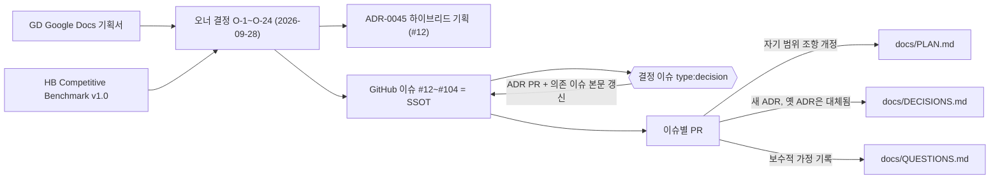

# 결정 기록 (ADR)

형식: 맥락 / 결정 / 결과. 최신 항목이 아래에 온다. 번호는 재사용하지 않는다.

---

## ADR-0001 — git 저장소 초기화와 브랜치 전략

- 날짜: 2026-09-02
- 상태: 채택

### 맥락

작업 시작 시점에 `buddha/` 디렉터리는 git 저장소가 아니었다(`docs/PLAN.md`만 존재). PLAN §0.1-5는 마일스톤별 브랜치(`m0-scaffold`, `m1-auth` …)와 Conventional Commits를 요구한다.

### 결정

- 로컬에서 `git init -b main` 후 문서만 담은 첫 커밋을 `main`에 만들고, `m0-scaffold` 브랜치에서 M0 작업을 진행한다.
- 줄바꿈은 저장소 전체에서 LF로 고정한다(`.gitattributes: * text=auto eol=lf`, 저장소 로컬 `core.autocrlf=false`). Windows에서 작업하더라도 Docker/CI(Linux)와 셸 스크립트, SQL 초기화 파일이 CRLF로 깨지지 않게 하기 위함이다.
- 원격 저장소(GitHub 등)는 아직 연결하지 않는다. 사용자가 원격 URL을 제공하면 `origin`으로 추가한다.

### 결과

- 이후 모든 마일스톤은 `main`에서 분기한 `m{N}-*` 브랜치에서 진행하고, 완료 후 `main`에 머지한다.
- 원격 미연결 상태이므로 GitHub Actions 워크플로는 작성만 하고 실제 실행은 원격 연결 뒤 확인한다.

---

## ADR-0002 — TypeScript 6.0.3 고정 (7.x 미사용)

- 날짜: 2026-09-02
- 상태: 채택

### 맥락

npm `latest`는 TypeScript 7.0.2다. 7.0은 Go로 재작성된 네이티브 컴파일러이며 7.1까지 JS 컴파일러 API가 없다. `@nestjs/cli` 12는 `typescript ~6.0.2`에 의존하고 `nest build`가 컴파일러 API를 호출한다. `typescript-eslint` 8.69의 peer 범위는 `>=4.8.4 <6.1.0`이다. Expo SDK 57 템플릿과 RN 0.87 템플릿은 `~6.0.3`을 고정한다.

### 결정

- 카탈로그에 `typescript: 6.0.3`을 캐럿 없이 고정한다(6.1도 typescript-eslint 범위 밖).
- TS 6.0의 새 기본값에 맞춰 `packages/config-ts`를 작성한다: `types: []` 기본값이므로 Node 프로젝트는 `types: ["node"]`를 명시, `rootDir`을 `src`로 명시, `baseUrl` 미사용, `esModuleInterop: true`.
- 모든 tsconfig는 TS 7.0.2에서도 경고 없이 통과하도록 작성했으므로 생태계가 따라오면 한 줄 변경으로 전환한다.

### 결과

- `pnpm install`이 `typescript 6.0.3 (7.0.2 is available)`를 출력하는 것은 의도된 상태다.
- TS 7을 같은 패키지에 별칭으로 병행 설치하지 않는다(`bin/tsc` 충돌).

---

## ADR-0003 — 전부 ESM, 공유 패키지는 컴파일 후 `exports`로 노출

- 날짜: 2026-09-02
- 상태: 채택

### 맥락

NestJS 12 패키지 자체가 `"type": "module"`로 배포되고 `nest new` 기본값이 ESM 템플릿이다. better-auth 1.7과 `@thallesp/nestjs-better-auth` 2.7은 ESM 전용이다. PLAN §4.1은 공유 패키지를 `tsc -b`로 컴파일해 `dist/`를 `exports`로 노출하라고 요구한다.

### 결정

- `apps/api`, `apps/worker`, `packages/*` 모두 `"type": "module"`, `module/moduleResolution: nodenext`, 상대 import는 `.js` 확장자 사용.
- 공유 패키지 `exports`는 `{ ".": { "types": "./dist/index.d.ts", "default": "./dist/index.js" } }`만 둔다(`main`/`module`/`require` 분기 없음). Node 24의 `require(esm)`로 CJS 소비자도 로드 가능하다.
- 각 패키지는 `tsconfig.json`(noEmit, 테스트와 패키지 루트의 `*.config.ts`까지 포함, typecheck·ESLint용)과 `tsconfig.build.json`(composite, 테스트 제외, emit용) 한 쌍을 가진다. `tsc -b` 패키지의 `.tsbuildinfo`는 `dist/` 안에 두어 Turbo 캐시와 함께 움직인다. Nest 앱은 `nest build`가 `deleteOutDir`로 매번 새로 내보내므로 `incremental`을 쓰지 않는다(리뷰 반영: 패키지 루트에 남던 300KB tsbuildinfo 제거).
- `apps/web`은 Next 규칙(`module: esnext`, `moduleResolution: bundler`, `jsx: react-jsx`)을 따르고 `"type": "module"`을 두지 않는다(standalone `server.js`가 CJS).
- `apps/mobile`은 `expo/tsconfig.base`를 확장하고 `@buddha/config-ts/react-native.json`으로 엄격성만 덧씌운다.

### 결과

- NestJS는 레거시 데코레이터(`experimentalDecorators` + `emitDecoratorMetadata`)를 유지한다. `verbatimModuleSyntax`와 함께 쓰므로 DI에 쓰는 클래스는 값 import, 인터페이스는 `import type`이어야 한다.
- 순수 패키지(`node.json`)는 `erasableSyntaxOnly: true`라 enum·namespace·생성자 파라미터 프로퍼티를 쓸 수 없다(`as const` 객체와 유니온으로 대체). Nest 앱은 이 옵션을 끈다.

---

## ADR-0004 — pnpm 11 설정 위치, 빌드 스크립트 승인, 릴리스 연령 정책

- 날짜: 2026-09-02
- 상태: 채택

### 맥락

pnpm 11은 `.npmrc`에서 인증/레지스트리 설정만 읽는다. PLAN §4.2의 `.npmrc: strict-peer-dependencies=false`는 무시된다(기본값도 false). 의존성 설치 스크립트는 기본적으로 차단되고(`strictDepBuilds`), 발행 24시간 미만 버전은 `minimumReleaseAge`(기본 1440분, 비엄격) 정책의 대상이다.

### 결정

- 모든 pnpm 설정은 `pnpm-workspace.yaml`에 둔다. `.npmrc`는 주석만 남긴다.
- `allowBuilds`에 `esbuild: true`(tsx/vitest/drizzle-kit), `msgpackr-extract: true`(bullmq 선택 네이티브), `fsevents: false`(macOS 전용 선택 의존성, 프리빌트 바이너리 동봉이라 node-gyp 불필요), `@scarf/scarf: false`(텔레메트리)를 명시한다. 새 네이티브 패키지가 들어오면 `pnpm approve-builds <pkg>`로 추가한다. 이 목록은 Windows/Linux에서는 설치되지 않는 플랫폼 전용 선택 의존성(darwin)까지 덮어야 한다. 그렇지 않으면 macOS의 첫 `pnpm install`이 `ERR_PNPM_IGNORED_BUILDS`로 실패한다(리뷰 반영).
- `minimumReleaseAge`는 기본값(24h, 비엄격)을 유지한다. pnpm이 설치 중 자동으로 덧붙이는 `minimumReleaseAgeExclude` 목록은 그대로 커밋한다(CI의 `--frozen-lockfile`이 이 목록 없이는 실패). 공급망 보호 기본값을 끄지 않기 위한 보수적 선택이다.
- 카탈로그에는 현재 마일스톤이 실제로 사용하는 패키지만 넣는다. 이후 마일스톤은 그 시점의 최신 안정 버전을 추가한다(PLAN §0.1-4).
- `packageManager`는 설치된 `pnpm@11.10.0`으로 고정한다(`pmOnFail: download` 기본값이라 버전이 달라도 자동 사용).

### 결과

- `pnpm-workspace.yaml`은 pnpm이 설치 중 재작성할 수 있어 `.prettierignore`에 넣는다.
- `.npmrc`가 사실상 빈 파일인 점은 PLAN §4.2와 다르다(QUESTIONS.md에 기록).

---

## ADR-0005 — Postgres 드라이버는 `pg`(node-postgres), API는 M0부터 `@buddha/db` 사용

- 날짜: 2026-09-02
- 상태: 채택

### 맥락

PLAN은 드라이버를 지정하지 않는다. 후보는 `postgres`(postgres.js)와 `pg`. drizzle-kit 0.31은 `pg`를 먼저 탐색하고, Drizzle 문서의 기본 예제도 node-postgres다. `pg`는 명시적 Pool 제어(`pool.on('error')`, `idle_in_transaction_session_timeout`)를 제공해 `pg_advisory_xact_lock`을 잡는 트랜잭션에 유리하며 암묵적 prepared statement가 없다. better-auth의 Drizzle 어댑터는 드라이버 무관이다.

### 결정

- `packages/db`는 `pg` + `drizzle-orm/node-postgres`로 `createDb(url, opts)`를 제공한다. 풀 기본값: max 10, `idle_in_transaction_session_timeout` 30초, `application_name` 지정, `casing: 'snake_case'`.
- `apps/api`는 별도 Postgres 클라이언트를 두지 않고 `@buddha/db`의 `createDb`로 DB 프로바이더(`DB` 토큰)를 만들며, 헬스체크도 `db.execute(sql\`select 1\`)`로 수행한다. 한 프로세스에 드라이버 두 개를 두지 않기 위함이다.
- Redis는 `ioredis` 6을 직접 쓴다(`REDIS` 토큰).

### 결과

- `bigint({ mode: 'bigint' })`가 2^53+1을 정확히 왕복하는 것을 스크래치 실험에서 확인했다(PLAN §0.2 정수 불변식과 호환).
- `drizzle.config.ts`와 `createDb`의 `casing` 값은 반드시 같아야 한다.

---

## ADR-0006 — `db:migrate`는 `tsx src/migrate.ts`(재사용 가능한 `runMigrations`)

- 날짜: 2026-09-02
- 상태: 채택

### 맥락

PLAN §15는 `db:migrate: drizzle-kit migrate`를 예시로 든다. 통합 테스트(PLAN §14)는 테스트 DB에 같은 마이그레이션을 프로그램적으로 적용해야 한다.

### 결정

- `packages/db/src/migrator.ts`의 `runMigrations(url)`이 `drizzle-orm/node-postgres/migrator`를 호출하고, `db:migrate` 스크립트는 이를 실행하는 `tsx src/migrate.ts`다. 북키핑 테이블(`drizzle.__drizzle_migrations`)은 `drizzle-kit migrate`와 동일하므로 둘은 호환된다.
- DDL은 항상 `DATABASE_MIGRATE_URL`(buddha_migrate)로, 앱은 `DATABASE_URL`(buddha_app)로 접속한다.
- 빈 `drizzle/meta/_journal.json`을 커밋해 스키마가 비어 있는 M0에서도 `pnpm db:migrate`가 동작하게 한다.

### 결과

- 실행 확인: `drizzle` 스키마와 `__drizzle_migrations` 테이블이 buddha_migrate 소유로 생성됨, buddha_app은 `CREATE TABLE` 거부됨.
- PLAN §6.4의 append-only 테이블 권한 제한은 M2에서 `drizzle-kit generate --custom`으로 만든 `REVOKE` 마이그레이션으로 적용한다.

---

## ADR-0007 — 루트 단일 `.env`, 각 프로세스가 직접 로드

- 날짜: 2026-09-02
- 상태: 채택

### 맥락

PLAN §15는 api/worker/web이 공유하는 하나의 `.env.example`을 요구한다. Turborepo 2.x는 `.env`를 로드하지 않으며(strict env mode 기본), Next.js는 `apps/web/.env*`만 읽는다.

### 결정

- 저장소 루트의 `.env` 하나만 쓴다. 로드 방식은 프로세스별로 검증된 방법을 쓴다.
  - `apps/api`: `config/env.ts`가 모듈 위치 기준 절대경로(`apps/api/.env` → 루트 `.env`)를 계산해 `main.ts`(dotenv, Fastify 옵션용)와 `@nestjs/config`(`envFilePath` + zod `validationSchema`, DI용)가 같은 파일을 읽는다. cwd 상대경로를 쓰면 다른 디렉터리에서 실행할 때 엉뚱한 `.env`를 읽으므로(리뷰 반영) 금지.
  - `apps/worker`: Node 24 `process.loadEnvFile` (앱 로컬 `.env` → 루트 `.env`, 기존 값 우선) + zod.
  - `packages/db`: `dotenv` (drizzle.config.ts, migrate/seed 진입점).
  - `apps/web`: `next.config.ts` 상단에서 `dotenv`로 루트 `.env`를 읽어 `NEXT_PUBLIC_API_URL`을 rewrite 대상에 반영. 미설정 시 `http://localhost:4000`.
- 루트 `.env`를 빌드 산출물에 굽는 것은 `apps/web`뿐이므로 `apps/web/turbo.json`(패키지 설정)의 `build.inputs`에만 `$TURBO_ROOT$/.env*`를 넣는다. 루트 `turbo.json`에 넣으면 `.env` 한 줄 수정이 25개 태스크 캐시를 전부 무효화한다(리뷰 반영). `pnpm dev`는 `--env-mode=loose`로 실행한다.
- Turbo는 strict env 모드라 `turbo.json`의 `env`/`passThroughEnv`에 선언되지 않은 변수는 태스크에 전달되지 않는다. CI 워크플로의 job env도 예외가 아니므로, 테스트가 읽을 변수는 먼저 `test.env`에 선언한다.

### 결과

- `.env`는 커밋하지 않는다. `.env.example`에 PLAN §15 항목 + test 프로필용 `TEST_*` 키를 둔다.
- Turbo 문서는 앱별 `.env`를 권장하지만 PLAN을 따른다.

---

## ADR-0008 — ESLint 10 flat config: 팩토리 함수 패키지, `eslint-config-next`/`eslint-config-expo` 미사용

- 날짜: 2026-09-02
- 상태: 채택

### 맥락

Next 16은 `next lint`를 제거했다. `eslint-config-next` 16과 `eslint-config-expo` 57은 `eslint-plugin-import`/`eslint-plugin-react`/`jsx-a11y`에 의존하는데 이들의 peer는 ESLint ^9까지다. typescript-eslint의 `tsconfigRootDir` 자동 추론은 `eslint.config.*` 파일 안에서만 동작해 공유 패키지에서 쓸 수 없다.

### 결정

- `@buddha/config-eslint`는 `base/react/next({ tsconfigRootDir })` 팩토리 함수를 export한다. 각 패키지의 `eslint.config.mjs`는 `import.meta.dirname`을 넘긴다.
- `base`: `@eslint/js` recommended + `typescript-eslint` recommendedTypeChecked(`projectService`) + Prettier 호환. 패키지 루트의 `*.config.ts`도 각 패키지 `tsconfig.json`의 `include`에 들어 있으므로 타입 인식 린트를 받는다. `@buddha/config-eslint` 자신도 `eslint .`로 린트한다.
- `react`: `eslint-plugin-react-hooks` 7 `configs.flat.recommended`(React Compiler 규칙 포함). `next`: `@next/eslint-plugin-next` `core-web-vitals`를 직접 사용.
- 설정 파일은 ESLint 10이 `.ts` 설정을 기본 지원하지 않으므로 `.mjs`로 통일한다.
- Prettier는 ESLint에 연결하지 않고(`eslint-plugin-prettier` 미사용) `pnpm format:check`를 CI의 별도 단계로 둔다. 옵션: `singleQuote`, `printWidth: 100`, `trailingComma: all`.

### 결과

- 타입 인식 린트는 공유 패키지의 `dist/*.d.ts`가 필요하므로 `turbo.json`의 `lint`/`typecheck`는 `^build`에 의존한다.

---

## ADR-0009 — Chakra UI v3 + Turbopack: Emotion 레지스트리로 hydration 불일치 해결

- 날짜: 2026-09-02
- 상태: 채택

### 맥락

Next 16은 dev/build 모두 Turbopack이 기본이다. Chakra v3(Emotion)를 그대로 쓰면 SSR 시 Emotion의 인라인 `<style data-emotion>`이 `<body>`에 남아 매 로드마다 React #418 hydration 오류가 난다(스크래치 실험에서 재현). Chakra 문서는 `--webpack` 사용을 권한다.

### 결정

- Turbopack을 유지하고, `@emotion/cache` + `CacheProvider` + `useServerInsertedHTML`로 구성한 `EmotionRegistry`로 트리를 감싼다(`src/components/ui/emotion-registry.tsx`). 캐시 키는 Chakra 기본값 `css`.
- 색상 모드는 `next-themes`(`attribute="class"`)로, `<html suppressHydrationWarning>`.
- 폰트는 npm `pretendard` 패키지의 dynamic-subset variable CSS를 루트 레이아웃에서 import한다(CDN 미사용). 숫자는 `tabular-nums`.
- `next.config.ts`: `output: 'standalone'`, `outputFileTracingRoot`를 모노레포 루트로, `typedRoutes: true`, `agentRules: false`(Next가 `AGENTS.md`/`CLAUDE.md`를 생성하지 않도록).

### 결과

- 브라우저 확인: 콘솔 오류 0, Emotion 스타일 7개 모두 `<head>`, `<body>`에는 0개. 라이트/다크 토글 정상.
- Next rewrite는 WebSocket을 프록시하지 않으므로 M4의 Socket.IO 연결 방식은 별도 결정이 필요하다(QUESTIONS.md).

---

## ADR-0010 — 모바일: 이름 있는 카탈로그 `expo`, `expo-doctor` 바이너리, 에셋 없는 CNG 스캐폴드

- 날짜: 2026-09-02
- 상태: 채택

### 맥락

Expo SDK 57은 `react 19.2.3` / `react-native 0.86.3`을 정확히 요구한다(웹은 react 19.2.8). npm latest인 RN 0.87.1은 SDK 58용이라 doctor가 실패한다. `@expo/cli` 57의 `expo doctor` 서브커맨드는 "not supported in the local CLI"로 종료된다.

### 결정

- `pnpm-workspace.yaml`의 `catalogs.expo`에 react/react-native를 두고 `apps/mobile`만 `catalog:expo`를 쓴다. pnpm 격리 설치(`nodeLinker: isolated`) 그대로 사용, `metro.config.js`/`babel.config.js` 없음.
- `expo-doctor` 1.20.4를 devDependency로 고정하고 `doctor` 스크립트로 실행한다. PLAN M0 AC의 `pnpm --filter mobile exec expo doctor`는 `pnpm --filter mobile run doctor`로 대체한다.
- `app.json`에 아이콘/스플래시를 두지 않고(`newArchEnabled`도 두지 않음 — SDK 55에서 제거), `scheme`과 placeholder 번들 ID(`app.buddha.mobile`)만 둔다. `expo-dev-client`는 plugins 항목 없이 자동 적용된다.
- `build`/`dev`/`test` 스크립트를 두지 않아 Turbo가 모바일을 해당 태스크에서 건너뛴다. `typecheck`/`lint`에는 참여한다.

### 결과

- `expo-doctor` 21/21 통과. `pnpm install`의 `unmet peer react ^19.2.8 (react-dom)` 경고는 무해하다.
- 번들 ID는 사용자 결정(2026-09-03, Q-M0-3)에 따라 iOS `bundleIdentifier`와 Android `package` 모두 `dev.sboh.buddha`로 확정했다.

---

## ADR-0011 — 테스트: Vitest 4, Nest 데코레이터는 SWC 플러그인 없이, 파일명 `*.test.ts`

- 날짜: 2026-09-02
- 상태: 채택

### 맥락

Vitest 4(Vite 8, oxc)는 tsconfig의 `experimentalDecorators`/`emitDecoratorMetadata`를 읽어 Nest DI 메타데이터를 생성한다(검증됨). Nest 템플릿은 `*.spec.ts`, 다른 영역은 `*.test.ts`를 쓴다.

### 결정

- 모든 패키지가 자체 `vitest.config.ts`를 갖고 Turbo `test` 태스크로 실행한다(루트 `projects` 설정은 캐시를 무력화하므로 사용하지 않음). `unplugin-swc`는 쓰지 않는다.
- 테스트 파일은 `*.test.ts`로 통일하고 `tsconfig.build.json`에서 제외한다. 테스트가 없는 패키지는 `passWithNoTests: true`.
- `packages/shared`만 `vitest run --coverage`로 90% 임계값을 강제하고(PLAN §14), 커버리지 출력은 `packages/shared/turbo.json`(패키지 설정)에서만 `outputs`로 선언한다.
- `@vitest/coverage-v8`은 미리 설치한다(없으면 Vitest가 대화형 설치 프롬프트로 CI를 멈춘다).

### 결과

- M0 테스트: shared 5(fast-check 속성 테스트 포함, 커버리지 100%), api 5(DI + Fastify inject), worker 7, web 3.

---

## ADR-0012 — `@types/node`는 24.x (런타임 메이저 추종)

- 날짜: 2026-09-02
- 상태: 채택

### 맥락

npm latest는 `@types/node` 26.4.1이지만 런타임은 Node 24 LTS다. 26.x는 Node 24에 없는 API를 타입으로 노출한다.

### 결정

`@types/node: 24.13.3`(24.x 최신)을 카탈로그에 고정하고, Node 메이저를 올릴 때 함께 올린다.

---

## ADR-0013 — 패키지 이름: 앱은 무접두, 라이브러리는 `@buddha/*`

- 날짜: 2026-09-02
- 상태: 채택

### 맥락

PLAN M0 AC가 `pnpm --filter mobile`을 쓴다. pnpm `--filter`는 정확한 패키지 이름을 요구한다.

### 결정

`apps/*`는 `web`, `api`, `worker`, `mobile`, `packages/*`는 `@buddha/shared`, `@buddha/db`, `@buddha/api-client`, `@buddha/config-ts`, `@buddha/config-eslint`.

---

## ADR-0014 — 로컬 인프라: 루트 `compose.yaml`이 `docker/docker-compose.yml`을 include

- 날짜: 2026-09-02
- 상태: 채택

### 맥락

PLAN §4는 컴포즈 파일을 `docker/docker-compose.yml`에 두라 하고, M0 AC는 루트에서 `docker compose up -d`를 실행한다.

### 결정

- 루트 `compose.yaml`은 `include: [docker/docker-compose.yml]`만 담는다(프로젝트 이름 `buddha` 공유). `pnpm infra:up|down|logs` 스크립트도 둔다.
- 이미지: `postgres:16.15-alpine`(롤 초기화 SQL을 `docker-entrypoint-initdb.d`로 마운트, `pg_isready -h localhost` 헬스체크), `redis:7.4.11-alpine`(`--maxmemory-policy noeviction --appendonly yes`; BullMQ 요구사항), `axllent/mailpit:v1.31.0`.
- 모든 포트는 `127.0.0.1`에만 게시한다. 개발용 자격 증명(postgres/postgres, buddha/buddha, 인증 없는 Redis, 아무 로그인이나 받는 Mailpit)이 LAN에 노출되지 않게 하기 위함이다(리뷰 반영). 컨테이너 안에서 접근해야 하는 경우가 생기면 그때 명시적으로 연다.
- CI(GitHub Actions)는 compose를 쓰지 않지만 같은 `01-roles.sql`을 `psql`로 적용한 뒤 로컬과 동일한 `buddha_app`/`buddha_migrate` 롤로 접속한다. 슈퍼유저로 테스트하면 PLAN §6.4의 권한 분리가 검증되지 않기 때문이다(리뷰 반영).
- `test` 프로필로 `postgres-test`(5433, tmpfs, fsync off)와 `redis-test`(6380)를 제공한다(PLAN §14). 기본 `up`에는 포함되지 않는다.
- 롤 설계: `buddha_migrate`가 DB 소유자(=`public` 스키마 소유자, PG15+), `buddha_app`은 CONNECT/USAGE + `ALTER DEFAULT PRIVILEGES FOR ROLE buddha_migrate`로 테이블 DML·시퀀스·함수·타입 권한을 받는다.

### 결과

- `docker compose up -d --wait`로 3개 컨테이너 healthy 확인. 초기화 SQL은 빈 볼륨에서만 실행되므로 롤 변경은 `down -v` 후 재기동이 필요하다.
- 로컬 Docker 최소 버전: `include`는 Compose 2.20.0(docker/compose v2.20.0 릴리스 노트), `docker/docker-compose.yml`의 헬스체크 `start_interval`은 스키마상 Compose 2.20.2를 요구한다(둘 다 Docker Desktop 4.22.0에 포함). `start_interval`은 Docker Engine 25(API 1.44, Desktop 4.27) 이상에서만 적용된다. Compose 2.24.0~5.0.2는 Engine 25 미만에서 하드 에러를 냈고 5.1.0에서 그 검사가 제거됐으며, 2.36.0부터는 `start_interval`에 `start_period` 동반을 요구한다(이 파일은 모든 헬스체크에 설정). Docker Desktop은 Compose 2.24 이상을 싣는 4.27부터 Engine도 25이므로 Desktop 사용자는 해당 없고, Linux에서 새 compose 플러그인을 구형 Engine과 조합한 경우만 걸린다. README 요구 사항에 "Docker Desktop 4.22 이상(Compose 2.20.2 이상)"으로 명시했다(리뷰 반영). `docker compose -f docker/docker-compose.yml`로 직접 실행해도 같은 바닥이 적용되므로 구버전 우회 수단이 아니다.

---

## ADR-0015 — API 라우팅: 글로벌 prefix `api` + URI 버저닝, `/api/health`는 버전 중립

- 날짜: 2026-09-02
- 상태: 채택

### 맥락

PLAN §7은 Base `/api/v1`, M0 AC는 `GET /api/health`를 요구한다. better-auth는 `/api/auth/*`를 쓴다.

### 결정

- `setGlobalPrefix('api')` + `enableVersioning({ type: URI, defaultVersion: '1' })`. 일반 컨트롤러는 `/api/v1/<resource>`, 헬스는 `@Controller({ path: 'health', version: VERSION_NEUTRAL })`로 `/api/health`.
- 헬스 응답 `{ status: 'ok'|'degraded', db, redis }`. 각 프로브는 2초 타임아웃, 실패 시 HTTP 503(본문 동일 형태).
- Fastify 어댑터는 `bodyParser: false`로 생성한다(M1 better-auth 요구). 이 옵션은 `@fastify/formbody` 등록만 생략하며 JSON 파싱은 유지된다.
- `trustProxy`는 환경변수 `TRUST_PROXY`(기본 `false`; `true` 또는 프록시 주소/CIDR 목록)로만 켠다. Next.js rewrite는 `X-Forwarded-For`를 붙이지 않으므로 무조건 신뢰하면 클라이언트가 자기 IP를 위조할 수 있고, PLAN §7.5의 IP별 레이트 리밋이 무력화된다(리뷰 반영). 바인드 주소는 `API_HOST`(기본 `localhost` = IPv4+IPv6 루프백, 컨테이너는 `0.0.0.0`). 웹 dev 서버(`next dev --hostname localhost`)와 로컬 standalone 실행(`scripts/start-standalone.mjs`가 `WEB_HOST`, 기본 `localhost`를 `HOSTNAME`으로 넘김)도 루프백에 바인드한다. Next 기본값은 모든 인터페이스(`::`)라 `/api/*` rewrite를 통해 이 결정이 REST에 대해 무력화됐기 때문이다(리뷰 반영). Next는 Fastify와 달리 주소 하나에만 `listen`하므로 Node 24에서는 `::1`만 열리지만 `http://localhost:3000`은 브라우저·curl·Node fetch 모두에서 동작한다. `127.0.0.1`을 쓰면 Next가 `request.url`과 리다이렉트 오리진을 `http://127.0.0.1:3000`으로 만들어 ADR-0017의 `localhost:3000` 오리진과 어긋나므로 쓰지 않는다. 다른 기기에서 웹을 열 때는 `-H 0.0.0.0`과 `allowedDevOrigins`로 명시적으로 연다.
- DB 풀과 Redis 클라이언트는 `onApplicationShutdown`에서 닫는다. Nest 12의 `close()` 순서는 `onModuleDestroy → beforeApplicationShutdown → HTTP 서버 close → onApplicationShutdown`이므로 `onModuleDestroy`에서 닫으면 처리 중인 요청이 끝난 풀을 만난다(리뷰 반영).
- `packages/db`의 풀은 `connectionTimeoutMillis`(5초)와 `query_timeout`/`statement_timeout`(30초)을 기본으로 둔다. 헬스체크의 2초 `Promise.race`는 응답 시간만 제한할 뿐 연결 시도를 취소하지 않아, 타임아웃 없이는 DB 장애 시 프로브가 풀 슬롯을 하나씩 잠식했다(리뷰에서 재현).
- `nest build`는 tsc 빌더를 쓴다(`--builder swc`는 이 ESM 프로젝트에서 CJS를 내보내 실행 불가).

### 결과

- 확인: `/api/health` 200, `/api/v1/health` 404, web rewrite 경유 200.

---

## ADR-0016 — Turbo 캐시에서 `.next/standalone` 제외 (Windows)

- 날짜: 2026-09-02
- 상태: 채택

### 맥락

첫 `pnpm build`에서 Turbo가 `apps/web/.next/standalone/node_modules/.pnpm/next@16.3.4_...` 심링크를 캐시 tar에 넣지 못했다(`provided value is too long when setting link name`). 그대로 두면 캐시 복원 시 standalone 출력이 조용히 깨진다.

### 결정

`build.outputs`에 `!.next/standalone/**`를 추가한다. standalone은 배포 아티팩트이며 CI/Docker에서 새로 빌드된다.

### 결과

- 캐시 히트 후에는 `.next/static`/`BUILD_ID`만 복원되고 standalone은 이전 빌드가 남을 수 있다. `pnpm --filter web start`(`scripts/start-standalone.mjs`)는 두 `BUILD_ID`를 비교해 불일치 시 `turbo run build --filter=web --force` 안내와 함께 종료한다(리뷰 반영).
- Windows에서 만든 standalone 출력은 pnpm 정션이 절대경로 심링크로 복사되어 빌드한 머신에서만 실행된다. 배포 아티팩트는 Linux(CI 또는 Docker 빌드 단계)에서 `next build`로 만든다.
- `web#typecheck`(`next typegen`)와 `web#build`(`next build`, `.next/types` 삭제 후 재생성)가 동시에 `.next`를 쓰면 드물게 경합하므로 `apps/web/turbo.json`에서 `typecheck`가 `build`에 의존하게 했다(리뷰 반영). 추기(2026-09-11): `web#lint`도 같은 경합에 노출되어 있었다 — typed ESLint 규칙(`no-unnecessary-type-assertion`)이 `.next/types/link.d.ts`의 `redirect`·`router.push` 증강을 읽는데, `next build`가 그 디렉터리를 지운 순간 lint가 돌면 `Route`가 맨 `string & {}`가 되어 `redirect(x as Route)` 세 곳이 "불필요한 단언"으로 실패한다(PR #11 CI). 웹 파일이 바뀌지 않은 PR에서는 lint가 캐시 히트라 드러나지 않았다. `lint`도 `build`에 의존하게 했다.
- 두 번째 `pnpm build`는 `>>> FULL TURBO`(6/6 캐시)로 완료된다.
- `scripts/start-standalone.mjs`는 `server.js`에 `HOSTNAME=${WEB_HOST:-localhost}`를 넘겨 로컬 실행을 루프백에 묶는다(standalone `server.js` 기본값은 `0.0.0.0`; 근거는 ADR-0015). 셸이 내보낸 `HOSTNAME`(RHEL 계열은 머신 이름, Docker는 컨테이너 ID)은 바인드 주소로 쓸 값이 아니므로 무시하고 `WEB_HOST`만 존중한다. 배포 이미지(아직 없음)는 이 스크립트를 거치지 않고 `HOSTNAME=0.0.0.0`으로 `server.js`를 직접 실행해야 한다(리뷰 반영).
- 같은 스크립트는 SIGINT/SIGTERM을 받으면 Unix에서는 `server.js`에 신호를 전달하고, 플랫폼과 무관하게 10초 뒤에도 자식이 남아 있으면 강제 종료한다(SIGKILL, Windows는 TerminateProcess). wrapper에만 신호를 보내는 프로세스 관리자에서 `server.js`가 고아로 남아 포트를 점유하던 문제를 막기 위해서다(Linux 컨테이너에서 같은 신호 계약을 가진 stub 서버로 재현; 리뷰 반영). Windows는 콘솔 Ctrl+C가 콘솔의 모든 프로세스에 전달되고 libuv job object가 wrapper와 자식을 함께 끝내므로 전달 없이 자식 종료를 기다린다(Ctrl+C 1회에 1초 내 종료를 확인, 10초 강제 종료는 동일).

---

## ADR-0017 — 실시간(Socket.IO) 연결 경로: API 오리진 직접 연결 + CORS

- 날짜: 2026-09-03
- 상태: 채택 (사용자 결정, QUESTIONS Q-M0-2)

### 맥락

PLAN §8/§10.1은 브라우저가 같은 출처의 `/api/*`만 쓴다고 가정하지만, Next.js rewrite는 WebSocket 업그레이드를 프록시하지 않는다(ADR-0009 결과). 선택지는 (a) 클라이언트가 API 오리진에 직접 연결 + CORS, (b) 로컬/운영 모두 리버스 프록시였다.

### 결정

- REST는 기존대로 Next rewrite(`/api/*` → API)를 경유한다(같은 출처, 쿠키·CORS 문제 없음).
- Socket.IO 클라이언트는 `NEXT_PUBLIC_API_URL`의 API 오리진에 직접 연결하며 `withCredentials: true`를 쓴다.
- API는 Socket.IO 핸드셰이크(`/ws` 네임스페이스, polling 폴백 포함)에 대해서만 CORS를 허용한다: origin은 웹 오리진(`WEB_ORIGIN` env, 로컬 `http://localhost:3000`), credentials true. REST 라우트는 rewrite로만 접근하므로 CORS를 열지 않는다.
- 세션 쿠키(SameSite=Lax)가 핸드셰이크에 실리려면 웹과 API가 같은 사이트여야 한다. 로컬은 `localhost:3000`/`localhost:4000`으로 충족되고, 운영은 `app.<도메인>`/`api.<도메인>` 형태를 전제한다. 게이트웨이 인증(PLAN §8)은 핸드셰이크 쿠키로 better-auth 세션을 조회한다.
- (2026-09-08 추기, M4 PR 리뷰) **같은 사이트는 필요조건일 뿐 충분조건이 아니었다.** 위 문장은 SameSite만 따졌는데, 쿠키가 실제로 API 호스트로 돌아가려면 `Domain`이 있어야 한다: `Domain` 없이 발급된 쿠키는 자신을 발급한 호스트에만 돌아간다(RFC 6265 §5.1.3의 host-only). 그리고 로그인 쿠키는 **웹 호스트**에서 발급된다 — Next rewrite가 `/api/auth/*`를 서버 사이드로 대신 보내므로 브라우저는 `app.<도메인>`의 응답으로 그것을 받는다. 반면 소켓은 rewrite를 우회해 `api.<도메인>`로 직접 붙는다. 그래서 `app.`/`api.` 분리 배포에서는 로그인한 사용자도 **익명 핸드셰이크**가 되어 `user:<id>` 방에 들어가지 못하고, 잔고 칩과 내 포지션이 아무 오류 없이 조용히 멎는다. 로컬에서는 `localhost:3000`과 `localhost:4000`이 **같은 호스트**이므로(포트는 쿠키의 신원이 아니다) 이 결함이 드러나지 않는다.
- 그래서 `AUTH_COOKIE_DOMAIN`(옵트인, 기본 미설정)을 둔다. 값이 있으면 better-auth의 `advanced.crossSubDomainCookies`로 그 도메인을 쿠키에 실어 두 호스트가 같은 쿠키를 공유한다(`SameSite=Lax`는 그대로, `__Secure-` 접두사는 `Domain`을 허용한다 — `__Host-`였다면 불가능했다). 값은 반드시 명시한다: better-auth의 기본값은 `BETTER_AUTH_URL`의 호스트, 즉 웹 호스트라서 API 호스트에는 여전히 닿지 않는다. 대가는 **그 도메인의 모든 서브도메인이 이 쿠키를 받는다**는 것이므로, 서브도메인 전부가 우리 것인 도메인만 적어야 한다. 대안(핸드셰이크용 단기 토큰을 REST로 발급)은 엔드포인트·수명·폐기를 새로 설계해야 해서 채택하지 않았다.

### 결과

- M4에서 `apps/web`은 `NEXT_PUBLIC_API_URL`을 클라이언트 번들에서도 사용한다(현재는 `next.config.ts`에서만 사용). 그 시점에 `.env.example` 설명을 갱신한다.
- `TRUST_PROXY`는 계속 false(QUESTIONS A-M0-13). 리버스 프록시가 없으므로 API는 직접 연결(WS)의 클라이언트 IP는 정확히 보지만, rewrite를 거친 REST 요청의 IP는 Next 서버로 보인다. PLAN §7.5의 IP별 레이트 리밋은 M6에서 Next `proxy.ts`가 `X-Forwarded-For`를 붙이고 API가 Next 서버 주소만 신뢰하는 방식을 검토한다.
- 모바일(Expo)은 처음부터 API 오리진에 직접 연결하므로 이 결정과 자연스럽게 맞는다.

---

## ADR-0018 — better-auth 1.7을 `@thallesp/nestjs-better-auth`로 NestJS 12에 마운트

- 날짜: 2026-09-03
- 상태: 채택 (QUESTIONS Q-M0-4: 실패 시 §10.6 대안 허용)

### 맥락

PLAN §10.1은 `@thallesp/nestjs-better-auth`를 지정하지만 2.7.0의 peer 범위는 `@nestjs/common|core ^11.1.6`이고 저장소는 Nest 12.0.1이다. 대안은 PLAN §10.6(Fastify 라우트에 `auth.handler` 직접 마운트)이었다.

### 결정

- 라이브러리를 그대로 쓴다. 스크래치 검증에서 Nest 12의 안정 API(`ApplicationConfig`, `@nestjs/core/middleware/utils`의 `mapToExcludeRoute`, `HttpAdapterHost`, middie)만 사용하며 sign-up/sign-in/get-session/list-accounts/unlink/reset 흐름이 모두 동작했다. Fastify에서는 `toNodeHandler(auth)`가 middie 미들웨어로 라우팅·prefix·버저닝·본문 파싱보다 먼저 실행되므로 `setGlobalPrefix('api')` + URI 버저닝을 바꿀 필요가 없다(`/api/auth/*` 동작, `/api/v1/auth/*`는 404).
- `disableGlobalAuthGuard: true`(PLAN §7.1의 공개 라우트) + 자체 `SessionGuard`(`auth.api.getSession`, 실패 시 `AppError('UNAUTHENTICATED')` → PLAN §7 봉투). `disableTrustedOriginsCors: true`(REST는 rewrite로 같은 출처, ADR-0017).
- `main.ts`의 `bodyParser: false`는 유지한다. 라이브러리가 자체 JSON/urlencoded 파서를 재등록하는데 잘못된 JSON에 순수 `SyntaxError`를 던지므로 `ApiExceptionFilter`가 이를 400 `VALIDATION_ERROR`로 매핑한다(`disableBodyParser`는 폐기된 옵션으로, 켜면 본문이 아예 파싱되지 않는다). (2026-09-05 추기, PR #3 리뷰 9차) urlencoded 파서는 `bodyParser.urlencoded.enabled: false`로 끈다 — JSON만 받는 API에 폼 본문은 CSRF의 모양이고, `SessionGuard`의 `Origin` 검사와 함께 두 겹이다(ADR-0025 추기, A-M2-13).
- `advanced.disableOriginCheck: false`를 명시한다. better-auth는 `NODE_ENV=test`에서 Origin/CSRF 검사를 조용히 건너뛰므로 통합 테스트가 운영 동작(다른 Origin → 403 `INVALID_ORIGIN`)을 검증하도록 강제한다.
- 내장 레이트 리미터(프로세스 메모리, PLAN §16 위반)는 끈다. M6에서 `@nestjs/throttler` + Redis로 `/api/auth/*`까지 덮는다. (2026-09-10 추기, M6) **`@nestjs/throttler`로는 덮지 못했다.** better-auth는 middie 미들웨어라 Nest 라우팅보다 먼저 서비스되므로 전역 가드가 그 요청을 영원히 보지 못한다. 실제로 덮은 것은 better-auth 자신의 훅과 middie 앞에 등록한 Fastify 훅이고, 공유되는 것은 Redis 스토리지·`rl:` 네임스페이스·고정창이다(ADR-0034).
- 쿠키: `advanced.cookiePrefix: 'buddha'` → `buddha.session_token`, http 개발 환경에서는 `Secure`/`__Secure-` 없이 발급되어 Next rewrite를 통과한다(https에서는 자동 전환). `trustedOrigins`는 `WEB_ORIGIN`(`webOrigins(env)`).
- 소셜: Google/Kakao/Naver는 better-auth 내장 프로바이더이며 두 키가 모두 있을 때만 켜진다. Kakao/Naver가 이메일을 주지 않으면 `mapProfileToUser`가 `{provider}_{id}@noemail.buddha.local`(`emailVerified=false`)로 대체한다(PLAN §10.3). 계정 연결은 설정 화면에서 명시적으로만(`disableImplicitLinking: true`, `trustedProviders` 3종, `allowDifferentEmails`), 마지막 로그인 수단 해제는 거부(`allowUnlinkingAll: false`). `unlinkAccount`는 1.7에서 `{ accountId }`(account 행 id)만 받는다.

### 결과

- peer 경고는 `strictPeerDependencies: false`로 무해하지만, 라이브러리 업그레이드 시 Nest 11 전용 내부 API 사용 여부를 다시 확인해야 한다(정확한 버전 고정).
- 이메일 링크(`/api/auth/verify-email`, `/api/auth/reset-password/<token>`)는 `BETTER_AUTH_URL`(웹 오리진) 기준으로 만들어져 rewrite를 거쳐 API에 닿는다.

---

## ADR-0019 — 프로필·잔고 자동 생성은 Postgres 트리거 (PLAN §10.4의 databaseHooks 대신)

- 날짜: 2026-09-03
- 상태: 채택 (PLAN §10.4 문구와 다름, QUESTIONS A-M1-1)

### 맥락

PLAN §10.4는 better-auth `databaseHooks.user.create.after`에서 `profiles`/`balances`를 "같은 트랜잭션"으로 만들라고 한다. better-auth 1.7은 after 훅을 `queueAfterTransactionHook`으로 커밋 이후에 실행하고, Drizzle 어댑터의 `transaction` 옵션도 기본 false라 훅으로는 같은 트랜잭션을 보장할 수 없다.

### 결정

- 마이그레이션 `0002_user_profile_trigger`가 `"user"` 테이블에 `AFTER INSERT` 트리거(`create_profile_for_user`, plpgsql, SECURITY INVOKER)를 만든다. 닉네임 `예측가_XXXX`(혼동 문자를 뺀 32자 알파벳 4자리, 충돌 시 10회 재시도)와 잔고 0을 사용자 행과 같은 트랜잭션에 삽입한다. 트리거가 실패하면 사용자 삽입이 롤백되고 better-auth는 422 `FAILED_TO_CREATE_USER`를 반환한다.
- 시드(`db:seed`)와 테스트 팩토리는 트리거가 만든 행을 UPDATE 한다(직접 INSERT 하지 않는다).
- 닉네임 정책(PLAN §17 Q4 기본값)은 자동 닉네임의 `_` 때문에 `[A-Za-z0-9가-힣_]{2,20}`으로 확정하고 `@buddha/shared`의 `nicknameSchema` 하나로 API·웹이 공유한다.

### 결과

- `profiles`/`balances`에 대한 권한이 나중에 바뀌면 가입이 조용히 깨질 수 있으므로 통합 테스트가 "가입 → 프로필·잔고 생성"을 항상 검증한다.
- (2026-09-05 추기) migration 0004(ADR-0026)부터 같은 트리거가 가입 보너스 10,000P와 `BONUS` 원장도 함께 쓴다. 시드 관리자도 `user` 행이므로 예외가 아니다(QUESTIONS A-M1-3).

---

## ADR-0020 — API 규약: Nest 12 Standard Schema + zod DTO, 봉투/오류 필터, P 금액은 십진 문자열

- 날짜: 2026-09-03
- 상태: 채택

### 맥락

PLAN §7은 zod 스키마(`packages/shared`)를 요청/응답 DTO로 쓰고 `@nestjs/swagger`에 반영하며 class-validator를 쓰지 않는다. Nest 12는 `@Body({ schema })`/`@Query({ schema })`와 `StandardSchemaValidationPipe`를 내장했고, `@nestjs/swagger` 12는 Standard JSON Schema(zod 4의 `~standard.jsonSchema`)를 직접 OpenAPI로 변환한다. `nestjs-zod` 5.5는 Nest 12를 peer로 지원하지 않는다.

### 결정

- 검증: Nest 내장 파이프(`transform: true`, 실패 시 `AppError('VALIDATION_ERROR', { details: ValidationIssue[] })`). DTO는 `packages/shared`에 두고 `.meta({ id })`로 OpenAPI 컴포넌트 이름을 준다.
- 봉투: 전역 인터셉터가 `{ data }`/`{ data, meta: { nextCursor } }`(`ApiPage`)로 감싸고, `@RawResponse()`(헬스체크)만 예외. 전역 `ApiExceptionFilter`가 `AppError`·`HttpException`·Fastify 오류·`SyntaxError`를 PLAN §7.4 코드 봉투로 변환하고 5xx는 스택을 로그로 남기되 본문에는 노출하지 않는다. 이 셋은 `CommonModule`의 `APP_*` 프로바이더라 테스트 앱에도 동일하게 적용된다.
- P 금액은 와이어에서 십진 정수 문자열(`PAmount`)이다. JSON 숫자는 double이라 bigint를 정확히 싣지 못하고, 필드별 안전정수 검사는 계약을 잔고 크기에 종속시키기 때문이다. 웹은 `formatP(parsePAmount(s))`.
- OpenAPI: `openapi:export`는 반드시 `nest build` 산출물(`node dist/openapi-export.js`)로 실행한다(tsx/esbuild는 `design:paramtypes`를 내보내지 않아 파라미터가 빈 문서가 된다). `preview: true`로 프로바이더 없이 부팅하며 `apps/api/openapi.json`과 `packages/api-client/src/generated/schema.ts`를 커밋하고 CI가 `git diff --exit-code`로 계약을 검사한다. 문서 경로는 글로벌 prefix를 포함한 `/api/v1/...`이므로 웹 클라이언트의 baseUrl은 빈 문자열(같은 출처)이다.
- 오류 `message`는 영어 개발자 문구이고, 한국어 안내는 웹이 `code`로 매핑한다(PLAN 부록 A).

### 결과

- `@nestjs/swagger`의 peer(class-validator 등)는 `createDocument`에 필요 없고 설치되더라도 import하지 않는다.
- `drizzle-orm` 0.45는 드라이버 오류를 `DrizzleQueryError.cause`로 감싸므로 SQLSTATE 매핑은 `findPgError`를 거친다(닉네임 중복 23505 → `VALIDATION_ERROR`).

---

## ADR-0021 — better-auth 스키마는 `auth` CLI로 생성, timestamptz, relations는 한 곳에

- 날짜: 2026-09-03
- 상태: 채택

### 맥락

PLAN §6.1은 `npx @better-auth/cli generate`를 언급하지만 그 패키지는 1.4.21에서 멈췄고 1.7의 CLI는 npm 패키지 `auth`다. 생성물은 `timestamp`(시간대 없음)를 쓰고 `relations()` 블록을 덧붙이며, 1.7의 `account`에는 `issuer` 컬럼과 `(issuer, account_id)` 유니크가 추가됐다.

### 결정

- `packages/db/better-auth.config.ts` + `pnpm --filter @buddha/db run db:auth-schema`(`auth generate`)로 생성하고, 저장소 규약대로 모든 timestamp를 `timestamptz`로 바꾸며 relations 블록은 제거한다(중복 `relations(user, …)`는 런타임에는 병합되지만 `db.query` 타입은 하나만 본다). 재생성 시 같은 후처리를 반복한다.
- 시드는 `better-auth/crypto`의 `hashPassword`(scrypt, `salt:hash`)로 자격증명 계정(`providerId 'credential'`, `issuer 'local:credential'`, `accountId = user.id`)을 직접 만든다. `packages/db`는 그래서 `better-auth`를 런타임 의존성으로 가진다.

### 결과

- `session`/`account`의 `updated_at`에는 DB 기본값이 없어 raw INSERT는 값을 넣어야 한다.
- 마이그레이션 순서: `0000_init`(18 테이블) → `0001_restrict_app_role`(REVOKE) → `0002_user_profile_trigger`.

---

## ADR-0022 — 통합 테스트 인프라: TEST_* 전용 DB, 공유 하네스, 메모리 메일러

- 날짜: 2026-09-03
- 상태: 채택

### 맥락

PLAN §14는 실제 Postgres/Redis로 통합 테스트를 요구한다. Turbo는 패키지별 `test` 태스크를 병렬로 돌리고 strict env 모드라 환경변수를 선언해야 전달된다.

### 결정

- 테스트는 `TEST_DATABASE_URL`/`TEST_DATABASE_MIGRATE_URL`/`TEST_REDIS_URL`만 읽고 `DATABASE_URL`로 폴백하지 않는다(개발 DB 보호). 로컬은 compose `test` 프로필(5433/6380), CI는 서비스 컨테이너. 건너뛰기는 **키가 비어 있을 때만** 일어난다(값이 있는데 컨테이너가 없으면 globalSetup이 안내 메시지와 함께 실패). `CI=true`면 세 값 모두 필수: DB 두 값은 `migrateTestDb`, `TEST_REDIS_URL`은 apps/api의 globalSetup이 검사한다.
- `@buddha/db/test` 하네스: `migrateTestDb`(globalSetup, `pg_advisory_lock`으로 패키지 간 동시 마이그레이션 직렬화), `connectTestDb`(파일 단위 세션 락, 소유자 롤 `TRUNCATE … RESTART IDENTITY CASCADE`), 팩토리(`createUser`/`createCategory`/`createMarket`). apps/api는 `createTestApp()`으로 `AppModule` 전체를 띄우고 `MAILER`만 메모리 구현으로 교체하며, 세션 쿠키는 `auth.api.signUpEmail({ returnHeaders: true })`로 얻는다.
- `turbo.json` `test.env`에 TEST__, BETTER_AUTH__, WEB_ORIGIN, SMTP_*, CI를 선언한다. CI는 롤 SQL 적용 → `pnpm db:migrate` → 테스트 순서다. `db:migrate`/`db:seed`/`db:generate`는 `dependsOn: ["^build"]`다: M1부터 스키마 enum과 시드가 `@buddha/shared`(dist만 export)를 import하므로 빌드 없이 실행하면 `ERR_MODULE_NOT_FOUND`가 난다. `globalDependencies`에 `.env`와 `docker/postgres/init/**`를 넣어 로컬 `.env` 변경과 롤 SQL 변경이 테스트 캐시를 무효화하게 한다(env 값은 태스크 안에서 dotenv로 읽히므로 Turbo의 `env` 해시에 잡히지 않는다).
- Playwright e2e(375px/1280px)는 `apps/web/e2e`에 골격만 두고 M4에서 CI에 연결한다(PLAN §14). M1의 브라우저 검증은 실제 스택에서 수동으로 수행했다.

### 결과

- 테스트 파일이 `close()`를 빠뜨리면 다음 파일이 락을 기다리며 멈춘다(`afterAll`에서 반드시 닫는다).
- 통합 테스트 수(M1 리뷰 반영 후): db 15, api 56(auth 18 · me 7 · admin guard 2 · templates 5 · health 5 · exception filter 5 · env 14), shared 19, web 17, worker 7.
- 리뷰 반영(M1): `safeNextPath`는 제어 문자·백슬래시를 거부하고 더미 오리진으로 해석해 같은 오리진인지 확인한다(탭/개행을 URL 파서가 제거해 `/%09/evil.com`이 외부로 빠지는 오픈 리디렉트 차단). 웹의 better-auth 오류는 `authErrorMessage()`로 코드→한국어 문구만 노출하고 영어 `message`는 쓰지 않는다(가입 중복 코드는 1.7.2의 `USER_ALREADY_EXISTS_USE_ANOTHER_EMAIL`). 닉네임 폼은 프로필이 로드된 뒤 마운트되어 초기값을 동기적으로 채운다. 소셜 연결 실패는 `/settings?error=<code>`로 돌아오므로 설정 화면이 이를 읽어 안내한다. Kakao `emailVerified`는 내장 프로바이더처럼 `is_email_valid && is_email_verified`다. OpenAPI의 `/me` 두 작업에 세션 쿠키 보안 요구와 404를 명시했다.

## ADR-0023 — 이메일 인증 필수, 인증을 거친 이메일 변경, SES SMTP (오너 결정 2026-09-03)

### 맥락

PLAN §17 Q1/Q3/Q4/Q5에 대한 오너 답변(2026-09-03): 이메일 인증은 회원가입 시점에 강제, 운영 메일은 AWS SES, 암묵적 계정 연결은 비활성 유지, 카카오·네이버 이메일은 기록하고 추후 인증을 거쳐 변경 허용. better-auth 1.7.2의 실제 동작을 소스에서 확인해 반영했다.

### 결정

- `emailAndPassword.requireEmailVerification: true`, `emailVerification.sendOnSignUp: true`, `autoSignInAfterVerification: true`. 가입 응답은 `{ token: null }`(세션 없음)이고, 이미 가입된 이메일도 같은 응답을 받는다(better-auth의 열거 방지). 미인증 로그인은 403 `EMAIL_NOT_VERIFIED`. 링크 클릭 시 인증·자동 로그인 후 `callbackURL`로 이동(가입·재발송은 `/login`, 설정은 `/settings`).
- `sendOnSignIn`은 쓰지 않는다(리뷰 반영). 그 메일의 `callbackURL`은 로그인 요청 본문에서 오는데, 웹이 그것을 지정하면 로그인 성공 시 better-auth 클라이언트가 전체 페이지 이동을 하고, 지정하지 않으면 링크가 `/`로 떨어져 만료 안내를 띄울 곳이 없다. 대신 웹이 403을 받으면 `POST /send-verification-email`을 직접 호출한다(착지 위치를 정하고, 발송 실패도 그 응답으로 알 수 있다).
- **가입 선점(pre-hijacking) 방어**: `onExistingUserSignUp`에서 대상이 **미인증**이면 이번 가입 시도의 비밀번호로 `account.password`를 다시 묶고 인증 링크를 새로 보낸다. 그렇지 않으면 먼저 주소를 등록한 사람이 비밀번호를 유지하므로, 공격자가 남의 주소로 미리 가입해 두면 메일을 받은 진짜 주인이 인증하는 순간 공격자가 그 계정에 로그인할 수 있다. 인증된 계정은 건드리지 않는다.
- 대체 주소 도메인은 서버 소유다: `hooks.before`가 `/sign-up/email`·`/sign-in/email`·`/change-email`·`/send-verification-email`·`/request-password-reset`에서 `@noemail.buddha.local` 주소를 400 `INVALID_EMAIL`로 막는다(선점·인증 불가 계정 생성 차단).
- 메일 발송 실패는 **항상 우리 로거에 남기고 다시 던진다**. 다만 better-auth 1.7.2는 `/send-verification-email`을 제외한 모든 호출부(`sign-up`, `change-email`, 확인→새 주소 메일 등)를 `runInBackgroundOrAwait`로 감싸 예외를 삼키므로, 실제로 클라이언트가 실패를 아는 경로는 재발송 엔드포인트뿐이다(리뷰 반영: 초안의 "다른 경로는 오류로 전달"은 사실이 아니었다). 가입은 사용자 행이 이미 만들어졌으므로 삼키는 것이 맞고, 복구 경로는 재발송이다.
- `user.changeEmail.updateEmailWithoutVerification: false`: 주소는 인증된 뒤에만 바뀐다. 인증된 사용자는 현재 주소로 확인 메일 → 새 주소로 인증 메일(2단계), 미인증 사용자는 새 주소로 인증 메일(1단계). 이미 다른 사용자의 주소면 메일 없이 200(열거 방지).
- 카카오·네이버 이메일 미제공 계정의 대체 주소(`@noemail.buddha.local`, `@buddha/shared`의 `NO_EMAIL_DOMAIN`/`isNoEmailAddress`)로는 어떤 메일도 보내지 않는다. 웹은 "이메일 없음"으로 표시하고 등록을 안내한다.
- 웹: 가입 폼은 성공 시 "받은 편지함을 확인해 주세요" 패널(재발송 버튼)로 바뀌고, 로그인 폼은 `EMAIL_NOT_VERIFIED`를 받으면 재발송을 호출한 뒤 성공·실패에 맞는 문구를 보여 준다. 설정의 "계정" 섹션(주소·인증 상태·재발송·이메일 변경)이 이메일 표시를 전담하고 프로필 섹션은 주소를 더 이상 출력하지 않는다(대체 주소가 그대로 노출되던 문제). `/login?error=`·`/settings?error=` 안내는 `authNoticeFor()` 하나로 처리하며, 링크 만료 코드 네 개(`TOKEN_EXPIRED`·`INVALID_TOKEN`·`USER_NOT_FOUND`·`INVALID_USER`)만 정확히 일치시킨다. 부분 문자열로 판단하면 OAuth 실패 코드(`unable_to_get_user_info` 등)가 "링크 만료"로 잘못 안내된다.
- 메일러: `SMTP_USER/SMTP_PASS`(둘 다 또는 둘 다 없음)와 `SMTP_SECURE`. 자격증명이 있으면 STARTTLS를 요구한다(`requireTLS`). SES 발신 도메인 검증·샌드박스 해제는 배포 시 처리한다.

### 결과

- 통합 테스트 `signUpTestUser`는 메모리 메일러의 링크를 `auth.api.verifyEmail`로 따라가 세션 쿠키를 얻는다. auth 테스트는 가입(세션 없음)·중복 가입(동일 응답 + 비밀번호 재바인딩)·미인증 로그인(403, 메일 없음)·재발송(`callbackURL` 반영)·링크 인증(자동 로그인)·이메일 변경 2단계·대체 주소 400·메일 실패(가입은 통과, 재발송은 오류)를 검증한다.
- Playwright 골격은 Mailpit API(`MAILPIT_URL`, 기본 http://127.0.0.1:8025)에서 링크를 꺼내 따라간다.
- 소셜 가입 계정은 인증 없이도 이용 가능하다(M2 전 확정, Q-M1-6).
- 잔여 위험(Q-M1-7): 재바인딩은 "가장 최근 가입 시도가 비밀번호를 갖는다"는 규칙이라, 피해자가 가입한 뒤 **인증 전 1시간 안에** 공격자가 같은 주소로 가입하면 공격자의 비밀번호가 남는다. 완전한 차단은 인증 이후에 비밀번호를 설정하게 하는 흐름이 필요하므로 M2(충전·거래) 전에 오너 확인을 받는다.

## ADR-0024 — 비밀번호는 이메일 인증 이후에 설정, 소셜 이메일은 인증된 것으로 처리 (오너 결정 2026-09-03)

### 맥락

ADR-0023 이후 남은 두 가지를 오너가 결정했다(PLAN §17 Q6/Q7). ① 소셜 가입 계정의 이메일 인증 처리, ② 가입 선점(pre-hijacking)의 잔여 위험. 재바인딩(A-M1-15)은 "가장 최근 가입 시도가 비밀번호를 갖는다"였으므로, 피해자 가입 후 인증 전 1시간 안에 공격자가 같은 주소로 가입하면 공격자의 비밀번호가 남는 창이 있었다.

### 결정

- **가입은 이메일만 받는다.** `POST /api/v1/auth/register`(공개, PLAN §7.1)가 사용자 행을 만들고 인증 메일을 보낸다. better-auth에는 비밀번호 없는 가입이 없으므로 내부적으로 임시 난수 비밀번호로 `signUpEmail`을 호출한 뒤 `credential` account 행을 즉시 삭제한다. 응답은 신규·기존을 구분하지 않는 `{ status: 'sent' }`다.
- **비밀번호는 인증 이후에 설정한다.** 인증 링크의 `callbackURL`은 `/set-password`이고, 링크를 누르면 인증·자동 로그인 후 그 화면에서 첫 비밀번호를 정한다. 서버는 `POST /api/v1/me/password`(SessionGuard) → better-auth `setPassword`(server-only 엔드포인트라 우리 라우트로 감싼다). 이미 비밀번호가 있으면 400 `VALIDATION_ERROR`이며 변경은 현재 비밀번호가 필요한 `/api/auth/change-password`를 쓴다.
- 인증 전에는 비밀번호가 존재하지 않으므로 **가입 선점이 성립하지 않는다**. `onExistingUserSignUp`은 인증 링크 재발송만 한다(재바인딩 제거).
- 인증 전 로그인 시도는 401 `INVALID_EMAIL_OR_PASSWORD`다(자격증명이 없으므로 better-auth가 403 EMAIL_NOT_VERIFIED에 도달하지 못한다). 로그인 화면은 실패 안내 아래에 "같은 주소로 다시 가입해 인증 메일 받기"를 링크한다. 세션이 끊긴 채 비밀번호를 정하지 못한 사용자는 비밀번호 재설정으로 복구한다(재설정은 자격증명 계정을 새로 만든다).
- **소셜 계정이 준 이메일은 인증된 것으로 처리한다**(Q-M1-6): 카카오·네이버는 주소가 있으면 `emailVerified=true`, 구글은 프로바이더 값을 그대로 쓴다. 이메일을 주지 않은 계정은 대체 주소 그대로 미인증이며 설정 > 계정에서 실제 주소를 등록·인증한다.
- 설정의 비밀번호 섹션은 자격증명이 없으면 "설정", 있으면 "변경" 폼을 보여 준다(소셜 전용 사용자도 비밀번호를 만들 수 있다).

### 결과

- 웹 가입 폼에는 비밀번호 입력이 없다. e2e와 `signUpTestUser`는 등록 → 메일 링크 → 비밀번호 설정 순서를 따른다.
- `packages/shared/src/auth.ts`가 `registerBody`/`setPasswordBody`/`password` 스키마와 길이 상수를 갖고, 웹은 `lib/password.ts`에서 같은 값을 쓴다.
- OpenAPI 경로는 `/api/v1/auth/register`, `/api/v1/me`, `/api/v1/me/password` 셋이다.
- 통합 테스트: 등록(비밀번호 없음)·재등록(재발송만)·인증 전 로그인 401·링크 인증(→ /set-password)·비밀번호 설정과 재설정 거부·대체 주소 400·메일 실패까지 auth 15건.
- 위험 수용(Q-M1-6): 카카오·네이버가 소유를 검증하지 않은 주소도 인증된 것으로 저장되므로, 그 주소의 실제 주인이 비밀번호 재설정으로 계정을 가져갈 수 있다. 오너가 수용했고 운영 중 문제가 되면 프로바이더별로 되돌린다.
- 리뷰 반영(M1): **`disabledPaths: ['/sign-up/email']`로 better-auth의 공개 가입 경로를 닫았다.** ADR-0024의 "인증 전에는 비밀번호가 존재하지 않는다"는 전제는 `POST /api/v1/auth/register`가 **유일한** 가입 경로일 때만 성립하는데, better-auth의 `/api/auth/sign-up/email`이 그대로 열려 있어 공격자가 남의 주소로 자신의 비밀번호를 심을 수 있었다(피해자가 우리 인증 메일을 누르는 순간 그 비밀번호가 살아나고, 피해자의 `/set-password`는 `PASSWORD_ALREADY_SET`으로 막힌다). 쿠키·`Sec-Fetch-*`·`Origin`이 모두 없는 요청은 better-auth가 CSRF 검사를 건너뛰므로 브라우저가 아닌 호출자는 아무 제약도 받지 않았다. `disabledPaths`는 HTTP 라우터의 `onRequest`에서만 검사되어 404를 돌려주므로, `RegistrationService`가 쓰는 서버 내부 호출 `auth.api.signUpEmail`은 영향을 받지 않는다. ADR-0023의 `hooks.before` 목록에 있는 `/sign-up/email`은 이제 그 내부 호출만 지킨다.
- 리뷰 반영(M1): 인증을 마쳤지만 비밀번호를 정하기 전에 세션이 끊긴 사용자를 위한 **안내**를 추가했다. 서버 동작은 그대로다(`onExistingUserSignUp`의 `if (user.emailVerified) return;`은 옳다). 다만 재가입도 재발송도 이미 인증된 주소에는 메일을 보내지 않는데(열거 방지) API와 UI는 "보냈다"고 답하므로, 로그인 실패 안내(`loginSetPasswordHint`)와 "받은 편지함을 확인해 주세요" 패널이 비밀번호 재설정을 가리키도록 했다(패널에 `/reset-password` 링크 추가). 리뷰가 제안한 "verified·credential 없음이면 재설정 메일 발송"은 채택하지 않았다: 소셜 전용 계정도 정확히 그 상태(`emailVerified=true`, credential 없음)이므로, 공개 가입 폼이 아무 구글·카카오·네이버 사용자에게나 비밀번호 설정 링크를 보내는 수단이 된다. 복구 경로는 이미 있는 `/api/auth/request-password-reset`이고, 통합 테스트가 그 경로를 고정한다.
- 리뷰 반영(M1): `@ApiCookieAuth()`의 인자는 쿠키명이 아니라 `components.securitySchemes`의 **키**다. `me.controller.ts`가 쿠키명 `buddha.session_token`을 넘겨 존재하지 않는 scheme을 요구하는 문서가 나갔다(스키마는 `session` 하나만 등록). `SESSION_SECURITY_SCHEME = 'session'` 상수를 만들어 둘을 구분하고 `openapi.json`을 다시 내보냈다. 쿠키명은 scheme의 `name` 필드(=`addCookieAuth`의 첫 인자)로 계속 전달된다.
- 리뷰 반영(M1): **만료·변조된 가입 인증 링크의 오류를 더 이상 삼키지 않는다.** ADR-0024가 가입 메일의 `callbackURL`을 `/set-password`로 바꾸면서, better-auth의 `verify-email`이 실패 시 붙이는 `?error=`(`redirectOnError` → `TOKEN_EXPIRED`·`INVALID_TOKEN`·`USER_NOT_FOUND`)가 그 페이지로 오게 됐는데 페이지가 `searchParams`를 아예 받지 않아 `/login?next=/set-password`로 넘기며 코드를 버렸다. 깨진 링크는 세션을 만들지 않으므로 사용자는 아무 설명 없는 평범한 로그인 화면만 봤다. 이제 세션이 없으면 코드를 로그인 화면으로 **함께 넘기고**(거기서 `authNoticeFor`가 "링크 만료" 안내로 바꾸며, 같은 오류 블록에 재가입·비밀번호 재설정 안내가 이미 있다), 세션이 있으면(이전에 인증을 마친 브라우저에서 오래된 링크를 다시 누른 경우) 화면이 그대로 동작하므로 "링크는 오래됐지만 인증은 끝났다"는 안내만 띄운다. 이 분기에 `verifyLinkInvalid`("다시 요청해 주세요")를 쓰지 않은 이유: 그 사용자는 이미 verified라 재가입해도 메일이 나가지 않는다(`onExistingUserSignUp`). 인식하지 못한 코드에는 아무 안내도 띄우지 않도록 `verifyLinkErrorCode()`를 새로 두어 `authNoticeFor`의 fallback이 정상 동작하는 화면에 경고를 그리지 않게 했다.
- 리뷰 반영(M1): **로그아웃 실패를 성공처럼 처리하지 않는다.** better-auth 클라이언트는 HTTP 실패를 `{ error }`로 돌려주고 요청이 아예 닿지 않을 때만 reject하는데, `AuthButtons.handleSignOut`이 결과를 보지 않고 캐시를 지운 뒤 홈으로 이동했다. 세션 atom을 비우는 시그널은 `onSuccess`에서만 발화되므로(`client/proxy.mjs`) 내비게이션은 로그인 상태로 남지만, 사용자에게는 아무 오류도 보이지 않은 채 화면만 바뀌었다. 이제 두 경로 모두 확인해 실패 시 `copy.logoutFailed` 토스트를 띄우고 이동하지 않는다. 문구는 "아직 로그인되어 있다"고 단정하지 않는다: 응답만 유실된 경우 서버에서는 로그아웃이 끝났을 수 있고, 재시도는 어느 쪽이든 안전하다(`/sign-out`은 세션 쿠키가 없어도 200).
- 리뷰 반영(M1, PR #2 자동 리뷰 4건): ① **`safeNextPath`가 배열을 거부한다.** `?next=/a&next=/b`처럼 파라미터가 반복되면 Next는 페이지에 `string[]`을 넘기는데 `next.startsWith(...)`가 터져 공개 페이지가 500을 냈다(오픈 리디렉트는 아니다 — 통과가 아니라 예외였다). 리디렉트 목적지는 보안 결정이므로 첫 값을 고르지 않고 문자열이 아니면 거부한다(안내 문구를 만드는 `errorCodes()`가 배열을 평탄화하는 것과 의도적으로 다르다). 같은 이유로 `/reset-password`의 `token`·`error`도 배열을 처리한다: 배열 `token`은 better-auth의 zod 본문 검증에 걸려 "링크 만료" 대신 일반 오류가 나왔고, `error === 'INVALID_TOKEN'` 엄격 비교는 배열에서 배너를 조용히 없앴다. ② **시드가 이미 존재하는 미인증 사용자를 인증 처리한다.** ADR-0024 이후 누구나 주소만 등록해 둘 수 있으므로 `SEED_ADMIN_EMAIL`이 그런 상태면 시드가 자격증명을 붙여도 403 `EMAIL_NOT_VERIFIED`로 로그인할 수 없었다(로그 줄도 "verified"를 알린다). 기존 비밀번호는 여전히 덮어쓰지 않는다. ③ **`listAccounts` 실패를 오류 상태로 렌더한다.** 실패 시 `hasCredential`이 `undefined`가 되어 비밀번호가 있는 사용자에게 "설정" 폼을 보여 주고 제출은 실패했다. 쿼리를 `useLinkedAccounts()` 훅으로 합쳤다: 두 설정 섹션이 같은 키를 관찰하므로 queryFn이 두 벌이면 렌더 순서에 따라 오류 문구가 달라지고, better-fetch는 전송 실패 시 `{ error }`가 아니라 **reject**하므로 그 경로를 잡지 않으면 브라우저의 영어 "Failed to fetch"가 화면에 나온다. 오류일 때 제목은 어느 쪽도 단정하지 않는 `비밀번호`다. ④ **`SMTP_FROM`을 부팅 시 메일박스로 검증한다.** `min(3)`은 `foo`를 통과시켰고 nodemailer는 조용히 From 없는 메일을 만들어 모든 인증·재설정 메일이 실패했다(가입은 better-auth가 삼켜 성공으로 보인다). 표시 이름은 따옴표·한글이어도 되므로 주소 부분만 `z.email()`로 본다.
- 리뷰 반영(M1, PR #2 자동 리뷰 2차 4건): ① **전송 실패를 `authClient` 한 곳에서 정규화한다.** better-fetch는 자기 `fetch` 호출을 감싸지 않아 요청이 아예 닿지 못하면(오프라인·DNS·연결 리셋) `{ error }`가 아니라 **reject**한다. 앱의 모든 호출부는 `const { error } = await ...` 형태고 react-hook-form 제출은 `void onSubmit(e)`로 불리므로 그 reject는 삼켜졌다: 로그인은 아무 안내 없이 조용히 실패하며 **이미 떠 있던 오류 문구까지 지웠고**, 가입 재발송·소셜 버튼은 스피너가 영원히 돌았으며, react-query `onError`를 쓰는 곳은 브라우저의 영어 "Failed to fetch"를 한국어 토스트에 실었다(PLAN 0.1 rule 6 위반). `createAuthClient`에 `customFetchImpl`로 `fetchOrNetworkError`를 넣어 503 `{ code: 'NETWORK_ERROR' }`로 바꾸면 11개 호출부가 한 번에 평소의 `if (error)` 경로로 돌아온다. 두 가지를 함께 처리한다: 본문을 같은 try 안에서 읽어(better-fetch가 `response.text()`를 이 함수 바깥에서 부르므로) 연결이 본문 도중 끊기는 경우도 덮고, `AbortError`는 다시 던진다(취소는 네트워크 실패가 아니며 better-auth의 세션 atom이 둘을 구분한다). ② **가입의 임시 자격증명을 아예 만들지 않는다.** `signUpEmail` 커밋 후 `DELETE` 사이에서 프로세스가 죽으면 사용자에게 아무도 모르는 비밀번호가 남고, 재시도해도 better-auth가 기존 주소에 합성 id를 주므로 삭제가 아무것도 지우지 못해 `/set-password`가 영구히 `PASSWORD_ALREADY_SET`이 된다(탈취 위험은 없고 비밀번호 재설정으로는 복구된다). `databaseHooks.account.create.before`가 `/sign-up/email`의 credential insert를 취소하므로 행 자체가 쓰이지 않는다. `DELETE`는 백스톱으로 남겼다: 훅이 경로 문자열에 묶여 있어 better-auth 업그레이드가 경로를 바꾸면 조용히 멈출 수 있는데, 그때 삭제가 실제로 행을 지우면 에러 로그를 남긴다. ③ **`/set-password`가 프로필 로드 실패를 렌더한다.** `GET /me`가 재시도를 다 쓰고 실패하면 `isPending`은 false인데 `me`는 undefined라 스켈레톤이 영원히 남아, 첫 비밀번호를 정할 유일한 화면이 막혔다. `isError`가 아니라 "정착했는데 프로필이 없다"로 분기해 쿼리가 비활성인 경우까지 덮는다.
- 리뷰 반영(M1, PR #2 자동 리뷰 3차 4건): ① **설정 화면이 프로필 로드 실패를 렌더한다.** `GET /me`가 재시도를 다 쓰고 실패해도 세션은 살아 있으므로 `isPending`은 false인데 `me`는 undefined라, 프로필·계정 카드가 설명도 재시도도 없는 스켈레톤으로 굳었다(같은 화면의 연결 수단·비밀번호·테마는 정상 동작). `ProfileUnavailable` 하나를 두 카드가 함께 쓴다. 오류로 넘어가는 조건은 `isError`가 아니라 "정착했는데 프로필이 없다"에 더해 **`isFetching`이 아니고 로그인 상태일 때**로 잡았다: 로그아웃은 세션 atom이 옛 세션을 든 채 `['me']` 캐시를 지우므로 그 두 가드가 없으면 정상 로그아웃마다 두 카드가 거짓 오류를 깜빡였고(검증 에이전트가 3/3 재현), 세션이 아예 없는 클라이언트에는 아무것도 못 불러오는 재시도 버튼이 남았다. `role="alert"`은 일부러 뺐다 — 두 카드가 동시에 뜨므로 같은 문장을 두세 번 읽어 준다. ② **OpenAPI가 HTTPS 쿠키 이름을 함께 알린다.** better-auth는 `useSecureCookies`가 비어 있고 baseURL이 https면 `__Secure-` 접두사를 붙이므로 실제 배포의 쿠키는 `__Secure-buddha.session_token`인데 문서는 평문 이름만 광고했다. 다만 **유도하지 않고 설명에 적었다**: 커밋된 `openapi.json`은 개발용 `BETTER_AUTH_URL`로 내보내므로, 값을 env에서 유도하면 아티팩트가 내보낸 기계의 환경에 의존해 CI 계약 검사가 깨진다. 실사용 영향은 문서뿐이다(Swagger UI 미제공, 생성 클라이언트는 security를 방출하지 않음, 서버 가드는 쿠키 이름을 보지 않음). ③ **비밀번호 표시 토글을 탭 순서에 되돌렸다.** `tabIndex={-1}`이 키보드 사용자에게 이 버튼을 도달 불가로 만들었고 대체 단축키도 없었다(WCAG 2.1.1 Keyboard, level A). 비밀번호 입력·제출 자체는 원래 키보드로 가능하므로 P3다.
- M1 리뷰 3차에서 **채택하지 않은 지적**: `auth.test.ts`가 실행 순서에 의존한다는 P3 지적은 사실이지만(파일 아래쪽 케이스를 `-t`로 단독 실행하면 상태가 없어 실패한다), 제안된 재구성은 **측정 결과 더 나빴다**. 게으른 사전조건 헬퍼는 쿠키 프리픽스 회귀를 흉내냈을 때 실패가 7건→9건으로 늘고 모든 실패 메시지가 헬퍼 자신의 동일한 `TypeError`로 뭉개졌으며, 셔플 순서에서도 5건→7건이 됐다. 케이스별 setup은 세 가지 서로 다른 중간 상태(미인증 / 인증됐고 비밀번호 없음 / 완전 설정)를 하나로 만들 수 없어 애초에 성립하지 않는다. 대신 `describe` 위에 순서 계약을 명시해 두고, 이후 추가되는 케이스는 각자 새 주소로 상태를 만들도록 못 박았다.

## ADR-0025 — 지갑: 충전·원장·관리자 조정과 원장 감사 (M2)

### 맥락

PLAN §5.1/5.6과 M2는 P의 유입(mock 충전, 관리자 조정)과 원장 불변식을 요구한다. 스키마(`payments`, `ledger_entries`, `balances`, `admin_actions`, `audit_failures`)는 M1에서 이미 만들었으므로 M2는 그 위의 트랜잭션·API·화면·감사 잡이다.

### 결정

- **`PaymentProvider` 인터페이스 + `MockPaymentProvider`**(`apps/api/src/payments`). 프로바이더 호출은 트랜잭션 밖에서 하고, 성공했을 때만 `payments`(succeeded) INSERT → `balances` UPDATE → `ledger_entries`(DEPOSIT) INSERT를 한 트랜잭션으로 처리한다. 실패는 `payments`를 `failed`로 남기고 400을 돌려준다. 토큰 바인딩만 바꾸면 실제 PG로 교체된다(PLAN §16).
- **잔고 이동은 조건부 UPDATE**다: 충전은 `available_p + amount`, 관리자 조정은 `available_p + amount >= 0` 조건을 붙여 0행이면 `INSUFFICIENT_BALANCE`. 읽고-쓰기를 하지 않으므로 동시 요청이 합산된다(M2 AC 2, 통합 테스트로 검증).
- **`ledger_entries.balance_after_p`는 UPDATE의 RETURNING 값**을 그대로 쓴다. 같은 트랜잭션 안이라 스냅샷이 실제 잔고와 어긋날 수 없다.
- **관리자 조정은 `admin_actions` → `balances` → `ledger_entries` 순서의 한 트랜잭션**이고, 거부되면 감사 행까지 함께 롤백된다. 사유(memo)는 필수이며 원장 memo에도 남는다.
- **API**: `POST /api/v1/payments/charge`, `GET /api/v1/me/ledger`, `GET /api/v1/me/payments`, `GET /api/v1/admin/users`, `POST /api/v1/admin/users/:id/balance-adjust`, `GET /api/v1/admin/payments`, `GET /api/v1/admin/audit-failures`. 목록은 `(created_at DESC, id DESC)` 키셋 커서(`@buddha/shared`의 `encodeKeyset`/`decodeKeyset`)를 쓴다.
- **워커 `ledger.audit`**: `balances.available_p + locked_p = SUM(ledger_entries.amount_p)`를 계정별로 한 번의 그룹 쿼리로 검증하고, 불일치는 `audit_failures`에 **기록만** 한다(원장이 진실이므로 잔고를 자동으로 고치지 않는다). 매일 04:00 KST 반복 잡 + `pnpm --filter worker run job:ledger-audit` 수동 실행. 워커가 Postgres를 직접 쓰기 시작했으므로 `@buddha/db` 의존성과 종료 시 풀 정리를 추가했다.
- **웹**: `/wallet`(고정 고지 → 잔고 → 충전 → 원장), `/admin/users`(검색 + 조정). 관리자 레이아웃은 서버에서 `GET /me`의 role로 접근을 막고, 실제 권한은 API의 AdminGuard가 강제한다.

### 결과

- 통합 테스트: 지갑 8건(10,000P 충전, 동시 20건, 범위 거부, 커서 페이지), 관리자 7건(−3,000P 조정, 음수 거부, 사유 필수, 404, 권한, 검색, 목록), 워커 감사 3건. 총 테스트 144건.
- 브라우저 확인(2026-09-03): 충전 → 잔고·칩·원장 동시 갱신, 관리자 −3,000P → 7,000P + "관리자 조정" 원장 행, 과다 차감 → 한국어 거부 안내, 수동 감사 `{"checked":5,"mismatches":0}` → 잔고를 직접 +1,500 조작 후 재실행 시 `audit_failures` 1건.
- `payments.provider_ref`는 mock이 `mock_<uuid>`를 채운다. 실제 PG의 승인번호가 들어갈 자리다.
- 레이트 리밋(PLAN §7.5)은 아직 없다. 실제 PG 연동 전 필수(A-M2-6).
- (2026-09-05 추기, PR #3 리뷰 6차) `POST /payments/charge`는 `Idempotency-Key` 헤더가 필수다(QUESTIONS A-M2-11, migration 0008). 키를 프로바이더 호출 **전에** `payments` 행(`pending`)으로 예약하므로 위의 "성공했을 때만 `payments`(succeeded) INSERT" 순서는 "예약 → 프로바이더 → 같은 행을 `succeeded`/`failed`로 갱신"으로 바뀌었다. 잔고·원장은 여전히 `succeeded` 갱신과 한 트랜잭션이다. (9차 정정) 잔고 행은 예약 전에 확인하므로 없는 계정은 아무것도 예약하지 않고 404로 끝난다; 확인 뒤 사라진 행은 500이고 그때만 예약 행이 `pending`으로 남는다(프로바이더가 승인한 유일한 기록).
- (2026-09-05 추기, PR #3 리뷰 6차) 웹의 `SessionCacheGuard`(`components/auth`)가 세션의 사용자 id가 바뀌는 것을 보면 QueryClient를 `resetQueries`로 비운다. 1차 리뷰의 `queryClient.clear()`는 로그아웃·로그인이 일어난 탭만 비웠고, 다른 탭은 better-auth가 전파하는 로그아웃(localStorage 브로드캐스트)과 `visibilitychange` 재조회로 계정이 바뀐 뒤에도 이전 계정의 `['me']`·원장·결제 캐시를 그대로 그렸다. `clear()`가 아닌 `resetQueries()`인 이유: clear는 마운트된 옵저버에 분리된 데이터를 남기고 다시 그리지 않는다.
- (2026-09-05 추기, PR #3 리뷰 6차) `ledger.audit`의 `audit_failures` INSERT는 1,000행씩 나눠 한 트랜잭션에 쓴다. 한 문장으로 쓰면 32,768행(행당 바인드 파라미터 2개, int16 한계)에서 실패해 광범위한 손상일수록 기록이 남지 않았다. 한 트랜잭션이라 한 실행의 행은 여전히 같은 `created_at`을 갖는다.
- (2026-09-05 추기, PR #3 리뷰 7차) 감사 잡은 문장 타임아웃 10분의 전용 풀(max 1, `buddha-worker-audit-job`)을 쓴다(A-M2-4). 진행 중인 멱등키에 대한 409는 `details`로 헤더를 지목해 웹이 키를 유지하도록 했다(A-M2-11). `audit_failures`·`coupons`의 목록 인덱스는 2·4차와 같은 이유로 M6 인덱스 점검(전역 키셋 목록 넷 + 행 비교 술어)에 남겼다.
- (2026-09-05 추기, PR #3 리뷰 9차) `SessionGuard`가 쿠키 인증 라우트의 CSRF 검사를 맡는다: GET·HEAD·OPTIONS 외의 요청에서 `Origin`이 있고 `webOrigins`에 없으면 403(A-M2-13). 함께 better-auth Nest 모듈의 urlencoded 파서를 껐다(`bodyParser.urlencoded.enabled: false`) — 이 API는 JSON만 받고, 폼 본문은 CSRF가 보내는 바로 그 모양이다. 그전까지는 `qs` 피어 의존성이 없어 폼 본문이 500으로 막혀 있었을 뿐이다. 충전의 잔고 행 확인은 예약·프로바이더 호출보다 앞으로 옮겼고, 웹의 멱등키는 `sessionStorage`에 두어 새로 고침 뒤에도 같은 키를 보낸다(A-M2-11). 쿠폰 사용은 DUPLICATE_REQUEST·사용 불가 응답에서도 잔고·원장을 다시 읽는다 — 응답을 잃은 성공의 메아리일 수 있다.
- (2026-09-05 추기, PR #3 리뷰 12차) `POST /coupons/redeem` 본문에도 `expectedAccountId`를 더했다(A-M2-9; 두 라우트가 `assertExpectedAccount`를 공유). `webOrigins`는 각 항목을 `new URL().origin`으로 정규화하고 절대 URL이 아니면 기동 시 실패한다(A-M2-13). `db:seed`는 `admin_actions`에 `charge_package` 흔적이 있으면 비어 있는 카탈로그도 건드리지 않는다(A-M2-8).
- (2026-09-05 추기, PR #3 리뷰 11차) `POST /payments/charge` 본문에 `expectedAccountId`를 더했다(A-M2-11). 쿠키가 결제 주체를 정하고 본문은 화면이 보이는 계정을 말하며, 둘이 다르면 403이다 — 다른 탭에서 로그인이 바뀐 뒤 재조회 전인 탭이 보고 있지 않은 계정에 적립하거나 멱등키를 다른 이름 공간에 남기지 않게. PLAN §5.3의 PRICE_MOVED와 같은 모양의 가드다.
- (2026-09-05 추기, PR #3 리뷰 10차) 웹 멱등키의 sessionStorage 항목은 계정 id로 이름 공간을 나눈다(A-M2-11). 9차는 같은 사용자의 새로 고침·탭 내 이동을 견디는 목적은 이뤘지만, 같은 탭을 다른 계정이 쓰면서 같은 상품을 살 때 이전 계정의 복구 키를 소모하는 경로를 문서화한 채 받아들였고, 이번에 그 경로를 닫았다. 세션의 사용자 id를 알기 전에는 충전 버튼을 비활성화한다.
- (2026-09-05 추기, PR #3 리뷰 8차) `ChargeResult`에서 `package`를 뺐다. 결제 행이 구매의 불변 기록(지급 P·결제 금액·상품 id)이고 상품 행은 관리자가 고치거나 지울 수 있으므로, 상품 행을 되돌려 주면 새 응답에서는 중복이고 같은 멱등키의 재구성 응답에서는 첫 결과와 어긋난다(A-M2-11).

## ADR-0026 — 충전 상품(할인), 쿠폰, 가입 보너스 (오너 결정 2026-09-04)

### 맥락

M2를 마친 뒤 오너가 세 가지를 정했다(PLAN §17 Q2/Q3): ① 충전은 원화 가격이 붙은 상품 단위로 하고 금액이 클수록 할인율을 높인다(4,900원 → 5,000P 시작), 상품은 관리자가 변경·추가·삭제하며 사용자는 상품 금액만 충전할 수 있다. ② 가입 보너스 10,000P와, 관리자가 유동적으로 P를 지급할 수 있는 쿠폰 시스템. ③ 환불 문구는 추후 검토.

### 결정

- **`charge_packages`** 테이블: `amount_p`(지급 P), `price_krw`(결제 금액), `sort_order`, `is_active`. 할인율은 저장하지 않고 `1 - price/amount`로 유도하며, `price_krw <= amount_p` CHECK가 액면가 초과 판매를 막는다. 시드는 2%→10% 사다리를 넣고, 이미 상품이 있으면 건드리지 않는다. (2026-09-05 추기, PR #3 리뷰 12차) 관리자가 상품을 모두 지워 비운 카탈로그도 건드리지 않는다 — `admin_actions`의 `charge_package` 흔적이 그 판단 근거다(A-M2-8).
- **`POST /payments/charge`의 본문이 `{ packageId }`로 바뀌었다.** 지급 P와 결제 금액은 상품 행에서 오고 `payments`에 `price_krw`/`package_id`로 스냅샷된다. 상품을 삭제하면 `package_id`만 NULL이 되고 과거 결제 내역은 그대로다. 공개 `GET /charge-packages`는 판매 중인 상품만 보여 준다.
- **관리자 CRUD**: `GET/POST /admin/charge-packages`, `PATCH|DELETE /admin/charge-packages/:id`. PATCH는 한쪽만 바꿔도 저장된 다른 쪽과 함께 액면가 조건을 다시 확인해 400을 돌려준다(CHECK 위반으로 500이 나지 않게).
- **가입 보너스 10,000P**는 `user` AFTER INSERT 트리거(migration 0004)가 잔고와 `BONUS` 원장에 같은 트랜잭션으로 쓴다. ADR-0019와 같은 이유다: 모든 가입 경로(이메일·구글·카카오·네이버)가 이 INSERT를 지나고, PLAN 5.6 불변식이 계정 생성 첫 순간부터 성립한다. 금액은 트리거 리터럴과 `SIGNUP_BONUS_P` 상수 두 곳에 있으므로 변경에는 마이그레이션이 필요하다.
- **쿠폰**: `coupons`(코드 UNIQUE·금액·사용 상한·만료·활성·메모·발급자) + `coupon_redemptions`(coupon_id, user_id UNIQUE). 사용은 한 트랜잭션에서 쿠폰 행을 `FOR UPDATE`로 잠그고 한도를 다시 확인한 뒤 사용 기록·카운트·잔고·`BONUS` 원장(ref_type `coupon`)을 쓴다. 계정당 1회는 UNIQUE 제약이 보장하고, 사용할 수 없는 코드는 존재 여부와 무관하게 같은 오류를 돌려준다.
- 웹: 지갑의 충전 카드는 상품 목록(P·가격·할인 배지)이고 직접 입력 칸은 없다. 쿠폰 등록 카드가 그 아래에 붙는다. 관리자에 `/admin/charge-packages`, `/admin/coupons`를 추가했다.

### 결과

- 통합 테스트 171건(shared 45 · db 15 · api 84 · web 17 · worker 10). 신규: 상품 CRUD 6건, 쿠폰 6건, 지갑은 상품 기반으로 재작성.
- 브라우저 확인(2026-09-04): 지갑에 2~10% 할인 상품 5개, 10,000P 구매 → 잔고·칩·원장 갱신, 쿠폰 발급 → 사용(+5,000P, "쿠폰 LAUNCH-2026" 원장) → 재사용 거부, 관리자에서 300,000P/255,000원(15%) 추가 후 삭제, 신규 가입 계정에 10,000P + "가입 보너스" 원장, 감사 잡 불일치 0.
- 1P = 1원은 **액면가**로 유지된다(PLAN 5.1). 구매 가격만 할인되며, 지급·정산·환불은 모두 액면가 기준이다.
- 가입 보너스는 미인증 계정에도 즉시 들어간다(가입 트랜잭션이므로). 인증 전에는 로그인할 수 없어 사용할 수는 없지만, 다중 계정 어뷰징은 M6 레이트 리밋과 함께 다뤄야 한다(A-M2-10).

## ADR-0027 — 시장 · LMSR · 거래 · 관리자 시장 CRUD (M3)

- 날짜: 2026-09-06
- 상태: 채택

### 맥락

PLAN §13 M3는 LMSR 엔진(§5.3)과 포지션 회계(§5.4)를 `@buddha/shared`에, 시장 CRUD·상태 전이·`market_events`, `POST /quotes`, `POST /trades`(§5.4 트랜잭션·멱등키·슬리피지 가드), `GET /markets*`, `GET /me/positions`, `GET /me/orders`, Redis 발행 경로(§8), 시드 시장 12개를 요구한다. 구현 전에 설계안을 여섯 관점(수치·트랜잭션·PLAN 대조·보안·DB·구현 가능성)에서 검토하고 지적 40건을 반론 검증했더니(98회), PLAN §5.3의 준비금 공식과 부동소수점 경계, 멱등 응답 캐시, 정렬별 커서, 상태 전이 오류 코드에서 PLAN 문구 그대로는 성립하지 않거나 500을 내는 지점이 나왔다. 아래는 그 결과다.

### 결정

**LMSR 엔진(`packages/shared/src/lmsr.ts`)**

- 상태는 double `{ qYes, qNo, b }`, DB의 `numeric(24,10)`은 `serializeQuantity`(`toFixed(10)`)/`parseQuantity`로만 오간다. 비용 증분은 `C(q+Δe) − C(q)`를 두 큰 값의 차로 계산하지 않는다 — |q| ≈ 1e14에서 ulp가 이미 1.6P다. 대신 `C(q) = q_other + b·softplus((q_o − q_other)/b)`로 두고 스프레드만으로 증분을 구한다(`softplus(t) = max(t,0) + log1p(e^{−|t|})`, y ≥ 0이면 `x + softplus(−y−x) − softplus(−y)` 형태로 큰 항의 상쇄를 피한다). 매도 증분은 매도 후 상태에서 같은 함수를 평가하므로 매수→매도 왕복은 구조적으로 이익이 없다.
- **정수 경계 클램프**: 매수 `amountP = clamp(ceil(100·ΔC), 1, 100·Δ)`, 매도 `clamp(floor(100·ΔC), 0, 100·Δ)`. C는 좌표별 1-Lipschitz라 수학적으로 `0 ≤ ΔC ≤ Δ`인데, double 반올림은 `100·Δ+1`(fills의 `price_avg_bp ≤ 10000` CHECK 위반 → 500)과 `0`(PLAN 불변식 2 위반, 0P 원장 행)을 모두 만들었다(검토에서 재현: b=3, qYes≈8.26e8에서 1계약 101P; |qY−qN| ≳ 30·b에서 0P). 클램프가 정확성의 보장이고 수식은 정밀도의 문제다.
- 표시가 `priceOf = clamp(round(pYes·100), 1, 99)`, 틱은 `probabilityBp = round(pYes·10000)`. |qY−qN|/b ≳ 37이면 double에서 확률이 정확히 1로 포화하므로, 속성 테스트의 "매수 후 확률이 엄격히 오른다"는 양쪽 확률이 (1e-9, 1−1e-9) 안일 때만 주장하고 표시가는 단조(≥/≤)만 주장한다.
- `sharesForSpend`는 정수 이분탐색(`cost(Δ) ≤ spend < cost(Δ+1)`), 상한 `ORDER_QTY_MAX = 1,000,000`(주문당 최대 1억P; int4·int8 한계에서 멀리 둔다). 포지션은 `POSITION_QTY_MAX = 2^31−1` 가드.
- **준비금은 `maxLossP(p0, b) = ceil(100·b·−ln(min(p0, 1−p0)))`.** PLAN §5.3의 `100·b·ln2`는 p0 = 0.5에서만 맞다: PLAN의 초기화(qY = b·ln(p0/(1−p0)), qN = 0)에서 YES 승리 시 손실은 `100·[(qY_f − qY_0) − (C(q_f) − C(q_0))] ≤ 100·[C(q_0) − qY_0] = −100·b·ln p0`이고 NO 쪽은 `−100·b·ln(1−p0)`다(무차별 매수 시뮬레이션으로 확인: p0 = 0.1, b = 1000에서 230,259P vs 69,315P). 반올림은 항상 운영자에게 유리하므로 추가 항은 없다. PLAN §5.3의 도움말 값(b=1000 → 69,315P)은 50%에서만 유효하고, 관리자 폼은 입력한 확률·b로 계산한 값을 보여 준다. 무효 환불은 원가를 돌려주므로 이 상한에 묶이지 않는다(부분 매도로 실현한 이익은 그대로 남는다) — 수용.
- PLAN §16의 `MarketMechanism` 인터페이스(`mechanism.ts`)를 두고 `mechanismFor(markets.mechanism)`으로 고른다. `clob`은 throw(관리자 생성이 `lmsr`만 만든다).

**회계(`accounting.ts`)** — PLAN §5.4 그대로. `released = round_half_up(cost_basis·Δ/qty)`는 bigint `(cb·Δ + qty/2)/qty`. `settle`(M5용)과 `voidRefund`(원가 환불, `realized_pnl_p` 불변)를 API와 워커가 공유한다.

**DTO(`market.ts`, `realtime.ts`)** — zod 4 규칙: 필드 맵을 한 번 선언하고 `.refine`은 마지막, `.meta({ id })`는 그 뒤, refine된 객체에 `.pick/.partial/.omit` 금지. **쿼리 DTO에는 `.meta`를 붙이지 않는다** — 컴포넌트 id가 있는 쿼리 객체는 swagger 12가 파라미터를 하나도 내보내지 않아 생성 클라이언트가 `query?: never`가 되고, id가 없으면 swagger가 필드마다 파라미터(기본값·enum·길이 포함)를 스스로 펼친다. `@ApiQuery`는 컴포넌트 id를 가진 `cursorQuerySchema`를 그대로 쓰는 라우트(원장·결제·쿠폰·주문 목록)에만 `CURSOR_QUERY_PARAMS`로 선언하고, 둘을 겹쳐 쓰면 같은 `(name, in)` 파라미터가 두 번 나와 OpenAPI 3.0 위반이므로 `openapi-export.ts`가 그 경우 실패한다. 견적 응답은 PLAN 7.1의 `priceAvg/priceAfter` 대신 `priceAvgBp/priceBeforeBp/priceAfterBp`(정수 bp, 와이어에 float 없음). `spend` 모드 견적은 매수에만 있다("최대 N P에 팔기"는 답이 없다). `tradeBody`는 매수에 `maxCostP`, 매도에 `minProceedsP`를 필수로 요구하고 반대쪽 필드를 거부한다(PLAN §5.3 "반드시 포함"). `expectedAccountId`는 충전·쿠폰(A-M2-11/12)과 같은 이유로 거래 본문에도 실린다. 실시간 이벤트는 PLAN §8의 다섯 가지를 `type`으로 구분하는 discriminated union이고 **모두 `ts`를 갖는다**(커밋 순서와 발행 순서가 어긋날 수 있어 클라이언트가 최신을 고른다).

**거래(`POST /trades`, `apps/api/src/trades`)** — PLAN §5.4 순서를 지키되:

- 멱등성은 **DB만으로** 판정한다. `orders.idempotency_key`는 계정별 UNIQUE(migration 0009; 클라이언트가 만드는 키가 계정 사이에서 충돌하면 안 된다 — payments 0008과 같다). 같은 키의 재요청은 저장된 주문의 조건(시장·결과·방향·수량·가드)을 와이어 문자열로 비교해 다르면 `DUPLICATE_REQUEST`(409), 같으면 주문·체결·원장 행(불변 절반)과 현재 잔고·포지션·시장 통계(가변 절반)로 재구성한다 — 충전 재구성(A-M2-11)과 같은 분할. PLAN §5.4의 Redis 24h 응답 캐시는 두지 않는다: 행이 답을 전부 담고 만료가 없으며, 두 재구성 경로가 어긋날 여지와 Redis 장애 시 매 거래가 몇 초씩 멈추는 경로(ioredis 재시도 백오프)를 함께 없앤다. 오너가 PLAN대로 캐시를 원하면 되돌릴 수 있는 결정이다(Q-M3-2).
- 트랜잭션: `lockMarket`(advisory xact lock) → 락 안에서 키 재확인(쌍둥이 요청) → `markets FOR UPDATE`(없음·draft → 404, open 아님 → `MARKET_NOT_OPEN`) → `balances FOR UPDATE`(행 없음 → 404) → `positions FOR UPDATE` → **`clock_timestamp()`를 마지막 락 뒤에 한 번 읽어** 주문·체결·원장 `created_at`, 틱 `ts`, 이벤트 `ts`로 쓴다(`now()`는 트랜잭션 시작 시각이라 락을 기다린 거래끼리 시각이 뒤집혀 차트와 "최근 체결"이 실행 순서와 어긋난다. 시장 락 직후에 읽으면 같은 계정이 두 시장에서 동시에 거래할 때 잔고 행에서 기다린 쪽이 더 오래된 시각으로 나중 잔고를 커밋해 `/me/ledger`의 `balance_after_p` 사슬이 끊기고 최신 `ts`만 남기는 클라이언트가 옛 잔고를 유지한다 — 2026-09-06 M3 PR 리뷰 1차, `apps/api/src/infra/db/clock.ts`) → `close_at` 경과 → `MARKET_CLOSED`(PLAN §5.4 3단계의 검증이 5단계 잠금 뒤로 간다: 잔고 락을 기다리는 사이 마감을 넘긴 거래도 거절) → 견적·슬리피지 가드(`PRICE_MOVED`) → 매수는 조건부 UPDATE(0행 → `INSUFFICIENT_BALANCE`), 매도는 보유 확인(부족 → `INSUFFICIENT_POSITION`) 뒤 balances += → orders → fills → ledger → positions(`applyBuy/applySell`) → `trader_count` → markets → price_ticks → COMMIT → Redis 발행(best effort, 실패는 로그만). 거부된 거래는 아무 행도 남기지 않으므로 같은 키로 충전 뒤 다시 시도할 수 있다.
- `trader_count`는 같은 트랜잭션에서 정확히 유지한다(새 포지션 행이고 그 시장에 다른 행이 없을 때 +1). PLAN §9의 `market.trader_count` 디바운스 잡은 필요 없어졌다(Q-M3-3).

**관리자(`apps/api/src/markets`)** — 생성은 draft, `reserve_p = maxLossP`, slug는 주어지지 않으면 `slugify(제목)-<태그>`(NFC, `[a-z0-9가-힣-]`, 비면 `market-<태그>`), **uuid 모양의 slug는 거부**(`/markets/:idOrSlug`가 uuid를 먼저 시도하므로 도달 불가). PATCH는 draft에서 전부, open에서는 제목·설명·rules·출처·이미지·마감·카테고리만(`liquidityB`·`initialProbBp`·slug는 필드를 지목해 400), 그 밖의 상태는 `status`를 지목해 400; draft에서 확률·b를 바꾸면 `initState`를 다시 돌린다; rules가 바뀌면 `market_events(rules_edited)`. open/close/void는 모두 advisory lock 안에서 `FOR UPDATE` 뒤에 상태를 확인한다(M5 finalize와 끼어들 수 없게). close는 open이 아니면 `MARKET_NOT_OPEN`(409), open은 draft가 아니면 400(`status`), rules 공백이면 `RULES_REQUIRED`(422). **무효는 한 트랜잭션**: 미정산 포지션을 `(user_id, outcome)` 순으로 잠가(다른 시장의 동시 무효·정산과 교착하지 않게) 원가를 환불하고(`MARKET_VOID_REFUND`, balances += , positions qty 0·settled), `market_events(voided)`를 남기며 커밋 뒤 `market:status`와 계정별 `user:balance/position`을 발행한다. 시각은 거래와 같은 규칙이다: 무효 자체(`voided_at`, 포지션 `updated_at`, `user:position`의 `ts`)는 시장 락 뒤의 `clock_timestamp()`, 환불은 계정마다 `balances FOR UPDATE` 뒤에 다시 읽어 원장 `created_at`·`balances.updated_at`·`user:balance`의 `ts`로 쓴다(열 기본값 `now()`는 트랜잭션 시작 시각이라, 시장 락을 기다리는 동안 커밋된 그 계정의 거래를 환불이 이미 담고 있는데도 원장에서 그 앞에 놓였다 — 2026-09-06 M3 PR 리뷰 1차). 모든 관리자 쓰기는 같은 트랜잭션에 `admin_actions` 행을 남기고, jsonb payload의 P는 문자열이다(drizzle이 `JSON.stringify`로 직렬화해 bigint는 throw).

**공개 읽기** — draft는 목록·상세·체결·틱·견적·거래 어디서도 404(존재 자체를 드러내지 않는다). 목록 정렬은 정렬별 키셋: `newest` = (created_at, id) desc, `closing` = (close_at, id) asc, `volume` = (volume_p, id) desc(`encodeSortCursor`). 틱은 SQL 창 함수로 500점으로 다운샘플한다(첫·끝점 유지; Node가 전 행을 들지 않는다). 체결은 익명 최근 20건. 공개 상세에는 `liquidity_b`·q·준비금·작성자가 없다(PLAN 7.1).

**시드** — 12개 시장(경제 3·날씨 3·테크 2·엔터 2·문화 2)은 slug가 멱등키이고 시장마다 한 트랜잭션(`buddha:seed` 락)으로 시장·open 틱·created/opened 이벤트를 넣는다. `close_at`은 시드 시각 기준이 아니라 **rules가 정한 절대 시각(KST)**이다 — 늦게 돌린 시드가 결과가 이미 공개된 시장을 열면 안 된다.

**웹(관리자만, 사용자 화면은 M4)** — `/admin/markets`(상태 필터·마감 임박·정산 대기 배지·생성 폼), `/admin/markets/[id]`(수정·열기·마감·무효·LMSR 상태·이벤트·체결), `/admin/payments`, `/admin/audit-failures`. PLAN §12의 카드·상세 미리보기는 M4의 `MarketCard`/`RulesSection`이 생긴 뒤에 붙인다.

### 결과

- 테스트 445건(shared 127 · db 27 · api 177 · web 101 · worker 13; M2 종료 시 194건). `packages/shared` 커버리지 98%(구문·줄), 100%(분기·함수). 설계 검토(6관점 40건 → 검증 98회)와 구현 검증(shared 3관점×2회, db 3관점×2회, api 4관점×2회 + 마무리, web 3관점×2회 + 마무리)에서 나온 지적은 P3까지 전부 반영하거나 이 ADR·QUESTIONS에 근거를 남겼다.
- PLAN §13 M3 수용 기준: AC 1 `lmsr.test.ts`의 다섯 불변식(각 1,000회, 포화 영역 별도) — 통과. AC 2 `initState(0.5, 1000)` → 50, YES 100계약 매수 5,125P 뒤 52, NO 표시가 = 100 − YES(±1) — 통과. AC 3~9는 `apps/api/src/trades/trades.controller.test.ts`·`markets/*.test.ts`가 고정한다: 잔고 부족 시 잔고·원장·시장 상태 불변, 같은 키 2회 → 동일 주문·체결(+ 동시 20건 → 주문 1건, 다른 조건 → 409), `maxCostP` 미달 → `PRICE_MOVED`에 아무 행도 없음, 10계정×5건 병렬 → 전부 200 또는 `INSUFFICIENT_BALANCE`이고 `q_yes` = 공유 엔진 재계산과 문자열까지 일치·잔고 = 원장 합(+ advisory lock을 직접 잡고 거래가 기다리는지 확인하는 테스트), closed → `MARKET_NOT_OPEN`·`close_at` 경과 → `MARKET_CLOSED`·draft → 404, rules 공백 open → 422 `RULES_REQUIRED`, 보유 10 중 15 매도 → `INSUFFICIENT_POSITION`·10 매도 뒤 qty 0과 `realized_pnl_p` = 수취 − 원가.
- 브라우저 확인(2026-09-06, 개발 스택): 관리자 로그인 → `/admin/markets`에 시드 12개(KST 마감) → 폼으로 시장 생성(초안, 한글 slug 자동 생성, b=500 → 준비금 34,658P) → 열기(마감 임박 배지, open 틱, 열림 이벤트) → curl로 거래: 견적 5,250P(= ⌈100·500·[0.2 + ln(1+e^{−0.2}) − ln 2]⌉), 매수 100 → 잔고 16,750P, 같은 키 재전송 → 같은 주문·체결 id, 다른 조건 → `DUPLICATE_REQUEST`, 매도 40 → 2,159P(원가 3,150P, 실현 59P), 60 보유에 100 매도 → `INSUFFICIENT_POSITION`, 다른 계정 명의 → 403 → 상세의 LMSR 패널(q(예) 60, 순 수취 3,091P, 미결제 60, 거래 2, 거래량 7,409P)과 익명 체결 2건 → 열린 시장 제목 수정(확인 대화상자) → 마감(정산 대기 배지, 수정 폼 잠김) → 무효(사유 필수, 환불 1계정 3,150P, 포지션 settled, 무효 시장 거래 → `MARKET_NOT_OPEN`) → 잔고 22,059P = 22,000 − 5,250 + 2,159 + 3,150 → `/admin/payments`·`/admin/audit-failures` 목록 → `pnpm --filter worker run job:ledger-audit` 불일치 0.
- 인덱스는 M6로: 공개 목록의 `volume`/`newest` 정렬, 관리자 목록, `/me/orders`의 fills 조인(A-M3-10). 남은 열린 결정은 Q-M3-1~6.
- OpenAPI는 30경로·36 operation. 생성 클라이언트의 쿼리 파라미터는 swagger가 id 없는 쿼리 DTO를 펼친 것이고, `openapi-export.ts`가 같은 파라미터가 두 번 나오면 실패한다.
- (2026-09-06 추기, M3 PR 리뷰 1차) 실행 시각은 **잔고 잠금 뒤에** 확정한다. 거래는 `balances`·`positions FOR UPDATE` 뒤에, 무효 환불은 계정별 잔고 잠금 뒤에 `clock_timestamp()`를 읽어(`apps/api/src/infra/db/clock.ts`, 두 서비스가 공유) 원장 `created_at`·`balances.updated_at`·이벤트 `ts`로 쓴다. 그전에는 같은 계정이 두 시장에서 동시에 거래하거나 무효가 시장 락을 기다리는 동안 그 계정의 거래가 커밋되면, 나중 잔고를 담은 원장 행이 먼저 커밋된 행보다 앞에 놓였다(`/me/ledger`의 `balance_after_p` 사슬이 끊기고, 최신 `ts`만 남기는 클라이언트는 옛 `user:balance`를 유지). 두 경우 모두 테스트가 재현한다(시장 행 잠금으로 거래 A를 세워 두고 같은 계정의 거래 B를 다른 시장에서 커밋; advisory lock으로 무효를 세워 두고 보유자의 매수를 커밋). 유일한 오류 우선순위 변화: 잔고 행이 없는 계정(깨진 계정)의 404가 `MARKET_CLOSED`·`PRICE_MOVED`보다 앞선다. 거절될 거래(`MARKET_CLOSED`·`PRICE_MOVED`·잔고·보유 부족)도 롤백까지 그 계정의 잔고·포지션 행을 잠그지만, 같은 계정의 거래·충전·환불이 동시에 있을 때만 그만큼 기다리고 시장 상태는 advisory lock 아래라 견적은 같다. 무효의 `user:position` `ts`는 무효 자체의 시각(시장 락 뒤)을 유지한다: 그 시장의 포지션 행은 시장 락 아래에서만 쓰이므로 계정별 시각이 필요한 것은 잔고뿐이다. 같은 리뷰의 "재구성 응답에 최초 잔고·포지션·시장 통계를 보존하라"는 이 ADR이 의도적으로 택한 분할(위 멱등성 항목)에 대한 이견이므로 Q-M3-2에 덧붙여 오너 결정에 맡긴다. 충전·쿠폰 원장(M2)은 9차 리뷰에서 같은 규칙으로 옮겼다(A-M3-27). 가입 보너스 원장은 트리거가 `user` 행과 같은 트랜잭션에서 쓰는 그 계정의 첫 행이라 뒤집힐 상대가 없어 열 기본값을 그대로 둔다.
- (2026-09-06 추기, M3 PR 리뷰 2차) **요청이 보내는 uuid는 경계에서 소문자로 정규화한다**(본문 `marketId`·`packageId`, 경로 파라미터; `packages/shared/src/api/uuid.ts`, A-M3-17). `z.uuid()`는 대소문자를 모두 받고 Postgres는 소문자로 돌려주므로, 대문자 id로 성공한 거래를 같은 키·같은 본문으로 재시도하면 저장된 주문의 소문자 id와 어긋나 `DUPLICATE_REQUEST`(409)였고, 문자열 그대로 쓰던 시장 락 키(`hashtext`)와 Redis 채널명도 다른 시장처럼 갈라졌다(충전의 `packageId` 비교도 같다). zod 4 overwrite라 타입과 JSON Schema는 `z.uuid()`와 같고 OpenAPI·생성 클라이언트는 바뀌지 않는다(overwrite는 format 검사 뒤에 돌아 검증을 완화하지 않는다; 본문 uuid의 오류 메시지는 zod 기본 "Invalid UUID"에서 경로 파라미터와 같은 "must be a uuid"로 통일). 경계 밖의 방어도 함께: `lockMarket`은 `hashtext((id)::uuid::text)`로 키를 잡아 표기가 달라도 한 락이고 uuid가 아니면 22P02로 실패하며, 거래 이벤트는 요청의 id가 아니라 행의 id로 발행하고, `GET /markets/:idOrSlug`의 id 분기와 관리자 전이의 `admin_actions.target_id`·환불 원장의 `ref_id`(둘 다 text 열)도 잠근 행의 id를 쓴다. M4의 Socket.IO 구독 페이로드가 세 번째 요청 경계다(A-M3-17). **관리자 시장 상세의 수정 폼은 `updatedAt`이 아니라 `status`로 key를 잡는다**: `updatedAt`은 거래마다 바뀌어 30초 staleTime 뒤 창 포커스 재조회가 폼을 다시 마운트해 입력 중인 내용을 지웠다. 배경 재조회는 편집하지 않은 필드만 서버 값으로 갱신하고(react-hook-form `values` + `keepDirtyValues`), 저장 성공은 응답 행으로 명시적으로 초기화하며, 상태 전이(관리자 자신의 행위이고 편집 가능한 필드가 달라진다)에서만 다시 마운트한다.
- (2026-09-06 추기, M3 PR 리뷰 3차) **Redis 명령에 응답 제한 시간을 둔다**(`commandTimeout` 2초, `redis.provider.ts`의 `createRedisClient`). 연결은 살아 있는데 PUBLISH 응답이 오지 않는 Redis는 `connectTimeout`(TCP 연결)도 `maxRetriesPerRequest`(재연결)도 막지 못해, 커밋을 마친 거래·전이의 HTTP 응답이 발행 대기에 걸려 끝나지 않았다(모의 서버로 재현: 준비된 연결과 오프라인 큐 모두). 발행자는 제한 시간 거부를 다른 실패처럼 로그만 남기고, 거래·무효는 이벤트를 연달아 보내고 한꺼번에 기다린다(ioredis는 한 연결에 호출 순서대로 쓰므로 틱 → 체결 → 잔고 → 포지션 순서는 그대로, 멈춘 Redis의 비용은 요청당 한 번의 제한 시간). 역할 캐시는 이미 Redis 오류 시 Postgres로 가고 이제 읽기가 실패하면 쓰기도 건너뛰어 요청당 한 번만 기다리며, 헬스 프로브는 자체 시간 제한으로 대응한다. 제한 시간은 호출자만 풀어 주고 연결과 응답 큐 정렬은 유지한다(늦게 온 응답은 이미 만료된 항목에 붙는다); 멈춘 연결을 끊고 다시 잇는 `socketTimeout`은 `autoResendUnfulfilledCommands: false`와 짝지어야 중복 발행이 없어 오너 결정으로 남겼다(Q-M3-7). 테스트는 두 경로를 모의 TCP 서버로 고정한다: 핸드셰이크조차 답하지 않는 서버(오프라인 큐)와 핸드셰이크는 마치고 PUBLISH부터 침묵하는 서버(준비된 연결, 상태 `ready` 유지, 묶음 발행은 한 번의 제한 시간·호출 순서 유지). **관리자 시장 상세는 첫 조회 실패와 재조회 실패를 가른다**: react-query는 재조회가 실패해도 `data`를 유지하므로(`isRefetchError`), 오류 화면으로 바꿔 수정 폼(과 입력)을 언마운트하는 대신 캐시된 행을 그대로 그리고 위에 "최신 정보를 불러오지 못했습니다" 알림을 얹는다; 카테고리 조회도 같다(`isLoadingError`에만 오류 표시).
- (2026-09-06 추기, M3 PR 리뷰 4차) **정수 문자열은 파싱 전에 길이를 제한한다**(A-M3-18): 요청의 P 금액은 17자(부호 + 10^15의 16자리), 견적 `value`는 16자를 넘으면 스키마에서 거절하고 그 뒤에만 `BigInt()`가 돈다 — 공개 견적 라우트에 본문 크기만큼의 숫자를 보내면 파싱만으로 요청 스레드가 막혔다(100만 자리 ≈ 70ms). **`GET /markets/:idOrSlug`는 NFC 정규화 뒤에 길이를 잰다**: 한글 slug의 NFD 표기는 음절당 2~3코드 유닛이라 80자 제한을 먼저 재면 저장된 slug가 닿지 않았고, Fastify `maxParamLength`(기본 100, 디코딩 뒤 길이)도 같은 이유로 `MARKET_SLUG_MAX × 3`으로 올렸다(그 사이 길이의 잘못된 id는 Fastify의 414 대신 스키마의 400으로 답한다; OpenAPI의 `maxLength: 80`은 NFC 기준이며 파라미터 설명에 적었다). PATCH 라우트의 OpenAPI 오류 목록에 422 `RULES_REQUIRED`를 더했다.
- (2026-09-06 추기, M3 PR 리뷰 5차) **실시간 이벤트는 밀리초 `ts` 대신 순서 키로 정렬한다**(A-M3-19): `user:balance.ledgerEntryId`(그 변경의 원장 행 — 잔고 락 아래 채번이라 계정별 커밋 순서로 단조), `user:position.version`(`positions.version`, migration 0010 — 삽입 1, ORM UPDATE마다 `$onUpdate`로 +1, 시장 락 아래에서만 쓰이므로 행별 커밋 순서), `market:trade.fillId`, `market:tick.tradeCount`. 잔고 락으로 직렬화된 두 쓰기도 같은 밀리초에 시각을 읽을 수 있어(라운드트립 ~0.6ms인 이 환경에서는 열 문장 이상이 사이에 있어 실제로는 재현되지 않지만) "최신 `ts`"만으로는 전순서가 아니었고, 두 인스턴스의 커밋 뒤 발행은 순서가 어긋날 수 있다. 비교는 `supersedes()`(정수 비교, 같으면 중복·작으면 지각으로 버림), `ts`는 표시용, `market:status`는 상태 기계가 단조라 `ts`를 유지한다. `user:position`에 `settled`도 실어 무효·정산과 전량 매도(둘 다 qty 0)를 가른다. REST `Position`에도 `version`이 있고, 잔고 스냅샷의 키(`Balance.ledgerEntryId`)와 틱 응답의 잘림 표시는 Q-M3-8. **`GET /markets/:id/ticks`의 창 함수는 범위의 최신 `TICKS_SCAN_MAX`(10,000)틱만 본다**(A-M3-20): 익명 라우트에서 틱 100만 개 시장은 요청마다 100만 행 정렬(측정 900ms, temp 13MB)이었다. 인덱스를 `(market_id, ts, id)`로 바꿔(migration 0010) `ORDER BY ts DESC, id DESC LIMIT 10,000`을 정렬 노드 없이 거꾸로 읽고 그 집합만 순위를 매긴다(측정 ~10ms, 틱 수와 무관). 범위에 1만 틱이 넘으면 오래된 틱은 raw로 서빙하지 않고 첫 점은 상한 집합의 첫 틱이다 — 라우트 설명에 적었고 `to`가 뒤로 가는 커서 역할을 한다. 기본 시간 창은 두지 않았다(시간을 묶어도 바쁜 시장은 O(N)이고 M4 '전체' 보기의 뜻을 바꾼다). **열린 시장의 PATCH는 빈 rules를 거절한다**(`RULES_REQUIRED`, `rules` 지목): open()이 요구한 불변식은 시장이 열려 있는 동안 유지되어야 하고, 초안은 여전히 빈 rules로 저장할 수 있다. 웹 수정 폼도 열린 시장에서는 rules를 필수로 검증하고 API의 거절을 필드 아래에 표시한다.
- (2026-09-06 추기, M3 PR 리뷰 6차) **시장 도메인의 모든 시각은 락 뒤에 읽은 DB 시계다**(A-M3-21, A-M3-16의 시장 절반을 닫는다). 관리자 전이 다섯 경로(create·update·open·close·void)는 트랜잭션 안에서 `clockTimestamp(tx)`를 한 번 읽어 시장 행·`price_ticks.ts`·`market_events.created_at`·`admin_actions.created_at`·`closeAt` 검증·발행 `ts`에 함께 쓰고, 공개 `POST /quotes`는 시장 행과 같은 문장에서 `clock_timestamp()`를 읽어(`requirePublicAt`) 거래와 같은 시계로 마감을 판정한다 — 마감 판정 함수는 `assertTradable` 하나로 합쳐 거래도 그것을 쓴다. 그전에는 두 가지 잘못된 시계가 섞여 있었다: 행 값은 API 호스트의 `new Date()`(open 틱이 거래 틱과 다른 시계라 차트 첫 점이 뒤집힐 수 있었다), 감사 행은 열 기본값 `now()`(트랜잭션 시작 — 시장 락을 기다린 전이가 그 사이 커밋된 rules 수정보다 앞 시각을 달았다). 관리자 이벤트 로그는 `market_events.id`로 정렬한다(모든 삽입이 시장 행 잠금 아래이므로 id가 삽입 순서이고, `created_at`은 뒤집힘을 되돌릴 수 없다). `create()`는 커밋 뒤 풀에서 다시 읽지 않고 트랜잭션 안에서 상세를 만든다.
- (2026-09-06 추기, M3 PR 리뷰 6차) **int4 열과 비교되는 요청 정수는 경계에서 `INT4_MAX`로 묶는다**(A-M3-18 확장): `categoryId`가 2^31 이상이면 드라이버가 int4 파라미터로 보내 Postgres가 22003을 던졌고, 인식하는 핸들러가 없어 404/400 대신 500이 나갔다. `POSITION_QTY_MAX`도 같은 상수를 쓴다. 22003을 전역으로 400에 매핑하는 백스톱은 두지 않는다(내부 계산 버그를 사용자 입력 오류로 감춘다).
- (2026-09-06 추기, M3 PR 리뷰 6차) **`market:status`는 순서 키가 없고 상태 순위로 정렬한다**(A-M3-19 보강). 나머지 네 이벤트와 달리 스냅샷에 견줄 키가 없어 `MARKET_STATUSES` 순위가 높은 쪽을 남기며, 이는 상태가 반복되지 않는 M3에서만 전순서다. M5의 `result_changed`는 `resolving`을 반복하므로 첫 발행 전에 전이의 `market_events.id`와 그것을 실을 스냅샷 필드를 함께 더해야 한다(Q-M3-8). 같은 리뷰에서 무효가 `resolved_result`·`dispute_until`을 남기는 문제는 M5 resolve PR의 전제로 넘겼다(A-M3-23).
- (2026-09-06 추기, M3 PR 리뷰 6차) **`/admin` 하위 경로는 로그인 뒤에도 목적지를 잃지 않는다**(A-M3-24): Next 16의 `apps/web/src/proxy.ts`가 `/admin/:path*`에 `x-pathname`을 `set`하고 관리자 레이아웃이 그 값으로 `?next=`를 만든다. 경로 헬퍼는 better-auth 클라이언트를 끌고 오지 않도록 `lib/next-path.ts`로 옮겼고, `/admin/` 경로가 아니거나 스푸핑된 값은 `/admin/users`로 떨어진다.
- (2026-09-07 추기, M3 PR 리뷰 7차) **틱 표본 격자는 가장 최신 틱에 고정한다**(A-M3-25): 가장 오래된 행에 고정한 격자는 최대 500점이고 거기에 라우트가 항상 유지하는 최신 틱이 격자 밖이라 한 점 더 붙어 PLAN §7.1의 `최대 500포인트`를 넘겼다(입력 크기 10,000개 중 190개, 틱 1,000개부터). 이제 최신 틱에서 `stride`씩 거슬러 최대 `TICKS_MAX_POINTS − 1`개를 고르고 가장 오래된 행을 더한다 — 상한이 정확해지고 첫·끝점은 그대로 유지되며, 균등하지 않은 간격만 차트의 왼쪽 끝으로 옮겨 간다. 라우트 요약도 `about 500` 대신 `at most 500`으로 바뀌었다.
- (2026-09-07 추기, M3 PR 리뷰 8차) **쓰기가 돌려준 행으로 캐시를 채운 뒤 무효화한다**(A-M3-26): 관리자 시장 전이·수정은 커밋된 행을 응답으로 받는데 그것을 버리고 무효화만 하면, 재조회 실패 시 캐시된 값을 유지하는 이 화면(3차 추기)은 성공 토스트 아래에 전이 이전 상태와 살아 있는 전이 버튼을 그대로 보여 준다. `applyMarket`(`use-admin-markets.ts`)이 상세 키에 응답을 넣고 같은 동기 블록에서 무효화한다 — 사이에 `await`가 들어가면 먼저 떠 있던 GET이 씨앗 위에 내려앉는다. 키는 화면이 쓰는 URL의 id이고(A-M3-17), 응답이 담지 않는 체결·목록 캐시는 채우지 않는다. `useUpdateNickname`이 이미 쓰던 방식이다.
- (2026-09-07 추기, M3 PR 리뷰 9차) **지갑의 원장 기록도 잔고 잠금 뒤의 DB 시계를 쓴다**(A-M3-27, A-M3-16을 닫는다): 충전·쿠폰·관리자 조정은 잔고 UPDATE가 스스로 행 잠금을 잡는 구조라 원장 행이 트랜잭션 시작 시각으로 찍혔고, 대기 중 커밋된 거래를 `balance_after_p`에 담고도 그보다 앞 시각을 달았다. 세 경로 모두 기존 UPDATE 바로 앞에 `balances ... FOR UPDATE`를 두고 `clockTimestamp(tx)`를 한 번 읽어 쓴다(잠금 순서 불변, 오류 분기 불변). 한 문장으로 줄이는 형태(`SET ts = clock_timestamp()`, `SELECT clock_timestamp() ... FOR UPDATE`)는 잠금 대기 전에 계산돼 쓸 수 없음을 측정으로 확인했다. 가입 보너스 트리거는 계정의 첫 행이라 예외다.
- (2026-09-07 추기, M3 PR 리뷰 9차) **Redis 클라이언트에 `socketTimeout: 4000`과 `autoResendUnfulfilledCommands: false`를 함께 켠다**(A-M3-28, Q-M3-7의 답): `commandTimeout`은 호출자만 풀어 주고 큐 항목은 남기므로, 핸드셰이크까지 답한 뒤 조용해진 연결에서는 발행마다 직렬화된 이벤트가 쌓였다. 두 옵션은 하나의 결정이다 — 소켓만 끊으면 기본값이 제한 시간에 걸린 PUBLISH를 재전송해 중복 이벤트가 된다. 대기 중인 명령이 있을 때만 걸리므로 idle·구독 연결은 영향이 없고, `socketTimeout`은 명령을 거절하지 않으므로 `commandTimeout`은 모든 클라이언트에 남는다.
- (2026-09-07 추기, M3 PR 리뷰 10차) **관리자 시장 상세의 캐시 키는 정규화한 id다**(A-M3-29): 화면이 URL 세그먼트를 그대로 키로 쓰고 자식들은 API가 돌려준 소문자 id로 캐시를 채워, 대문자 uuid로 연 주소에서는 8차의 씨앗·무효화가 화면이 읽지 않는 키에 떨어졌다. `marketIdParam`이 정규화 값을 돌려주고 `adminMarketQueryOptions`가 그 값으로 키를 만든다 — `market.id`가 곧 그 키가 되므로 자식은 손대지 않는다. 두 `useApplyMarket` 호출에만 라우트 id를 넘기는 형태는 체결 무효화를 깨뜨린다. 결정은 컴포넌트가 아니라 훅 모듈에 두어 노드 테스트가 실행할 수 있게 했다(웹에는 DOM 러너가 없다).
- (2026-09-07 추기, M3 PR 리뷰 11차) **시드의 시장 시각도 락 뒤의 DB 시계다**(A-M3-30): `markets.open_at`과 'open' 틱만 러너의 `new Date()`여서 같은 행의 `created_at`(열 기본값)과 시계가 갈렸고, 러너가 앞선 만큼 open 틱이 거래 틱보다 뒤로 밀려 차트가 초기 확률을 중간 리셋으로 그릴 수 있었다 — 6차에서 관리자 open 경로를 고칠 때 적은 그 증상 그대로다. `packages/db`는 API 헬퍼를 import할 수 없어 `dbNow`를 시드에 복제했고, slug 확인 뒤에 읽는다. `seedAdmin`의 시각은 better-auth가 앱에서 만드는 열이라 그대로 둔다. 테스트는 자식 프로세스의 `Date`만 한 시간 앞으로 옮겨(`src/test/fake-clock.mjs`) 시드가 어느 시계를 쓰는지 결정적으로 가른다 — 같은 기계에서는 두 시계가 같아 그것 없이는 무엇도 실패하지 않는다.
- (2026-09-07 추기, M3 PR 리뷰 12차) **마감이 지난 시드 시장은 열어 두되 실행마다 보고한다**(A-M3-31): 시드가 넣는 내용은 바꾸지 않는다 — 건너뛰면 2027년부터 시장을 0개 넣고, `closed`로 넣으면 기본 목록에서 사라지며 문안 수정 경로가 막힌다. 대신 경고를 삽입한 실행에만 걸어 두던 조건을 풀어 모든 실행에서 띄우고(이미 시드된 환경이 그 날짜를 넘기는 쪽이 더 크다), 파일의 리터럴이 아니라 행의 `close_at`과 비교하며, 없는 M5 스캔을 약속하는 대신 관리자 마감 버튼을 가리킨다. 마감이 지난 열린 시장이 목록에 남는다는 것과 관리자 마감이 그런 시장에도 듣는다는 것을 테스트로 고정했다.

## ADR-0028 — 실시간 게이트웨이

- 날짜: 2026-09-07
- 상태: 채택

### 맥락

PLAN §8은 두 경로를 함께 적는다: 거래·전이가 커밋 뒤 Redis에 발행하고(M3의 `MarketPublisher`), 게이트웨이는 `@socket.io/redis-adapter`를 붙인다. 문자 그대로 구현하면 인스턴스마다 자기 구독에서 한 번 내보내고 어댑터가 그것을 다시 퍼뜨려, N 인스턴스에서 클라이언트마다 N부가 도착하고 발행마다 N² 어댑터 메시지가 돈다 — `market:trade`에는 클라이언트가 중복을 걸러 낼 키가 없다(A-M3-19). 연결 경로는 Q-M0-2에서 이미 CORS로 정해졌고(ADR-0017), Q-M3-7은 `autoResendUnfulfilledCommands: false`가 날려 버린 구독을 M4 게이트웨이가 스스로 다시 걸어야 한다는 항목을 남겨 두었다.

### 결정

- **`RealtimeModule` 안의 `@WebSocketGateway({ namespace: '/ws' })`**. 첫 인자가 정수가 아니면 `PORT_METADATA`가 0이라 두 번째 포트를 열지 않고 기존 Fastify raw 서버에 붙는다.
- **불변식 하나로 PLAN §8의 두 경로를 함께 유지한다: 도메인 Redis 구독이 몰고 온 emit은 언제나 `.local`이고, 요청·수명주기 문맥의 emit만 어댑터를 지난다.** 인스턴스마다 같은 두 패턴을 들고 있어 이미 모든 이벤트를 받으므로 어댑터로 다시 보내는 것은 전부 중복이다. 컴파일러가 강제할 수 없는 규칙이고 단일 인스턴스 개발에서는 증상이 없어 운영에서만 드러나므로, 원시 ioredis로 `psubscribe('socket.io#*')`를 걸어 어댑터 트래픽이 0인지 보는 테스트가 이것을 직접 고정한다 — 지워서는 안 되는 테스트다.
- **고정 패턴 두 개**(`psubscribe 'market:*','user:*'`)이고 방마다 SUBSCRIBE하지 않는다. 방 참가가 동기 in-process 연산으로 남아 구독 요청이 `commandTimeout`에 걸릴 수 있는 Redis 왕복을 기다리지 않고, 재연결 재무장이 구독 집합 재구축이 아니라 멱등한 명령 두 개다. 대가(모든 인스턴스가 모든 시장의 이벤트를 받는다)는 `JSON.parse` **앞의** `adapter.rooms.has(channel)` 한 번의 Map 조회가 갚는다 — 아무도 보지 않는 시장의 메시지는 파싱조차 하지 않는다. 인스턴스 수 × 초당 이벤트가 이 비용을 정당화하지 못하게 되면 동적 구독으로 옮긴다.
- **`ready`마다 재무장, 무장 중복 가드, 1초 유계 재시도**(Q-M3-7의 답). ioredis는 _확인된_ 구독만 재발행하므로 비행 중이던 `psubscribe`는 버려지고, `commandTimeout`은 살아 있지만 조용한 Redis에서 `psubscribe`를 거절하면서 이후 `ready`를 주지 않는다 — 그러면 게이트웨이는 프로세스 수명 내내 귀머거리다. 첫 무장은 연결 중에 큐로 들어가고 ioredis는 큐를 흘린 **뒤** `ready`를 내므로 가드가 없으면 부팅마다 두 번 무장하고 두 번째 완료가 있지도 않은 공백을 알린다. 첫 무장이 아닌 모든 재무장은 `realtime:resync`를 `.local`로 내보내 클라이언트가 REST 스냅샷을 다시 읽게 한다. 구독 연결은 idle이라 `socketTimeout`이 걸리지 않으므로(A-M3-28) 30초마다 unref된 PING을 보내 반쯤 열린 연결이 조용히 배달을 멈추지 않게 한다.
- **인증은 네임스페이스 미들웨어**이고 세션 조회가 실패하면 익명으로 강등된다(PLAN §8은 익명 소켓을 인정한다). `handleConnection`을 async로 두면 첫 `await`에서 돌아가므로 같은 틱에 `subscribe`를 보낸 클라이언트가 `userId` 없이 처리된다. `user:<id>` 방은 핸드셰이크 세션에서 서버가 넣고 페이로드로는 요청할 수 없다 — 클라이언트 프로토콜이 `marketIds`만 싣기 때문에 계정 방에는 인가 표면 자체가 없다.
- **Origin 게이트는 `allowRequest`**다. `cors` 옵션은 폴링만 지킨다: engine.io가 업그레이드에서도 cors 미들웨어를 돌리지만 `cors` 패키지는 OPTIONS가 아닌 요청에 `next()`를 부르고(헤더를 빼먹을 뿐 중단하지 않는다) 브라우저는 WebSocket 업그레이드에 CORS를 강제하지 않으므로, `cors`만으로는 쿠키를 실은 교차 출처 소켓을 막지 못한다. `allowRequest`는 소켓도 세션 조회도 생기기 전에 engine.io 수준에서 FORBIDDEN으로 답한다. Origin이 없는 요청은 통과한다 — `SessionGuard.refuseForeignOrigin`과 같은 규칙(브라우저가 보낸 것이 아니면 위조가 될 수 없다). `app.enableCors()`는 쓰지 않는다(ADR-0017: REST는 같은 출처 rewrite 뒤에 남는다).
- **ack가 없다.** `@SubscribeMessage` 핸들러는 `void`를 돌려주고 거절만 `exception` 이벤트에 PLAN §7.4 봉투(`{ error: { code, message, details } }`)로 답한다. 그래서 A-M3-19가 적은 "구독 → REST 스냅샷" 순서는 서버가 보장하는 것이 아니라 **클라이언트의 최선 노력**이 됐다: 방 참가가 동기이므로 emit과 참가 사이의 공백은 이벤트 루프 한 틱이고, 그 사이에 발행된 이벤트는 잃는다. 손실은 순서 키가 자가 치유한다(`market:tick`·`user:balance`·`user:position`은 다음 이벤트가 덮고, `market:trade`는 상태가 아니라 피드다). ack를 두면 그 답이 지나는 파이프라인(전역 인터셉터·파이프)과 `emitWithAck`의 타임아웃까지 프로토콜에 들어오는데, 그것으로 사는 것은 한 틱의 공백뿐이다.
- **예외 필터는 게이트웨이 스코프**(`@UseFilters(RealtimeExceptionFilter)`)다. `@nestjs/websockets`의 `ExceptionFiltersContext.getGlobalMetadata()`가 `[]`를 돌려주므로 전역 `APP_FILTER`는 `@SubscribeMessage` 핸들러에 닿지 않고, 기본 `BaseWsExceptionFilter`는 `AppError`를 일반 메시지로 뭉개 PLAN §7.4 `code`를 잃는다. 필터가 반드시 잡아야 하는 throw는 전역 `ApiValidationPipe`의 것이다 — 파이프는 `@MessageBody()`에 스키마가 붙어 있든 없든(붙어 있으면 파싱 실패, 없으면 NUL 스윕) 핸들러보다 먼저 돌기 때문에 핸들러 안의 어떤 검사도 그것을 선점할 수 없다.
- **구독 페이로드는 세 번째 uuid 요청 경계**다(A-M3-17): `subscribeBodySchema`가 소문자로 정규화하지 않으면 대문자 id가 어떤 발행자도 쓰지 않는 방에 들어가 소켓이 실패하지 않고 조용해진다. 한계는 메시지당 시장 100개, 소켓당 방 200개, 프레임 16KB이고 넘으면 `VALIDATION_ERROR`다 — `RATE_LIMITED`는 PLAN §7.5/M6 몫이다. 방 상한은 `socket.rooms`가 아니라 전용 `socket.data.marketRooms` Set으로 센다(전자는 소켓 자신의 id 방과 계정 방을 함께 담고, 같은 id를 두 번 보내면 두 칸을 먹는다).
- **`REDIS_ADAPTER_SUBSCRIBER`는 `duplicate()`가 아닌 별도 연결**이다. `createRedisClient`로 만들어야 `commandTimeout`·`socketTimeout`·`autoResendUnfulfilledCommands: false`(A-M3-28)를 그대로 물려받고, 어댑터의 notepack 프레임이 게이트웨이의 JSON `pmessage` 리스너에 섞이지 않는다. `market:tick`만 `.volatile`로 내보낸다 — `tradeCount` 순서의 스냅샷이라 다음 것이 덮는다.
- **`RealtimeIoAdapter`를 `main.ts`와 `test/app.ts` 양쪽에 설치한다.** 데코레이터 메타데이터가 실을 수 없는 것(핸드셰이크 CORS, `allowRequest`, `maxHttpBufferSize`, Redis 어댑터)을 여기서 넣는다. `test/app.ts`를 빼먹으면 테스트가 Nest 기본 IoAdapter를 돌려 전부 통과하면서 운영만 다르게 동작한다. `connectionStateRecovery`는 켜지 않는다(세션 인식 어댑터로 갈아 끼우는데, 이 프로토콜은 재연결 시 REST로 다시 스냅샷을 읽는다).

### 결과

- 게이트웨이 통합 테스트 20건이 이 결정들을 고정한다: 익명 구독·배달, **어댑터 트래픽 0**, 구독하지 않은 소켓의 무수신, 계정 방 격리, 패밀리 분리(시장 채널에 실린 `user:balance`는 아무에게도 가지 않는다), 대문자 uuid, 한계 세 가지, `unsubscribe`, `allowRequest` 거절과 Origin 없는 접속, 모의 RESP 서버로 재현한 Q-M3-7 재무장 + `realtime:resync`, 유계 재시도, 클라이언트를 붙인 채의 종료(두 구독 연결 모두 `end`), 그리고 리뷰가 더한 셋 — 스키마가 전역 파이프보다 먼저 페이로드를 좁힌다, 실패한 **첫** 무장 뒤의 재무장도 `realtime:resync`를 보낸다, 성공한 재무장과 종료가 각각 대기 중인 재시도를 없앤다.
- `WEB_ORIGIN`이 이제 `/ws` 핸드셰이크 CORS와 엔진 수준 Origin 검사까지 결정하고, `NEXT_PUBLIC_API_URL`은 브라우저가 직접 다이얼하는 값이 됐다(ADR-0017 결과가 M4로 넘긴 항목, `.env.example`에 반영). 새 환경 변수는 없다.
- Redis 어댑터는 M4에서 **구조적으로 휴면**이다: 연결 하나와 네임스페이스당 구독 넷, 그리고 위 불변식을 비용으로 내고 얻는 것은 교차 노드 연산(`disconnectSockets`·`fetchSockets`·`serverSideEmit`)이 생길 때뿐이다. 지우는 것도 `adapter:` 한 줄과 프로바이더 하나이므로 Q-M4-8로 남긴다.
- `@nestjs/websockets` 12.0.1을 설치하면서 `@thallesp/nestjs-better-auth`의 선택적 peer 범위(`^11.1.6`)와 어긋나 경고가 한 줄 늘었다 — Q-M0-4가 기록한 Nest 11/12 peer 경고와 같은 부류이고 런타임에는 영향이 없다(A-M4-9).
- (2026-09-08 추기, M4 리뷰 반영) **`subscribe`/`unsubscribe`의 스키마는 파라미터에 붙인다**(`@MessageBody({ schema: subscribeBodySchema })`, `marketIdsOf`는 사라졌다). 스키마 없는 `@MessageBody()`도 전역 파이프를 지나는데, 스키마가 없으면 `super.transform`이 값을 그대로 통과시키고 NUL 스윕이 **검증되지 않은** 공격자 모양의 구조를 걷는다 — 앱에서 유일한 경로다(REST 본문은 모두 스키마를 지난 뒤에 스윕된다). 스윕은 레벨마다 경로 배열을 복사해 깊이에 대해 제곱이라, 깊이 2,000의 4KB 배열 하나가 이 기계에서 이벤트 루프를 33ms 막았고(정상 최대 본문인 uuid 100개는 0.018ms — 같은 바이트 수에 약 1,800배) 조금 더 깊으면 RangeError가 메시지마다 INTERNAL 봉투와 스택 로그를 남겼다. 핸드셰이크는 익명 소켓을 인정하고 Origin 없는 요청은 통과하므로 쿠키도 브라우저도 필요 없는 공격이다. 이제 파이프가 먼저 파싱해 스윕이 볼 수 있는 것을 uuid 100개로 묶는다. 거절 모양은 그대로다 — `createValidationPipe`의 `exceptionFactory`가 핸들러가 직접 짓던 것과 같은 `VALIDATION_ERROR` `AppError`를 만든다. 소켓당 연결·메시지 빈도 제한은 여전히 M6다.
- (2026-09-08 추기, M4 리뷰 반영) **무장 재시도 타이머는 종료할 때와 무장이 성공할 때 모두 취소한다.** 재시도는 catch에서 무조건 예약되는데 취소하는 곳이 `onApplicationShutdown`뿐이었고, 그 훅은 **이미 걸려 있는** 타이머만 지운다. 종료 시점에 비행 중이던 무장이 그 뒤에 거절되면(commandTimeout, 또는 RedisModule이 클라이언트를 끊으며 흘리는 큐) 새 재시도가 잡히고, 그 무장은 status가 `end`인 연결에 `psubscribe`를 걸어 ioredis가 동기적으로 거절하며 또 재시도를 잡는다 — 프로세스 수명 내내 초당 한 번의 경고 루프이고, 이 파일의 재시도 테스트가 실제로 워커마다 하나씩 남기고 있었다. 반대쪽 증상도 있다: 실패가 예약한 재시도가 그 사이 성공한 재무장 뒤에 발화하면 `armed`가 이미 참이라 있지도 않은 공백을 알려 모든 브라우저가 동시에 두 번째 재조회 폭풍을 돈다. `stopped` 플래그(무장과 catch가 함께 본다)와 `.then`의 `clearRetry()`가 둘을 같이 닫는다.
- (2026-09-08 추기, M4 리뷰 반영) **재무장이 공백을 알리는 기준은 "무장에 성공한 적이 있다"가 아니라 "지난 성공 이후 실패가 있었다"다.** `afterInit`은 `app.init()` 안에서 돌고 `app.listen()`이 곧바로 뒤를 잇는다 — 첫 무장이 실패해 재시도 창이 도는 동안에도 API는 소켓을 받는다. 그 창에서 접속해 REST 스냅샷을 읽은 클라이언트가 정확히 이벤트를 놓친 클라이언트인데, 재시도가 성공하는 순간 `armed`가 아직 거짓이라 `realtime:resync`가 하필 그들에게만 억제됐다. 발행은 다른 연결에서(PLAN 16의 멀티 인스턴스에서는 다른 프로세스에서) 나오므로 "구독이 죽었다"가 "발행이 없다"를 뜻하지 않는다. 이제 catch가 `gap`을 세우고 `.then`이 `armed || gap`일 때 보낸 뒤 `gap`을 내린다 — 첫 무장이 실패했다 성공한 경우도 포함이다.

## ADR-0029 — 틱 시리즈(PriceSeries·버킷)

- 날짜: 2026-09-07
- 상태: 채택

### 맥락

PLAN §7.1은 `resolution=raw|1m|1h`를 적었지만 M3는 `1m`/`1h`를 받아들이기만 하고 raw와 같게 서빙했다(A-M3-8). A-M3-20은 그 라우트의 창을 최신 `TICKS_SCAN_MAX`(10,000)틱으로 묶으면서 "M4의 버킷 해상도는 사전 집계가 필요하다"고 예고했고, Q-M3-8 (1)은 응답이 그 상한에 걸렸는지 클라이언트가 알 수 없다는 빈자리를 남겼다.

### 결정

- **경계 격자 + lateral 표본.** `generate_series`가 `[from, to]`의 절대 격자 경계를 만들고 `cross join lateral (… order by p.ts desc, p.id desc limit 1)`이 각 경계 이하의 마지막 틱을 읽는다. 값은 그 시점에 실제로 유효했던 LMSR 확률이므로 **"경계의 마지막 값"은 근사가 아니라 정확**하고, 단일 작성자 AMM 아래에서 OHLC는 아무 정보도 싣지 않는다(시가·고가·저가·종가가 모두 같은 계단의 값이다). 빈 버킷은 공짜로 앞 값을 잇고 연속 중복은 SQL(`where previous_bp is distinct from p_yes_bp or rn = cnt`)에서 지운다 — 조용한 시장이 500점 대신 두 점이다. `from` 경계가 구조적으로 `from` 이전을 돌아보므로 차트 왼쪽 끝이 비지 않는다: 앵커 행도, 재기록도, 추가 질의도 필요 없다.
- 격자는 `date_bin(stride, start, timestamptz '1970-01-01 00:00:00+00')`에서 출발하는 **절대 격자**다. `date_trunc`도, 달력 `interval`도 아니다 — 둘 다 세션 TimeZone GUC를 타는데 `createDb`는 그것을 설정하지 않는다.
- stride는 `sql.raw` 화이트리스트가 아니라 **바인딩 파라미터** `make_interval(secs => $n::double precision)`로 SQL에 닿는다(`date_bin`과 `generate_series` 양쪽에서 동작을 확인했다). 마지막 원시 SQL 조각과 그 화이트리스트가 함께 사라졌다.
- **요청한 해상도는 굵게 바뀔 뿐(coarsen) 줄무늬로 솎이지 않는다**: `1m`은 1일 창에서 5분, 1주 창에서 1시간이 되고 `1h`는 2년 창에서 1주가 된다(`TICK_BUCKET_SECONDS` 사다리, 예산은 `TICKS_MAX_POINTS - 2` — 응답이 창의 양 끝을 항상 고정하기 때문이다). 솎으면 40분 간격의 점에 "1m"이라는 이름이 붙고 빈 구간에서는 간격이 들쭉날쭉해진다. 실제로 서빙한 stride는 `bucketSeconds`로 알린다. **서버가 요청 파라미터를 덮는 것은 PLAN §7.1의 일탈**이므로 Q-M4-1로 남겼다(PLAN §0.1-2).
- 비용은 출력 점당 인덱스 하강 한 번(≤500)이라 시장의 틱 수와 무관하다 — `TICKS_SCAN_MAX` 행 상한보다 엄격히 낫고, 따라서 **버킷 읽기는 결코 잘리지 않는다**. raw 경로는 A-M3-25(최신 틱 고정 격자)와 A-M3-20(스캔 상한)을 그대로 두고 `truncated`만 정확해졌다: 싼 플래그(`cnt >= TICKS_SCAN_MAX`)를 예비 필터로 쓰고 그때만 `(market_id, ts, id)` 위의 행 비교 한 번으로 실제로 더 오래된 틱이 있는지 확인한다.
- **응답 `data`가 배열이 아니라 `PriceSeries` 객체**다: `resolution`·`bucketSeconds`·`from`·`to`·`truncated`·`points`. **이것이 Q-M3-8 (1)의 답이다.** 봉투에 두 번째 `meta` 모양을 더하려면 `ApiPage`의 형제 클래스, `ResponseEnvelopeInterceptor`의 분기, 세 번째 응답 데코레이터가 boolean 하나 때문에 생긴다. 시리즈가 스스로를 설명하면 그 셋이 모두 없어지고, 클라이언트는 격자를 추측하는 대신 읽는다.

### 결과

- A-M3-20이 예고한 사전 집계 테이블(`price_tick_buckets`)은 **필요 없다**. 마이그레이션·거래 트랜잭션 안의 두 번째 작성자·백필·두 번째 진실 원천을 들이지 않고, `EXPLAIN`에서 중첩 루프가 지배하기 시작하면 그때 탈출구로 쓴다 — 그때도 DTO는 바뀌지 않는다.
- 배열 → 객체는 깨는 변경이라 `pnpm api:openapi` 재생성을 강제했고 `components.schemas`에 `PriceSeries`가 들어왔다. 웹의 모든 소비자(`api.server.ts`·`lib/ticks.ts`·`useMarketTicks`·`ProbabilityChart`)가 `series.points`를 읽는다.
- 테스트가 고정하는 것: 절대 격자(모든 내부 점이 `Date.parse(ts) % (bucketSeconds*1000) === 0`, `date_trunc`·원점 누락·달력 interval에서 전부 깨진다), 이월 + 중복 제거, 왼쪽 끝(틱 하나뿐인 시장을 10시간 뒤부터 읽어도 두 점), 사다리 상승(`1m`을 24시간에 → 300, 7일에 → 3600), 하루 20,000틱을 `1m`으로 → ≤500점·`truncated: false`, raw의 정확한 `truncated` 경계(`TICKS_SCAN_MAX` 정확히 → false, +50 → true).
- 라우트 요약에서 "`resolution` is accepted but served as raw until M4" 문장이 사라졌다. 틱이 없는 시장은 `points: []`, `truncated: false`로 답한다.
- (2026-09-08 추기, M4 리뷰 반영) **창은 `to`를 먼저 닫고 `from`을 그 아래로 내려 맞춘다.** `ticksQuerySchema`의 `from <= to`는 두 값이 다 있을 때만 돌아서 기본값이 채운 경계는 창을 뒤집을 수 있는데, 그때 `to`를 위로 올려 맞추면 요청보다 **더 새로운** 창을 답한다: 개장보다 오래된 `to`로 역방향 페이지를 넘기던 클라이언트가 격자가 `from` 경계에 고정한 개장 시각의 점 하나를 — 요청한 상한보다 나중의 점을 — 돌려받았고, 같은 요청의 `raw`는 손대지 않은 `query.to`로 걸러 빈 배열을 돌려줘 두 해상도가 한 요청에서 서로를 부정했다. 이제 `to`(요청값, 없으면 DB 시계)를 먼저 정하고 `from`을 `min(요청한 from, to)`로 내린다. 시계가 하루 이상 빠른 브라우저가 보내는 미래의 `from`도 같은 줄이 잡는다.
- (2026-09-08 추기, M4 리뷰 반영) **버킷 경로의 `truncated`는 언제나 `false`다** — 위의 "버킷 읽기는 결코 잘리지 않는다"를 코드가 지키지 않고 있었다. 사다리가 바닥나는 창(`?? 604800`, 약 9.5년 이상)에서만 `to - from > maxSpanMs`가 참인데, 그때 오래된 쪽을 잘라 내면서 그 구간에 틱이 실제로 있는지 확인하지 않고 플래그를 세웠다. raw 경로가 싼 예비 필터 뒤에 행 비교를 한 번 더 두는 이유가 바로 그 거짓 양성이다. 잘라 낸 사실은 응답이 이미 좁혀진 `from`으로 정직하게 말하므로 플래그는 raw의 검증된 뜻("서빙한 창 **안에** 더 오래된 점이 있는데 뺐다")만 갖는다. 웹은 모든 범위를 `1m`/`1h`로 보내 raw를 아예 요청하지 않으므로, 차트의 `chartTruncated` 캡션이 뜰 수 있는 유일한 경로가 이 거짓 양성이었다.

## ADR-0030 — 목록 스파크라인(MarketListItem)

- 날짜: 2026-09-07
- 상태: 채택

### 맥락

PLAN §11.4의 카드는 스파크라인을 요구한다. 카드마다 `/ticks`를 부르면 한 화면이 스무 번 왕복하고, 별도 배치 엔드포인트는 목록과 두 왕복이 되며 카드가 목록보다 늦게 채워진다.

### 결정

- **`GET /markets`의 항목 타입을 목록 전용 DTO `MarketListItem`**(= `MarketSummary` + `sparkline: number[]`)으로 바꾼다. `marketSummarySchema`·`marketSchema`·`adminMarketSchema`는 바이트 그대로다. `marketSchema`가 `...marketSummaryFields`로 만들어지고 `GET /admin/markets`가 같은 컴포넌트를 쓰므로, 공유 스키마를 넓히면 관리자 목록과 공개 상세까지 따라 넓어지고 `toMarketSummary`/`toMarket` 빌더를 갈라야 한다(응답은 zod로 파싱하지 않으므로 누수는 조용하다).
- 표본은 "최신 N틱"이 아니라 **24시간 고정 1시간 as-of 격자 25점**이다(`SPARKLINE_WINDOW_HOURS`·`SPARKLINE_BUCKET_HOURS`·`SPARKLINE_MAX_POINTS`). 최신 N틱은 스파크라인의 시간 폭을 거래량의 함수로 만든다 — 바쁜 카드가 5분을, 조용한 카드가 24시간을 같은 격자에 나란히 그려 놓고 둘 다 24h라고 말한다. as-of 읽기(`ts <= bucket`, 하한 없음)라 하루 동안 거래가 없던 시장도 마지막 확률의 평평한 선을 그린다.
- 페이지 SELECT에 lateral을 매달지 않고 **id로 한정한 별도의 문장**이다. Postgres는 LIMIT를 조인 위에 적용하므로 lateral은 페이지 밖 행까지 돌린다. 시장당 `SPARKLINE_MAX_POINTS`번의 상관 seek이라 비용은 틱 볼륨과 무관하다.
- **앞쪽 미상 구간은 0으로 채우지 않고 잘라낸다**(`array_remove(…, null::int)`). 격자가 고정이고 미상 구간이 엄격한 접두이므로 **배열 길이가 시작 버킷을 뜻한다** — 클라이언트가 `SPARKLINE_MAX_POINTS - length`만큼 오른쪽으로 정렬해 그린다. 세 시간 된 시장은 카드 폭에 늘려 놓은 네 점 선이 아니라 오른쪽 끝의 짧은 선이고, 나란한 두 카드가 하나의 시간 축을 공유한다.
- **`market:tick`은 마지막 표본을 교체한다.** 밀어 넣고 잘라 내면 바쁜 카드의 선이 틱마다 한 칸씩 왼쪽으로 기어가는데, PLAN §11.1-5는 실시간을 조용하게 두라고 한다. 시간 격자는 다음 refetch에서만 미끄러진다.
- 카드 컴포넌트는 `{ market: MarketSummary; sparkline?: number[] }`로 타입을 잡는다. 그래서 관리자 미리보기(Q-M3-6)가 `MarketListItem`을 지어낼 필요가 없다.

### 결과

- 목록 응답 한 번으로 카드가 완성된다. 계약 테스트가 `GET /admin/markets` 항목과 `GET /markets/:idOrSlug`에는 `sparkline` 키가 아예 없고 `GET /markets` 항목에는 있다는 것을 고정한다.
- 사전 집계 테이블은 만들지 않는다(ADR-0029와 같은 판단). 카드가 `1m` 격자를 요구하거나 하루 1만 틱을 넘는 시장이 흔해지면 A-M3-20과 함께 다시 본다.
- 관리자 전이의 `open`과 시드는 모두 `open` 가격 틱을 남기므로(A-M3-30) 그 경로로 열린 시장의 카드는 빈 상자가 아니라 평평한 선이다. 다만 "공개 목록의 모든 시장에 틱이 있다"는 불변식은 아니다 — 테스트 팩토리는 틱 없는 `open` 시장을 만들고, 그 경우 `sparkline`은 `[]`이며 카드는 선을 그리지 않는다(높이는 그대로 유지한다).
- 표본이 한 점뿐이면 선을 그리지 않는다. 상승·하락 색은 칠하지 않았다 — 색만으로 뜻을 전하지 않으려면 델타 텍스트를 함께 놓아야 하고(PLAN §11.2) 그것은 카드 레이아웃의 결정이라 Q-M4-11로 남겼다.
- (2026-09-08 추기, M4 리뷰 반영) **스파크라인은 접근성 트리에서 조용할 뿐 장식이 아니다** — 그러므로 stroke도 내용을 싣는 그래픽으로 재고, `fg.subtle`(라이트 gray.400)에서 `fg.muted`로 올렸다. 옆의 확률 배지가 말로 옮기는 것은 **현재** 확률뿐이고 24시간 궤적은 카드 어디에도 다시 나오지 않으므로, 그 선은 WCAG 1.4.11의 3:1을 지는 그래픽 객체다. 그런데 `fg.subtle`은 카드 배경에서 2.56:1이고 호버 배경(`bg.subtle`)에서 2.46:1로 오히려 더 떨어져, 대비가 낮은 화면에서는 추세가 아예 보이지 않으면서 대체 텍스트도 없었다. `fg.muted`는 라이트 7.73/7.41, 다크 7.76/7.37이고 카드의 거래량·마감 줄과 같은 중립색이라 "색만으로 뜻을 전하지 않는다"는 위 결정을 그대로 지킨다.

## ADR-0031 — 웹 SSR·실시간 캐시

- 날짜: 2026-09-07
- 상태: 채택

### 맥락

M4 AC 2는 상세 화면 첫 페인트에 질문·확률·rules가 SSR로 들어 있을 것을(view-source 확인) 요구하고 AC 1은 다른 브라우저의 매수가 1초 안에 반영될 것을 요구한다. 두 요구는 서로 밀어낸다 — 서버가 그린 값과 소켓·재조회가 가져오는 값이 한 캐시 위에서 만나기 때문이다.

### 결정

- **SSR 스냅샷은 `dehydrate()` / `<HydrationBoundary>`로 옮긴다. `initialData`가 아니다.** `initialData`는 `dataUpdatedAt`을 갖지 않아 첫 마운트에서 곧바로 재조회를 부르고, 그러면 SSR로 그린 화면이 스스로 한 번 더 왕복한다.
- **캐시 키는 언제나 정규화한 소문자 uuid**이고 slug가 아니다(A-M3-17, A-M3-29). 서버 컴포넌트가 slug → 행을 한 번 풀고 `marketKey(market.id)`에 씨앗을 놓는다. `/ticks`·`/fills`가 uuid 전용이라 어차피 `market.id`가 필요하고, slug로 건 항목은 하나도 만들지 않는다. 키 팩토리는 지시어가 없는 `lib/market-keys.ts`가 단독으로 소유한다 — `'use client'` 모듈의 export는 모두 클라이언트 참조가 되어 서버 컴포넌트가 부를 수 없다.
- **`/`와 `/markets/[slug]`에 `export const dynamic = 'force-dynamic'`을 둔다.** Next 16은 `cache: 'no-store'`를 **fetch의 두 번째 인자에서 읽을 때만** 라우트를 동적으로 표시하는데(`init && typeof init === 'object'` 가드), openapi-fetch는 `fetch(request, requestInitExt)`를 `requestInitExt` 없이 부르므로 우리가 건 `no-store`는 Request 객체에 실려 그 분기에 닿지 않는다. 없으면 API가 떠 있지 않은 `pnpm check`·CI의 `next build`가 홈을 프리렌더하려 하고, 빌드에 성공한 상세는 Full Route Cache에서 빌드 시점 확률을 서빙해 AC 2를 정면으로 깬다.
- **단조 join을 `['market']`·`['markets']` 접두의 `structuralSharing`으로 등록한다.** 순서 키를 소켓 핸들러 안에서만 비교하는 것은 부족하다: `refetchOnWindowFocus`/`refetchOnReconnect`가 켜져 있어 거래 전에 출발해 거래 후에 도착한 재조회가 소켓과 무관하게 확률을 되돌린다. `structuralSharing`은 `Query.setData` → `replaceData`를 지나는 **모든** 쓰기에 걸리고 기본값은 키 접두로 매칭되므로, 소켓·재조회·SSR 씨앗·거래 응답이 하나의 규칙 아래로 들어온다. `replaceEqualDeep`로 감싸 손대지 않은 페이지의 참조 동일성을 되살린다. 이벤트 리듀서(`apply*`)는 늦거나 중복인 이벤트에 `undefined`를 돌려주고 `setQueryData`는 그 경우 아무것도 쓰지 않는다 — `dataUpdatedAt`도 `staleTime`도 건드리지 않는다.
- **개인 데이터는 SSR하지 않는다.** `['me']`·`['positions']`·`['orders']`·`['ledger']`는 `shouldDehydrateQuery`가 걸러 내고(두 번째 자물쇠), `/portfolio`는 서버에서 세션만 확인해 리다이렉트한 뒤 클라이언트가 읽는다. 캐시가 계정을 넘어 새지 않는 것은 `SessionCacheGuard`가 이미 하던 일이다.
- **탭당 소켓 하나, 방은 참조 카운트.** 홈과 상세가 같은 시장을 보아도 두 번 구독하지 않고 서로의 구독을 끊지도 않는다. 세션 신원이 바뀌면 소켓을 **새로 만든다** — 게이트웨이는 쿠키를 핸드셰이크에서 한 번만 읽으므로, better-auth가 답하기 전에 열린 익명 소켓은 그 연결의 수명 내내 `user:<id>` 방에 들어가지 못하고 잔고 칩이 조용해진다.
- ack가 없으므로(ADR-0028) 복구는 세 가지다: `connect`마다 보유한 방을 다시 구독하고, **두 번째** `connect`부터 활성 관측자만 재조회하며(첫 `connect`는 SSR 페이로드가 곧 스냅샷이라 무효화하지 않는다), `realtime:resync`에 같은 무효화를 돌리고, `exception`은 개발자 경고로 남긴다. 재조회와 이벤트가 겹쳐도 위의 단조 join이 순서를 지킨다.
- 브라우저는 `NEXT_PUBLIC_API_URL` + `/ws`에 **직접** 붙는다(withCredentials, websocket 우선·polling 폴백). Next rewrite는 WebSocket 업그레이드를 프록시하지 않는다(Q-M0-2, ADR-0017).

### 결과

- `next build`가 `/`·`/markets/[slug]`·`/portfolio`를 동적 라우트로 낸다. 세 화면 모두 API가 없으면 빌드가 아니라 요청 시점에 실패한다.
- 웹 테스트 343건은 전부 node 러너의 순수 함수다(`apps/web`에는 DOM 러너가 없다). 그래서 씨앗·조인·키·리듀서를 컴포넌트가 아니라 `lib/`에 두었고, 컴포넌트의 행동은 Playwright가 본다.
- 남은 구멍: (1) **첫 페이지 로드의 스냅샷-구독 공백**, (2) 잔고 스냅샷에 순서 키가 없다는 것(Q-M3-8 (2)). (1)은 이 줄이 오래 "emit과 방 참가 사이 한 틱"이라고 적어 온 것보다 **넓다**(2026-09-08 리뷰 13차): A-M3-19의 순서는 "구독 → REST 스냅샷"인데 첫 로드는 구조상 그 반대로 돌아간다 — 서버가 스냅샷을 뜨고, 방은 HTML이 스트리밍되고 하이드레이션이 끝나고 세션 왕복을 기다린 뒤 핸드셰이크가 끝나야 참가된다. 그 사이에 발행된 것은 이 탭의 어떤 소켓에도 닿지 않으며 폭은 한 틱이 아니라 수백 ms~수 초다. 그대로 수용한다: `market:tick`·`market:status`는 **절댓값**을 실으므로 그 시장의 다음 이벤트가 요청 없이 판독을 온전히 복구하고, 남는 것은 공백 안에서 한 번 거래된 뒤 조용해진 시장뿐이다. 첫 connect에서 재조회하면 방문자마다 매 페이지 로드에 관측자 수만큼 요청이 든다(로그아웃 상세에서 3회 측정) — `dehydrate()`가 없애려고 있는 그 요청이다. (2)는 첫 `user:balance`를 무조건 받아들이고 그 다음부터 `ledgerEntryId`로 단조 비교하는 것으로 지금은 넘긴다. **소켓마다 초기화하던 것은 리뷰 13차에서 없앴다**: `ledger_entries.id`는 계정의 잔고 행을 잠근 뒤 뽑히므로 계정의 커밋 순서이지 연결의 것이 아니고, 지우는 것은 아직 참인 경계를 버리는 일이었다 — 순서 없는 창이 연결마다에서 탭·신원마다 한 번으로 줄었다. 제대로 닫으려면 `Balance`에 필드를 더해야 하는데 `balances` 테이블에 원장 컬럼이 없어 마이그레이션까지 간다(Q-M4-7).
- (2026-09-08 추기, M4 리뷰 반영) **구독 메시지는 `REALTIME_SUBSCRIBE_MAX`로 잘라 보낸다.** 두 상한은 일부러 다르다(메시지당 100, 소켓당 200)는데 그 사이를 아무도 자르지 않았고, `RoomRegistry.emit`은 보유한 방 전체를 한 프레임에 실었다. 게이트웨이는 페이로드를 먼저 검증하므로 101개짜리 메시지는 **아무 방에도** 들어가지 못하고, 홈 그리드가 더 보기 다섯 번으로 100을 넘거나 포지션이 101개인 포트폴리오는 그 순간 실시간을 통째로 잃었다 — 게다가 `resubscribe()`가 재연결마다 같은 프레임을 다시 보내 복구 경로도 없었고(400개를 넘으면 16KB 프레임 상한에 걸려 engine.io가 연결을 끊어 재연결 루프가 된다), 거절된 `unsubscribe`는 레지스트리가 이미 놓은 방을 소켓에 남겨 200 상한 쪽으로 밀어 올렸다. `chunkIds`로 100개씩 나눠 `join`·`leave`·`resubscribe`가 모두 메시지 상한 안에 든다.
- (2026-09-08 추기, M4 리뷰 반영) **소켓은 계정이 실제로 바뀔 때만 다시 만들고, "두 번째 `connect`부터 재조회"는 소켓이 아니라 탭 기준이다.** better-auth 1.7.2는 세션 재조회마다 `isPending`을 `data === null`로 다시 계산하는데 로그아웃 방문자는 그것이 **항상 참**이라, 포커스·`visibilitychange`·재연결·다른 탭의 브로드캐스트마다 신원이 `undefined`로 깜빡이며 소켓을 끊었다 다시 만들었다. 그 사이(`GET /get-session` 한 왕복) 발행된 이벤트는 아무 방에도 닿지 않는데, 재스냅샷 플래그가 effect 안의 `let`이라 새 소켓의 첫 `connect`에서 거짓으로 초기화돼 무효화도 돌지 않았다 — 확률·상태 배지가 새로고침 전까지 영구히 어긋난다. 이제 마지막으로 **답이 온** 신원을 렌더 중에 유지해 `isPending`이 핸드셰이크를 부르지 않고, 재스냅샷 플래그는 컴포넌트의 `ref`라 소켓이 바뀌어도 탭의 두 번째 연결부터 재조회한다.
- (2026-09-08 추기, M4 리뷰 반영) **`tryAllTransports: true`가 없으면 polling 폴백은 죽은 코드다.** engine.io-client는 `if (this.opts.tryAllTransports && …)` 안에서만 다음 transport로 넘어가고 기본값은 false다 — 업그레이드를 막는 프록시 뒤의 클라이언트는 websocket으로만 재시도하고 Manager가 매번 `transports[0]`부터 다시 시작해 영영 붙지 못한다. 서버가 바로 그 클라이언트를 위해 polling을 켜 둔 것이(`RealtimeIoAdapter`) 아무 소용이 없었다.
- (2026-09-08 추기, M4 리뷰 반영) **소켓 틱의 버킷 판정은 서버와 같은 절대 격자로 한다.** 마지막 점과의 *간격*이 `bucketSeconds` 안인지 보면, 교체한 점이 이벤트 자신의 시각을 싣기 때문에(의도된 동작이다 — 오른쪽 끝은 살아 있는 값이다) 원점이 틱마다 앞으로 밀린다. 그래서 `bucketSeconds`보다 자주 거래되는 시장은 두 번째 틱부터 계속 마지막 점을 덮어써 점을 하나도 얻지 못하고 그 사이의 움직임이 모두 지워졌다 — 1D 기본 범위의 서버 stride가 300초이므로 5분에 한 번 거래되는 시장이면 차트가 영영 자라지 않는다. `Math.floor(ts / bucketMs)` 비교로 바꾸면 교체한 점의 시각과 무관하고, `bucketMs > 0`이 raw의 "항상 덧붙인다"를 그대로 지킨다(A-M4-25).
- (2026-09-08 추기, M4 리뷰 반영) **체결 목록 스로틀에 트레일링 엣지를 붙였다.** `Throttle.take`는 리딩 엣지뿐이라 창 안의 이벤트를 **버렸는데**, `['market-fills', id]`에는 남의 거래를 써 주는 다른 작성자가 없다(자기 체결은 `applyTradeResult`가 쓰고, `useMarketFills`에는 `refetchInterval`이 없다). 그래서 400ms 간격의 두 체결 중 두 번째는 상태 전이·재연결·30초 뒤 포커스 재조회 같은 무관한 사건이 올 때까지 화면에 나타나지 않았다. 이제 거절은 남은 창만큼 타이머를 걸어 한 번의 늦은 재조회로 합쳐지고, 타이머는 소켓 정리에서 함께 지운다.
- (2026-09-08 추기, M4 리뷰 반영) **홈의 카테고리는 캐시가 아니라 prop으로 내려간다.** 루트 레이아웃이 `{children}`보다 **먼저** `Nav`를 그리고 `CategoryLinks`가 `useCategories()`를 부르므로, 페이지의 `<HydrationBoundary>`가 돌 때 `['categories']`는 이미 캐시에 있는 항목이다 — react-query 5.102.8의 HydrationBoundary는 그런 항목을 `hydrationQueue`로 밀어 **effect에서만** 채우고, effect는 SSR에서 돌지 않는다. 그래서 서버가 읽어 dehydrate한 카테고리가 첫 HTML에 들어가지 못하고 스켈레톤이 나갔으며, 브라우저에서는 `Nav`의 구독이 하이드레이션보다 먼저 두 번째 `GET /categories`를 쏘고 그 응답이 페이로드를 덮었다. 서버 컴포넌트가 읽은 값을 `MarketFilters`에 직접 넘기면 첫 페인트에 탭이 들어가고, `useCategories()`는 그 위에서 갱신만 맡는다.
- (2026-09-08 추기, M4 리뷰 반영) **상세의 틱 서버 읽기는 실패해도 라우트를 죽이지 않는다.** `fetchTicksServer`만 오류 처리가 없어 `/ticks`의 500 하나가 상세 라우트 전체를 500으로 만들었다 — 그 시점에 페이지는 이미 AC 2가 재는 질문·`rules`·`pYesBp`를 손에 쥐고 있었고, `ProbabilityChart`에는 이미 완성된 오류 단계(다시 시도)가 있는데 그 경로가 첫 로드에서는 닿을 수 없었다. `apps/web`에는 `app/error.tsx`도 없어 방문자는 Next의 영어 오류 화면을 봤다. 이제 실패는 `null`이고 그때는 `ticksKey` 씨앗을 놓지 않아 차트가 클라이언트에서 읽고 스스로 실패를 보고한다 — 홈의 프리페치가 이미 하던 것과 같은 저하 방식이다.
- (2026-09-08 추기, M4 리뷰 반영) **홈 검색 입력은 URL의 `q`로 키를 잡은 비제어 필드다.** 검색어만 바뀌는 이동은 `MarketFilters`를 다시 마운트하지 않으므로 마운트 때만 씨앗을 읽는 `useState`는 자기가 설명하던 필터보다 오래 살아남았다 — 뒤로 가기로 검색을 빠져나와도 상자에는 검색어가 남아 `검색`을 다시 누르면 방금 취소한 필터가 되살아나고, 헤더의 `/?q=…` 폼으로 검색하면 목록은 걸러진 채 페이지의 상자만 비어 그 빈 상자를 제출하면 검색이 조용히 버려졌다. `key={filters.q ?? ''}`는 URL의 검색어가 바뀔 때만 필드를 새로 마운트하므로 이동 사이의 타이핑은 건드리지 않고 effect도 필요 없다.
- (2026-09-09 추기, M4 리뷰 반영) **열린 시장의 설명 필드 수정은 상태가 그대로인 `market:status`로 배달한다.** `market:tick`·`market:status`는 절대 숫자만 싣고 클라이언트는 `title`·`rules`·`category`·`closeAt`을 REST 응답에서만 받는다(`joinMarket`). 그래서 `MarketAdminService.update`가 아무것도 발행하지 않던 동안 떠 있는 탭의 `closeAt`은 갱신될 길이 없었다. 마감을 **당기는** 절반은 이미 스스로 낫는다 — 견적도 거래도 DB 시계의 `assertTradable`이 거절하고(A-M3-16) 웹은 `MARKET_CLOSED`에서 시장 키를 무효화한다. **늘리는** 절반이 남은 결함이었다: 마감을 그린 패널은 견적을 묻지 않아 스스로를 고칠 왕복이 없는데 남의 거래가 보낸 틱은 같은 행의 가격만 계속 갱신해, 차트는 살아 있고 패널만 마감인 화면이 포커스·재연결·재마운트까지 남는다. 새 이벤트 타입 대신 **기존 이벤트를 상태 그대로 다시 발행**한다: 핸들러가 모든 `market:status`에 `['market', id]`를 재시작하고 `applyStatus`는 오르지 않는 순위를 버리므로 리듀서에는 무해하고 스냅샷만 강제된다. `closeAt`을 실은 새 `market:edit`은 반려했다 — shared·게이트웨이·클라이언트 비용에 더해 시장 DTO에 개정 키가 없어(Q-M3-8) 이미 날아오던 REST 응답에 되돌려지고 패널이 마감/열림을 오간다. 대가 둘: 구독자당 요청이 최대 둘 더 는다(핸들러가 행과 틱 시리즈를 함께 재시작하는데 수정은 틱을 쓰지 않는다 — **마운트된** 관측자에 한한다). 그리고 `market:status`가 더는 "전이"만 뜻하지 않는다(M5 `result_changed`가 `market_events.id`를 더할 때 수정 발행이 실을 키를 함께 정한다). 열린 시장이고 감사 스냅샷이 실제로 **움직였을 때만** 발행하므로 초안 수정과 같은 값 재저장은 아무 요청도 만들지 않는다.
- (2026-09-09 추기, M4 리뷰 반영) **관리자 미리보기 카드는 링크를 아예 그리지 않는다.** 예전에는 진짜 `MarketCard`를 그린 뒤 감싼 `Stack`의 캡처 단계에서 클릭을 취소했는데, 취소된 앵커도 탭 순서에 남고 스크린 리더의 링크 목록에 시장 이름으로 announce된다 — 눌러도 아무 일이 없는 링크다(WCAG 4.1.2). `click`은 `auxclick`이 아니므로 가운데 클릭은 그대로 새 탭에서 열리기까지 했다. `MarketCard`에 `interactive`(기본 `true`)를 더해 미리보기에서만 `LinkOverlay`/`NextLink` 없이 제목을 평문으로 그린다 — 미리보기가 진짜 카드를 그린다는 Q-M3-6의 전제(똑같이 생긴 사본을 만들지 않는다)를 지키면서 링크 의미만 없앤다. `aria-disabled`+`tabIndex={-1}`은 `role=link`와 살아 있는 href를 남기므로 반려했다.

## ADR-0032 — 매수/매도 패널·무의존 차트

- 날짜: 2026-09-07
- 상태: 채택

### 맥락

PLAN §5.3은 거래 본문에 슬리피지 가드를 필수로 요구하고, PLAN §11.1-3은 패널을 버튼 둘과 금액 하나로 유지하라고 한다. 그리고 PLAN §11.4는 차트와 숫자 애니메이션의 라이브러리를 이름으로 적는다(`@number-flow/react` 또는 framer-motion) — 쓰지 않는다면 근거를 남겨야 한다(PLAN §0.1-4).

### 결정

**패널**

- 슬리피지는 **고정 1%에 최소 1P 헤드룸을 양쪽에 대칭으로** 적용하고(`TRADE_SLIPPAGE_BP = 100`, `TRADE_SLIPPAGE_MIN_P = 1n`), spend 모드에서는 사용자가 입력한 예산이 상한이다. 바닥 나눗셈만 쓰면 40P 견적의 매도 헤드룸이 0이라 1P만 움직여도 `PRICE_MOVED`다. **슬라이더를 두는 대신 요약에 절대액으로 노출한다**(`최대 지불 …P` / `최소 수령 …P`) — 감춘 것이 없으면서 패널은 여전히 버튼 둘과 금액 하나다. 허용치를 사용자에게 열지는 Q-M4-3.
- **견적 경합은 TanStack Query 키로 구조적으로 배제한다.** 의도 전체(`marketId, side, outcome, mode, value`)가 키이고 `keepPreviousData`로 이전 값을 그리며 `isPlaceholderData`를 패널이 읽는 `quote`에 접어 넣는다 — 늦게 온 응답은 자기 캐시 항목에 쓰이고 읽히지 않는다. 디바운스 300ms는 `value`에만 걸고 방향·결과·모드는 즉시 재견적한다.
- **확인 모달이 없다**: 요약 + 금액이 적힌 버튼 한 번이고, 서버가 `PRICE_MOVED`를 답할 때만 명시적인 재확인 단계로 들어간다. 오류는 캐시를 고치고 화면이 다시 유도한다 — 충전하기를 그리는 경로도, 마감을 그리는 경로도 하나씩뿐이다.
- **`Idempotency-Key` 인텐트는 시장 id**이고 조건 해시가 아니다. 응답을 잃은 사용자가 금액을 고쳐 다시 누르면 같은 키·다른 조건이라 `DUPLICATE_REQUEST`(409)를 받고 한 번 더 눌러야 하지만, 조건 해시는 새 키를 발급해 이미 체결됐을 수 있는 주문 위에 두 번째 주문을 얹는다 — 멱등성이 존재하는 바로 그 상황에서 조용히 두 번 거래한다. 키는 답이 온 모든 상태(2xx·4xx)에서 소모하고, 전송 실패·5xx와 `expectedAccountId`를 지목한 403에서는 유지한다(서버가 판단한 것은 키가 아니라 쿠키다). 거래 본문의 `expectedAccountId`는 세션의 계정 id다(Q-M3-5).
- 비로그인 방문자에게 계산기 전체를 연다(`POST /quotes`는 공개 라우트다). 마지막 CTA만 로그인 링크가 되고, 왕복에서 입력값은 보존하지 않는다.

**차트·롤링 숫자**

- **새 의존성 0.** PLAN §11.4가 이름으로 적은 라이브러리를 쓰지 않는 일탈이므로 네 가지 근거를 남긴다. ① `apps/web`의 vitest는 `environment: 'node'`이고 jsdom도 testing-library도 없다 — 라이브러리 차트는 테스트 가능한 표면을 0으로 만드는 반면 path 문자열 빌더는 전부 테스트된다. ② Chakra의 `_dark`는 클래스 기반이고 `next-themes`도 클래스라 `stroke="currentColor"`가 JS 없이 페인트 시점에 테마를 푼다; JS 차트 라이브러리는 리터럴 색 문자열을 받으므로 `useColorModeValue` → `<ClientOnly>` → 테마 깜빡임이 되고 SSR을 잃는다. ③ AC 2는 view-source 단언인데 `ResponsiveContainer` 계열은 DOM을 재고 서버에서 아무것도 그리지 않으며 uPlot은 canvas라 볼 마크업이 없다. ④ ADR-0004의 카탈로그 규약상 핀 하나가 lockfile·workspace·`minimumReleaseAge` 비용인데, 필요한 것은 `d3-shape.line()` 열다섯 줄이다.
- 기하는 고정 1000×300 user space + `preserveAspectRatio="none"` + `vector-effect="non-scaling-stroke"`이고 DOM을 재지 않는다. **모든 시각은 파라미터다** — 이 모듈에는 `Date.now()`도 `new Date()`도 `Intl`도 없다. 서버와 브라우저가 같은 `d` 문자열을 내야 AC 2가 재는 바로 그 페이지에서 하이드레이션 불일치로 인한 재페인트가 없기 때문이고, 같은 이유로 좌표는 전부 반올림한다. `NaN`/`Infinity`는 경로에 닿지 못하게 막는다 — SVG는 그런 경로를 통째로 버려 차트가 오류 없이 빈다.
- y 도메인은 고정 0~100%도 자유 자동 맞춤도 아닌 **최소 스팬(`CHART_MIN_SPAN_BP` = 10%p) 자동 맞춤**이고 축에는 텍스트 레이블이 필수다: 61%→66% 시장이 화면 한가운데의 평평한 선이 되어도, 0.2%p 잔물결이 화면을 채워 폭락처럼 보여도 안 된다. 보간은 step-after — 값은 다음 거래까지 그대로 유효했다.
- 롤링 숫자는 **현재 값의 순수 함수**다: 열 자리 열을 CSS `transition`으로 옮기는 클립 창이라 상태·ref·effect·`requestAnimationFrame`이 없고, 서버와 브라우저가 같은 마크업을 내므로 페이지를 열 때마다 모든 숫자가 0에서 굴러 오르지 않는다. 셀 키는 문자열 **끝에서** 센다(자릿수가 늘 때 왼쪽이 아니라 오른쪽이 고정된다). 카드에는 쓰지 않는다 — 그리드 전체가 동시에 구르면 PLAN §11.1-5를 어긴다. `_motionReduce`에서 전환을 끈다.
- **차트 stroke·area·스파크라인은 `colorPalette.fg`를 쓰고 `colorPalette.solid`를 쓰지 않는다.** 설치된 팔레트에서 측정한 대비(라이트/다크): `yes.fg` 7.73/14.20, `no.fg` 8.37/11.06, `brand.fg` 7.90/10.53인 반면 당시의 `yes.solid`(라이트 teal.600)는 흰 배경에서 **3.74**로 WCAG 1.4.11(비텍스트 3:1)을 겨우 넘고 그 색을 툴팁 텍스트에 재사용하는 순간 4.5:1에서 떨어졌다. `solid` 자체는 아래 추기에서 다시 재어 옮겼지만 "차트는 `fg`를 쓴다"는 결정은 그대로다 — `solid`는 채움색이고 언제나 그 위의 라벨(`contrast`)과 짝으로 재야 하는 값이다. 같은 AC 6 작업으로 커스텀 `brand`/`yes`/`no` 팔레트에 `border` 시맨틱 토큰(600/400 쌍)을 더했다 — 그것이 없어 `variant="outline"`이 조용히 `muted` 테두리로 떨어지고 있었다.

### 결과

- M4 종료 시 테스트 775건(shared 162 · db 31 · api 226 · web 343 · worker 13). API 226건에는 게이트웨이 통합 20건이 들어 있다. `pnpm check` 통과. 집계는 `it`/`test` 선언 수에 `it.each`의 전개(`apps/api`에서 13건)를 더한 값이고, `packages/db`의 31건은 `describe.skipIf(!hasTestDb())` 안이라 테스트 프로파일이 떠 있으면 모두 돈다 — ADR-0027이 적고 이 줄이 그대로 이어받았던 `db 27`은 세어 본 적 없는 숫자였다(같은 이유로 그 ADR의 "M3 종료 시 445건"도 리뷰 12차까지 늘어난 테스트를 담고 있지 않으므로 여기서는 인용하지 않는다).
- 수용 기준: AC 1(다른 브라우저 1초 내 갱신)·AC 2(SSR view-source)·AC 3(견적·토스트·잔고 칩·포지션)·AC 4(잔고 부족 → 충전하기)·AC 5(375px 무스크롤)·AC 7(가입 → 충전 → 매수 → 포트폴리오)은 `apps/web/e2e`의 market·trade 스펙이 고정한다. AC 2는 `d="M`이 응답 HTML에 있는지까지 본다 — 이것이 무의존 인라인 SVG 결정을 직접 고정하는 단언이다(라이브러리 차트는 서버에서 이 문자열을 내지 못한다). AC 6은 자동 검사가 없다: 위 대비표와 역할·이름 단언이 근거이고 Lighthouse 실측은 수동으로 남긴다(A-M4-28).
- 재검토 방아쇠 — 브러시·줌 선택기, 캔들/OHLC, 범례가 필요한 3개 이상의 시리즈, 로그·time-nice 눈금, 뷰당 5,000점 초과. 그중 하나가 M5/M6에서 나타나면 이음매는 `chartGeometry`이고 `LineChart`의 props와 `RollingNumber`는 손대지 않는다.
- 브랜드 색은 여전히 PLAN §17 Q7의 인디고 placeholder다(A-M0-9). 팔레트가 정해지면 `theme/system.ts`의 세 팔레트와 위 대비표를 함께 다시 잰다.
- (2026-09-08 추기, M4 리뷰 반영) **머지 전 적대적 코드 리뷰에서 확인된 결함 28건을 모두 고쳤다.** 게이트웨이 3건(ADR-0028 추기), 틱 시리즈 2건(ADR-0029), 카드 스파크라인 1건(ADR-0030), 웹 SSR·실시간 캐시 9건(ADR-0031 — 목록 구독을 자르지 않는 결함은 두 건이 같은 곳을 가리켰다), 이 ADR의 패널·차트·접근성 10건, 문서 3건(위 테스트 집계, QUESTIONS의 A-M1-10, `packages/shared/src/realtime.ts`의 고정 패턴 근거 — 없어진 ack를 근거로 들고 스무 줄 뒤에서 스스로를 부정하고 있었다). 열 중 여섯은 **한 번도 실행되지 않는 코드 경로**가 아니라 **조용히 틀린 답을 내는 경로**였다는 것이 이번 리뷰의 요지다 — `apps/web`에 DOM 러너가 없어(ADR-0031 결과) 컴포넌트의 상태 기계는 Playwright의 행복 경로 밖에서 검증되지 않고, 대비는 `pnpm check`도 Playwright도 볼 수 없다.
- (2026-09-08 추기, M4 리뷰 반영) **패널이 그리는 값과 견적이 답한 값이 다르면 `quoting`이다.** 상태 기계에 디바운스된 `settledValue`로 만든 견적과 **입력 그대로의** `inputs`를 함께 넘기고 있어서, 키 입력 뒤 300ms 동안 패널이 `ready`에 머물며 이전 값의 견적으로 거래를 보냈다. shares 모드에서는 예산이 없으므로 슬리피지 가드가 옛 견적의 `amountP` 기준으로 계산돼 **필드에 100이 적힌 채 1,000계약이 체결**되고(확인 모달이 없다는 위 결정과 겹쳐 그 사이에 아무 확인 단계가 없다), spend 모드에서는 새 예산이 옛 `amountP` 아래로 `maxCostP`를 눌러 서버가 움직인 적 없는 가격에 `PRICE_MOVED`를 답하고 패널이 "이전 9,987P → 998P" 같은 없던 폭락을 그렸다. 이제 `tradePanelView`가 `quotedValue !== inputs.value`를 `quoting`으로 접어 디바운스 창 내내 버튼이 잠기고, 요약·가드·전송 본문이 언제나 한 의도를 가리킨다. "늦게 온 응답은 읽히지 않는다"는 위 결정이 실제로 성립하게 된 지점이다.
- (2026-09-08 추기, M4 리뷰 반영) **`no_position`은 금액 필드를 잠그지 않는다.** 그 단계는 값이 비어 있으면 `empty`(3단계)가 먼저 잡으므로 **필드에 숫자가 들어온 순간에만** 도달한다 — 즉 입력을 막은 적은 한 번도 없고 방금 친 숫자를 가두기만 했다. 매도 탭에서 보유가 0이면 금액 칩도(spend 전용) 최대 버튼도(`maxValueFor`가 undefined) 없고 제출도 잠겨 있어, 매수 탭을 눌렀다 돌아오기 전에는 그 숫자를 지울 방법이 없었다. 거절은 `Field.ErrorText`와 잠긴 버튼이 이미 말한다.
- (2026-09-08 추기, M4 리뷰 반영) **스로틀이 물린 재견적은 버리지 않고 예약한다.** 재견적 effect의 의존성은 시장 캐시가 움직일 때만 다시 도는데, 스로틀 창에 걸린 실행은 아무것도 예약하지 않고 돌아갔다 — 그래서 버스트의 **마지막** 틱(가장 중요한 틱)은 다음 거래가 올 때까지 반영되지 않고, 시장이 조용해지면 영영 오지 않는다. 패널은 흐려진 채로 지난 가격을 그리고 그 가격에서 뽑은 가드로 제출까지 받아 불필요한 `PRICE_MOVED`를 벌었다. 이제 남은 창만큼 타이머를 걸고 정리에서 취소하므로, 이어지는 틱은 같은 마감 시각으로 합쳐진다.
- (2026-09-08 추기, M4 리뷰 반영) **패널의 마감 시계는 실제로 흐른다.** 게이트가 읽던 `dataUpdatedAt`은 `['market', id]` 캐시에 **쓰기**가 있어야 움직이는데 M4에는 마감 잡이 없으므로(M5), 아무도 거래하지 않는 시장에서는 로드 시각에 고정됐다 — 헤더의 `CountdownBadge`는 자기 1초 인터벌로 마감됨을 띄우는데 그 아래 패널은 계속 예/아니오를 열어 두고 견적까지 냈고, 사용자는 매수를 눌러 서버의 `MARKET_CLOSED`를 받고서야 알았다. 이제 패널도 같은 1초 인터벌을 돌리되 첫 렌더는 `dataUpdatedAt`만 답해 SSR·하이드레이션이 바이트로 일치하고, 서버 시각을 **하한**으로 유지해 뒤처진 브라우저 시계가 이미 마감된 시장을 되열 수 없다. 이것으로 `market-detail.tsx`의 "패널이 같은 말을 한다"는 주석과 A-M4-23이 실제로 성립한다.
- (2026-09-08 추기, M4 리뷰 반영) **내 포지션은 시장 상태가 가리키는 목록을 읽는다**(`positionListStatusFor`). `usePositions('open')`만 읽고 있었는데 `GET /me/positions?status=open`은 `positions.settled = false`로 거르고, 무효 처리는 보유자 행 전부에 `settled: true`를 쓴다(M3에서 이미 도달 가능한 경로다). 그래서 환불까지 받은 계정에게 상세 화면이 "아직 이 시장에 참여하지 않았습니다"라고 답했고, 같은 순간 `/portfolio`는 같은 행을 정산 이력에 세워 두 화면이 서로를 부정했다. 종료된 시장은 이제 PLAN §11.3이 요구한 결과·실현 손익을 정산 이력 행과 같은 필드로 보여 준다. `closed`·`resolving`은 일부러 종료가 아니다 — 거래만 멈췄을 뿐 지급이 없었으므로 여전히 평가손익으로 읽는 보유다. M5의 정산도 같은 플래그를 쓰므로 이 구멍은 그대로 이어졌을 것이다.
- (2026-09-08 추기, M4 리뷰 반영) **`solid`는 언제나 `contrast`와 짝으로 재고, 위 대비표의 빈칸이 그것이었다.** 표는 `fg` 값들과 흰 배경 위의 `solid`만 쟀을 뿐 **버튼 라벨이 앉는 (`solid`,`contrast`) 짝**을 한 번도 재지 않았다. 커스텀 세 팔레트는 두 모드 모두 `contrast`를 흰색으로 고정하고 다크에서는 `solid`를 500 단계로 낮춰 두었는데(Chakra 내장은 같은 이유로 다크에서 600을 유지한다), 실측은 흰색 라벨 기준 라이트 `yes` 3.74, 다크 `yes` 2.49 · `no` 3.76 · `brand` 4.47 — 전부 16px/14px 본문 텍스트라 4.5:1을 져야 하는 값이다. 대상은 정확히 AC 5가 재는 컨트롤들(모바일 고정 예/아니오 바, 선택된 결과 버튼, 매수/매도 CTA, 활성 카테고리 칩)이었다. 라이트는 `solid`를 700 단계로 내려 흰 라벨을 유지하고(호버 `solid/90`까지 통과), 다크는 700이 배경에서 2.57:1이라 컨트롤로 읽히지 않으므로 반대로 `solid`를 400으로 올리고 라벨을 검정으로 바꿨다 — Chakra 내장 orange가 쓰는 모양이다. 같은 빈칸이 내장 `orange`에도 있었다: 마감 임박 배지가 `variant="solid"`라 흰색 on orange.600 = **3.56:1**인데 카드에서 10px, 상세 헤더에서 12px로 그려졌다. 팔레트를 통째로 덮지 않고 `solid`/`contrast` 두 토큰만 병합해 라이트를 700(7.88:1)으로 올렸다.
- (2026-09-08 추기, M4 리뷰 반영) **요약의 흐림은 값에만 건다.** `DataList.Root` 전체에 `opacity: 0.6`을 걸어 라벨까지 흐려졌는데, Chakra의 data-list는 라벨을 `fg.muted`로 칠하고 `size="sm"`은 12px이라 합성 결과가 라이트 2.90:1 · 다크 3.36:1이다. 그리고 이 흐림은 잠깐이 아니다 — `dim`은 `quoting`이거나 `stale`인 동안 유지되므로 키 입력마다 디바운스 + 왕복 내내, 틱이 견적을 앞지르는 시장에서는 사실상 계속이다. 흐려져야 하는 것은 어느 값이 어느 항목인지를 말하는 여섯 단어가 아니라 숫자 쪽이고, 값의 거의 검정은 60%에서도 4.5:1을 넘는다.
- (2026-09-08 추기, M4 리뷰 반영) **차트 읽기값의 라이브 리전은 키보드 이동만 알린다.** `role="status"` + `aria-live="polite"`인 문단의 텍스트를 스로틀 없는 `onPointerMove`가 픽셀당 한 번꼴로 바꾸고 있었다(375px에서 플롯 폭은 약 343 CSS px인데 1D 시리즈는 그보다 많은 점을 실을 수 있다). polite 리전은 합치지 않고 **쌓으므로**, 포인터를 한 번 훑는 0.5초가 스크린 리더에 30초가 넘는 낭독 백로그를 남겼다. 읽어 줘야 하는 것은 키를 누를 때마다 한 번 움직이는 키보드 경로이고, 포인터 경로는 같은 문단을 조용히 갱신한다.
- (2026-09-08 추기, M4 리뷰 반영) **한 카드 위에 쌓인 두 선택지짜리 컨트롤 세 개에 모두 이름을 붙였다.** zag의 radio-group은 언제나 `role="radiogroup"`과 `SegmentGroup.Label`이 달았을 id를 가리키는 `aria-labelledby`를 내는데 Chakra에는 그 파트가 없어, 금액/계약 수 토글은 이름이 **아예 없는** 그룹이었다. 같은 이유로 `Tabs.List`(매수/매도)와 예/아니오 버튼 쌍에도 이름을 주었다 — 차트의 기간 토글이 이미 `chartRangeLabel`로 하고 있던 것이고, 세 컨트롤이 같은 모양이라 이름 없이는 서로 구별되지 않는다.

## ADR-0033 — 마감 · 정산 · 이의 (M5)

- 날짜: 2026-09-09
- 상태: 채택

### 맥락

PLAN §13 M5는 워커의 `market.close`·`market.finalize`(지연 잡 + 매 분 스캔), 관리자 정산 제안·결과 변경(이의 기간 리셋)·무효 화면, 사용자 이의 제기와 관리자 처리, 정산 뒤 포트폴리오·원장 표시, WS `market:status`를 요구한다. M3·M4가 M5 앞에 남겨 둔 전제가 셋 있었다: `market:status`는 순서 키가 없어 상태 순위로만 정렬되며 `result_changed`가 같은 상태를 반복하는 순간 그 순서가 깨진다(A-M3-19, Q-M3-8 (3), `market-live.test.ts`의 "그날 빨개지는" 전이 표), 무효가 제안된 결과를 어떻게 다룰지는 M5가 정한다(A-M3-23), 그리고 API와 워커는 서로를 import할 수 없는데(PLAN §4.1) 같은 락·같은 시계 규칙으로 시장을 써야 한다(ADR-0027).

### 결정

**상태 순서 키(`statusEventId`)**

- `markets.status_event_id`(migration 0011, bigint, FK 없음)를 두고 **모든 전이**(create·open·close·resolve·result change·finalize·void — 워커 경로 포함)가 `market_events` 행을 먼저 넣고 그 id를 같은 트랜잭션에서 시장 행에 쓴다. 이벤트 id는 시장 행을 `FOR UPDATE`로 잡은 채 채번되므로 시장별 커밋 순서다. 기존 행은 최신 전이 이벤트(`rules_edited` 제외)로 백필했다.
- `MarketSummary`(따라서 목록·상세·관리자 DTO)와 `market:status`가 `statusEventId`(십진 문자열, nullable)를 싣는다. 비교는 `statusSupersedes`(`@buddha/shared`): 양쪽에 키가 있으면 `supersedes`(정수 비교), 아니면 상태 순위. 웹의 `applyStatus`·`joinMarket`이 이것을 쓰고, 순위는 포지션 행처럼 키가 없는 자리에만 남는다. 열린 시장의 설명 수정 재발행(A-M4-36)은 바뀌지 않은 키를 실으므로 클라이언트가 버리고 재조회만 한다 — A-M4-36이 M5에 넘긴 "수정 발행이 실을 키"의 답이다.

**공유 트랜잭션 헬퍼** — `lockMarket`과 `clockTimestamp`를 `@buddha/db`(`tx-helpers.ts`)로 옮겼다. API의 `clock.ts`는 `AppError('INTERNAL')`로 감싸는 껍데기이고 `market-lock.ts`는 재수출이며, 시드의 `dbNow` 복사본도 같은 함수를 부른다. 워커가 M3의 무효와 같은 규칙(시장 락 → 행 잠금 → 마지막 락 뒤의 DB 시계)으로 정산을 쓰기 위한 전제다.

**정산 제안·결과 변경(`POST /admin/markets/:id/resolve`)** — `closed`에서만 제안한다(`resolving`으로, `dispute_until = 제안 시각 + TEST_DISPUTE_WINDOW_SECONDS`, 기본 86,400; `resolve_proposed` 이벤트에 result·note·evidenceUrl·disputeUntil, `admin_actions(market_resolve)`). `resolving`에서 **다른** 결과로 부르면 `result_changed` 이벤트와 함께 결과가 바뀌고 이의 기간이 처음부터 다시 시작된다; 같은 결과는 `VALIDATION_ERROR`(`result`), 이의 기간이 이미 지난 뒤(확정 대기)는 `VALIDATION_ERROR`(`status`) — 그때는 무효만 된다(Q-M5-5). `open`·`draft`·종료 상태는 `status`를 지목해 거절. 메모·근거는 열이 아니라 이벤트 payload에 남는다(Q-M5-3). `price_ticks(trigger='resolve')`는 쓰지 않는다(Q-M5-4).

**무효(A-M3-23의 답)** — `resolving`에서 무효하면 `resolved_result`·`resolved_at`·`dispute_until`을 비우고 `voided` payload에 `discardedResult`·`discardedDisputeUntil`을 남기며 예약된 finalize 잡을 지운다. 열린 이의는 그대로 둔다(Q-M5-6).

**지연 잡(API 생산자)** — `apps/api/src/jobs`의 `MarketJobs`가 전용 ioredis 연결(`REDIS_QUEUE`, `createRedisClient`로 만들어 같은 타임아웃을 물려받는다) 위의 BullMQ `Queue('markets')`로 `market.close`(open 시, 마감 수정 시 재예약, 관리자 마감·무효 시 취소)와 `market.finalize`(제안·변경 시, 변경·무효 시 이전 잡 취소)를 등록한다. 잡 id는 `market.close.<id>.<ms>`처럼 **시각을 포함**한다(A-M5-3): 재예약이 활성 잡과 충돌하지 않고, 완료 즉시 삭제하므로 같은 id가 재등록을 막지 않는다. 등록·취소는 COMMIT 뒤 best effort이고 로그만 남긴다 — 매 분 스캔이 PLAN §5.5의 안전망이다. 호출마다 `REDIS_COMMAND_TIMEOUT_MS`(2초)로 전체를 경주시킨다: BullMQ의 `add`/`remove`는 스크립트를 보내기 전에 연결의 `ready`를 기다리는데 죽은 Redis에서는 그 대기에 상한이 없어 `commandTimeout`만으로는 커밋을 마친 전이의 HTTP 응답이 멈출 수 있었다(늦게 성공한 `add`는 그대로 유효하고, 늦은 실패는 이미 로그됐다). `bullmq`가 API 의존성에 들어왔다; 큐·잡 이름과 잡 id 헬퍼는 `@buddha/shared`(`jobs.ts`)가 소유해 API와 워커가 갈라질 수 없다. `admin_actions(market_resolve)` payload는 `changed`·`result`·`previousResult`·`note`·`evidenceUrl`·`disputeUntil`과 before/after 스냅샷을 싣는다.

**워커(`apps/worker`)** — `market.close`·`market.finalize` 핸들러는 `marketId`가 있으면 그 시장, 없으면 스캔(`close_at <= now()` / `dispute_until <= now()`, 최대 500건)이다. 시장마다 한 트랜잭션: `lockMarket` → 행 `FOR UPDATE` → 락 뒤 DB 시계 → 상태·시각 재검증(아니면 `skipped`) → close는 이벤트·상태만, finalize는 미정산 포지션을 `(user_id, outcome)` 순으로 잠가 `settle()`로 닫고 이긴 행마다 잔고 잠금 → 시계 → 잔고 += payout → `SETTLEMENT_PAYOUT`(ref market, memo `정산 지급: <제목>`) → 포지션 qty 0·settled → `finalized` 이벤트(payload `result`·`settledAccounts`·`paidAccounts`·`paidP`·`positions`) → `settled`·`settled_at`·`status_event_id`. COMMIT 뒤 `market:status`, 계정별 마지막 `user:balance`, 행별 `user:position`을 Redis에 발행한다(best effort). 없는 시장 id나 결과 없는 `resolving` 행, 이긴 보유자의 잔고 행 부재는 skip이 아니라 throw다 — 삭제되지 않는 시장의 모르는 id는 생산자의 버그이고, 일부만 지급하는 정산 상태는 아무도 이해하지 못하므로 잡을 실패 집합에 남기는 쪽을 택했다. 재실행은 `settled=false` 필터와 상태 확인으로 멱등이다(PLAN M5 AC 3 "중복 지급 없음"). 스케줄러 두 개(`market-close-scan`·`market-finalize-scan`, `* * * * *`)를 부팅 시 upsert한다. `GET /health`(`WORKER_HOST`:`WORKER_HEALTH_PORT`, 기본 4100, 0이면 끔; 준비 전 503 `{status:'starting'}`, 준비 뒤 200 `{status:'ok'}`, 그 밖의 경로 404)가 Redis·DB를 열기 전에 먼저 바인드되어 Playwright·CI가 워커를 기다린다(Q-M5-7). `node:http` 한 라우트이고 종료 절차의 첫 단계에서 닫힌다.

**이의(`apps/api/src/disputes`)** — `POST /markets/:id/disputes`는 로그인 사용자 누구나(Q-M5-1) `resolving`이고 `dispute_until` 전일 때만; 종료 상태·기간 경과는 `DISPUTE_WINDOW_CLOSED`, 결과가 없는 `open`/`closed`는 `VALIDATION_ERROR`(`status`), 같은 계정의 두 번째는 UNIQUE 위반을 `DUPLICATE_REQUEST`로(A-M5-5). `GET /me/disputes?marketId=`, `GET /admin/disputes?status=&marketId=`, `PATCH /admin/disputes/:id {status, adminNote}`(재검토 허용, `admin_actions(dispute_review)`). 접수 알림은 API 로그 한 줄과 `AdminMarket.disputeCounts`다(Q-M5-8). 이의 인덱스 세 개(migration 0011).

**웹** — `market-live.ts`가 `statusEventId`로 순서를 정한다. 상세의 `resolving` 안내 아래에 이의 섹션(로그인 유도 · 이의 제기 대화상자 · 접수됨/처리 상태 · 기간 종료), 관리자 시장 상세에 정산 제안·결과 변경 대화상자(결과 라디오·메모·근거 URL, "이의 기간 후 자동 확정" 확인 문구)와 이의 건수, `/admin/disputes`(상태·시장 필터, 시장별 그룹, 수용/기각 + 메모). 정산 이력·원장의 `SETTLEMENT_PAYOUT`은 M4 화면이 그대로 그린다.

### 결과

- M5 종료 시 테스트 1,072건(shared 173 · db 31 · api 277 · worker 49 · web 542; M4 종료 시 775건). `pnpm check` 26/26 통과, OpenAPI 재생성은 멱등(35경로·41 operation). Playwright 22/22(mobile-375 · desktop-1280; M4의 18건에 정산 스펙 2건 × 2 프로젝트가 더해졌다) — API를 `TEST_DISPUTE_WINDOW_SECONDS=8`로 띄운 스택에서.
- PLAN §13 M5 수용 기준: AC 1(마감 도달 → 1분 내 closed)은 `apps/worker/src/jobs/market-close.test.ts`가 close_at을 과거로 둔 시장을 스캔으로 닫고 미도달·다른 상태는 건너뛰는 것을 고정한다. AC 2(제안 → resolving, dispute_until = +창; e2e는 8초)는 `admin-markets-resolve.controller.test.ts`가 앱의 ConfigService 값으로 `disputeUntil − resolvedAt`을 확인한다. AC 3(YES 10계약 → +1,000P, 원장 1건, NO 지급 0, 양쪽 settled, 재실행 중복 없음)은 `market-finalize.test.ts`(원장 사슬·`ledger.audit` 불일치 0 포함). AC 4(무효 환불)는 M3의 테스트 그대로에 resolving에서의 무효가 제안을 지우는 케이스가 더해졌다. AC 5(이의: resolving에서만, 같은 사용자 2회 거부, settled 뒤 `DISPUTE_WINDOW_CLOSED`)는 `disputes.controller.test.ts` 22건. AC 6(결과 변경 → 새 +창, 기존 finalize 잡 취소)은 resolve 스위트가 테스트 Redis의 큐에서 이전 잡 id의 부재와 새 잡의 지연을 직접 확인한다. AC 7(매수 → 관리자 정산 → 자동 확정 → 포트폴리오 실현 손익 → 원장 정산 지급)은 `apps/web/e2e/settlement.spec.ts`가 관리자 UI 대화상자로 제안하고 워커의 확정을 소켓으로 받는다(새로고침 없음).
- 순서 키 전환의 회귀 테스트: `market-live.test.ts`의 "그날 빨개지는" 전이 표는 `statusEventId` 의미로 바뀌었다(같은 상태·더 큰 id는 적용, 같거나 작은 id는 순위가 높아도 버림, 키 없는 쪽은 순위로). 개발 DB의 시장 146개가 마이그레이션 0011로 모두 백필됐다(null 0).
- 남은 열린 결정은 Q-M5-1~9. 정산·이의 화면의 Lighthouse 실측은 M4와 같이 수동으로 남긴다.
- (2026-09-09 추기, 머지 전 자체 리뷰 반영) 적대적 리뷰(7관점 → 지적 11건 → 지적마다 반박자 3명 → 확정 9건, 반박 2건)를 반영했다. **P2 둘.** (가) 워커의 매 분 스캔(`closeDueMarkets`·`finalizeDueMarkets`)이 시장 하나의 throw로 통째로 죽었다 — 후보는 마감 순이라 던지는 시장(이긴 보유자의 잔고 행이 없는 시장, 결과 없는 `resolving` 행)이 매 분 맨 앞에 서고 그 뒤의 모든 시장이 안전망에 닿지 못했는데, 설계와 주석은 "시장마다 자기 트랜잭션"이라 격리된다고 적고 있었다. 이제 `runScan`이 시장마다 거절을 잡아 `{ closed/settled, skipped, failed, failures }`로 보고하고 핸들러가 실패마다 error 로그를 남기며 잡은 throw하지 않는다(A-M5-15); 독이 든 시장을 앞에 두고 뒤 시장이 정산되는 스캔 테스트, 이긴 보유자의 잔고 행이 없을 때 전체가 롤백되는 테스트, `createProcessor`의 핸들러 계층 테스트(`jobs/index.test.ts`: 스캔/단건 분기, 잘못된 payload → `UnrecoverableError`, 결과의 JSON 안전성)가 더해졌다. (나) API의 BullMQ `Queue`는 초기화를 한 번만 하고(`ready` 대기 뒤 INFO로 서버 버전 확인) 거절된 초기화를 영구히 캐시하는데, `REDIS_QUEUE` 클라이언트의 `commandTimeout`(2초) 아래에서 부팅 중 INFO 한 번이 늦으면 그 프로세스의 생산자가 죽은 채 모든 전이가 스캔으로 조용히 강등됐다 — `skipVersionCheck: true`로 INFO를 없앴다(버전 하한은 compose와 워커 부팅이 이미 보장한다). **P3.** 관리자 이의·시장 목록의 상태 필터 select에 접근 가능한 이름이 없었다(`Field.Root`/`Field.Label`로 연결); Playwright 설정이 루트 `.env`를 읽지 않아 `.env`의 `WORKER_HEALTH_PORT`가 4100이 아니면 프로브가 틀린 포트를 보고 스위트 전체가 멈췄다(이제 dotenv로 읽고 내보낸 값이 우선하며, `0`이면 워커 항목을 빼고 정산 스펙만 건너뛴다); 수용 대화상자가 메모가 제기자에게 보인다는 것을 말하지 않았다(문구·라벨); QUESTIONS의 A-M3-23·Q-M3-8 (3)·Q-M4-2 행에 M5의 결정을 되돌려 적었다(A-M3-23은 해결); CI·Playwright 주석의 "서버 둘". **반박된 둘**은 "API 호스트 시계가 DB보다 뒤면 지연 잡이 일찍 발화해 `not_due`로 완료·삭제된다"는 주장이었다: `delay`는 DB 시계 둘의 차(지속 시간)이고 BullMQ는 그 지속 시간을 생산자·소비자의 같은 시계 위에 얹으므로 상수 오프셋은 상쇄된다 — 발화 순간의 DB 시계는 정확히 `closeAt`·`disputeUntil`이다.
- (2026-09-09 추기, PR 리뷰 2건 반영) **P2 둘, 둘 다 확정**(지적마다 재현·반박·선례 세 관점으로 검증했고 셋 다 실재로 답했다). (가) **이의 접수 응답이 누른 계정을 확인하지 않았다.** A의 `POST /markets/:id/disputes`가 떠 있는 동안 탭이 B로 넘어가면 — 아무것도 in-flight POST를 취소하지 않는다 — `onSuccess`가 `SessionCacheGuard`가 방금 B를 위해 비운 캐시에 A의 사유와 근거 URL을 시드하고 "이의를 접수했습니다" 토스트까지 띄웠다. 이의는 공개 절반이 없어 전부가 남의 비공개 글이고, `applyDisputeFiled`가 자기 키를 무효화에서 제외하므로 재조회로 낫지도 않아 B는 이의 제기 버튼까지 잃었다. `useTrade`가 `tradeAnswerScope`로 이미 세운 선례를 그대로 옮겼다: 누를 때의 `cacheOwnerAccount()`를 `onMutate`로 붙잡아 응답 시각의 소유자와 비교하고(`disputeAnswerScope`), 어긋나면 토스트도 시드도 없이 `['disputes']`만 재조회한다. 거래와 다른 점 둘을 주석과 테스트가 들고 있다 — 본문에 `expectedAccountId`가 없어 이 판단은 증명이 아니라 믿음이므로(반대 방향으로 틀리면 그 행이 B 자신의 것이다) 버리는 대신 재조회하고, 가드가 아직 말하지 않은 `undefined`는 그대로 쓴다(A-M5-16). (나) **워커의 Redis 발행에 제한 시간이 없었다.** BullMQ가 요구하는 `maxRetriesPerRequest: null` 아래에서 ioredis는 오프라인 큐에 쌓인 명령을 영원히 거절하지 않고(`event_handler.js`는 그 값이 숫자일 때만 비운다) `commandTimeout`도 없어, 커밋을 마친 `closeMarket`·`finalizeMarket`의 `await publish(...)`가 영영 끝나지 않을 수 있었다 — `runScan`은 순차이고 `markets` 큐는 `concurrency: 1`이라 PostgreSQL이 멀쩡해도 그 뒤의 모든 시장과 이후의 close·finalize 잡이 함께 멈췄고, `/health`는 부팅 때 세운 플래그만 읽어 계속 ready였다. `catch`는 죽은 코드였다(거절이 없으니 걸릴 것도 없다). 같은 연결에 `commandTimeout`을 더할 수는 없다 — ioredis는 블로킹 명령에도 그 타이머를 걸어 BRPOPLPUSH를 매 2초 거절한다 — 그래서 API가 `REDIS_QUEUE`를 나눈 것과 같이 발행 전용 연결을 둔다: `createPublisherRedis`(realtime.ts)가 `createRedisClient`와 같은 값(2초/4초 · `autoResendUnfulfilledCommands: false`)으로 만들고 종료 절차가 닫는다(A-M5-17). 늦게 도착할 이벤트는 재전송 대신 버려지는데, 이는 A-M3-28이 이미 고른 쪽이고 `market:trade`에는 클라이언트가 중복을 버릴 순서 키가 없다. **주석 셋이 없는 상한을 주장하고 있었다**(realtime.ts의 "공유 연결이면 충분하다", main.ts의 같은 문장, `market-finalize.ts`의 "멈춘 Redis는 보유자마다가 아니라 한 번의 command timeout") — 셋 다 이번에 참이 되었다. 테스트: 인프라 없이 도는 `apps/worker/src/realtime.test.ts` 7건(`node:net` 모의 Redis — 오프라인 큐 상한, 묶음당 한 번의 상한과 호출 순서, 소켓 종료와 재전송 없음, 유휴 연결 유지, 거부된 연결의 삼킴, 생산 옵션 고정)이 새로 생겼고 — `market-close.test.ts`·`market-finalize.test.ts`는 docker `test` 프로파일 없이는 통째로 건너뛰므로 이 상한을 잡아 줄 수 없었다 —, `market-close.test.ts`의 발행 실패 케이스는 손으로 만든 클라이언트(`maxRetriesPerRequest: 0`, 즉 배포된 연결에는 없는 옵션이라 무엇을 배선하든 통과했다) 대신 생산 팩토리를 쓰도록 고쳤고, `market-finalize.test.ts`에 돈 경로의 쌍둥이 케이스(모든 발행이 실패해도 지급·정산은 그대로, 경고 3줄)가, `queues.test.ts`에 공유 연결이 상한을 갖지 않아야 한다는 케이스가 더해졌다. BullMQ 연결 옵션은 `queues.ts`의 `BULLMQ_REDIS_OPTIONS`로 나와 main.ts의 인라인이 아니라 노드 테스트가 읽는 값이 되었다. 테스트는 worker 71건(리뷰 전 62건) · web 544건(리뷰 전 542건).
- (2026-09-09 추기, PR #6 리뷰 4건 중 2건 반영) 자동 리뷰의 P2 넷을 지적마다 재현·반박·선례 세 관점으로 검증해 **둘을 고치고 둘을 반려했다.** **(가) `user:balance`가 원장을 다시 읽지 않았다**(P3으로 재평가). 이벤트는 원장 행의 id만 싣고 그 행을 그릴 열은 하나도 싣지 않으므로, /wallet에 떠 있는 탭은 잔고 칩만 움직이고 정산 지급 행은 없는 채로 남았다 — 목록의 첫 행이 지급 전 `잔고 후`를 주장하고 있어 늦은 것이 아니라 자기모순이었다. `useCharge`·쿠폰·관리자 조정이 모두 `['me']`와 `['ledger']`를 함께 갱신하는데 소켓만 예외였다(A-M5-19). 수락 게이트가 계정의 커밋 순서라 남발이 아니고, `PRIVATE_SNAPSHOT_KEYS`에도 더했다. 정산 e2e가 이제 /wallet에 **미리 띄워 둔 탭**에서 이동 없이 행이 도착하는 것을 확인한다 — 고치기 전에는 이 단언이 실패한다. **(나) 관리자 이의 목록의 그룹 머리글이 첫 페이지의 스냅숏에 고정돼 있었다**(P3). 평평해진 목록에는 한 시장의 스냅숏이 셋까지 섞이는데(나중 페이지 · 시드된 리뷰 응답 · 첫 페이지) 순서를 정하는 규칙이 배열 위치뿐이었고, 코드·주석·테스트가 서로 다른 세 규칙을 주장했으며 테스트 픽스처는 실제로 불가능한 페이지 순서였다. `AdminDispute`에만 `statusEventId`를 실어 `statusSupersedes`로 고른다(A-M5-20; `markets.status_event_id`는 마이그레이션 0011이 이미 넣어 두었으므로 스키마 변경도 새 마이그레이션도 없다). 리뷰가 제안한 "나중 페이지가 이긴다"는 **반려했다** — 시드된 리뷰 응답이 가장 신선한데 보통 첫 행에 앉으므로 오래된 페이지가 그것을 덮는다 — 그리고 `marketTitle`·`marketSlug`를 화해시키라는 부분도 반려했다: `MarketAdminService.update`가 `open` 이후 상태를 모두 거절하므로 이의가 있는 시장은 제목이 바뀔 수 없다. **반려한 둘.** (다) "리뷰된 행을 상태 필터가 다른 목록에서 빼라": 이 저장소가 명시적으로 고른 규칙의 반대다 — `realtime-provider.tsx`가 "목록 MEMBERSHIP이 이미 따르는 같은 규칙: 마감된 시장은 다음 답이 올 때까지 `status=open` 목록에 남는다"라고 적었고 공개 목록이 그렇게 동작하며, `use-admin-disputes.test.ts`가 시드의 효과를 고정하고 있다. 재조회가 실패한 창에서 배지는 참이고 목록 소속만 낡은 것이며, 그 위에 새로고침 실패 경고가 떠 있다. 제안대로 행을 지우면 그 창 동안 방금 쓴 메모를 읽을 방법도, 판정을 뒤집을 경로도 사라진다. (라) "finalize 스캔에 `(status, dispute_until)` 인덱스를 더하라": 전제부터 틀렸다 — `markets_status_close_at_idx`는 `status`가 선행 열이라 플래너가 `status='resolving'`에 쓴다(개발 DB에서 실제 계획을 확인했다). 그리고 인덱스는 A-M3-10이 M6 점검으로 미룬 항목이고, 2·4·7차 리뷰가 같은 이유로 같은 종류의 지적을 반려했다(한 번은 넣었다가 선례를 확인하고 되돌렸고, 한 번은 제안한 인덱스가 오히려 느리다는 것을 측정했다). 테스트는 shared 173 · api 277 · web 551(리뷰 전 547).
- (2026-09-09 추기, PR #6 리뷰 2차 3건 중 1건 반영) 자동 리뷰의 지적 셋을 같은 세 관점으로 검증해 **하나를 고치고 둘을 반려했다.** **반영: 확정된 시장의 공개 상세가 만료된 이의 마감을 미래의 정산 예정으로 그렸다**(P3). `dispute_until`은 확정 뒤에도 남는데 — 확정은 제안을 버리는 것이 아니라 완성하므로 결과·결과 확정 시각과 함께 창도 남고 관리자 상세가 감사 행으로 읽는다 — 상태 안내와 정산 기준이 그것을 상태와 무관하게 그렸다. **열을 비우는 대신 화면을 잠갔다**(A-M5-21): `disputeDeadlineShown` 하나를 두 곳이 부른다. 열을 비우는 길은 반려했다 — `finalized` payload에 창이 없어 감사 기록이 사라지고(무효의 `discardedDisputeUntil`이 그 값이다), 워커·wire·파서·`market:status`·관리자 화면까지 번지며, 정작 서버 쪽 독자는 모두 상태로 먼저 걸러 correctness를 사지 못한다. PLAN 11.3이 행을 상태로 배정하고(`settled`면 결과·내 손익) PLAN 17 Q8이 정산 일정을 약속하지 않기로 한 것이 근거다. 정산 e2e가 확정 뒤 상태 안내에 결과만 남고 이의 마감·정산 예정이 없음을 확인한다 — 게이트를 빼면 "결과 예 이의 마감 <지난 시각>"이 그대로 찍히는 것을 확인했다. 부작용으로 공개 상세에 정산 시점을 말하는 값이 없어졌다(Q-M5-10으로 남겼다). **반려 둘.** (가) "관리자 상세가 워커의 전이를 못 본다": 제안한 고침이 무동작이다 — 관리자 화면은 어떤 시장 방에도 참여하지 않아 `market:status`가 도착하지 않고, 핸들러도 공개 키만 쓴다. 게다가 낡은 버튼은 안전하게 실패하며 문구가 고칠 방법을 말한다("화면을 새로 고쳐 주세요"), `market-admin.ts`의 주석이 "워커가 이미 확정한 시장을 `resolving`으로 보여 주는 화면"을 **이미 예상해 평범한 새로고침 경우로 배정해 두었다**. 포커스·재연결·재마운트(staleTime 30초) 셋이 복구를 예약한다. (나) "실패한 정산이 스캔 배치 500칸을 독점한다": 산술은 맞지만 전제가 도달 불가다 — 잔고 행은 가입 트리거가 만들고 시장은 삭제되지 않으므로 영구 실패 후보를 500개 만들 경로가 없고, `market-close.ts`가 그 절충(오래된 마감 순, 배치 상한, 실패한 시장은 매 분 맨 앞에서 다시 보고)을 이미 문구 그대로 적어 A-M5-15로 결정해 두었다. 테스트 web 551 → 553.
- (2026-09-10 추기, PR #6 리뷰 3차 3건 중 1건 반영) **반영: 관리자 시장 쓰기가 이의 목록을 다시 묻지 않았다**(P3으로 재평가). `AdminDispute` 행이 `marketStatus`·`resolvedResult`·`statusEventId`를 함께 싣는데 `invalidateMarket`이 상세·체결·목록만 무효화해, 결과 변경이나 무효 뒤 이의 목록으로 돌아오면 30초 staleTime 동안 방금 바꾼 이전 결과가 머리글에 그대로 남았다. 수용 대화상자가 결과 변경을 시장 상세로 안내하고 상세가 다시 이의 목록으로 링크하므로 이 왕복은 설계된 동선이다. `applyReviewedDispute`가 반대 방향을 이미 하고 있었고 돌아오는 방향만 빠져 있었다(A-M5-22). 지적이 결과 변경만 들었지만 **무효가 더 나쁘다** — 상태 배지까지 낡아 이미 무효가 된 시장의 이의를 수용·기각할 수 있다 — 그래서 결과 대화상자가 아니라 공유 헬퍼에 넣었다. 요청은 0건이다(`refetchType` 기본 `'active'`, 관리자 상세에는 이의 목록이 없다). 키는 훅끼리의 런타임 순환을 피해 `lib/admin-disputes.ts`로 내리고 재수출했다. **반려 둘.** (가) "지연 잡의 delay에서 준비 작업 시간을 빼라": 산술은 맞고 이전 라운드의 시계 오프셋 반박이 덮지 않는 별개의 오차지만 — 크기가 밀리초이고(클럭 읽기와 `queue.add` 사이에는 한 시장짜리 인덱스 질의 몇 개와 COMMIT뿐이다) 마감은 보통 몇 시간 뒤이며, **늦는 방향은 안전한 방향**이다: 일찍 발화하면 `not_due`로 완료·삭제돼 스캔만 남지만, 늦게 발화하면 잠금 아래에서 시각을 다시 확인하고 그냥 닫는다. 제안한 고침(커밋 뒤 DB 시계 재조회)은 왕복을 하나 더 쓴다. (나) "필터 없는 이의 목록에 `(created_at DESC, id DESC)` 인덱스를 더하라": 전제는 이번엔 참이다(실제로 Seq Scan + top-N Sort). 그러나 A-M3-10이 M6 인덱스 점검으로 미룬 항목이고, `payments`·`ledger_entries`·`audit_failures`·`coupons`·`profiles`·`markets`의 전역 키셋 목록이 모두 같은 모양인데 `disputes`는 그중 인덱스가 가장 많은 축이다. 측정도 반대다 — 개발 DB에서 0.5ms, 합성 50만 행에서 316ms이고 30초에 닿으려면 천만 행 단위가 필요한데 `UNIQUE (market_id, user_id)`가 시장×사용자로 상한을 준다. 게다가 **제안한 인덱스만으로는 지적이 든 키셋 페이지가 빨라지지 않는다**: 커서 술어가 OR 분리형이라 Index Cond가 아니라 Filter로 붙는다 — DECISIONS의 M6 항목이 "전역 키셋 목록 넷 + 행 비교 술어"를 한 묶음으로 둔 이유다. 테스트 web 553 → 554.
- (2026-09-10 추기, PR #6 리뷰 4차 1건 **반려** — 주석만 고쳤다) "이의 접수를 시장 전이와 직렬화하라"는 P2를 재현·반박·선례 세 관점으로 검증했고 **셋 다 반려로 답했다.** 경합 자체는 실재한다: READ COMMITTED에서 접수의 상태 읽기와 INSERT 사이에 `finalize`·`void`가 커밋할 수 있고 접수자는 201을 받는다. 그러나 그 끝 상태는 PLAN 5.5(이의가 있어도 확정은 진행)와 Q-M5-6(무효는 열린 이의를 남긴다)이 경합 없이도 만드는 상태와 열 단위로 같고, `lockMarket`을 잡아도 없어지지 않는다 — 락을 이긴 접수 뒤에 같은 확정이 오기 때문이다. 락의 대가만 실재한다: 무효·확정은 포지션 전체를 한 트랜잭션에서 닫으며 시장 락을 쥐므로(A-M5-4) 접수자는 그 시간을 기다린 뒤 409를 받고, 30초 `statement_timeout`을 넘기면 `AppError`가 아닌 500이 된다. 리뷰가 든 근거("종료된 시장의 이의를 수용해도 지급이 안 바뀐다")도 마감까지 검토되지 않은 **모든** 이의에 똑같이 해당하므로 이 경합의 성질이 아니다. **대신 근거 주석이 틀렸다**(A-M5-17과 같은 부류): (가) "락은 거래 뒤에 줄 세울 뿐" — 접수는 `resolving`, 거래는 `assertTradable`로 `open`에서만 되니 겹칠 수 없다, (나) "이의는 시장 쓰기가 읽는 것을 쓰지 않는다" — `resolve`·`void`가 자기 트랜잭션에서 `toAdminMarket`의 `disputeCounts`를 센다, (다) "확정된 시장"이 더 도달하기 쉬운 무효를 빠뜨렸다, (라) "잃는 것이 없다"가 절대적 주장으로 읽혔다. 넷을 고쳐 쓰고 201이 보장하는 것(접수 자신의 `clock_timestamp()`가 창 안이었다는 것뿐, 커밋 시점 상태가 아니다)을 명시했다(A-M5-23, A-M5-5의 같은 괄호도 함께). 동작·스키마·DTO 변경은 없다 — 그래서 **이 변경 없이 실패하는 테스트는 없다.** 대신 결정 자체를 고정하는 케이스 둘을 더했다: 종료된(확정·무효) 시장의 열린 이의가 검토되고, 검토가 시장을 건드리지 않으며, 관리자 목록이 시장 상태와 함께 계속 보여 준다 — 누군가 `review()`에 시장 상태 게이트를 넣거나 확정 시 이의를 자동 기각하면 이 케이스가 빨개진다. api 277 → 279.
- (2026-09-10 추기, PR #6 리뷰 5차 1건 반영) **워커가 Postgres를 한 번도 확인하지 않고 ready를 세웠다.** `createDb`는 풀을 만들 뿐이라(node-postgres는 첫 체크아웃에서 연결한다) 부팅 경로가 증명한 것은 Redis뿐이었고, Redis는 살고 Postgres는 죽은 워커가 `/health`에 200을 답하면서 모든 마감·정산 트랜잭션은 실패했다. 직접 확인했다: 닫힌 포트를 가리킨 `DATABASE_URL`로 띄우면 고치기 전에는 200 `{status:'ok'}`, 고친 뒤에는 503 `{status:'starting'}`이다. **다만 지적이 든 피해(CI·배포 프로브가 속는다)는 이 저장소에서 도달 불가다** — CI의 대기 루프는 `/api/health`를 먼저 폴링하고 API의 프로브는 db를 보므로 거기서 먼저 멈추며, Playwright의 webServer도 api·web·worker 순차 기동이고, 배포 대상 자체가 없다. 그래서 P2가 아니라, env.ts가 "API를 기다리는 방식으로"라고 적어 둔 보증을 코드가 지키지 못하던 A-M5-17 부류로 다뤘다 — 다만 이번에는 보증을 철회하는 대신 **참으로 만드는 쪽이 더 쌌다**(왕복 한 번). **리뷰가 제안한 일회성 `select 1`은 반려했다**: 거절이 `main().catch` → `process.exit(1)`로 이어져 먼저 바인드해 둔 헬스 포트가 사라지는데, 그것이 바로 main.ts가 리스너를 먼저 여는 이유(refused connection 방지)이고 워커를 되살릴 감독자도 없으며, 게으른 풀 덕에 얻던 자가 복구(다음 분 스캔이 연결되면 밀린 것을 쓸어 담는다)도 잃는다. 대신 `waitForDb`(db-ready.ts)가 연결될 때까지 재시도하며 절대 거절하지 않는다 — Redis 쪽이 이미 고른 정책 그대로다(A-M5-24). `Promise.race`로 묶지 않는다(경주는 connect를 취소하지 않아 풀 슬롯을 잠식한다). 소비는 막지 않는다: Worker는 이미 돌고 있고 대기 중 도는 스캔은 전과 같이 실패·재시도한다(A-M5-15). 닫은 것은 **부팅 순간뿐**이고, 부팅 뒤에 죽은 Postgres는 여전히 200이다 — Q-M5-11로 남겼다. 새 테스트 4건은 인프라 없이 계약을 고정한다(거절하지 않음·시도마다 warn 한 줄·성공 즉시 반환·상한 5초). worker 71 → 75.
- (2026-09-09 추기, PR 리뷰 2차 1건 반영) **P3, 확정**(재현·반박·선례 세 관점 모두 실재로 답했다). **이의 접수 응답의 시드가 같은 키의 진행 중인 GET을 취소하지 않았다.** 커밋 전에 "이의 없음"을 읽은 조회가 시드 뒤에 도착하면 `null`이 접수된 행을 덮고, 섹션은 "이의를 접수했습니다" 토스트 아래에서 이의 접수됨에서 이의 제기 버튼으로 되돌아간다 — 대화상자가 `unmountOnExit`이라 적어 둔 사유도 함께 사라진다. 실제 QueryClient로 재현했다. 도달 경로는 하나뿐이다: **이미 `null`을 들고 있는 항목의 배경 재조회**다. 첫 조회 중에는 `disputeSectionView`가 `pending`(스켈레톤)이라 누를 버튼 자체가 없기 때문이고, 그래서 `cancelFirstFetch`의 `data === undefined` 조건은 유일하게 도달 가능한 형태에 대해 무동작이 된다. `staleTime` 30초에 `refetchOnWindowFocus`·`refetchOnReconnect`가 query-core 기본값 `true`이고 대화상자의 두 번째 필드가 근거 URL이므로, 링크를 복사하러 탭을 떠났다 돌아와 제출을 누르는 순서가 이 폼이 부르는 평범한 흐름이다. 이 앱에서 취소도 재조회도 받지 못하는 유일한 시드라는 것이 P3이면서도 고칠 값어치가 있는 이유다(A-M5-16이 짚은 "스스로 낫지도 않았다"는 성질의 다른 얼굴이며, 예정된 복구가 없을 뿐 다음 탭 전환이나 두 번째 누름의 `DUPLICATE_REQUEST`로는 낫는다). 시드 바로 앞 같은 동기 블록에서 조건 없는 `cancelQueries({ queryKey: seeded, exact: true })`를 부른다(A-M5-18) — 되돌린 자리는 재요청이 아니라 시드가 채우므로 요청은 늘지 않고, PLAN 11.5가 이 키에 대해 거부하는 것이 바로 그 재요청이라 무효화의 제외 조건과 `isInvalidated === false` 단언은 그대로다. **반려한 대안 셋**: 제외 조건을 없애 `restartQueries(DISPUTES_KEY)`로 가는 길(동작은 하지만 접수마다 GET 하나를 쓴다 — 남발), `cancelFirstFetch` 재사용(무동작), query-client.ts에 세 번째 헬퍼(두 헬퍼는 취소-그리고-요청 쌍인데 여기는 취소-그리고-쓰기이고 호출자도 하나다; `realtime-provider.tsx`의 `user:balance`가 인라인 취소의 선례다). `cancelFirstFetch`의 주석에 "시드 앞에서는 이 조건이 틀리다"를 적어 다음 사람이 잘못된 헬퍼를 집지 않게 했다. 남은 창(재조회의 retryer가 이미 resolve된 뒤의 마이크로태스크) 은 `Dispute`에 순서 키가 없어 `joinMarket` 식 `structuralSharing`으로 닫을 수 없으므로 주석에 적고 남겼다. 테스트 3건: 커밋 전에 떠난 재조회가 시드를 덮지 못한다(취소를 빼면 실패한다), 아무것도 날지 않을 때 요청을 쓰지 않는다(재조회로 "고치는" 것을 막는다), 아무도 보지 않는 형제 항목은 제 답을 그대로 받는다(`exact`를 고정한다). web 544 → 547.

---

## ADR-0034 — 레이트 리밋: Redis 고정창, 계정·주소·수신자별 버킷 (PLAN 7.5, M6)

- 날짜: 2026-09-10
- 상태: 채택

### 맥락

PLAN §7.5는 `@nestjs/throttler` + Redis 스토리지로 **기본 100req/분/IP, `/trades` 20req/분/사용자, `/payments/charge` 10req/분/사용자**를 요구한다. M2·M3·M4·M5는 이 항목을 통째로 M6에 미뤘고(A-M2-6, A-M2-10, A-M3-24, A-M4-5, Q-M5-1), `RATE_LIMITED`는 코드·상태(429)·필터 매핑까지 준비된 채 **어디에서도 발생하지 않는 코드**였다.

착수해 보니 세 가지가 PLAN의 문장대로는 성립하지 않았다.

**(가) 이 배포에서 클라이언트 주소는 알 수 없다.** 브라우저의 REST는 전부 Next rewrite를 거치는 서버 사이드 프록시이므로 Fastify가 보는 주소는 웹 서버의 것이다. `TRUST_PROXY`를 켜서 `X-Forwarded-For`를 믿는 것도 답이 아니다 — Next 16의 `base-server.js`는 그 헤더를 `req.headers['x-forwarded-for'] ??= socket.remoteAddress`로 채운다. **`??=`이므로 클라이언트가 보낸 값이 이긴다.** 게다가 SSR은 rewrite를 아예 지나지 않는다(`api.server.ts`는 API 오리진에 직접 건다). 즉 100req/분/IP를 글자 그대로 구현하면 전 사용자와 모든 서버 렌더가 한 버킷을 나눠 쓰고, 학대자가 아니라 제품을 제한한다.

**(나) `/api/auth/*`에는 Nest 가드가 닿지 않는다.** `auth.ts:305`의 `TODO(M6)`는 "throttler가 `/api/auth/*`까지 덮는다"고 적었지만, better-auth는 `@fastify/middie` 미들웨어로 **Nest 라우팅보다 먼저** 서비스된다(ADR-0018). 전역 `APP_GUARD`는 그 요청을 영원히 보지 못한다.

**(다) PLAN이 스스로와 충돌한다.** PLAN §7.5는 `/payments/charge`를 10req/분/사용자로 묶는데, PLAN M2 AC 2는 같은 라우트를 **한 계정의 동시 충전 20건**으로 증명하라고 한다. 둘 다 만족시키려면 한쪽을 시험 가능한 형태로 열어 두어야 한다.

### 결정

- **throttler는 둘(당시; 지금은 `route` 하나 — 주소 버킷은 훅으로 옮겼다, 아래 추기), 버킷은 여럿.** `@nestjs/throttler`는 설정된 모든 throttler를 모든 라우트에 적용하므로 버킷마다 throttler를 두면 `/trades`가 세 번 세어지고 `X-RateLimit-*`가 세 벌 나간다. 그래서 throttler는 **주소용 하나(`default`)와 라우트용 하나(`route`)** 뿐이고, 라우트는 `@RateLimit('<bucket>')`로 후자가 쓸 PLAN §7.5 표의 행을 고른다. **지목한 버킷은 주소 상한을 대체하지 않고 더한다** — 먼저 닿는 쪽이 거절한다. 대체하던 첫 판본이 무엇을 부쉈는지는 「결과」에 적었다.
- **표는 `packages/shared/src/rate-limit.ts`에 둔다**(`RATE_LIMIT_BUCKETS`). 한도는 클라이언트가 상대하는 계약이고(웹이 429의 재시도 여부를 이 숫자로 판단한다), M6 AC가 20이라는 값을 직접 세기 때문이다.
- **버킷의 키(scope)는 셋이다.**
  - `ip` — 기본 100req/분. **API 전체에 한 버킷**이지 라우트별이 아니다. 라우트마다 초기화되면 한 호출자가 마흔 번 나눠 쓴다.
  - `user` — `/trades` 20, `/payments/charge` 10(PLAN §7.5), `/coupons/redeem` 10, `/markets/:id/disputes` 10(Q-M5-1).
  - `email` — **요청 본문이 지목한 주소**별 5. `POST /auth/register`와 better-auth의 비밀번호 재설정·인증메일·이메일 변경 경로. A-M2-10이 요구한 것은 "가입 속도 제한"이고, 남의 사서함을 채우는 남용은 **보낸 쪽이 아니라 받는 쪽**으로 묶어야 막힌다. 이 경로들은 **시도 자체**를 센다 — 시도가 곧 피해(메일 한 통)이기 때문이다.
  - `signIn` — `/sign-in/email`의 시도별 10. **모든 시도를 핸들러 전에 세고(`consume` → INCR), 비밀번호가 맞은 로그인이 버킷을 지운다(`reset` → DEL).** 맞은 비밀번호가 흔적을 남기면 안 된다는 것은 **e2e가 잡아냈다**: 처음에는 세기만 하고 지우지 않았고, 그 결과 시드 관리자로 로그인하는 스펙 13개가 429로 죽었다. 공유 계정(이 저장소의 시드 관리자, 데모 로그인, 팀 사서함)이 **쓰이는 것만으로 스스로 잠기는** 설계였다는 뜻이다. 지우는 쪽을 고른 이유는 「결과」에 있다 — 세지 않는 쪽은 원자적일 수 없다. 성공과 실패는 `hooks.after`에서 `ctx.context.returned`가 `APIError`인지로 가른다(better-auth가 던져진 `APIError`를 잡아 그 자리에 넣으므로 틀린 비밀번호는 거절이 아니라 값으로 도착한다).
- **(가)의 답: 클라이언트를 지목할 수 없는 주소는 세지 않는다.** `isCountableAddress`가 루프백 피어(개발자 자신의 스택이거나 같은 호스트의 rewrite)를 `ip` 버킷에서 제외한다. 진짜 리버스 프록시를 앞에 두는 배포는 `TRUST_PROXY`에 그 CIDR을 넣으면 `request.ip`가 실제 클라이언트가 되고 다른 변경 없이 한도가 살아난다. API 오리진에 직접 REST를 거는 클라이언트(Expo 앱 — ADR-0017)는 언제나 실주소를 제시하므로 언제나 세어진다. **소켓 핸드셰이크는 이 버킷에 들어가지 않는다**: engine.io가 `attach`에서 HTTP 서버의 `request` 리스너를 걷어내고 자기 경로를 직접 처리하므로 그 요청은 Fastify에도 전역 가드에도 닿지 않는다. 소켓에 있는 상한은 연결당 메시지 빈도뿐이다(아래 A-M4-5). **계정·수신자 버킷은 이 문제와 무관하게 rewrite 뒤에서도 그대로 동작하고, 실제로 지키는 것은 그쪽이다.**
- **(나)의 답은 둘이다. 하나는 better-auth의 `hooks.before`.** 이미 존재하고, 이미 그 경로들에서만 돌며, 무엇보다 **파싱된 본문**을 가진다 — Fastify 훅에는 없는 것이고 주소별 키를 만들 수 있는 유일한 자리다. 같은 Redis, 같은 `rl:` 네임스페이스, 같은 고정창. better-auth 내장 리미터는 계속 끈다(프로세스 메모리 = PLAN §16 위반이고, IP로 세므로 (가)에 걸린다).
- **서버 사이드 `auth.api.*` 호출은 세지 않는다**(`ctx.request === undefined`). better-auth의 훅은 HTTP 요청과 우리 코드가 직접 부른 호출을 구분하지 않는다: `POST /api/v1/auth/register`는 자기 `@RateLimit('email')`을 지나고 나서 `auth.api.signUpEmail`을 부르고, 미인증 계정이 이미 있으면 `onExistingUserSignUp`이 `auth.api.sendVerificationEmail`까지 부른다 — 그대로 두면 가입 한 번이 버킷 셋을 쓰고, 출하되는 한도는 그중 먼저 차는 것이 된다. 네트워크에서 오지 않은 호출은 이미 자기 입구에서 제한받았다.
- **다른 하나는 raw Fastify `onRequest` 훅**(당시 `auth-address-limit.ts`, 지금은 API 전체를 세는 `address-limit.ts` — 아래 추기)이다. 본문의 주소로 묶는 것만으로는 **호출자**가 묶이지 않는다 — 주소를 바꿔 가며 부르면 매번 새 버킷이고, `/sign-in/email`은 존재하지 않는 주소에도 scrypt를 돌리므로(better-auth가 응답 시간을 같게 하려고 일부러 그렇게 한다) 묶이지 않은 호출자는 묶이지 않은 CPU다. `/api/v1/*`는 이미 주소 버킷을 가지므로, 나머지 절반에도 같은 것을 준다. **같은 버킷을 쓴다**: PLAN §7.5의 기본값은 "API 전체에 주소당 100req/분"이지 표면당이 아니다. 훅은 `app.init()` 전에 등록되어 middie보다 먼저 돈다(Nest는 `httpAdapter.use()`를 모아 두었다가 init에서 흘려보내고, Fastify는 같은 단계의 훅을 등록 순서로 돈다).
- **(다)의 답: `RATE_LIMITS` 프로바이더.** 숫자는 DI로 들어오고 `createTestApp({ rateLimits })`가 그것만 덮는다. 지갑 스위트는 charge 한도를 올려 M2 AC 2의 동시성 불변식을 그대로 증명하고, `rate-limit.controller.test.ts`는 **덮지 않은 기본값**으로 M6 AC 1(21번째 `/trades` → `RATE_LIMITED`)을 잰다. 운영에서 한도를 코드 배포 없이 조정할 수 있는 이음매이기도 하다.
- **스토리지는 직접 쓴다**(`RedisThrottlerStorage`, 약 40줄). `@nest-lab/throttler-storage-redis`는 넘겨받은 값이 `instanceof Redis`인지로 판단하고, 빗나가면 **조용히 자기 연결을 만든다** — `createRedisClient`가 부과하는 모든 상한(`commandTimeout`·`socketTimeout`·`autoResendUnfulfilledCommands: false`·에러 로거)을 잃고 `RedisModule.onApplicationShutdown`이 닫지도 않는 연결이다. 알고리즘은 `INCR` + `PEXPIRE … NX` + `PTTL`을 한 MULTI로 묶은 같은 고정창이다. `NX`가 창을 고정으로 만든다(매 히트마다 `PEXPIRE`면 창이 트래픽을 따라 미끄러져 초당 1회 호출자가 영원히 거절된다).
- **저장소가 죽으면 통과시킨다(fail open).** Redis가 없는 동안 거절하는 리미터는 Redis를 전혀 쓰지 않는 조회·견적·거래까지 죽인다 — 막으려던 홍수보다 나쁜 장애다. `AdminGuard`의 역할 캐시가 이미 같은 자세다.
- **키는 해시한다.** `rl:<throttler>:<route|any>:<sha256(tracker) 32자>`. 계정 id는 개인을 지목하고 주소는 개인정보이며, 카운터에는 그것을 `KEYS rl:*`로 읽히는 곳에 둘 이유가 없다.
- **소켓의 메시지 빈도(A-M4-5)는 소켓 자신이 센다**(`REALTIME_MESSAGES_PER_WINDOW = 120`). Redis가 아닌 이유: 연결은 정확히 한 프로세스에 살아 있으므로 자기 메시지 속도는 공유 상태가 아니고, PLAN §16이 말하는 것이 아니다. **socket.io 패킷 미들웨어**로 달았다 — 핸들러 안이었다면 전역 파이프가 먼저 도는 탓에 **잘 만들어진 메시지만** 세고, 이 상한이 존재하는 이유인 잘못된 페이로드(A-M4-5의 제곱 NUL 스윕)는 하나도 세지 못한다. 거절된 패킷은 버리고 기존 `exception` 채널로 답한다 — `next(error)`는 소켓을 끊고, 말이 빨랐을 뿐인 클라이언트가 조용히 받고 있던 공개 틱까지 잃는다.
- **`/api/health`는 면제다**(당시 `@SkipRateLimit()`, 지금은 `address-limit.ts`의 `UNCOUNTED_ROUTES` — 아래 추기). 스스로를 방어하는 인스턴스가 헬스체크에 429를 답하면 오케스트레이터는 그것을 재시작 신호로 읽는다.

### 결과

- **e2e가 설계 결함을 하나 잡았다.** 모든 시도를 세던 첫 판본은 `pnpm --filter web test:e2e`에서 13개 스펙을 429로 죽였다 — 시드 관리자로 로그인하는 픽스처가 테스트마다 도는데, 성공한 로그인까지 예산을 쓰고 있었다. 단위 테스트로는 보이지 않았을 종류의 결함이고(각 스위트는 자기 계정을 새로 만든다), 이 마일스톤에서 실행이 추론을 이긴 유일한 자리다.
- `RATE_LIMITED`가 처음으로 실제 발생한다. 거절 본문은 `{ error: { code: 'RATE_LIMITED', message, details: { retryAfterSeconds } } }`이고 그 숫자는 `Retry-After` 헤더와 같다. `/api/auth/*`의 거절만 better-auth 자신의 `{ code, message }` 모양이다 — middie가 예외 필터보다 먼저이므로 그 경로의 다른 모든 오류와 같은 성질이다(ADR-0018).
- **계수된** 응답에 주소 버킷의 `X-RateLimit-Limit`/`-Remaining`/`-Reset`이 접미사 없이 붙고, 버킷을 지목한 라우트는 `-route`가 붙은 세 개를 더 받는다(라이브러리가 `default` 외의 이름에 접미사를 단다). 세지 않은 요청 — 클라이언트를 지목할 수 없는 주소 — 에는 하나도 붙지 않는다. `Retry-After`만은 어느 버킷이 거절했든 접미사 없이 쓴다.
- `@ApiErrors('RATE_LIMITED')`를 `/trades`·`/payments/charge`·`/coupons/redeem`·`/markets/:id/disputes`·`/auth/register`에 더했다. OpenAPI 문서가 바뀌므로 CI의 계약 검사와 함께 커밋한다.
- **버킷을 지목한 라우트는 두 번 세어진다.** 주소 100req/분은 그대로 걸리고 그 위에 그 버킷의 한도가 더해진다. 이름 붙은 버킷은 모두 기본값보다 엄격하므로, 한 호출자가 한 계정으로 그 라우트만 두드리는 동안은 대개 그쪽이 먼저 닿는다.
- `SessionGuard`가 `request.auth`를 재사용한다: `user` 버킷은 리미터가 세션을 먼저 읽으므로, 그러지 않으면 PLAN §7.5가 지목한 바로 그 두 라우트에서 세션 조회가 두 번이 된다. 공개 라우트는 `user` 버킷이 아니므로 한 번도 읽지 않는다.
- **자체 검토가 이 ADR의 첫 판본에서 결함 둘을 찾았고, 둘 다 고쳤다.** (가) 실패한 로그인을 세는 첫 구현이 `hooks.before`에서 버킷을 읽고 `hooks.after`에서 더하는 **읽고-쓰기**였다. 그 사이에 scrypt 한 번이 통째로 들어가므로 동시에 들어온 N개의 추측이 모두 같은 값을 읽고 모두 통과했다 — 문서상 10회인 한도가 실제로는 "공격자의 동시 연결 수"였다. 이제 시도를 **먼저** 세고(INCR), 성공이 버킷을 지운다. (나) `@RateLimit`이 기본 throttler를 **덮어써서**, 버킷을 지목한 라우트에서 100req/분의 주소 상한이 사라졌다 — 하필 `POST /auth/register`의 버킷은 수신자의 사서함이라, 한 호출자가 주소를 바꿔 가며 무한히 메일을 보낼 수 있었다. 이제 throttler 두 개가 나란히 돈다(당시; 아래 추기에서 주소 쪽은 훅이 됐다).
- 남은 것: **운영에서 `TRUST_PROXY`를 실제 프록시 CIDR로 세우기 전까지 주소별 한도는 직접 연결에만 유효하다.** A-M0-13이 "운영 값은 배포 시 정한다"고 남긴 항목이고, 여기서 그 조건이 무엇인지가 확정됐다 — 앞단 프록시가 `X-Forwarded-For`를 **덮어써야** 한다(추가가 아니라). `apps/web/src/proxy.ts`의 matcher를 `/api/*`로 넓히는 안은 **기각한다**: Next의 `??=`가 이미 클라이언트 값을 통과시킨 뒤라 프록시가 진짜 주소를 알 방법이 없고, SSR은 rewrite를 지나지도 않는다. A-M3-24와 `proxy.ts`의 주석이 이 검토를 "ADR-0022"로 지목한 것은 **오기**다(ADR-0022는 통합 테스트 인프라). 이 ADR이 그 자리를 대신한다.
- (2026-09-10 추기, PR #8 리뷰) **`/change-email`은 `newEmail`에 더해 요청한 계정에도 `email` 크기의 버킷을 하나 더 센다**(`auth/change-email/account:<hash(user id)>`). 위의 "요청 본문이 지목한 주소"는 이 경로에서 수신자가 아니었다: better-auth 1.7.2는 **인증된** 계정의 확인 메일을 `newEmail`이 아니라 계정이 이미 가진 주소로 보내고(`sendChangeEmailConfirmation`), `newEmail`은 그 링크를 누른 뒤에야 메일을 받는다. 그래서 `newEmail`을 바꿔 가며 부르면 매번 새 버킷이었고, 같은 사서함에 무한히 보낼 수 있었다 — rewrite 뒤에서는 주소 버킷도 루프백이라 비어 있다. 키는 현재 주소가 아니라 **계정 id**이고 경로도 따로다: 현재 주소를 `/change-email` 경로 아래 세면 남이 그 주소를 자기 `newEmail`로 지목해(이미 있는 주소는 메일 없이 200) 다섯 번 만에 그 사용자의 이메일 변경을 잠글 수 있다. 본문에서 닿을 수 없는 경로가 그것을 막는다. 계정 id를 키로 삼는 데는 이유가 하나 더 있다: 합성 주소를 거절하는 검사는 **본문**의 주소만 보므로 계정 자신의 현재 주소는 그 검사에 들어갈 일이 없다 — 현재 주소를 키로 삼는 변형이었다면 미인증 Kakao/Naver 계정이 실제 주소를 등록하는 바로 그 경로가 400이 됐을 것이다(`auth.test.ts`가 고정). 세션은 before-hook에서 `getSessionFromCtx(ctx, { disableRefresh: true })`로 직접 읽고(훅 시점에 `ctx.context.session`은 null; 갱신을 끄지 않으면 레이트 리밋 검사가 세션을 갱신하고 그 `Set-Cookie`는 응답에 실리지도 않는다), 주소 버킷을 먼저 소진한 **뒤에** 읽는다 — DB 조회이므로 거절될 요청이 그 비용을 내지 않게. 남는 것이었던 확인 링크의 재생(Q-M6-8)은 바로 아래 추기에서 닫았다.
- (2026-09-10 추기, Q-M6-8) **`GET /verify-email`도 `email` 버킷에 들어간다 — 링크가 메일을 보내는 종류이면, 그 수신 주소로.** better-auth의 인증 링크는 1시간짜리 무상태 JWT라 누른다고 소모되지 않는다. 가입 링크는 그래도 무해하다(주소를 검증하고 아무에게도 보내지 않는다). 이메일 변경의 **확인** 링크는 다르다: 누를 때마다 검증 토큰을 새로 찍어 새 주소에 다시 보내고, 세션도 필요 없다(불일치하는 세션만 거절). 그래서 자기 사서함에 온 확인 메일 한 통이 남의 사서함으로 가는 한 시간짜리 메일이었다 — 다른 다섯 경로가 지는 수신자별 한도를 비켜 가는 유일한 길. 훅이 `/verify-email`에서 토큰을 읽어 `updateTo`를 `auth/verify-email:<hash>`로 센다. **디코드가 아니라 검증이다**(`better-auth/crypto`의 `verifyJWT`, 엔드포인트와 같은 secret): 아무나 위조할 수 있는 페이로드는 아무나 — 계정도 요청도 메일도 없이 — 소진시킬 수 있는 버킷이고, 위조 토큰 다섯 개로 그 주소의 진짜 확인 클릭을 1분씩 막을 수 있었을 것이다. 남는 것은 수신자별 한도라면 어디나 있는 뒷면이다: X로 가는 **정품** 링크를 가진 사람은 그것을 재생해 X의 버킷을 소진시킬 수 있다 — 자기 이름으로 X에 메일을 보내는 값을 치르고(`/change-email`의 `newEmail` 버킷에서 그 값은 메일이 아니라 자기 계정의 버킷이다: 로그인한 채로, 1분에 다섯 주소까지 — 아래 추기). 검증에 실패하는 토큰은 엔드포인트에서도 실패하며(INVALID_TOKEN / TOKEN_EXPIRED) 아무에게도 보내지 않으므로 세지 않는다. **검증** 링크(`change-email-verification`)도 세지 않는다 — 변경을 적용할 뿐 메일을 보내지 않고, 세면 남이 확인 링크를 재생하는 것만으로 정당한 변경의 마지막 클릭이 거절된다. 단회용 토큰은 택하지 않았다: 메일 스캐너(Outlook Safe Links, Gmail 프록시)가 링크를 미리 가져오므로 첫 GET이 소모하는 링크는 진짜 클릭이 이미 쓰인 것으로 만나는 링크다. 다른 메일 경로와 같은 수신자별 5/분이 계약이 약속한 것이고 재생을 거절하는 데 필요한 전부다. `rate-limit.controller.test.ts`가 여섯 번째 재생의 429, 그 뒤에도 통과하는 검증 링크, 아무것도 소진시키지 않는 위조 토큰을 고정한다.
- (2026-09-10 추기, PR #8 리뷰) **429는 OpenAPI 문서의 모든 오퍼레이션에 있다**(`openapi/document.ts`의 `addGlobalResponse`). 위의 다섯 라우트에만 `@ApiErrors('RATE_LIMITED')`를 더한 것은 절반이었다: 주소 throttler는 전역 가드라(당시; 지금은 훅) `GET /markets`도 `POST /trades`와 똑같이 거절될 수 있는데, 42개 중 37개의 계약에 그 응답이 없었다. 다섯 개의 명시적 항목은 그대로 둔다 — 같은 상태의 메서드 수준 응답이 전역 응답을 같은 모양으로 대체하므로 문서는 동일하고, 핸들러 위에서 `@RateLimit` 옆에 읽힌다. `components.schemas`의 순서가 바뀐 것(`ErrorEnvelope`·`ErrorCode`가 맨 앞)은 전역 응답이 메서드보다 먼저 변환되기 때문이지 의미 변화가 아니다.
- (2026-09-10 추기, PR #8 리뷰 2차) **`/change-email`은 세션이 없으면 아무것도 세지 않고, 세션이 있으면 계정 버킷을 먼저 센다.** 위 추기의 "주소 버킷을 먼저 소진한 뒤에 읽는다 — 거절될 요청이 그 비용을 내지 않게"는 **철회한다**: 그 순서는 세션 검사보다 먼저 `newEmail` 버킷을 소진시켰고, 엔드포인트가 401로 거절할 요청 — 아무에게도 메일이 가지 않는 요청 — 이 X를 다섯 번 지목하면 X로의 정당한 변경이 1분간 429였다. 계정도 쿠키도 없이, 공짜로(Q-M6-8이 위조 토큰에서 막은 것과 같은 모양의 잠금). 이제 이 경로만은 훅이 세션을 **먼저** 읽고(`getSessionFromCtx`; 쿠키가 없거나 위조면 HMAC 검사에서 끝나 DB에 닿지 않고, 유효한 쿠키면 엔드포인트의 `sensitiveSessionMiddleware`가 어차피 다시 읽는 `findSession` 한 번), 없으면 세지 않는다. 있으면 **계정 버킷 → `newEmail` 버킷** 순서다 — 리뷰의 제안(세션 → `newEmail` → 계정)으로는 계정 버킷이 고갈된 호출자가 여전히 지목하는 모든 주소의 수신자 키를 먼저 소진시키고 나서야 거절됐다. 계정을 먼저 세면 한 계정은 1분에 다섯 주소까지만 지목할 수 있고, 그것이 수신자 키를 공짜 잠금이 아니라 비용으로 만든다. 나머지 다섯 경로는 그대로 시도를 먼저 센다 — 인증 없는 경로이고 시도가 곧 메일(또는 scrypt)이다. `rate-limit.controller.test.ts`가 세션 없는 여섯 요청이 401이고 키를 하나도 만들지 않는 것, 그리고 여섯 번째 거절이 수신자 키를 늘리지 않는 것을 고정한다.
- (2026-09-10 추기, PR #8 리뷰 2차) **주소 버킷은 가드가 아니라 Fastify `onRequest` 훅 하나가 API 전체에서 센다**(`address-limit.ts`). 가드는 라우트 핸들러 **안에서** 돌고, 핸들러는 Fastify 수명주기의 마지막 단계다: 파싱할 수 없는 본문(400), `bodyLimit` 초과(413), 라우트 없는 경로(404)는 핸들러 전에 답하므로 `default` throttler는 그것들을 하나도 세지 못했다 — "모든 HTTP 라우트"라고 적은 계약의 절반에서. 다른 절반(`/api/auth/*`)은 같은 이유로 처음부터 훅이었다. 그래서 훅을 `/api/*` 전체로 넓히고 가드의 `default` throttler를 뺐다(이중 계수 없음). 리뷰가 든 "파싱 비용" 논거는 과장이다 — 세어지던 요청도 파싱 뒤에야 가드가 돌았으므로 리미터가 파싱 비용을 막은 적은 없었다 — 그러나 계약의 불일치와 두 표면의 비대칭은 실재했고, 훅으로 옮기고 나면 고갈된 피어의 본문은 파싱되기 전에 429다. 세부: 면제는 `request.url`이 아니라 Fastify가 매칭한 라우트(`routeOptions.url`)로 판정한다 — URL 문자열은 쿼리와 호출자의 인코딩(`/api/he%61lth`)을 싣는다; 훅은 핸들러 메타데이터를 읽을 수 없으므로 `@SkipRateLimit()`은 죽은 코드가 되어 없앴고 두 헬스 경로는 훅의 `UNCOUNTED_ROUTES`에 있다; 계수된 응답의 `X-RateLimit-*` 셋과 거절의 `Retry-After`는 라이브러리가 쓰던 이름 그대로 `reply.raw.setHeader`로 쓴다 — better-auth는 raw 응답에 직접 쓰고 Fastify의 reply 헤더를 흘려보내지 않아 `reply.header`로는 `/api/auth/*`에 닿지 않았다(helmet과 같은 방법); 거절은 `/api/auth/*`에서는 better-auth 모양으로 직접 보내고(ADR-0018) 나머지는 가드와 같은 `AppError`를 **던져** `ApiExceptionFilter`가 PLAN 7 봉투와 `request refused` 로그를 맡는다(훅의 예외는 Nest가 설치한 오류 핸들러로 간다 — 잘못된 JSON의 400이 이미 그 길로 온다). `rate-limit.controller.test.ts`가 잘못된 JSON·404가 세어지는 것, 고갈된 피어의 잘못된 본문이 400이 아니라 429인 것, `/api/health?x=1`·`/api/he%61lth`가 면제인 것, 양쪽 표면의 헤더를 고정한다.
- (2026-09-10 추기, PR #8 리뷰 2차) **루프백 규칙은 "클라이언트를 지목할 수 없는 피어" 규칙의 특수 사례였고, 일반형에는 이름이 필요했다: `RATE_LIMIT_UNCOUNTED_PEERS`.** (가)의 답은 같은 호스트의 rewrite만 알았다. 웹과 API를 다른 호스트·컨테이너에 두는 배포(ADR-0017이 지원하는 형태)에서는 rewrite를 거친 모든 요청과 모든 SSR이 웹 호스트의 **라우팅 가능한** 주소로 도착하므로 `isCountableAddress`가 전원을 한 클라이언트로 보고, 사이트 전체가 100req/분 한 통을 나눠 쓰다가 429를 냈다. 이 변수는 신뢰하지 않는 프록시(`TRUST_PROXY`에 넣을 수 없는 — Next는 클라이언트가 보낸 `X-Forwarded-For`를 그대로 통과시킨다)이면서 API 앞에 있는 피어의 주소·CIDR 목록이고, `node:net`의 `BlockList`로 판정한다(family를 매번 명시한다 — `BlockList`는 IPv6 주소를 IPv4로 검사하면 오류 없이 `false`를 답한다). 잘못된 항목은 `[RATE_LIMIT_UNCOUNTED_PEERS]` 이름으로 기동을 거부한다. 사설 대역 전체를 무조건 빼는 안은 기각했다 — LAN의 직접 클라이언트와 내부 배포의 방문자를 말없이 제외한다. **방문자별 한도를 되살리는 조건도 정정한다**: "앞단 프록시의 CIDR을 `TRUST_PROXY`에" 만으로는 안 된다. 웹 호스트를 신뢰하면 Next가 통과시킨 클라이언트 값이 읽히고, 프록시를 신뢰해도 rewrite를 거친 요청의 소켓 피어는 웹 호스트라 proxy-addr이 거기서 멈춘다. 되살리는 것은 웹 서버 **앞**에서 `/api/*`를 API로 바로 넘기며 방문자를 `X-Forwarded-For`에 덧붙이는 프록시와 그 CIDR을 담은 `TRUST_PROXY`다(위 「결과」의 "덮어써야 한다(추가가 아니라)"도 정정한다: `TRUST_PROXY`가 CIDR인 한 proxy-addr는 오른쪽부터 첫 비신뢰 홉에서 멈추므로 덧붙이는 것으로 충분하다). 웹 호스트를 `TRUST_PROXY`에 넣는 것이 답이 아닌 이유도 정확히는 이렇다 — 웹 서버가 그런 프록시를 **통해서만** 닿을 수 있는 경우가 아니면 Next가 통과시킨 클라이언트 값이 읽힌다. 그리고 프록시가 있어도 분리 배포는 웹 호스트를 이 변수에 적는다 — SSR과 서버 컴포넌트의 세션 호출은 여전히 웹 호스트 주소로, 헤더 없이 도착한다(A-M0-13, Q-M6-2, A-M6-1 추기).

---

## ADR-0035 — 관측: pino 요청 로깅, 5xx 본문 봉인, 레디니스와 라이브니스 (M6)

- 날짜: 2026-09-10
- 상태: 채택

### 맥락

PLAN M6은 "요청 로깅(pino), 에러 핸들링 통일, 헬스체크 상세"를 한 줄에 묶는다. 착수 시점의 상태는 이랬다.

- **apps/api에 로그가 없다.** 워커는 pino를 쓰지만(`apps/worker/src/logger.ts`), API는 Nest의 `ConsoleLogger` 22개 호출부가 전부였고 요청 한 건도 기록되지 않았다. M6 AC 2("홈 API p95 < 200ms")를 재려 해도 지연 시간이 남는 곳이 없었다.
- **`AppError('INTERNAL', { message })`가 개발자용 문장을 그대로 클라이언트에 돌려준다.** 저장소는 이 모양을 서른여섯 곳에서 던진다 — `'Ledger insert failed'`, `'Order vanished after its key was taken'`, `'Balance row vanished after the provider accepted'`. ADR-0020은 "5xx는 스택을 로그로 남기되 본문에는 노출하지 않는다"고 적었고 필터의 docstring도 그렇게 주장했지만, 실제로 가려지는 것은 **예상 밖의 `Error`뿐**이었다. `HttpException(…, 502)`도 마찬가지로 자기 메시지를 실어 나갔다.
- **REST 필터와 소켓 필터가 봉투를 각자 손으로 짓는다.** `details`가 없을 때의 모양이 서로 달랐고(한쪽은 키를 빼고 한쪽은 `undefined`를 넣었다), 소켓 쪽에는 상태→코드 매핑이 아예 없어 공유 가드/파이프가 던진 `HttpException`이 401·403의 뜻을 잃고 맨 `INTERNAL`로 도착했다. 소켓 필터의 로그는 스택뿐이라 **누구의 소켓인지 적히지 않았다.**
- **`/health`의 실패 이유가 아무 데도 남지 않는다.** `probe()`의 `catch { return 'error' }`가 원인을 삼켰다. 그리고 한 엔드포인트가 레디니스와 라이브니스를 겸했다.

### 결정

- **pino 인스턴스 하나가 프로세스 전체를 쓴다.** `loggerInstance`로 Fastify에 주고, `NestFactory.create`의 `logger` 옵션으로 Nest의 `Logger`도 같은 스트림에 태운다. `app.useLogger`가 아니라 **생성 시점에** 주는 이유: 컨테이너를 세우는 동안 Nest가 하는 말(라우트 지도, 해결되지 않은 프로바이더)은 `create` 중에 나오므로, 나중에 설치하면 매 부팅의 첫 스무 줄이 다른 형식으로 찍힌다.
- **형식은 워커와 같게 둔다** — 같은 레벨 기본값(development `debug` / production `info` / test `silent`), 같은 `LOG_LEVEL` 덮어쓰기, 개발에서만 `pino-pretty`. 나란히 읽히는 두 서비스가 두 개의 사고 모형을 요구할 이유가 없다.
- **요청 한 건에 한 줄.** Fastify는 기본적으로 도착과 완료를 각각 `info`로 찍는데, 상태와 `responseTime`은 완료 줄에만 있다. `logController`(Fastify 5가 `disableRequestLogging` 대신 도입한 것)를 상속해 도착 줄을 `debug`로 내리고 — 끝나지 않는 요청에서는 그 줄이 유일한 증거이므로 지우지는 않는다 — 완료 줄에 요청을 함께 싣는다. 라우트를 못 붙이면 "상태와 시간만 있고 어느 경로인지 모르는" 스트림이 된다.
- **로그의 URL에서 쿼리 문자열을 뗀다.** `GET /api/v1/admin/users?q=someone@example.com`은 이 API가 실제로 서비스하는 요청이고, 그 쿼리는 관리자가 검색한 주소다. 매칭된 라우트 패턴을 함께 실어 10,000개의 시장 id가 한 줄로 묶이게 한다. `redact`로 쿠키·인증 헤더도 방어적으로 막는다.
- **5xx 본문은 무엇이 던졌든 자기 메시지를 싣지 않는다.** `AppError('INTERNAL')`도, 5xx `HttpException`도 `'Internal server error'`로 봉인하고 `details`도 함께 버린다(같은 throw가 쓴 것이라 컬럼·제약·행 id를 똑같이 자유롭게 지목한다). 원문은 사라지지 않고 그 요청의 로그 줄에 `hidden`으로 남는다.
- **필터는 `request.log`를 쓴다.** `reqId`가 묶인 자식 로거이므로 실패와 그 뒤의 `request completed`가 한 이야기로 읽힌다. 4xx는 `debug`로 남긴다 — 거절은 정상 트래픽이라 `info`를 채우면 안 되지만, "이 주소의 모든 요청이 401이다"는 코드를 고치지 않고 볼 수 있어야 한다.
- **봉투는 `@buddha/shared`의 `errorEnvelope` 하나로 짓는다**, REST와 소켓이 같은 것을 쓴다. 소켓 필터에 REST와 같은 상태→코드 매핑을 주고, 로그에 소켓 id와 계정을 붙인다.
- **헬스체크를 둘로 나눈다.** `GET /api/health`는 **레디니스**(의존성 프로브, 200/503), `GET /api/health/live`는 **라이브니스**(아무것도 묻지 않으므로 200 외의 답이 없다). 레디니스에 연결된 오케스트레이터는 Redis가 깜빡였다고 컨테이너를 재시작하는데, 그것은 아무것도 고치지 못하면서 그 인스턴스가 들고 있던 소켓을 전부 끊는다.
- **본문에 상세를 더하되 기존 필드는 그대로 둔다.** `status`·`db`·`redis`는 M0이 출하한 계약(ADR-0015)이고 어떤 프로브가 읽고 있을지 모른다. 여기에 `uptimeSeconds`와 `checks.{db,redis}.{status,latencyMs}`를 더한다. **실패 이유는 로그로만 간다** — 이 엔드포인트는 비인증이고, 드라이버의 오류 문구는 호스트·포트·롤·데이터베이스 이름을 지목한다.
- **워커의 `/health`도 `uptimeSeconds`와 `queues`를 답하되 200/503의 의미는 건드리지 않는다.** API처럼 매 요청 프로브로 바꾸는 것(Q-M5-11)은 스캔 사이 연결이 0개인 것이 정상인 큐 소비자에게 다른 의미를 부여하는 일이고, 이 마일스톤은 그 결정을 **기록하되 대신 내리지 않는다.**

### 결과

- 한 줄에 `reqId`·메서드·경로·라우트·상태·`responseTime`이 있으므로 M6 AC 2의 p95는 로그에서 바로 나온다. 측정값은 이 브랜치에서 `GET /api/v1/markets`(시드 12개, 로컬, 워밍업 후 200회) p50 13.4ms · **p95 15.5ms** · max 36.6ms로, 200ms 예산의 8%다.
- `api-exception.filter.test.ts`에 두 케이스를 더했다: `AppError('INTERNAL')`이 `'Ledger insert failed …'`도 `details`도 흘리지 않는다는 것, 502 `HttpException`이 `'bad gateway'`를 흘리지 않는다는 것. 둘 다 고치기 전에는 실패한다.
- `LOG_LEVEL`이 apps/api의 `envSchema`·`AUTH_ENV_KEYS`·`turbo.json`의 test env에 더해졌다.
- 남은 것: Q-M5-7(워커 헬스 포트를 기본으로 열어 둘지)과 Q-M5-11(워커 프로브를 매 요청으로 바꿀지)은 **여전히 열려 있다.** 둘 다 "컨테이너 헬스체크로 쓰기 시작할 때 함께 본다"였는데, 저장소에는 아직 Dockerfile도 앱 컨테이너도 없다 — 붙일 컨테이너가 없는 결정이다.

---

## ADR-0036 — 보안 헤더: API는 @fastify/helmet, 웹은 nonce 없는 CSP (M6)

- 날짜: 2026-09-10
- 상태: 채택

### 맥락

PLAN M6은 "보안: 헤더(helmet 상당), CSRF(better-auth 기본), 관리자 라우트 감사 로그 완전성 확인"을 요구한다. 저장소 전체를 훑은 결과 **보안 헤더를 세우는 곳이 한 군데도 없었다** — API에도, 웹에도. `next.config.ts`에는 `headers()` 키 자체가 없었고 `poweredByHeader`도 끄지 않아 `X-Powered-By: Next.js`가 나가고 있었다.

CSRF는 이미 되어 있다. `SessionGuard.refuseForeignOrigin`이 쿠키 인증 라우트의 상태 변경 요청에서 `Origin`을 검사하고(A-M2-13), better-auth는 자기 경로에서 자기 검사를 한다(`disableOriginCheck: false`) — PLAN의 "CSRF(better-auth 기본)"이 그 범위에만 맞다는 사실도 이미 기록되어 있다. M6에서 새로 한 것은 없고, 이 ADR은 그 상태가 검토되었음을 기록한다.

관리자 감사 로그는 **완전했다**: 상태를 바꾸는 관리자 라우트 13개가 전부 효과와 같은 트랜잭션에서 `admin_actions` 한 행을 쓰고, `ADMIN_ACTION_TYPES` 13개 값과 정확히 일대일이다.

### 결정

- **API에는 `@fastify/helmet` 13.1.1**을, JSON만 답하는 서버에 맞게 줄여서 건다.
  - CSP는 `default-src 'none'; frame-ancestors 'none'`뿐(`useDefaults: false`). 페이지가 아니므로 나머지 지시어는 존재하지 않는 문서를 위한 것이고, `frame-ancestors`는 어떤 응답에도 적용되므로 **오류 본문이 프레임되어 읽히는 것**을 막는다.
  - `crossOriginResourcePolicy: 'same-site'`. helmet 기본값 `same-origin`은 ADR-0017이 일부러 설계한 구조(브라우저가 소켓 때문에 API 오리진에 직접 붙고, 앱은 전부 직접 붙는다)를 위반하는 규칙이다.
  - `crossOriginEmbedderPolicy: false`. 문서가 무엇을 임베드할 수 있는지에 대한 규칙이고, 이 서버는 문서를 내지 않는다.
  - HSTS는 켠 채로 둔다. 브라우저는 HTTPS로 오지 않은 응답의 이 헤더를 **무시하므로**(RFC 6797 §7.2) 개발 스택은 영향이 없고, TLS 배포는 운영 전용 설정 경로 없이 보호된다. `preload`는 넣지 않는다 — 브라우저 벤더의 목록에 제출하는 일이고 헤더가 조용히 내릴 결정이 아니다.
- **등록은 `registerSecurityHeaders(app)` 한 함수로, `main.ts`와 `test/app.ts` 양쪽에서 부른다.** 운영에서만 나가는 헤더는 어떤 테스트도 증명하지 못하는 헤더다 — 바로 옆의 `useWebSocketAdapter`가 같은 이유로 같은 경고 주석을 달고 있다. Socket.IO 핸드셰이크는 그대로 남는다: engine.io는 자기 경로에서 raw HTTP 서버에 붙고 Fastify의 요청 수명주기에 들어오지 않는다.
- **웹의 CSP는 Next와 Chakra가 실제로 필요로 하는 것을 정직하게 적는다.**
  - `script-src 'self' 'unsafe-inline'`. App Router는 flight 페이로드와 부트스트랩 스크립트를 HTML에 인라인하고, 그것을 멈추는 `next.config` 옵션은 없다. **더 잘하려면 요청마다 nonce가 필요하고**, 그러려면 proxy가 발급하고 모든 인라인 `<script>`/`<style>`이 그것을 실어야 한다 — 실제 회귀 표면이 있는 실제 변경이므로 절반만 해 두지 않고 **열린 항목으로 남긴다.** 남는 것만으로도 "이 오리진 외의 스크립트 로드 금지"는 유효하고, 그것이 이 정책이 실제로 막을 수 있는 주입이다.
  - `'unsafe-eval'`은 **개발에서만**. React Refresh가 교체하는 모듈을 평가한다. 운영에 실으면 주입된 문자열에 코드가 되는 길을 준다.
  - `style-src 'unsafe-inline'`은 Emotion이다(ADR-0009의 레지스트리). 없으면 스타일이 없는 페이지가 그려진다.
  - `img-src https:`는 시장 이미지가 관리자가 입력하는 URL이기 때문이다(PLAN §17 Q5). (2026-09-10 추기, PR #8 리뷰) 검증기는 `http:`도 받으므로(`z.url({ protocol: /^https?$/ })`) **API 오리진이 평문 http일 때만 `http:`를 함께 적는다.** 문서는 자기 API에 닿을 수 있는 스킴으로 서빙된다 — TLS 페이지는 평문 http 오리진에 fetch도 소켓도 열 수 없으므로(혼합 콘텐츠; `localhost`만 예외이고 거기서는 추가 스킴이 무해하다), 평문 `NEXT_PUBLIC_API_URL`은 곧 평문 문서(개발, CI, 로컬 standalone)이고 거기가 http 이미지가 실제로 로드되는 곳이다. `https:`만 적었던 첫 판은 그 환경에서 저장에 성공한 시장을 말없이 회색 폴백으로 그렸다. TLS 뒤에서는 브라우저가 CSP를 보기 전에 http 이미지를 업그레이드하거나 거부하므로 거기 적힌 `http:`는 아무것도 허용하지 않으면서 스캐너에게는 "안전하지 않은 로드를 허용하는 정책"으로 읽힌다. 남는 것: TLS 배포에서 관리자가 http 이미지 URL을 넣으면 브라우저가 https로 올려 받을 수 있을 때만 그려지고 그러지 못하면 폴백이다 — CSP가 아니라 혼합 콘텐츠 규칙이고, 검증에서 http를 거절하면 개발 환경이 막히므로 그대로 둔다.
  - `connect-src`는 API 오리진을 http와 ws 양쪽으로 명시한다 — M4부터 브라우저가 `NEXT_PUBLIC_API_URL`에 직접 붙는다(ADR-0017).
  - `frame-ancestors 'none'`(+ 구형 브라우저용 `X-Frame-Options: DENY`), `object-src 'none'`, `base-uri 'self'`, `form-action 'self'`.
- **웹 헤더는 `/api/*`를 제외한다**(`source: '/((?!api/).*)'`). 프록시된 API 응답은 이미 API 자신의 헤더를 달고 있고, 한 응답에 CSP가 둘이면 브라우저는 **교집합**을 강제한다 — 두 파일에서 우연히 조립된 규칙이다.
- **관리자 감사 로그의 완전성은 테스트로 고정한다**(`admin-audit.test.ts`). 개별 스위트는 각 쓰기가 _올바른_ 행을 남기는 것을 이미 증명하지만, 존재하는 라우트에 대해서만 말하므로 **내일 추가될 관리자 쓰기**는 아무것도 깨뜨리지 않는다. 이 테스트는 모듈 그래프에서 관리자 라우트를 스스로 발견해, 상태를 바꾸는 것마다 `ADMIN_ACTION_TYPES` 값을 지목하라고 요구한다. 읽기 전용 GET은 의도적으로 비워 둔다 — PLAN §6.2/§12가 정한 것은 **행위 로그이지 접근 로그가 아니다.**

### 결과

- API의 모든 응답(오류 포함)이 CSP·nosniff·referrer-policy·HSTS·CORP를 단다. `security-headers.test.ts`가 404 응답에서도 그것을 확인한다 — 라우트별 규칙이 가장 놓치기 쉬운 응답이다.
- 웹의 모든 문서 응답이 여섯 헤더를 달고, `X-Powered-By`는 사라진다. `apps/web/src/lib/security-headers.test.ts`가 정책의 내용과 `'unsafe-eval'`의 환경별 유무를 고정한다. (2026-09-10 추기, PR #8 리뷰) `img-src`의 `http:`(API 오리진의 스킴)도 같은 테스트가 양방향으로 고정한다.
- 남은 것: **nonce 기반 `script-src`**. `'unsafe-inline'`이 남아 있는 한 스크립트 CSP는 주입된 인라인 스크립트를 막지 못한다. QUESTIONS의 새 항목으로 남긴다.
- 감사 로그에 대한 판정: **빈틈 없음.** 쓰기 라우트 13개 ↔ 액션 타입 13개가 전단사이고, 모든 삽입이 효과와 같은 트랜잭션 안에 있다. 다만 `charge_package_*`·`coupon_*`의 다섯 삽입만 `createdAt`을 명시하지 않아 트랜잭션 시작 시각을 쓴다(나머지 여덟은 잠금 뒤 `clockTimestamp`). 지금은 무해하지만 `admin_actions`를 `(created_at, id)` 키셋으로 페이지네이션하는 날 물린다 — 그날의 항목으로 남긴다.

---

## ADR-0037 — `docs/API.md`는 openapi.json에서 생성한다 (M6)

- 날짜: 2026-09-10
- 상태: 채택

### 맥락

PLAN §4의 저장소 구조는 `docs/API.md`("생성된 OpenAPI 요약")를 M3 이후의 산출물로 적어 두었지만 파일은 존재한 적이 없다. 그 자리를 대신하고 있던 것은 **README의 다섯 문단**이다 — 라우트, DTO 모양, 실시간 이벤트, 정산·이의 흐름이 각각 1,000~1,800자짜리 한 불릿에 들어 있었고, 로컬 기동 절차 사이에 끼어 있었다. M6 AC 3("README만 보고 15분 내 기동")과 정면으로 부딪힌다.

한편 계약 자체는 이미 기계가 안다: 41개 오퍼레이션 전부가 `@ApiOperation`의 `summary`와 명시적 `operationId`를 달고 있고, `apps/api/openapi.json`은 커밋되며 CI가 코드와의 일치를 `git diff --exit-code`로 강제한다.

### 결정

- **`docs/API.md`는 손으로 쓰지 않고 `scripts/generate-api-doc.mjs`가 `apps/api/openapi.json`에서 만든다.** 의존성 없는 Node ESM 스크립트이고, `pnpm api:openapi` 체인의 마지막 단계다(`openapi:export` → api-client `generate` → 이 스크립트).
- **CI의 계약 검사가 이 파일도 본다.** `git diff --exit-code`의 경로 목록에 `docs/API.md`를 더했다. 생성물이 검사받지 않으면 그것은 문서가 아니라 한때 문서였던 파일이다.
- **결정론적으로 만든다.** 시각도 난수도 없고, 정렬하는 것은 스키마 이름 목록뿐이다. 같은 입력이면 바이트까지 같은 출력이어야 CI의 diff 검사가 성립한다.
- **문서가 알 수 없는 것은 생성기의 템플릿 상수로 박아 넣는다** — 파일 맨 위 한 블록에 모아 두어 손댈 자리가 분명하다: `GET /api/health`(`@ApiExcludeController()`라 문서에 없다), `/api/auth/*`(middie가 Nest보다 먼저 서비스하므로 문서에도 없고 오류 모양도 다르다), 레이트 리밋 표, 실시간 프로토콜.
- **드리프트 가드를 넣는다.** 오류 코드·HTTP 상태·레이트 리밋 버킷·실시간 이벤트 상수는 하드코딩하지 않고 `errors.ts`·`app-error.ts`·`rate-limit.ts`·`realtime.ts`에서 **파싱**한다. 새 오류 코드에 상태나 한국어 설명이 없으면, 새 버킷이나 이벤트에 설명이 없으면 생성이 실패한다.
- **`docs/API.md`는 `.prettierignore`에 넣는다.** prettier는 Markdown 표를 자기 문자열 폭 규칙으로 다시 채우는데(이모지 1, 한글 2), 그것을 생성기가 바이트까지 흉내 내는 것은 깨지기 쉽다. 저장소는 다른 생성 산출물도 이미 그 목록에 두고 있다.
- **README는 실행과 길찾기만 남긴다.** 계약 서술은 전부 `docs/API.md`로 옮겼다.

### 결과

- `pnpm api:openapi` 한 번이 `openapi.json` · `packages/api-client/src/generated` · `docs/API.md` 셋을 함께 갱신한다. 컨트롤러 데코레이터를 고치고 이 명령을 잊으면 CI가 잡는다.
- 문서에 손을 대고 싶으면 고칠 자리는 둘뿐이다: 오퍼레이션의 설명은 컨트롤러의 `@ApiOperation`, 그 밖의 산문은 생성기의 템플릿 상수. (2026-09-10 추기, PR #8 리뷰) 예외 하나 — 모든 오퍼레이션에 공통인 `RATE_LIMITED`(429)는 컨트롤러가 아니라 `openapi/document.ts`의 `addGlobalResponse`가 붙인다(ADR-0034 추기).
- `/api/health`·`/api/health/live`와 `/api/auth/*`는 **사람이 쓴 문단**으로 문서에 들어간다. OpenAPI가 그것들을 모르는 이유가 각각 명시되어 있으므로, 나중에 문서에 넣기로 하면 그 문단이 먼저 지워져야 한다.

---

## ADR-0038 — 글로벌 리더보드: 매 조회 집계, 닉네임만, 고정 20행 (PLAN M6 선택)

- 날짜: 2026-09-10
- 상태: 채택

### 맥락

PLAN M6의 선택 항목은 "글로벌 리더보드(실현 손익 상위 20) — 그룹 기능의 전신. 시간이 남을 때만"이다. PLAN §6.3은 이미 그 준비를 지시해 두었다: "랭킹은 `positions.realized_pnl_p`, `fills`, `ledger_entries`에서 사용자별로 집계 가능하도록 인덱스를 둔다. **별도 집계 테이블은 그룹 마일스톤에서**." 즉 테이블을 만들지 않는 것이 이미 정해진 결정이다.

### 결정

- **`GET /api/v1/leaderboard`, 공개.** PLAN §7.1의 "정보 조회 (공개)" 라우트가 익명 방문자를 위한 것이고, 닉네임의 순위에는 세션이 있어야만 볼 수 있는 것이 없다. 공개이므로 홈 화면처럼 SSR에서 프리페치되어 첫 페인트에 표가 들어간다.
- **커서 없음, 고정 20행.** PLAN §7의 커서 페이지네이션은 이어지는 목록을 위한 것이고 스무 명의 순위는 이어지지 않는다. 게다가 `SORT_VALUE_SHAPES.int`는 숫자만 받는데 **실현 손익은 부호가 있어** 손실을 실은 정렬 커서를 만들 수 없다. `FILLS_RECENT_LIMIT`과 같은 모양(고정 공개 슬라이스)을 따른다.
- **매 조회 집계.** `positions`를 계정별로 묶어 `sum(realized_pnl_p)`. MVP 규모에서 이 그룹핑은 `/me/positions`가 이미 사용자당 읽는 행을 사용자 필터 없이 읽는 것이다. 집계 테이블은 PLAN §6.3이 그룹 마일스톤에 배정했다.
- **계정 id를 싣지 않는다.** 공개 화면에 id를 실으면 순위가 한 사람의 포지션을 상관시키는 손잡이가 된다 — PLAN §7.1이 `fills`를 익명으로 두는 것과 같은 이유다. 닉네임은 PLAN §6.3이 랭킹과 이의를 위해 처음부터 필수로 만든 값이다.
- **아무것도 확정하지 않은 계정은 목록에서 뺀다**(`having sum(...) <> 0`). 포지션 행은 첫 매수부터 존재하므로, 0을 순위에 넣으면 갓 배포된 환경의 리더보드는 **불투명한 id 순서로 정렬된 0 P 스무 개**가 된다 — 아무것도 순위 매기지 않는 순위표다. 손실은 남긴다: "상위 20"은 금액 기준이고, 손실을 감추면 그 표는 계정이 아니라 제품에 대한 주장이 된다.
- **동점은 `user_id`로 깬다.** 없으면 두 번의 조회가 서로 다른 순서를 답하고, 서버가 그린 HTML과 클라이언트의 재조회가 어긋난다 — `market-keys.ts`와 SSR 하이드레이션 규칙이 존재하는 바로 그 부류의 버그다.
- **금액은 끝까지 문자열이다.** 서비스에서 `sql<string>`, 전선에서 `pAmountSchema`, 화면에서 `parsePAmount`+`formatP`. bigint의 합에 `Number()`를 쓰는 것이 PLAN §0.2가 금지하는 유일한 일이고, `use-portfolio.test.ts`가 그 대가를 이미 보여 준다.
- **진입점은 포트폴리오 화면의 링크 하나.** 실현 손익은 포트폴리오의 수치이고 독자가 방금 자기 것을 본 자리다. 모바일 하단 탭은 PLAN §11.4가 정한 네 개 그대로 둔다.

### 결과

- 새 라우트 하나, 새 테이블 없음, 새 마이그레이션 없음. 정산 중인 시장의 행을 읽을 수는 있으므로 순위는 초 단위로 최종적이지 않다 — 잠금 없는 순수 `SELECT`이고, 그 정도의 지연은 순위표가 감당한다.
- `leaderboard.controller.test.ts`가 공개 접근·손실 포함·bigint 합·0 제외·상한·동점 안정성·id 미노출을 고정한다.
- 그룹 마일스톤이 이것을 물려받는다: 같은 집계에 `group_id` 필터를 더하는 것이 그룹 랭킹이고, 그때 비로소 집계 테이블이 필요한지 판단한다.

---

## ADR-0039 — 인덱스 점검, 키셋 행 비교, `price_ticks` 파티셔닝 미채택 (M6)

- 날짜: 2026-09-10
- 상태: 채택

### 맥락

PLAN M6은 "`price_ticks` 월 파티셔닝 여부 검토(DECISIONS.md), 인덱스 점검, N+1 제거"를 요구한다. 인덱스 쪽에는 이미 두 마일스톤 치의 기록이 쌓여 있었다.

M2와 M3의 PR 리뷰가 **네 번** "이 목록에 인덱스를 더하라"는 지적을 받고 **네 번 반려**했다. 반려의 근거는 매번 같았다 — 그리고 그 근거가 이번 결정의 전제다.

> 제안된 인덱스만으로는 리뷰가 기대한 것을 주지도 못합니다. 키셋 술어가 OR 형태라 Postgres가 Index Cond가 아닌 Filter로 붙이므로, 인덱스가 있어도 깊은 페이지는 여전히 커서 깊이에 비례합니다. 진짜 seek이 되려면 `(created_at, id) < ($1, $2)` 행 비교로 바꿔야 합니다. (PR #3 리뷰 2차)

그래서 A-M3-10이 **"전역 키셋 목록 넷 + 행 비교 술어"**를 한 묶음으로 M6에 넘겼다. 한쪽만 넣으면 회귀한다는 것이 반려문에 이미 적혀 있었다.

M6은 그것을 실제로 쟀다. 커밋된 마이그레이션 12개를 그대로 적용한 별도 데이터베이스에 **1만 · 20만 · 200만 행**을 채우고(타임스탬프 1%가 서로 충돌하도록, `volume_p`에 39만 행짜리 동점 블록을 두고), 커서 깊이 셋(첫 페이지 · 1,000번째 · 90%)마다 네 변형을 `EXPLAIN (ANALYZE, BUFFERS)`로 비교했다 — (A) OR 술어 + 인덱스 없음, (B) OR 술어 + 인덱스, (C) 행 비교 + 인덱스 없음, (D) 행 비교 + 인덱스. `max_parallel_workers_per_gather = 0`, JIT 끔, 첫 실행 버리고 3회 중앙값.

### 결정

**1. 키셋 커서 술어를 전부 행 비교로 바꾼다**(`apps/api/src/common/keyset.ts`). 커서를 쓰는 목록 라우트 11개, 술어 13개(`GET /markets` 하나가 정렬 셋을 가진다). 두 반쪽은 바인드 파라미터이고 캐스트 키워드만 렌더링된다.

**2. 인덱스 일곱 개를 더한다**(마이그레이션 0012). 200만 행 기준 근거를 함께 적는다.

| 인덱스                                      | 첫 페이지            | 깊은 페이지                              |
| ------------------------------------------- | -------------------- | ---------------------------------------- |
| `profiles (created_at DESC, user_id DESC)`  | 4,193ms → **0.22ms** | 1,810ms → **0.19ms** (78,098 → 215 버퍼) |
| `payments (created_at DESC, id DESC)`       | 3,169ms → **0.34ms** | 1,069ms → **0.37ms**                     |
| `audit_failures (created_at DESC, id DESC)` | 358ms → **0.16ms**   | 172ms → **0.07ms** (버퍼 4개)            |
| `coupons (created_at DESC, id DESC)`        | 397ms → **0.06ms**   | 198ms → **0.13ms**                       |
| `disputes (created_at DESC, id DESC)`       | 5,614ms → **3.81ms** | 2,424ms → **3.74ms**                     |
| `markets (status, volume_p DESC, id DESC)`  | 758ms → **0.23ms**   | 355ms → **0.13ms**                       |
| `markets (created_at DESC, id DESC)`        | 1,626ms → **0.10ms** | —                                        |

**3. `markets (status, created_at DESC, id DESC)`는 재지 않고 넘기지 않았다 — 재고 넣지 않았다.** `markets_created_at_id_idx`가 있으면 플래너가 `?sort=newest`(상태 필터 있음)를 **그쪽에서** 같은 0.11ms에 처리한다. 전용 인덱스는 95MB를 더 쓰고 아무것도 더 주지 않는다. 단, 측정은 `open` 비율 40%에서 했다 — 열린 시장이 극소수인 배포는 다시 재야 한다.

**4. `/admin/disputes`의 반려를 뒤집는다.** PR #6 3차 리뷰가 이 인덱스를 거절했고 그 근거는 옳았다: "제안한 인덱스만으로는 지적이 든 키셋 페이지가 빨라지지 않는다 — 커서 술어가 OR 분리형이라 Filter로 붙는다." 200만 행에서 그대로 재현된다(변형 B, 깊은 페이지 **1,281ms · 1.75M 버퍼**). 그러나 같은 리뷰가 이 가족 전체를 M6으로 넘긴 이유가 **술어와 인덱스를 함께 넣기 위해서**였고, 함께 넣으면 같은 페이지가 Index Cond로 **3.74ms · 206 버퍼**다. 반려의 다른 근거였던 "합성 50만 행에서 316ms"도 곡선이 이어진다 — 200만 행에서 **5.6초**이고, 그것은 "천만 행 단위가 필요하다"던 예상보다 한 자릿수 이르다. `UNIQUE (market_id, user_id)`가 테이블 크기를 묶는다는 나머지 근거는 성능이 아니라 제품 판단이라 측정으로 답할 수 없다.

**5. `/admin/users`의 희귀 검색어 회귀는 실재하고, 인덱스를 막을 이유는 아니다.** M2 리뷰가 경고한 그대로 재현됐다 — 200만 행에서 `%rareold%`(10건 매치) 첫 페이지가 **3.6초 → 10.0초**, 버퍼는 181배다. 플래너가 `LIMIT 21`을 정렬된 인덱스로 금방 채울 것이라 오판하고 200만 항목을 걷는다. 세 가지가 분명하다: (가) **행 비교는 이것을 고치지 못하고 고칠 수도 없다** — 실패하는 질의는 커서가 아예 없는 첫 페이지이고, 원인은 `ILIKE` 필터와 정렬된 `LIMIT`의 만남이다. (나) `enable_seqscan=off`로 강제해도 같은 계획·같은 비용이라 통계로 되돌릴 여지가 없다. (다) **1만·20만 행에서는 회귀가 전혀 없다** — 20만에서 인덱스 없이 303ms, 있으면 294ms다. 그리고 그 분기는 인덱스가 없어도 200만 행에서 이미 3.6초로 못 쓴다. 인덱스는 망가진 질의를 더 망가뜨리는 것이지 멀쩡한 질의를 망가뜨리는 것이 아니고, **같은 인덱스가 흔한 검색어를 4,535ms → 1.06ms로, 기본 목록을 4,193ms → 0.22ms로** 만든다. 고치려면 trigram 인덱스가 필요하다 — 별도 항목(Q-M6-7)으로 남긴다.

**6. `price_ticks` 월 파티셔닝은 하지 않는다.** PLAN §6.2의 주석("월 단위 파티셔닝은 M6에서 검토")에 대한 답이다. 네 가지가 반대한다.

- **읽기 모양이 프루닝과 맞지 않는다.** 네 가지 읽기 중 셋이 `ts <= 경계 ORDER BY ts DESC LIMIT 1`(카드 스파크라인, 격자 표본, 절단 프로브)이고 아래쪽 경계가 없다. 파티션 프루닝은 그런 술어의 **오래된 쪽을 잘라 내지 못하므로**, 실행기는 행이 나올 때까지 최신 파티션부터 차례로 뒤진다. 지금은 인덱스 하강 한 번인 것이 파티션 N개면 최대 N번이다 — 그리고 그것이 M6 AC 2가 재는 바로 그 홈 API다(카드당 25회 하강 × 페이지 크기).
- **기본 키를 잃는다.** 파티션된 테이블의 UNIQUE/PK는 파티션 키를 포함해야 하므로 `id bigserial PRIMARY KEY`가 그대로 살아남지 못한다. `hasOlderTick`이 `(ts, id)`를 비교하고 `rawSeries`가 `(ts DESC, id DESC)`로 정렬하는데, 그 결정성을 주는 것이 시장 안에서의 id 유일성이다.
- **보관 요구가 없다.** 파티셔닝의 고전적 이득인 `DROP PARTITION`을 쓸 곳이 없다 — 저장소 어디에도 `price_ticks`를 지우는 코드가 없고, 어떤 라우트도 시장의 `open_at`보다 오래된 데이터를 내주지 않는다. A-M4-14가 사전 집계 테이블을 거절한 근거도 같다.
- **주인이 없다.** 이미지에 `pg_partman`이 없으므로 파티션 생성은 매달 마이그레이션을 늘리거나 새 워커 크론이 되어야 하고, drizzle-kit은 선언적 파티셔닝을 표현하지 못해(0.31.10에서 확인) 커스텀 마이그레이션과 영원히 다른 스냅샷을 남긴다.

**재검토 방아쇠**를 대신 적어 둔다: (가) 보관 정책이 생겨 오래된 틱을 실제로 지워야 할 때, (나) 한 시장의 틱이 수천만 행에 이르러 `price_ticks_market_id_ts_id_idx`가 버퍼 풀에 들어가지 않을 때, (다) 읽기 모양이 바뀌어 아래쪽 경계가 있는 범위 조회가 주가 될 때. 그중 하나라도 오면 이 결정을 다시 연다.

**7. N+1은 읽기 경로에 없다.** 목록을 답하는 서비스 여덟 개를 전부 읽었다 — `market.service`·`market-admin.service`·`me.service`·`wallet.service`·`dispute.service`·`admin.service`·`trade.service`·`coupon.service` — 그리고 반복 안의 질의는 하나도 없다. 카드 스파크라인은 페이지당 문장 하나이고(일부러 lateral이 아니다), 관리자 시장 상세의 여섯 질의는 행 수와 무관한 고정 팬아웃이다. 남은 두 루프는 **쓰기** 경로다: 무효 환불(`market-admin.service`)과 정산 지급(워커 `market-finalize`)이 보유자마다 잠금·시계·잔고·원장·포지션을 돈다. **고치지 않는다** — 계정별 `clock_timestamp()`가 `/me/ledger`의 `balance_after_p` 사슬과 `user:balance` 이벤트의 순서 키를 만들고, 묶어서 쓰면 그 순서가 사라진다. 성능 문제가 아니라 회계 순서의 문제다.

### 결과

- 마이그레이션 0012가 인덱스 일곱 개를 만든다. 200만 행 기준 합계 593MB이고, 가장 큰 것은 `profiles`의 128MB다(`user_id`가 33자 text).
- 커서 술어 13개가 전부 `(a, b) < ($1, $2)`다. `/admin/users`의 타이브레이크는 `user.id`에서 `profiles.user_id`로 옮겼다 — 값은 같고(FK), 교차 테이블 행 비교는 **어떤 볼륨에서도 Index Cond가 되지 못한다**(200만 행에서 7.36초 · 860만 버퍼, 같은 테이블 판의 38,300배).
- `price_ticks`는 그대로 한 테이블이다. PLAN §6.2의 주석과 `packages/db/src/schema/price-ticks.ts`의 "Monthly partitioning: M6"이 이 결정을 가리키도록 고쳤다.
- 새 열린 항목: **Q-M6-7** — `/admin/users`의 희귀 검색어. 200만 행에서 10초이고 인덱스 없이도 3.6초다.
- 측정에서 한 번 설명되지 않은 계획 흔들림이 있었다: 20만 행 · 깊은 페이지 · `?sort=volume`에서 변형 D가 정렬된 중첩 루프 대신 해시 조인 + 정렬을 골랐다(8.8ms). 커서가 39만 행짜리 동점 블록 안이라 커서 이후 행 수 추정이 컸기 때문으로 보이고, 200만 행에서는 재현되지 않았다(0.13ms). 기록만 남긴다.

---

## ADR-0040 — AWS 최소 비용 배포: EC2 t4g.small + Docker Compose + Caddy + Terraform(tf-buddha) (배포)

- 날짜: 2026-09-11
- 상태: 채택

### 맥락

PLAN §13(docs/PLAN.md:801)은 "이후(MVP 외)"로 CDK + Fargate 3서비스 + RDS + ElastiCache Valkey + ALB를 스케치해 두었다. 그 구성은 월 $100을 넘고, 지금 필요한 것은 **내부 팀원 3명의 시험 사용**이다. 같은 계정(`210146911118`, `ap-northeast-2`)에는 이미 Terraform으로 올린 `tf-inno-frame-prod-*`가 있고 그 리포의 관례(`tf-` 접두사, `default_tags`, 관심사별 파일, `aws_iam_policy_document`, 분리형 SG rule, 영문 HCL 주석 + 한국어 README/AGENTS.md, 로컬 tfstate)가 검증되어 있다.

배포 마일스톤으로 넘어와 있던 미결이 셋이다. **Q-M6-2** — 운영의 `TRUST_PROXY`와 앞단 프록시: 주소별 레이트 리밋은 프록시가 `/api/*`를 API로 **바로** 넘기며 `X-Forwarded-For`에 방문자를 덧붙일 때만 산다(ADR-0034 추기). **Q-M1-3** — SES 발신 도메인 검증과 샌드박스. **Q-M5-7 · Q-M5-11** — 워커 헬스 포트를 컨테이너 헬스체크에 붙일 것인가, 그런데 붙일 컨테이너가 없었다. 저장소에는 Dockerfile·운영 compose·리버스 프록시 설정·CD 워크플로가 하나도 없었다.

사용자 결정(확정): 도메인 `buddha.sboh.dev`(존은 Cloudflare, 레코드는 수동 등록) · EC2 `t4g.small` 1대 + docker compose · GitHub Actions(OIDC) → ECR → SSM 배포 · Terraform 자격증명은 `terraform-iam`(root 금지) · 리소스 접두사는 리터럴 **`tf-buddha-`**.

### 결정

- **단일 오리진 `https://buddha.sboh.dev`.** Caddy(`deploy/Caddyfile`)가 `/api/*`와 `/socket.io/*`를 api:4000으로, 나머지를 web:3000으로 넘긴다. Socket.IO의 `/ws`는 **네임스페이스이지 URL 경로가 아니다** — engine.io의 HTTP 경로는 기본값 `/socket.io/*`다(`realtime-io.adapter.ts`에 path 옵션이 없다). 별도 API 호스트가 없으므로 ADR-0017의 `AUTH_COOKIE_DOMAIN`은 미설정이고 쿠키는 host-only다. Caddy는 들어온 `X-Forwarded-For`를 버리고 직접 클라이언트로 바꾸므로 ADR-0034가 요구한 "덮어쓰는 프록시"다.
- **web의 SSR은 `extra_hosts`로 Caddy에 헤어핀한다.** `NEXT_PUBLIC_API_URL`은 빌드 시 베이킹되고 `session.server.ts`·`api.server.ts`가 같은 공개 URL을 부른다. web 컨테이너에 `buddha.sboh.dev → 172.28.0.10`(Caddy의 고정 IPAM 주소)을 넣어 그 호출이 호스트 밖으로 나가지 않으면서 실제 Let's Encrypt 인증서로 TLS를 검증하게 했다. 그 요청의 `X-Forwarded-For`는 web의 고정 주소 `172.28.0.20`이다.
- **`TRUST_PROXY=172.28.0.10/32`, `RATE_LIMIT_UNCOUNTED_PEERS=172.28.0.20/32`.** Q-M6-2의 답이다. 프록시는 Caddy 하나이고 CIDR은 그 컨테이너의 고정 주소다(`true`가 아니다). 웹 호스트는 ADR-0034 추기대로 세지 않는 피어 목록에 남는다 — SSR과 서버 컴포넌트의 세션 호출은 여전히 거기서 온다. 브라우저의 REST는 Next rewrite를 거치지 않고 Caddy가 API로 바로 넘기므로 주소별 한도가 방문자별로 산다.
- **데이터는 별도 EBS(`/data`, gp3 10 GiB, `prevent_destroy`) + DLM 일일 스냅샷 7개.** (2026-10-02까지 실제로는 0개였다 — 아래 추기.) 인스턴스는 소모품이다 — `ignore_changes = [ami, user_data]`로 월간 AMI 갱신이 호스트를 재생성하지 못하게 하고, 교체는 `-replace`로만 한다. compose에 named volume은 없다. 전부 `/data` bind mount라 스냅샷 하나가 postgres·redis AOF·Caddy 인증서·배포 디렉터리를 함께 담는다. docker.service에 `RequiresMountsFor=/data`를 걸어 마운트 전에 dockerd가 떠서 루트 FS에 빈 초기화를 돌리는 사고를 막는다.
- **시크릿은 SSM SecureString 하나 `/tf-buddha/env`(운영 `.env` 전체).** `random_password` 넷(`better_auth_secret` 48자, DB 롤 셋 32자, 전부 `special = false`)과 SES SMTP 자격증명, 사용자가 준 OAuth 키·seed 관리자를 Terraform이 `templates/env.tftpl`로 렌더한다. Standard 티어라 무료이고 4 KB 안이다. git·user-data에는 시크릿이 없다. `deploy.sh`가 배포마다 이 값을 `/data/buddha/.env`(0600)로 내려받는다.
- **배포 번들은 api 이미지 안에 있다.** `deploy/`(compose.yaml · Caddyfile · deploy.sh · host-setup.sh · postgres-init/02-passwords.sh)와 `docker/postgres/init/01-roles.sql`을 api 이미지에 `COPY`하고, SSM 배포 명령이 `docker cp`로 `/data/buddha`에 푼다. S3 버킷 없이 compose 파일과 이미지가 같은 커밋에서 온다. `.dockerignore`는 그래서 `deploy/`를 제외하지 않는다.
- **GitHub Actions `ubuntu-24.04-arm` + OIDC → ECR → SSM Run Command.** arm64 네이티브 빌드(QEMU 없음). 신뢰 정책의 subject는 이 저장소의 **immutable 형식** `repo:sboh1214@30364442/sw04-buddha@1354856480:ref:refs/heads/main`이다(`gh api .../actions/oidc/customization/sub`로 확인) — inno-frame의 `repo:<owner>/<repo>:ref:...`를 복사하면 영원히 매치되지 않는다. `aws_iam_openid_connect_provider`는 inno-frame state가 소유하므로 data source로 참조한다(당시; 2026-10-02부터는 이 root가 소유한다 — 아래 추기). 배포 역할은 ECR push·`ec2:DescribeInstances`·인스턴스 ARN에 고정된 `ssm:SendCommand`만 갖는다. `:latest`는 밀지 않고 롤백은 `workflow_dispatch`의 `image_tag=<sha>`다.
- **SES identity `buddha.sboh.dev` + MAIL FROM `mail.buddha.sboh.dev` + SMTP 전용 IAM user.** Q-M1-3의 나머지 절반. 계정은 이미 이 리전에서 production 모드라 샌드박스 해제 요청은 없다. `dkim_signing_attributes`는 지정하지 않는다(inno-frame 규칙 — 명시하는 순간 새 토큰). API는 SMTP 587 STARTTLS로 보낸다(`SMTP_SECURE=false` + 자격증명 → STARTTLS 강제).
- **TLS는 Caddy의 기본 발급자 사슬(Let's Encrypt → ZeroSSL 폴백)로 받는다.** 처음 안은 `acme_ca`로 Let's Encrypt를 명시하고 스테이징 리허설용 `ACME_CA` 환경변수를 두는 것이었으나, 첫 배포(2026-09-11)에서 Let's Encrypt의 원격 검증 지점 장애(`During secondary validation: … networking error looking up A`, 우리 DNS는 정상)로 발급이 몇 시간 막혔고, 명시적 `acme_ca`는 Caddy의 ZeroSSL 폴백을 꺼 버린다. ZeroSSL로 넘기자 30초 만에 발급됐다. 그래서 `acme_ca`를 지우고 `email`만 둔다 — ZeroSSL EAB는 Caddy가 그 이메일로 자동 발급받는다. 발급 실패 시 Caddy를 반복 재시작하면 LE의 "failed authorizations 5회/시간" 한도를 소모하므로 금지(`terraform/AGENTS.md`).
- **DNS는 Terraform 밖에서, 사용자가 Cloudflare에 손으로 넣는다.** 처음 안은 cloudflare provider(v5)로 레코드 7개를 코드에 두는 것이었으나 사용자가 "AWS만 Terraform, Cloudflare는 수동"으로 정했다(2026-09-11). 그래서 `outputs.tf`의 `dns_records`가 apply 뒤에 등록할 값을 그대로 찍는다: A(EIP, **DNS-only** — Caddy가 HTTP-01을 호스트에서 푼다), DKIM CNAME ×3(identity 속성에서), MAIL FROM MX/SPF, DMARC. 대가는 둘이다: EIP를 재생성하면 A 레코드를 손으로 고쳐야 하고, DNS drift는 plan에 안 뜬다(둘 다 `terraform/README.md` drift 절에 있다). 얻는 것은 Cloudflare API 토큰이 tfvars·plan 파일 어디에도 없다는 점이다.
- **`01-roles.sql`은 그대로 두고 `02-passwords.sh`가 비밀번호를 바꾼다.** 원본은 로컬·CI와 공유하는 파일이고 `'buddha'`가 하드코딩되어 있다. initdb의 임시 서버는 unix socket만 듣고, 두 번째 스크립트가 `psql -v` 바인딩으로 `ALTER ROLE`을 돈다. 중간 비밀번호는 네트워크에 노출되지 않는다.
- **매 배포 `migrate && seed`.** 원샷 `migrate` 서비스(`profiles: [tools]`)가 api/worker/web을 교체하기 **전에** 돈다 — 실패하면 이전 릴리스가 그대로 서비스하고 워크플로가 실패한다. seed는 멱등(advisory lock)이고 카테고리·충전 상품·첫 관리자는 seed로만 생긴다. `packages/db/drizzle`를 api 이미지에 넣어 tsx 없이 `dist/migrate.js`로 실행한다.
- **`kms:Decrypt`는 `kms:ViaService = ssm.ap-northeast-2.amazonaws.com` 조건으로 `*`에.** `alias/aws/ssm` 키는 첫 SecureString에서 lazy 생성되어 apply 시점에 ARN이 없다. ViaService 조건이 SSM을 거치지 않는 복호화를 막는다.
- **tfstate는 로컬(inno-frame 관례).** 시크릿이 전부 들어가므로 `gpg -c`로 오프머신 백업하고, 팀이 늘면 S3 backend(`use_lockfile = true`)로 옮기는 경로를 `terraform/README.md`에 적었다.
- **앱 코드 변경은 한 줄.** `apps/api/src/common/pipes/validation.pipe.ts`의 `import { type StandardSchemaV1 }`를 `import type { StandardSchemaV1 }`로 바꿨다. `verbatimModuleSyntax`에서 전자는 `import {} from '@standard-schema/spec'`이라는 부수효과 import로 남는데, 그 패키지는 devDependency라 `--prod` 이미지에서 첫 부팅이 `ERR_MODULE_NOT_FOUND`로 죽었다(로컬 arm64 이미지 부팅 검증에서 발견). 후자는 타입 전용이라 완전히 지워진다. 그 외에는 런타임 이미지 ENV(`NODE_ENV=production`, `API_HOST=0.0.0.0`, `HOSTNAME=0.0.0.0`, `WORKER_HOST=127.0.0.1`)와 env 값만으로 기존 코드가 그대로 돈다. 컨테이너 헬스체크는 api `/api/health`(레디니스), web `/login`(쿠키 없으면 API 호출 없이 200), worker `:4100/health`다 — 워커 헬스 포트는 컨테이너 안에서만 열리므로(`WORKER_HOST=127.0.0.1`) Q-M5-7의 "기본으로 열어 두는 것"은 호스트 밖에 아무것도 노출하지 않고, `/health`가 부팅 사실만 답하는 것(Q-M5-11)은 `restart: unless-stopped` + `depends_on` 순서 용도로 충분하다.

### 결과

- 월 **≈ $22**(EC2 15.18 + EBS 2.37 + 스냅샷 0.15 + EIP 3.65 + ECR 0.30 + SES 0.05; 인스턴스 중지 시 ≈ 6.5). NAT·ALB·RDS·ElastiCache 없음. 2 GiB 메모리에 mem_limit 합 ≈ 1.8 GiB + swap 2 GiB이고, 부족하면 `instance_type = "t4g.medium"` 한 줄이다.
- 새 파일: `terraform/*`(단일 root, `tf-buddha-` 39개 리소스 — 당시; 지금은 OIDC provider를 더해 40개, 아래 추기), `Dockerfile` + `.dockerignore`(multi-target `api|worker|web`), `deploy/*`, `.github/workflows/deploy.yml`. 앱 코드 변경은 위의 타입 전용 import 한 줄뿐이다.
- 이행된 ADR: **ADR-0016**(standalone은 Linux에서 `next build`로 만들고 `HOSTNAME=0.0.0.0`으로 실행), **ADR-0017**(Socket.IO는 공개 오리진에 직접 — 이제 그 오리진이 web과 같다), **ADR-0034**(`TRUST_PROXY`는 프록시 CIDR, 웹 호스트는 `RATE_LIMIT_UNCOUNTED_PEERS`), **ADR-0035**(레디니스는 `depends_on` 순서에만 쓰고 재시작에 물리지 않는다; 요청 로그는 json-file 10 MB × 3 회전).
- 닫힌 항목: Q-M6-2(답), Q-M1-3(발신 도메인·DKIM·MAIL FROM·production 모드), Q-M5-7 · Q-M5-11(컨테이너 헬스체크에 붙었고 의미는 그대로), A-M0-13의 운영 값. PLAN §13의 CDK/Fargate 스케치는 이 ADR로 대체된다.
- 알려진 한계: 단일 AZ·단일 인스턴스라 가용성이 없다(인스턴스 교체 ≈ 5분 다운타임). `AmazonSSMManagedInstanceCore`가 `ssm:GetParameter *`를 주므로 인스턴스 역할의 파라미터 한정은 문서일 뿐이다. `@msgpackr-extract`의 linux-arm64는 musl 바이너리만 배포해 glibc 이미지에서 node-gyp 경고가 나고 순수 JS 폴백을 쓴다 — 무해하다. `terraform-iam`은 AdministratorAccess다.
- **재검토 방아쇠**: (가) 외부 공개 — 트래픽과 공격 표면이 바뀌면 WAF·ALB가 필요하다; (나) 가용성 요구 — 인스턴스 교체 5분을 감당할 수 없으면 ECS + ALB로; (다) 데이터 보존 요구 — 스냅샷 7일과 수동 pg_dump로 부족하면 RDS(PITR)로. 셋 중 하나라도 오면 PLAN §13의 스케치를 이 Terraform root 위에 얹는다(VPC·ECR·SES·OIDC 역할은 재사용). 팀이 늘어 두 머신에서 apply하게 되면 S3 backend로 이관한다.
- (2026-10-02 추기, 배포 장애) **GitHub OIDC provider는 이제 이 root가 소유한다.** PR #105 머지의 배포(run 36879826645)가 `Configure AWS credentials (OIDC)`에서 `The web identity token provided could not be validated`로 실패했다. 계정에 `token.actions.githubusercontent.com` provider가 없었다 — 2026-09-22 00:36(KST) inno-frame의 `terraform destroy`가 그 state가 소유한 provider를 지웠고(CloudTrail `DeleteOpenIDConnectProvider`, `terraform-iam`), 그 뒤 첫 `main` 배포에서야 드러났다(PR의 배포 워크플로는 AWS에 닿지 않는 빌드 확인뿐이다). 같은 삭제가 sai-web(`infra/production`, ARN으로 읽는 data source)의 `sai-production-github-deploy`도 끊었다 — 그쪽의 배포와 `terraform plan`(data source 조회)도 그날부터 실패할 상태였고, provider를 다시 만들면 함께 돌아온다. `tf-buddha-github-deploy`의 신뢰 정책은 provider를 ARN 문자열로 가리키므로 같은 URL로 다시 만들면 그대로 맞는다. 그래서 `github-oidc.tf`의 data source를 `resource`로 바꾸고(`client_id_list = ["sts.amazonaws.com"]`, `thumbprint_list` 없음 — AWS가 GitHub 토큰을 자체 신뢰 CA로 검증하고 thumbprint는 IAM이 만들 때 채운다) `lifecycle { prevent_destroy = true }`를 걸었다. 태그는 `Project = shared`, `TerraformRoot = sw04-buddha/terraform`이다 — buddha 리소스를 정리하는 손이 공용 provider를 쓸어 가지 않게. 소유의 규칙은 셋이다. (가) 계정의 다른 프로젝트는 이 provider를 **data source로만** 읽는다 — import하면 두 state가 소유해 그쪽의 destroy가 같은 사고를 되풀이한다. inno-frame을 다시 올리면 그 `github-oidc.tf`를 data source로 바꾼다. (나) provider가 이미 있는 계정에 이 root를 올릴 때만 `terraform import aws_iam_openid_connect_provider.github …`을 먼저 한다(새 계정이면 apply가 만든다). 그 provider를 다른 state가 `resource`로 들고 있으면 그 root가 먼저 `terraform state rm`을 하고 data source로 바꾼다. (다) 이 root를 내릴 때는 `terraform state rm aws_iam_openid_connect_provider.github` 뒤에 destroy한다 — provider는 다른 역할을 위해 남는다. provider 자체를 지우는 것은 그것을 신뢰하는 역할이 더 없을 때 `/data` 볼륨처럼 손으로 하는 일이다(`terraform/README.md` "GitHub Actions 연결"). root의 리소스는 40개가 된다. 이 수정의 머지는 배포를 돌리지 않는다(`deploy.yml`의 `paths-ignore`가 `terraform/**`·`docs/**`·`**.md`를 뺀다). 운영은 마지막 성공 배포 4d4d6dc(2026-09-11)에 머물러 있고, 재배포는 4d4d6dc..68004be의 커밋 28개와 마이그레이션 0014·0015를 싣는다. 그래서 apply 뒤 순서는 `/data` 수동 스냅샷(DLM은 스냅샷을 하나도 만들지 않았다 — 다음 추기) → IAM 전파 30초쯤 대기 → `gh run rerun 36879826645 --failed`(또는 `gh workflow run deploy.yml --ref main`)다(README "스냅샷 확인"의 수동 스냅샷).
- (2026-10-02 추기, 같은 조사) **DLM 스냅샷 정책은 첫 실행부터 `ERROR`였고 스냅샷을 하나도 만들지 않았다.** 상태 메시지는 `Duplicate tag key 'Name' specified.` — `copy_tags = true`가 볼륨의 `Name`(`tf-buddha-data`)을 복사하는데 `tags_to_add`에도 `Name`이 있었다. 2026-09-11 18:36 UTC 첫 실행부터 2026-10-02까지 `/data`의 스냅샷은 0개였다(위 "스냅샷 7개"와 결과의 "스냅샷 0.15"는 그동안 사실이 아니었다). `copy_tags = false`로 두고 `tags_to_add`에 공통 태그와 `Name = tf-buddha-data-snapshot`을 직접 넣었다 — README의 복구 절차가 그 `Name`으로 스냅샷을 찾는다. `copy_tags` 변경은 교체라서 apply가 옛 정책(`policy-007c81416c0fae563`, `ERROR`)을 지우고 새 정책을 `ENABLED`로 만든다(새 policy id). 옛 정책이 만든 스냅샷이 없으므로 잃는 것은 없다. DLM은 태그 같은 정책 내용을 apply 때가 아니라 실행 때 검증하고, 실패해도 알리지 않는다 — 3주 동안 아무도 몰랐던 이유다. 그동안의 어떤 `terraform plan`이든 이 정책을 `state = "ERROR" -> "ENABLED"`로 보여 줬을 것이다. 그래서 README에 「스냅샷 확인」(정책 상태·`StatusMessage`·스냅샷 수, apply 다음 날과 매달)과 drift 항목을 더했다. apply 다음 날 03:00 KST 실행 뒤 그 확인으로 스냅샷 1개와 `ENABLED`를 본다. 알림(CloudWatch 경보·EventBridge)은 두지 않았다 — 이 stack에는 받을 곳(SNS·메일)이 없어, 대상 없는 경보는 지금의 침묵과 같다.

## ADR-0041 — 홈을 Kalshi 형으로: 2단 헤더, 2단계 카테고리, Kalshi 타일 카드 (UI)

- 날짜: 2026-09-11
- 상태: 채택

### 맥락

PLAN §11.1은 "Polymarket의 카드 기반 탐색 + Kalshi의 정산 기준 노출 + Robinhood의 롤링"을 섞어 두었고, M4의 홈은 그 절충이었다 — 헤더 한 줄(로고·검색·카테고리 링크 한 줄·잔고·프로필), 페이지 안에 검색 폼과 카테고리 칩 한 줄, 카드는 이미지·태그·질문·확률 배지·스파크라인·거래량·마감을 한 덩어리에 넣은 것. 카테고리는 한 단계(경제·문화·엔터테인먼트·테크·날씨)였다.

사용자 결정(2026-09-11): **홈 화면 전체를 kalshi.com처럼.** 구체적으로 (가) 최상단 내비를 Kalshi처럼 2단으로 — 1단은 시장·랭킹·커뮤니티, 2단은 시장의 하위 메뉴(전체·경제·문화·엔터테인먼트·테크·날씨); (나) 시장 분류를 2단계로 — "경제" 아래 주택·일자리·환율 같은 세부 분류; (다) 카드를 Kalshi와 똑같이.

기준은 2026-09-11의 kalshi.com을 브라우저로 직접 재서 잡았다(DOM의 computed style과 CSS 변수). 헤더 107px = 40px 행(위아래 12px) + 30px 카테고리 행(아래 8px), 콘텐츠 폭 1320px, 좌우 24px. 타일은 16px 라운드·1px 8% 스트로크·2% 틴트 위에 "아이콘 28px + 대문자 오버라인(세부 분류) / 제목 15px 600 한 줄 / 마감 12px / 결과 행 2개(라벨 + 2px 진행 막대 + 배수 + 36px 알약 %) / 거래량 12px". 결과 행은 **이진 시장도 두 줄**이다 — 49ers 52% / Rams 48%처럼 첫 줄 초록(`--green-x10`), 둘째 줄 파랑(`--blue-x10`). 색 변수는 라이트 `#0ac285/#265cff/#d91616`, 다크 `#28cc95/#408fff/#ff4d6a`, 다크 표면 `#0a0c0f`, 스트로크는 알파(6·10·20%).

### 결정

- **카테고리는 두 단계, 테이블 하나.** `categories.parent_id`(자기 참조 FK, `ON DELETE RESTRICT`, 마이그레이션 0013). 최상위는 NULL, 잎은 부모 id. 깊이 제한은 시드와 API가 지키는 관례이지 DB 제약이 아니다 — 30행짜리 테이블에 트리거를 두는 것보다 규칙 한 줄이 싸다. 슬러그는 **트리 전체에서 유일**하다: `?category=<slug>`가 단계를 말하지 않고 행 하나를 가리켜야 하기 때문이다. 시드 트리는 `packages/shared/src/enums.ts`의 `SUBCATEGORY_SLUGS`에 있고(경제 5 · 문화 4 · 엔터 4 · 테크 4 · 날씨 4 = 21), 이름은 `seed.ts`의 `SUBCATEGORY_NAMES`가 `satisfies`로 빠짐없이 붙인다. 스포츠·선거는 여전히 없다(PLAN 0.2).
- **`GET /categories`는 평평하게, `parentId`를 붙여서.** 중첩 응답 대신 `Category`에 필드 하나를 더했다 — 관리자 셀렉트·카드 라벨처럼 잎만 필요한 쪽은 트리를 걸을 필요가 없고, 트리는 웹의 `groupCategories` 한 곳에서만 만든다. 순서는 부모 먼저(`parent_id NULLS FIRST`), 잎은 부모별 `sort_order`. 은퇴한 부모의 잎은 빠진다(고아를 줄 곳이 없다).
- **`GET /markets?category=`는 어느 단계의 슬러그든 받고, 최상위면 하위 전체를 잡는다.** `markets.category_id IN (슬러그 자신 ∪ 그 부모를 가진 잎)` 서브쿼리다. 조인에 부모 별칭을 하나 더 붙이는 대신 술어를 `category_id`에 두어 M3 키셋 테스트가 고정한 카드 쿼리 모양과 `markets_category_id_status_idx`를 그대로 쓴다. `MarketSummary.category`는 `{slug, nameKo}` 그대로다 — 카드는 잎 이름과 잎으로 가는 링크만 필요하고, 부모는 시드 트리(`parentCategorySlug`)에서 정적으로 안다. 스무 곳의 픽스처를 흔들지 않은 이유이기도 하다.
- **시장은 잎에 둔다.** 시드 12개를 잎으로 옮기고(경제 3 → 금리·물가·환율, 날씨 3 → 강수 2·기온, 테크 2 → 기기·통신, 엔터 2 → 영화·음악, 문화 2 → 전시·출판) 사용자가 예로 든 주택·일자리에 시장을 하나씩 더해 14개. 관리자 폼은 잎이 있는 부모를 고를 수 없게 한다(Kalshi도 시리즈는 세부 분류 아래에 있다). API는 어느 단계든 활성 카테고리면 받는다 — 잎이 하나도 없는 부모에 시장을 두는 길을 막을 이유는 없다.
- **헤더 2단.** 1단: 로고 · 시장(`/`) · 랭킹(`/leaderboard`) · 커뮤니티(`/community`) · 검색 알약 · 테마 · 로그인/가입하기(알약). 2단: 전체 + 최상위 카테고리, `emphasis 15px/500`, 비활성 불투명도 0.6 — Kalshi는 0.5인데 라이트 페이지에서 15px 글자가 3.74:1이라 AA(4.5:1)에 못 미쳐 한 눈금 올렸다(0.6 = 5.32:1, `contrast.test.ts`가 고정). 2단 아래 여백은 Kalshi의 8px에 4px를 더해 헤더 전체를 재어 둔 107px(`HEADER_HEIGHT_PX`)에 맞췄다 — 홈 사이드바와 상세의 거래 패널이 그 아래에 붙는다. 2단의 현재 항목은 `?category=`를 읽어야 하는데 루트 레이아웃의 `useSearchParams`는 정적 페이지의 prerender를 깨므로, 그 행만 `<Suspense>`로 감싸고 **폴백을 현재 표시가 없는 같은 행**으로 둔다 — `/login` 같은 정적 HTML에도 행은 통째로 들어가고, 하이드레이션 뒤 `aria-current`만 붙는다. 잎이 선택되면 그 부모가 현재다. 커뮤니티는 화면만 있고 기능은 없다(PLAN §2 비목표) — 헤더가 가리키는 자리를 비워 둘 수 없어서다.
- **홈 = Kalshi의 카테고리 페이지.** 상위 카테고리(또는 잎)가 선택되면 왼쪽 180px 사이드바에 "전체 시장 + 잎들"(Kalshi의 "All markets / Econ Daily / Fed …"), 오른쪽에 제목(30px)과 정렬·상태 알약, 그 아래 `repeat(auto-fill, minmax(360px, 1fr))` 그리드. 전체(카테고리 없음)면 사이드바 없이 그리드만. 페이지 안의 검색 폼과 카테고리 칩 행은 없앴다 — 헤더가 둘 다 갖는다. 검색이 카테고리를 버리고 `/?q=`로 가는 것은 M4 그대로이고(Kalshi도 카테고리 안 검색이 없다), 옛 폼이 하던 URL 동기화(`key`=현재 `q`, `defaultValue`)도 헤더 상자가 이어받는다 — `/`에서만, 2단 행과 같은 Suspense 경계 안에서 읽는다. URL이 유일한 진실이라는 M4의 설계(`filtersFromSearchParams` → 캐시 키 → prop)는 한 글자도 바꾸지 않았다.
- **카드는 Kalshi 타일 구조 그대로, 두 줄은 예/아니오.** 헤더(아이콘 타일 + 잎 이름 오버라인, 상태 배지) / 제목 한 줄 truncate(접근 가능한 이름은 질문 전체, `title` 속성으로 전문) / 마감 텍스트 / 예·아니오 두 줄(2px 막대, `100/가격` 배수, 36px 알약 `63%`) / 거래량 + 스파크라인. 알약은 상세로 가되 `?outcome=YES|NO`를 실어 거래 패널이 그 결과로 열린다 — Kalshi의 알약이 그 결과의 거래를 여는 것과 같고, 카드 전체(오버레이)와 같은 URL로 가는 세 번째 탭 정지가 되지 않게 한다. md 미만에서는 인라인 패널이 숨겨져 있으므로 그 결과의 거래 시트가 바로 열린다(뷰포트 판정은 `fallback: 'md'`라 첫 렌더는 어디서도 열지 않고, AC 5가 재는 바에는 손대지 않는다). 막대 색은 `yes`/`no` 팔레트가 아니라 Kalshi의 초록·파랑(`row.first`/`row.second`)이다 — 줄마다 예·아니오가 글자로 있어 색이 뜻을 혼자 지지 않는다(PLAN 11.2). 라이트의 초록 `#0ac285`는 흰 바탕에서 2.32:1이지만 막대 길이는 옆 알약의 숫자를 되풀이하는 것이라 1.4.11의 "텍스트와 중복" 예외에 든다; 알약 **테두리**는 컴포넌트 경계라 `brand.border`(라이트 600 `#08a370` 3.24:1, 다크는 Kalshi 그대로 `#28cc95`)다. Kalshi가 "27 markets"를 두는 자리에는 스파크라인이 간다(PLAN 11.4가 요구하고, 우리는 이벤트당 시장이 하나다). 아이콘은 Kalshi의 시리즈 이미지 자리인데 우리에게 이미지가 없으므로 최상위 5개의 손그림 글리프를 잎이 물려받고, 관리자가 이미지 URL을 넣은 시장은 그것을 쓴다. `interactive={false}`(관리자 미리보기)에서는 링크가 하나도 없다는 M4 규칙 그대로다.
- **테마.** 브랜드는 인디고 플레이스홀더(Q7)에서 Kalshi 초록 계열로: 라이트 solid는 Kalshi의 라이트 `green-x50` `#067450`(흰 라벨 5.80:1, 호버 4.74:1), 다크 solid는 `#28cc95` 위 검정 라벨(10.16:1) — 곧 Kalshi의 Sign up 버튼이다. 다크 페이지는 `#0a0c0f`, 층은 `#13161a`/`#1b2029`. 테두리는 회색 단계 대신 알파 스트로크(6/10/20%)라 어느 표면 위에서도 같게 보인다. Kalshi의 타입 사다리(11·12·13·15·18·30px)를 `textStyles`로, 라운드(6·8·16·100px)를 `radii`로 두었다. 폰트는 Pretendard 그대로(한글). `contrast.test.ts`가 hex 리터럴도 풀도록 한 줄 바꿨다.

### 결과

- 마이그레이션 0013, `Category.parentId`(OpenAPI·api-client·docs/API.md 재생성), 시드 카테고리 26행·시장 14개. 기존 DB의 시장은 옮기지 않는다(시드는 있는 시장을 덮지 않는다) — 로컬은 `UPDATE`로 한 번 옮기고, 운영은 아직 시드 시장뿐이라 배포 시 새 DB이거나 그대로 두어도 상위 카테고리에서 보인다.
- 새 파일: `lib/category-tree.ts`(그룹·위치·정적 부모), `lib/market-card.ts`(배수·행), `lib/home-view.ts`(제목·사이드바 행), `lib/nav.ts`, `lib/category-label.ts`, `components/market/category-icon.tsx`, `app/subcategory-sidebar.tsx`, `app/community/page.tsx`. 각 순수 함수에 테스트.
- 지워진 것: 홈의 페이지 내 검색 폼(`market-search`), 카테고리 칩 행(`market-category-tabs`), 헤더의 md 전용 `CategoryLinks`. e2e가 쓰는 test id(`market-card-<id>`, `market-card-probability`, `nav-search*`, `balance-chip`)는 유지.
- PLAN 드리프트: §11.3 홈 행("카테고리 탭 · 정렬 · 마켓 카드 그리드 · 검색"), §11.4 MarketCard·레이아웃 줄, §6.2 `categories`, §17 Q7(브랜드 색)이 이 ADR과 다르다. QUESTIONS.md「정리 — PLAN 드리프트」에 적었다.
- 알려진 한계: 카테고리에 관리자 UI가 없으므로 트리는 시드로만 바뀐다(전과 같다). 세부 분류 아이콘은 부모 것을 물려받는다 — Kalshi처럼 시리즈마다 이미지를 두려면 `categories.image_url` 같은 컬럼이 필요하고, 그건 관리자 카테고리 UI와 함께 온다. 커뮤니티는 자리만 있다.

---

## ADR-0042 — 스마트로페이(SmartroPay) 일반연동: 결제창·콜백 셋·망취소·관리자 환불 (오너 결정 2026-09-28)

- 날짜: 2026-09-28
- 상태: 채택 (오너 결정 2026-09-28, PLAN §0.2의 청약철회 예외 포함)

### 맥락

PLAN은 결제를 끝까지 mock으로 두었다 — §1.2(:42) "충전 버튼 → 즉시 성공", §2(:65) 비목표 "실제 PG 연동, 환불 처리", §13(:797) "이후: 토스페이먼츠/포트원". 오너가 스마트로페이에 PG 가입을 신청했고, **PG 심사는 사이트에 실제로 연동된 결제창을 요구한다**(함께 요구하는 사업자 정보·약관·판매 상품 화면은 ADR-0044). 아직 테스트 MID·상점키가 발급되지 않았으므로 모든 것을 가짜 PG로 증명하고 STG 검증은 나중에 한다.

기존 구조는 그대로 맞지 않았다. `PaymentProvider.charge()`는 한 번 불러 `succeeded|failed`를 받는 즉시 결제였고(ADR-0025), 리디렉션 PG는 "준비 → 브라우저 결제창 → ReturnUrl → 서버 승인 → (선택) 재통보"로 흐른다. HTTP 층에는 막는 것이 셋 있었다: API는 JSON만 받고 urlencoded 파서가 꺼져 있다(A-M2-13), `SessionGuard`는 다른 출처의 `Origin`을 403으로 막는다, 세션 쿠키는 SameSite=Lax라 모바일 결제창이 다른 사이트에서 보내는 POST에 실리지 않는다. 웹 CSP는 SDK 스크립트·iframe·폼 제출을 전부 막고(ADR-0036), 컨테이너는 UTC인데 SmartroPay의 `EdiDate`는 한국 시각이다. 마지막으로 PLAN §0.2(:25)는 "P → 원화 방향의 코드, 화면, API, DB 컬럼을 어떤 형태로도 추가하지 않는다"고 못 박았는데, 청약철회(카드 결제 취소)는 원화를 돌려주는 일이다.

오너 결정(2026-09-28): ① 일반연동(PC 레이어 팝업 + Callback, 모바일 전체 페이지 리디렉션) ② `PayMethod=CARD`만, 결제창의 간편결제는 보이는 채로 ③ 과세, 상품 가격은 부가세 포함, `TaxAmt`/`VatAmt`/`TaxFreeAmt`를 보낸다(MID 기본값 "부가세 직접계산") ④ mock을 남기고 env로 고른다(CI·e2e는 mock) ⑤ 적립할 수 없는 승인의 자동 망취소 + **관리자 환불**(아래) ⑥ 실명·휴대전화 수집(ADR-0043) ⑦~⑨ 사업자 정보·약관·공개 충전 안내(ADR-0044).

### 결정

**흐름과 요청 값**

- **일반연동, 인증과 승인을 나눈다.** PC: SDK가 iframe 레이어(`smartropay-window`)를 열고, 닫힌 뒤 `Callback({ Tid, TrAuthKey })`를 부르면 우리 페이지가 숨은 `approvalForm`을 우리 ReturnUrl로 제출한다(같은 출처의 최상위 POST). 모바일: SDK가 페이지 전체를 tmpay/mpay로 제출하고, 스마트로페이가 결과를 ReturnUrl(취소면 StopUrl)로 **다른 사이트에서, 쿠키 없이, 폼으로** POST한다. SDK는 자기 모드를 `<script src>`의 호스트로 판단하므로, 웹은 SDK와 같은 정규식(`/iPhone|iPad|iPod|Android/i`)으로 PC 빌드와 모바일 빌드 중 하나를 싣는다. URL에는 `?version=<서울 날짜 yyyyMMdd>`를 붙여 하루 안에 새 SDK를 받는다.
- **요청 값.** `PayMethod=CARD`, `GoodsCnt=1`, `GoodsName`은 `포인트 10,000P`(40자, PLAN 부록 A의 금지어 없음), `Moid`는 결제 uuid에서 하이픈을 뺀 소문자 16진수 32자(특수문자 금지 규칙; `paymentIdToMoid`/`moidToPaymentId`는 유효한 uuid만 통과), `MallUserId`는 `sha256(userId)`의 앞 16진수 20자(계정마다 같고 되돌릴 수 없다), `BuyerName`/`BuyerTel`은 `user_contacts`(ADR-0043), `BuyerEmail`은 계정 이메일이되 소셜 로그인의 대체 주소(`…@noemail.buddha.local`)이거나 60자를 넘으면 빈 문자열이다.
- **`EdiDate`는 서울 시각.** 컨테이너는 UTC로 돈다. 한국에는 일광 절약 시간이 없으므로 고정 +9시간으로 `yyyyMMddHHmmss`를 만든다. `EncryptData = base64(sha256(EdiDate + Mid + Amt + MerchantKey))`.
- **부가세는 정수 `floor(Amt / 11)`.** 매뉴얼의 공식은 `floor(Amt - Amt / 1.1)`이고 부동소수점이다 — PLAN §0.2는 금액에 부동소수점을 금한다. `Amt - Amt/1.1 = Amt/11`이므로 정수 나눗셈 한 번이 **수학적으로 같은 값**이고, 부동소수점 공식이 경계(예: `Amt/11`이 정수인 금액)에서 1원 틀릴 여지도 없다. `TaxAmt = Amt - VatAmt`, `TaxFreeAmt = 0`(`vatSplit`, `@buddha/shared`; 5,000원 → 4,546/454로 매뉴얼의 예와 같다). 취소도 같은 분할을 `CancelTaxAmt`·`CancelVatAmt`·`CancelTaxFreeAmt`로 보낸다 — 부가세 직접계산 MID는 그것이 없으면 취소를 거절한다.

**프로바이더 레지스트리와 env 전환**

- **`PAYMENT_PROVIDER=mock|smartro`(기본 `mock`).** `PaymentProviderRegistry`가 이름별로 프로바이더를 들고 있다: mock은 언제나, 스마트로페이는 `SMARTRO_MID`·`SMARTRO_MERCHANT_KEY`·`SMARTRO_CANCEL_PASSWORD` 셋이 있을 때. **설정된 프로바이더는 어느 충전 흐름이 열리는지만 정한다** — smartro면 `POST /payments/charge`가 404, mock이면 `/payments/smartro/prepare`가 404다. 이미 있는 결제에 대한 일(환불, 망취소)은 **결제 행의 `provider`** 로 찾는다. 그래서 스마트로페이로 바꾼 뒤에도 mock 결제는 환불되고, mock으로 되돌려도 키가 남아 있으면 진행 중인 스마트로페이 결제의 콜백·환불이 계속 동작한다(재통보는 키가 없으면 404). 인터페이스에서 `charge`는 선택(한 번에 끝나는 프로바이더만), `cancel`은 필수가 됐다(mock의 취소는 언제나 성공).
- **env.** `SMARTRO_MODE`(`STG`|`REAL`, 기본 STG), `SMARTRO_MID`(10자 이하), `SMARTRO_MERCHANT_KEY`(32자 이상 — 앞 32자가 취소 AES 키라 ASCII여야 한다), `SMARTRO_CANCEL_PASSWORD`. 셋은 OAuth 쌍처럼 프로바이더와 상관없이 함께 두거나 모두 비우고(같은 `superRefine` — 일부만 있으면 기동을 거절한다, 아래 2026-10-01 추기) smartro면 셋 다 필수다. 빈 문자열은 미설정이다. `SMARTRO_APPROVAL_BASE_URL`은 로컬 가짜 PG 전용 승인·취소 호스트이고 `NODE_ENV=production`이면 거부된다. 스마트로페이 키가 있는데 ReturnUrl·StopUrl이 100자를 넘을 오리진이면 **기동이 실패한다** — 요청 시점에 알면 모든 충전이 예약 행을 남기고 500이 된다.
- **SmartroPay HTTP는 주입 토큰 `SMARTRO_CLIENT`(approve·inquire·cancel) 뒤에.** 실구현은 전역 `fetch`에 호출당 25초 상한 하나(`AbortSignal.timeout`)다 — 연결 5초를 따로 두려면 undici `Agent`가 필요하고 그것은 의존성이 아니다. 응답은 느슨하게 읽는다(매뉴얼: 필드가 예고 없이 늘 수 있다). 테스트는 이 토큰을 언제나 가짜 PG로 바꾼다 — 개발자 `.env`에 키가 있어도 실제 PG에 닿지 않는다.

**라우트**

| 라우트                                            | 인증                                   | 답                                               |
| ------------------------------------------------- | -------------------------------------- | ------------------------------------------------ |
| `GET /api/v1/payments/provider`                   | 공개                                   | `PaymentProviderInfo`(mock, 또는 모드와 SDK URL) |
| `POST /api/v1/payments/smartro/prepare`           | 세션, `charge` 버킷, `Idempotency-Key` | `SmartroPrepareResult`(결제 id와 서명된 폼)      |
| `POST /api/v1/payments/smartro/return?m=<moid>`   | **공개**, OpenAPI 밖                   | 303 → `/wallet?payment=<id>&result=<r>`          |
| `GET·POST /api/v1/payments/smartro/stop?m=<moid>` | **공개**, OpenAPI 밖                   | 303 → `result=stopped`                           |
| `POST /api/v1/payments/smartro/notify`            | **공개**, OpenAPI 밖, 발신 IP 제한     | `200 text/plain` `OK`                            |
| `GET /api/v1/me/payments/:id`                     | 세션                                   | 자기 결제만(아니면 404)                          |
| `POST /api/v1/admin/payments/:id/refund`          | 관리자                                 | `AdminPayment`                                   |
| `POST /api/v1/admin/payments/:id/settle`          | 관리자                                 | `AdminPayment`(수동 정리 — 아래 추기)            |

- **콜백 셋이 공개이고 폼을 `rawBody`로 읽는 이유.** 모바일 ReturnUrl POST는 스마트로페이 사이트에서 오고(다른 `Origin`, SameSite=Lax 쿠키 없음) 재통보는 서버 간 호출이다. 그래서 `SessionGuard`를 걸지 않고, 세션이 아니라 Moid(우리가 URL에 넣어 둔 쿼리 `m`, 또는 폼의 `Moid`)로만 결제를 찾는다. 전역 urlencoded 파서는 **계속 꺼 둔다**(A-M2-13 — 폼 본문은 CSRF가 보내는 바로 그 모양이고, 다른 라우트가 폼을 400으로 거절하는 것을 `admin.controller.test.ts`가 고정한다). 대신 better-auth 모듈의 `bodyParser.rawBody: true`로 원문 바이트를 남기고, 이 세 핸들러만 `URLSearchParams`로 디코딩한다(UTF-8, 필드 100개 상한, NUL 제거, 키를 호출자가 정하므로 객체가 아니라 `Map`). Nest 자체의 `rawBody` 옵션은 `bodyParser: false`에서 아무 일도 하지 않는다 — 파서가 라이브러리의 것이다. 답은 `@RawResponse()`의 303이고 `@ApiExcludeController()`로 OpenAPI에서 빠지며, `docs/API.md`에는 생성기의 손으로 쓴 문단으로 들어간다(ADR-0037). 리디렉션 목적지와 ReturnUrl·StopUrl의 기준은 새 변수 없이 `BETTER_AUTH_URL`의 오리진이다 — 그 오리진의 `/api/*`는 개발에서는 Next rewrite, 운영에서는 Caddy가 API로 넘긴다. return·stop에서 예상 밖의 오류가 나도 브라우저는 오류 화면 대신 `result=pending`의 지갑으로 간다. GET stop의 `HEAD`(링크 검사기)는 아무것도 바꾸지 않는다.
- **prepare**는 즉시 충전과 같은 순서로 검사한다: `expectedAccountId` → 같은 키의 재요청 → 상품·`PRICE_MOVED` → **카드 최소 1,000원**(`CARD_MIN_PRICE_KRW`, 아니면 `packageId`를 지목한 `VALIDATION_ERROR` — PG는 결제자가 카드를 다 입력한 뒤에야 3041로 거절한다) → 실명·휴대전화(`CONTACT_REQUIRED` 409, ADR-0043) → 잔고 행 → `pending` 예약(`provider='smartro'`). 같은 키로 다시 오면 아직 `pending`이고 아무도 잡지 않은 결제에 **새로 서명한 폼**(새 `EdiDate`)을 돌려주고, 조건이 다르거나 이미 잡혔거나 끝난 결제면 `DUPLICATE_REQUEST`(키 소모)다. 레이트 리밋은 즉시 충전의 `charge` 버킷을 같이 쓴다.

**ReturnUrl — 승인은 한 번만, 경쟁에 안전하게**

1. Moid를 알아볼 수 없거나 스마트로페이 결제가 아니면 `/wallet?result=failed`(결제 id 없음). `pending`이 아니면 지금 상태로 답한다(뒤로 가기·이중 제출 — 매뉴얼 FAQ의 "Tid 중복"). `refunding`·`refunded`는 `succeeded`로 답한다 — 결제 자체는 성공했고 환불은 그 뒤의 별개 사건이다. `pending`인데 `provider_ref`가 이미 있으면 다른 요청이 승인 중이므로 `pending`.
2. `TrAuthKey`가 없으면 승인할 것이 없다: `failed`(스마트로페이의 `ResultMsg`를 `result_message`로).
3. **잡기(claim)**: `UPDATE payments SET provider_ref = <Tid> WHERE id = ? AND status = 'pending' AND provider_ref IS NULL` + `return` 이벤트를 한 트랜잭션에. 0행이면 진 요청이라 지금 상태로 답한다. 그 Tid를 **다른** 결제가 이미 들고 있으면(부분 UNIQUE `(provider, provider_ref)`) 한 PG 거래를 두 번 적립할 수 있으므로 이 결제를 `failed`로 닫는다.
4. 승인(`urlCallApproval`) — 응답이 없으면(네트워크·타임아웃·읽을 수 없는 본문) 결과 조회(`approvalInquiry`, 승인 후 1시간 안)를 **한 번** 한다. 그래도 모르면 잡힌 `pending`으로 두고 재통보나 관리자가 정리한다(조회는 성공 코드일 때만 답으로 치고, 관리자는 수동 정리로 정리한다 — 아래 추기).
5. 성공 코드가 아니면 `failed` + `result_message`(결제자에게 보인다). (그 코드가 거절이 아니라 PG 쪽 오류면 관리자 목록이 확인 필요로 표시한다 — 아래 추기.)
6. 성공이면 `SignValue`(상수 시간 비교)·`Mid`·`Moid`·`Amt == price_krw`를 검증한다. 하나라도 어긋나면 망취소.
7. **적립**은 `WalletService.charge`에서 뽑아낸 `creditPayment` 하나를 mock과 함께 쓴다: 잔고 행 잠금 → DB 시계 → 결제 UPDATE(`status IN (from)` 가드 — 두 번 적립은 불가능하다) → `provider_ref`(승인이 돌려준 Tid — 인증 Tid와 다를 수 있다), `method`(PayMethod), `approved_at`(잠금 뒤의 시계), `result_message` → 잔고 UPDATE → `DEPOSIT` 원장. 커밋 뒤 `user:balance`를 발행한다. **잠금 순서는 어디서나 잔고 → 결제**(적립, 환불의 회수, 거절 복원)이고, 콜백의 한 문장짜리 결제 UPDATE는 결제 행만 잡으므로 교착이 생기지 않는다.
8. 적립이 예외를 던지면 먼저 결제를 **다시 읽는다**. 이미 `pending`이 아니면(응답만 잃은 커밋, 또는 그사이 재통보가 적립) 취소하지 않고 지금 상태로 답한다 — 적립된 결제의 카드를 취소하면 P를 공짜로 주게 된다. 여전히 `pending`일 때만 망취소한다.

**성공 코드 표** — 승인: `3001` CARD, `4000` BANK, `A000` CELLPHONE, `KP00` KAKAO, `NP00` NAVER, `PP00` PAYCO, `LP00` LPAY, `PI00` PINPAY, `0000` 그 밖(SAMSUNGPAY·TOSS·TMONEYPAY·SMILEPAY…). 우리는 CARD만 요청하지만 결제자가 결제창에서 간편결제로 옮겨 갈 수 있으므로 PayMethod와 무관하게 이 표로 판정한다. `4100`/`4110`(가상계좌 채번·입금)은 카드 결제의 완료가 아니므로 **일부러 뺐다**. 취소: `2001` 취소됨, `2013` 이미 취소됨(응답을 잃은 취소의 재시도) — 둘 다 성공이고, 그 밖의 코드는 거절, ResultCode 없는 답이나 무응답은 "모름"이다(당시; 지금은 결제 수단별 세 갈래 분류다 — 아래 추기).

**망취소(net cancel)**

- 승인됐지만 적립하지 않을 결제는 곧바로 카드를 취소한다 — 금액은 `price_krw`가 아니라 **PG가 실제로 승인한 `Amt`**, CancelMsg는 "가맹점 승인 처리 실패로 인한 자동 취소".
- **먼저 예약한다**: `UPDATE … SET status = 'cancelled', provider_ref = <Tid> WHERE status = 'pending'` 뒤에 PG에 묻는다. 거절·무응답·예외면 `pending`으로 되돌리고 오류 로그를 남긴다(돈이 빠져나갔을 수 있다 — 재통보가 여전히 적립할 수 있고, 아니면 운영자가 가맹점 관리자에서 취소한다). (당시; 지금은 거절만 `pending`으로 되돌리고 무응답·예외는 `cancelled`에 남는다 — 아래 추기.) 예약과 PG의 답 사이에 온 승인 재통보(`cancelled`인데 `net_cancel` 이벤트가 아직 없음)에는 5xx로 답해 다시 보내게 한다 — 결과를 모르는 채로 `OK`를 주면 그 적립 기회가 사라진다.
- **우리의 다른 결제의 승인은 절대 취소하지 않는다.** 승인의 Moid가 다른 결제를 가리키거나 그 Tid를 다른 결제가 이미 들고 있으면(결제자가 예전 결제의 Tid·TrAuthKey를 새 결제의 ReturnUrl에 재생하고 조회가 그 승인을 돌려주는 경우) 이 결제만 `failed`로 닫고 오류 로그를 남긴다 — 그 승인은 그 결제의 흐름이 맡는다. (당시; 지금은 그 결제가 그 Tid를 `provider_ref`로 들고 있을 때만 그 결제의 흐름이 맡는다. Moid로만 가리키면 이 결제를 관리자 목록이 표시하고(가리킨 결제가 잡히지 않았으면 그 승인을 가질 흐름이 없다), 가리킨 결제가 이 결제와 같은 계정의 잡히지 않은 `pending`이면 `failed`로 닫는다 — 아래 2026-10-01 추기.)

**재통보(notify, 신통보 파라미터)**

- **발신 IP를 제한한다.** 그 모드의 스마트로페이 서버에서 온 것만 받는다(`SMARTRO_NOTIFY_IPS`: STG `211.193.35.11`, REAL 재통보 서버 `211.193.35.216`·`211.193.35.217`와 결제 서버 `211.193.35.20` — 매뉴얼의 SERVER IP 표). 주소는 `request.ip`이고, `TRUST_PROXY=172.28.0.10/32`(Caddy만)라 Caddy가 적은 `X-Forwarded-For`다 — Caddy는 클라이언트가 보낸 그 헤더를 버리므로 위조할 수 없다(ADR-0040). 아니면 `403 FORBIDDEN` + 오류 로그. 검사를 끄는 길은 `SMARTRO_APPROVAL_BASE_URL`(로컬 가짜 PG)뿐이고 운영은 그 변수를 거부한다. 목록은 코드에 박혀 있으므로 스마트로페이 서버가 바뀌면 배포가 필요하다.
- `SignValue`가 맞지 않으면 `400`, 우리 쪽 처리가 실패하면 5xx — 셋 다 본문에 `OK`가 없으므로 스마트로페이가 다시 보낸다. 처리했거나 무시해도 되는 통보는 `200 text/plain` `OK`. 구통보 이름(`TID`·`OID`·`MID`)도 받는다.
- **`SignValue`는 Tid와 ResultCode만 덮는다** — `Moid`·`Amt`·`StateCd`는 서명 밖이다. 그래서 IP 제한에 더해 **잡힌 결제만 적립한다**: 승인 통보(`StateCd=0` + 성공 코드)는 `pending`이나 우리가 `failed`로 적은 결제를 적립하되(PG의 승인이 우리 쪽 실패 기록보다 우선한다), **우리 ReturnUrl이 잡은 결제**(`provider_ref`가 있는 결제)만이다. 인증/승인 분리에서 PG는 우리가 `urlCallApproval`을 불러야만 승인하고, 그 호출은 언제나 잡기가 커밋된 뒤에 나간다 — 잡히지 않은 결제의 승인 통보는 진짜일 수 없으므로 기록만 하고 `OK`다(당시; 그 결제의 결제창 인증을 **다른** 결제의 ReturnUrl로 보냈으면 그 요청의 승인 호출로 진짜일 수 있다 — 그래도 적립하지 않고, 그 요청의 결제를 관리자 목록이 표시한다. 또 잡힌 `failed`라도 그 잡기의 승인 호출이 다른 결제의 결제창을 승인했으면 자기 Moid의 승인 통보를 적립하지 않는다. 아래 2026-10-01 추기). **처음 설계("`pending`·`failed`면 적립")에서 의도적으로 좁힌 것**이다 — 구현 리뷰(2차)가 서명 밖의 필드로 위조 통보가 적립되는 경로를 짚었다. `Mid`·`Amt`가 맞지 않거나 그 Tid가 이미 다른 결제의 것이면 적립하지 않고 오류 로그와 함께 `OK`(다시 보내도 바뀔 것이 없다).
- **취소 통보(`StateCd=1|2`)는 기록만 한다.** 우리 쪽이 `succeeded`인 결제의 취소 통보는 가맹점 관리자에서 한 외부 취소다 — P를 자동으로 회수하지 않고 오류 로그만 남긴다(오너 질문 Q-PG-4). (당시; 지금은 전체 취소 통보가 환불을 끝내고, 망취소를 확인하고, 잡힌 `pending`·`failed`를 닫는다 — `succeeded`는 그대로 오류 로그뿐이다. 아래 추기.)

**`payment_events` — PG와의 교환 기록(append-only)**

- 결제마다 교환 한 번이 한 행: `return`·`approval`·`approval_inquiry`·`stop`·`notify`·`net_cancel`·`refund_cancel`. `buddha_app`은 INSERT/SELECT만 갖는다(마이그레이션 0015의 REVOKE, `schema.test.ts`가 고정). 로그에는 PG 페이로드를 남기지 않으므로 결과를 재구성하는 자리는 이 테이블이다.
- 페이로드는 정화해서 남긴다: MerchantKey·CancelPwd·HashData·EncData·EncryptData는 **절대** 남기지 않고, 구매자 개인정보(`Buyer*`·`Receiver*`·`Delivery*`·`Parent*`)도 뺀다 — 이 테이블은 계정보다 오래 살고(`user_contacts`는 계정과 함께 지워진다) 아무도 지울 수 없다. 키 64개 × 값 500자 상한, NUL 제거. `TrAuthKey`는 남긴다(1시간 결과 조회에 필요).
- 공개 ReturnUrl·StopUrl은 **결제를 실제로 바꿀 때만**(잡기·닫기, 같은 트랜잭션) 행을 쓰고, 알려진 SmartroPay 필드만 적는다. 처음 안은 요청마다 받은 필드를 통째로 적었는데, Moid를 아는 누구나 끝난 결제에 같은 폼을 무한히 다시 보내 지울 수 없는 행을 쌓을 수 있었다(구현 리뷰의 유일한 major).
- 로그에는 실명·전화번호·MerchantKey·CancelPwd·TrAuthKey·PG 페이로드가 없다 — 결과 코드와 결제 id뿐이다. 드라이버 오류는 SQLSTATE로 줄인다(drizzle은 바인드 값을 오류 메시지에 넣는다).

**CSP(웹, `next.config.ts`)**

- `script-src`에 SDK 호스트 넷(`tpay`·`tmpay`·`pay`·`mpay` `.smartropay.co.kr`), `frame-src`에 PC 레이어의 `tpay`·`pay`, `form-action 'self'`에 같은 호스트 넷을 더한다. 그 밖에는 아무것도 풀지 않는다. CSP는 `next build`에 구워지므로 STG와 REAL 호스트를 **둘 다** 적는다 — 모드 전환에 웹 재빌드가 필요 없다. `frame-ancestors 'none'`은 그대로라 PC는 반드시 Callback 함수 모드다(그렇지 않으면 스마트로페이가 우리 ReturnUrl을 자기 iframe 안에 여는데 그것은 막혀 있다). `connect-src`는 그대로다 — SDK의 XHR(`modeLog`)은 모드가 어긋날 때만 나간다.
- 웹의 나머지: `GET /payments/provider`로 흐름을 고른다. mock은 지금의 한 번 클릭 충전 그대로(e2e가 그것에 기댄다), smartro는 클릭마다 새 멱등키로 prepare → 결제창 컴포넌트가 숨은 `tranMgr`(id와 name 모두)·`approvalForm`을 그리고 `smartropay.init({ mode })` → `smartropay.payment({ FormId: 'tranMgr', Callback })`. `/wallet`은 `payment`·`result`·`package` 쿼리로 결과 안내(실패면 `GET /me/payments/:id`의 `resultMessage`)와 상품 강조를 하고 결제 내역을 보여 준다. `/admin/payments`는 여섯 상태의 라벨, 결제 수단, 승인 시각, 환불 버튼(사유 필수 대화상자)과 새 오류 코드의 한국어 문구를 갖는다. 원장 라벨은 `PAYMENT_CANCEL` "결제 취소(환불)", `PAYMENT_CANCEL_REVERSAL` "결제 취소 복원".

**관리자 환불 — 오너 결정이 PLAN §0.2를 넘는다**

- **PLAN §0.2(:25)의 예외는 청약철회 하나다.** 오너가 2026-09-28에 정했고 다시 다투지 않는다: 승인 후 **7일**(`PAYMENT_REFUND_WINDOW_DAYS`, 승인 시각부터 7×24시간) 안이고 **사용하지 않은** 결제 — 계정의 `available_p`가 그 결제의 `amount_p` 이상 — 만, **실제로 결제한 원화 전액**(`price_krw`, 할인된 가격)을 카드 취소로 돌려주고 그 결제의 **P 전부**를 회수한다. 그 밖은 거절한다. 부분 환불·결제 없이 받은 P(가입 보너스·쿠폰·정산 지급·관리자 조정)의 환불·카드 취소 외의 수단은 없다. §0.2의 나머지(P의 환전·출금, 그 밖의 P → 원화 경로)는 그대로 금지다. 환불은 관리자만 할 수 있고 회원용 환불 API는 없다(회원은 고객센터로 요청 — 환불정책, ADR-0044).
- **순서: 회수 먼저 → PG 취소 → 거절이면 보상.** 카드를 취소하는 동안 P를 쓸 수 없게 하려면 P를 먼저 빼야 하고, 원장은 고치지 않고 덧붙이는 것이라 거절은 반대 방향의 행으로 되돌린다.
  1. `refunding`이면 재시도로 3단계부터. 그 밖에는 `succeeded`여야 하고(`REFUND_NOT_ALLOWED` `status`), 취소할 수 있는 프로바이더와 `provider_ref`가 있어야 하며(`provider`), 잠금 아래 DB 시계로 `approved_at`(없으면 `created_at`)부터 7×24시간 안이어야 한다(`window_closed`).
  2. tx1: 잔고 → 결제 순으로 잠그고, `available_p = available_p - amount_p WHERE available_p >= amount_p`(0행이면 `INSUFFICIENT_BALANCE`, details `amountP`/`P already used`), `PAYMENT_CANCEL` 원장(−amount_p, `balance_after_p`는 RETURNING, 시각은 잠금 뒤 시계; memo는 비운다 — 원장 memo는 사용자에게 보인다), 결제 `refunding`, `admin_actions`(`payment_refund`, 사유는 payload의 memo). 커밋 뒤 `user:balance`.
  3. `provider.cancel()` — `CancelAmt = price_krw`, 같은 부가세 분할, CancelMsg = 사유(100자).
  4. 취소됨(2001/2013) → tx2: `refunded` + `refunded_at` + `refund_cancel` 이벤트. 거절 → tx2: `PAYMENT_CANCEL_REVERSAL`(+amount_p)로 잔고 복원, 결제는 다시 `succeeded`, 이벤트, `PAYMENT_GATEWAY_REFUSED`(409, details `<ResultCode> <ResultMsg>`). (당시; 지금 복원은 첫 시도만, 취소 통보가 없고 그 시도의 도장이 그대로일 때만 한다 — 아래 추기.) 무응답 → `refunding`으로 두고 이벤트, `PAYMENT_GATEWAY_ERROR`(502) — 관리자가 다시 누르면 3단계부터 하고, 첫 취소가 실제로 됐다면 2013이 마무리한다.
- **한 번에 한 시도.** 시도는 결제의 `updated_at`을 찍으며 시작하고(회수, 또는 재시도의 임대) `refund_cancel` 이벤트로 끝난다. 마지막 시도가 60초 안이고 아직 답이 없으면 재시도는 `DUPLICATE_REQUEST`(details `payment`/`in progress`)다 — 한 카드에 대한 두 취소가 나란히 가면 한쪽의 취소와 다른 쪽의 거절 복원이 겹쳐 "카드는 취소됐는데 P도 돌아온" 상태가 된다. 재시도도 `admin_actions`에 `retry: true`로 남는다(누가 다시 눌렀는지, PG에 간 사유).
- 모든 잔고 이동은 같은 트랜잭션의 원장 행과 함께이고(불변식 `available + locked = SUM(ledger)`, 테스트는 `expectLedgerChain`), 시각은 잔고 잠금 뒤의 `clockTimestamp`다(A-M3-27). 관리자 감사 테스트(`admin-audit.test.ts`)가 새 쓰기 라우트를 `payment_refund`에 묶는다.
- mock 결제도 같은 라우트로 환불된다(mock의 취소는 언제나 성공). 마이그레이션 0015가 기존 `succeeded` mock 결제의 `approved_at`을 `updated_at`으로 채웠으므로 창 계산이 된다.

**상태·원장 타입·오류 코드**

- `PAYMENT_STATUSES` += `cancelled`(PG가 승인했지만 P를 주기 전에 우리가 망취소), `refunding`(P는 회수했고 PG 취소는 아직), `refunded`. `LEDGER_ENTRY_TYPES` += `PAYMENT_CANCEL`(−), `PAYMENT_CANCEL_REVERSAL`(+, PG가 거절한 환불의 복원에만). `ADMIN_ACTION_TYPES` += `payment_refund`(추기로 `payment_settle`). `PAYMENT_EVENT_TYPES` 7종.
- 마이그레이션 0014는 enum 값 추가만 담는다 — drizzle은 밀린 마이그레이션을 한 트랜잭션으로 돌리므로 같은 배치에서 새 값을 쓰면 55P04다. 0015: `payments.method`·`approved_at`·`refunded_at`·`result_message`, `approved_at` 백필, 부분 UNIQUE `(provider, provider_ref) WHERE provider_ref IS NOT NULL`, `payment_events`(+ REVOKE), `user_contacts`(ADR-0043).
- 오류 코드: `CONTACT_REQUIRED`(409), `REFUND_NOT_ALLOWED`(409, details `window_closed`|`status`|`provider`; 추기로 수동 정리의 `in_progress`|`approval_mismatch`|`partial_cancel`), `PAYMENT_GATEWAY_REFUSED`(409; 추기로 details[1] `settle_required`), `PAYMENT_GATEWAY_ERROR`(502, 다른 5xx처럼 본문 봉인). 이미 쓴 P는 기존 `INSUFFICIENT_BALANCE`.
- 운영 배포는 키가 전부 선택 사항이라 순서 위험이 없다: SSM의 `.env`에 키가 없거나 비어 있으면 mock으로 뜬다. 켜는 절차는 README와 `terraform/README.md`(tfvars → apply → 재배포).

### 결과

- 새 파일(API): `apps/api/src/payments/`의 `payments.module.ts`·`payments-config.ts`·`payment-provider.registry.ts`·`payment-events.ts`, `payments/smartro/`의 `smartro-protocol.ts`(순수 함수: 서명·AES·EdiDate·코드 표·IP 목록)·`smartro-client.ts`·`smartro-payment.provider.ts`·`smartro-pay.service.ts`·`smartro-callback.controller.ts`·`callback-form.ts`, `admin/payment-refund.service.ts`, 테스트 도우미 `test/smartro.ts`(가짜 PG, 매뉴얼 공식으로 따로 계산한 서명). 공유: `packages/shared/src/payment-gateway.ts`. DB: `schema/payment-events.ts`, 마이그레이션 0014·0015. `wallet.service.ts`의 충전은 `quote`·`reservePayment`·`creditPayment`로 나뉘어 두 흐름이 같이 쓴다(그래서 mock 충전도 이제 `user:balance`를 발행한다).
- 테스트: `smartro-protocol.test.ts` 15(고정 벡터 — 기대값은 openssl CLI로 따로 계산), `smartro-client.test.ts` 4, `payments-support.test.ts` 10(설정·레지스트리·IP 목록·100자 경계), `smartro-pay.controller.test.ts` 33(통합: prepare의 정상·재요청·연락처·가격 변동·카드 최소·404, return의 동시 이중 제출에도 한 번만 적립·거절 코드·서명/Mid/Moid/금액 불일치 → 망취소·적립 실패·조회·모름·TrAuthKey 없음·다른 결제의 승인, stop, notify의 IP·서명·적립·멱등·잡히지 않은 결제·외부 취소·처리 실패 5xx, 이벤트 화이트리스트), `payment-refund.controller.test.ts` 10(성공 smartro·mock, 이미 쓴 P, 창, 상태·프로바이더, 거절 → 복원과 원장 사슬, 무응답 → 재시도 2013, 경쟁, 진행 중 임대, 환불 뒤 mock 재요청의 DEPOSIT), `wallet.controller.test.ts`(새 필드·`/me/payments/:id`·제공자 정보), `env.test.ts`·`schema.test.ts`의 새 사례, 공유 `payment-gateway.test.ts` 12. 통합 시점 전체: api 33파일 435, shared 196(커버리지 게이트 90% 유지), db 37, worker 75.
- 웹(같은 브랜치) — 새 파일 `app/wallet/smartro-checkout.tsx`·`payment-result-notice.tsx`·`payment-history.tsx`, `lib/smartro-sdk.ts`·`lib/smartro-checkout.ts`·`lib/smartro-payments.ts`(순수 함수), `hooks/use-admin-payments.ts`. 바뀐 것: `next.config.ts`(CSP), `hooks/use-wallet.ts`(`usePaymentProvider`·`useMyPayment`·`useSmartroPrepare`), `app/wallet/charge-form.tsx`·`page.tsx`, `app/admin/payments/admin-payments.tsx`.
  - **결제창.** SDK는 지갑과 함께 싣지 않고 **결제창을 여는 순간에만** `next/script`로 싣는다(URL마다 페이지에 한 번). 결제마다 새 컴포넌트 인스턴스(결제 id가 key)이므로 예전 결제창의 늦은 Callback이 새 결제의 ReturnUrl로 갈 수 없다. `approvalForm`은 그 결제의 `approvalUrl`에서 **같은 오리진의 경로**(경로 + 쿼리, `approvalAction`)만 떼어 POST한다 — 절대 URL이면 페이지를 연 오리진이 API가 아는 오리진과 다를 때(예: `127.0.0.1`로 연 로컬) `form-action 'self'`가 제출을 소리 없이 막는다. `Tid`·`TrAuthKey`에 더해 `ResultCode`·`ResultMsg`도 싣는다(없으면 빈 값 — API는 빈 값을 없음으로 읽는다): 인증 없이 돌아온 결제창은 PG의 사유와 함께 `failed`로 닫히고 지갑이 그 사유를 보인다.
  - **PC 레이어가 닫힌 것의 감지.** SDK는 닫힐 때마다 `#smartropay-wrapper`를 지우고, 승인이면 **지운 뒤 약 500ms에** Callback을 부른다 — 지워짐만으로는 닫기와 승인을 가를 수 없으므로 1.5초 유예(`SMARTRO_CALLBACK_GRACE_MS`) 안에 Callback이 없을 때만 닫힌 것으로 보고 버튼을 돌려준다. Callback 뒤의 제출은 최상위 이동이라 보통 페이지가 함께 떠난다. 60초(`SMARTRO_APPROVAL_TIMEOUT_MS` — ReturnUrl은 답하기 전에 PG를 두 번 잇달아 부를 수 있다: 응답 없는 승인에 API의 호출 상한 25초, 그다음 결과 조회에 또 25초. 시계는 둘을 덮는다) 뒤에도 페이지가 그대로면(브라우저가 이동을 막았거나 결제자가 이동을 멈춘 경우) 버튼을 돌려준다 — 그 뒤에 승인 응답이 와도 지갑으로 가는 것은 같고, 버튼이 일찍 돌아왔을 뿐이다. SDK가 자기 폼 검증에서 거절하면(`alert`) 곧바로, bfcache에서 돌아온 페이지(`pageshow`, 모바일의 뒤로 가기)도 버튼을 돌려주고, 스크립트를 싣지 못하면 오류 토스트다. 이 판정들은 순수 함수 `checkoutStep`(`lib/smartro-checkout.ts`)이고, 컴포넌트는 SDK·레이어·브라우저의 신호를 넣고 답(유예 시계 시작, 승인 POST)을 실행할 뿐이다. 새 구매가 대신한 결제창의 보고는 결제 id로 걸러 버린다(`withCheckoutPhase`).
  - **충전 폼.** `GET /payments/provider`를 알기 전에는 버튼이 기다린다. mock은 test id·토스트·멱등키 처리까지 그대로다. 스마트로페이 모드에서는 **1,000원 미만 상품의 버튼을 끄고** 안내를 붙인다. 멱등키는 클릭마다 새것(`smartro:<packageId>`)이고 답을 받으면 정산한다 — 그래서 닫고 다시 누를 때마다 잡히지 않은 `pending`이 하나씩 남는다(A-PG-2). `CONTACT_REQUIRED`는 문구만 보이고 `/onboarding`은 게이트가 맡는다(ADR-0043). 흐름이 없다는 404(필드 없음)를 받으면 제공자 정보를 다시 읽는다 — 탭을 연 채 모드가 바뀌어도 한 번의 거절로 끝난다.
  - **지갑.** `payment`·`result`·`package` 쿼리는 모양이 맞을 때만 읽고, 로그인하지 않은 방문자는 그 셋을 `next`에 실어 로그인으로 보낸다. 결과 안내(`payment-result-notice`, `data-outcome`)는 URL의 `result`보다 **결제의 지금 상태**(`GET /me/payments/:id`)를 따른다 — `pending`이면 5초마다 **최대 2분** 다시 읽어 재통보가 정리한 결과로 바뀌고, URL만 아는 "사용자가 멈춤"(`stopped`)만 `failed` 위에 남는다. 실패·망취소면 PG의 `resultMessage`를 사유로 보인다. 도착할 때와 결과가 바뀔 때 잔고·원장·결제 내역을 새로 읽는다. `?package=`는 그 상품을 강조하고 한 번 스크롤한다. 새 **결제 내역** 카드는 상태 배지(잡히지 않은 `pending`은 "미완료")·결제 수단·승인/환불 시각·실패 사유를 보인다.
  - **관리자 `/admin/payments`.** 여섯 상태의 라벨, 결제 수단, 승인·환불 시각, 환불 기한, 실패 사유. 환불 버튼은 기한 안의 `succeeded`(환불)와 `refunding`(환불 재시도)에만 있고, 사유(1~500자)를 받는 대화상자를 거친다. 오류는 코드마다(`REFUND_NOT_ALLOWED`는 detail마다) 한국어 문구다: `INSUFFICIENT_BALANCE` "이미 사용한 P가 있어 환불할 수 없습니다", `window_closed`·`status`·`provider`, `PAYMENT_GATEWAY_REFUSED`(PG의 답을 그대로 덧붙인다), `PAYMENT_GATEWAY_ERROR`, 진행 중(`DUPLICATE_REQUEST`), `NOT_FOUND`. 환불 뒤에는 `admin` 캐시 전체를 새로 읽는다(회원 잔고가 바뀐다).
  - **CSP의 남은 위험.** 호스트는 위 결정대로 정확한 이름뿐이고 와일드카드는 없다(`security-headers.test.ts`가 고정한다). 그래서 **레이어 iframe 안의 이동** — 카드사 인증·ISP/안심클릭·간편결제 화면이 iframe을 다른 호스트로 옮기거나 첫 POST가 다른 호스트로 리디렉션되는 경우 — 은 `frame-src`·`form-action`에 막힐 수 있고, 그러면 레이어가 닫기 버튼 없이 멈춘다. STG 확인 목록(Q-PG-9)이 이것을 본다. 필요한 호스트는 정확한 이름으로만 더하고 테스트를 함께 고친다.
  - 테스트: `smartro-sdk.test.ts` 11(빌드 선택·폼 필드·`approvalAction`·콜백 정규화), `smartro-checkout.test.ts` 18(열기·유예 안의 닫기와 승인·늦은 Callback·한 번만 승인·승인 시계·bfcache·다른 결제의 보고), `smartro-payments.test.ts` 33(URL 파싱·로그인 `next`·안내의 판정·폴링·라벨·환불 버튼과 오류 문구), `security-headers.test.ts` +2, `use-wallet.test.ts` +2. e2e `payment.spec.ts`(mock): 결제창에서 돌아온 지갑의 안내(성공·`pending` → 지금 상태·`stopped`·안내 없음), 관리자 환불(사유 필수·환불됨·원장의 "결제 취소(환불)"·잔고·두 번째 환불의 409). 컴포넌트 자체(DOM·`next/script`)는 단위 테스트 밖이고(vitest는 node 환경) e2e는 mock만 돌므로, SDK와 브라우저가 실제로 그 신호를 그 순서로 주는지는 STG에서 확인한다(Q-PG-9).
- 영향받은 기존 기록: ADR-0025의 "`provider_ref`는 실제 PG의 승인번호가 들어갈 자리"는 정확히는 **거래 id(Tid)** 다(승인번호 `AuthCode`는 이벤트에만 있다). A-M2-2의 "실제 PG가 들어오면 `PaymentProvider` 구현만 추가한다"는 리디렉션 PG에서는 성립하지 않았다 — 준비·콜백 셋이 따로 생겼고 공유된 것은 적립 트랜잭션이다. A-M2-11의 멱등키 계약은 prepare로 확장됐다. ADR-0036의 CSP에 SDK 호스트가 더해졌다.
- 알려진 한계: **STG에서 한 번도 돌려 보지 않았다**(MID·키 없음) — 모든 것이 매뉴얼과 SDK 소스로 만든 가짜 PG에 대한 증명이다. PC `Callback`이 실제로 어떤 필드를 주는지, 브라우저를 거치는 인증 결과에 성공 코드의 `SignValue`가 실리는지는 STG에서 확인한다(재통보의 IP 제한과 "잡힌 결제만"이 그 경우의 방어다). 한 번도 잡히지 않은 `pending`(결제창을 닫고 떠난 경우)은 영원히 `pending`이다 — 정리 잡이 없다(A-PG-2). 결과를 모르는 채 잡힌 `pending`에 재통보도 오지 않으면 관리자 화면에 정리 도구가 없다 — 가맹점 관리자에서 확인·취소하고, 적립이 맞으면 잔고 조정으로 한다(A-PG-3). (당시; 지금은 관리자 목록의 「확인 필요」와 수동 정리 `POST /admin/payments/:id/settle`이다 — 아래 추기.) 외부 취소의 P 회수는 오너 질문이다(Q-PG-4). 환불 창은 요청이 아니라 **처리 시점**으로 판단한다(Q-PG-1). 부분 취소·현금영수증·가상계좌는 없다(카드만).
- **재검토 방아쇠**: (가) STG 첫 결제 — 콜백 필드, 성공 코드, 부가세 분할, 망취소, 레이어 안의 CSP가 매뉴얼·예상대로인지(확인 목록 Q-PG-9); (나) REAL 전환 — 재통보 URL 등록(신통보)과 서버 IP 목록; (다) 결제 수단을 카드 밖으로 넓힐 때(가상계좌는 `4100/4110`과 입금 통보가 새로 필요하다).
- PLAN 드리프트(:25, :42, :53, :65, :182-184, :276-285, :330-337, :482, :515, :520-534, :797, :823-853, :860)는 QUESTIONS.md「정리 — PLAN 드리프트」에 적었다.
- (2026-09-29 추기, 최종 리뷰) **취소의 답은 결제 수단별로 세 갈래다 — 취소됨·거절·모름**(`classifyCancel(ResultCode, method)`, `smartro-protocol.ts`; `method`는 `payments.method`, 없으면 답의 `PayMethod`, 대문자로). 위 성공 코드 표의 "2001/2013만 성공, 나머지는 거절"은 두 가지를 놓쳤다. 결제창의 간편결제는 자기 하위 PG의 코드를 그대로 돌려주고(매뉴얼의 통합코드 표) 같은 숫자가 수단마다 뜻이 다르다 — `2015`는 카드에게는 "해당거래 취소실패"(평범한 거절)이고 스마일페이에게만 "기취소 거래"다. 그리고 첫 취소의 답을 잃은 뒤의 재시도가 우리가 모르는 "이미 취소됨" 코드를 받으면 거절로 읽혀, 환불된 카드에 P를 되돌려 줄 수 있었다(리뷰의 PAY-1). 이제 **취소됨**은 어느 수단이든 `2001`·`2013`·`NP17`(네이버페이)·`LP17`(엘페이)·`PI15`(핀페이), 그 수단에서만 `2015`(SMILEPAY)·`3402`(TMONEYPAY)다. **모름**은 ResultCode가 없거나 빈 답, `NP19`·`NP24`·`LP19`·`LP24`(앞선 취소가 끝나지 않음 — 재시도 필요), `2045`(취소 차수 불일치 — 끝난 취소 뒤의 CancelSeq=1 재전송), `NP98`·`NP99`·`LP99`·`9999`(미지정·연결 오류), 그리고 SMILEPAY의 `1101`(응답 지연)·`9998`(연결 실패)이다. 나머지는 **거절**이다. 모름은 카드가 취소됐을 수도 아닐 수도 있다는 뜻이라 P를 되돌리지도, 결제를 다시 열지도 않는다. 환불은 결제의 수단으로, 망취소는 승인 답의 `PayMethod`로 판정한다(`CancelRequest.method`). 표는 매뉴얼에서 옮긴 것이고 STG에서 확인한다(A-PG-20).
- (2026-09-29 추기, 최종 리뷰) **환불: 거절된 재시도는 P를 되돌리지 않고, 전체 취소 통보는 첫 시도도 끝낸다.** 재시도(`refunding`에서 시작한 시도)는 첫 시도가 카드를 이미 취소하고 답만 잃었을 수 있어, 그 거절은 "두 번은 안 된다"는 뜻일 수 있다. 그래서 거절된 재시도는 `refund_cancel`을 남기고 `refunding`에 머물며, `PAYMENT_GATEWAY_REFUSED`로 답하되 details[1]이 `{path:['payment'], message:'settle_required'}`다(details[0]은 그대로 PG의 코드와 메시지). P는 회수된 채이고, 관리자가 가맹점 관리자에서 카드를 확인해 수동 정리(`refunded` 또는 `restore`)한다. 취소의 답이 무엇이든(첫 시도의 거절·모름 포함), 그 결제의 **전체 취소 통보**가 기록돼 있으면 환불은 `refunded`로 끝난다 — PG 자신의 말이고, P를 되돌리면 결제자가 둘 다 갖는다. 가맹점 관리자에서 먼저 취소된 `succeeded` 결제의 환불이 이 길이다. 첫 시도의 복원은 잔고 → 결제 잠금 아래에서, 거절된 재시도와 모름(첫 시도든 재시도든)은 답을 기록하는 결제 잠금 아래에서 한 번 더 본다: 그사이 전체 취소 통보가 기록됐으면 끝내고, 그사이 `refunded`가 됐으면(통보나 다른 시도가 끝냈으면) 오류 없이 답한다. 부분 취소 통보가 있으면 `refunding`에 두고 `settle_required`로 답한다(아래 부분 취소). 재시도가 임대를 넘겨받아 결제의 `updated_at`(그 시도의 도장)이 바뀌었으면 아무것도 되돌리지 않고 `settle_required`다. 60초 임대는 PG 25초에 잠금 대기가 붙으면 넘을 수 있었고, 그러면 한 카드에 대한 두 취소가 "카드는 취소됐는데 P도 돌아온" 상태를 만들었다(동시성 리뷰가 재현했다). 정리하면 `settle_required`는 세 곳에서 온다: 거절된 재시도, 재시도가 넘겨받은 첫 시도, 부분 취소가 기록된 결제의 첫 시도. 거절되거나 답이 없는 환불이 200 `refunded`로 답할 수도 있다 — 그사이 전체 취소 통보나 다른 시도가 환불을 끝낸 경우다. 이미 `refunded`인 결제를 만난 `finish()`는 오류가 아니라 info 로그를 남긴다.
- (2026-09-29 추기, 최종 리뷰) **취소 통보(`StateCd=1|2`)는 취소 계열 코드의 전체 취소일 때만 카드가 취소됐다는 PG의 말이다**(`cancelNoticeKind`·`cancelsApprovalOf`·`recordedCancelNotices`, `payment-transitions.ts`). 조건은 둘이다. 하나, `classifyCancel`이 그 결제의 수단으로 `cancelled`라 읽는 ResultCode여야 한다 — 취소 실패의 통보(카드의 `2015` 포함)는 기록만 한다. 둘, 모양이 전체 취소여야 한다: `Otid`(구통보 `OTID`)가 없거나 자기 `Tid`와 같고, `Amt`가 없거나 취소된 승인의 금액과 같다. 승인 금액은 적립된 결제(`succeeded`·`refunding`·`refunded`)라면 결제 금액이다. 적립되지 않은 결제(`pending`·`failed`·`cancelled`)라면 차례로 망취소가 요청한 금액(`net_cancel` 이벤트의 `cancelAmt` — 다른 금액의 승인이라 망취소했을 수 있다), 그 금액이 아직 기록되지 않은 `cancelled`면 `provider_ref`의 기록된 성공 승인 응답의 금액, 마지막으로 결제 금액이다. 전체 취소는 결제의 잠금 아래에서 상태에 따라 처리한다. (가) `refunding` → `refunded`. 원장은 움직이지 않는다 — P는 회수할 때 이미 뺐다. (나) 확인되지 않은 망취소의 `cancelled` → `net_cancel {outcome:'cancelled', notice:true}`로 확인한다. 그 결제의 승인 통보는 계속 no-op이고 목록 표시가 꺼진다. (다) **잡힌 `pending`·`failed` → `cancelled`**(사유 "결제대행사 취소 통보에 따른 취소", 같은 확인 이벤트). 승인 응답을 잃은 사이 운영자가 가맹점 관리자에서 취소한 카드에, 뒤늦게 다시 온 승인 통보가 P를 주지 못하게 한다. (라) `succeeded` → 그대로 두고 오류 로그만 남긴다(외부 취소, Q-PG-4). 그 결제의 관리자 환불은 PG가 무엇이라 답하든 이 통보로 끝난다. (마) 잡히지 않은 결제 → 기록만 한다.
- (2026-09-29 추기, 최종 리뷰) **취소 통보의 짝짓기.** `refunding`·`cancelled`·`succeeded`는 통보의 `Tid`가 `provider_ref`일 때만 그 결제의 것으로 본다. 적립·망취소·수동 정리가 모두 승인 Tid를 저장하고, 전체 취소는 원거래 Tid를 싣기 때문이다. `succeeded`·`refunding`인데 다른 Tid를 가리키면 오류 로그다(수동 정리에 잘못된 `tid`를 준 흔적). 잡힌 `pending`·`failed`는 **Moid만으로** 짝짓는다: 그 `provider_ref`는 인증 Tid이고, 매뉴얼(STEP 4)은 승인 Tid가 그와 다를 수 있다고 한다. 잡기 가드가 결제당 승인 호출을 하나로 묶으므로 한 Moid의 승인은 많아야 하나다(A-PG-22). (지금은 잡힌 `failed`라도 그 하나의 승인 호출이 다른 결제의 결제창을 승인했으면 짝짓지 않고 기록만 한다 — 2026-10-01 추기 (라).) `Otid`는 더 이상 짝짓기에 쓰지 않는다 — 1차 수정이 `Otid`로도 짝지었는데, 매뉴얼로는 그것이 부분 취소의 모양이었다(다음 항목).
- (2026-09-29 추기, 최종 리뷰) **부분 취소 통보는 기록하고 오류 로그를 남길 뿐 절대 적용하지 않는다.** 매뉴얼은 부분 취소에 자기 Tid를 주고(cancelModule `PTid`: 전체취소 = 원거래 Tid, 부분취소 = 부분취소 Tid), `Otid`에는 "부분취소의 경우" 원거래 Tid를 넣는다(retryModule). 그래서 `Otid`가 자기 Tid와 다르거나 `Amt`가 승인 금액과 다른 취소 계열 통보는 부분 취소다. 이 서비스는 전체 취소만 하므로(오너 결정 ⑤) 부분 취소는 가맹점 관리자에서 손으로 한 것이고, 카드의 일부만 청구된 결제를 나타낼 상태는 없다. 결제의 Moid로 들어온 부분 취소 통보는 모두 센다(부분 취소는 자기 Tid를 싣고, 결제의 승인은 하나다). 효과는 넷이다. (가) 오류 로그가 상태에 맞는 정리 방법을 적는다: `pending`·`failed`는 `cancelled`로 수동 정리한 뒤 잔고 조정, `cancelled`는 목록이 표시하면 `cancelled`로 정리한 뒤 잔고 조정(확인된 망취소면 잔고 조정만), `refunding`은 `refunded`로 정리한 뒤 잔고 조정, `succeeded`·`refunded`는 잔고 조정(`POST /admin/users/:id/balance-adjust`)만이다. 잡히지 않은 결제는 손으로 확인한다. (나) 수동 정리의 `credit`·`restore`는 `partial_cancel`로 거절된다. P 전부를 빚진 것이 아니고, 얼마를 빚졌는지 말하는 결과가 없다. (다) 환불의 첫 시도도 P를 되돌리지 않는다(`settle_required`). (라) 그 결제의 승인도 적립하지 않는다 — 승인 통보든, 승인을 기다리는 사이 통보가 온 ReturnUrl의 승인 응답이든(아래, 2026-09-30 추기). 앱 안에서 부분 취소는 지원하지 않는다(Q-PG-12). 전체·부분 통보의 모양은 매뉴얼에서 읽은 것이라 스마트로페이에 확인한다(A-PG-23).
- (2026-09-29 추기, 최종 리뷰) **망취소는 결과를 셋으로 기록하고, 결과마다 결제와 승인 재통보가 다르게 움직인다**(리뷰의 PAY-3·PAY-4). `net_cancel` 이벤트의 payload는 `{ outcome, cancelAmt, …정화한 PG의 답 }`이다. 앞의 두 키는 우리 것이라 PG의 답이 덮지 못한다. 예약(`cancelled`)이 사유 "가맹점 승인 처리 실패로 인한 자동 취소"를 함께 적는다. 결과별로: (가) `cancelled` → 그대로 `cancelled`. (나) `refused`(분명한 "아니오" — 승인이 살아 있고 카드가 청구됐다) → 결제 행을 잠그고, **한 트랜잭션에서 되돌림이 먼저** 간다: 결제를 `pending`으로(사유는 비운다), 그다음 이벤트. 다만 PG가 답하는 사이 전체 취소 통보가 망취소를 확인해 두었으면 되돌리지 않는다. 같은 잠금이 둘을 줄 세우고 확인이 이긴다 — 되돌리면 다음 승인 통보가 PG 스스로 취소됐다고 한 카드에 P를 준다. (다) `unknown`(무응답·예외·ResultCode 없음·모름 코드) → **`cancelled`에 남는다**(되돌리지 않는다). 카드가 이미 취소됐을 수 있으니 늦은 승인 통보가 적립하면 안 되고, 목록이 표시해 관리자가 정리한다.
- (2026-09-29 추기, 최종 리뷰) **망취소된 결제의 승인 재통보는 망취소의 결과가 정한다.** `cancelled` 결제에 온 승인 통보(`StateCd=0` + 성공 코드)는 확인된 망취소가 하나라도 있으면 `cancelled`로 보고, 아니면 최신 결과를 본다. 아직 결과가 없으면 5xx다(취소가 진행 중이거나 그 프로세스가 죽었다 — PG가 다시 보내고, 끝내 그대로면 관리자가 정리한다). `cancelled`면 `OK`(no-op), `unknown`이면 `OK`에 적립 없이 오류 로그, `refused`인데 결제가 여전히 `cancelled`면 5xx(새 취소가 진행 중)다. 승인 통보의 적립이 망취소의 예약에 져서 `cancelled`를 만나면 지금 상태에 같은 규칙을 적용한다.
- (2026-09-29 추기, 최종 리뷰) **답이 없는 승인은 결과 조회가 "성공"이라 할 때만 그 답으로 정한다.** 매뉴얼은 조회의 답이 승인과 같다고 **승인된 거래**에 대해서만 약속한다. 조회의 다른 코드에는 조회 자신의 실패가 있다(`6017` 승인이력 없음, `6021` 거래조회 오류, `W036`, `9999`). 느린 승인이 아직 오는 중에 물으면, 곧 청구될 카드를 두고 "없다"고 답한다. 1차 구현은 그 답으로 결제를 `failed`로 닫았고, 그 행은 목록이 표시하지도, 수동 정리가 받지도 않았다(리뷰가 확인한 major). 이제 조회의 성공이 아닌 답은 "답 없음"이다. 결제는 잡힌 `pending`으로 남아 2분 뒤 표시되고, 재통보나 수동 정리가 정한다(위 「ReturnUrl」 4단계의 "그래도 모르면 잡힌 `pending`으로 둔다"). 승인 **자신의** 답이 성공이 아니면 여전히 `failed`다(같은 5단계). 다만 그 코드가 거절이 아니라 PG 쪽 오류(`APPROVAL_UNKNOWN_CODES`: `9999`·`W999`·`W027`~`W030`·`W051`·`W038`·`W299`·`NP98`·`NP99`·`LP99`·`PI19`·`PI51`·티머니 `6001`·스마일페이 `1032`·`1101`·`9998`)면 카드가 청구됐을 수 있으므로, 오류 로그를 남기고 목록이 표시한다. `3002`(VAN실패 응답)·`3095`(카드사 실패 응답)는 카드 쪽이 답한 거절이라 넣지 않았다. 코드마다의 매뉴얼 줄은 `smartro-protocol.ts`의 주석에 있다(`code.do_level_` 기준: W051 L1647–1648, W038 L1621–1622, 3002 L571–572, 3095 L625–626). 이런 결제를 `failed` 대신 `pending`에 둘지는 오너 질문이다(Q-PG-10).
- (2026-09-29 추기, 최종 리뷰) **승인 통보는 그 카드의 취소 통보가 기록돼 있으면 적립하지 않는다.** 잡힌 `pending`·`failed`의 적립(`WalletService.creditWithin`의 `holdBack`)은 잔고 → 결제 잠금 아래에서 기록된 취소 통보를 먼저 본다(ReturnUrl의 적립도 같다 — 2026-09-30 추기). 부분 취소면 적립하지 않고 오류 로그를 남긴다(수동 정리 `cancelled` + 잔고 조정). 전체 취소면 적립하지 않고 경고를 남긴다 — 보통은 그 통보 자신의 처리가 곧 결제를 닫는다. 그 처리가 이미 돌았는데 닫지 못했다면(예: 망취소가 다른 Tid로 예약해 둔 동안 온 통보) 결제는 잡힌 `pending`·`failed`로 남고, 목록이 표시한다. 적립된 결제(`succeeded`·`refunding`)의 승인 통보가 `provider_ref`와 다른 Tid를 대면 오류 로그다. 적립은 모두 승인 Tid를 저장하므로, 그것은 수동 정리에 잘못된 `tid`가 들어갔다는 표시다 — 환불은 그 잘못된 Tid를 취소한다.
- (2026-09-29 추기, 최종 리뷰) **관리자 수동 정리: `POST /api/v1/admin/payments/:id/settle`**(`payment-settle.service.ts`, 리뷰의 PAY-2). 승인의 답도 재통보도 오지 않았거나, 망취소·환불 취소의 답이 분명하지 않아 API가 스스로 결론을 내지 못한 스마트로페이 결제가 대상이다. 관리자가 가맹점 관리자(스마일비즈)에서 카드를 확인한 뒤 정리한다. 본문은 `SettlePaymentBody { outcome: 'credit'|'cancelled'|'failed'|'refunded'|'restore', reason: 1~500자(trim), tid? }`이고, `tid`는 승인 Tid로 trim한 출력 가능 ASCII 1~64자이며 `credit`에서만 읽는다. 답은 갱신된 `AdminPayment`다. 전이(`transitionOf`)는 이렇다. (가) `pending`: 잡혔으면 `credit`·`cancelled`·`failed`, 안 잡혔으면 `failed`만. (나) `failed`: 잡혔으면 `credit`·`cancelled`·`failed`(`failed`는 확인했다는 뜻으로 닫고 표시를 지운다), 안 잡혔으면 거절. (다) `cancelled`: 망취소가 없거나 `unknown`이면 `credit`·`cancelled`. (라) `refunding`: `refunded`·`restore`. 그 밖은 `REFUND_NOT_ALLOWED` `status`다. 검사 순서는 프로바이더 → 전이 → 나이다. `smartro` 행만 받고(아니면 `provider` — mock 환불은 그냥 다시 시도한다), DB 시계로 2분(`SETTLE_MIN_AGE_MS`) 안에 바뀐 행은 `in_progress`다. 2분은 결제의 마지막 `updated_at` 도장 뒤에 아직 돌 수 있는 요청의 **현실적인** 시간을 덮는다: PG 호출 한두 번(25초씩, `SMARTRO_TIMEOUT_MS` — ReturnUrl의 승인과 조회, 환불 시도의 취소)에 짧은 풀·잠금 대기다. 모든 대기가 한도까지 가는 이론상의 최악은 덮지 못한다. 풀 대기는 5초(`connectionTimeoutMillis`), 행 잠금 대기는 30초(`statement_timeout`)까지이고, 양쪽을 같은 방식으로 세면 ReturnUrl은 승인과 조회(25초씩), 두 이벤트 기록의 풀 대기(5초씩), 적립의 풀 대기(5초)와 잠금 대기 두 번(`creditWithin`이 잔고를 잠근 뒤 결제 행을 갱신한다 — 30초씩)으로 약 125초다. 적립이 실패해 망취소로 가는 길은 그 뒤에 상태 재조회, 다른 결제 조회, 예약의 풀·잠금 대기가 더해져 더 길다(약 140초에서 170초 — 망취소는 예약이 새 도장을 찍은 뒤에 간다). 이벤트 INSERT도 `payment_events.payment_id` 외래 키 때문에 결제 행에 KEY SHARE를 잡으므로, 동시의 FOR UPDATE에 막히면 풀 대기만이 아니라 잠금 대기도 된다. 환불 시도는 도장부터 Redis(2초)와 PG 취소(25초), 풀 대기 두 번(5초씩), 복원의 잠금 대기 두 번(잔고, 그다음 결제 — 30초씩)으로 약 97초다. 그래서 수동 정리와 늦은 요청이 **둘 다 적용되지 않게 하는 것은 나이가 아니라 결제 행 잠금 아래의 상태 조건**이다. 적립은 `status IN (from)`, 망취소의 예약은 `status = 'pending'`, 환불의 완료·복원은 `refunding`일 때만(복원은 자기 도장일 때만) 결제를 움직이므로, 둘째로 온 쪽은 이미 움직인 결제를 보고 다시 움직이지 않는다. 나이는 아직 돌고 있을 요청을 두고 관리자가 판단하거나 목록이 표시하는 일을 현실적인 시간 동안 막을 뿐이다. 모든 판단은 잔고 → 결제 잠금 아래에서 하고, 감사 행 `payment_settle`(payload `outcome`·`from`·`amountP`·`priceKrw`·`provider`, credit이면 `tid`, 사유는 `memo`)이 변경과 같은 트랜잭션에 커밋된다.
- (2026-09-29 추기, 최종 리뷰) **수동 정리의 효과.** `credit`은 적립한다(`DEPOSIT`, `user:balance` 발행). 그 `result_message`는 언제나 "관리자 수동 정리"다 — 전의 사유(망취소의 것, PG의 거절)를 덮지만, 성공한 결제의 사유는 아무에게도 보이지 않아 손으로 적립했다는 표시일 뿐이다. `cancelled`는 결제를 `cancelled`로 두고 `net_cancel {outcome:'cancelled', manual:true}`를 남긴다. `failed`는 결제를 `failed`로 둔다(이벤트는 없다). 결제자가 읽는 사유는 이렇게 정한다. 지금 상태를 확인하는 정리(`cancelled` → `cancelled`, `failed` → `failed`)는 상태와 사유를 그대로 둔다 — 망취소의 "가맹점 승인 처리 실패로 인한 자동 취소"나 PG의 거절 문구가 여전히 까닭이다. 남는 것은 `updated_at`과 감사 행이고, `cancelled`면 위의 `manual` 이벤트가 더해진다. `failed` → `failed`는 `payment_events`에 아무 행도 남기지 않는다 — 감사 행과 `updated_at`이 그 정리의 기록이다. 상태를 바꾸는 정리는 정리 자신의 사유(`SETTLE_REASON`)를 적는다: `cancelled`로 가면(`pending`·`failed`에서) "관리자 확인 후 결제 취소", `pending`에서 `failed`로 가면 "관리자 확인 결과 미승인"이다. 기록된 사유는 떠나는 상태의 까닭이었지 이 정리의 까닭이 아니다 — `9999`로 실패한 승인의 "시스템에러 - 잠시 후 재거래"를 취소의 사유로 남기면 결제자에게 재시도를 권하고, 관리자 목록에서는 PG가 제 오류로 취소한 것처럼 보인다. 내부용 "관리자 수동 정리"도 결제자에게 보일 문구가 아니다. 두 문구는 결제자와 관리자 목록 모두에 손으로 닫았다는 것을 보인다. 손으로 정리한 행을 찾는 기록은 감사 행(`payment_settle`, 관리자의 `memo`와 함께)과 `manual: true` 이벤트다 — 감사 행의 payload에는 "관리자 수동 정리"라는 문구가 없다. `refunded`는 `markRefunded`와 `refund_cancel {outcome:'cancelled', manual:true}`, `restore`는 `PAYMENT_CANCEL_REVERSAL`과 `refund_cancel {outcome:'refused', manual:true}`다. `credit`·`cancelled`·`refunded`·`restore`로 정리한 결제에 늦게 온 승인 통보는 no-op다. `failed`로 정리한 잡힌 결제는 다르다: Mid·금액이 맞는 승인 통보가 오면 여전히 적립된다 — PG의 승인이 우선이다(A-PG-5; 그 카드의 취소 통보가 기록돼 있으면 위처럼 적립하지 않는다). 그사이 기록된 취소 통보는 `credit`·`restore`를 거절한다: 전체면 `status`(카드는 이미 취소됐다), 부분이면 `partial_cancel`이다.
- (2026-09-29 추기, 최종 리뷰) **수동 정리의 `credit`은 승인 Tid를 저장한다.** 환불은 `provider_ref`를 취소하는데, 잡기가 적은 인증 Tid는 승인 Tid와 다를 수 있다(리뷰가 "환불할 수 없는 적립"으로 확인한 major). 그래서 기록된 성공 승인(승인·조회의 답, `StateCd=0` 통보) 가운데 결제의 Mid·금액·Moid와 맞는 것의 Tid와 PayMethod를 쓴다. 순서는 우리 호출의 답 중 SignValue가 맞는 것, 그다음 통보이고, 각각 최신부터다. SignValue가 맞지 않는 우리 답은 검증된 기록이 Tid·Mid·Amt·Moid로 반박하지 않을 때만 쓴다(필드가 없는 것은 반박이 아니다). `approval_mismatch`는 기록은 있는데 맞는 것이 없을 때, 준 `tid`가 기록된 것과 다를 때, 그 Tid가 이미 다른 결제의 것일 때(부분 UNIQUE)다 — 그러면 가맹점 관리자에서 카드를 취소하고 `cancelled`로 정리한다. 성공한 승인이 하나도 기록돼 있지 않으면(답이 없었거나 PG 오류였으면) 관리자가 가맹점 관리자에 보이는 승인 Tid를 `tid`로 준다. 없으면 `VALIDATION_ERROR`(details path `['tid']`)다.
- (2026-09-29 추기, 최종 리뷰) **`AdminPayment.needsReview`와 목록의 「확인 필요」.** 목록·상세 쿼리가 DB에서 계산하고, 스마트로페이 행만 대상이다. 다음 넷 중 하나면 참이다. (가) 잡힌 `pending`이 2분 넘게 그대로다. (나) `cancelled`인데 확인된 망취소(`net_cancel`의 outcome `cancelled`)가 없다 — 나이를 보지 않으므로 곧바로 표시된다(수동 정리는 마지막 변경 2분 뒤부터). (다) `refunding`이 2분 넘게 그대로다. (라) 2분 넘은 잡힌 `failed`에 카드가 청구됐을 수 있다는 흔적이 있다. 흔적은 셋이다: 승인이 답을 못 받았거나(ResultCode 없는 `approval` 이벤트), PG 오류 코드로 답했거나(`APPROVAL_UNKNOWN_CODES`), 적립되지 않은 승인 통보(`StateCd=0` + 성공 코드 — Mid·금액이 맞지 않았거나 취소 통보가 막았다)가 있다(지금은 넷 — 다른 결제의 결제창을 승인한 성공 답. 또 셋째는 다른 결제의 승인 호출이 만든 승인의 통보를 세지 않는다. 아래 2026-10-01 추기). 그 흔적 뒤에 `payment_settle` 감사 행이 기록되면 표시가 꺼진다. 웹(`/admin/payments`)은 이런 행에 「확인 필요」 배지와 「수동 정리」 대화상자를 보이고, 새 거절 detail마다 한국어 문구가 있다. 환불의 `settle_required`에는 "회수한 P는 돌려주지 않았고 「환불 처리 중」으로 남았다 — 2분쯤 뒤 수동 정리" 안내가 붙는다. 흔적 서브쿼리는 `admin_actions`를 `(target_type, target_id)`로 찾는데 그 테이블에는 기본 키(`id`) 말고는 인덱스가 없다. 감사 로그가 커지면 필요하다(Q-PG-11, 마이그레이션이 필요해 미뤘다).
- (2026-09-29 추기, 최종 리뷰) **테스트.** (가) 재통보의 발신 IP 검사를 운영 구성 그대로 확인하는 파일 `smartro-notify-proxy.test.ts`(4). `createTestApp({ trustProxy: '172.28.0.10/32' })`로 띄운다 — 다른 스위트는 아무 프록시도 믿지 않으므로 파일을 나눴다. Caddy(`172.28.0.10`)가 `X-Forwarded-For: 211.193.35.11`을 달면 200으로 적립한다. 다른 피어가 같은 헤더를 달면 403, Caddy 뒤의 위조 사슬(`211.193.35.11, 203.0.113.7`)도 403, 헤더 없는 Caddy도 403이다. `env.test.ts`에는 `parseTrustProxy`가 더해졌다. (나) `smartro-payment.provider.test.ts`(새, 6): 취소 분류(숫자·문자열 코드, 코드 없음, 수단별 코드), 닿지 않는 PG는 모름. (다) `payment-settle.controller.test.ts`(새, 24): 전이마다, `in_progress`, mock 행의 `provider`, 승인 Tid 저장·`approval_mismatch`·`tid` 필수, `partial_cancel`, 승인 기록의 순위, 원장 사슬, 지금 상태를 확인하는 정리가 사유를 지키고 상태를 바꾸는 정리가 제 사유를 적는 것. (라) `payment-refund.controller.test.ts` 31(10에서): 재시도, 통보, 부분 취소, 도장, 창 경계. `smartro-pay.controller.test.ts` 48(33에서): 망취소의 세 결과, 취소 통보, 적립 보류, 조회는 성공만, 확인되지 않은 취소의 리다이렉트는 `pending`. `smartro-protocol.test.ts` 16, `payments-support.test.ts` 16. 리뷰가 새 분기를 하나씩 되돌려 그 테스트가 실패하는 것을 확인했다. 전체: api 36파일 514(통합 시점 33파일 435), shared 22파일 199(196). 웹에는 결제창 해제(`smartro-checkout.test.ts`), 결제 내역 갱신(`use-wallet.test.ts`), `/charge`(`charge-guide.test.ts`)의 사례가 더해졌다.
- (2026-09-29 추기, 최종 리뷰) **웹.** (가) 결제창 레이어가 열린 채 `SmartroCheckout`이 사라지면(클라이언트 탐색) 레이어를 닫는다 — 버려진 콜백으로 승인이 끝날 수 없게 한다. `#smartropay-wrapper`가 있을 때만 SDK `end()`를 부르고, 없거나 던지면 래퍼를 지운다. 개발 StrictMode의 재마운트가 방금 연 레이어를 닫지 않게 한 틱 미룬다. 사라진 뒤에 온 스크립트 로드·오류는 아무것도 하지 않는다(`unmounted`가 `loading`을 `closed`로 옮긴다). (나) 실시간 `user:balance`가 원장과 함께 결제 내역(`['payments']`)도 다시 읽어, 늦은 재통보 적립을 따라간다. 환불에서 P를 움직이는 것은 회수(와 거절의 복원)라 이벤트는 「환불 처리 중」까지만 알린다. 그래서 목록은 행 하나라도 `refunding`이거나 잡힌 `pending`(또는 아래 (라)의 확인되지 않은 `cancelled`)이면 5초마다 최대 24번(2분) 다시 읽는다(`paymentsPoll` — 그 행들의 묶음이 바뀔 때마다 새로 센다). 환불 자신의 완료(`finish`), 성공한 재시도, PG의 취소 재통보는 그 2분 안에 오면 「환불됨」으로 보인다. 수동 정리 `refunded`는 그렇지 않다: 마지막 도장 2분 뒤에야 할 수 있는데, 목록의 폴링은 회수의 `user:balance`로 그 도장 무렵 시작해 2분이면 멈춘다(거래의 다시 읽기는 기다리는 행이 그대로라 새로 세지 않는다). 그래서 그것과 2분 뒤의 다른 변화는 다음 조회(창 포커스, 지갑 재방문)를 기다린다. 수동 정리의 `credit`·`restore`는 P를 움직이므로 `user:balance`를 발행하고, P를 움직이지 않는 결과(`cancelled`·`failed`·`refunded`)만 아무것도 발행하지 않는다. (다) 위 "PC 레이어가 닫힌 것의 감지"에서 승인 시계를 30초로 적었었다. 코드(`SMARTRO_APPROVAL_TIMEOUT_MS`)는 처음부터 60초였고, 본문을 고쳤다. (라) **확인되지 않은 취소는 결제자에게 아직 끝나지 않았다.** 답을 모르는 망취소로 `cancelled`에 남은 결제는 카드가 청구된 채일 수 있고, 관리자가 `credit`으로 정리할 수도 있다. ReturnUrl은 `result=pending`으로 보내고, 그 뒤의 리다이렉트도 그렇다 — 같은 폼의 재제출(뒤로 가기, 두 번 누르기)과 늦은 StopUrl이 지금 상태로 답할 때, 확인되지 않은 `cancelled`는 `pending`이다(`resultOf`). 그래서 URL의 `cancelled`는 확인된 취소만 뜻하고, 결제를 읽기 전(SSR, 조회 실패)의 안내도 취소를 단정하지 않는다. 회원의 `Payment`에 `cancelConfirmed`를 더했다: `cancelled`면 확인된 망취소(`net_cancel`의 outcome `cancelled` — PG의 답, 취소 통보, 수동 정리)가 있는지, 그 밖의 상태면 `null`이다(`AdminPayment`도 같은 필드를 갖고, 「확인 필요」의 (나)와 같은 조건이다). 웹은 `false`인 결제를 `pending`처럼 보인다: 결과 안내는 「결제 결과를 확인하고 있습니다」, 결제 내역은 「처리 중」 배지에 사유 줄 없이, 두 폴링도 그 결제를 기다린다. 확인된 취소의 안내는 누가 취소했는지 말하지 않는다(망취소·취소 통보·수동 정리) — 까닭은 사유 줄이 말하고, 그래서 셋은 저마다의 사유를 적는다(수동 정리가 상태를 바꿀 때 제 사유를 적는 것도 그래서다, 위 「수동 정리의 효과」). 실패의 안내는 "청구된 금액은 없습니다"라고 단정하지 않고, 카드나 결제 수단의 승인·이용 내역에 이 결제가 보이면 고객센터로 알려 달라고 한다 — PG 오류 코드로 답한 승인은 카드가 청구됐을 수 있고(위 조회 항목), 결제창은 카드 말고도 간편결제·계좌이체·휴대폰을 보이며, 몇 주 뒤의 명세서보다 곧바로 오는 승인 알림이 먼저다.
- (2026-09-29 추기, 최종 리뷰) **새 가정·질문과 닫힌 한계.** 가정: 취소 코드 분류(A-PG-20), 통보에 기댄 확인(A-PG-21), 잡힌 `pending`·`failed`의 Moid만 짝짓기(A-PG-22), 전체·부분 통보의 모양(A-PG-23 — 스마트로페이에 확인). 오너 질문: Q-PG-10(PG 오류 코드로 답한 승인을 `failed`로 둘지), Q-PG-11(`admin_actions` 인덱스), Q-PG-12(가맹점 관리자의 부분 취소). A-PG-3·A-PG-5·A-PG-6·A-PG-8·A-PG-15를 고쳤고, STG 확인 목록(Q-PG-9)에 매뉴얼의 테스트 주의와 STG → REAL 전환 절차를 더했다. 알려진 한계 "관리자 화면에 정리 도구가 없다"는 수동 정리로 닫혔고, "부분 취소는 앱 안에서 지원하지 않는다"가 한계로 더해졌다.
- (2026-09-30 추기, PR 리뷰) **ReturnUrl의 적립도 그 카드의 취소 통보가 기록돼 있으면 적립하지 않는다.** 위 「승인 통보는 …」 규칙이 재통보의 적립에만 걸려 있었다. 인증/승인 분리에서 PG는 우리 호출에 승인하고, 그 답(답이 없으면 결과 조회의 답)이 돌아오기까지 보통 1초, 길면 호출 둘의 상한(25초씩)이 걸린다. 그사이 가맹점 관리자에서 부분 취소하면 그 통보는 기록만 하고 결제를 잡힌 `pending`으로 두므로, 뒤이어 온 승인 응답의 적립(`from: ['pending']`)이 P 전부를 적립했다 — 그 뒤 오류 로그가 권한 수동 정리는 `succeeded`라 거절된다. 이제 `settleApproval`의 적립도 같은 `holdBack`을 넘긴다(`cancelNoticeHold`, `smartro-pay.service.ts` — 두 적립이 한 규칙을 쓴다). 잔고 → 결제 잠금 아래에서 기록된 취소 통보를 보고, 부분 취소면 적립하지 않고 오류 로그(수동 정리 `cancelled` — `credit`은 `partial_cancel`로 거절된다 — 뒤 잔고 조정)를 남긴다. 결제는 잡힌 `pending`으로 남아 목록이 2분 뒤 표시하고, 브라우저는 `pending`으로 간다. 전체 취소면(통보가 기록됐지만 그 처리가 아직 잠금을 얻지 못한 사이) 적립하지 않고 경고를 남긴다 — 그 처리가 결제를 `cancelled`로 닫는다. 어느 쪽이든 **망취소하지 않는다**: 카드는 이미 (일부) 취소됐고 이 서비스는 전체 취소만 한다. 브라우저의 답은 지금 상태다(열려 있으면 `pending`, 통보가 닫았으면 `cancelled`). 통보가 적립보다 늦게 오면 전과 같다(`succeeded` + 부분 취소 → 잔고 조정만). 테스트: `smartro-pay.controller.test.ts` 49(48에서) — 승인이 답하기 전에 온 부분 취소 통보 둘(자기 Tid + `Otid`, 일부 금액), 기록만 된 전체 취소 통보, 처리까지 끝난 전체 취소 통보(`cancelled`로 답한다), 실패한 취소 통보(적립된다). 훅을 빼면 그 테스트가 실패함을 확인했다.
- (2026-09-30 추기, PR 리뷰) **결제창은 연 계정의 것이다 — 탭이 다른 계정이 되면 열지 않고, 닫고, 버린다**(A-PG-25). 결제창 준비는 `expectedAccountId`로 그 순간의 쿠키만 확인하고, 창의 승인은 ReturnUrl이 Moid로 결제를 찾아 **그 결제의 계정**에 적립한다(쿠키를 보지 않는다 — 모바일의 교차 사이트 POST에는 쿠키가 없다). 그래서 A의 준비 요청이 도는 사이 다른 탭이 B로 로그인하면 늦게 온 응답이 B의 지갑에 A의 결제창을 열었고, 거기서 한 결제는 A에게 적립됐다(이미 열려 있던 창도 같다). 이제 웹이 창을 연 계정에 묶는다(`lib/smartro-checkout.ts`, `app/wallet/charge-form.tsx`). 그 계정은 준비가 보낸 `expectedAccountId`다(`useSmartroPrepare`가 `SmartroReservation { prepared, account }`로 돌려준다 — 2xx가 증명한다). (가) 준비의 응답은 도착한 **뒤에** 탭의 계정을 읽어(`reservationToOpen`에 `cacheOwnerAccount`를 넘긴다 — 클릭한 렌더의 세션은 클릭한 계정에 고정돼 있다) 다르면 창을 열지 않고 `copy.sessionChanged`를 알린다. 예약은 미완료로 남고 청구는 없다. (나) 화면의 창은 탭의 세션(`useSession()`)이 다른 계정이나 로그아웃을 말하는 렌더에서 비운다(`checkoutOnAccount`). `loading`·`open`이면 `stop`: 언마운트가 로드를 끝내고 레이어를 닫으며, 이미 오고 있는 콜백은 `approvalForm`이 없어 승인을 보내지 않는다 — `copy.chargeWindowAccountChanged`(「…이전 계정의 결제 창을 닫았습니다. 청구된 금액은 없습니다.」). `approving`(승인 POST가 나갔다)·`leaving`(휴대폰이 tmpay로 가는 중)이면 `depart`: 조용히 비우되 그 페이지 이동이 끝나거나 `SMARTRO_APPROVAL_TIMEOUT_MS`(60초)가 지날 때까지 구매 버튼을 막는다. 곧바로 돌려주면 B가 예약해 연 창을 뒤이어 도착한 A의 이동이 걷어 낸다(B의 결제는 미완료, 청구 없음). `closed`·`failed`면 `drop`: 조용히 비운다. 어느 것도 숨기지 않고 비운다 — 숨기면 A로 돌아왔을 때 같은 결제의 창이 옛 키로 다시 마운트되어 저절로 열린다. 세션이 아직 답하지 않았으면(`undefined`) 막지 않는다(`tradeAnswerScope`의 대체와 같다). (다) **한계: "알아챈다"는 better-auth 세션 아톰이 바뀌는 것이다.** 그전까지 탭은 창을 연 계정으로 읽히고 창은 남으며, 그 창에서 한 승인은 화면이 아직 보이는 그 계정(A)에 적립된다 — 화면에 보이지 않는 계정으로 돈이 가지는 않고, 돌아온 `/wallet`만 B의 쿠키로 그려진다. 아톰이 늦는 곳은 셋이다. 나란히 둔 창은 `visibilitychange`가 없어 다음 세션 재조회까지 기다린다. 마지막 포커스 재조회 뒤 5초 안에 돌아온 탭은 better-auth가 재조회를 건너뛰므로(`FOCUS_REFETCH_RATE_LIMIT_SECONDS`) 빠른 로그인과 빠른 복귀는 그다음 재조회까지 보이지 않는다. 이 탭이 새 쿠키로 보낸 요청(준비 응답이 시작하는 결제 내역 재조회 등)은 쿼리 캐시에만 닿고 아톰을 바꾸지 않아, 그사이 결제 내역에 B의 행이 A의 잔고 옆에 보일 수 있다. tmpay로 이미 간 휴대폰에는 닫을 페이지가 없다. 이 틈까지 막으려면 승인 POST 직전의 세션 재확인(웹 — 모든 PC 승인 앞에 요청 하나와 그 시간 제한·실패 처리가 붙는다)이나 ReturnUrl에서 쿠키가 있으면 결제의 계정과 비교하는 것(서버 — PC만, 결제 상태 전이가 바뀐다)이 필요하다. 둘 다 승인 경로를 바꾸면서 e2e(mock 프로바이더)로 확인할 수 없어 이 PR에서는 하지 않았다. `SessionCacheGuard`의 설명도 이 5초 한계와 세 번째 읽는 곳(`openWindow`)을 적는다. 테스트: `smartro-checkout.test.ts` 32(21에서 — `checkoutBelongsTo` 2, `checkoutOnAccount` 5(`depart` 포함), `reservationToOpen` 4: 응답 뒤에 읽는지, 그사이 바뀐 계정, 로그아웃과 모름, 실패한 준비는 묻지 않음). 컴포넌트의 배선(렌더 중 비우기, `cacheOwnerAccount`를 넘기는 것)은 노드 전용 러너가 닿지 않는다 — 결정만 `lib/`에 둔다(저장소 관례).
- (2026-10-01 추기, PR 리뷰) **스마트로페이 키 셋은 프로바이더와 상관없이 함께 두거나 모두 비운다.** `superRefine`이 셋을 `PAYMENT_PROVIDER=smartro`일 때만 요구해서 `mock`에서는 일부만 있는 조합(되돌리기에서 mock이 쓰지 않는 듯한 취소 비밀번호만 비운 것, SSM `/tf-buddha/env`에서 빠진 한 줄)이 기동을 통과했다. `paymentsConfigFromEnv`는 셋이 다 있을 때만 스마트로페이를 만들므로 그렇게 뜬 api의 레지스트리에는 스마트로페이가 없다 — 재통보는 404(PG가 계속 다시 보낸다), ReturnUrl은 승인하지 않고 `result=failed`로 보내며, 스마트로페이 결제의 환불은 `REFUND_NOT_ALLOWED`(`provider`)인데 health check는 통과한다. 이제 `mock`에서도 셋 중 일부만 있으면 빠진 키마다 이슈 하나(`… must be set together (or all empty)`)로 기동을 거절한다. `smartro`의 `required when PAYMENT_PROVIDER=smartro`는 그대로이고, 형식 검사는 있는 키에만 걸리므로 한 키에 이슈가 둘 붙지 않는다. `terraform/variables.tf`도 `payment_provider`의 두 번째 교차 변수 validation으로 `mock`의 일부 조합을 plan에서 거절한다(`smartro`의 일부 조합은 기존 규칙 하나만 말한다). 모두 빈 값(`.env.example`, compose의 `${SMARTRO_*:-}`, terraform 기본값)은 그대로 "설정 안 됨"이고, 테스트·CI·e2e는 이 키를 env로 넣지 않는다(SmartroPay 스위트는 `createTestApp({ smartro })`로 주입한다). 테스트: `env.test.ts` 48(45에서) — 일부 조합 여섯 × 두 프로바이더 × 미설정·빈 값·공백, 모두 빈 값(mock 통과, smartro는 셋 다 지적), mock에서 셋이 다 있으면 `paymentsConfigFromEnv`가 스마트로페이를 만든다, 형식 오류와 빠진 짝은 각자 한 번. 옛 규칙으로 되돌리면 그 테스트가 실패함을 확인했다.
- (2026-10-01 추기, PR 리뷰) **다른 결제의 결제창을 승인한 답은 그 요청의 결제에 표시한다 — 승인이 가리킨 결제가 그 Tid를 들고 있지 않으면.** 「망취소」의 "우리의 다른 결제의 승인은 절대 취소하지 않는다 — 그 승인은 그 결제의 흐름이 맡는다"는 그 결제의 흐름이 승인을 가질 수 있을 때만 참이다. 결제 A의 결제창이 받은 인증(`Tid`·`TrAuthKey`)을 결제 B의 ReturnUrl로 보내면 — 공개 경로라 결제자가 손으로 만든 POST로 된다(웹은 결제창마다 그 결제의 ReturnUrl로만 보낸다) — B가 그 Tid를 잡고, 인증/승인 분리의 승인 호출은 `Tid`·`TrAuthKey`만 실으므로 PG는 A의 결제창을 승인한다(A의 금액, Moid A). B의 검증은 Moid에서 어긋나고 승인이 A를 가리키므로 B만 `failed`로 닫혔다. 그런데 A의 흐름은 그 승인을 영영 가질 수 없다: A의 ReturnUrl은 같은 Tid가 B의 잡기(그 `provider_ref`는 `failed`에서도 남는다)와 부딪혀 `foreign-tid`로 `failed`, A의 승인 재통보는 잡히지 않은 결제라 기록만, 수동 정리는 잡히지 않은 결제를 받지 않는다. 관리자 목록도 둘 다 표시하지 않았다(A는 잡히지 않았고, B의 흔적은 성공 승인뿐이다) — 카드는 청구됐는데 P도 취소도 표시도 없이 오류 로그 하나만 남았다(A-PG-12가 "틈"으로 적어 둔 바로 그 경우). 이제 망취소의 그 갈래(`netCancel`, `otherPaymentOf`)는 둘로 나뉜다. (가) 그 Tid를 다른 스마트로페이 결제가 `provider_ref`로 들고 있으면(예전 결제의 인증을 재생해 승인이나 조회가 그 결제의 승인을 다시 돌려준 경우) 전과 같다 — 그 결제의 흐름이 승인을 가졌고 갚을 것이 없다. 아래 넷째 흔적도 서지 않는다(조회까지 간 경우는 승인이 답을 못 받았으므로 첫째 흔적이 전처럼 표시하고, 확인 뒤 `failed` 정리로 꺼진다). (나) Moid로만 가리키면 B는 여전히 잡힌 채 `failed`이고 취소하지 않지만, `needsReview`의 넷째 흔적이 2분 뒤 B를 표시한다: **성공 코드의 `approval` 이벤트(승인의 답)가 있고 그 `Tid`를 다른 스마트로페이 결제가 들고 있지 않다**. 조회의 답(`approval_inquiry`)은 넣지 않았다 — 조회는 승인이 답을 못 받았을 때만 하므로 그 결제는 이미 첫째 흔적(ResultCode 없는 `approval`)으로 표시된다. 보통의 흐름은 성공 답을 받은 결제를 `failed`로 두지 않으므로(적립·망취소·`pending`) 이 흔적은 이 갈래에서만 선다(관리자가 정리한 결제는 감사 행이 끈다). 관리자는 가맹점 관리자에서 그 Tid를 취소하고 B를 `cancelled`로 정리하거나, 인정하면 그 계정의 잔고를 조정하고 B를 `failed`로 정리한다(인정은 A가 B와 같은 계정일 때만 — 아래) — B의 `credit`은 기록된 승인이 Moid A라 `approval_mismatch`로 거절된다(B의 가격·계정이 A의 것이라는 보장이 없다). **그 승인은 가맹점 관리자에 Moid A로 올라 있다** — 수동 정리 대화상자가 보여 주는 주문번호는 B의 것이라 그것으로는 찾을 수 없고, 다른 Tid 갈래에서는 B의 행이 보여 주는 `provider_ref`도 인증 Tid다. 그래서 B는 사유(`result_message`)로 `다른 주문번호(<Moid A>)의 결제창이 이 결제로 승인됨 — 승인 금액 <승인 Amt>, 승인 거래번호(TID) <승인 Tid>, 이 결제로는 충전하지 않음(관리자 확인)`을 남긴다(`crossPostReason` — 답에 `Amt`가 없으면 금액은 빠진다). 금액은 청구된 금액이고(A의 금액, B의 결제창에 Moid A를 넣었으면 B의 금액) 인정할 때 줄 P의 기준이다 — 로그도 "그 금액이 사는 P"라고 적는다. 인정한 뒤에도 그 문장은 참이다: P는 잔고 조정으로 가지 이 결제로 가지 않는다. 관리자 목록의 사유 줄과 수동 정리 대화상자에 보이고(대화상자에 사유 줄을 더했고, 본문은 사유에 다른 주문번호나 TID가 있으면 그것으로 찾고, 카드를 취소하기 전에 그 주문번호의 결제부터 확인하라고 — 처리 중이거나 바뀐 지 2분이 안 됐으면 기다리고 「확인 필요」면 먼저 정리하라고 — 한다. 처음에는 오류 로그만 하던 말이라 화면에서 일하는 관리자는 볼 수 없었다), 결제자의 결제 내역에도 보인다. `failed`로 정리해도 사유는 남는다(상태를 바꾸지 않는 정리는 사유를 지키므로). 오류 로그는 Moid A와 함께, A의 상태(닫지 못했으면 다시 읽은 상태)에 따라 할 일을 적는다(`crossPostAdvice`). A가 다른 프로바이더의 결제이거나 잡히지 않은 채 끝났으면(잡기는 `pending`에서만 된다), 또는 A 자신의 잡기가 또 다른 결제의 결제창 승인에 쓰였으면(아래 (라) — 그 Moid의 통보는 A를 적립하지도 닫지도 않는다) 그 승인을 가질 흐름도, 그 취소 통보로 바뀔 결제도 없으니 취소하거나 인정한다. 망취소가 확인되지 않은 `cancelled` A는 수동 정리가 아직 받으니 A를 먼저 정리한 뒤 취소하거나 인정한다(그 정리의 `credit`은 A 자신의 승인만 받는다 — (라)). 그 밖의 A는 아직 그 승인을 가질 수 있다: `pending`이거나 잡힌 `failed`인 A는 그 Tid의 승인 재통보로 적립될 수 있고(그러면 B의 표시가 꺼진다), 잡힌 A에는 그 Tid의 취소 통보가 Moid만으로 짝지어져(A-PG-22 — A가 잡히기 전에 A에 기록된 통보도 `recordedCancelNotices`가 읽는다) A 자신의 승인과 상관없이 A의 적립을 막거나 A를 `cancelled`로 닫는다. 그래서 그런 A에 대해 로그는 B가 표시된 동안에만(어느 결제도 그 Tid를 들지 않은 동안), 그때의 A를 보고 하라고 적는다: `pending`이면 기다린다. 잡힌 `failed`이면 목록이 A를 표시하든 아니든 A 자신의 승인을 가맹점 관리자에서 확인해 A를 먼저 정리하고(목록은 A의 마지막 변경 2분 뒤에야 A를 표시한다 — A 자신의 승인이 9999·W999 같은 PG 쪽 실패로 끝난 지 2분이 안 됐으면 표시가 없어도 청구됐을 수 있고, 그때 먼저 그 Tid를 취소하면 그 취소 통보가 Moid만으로 A를 확인된 `cancelled`로 닫아 A의 표시가 꺼지고 A 자신의 청구는 P도 표시도 없이 남는다), 그다음 그 Tid를 취소하고 B를 `cancelled`로 정리한다 — 손으로 인정하지 않는다(재통보가 A를 또 적립할 수 있다). 망취소가 확인되지 않은 `cancelled`이면 A를 먼저 정리하고 취소하거나 인정한다. 잡히지 않은 `failed`이거나 끝난(`succeeded`·`refunding`·`refunded`, 망취소가 확인된 `cancelled`) A이면 취소하거나 인정한다(그 Tid를 들지 않은 그런 A에서 그 취소 통보는 무엇을 로그에 적든 아무것도 바꾸지 않는다). 처음 고친 로그는 망취소가 확인되지 않은 `cancelled` A에도 인정을 권했는데, 그 A를 뒤에 `credit`으로 정리하면 A 자신의 승인 답이 어긋났던 경우(그래서 망취소했다) 기록 중 A에 맞는 첫 것이 그 Tid의 재통보(Moid A, A의 금액)여서 A가 인정된 그 Tid로 또 적립됐다 — 이제 그 정리는 그 재통보를 받지 않는다((라)). 또 잡힌 `failed` A는 "목록이 표시하면 먼저 정리"라고만 해 2분이 안 된 A를 놓쳤다. 처음 고친 로그는 잡히지 않은 A에는 언제나 취소를 권했는데, A가 아직 `pending`이면(닫기가 던진 경우) 그 취소 통보가 A에 기록돼 A 자신의 결제창이 A를 잡을 때 그 적립을 막는다 — 그래서 `pending`이면 잡혔든 아니든 기다린다. 또 잡힌 A에게 "취소하지 말고 인정하라"고 했는데, 그 Tid의 승인 재통보가 뒤에 A를 적립하면 두 번 갚는다. (다) 가리킨 A가 B와 같은 계정의 잡히지 않은 `pending`이면 같은 요청이 A를 `failed`로 닫는다(사유도 이벤트도 남기지 않는다 — 사유가 없는 것은 `foreign-tid`의 닫기와 같지만 그 닫기는 `return` 이벤트를 남긴다. A에서 B로 가는 연결은 오류 로그뿐이다). 그래서 A의 키로 결제창에 다시 서명하는 길과 A 자신의 ReturnUrl로 다시 승인하는 길이 막힌다(A-PG-22). 막는 것은 그것뿐이다: 이미 인증을 마친 A의 다른 결제창을 같은 방법으로 또 다른 결제 C의 ReturnUrl로 보내면 Moid A의 승인이 하나 더 생기지만, 그것도 C에 표시될 뿐 적립되지 않는다. 이미 `failed`이거나 잡힌(자기 다른 결제창이 승인 중인) A, 끝난 A, 다른 프로바이더의 결제는 건드리지 않는다. **다른 계정의 결제도 닫지 않는다**: EncryptData가 Moid를 덮지 않으므로 결제자는 자기 결제창에 아무 결제의 Moid나 넣을 수 있고(Moid를 알아야 한다), 닫으면 그 주인의 열린 결제창이 `failed`로 끝나고 그 키는 `DUPLICATE_REQUEST`가 된다(고치기 전의 코드는 다른 결제를 닫지 않았다). 그때 카드는 B의 결제창을 연 결제자의 것이므로 로그는 A 계정에 인정하라고 하지 않고 취소만 권한다 — A가 `pending`인 동안은 기다린다(위). 잠금은 결제 행 하나씩이고(B의 닫기, A의 닫기 — 따로 커밋), 잔고를 잡지 않는다. (라) **B의 잡기는 그 승인에 쓰였다 — B 자신의 Moid는 그 뒤로 B의 표시를 끄지 못한다.** 결제의 승인 호출은 잡기 하나에 한 번뿐이고 B의 것은 A의 결제창을 승인했으니, Moid B의 승인 가운데 B의 ReturnUrl로 생긴 것은 없다 — B의 결제창 인증을 또 다른 결제 C의 ReturnUrl로 보냈거나(그 승인은 C에 표시된다) 결제자가 승인 API를 스스로 부른 것이다(A-PG-22). 처음 고친 코드는 Moid B로 오는 통보를 여느 잡힌 `failed`처럼 다뤘다: 그 승인 재통보가 B를 적립하거나(`['pending','failed']`에서 적립), 그 취소 통보가 Moid만으로 B를 확인된 `cancelled`로 닫았다(A-PG-22) — 어느 쪽이든 B가 `failed`가 아니게 되어 넷째 흔적이 꺼지고 사유도 덮였으며, C의 표시도 B가 그 Tid를 들면 꺼져(적립의 경우) A의 청구는 P도 취소도 표시도 없이 남았다(C의 표시를 보고 그 Tid를 먼저 취소해도 같다). 이제 잡힌 `failed` 결제에 **자기 Moid가 아닌 우리 결제의 Moid를 가리키는 성공 응답**(승인이나 조회)이 있고 그 Tid를 다른 스마트로페이 결제가 들고 있지 않으면(`crossPostedApprovalOf` — 넷째 흔적과 같은 조건, 조회의 답을 더했다) 그 결제는 (ㄱ) 승인 재통보로 적립하지 않는다(읽은 결제로 한 번, 적립의 잠금 아래에서 다시 — 그사이 B가 `failed`가 되는 경합), (ㄴ) 취소 통보로 닫지 않는다(부분 취소도 — 판정 `cross-post`, 기록만), (ㄷ) 수동 정리의 `credit`도 `approval_mismatch`로 거절한다(그 Moid의 승인 재통보가 기록돼 있으면 그것을 골랐을 것이다). 셋 다 오류 로그가 그 승인을 만든 결제(`madeThrough`: 그 Tid를 잡기로 든 스마트로페이 결제, 없으면 성공 응답에 그 Tid를 기록한 결제)를 적고 거기서 정리하라고 한다. B는 넷째 흔적으로 계속 표시되고, C는 C대로 표시된다 — 각자 만든 곳에서 정리한다. **셋째 흔적(적립되지 않은 승인 통보)은 다른 결제의 승인 호출이 만든 승인의 통보를 세지 않는다**(`approvalsMadeElsewhere`와 같은 조건: 다른 결제의 성공 응답에 그 Tid가 있고 그 결제 말고는 그 Tid를 든 스마트로페이 결제가 없다) — 그 승인은 만든 결제가 넷째 흔적으로 표시되고 거기서 정리된다. 처음 고친 코드는 그것도 셌다: B를 `failed`로 정리한 뒤(T를 인정) 뒤늦게 온 C의 승인 재통보(Moid B)가 셋째 흔적으로 B를 다시 표시했는데, 정리는 `failed`인 B의 사유를 지키고 화면에는 정리 이력이 없으니 처음 표시와 똑같아 보였다 — 관리자가 T를 또 인정하면(인정은 T를 취소하지 않으므로 가맹점 관리자에는 여전히 승인으로 보인다) 결제자는 T의 P를 두 번 받는다 — 그 통보의 승인은 C에서 따로 인정되거나 취소되는데도. 이제 셋째 흔적은 결제자가 승인 API를 스스로 부른 승인(A-PG-22)처럼 다른 무엇도 표시하지 않는 통보에만 선다. 그래서 정리한 B가 다시 표시되면 그 표시는 사유의 T가 아니라 그 뒤 Moid B로 온 통보의 Tid 때문이다: 오류 로그(`logSpentClaimNotice`)가 그 통보마다 B를 표시하는지와 그 Tid를 적고 사유의 T를 두 번 정리하지 말라고 하며, 수동 정리 대화상자 본문도 사유에 다른 주문번호가 적힌 결제를 정리했는데 다시 표시되면 오류 로그의 TID로 찾고 사유의 거래는 다시 인정하지 말라고 한다. 그 거름은 모든 잡힌 `failed`에 같다 — 수동 정리의 `credit`도 그런 통보를 이 결제의 승인으로 받지 않는다(`approvalsOnRecord`). 재생(그 Tid를 가리킨 결제가 들고 있다)과 자기 Moid를 가리킨 응답(망취소가 거절돼 `pending`이 된 뒤 관리자가 `failed`로 정리한 결제)은 해당하지 않고 전처럼 적립된다. C의 로그는 가리킨 B가 그런 결제이면 "우리 흐름은 적립하지 않는다 — 취소하거나 인정"이다. 또 수동 정리의 `credit`이 고르는 기록(`approvalsOnRecord`)은 **다른 결제의 승인 호출이 만든 승인의 재통보**를 받지 않는다(`approvalsMadeElsewhere`: 다른 결제의 성공 응답에 그 Tid가 있고, 그 결제 말고는 그 Tid를 든 스마트로페이 결제가 없다 — 이 결제가 그 Tid를 들고 있는 재생은 해당하지 않는다). 그 승인은 그 결제에서 취소되거나 인정되므로, 받으면 인정된 것을 또 적립하거나 취소된 카드로 적립한다. 그 밖의 오류 로그도 그 승인을 만든 결제를 적는다: 잡히지 않은 결제의 승인 재통보(같은 Tid 갈래에서 승인과 조회가 모두 답하지 않아 B가 잡힌 `pending`이면 B를 — "B를 `cancelled`로 정리하고, `credit`도 `failed`만도 하지 말 것"), 적립된 결제의 "Tid on record differs"(그 결제가 있으면 두 번째 청구로, 없으면 정리의 tid 오류와 다른 결제의 ReturnUrl이 만든 두 번째 승인이라는 두 읽기를 다 적는다), unique 위반(그 Tid를 든 결제의 응답이 이 Moid를 가리키면 "그 결제를 정리하고 이 결제는 그 자신의 승인을 따로 확인" — 처음 로그는 이 결제를 `cancelled`나 `failed`로 정리하라고 해 A 자신의 청구를 닫게 했다). B의 승인 호출이 진행 중일 때 Moid B의 승인 재통보가 B를 먼저 적립하면(B의 결제창이 C에서 먼저 승인된 경우) B는 `failed`가 될 수 없다 — 그 로그는 "아무것도 그 Tid를 표시하지 않는다"고 적는다(남은 틈, 아래). **망취소하지 않은 이유**: 자동으로 돌려주는 쪽이 결제자에게는 낫지만, "우리의 다른 결제의 승인은 취소하지 않는다"를 뒤집는 오너 판단이고, 그 취소 통보(Moid A)는 A에 떨어져 A-PG-22의 Moid만 짝짓기로 A의 다른 승인을 막을 수 있다. A로 옮겨 적립하는 것은 잡기를 두 결제 사이에서 옮기는 새 전이다(A의 잡기를 B에서 풀고, 응답 이벤트를 옮기고, 두 행을 정한 순서로 잠근다). 둘 다 결제자 자신이 손으로 만든 요청에서만 생기는 경우에 비해 크다 — 표시가 가장 작고 돈을 자동으로 움직이지 않는다. 남은 틈: 승인과 조회가 모두 답하지 않으면 B는 잡힌 `pending`으로 남아 2분 뒤 표시되지만 승인 재통보는 Moid로 A에 간다 — B를 `credit`으로 정리하며 관리자가 `tid`를 주면 A의 청구가 B에 적립될 수 있으니 가맹점 관리자의 Moid를 확인한다. 더 흔한 길은 표시를 잃는다: B에는 사유가 없어(답이 없었다) 대화상자는 B의 주문번호로 찾으라고만 하고 가맹점 관리자에는 그것으로 아무것도 없으니, 관리자가 B를 `failed`로 정리하면(잡힌 `pending`에 허용된다) 표시가 꺼지고 그 청구(Moid A)는 P도 취소도 표시도 없이 남는다. 같은 Tid 갈래에서는 A의 승인 재통보 로그가 B를 적고 `failed`로만 닫지 말라고 한다(B의 `provider_ref`가 그 Tid다). 다른 Tid 갈래에서는 B와 그 승인을 잇는 기록이 없어(B는 인증 Tid만 들고 답은 없다) 로그도 B를 적지 못한다 — 손으로 만든 요청에 두 PG 호출의 무응답까지 겹친 경우다. 또 B의 승인 호출이 진행 중일 때 Moid B의 승인 재통보가 B를 먼저 적립하면 B는 그 Tid를 든 `succeeded`라 표시되지 않는다(위 (라) — 오류 로그뿐). A가 자기 다른 결제창으로 잡혀 있으면(B의 요청이 A를 읽은 뒤 A 자신의 잡기가 닫기보다 먼저 커밋된 경우도) 한 Moid에 승인이 둘이 되고, B 쪽 승인을 가맹점 관리자에서 취소한 통보는 Moid만으로 A의 것으로 읽힌다(A-PG-22 — 그래서 오류 로그가 취소를 말린다). 그 경우 B 쪽 승인의 Tid가 B가 잡은 인증 Tid와 다르면(매뉴얼 STEP 4) 그 승인 재통보(Moid A)가 잡힌 A를 그 Tid로 적립할 수 있다 — A 자신의 승인보다 먼저 오면 A가 그 Tid를 들게 되어 **B의 표시가 꺼지고**, 뒤이은 A 자신의 승인은 이미 `succeeded`인 A에 적립되지 않는다. 둘 다 청구됐다면 카드 두 번에 P 한 번이고 목록에는 표시가 없다 — 결제자가 자기 두 결제창 중 하나의 인증을 손으로 다른 결제에 보낸 경우에만 생긴다. 남는 것은 두 Tid를 적는 오류 로그다: A 자신의 승인이 ReturnUrl로 왔으면 적립을 거절당한 그 요청이(`creditedUnderAnotherTid` — 재통보가 읽은 뒤 적립하기 전에 ReturnUrl이 적립한 경합도 같다), 재통보로 왔으면 "Tid on record differs"가. 목록 표시는 더하지 않았다: 수동 정리가 `succeeded`를 받지 않아(`status`) 그 표시를 끌 길이 없다. 또 B 쪽 승인의 Tid가 B의 인증 Tid와 다르면 결제자가 그 승인 Tid를 또 다른 결제 C의 ReturnUrl에 `Tid`로 보내 C가 그것을 잡을 수 있다 — 표시는 "다른 스마트로페이 결제가 그 Tid를 들고 있는가"만 보므로 **B의 표시가 꺼진다**(C는 자기 승인의 답에 따라 표시되거나 아니다). 이것도 손으로 만든 요청이고 결제자 자신만 손해다. 다른 계정의 `pending` A는 열린 채이므로 A가 끝날 때까지 로그는 기다리라고 한다 — 끝나지 않는 A면 그 카드(Moid를 바꿔 넣은 결제자 자신의 것)는 그동안 P 없이 청구된 채 B에 표시된다. 테스트: `smartro-pay.controller.test.ts` 55(49에서) — 같은 Tid, 승인의 다른 Tid, 다른 금액(Moid만 바꾼 B의 결제창) 셋에서 B는 `failed`(인증 Tid를 든 채, 사유는 Moid A·승인 금액·승인 Tid)이고 취소가 없으며 A는 잡히지 않은 `failed`, 로그는 Moid A와 취소·인정을 적고 기다리라고 하지 않는다, 뒤이은 A의 ReturnUrl·StopUrl은 승인 호출 없이 `failed`, A의 키는 `DUPLICATE_REQUEST`, A의 승인 재통보는 적립 없이 `OK`; 멈춘 A, 잡힌 A, 다른 계정의 `pending` A는 그대로이고(다른 계정의 키는 같은 결제에 다시 서명한다) 로그는 각각 취소·인정을, 기다림을, 기다림과 "인정하지 않음"을 말한다; A를 읽은 뒤 A 자신의 잡기가 먼저 커밋되거나, 닫기가 던지거나, 다시 읽기가 던져도 B는 `failed`이고 로그는 A를 다시 읽은 대로(또는 읽지 못한 대로) 적으며 셋 다 기다리라고 한다; 재통보가 A를 다른 Tid로 먼저 적립하면 A 자신의 승인(ReturnUrl)과, 재통보가 읽은 뒤 ReturnUrl이 먼저 적립한 재통보가 두 Tid를 적는 오류 로그를 남기고(그 Tid를 읽지 못해도 `succeeded`로 답하고 읽지 못했다고 적는다), 같은 Tid면 남기지 않는다; 재생으로 실패한 결제는 사유가 없다; 승인과 조회가 답하지 않은 B를 A의 승인 재통보 로그가 적고, 잡힌 A의 재통보가 B의 잡기에 부딪히면 B를 정리하라고, 적립된 A에 B가 기록한 다른 Tid가 오면 B의 두 번째 청구라고 적는다; B가 `pending`일 때 읽은 재통보도 적립의 잠금 아래에서 B의 잡기가 쓰인 것을 보고 적립하지 않으며, B의 승인 호출 중에 B가 먼저 적립되면 로그가 "아무것도 표시하지 않는다"고 적는다. `payment-settle.controller.test.ts` 33(24에서) — B는 2분 뒤 표시되고 목록의 사유가 Moid A·승인 금액·승인 Tid를 적으며 A는 표시되지 않고, B의 `credit`은 `approval_mismatch`(`tid`를 줘도), `cancelled`로 정리하면 꺼지고 A는 정리할 수 없다(`status`); 조회까지 간 경우는 첫째 흔적으로 표시되고 `failed` 정리로 꺼지되 사유는 남는다; 그 Tid를 A가 들고 있는 재생은 표시하지 않는다; Moid가 잡히지 않은 A를 가리켜도 그 Tid를 다른 스마트로페이 결제 H가 들고 있으면 H의 것으로 보아 A를 닫지 않고 B를 표시하지 않는다; 다른 프로바이더의 결제는 가리켜져도 닫지 않고(로그는 취소·인정을 적는다), 같은 참조를 들고 있어도 Tid의 주인으로 보지 않는다(B를 표시한다); A→B, B→C로 두 번 보낸 뒤 Moid B의 승인 재통보(C가 만든 것, 결제자가 만든 것, 다른 금액의 것)는 B를 적립하지 않고 취소 통보는 B를 닫지 않으며 B의 `credit`(그 재통보의 Tid를 줘도)은 `approval_mismatch`, B는 사유를 지킨 채 C와 함께 표시되고 각자 `cancelled`로 정리된다(C의 로그는 B의 잡기가 쓰였으니 취소·인정); 망취소가 확인되지 않은 `cancelled` A의 다른 결제창이 B에서 승인되면 로그는 A를 먼저 정리하라고 하고, A의 `credit`은 기록된 그 재통보가 아니라 A 자신의 승인 Tid를 받는다; 재생으로 실패한 B는 자기 Moid의 승인 재통보로 전처럼 적립되고, 망취소가 거절된 뒤 `failed`로 정리된 결제도 자기 승인 재통보로 적립되며, 다른 결제의 응답이 같은 Tid를 적었어도 이 결제가 그 Tid를 들고 있으면 그 재통보를 `credit`이 받고, 그 재통보가 적립되지 않았으면(다른 금액) 셋째 흔적으로 표시된다(그 응답을 기록한 결제는 아니다); A→B, B→C 뒤 B를 `failed`로 정리하면(T 인정) C가 만든 승인의 재통보(Moid B)는 B를 다시 표시하지 않고(C가 든 Tid, 승인의 다른 Tid 둘 다 — 로그는 B를 표시하지 않는다고 적는다) C는 표시된 채이며, 결제자가 스스로 부른 승인의 재통보는 B를 같은 사유로 다시 표시하고 로그가 그 표시는 그 Tid의 것이지 사유의 T가 아니라고 적는다. 사유를 빼거나, 다른 계정의 A를 닫거나, 잡히지 않은 `pending` A에 취소를 권하거나, 다시 읽기의 catch를 빼거나, 다른 프로바이더를 "막힌 A"로 보거나, 다른 계정에 인정을 권하거나, 적립된 뒤의 로그를 빼면 각각 새 테스트가 실패함을 확인했다. 재검토에서 더한 것 — 읽을 때의 확인, 잠금 아래의 보류, 취소 통보의 `cross-post` 판정, 수동 정리의 거절, `approvalsOnRecord`의 거름, 가리킨 결제의 "잡기가 쓰였다" 읽기, 망취소가 확인되지 않은 A의 갈래, 승인을 만든 결제 찾기, "그사이 정리됨" 로그, 세 제외 조건(다른 결제가 든 Tid, 자기 Moid, 이 결제가 든 Tid), 셋째 흔적의 거름과 그 안의 두 조건(만든 결제 말고 그 Tid를 든 결제, 그 결제 자신의 제외) — 도 하나씩 빼면 각각 테스트가 실패한다(앞선 확인 — 옛 서비스, 흔적의 "들고 있지 않다" 조건, "Tid를 든 결제 먼저", 프로바이더 가드, 닫기의 try/catch — 도 그대로다).

---

## ADR-0043 — 실명·휴대전화 수집과 온보딩 게이트 (오너 결정 2026-09-28)

- 날짜: 2026-09-28
- 상태: 채택 (오너 결정 2026-09-28)

### 맥락

스마트로페이 결제창은 구매자 이름(`BuyerName`, 30자)과 전화번호(`BuyerTel`, 숫자)를 요청 값으로 받는다(ADR-0042). 이 서비스는 그것을 한 번도 가진 적이 없다 — 계정은 이메일·닉네임·역할뿐이고(PLAN §6.2 `profiles`), 카카오·네이버 계정은 이메일조차 대체 주소(`…@noemail.buddha.local`, Q-M1-5)일 수 있다. 환불 요청(ADR-0044의 환불정책)을 받을 때 회원을 확인할 수단도 없었다.

오너 결정(2026-09-28): **실명과 휴대전화 번호를 받는다.** 이메일 가입은 가입 과정에서 받고, 소셜 로그인 계정과 이미 있는 계정은 **로그인 직후 `/onboarding`으로 보내 제출하기 전에는 다른 화면을 쓰지 못하게** 한다. 본인인증은 나중이고 지금은 하지 않는다. 값은 BuyerName/BuyerTel로 쓴다.

### 결정

- **저장은 별도 테이블 `user_contacts`**(마이그레이션 0015): `user_id` PK → `user.id` ON DELETE CASCADE(`profiles`와 같다), `real_name varchar(30)`, `phone varchar(11)`(숫자만), `created_at`, `updated_at`. `profiles`에 컬럼을 더하지 않은 이유: `profiles`는 순위표·관리자 목록·이의 등 여러 읽기 경로가 조인하는 공개에 가까운 행이고, 개인정보가 그 경로에 딸려 다니면 안 된다. 계정당 0..1행이므로 **행이 없음 = 아직 받지 않음**이 게이트의 신호가 된다. 다른 어떤 테이블도 이 행을 참조하지 않으므로 계정이 지워지면 함께 지워진다.
- **모양만 검사한다**(`packages/shared/src/contact.ts`). 이름: 앞뒤 공백 제거, NFC 정규화, 2~30자, 문자(한글·라틴 등 모든 문자 체계)·결합 부호·공백·`·`만, 처음과 끝은 문자. 전화: 숫자에 공백·`-`를 섞어 받고(20자 이하) 숫자만 저장, `^01[016789]\d{7,8}$`. 본인인증이 아니므로 남의 이름이나 번호를 적어도 막지 못한다 — 약관 제5조가 회원에게 정확한 입력 의무를 지운다.
- **API.** `PUT /api/v1/me/contact`(세션, `Origin` 검사, 본문 `ContactBody`) → `Contact`. `INSERT … ON CONFLICT (user_id) DO UPDATE` 한 문장이라 첫 저장이 동시에 와도 안전하고, 갱신의 `updated_at`은 DB 시계(`now()`)다. `GET /me`가 `contact: Contact | null`을 싣는다(왼쪽 조인) — 따로 `GET /me/contact`를 두지 않았다. 이름 붙은 레이트 리밋 버킷은 없다: 닉네임 변경(`PATCH /me`)과 같이 주소별 기본 한도만 걸린다. DB 오류는 SQLSTATE만 남긴 500으로 바꾼다(`contactWriteFailure`) — drizzle이 바인드 값(이름·번호)을 오류 메시지에 넣고 그것이 5xx 로그로 가기 때문이다.
- **API가 강제하는 곳은 한 군데, 결제창 준비뿐이다.** `POST /payments/smartro/prepare`는 연락처가 없으면 `CONTACT_REQUIRED`(409)다. 거래·쿠폰·mock 충전·이의 등 나머지 API는 연락처를 요구하지 않는다. 연락처를 실제로 소비하는 것은 PG뿐이고, 모든 쓰기 라우트에 걸면 이 결정과 무관한 계약(e2e, 테스트, 앞으로의 API 클라이언트)을 깨면서 데이터 무결성으로 얻는 것이 없다. "다른 화면을 쓰지 못한다"는 오너 결정은 **웹의 게이트**가 구현한다.
- **웹 게이트.** 로그인했고 `me.contact`가 `null`인 사용자는 어느 화면에서든 `/onboarding?next=<경로>`로 보낸다. 예외: `/onboarding`·`/login`·`/signup`·`/set-password`·`/reset-password`·`/terms`·`/privacy`·`/refund`·`/charge`와 인증 API 경로 — 가입·로그인·비밀번호 흐름과, 무엇에 동의하는지 읽을 문서와, 로그인 없이 보는 충전 안내다. `next`는 같은 오리진의 경로만 받는다(열린 리디렉션 방지). 판정은 `src/lib`의 순수 함수이고 단위 테스트가 고정한다. `/onboarding`은 실명·전화 폼 → `PUT /me/contact` → `next`(없으면 `/`).
- **이메일 가입은 `/set-password` 단계에서 받는다.** 메일함이 증명된 첫 단계다 — 가입 폼(주소만 받는다)에서 받으면 인증하지 않은 주소의 개인정보를 저장하게 된다. 그 단계에서 둘 다 저장하고 지금처럼 진행한다. 소셜·기존 계정은 게이트를 만난다. `/settings`에서 보고 고칠 수 있다.
- **개인정보.** 개인정보처리방침이 수집 항목(실명·휴대전화, 회원이 직접 입력), 목적(결제의 구매자 정보, 문의·환불의 본인 확인), 위탁(스마트로(주)에 BuyerName·BuyerTel·BuyerEmail — ADR-0044)을 적는다. 이 값은 로그에 남지 않고, 정화 규칙이 구매자 필드를 빼므로 `payment_events`(append-only, 계정보다 오래 산다)에도 없다. PG에 가는 회원 식별 값 `MallUserId`는 되돌릴 수 없는 해시다(ADR-0042). 관리자 화면은 연락처를 보여 주지 않는다.

### 결과

- API: `apps/api/src/me/me.controller.ts`·`me.service.ts`(`updateContact`, `contactWriteFailure`), 통합 테스트 7건(생성·갱신의 `created_at` 유지와 DB 시계·정규화·잘못된 입력 12가지·401/403·계정 간 분리·`GET /me`의 `contact`)과 단위 테스트 2건(오류 메시지에 이름·번호가 남지 않음). 공유 `contact.ts`(+ 테스트), DB `schema/user-contacts.ts`.
- 웹(같은 브랜치) — 새 파일 `lib/onboarding.ts`(판정, 테스트 14), `lib/contact-form.ts`(폼 스키마와 번호 표시, 테스트 10), `hooks/use-contact.ts`(+ 테스트 8), `components/auth/onboarding-gate.tsx`·`contact-inputs.tsx`, `app/onboarding/`, `app/settings/contact-section.tsx`. 바뀐 것: `app/layout.tsx`, `app/set-password/set-password-form.tsx`, `app/settings/page.tsx`.
  - **게이트는 루트 레이아웃의 클라이언트 컴포넌트다**(`<main>` 안에서 모든 화면을 감싼다). `proxy.ts`는 쓰지 않았다 — 연락처가 있는지는 `GET /me`로만 알 수 있어서, 프록시에 두면 **탐색마다 `/me` 요청이 하나씩 더** 붙는다(게다가 `proxy.ts`의 matcher는 `/admin/:path*`뿐이고 A-M6-2가 넓히지 않기로 했다). 웹은 잔고 칩 때문에 `['me']`를 이미 들고 있다.
  - 세션이나 `/me`가 아직이거나 실패했으면 보내지 않는다(연락처가 있는 회원이 로딩 중에 튕기지 않게). "없음"이 확인되면 같은 렌더에서 화면을 자리표시자로 바꾸고 `router.replace`로 보낸다(뒤로 가기가 다시 튕길 화면으로 돌아가지 않게). 그래서 **하드 로드에서는 세션과 `/me` 왕복 동안 게이트 뒤의 화면이 보인다** — 클라이언트 탐색에서는 보이지 않는다. 모든 회원에게 모든 화면을 그만큼 가리는 것보다 이것이 싸다고 봤다. 쿼리 문자열은 `useSearchParams` 대신 `window.location`에서 읽는다(루트 레이아웃에서 쓰면 모든 화면에 Suspense 경계가 필요하다).
  - 예외 목록은 위 결정의 경로에 **`/api` 전체**를 더했다 — "인증 API 경로"보다 넓다. 레이아웃은 API 경로에 그려지지 않지만, 판정을 나중에 `proxy.ts`로 옮겨도 API 호출에 HTML 리디렉션을 답하지 않게 목록을 완전하게 두었다. 항목마다 자기와 하위 경로(`/terms/…`)를 덮고 비슷한 접두사(`/termsx`)는 덮지 않는다. **`/admin`은 예외가 아니다** — 관리자 계정도 계정이다.
  - `/onboarding`은 `?next=`를 서버에서 한 번 검증한다: 기존 `safeNextPath`(같은 오리진의 경로만, 배열 거부)를 지나야 하고, 어떤 표기로든(인코딩·점 세그먼트·끝 슬래시) `/onboarding` 자신을 가리키면 `/`다 — 게이트와 이 화면 사이의 고리가 생기지 않는다. 세션이 없으면 `/login?next=<이 화면과 그 next>`로 보내 로그인 뒤 같은 왕복을 잇는다.
  - **이메일 가입은 `/set-password`에서 연락처도 받는다**(`me.contact === null`일 때만 두 칸이 나오고, 기존 test id·분기·`/`로의 이동은 그대로). 한 뮤테이션(`useSetPasswordAndContact`)이 **비밀번호 먼저, 그다음 `PUT /me/contact`**, 끝에 `['me']`를 한 번 새로 읽는다 — 기존 `useSetPassword`는 비밀번호 직후 `['me']`를 새로 읽어 폼을 "비밀번호 설정됨"으로 바꿔 버린다. 비밀번호는 저장됐는데 연락처가 실패하면(`ContactStepError`) 그 화면에서는 다시 시도할 수 없으므로 안내 토스트와 함께 `/onboarding`으로 보낸다.
  - `/settings`의 "실명·연락처" 카드는 저장된 이름과 `010-1234-5678` 꼴 번호를 보이고, 바뀐 것이 있을 때만 저장한다. 세 폼이 공유 `realNameSchema`·`phoneSchema`를 그대로 쓴다(속성 테스트가 폼과 API 본문 스키마가 같은 것을 받고 같은 값으로 정규화함을 확인한다). 저장한 연락처는 `['me']`에 바로 써 넣되 진행 중인 `/me` 요청을 먼저 취소한다 — 늦게 도착한 `contact: null`이 덮으면 게이트가 회원을 곧바로 되돌려 보낸다. `use-contact.test.ts`가 실제 QueryClient로 이 캐시 쓰기와 `/set-password` 단계의 순서(비밀번호 → 연락처 → 한 번의 새로 읽기, 비밀번호가 거절되면 연락처 요청 없음, 그 뒤의 실패만 `ContactStepError`)를 고정한다.
  - e2e: `helpers.ts`의 `signUp`이 두 칸을 채우고(앞 절반은 `openSetPassword`로 나눴다), `admin` 픽스처가 시드 관리자에게 연락처를 `PUT`한다(아래 한계). `onboarding.spec.ts`: `/set-password`의 필수·형식 오류(유선 번호 거절), 설정 카드의 보기·수정·재정렬·새로고침 뒤 유지, 게이트(`/terms`는 예외, `/wallet` → `/onboarding?next=%2Fwallet` → 저장 → `/wallet`), `next` 검증(`https://evil.example/`·`//evil.example` → `/`), 로그아웃 상태의 `/onboarding` → 로그인. `auth.spec.ts`의 닉네임 저장 버튼은 연락처 카드의 같은 이름 버튼과 겹치지 않게 카드 안으로 범위를 좁혔다.
- 알려진 한계: **본인인증이 없다** — PG로 가는 이름·번호는 회원이 적은 그대로다(오너 질문 Q-PG-6). 번호는 UNIQUE가 아니라 여러 계정이 같은 번호를 쓸 수 있다. 만 14세 이상이라는 가입 조건(약관)을 확인하는 수단도 없다(Q-PG-5). 게이트는 웹에만 있으므로 API를 직접 부르는 클라이언트는 연락처 없이 결제 외의 모든 것을 한다. 기존 계정은 배포 뒤 첫 화면에서 게이트를 만난다. **시드 관리자도 그렇다** — `pnpm db:seed`는 `user_contacts` 행을 만들지 않고 `/admin`은 예외가 아니므로, 로컬에서도 운영에서도 관리자는 첫 로그인에서 `/onboarding`을 만나 실명·휴대전화를 한 번 입력한다. e2e는 `admin` 픽스처가 로그인 직후 연락처를 넣어 이것을 피한다.
- PLAN 드리프트: §6.2 사용자 정보(:306-310)와 §11.3 화면 목록(`/onboarding`)이 이 ADR과 다르다. QUESTIONS.md「정리 — PLAN 드리프트」.
- (2026-09-30 추기, PR 리뷰) **연락처와 첫 비밀번호의 쓰기는 화면이 보는 계정만 대신한다**(A-PG-24). `PUT /api/v1/me/contact`의 `ContactBody`와 `POST /api/v1/me/password`의 `SetPasswordBody`에 필수 `expectedAccountId`(1~255자 문자열, 충전·쿠폰·거래 본문과 같은 모양)가 붙었고, `MeController`가 무엇을 쓰기 전에 `assertExpectedAccount`로 쿠키의 계정과 비교한다 — 다르면 403 FORBIDDEN, `details[0]`이 `{ path: ['expectedAccountId'], message: 'session belongs to another account' }`다(CSRF의 403은 필드를 지목하지 않는다). 비밀번호는 better-auth를 부르기 전에, 연락처는 upsert 전에 거절되고, `MeService.updateContact`에는 `realName`·`phone`만 간다(공유 `contactFieldsSchema` — 폼이 쓰는 두 칸의 스키마 — 를 `ContactBody`가 넓힌다). 리뷰가 확인한 경로: `/set-password` 단계는 비밀번호 응답 직후 연락처를 자동으로 보내므로, 그 사이 다른 탭이 B로 로그인하면 A의 화면에서 친 실명·번호가 B의 행을 덮는다(upsert는 이력이 없고, 관리자 화면은 연락처를 보여 주지 않으며, B의 다음 결제창이 그 값을 `BuyerName`·`BuyerTel`로 보낸다). 로그인은 방송되지 않고 나란히 둔 창은 `visibilitychange`가 없어, 오래된 화면이면 비밀번호 요청부터 B의 쿠키로 나간다 — 소셜 전용 B라면 A의 화면에서 친 비밀번호가 B의 첫 비밀번호가 된다. 그래서 두 라우트 모두에 건다: 첫 요청이 거절되면 아무것도 바뀌지 않는다. 필수로 둔 까닭은 다른 본문과 같다 — 선택이면 빠뜨린 호출이 검사를 조용히 건너뛴다. 호출자는 모두 저장소 안에 있다(웹의 `/set-password` 단계·`/onboarding`·설정의 연락처 카드와 비밀번호 폼, e2e의 관리자 픽스처). 쿠키만 보는 채로 둔 쓰기: `PATCH /me`(닉네임)와 이의. 테스트: `me.controller.test.ts`의 `PUT /me/contact` 7건(6에서 — 새 1건: 다른 계정을 지목한 본문은 403이고 두 계정의 행이 그대로다; 기존 잘못된 입력 표에 두 경우: 필드가 없거나 빈 본문은 `expectedAccountId`를 지목한 400. 위 「결과」의 통합 테스트 7건은 `GET /me`의 `contact` 1건을 더한 수라 이제 8건이다), `auth.test.ts` +1(B의 쿠키 + A의 id → 403, 필드 없음 → 400, 두 계정 모두 비밀번호 없음; 자기 id → 설정), 공유 `contact.test.ts` +2·`auth.test.ts`(새, 2). **웹.** (가) 연락처·비밀번호를 보내는 네 폼(`/onboarding`, `/set-password` 단계, 설정의 연락처 카드와 비밀번호 폼)은 세션이 알려지기 전(훅의 `ready`가 false)에는 제출을 막고, 본문에 세션의 사용자 id를 싣는다. `/set-password`는 제출할 때 한 번 읽어 두 요청에 같은 값을 싣는다(`PasswordStepVariables.accountId` — 사이에 다시 읽으면 그때 쿠키의 계정만 나온다). (나) `expectedAccountId`를 지목한 403은 필드 오류가 아니라 `copy.sessionChanged`(「로그인한 계정이 바뀌었습니다…」)로 알리고(`contactSaveFailureMessage`), 훅이 세션을 다시 읽어 SessionCacheGuard가 실제로 로그인한 계정을 화면에 올린다. (다) `['me']`에 대한 쓰기(연락처 패치, 그 앞의 진행 중 `GET /me` 취소, 새로고침)는 그 항목이 요청이 보낸 계정의 프로필이거나 비었을 때만 한다(`meBelongsTo` — 항목의 `Me.id`와 보낸 `expectedAccountId`를 비교한다; `Contact` 자체는 주인을 말하지 않는다). 응답이 전환 뒤에 와 다른 계정의 프로필이 들어 있으면 아무것도 하지 않는다 — 그 항목은 이제 가드의 것이다. 패치는 취소를 기다린 뒤 한 번 더 확인한다. 빈 항목은 확인을 지나므로 가드의 리셋 직후라면 B의 첫 `GET /me`가 취소될 수 있는데, 항목은 다시 비고 쿠키로 다시 물을 뿐이다(요청 하나가 늘 뿐 잘못된 쓰기는 없다). (라) `/set-password`에서 비밀번호는 저장됐는데 연락처가 다른 계정으로 거절되면(`passwordStepFailure`의 `contact-session-changed`) `/onboarding`이 아니라 `/`로 보내고 `setPasswordContactSessionChanged`를 보인다. 보통의 반쯤 끝난 경우(`contact-failed`)는 `/onboarding`으로 보내지만, 여기서 그곳은 지금 쿠키의 계정(B)의 것이라 A의 실패 안내 아래 B를 온보딩으로 이끌게 된다. 비밀번호를 설정한 계정(A)은 다음 로그인에서 온보딩 게이트를 만난다. 비밀번호 자체가 거절되면(`session-changed`) 아무것도 쓰이지 않았으므로 화면에 머문다. 폼은 계정으로 키를 둬(`key={me.id}`) 전환된 화면이 이전 계정의 스키마와 입력값을 이어 쓰지 않는다. 테스트: `use-contact.test.ts` 20(8에서 — 두 요청이 같은 계정을 싣는지, 각 거절의 세션 재조회, 전환 뒤의 응답이 다른 계정의 `['me']`를 건드리지 않는지: 본문이 지목한 계정으로만 패치, 취소 뒤의 재확인, 반쯤 끝난 경우의 새로고침), `contact-form.test.ts` +2(`contactSaveFailureMessage`).

---

## ADR-0044 — 사업자 정보 푸터 · 약관 3종 · 공개 충전 안내 `/charge` (오너 결정 2026-09-28)

- 날짜: 2026-09-28
- 상태: 채택 (오너 결정 2026-09-28; 문서 본문은 법률 검토 전 — Q-M2-3, Q-PG-1)

### 맥락

PG 심사는 결제창(ADR-0042)만 보지 않는다. 사이트에 **사업자 정보**(「전자상거래 등에서의 소비자보호에 관한 법률」이 사이버몰에 표시하라는 상호·대표자·주소·전화·이메일·사업자등록번호·통신판매업 신고번호·호스팅 제공자·약관), **이용약관·개인정보처리방침·환불정책**, 그리고 **바로 판매할 수 있는 상품과 그 이미지**가 있어야 한다. PLAN §11.3(:646)은 `/about`에 약관·개인정보를 플레이스홀더로 두었지만(§17 Q6) 그 화면은 만들어진 적이 없고, 법률 검토는 Q-M2-3로 열려 있다. 사업자 정보의 실제 값은 아직 없다.

오너 결정(2026-09-28): ⑦ 모든 화면에 사업자 정보 푸터 — 값은 **설정 한 곳**에 두고 `{{key}}` 자리표시자로 본문에 끼워 넣으며, 모르는 값은 지금 `미정`. ⑧ 로그인 없이 보는 `/charge` — 판매 중인 충전 상품을 가격과 이미지(코드로 그린 SVG)와 함께. ⑨ 이용약관·개인정보처리방침·환불정책은 **Claude가 쓴다** — 국내 플랫폼의 흔한 관행을 본뜨되 문장은 새로 쓰고(다른 회사의 문서를 베끼지 않는다), 사업 사실은 자리표시자로.

### 결정

- **사업자 정보는 `apps/web/src/legal/business-info.ts`의 `BUSINESS_INFO` 하나.** 오너가 줄 값 12개는 전부 `미정`이다: `companyName`·`ceoName`·`businessNumber`·`mailOrderNumber`·`address`·`phone`·`email`·`privacyOfficer`·`privacyOfficerEmail`·`pointExpiry`(P 유효기간 문구)·`refundProcessingTime`(환불 처리 기한 문구)·`effectiveDate`(시행일). 이미 정해진 사실도 같은 객체에 둔다: `serviceName`은 `copy.appName`, 결제대행사 `스마트로(주)`·`스마트로페이(SmartroPay)`, 호스팅 `Amazon Web Services, Inc.`·`아시아 태평양(서울) 리전`(terraform의 `ap-northeast-2`, SES도 같은 리전), 가입 최소 연령 `14`, 청약철회 기간은 API의 환불 검사와 같은 상수 `PAYMENT_REFUND_WINDOW_DAYS` — 문서와 코드가 어긋날 수 없다. 실제 상호를 넣는 일은 이 파일 한 줄이고, 푸터와 세 문서에 한 번에 반영된다.
- **`fillTemplate(text, values)`는 `{{key}}`를 한 번에 바꾸고 모르는 키면 던진다**(`UnknownTemplateKeyError`; 상속된 키도 — `Object.hasOwn`이라 `__proto__`도 던진다). 테스트가 세 문서의 모든 문자열(표 칸·하위 항목·제목 포함)을 걸으며 실제 설정으로 완전히 풀리는지(`{{`가 남지 않는지), 아는 키만 쓰는지, PLAN 부록 A의 금지어가 없는지를 확인한다. **자리표시자 바로 뒤에 받침에 따라 모양이 바뀌는 조사(이/가, 은/는, 을/를, 과/와, (으)로)를 두지 않는다** — `미정`과 실제 상호가 다른 조사를 요구하기 때문이다. 그래서 `회사(상호: {{companyName}}, 이하 "회사")가`처럼 조사는 `회사`에 붙인다. 이 규칙도 테스트가 강제한다.
- **문서는 마크업이 아니라 구조화된 데이터**(`LegalDocument`: 문단, 가/나 하위 항목이 있는 목록, 표)이고 렌더러 하나(`legal-document-view.tsx`)가 세 화면의 타이포그래피를 맞춘다 — 이용약관·개인정보처리방침은 `제N조(제목)`, 환불정책은 `N. 제목`. `/terms`·`/privacy`·`/refund`는 정적·공개다.
- **내용.** 이용약관 18개 조(목적·정의·게시와 개정·서비스 내용·이용계약(만 14세 이상, 실명과 휴대전화의 정확한 입력 의무)·계정 관리·P 충전(스마트로페이, 카드와 결제창의 간편결제, 부가세 포함)·P의 성격(현금 가치 없음, 양도 금지, 유효기간 `{{pointExpiry}}`, 탈퇴 시 소멸)·예측과 정산·결제 정보(카드 번호 전체는 받지 않는다)·청약철회와 환불·회사의 의무·금지 행위·이용 제한·서비스 변경과 중단·책임의 제한·개인정보의 보호·분쟁과 관할). 개인정보처리방침 13개 조 — 수집 항목은 **코드가 실제로 저장하는 것**(better-auth의 이메일·비밀번호 해시·소셜 제공자가 주는 이름·사진·IP·브라우저, 닉네임, 실명·휴대전화(ADR-0043), PG의 결과 정보와 가려진 카드 번호)이고, 보유는 전자상거래법 5년/5년/3년이다. 접속 기록(IP 주소·접속 일시)은 보안 유지와 부정 이용 방지를 위해 수집하고, 고정 기간 없이 그 목적에 필요한 기간(법령이 요구하면 그 기간) 동안 보관한다고 적는다(처음 판의 "통신비밀보호법 3개월"은 2026-09-29 최종 리뷰에서 뺐다 — 아래 추기). 위탁은 스마트로(주)(결제)와 AWS(호스팅·SES 메일), 제3자 제공 없음, 쿠키는 로그인 세션뿐(광고·행태 분석 없음). 환불정책은 ADR-0042의 오너 정책을 **그대로** 적는다 — 승인 시각부터 7일, 사용 가능 잔고가 그 결제의 P 이상, 할인된 결제 금액 전액을 카드 취소로, P 전부 회수, 부분 환불 없음, 결제 없이 받은 P는 환불 대상이 아님, P는 현금화 불가(지갑 고지 문구 그대로). 더해서: **두 조건 모두 회원이 요청한 때가 아니라 회사가 처리하는 때 판단한다**(API가 관리자가 처리하는 순간의 DB 시계로 판단하므로 문서가 그렇게 말하고, 여유를 두고 요청하라고 안내한다), 요청은 `{{email}}`·`{{phone}}`, 처리 기한 `{{refundProcessingTime}}`, 결제 오류는 "원칙적으로 자동 취소", 탈퇴 시 P 소멸, 미성년자의 법정대리인 동의 없는 결제는 민법 제5조로 취소 가능, 법령이 회원에게 더 유리하면 법령. 오너 정책 밖의 이 조항들은 전부 법률 검토 목록(Q-PG-1)에 있다.
- **푸터는 루트 레이아웃이 모든 화면에 그린다**(서버 컴포넌트 — 세션·URL·API를 읽지 않으므로 정적 페이지에 비용이 없다). 링크 넷: 이용약관 · **개인정보처리방침**(국내 관행대로 굵게) · 환불정책 · 충전 안내. 그 아래 사업자 정보 아홉 줄과 저작권 줄. Chakra 의미 토큰(`fg.muted` on `bg.subtle`, 라이트 7.2:1·다크 7.1:1). md 미만에서는 하단 고정 바(탭 바, 시장 상세의 거래 바) 높이만큼 아래 여백을 푸터가 갖는다 — `<main>`의 `pb`를 푸터로 옮겼다.
- **공개 `/charge`.** 서버 컴포넌트(`force-dynamic` — 카탈로그는 관리자가 고치는 목록이고 빌드 시점에는 API가 없다)가 공개 `GET /charge-packages`를 서버에서 읽어 **첫 HTML에 상품이 들어 있게** 한다(심사자의 크롤러). 상품마다 카드: 인라인 SVG 그림, 지급 P, 가격, 할인 배지. 그림은 동전 더미 넷 중 하나이고 계층은 **판매 중인 서로 다른 P 금액 사이의 순위**로 정한다(`chargeTiers` — 관리자가 카탈로그를 바꿔도 가장 작은 상품이 동전 하나, 가장 큰 상품이 세 더미). 색은 전부 `currentColor`(`brand` 토큰)의 불투명도라 두 테마에서 한 그림이 맞고, 외부 이미지가 없으므로 CSP에 더할 것도 없다(`aria-hidden` — 뜻은 옆의 숫자가 진다). 버튼은 `/wallet?package=<id>`로 간다 — 결제는 지갑에서만 시작하고, 로그인하지 않은 방문자는 지갑이 로그인으로 보낸다. 아래에 지갑 고지·환불정책 요약·`/refund` 링크. 빈 카탈로그는 EmptyState, 읽기 실패는 500 대신 이 화면의 안내(다시 시도 링크).
- **`/about`은 만들지 않는다.** PLAN §11.3의 그 화면이 하려던 일(환전 불가 고지, 약관·개인정보)은 지갑 고지·푸터·세 문서가 나눠 한다.
- 화면 문구는 `copy.ts`(`legal*`·`footer*`·`chargeGuide*` 24개), 문서 본문은 `src/legal/`의 모듈에 있다.

### 결과

- 새 파일: `apps/web/src/legal/`(`template.ts`·`business-info.ts`·`document.ts`·`terms.ts`·`privacy.ts`·`refund.ts`·`legal-document-view.tsx`·`legal.test.ts`), `app/terms`·`app/privacy`·`app/refund`·`app/charge`(+ `package-illustration.tsx`), `components/layout/footer.tsx`, `lib/charge-guide.ts`(+ 테스트). `lib/api.server.ts`에 `fetchChargePackagesServer`. 테스트: `legal.test.ts` 38, `charge-guide.test.ts` 6; 웹 전체 37파일 658. 문서 렌더는 테스트 안에서 HTML로 그려 라이트·다크 스크린숏으로 봤다 — 375px 실제 브라우저 확인은 아직이다.
- 푸터와 세 문서는 지금 **오너가 줄 값 열둘을 전부 `미정`으로 공개한다.** 심사 전에 오너가 값을 줘야 한다(Q-PG-2). P 유효기간은 문구 이전에 정책 결정이다 — 코드에는 P 소멸이 없다(Q-PG-3).
- 알려진 한계: 세 문서는 **법률 검토 전**이다(Q-M2-3를 열어 둔 채 Q-PG-1이 검토할 지점을 모았다). 이용약관 제11조는 환불정책을 글자로만 가리킨다 — 문서 모델에 인라인 링크가 없고, 푸터 링크가 그 자리를 메운다. 가입 화면에는 약관 동의 절차가 없다. 지갑은 로그인하지 않은 방문자를 로그인으로 보낼 때 `?package=`를 `next`에 실어 보낸다(ADR-0042 결과).
- 닫힌·바뀐 항목: PLAN §17 Q6의 "플레이스홀더"는 원문으로 바뀌었고 검토만 남았다(Q-M2-3 추기). PLAN 드리프트(§11.3 화면 목록, :646 `/about`, :874 §17 Q6)는 QUESTIONS.md「정리 — PLAN 드리프트」.
- (2026-09-29 추기, 최종 리뷰) **개인정보처리방침은 배포가 지키지 않는 접속 기록 보관 기간을 약속하지 않는다.** 처음 판은 보유 기간 표에 "서비스 접속 기록 — 3개월 — 통신비밀보호법"을 적고, 기술적 조치에 "접속 기록을 보관합니다"를 적었다. 그런데 배포에는 보관하는 접속 로그가 없다. Caddy는 접근 로그를 쓰지 않고, api의 요청 로그(pino, `remoteAddress` 포함)는 컨테이너 json-file 로그(10 MB × 3)에서 돌다가 배포로 컨테이너를 다시 만들면 사라진다. 그래서 그 행과 문장을 빼고, 표 아래 문단으로 바꿨다: 접속 기록(IP 주소, 접속 일시)은 서비스의 보안 유지와 부정 이용 방지를 위해 수집하고, 그 목적에 필요한 기간 동안만 보관하며, 관계 법령이 보관을 요구하면 그 법령이 정한 기간 동안 보관한다(`apps/web/src/legal/privacy.ts`; `legal.test.ts`가 새 문장과, 옛 두 문구가 없는 것을 고정한다). 남은 문제 — 통신비밀보호법의 3개월 의무가 이 서비스에 적용되는지, 그리고 만료된 better-auth `session` 행을 지우는 잡이 없어 버려진 세션(로그아웃하지 않았고 만료된 쿠키도 다시 오지 않은 것)의 `ip_address`가 계정이 있는 동안 남는다는 것 — 는 Q-PG-13이다.
- (2026-09-29 추기, 최종 리뷰) **`/charge`는 스마트로페이 배포에서 1,000원 미만 상품을 권하지 않는다.** 서버에서 공개 `GET /api/v1/payments/provider`를 상품 목록과 함께 읽고(`fetchPaymentProviderServer`), 프로바이더가 `smartro`면 `CARD_MIN_PRICE_KRW` 미만 상품의 충전하기 버튼을 끈다. 꺼진 버튼은 지갑으로 가는 링크가 없고, 지갑과 같은 안내 문구(`copy.chargeBelowCardMinimum`)가 붙는다. 판정은 순수 함수 `chargeGuideOffers(provider, priceKrw)`다. mock이거나 프로바이더를 읽지 못하면 화면은 전과 같다 — 모든 상품을 권하고, 지갑이 다시 판단한다.

---

## ADR-0045 — 하이브리드 기획(Trade + Forecast) 도입, GitHub 이슈를 기획 SSOT로 (오너 결정 2026-09-28)

- 날짜: 2026-10-06
- 상태: 채택

이슈 번호 표기: 이 ADR의 `#N`은 `https://github.com/sboh1214/sw04-buddha/issues/N`이다(저장소 파일 뷰에서는 `#N`이 링크로 바뀌지 않을 수 있다). PR #105는 `https://github.com/sboh1214/sw04-buddha/pull/105`. 마일스톤 목록은 `https://github.com/sboh1214/sw04-buddha/milestones`. 이 ADR은 #12가 기록한다.

### 맥락

**출발점.** PLAN v0.1(P 예측시장 MVP) 기준으로 M0~M6과 배포(ADR-0040), Kalshi형 홈(ADR-0041), 스마트로페이 PG 연동(ADR-0042·0043·0044, PR #105)까지 main에 들어왔다. PLAN은 첫 커밋(45a9217) 이후 개정되지 않았고, 구현과 달라진 PLAN 줄이 `docs/QUESTIONS.md`「정리 (M6) — PLAN 드리프트」에 45행 쌓여 있다.

**기획 문서 두 개.** 그 뒤 들어온 두 기획 문서는 서비스를 거래(Trade)와 예측(Forecast)이 같은 질문에 붙는 하이브리드로 다시 정의한다 — 서비스는 Prediction Market, Forecasting Platform, Prediction Reputation Network 세 경험의 결합이고(GD Master §2), Coin과 Forecast Score는 분리된다(GD Master §6, §19 "Coin for Play, Score for Reputation", HB 표지 "Trade + Forecast — 두 가지 참여, 분리된 성과").

| 약칭 | 문서                                                   | 구성·상태                                                                                                                                                                                                                                                                                                                                                                                                                           | 위치                                                                                 |
| ---- | ------------------------------------------------------ | ----------------------------------------------------------------------------------------------------------------------------------------------------------------------------------------------------------------------------------------------------------------------------------------------------------------------------------------------------------------------------------------------------------------------------------- | ------------------------------------------------------------------------------------ |
| GD   | Google Docs「buddha project」                          | 00 Product Master Plan(Document Level L0, v0.3, Status Draft, Reference Kalshi / Metaculus) · 01 Core System PRD 6종(01-01 Market System, 01-02 Trading System, 01-03 Forecasting & Scoring System, 01-04 Coin Economy, 01-05 Reputation System, 01-06 Social & Engagement System) · 02 Feature PRD Master Guide(02-00 Service IA ~ 02-08 Account / Onboarding의 화면별 요지). 03 Policy·04 Design / Development Spec은 "이후 작성" | https://docs.google.com/document/d/1KlWs9KeDHfJhZU7FjiPejcnZcqlRxUdb14wh8Xq9x48/edit |
| HB   | HTML「Buddha · Competitive Benchmark」v1.0(2026-09-17) | 00 Competitive Benchmark 통합본 완성(Kalshi·Polymarket·Metaculus와 13개 페이지·기능 비교, Hybrid 원칙, MVP 제안, 미결정 질문 E-01\~E-04·F-01\~F-03·R-01·M-01·S-01). 01 Economy System ~ 05 Social & Challenge는 목차만 있고 "To be designed"                                                                                                                                                                                        | 저장소 밖 단일 HTML 파일(링크 없음). 필요한 내용은 각 이슈 본문에 옮겨 적었다        |

출처 표기 규약: 이슈·ADR·PR은 기획 근거를 `(GD 01-03 §7)`, `(HB 06 Resolution)`처럼 문서 약칭 + 절 번호로 적는다.

**문서 간 충돌과 결정.** 이 기획은 PLAN의 여러 조항(§0.2 스포츠·선거 금지, §2 비목표의 랭킹·소셜·알림, §5.2·§5.5 상태 머신과 24시간 이의 단계, 부록 A의 'P' 표기와 '예측하기')과 ADR-0033·0038·0041에 부딪히고, 두 문서끼리도 여러 곳에서 다르다. HB는 스스로 "Buddha 열의 MVP·후속 항목은 제안이며 출시 확정 사양이 아니다"(HB 00 읽는 법)라고 밝히고, GD Master §20은 거래 메커니즘·채점·Coin 경제·리더보드·소셜 범위를 하위 기획에서 정한다고 미뤄 둔다. 그래서 2026-09-28 오너가 충돌을 항목별로 결정했다. 한 문서만 말하는 항목은 그 문서를 따르고, 두 문서 모두 미정인 정책은 결정 이슈(`type:decision`)로 분리했다. 대표 사례:

| 주제               | GD                                                                                                                          | HB                                                                                                            | 결정                                   |
| ------------------ | --------------------------------------------------------------------------------------------------------------------------- | ------------------------------------------------------------------------------------------------------------- | -------------------------------------- |
| 가격 메커니즘      | 01-02: AMM이 거래 상대방, LMSR을 우선 후보로                                                                                | 04·E-01: Pool / AMM / CLOB 미정, 중도 매도 정책 미정                                                          | O-1: 현행 LMSR, 부분·전부 매도 유지    |
| 기본 점수          | 01-03 §10: Time-Weighted Brier Score                                                                                        | 07·F-01: Brier vs Log 미정                                                                                    | O-2: TWBS                              |
| 거래와 예측의 관계 | 01-01 §3.3 "Position First, Forecast Optional"                                                                              | §4: "예측 입력 없이 거래하는 경로도 후보로 둔다"                                                              | O-3: 거래가 주, 예측은 선택            |
| 예측 참여 보상     | 01-03 §17 "Forecast를 잘한다고 Coin을 지급하지 않는다"                                                                      | §4: Coin 지급은 "검토할 수 있지만"                                                                            | O-4: 지급하지 않는다                   |
| 시장 상태          | 01-01 §8 Draft → Scheduled → Open → Closed → Resolved → Settled, 분기 Cancelled / Invalid                                   | 후속 문서 03 Market & Resolution 목차: "Draft → 검수 → Open → Closed → 판정 대기 → Resolved / Cancelled 후보" | O-5: GD 상태                           |
| 사용자 시장 제안   | 01-01 §16: 향후                                                                                                             | 13: "MVP: 운영 개설 + 사용자 제안"                                                                            | O-9: 후속                              |
| 커뮤니티           | 02-05: 게시글형(Feed·Post·Comment/Reply·Reaction·Related Market·Author Reputation)                                          | 10: "MVP: 질문별 근거 댓글·답글", 반응은 후속, 신고·삭제 기준·운영 기록은 MVP                                 | O-10: GD 게시글형 + 신고·운영 기록 MVP |
| 알림               | Master §8: "`#3,214 → #2,892`" 같은 순위 변화 알림                                                                          | 12: "순위 변동이나 일일 보상은 후속"                                                                          | O-11: 순위 변화까지 MVP                |
| MY 구성            | 02-07: My Reputation·Positions·Forecasts·Trading History·Forecast History·My Posts·Wallet·Notification·Settings를 MY에 통합 | 05: "MY 아래 Positions / Predictions 두 탭"                                                                   | O-18: GD IA                            |

HB 번호 읽는 법: 두 자리 01\~13은 HB「3. 페이지·주요 기능 비교」의 페이지 항목(04 Trading, 07 Scoring, 10 Community 등), §4는「4. Buddha의 Hybrid 구조」, E-/F-/R-/M-/S-로 시작하는 번호는「6. 미결정 질문과 후속 문서」의 질문, 'HB 문서 01\~05'(표에서는 '후속 문서 03')는 목차만 있는 후속 문서 01 Economy System ~ 05 Social & Challenge다.

기획과 현재 코드·PLAN의 충돌(P 표기, '예측'이라는 단어, 스포츠·선거 금지, 리더보드 기준, 내비게이션, 이의 단계, 2단 카테고리, 카드 배수)은 아래 결정 표의 O-7·O-8·O-14~O-21이 다룬다.

이 ADR이 없으면 저장소만 읽는 사람(README → PLAN → DECISIONS)은 PLAN §0 "이 문서는 구현의 단일 진실 원천(SSOT)이다"를 믿고 옛 규칙(스포츠 금지, 이의 24시간, P 표기)을 지키려 하고, 오너 결정과 그것을 구현하는 이슈를 찾을 길이 없다.

### 결정

**1. 문서 체계(O-22).**

- 2026-09-28부터 하이브리드 기획(Trade + Forecast)의 SSOT는 GitHub 이슈(마일스톤 M7~M12, 후속)다. 이슈 본문이 기획 의도의 원본이다.
- PLAN.md는 일괄 개정하지 않는다. 이슈가 PLAN 조항과 부딪히면 그 이슈의 PR이 조항을 직접 고치거나 새 ADR로 대체하고, 옛 ADR의 상태를 '대체됨(ADR-00xx)'으로 바꾼다. PLAN 머리말에 이 사실과 "§0의 SSOT 문장과 §0.1-1은 M0~M6에만 적용된다"를 적는다. `docs/QUESTIONS.md`「정리 (M6) — PLAN 드리프트」의 행도 한 번에 갱신하지 않고, 해당 조항을 맡은 이슈의 PR이 고치며 지운다. 머리말 단락은 불릿과 `---` 사이의 빈 줄 자리에 넣어 PLAN의 줄 번호를 바꾸지 않는다 — 드리프트 표와 ADR·이슈 본문이 PLAN을 줄 번호로 가리킨다.
- 기획에 없는 세부는 가장 보수적인 쪽으로 진행하고 `docs/QUESTIONS.md`에 "가정: …"으로 남긴다. 제품 판단이 필요한 것은 멈추고 오너에게 묻는다.
- 결정 이슈(`type:decision`)는 선택지를 비교한 ADR PR로 닫고(라벨 설명과 같다), 결정 결과를 의존 이슈 본문(「착수 전 확인할 것」)에 반영한다. 이슈가 SSOT이므로 본문이 결정과 어긋난 채로 남지 않게 한다.
- 작업 규약은 이슈 본문 끝의 「공통 작업 규약」을 따르고 PLAN §0.1-5·6을 대체한다: 브랜치는 마일스톤별(`m0-scaffold` …)이 아니라 `main`에서 딴 `feat/<slug>`·`fix/<slug>`, 커밋 제목은 영어가 아니라 `type(scope): 한국어 요약 - 이유`다. 코드·주석은 영어, UI 문자열·문서는 한국어 그대로다.
- 새 작업의 질문·가정 ID는 이슈 번호 기반 `Q-#N-k`·`A-#N-k`다(예: `Q-#19-1`, `A-#19-1`). `docs/QUESTIONS.md`에는 이슈별 절 `## #N — 이슈 제목`을 두고, 그 아래에 기존 절과 같은 「질문 (사용자 확인 필요)」·「가정 (보수적 기본값으로 진행)」 하위 절을 둔다. 기존 ID(`Q-M0-1`~`Q-M6-…`, `Q-PG-…`, `A-UI-…`)는 그대로 둔다.
- 기획 원문은 저장소에 넣지 않는다. GD는 위 링크만 두고, HB에서 필요한 내용은 각 이슈 본문에 옮겨 적었다.

**2. 오너 결정 O-1~O-24와 담당 이슈.**

| #    | 주제                                | 결정                                                                                                                                                                                                                                                     | 구현·후속 이슈                                                                                                                                                                                                      |
| ---- | ----------------------------------- | -------------------------------------------------------------------------------------------------------------------------------------------------------------------------------------------------------------------------------------------------------- | ------------------------------------------------------------------------------------------------------------------------------------------------------------------------------------------------------------------- |
| O-1  | 가격 메커니즘·중도 매도             | 현행 LMSR AMM과 부분·전부 매도를 유지한다(GD 01-02). 메커니즘 재검토는 없다. 표준 유동성 등 세부만 손본다.                                                                                                                                               | #71(결정), #72                                                                                                                                                                                                      |
| O-2  | Forecast 채점                       | Time-Weighted Brier Score(TWBS)로 확정한다(GD 01-03 §10). 사용자에게 보일 점수 변환·통합 방식은 미정 → 결정 이슈.                                                                                                                                        | #27, #29, #35(결정) · 후속 #84, #101                                                                                                                                                                                |
| O-3  | 거래와 Forecast의 관계              | 거래(포지션)가 주 행동, Forecast는 선택이다(GD 01-01 §3.3). 거래 전에 예측을 요구하지 않는다. 포지션 없이도 예측할 수 있다(GD 01-03 §6). 시장 상세에서 거래가 주, 예측은 별도 영역이다.                                                                  | #25(결정), #28, #31                                                                                                                                                                                                 |
| O-4  | Forecast Coin 보상                  | 지급하지 않는다(GD 01-03 §17). Forecast와 Coin 사이에 보상·벌칙 경로가 없다.                                                                                                                                                                             | 별도 구현 없음. #28·#29가 Coin·원장과 무관하게 만든다                                                                                                                                                               |
| O-5  | 시장 상태                           | GD 상태로 개편한다: `draft → scheduled → open → closed → resolved → settled`, 종료 분기 `cancelled`. DB enum·API·화면 모두 기획 이름을 쓴다. `voided`는 `cancelled`로 개명한다.                                                                          | #19(resolved), #20(cancelled), #21(scheduled), 관련 #22                                                                                                                                                             |
| O-6  | settled의 의미                      | Coin 정산과 Forecast 채점이 모두 끝나야 `settled`다(GD 01-01 §8). 그 사이가 `resolved`다. 단계별 완료 시각은 따로 기록해도 된다.                                                                                                                         | #19(자리 마련), #29                                                                                                                                                                                                 |
| O-7  | 이의 단계(현행 `resolving`, 24시간) | 제거한다. 관리자가 판정하면 곧바로 `resolved`다.                                                                                                                                                                                                         | #19                                                                                                                                                                                                                 |
| O-8  | 기존 이의 기능 데이터               | `disputes` 테이블까지 삭제한다(사용자 이의 API·화면, `/admin/disputes`, 관련 오류 코드·레이트 리밋·env 포함).                                                                                                                                            | #19                                                                                                                                                                                                                 |
| O-9  | 사용자 시장 제안                    | 후속(GD 01-01 §16).                                                                                                                                                                                                                                      | 후속 #77, #78                                                                                                                                                                                                       |
| O-10 | 커뮤니티 형태                       | 게시글형(GD 02-05): Community Feed, Post, Post Detail, Post 작성, Comment/Reply, Reaction, Related Market, 작성자 평판을 MVP로 한다. 시장 상세의 Discussion은 그 시장이 연결된 게시글이다. 신고·삭제·운영 기록은 HB가 MVP로 두고 GD는 언급이 없어 MVP다. | #45(결정), #46~#51                                                                                                                                                                                                  |
| O-11 | 알림 MVP 범위                       | 순위 변화까지 MVP(GD): 정산·취소·점수 반영, 참여 시장의 확률 급변, 마감 임박, 순위·평판 변화. 채널·임계치·빈도는 미정 → 결정 이슈.                                                                                                                       | #52(결정), #53~#56, #97 · 후속 #103                                                                                                                                                                                 |
| O-12 | Follow·독립 Feed                    | 후속. Follow, 팔로우 활동 피드, Forecast 변경 Activity 모두.                                                                                                                                                                                             | 후속 #87, #88                                                                                                                                                                                                       |
| O-13 | Tournament / Challenge              | 등록하지 않는다(HB에만 있음).                                                                                                                                                                                                                            | 없음                                                                                                                                                                                                                |
| O-14 | 재화 이름                           | 화면만 'Coin'. 표기 `12,345 Coin`(숫자 + 공백 + Coin), 음수 `−1,200 Coin`, '맞히면 100 Coin'. DB·API·코드 식별자(`amount_p`, `PAmount`, `formatP`, `SIGNUP_BONUS_P` 등)는 유지한다. 1 Coin = 1원 충전 비율 등 경제 수치는 그대로다.                      | #13                                                                                                                                                                                                                 |
| O-15 | '예측'이라는 단어                   | 예측 = Forecast, 거래 = Trade. Forecast는 '내 예측', Community Forecast는 '커뮤니티 예측'. 거래 CTA는 '거래하기', '매수/매도', '포지션'. 도박 어휘 금지(베팅·배당·배당률·승률·판돈·당첨)는 계속 지킨다.                                                  | #14                                                                                                                                                                                                                 |
| O-16 | 스포츠·정치·선거 카테고리           | 전면 허용한다. PLAN §0.2 절대 불변식 '스포츠·선거 카테고리를 만들지 않는다'와 부록 B의 금지, 그것을 고정하는 테스트를 해제한다.                                                                                                                          | #18 · 법률·규제 검토 #76(#18을 막지 않음)                                                                                                                                                                           |
| O-17 | 기존 '실현 손익 상위 20' 랭킹       | 랭킹 기본 탭은 Forecast, Trading 탭은 Return(수익률) 기준으로 바꾼다. 정확한 Return 공식은 결정 이슈.                                                                                                                                                    | #40, #42, #38(결정) · 후속 #102                                                                                                                                                                                     |
| O-18 | 최상위 IA                           | 5개 탭(시장·랭킹·커뮤니티·검색·MY) + `/my/*` 이전. 헤더와 모바일 하단 탭 모두. `/my` 허브와 `/my/positions`, `/my/forecasts`, `/my/wallet`, `/my/settings` 등. 기존 `/portfolio`, `/wallet`, `/settings`는 영구 리디렉트. 검색은 `/search` 전용 화면.    | #16, #15                                                                                                                                                                                                            |
| O-19 | 카테고리 구조                       | 1단 + 태그. ADR-0041의 2단 트리(최상위 5 + 세부 21)를 평탄화하고 세부 분류는 태그로 옮긴다. 사이드바는 태그 필터로.                                                                                                                                      | #17                                                                                                                                                                                                                 |
| O-20 | 최상위 카테고리 목록                | 경제·문화·엔터테인먼트·테크·날씨·스포츠·정치·AI(8개). AI는 테크 아래 세부에서 최상위로 승격. 최상위가 카테고리 랭킹·평판의 단위다.                                                                                                                       | #17(AI 포함 6개), #18(스포츠·정치 추가로 8개), #39                                                                                                                                                                  |
| O-21 | 카드의 배수('1.59x')                | 제거하고 그 자리에 24시간 확률 변화(▲/▼ %p)를 둔다. 배수·수익 정보는 거래 패널에서만.                                                                                                                                                                    | #61                                                                                                                                                                                                                 |
| O-22 | 문서 체계                           | 이슈가 SSOT다. PLAN.md를 일괄 개정하지 않는다. 각 이슈의 PR이 자기 범위의 PLAN 조항을 직접 고치거나 ADR로 대체(supersede)한다. 이슈 본문 자체가 기획 의도의 원본이다.                                                                                    | #12(이 ADR), 모든 이슈                                                                                                                                                                                              |
| O-23 | 현금 충전                           | 현행 유지(GD 01-04): 원화 충전 상품으로 Coin을 사고, 환전·출금은 영구 불가. 실제 PG(스마트로페이) 연동은 오너가 별도로 진행했고 이 이슈들의 범위 밖이다. PR #105로 main에 머지되었다(ADR-0042~0044, 마이그레이션 0014·0015).                             | 없음. 결제·지갑·원장·충전 화면을 건드리는 #13, #16(`/wallet` 경로 이전), #68, #69, #70, #74, #75, #94, #99, #100은 ADR-0042~0044의 결제·환불·온보딩 흐름과 함께 본다. 새 마이그레이션은 0016부터다(main은 0015까지) |
| O-24 | 이슈 운영                           | 범위는 MVP + 후속(`scope:mvp` / `scope:later`). 영역 라벨(`area:*`) + `type:decision` + GitHub 마일스톤. 미정 정책은 결정 이슈로 분리한다.                                                                                                               | 전체                                                                                                                                                                                                                |

**3. 유지되는 제품 원칙.** 환전·출금·상품 교환·사용자 간 이전 금지(PLAN §0.2) · 금액 부동소수점 금지 · 원장 없는 잔고 변경 금지 · 시장당 advisory lock 하나로만 쓰기 · 판정 기준(rules) 없이 open 금지 · 도박 어휘 금지 · Wealth ≠ Skill: Coin 잔고·구매 규모는 Forecast Score·평판에 영향을 주지 않는다(GD Master §6, §19).

**4. 범위 밖.** 모바일 앱(`apps/mobile`, Expo 스캐폴드)은 이번 범위 밖이다. 이슈는 웹(`apps/web`)·API·워커·공유 패키지를 대상으로 한다. 이슈의 "모바일 하단 탭"·"375px"는 웹의 좁은 화면을 뜻한다. 실제 PG 연동(O-23), Tournament / Challenge(O-13)도 범위 밖이다.

**5. 이슈 운영(O-24).**

- 라벨: 범위 `scope:mvp`(66개) / `scope:later`(27개). 영역 `area:market`·`area:trading`·`area:forecast`·`area:coin`·`area:discovery`·`area:reputation`·`area:community`·`area:notification`·`area:account`·`area:social`·`area:analytics`·`area:ui`. 종류 `type:decision`(17개)과 기존 `enhancement`·`documentation`·`maintenance`.
- 마일스톤 7개: M7 기반 정비(14) · M8 Forecast·채점(11) · M9 평판·랭킹·프로필(9) · M10 커뮤니티(7) · M11 알림·온보딩(9) · M12 발견·거래·Coin(16) · 후속(27), 모두 93개. PLAN §13의 M0~M6을 잇는 번호다.
- 결정 이슈 17개: MVP #25, #26, #35, #36, #37, #38, #45, #52, #57, #60, #71, #73, #76 / 후속 #79, #81, #83, #95.
- 2026-09-29 정리: 처음 85개(#12~#96)에서 한 이슈 = 한 PR을 지키려고 #56 → #56(알림 설정) + #97(이메일 알림 채널), #92 → #92(포지션 한도) + #98(어뷰징 탐지 리포트), #94 → #94(기간 충전 한도) + #99(구매 Coin 환불 규칙 변경) + #100(Coin 유효기간·소멸)으로 나눴고, GD에 근거가 있는데 맡은 이슈가 없던 것을 후속 #101 Calibration 지표(GD Master §7), #102 Trading 자산 추이(GD 01-05 §10), #103 재방문 알림 확장(GD Master §9), #104 데이터 기반 관련 시장 추천(GD 01-01 §14)으로 더했다. 기획 밖 공백과 HB 목차뿐인 항목은 이슈로 만들지 않고 결과 5에 모았다.
- 모든 이슈 본문 끝에 같은 「공통 작업 규약」 접힌 블록이 있다(문서 체계·환경·브랜치·커밋·DB·API·Web·Worker·환경 변수·검증·절대 불변식).
- `type:decision` 라벨 설명은 "결정 이슈: 선택지 비교 → ADR PR, 구현 이슈가 의존"이다(GitHub 라벨에 이미 적혀 있다).

### 결과

**1. 마일스톤별 이슈와 의존 관계.** 아래 표(93행)와 그림은 2026-09-29 정리(결정 5)까지 반영한 스냅숏이다. 이후 제목·의존이 바뀌면 GitHub 이슈가 원본이고(O-22), 이 ADR을 매번 고치지 않는다. 마일스톤 번호는 착수 순서가 아니라 주제 묶음이다: #21(M7)은 #60(M12)의 결정을, #32(M8)는 #61(M12)을, #42(M9)는 #68(M12)을 기다린다. 착수 순서는 의존 관계를 따른다.

문서 체계:

93개 이슈 표 — 마일스톤 · 번호 · 제목 · 필수 선행 · 권장 선행

| 마일스톤            | #    | 제목                                                                                                   | 선행(필수)              | 선행(권장)         |
| ------------------- | ---- | ------------------------------------------------------------------------------------------------------ | ----------------------- | ------------------ |
| M7 기반 정비        | #12  | [문서] 하이브리드 기획 도입과 2026-09-28 오너 결정 기록 (ADR)                                          | —                       | —                  |
| M7 기반 정비        | #13  | [UI] 재화 표기를 P에서 Coin으로 — 화면 문구와 포맷터 (식별자는 유지)                                   | —                       | —                  |
| M7 기반 정비        | #14  | [UI] 용어 재배정 — '예측'은 Forecast 전용, 거래는 '거래·매수·매도', '정산 기준'은 '판정 기준'          | —                       | —                  |
| M7 기반 정비        | #15  | [발견] 검색 전용 화면 /search — 시장 검색 결과·빈 결과·최근 검색                                       | —                       | #17                |
| M7 기반 정비        | #16  | [UI] 최상위 IA 5개 영역(시장·랭킹·커뮤니티·검색·MY)과 /my 허브, 기존 경로 이전                         | #15                     | —                  |
| M7 기반 정비        | #17  | [발견] 카테고리 1단 평탄화와 태그 도입 — AI 최상위 승격, 세부 분류 21개 → 태그                         | —                       | —                  |
| M7 기반 정비        | #18  | [시장] 스포츠·정치 카테고리 허용 — PLAN §0.2 불변식 해제                                               | #17                     | —                  |
| M7 기반 정비        | #19  | [시장] 판정 흐름 개편 — 이의 단계(resolving)와 disputes 삭제, resolved 상태 도입                       | —                       | —                  |
| M7 기반 정비        | #20  | [시장] 무효(voided)를 취소(cancelled)로 개명 — enum·API·화면                                           | #19                     | —                  |
| M7 기반 정비        | #21  | [시장] scheduled 상태와 예약 오픈(Open Time)                                                           | #19, #60                | #23                |
| M7 기반 정비        | #22  | [시장] 시장 시간 구조 — 판정 예정 시각·실제 거래 마감 시각 추가와 상세 '일정' 패널                     | —                       | #19                |
| M7 기반 정비        | #23  | [시장] Open 전 판정 출처 필수화와 시장 설명(Short Description) 공개 노출                               | —                       | —                  |
| M7 기반 정비        | #24  | [시장] 공개 판정 기록 — 판정 결과·근거·판정 시각을 시장 상세에 표시                                    | #19, #20                | —                  |
| M7 기반 정비        | #76  | [결정·정책] 법률·규제 검토 — 현금 구매 Coin·환불·소멸, 미성년자, 충전 한도, 스포츠·정치 카테고리, 명칭 | —                       | —                  |
| M8 Forecast·채점    | #25  | [결정·Forecast] Forecast 입력·집계·공개 규칙                                                           | —                       | —                  |
| M8 Forecast·채점    | #26  | [결정·시장] 판정 예외 정책 — 취소 시장의 Forecast·Coin 처리, 확정 후 결과 정정, 조기 결과·판정 지연    | —                       | —                  |
| M8 Forecast·채점    | #27  | [Forecast] TWBS(Time-Weighted Brier Score) 계산 엔진 — packages/shared 순수 함수와 속성 테스트         | —                       | —                  |
| M8 Forecast·채점    | #28  | [Forecast] Forecast 이력 스키마와 제출·조회 API                                                        | #25                     | #22                |
| M8 Forecast·채점    | #29  | [Forecast] 채점 파이프라인 — resolved 시장의 Forecast 채점과 settled 전이                              | #19, #22, #26, #27, #28 | —                  |
| M8 Forecast·채점    | #30  | [Forecast] 커뮤니티 예측 집계 — 서버 계산·DTO·실시간 이벤트                                            | #25, #28                | —                  |
| M8 Forecast·채점    | #31  | [Forecast] 시장 상세의 '내 예측' 입력·수정·이력 UI                                                     | #28, #14                | —                  |
| M8 Forecast·채점    | #32  | [Forecast] 시장 확률·커뮤니티 예측·내 예측 3신호 표시 — 상세와 카드                                    | #25, #30, #31, #61      | —                  |
| M8 Forecast·채점    | #33  | [Forecast] MY '예측' 탭 — 진행 중·결과 확정 예측과 변경 이력                                           | #16, #28, #29, #35      | #26                |
| M8 Forecast·채점    | #34  | [Forecast] 판정 후 결과 복기 카드 — 내 포지션·Coin 결과와 내 예측·점수, 커뮤니티 최종값                | #29, #30, #35           | #32, #65           |
| M8 Forecast·채점    | #35  | [결정·평판] 사용자에게 보여 줄 Forecast Score·Rating 산정 규칙                                         | —                       | #27                |
| M9 평판·랭킹·프로필 | #36  | [결정·평판] 리더보드 규칙 — 기간 기준·참가 자격·동률·제외 대상                                         | —                       | #35                |
| M9 평판·랭킹·프로필 | #37  | [결정·프로필] 공개 범위 — 프로필 식별자·닉네임 변경·Forecast·포지션·잔액·활동 공개                     | —                       | —                  |
| M9 평판·랭킹·프로필 | #38  | [결정·거래] Trading 성과(Return) 정의 — MY Trading P/L·프로필 Trading 기록·Trading 랭킹                | —                       | —                  |
| M9 평판·랭킹·프로필 | #39  | [평판] 평판 집계 — 사용자별 전체·카테고리 점수, 순위·백분위·표본 수·잠정 여부                          | #29, #35, #36           | —                  |
| M9 평판·랭킹·프로필 | #40  | [평판] 랭킹 Forecast 탭 — 전체·카테고리·기간 리더보드                                                  | #39, #36                | #41                |
| M9 평판·랭킹·프로필 | #41  | [평판] 공개 사용자 프로필과 MY 평판 카드                                                               | #39, #37, #16           | #38                |
| M9 평판·랭킹·프로필 | #42  | [거래] 랭킹 Trading 탭 — 실현 손익 순위를 수익률(Return) 기준으로 전환                                 | #38, #68                | #40                |
| M9 평판·랭킹·프로필 | #43  | [평판] 맥락형 평판 라벨 — '닉네임 · AI Top 2%' 공용 컴포넌트와 사용자 요약 DTO                         | #39, #41                | —                  |
| M9 평판·랭킹·프로필 | #44  | [Forecast] 시장 상세 '예측자' 섹션 — 평판 높은 예측자의 판단·최근 예측 변화·가장 정확했던 예측자       | #43, #37, #30, #29      | —                  |
| M10 커뮤니티        | #45  | [결정·커뮤니티] 커뮤니티 운영 규칙 — 게시글 구조·반응·신고·모더레이션                                  | —                       | —                  |
| M10 커뮤니티        | #46  | [커뮤니티] 게시글 v1 — 피드·상세·작성과 관련 시장 연결                                                 | #45, #16                | #43                |
| M10 커뮤니티        | #47  | [커뮤니티] 시장 상세 '토론' 섹션 — 이 시장의 게시글과 글쓰기 진입                                      | #46                     | —                  |
| M10 커뮤니티        | #48  | [커뮤니티] 댓글·답글                                                                                   | #46, #45                | —                  |
| M10 커뮤니티        | #49  | [커뮤니티] 반응(Reaction)                                                                              | #46, #45                | #48                |
| M10 커뮤니티        | #50  | [커뮤니티] 신고·숨김·작성 제한과 관리자 처리 화면                                                      | #46, #48, #45           | —                  |
| M10 커뮤니티        | #51  | [커뮤니티] MY '내 글'과 프로필 커뮤니티 탭                                                             | #46, #41, #16           | —                  |
| M11 알림·온보딩     | #52  | [결정·알림] 알림 정책 — 채널·이벤트별 기준·빈도 상한·기본 설정                                         | —                       | —                  |
| M11 알림·온보딩     | #53  | [알림] 알림 인프라와 첫 알림 — 정산 완료(Coin 결과·점수 반영)와 시장 취소 환불                         | #52, #16, #19, #20      | #29                |
| M11 알림·온보딩     | #54  | [알림] 시장 변화 알림 — 참여 시장의 확률 급변·마감 임박                                                | #53, #52                | #28                |
| M11 알림·온보딩     | #55  | [알림] 순위·평판 변화 알림                                                                             | #53, #39, #52           | —                  |
| M11 알림·온보딩     | #56  | [알림] 알림 설정 — 유형별·채널별 수신 설정 화면과 적용                                                 | #53, #52                | —                  |
| M11 알림·온보딩     | #57  | [결정·계정] 온보딩 정책 — 필수 여부·관심 카테고리 사용처·상황별 안내 범위                              | —                       | —                  |
| M11 알림·온보딩     | #58  | [계정] 가입 직후 온보딩 — 관심 카테고리 선택과 초기 Coin 안내                                          | #57, #17, #18           | —                  |
| M11 알림·온보딩     | #59  | [계정] 상황별 안내(Contextual Onboarding) — 첫 거래·첫 예측 순간                                       | #57, #31                | #66                |
| M11 알림·온보딩     | #97  | [알림] 이메일 알림 채널 — 발송 경로·템플릿·수신 거부 (#52가 이메일을 채택할 때)                        | #56, #52                | —                  |
| M12 발견·거래·Coin  | #60  | [결정·발견] 발견 지표와 홈 구성 — 인기·급변 정의, 홈 섹션, 예정 시장·관련 시장 노출, 저유동성 안내     | —                       | —                  |
| M12 발견·거래·Coin  | #61  | [발견] 시장 카드 — 배수 표시 제거, 24시간 확률 변화(▲/▼ %p)와 거래자 수 표시                           | —                       | —                  |
| M12 발견·거래·Coin  | #62  | [발견] 인기·급변 정렬과 24시간 지표 집계                                                               | #60, #61                | —                  |
| M12 발견·거래·Coin  | #63  | [발견] 홈 발견 섹션 — 인기·급변·마감 임박·신규                                                         | #60, #62                | —                  |
| M12 발견·거래·Coin  | #64  | [발견] 시장 상세 확률 표시와 그래프 — '시장 확률' 정의·기간 변화량·1개월 범위·시간축                   | —                       | #60                |
| M12 발견·거래·Coin  | #65  | [발견] 관련 시장(Related Markets) — 운영자 연결과 상세 섹션                                            | #60                     | —                  |
| M12 발견·거래·Coin  | #66  | [거래] 거래 패널 정보 위계 — 핵심 정보와 상세 정보, 확률 기준 표시, 거래 전→후 확률                    | —                       | #13, #14           |
| M12 발견·거래·Coin  | #67  | [거래] 포지션 화면 자산 요약 — 사용 가능 Coin·포지션 가치·총 자산과 포지션별 투입 Coin                 | —                       | #16, #13           |
| M12 발견·거래·Coin  | #68  | [거래] 포지션 누적 회계 보존 — 정산·취소 후에도 투입·회수 Coin 이력 유지                               | —                       | —                  |
| M12 발견·거래·Coin  | #69  | [Coin] 이용 내역에 관련 시장 연결과 거래 유형 라벨                                                     | —                       | #70, #14           |
| M12 발견·거래·Coin  | #70  | [Coin] Coin 유입 출처 구분(Initial·Promotional·Purchased)과 Initial Coin 설정값화                      | —                       | —                  |
| M12 발견·거래·Coin  | #71  | [결정·Coin] LMSR·경제 파라미터 — 표준 유동성(b)·초기 확률 방식·Initial Coin (시뮬레이션 포함)          | —                       | —                  |
| M12 발견·거래·Coin  | #72  | [시장] 표준 유동성 적용 — 관리자 시장 생성의 b 직접 입력을 표준값(티어)으로                            | #71                     | —                  |
| M12 발견·거래·Coin  | #73  | [결정·Coin] Coin 경제 운영 정책 — 무료 재충전·출처 추적 수준·수수료·AMM 손익 회계·포지션 한도          | —                       | —                  |
| M12 발견·거래·Coin  | #74  | [Coin] 무료 재충전(Recovery Coin) 지급                                                                 | #73, #70                | —                  |
| M12 발견·거래·Coin  | #75  | [Coin] 운영용 Economy 모니터링 대시보드                                                                | #70, #68                | —                  |
| 후속                | #77  | [시장] 사용자 시장 제안과 운영 검수 → 초안 생성                                                        | #78                     | —                  |
| 후속                | #78  | [시장] 개설 전 검수 체크리스트와 중복 시장 경고                                                        | —                       | —                  |
| 후속                | #79  | [결정·시장] 시장 규칙 작성·변경 정책 — 판정 기준 구조화, 공개 후 수정 범위, 버전                       | —                       | —                  |
| 후속                | #80  | [시장] 판정 기준 버전 관리와 공개 변경 이력                                                            | #79                     | —                  |
| 후속                | #81  | [결정·시장] Event 묶음 설계 — 하나의 현실 사건에서 여러 시장                                           | —                       | —                  |
| 후속                | #82  | [발견] 그래프 사건 마커와 '관련 소식' — Market Information Layer 1차                                   | —                       | #64                |
| 후속                | #83  | [결정·시장] 다중 결과·수치 시장 설계                                                                   | —                       | —                  |
| 후속                | #84  | [Forecast] 시장 대비 성과(Market-relative Performance) 보조 지표                                       | #29                     | —                  |
| 후속                | #85  | [Forecast] 커뮤니티 예측 시계열과 확률 그래프 겹쳐 보기                                                | #30                     | #64                |
| 후속                | #86  | [평판] 카테고리 전문성 배지(Expertise)                                                                 | #39, #43                | —                  |
| 후속                | #87  | [소셜] Forecaster 팔로우                                                                               | #41                     | #37                |
| 후속                | #88  | [소셜] 팔로우 활동 피드와 예측 변경 활동                                                               | #87                     | #37                |
| 후속                | #89  | [알림] 관심 시장 구독(Watchlist)                                                                       | #53                     | #16, #52, #54, #56 |
| 후속                | #90  | [발견] 관심 카테고리 기반 홈 개인화                                                                    | #58, #63                | —                  |
| 후속                | #91  | [Coin] 거래 수수료(Trading Fee) 활성화                                                                 | #73                     | —                  |
| 후속                | #92  | [Coin] 포지션 한도 — 시장당 계정별 한도 검증과 남은 한도 표시                                          | #73                     | —                  |
| 후속                | #93  | [Coin] AMM(시스템) 측 회계와 Coin 총량 감사                                                            | #73, #68                | —                  |
| 후속                | #94  | [Coin] 기간 충전 한도 — 서버 강제와 지갑 안내 (#76 결정 반영)                                          | #76                     | #70                |
| 후속                | #95  | [결정·분석] 제품 성공 지표 — North Star·Active Predictor 정의와 이벤트 수집 방식                       | —                       | —                  |
| 후속                | #96  | [분석] 전환 퍼널 지표 수집과 운영 대시보드                                                             | #95                     | #75                |
| 후속                | #98  | [Coin] 어뷰징 탐지 리포트 — Whale·다계정·자전거래 (관리자 조회 전용)                                   | #73                     | —                  |
| 후속                | #99  | [Coin] 구매 Coin 환불 규칙 변경 — #76이 7일 청약철회 예외를 바꿀 때                                    | #76                     | #70                |
| 후속                | #100 | [Coin] Coin 유효기간과 소멸 (#76 결정 반영)                                                            | #76                     | #70, #73           |
| 후속                | #101 | [Forecast] Calibration(보정도) 지표 — 확률 구간별 실제 적중 비율                                       | #29, #35                | #39                |
| 후속                | #102 | [거래] Trading 기록의 자산 추이 — 포트폴리오 가치 변화                                                 | #38                     | #41, #68           |
| 후속                | #103 | [알림] 재방문 알림 확장 — 포지션 가치 급변·새 관련 시장·관련 소식                                      | #53, #52, #65, #82      | #54                |
| 후속                | #104 | [발견] 데이터 기반 관련 시장 추천                                                                      | #65                     | #60, #90           |

의존 관계 — 실선 = 필수 선행, 점선 = 권장 순서, 육각형 = 결정 이슈. 화살표는 선행 이슈에서 그것을 기다리는 이슈로 향한다.

```mermaid
flowchart TB
  subgraph M7["M7 기반 정비"]
    n12["#12 하이브리드 기획 ADR"]
    n13["#13 P → Coin 표기"]
    n14["#14 용어 재배정"]
    n15["#15 검색 화면 /search"]
    n16["#16 5개 탭 IA와 /my"]
    n17["#17 카테고리 1단 + 태그"]
    n18["#18 스포츠·정치 허용"]
    n19["#19 판정 흐름 개편, disputes 삭제"]
    n20["#20 voided → cancelled"]
    n21["#21 scheduled와 예약 오픈"]
    n22["#22 시장 시간 구조"]
    n23["#23 판정 출처 필수, 설명 노출"]
    n24["#24 공개 판정 기록"]
    n76{{"#76 결정 · 법률·규제 검토"}}
  end
  subgraph M8["M8 Forecast·채점"]
    n25{{"#25 결정 · Forecast 입력·집계·공개"}}
    n26{{"#26 결정 · 판정 예외 정책"}}
    n27["#27 TWBS 엔진"]
    n28["#28 Forecast 스키마·API"]
    n29["#29 채점 파이프라인과 settled"]
    n30["#30 커뮤니티 예측 집계"]
    n31["#31 내 예측 UI"]
    n32["#32 3신호 표시"]
    n33["#33 MY 예측 탭"]
    n34["#34 결과 복기 카드"]
    n35{{"#35 결정 · Score·Rating 표시"}}
  end
  subgraph M9["M9 평판·랭킹·프로필"]
    n36{{"#36 결정 · 리더보드 규칙"}}
    n37{{"#37 결정 · 공개 범위"}}
    n38{{"#38 결정 · Trading Return"}}
    n39["#39 평판 집계"]
    n40["#40 랭킹 Forecast 탭"]
    n41["#41 공개 프로필과 MY 평판"]
    n42["#42 랭킹 Trading 탭"]
    n43["#43 맥락형 평판 라벨"]
    n44["#44 상세 예측자 섹션"]
  end
  subgraph M10["M10 커뮤니티"]
    n45{{"#45 결정 · 커뮤니티 운영"}}
    n46["#46 게시글 v1"]
    n47["#47 상세 토론 섹션"]
    n48["#48 댓글·답글"]
    n49["#49 반응"]
    n50["#50 신고·모더레이션"]
    n51["#51 MY 내 글, 프로필 탭"]
  end
  subgraph M11["M11 알림·온보딩"]
    n52{{"#52 결정 · 알림 정책"}}
    n53["#53 알림 인프라, 정산 알림"]
    n54["#54 확률 급변·마감 임박 알림"]
    n55["#55 순위·평판 알림"]
    n56["#56 알림 설정"]
    n57{{"#57 결정 · 온보딩"}}
    n58["#58 가입 직후 온보딩"]
    n59["#59 상황별 안내"]
    n97["#97 이메일 알림 채널"]
  end
  subgraph M12["M12 발견·거래·Coin"]
    n60{{"#60 결정 · 발견 지표와 홈"}}
    n61["#61 카드 24시간 변화"]
    n62["#62 인기·급변 정렬"]
    n63["#63 홈 발견 섹션"]
    n64["#64 상세 확률·그래프"]
    n65["#65 관련 시장"]
    n66["#66 거래 패널 위계"]
    n67["#67 포지션 자산 요약"]
    n68["#68 포지션 누적 회계"]
    n69["#69 이용 내역 시장 연결"]
    n70["#70 Coin 출처 구분"]
    n71{{"#71 결정 · LMSR·경제 파라미터"}}
    n72["#72 표준 유동성"]
    n73{{"#73 결정 · Coin 경제 운영"}}
    n74["#74 Recovery Coin"]
    n75["#75 Economy 대시보드"]
  end
  subgraph LATER["후속"]
    n77["#77 사용자 시장 제안"]
    n78["#78 개설 검수·중복 경고"]
    n79{{"#79 결정 · 규칙 변경 정책"}}
    n80["#80 판정 기준 버전"]
    n81{{"#81 결정 · Event 묶음"}}
    n82["#82 그래프 사건 마커"]
    n83{{"#83 결정 · 다중 결과 시장"}}
    n84["#84 시장 대비 성과"]
    n85["#85 커뮤니티 예측 시계열"]
    n86["#86 전문성 배지"]
    n87["#87 팔로우"]
    n88["#88 팔로우 활동 피드"]
    n89["#89 관심 시장 구독"]
    n90["#90 홈 개인화"]
    n91["#91 거래 수수료"]
    n92["#92 포지션 한도"]
    n93["#93 AMM 회계·총량 감사"]
    n94["#94 기간 충전 한도"]
    n95{{"#95 결정 · 성공 지표"}}
    n96["#96 퍼널 지표"]
    n98["#98 어뷰징 탐지 리포트"]
    n99["#99 구매 Coin 환불 규칙"]
    n100["#100 Coin 유효기간·소멸"]
    n101["#101 Calibration 지표"]
    n102["#102 Trading 자산 추이"]
    n103["#103 재방문 알림 확장"]
    n104["#104 데이터 기반 관련 시장 추천"]
  end
  n15 --> n16
  n17 --> n18
  n19 --> n20
  n19 --> n21
  n60 --> n21
  n19 --> n24
  n20 --> n24
  n25 --> n28
  n19 --> n29
  n22 --> n29
  n26 --> n29
  n27 --> n29
  n28 --> n29
  n25 --> n30
  n28 --> n30
  n28 --> n31
  n14 --> n31
  n25 --> n32
  n30 --> n32
  n31 --> n32
  n61 --> n32
  n16 --> n33
  n28 --> n33
  n29 --> n33
  n35 --> n33
  n29 --> n34
  n30 --> n34
  n35 --> n34
  n29 --> n39
  n35 --> n39
  n36 --> n39
  n39 --> n40
  n36 --> n40
  n39 --> n41
  n37 --> n41
  n16 --> n41
  n38 --> n42
  n68 --> n42
  n39 --> n43
  n41 --> n43
  n43 --> n44
  n37 --> n44
  n30 --> n44
  n29 --> n44
  n45 --> n46
  n16 --> n46
  n46 --> n47
  n46 --> n48
  n45 --> n48
  n46 --> n49
  n45 --> n49
  n46 --> n50
  n48 --> n50
  n45 --> n50
  n46 --> n51
  n41 --> n51
  n16 --> n51
  n52 --> n53
  n16 --> n53
  n19 --> n53
  n20 --> n53
  n53 --> n54
  n52 --> n54
  n53 --> n55
  n39 --> n55
  n52 --> n55
  n53 --> n56
  n52 --> n56
  n57 --> n58
  n17 --> n58
  n18 --> n58
  n57 --> n59
  n31 --> n59
  n60 --> n62
  n61 --> n62
  n60 --> n63
  n62 --> n63
  n60 --> n65
  n71 --> n72
  n73 --> n74
  n70 --> n74
  n70 --> n75
  n68 --> n75
  n78 --> n77
  n79 --> n80
  n29 --> n84
  n30 --> n85
  n39 --> n86
  n43 --> n86
  n41 --> n87
  n87 --> n88
  n53 --> n89
  n58 --> n90
  n63 --> n90
  n73 --> n91
  n73 --> n92
  n73 --> n93
  n68 --> n93
  n76 --> n94
  n95 --> n96
  n56 --> n97
  n52 --> n97
  n73 --> n98
  n76 --> n99
  n76 --> n100
  n29 --> n101
  n35 --> n101
  n38 --> n102
  n53 --> n103
  n52 --> n103
  n65 --> n103
  n82 --> n103
  n65 --> n104
  n17 -.-> n15
  n23 -.-> n21
  n19 -.-> n22
  n22 -.-> n28
  n26 -.-> n33
  n32 -.-> n34
  n65 -.-> n34
  n27 -.-> n35
  n35 -.-> n36
  n41 -.-> n40
  n38 -.-> n41
  n40 -.-> n42
  n43 -.-> n46
  n48 -.-> n49
  n29 -.-> n53
  n28 -.-> n54
  n66 -.-> n59
  n60 -.-> n64
  n13 -.-> n66
  n14 -.-> n66
  n16 -.-> n67
  n13 -.-> n67
  n70 -.-> n69
  n14 -.-> n69
  n64 -.-> n82
  n64 -.-> n85
  n37 -.-> n87
  n37 -.-> n88
  n16 -.-> n89
  n52 -.-> n89
  n54 -.-> n89
  n56 -.-> n89
  n70 -.-> n94
  n75 -.-> n96
  n70 -.-> n99
  n70 -.-> n100
  n73 -.-> n100
  n39 -.-> n101
  n41 -.-> n102
  n68 -.-> n102
  n54 -.-> n103
  n60 -.-> n104
  n90 -.-> n104
```

mermaid flowchart — 93개 이슈, 필수 113개 · 권장 43개

**2. 대체될 ADR과 담당 이슈.** 이 ADR은 기존 ADR의 상태를 바꾸지 않는다. 아래 이슈의 PR이 대체 ADR을 쓰고 상태를 바꾼다.

| 기존 ADR                                      | 대체되는 부분                                                                                                | 담당                               |
| --------------------------------------------- | ------------------------------------------------------------------------------------------------------------ | ---------------------------------- |
| ADR-0026 충전 상품·쿠폰·가입 보너스           | 가입 보너스 금액 관리(트리거 리터럴·상수 → 설정값). 충전 상품·쿠폰은 유효                                    | #70(금액 자체를 바꾸면 #71도 표기) |
| ADR-0027 시장·LMSR·거래·관리자 시장 CRUD (M3) | 무효(void) 명칭                                                                                              | #20                                |
| ADR-0027                                      | 관리자 폼의 b 입력                                                                                           | #72                                |
| ADR-0027                                      | 열린 시장 PATCH 정책                                                                                         | 후속 #80(#79는 포인터만)           |
| ADR-0032 매수/매도 패널·무의존 차트           | 슬리피지 가드 자리·확인 단계(#66 착수 전 확인 1·5에서 바꾸기로 할 때만)                                      | #66                                |
| ADR-0033 마감·정산·이의 (M5)                  | `resolving`·24시간 이의 기간·`disputes`                                                                      | #19                                |
| ADR-0038 글로벌 리더보드                      | "진입점은 포트폴리오 화면의 링크 하나", "모바일 하단 탭은 PLAN §11.4가 정한 네 개 그대로"                    | #16                                |
| ADR-0038                                      | 매 조회 집계(집계 테이블 없음)                                                                               | #39                                |
| ADR-0038                                      | 랭킹 기본 기준(실현 손익 → Forecast 기본 탭)과 화면 구조(탭별 경로, URL 필터, 공개 목록과 세션 내 순위 분리) | #40                                |
| ADR-0038                                      | 실현 손익 금액 지표와 '합계 0 제외' 자격                                                                     | #42                                |
| ADR-0041 홈을 Kalshi 형으로                   | '헤더 2단' 결정의 1단 구성 문장                                                                              | #16                                |
| ADR-0041                                      | 검색이 카테고리를 버리고 `/?q=`로 가는 규칙                                                                  | #15                                |
| ADR-0041                                      | 2단계 카테고리(`categories.parent_id`, 최상위 5 + 세부 21)·세부 분류 사이드바                                | #17                                |
| ADR-0041                                      | "커뮤니티는 화면만 있고 기능은 없다"(추기로 표시)                                                            | #46                                |
| ADR-0041                                      | 카드의 `100/가격` 배수                                                                                       | #61                                |
| ADR-0041                                      | 홈 = Kalshi의 카테고리 페이지 중 "전체(카테고리 없음)면 사이드바 없이 그리드만"                              | #63                                |
| ADR-0041                                      | "우리는 이벤트당 시장이 하나다"(보류를 고르지 않을 때)                                                       | 후속 #81                           |

한 ADR을 여러 이슈가 나눠 대체하므로 상태 줄은 덮어쓰지 않고 이어 쓴다('일부 대체됨(ADR-00NN: …)').

**3. PLAN 조항과 담당 이슈.** 각 이슈가 개정 대상으로 명시한 대표 조항이다. 기존 규칙을 바꾸는 조항만 싣고, 행·라우트·컴포넌트를 더하기만 하는 개정은 싣지 않는다. 같은 규칙이 다른 줄(§1.3 요약 표, §6·§7 표 등)에도 있으면 그 이슈의 PR이 함께 고치고, 세부 줄 목록은 각 이슈 본문에 있다. 표에 없는 조항과 부딪히면 그 이슈의 PR이 같은 방식(직접 개정 또는 ADR 대체)으로 처리한다.

| PLAN 조항                                                                                                                             | 담당                                                                                                                                                                                                                    |
| ------------------------------------------------------------------------------------------------------------------------------------- | ----------------------------------------------------------------------------------------------------------------------------------------------------------------------------------------------------------------------- |
| 머리말(SSOT 안내)                                                                                                                     | #12(이 ADR)                                                                                                                                                                                                             |
| §0.2 "스포츠·선거 카테고리를 만들지 않는다", 부록 B 제목의 "스포츠·선거 금지"(§1.3 표 '카테고리' 행의 "스포츠·선거 제외"도 같은 금지) | #18                                                                                                                                                                                                                     |
| §0.2 "정산 기준(rules) 없이 시장을 열 수 없다" → rules와 판정 출처                                                                    | #23(같은 문장의 '판정 기준' 표기는 #14, 예약 전이는 #21)                                                                                                                                                                |
| §0.2 첫 불변식 "환전·출금 기능을 만들지 않는다", §2 비목표의 '환불 처리', §11.3 `/about` 행, §17 Q6                                   | #76(§2·`/about`은 검토 결론에 맞춰. 구매 Coin 환불 규칙이 §0.2 첫 줄의 예외를 바꾸면 #99)                                                                                                                               |
| §1.1·§1.3·§11.1-6·부록 A의 P 표기                                                                                                     | #13                                                                                                                                                                                                                     |
| 부록 A·§11.1-7 문구 원칙('예측하기', '정산 기준' 등)                                                                                  | #14                                                                                                                                                                                                                     |
| §2 비목표 "소셜 기능(댓글·공유)"                                                                                                      | #46                                                                                                                                                                                                                     |
| §2 비목표 "푸시/이메일 알림"                                                                                                          | #53                                                                                                                                                                                                                     |
| §2 비목표 "랭킹/리더보드", §13 M6 선택 항목 "글로벌 리더보드(실현 손익 상위 20)"의 대체 표기                                          | #40(#42가 먼저 머지되면 #42)                                                                                                                                                                                            |
| §5.2 상태 머신·§5.5 마감·정산·이의, §1.3 표 '시장 생성/정산' 행의 "이의 기간 24시간"과 그 밖의 이의 관련 줄                           | #19(같은 상태 머신에 #20 `cancelled`, #21 `scheduled`도 닿는다)                                                                                                                                                         |
| §5.3 `liquidity_b` 가이드(b=500/1000/3000)와 §12 폼의 "유동성 b"                                                                      | #72(최대 손실 줄·불변식 4는 #71)                                                                                                                                                                                        |
| §6.3 "별도 집계 테이블은 그룹 마일스톤에서"                                                                                           | #39(같은 불릿의 실현 손익 랭킹 문장은 #42)                                                                                                                                                                              |
| §7.3 PATCH 행 "open 상태에서는 … 경고 후 허용"                                                                                        | 후속 #80(#79는 포인터만)                                                                                                                                                                                                |
| §11.1 원칙 1(카드 "63%", 상세 "63% · 63P")                                                                                            | #32(3신호)·#64(상세의 시장 확률). 단위는 #13                                                                                                                                                                            |
| §11.1 원칙 2(매수 패널 요약 구성)                                                                                                     | #66(단위는 #13)                                                                                                                                                                                                         |
| §11.3 화면 목록(경로), §11.4 핵심 컴포넌트의 레이아웃 줄 "모바일 하단 탭(홈/포트폴리오/지갑/설정)"                                    | #16(§11.3 홈 행의 '검색'·`/search` 행과 레이아웃 줄의 검색 상자는 #15. §11.3의 `/disputes/[marketId]` 행과 `/markets/[slug]` 행의 `resolving`·이의 요소, §11.4의 `DisputeForm`과 `RulesSection` 줄의 '정산 예정'은 #19) |
| §16 '다중 결과 시장' 줄                                                                                                               | 후속 #83(§2·§5.2의 '이진만'은 다결과 구현 이슈)                                                                                                                                                                         |

**4. 이 ADR이 하지 않는 것.** 코드·스키마 변경 없음. PLAN 본문 개정 없음. 결정 이슈가 맡은 정책(예: Forecast 입력 단위, 커뮤니티 예측 집계 방식, 점수 표시, 리더보드 자격, 알림 채널, Return 공식, LMSR 표준 유동성)을 정하지 않는다.

**5. 담당 이슈가 없는 항목 (2026-09-29, 오너 판단 대기).** 시리즈 검수에서 맡은 이슈가 없다고 확인한 일이다. 이슈로 만들지 않았고, 오너가 기존 이슈 확장·새 이슈·계획 안 함 중에서 정한다. 정해지면 GitHub 이슈가 원본이며 이 표를 고치지 않는다.

| 구분           | 항목                           | 현재 상태·근거                                                                                                                                                                                                                                          | 관련 이슈                                                                                                      |
| -------------- | ------------------------------ | ------------------------------------------------------------------------------------------------------------------------------------------------------------------------------------------------------------------------------------------------------- | -------------------------------------------------------------------------------------------------------------- |
| 기획 밖        | E1 최근 체결 평균가 표기       | `apps/web/src/components/market/recent-fills.tsx`가 `formatPricePerContract`(`63.00P`)를 쓴다. 확률 %로 바꿀지 정한 이슈가 없다                                                                                                                         | #13 착수 전 확인 2. #66은 제외, #67 범위 밖                                                                    |
| 기획 밖        | E2 가입 흐름이 `next`를 버림   | 로그인 폼은 `next`로 돌아가지만 가입은 `apps/web/src/app/set-password/set-password-form.tsx`가 비밀번호 설정 뒤 `router.push('/')`로 보낸다. 같은 화면의 연락처 저장이 실패하면 `next` 없이 `/onboarding`으로 보낸다                                    | #47 범위 밖. PR #105가 같은 파일에 연락처 단계를, main에 `/onboarding` 게이트(ADR-0043)를 더했으므로 함께 본다 |
| 기획 밖        | E3 관리자 내비 반응형·사이드바 | `apps/web/src/app/admin/layout.tsx`의 `NAV`는 줄바꿈 없는 `HStack` 한 줄이다. PLAN §12는 "별도 레이아웃(사이드바)"                                                                                                                                      | #50·#70·#75·#77·#98이 항목을 더한다(#96은 #75가 없을 때). #75는 `flexWrap` 대비만 한다                         |
| 기획 밖        | E4 제재 도구                   | 계정 정지·거래 차단·잔고 회수, #36 5-나 A를 고를 때의 '순위 제외' 표시. main에는 정지·제재 개념이 없다                                                                                                                                                  | #98은 조회 전용(착수 전 확인 6), #92 제외, #36 5-나                                                            |
| 기획 밖        | E5 감사 실패 외부 알림         | 원장 감사 잡 `ledger.audit`(와 #93이 더할 Coin 총량 감사)의 실패는 워커 로그와 `/admin/audit-failures`에만 남는다                                                                                                                                       | #93 착수 전 확인 6                                                                                             |
| 기획 밖        | E6 이메일 운영                 | SES 반송·스팸 신고 자동 처리(configuration set·SNS, `terraform/ses.tf`)와 관리자용 발송 현황 화면(#97 착수 전 확인 9). 요약 메일(#52 항목 7-나가 고를 때, #97 착수 전 확인 5). 가입 화면의 알림 수신 동의(#52 항목 9-나가 고를 때, #97 착수 전 확인 10) | #97(#52가 이메일을 채택할 때)                                                                                  |
| 기획 밖        | E7 분석 이벤트의 관리자 화면   | 다른 이슈가 #95 항목 8로 넘긴 이벤트를 볼 화면. #96은 카탈로그·호출 지점만 더한다                                                                                                                                                                       | #96 착수 전 확인 6                                                                                             |
| HB 목차뿐      | 조건부 질문                    | HB 03 '질문 유형' 행, HB §5 "MVP 이후"의 "객관식·수치·조건부 질문"                                                                                                                                                                                      | #83은 다결과·수치만(착수 전 확인 2)                                                                            |
| HB 목차뿐      | 질문 수정 제안                 | HB 문서 05 목차 01                                                                                                                                                                                                                                      | #45·#77 범위 밖                                                                                                |
| HB 목차뿐      | 경제 성공 지표                 | HB 문서 01 목차 01 '성공 지표'                                                                                                                                                                                                                          | #75는 GD 01-04 §11 관찰값, #95는 제품 지표만                                                                   |
| HB 목차뿐      | 자산 누적·리셋 정책            | HB 문서 01 목차 01 "부의 축적·리셋 정책"(예: 시즌별 잔고 초기화). GD에 없다                                                                                                                                                                             | #73 착수 전 확인. #76 항목 4는 근거로만 인용                                                                   |
| 결정 주인 없음 | 관리자 계정의 거래 허용        | `apps/api/src/trades/trades.controller.ts`는 `SessionGuard`만 걸어 관리자도 거래할 수 있다. #25 6-나·#36 5-가는 예측·리더보드만 다룬다                                                                                                                  | #73 착수 전 확인. #92가 답을 쓴다(한도 적용 / 면제 / 거래 금지)                                                |

결정 이슈의 선택지 중 새 구현이 필요한데 담당 이슈가 없는 것은 이 표에 싣지 않는다. 그 결정 이슈의 ADR PR이 기존 이슈에 배정하거나 새 이슈로 만든다: #36 5-나 A(관리자 '순위 제외'), #37 항목 2·9·10(닉네임 정책·공개 설정 화면·소급 안내), #45 6-가 B·9-가·11-라·11-가 B·3-다(인기순·프로필 신고·재심·운영자 역할·보존 정리 잡), #52 항목 1 C·D·7-나(웹 푸시·요약 알림), #57 4-D·8-가 M3~M6, #60 3-라·3-마(신규·마감 창 API)·항목 4(`scheduled` 공개)·6-다(저유동성 카드 표시), #71 4-D·5-나 B/C·1-나 B, #73 1-마·5-다 C(가입 지급 시점 변경. #70은 가입 즉시 지급을 유지한다), #79 1-가 B/C·2-나 C/D·6-가 B.
