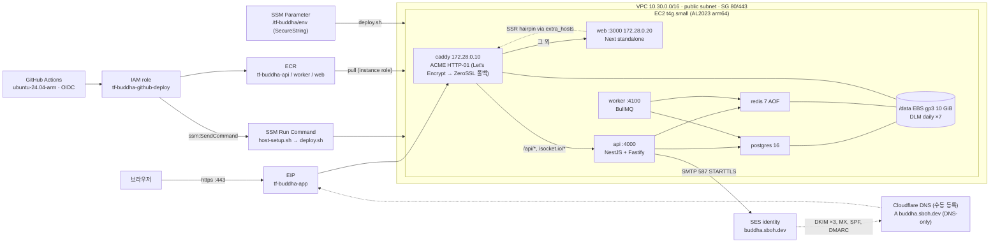

# buddha Infrastructure (Terraform, `tf-buddha`)

buddha의 AWS 운영 인프라를 Terraform으로 관리한다. Terraform이 만든 모든 리소스는 이름과 `Name` 태그가 **`tf-buddha-`** 로 시작한다(`locals.name_prefix = "tf-buddha"`, 예: `tf-buddha-vpc`, `tf-buddha-app`, `tf-buddha-github-deploy`). 같은 계정(`210146911118`, `ap-northeast-2`)에 있는 `tf-inno-frame-prod-*`와 접두사로 구분되며, 환경 이름은 태그(`Environment = prod`)로만 남긴다.

목표는 **내부 팀원 3명의 시험 사용**이다. 그래서 PLAN §13이 스케치한 Fargate + RDS + Valkey + ALB(월 $100+)가 아니라 **EC2 `t4g.small` 한 대 + Docker Compose + Caddy**로 월 **≈ $22**에 맞췄다(ADR-0040). 외부 공개나 가용성 요구가 생기면 그때 승격한다 — 이 README의 끝에 그 경로가 있다.

## 아키텍처

```
브라우저 ──https──▶ EIP:443 ─▶ [caddy 172.28.0.10] ── /api/*, /socket.io/* ─▶ [api:4000]
                                     │                                          │ pg / redis
                                     └── 그 외 ──▶ [web:3000 172.28.0.20] ──SSR(extra_hosts 헤어핀)──┘
EC2 t4g.small (AL2023 arm64, 전용 VPC 10.30.0.0/16 퍼블릭 서브넷 1개, SSH 없음, SSM만)
/data (별도 EBS gp3 10 GiB, DLM 일일 스냅샷 7개): postgres / redis AOF / caddy 인증서 / 배포 디렉터리
GitHub Actions(ubuntu-24.04-arm) ─OIDC─▶ ECR(tf-buddha-api/worker/web) ─SSM RunShellScript─▶ deploy.sh
SES identity buddha.sboh.dev(+ MAIL FROM mail.buddha.sboh.dev) → SMTP 587 STARTTLS
Cloudflare DNS(수동, `terraform output dns_records`): A(DNS-only) + DKIM CNAME×3 + MX + SPF + DMARC
```

- 공개 오리진은 **`https://buddha.sboh.dev` 하나**다. Caddy가 `/api/*`와 `/socket.io/*`를 api로, 나머지를 web으로 넘긴다. Socket.IO의 `/ws`는 네임스페이스이지 URL 경로가 아니다 — HTTP 경로는 기본값 `/socket.io/*`다(ADR-0017과 달리 별도 API 호스트가 없으므로 `AUTH_COOKIE_DOMAIN`은 미설정).
- 컨테이너 주소는 compose IPAM으로 고정된다: Caddy `172.28.0.10`, web `172.28.0.20`. API의 `TRUST_PROXY=172.28.0.10/32`(Caddy만 `X-Forwarded-For`를 세울 수 있다)와 `RATE_LIMIT_UNCOUNTED_PEERS=172.28.0.20/32`(web의 SSR 호출은 한 통에 넣지 않는다)가 이 주소를 가리킨다(ADR-0034). web은 `extra_hosts`로 `buddha.sboh.dev`를 Caddy에 묶어 SSR이 호스트 밖으로 나가지 않는다.
- 시크릿은 전부 Terraform의 `random_password` → **SSM SecureString 하나 `/tf-buddha/env`**(운영 `.env` 전체)로 간다. git과 user-data에는 시크릿이 없다. `deploy/deploy.sh`가 배포마다 이 값을 `/data/buddha/.env`로 렌더한다.
- 배포 번들(`deploy/`)은 api 이미지 안에 실려 온다. S3 없이 compose 파일과 이미지가 같은 커밋에서 온다.



## 파일 맵

| 파일                           | 리소스                                                                                                                                                                                                                                                                                             |
| ------------------------------ | -------------------------------------------------------------------------------------------------------------------------------------------------------------------------------------------------------------------------------------------------------------------------------------------------- |
| `versions.tf`                  | Terraform / provider 버전 (`aws ~> 6.0`, `random ~> 3.6`)                                                                                                                                                                                                                                          |
| `providers.tf`                 | `aws`(`var.profile`, `default_tags`); us-east-1 alias 없음                                                                                                                                                                                                                                         |
| `locals.tf`                    | `name_prefix = "tf-buddha"`, `common_tags`, `images`, `ecr_registry`, `app_url`, `ssm_env_parameter`, `github_oidc_subject`                                                                                                                                                                        |
| `variables.tf`                 | 모든 입력 변수 (영문 description). `seed_admin_*`는 validation이 빈 값을 거절한다 — 비어 있으면 seed가 관리자 생성을 조용히 건너뛴다                                                                                                                                                               |
| `outputs.tf`                   | `instance_id`, `public_ip`, `app_url`, `ecr_*`, `github_actions_deploy_role_arn`, `github_oidc_subject`, `ssm_env_parameter_name`, `data_volume_id`, `ses_identity_arn`, `ssm_session_command`. sensitive 출력 없음 + `dns_records`(Cloudflare에 손으로 넣을 A · DKIM CNAME ×3 · MX · SPF · DMARC) |
| `vpc.tf`                       | `aws_vpc.main`, IGW, 퍼블릭 서브넷 1개, 라우트 테이블. NAT·프라이빗 서브넷·VPC endpoint 없음                                                                                                                                                                                                       |
| `security-groups.tf`           | `aws_security_group.app` + 분리형 ingress 80/443, egress all. **22번 포트 없음**                                                                                                                                                                                                                   |
| `ec2.tf`                       | AL2023 arm64 AMI(SSM public parameter), `aws_instance.app`(IMDSv2, standard credits, `ignore_changes = [ami, user_data]`), `aws_eip.app`, `aws_eip_association.app`                                                                                                                                |
| `storage.tf`                   | `aws_ebs_volume.data`(`prevent_destroy`, `snapshot_id = var.data_volume_snapshot_id`), `aws_volume_attachment.data`(`/dev/sdf`, `stop_instance_before_detaching`), DLM 역할 + `aws_dlm_lifecycle_policy.data`(18:00 UTC ×7)                                                                        |
| `iam.tf`                       | 인스턴스 역할 `tf-buddha-app` + instance profile: `AmazonSSMManagedInstanceCore`, ECR pull, `ssm:GetParameter`(env 파라미터), `kms:Decrypt`(`kms:ViaService = ssm.<region>.amazonaws.com` 조건)                                                                                                    |
| `github-oidc.tf`               | `data.aws_iam_openid_connect_provider.github`(provider 리소스는 inno-frame state 소유), `aws_iam_role.github_actions_deploy`(`tf-buddha-github-deploy`): ECR push/describe, `ec2:DescribeInstances`, `ssm:SendCommand`(인스턴스 ARN 고정)                                                          |
| `ecr.tf`                       | `aws_ecr_repository.app` for_each `api/worker/web` + lifecycle(태그된 이미지 10개, untagged 7일)                                                                                                                                                                                                   |
| `ses.tf`                       | `aws_sesv2_email_identity.app`(`buddha.sboh.dev`, `dkim_signing_attributes` 미지정), MAIL FROM `mail.buddha.sboh.dev`, SMTP 전용 IAM user `tf-buddha-ses-smtp` + access key                                                                                                                        |
| `ssm.tf`                       | `random_password` ×4(`better_auth_secret`, `postgres_superuser`, `db_app`, `db_migrate`), `aws_ssm_parameter.env`(`/tf-buddha/env`, SecureString, Standard 티어)                                                                                                                                   |
| `templates/env.tftpl`          | `/tf-buddha/env`의 본문(운영 `.env`). `deploy/compose.yaml`이 소비하는 키의 단일 진실 원천                                                                                                                                                                                                         |
| `templates/user-data.sh.tftpl` | 첫 부팅 1회: docker 설치, `/data` 라벨 마운트(`mkfs`는 빈 볼륨일 때만), `RequiresMountsFor=/data` drop-in, `dd` swap 2 GiB. 시크릿·앱 파일 없음                                                                                                                                                    |
| `terraform.tfvars.example`     | 필수 변수의 placeholder. 실제 `terraform.tfvars`는 gitignored                                                                                                                                                                                                                                      |
| `.gitignore`                   | `.terraform/`, `*.tfstate*`, `*.tfvars`, `*.tfplan` 제외. `.terraform.lock.hcl`은 커밋한다                                                                                                                                                                                                         |

저장소 쪽 짝: `Dockerfile`(multi-target `api|worker|web`), `deploy/`(compose.yaml · Caddyfile · deploy.sh · host-setup.sh · postgres-init/02-passwords.sh), `.github/workflows/deploy.yml`.

## 로컬 전제

- `brew install --cask session-manager-plugin` — SSH가 없으므로 인스턴스 셸은 `aws ssm start-session`뿐이다.
- `terraform >= 1.16` (`versions.tf`의 하한은 `1.11.0`; `.terraform.lock.hcl`은 1.16에서 만들었다). `brew install terraform` 또는 tfenv.
- AWS 프로필 **`inno-frame`** = IAM user `terraform-iam`. 반드시 확인한다 — root 자격증명으로는 절대 apply하지 않는다.

  ```bash
  aws sts get-caller-identity --profile inno-frame
  # "Arn": "arn:aws:iam::210146911118:user/terraform-iam"  ← 이것이어야 한다. ":root"면 중단
  ```

- `gh auth status` — GitHub secret 등록(`gh secret set`)과 워크플로 실행(`gh workflow run`)에 쓴다.
- Docker Desktop(Apple Silicon이면 arm64 네이티브) — AWS를 건드리기 전에 이미지를 로컬에서 증명한다(아래 3단계).

## 최초 부트스트랩

한 번만 한다. 순서가 중요하다 — DNS 레코드와 SSM 파라미터가 첫 배포 **전에** 있어야 Caddy가 인증서를 받고 `deploy.sh`가 `.env`를 렌더한다. DNS는 Terraform이 만들지 않는다(사용자 결정): apply가 끝나면 `terraform output dns_records`가 등록할 레코드를 그대로 찍어 주고, 그것을 Cloudflare에 손으로 넣는다.

1. **사용자 준비.** `brew install --cask session-manager-plugin`. Cloudflare 대시보드에서 `sboh.dev` 존에 기존 `buddha` 레코드나 proxied 와일드카드(`*.sboh.dev`)가 없는지 확인한다 — 있으면 ACME HTTP-01이 Cloudflare 엣지에 막힌다. `acme_email`, `seed_admin_email`, `seed_admin_password`(영숫자 8–128자)를 정한다. (선택) OAuth 콘솔에 콜백 `https://buddha.sboh.dev/api/auth/callback/{google,kakao,naver}`를 등록한다.

2. **코드.** 브랜치 `feat/deploy-aws`에서 `terraform/`, `Dockerfile`, `deploy/`, `.github/workflows/deploy.yml`, 문서를 작성하고 `pnpm format`을 돌린다(CI의 `format:check`가 YAML/MD를 검사한다).

3. **로컬 이미지 증명**(AWS 변경 전).

   ```bash
   docker buildx build --platform linux/arm64 --target api    -t buddha-api:local .
   docker buildx build --platform linux/arm64 --target worker -t buddha-worker:local .
   docker buildx build --platform linux/arm64 --target web    -t buddha-web:local \
     --build-arg NEXT_PUBLIC_API_URL=https://buddha.sboh.dev .
   docker run --rm buddha-api:local ls /app/packages/db/drizzle /app/deploy /app/deploy/postgres-init
   docker run --rm -p 3000:3000 buddha-web:local &   # 다른 셸에서 curl -fsS http://127.0.0.1:3000/login
   ```

   `pnpm install` 로그의 `@msgpackr-extract/msgpackr-extract-linux-arm64` node-gyp 경고는 정상이다(musl 바이너리만 배포되어 glibc 이미지에서는 순수 JS 폴백을 쓴다).

4. **Terraform apply.**

   ```bash
   cd terraform
   cp terraform.tfvars.example terraform.tfvars && $EDITOR terraform.tfvars   # gitignored
   terraform init
   terraform validate
   terraform plan -out=bootstrap.tfplan
   ```

   plan을 읽는다: 리소스 39개, 이름이 전부 `tf-buddha-`, SG에 22번 포트 없음, `aws_ssm_parameter.env`의 값은 `(sensitive value)`, Cloudflare 리소스는 없음. 그다음:

   ```bash
   terraform apply bootstrap.tfplan
   rm bootstrap.tfplan            # plan 파일에는 변수 값(seed 관리자 비밀번호)이 들어 있다
   git add .terraform.lock.hcl    # 커밋 대상. tfstate·tfvars는 .gitignore가 막는다
   ```

5. **DNS 레코드 수동 등록.** Terraform은 Cloudflare를 건드리지 않는다. apply가 끝나면:

   ```bash
   terraform output dns_records
   ```

   출력된 여섯 레코드(A 1개 · DKIM CNAME 3개 · `mail.` MX 1개 · TXT 2개)를 Cloudflare 대시보드 `sboh.dev` 존에 **그대로**, 전부 **Proxy status = DNS only(회색 구름)** 로 넣는다. A 레코드가 proxied이면 HTTP-01이 Cloudflare 엣지에 막혀 인증서가 안 나오고, api가 보는 방문자 IP도 Cloudflare 것이 된다. DKIM 세 개가 다 있어야 SES identity가 검증된다. MX는 `mail.buddha.sboh.dev`에 **하나만** 둔다(priority 10). TXT 값은 따옴표 없이 대시보드에 붙여 넣는다.

6. **호스트 확인**(2–3분 뒤).

   ```bash
   aws ssm describe-instance-information --profile inno-frame \
     --query 'InstanceInformationList[].{id:InstanceId,ping:PingStatus,agent:AgentVersion}'
   aws ssm start-session --profile inno-frame --target "$(terraform output -raw instance_id)"
   # 세션 안에서:
   sudo tail -n 30 /var/log/buddha-user-data.log     # 마지막 줄 "user-data: done"
   findmnt /data && swapon --show && sudo docker compose version
   ```

   `docker compose version`은 첫 배포의 `host-setup.sh`가 플러그인을 설치하기 전이면 아직 실패한다 — 그것만은 정상이다.

7. **DNS 확인.**

   ```bash
   dig +short A buddha.sboh.dev            # = terraform output -raw public_ip
   dig +short MX mail.buddha.sboh.dev      # 10 feedback-smtp.ap-northeast-2.amazonses.com.
   curl -sI http://buddha.sboh.dev/        # Caddy 전에는 "Connection refused"가 정상. timeout이면 SG/라우팅 문제
   ```

8. **GitHub 연결.**

   ```bash
   gh secret set AWS_DEPLOY_ROLE_ARN --repo sboh1214/sw04-buddha \
     --body "$(terraform output -raw github_actions_deploy_role_arn)"
   terraform output -raw github_oidc_subject
   gh api repos/sboh1214/sw04-buddha/actions/oidc/customization/sub
   ```

   출력의 subject가 `repo:sboh1214@30364442/sw04-buddha@1354856480:ref:refs/heads/main`(immutable 형식)이고 저장소의 sub customization과 같은 모양인지 확인한다. inno-frame의 `repo:<owner>/<repo>:ref:...` 형식은 이 저장소에서 절대 매치되지 않는다.

9. **첫 배포.** PR을 열어 `build-check` job(빌드만, AWS 자격증명 없음)이 통과하는 것을 보고 `main`에 머지한다. `deploy.yml`이 돌아 이미지 3개를 push하고 SSM으로 `host-setup.sh` → `deploy.sh <sha>`를 실행한 뒤 `https://buddha.sboh.dev/api/health`로 스모크한다. 워크플로 로그에 `assumed-role/tf-buddha-github-deploy`와 SSM `Status: Success` 블록이 있어야 한다.

10. **SES 검증 대기.**

```bash
aws sesv2 get-email-identity --email-identity buddha.sboh.dev --profile inno-frame \
  --query '{dkim:DkimAttributes.Status,mailfrom:MailFromAttributes.MailFromDomainStatus,sending:VerifiedForSendingStatus}'
```

`SUCCESS / SUCCESS / true`가 되기 전에는 **테스터를 초대하지 않는다**. better-auth는 발송 오류를 삼키므로 가입 인증 메일이 조용히 사라진다(ADR-0023). 계정은 이미 production 모드(리전 단위)라 샌드박스 해제 요청은 필요 없다.

11. **브라우저 기능 확인**(`.dev`는 HSTS preload 도메인이라 https만 열린다). seed 관리자로 로그인 → `/admin/markets`에서 시장 생성. 테스터 계정으로 가입 → 인증 메일 수신(헤더에서 SPF/DKIM/DMARC `PASS`) → 링크 클릭 → `/set-password`.

12. **tfstate 백업.** `terraform/terraform.tfstate`에는 모든 시크릿이 들어 있다. 아래 [상태 파일](#상태-파일)의 절차대로 `gpg -c`로 암호화해 이 머신 밖에 둔다.

## 일상 운영 절차

아래 명령은 전부 `terraform/`에서, 프로필 `inno-frame`으로 실행한다. 인스턴스 id는 `terraform output -raw instance_id`.

### 배포

`main`에 push하면 `.github/workflows/deploy.yml`이 끝까지 한다(`docs/**`, `**.md`, `terraform/**`만 바뀐 push는 건너뛴다). `:latest` 태그는 밀지 않는다 — 이미지 태그는 언제나 git sha다.

### 롤백 / 같은 태그 재배포

```bash
gh workflow run deploy.yml --ref main -f image_tag=<sha>
```

ECR에 이미 있는 태그를 주면 빌드를 건너뛰고(`aws ecr describe-images`로 존재만 확인) SSM 배포 단계만 돈다. 태그된 이미지는 저장소당 최근 10개가 남으므로 배포 10회 전까지 돌아갈 수 있다. 마이그레이션은 앞으로만 간다 — 스키마를 바꾼 배포를 되돌릴 때는 이전 코드가 새 스키마와 호환되는지 먼저 본다.

### 셸

```bash
aws ssm start-session --profile inno-frame --target "$(terraform output -raw instance_id)"
```

`ssm-user`로 들어간다. compose 명령은 `sudo`가 필요하다. 22번 포트도, 키 페어도 없다.

### 로그

```bash
sudo docker compose -f /data/buddha/compose.yaml logs -f --tail 200 api worker
```

pino JSON 한 줄이 요청 한 건이다(ADR-0035). 로그는 json-file 드라이버 10 MB × 3으로 회전한다(`host-setup.sh`). `caddy`·`postgres`·`redis`도 같은 명령으로 본다. `sudo docker stats --no-stream`으로 메모리를 확인한다 — 합이 1.5 GiB를 넘나들면 `instance_type = "t4g.medium"`(+$15/월) 한 줄이 답이다.

### 시크릿 교체

시크릿은 `ssm.tf`의 `random_password` 넷이다. 하나를 새로 뽑으면 SSM 파라미터가 갱신되고, **다음 배포**가 `.env`를 다시 렌더해 컨테이너를 새 값으로 재생성한다.

```bash
terraform apply -replace=random_password.better_auth_secret
gh workflow run deploy.yml --ref main -f image_tag=<현재 sha>     # .env 재렌더 + 컨테이너 재생성
```

`better_auth_secret`을 바꾸면 모든 세션이 무효가 된다(사용자 전원 재로그인).

**DB 롤 비밀번호(`postgres_superuser`, `db_app`, `db_migrate`)는 한 단계가 더 있다.** `postgres-init/02-passwords.sh`는 initdb 때 한 번만 돈다. 새 값을 SSM에 넣은 뒤 배포를 돌리면 `migrate` 서비스가 옛 비밀번호의 데이터베이스에 새 비밀번호로 붙으려다 실패하므로, 배포 **전에** 손으로 `ALTER ROLE`을 한다.

```bash
terraform apply -replace=random_password.db_app
NEW=$(aws ssm get-parameter --profile inno-frame --name /tf-buddha/env --with-decryption \
      --query Parameter.Value --output text | sed -n 's/^BUDDHA_APP_PASSWORD=//p')
aws ssm start-session --profile inno-frame --target "$(terraform output -raw instance_id)"
# 세션 안에서 (unix socket + trust 인증이라 옛 비밀번호는 필요 없다):
sudo docker compose -f /data/buddha/compose.yaml exec postgres \
  psql -U postgres -d buddha -c "ALTER ROLE buddha_app PASSWORD '<NEW>'"
# 이어서 로컬에서:
gh workflow run deploy.yml --ref main -f image_tag=<현재 sha>
```

`db_migrate`는 `buddha_migrate`, `postgres_superuser`는 `postgres` 롤에 같은 절차다. ALTER와 배포 사이에는 실행 중인 api/worker가 옛 비밀번호의 풀을 들고 있으므로 새 연결만 실패한다 — 두 명령을 붙여서 한다.

SES SMTP 자격증명은 `terraform apply -replace=aws_iam_access_key.ses_smtp` 뒤 배포.

### 수동 pg_dump

DLM 스냅샷은 볼륨 단위다. 논리 백업이 필요할 때(마이그레이션 전, 복구 리허설):

```bash
# 세션 안에서
sudo docker compose -f /data/buddha/compose.yaml exec -T postgres \
  pg_dump -U postgres -Fc buddha | sudo tee /data/buddha-$(date +%F).dump >/dev/null
# 복원 리허설: 반드시 별도 DB 이름으로. 운영 DB `buddha`에 --clean으로 넣으면 현재 데이터가 지워진다.
sudo docker compose -f /data/buddha/compose.yaml exec -T postgres createdb -U postgres buddha_restore
sudo docker compose -f /data/buddha/compose.yaml exec -T postgres \
  pg_restore -U postgres -d buddha_restore < /data/buddha-<date>.dump
# 확인이 끝나면: sudo docker compose -f /data/buddha/compose.yaml exec -T postgres dropdb -U postgres buddha_restore
```

실제 복구(운영 DB를 덤프 시점으로 되돌리기)는 리허설과 다른 절차다: `api`·`worker`를 먼저 세우고(`sudo docker compose -f /data/buddha/compose.yaml stop api worker`) `pg_restore -U postgres -d buddha --clean --if-exists < …`를 돌린 뒤 `up -d`한다. `--clean`은 현재 데이터를 지우므로 되돌릴 수 없다 — 그 직전에 한 번 더 `pg_dump`를 떠 둔다.

`/data`에 두면 다음 스냅샷에 함께 들어간다. 이 머신 밖으로 꺼내는 길은 일부러 좁다 — 인스턴스 역할에 S3 권한이 없다. 필요하면 `iam.tf`에 버킷 하나짜리 `s3:PutObject`를 잠깐 더하거나, 작은 덤프는 세션에서 `base64 -w0`로 찍어 복사한다.

### 인스턴스 교체

user-data를 고쳤거나, 호스트가 망가졌거나, AMI를 올리고 싶을 때. `aws_instance.app`은 `ami`와 `user_data`가 `ignore_changes`라 plan에 아무것도 뜨지 않는다 — **교체는 언제나 명시적**이다.

```bash
terraform apply -replace=aws_instance.app
gh workflow run deploy.yml --ref main -f image_tag=<현재 sha>
```

순서: `stop_instance_before_detaching`이 옛 인스턴스를 멈추고 `/data`를 뗀다 → 새 인스턴스가 뜨고 user-data가 라벨 `buddha-data`를 찾아 **포맷 없이** 마운트한다 → EIP가 옮겨 붙는다 → 같은 apply가 GitHub 역할의 `ssm:SendCommand` 정책을 새 인스턴스 ARN으로 다시 쓴다. 이미지·컨테이너는 루트 볼륨에 있었으므로 새 호스트에는 없다 — 그래서 워크플로를 한 번 돌려야 한다. 다운타임 ≈ 5분. 인증서는 `/data/caddy`에 있어 재발급되지 않는다.

### 스냅샷에서 데이터 복구

```bash
aws ec2 describe-snapshots --profile inno-frame --owner-ids self \
  --filters Name=tag:Name,Values=tf-buddha-data-snapshot \
  --query 'sort_by(Snapshots,&StartTime)[].{id:SnapshotId,at:StartTime,gb:VolumeSize}'
```

1. `terraform.tfvars`에 `data_volume_snapshot_id = "snap-..."`를 적는다(`-var`가 아니라 파일에 — 나중에 지우면 `snapshot_id` 변경으로 볼륨 재생성이 다시 plan에 뜬다).
2. `storage.tf`의 `prevent_destroy = true`를 **일시적으로** 주석 처리한다. 이 한 줄이 없으면 `-replace`가 거절된다.
3. `terraform apply -replace=aws_ebs_volume.data` — 인스턴스가 멈추고, 옛 볼륨이 지워지고, 스냅샷에서 새 볼륨이 붙는다. 스냅샷 안의 파일시스템이 이미 라벨 `buddha-data`를 갖고 있으므로 포맷되지 않는다.
4. `aws ec2 start-instances --profile inno-frame --instance-ids "$(terraform output -raw instance_id)"` — `RequiresMountsFor=/data` 덕에 docker는 마운트 뒤에 뜨고 `restart: unless-stopped` 컨테이너가 스스로 올라온다.
5. `prevent_destroy` 줄을 복원하고 `terraform plan`이 `No changes`인지 본다.

`-replace`는 옛 볼륨을 **지운다**. 3단계 전에 `aws ec2 create-snapshot --profile inno-frame --volume-id "$(terraform output -raw data_volume_id)" --description pre-restore`로 수동 스냅샷을 하나 뜬다. 옛 볼륨을 남기고 싶으면 `-replace` 대신 `terraform state rm aws_volume_attachment.data aws_ebs_volume.data` → 인스턴스 중지 → `aws ec2 detach-volume` → `terraform apply`(새 볼륨 생성·부착)의 순서로 하되, 고아가 된 옛 볼륨은 손으로 지울 때까지 과금된다. Redis AOF도 같은 볼륨이므로 큐의 지연 잡(마감·정산 예약)이 스냅샷 시점으로 돌아간다 — 워커의 매 분 안전망 스캔이 빠진 마감을 1분 안에 잡는다.

### 중지 / 시작

```bash
aws ec2 stop-instances  --profile inno-frame --instance-ids "$(terraform output -raw instance_id)"
aws ec2 start-instances --profile inno-frame --instance-ids "$(terraform output -raw instance_id)"
```

멈춰 있는 동안 EC2 시간 요금은 없지만 EBS(≈ $2.4) + 스냅샷 + **EIP(≈ $3.65, 실행 중인 인스턴스에 붙어 있지 않아도 청구)** + ECR ≈ **월 $6.5**가 남는다. 시작하면 `/data`가 라벨로 마운트되고 컨테이너가 스스로 올라온다. EIP가 그대로라 DNS는 손대지 않는다. 몇 달 이상 쓰지 않을 거면 `terraform destroy`가 답이다 — 단 `aws_ebs_volume.data`의 `prevent_destroy`가 막으므로, 그때는 마지막 스냅샷 id를 적어 두고 그 줄을 지운다.

### 월간 커널 업데이트

`dnf-automatic`이 보안 업데이트를 매일 적용하지만 커널은 재부팅해야 올라간다. 한 달에 한 번, 한가한 시간에:

```bash
aws ssm send-command --profile inno-frame --document-name AWS-RunShellScript \
  --instance-ids "$(terraform output -raw instance_id)" \
  --parameters 'commands=["dnf needs-restarting -r || systemctl reboot"]'
```

`needs-restarting -r`는 재부팅이 필요할 때만 1을 답한다. 재부팅 ≈ 1분, 컨테이너는 스스로 올라온다.

### TLS 인증서 (ACME)

Caddy가 호스트에서 직접 받는다. `deploy/Caddyfile`에는 일부러 `acme_ca`가 없다 — `email`만 있으면 Caddy의 기본 발급자 사슬(**Let's Encrypt → ZeroSSL 폴백**, ZeroSSL의 EAB는 Caddy가 그 이메일로 자동 발급)이 동작한다. 인증서와 ACME 계정은 `/data/caddy/data`에 있어 재배포·인스턴스 교체에도 남고, 갱신은 자동이다(`docker compose logs caddy | grep -i renew`).

첫 배포(2026-09-11)에서 겪은 일: Let's Encrypt의 원격 검증 지점 하나가 몇 시간 동안 `During secondary validation: DNS problem: networking error looking up A`를 내면서(우리 DNS는 전 세계 리졸버·LE와 같은 Unbound 프로파일에서 전부 정상) 발급이 막혔고, 그 사이 Caddy를 재시작할 때마다 실패가 쌓여 **"failed authorizations 5회/시간" 한도**에 걸렸다. ZeroSSL로 넘기자 30초 만에 발급됐다. 그래서:

- 발급 실패 로그가 보이면 **Caddy를 반복 재시작하지 않는다** — 실패마다 LE 한도를 소모한다. Caddy는 스스로 10분 간격으로 재시도하고, LE가 계속 실패하면 ZeroSSL로 넘어간다.
- 문구가 `During secondary validation: … networking error` / `query timed out`이면 LE 쪽이다. `dig +short A buddha.sboh.dev @1.1.1.1`과 https://unboundtest.com 으로 우리 쪽을 확인하고 기다린다.
- 특정 CA를 강제해야 하면(예: LE 스테이징 리허설) 호스트에서 `/data/buddha/Caddyfile`의 전역 블록에 `acme_ca <directory url>`을 임시로 넣고 `docker compose up -d caddy`한다 — 다음 배포가 이미지의 Caddyfile로 덮어쓴다. 스테이징 디렉터리: `https://acme-staging-v02.api.letsencrypt.org/directory`.
- 첫 배포의 워크플로 스모크 테스트(`curl https://…/api/health`, ≈ 3분 재시도)는 발급이 늦으면 실패로 끝날 수 있다. 배포 자체(`Deploy over SSM` 단계)가 성공이면 재실행할 필요 없이 `curl`로 다시 확인한다.

## 주시해야 할 drift

- **`aws_instance.app` — `ignore_changes = [ami, user_data]`.** AL2023 AMI는 달마다 새 id가 나오고 `data.aws_ssm_parameter.al2023_arm64`가 그것을 읽지만, plan에는 뜨지 않는다. `templates/user-data.sh.tftpl`을 고쳐도 마찬가지다. 둘 다 `-replace=aws_instance.app`로만 반영된다(위 절차). 첫 부팅 이후에 바뀔 수 있는 호스트 설정은 그래서 `deploy/host-setup.sh`에 있다.
- **DNS는 Terraform 밖에 있다.** 레코드는 사용자가 Cloudflare 대시보드에 넣었고 plan은 그것을 보지 못한다. EIP가 바뀌면(EIP 리소스를 지우고 다시 만들 때만; `-replace=aws_instance.app`는 EIP를 유지한다) A 레코드를 손으로 고쳐야 한다. `terraform output dns_records`가 언제나 현재 값을 보여 준다.
- **DKIM 토큰.** `dns_records` 출력의 CNAME 세 개는 `aws_sesv2_email_identity.app.dkim_signing_attributes[0].tokens`에서 온다. identity를 destroy/recreate하면 SES가 새 토큰 세 개를 발급해 Cloudflare의 CNAME을 전부 다시 넣어야 하고, 전파되는 동안 DKIM 서명이 깨진다. identity는 만들고 잊는다. `dkim_signing_attributes`를 명시하는 것도 같은 이유로 금지(키 길이를 적는 순간 새 토큰).
- **EIP association.** `aws_eip_association.app`이 EIP를 인스턴스에 묶는다. 콘솔에서 인스턴스를 바꾸거나 EIP를 옮기면 다음 plan이 association을 다시 만든다(짧은 단절). `associate_public_ip_address = true`의 임시 공인 IP는 EIP가 붙는 순간 반납되므로 이중 청구는 없다.
- **`/tf-buddha/env`를 콘솔에서 편집하지 않는다.** `aws_ssm_parameter.env`의 값은 `templates/env.tftpl` 렌더 결과라 다음 apply가 덮어쓴다. 값을 바꾸려면 `terraform.tfvars`(OAuth 키, seed 관리자, `log_level`) 또는 템플릿을 고친다. 콘솔에서 바꾼 값은 `deploy.sh`가 다음 배포에 한 번 쓰고 apply 때 사라진다.

## GitHub Actions 연결

`.github/workflows/deploy.yml`은 OIDC로 `tf-buddha-github-deploy` 역할을 assume한다(장기 액세스 키 없음). 흐름: `ubuntu-24.04-arm` 러너에서 arm64 네이티브 빌드 → ECR push(태그 = git sha) → `describe-instances`로 `tag:Name=tf-buddha-app`인 실행 중 인스턴스 조회 → `ssm send-command AWS-RunShellScript`(api 이미지에서 `/app/deploy`를 `/data/buddha`로 `docker cp` → `host-setup.sh` → `deploy.sh <sha>`) → `get-command-invocation` 폴링(최대 20분) → `/api/health` 스모크.

필수 GitHub repo secret은 **하나**다(인스턴스는 태그로 찾으므로 변수가 없다):

| Secret                | 값                                                          |
| --------------------- | ----------------------------------------------------------- |
| `AWS_DEPLOY_ROLE_ARN` | `terraform output -raw github_actions_deploy_role_arn` 결과 |

신뢰 정책의 subject는 **immutable 형식**이다 — 이 저장소가 OIDC sub claim을 그렇게 커스터마이즈해 두었다.

```
repo:sboh1214@30364442/sw04-buddha@1354856480:ref:refs/heads/main
```

숫자는 owner id와 repository id다. 저장소 이름을 바꾸거나 같은 이름으로 다시 만들어도 신뢰가 따라가지 않는다. `main` 브랜치의 push와 `workflow_dispatch`(`--ref main`)만 assume할 수 있고 PR 빌드는 못 한다. 확인:

```bash
gh api repos/sboh1214/sw04-buddha/actions/oidc/customization/sub   # 저장소의 sub 커스터마이즈 상태
terraform output -raw github_oidc_subject                            # 신뢰 정책에 들어간 값
```

`aws_iam_openid_connect_provider`는 **data source**다 — 리소스는 inno-frame의 state가 소유하고, IAM은 같은 URL의 provider를 둘 두지 못한다. inno-frame을 destroy하면 이 역할의 신뢰 정책이 고아가 된다.

## IAM 메모

- **`AmazonSSMManagedInstanceCore`는 `ssm:GetParameter`를 `*`에 준다.** `iam.tf`의 `ReadEnvParameter`(파라미터 ARN 한정)는 그래서 경계가 아니라 문서다. 이 인스턴스는 이 계정·리전의 어떤 SecureString이든 `alias/aws/ssm` 키로 잠겨 있고 `kms:ViaService` 조건이 맞으면 읽을 수 있다. Parameter Store에 다른 프로젝트의 시크릿을 두지 않거나, 두려면 별도 CMK로 잠근다.
- **`kms:Decrypt`는 `*` + `kms:ViaService = ssm.ap-northeast-2.amazonaws.com` 조건**이다. `alias/aws/ssm` 키는 첫 SecureString을 만들 때 AWS가 lazy 생성하므로 apply 시점에 ARN을 알 수 없다. ViaService 조건이 SSM을 거치지 않는 Decrypt를 막는다.
- **`terraform-iam`은 `AdministratorAccess`다.** 이 프로필로 실행하는 모든 것이 계정 전체에 닿는다. root는 쓰지 않고, 이 사용자에게 MFA를 유지한다. plan을 읽지 않고 apply하지 않는다.
- **`ssm:SendCommand`는 인스턴스 ARN에 고정**되어 있다(`aws_instance.app.arn` + `AWS-RunShellScript` 문서). 정책 문서가 인스턴스 리소스를 참조하므로 `-replace=aws_instance.app`을 하는 같은 apply가 정책도 다시 쓴다. 콘솔에서 인스턴스를 바꾼 경우나 apply가 도중에 끊긴 경우에는 `terraform apply`를 한 번 더 돌려 ARN을 맞춘다 — 그전까지 워크플로는 `AccessDenied`로 실패한다.
- 인스턴스 역할에 S3·CloudWatch Logs 권한은 없다. 필요해지면 `iam.tf`에 리소스 한정으로 더한다.
- `tf-buddha-ses-smtp`는 SES SMTP 인터페이스 전용 IAM user다. 정책이 identity ARN과 `ses:FromAddress = *@buddha.sboh.dev`로 좁혀져 있다. access key는 state와 `/tf-buddha/env`에 있다.

## 비용 노트

ap-northeast-2 온디맨드, Pricing API로 확인(2026-09).

| 항목                                                                                                                                     |                              USD/월 |
| ---------------------------------------------------------------------------------------------------------------------------------------- | ----------------------------------: |
| EC2 t4g.small 730h(standard credits)                                                                                                     |                               15.18 |
| EBS gp3 root 16 GiB + data 10 GiB(암호화)                                                                                                |                                2.37 |
| EBS 스냅샷(DLM 일일 7개, 증분)                                                                                                           |                               ~0.15 |
| Public IPv4(EIP)                                                                                                                         |                                3.65 |
| ECR(3 repo × ≤10 이미지, 공유 레이어)                                                                                                    |                               ~0.30 |
| SES(수백 통/월; 신규 리전 사용 시 Essentials $0.16/1k)                                                                                   |                               ~0.05 |
| SSM Parameter Store·Run Command·Session Manager·KMS(무료 구간)·DLM·VPC·Cloudflare DNS·Let's Encrypt/ZeroSSL·GitHub arm 러너(플랜 포함분) |                                   0 |
| **합계**                                                                                                                                 | **≈ 21.7** (인스턴스 중지 시 ≈ 6.5) |

- `t4g.small`은 CPU credit을 `standard`로 둔다 — `unlimited`면 지속 부하 때 시간당 추가 청구가 생긴다. 크레딧 고갈이 보이면(CloudWatch `CPUCreditBalance`) `t4g.medium`이 답이다.
- NAT Gateway(월 $45)가 없다. 인스턴스가 퍼블릭 서브넷에 있고 SG가 80/443만 연다.
- GitHub arm 러너는 public 저장소면 무료, private이면 플랜의 분량에서 나간다.

## 상태 파일

`terraform.tfstate`는 **로컬**이다(inno-frame 관례). 그 안에 `random_password` 넷의 평문, SES SMTP 비밀번호, `/tf-buddha/env`의 렌더 결과 전체가 들어 있다. `.gitignore`가 `*.tfstate*`를 막지만 그것으로 끝이 아니다.

- **오프머신 백업.** apply 뒤마다:

  ```bash
  gpg -c --cipher-algo AES256 terraform.tfstate     # → terraform.tfstate.gpg, 패스프레이즈는 비밀번호 관리자에
  # 결과 파일을 이 머신 밖(비밀번호 관리자 첨부, 암호화된 외장 저장소)에 둔다. 평문은 옮기지 않는다.
  ```

  state를 잃으면 리소스는 남지만 Terraform이 모른다 — `terraform import`를 수십 번 하거나, 시크릿을 전부 다시 뽑아 배포해야 한다.

- **plan 파일도 시크릿이다.** `-out=`으로 만든 `.tfplan`에는 변수(seed 관리자 비밀번호 포함)가 들어 있다. apply 직후 지운다. `.gitignore`가 `*.tfplan`도 막는다.

- **S3 backend 이관 경로**(팀이 늘거나 두 머신에서 apply하게 될 때). 버킷 하나면 된다 — Terraform ≥ 1.10의 `use_lockfile`이 DynamoDB 없이 S3 조건부 쓰기로 잠근다.

  ```bash
  aws s3api create-bucket --profile inno-frame --bucket tf-buddha-tfstate \
    --region ap-northeast-2 --create-bucket-configuration LocationConstraint=ap-northeast-2
  aws s3api put-bucket-versioning --profile inno-frame --bucket tf-buddha-tfstate \
    --versioning-configuration Status=Enabled
  aws s3api put-bucket-encryption --profile inno-frame --bucket tf-buddha-tfstate \
    --server-side-encryption-configuration '{"Rules":[{"ApplyServerSideEncryptionByDefault":{"SSEAlgorithm":"aws:kms"}}]}'
  aws s3api put-public-access-block --profile inno-frame --bucket tf-buddha-tfstate \
    --public-access-block-configuration BlockPublicAcls=true,IgnorePublicAcls=true,BlockPublicPolicy=true,RestrictPublicBuckets=true
  ```

  `versions.tf`의 `terraform` 블록에 추가:

  ```hcl
  backend "s3" {
    bucket       = "tf-buddha-tfstate"
    key          = "buddha/terraform.tfstate"
    region       = "ap-northeast-2"
    profile      = "inno-frame"
    encrypt      = true
    use_lockfile = true
  }
  ```

  그다음 `terraform init -migrate-state` → `terraform plan`이 `No changes`인지 확인 → 로컬 `terraform.tfstate*`를 지운다(백업은 남긴다). 버킷 자체는 Terraform 밖(CLI)에서 만든다 — state를 담는 버킷을 그 state로 관리하면 닭과 달걀이 된다.
